# Moduli stacks are algebraic

*Mathematical sources: the Stacks Project authors and the separately credited AI Integrated Stacks edition. Course exposition: GPT-6 Astra (OpenAI) and GPT-6.1 Sol (OpenAI), Codex, Ultra, October 2026. Published by the Open Math Courses project. Course text: CC0 1.0. Individual passage credits appear in the component record.*

The parameter space of a sheaf depends on its own support and relative flatness. The space carrying the sheaf may be nonproper and nonflat. This lesson constructs the algebraic stack of finitely presented, relatively flat sheaves with proper support, and then treats quotients, closed subspaces, maps and invertible sheaves. Scalar automorphisms distinguish the Picard stack from its associated Picard sheaf.

The prerequisites from [Artin's axioms](artin-axioms.md) are the representable-diagonal theorem and the two criteria for openness of versality, one using products of obstruction modules and one using strong effectivity. AG-HP-05 supplies the projective Quot and Hilbert examples; AG-HP-09 supplies the Picard scheme of a curve. Section 10 and the appendices specify the cohomological inputs. Algebraicity of the moduli objects constructed here is a conclusion.

Fix algebraic spaces $X,B$ over a scheme $S$ and an $S$-map $f:X\to B$. Write $X_T=X\times_B T$ for a parameter scheme $T\to B$. Finite presentation of a sheaf refers to its module structure on $X_T$, whereas flatness refers to the parameter $T$. The word coherent in $\mathcal C\!oh_{X/B}$ denotes these conditions even over non-Noetherian rings.

## 1. Families of homomorphisms

### 1.1. Proper support, rather than proper ambient space

For a finitely presented module $G$, the closed support can be described by its annihilator or by
$$Z(G)=V(\operatorname{Fitt}_0(G)).\tag{1.1}$$
The second description has two useful properties: its ideal is finitely generated, and formation of that ideal commutes with arbitrary pullback. Locally, if $n$ generators suffice for $G$,
$$\operatorname{Ann}(G)^n\subset\operatorname{Fitt}_0(G)\subset\operatorname{Ann}(G).$$
Thus the two closed supports have the same points and differ only by nilpotent structure locally. Either is proper over the base exactly when the other is: universal closedness is unaffected by that nilpotent structure, and the finite-type and separation conditions then give properness. We use this to test proper support after a base change or a faithfully flat descent. It does not assert that annihilators commute with every pullback.

For quasi-coherent $F,G$ put
$$\underline{\operatorname{Hom}}_{X/B}(F,G)(T)
=\operatorname{Hom}_{\mathcal O_{X_T}}(F_T,G_T).\tag{1.2}$$
Pullback defines its maps, and descent for quasi-coherent modules makes it an fppf sheaf.

**Theorem 1.1.** Assume $f$ is finitely presented. If $G$ is finitely presented, flat over $B$ and properly supported over $B$, then (1.2), for any quasi-coherent $F$, is represented by a space affine over $B$. The representing map is finitely presented when $F$ is finitely presented. No flatness or separatedness hypothesis on $f$ is needed [Stacks, Tag 08K6].

**Lemma 1.2.** Suppose a perfect complex $K$ over $A$ satisfies
$$H^i(K\otimes_A^{\mathbf L}C)=0\quad\text{for all }i<0
\text{ and all }A\text{-algebras }C.\tag{1.3}$$
Then $C\mapsto H^0(K\otimes_A^{\mathbf L}C)$ is, locally over $A$, an affine functor of finite presentation.

**Proof.** Choose a bounded finite projective model for $K$ locally, and make its terms free near a given point. If its lowest degree $a$ is negative, (1.3) on residue fields makes $P^a\to P^{a+1}$ fibrewise injective. A full-rank minor at the chosen point becomes invertible on a neighbourhood. There the injection splits. Its image together with $P^a$ is a contractible summand, which may be deleted. Finitely many repetitions leave a model with terms only in degrees $0,\ldots,e$. Its degree-zero cohomology over $C$ is the kernel of $d^0\otimes C$. Inside $\operatorname{Spec}\operatorname{Sym}_A((P^0)^\vee)$, impose the linear relations coming from $(P^1)^\vee\to(P^0)^\vee$. There are finitely many such equations. Their solution functor is precisely that kernel. The schemes on overlapping neighbourhoods glue by the unique identifications representing the same functor. $\square$

**Proof of Theorem 1.1.** First let $B=\operatorname{Spec}A$ with $A$ Noetherian, and let $F$ be finitely presented. The space $X$ is then Noetherian and quasi-compact and quasi-separated. Perfect approximation at degree $-1$ gives
$$P\longrightarrow F[0],\qquad P\in D^{\leq0}(X),
\qquad H^0(P)\simeq F.\tag{1.4}$$
Here the approximation is an isomorphism in degrees above $-1$ and a surjection in degree $-1$; these are the assertions of [Stacks, Tags 08HI, 08HJ, 08HP] needed in this argument.

For $h:X_T\to X$, right t-exactness gives $Lh^*P\in D^{\leq0}$ and $H^0(Lh^*P)=F_T$. In its truncation triangle the negative part is in $D^{\leq-1}$; that part and its shift by $1$ have no maps of degree zero to $G_T[0]$. Consequently
$$\operatorname{Hom}(F_T,G_T)
=H^0R\operatorname{Hom}_{X_T}(Lh^*P,G_T).\tag{1.5}$$
The proper-support perfect-Hom theorem and its coefficient comparison give a perfect object
$$K=Rf_*R\mathcal Hom(P,G),\qquad
Lg^*K\simeq Rf_{T,*}R\mathcal Hom(Lh^*P,G_T).\tag{1.6}$$
Its hypotheses are a Noetherian target, a quasi-separated locally finite type map, a perfect first argument and a bounded coherent second argument that is flat over the target and properly supported. They hold for this $P,G$ [Stacks, Tags 0DKK, 08JQ]. The [proper-support direct-image proofs](#native-spaces-perfect-lemma-ext-perfect) and [coefficient comparisons](#native-spaces-perfect-lemma-compute-ext-perfect) give this input without requiring the whole space to be flat or proper.

For affine $T=\operatorname{Spec}C$, (1.5) and (1.6) compute (1.2) as $H^0(K\otimes_A^{\mathbf L}C)$. Derived Hom from an object in $D^{\leq0}$ to a sheaf has no negative cohomology, and derived global sections preserve that lower bound. Thus (1.3) holds. Lemma 1.2 produces the affine finitely presented representative. Fppf sheaf descent extends its identification from affine tests to every test scheme. This step uses degree-zero sections and their gluing; it does not discard higher cohomology on a nonaffine parameter scheme.

For general $B$, work on affine étale charts and take $B=\operatorname{Spec}A$. Present $A$ as the filtered union of its finitely generated subrings over $\mathbf Z$. Descend the finite presentations of $X,F,G$ to one index. After enlarging it, relative flatness and proper support of $G$ descend too, by the finite-presentation limit results and [Stacks, Tag 08K2]. At that Noetherian stage apply the preceding construction. Its pullback represents the desired Hom functor: for every $A$-scheme the two sheaves on its base change are exactly the original $F_T,G_T$. The identifications are natural. Affine finite-presentation descent glues the representatives over $B$.

Finally suppose $F$ is arbitrary. Over each affine base chart, $X$ is quasi-compact and quasi-separated, so write $F=\operatorname{colim}_iF_i$ with finitely presented $F_i$. Pullback commutes with this colimit, giving
$$\operatorname{Hom}(F_T,G_T)=
\varprojlim_i\operatorname{Hom}((F_i)_T,G_T).\tag{1.7}$$
The inverse system is defined by precomposition. Each term is affine over the base; their inverse limit is affine, with coordinate algebra the direct limit of the coordinate algebras. Representability and these identifications descend on the base charts. No finite-presentation assertion for this inverse limit is made. $\square$

### 1.2. Isom requires the hypotheses in both directions

**Corollary 1.3.** For a finitely presented $f$, suppose both $F$ and $G$ are finitely presented, $B$-flat and properly supported over $B$. Then $\underline{\operatorname{Isom}}_{X/B}(F,G)$ is affine and finitely presented over $B$ [Stacks, Tag 08K9].

**Proof.** The Hom theorem applies to all four ordered pairs from $\{F,G\}$. In the product of the two cross-Hom spaces take the inverse image of the identity pair under the composition morphism:
$$ (u,v)\longmapsto(vu,uv),\qquad
vu=1_F,\quad uv=1_G.\tag{1.8}$$
The target is $\underline{\operatorname{End}}(F)\times_B\underline{\operatorname{End}}(G)$. Its identity section is a finitely presented closed immersion because that target is affine and finitely presented over $B$. The inverse image has the same properties over the cross-Hom product, hence is affine and finitely presented over $B$. Its points are inverse pairs. Since an inverse is unique, projection onto $u$ identifies this scheme with the Isom sheaf, compatibly with every pullback. $\square$

**Example 1.4.** The proper-support condition on the first argument cannot be dropped. Take
$$B=\operatorname{Spec}k[t],\quad X=\operatorname{Spec}k[t,x],\quad
G=\mathcal O_X/(x),\quad H=\mathcal O_X/(tx-1),\quad F=G\oplus H.\tag{1.9}$$
All these modules are finitely presented, and $F,G$ are flat over $k[t]$. The support of $G$ is a proper zero section, while $\operatorname{Supp}H=D(t)$ over $B$ is not proper. On $G_T$ multiplication by $x$ is zero, and on $H_T$ it is invertible. An isomorphism $G_T\oplus H_T\simeq G_T$ therefore forces $H_T=0$. Conversely, that equality gives $F_T=G_T$. Since $H_T$ is the localization at $t$, its vanishing is equivalent to local nilpotence of $t$ on $T$. On these tests the Isom functor is $\mathbf G_m(T)$; on all other tests it is empty.

Suppose this functor had a representative $\operatorname{Spec}C$ finitely presented over $k[t]$. The ring $C$ would be Noetherian. Testing every prime of $C$ with its residue field shows that $t$ lies in every prime, so $t^N=0$ in $C$ for some $N\geq1$. But over $k[t]/(t^{N+1})$ the identity $F_T=G_T$ gives a point of the functor. The resulting $k[t]$-algebra map $C\to k[t]/(t^{N+1})$ contradicts $t^N=0$. Thus finite presentation of $F$ and its relative flatness do not compensate for its missing proper support.

## 2. The coherent-sheaf groupoid and its diagonal

Assume henceforth that $f:X\to B$ is separated and finitely presented. Over $T\to B$, let $\mathcal C=\mathcal C\!oh_{X/B}$ have as objects the finitely presented quasi-coherent modules on $X_T$ that are $T$-flat and properly supported over $T$. Above $T'\to T$, an arrow identifies the source module with the pullback of the target module. Pullback, with its canonical composition isomorphisms, defines the fibred groupoid [Stacks, Tags 08KB, 08W5].

**Lemma 2.1.** The groupoid $\mathcal C$ is an fppf stack, and its diagonal relative to $B$ is affine and finitely presented.

**Proof.** Effective quasi-coherent descent glues modules and homomorphisms with their cocycles. The properties of finite presentation and flatness descend faithfully flat. Proper support descends by (1.1) and descent of properness. Thus every descent datum is effective in $\mathcal C$, including its specified arrows. For $F,G$ over $T$, the diagonal fibre is their sheaf of identifying isomorphisms, represented by Corollary 1.3. $\square$

Over $S$ the diagonal remains representable by spaces. For two objects with possibly different maps $g,h:T\to B$, first form the equality space by pulling back $\Delta_{B/S}$. On this space the two base maps agree, and the preceding Isom construction applies. Affineness of this absolute diagonal requires the corresponding condition on $B/S$ and is not asserted here [Stacks, Tags 08W6, 08KC].

The smallness condition is also available. Fix a universe and $T$. On an étale cover, a finitely presented module is specified by finite matrices; transition maps, inverses and their equalities are specified by elements of sets of module maps on refinements. The possible such data form a set in that universe. Module homomorphisms between fixed sheaves form a set as well. Taking representatives therefore gives a small equivalent groupoid. There is no need for a uniform bound on the ranks of all objects.

**Lemma 2.2.** For a filtered system of algebras over the fixed base, with $A=\operatorname{colim}_iA_i$, the natural functor
$$\operatorname{colim}_i\mathcal C(A_i)\longrightarrow\mathcal C(A)\tag{2.1}$$
is an equivalence.

**Proof.** Descend a finite presentation on a finite affine étale presentation of $X_A$. Finite module presentations, the gluing maps and the cocycle equations descend at a common stage. The finite-presentation limit theorems then make the descended module flat and properly supported after increasing that stage. This gives an object over $A_i$. For arrows, descend the homomorphism and its inverse using finite presentation; the two inverse identities hold at a later common index. Equality of any two arrows is likewise detected at a later stage. These prove essential surjectivity and full faithfulness. The construction is local on $B$, so affine étale base charts and descent give the assertion as stated. $\square$

This is relative limit preservation [Stacks, Tag 08KD]. Once algebraicity is established, it says $\mathcal C\to B$ is locally of finite presentation. An absolute limit statement over $S$ would also require the relevant hypothesis on $B/S$.

**Hilbert-polynomial pieces.** Suppose $X/B$ is projective with relatively ample $L$. For each integer $n$, the function $t\mapsto\chi(X_t,F_t\otimes L_t^n)$ is locally constant: on a Noetherian parameter chart a perfect proper-support direct image computes it as an alternating sum of locally constant ranks, compatible with residue-field extension. On each connected component all these integers are therefore constant. There are finitely many open connected components on a Noetherian affine chart, so the full Hilbert polynomial is constant on each. Over an arbitrary affine chart descend $X,L,F$, their flatness and their proper support to a Noetherian model; its polynomial pieces pull back to the required pieces. Thus any chosen Hilbert polynomial defines an open and closed substack. Applying the same argument to quotients and their structure sheaves gives the numerical decompositions of Quot and Hilbert [Stacks, Tags 0DLX, 0DM1, 0DM5]. No infinite-intersection openness assertion is used.

## 3. Patching sheaves without a flat ambient space

Consider the square-zero patching diagram
$$A_1\longrightarrow A_0\longleftarrow A_2,\qquad
A_2\twoheadrightarrow A_0,\quad I=\ker(A_2\to A_0),\quad I^2=0,
\qquad P=A_1\times_{A_0}A_2.\tag{3.1}$$
The ideal $J=\ker(P\to A_1)$ identifies with $I$ and satisfies $J^2=0$.

**Lemma 3.1.** Let $M_i$ be flat over $A_i$, with an identification $M_1\otimes_{A_1}A_0=M_0=M_2\otimes_{A_2}A_0$. Then $M=M_1\times_{M_0}M_2$ is flat over $P$ and has base changes $M_i$. Restriction and this construction are inverse equivalences, on modules and on all homomorphisms.

**Proof.** The projection $M\to M_1$ is onto and its kernel is $IM_2$, inserted as $(0,IM_2)$. The image of $M_1$ spans $M_0$ over $A_0$. Lifting these coefficients to $A_2$ shows that the image of $M$ in $M_2$ spans modulo $IM_2$. Since $I^2=0$, it spans all of $M_2$. Multiplying this statement by $I=J$ gives $JM=IM_2$, and hence $M/JM=M_1$.

The natural $M\otimes_P A_2\to M_2$ is surjective by the same spanning calculation. To check its kernel, reduce a proposed relation to $M_0$. Right exactness expresses it by elements of $IM_2$ and tensors with a coefficient $i\in I$. Such a coefficient is the second component of an element of $J$, so it can be moved to the first tensor factor. The relation is consequently $(0,z)\otimes1$ for some $z\in IM_2$. Its image is $z$, and it vanishes if its image does. This proves both base-change identifications [Stacks, Tag 07RU].

We give the flatness check in ideal form. The second base change identifies
$$J\otimes_PM=I\otimes_{A_2}M_2.$$
Its multiplication map is injective by $A_2$-flatness of $M_2$. The sequence for $0\to J\to P\to A_1\to0$ gives $\operatorname{Tor}_1^P(A_1,M)=0$. Since $M_1$ is $A_1$-flat, the low-degree change-of-rings sequence implies $\operatorname{Tor}_1^P(N,M)=0$ for every $A_1$-module $N$.

Let $\mathfrak a$ be an ideal of $P$. The image of a kernel element of $\mathfrak a\otimes_PM\to M$ is zero in $((\mathfrak a+J)/J)\otimes_{A_1}M_1$, by flatness of $M_1$. The kernel element thus comes from $L\otimes_PM$, where $L=\mathfrak a\cap J$. Enlarge $L$ to the $A_2$-submodule $L'=A_2L\subset I$. The quotient $L'/L$ is killed by $J$; the Tor vanishing just proved makes $L\otimes_PM\to L'\otimes_PM$ injective. Also
$$L'\otimes_PM=L'\otimes_{A_2}M_2\longrightarrow M_2$$
is injective because $L'$ is an ideal of $A_2$. Thus $L\otimes_PM\to M$ is injective, eliminating the original kernel. The ideal criterion proves flatness [Stacks, Tag 0D2I].

For a flat $P$-module, tensor the exact sequence $0\to P\to A_1\oplus A_2\to A_0\to0$. It recovers the module as the fibre product of its restrictions. A map to a fibre product is a compatible pair of maps; the established base-change identities show that these operations recover all homomorphisms. $\square$

**Lemma 3.2.** If $C$ is a finitely presented $P$-algebra and $C_i=C\otimes_PA_i$, then compatible $C_i$-modules $M_i$ flat over $A_i$ patch to a $C$-module $M$ flat over $P$. If the two modules are finitely presented over $C_i$, the result is finitely presented over $C$. Flatness of $C/P$ is unnecessary.

**Proof.** Give the fibre product of Lemma 3.1 its componentwise $C$-action. The actions agree over $C_0$, so they define that action and recover the original actions after base change. A patched homomorphism is $C$-linear because it is so after both restrictions and its target injects into their product.

Write $C=D/K$ with $D=P[z_1,\ldots,z_n]$ and $K$ finitely generated. The ring $D$ is flat over $P$. Lift finite generators of $M/JM=M_1$ over $D_1$ to $M$. If $N$ is their span, then $M/N=J(M/N)=J^2(M/N)=0$. Thus $D^r\twoheadrightarrow M$ for finite $r$. Its kernel $H$ is $P$-flat, and reduction gives $H\otimes_PA_i=\ker(D_i^r\to M_i)$. These kernels are finite: $C_i$ is finitely presented over $D_i$, and $M_i$ is finitely presented over $C_i$. Lift generators of $H/JH$ and apply the same square-zero argument. This makes $H$ finite over $D$, so $M$ is finitely presented over $D$ and hence over the quotient $C$ acting on it. $\square$

**Proposition 3.3.** For every diagram (3.1), restriction gives
$$\mathcal C(P)\xrightarrow{\sim}
\mathcal C(A_1)\times_{\mathcal C(A_0)}\mathcal C(A_2).\tag{3.2}$$
This is (RS*), and includes the Artinian condition (RS) [Stacks, Tag 08LQ].

**Proof.** On an affine étale chart $\operatorname{Spec}C\to X_P$, apply Lemma 3.2 to the two pulled-back modules and their marked comparison. It gives a finitely presented, $P$-flat module. Full faithfulness patches the transition isomorphisms on overlaps. Their cocycle equalities can be tested on the two restrictions, because the target module injects into their product. Étale descent gives the desired sheaf, and the same argument glues every arrow and its inverse.

For proper support use (1.1). The Fitting support is separated and of finite type over $P$, and its restriction to $A_1$ is proper. The map $\operatorname{Spec}A_1\to\operatorname{Spec}P$ is a square-zero thickening and remains a homeomorphism after every base change. Universal closedness of the restricted support therefore gives universal closedness of the patched support. It is consequently proper. Conversely, recovery in Lemma 3.1 on the charts recovers any original $P$-flat sheaf and all its arrows. This proves the groupoid equivalence without flatness of $X_P/P$. $\square$

Lemma 3.2 also gives the finite-presentation assertion for relatively flat lifts through square-zero bases [Stacks, Tag 08W7]. The flat ring used to present the module is the polynomial algebra $D$; using the possibly nonflat ambient algebra $C$ in its place would not justify the kernel reduction.

## 4. Tangents and effective formal families

Work on a Noetherian affine chart of $B$. Tangents below are relative: the map from the parameter to that chart is fixed. That chart may itself serve as the base in Artin's criterion.

**Proposition 4.1.** At a family $F$ over $k\to B$ one has
$$T_F\mathcal C=\operatorname{Ext}^1_{X_k}(F,F),\qquad
\operatorname{Inf}_F\mathcal C=\operatorname{Hom}_{X_k}(F,F).\tag{4.1}$$
For finite type field points of the Noetherian base these are finite-dimensional, also after finite residue-field extensions [Stacks, Tag 08W8].

**Proof.** The first-order ambient space is $X_k\times_k\operatorname{Spec}k[\epsilon]/(\epsilon^2)$. A flat marked deformation $F'$ has the exact sequence
$$0\longrightarrow F\xrightarrow{j}F'\xrightarrow{q}F\longrightarrow0.\tag{4.2}$$
The first copy is the image of multiplication by $\epsilon$ and the marking identifies the quotient with the last copy. Conversely, for any such extension give $F'$ the action $\epsilon=jq$. Then $\epsilon^2=0$ and $\ker\epsilon=\operatorname{im}\epsilon=jF$. This is the flatness criterion over the dual numbers. The module is finitely presented, by coherence on the Noetherian charts or the finite-presentation lifting argument of Section 3. Its support is a nilpotent extension of the given proper support. These constructions identify marked deformations with extension classes; their sum agrees with Baer addition.

An infinitesimal automorphism has the form $1+\epsilon a$ for $a\in\operatorname{Hom}(F,F)$, with inverse $1-\epsilon a$. Composition adds the $a$'s. This gives the second identification in (4.1).

The sheaves $\mathcal E xt^q(F,F)$ are coherent on $X_k$ and supported on the proper support of $F$. Proper-support coherent cohomology is finite over $k$. In
$$H^p(X_k,\mathcal E xt^q(F,F))\Longrightarrow
\operatorname{Ext}^{p+q}_{X_k}(F,F)$$
only finitely many first-quadrant terms contribute to a given total degree. This proves finiteness of the two groups in (4.1). The argument applies equally after an inseparable finite field extension. Properness is used for the support, rather than for the full ambient space. $\square$

**Proposition 4.2.** If $(R,\mathfrak m)$ is complete Noetherian local and $\operatorname{Spec}R\to B$ is fixed, then restriction gives an equivalence
$$\mathcal C(R)\xrightarrow{\sim}
\varprojlim_n\mathcal C(R/\mathfrak m^{n+1}).\tag{4.3}$$
The limit includes the specified compatible isomorphisms [Stacks, Tag 08W9].

**Proof.** Proper-support Grothendieck existence on the separated finite type algebraic space $X_R$ identifies coherent sheaves with proper support with their compatible coherent reductions. The identification includes all homomorphisms [Stacks, Tags 08B7, 08BE]. Thus a marked system $(F_n,\phi_n)$ gives a coherent, properly supported $F$ with those reductions. Noetherianity makes $F$ finitely presented.

Flatness over $R$ still requires verification. The completed flatness criterion on an affine étale chart makes $F$ relatively flat at every point over the closed point: its finite module has flat reductions modulo all $\mathfrak m^{n+1}$. The relative-space form is [Stacks, Tag 08VP]; its algebraic proof uses the ideal criterion and Krull intersection. The nonflat locus is closed, since the flat locus is open, and is contained in the proper support. Its proper image in $\operatorname{Spec}R$ is closed and avoids the closed point. A nonempty closed subset of a local spectrum contains that point, so this image is empty. Hence $F$ is flat everywhere over $R$.

Full faithfulness of existence gives a unique homomorphism for every compatible system of arrows. If the arrows are isomorphisms, apply it to the inverse system of inverse arrows too. Faithfulness shows that the two composites are identities. This recovers the whole groupoid and proves (4.3). The theorem used here allows a nonproper algebraic-space ambient space; its essential assumptions are the complete Noetherian base and the proper support. $\square$

## 5. Openness and the algebraicity theorem

### 5.1. Flat ambient morphisms: a perfect complex of low Ext groups

Assume in this subsection that $f$ is flat. For a family $F$ over a Noetherian affine parameter $\operatorname{Spec}A$, and an extension $A'\twoheadrightarrow A$ of square-zero kernel $M$, flat-module deformation theory supplies
$$o_F(A')\in\operatorname{Ext}^2_{X_A}(F,F\otimes_AM).\tag{5.1}$$
Its vanishing is equivalent to the existence of a marked flat lift. The classes of lifts, when nonempty, form a torsor under $\operatorname{Ext}^1(F,F\otimes_AM)$, and their marked automorphisms form $\operatorname{Ext}^0(F,F\otimes_AM)$. The obstruction is functorial for maps of extensions with the same quotient $A$ [Stacks, Tags 08VW, 0CYE]. Flatness of both ambient spaces over $A$ and $A'$ is what permits this deformation theorem. A lift is finitely presented by Section 3 and has proper support by nilpotent invariance. Thus it is a lift in $\mathcal C$.

The openness criterion needs products of arbitrary coefficient modules, rather than just finiteness for finite modules.

**Lemma 5.1.** There is a perfect complex $K$ over $A$, depending on $F$, and natural isomorphisms
$$H^i(K\otimes_A^{\mathbf L}M)
\simeq\operatorname{Ext}^i_{X_A}(F,F\otimes_AM)\quad(i\leq2)\tag{5.2}$$
for all $A$-modules $M$. They respect the boundaries of short exact coefficient sequences.

**Proof.** Approximate $F$ by a perfect $P\to F$, inducing isomorphisms above degree $-3$ and a surjection at degree $-3$. Its cone $E$ lies in $D^{\leq-4}$. The target $F\otimes_AM$ is a sheaf, so $\operatorname{Ext}^i(E,F\otimes_AM)=0$ for $i\leq3$. The long exact sequence therefore identifies $\operatorname{Ext}^i(F,F\otimes_AM)$ with $\operatorname{Ext}^i(P,F\otimes_AM)$ for $i\leq2$.

Take $K=Rf_*R\mathcal Hom(P,F)$. It is perfect by the proper-support theorem. Since $P$ is perfect, its derived Hom is tensor with $P^\vee$. Since $F$ is $A$-flat, tensoring it with $M$ ordinarily computes its derived tensor over $A$. The derived projection formula consequently gives
$$R\Gamma(X_A,R\mathcal Hom(P,F\otimes_AM))
\simeq K\otimes_A^{\mathbf L}M.$$
Taking cohomology yields (5.2). The approximation map and the projection comparison are morphisms of the coefficient triangles, with their shifts; hence they identify the connecting morphisms as well. This is the construction of [Stacks, Tag 08JR]. $\square$

Use a bounded finite projective model for $K$. A finite free module commutes with products under tensor, and taking a direct summand proves the same for a finite projective. Accordingly
$$K\otimes_A\prod_jM_j\simeq\prod_j(K\otimes_AM_j)$$
term by term. Products of module exact sequences are exact. The kernel and image of the product differential are the products of the component kernels and images, so cohomology commutes with these products. Formula (5.2) now gives
$$T_F(\prod_jM_j)\simeq\prod_jT_F(M_j),\qquad
O_F(\prod_jM_j)\simeq\prod_jO_F(M_j),\tag{5.3}$$
where $T_F=\operatorname{Ext}^1(F,F\otimes_A-)$ and $O_F=\operatorname{Ext}^2(F,F\otimes_A-)$.

Apply Lesson 7, Theorem 5.3. The diagonal, limits and (RS*) have been proved. Equation (5.1) gives an obstruction with exactly the necessary vanishing criterion and fixed-quotient functoriality. Equations (5.3) give its product conditions. The criterion proves openness of the versal locus [Stacks, Tag 08WA, flat case]. The sheaf $F$ itself was not assumed perfect; perfect approximation only constructs a complex for its low Ext functors.

### 5.2. Nonflat ambient morphisms: stronger coherent existence

For nonflat $f$, the ambient extension in (5.1) may fail to be flat, so that calculation no longer justifies openness. Instead use the following strong form of coherent existence, proved in Appendix A.6 [Stacks, Tags 0CX4, 0CXB].

Let $(A_n)$ be a countable surjective inverse ring system with locally nilpotent transition kernels, let $A=\varprojlim A_n$, and let $Y/A$ be separated and finitely presented. Given finitely presented $G_n$ on $Y_{A_n}$, flat and properly supported over $A_n$, together with specified compatible reduction isomorphisms, there is a finitely presented $G$ on $Y$, flat and properly supported over $A$, recovering every $G_n$ with those markings. This theorem imposes neither an adic nor a Noetherian assumption on the sequence, nor flatness on $Y/A$.

The tower in the strong-effectivity criterion of Lesson 7, Section 5.1, has square-zero kernels for every map between two levels. In particular its transition kernels satisfy the theorem. Work locally on an affine chart of $B$; the compatible parameter maps give $\operatorname{Spec}A\to B$. Set $Y=X_A$. The theorem algebraizes the coherent families with all their specified comparisons. Thus the exact object-effectivity condition in that criterion holds.

Lemmas 2.1 and 2.2 and Proposition 3.3 give the representable diagonal, limits and (RS*) required by the same criterion. It follows that versality is open for the general separated finitely presented $f$. Proposition 4.2 is an ordinary complete-Noetherian statement and does not alone provide effectivity for these arbitrary towers. The stronger theorem supplies that additional assertion without using algebraicity of $\mathcal C$ as an input.

### 5.3. Every axiom, and arbitrary bases

**Theorem 5.2.** If $f:X\to B$ is separated and finitely presented, then $\mathcal C\!oh_{X/B}$ is an algebraic stack locally of finite presentation over $B$. Its relative diagonal is affine and finitely presented. It is also algebraic over $S$ [Stacks, Tags 08WC, 09DS].

**Proof.** Begin with $B=\operatorname{Spec}\Lambda$, where $\Lambda$ is a finitely generated $\mathbf Z$-algebra. Such rings and their finite type algebras are Noetherian G-rings [Stacks, Tag 07PX]. Apply the representable-diagonal criterion of Lesson 7, Theorem 4.1, with this base. Its complete list of inputs is as follows.

| Input | Argument |
| --- | --- |
| Representability of the diagonal | The Isom construction in Corollary 1.3 |
| G-rings at finite type points | The finite type permanence statement just cited |
| [−1] Smallness | The descriptions of objects and maps after Lemma 2.1 |
| [0] Étale stack descent | Lemma 2.1 gives even fppf descent, with every arrow |
| [1] Preservation of limits | The full groupoid equivalence in Lemma 2.2 |
| [2] Rim–Schlessinger | Proposition 3.3 proves (RS*) for arbitrary ring diagrams |
| [3] Finite tangent and infinitesimal automorphism spaces | Proposition 4.1, including finite field extensions |
| [4] Formal effectivity | Proposition 4.2 for each complete Noetherian local test |
| [5] Open versality | Section 5.1 by products when $f$ is flat, and Section 5.2 by strong existence for general $f$ |

The diagonal version of the criterion asks for open versality of $\mathcal C$ itself. All its hypotheses above now hold. Its smooth scheme atlas proves algebraicity. Full limit preservation gives local finite presentation over $B$, either by the criterion's conclusion or by the limit criterion for algebraic stacks. The diagonal has the stronger properties already proved in Lemma 2.1.

Next take an arbitrary affine $B=\operatorname{Spec}A$. Descend $X/A$ and separatedness to a finitely presented separated $X_0/A_0$, where $A_0$ is finitely generated over $\mathbf Z$. If treating the flat route separately, enlarge the stage to descend flatness too. For every $A$-scheme $T$, the spaces $(X_0)_T$ and $X_T$ agree. Their finitely presented, parameter-flat, properly supported sheaves and all their arrows therefore agree. This gives the equivalence
$$\mathcal C\!oh_{X/A}\simeq
\mathcal C\!oh_{X_0/A_0}\times_{\operatorname{Spec}A_0}\operatorname{Spec}A.\tag{5.4}$$
This checks the moduli problem on every $T$; it does not say every family descends to that one fixed $A_0$. Base change of the atlas from the finite type case proves the affine assertion.

Finally choose an étale scheme cover of $B$ and its affine open cover. Over these charts the stacks just constructed have smooth scheme atlases. The disjoint union of their atlases maps smoothly and surjectively to $\mathcal C$, because the intervening base changes to $\mathcal C$ are representable étale covers. Lemma 2.1 supplies its representable diagonal. Smooth-atlas recognition, as in Lesson 5, proves algebraicity. Local finite presentation descends on the same base cover. The argument imposes no finiteness or G-ring assumption on $B/S$. Both openness routes retain their own hypotheses; neither algebraicity theorem was used to manufacture its own missing axiom. $\square$

## 6. Quotients and closed subschemes

### 6.1. The quotient functor

For a quasi-coherent $F$ on $X$, let $\operatorname{Quot}_{F/X/B}(T)$ classify
$$q\colon F_T\twoheadrightarrow Q,\qquad Q\in\mathcal C(T),\tag{6.1}$$
up to an isomorphism of targets carrying one map to the other. Such an isomorphism is unique because $q$ is surjective. The groupoid of these pairs has trivial automorphisms, and descent of modules and their maps makes its classes an fppf sheaf [Stacks, Tag 09TQ]. We keep the pairs and their identifying arrows in constructing this sheaf.

**Lemma 6.1.** Given $u:F_T\to Q$ with $Q$ finitely presented and properly supported, surjectivity after pullback is represented by an open $T^\circ\subset T$. The source $F$ need not be finitely presented.

**Proof.** Its cokernel $H$ is of finite type, being a quotient of $Q$. Its closed support lies in the proper support of $Q$, so its image in $T$ is closed. Take its complement. Cokernels commute with pullback by tensor right exactness. For a finite type module, vanishing at a point is detected on its residue fibre by Nakayama, and nonzero residue fibres remain nonzero after field extension. Consequently a pulled-back cokernel vanishes precisely when the parameter avoids that image. This proves the claimed universal property [Stacks, Tag 09TP]. It applies, in particular, to the universal map on the Hom space. $\square$

**Theorem 6.2.** For separated finitely presented $f$ and quasi-coherent $F$, the Quot sheaf is an algebraic space. If $F$ is finitely presented, it is locally of finite presentation over $B$ [Stacks, Tag 09TU].

**Proof.** Map the pair stack to $\mathcal C$ by forgetting $q$. Its pullback along a fixed $Q/T$, including an identifying isomorphism to that $Q$, is the surjectivity open in $\underline{\operatorname{Hom}}_{X_T/T}(F_T,Q)$. Theorem 1.1 and Lemma 6.1 represent it by a space. Thus the forgetful morphism is representable. Pulling back a smooth atlas of $\mathcal C$ and choosing scheme coordinates gives an atlas for the pair stack; its diagonal is representable as well. It is therefore algebraic.

Its automorphisms are trivial. The recognition theorem of Lesson 5 consequently identifies it with an algebraic space. On an atlas, its arrows form an equivalence relation with at most one arrow between two objects; the quotient theorem and flat-presentation bootstrap of Lessons 1–2 identify that quotient with the pair sheaf. If $F$ is finitely presented, the Hom representative is finitely presented over $T$, and its open is locally finitely presented. Thus the forgetful map is locally finitely presented. Composing with $\mathcal C\to B$ gives the last assertion. $\square$

The forgetful map is representable because its fibre fixes $Q$ with an identification. It need not be a monomorphism: one target may receive several distinct quotient maps.

For separatedness, take quotients $q_i:F_T\twoheadrightarrow Q_i$ and kernels $K_i$. Their equivalence is exactly the pair of conditions
$$K_1\longrightarrow Q_2=0,\qquad K_2\longrightarrow Q_1=0.\tag{6.2}$$
Each condition gives one factorization through the other quotient. The two together give inverse maps, since the composites become identities after composition with a surjection. Each zero condition is closed: Theorem 1.1 makes the Hom space affine, and equality with its zero section is closed. Flatness of $Q_i$ over the parameter makes kernel formation commute with parameter pullback. Hence these conditions represent the diagonal on all tests, proving separation over $B$.

Both conditions matter. Over a field, take $F=k^2$, let $q_1$ be the identity and $q_2:k^2\twoheadrightarrow k$ a projection. Here $K_1=0$, so the first condition holds, although the quotients are not equivalent. If $F$ is of finite type, the kernels $K_i$ are finite type because the $Q_i$ are finitely presented. The proper-support zero-map criterion [Stacks, Tag 083M] then makes both closed conditions finitely presented. Thus the diagonal is a closed immersion of finite presentation in this case. The two-kernel construction gives [Stacks, Tag 0DM2] with its full stated scope.

### 6.2. The Hilbert functor

The Hilbert functor records closed subspaces $Z\subset X_T$ that are proper, flat and finitely presented over $T$. It remembers their inclusions into $X_T$ [Stacks, Tag 0CZX].

**Corollary 6.3.** For separated finitely presented $f$, this functor is an algebraic space, separated and locally of finite presentation over $B$ [Stacks, Tag 0D01].

**Proof.** Use $F=\mathcal O_X$ in Quot. A surjection $\mathcal O_{X_T}\twoheadrightarrow Q$ has an ideal kernel $I$ and identifies $Q$ with $\mathcal O_{X_T}/I$. The surjection forces the unit and multiplication, so there is no additional algebra datum. Finite presentation of the module $Q$ says $I$ is finitely generated. Consequently $Z=V(I)$ is a finitely presented closed subspace of $X_T$, and hence is finitely presented over $T$. Its flatness is precisely parameter-flatness of $Q$, and its properness is precisely proper support of $Q$.

Conversely, for a Hilbert family its immersion into $X_T$ is finitely presented: an immersion between spaces finitely presented over $T$ is locally finitely presented, and this closed immersion is quasi-compact. Its ideal is of finite type. Therefore $\mathcal O_Z$ is finitely presented as an $\mathcal O_{X_T}$-module and gives the required quotient. Pullback preserves both constructions; equivalent quotients give the same closed subspace, and vice versa. Apply Theorem 6.2 and (6.2). $\square$

When $X/B$ is projective with a polarization, the component for a given Hilbert polynomial is the projective Hilbert scheme of AG-HP-05. That scheme theorem includes additional properness. The construction here treats the full Hilbert space of a separated finitely presented algebraic space, without requiring a projective ambient space or a chosen polarization.

### 6.3. Morphisms as graphs

**Corollary 6.4.** Suppose $Z/B$ is proper, flat and finitely presented, while $Y/B$ is separated and finitely presented. Then $T\mapsto\operatorname{Mor}_T(Z_T,Y_T)$ is an algebraic space locally of finite presentation over $B$ [Stacks, Tags 0D19, 0D1C].

**Proof.** The graph of a map is a closed subspace of $Z_T\times_TY_T$ isomorphic to $Z_T$. It is therefore a point of $\operatorname{Hilb}_{Z\times_BY/B}$. A Hilbert family $W$ is such a graph exactly when $p:W\to Z_T$ is an isomorphism. Its inverse then recovers the map to $Y_T$, and equality of graphs gives equality of maps.

We check the universal open condition for this projection. The spaces $W$ and $Z_T$ are proper, flat and finitely presented over $T$; $p$ is proper and finitely presented. At a parameter where its fibre is an isomorphism, the closed non-quasi-finite locus of $p$ misses that fibre. Remove its image, closed in $T$ by properness of $W/T$. On the resulting neighbourhood, $p$ is proper and quasi-finite, hence finite by the algebraic-space form of Zariski main used in Lesson 2.

Now consider $\mathcal O_{Z_T}\to p_*\mathcal O_W$. Its source and target are finitely presented modules, flat over the parameter. The finite cokernel vanishes on the chosen fibre; remove its proper closed support image. The map becomes onto. Its kernel is finite, and parameter-flatness of the target identifies its residue fibre with the kernel of the fibre map. That fibre is zero, so Nakayama kills the kernel near the chosen whole fibre. Removing its proper closed support image as well makes the algebra map an isomorphism. The finite map $p$ is therefore an isomorphism on this neighbourhood.

Take the union of the resulting neighbourhoods over all isomorphism fibres. Isomorphism on a fibre ascends and descends under field extension. Repeating the construction after any parameter change shows that $p_{T'}$ is an isomorphism exactly when $T'\to T$ factors through this open. Hence graph families form an open subspace of the Hilbert space, giving the assertion. $\square$

## 7. Picard stacks and Picard spaces

### 7.1. The open substack of line bundles

Suppose $f$ is now proper, flat and finitely presented. The groupoid $\mathcal P\!ic_{X/B}(T)$ consists of invertible sheaves on $X_T$ and all their isomorphisms. They are parameter-flat, finitely presented and properly supported, so give a full substack of $\mathcal C$ [Stacks, Tag 0D02].

**Lemma 7.1.** Let $Y\to T$ be locally finitely presented, and let $E$ be a finitely presented $T$-flat module. The locus
$$W_r=\{y\in Y:E|_{Y_t}\text{ is free of rank }r
\text{ near }y,\ t=\operatorname{image}(y)\}\tag{7.1}$$
is open and preserved by arbitrary base change. The module $E$ is locally free of rank $r$ on that locus.

**Proof.** Work in an affine chart at $y$. Lift a basis on the fibre to a map $\mathcal O_Y^r\to E$. The cokernel is finite and has zero residue fibre, so Nakayama makes the map surjective near $y$. Its kernel $H$ is finite by finite presentation. Flatness of $E$ over $T$ preserves the kernel sequence on reduction to $t$. Since the fibre map is an isomorphism near $y$, Nakayama also makes $H$ vanish near $y$. The displayed map is thus an isomorphism on a neighbourhood. The converse is immediate by restriction. Freeness of a fixed finite rank on a fibre is preserved and detected by field extension; the same argument therefore identifies the locus after any base change. These affine arguments descend through étale charts [Stacks, Tag 0CZT]. $\square$

**Theorem 7.2.** The Picard stack is an open substack of $\mathcal C$, and hence is algebraic and locally finitely presented over $B$ [Stacks, Tag 0D04].

**Proof.** Given $E/T$, use Lemma 7.1 to form $W_1\subset X_T$. Properness makes the image of its closed complement closed in $T$. Its open complement $T^\circ$ consists of parameters whose entire fibre lies in $W_1$. The base-change statement of the lemma, and the detection of points after field extension, show that $E_{T'}$ is invertible exactly when $T'\to T$ factors through $T^\circ$. The full-substack fibre is therefore this open immersion. Apply Theorem 5.2. $\square$

The same construction with rank $r$ defines $\mathcal B\!un_{r,X/B}$. It tests the whole ambient fibre: a zero stalk is flat, but has rank zero rather than one. The complement used above must consequently be taken in $X_T$, including points outside $\operatorname{Supp}E$. Properness of $X/T$ is what makes this whole-fibre test open.

### 7.2. Removing scalar automorphisms by rigidification

Let $P=\operatorname{Pic}_{X/B}$ denote the fppf sheafification of
$$T\longmapsto\operatorname{Pic}(X_T).\tag{7.2}$$
It is equivalently the sheafification of the quotient by $f_T^*\operatorname{Pic}(T)$, because base line bundles become trivial fppf locally. This is a sheaf of classes, distinct from the Picard stack.

**Theorem 7.3.** Under the proper, flat, finite-presentation hypotheses, assume universally that
$$\mathcal O_T\xrightarrow{\sim}f_{T,*}\mathcal O_{X_T}
\quad\text{for every }T\to B.\tag{7.3}$$
Then $P$ is an algebraic space [Stacks, Tag 0D2C].

**Proof when a section is given.** Let $\sigma:B\to X$ be a section and form the stack $\mathcal R_\sigma$ of framed bundles
$$ (L,\alpha),\qquad \alpha:\sigma_T^*L\xrightarrow{\sim}\mathcal O_T.\tag{7.4}$$
Over a fixed $L$, its frames form the $\mathbf G_m$-torsor of frames of $\sigma_T^*L$. Thus $\mathcal R_\sigma\to\mathcal P\!ic_{X/B}$ is representable, smooth and surjective. Pullback of an atlas and diagonal recognition make $\mathcal R_\sigma$ algebraic and locally finitely presented.

Automorphisms of $L$ are the invertible functions on $X_T$. By (7.3) each is the pullback of a unique base unit. A frame-preserving one restricts to $1$ along $\sigma_T$, so is the identity. Space recognition therefore makes $\mathcal R_\sigma$ an algebraic space.

Normalize any bundle by
$$N_\sigma(L)=L\otimes f_T^*(\sigma_T^*L)^\vee.\tag{7.5}$$
It has its canonical frame on the section. Replacing $L$ by $L\otimes f_T^*M$ cancels the two factors involving $M$, leaving the same normalized framed bundle. Conversely, the classes of normalized bundles agree exactly when the original bundles differ by a base line bundle. An unframed isomorphism of normalized bundles can be adjusted by its unique base scalar to preserve the frames. Such a framed isomorphism is unique.

In particular the presheaf
$$T\longmapsto\ker\bigl(\sigma_T^*:\operatorname{Pic}(X_T)
\to\operatorname{Pic}(T)\bigr)\tag{7.6}$$
is already an fppf sheaf. Indeed choose frames on representatives of compatible local classes. On each overlap adjust an unframed isomorphism by its scalar on the section. The resulting unique framed comparisons satisfy the cocycle automatically and descend the bundles and frames. Their uniqueness also gives separation of classes. Normalization identifies (7.6) with the quotient presheaf by base line bundles, and thus with (7.2) after sheafification. Consequently $\mathcal R_\sigma$ represents $P$.

**Descent without a section.** On geometric fields (7.3) forces nonempty fibres, since an empty fibre has zero global-function ring. Thus the flat finitely presented map $X\to B$ is an fppf cover. After changing base to $B'=X$, the map $X\times_BX\to X$ has the diagonal section. The universal condition (7.3) persists. Taking an étale scheme cover of $X$ if necessary gives scheme bases to which the section proof applies.

The Picard sheaf commutes with base change by its fppf definition. Hence $P\times_BB'$ is a space. The flat sheaf bootstrap of Lesson 2 descends this representability: scheme coordinates for that base change give a representable faithfully flat locally finitely presented cover of $P$, and the corresponding relations are represented after the cover. The bootstrap produces étale coordinates. It descends local finite presentation over $B$ too. $\square$

The map $\mathcal P\!ic_{X/B}\to P$ is a $\mathbf G_m$-banded gerbe. Classes and their comparisons have representatives fppf locally, and (7.3) makes each automorphism sheaf $\mathbf G_{m,T}$. A section supplies the universal normalized bundle on $P=\mathcal R_\sigma$ and neutralizes this gerbe. Without a section, a sheaf class need not come from a bundle on that particular $X_T$, and a universal bundle on $X\times_BP$ need not exist. Neither is a consequence of algebraicity of $P$. Condition (7.3) is required on every parameter, not merely on $B$ itself.

### 7.3. Two curve examples

Let $C/k$ be a smooth projective geometrically connected curve.

**Bundles.** The rank-$r$ locus is the open algebraic stack $\mathcal B\!un_{r,C/k}$. At a bundle $E$, local freeness kills higher internal Ext. Proposition 4.1 therefore reads
$$T_E\mathcal B\!un_{r,C/k}=H^1(C,\mathcal E nd(E)),\qquad
\operatorname{Inf}_E\mathcal B\!un_{r,C/k}=H^0(C,\mathcal E nd(E)).\tag{7.7}$$
For a bundle family on $C_A$, the square-zero obstruction lies in $H^2(C_A,\mathcal E nd(E)\otimes_AM)$, which is zero for every $M$ by the relative coherent-cohomology bound for a projective curve. Thus every marked infinitesimal lift exists. Combined with local finite presentation, this formal smoothness proves smoothness over $k$. In positive rank scalar automorphisms already give nonzero infinitesimal automorphisms, so this stack is not Deligne–Mumford merely by being smooth.

**Picard classes.** Properness and geometric connectedness give $H^0(C_{\bar k},\mathcal O)=\bar k$. Coherent base change gives (7.3) for all $k$-schemes, so Theorem 7.3 produces the Picard algebraic space. The separate curve Picard theorem in AG-HP-09 strengthens this: it is a smooth group scheme locally of finite type, its degree-zero component is the Jacobian, and each degree-$d$ part is a torsor under the Jacobian. A rational point supplies a normalization and a universal bundle. The scheme conclusion remains true without a rational point; a universal bundle then requires an additional hypothesis. The stronger scheme theorem is the cited programme input, rather than a consequence of space representability alone.

## 8. Polarized schemes and all curve spaces

The objects now include the space being deformed. Appendix A.7–A.8 gives the constructions, including their specified comparison maps and return from auxiliary models.

**Theorem 8.1.** Proper flat finitely presented schemes $Y/T$ equipped with a chosen relatively ample invertible sheaf $L$ form an algebraic stack. Arrows consist of an isomorphism of schemes together with an isomorphism of their chosen bundles. Base change to any algebraic space $B$ again gives an algebraic stack [Stacks, Tags 0D1L, 0D4X].

**Proof.** Appendix A.7 constructs the diagonal from graph and bundle Isom spaces, establishes patching and limits with the bundle markings, proves graded algebraization with its finite presentation, and checks Artin's axioms. Its last step gives the assertion over $B$. These constructions retain the bundle and the specified isomorphism in each arrow. $\square$

In particular a polarization is chosen data. It is not the assertion that some ample bundle exists. Scalar automorphisms of that chosen bundle over the identity of $Y$ remain arrows; no numerical-class quotient has been taken. Properness, flatness and finite presentation are part of the moduli definition.

**Theorem 8.2.** Proper flat finitely presented algebraic spaces $Y/T$ with fibres of dimension at most one, with their isomorphisms, form an algebraic stack. Its base change to any algebraic space $B$ is algebraic [Stacks, Tags 0D4Y, 0D5A].

**Proof.** Appendix A.8 uses polarized effectivity and the infinitesimal/projective lifting argument to check the curve-space axioms. The field scheme-recognition and projectivity arguments occur in A.12.10–A.12.11. Its return comparisons recover the original algebraic spaces and the original base, so the conclusion includes families initially given as spaces. $\square$

This includes empty and zero-dimensional fibres, reducible curves and nonreduced curves. There is no stability, smoothness or geometric-connectedness condition. The source for Tag 0D5A credits de Jong–He–Starr, Proposition 3.3, and Jack Hall's Appendix B, Theorem B.1, in Smyth. Nodal and stable curves in later lessons impose further conditions; they are not implicit in this theorem.

## 9. Exercises with complete solutions

**Exercise 9.1 (easy).** If $f$ is proper, flat and finitely presented, show that its Picard stack is open in the coherent-sheaf stack.

**Solution.** For a family $E/T$, lift a basis at a rank-one free fibre point to $\mathcal O_{X_T}\to E$ on an affine chart. Its finite cokernel vanishes near the point by Nakayama. Parameter-flatness of $E$ preserves the kernel sequence on the fibre; that kernel has zero fibre. It is finite by finite presentation, so Nakayama makes it zero near the point too. Thus the fibrewise rank-one locus $W_1$ is open and is the actual rank-one locally free locus. A finite module is free of that rank on a fibre exactly when it is so after residue-field extension. Hence the locus has the stated description after arbitrary parameter changes.

The image of $X_T\setminus W_1$ in $T$ is closed by properness. Its complement $T^\circ$ represents invertibility of the pulled-back module on the whole family. Indeed a parameter outside this complement has a bad fibre point, and that point has a lift after every residue-field extension: the tensor product of its residue field with the extended field is nonzero and has a prime. Thus the bad point cannot disappear on a base change meeting that parameter. The full-substack fibre is precisely $T^\circ\hookrightarrow T$, with the same arrows as the coherent stack. Proper support by itself would not suffice here: rank one must hold even at ambient points where $E$ originally vanished.

**Exercise 9.2 (medium).** Prove (RS*) for $\mathcal C\!oh_{X/B}$, allowing a nonflat ambient space [Stacks, Tag 08LQ].

**Solution.** In (3.1) a gluing datum includes an actual isomorphism of the sheaves on $X_{A_0}$. On $\operatorname{Spec}C\to X_P$ form $M=M_1\times_{M_0}M_2$ using that isomorphism. The ideal proof in Lemma 3.1 gives its $P$-flatness and both restriction identities, independently of flatness of $C/P$.

For finite presentation present $C=P[z_1,\ldots,z_n]/K$ with $K$ finite. The polynomial ring is $P$-flat. Lifts of finite generators of $M/JM=M_1$ generate $M$ because the remaining quotient equals its product with $J$ and $J^2=0$. The kernel of this finite free polynomial-module surjection is $P$-flat, as its quotient is flat. Its reduction is the finite kernel presenting $M_1$. Lift generators of this kernel and apply the same square-zero argument. This proves finite presentation over the polynomial ring and then over $C$.

Full faithfulness of the module construction gives the transition maps on chart overlaps. Their cocycle can be tested on both restrictions and hence holds before restriction. Étale descent patches the sheaf. Its Fitting support is separated and finite type, and becomes proper over the square-zero quotient $A_1$. That base change is a universal homeomorphism, so universal closedness descends back; the support is proper. All arrows patch by the same fibre-product rule. Conversely tensoring $0\to P\to A_1\oplus A_2\to A_0\to0$ with an original flat module recovers it, so these operations are inverse on objects and maps. This proves (RS*). Applying it successively along a square-zero filtration of an Artinian surjection gives (RS).

**Exercise 9.3 (medium).** Derive Isom from Hom and give the hypotheses for each Hom factor [Stacks, Tag 08K9].

**Solution.** Use the product representing $u:F\to G$ and $v:G\to F$, and the composition map to $\underline{\operatorname{End}}(F)\times_B\underline{\operatorname{End}}(G)$. In each Hom factor its target must be flat with proper support, and its source must be finitely presented for the representing morphism to be finitely presented. Running through both cross factors and both endomorphism factors requires these properties for both $F$ and $G$.

The identity pair is a section of an affine finitely presented morphism, and hence a finitely presented closed immersion. Pulling it back gives $vu=1_F$ and $uv=1_G$, with those respective targets. The resulting space is affine and finitely presented, and its points are inverse pairs. Projection onto $u$ is a natural bijection with Isom on every test scheme, since an inverse is unique. Example 1.4 shows that finite presentation of $F$ alone, with proper support imposed only on $G$, would not suffice.

**Exercise 9.4 (hard).** Establish the formal-effectivity axiom by Grothendieck existence and recover all compatible isomorphisms [Stacks, Tag 08W9].

**Solution.** Let $(R,\mathfrak m)$ be complete Noetherian local, with a fixed map to $B$. A system over $R_n=R/\mathfrak m^{n+1}$ includes marked transition isomorphisms. Proper-support existence for the separated finite type space $X_R$ produces a coherent sheaf $F$ with proper support and these marked reductions. The existence equivalence includes all coherent homomorphisms.

Each reduction is $R_n$-flat. The completed flatness criterion on affine étale charts makes $F$ flat over $R$ along the closed fibre. The closed nonflat locus lies in the proper support, so has closed image in the local base. That image misses the closed point and therefore is empty. Thus $F$ is parameter-flat everywhere, with no flatness assumption on $X_R/R$. Noetherian coherence gives finite presentation, so $F$ is an object of $\mathcal C(R)$.

A compatible family of isomorphisms gives a unique homomorphism of the algebraizations by full faithfulness. Apply the same assertion to its inverses. Both composites are identities because their reductions are identities and restriction is faithful. The same argument recovers equality and composition of every arrow. Thus completion is an equivalence of groupoids, a stronger conclusion than essential surjectivity alone. This complete-Noetherian argument does not imply the arbitrary-tower theorem used in Section 5.2.

## 10. Precisely imported inputs and scope

The proofs above construct Hom, Isom, both coherent-stack algebraicity results and the Quot, Hilbert and Picard consequences. The following list specifies their cohomological and algebraic inputs. The supporting reference list contains 848 entries with included arguments or exact programme-proof bindings; that accounting is not an assertion that every recursive dependency is proved here. The [global boundary quotient assertion](#native-perfect-lemma-pseudo-coherent) is false, as shown by a locally cyclic sheaf with no global sections on the affine plane. The raw topological-fibre bound holds for every separated Noetherian algebraic space and every integer bound $d\geq1$. The cases $d\geq2$ and $d=1$ follow from the proper-model and norm arguments, respectively. In particular every such space with a raw-size-one affine étale presentation is affine, including targets with arbitrary singular curve components. The same vanishing conclusion holds after any affine base change of an integral separated Noetherian curve with a descended affine étale presentation. A partial-involution presentation satisfying the inverse-extension condition in its image ring has affine target, including non-injective localisations. The reduction uses the schematic closure of the overlap and a finite closed cover. Every raw-size-one atlas whose geometric fibres have at most two points has the closed partial-involution normal form below, with an exact arbitrary-module obstruction. The normalized cohomology complex identifies first cohomology on the original target as the additive quotient of the localized module by chart sections and invariant sections, in every characteristic. The full bound for arbitrary quasi-compact separated non-Noetherian algebraic spaces remains unproved in this treatment. The [general Kiehl relative image theorem](#native-perfect-lemma-flat-proper-pseudo-coherent-direct-image-general) follows by finite derived descent. The [general DG derived-Hom lift](#native-dga-lemma-existence-of-derived) is proved by localized Yoneda modules. Named projective and curve scheme results retain their programme sources.

- **Limits and modules.** On quasi-compact quasi-separated algebraic spaces, finite-presentation data descend along affine limits, quasi-coherent modules are filtered colimits of finitely presented ones, and relative flatness and proper support eventually descend. The particular support statement is [Stacks, Tag 08K2]. These results permit Noetherian models over finitely generated $\mathbf Z$-algebras.
- **Perfect approximation and proper-support comparison.** For bounded-above coherent $E$ on a Noetherian space and any $m$, a perfect $P\to E$ is an isomorphism above $m$ and a surjection at $m$ [Stacks, Tags 08HI, 08HJ, 08HP]. For a quasi-separated locally finite type map to a Noetherian base, a perfect $P$ and bounded coherent $G$ that is base-flat and properly supported give perfect $Rf_*R\mathcal Hom(P,G)$, with arbitrary derived base change [Stacks, Tags 0DKK, 08JQ]. Section 5.1 gives the low-Ext application [Tag 08JR].
- **Finiteness.** Coherent cohomology with proper support is finite. Internal Ext is coherent on Noetherian charts, the local-to-global Ext spectral sequence applies, and projective curves have the indicated relative cohomological bound. These are the inputs to (4.1) and (7.7); compare [Stacks, Tag 0D0T] for proper spaces.
- **Ordinary formal existence.** Coherent sheaves with proper support on a separated finite type algebraic space over a complete Noetherian ring satisfy Grothendieck existence, including every homomorphism [Stacks, Tags 08B7, 08BE]. Flatness along all powers and the relative flat locus are used as in [Tag 08VP]. Proposition 4.2 supplies the flatness and isomorphism recovery required for the groupoid.
- **Strong existence.** Section 5.2 and Appendix A.6 use the full surjective inverse-ring-sequence theorem with locally nilpotent kernels, a separated finitely presented space, and finitely presented relatively flat properly supported modules with specified reductions [Stacks, Tags 0CX4, 0CXB]. Its scope exceeds ordinary Noetherian formal existence.
- **Deformations and G-rings.** On the flat ambient space, square-zero module deformations have the obstruction, torsor and automorphism groups in Ext degrees $2,1,0$, with functoriality for a fixed quotient [Stacks, Tags 08VW, 0CYE]. The ambient flatness hypotheses are retained. G-ring permanence and the finite type $\mathbf Z$ case are [Tag 07PX] and Lesson 7's specified inputs.
- **Additional representability inputs.** The proper-support zero-map test for a finite type source and finitely presented relatively flat target has a finitely presented closed vanishing locus [Stacks, Tag 083M]. It gives the refined Quot diagonal statement; arbitrary-source closedness follows instead from Hom. Graph spaces use the proper quasi-finite-to-finite theorem from Lesson 2.
- **Programme scheme theorems.** AG-HP-05 gives projective Quot and Hilbert schemes, and AG-HP-09 gives the smooth projective curve Picard scheme. They identify the stronger scheme examples. The general polarized-scheme and dimension-at-most-one curve-space constructions are in A.7–A.8, with their own marked deformation and existence inputs.

The appendices give the ordinary proper-support cohomology and existence foundations and the stated strong-existence construction. Section 3 supplies finite-presentation module patching; Sections 1, 5 and 7 give the finite-complex representation, product computation and relative free-locus arguments. Each moduli conclusion is obtained only after its relevant diagonal, descent and deformation or presentation checks. Separate qualifications on stronger foundational statements remain part of the mathematical account.

## References

- **[Stacks], Quot and Hilbert Spaces.** Hom and Isom: Tags 08JS, 08K6, 08K7, 08K9. Coherent families and their axioms: 08KA, 08KB, 08W5, 08W6, 08KC, 08KD, 08LQ, 08W7, 08W8, 08W9, 08WA, 08WC, 08WB, 09DS. Quot and Hilbert: 09TQ, 09TU, 0CZX, 0D01. Picard: 0D02, 0D04, 0D24, 0D2C. Maps, polarized schemes and curves: 0D19, 0D1C, 0D1L, 0D4X, 0D4Y, 0D5A. The [AI Integrated Stacks Project's chapter](https://kokunoyumeto.github.io/stacks-zh-hans-cn/en/quot.html) provides the corresponding reading edition.
- **[Stacks], Moduli Stacks.** Tags 0DLU, 0DLW, 0DLX, 0DM1, 0DM5, 0DM9, 0DMD collect properties of these moduli problems; see the [reading edition](https://kokunoyumeto.github.io/stacks-zh-hans-cn/en/moduli.html).
- **[Stacks], Derived Categories of Spaces; More on Morphisms of Spaces; More on Flatness of Spaces.** The specific inputs in Section 10 occur at 08HI, 08HJ, 08HP, 08JQ, 08JR, 0D0T, 0DKK; 08B7, 08BE, 08VP; and 0CX4, 0CXB, respectively. The immutable source revision accompanies the source locators. Upstream tags are retained by the AI Integrated edition; its own additions and corrections do not carry review by the Stacks Project maintainers.

## Appendix A. Coherent existence and moduli of proper spaces

Numbering in Appendix A is local. References to another lesson or provider identify that work explicitly.

The main construction recovers coherent families, including their given transition isomorphisms, from finite quotients of an inverse-limit ring. It applies to the stated arbitrary ring towers and algebraic-space ambient objects. The last constructions treat polarized schemes and the entire curve-space stack of fibre dimension at most one. We first build finite cohomological tests, then use them for strong coherent existence and the two moduli applications.

Mathematical sources: the Stacks Project authors and the separately credited AI Integrated Stacks edition. Individual exposition and proof credits appear in the component record. Course text: CC0 1.0.

### A.1. The inverse system and its markings

Let $A_{n+1}\twoheadrightarrow A_n$ be a countable inverse system. Assume its transition kernels are locally nilpotent: every finite subset generates a nilpotent ideal. Set
$$A=\varprojlim_nA_n,\qquad I_n=\ker(A\to A_n).$$
Every projection $A\to A_n$ is onto, by successively lifting an element through the later surjections.

A composite transition also has locally nilpotent kernel. For finitely many elements in that kernel, a power of their generated ideal maps into the preceding transition kernel. A further power is zero upstairs. Induction over the finite number of transitions proves the claim. Hence all $\operatorname{Spec}A_n$ have the same underlying space, whose image in $\operatorname{Spec}A$ is $V(I_n)=V(I_1)$.

The pair $(A,I_n)$ is henselian, with $I_n\subset\operatorname{Jac}(A)$. For the radical assertion, a unit modulo $I_n$ lifts to units at every later stage, since units lift across locally nilpotent ideals. Their inverses agree under transition and define an inverse in $A$. Apply this to $1-ax$ for $x\in I_n$ and $a\in A$. For henselianity, start with a coprime monic factorization of a monic polynomial over $A_n$. Such a factorization lifts uniquely through each locally nilpotent transition: only finitely many coefficient errors occur, so reduce to a nilpotent ideal, where a Bezout identity gives successive linear corrections until the error vanishes. Recursive lifting and coefficientwise inverse limit give the monic coprime factorization over $A$. This is the factorization criterion for a henselian pair.

Fix a separated finitely presented algebraic space $Y/A$ and write $i_n:Y_n=Y\times_AA_n\hookrightarrow Y$. The input is a collection of finitely presented modules $G_n$ on $Y_n$, flat and properly supported over $A_n$, together with chosen isomorphisms
$$\phi_n:G_n\otimes_{\mathcal O_{Y_n}}\mathcal O_{Y_{n-1}}
\xrightarrow{\sim}G_{n-1}.$$
All reductions and comparisons use these maps. Merely specifying compatible isomorphism classes would give less information.

Strong existence will produce a finitely presented $G$ on $Y$, flat and properly supported over $A$, and isomorphisms $G\otimes_AA_n\simeq G_n$ inducing every $\phi_n$ [Stacks, Tags 0CX4, 0CXB]. This is a marked existence assertion. An equivalence of categories for arbitrary towers would additionally require a proof recovering every morphism; that stronger assertion is not made here.

### A.2. Proper support and the finite complexes used below

For a finitely presented $F$ use its Fitting support $Z_F=V(\operatorname{Fitt}_0F)$. On a chart with presentation $B^q\xrightarrow{M}B^r\to F\to0$, the ideal consists of the $r\times r$ minors; it is zero when $q<r$. Tensoring preserves the presentation and taking determinants commutes with any ring map. Thus
$$\operatorname{Fitt}_0(g^*F)=\operatorname{Fitt}_0(F)\mathcal O_{X'}$$
for every $g:X'\to X$, without a flatness restriction. The ideal is finitely generated.

The adjugate formula shows that every maximal minor annihilates the cokernel. Conversely take $a_1,\ldots,a_r\in\operatorname{Ann}F$. Express each column $a_je_j$ through the presentation matrix. Expanding the determinant gives $\prod_ja_j$ in the maximal-minor ideal. Such products generate the $r$th power of the annihilator, proving
$$ (\operatorname{Ann}F)^r\subset\operatorname{Fitt}_0F
\subset\operatorname{Ann}F.$$
These local identities descend to the algebraic space. The annihilator support is consequently a locally nilpotent closed thickening-equivalent subspace of $Z_F$, with the same underlying space after every base change. In a separated finitely presented ambient space, $Z_F$ is separated of finite presentation over the base and the annihilator support is its closed subspace, hence separated and finite type. Universal closedness, and therefore properness, agree for the two supports. In particular $Z_G\times_AA_n$ is exactly the proper Fitting support of $G_n$. This supplies the base-change support test used in the existence construction.

Four bridges are needed, at algebraic-space scope.

1. On a quasi-compact quasi-separated space, perfect objects approximate pseudo-coherent objects to any prescribed left cutoff. A supported approximation is available for a closed support with quasi-compact complement.
2. For $f:X\to T$ finitely presented, perfect $P$, and bounded $F^\bullet$ with finitely presented, $T$-flat, properly supported terms, the object $Rf_*(P\otimes^{\mathbf L}F^\bullet)$ is perfect and has its canonical comparison isomorphism for every base change. Ambient flatness is not a hypothesis.
3. If $K\in D^-_{\mathrm{QCoh}}(Y)$ and $R\Gamma(Y,E\otimes^{\mathbf L}K)$ is pseudo-coherent over $A$ for every pseudo-coherent $E$, then $K$ is pseudo-coherent relative to $A$. On an affine étale $\operatorname{Spec}B\to Y$, relative pseudo-coherence is tested after a smooth polynomial presentation onto $B$: the closed pushforward has a bounded-above finite-free model locally on that smooth ambient scheme.
4. A compatible system of perfect complexes over the $A_n$, with specified derived reduction isomorphisms, has a perfect derived inverse limit over $A$; its canonical derived reductions recover the given stages.

The next three sections construct these bridges and their comparisons. The supporting proofs retain their individual hypotheses. A Noetherian scheme argument is used only at that scope until the algebraic-space extension and arbitrary-base descent have actually been supplied.

### A.3. Coherent direct images with proper support

Assume first that the target $T$ is Noetherian and $f:X\to T$ is locally finite type and quasi-separated. For coherent $F$ with proper support, the annihilator defines an actual coherent closed subspace $Z\subset X$ on Noetherian charts. The module comes by pushforward from $Z$, which is proper over $T$. Closed immersion pushforward is affine and has no higher quasi-coherent images, so Leray reduces the desired finiteness to proper coherent cohomology on $Z$.

We explain the extension from schemes to spaces. A finite affine étale cover tests coherence, the ascending chain condition and Artin–Rees. Localization and flat étale pullback preserve the intersections appearing in that calculation. In particular the usual extension lemma remains valid: for a map on $U=X\setminus V(J)$, use its quasi-coherent graph in $G\oplus F$ and apply Artin–Rees to the kernel of projection. It extends the map to $J^aG\to F$ for some $a$. Maps agreeing on $U$ agree on a sufficiently high further source power.

Apply this to the generic-lattice argument of AG-QC, Proper Direct Images, Sections 1–3. On an integral closed subspace $Z$, choose a generic basis of a coherent module of positive rank $r$ on an affine open of its schematic dense locus. Clearing denominators and extending its graph gives a map $I^{\oplus r}\to F$ for a nonzero coherent ideal $I\subset\mathcal O_Z$. The kernel has zero generic stalk and embeds in a sum of copies of the function field, so is zero. The cokernel has smaller closed support. Noetherian induction on closed supports, followed by the finite filtration by powers of the ideal of the reduced support, produces the required filtration by ideals on integral closed subspaces.

To transfer a cohomological finiteness property through this filtration, a single witness of finite positive generic rank suffices. Finiteness for $I^{\oplus r}$ implies it for $I$, by the direct-summand decomposition of cohomology. Comparing any two nonzero ideals with their intersection leaves quotients on smaller supports. Their long exact cohomology sequences and Noetherian induction transfer the property to every ideal and every filtration factor, and hence to every coherent module.

The weak Chow lemma provides the witness. It gives a proper surjection $\pi:Z'\to Z$ from a scheme immersible in projective space over the affine base. Since $Z$ is proper, $Z'$ is proper over the base, so this immersion is closed. Both $Z'$ over the base and $\pi$ are projective. For the hyperplane bundle $L$, take a common sufficiently large $d$ so that higher images of $L^d$ vanish for both maps. The coherent module $H=\pi_*L^d$ then satisfies
$$R^q(Z\to T)_*H=R^q(Z'\to T)_*L^d$$
by Leray. These modules are finite, and vanish for positive $q$. A globally generating hyperplane section nonzero at a point over the generic point has nonzero image under adjunction. Thus $H$ has nonzero generic stalk and finite positive generic rank. The preceding argument proves proper coherent finiteness for spaces and then its proper-support form.

The weak Chow construction itself is retained in the supporting proof. For the empty space use the empty scheme. Otherwise choose an affine étale cover with a finite bound $d$ on geometric fibre sizes. The open locus of $d$ distinct lifts immerses into the $d$-fold product of a projective closure of that cover. Take its scheme-theoretic image and the union of opens where some projection returns to the original cover. The maps to $Z$ agree on the schematically dense locus and therefore everywhere by separatedness. For properness, extend a valuative test after a valuation-ring extension. A lift into the original cover chooses one of the $d$ generic lifts; properness of that projective projection extends it into the chosen open. The remaining closed locus has smaller fibre bound, so induction covers it as well. This argument gives a proper scheme cover; it does not assume a birational scheme modification.

For bounded coherent $E$ with proper cohomology supports, use
$$R^pf_*H^q(E)\Longrightarrow H^{p+q}(Rf_*E).$$
Finiteness gives coherent cohomology, and the finite cohomological bound for quasi-coherent images gives boundedness. If $E$ has finite relative Tor amplitude, the projection formula
$$Rf_*E\otimes^{\mathbf L}M\simeq
Rf_*(E\otimes^{\mathbf L}_{f^{-1}\mathcal O_T}f^{-1}M)$$
gives a uniform lower bound as $M$ varies. Boundedness above and the cohomological image bound give the upper bound. A pseudo-coherent object of finite Tor dimension is perfect, so $Rf_*E$ is perfect.

Finally take $E=P\otimes^{\mathbf L}F^\bullet$. A finite projective model for $P$ on each chart shows that this tensor has coherent cohomology and finite relative Tor amplitude. The bounded relatively flat terms of $F^\bullet$ give its relative flat model. Its cohomology supports lie in the finite union of the proper term supports; finitely many charts covering that proper union give uniform degree bounds. This proves the required Noetherian perfect-image theorem.

### A.4. Approximation and passage to arbitrary bases

The supported approximation statement uses a closed $Z\subset|X|$ whose complement is quasi-compact. There is an integer $r_Z$ such that, if $E$ is $(m-r_Z)$-pseudo-coherent and its cohomology in degrees at least $m-r_Z$ is supported on $Z$, then a perfect $P$ supported on $Z$ admits a map $P\to E$ that is an isomorphism above $m$ and onto in degree $m$.

On an affine $\operatorname{Spec}B$ write $Z=V(f_1,\ldots,f_r)$. Koszul complexes on sufficiently high powers of these functions represent supported classes. The support range matters: after shifting, the cohomology in degrees $-r+1,\ldots,0$ must be supported on $Z$. The complement has the $r$-member principal affine cover, so its finite Čech spectral sequence makes the relevant degree-zero restriction vanish.

More explicitly let $K_e$ be the Koszul complex on the $f_i^e$, and separate its degree-zero term to obtain $I_e\to B\to K_e$. There is a canonical derived identification
$$\operatorname{colim}_eR\operatorname{Hom}_B(I_e,M)
\simeq R\Gamma(\operatorname{Spec}B\setminus Z,\widetilde M).$$
For a nonempty subset $J$ the corresponding colimit term is $M[(\prod_{j\in J}f_j)^{-1}]$, since its transition is multiplication by that product. These terms and their signs form the finite open Čech total complex. Each $I_e$ is finite free, and filtered module colimits are exact. A map $B\to M$ vanishing on the complement therefore has zero composite $I_e\to M$ at a finite stage and lifts through $K_e$. This is stronger than just localizing one cocycle without its cohomological range.

Choose generators of the highest remaining cohomology $H^t(E)$ and take a finite sum of their shifted Koszul representatives. The cone lowers the highest degree while retaining pseudo-coherence and the support range. Continue until that degree falls below $m$, then splice the triangles. This produces the desired perfect approximation. For $Z=X$ ordinary finite-free truncation suffices; if no cohomology remains at or above $m$, use the zero perfect complex.

For algebraic spaces use the finite étale filtration by elementary distinguished squares $(U\subset X,V\to X)$ with $V$ affine and identical to $X$ over the distinguished complement. Derived Mayer–Vietoris glues complexes and compatible maps by the homotopy fibre
$$Rj_{U,*}A\oplus Rj_{V,*}B
\longrightarrow Rj_{U\times_XV,*}(B|_{U\times_XV}).$$
On restriction to $U$ the second contribution cancels. On $V$ the comparison cone is supported on the distinguished complement and its pushforward vanishes; pushforward on that complement is faithful. The cone is therefore zero there too. This proves the gluing assertion for both objects and maps.

The extension and map-lifting steps preserve support. A perfect object on a quasi-compact open extends after adding its shift: extend a bounded-above finite-free resolution, truncate below its Tor amplitude, and retain its extra vector-bundle kernel. Lift the kernel projector after clearing denominators with a perfect Koszul modification of the source, and take the corresponding cone. This extends $P\oplus P[1]$. For prescribed support $V(g_1,\ldots,g_s)$, use successive cones of powers of the $g_j$ acting trivially on $P$. On the open their restrictions are finite sums of shifts containing $P$. Lift the endomorphism that is zero on this summand and identity on the others; its cone retains support and restricts to $P\oplus P[1]$. Tensoring the source with the perfect modification in map lifting likewise preserves support. The supporting proofs include these constructions and the Koszul representatives in full.

Approximate first on $U$, extend across the affine member, and glue the map. Its cone lowers the highest relevant degree on $U$. Repeating eventually moves that degree below the support threshold. The remaining relevant cohomology lies on the distinguished complement; the affine supported approximation on $V$, extended by zero, finishes it. Splicing completes the induction. For the distinguished pair take the maximum of the integer for $U$ and the number of affines covering the relevant complement in $V$. This makes the number of steps finite for each chosen $m$.

We next prove the canonical base-change comparison for $P\otimes^{\mathbf L}F^\bullet$ over an arbitrary base. Work étale locally on the target. On affine $X=\operatorname{Spec}B$, tensor a finite projective representative of $P$ with the bounded base-flat terms of $F^\bullet$. It is a bounded base-flat complex. Its ordinary base change computes its derived base change, giving precisely the derived pullback of $P$ tensored with the ordinary pullback of $F^\bullet$. The Mayer–Vietoris triangle for a distinguished square becomes the same triangle after base change. Comparisons on its three smaller pieces imply the comparison on the whole. Finite étale induction proves the result for the space. The maps are the canonical adjunction and projection maps, so they respect input morphisms and successive base changes.

For perfection, express an affine base ring as a filtered colimit of finitely generated $\mathbf Z$-subalgebras. Descend $X$, the finitely many terms and differentials of $F^\bullet$, their zero-composite equations, and the perfect object $P$ to one index. Increase it until relative flatness and proper support of all terms hold, using the finite-presentation support and flatness limit theorems. The Noetherian result of A.3 makes the descended image perfect. The arbitrary-base comparison just proved identifies the desired image with its derived pullback. Thus it is perfect over the original base too. This establishes Bridge 2 for algebraic-space bases.

For a pseudo-coherent source and a bounded-above relatively flat coefficient complex, fix a desired high cohomological range. A sufficiently far-left perfect approximation of the source has a tensor-image cone below that range by the cohomological dimension bound. Truncate the coefficient complex sufficiently far left as well; its discarded part again has image below the range. The resulting image is perfect by the bounded theorem. These approximations in every degree prove pseudo-coherence of the original tensor image, with its stated scope.

### A.5. Recovering local information from perfect tests

Let $K\in D^-_{\mathrm{QCoh}}(Y)$. Suppose $R\Gamma(Y,P\otimes^{\mathbf L}K)$ is pseudo-coherent over $A$ for every perfect $P$. The same follows for every pseudo-coherent $E$. Indeed, write $K\in D^{\leq b}$ and let $N$ bound the upper shift of cohomology under derived global sections. An approximation $P\to E$ with cone in degrees below $m-N-1-b$ changes the tensor direct image only below degree $m$. The perfect-test hypothesis and such approximations for every $m$ give the assertion for $E$.

**Derived Chow and local recovery.** At $y\in Y$, choose a closed $Z\subset Y\times_A\mathbf P_A^d$, an open $V\subset\mathbf P_A^d$ and a pseudo-coherent $E$ supported on $Z$ such that $W=Z\cap(Y\times_AV)$ is étale over $Y$ and meets $y$, is closed in $V$, and $E$ restricts to the pushed-forward $\mathcal O_W$ on $Y\times_AV$.

Here is the model construction with its return maps. Descend the separated finitely presented $Y/A$ to $Y'/A'$ with $A'$ finitely generated over $\mathbf Z$. Take an affine étale chart through the image of $y$, embed it in affine space, and close its graph in $Y'\times\mathbf P_{A'}^d$. By separatedness, over a suitable open of the chart's projective closure this is the original graph. Its coherent structure sheaf is pseudo-coherent on the Noetherian model. Derived pullback to $A$ preserves pseudo-coherence. On the indicated open it is the ordinary graph sheaf: flatness of the chart over $Y'$ and of projective space over $A'$ give the necessary Tor independence. A point of the base-changed chart above $y$ exists by the fibre-surjectivity statement; uniqueness of such a point is neither needed nor claimed.

Write $p,q$ for the two projections. Projection formula gives, for each $j$,
$$\begin{aligned}
R\Gamma(\mathbf P_A^d,Rq_*(Lp^*K\otimes^{\mathbf L}E)(j))
\simeq R\Gamma(Y,K\otimes^{\mathbf L}
Rp_*(E\otimes^{\mathbf L}Lq^*\mathcal O(j))).
\end{aligned}$$
The map $p$ is flat, proper and finitely presented. The pseudo-coherent image theorem in A.4 makes the object in the second tensor pseudo-coherent. The right side is therefore pseudo-coherent by the reduction just proved. The projective-space test below makes $Rq_*(Lp^*K\otimes^{\mathbf L}E)$ pseudo-coherent. On $V$ it is the closed pushforward of $K|_W$, so $K|_W$ is pseudo-coherent relative to $A$. These étale neighbourhoods cover $Y$. This proves Bridge 3.

**A finite projective-space test.** Put $P=\mathbf P_A^d$. For any $M\in D_{\mathrm{QCoh}}(P)$, suppose $R\Gamma(P,M(j))$ is pseudo-coherent for $j=0,\ldots,d$. On $P\times_AP$ the tautological inclusion from the first factor and quotient on the second define a section of
$$\operatorname{Hom}(p_1^*\mathcal O(-1),p_2^*Q).$$
Its zero scheme is the diagonal. Near the diagonal its equations are $x_i-y_i$, $1\leq i\leq d$. They form a regular sequence over any $A$, since successive monic linear eliminations remain injective. Away from the diagonal one component is locally a unit. The Koszul complex therefore resolves $\mathcal O_\Delta$ by the vector bundles
$$p_1^*\mathcal O(-i)\otimes p_2^*\Omega^i_{P/A}(i),\qquad0\leq i\leq d.$$
Twist the resolution by $p_1^*\mathcal O(d)\otimes p_2^*\mathcal O(-d)$. Its restriction to the diagonal is trivial, so it still resolves $\mathcal O_\Delta$. Tensor derivedly with $Lp_1^*M$ and apply $Rp_{2,*}$. In Koszul degree $-i$ the resulting term is
$$L(P\to\operatorname{Spec}A)^*R\Gamma(P,M(d-i))
\otimes\Omega^i_{P/A}(i-d).$$
Flat base change and projection formula give this identification. They hold for unbounded $M$ as well: the finite standard affine cover of projective space and its affine intersections compute them by a finite Čech total complex, and the Koszul resolution is finite locally free. Each term is pseudo-coherent, by the assumed twists and vector-bundle tensoring. Finite cones and shifts preserve that property. The total image is $M$, since both projections on the diagonal are the identity. Thus $M$ is pseudo-coherent. When $d=0$ this is the one-term resolution. The preceding Chow application supplies all twists and in particular the finite list required here; no DG equivalence enters this proof.

**Sequential perfect tests on an affine étale chart.** For $U\to Y$ affine étale there are perfect $E_m$ on $Y$ with
$$R\Gamma(U,K|_U)\simeq\operatorname{hocolim}_m
R\Gamma(Y,E_m\otimes^{\mathbf L}K)$$
for every $K\in D_{\mathrm{QCoh}}(Y)$. We give the independent sequential construction. Descend to a separated finite type $\mathbf Z$-model $U'\to Y'$ and set $M=R(U'\to Y')_*\mathcal O_{U'}$. All affine model rings are countable. Its cohomology has countable sections on affine étale charts: finite cohomological dimension and elementary distinguished-square induction express it by kernels, cokernels and finite extensions of countable affine module groups.

Choose a perfect generator $G$ for $D_{\mathrm{QCoh}}(Y')$, using the algebraic-space generator construction included among the supporting proofs. Perfect objects are compact: on affines this follows from a finite projective complex, and finite Mayer–Vietoris induction extends it to spaces. The same induction shows that $\operatorname{Hom}(G[t],M)$ and $\operatorname{Hom}(G[t],E)$ for perfect $E$ are countable. Their union over all integer shifts is countable.

Start with $E_0=0\to M$. Enumerate the classes in all $\operatorname{Hom}(G[t],M)$, and, for each constructed stage $E_n\to M$, enumerate every kernel of $\operatorname{Hom}(G[t],E_n)\to\operatorname{Hom}(G[t],M)$. At stage $n+1$, first add the first $n+1$ target classes by finite direct sums of the corresponding shifts of $G$. Then, for every $m\leq n$, kill the first $n+1$ kernel classes enumerated at stage $m$, using their images under the transition maps. To kill $b:G[t]\to E$ with composite zero in $M$, use the triangle
$$G[t]\xrightarrow{b}E\longrightarrow\operatorname{Cone}(b).$$
Exactness of $\operatorname{Hom}(-,M)$ extends $E\to M$ to the cone. There are only finitely many operations at each stage, so $E_{n+1}$ remains perfect and its map extends the previous one. The enumerations are choices of sets; functorial cell choices are not required.

Every target class eventually appears, and every kernel class at any fixed stage is eventually killed. Compactness therefore gives
$$\operatorname{Hom}(G[t],\operatorname{hocolim}E_n)
\simeq\operatorname{colim}_n\operatorname{Hom}(G[t],E_n)
\xrightarrow{\sim}\operatorname{Hom}(G[t],M).$$
The first identification follows directly from the telescope triangle: $1-\mathrm{shift}$ is injective on the relevant direct sums, and its cokernel is the colimit. The induced map from the telescope to $M$ has cone orthogonal to every shift of $G$; generation makes that cone zero. Thus $M\simeq\operatorname{hocolim}E_n$.

Pull the sequence back to $A$. The canonical base-change comparison for the flat finitely presented $U'\to Y'$ identifies the resulting colimit with $R(U\to Y)_*\mathcal O_U$. Its affine calculation and finite Mayer–Vietoris induction apply here. Derived pullback preserves perfect complexes and homotopy colimits. Projection formula now yields the displayed test formula. The incorporated native countable argument gives a separate DG-equivalence route; its equivalence and cell lemma are not prerequisites for this sequential proof. The exact broader DG-lift obligation remains separately stated.

**Limits of perfect complexes.** For Bridge 4, the stabilization lemma lifts a bounded-above finite-free resolution of $C_n$ to one of $C_{n+1}$, adjoining contractible pairs when necessary, so that reduction is an actual isomorphism of complexes. Take the inverse limit degree by degree. It gives a bounded-above finite-free $A$-complex $C$ with $C\otimes_AA_n=C_n$. Degreewise surjectivity computes its derived limit and gives all the canonical derived reductions. Hence $C$ is pseudo-coherent. Every maximal ideal of $A$ contains $I_1$, so its residue-field complex is a residue-field complex of the perfect $C_1$. A common finite Tor interval for $C_1$ therefore bounds these fibres. The fibre criterion for pseudo-coherent complexes makes $C$ perfect. None of these steps assumes a uniform nilpotence exponent for the transition kernels.

### A.6. Strong coherent existence

Regard $G_n$ on $Y$ via closed pushforward and form the inverse limit in the quasi-coherent derived category:
$$K=\operatorname{holim}_{D_{\mathrm{QCoh}}(Y)}i_{n,*}G_n
\simeq DQ_Y\bigl(\operatorname{holim}_{D(Y)}i_{n,*}G_n\bigr).$$
Here $DQ_Y$ is right adjoint to the inclusion. Its distinguished-square construction gives finite cohomological boundedness. The ambient sheaf derived limit has affine étale hypercohomology only in degrees zero and one; applying $DQ_Y$ changes the upper bound by a finite amount. Thus $K\in D^b_{\mathrm{QCoh}}(Y)\cap D^{\geq0}$. It is not identified with an ordinary sheaf limit.

For perfect $P$, set $C_n=R\operatorname{Hom}_{Y_n}(Li_n^*P,G_n)$. Bridge 2 makes these perfect, with the derived reduction maps induced by the given $\phi_n$. Bridge 4 therefore makes $C=\operatorname{holim}C_n$ perfect over $A$ and gives $C\otimes_A^{\mathbf L}A_n\simeq C_n$. Derived global Hom from $P$ is a right adjoint on the quasi-coherent derived categories, so it preserves products and their homotopy-limit triangles. Hence
$$R\operatorname{Hom}_Y(P,K)\simeq C.$$
Apply perfect duality to obtain the same conclusion for $R\Gamma(Y,K\otimes^{\mathbf L}P)$. The perfect-test criterion of A.5 now proves relative pseudo-coherence of $K$.

For an affine étale $U\to Y$, use its sequential perfect tests. Derived tensor commutes with homotopy colimits, so the perfect-test reductions give
$$R\Gamma(U,K|_U)\otimes_A^{\mathbf L}A_n
\xrightarrow{\sim}R\Gamma(U_n,G_n).$$
The maps come from the limit projections. Their consecutive composites are exactly the prescribed $\phi_n$ comparisons.

We make $K$ a sheaf near the common closed fibre. On a chart $U=\operatorname{Spec}B$ at a point over $V(I_1)$, choose a finite-presentation smooth polynomial algebra $P\twoheadrightarrow B$. Relative pseudo-coherence gives locally a bounded-above finite-free $P$-complex representing the pushforward of $K|_U$. As $P$ is $A$-flat, its ordinary reductions compute the derived reductions. The preceding comparison says their cohomology is the module of $G_n|_{U_n}$ in degree zero only.

If the complex has top nonzero degree $t>0$, its last differential is surjective on the residue fibre at that point. Invert a full-rank minor and split off the resulting contractible pair; a remaining finite projective summand can be made free by shrinking again. Repeating finitely often removes all positive degrees. Since $K$ already has no negative cohomology, the remaining complex is $H^0(K)$ in degree zero. Its last cokernel is finitely presented over $P$ and hence over the quotient $B$ acting on it. Right exactness identifies every ordinary reduction with $G_n$, by the original marked comparison maps.

The images of these étale neighbourhoods form an open $W\subset Y$ containing all $Y_n$, with $K|_W=F[0]$ for a finitely presented $F$. The underlying common closed set is quasi-compact, so choose finitely many quasi-compact neighbourhoods inside this open. Their union can replace $W$. It is then finitely presented over $A$, as a quasi-compact open of the separated finitely presented $Y$.

Its Fitting support $Z=V(\operatorname{Fitt}_0F)$ has proper reduction to $A_1$ by A.2. The henselian proper-part theorem gives
$$Z=Z_{\mathrm{pr}}\amalg Z_{\mathrm{away}},$$
where the first part is proper over $A$ and the second misses the common closed fibre. The supporting proof retains the space extension: use weak Chow to reduce to a quasi-projective scheme and its projective closure; general Stein factorization and henselian idempotent lifting split the projective closed fibre. The unwanted boundary has proper closed image avoiding $V(I_1)$ and is empty. Under the proper cover the two resulting closed images have intersection with proper closed image avoiding $V(I_1)$, hence no intersection. They descend to complementary open-and-closed subspaces. Remove $Z_{\mathrm{away}}$ from $W$ and, if necessary, take a quasi-compact neighbourhood of the common fibre and $Z_{\mathrm{pr}}$ inside the remainder. The marked reductions persist, and $F$ now has proper support.

We still must prove flatness over $A$. Proper support makes $F$ universally pure: closures of associated fibre points have proper closed image and meet the required specializations of the base point. The pure universal-flattening theorem represents its flat pullbacks by a finitely presented monomorphism
$$T\longrightarrow\operatorname{Spec}A.$$
Each $\operatorname{Spec}A_n$ factors through $T$, since its marked reduction is $G_n$. These factorizations are unique and compatible.

The tower monomorphism lemma shows this is an isomorphism. Its scheme-base form follows also from separated local quasi-finiteness over a scheme. Take a quasi-compact open neighbourhood in $T$ of the common image of the $\operatorname{Spec}A_n$. By Zariski main it embeds openly into a finite $A$-scheme $\operatorname{Spec}B$. The compatible ring maps $B\to A_n$ define $B\to A$ and thus a section of that finite scheme. The section's inverse image of the chosen open contains $V(I_1)$. Since $I_1$ is in the Jacobson radical, that open contains every closed point of $\operatorname{Spec}A$. Its closed complement must be empty. The section factors through $T$, and a monomorphism with a section is an isomorphism. Therefore $F$ is flat over $A$.

The immersion $Z_{\mathrm{pr}}\to Y$ is proper, since its source is proper over $A$ and $Y$ is separated over $A$. It is thus closed. Extend $F$ by zero along $W\hookrightarrow Y$, equivalently push it from this closed support. On $W$ the extension is finitely presented and $A$-flat; away from $Z_{\mathrm{pr}}$ it is zero. These opens cover $Y$. The resulting $G$ is therefore finitely presented and $A$-flat everywhere, properly supported, and has every marked reduction $G_n$. This proves strong coherent existence.

The universal-flattening proof is included at algebraic-space scope, including reduction to complete dévissage. Its transitive scheme dévissage inputs keep their specified sources and hypotheses; reference accounting by itself does not prove recursive closure. In the coherent-stack application, every composite tower kernel from Lesson 7 is square-zero, so this existence theorem applies to $Y=X_A$ without ambient flatness. Together with the already proved diagonal, limits and (RS*) it gives the required open versality locus.

### A.7. Polarized proper schemes

Let $\mathcal P$ record proper flat finitely presented schemes $X/T$ with a chosen relatively ample line bundle $L$. An arrow above $T'\to T$ includes the cartesian scheme isomorphism and the actual bundle isomorphism to $L'$. Scalar automorphisms remain present.

**Descent, diagonal and limits.** Descend the proper flat finitely presented algebraic space and the line bundle with their respective cocycles. Relative ampleness descends too. Over a scheme base an algebraic space with a relatively ample bundle is a scheme: sufficiently positive section opens are affine over affine base charts and cover it, with their prescribed open gluing maps. Thus the descent object satisfies the scheme condition.

For $(X,L),(Y,N)$ first impose the two inverse equations in
$$\operatorname{Mor}_T(X,Y)\times_T\operatorname{Mor}_T(Y,X).$$
Corollary 6.4 supplies these graph morphism spaces. Over the resulting universal isomorphism $a:X\to Y$, the remaining datum is $\operatorname{Isom}(L,a^*N)$, affine and finitely presented by Corollary 1.3. Their composite represents the polarized Isom sheaf and hence the diagonal. Finite presentations descend spaces, bundles and maps through filtered ring colimits. At a later index properness, flatness and ampleness hold. Descending inverses and both inverse equalities gives full faithfulness as well as object descent.

**Patching.** Flat locally finitely presented schemes glue across an affine pushout along a nilpotent thickening. On affine charts use flat fibre-product algebras; full faithfulness glues the charts and intersections. The relatively flat module equivalence of Section 3 patches the bundles and their marked overlap isomorphisms. The patched module is finitely presented, parameter-flat and fibrewise free of rank one, hence invertible by the free-locus criterion. Properness and ampleness are detected on the thickening. This proves the entire (RS*) groupoid equivalence, with its overlap marking.

**Finite tangents.** The marked forgetful map to proper-space deformations gives a route independent of a graded deformation equivalence. For proper finite type $X/k$, tangent and infinitesimal automorphism spaces are $\operatorname{Ext}^1(\mathrm{NL}_{X/k},\mathcal O_X)$ and $\operatorname{Ext}^0(\mathrm{NL}_{X/k},\mathcal O_X)$. The naive cotangent complex has coherent cohomology in degrees $-1,0$. Proper coherent cohomology and the local-to-global spectral sequence make these Ext spaces finite.

The pair tangent maps linearly to the first of these spaces. A class in its kernel admits a marked trivialization of the underlying deformation of $X$, and is then a deformation of $L$ on fixed $X$. Its kernel is consequently a quotient of $H^1(X,\mathcal O_X)$, a finite space. The kernel on infinitesimal automorphisms is $H^0(X,\mathcal O_X)$, also finite. The images lie in the finite proper-space groups, proving finiteness for pairs. Changing the marked trivialization accounts for the quotient; the entire $H^1$ is not asserted to be the kernel.

**Strong algebraization.** Let $R=\varprojlim R_n$ be any surjective countable tower with locally nilpotent transition kernels, and let $(X_n,L_n)$ be compatible polarized objects. Choose a single positive cutoff $d_0$ for $(X_1,L_1)$ using the uniform projective-deformation lemma. It applies to every thickening $R_n\to R_1$ with this same cutoff and gives finitely presented graded algebras
$$Q_n=R_n\oplus\bigoplus_{d\geq d_0}H^0(X_n,L_n^d),$$
with zero pieces in the omitted positive degrees. Every degree piece is finite projective, the reduction comparisons respect all markings, and
$$ (\operatorname{Proj}Q_n,\mathcal O(1))\simeq(X_n,L_n).$$
Put $Q_d=\varprojlim_n(Q_n)_d$ and $Q=\bigoplus_dQ_d$. The finite-projective inverse-limit theorem, using the henselian pair and successive lifts of module maps, gives finite projective $Q_d$ with $Q_d\otimes_RR_n=(Q_n)_d$. Multiplications and the specified comparisons give the graded algebra structure.

Finite presentation of this algebra needs a further argument. Choose
$$Q_1=R_1[x_1,\ldots,x_s]/(f_1,\ldots,f_t)$$
homogeneously, with positive generator weights, and lift the generators to define $\Psi:R[x_1,\ldots,x_s]\to Q$. Each degree cokernel is finite and vanishes modulo $I=\ker(R\to R_1)\subset\operatorname{Jac}(R)$. Nakayama makes $\Psi$ surjective in that degree. The polynomial degree piece is finite free and its quotient $Q_d$ is projective, so the kernel piece is finite projective and reduces exactly to the relation kernel. Lift $f_j$ to homogeneous $g_j\in\ker\Psi$. In each degree the quotient of the kernel by the ideal generated by the $g_j$ is finite and has zero reduction. Nakayama again gives
$$Q=R[x_1,\ldots,x_s]/(g_1,\ldots,g_t).$$
The exact kernel reduction uses the splitting, rather than right exactness alone. For the empty family $Q=R$ and $\operatorname{Proj}Q$ is empty, so that endpoint is included.

Take $X=\operatorname{Proj}Q$ and $L=\mathcal O_X(1)$. Degree-zero localizations of the degreewise flat algebra prove flatness of $X$ and relative flatness of $L$. Finite homogeneous presentation gives properness and finite presentation of $X/R$, and finite presentation of $L$. Base change for Proj and its twists gives the original $(X_n,L_n)$ with all comparisons. The free rank-one locus of $L$ contains $X_1$. Its complement has proper closed image in $\operatorname{Spec}R$ avoiding $V(I)$, which contains every closed point. Thus the complement is empty and $L$ is invertible. The open relative ample locus likewise contains $\operatorname{Spec}R_1$ and hence every closed point, so is the whole base. This gives the required polarized algebraization. Notice that $I$ itself need not be locally nilpotent; the proper-image and Jacobson arguments address this limit stage.

This strong theorem gives ordinary formal effectivity over complete Noetherian local rings, and the tower hypothesis of Lesson 7's openness criterion. Finite presentation data give small fibres; descent, diagonal, limits, (RS*), finite tangent spaces, effectivity and open versality have all been checked. Over $\operatorname{Spec}\mathbf Z$ the finite type test rings are G-rings. The representable-diagonal Artin theorem therefore proves algebraicity [Stacks, Tag 0D4X, with definition 0D1L]. For any algebraic space $B$, the relative version is $\mathcal P\times_{\operatorname{Spec}\mathbf Z}B$. Pullback of the atlas and diagonal proves that version without any further Noetherian or G-ring hypothesis on $B$.

### A.8. All proper flat curve spaces of dimension at most one

The groupoid $\mathcal C_{\leq1}$ records proper flat finitely presented algebraic spaces over schemes whose fibres have dimension at most one; arrows are cartesian isomorphisms. Empty, zero-dimensional, disconnected, reducible and nonreduced fibres are allowed. No polarization, smoothness, nodality, stability or geometric-connectedness condition is imposed.

First use the groupoid $\mathcal S$ of all proper flat finitely presented spaces. Effective fppf descent follows from space descent in Lessons 1–2. Its Isom diagonal is represented by imposing the two inverse equations in the graph morphism spaces of Corollary 6.4. Finite presentations and eventual properness and flatness give full limit preservation. The included pushout proof patches flat spaces across affine nilpotent-thickening pushouts and recovers properness there, establishing (RS*). The naive-cotangent calculation in A.7, now on the small étale site with the proper coherent cohomology of A.3, proves finiteness of tangent and infinitesimal automorphism spaces.

**The limited tower theorem for openness.** We do not need to claim algebraicity or ordinary effectivity of $\mathcal S$. For its openness criterion take a compatible system $X_n/R_n$ such that every transition $R_n\twoheadrightarrow R_m$, $n\geq m$, has square-zero kernel. Set $I_n=\ker(R_n\to R_1)$, $R=\varprojlim R_n$ and $I=\varprojlim I_n$; then $I^2=0$. The common small étale site of $X_1$ carries marked extensions
$$0\longrightarrow\mathcal O_{X_1}\otimes_{R_1}I_n
\longrightarrow\mathcal O_{X_n}\longrightarrow\mathcal O_{X_1}\longrightarrow0.$$
The coefficient modules have surjective transition maps. On affine étale charts their sheaf limit has no higher derived-limit cohomology. The comparison
$$\mathcal O_{X_1}\otimes_{R_1}I\longrightarrow
\varprojlim_n(\mathcal O_{X_1}\otimes_{R_1}I_n)$$
becomes an isomorphism after $DQ_{X_1}$. To see it, test against each perfect object. The proper-flat perfect-image theorem of A.4 gives a finite projective complex whose tensor commutes with the surjective coefficient limit. The comparison induces isomorphisms on all these tests, and a perfect generator detects its cone.

The included square-zero extension-comparison lemma then constructs a sheaf-of-$R$-algebras extension
$$0\longrightarrow\mathcal O_{X_1}\otimes_{R_1}I
\longrightarrow\mathcal O'\longrightarrow\mathcal O_{X_1}\longrightarrow0$$
mapping to every given extension with its markings. This is a construction in the ringed étale topos. It does not identify an ordinary inverse limit of chart algebras with a quasi-coherent algebra. The square-zero thickening theorem realizes this extension, whose ideal is quasi-coherent, as a unique algebraic-space thickening $X_1\subset X$. The flatness criterion gives $X/R$ flat; finite presentation and properness lift across the square-zero thickening. The marked extension equivalence identifies each base change with $X_n$. This is the specific strong-effectivity assertion needed for openness of versality of $\mathcal S$.

**The dimension open.** For a proper finitely presented map, the locus on the base with fibre dimension at most one is open. Its complement is the proper closed image of the closed locus of local fibre dimension at least two. Residue-field extension preserves and detects the dimension condition, so the open has its universal base-change description. Hence $\mathcal C_{\leq1}\subset\mathcal S$ is an open full substack. It inherits the diagonal, descent, (RS*) and tangent comparisons. The dimension condition eventually descends through filtered finite-presentation models, so the full groupoid limit assertion descends too. Intersecting a versal neighbourhood with the dimension open gives open versality for $\mathcal C_{\leq1}$.

**Ordinary effectivity for curves.** Let $(R,\mathfrak m)$ be complete Noetherian local and let $X_n/(R/\mathfrak m^n)$ be a marked formal curve-space family. A proper field algebraic space of dimension at most one is a scheme; a proper field scheme of that dimension is projective. The supporting proofs include the full endpoint and reducible/nonreduced arguments. A zero-dimensional proper finite type field scheme is proper and quasi-finite, hence finite; its Artinian affine structure has ample trivial bundle. Isolated zero-dimensional components split off as an open-and-closed Artinian part and their ample bundles glue with the curve part. For the reduced curve, ample bundles on the integral components have powers with sections avoiding the finitely many intersection points. Glue the trivializations there; the finite affine closed-cover lemma makes the section-open around the intersections affine. Away from them extend component sections through the ideal of the complementary components. These affine section opens prove ampleness on the reduced curve. The $H^2$ vanishing lifts the bundle through the nilpotent reduction, and ampleness is invariant under this thickening. Thus no smoothness or normalization substitute narrows the projectivity assertion.

Choose an ample $L_1$ on $X_1$. Every $X_n$ is a scheme because nilpotent algebraic-space thickenings of a scheme are schemes. Recursively lift $L_n$ using
$$1\longrightarrow1+\mathfrak m^n\mathcal O_{X_{n+1}}
\longrightarrow\mathcal O_{X_{n+1}}^\times
\longrightarrow\mathcal O_{X_n}^\times\longrightarrow1.$$
The first ideal is square-zero, so its multiplicative sheaf is its additive quasi-coherent module. Its Noetherian space has dimension at most one, giving $H^2=0$. Consequently the obstruction vanishes and $L_{n+1}$ exists with a chosen restriction isomorphism to $L_n$. Ampleness persists under nilpotent thickening. Apply the polarized strong-effectivity theorem of A.7 to obtain a proper flat finitely presented scheme $X/R$ with all the original marked reductions.

The closed base locus where fibres have dimension at least two misses the closed point. A nonempty closed subset of a local spectrum contains that point, so this locus is empty. The algebraization therefore belongs to $\mathcal C_{\leq1}$. The auxiliary ample bundle is then forgotten; the result is the original unpolarized moduli object with its markings.

All Artin inputs are now present: small fibres, descent, representable diagonal, full limits, (RS*), finite tangent and automorphism spaces, ordinary effectivity and open versality from the limited square-zero tower argument. Over $\operatorname{Spec}\mathbf Z$ the G-ring condition holds on finite type tests. Artin's criterion gives algebraicity [Stacks, Tag 0D5A, with definition 0D4Y]. Base change of its atlas and diagonal gives the version over every algebraic space $B$. Restricting the original moduli problem to scheme total spaces would change its scope and is not done here.

### A.9. The order of the moduli arguments

Construct Hom and Isom first, then the coherent-sheaf stack. Quot and Hilbert give graph spaces, which provide the space Isom diagonals used for polarized families and curve spaces. The flat-case low-Ext proof, complete-Noetherian formal existence and strong existence for arbitrary locally nilpotent towers have distinct hypotheses and retain separate arguments. Prescribed Hilbert-polynomial components and stable or smooth curve loci are further restrictions. The two stack theorems here use the full definitions just given.

### A.10. Support, base change and graded relations

The following mathematical qualifications specify the support, typing and proof scope used in this exposition and its supporting statements.

- Strong existence uses the Fitting support and its arbitrary-base-change identity. Annihilator supports do not in general commute with a nonflat pullback. The argument uses their properness equivalence, not an annihilator equality after pullback.
- The source's formal dimension-at-most-one algebraization statement lacks properness, although its proof uses a proper special fibre. The unrestricted printed assertion is false: the constant formal family of affine lines over a field cannot be the reduction of a projective scheme. A.8 proves the properly supported curve-stack consumer with its actual properness assumptions, using A.7.
- The arbitrary-image corollary in `spaces-perfect.tex` says its coefficient is flat over $S$, while its cited image theorem requires flatness over the image target $Y$. Here relative flatness is always over that target; the broader printed formulation is not used.
- In derived Chow a point above $y$ is chosen without a uniqueness assertion. The projective direct image restricts on $V$, not on $Y\times V$; the graph structure-sheaf comparison has that correctly typed target.
- Supported perfect lifting uses $g_1,\ldots,g_s$ once each in successive multiplication cones. Starting with $P\oplus P[1]$ gives the corresponding binomial sums of shifts with $s+1$ factors. Only a distinguished $P$ summand is needed; the projector cone recovers exactly $P\oplus P[1]$.
- In pushout patching the common fibre-product category is over $X$, and the second relatively flat module is flat over $X'$. The printed alternatives over $Y'$ and flat over $X$ have the wrong base. The affine equivalence used here has the correctly typed module categories.
- The homogeneous relation lifts in A.7 require finite projectivity of each degree piece. Splitting the polynomial surjection makes its kernel reduce exactly, which permits relation lifting and degreewise Nakayama. Tensor right exactness alone would not prove that kernel comparison.
- The native graded tangent equivalence omits details. The A.7 argument instead uses the marked forgetful tangent map and the finite proper-space naive-cotangent groups. Its tangent kernel is a quotient of $H^1$, and its infinitesimal-automorphism kernel is $H^0$. The separately retained graded route supplies its own details and hypotheses.

### A.11. Scheme foundations and algebraic-space extensions

The three target constructions have their stated mathematical scope, conditional on the foundations identified at their points of use. Including an argument for a supporting statement does not establish every recursive dependency of its source references.

The programme scheme bodies below supply the indicated arguments. Their digests identify the editions used for this provider map.

- `AG-QC/src/proper-morphisms-and-coherent-direct-images.md`. Sections 1–4: sheaf Artin–Rees, extension by graphs, generic lattices, filtrations, rank-one property dévissage, integral Chow construction and proper Noetherian scheme coherence. SHA256: `150f555494d3dbaf45c07ad61a87e450d9fd76b33aa52be905d69181c18fde59`.

- `AG-QC/src/base-change-and-the-grothendieck-complex.md`. Sections 1–3: canonical comparison maps, flat base change for quasi-compact quasi-separated schemes, universally tensor-compatible finite projective replacement and the proper Noetherian scheme complex. SHA256: `d74a9c8c4789238fb8bea05cf6de26f0b2fb1df88a357b74cffec1d14243dcf8`.

- `AG-QC/src/grothendiecks-existence-theorem.md`. Sections 1–6: coherent formal modules and exactness, formal Hom and Ext comparison, uniform twisting, projective existence and reconstruction for proper schemes and proper supports. SHA256: `73d2a498391d48873bba0eafe7ec46ab14056c1b8bc60843220cb17e544af77b`.

- `AG-QC/src/the-theorem-on-formal-functions.md`. Provider inventory. No new review of this body is asserted in the present comparison. SHA256: `4f43273e79df76cdfc715121fb1cef02769c1c9a575b87039a16d0b8485339ad`.

- `AG-QC/src/algebraization-of-formal-schemes.md`. Provider inventory. No recursive proof-closure conclusion is attached to this entry. SHA256: `1e9ba22657b922a40253804e023697846fe882e40a82a1626c8546981c0577b5`.

The finite projective scheme complex is the input extended to spaces in A.3 and to arbitrary bases in A.4. The projective and proper-support adic scheme theorem retains its complete-Noetherian hypotheses. It is distinct from the arbitrary inverse-sequence theorem constructed in A.6.

The supporting material also supplies the algebraic-space pure-flattening argument, complete dévissage, generic presentations, supported perfect lifting, generators and square-zero ringed-topos comparisons. A.5 gives the sequential perfect-test route and the finite diagonal Koszul test. The separate DG route is retained with its own prerequisites and its explicitly distinguished broader lift obligation.

Lesson 3, Section 5.6.7, C.1, supplies the finite flat-module model result for arbitrary filtered systems. Its blowup-flattening theorem is a different assertion from representability of universal pure flattening, and does not replace that theorem. Lessons 1–7 and the AG-QC proofs keep their hypotheses and lower dependencies. The Artin lesson separately supplies desingularization and polynomial approximation. The prerequisite record preserves the exact stronger assertions that remain unproved in this treatment; it does not turn the 848-entry reference accounting into recursive closure.

### A.12. The supporting cohomological and deformation constructions

This section contains the supporting statements, their arguments and their explicitly designated prerequisites. The expositions in A.3–A.8 give the algebraic-space and base extensions and retain two alternative constructions. Every statement keeps its hypotheses, qualifications, dependencies and mathematical source credit. The source-specific editorial accounts identify the corresponding map and statement issues.

The diagonal Koszul test and sequential perfect approximation in A.5 give independent reader routes. The native countable construction and second quasi-coherator argument remain as optional alternatives with their own prerequisites; they are not extra assumptions of the selected routes. The [general DG derived-Hom lift](#native-dga-lemma-existence-of-derived) follows from localized Yoneda modules under the ordinary derived-functor existence hypothesis. The nonflat proper-support consumer uses the Fitting construction of A.2 and A.6 in place of the source annihilator-base-change assertion. Likewise A.8 proves the proper formal curve consumer rather than the false unrestricted nonproper formulation. These differences in hypotheses remain visible alongside the mathematical source accounts.

#### A.12.1 Henselian limits and compatible finite complexes

We begin with the algebra of a countable tower. Nilpotent errors can be corrected at each level, and compatible finite direct summands then pass to the inverse limit. The mathematical sources for these two results are the Stacks Project, *More on Algebra*, `lemma-limit-henselian` and `lemma-lim-finite-projective-gives-finite-projective`. We retain both the henselian lifting argument and an explicit construction with idempotent matrices.

#### Lemma. Henselian pairs from locally nilpotent inverse systems

Suppose that

$$\cdots\longrightarrow A_3\longrightarrow A_2\longrightarrow A_1$$

is a sequence of surjective ring homomorphisms with locally nilpotent kernels. Set $A=\varprojlim_n A_n$ and $I_n=\ker(A\to A_n)$. For every $n$, the pair $(A,I_n)$ is henselian: $I_n\subseteq\operatorname{Jac}(A)$, and each factorization of a monic polynomial modulo $I_n$ into two coprime monic factors lifts to $A$.

**Proof.** Projection $A\to A_n$ is onto: starting with one element at level $n$, choose successive lifts at all higher levels and use its images at lower levels. A finite composite of the transition maps also has locally nilpotent kernel. For induction, let $x\in A_m$ have zero image in $A_n$. Its image in $A_{m-1}$ is nilpotent by the shorter-composite case, so some power $x^r$ belongs to $\ker(A_m\to A_{m-1})$. A further power is zero by the transition-kernel hypothesis.

If $a\in A$ has image $1$ in $A_n$, its image in every $A_m$ for $m\geq n$ is $1$ plus a nilpotent element. Its inverse there is a finite geometric sum. These inverses agree under transition maps because inverses are unique, so define an inverse of $a$ in $A$. The [Jacobson-radical criterion](#native-algebra-lemma-contained-in-radical) now gives $I_n\subseteq\operatorname{Jac}(A)$.

Here is the factorization calculation used at each transition. Let $R\to\bar R=R/J$ have locally nilpotent kernel, and suppose a monic $f\in R[T]$ reduces to $\bar g\bar h$, with $\bar g,\bar h$ monic and coprime of degrees $d,e$. Choose monic lifts $g,h$ of those degrees. The coefficient homomorphism

$$R[T]_{<d}\oplus R[T]_{<e}\longrightarrow R[T]_{<d+e},
\qquad (u,v)\longmapsto hu+gv$$

has invertible determinant. To see this, reduce modulo $J$. In $\bar R[T]/(\bar g)$, multiplication by $\bar h$ is invertible by the Bezout identity. Given a polynomial of degree less than $d+e$, this determines its unique remainder $u$ of degree less than $d$; division by the monic $\bar g$ then determines $v$ of degree less than $e$. Thus the reduced matrix is invertible. Since every element of $J$ is nilpotent, a unit modulo $J$ is a unit in $R$, so its determinant lifts to a unit.

The finitely many coefficients of $f-gh$ generate a nilpotent ideal $N\subseteq J$. Solve

$$hu+gv=f-gh$$

by the displayed inverse matrix. Its solutions have coefficients in $N$. Replacing $(g,h)$ by $(g+u,h+v)$ changes the error to $-uv$, whose coefficients lie in $N^2$. The new factors are still monic of degrees $d,e$, still reduce to $\bar g,\bar h$, and their coefficient matrix remains invertible. Repetition replaces $N^r$ by $N^{2r}$, so ends with an exact factorization. The ideal generated by finitely many nilpotent elements is nilpotent: if the generators have exponents $r_i$, products of more than $\sum_i(r_i-1)$ generators vanish. This explains why no uniform nilpotence of $J$ is needed.

The lifted factors are coprime. Lift a Bezout identity for $\bar g,\bar h$; its error is a polynomial with finitely many nilpotent coefficients, hence is nilpotent. The resulting element $1+$ error is invertible in $R[T]$, giving a Bezout identity after multiplication by its inverse. The same calculation includes a degree-zero factor, which is the monic constant $1$.

Now start with the given factorization over $A_n$. Apply this calculation successively to $A_{m+1}\to A_m$. At each level the factors are monic, coprime and reduce to those already chosen. Their degrees stay fixed; take inverse limits of their finitely many coefficients. This produces monic $g,h\in A[T]$ whose product is $f$, since that identity holds in every $A_m$. They lift the prescribed factors. This is exactly the required henselian property. $\square$

#### Lemma. Compatible finite projectives over an inverse limit

Use the same tower and ring $A$. Suppose $M_n$ is a finite flat $A_n$-module, the transition map $M_{n+1}\to M_n$ is $A_{n+1}$-linear, and its induced map

$$M_{n+1}\otimes_{A_{n+1}}A_n\longrightarrow M_n$$

is an isomorphism. If $M_1$ is finite projective, then $M=\varprojlim_n M_n$ is a finite projective $A$-module. Moreover, the projection induces an isomorphism

$$M\otimes_A A_n\longrightarrow M_n$$

for every $n$.

**Proof.** First, every $M_n$ is finite projective. The kernel of $A_n\to A_1$ is locally nilpotent, so its closed immersion of spectra is a homeomorphism and corresponding residue fields agree. The rank of the finite flat module $M_n$ therefore equals the rank of $M_1$ on the same topological space. It is locally constant. Every prime localization is free by the [finite-flat local theorem](artin-axioms.md#native-algebra-lemma-finite-flat-local). Condition (8) of the complete [finite-projective criterion](artin-axioms.md#native-algebra-lemma-finite-projective) now implies that $M_n$ is finite projective. This argument uses neither Noetherianity nor finite presentation as an extra hypothesis.

We need one comparison fact. If $P,Q$ are finite projective over a ring $R$, $J\subseteq\operatorname{Jac}(R)$, and $u:P\to Q$ is an isomorphism modulo $J$, then $u$ is an isomorphism. Its finite cokernel vanishes by [Nakayama's lemma](artin-axioms.md#native-algebra-lemma-nak), so $u$ is onto. Split it using projectivity of $Q$. Its kernel is now a finite direct summand of $P$; reduction of that splitting shows the kernel has zero quotient modulo $J$. Nakayama applies to the kernel too, so it is zero.

By the preceding lemma, $(A,I_1)$ is henselian. The [lifting theorem for finite projective modules over henselian pairs](#native-more-algebra-lemma-lift-finite-projective-module) gives a finite projective $A$-module $P$ and an identification $P/I_1P\simeq M_1$. For this particular tower there is also the following direct construction of that lift, which proves the existence step without assuming the lifting theorem.

Choose an idempotent $E_1\in\operatorname{Mat}_r(A_1)$ whose image is $M_1$. Idempotent matrices lift across each transition. Indeed, choose a matrix $E$ lifting an idempotent modulo a locally nilpotent ideal $J$. The entries of $E^2-E$ generate a nilpotent ideal $N$. Replacing $E$ by $3E^2-2E^3$ preserves its reduction, and

$$\begin{aligned}
&(3E^2-2E^3)^2-(3E^2-2E^3)\\
&\qquad=(E^2-E)^2(4E^2-4E-3).
\end{aligned}$$

All factors are polynomials in the same matrix, so this identity is valid for matrices. It squares the ideal containing the error. Iterating finitely many times therefore yields an idempotent with the required reduction. Choose compatible lifts $E_n$ of $E_1$ in this way. Their limit $E\in\operatorname{Mat}_r(A)$ is idempotent, and $P=E A^r$ is finite projective with $P\otimes_A A_1\simeq M_1$.

The maps $M_{n+1}\to M_n$ are onto, by the stipulated tensor identifications. Starting with $P\to M_1$, projectivity of $P$ over $A$ gives compatible $A$-linear lifts $P\to M_n$ for all $n$. Each factors through an $A_n$-linear homomorphism

$$u_n:P\otimes_A A_n\longrightarrow M_n.$$

Its reduction to $A_1$ is the fixed isomorphism. Both modules are finite projective over $A_n$, and $\ker(A_n\to A_1)$ is locally nilpotent, hence lies in the Jacobson radical. The comparison fact proves that every $u_n$ is an isomorphism. These isomorphisms respect the transition maps by construction.

Finally, $P\simeq\varprojlim_n(P\otimes_A A_n)$. This follows directly from $P=E A^r$: the inverse limit of the images of the compatible idempotents $E_n$ is the image of $E$ on $\varprojlim A_n^r=A^r$. Thus $P\to\varprojlim M_n$ is an isomorphism, and its reductions are exactly the maps $u_n$. This proves both finite projectivity and the asserted canonical base-change maps. $\square$

#### Lemma. Pseudo-coherence across a nilpotent quotient

Suppose $R'\twoheadrightarrow R$ has nilpotent kernel $J$, and put $K=K'\otimes_{R'}^{\mathbf L}R$ for $K'\in D(R')$. Pseudo-coherence of $K'$ is equivalent to pseudo-coherence of $K$.

**Proof.** A bounded above finite free model remains such a model after derived base change, proving one implication. Conversely, take a bounded above finite free complex $E$ representing $K$. The [projective complex lifting lemma](#native-more-algebra-lemma-lift-complex-projectives) supplies a projective complex $P$ representing $K'$ and an identification $P/JP\cong E$ of complexes.

Fix a degree and lift a basis of $E^i$ to a map $(R')^r\to P^i$. Its cokernel $C$ satisfies $C=JC$. If $J^N=0$, repeated substitution gives $C=J^NC=0$; this argument does not require $C$ to be finitely generated. The resulting surjection splits because $P^i$ is projective. Its kernel $T$ has $T/JT=0$, since reduction of the split sequence is exact and the chosen basis map is an isomorphism. The same nilpotence argument gives $T=0$. Thus $P^i\cong(R')^r$ in every degree. This is the required finite free model. $\square$

#### Lemma. Lifting a prescribed stably free complex

Let $I\subset R$ satisfy $1+I\subset R^\times$. Suppose $K\in D(R)$ is pseudo-coherent and a chosen identification of $K\otimes_R^{\mathbf L}R/I$ with $E$ is given, where $E$ is bounded above with finite stably free terms. There is a bounded above complex $P$ of finite stably free $R$-modules representing $K$, together with a chain isomorphism $P/IP\cong E$ inducing the chosen derived identification. Whenever $E^i$ is free, $P^i$ can be taken free as well.

**Proof.** Apply [the general complex lifting construction](#native-more-algebra-lemma-lift-complex) to finite stably free modules. They are projective; their split two-out-of-three property is proved [below](#native-more-algebra-lemma-exact-category-stably-free). A map between them that becomes surjective modulo $I$ is surjective: its finite cokernel vanishes by [Nakayama's lemma](artin-axioms.md#native-algebra-lemma-nak), since $I\subset\operatorname{Jac}(R)$. Each term of $E$ lifts by [the matrix construction](#native-more-algebra-lemma-lift-stably-free). Finally, pseudo-coherence provides a bounded above finite free model for $K$. These facts verify all five hypotheses of that construction, including its compatibility with the prescribed identification.

If $E^i\cong(R/I)^r$, lift this basis to $R^r\to P^i$. Nakayama makes the map surjective. Splitting off the projective target leaves a finite kernel whose reduction is zero. A second application of Nakayama kills that kernel. Hence the map is an isomorphism. This also proves directly the [comparison of finite projective lifts](#native-more-algebra-lemma-isomorphic-finite-projective-lifts) used here. $\square$

#### Lemma. Pseudo-coherent complexes in a nilpotent inverse system

Consider a countable tower of rings $A_{n+1}\twoheadrightarrow A_n$ with locally nilpotent kernels, and write $A=\varprojlim_n A_n$. Let $K_n\in D(A_n)$ and let $u_n:K_{n+1}\to K_n$ be a morphism in $D(A_{n+1})$ whose adjoint is an isomorphism
$$K_{n+1}\otimes_{A_{n+1}}^{\mathbf L}A_n\xrightarrow{\sim}K_n.$$
Assume either that every $K_n$ is pseudo-coherent, or that some $K_{n_0}$ is pseudo-coherent and every kernel $\ker(A_{n+1}\to A_n)$ with $n\geq n_0$ is nilpotent. Then $K=R\varprojlim_n K_n$ is pseudo-coherent over $A$, and every projection induces an isomorphism
$$K\otimes_A^{\mathbf L}A_n\xrightarrow{\sim}K_n.$$

**Proof.** In the second case, derived base change from $K_{n_0}$ gives pseudo-coherence at the earlier indices. Repeated application of [nilpotent reduction](#native-more-algebra-lemma-check-pseudo-coherent-modulo-nilpotent) gives it at all later indices. Thus in either case all the $K_n$ are pseudo-coherent.

Choose a bounded above finite free model $P_1$ for $K_1$. Inductively apply [stably free complex lifting](#native-more-algebra-lemma-lift-complex-stably-frees), using the given comparison with $P_n$ to lift $K_{n+1}$. A nil ideal lies in the Jacobson radical: for $x$ in it, the finite geometric series in $-x$ inverts $1+x$. The lifting lemma therefore applies and gives a finite free complex $P_{n+1}$, an identification
$$P_{n+1}\otimes_{A_{n+1}}A_n\cong P_n,$$
and a transition representing $u_n$. The construction respects the chosen derived identification, so these transitions form a strict tower representing the given system. A common upper bound works for all the complexes: a finite projective term whose reduction is zero vanishes by Nakayama.

For each degree $i$, choose a basis of $P_1^i$ and successively lift that basis to $P_{n+1}^i$. The basis map is an isomorphism by the split-kernel argument in the lifting lemma. Thus the bases are compatible, not merely of equal rank. If their size is $r_i$, they identify the degree-$i$ tower with $(A_n^{r_i})_n$. Consequently
$$P^i:=\varprojlim_n P_n^i\cong A^{r_i},\qquad P^i\otimes_A A_n\cong P_n^i.$$
These identifications commute with the differentials. The zero-ring case gives zero complexes and satisfies the same conclusion.

All termwise transitions are surjective. The [derived inverse-limit calculation](#native-more-algebra-lemma-compute-rlim-modules) therefore identifies the ordinary termwise limit $P=\varprojlim P_n$ with the derived limit. The [choice comparison](#native-more-algebra-remark-how-unique) identifies its isomorphism class with $R\varprojlim K_n$ and respects the projection maps. Since $P$ is bounded above and finite free in each degree, it is a pseudo-coherent model and is $K$-flat. Hence derived tensoring with $A_n$ is computed by the actual complex $P\otimes_A A_n=P_n$. This is the asserted canonical base-change morphism. $\square$

#### Lemma. Perfect complexes in a nilpotent inverse system

*Source credit:* Bhatt-Algebraize, Lemma 4.2, as cited in the source chapter.

Let $A=\varprojlim_n A_n$ for a countable tower of surjections with locally nilpotent kernels. Suppose $K_n\in D(A_n)$ and $u_n:K_{n+1}\to K_n$ in $D(A_{n+1})$ induce isomorphisms $K_{n+1}\otimes_{A_{n+1}}^{\mathbf L}A_n\cong K_n$. Assume either that all $K_n$ are perfect, or that $K_{n_0}$ is perfect for some $n_0$ and the transition kernels are nilpotent from that index onward. Then $R\varprojlim_n K_n$ is perfect over $A$, with the preceding base-change isomorphisms at every index.

**Proof.** Perfect complexes are pseudo-coherent, so the previous lemma gives a pseudo-coherent limit $K$ and all its base changes. Also $K_1$ is perfect: in the second case it is the derived base change of $K_{n_0}$. Choose a bounded finite projective model of $K_1$, supported in degrees $[a,b]$.

By the [inverse-system ring lemma](#native-more-algebra-lemma-limit-henselian), the projection $A\to A_1$ is surjective and its kernel is contained in $\operatorname{Jac}(A)$. Explicitly, an element that is a unit in $A_1$ is a unit in every $A_n$; its inverses are compatible and give its inverse in $A$. Thus every maximal residue field $\kappa$ of $A$ is an $A_1$-algebra. Associativity and the established base change give
$$K\otimes_A^{\mathbf L}\kappa\cong
(K\otimes_A^{\mathbf L}A_1)\otimes_{A_1}^{\mathbf L}\kappa\cong
K_1\otimes_{A_1}^{\mathbf L}\kappa.$$
The right side has zero cohomology outside the same interval $[a,b]$, independently of the maximal ideal. The [residue-field criterion](#native-more-algebra-lemma-check-perfect-pointwise) now makes $K$ perfect of Tor amplitude in $[a,b]$. The base-change assertions were already proved. $\square$

#### Lemma. Finite generation under relative patching

Use the [relative fibre-product setup](#native-more-algebra-situation-relative-module-over-fibre-product): $B'=B\times_A A'$, the map $A'\to A$ is onto, and $D,C',C$ are obtained from a $B'$-algebra $D'$ by the indicated base changes. For a compatible triple $(N,M',\varphi)$, put $M=M'/IM'$ and $N'=N\times_M M'$. If $N$ is finite over $D$ and $M'$ is finite over $C'$, then $N'$ is finite over $D'$.

**Proof.** Let $T=D\times_C C'$. The comparison $D'\to T$ is surjective by [the unit-map calculation](#native-more-algebra-lemma-module-over-fibre-product-bis), applied to the $B'$-module $D'$. The map $C'\to C$ is onto with kernel $IC'$. Thus [finite generation for a ring fibre product](#native-more-algebra-lemma-finite-module-over-fibre-product), applied to $D\to C\leftarrow C'$, gives finitely many $T$-generators of $N'$. Lift their coefficients along $D'\twoheadrightarrow T$. The same elements then generate $N'$ over $D'$. This argument requires surjectivity of the comparison, not its injectivity. $\square$

#### Lemma. Relative flatness and reconstruction

In the same setup the following assertions hold.

1. If a compatible triple has $N$ flat over $B$ and $M'$ flat over $A'$, its patched module $N'=N\times_M M'$ is flat over $B'$.
2. For every $D'$-module $L'$ flat over $B'$, the natural map is an isomorphism
$$L'\xrightarrow{\sim}(L'\otimes_{D'}D)
\times_{L'\otimes_{D'}C}(L'\otimes_{D'}C').$$
3. Base change and patching give inverse equivalences between $D'$-modules flat over $B'$ and compatible triples flat over $B$ and $A'$, respectively.

**Proof.** Forget the extra algebra actions. The resulting triple lies over $B\to A\leftarrow A'$, and [flat module patching](#native-more-algebra-lemma-flat-module-over-fibre-product) proves 1. For 2, associativity identifies the three base changes of $L'$ with $L'\otimes_{B'}B$, $L'\otimes_{B'}A$, and $L'\otimes_{B'}A'$. Tensor the exact sequence
$$0\longrightarrow B'\longrightarrow B\oplus A'\longrightarrow A\longrightarrow0$$
with the flat $B'$-module $L'$. Its kernel identifies exactly the displayed fibre product, and the resulting isomorphism is $D'$-linear. Finally, base change preserves flatness, the [relative counit](#native-more-algebra-lemma-relative-module-over-fibre-product) recovers each given triple, and 2 recovers each flat $L'$. These maps are natural in homomorphisms and respect the extra algebra actions, proving the equivalence in 3. $\square$

#### Lemma. Finite presentation under relative flat patching

Continue with the same notation. Suppose $N$ is finitely presented over $D$ and flat over $B$, while $M'$ is finitely presented over $C'$ and flat over $A'$. Assume that $B'\to D'$ has a factorization
$$B'\longrightarrow D''\longrightarrow D'$$
whose first map is flat and whose second map is of finite presentation. Then $N'=N\times_M M'$ is finitely presented over $D'$.

**Proof.** First reduce to a flat algebra over $B'$. A finite presentation of $D'$ over $D''$ gives a surjection
$$R=D''[x_1,\ldots,x_s]\twoheadrightarrow D'$$
with finitely generated kernel $H$. This is a finite and finitely presented ring map, and $R$ is flat over $B'$. After tensoring with $B$ or $A'$, the resulting surjections onto $D$ and $C'$ still have kernels generated by the images of the finitely many generators of $H$. The [finite-algebra presentation lemma](#native-algebra-lemma-finite-finitely-presented-extension) therefore makes $N$ and $M'$ finitely presented over $R\otimes_{B'}B$ and $R\otimes_{B'}A'$. Their flatness over $B$ and $A'$ is unchanged. Their comparison after tensoring with $A$ is the same comparison of modules, with the algebra action restricted along $R\otimes_{B'}A\to C$. Consequently the patched module is still the same underlying $N'$. If it is finitely presented over $R$, the same finite-algebra lemma makes it finitely presented over $D'$. We may therefore replace the algebra square by its $R$-version and assume $D'$ flat over $B'$.

By the finite-generation lemma, choose a surjection $(D')^t\to N'$ and denote its kernel by $K'$. Base change gives surjections $D^t\to N$, $(C')^t\to M'$, and $C^t\to M$, with kernels $K_D,K_{C'},K_C$. Flat reconstruction applied to the $B'$-module $D'$ gives $D'\cong D\times_C C'$. Together with the definition of $N'$, this identifies the kernels by
$$K'\cong K_D\times_{K_C}K_{C'}.$$
Indeed, a vector over $D'$ is exactly a pair of vectors over $D,C'$ with equal image over $C$, and its image in $N'$ is zero exactly when both component images vanish.

Finite presentation of $N$ and $M'$ makes $K_D$ and $K_{C'}$ finite, by [the exact-sequence finiteness lemma](#native-algebra-lemma-extension). Moreover, flatness of the quotients makes
$$0\to K_D\to D^t\to N\to0,\qquad
0\to K_{C'}\to(C')^t\to M'\to0$$
remain exact on tensoring over $B$ and $A'$ with $A$; see [flat-quotient tensor exactness](#native-algebra-lemma-flat-tor-zero). Thus
$$K_D\otimes_B A\cong K_C\cong K_{C'}\otimes_{A'}A.$$
The finite-generation patching lemma now applies to this kernel triple and makes $K'$ finite over $D'$. The chosen finite free surjection onto $N'$ therefore has finitely generated kernel, proving finite presentation. $\square$

#### A.12.2 Koszul representatives and support-preserving perfect approximation

The algebraic device used here is a finite free complex whose augmentation becomes an equivalence on a prescribed open subset. Its dual complexes recover localization. Keeping track of their differentials will give a specified comparison with Čech cochains, including the signs needed for a complex of coefficients.

#### Situation. A complex and a finite principal-open cover

Fix a commutative ring $A$, elements $f_1,\ldots,f_r\in A$, and the ordered cover
$$X=\operatorname{Spec}(A),\qquad U=\bigcup_{i=1}^r D(f_i),\qquad
\mathcal U=(D(f_1),\ldots,D(f_r)).$$
Write $V=A^{\oplus r}$ with ordered basis $v_1,\ldots,v_r$. For $e\geq1$ define a cochain complex $K_e$ by
$$K_e^{-m}=\bigwedge^m V\quad(0\leq m\leq r),$$
with zero terms in the other degrees, and differential
$$d_K(v_{i_1}\wedge\cdots\wedge v_{i_m})
=\sum_{j=1}^m(-1)^{j-1}f_{i_j}^{e}
v_{i_1}\wedge\cdots\wedge\widehat{v_{i_j}}\wedge\cdots\wedge v_{i_m}.$$
Each pair of deleted indices occurs twice with opposite signs, so $d_K^2=0$. Define
$$I_e^a=K_e^{a-1}\quad(a\leq0),\qquad I_e^a=0\quad(a>0),
\qquad d_I^a=-d_K^{a-1}\ (a<0),\qquad d_I^0=0.$$
The augmentation $\epsilon_e:I_e\to A[0]$ sends $v_i\in I_e^0$ to $f_i^e$. It is a chain map since $d_K^2=0$. With the usual cochain cone convention, $\operatorname{Cone}(\epsilon_e)$ identifies with $K_e$: its differential is $-d_I=d_K$ below degree $-1$, and the last differential is $\epsilon_e$. Consequently
$$I_e\xrightarrow{\epsilon_e}A\longrightarrow K_e\longrightarrow I_e[1]$$
is a distinguished triangle. If $J_e=(f_1^e,\ldots,f_r^e)$, its cohomology sequence gives
$$0\longrightarrow H^{-1}(K_e)\longrightarrow H^0(I_e)
\longrightarrow J_e\longrightarrow0,
\qquad H^a(I_e)=H^{a-1}(K_e)\quad(a<0).$$

More generally, replacing a sequence $(a_i)$ by $(a_i b_i)$ gives a chain map from its Koszul complex to that for $(a_i)$: on a basis wedge indexed by a set $S$, multiply by $\prod_{i\in S}b_i$. In the differential term which deletes $i$, both orders of composition have coefficient $a_i\prod_{j\in S}b_j$. This also defines the map of the $I$-complexes and commutes with their augmentations. In particular the maps
$$I_{e+1}\longrightarrow I_e,\qquad K_{e+1}\longrightarrow K_e$$
multiply the wedge indexed by $S$ by $\prod_{i\in S}f_i$; the map on $K_e^0=A$ is the identity. They therefore form compatible inverse systems of the displayed triangles.

The complexes $I_e,K_e$ are bounded and finite free. On $D(f_i)$, exterior multiplication by $f_i^{-e}v_i$ is a contracting homotopy for $K_e$, because contraction by the sequence $(f_j^e)$ satisfies
$$d_K(v_i\wedge w)+v_i\wedge d_K(w)=f_i^e w.$$
Thus $K_e|_U$ is acyclic, and $\epsilon_e|_U$ is a quasi-isomorphism. These statements include an empty cover: when $r=0$, take $U=\varnothing$, $I_e=0$, and $K_e=A$.

#### Lemma. The alternating Čech complex

For an $A$-module $M$, let $\widetilde M$ denote its associated sheaf. Give
$$C_e^p(M)=\operatorname{Hom}_A(I_e^{-p},M)\quad(0\leq p<r)$$
the contragredient differential $d_1(t)=t\circ d_I$, and set its other terms to zero. Precomposition with $I_{e+1}\to I_e$ defines a direct system. There is a natural chain isomorphism
$$\Psi:\mathop{\operatorname{colim}}_{e\geq1} C_e^\bullet(M)
\xrightarrow{\ \sim\ }
\check{\mathcal C}_{\mathrm{alt}}^\bullet(\mathcal U,\widetilde M).$$
Here the differential on $C_e^\bullet(M)$ is exactly the contragredient one just specified; the total Hom differential used in the next lemma has an additional degree sign.

**Proof.** An alternating cochain of degree $p$ is determined by its values on increasing tuples $S=(i_0<\cdots<i_p)$, with value in $M_{f_S}$, where $f_S=\prod_{k=0}^p f_{i_k}$. Values on permuted tuples are obtained by the permutation sign, and values on repeated indices are required to vanish. The latter condition is part of the definition even in characteristic two. Its differential is
$$ (d_{\check C}s)_{i_0\ldots i_{p+1}}
=\sum_{j=0}^{p+1}(-1)^j
s_{i_0\ldots\widehat{i_j}\ldots i_{p+1}},$$
with each term restricted to the common intersection.

Put $v_S=v_{i_0}\wedge\cdots\wedge v_{i_p}$. The comparison is specified by
$$\Psi_p(t)_S=(-1)^p\frac{t(v_S)}{f_S^e},\qquad t\in C_e^p(M).$$
The transition from exponent $e$ to $e+1$ multiplies $t(v_S)$ by $f_S$, leaving this fraction unchanged. For each increasing $S$, the resulting colimit is $M_{f_S}$ by [localization as a filtered colimit](#native-algebra-lemma-localization-colimit). There are finitely many such $S$, so these identifications together prove bijectivity in degree $p$. This argument also covers $f_S=0$ and arbitrary zero divisors; it uses localization, not cancellation in $M$.

To verify the differential, take an increasing tuple $T=(i_0<\cdots<i_{p+1})$. Using $d_I=-d_K$ gives
$$\begin{aligned}
\Psi_{p+1}(d_1t)_T
&=\frac{(-1)^{p+1}}{\prod_{k=0}^{p+1}f_{i_k}^e}
\left(-\sum_{j=0}^{p+1}(-1)^j f_{i_j}^e
t(v_{T\setminus i_j})\right)\\
&=\sum_{j=0}^{p+1}(-1)^j(-1)^p
\frac{t(v_{T\setminus i_j})}
{\prod_{\substack{0\leq k\leq p+1\\k\ne j}}f_{i_k}^e}
=(d_{\check C}\Psi_p(t))_T.
\end{aligned}$$
The fractions are compared after localization at the full product. The omitted-factor denominator ranges over all $p+2$ indices except $j$, including the last index whenever it is not omitted. This corrects the truncated denominator in the corresponding computation of the source treatment. All operations commute with module homomorphisms, proving naturality. $\square$

#### Lemma. The Čech double complex

For any cochain complex $M^\bullet$ of $A$-modules, including an unbounded one, there is a natural isomorphism
$$\Phi:\mathop{\operatorname{colim}}_{e\geq1}
\operatorname{Hom}^\bullet_A(I_e,M^\bullet)
\xrightarrow{\ \sim\ }
\operatorname{Tot}\check{\mathcal C}_{\mathrm{alt}}^\bullet
(\mathcal U,\widetilde{M^\bullet}).$$
The Hom differential on a map of total degree $n$ is $d_Mt-(-1)^ntd_I$. On a Čech term of bidegree $(p,q)$ the total differential is $d_{\check C}+(-1)^p d_M$.

**Proof.** Use bidegrees
$$G^{p,q}=\mathop{\operatorname{colim}}_e
\operatorname{Hom}_A(I_e^{-p},M^q),\qquad
F^{p,q}=\check{\mathcal C}_{\mathrm{alt}}^p(\mathcal U,\widetilde{M^q}).$$
The maps $\Psi_{p,q}:G^{p,q}\to F^{p,q}$ from the preceding lemma commute both with the unsigned horizontal differential $d_1$ and the vertical differential $d_2$ induced by $d_M$. The two unsigned differentials commute. Their total signs are different:
$$D_G=d_2-(-1)^{p+q}d_1,\qquad D_F=d_1+(-1)^p d_2.$$
Define
$$c_{p,q}=(-1)^{pq+p(p+1)/2},\qquad
\Phi_{p,q}=c_{p,q}\Psi_{p,q}.$$
The needed chain-map equations follow from
$$c_{p,q+1}=(-1)^p c_{p,q},\qquad
c_{p+1,q}=(-1)^{p+q+1}c_{p,q}.$$
The first equality matches the vertical terms of $D_F\Phi$ and $\Phi D_G$. For the horizontal terms, multiplying the second equality by the coefficient $-(-1)^{p+q}$ in $D_G$ yields $c_{p,q}$, the coefficient in $D_F\Phi$. Thus $\Phi$ is a chain map. It is bijective in each bidegree, and $0\leq p<r$ is a fixed finite interval. Every total degree therefore uses a finite sum, even for unbounded $M^\bullet$; taking that sum commutes with the colimit. This proves the asserted isomorphism and its naturality.

Equivalently, the complete formula on a wedge is
$$\Phi_{p,q}(t)_S
=(-1)^{pq+p(p-1)/2}\frac{t(v_S)}{f_S^e}.$$
Indeed, incorporating the factor $(-1)^p$ already in $\Psi$ changes the exponent $pq+p(p+1)/2$ by $p$; the resulting exponent differs from the one displayed here by $2p$.

**Sign correction.** The proof of `lemma-alternating-cech-complex-complex` in the source `perfect.tex` uses the exponent $pq+p(p-1)/2$ as a multiplier of $\Psi_{p,q}$. Under its displayed differential conventions, that multiplier is incorrect: it is the coefficient of the raw fraction in the last formula, whereas the multiplier of $\Psi$ is $c_{p,q}$. To see the failure concretely, take $A=\mathbf Q$, $r=2$, $f_1=f_2=1$, and $M^\bullet=\mathbf Q[0]$. For $t(v_1)=0$, $t(v_2)=1$, one has $d_I(v_1\wedge v_2)=v_1-v_2$ and
$$D_G(t)(v_1\wedge v_2)=1,\qquad d_{\check C}(0,1)=1.$$
The erroneous multiplier at $(p,q)=(1,0)$ is $+1$, so its composition with $\Psi_{1,0}$ sends the first value to $-1$. The corrected multiplier is $-1$, giving $+1$ and restoring the chain-map identity. The theorem holds with the corrected comparison above. $\square$

#### Lemma. Čech computation of derived cohomology

Use the [finite principal-open cover](#native-perfect-situation-complex) of $U\subset X=\operatorname{Spec}(A)$. For every complex $\mathcal F^\bullet$ of quasi-coherent $\mathcal O_X$-modules, the natural comparison
$$\operatorname{Tot}\check{\mathcal C}_{\mathrm{alt}}^\bullet
(\mathcal U,\mathcal F^\bullet)\longrightarrow R\Gamma(U,\mathcal F^\bullet|_U)$$
is an isomorphism in $D(A)$, functorially in the possibly unbounded complex $\mathcal F^\bullet$.

**Proof.** Take as $\mathcal B$ all affine opens of $U$. The intersections of the chosen principal opens are affine and belong to $\mathcal B$. The terms of $\mathcal F^\bullet$, its differential cokernels and its cohomology sheaves are all quasi-coherent; this follows locally from the corresponding module kernels and cokernels and exactness of localization. By [affine vanishing](#uncovered-coherent-lemma-quasi-coherent-affine-cohomology-zero), all three classes of sheaves have zero higher cohomology on every member of $\mathcal B$. Thus every hypothesis of [the finite-cover comparison](#native-cohomology-lemma-alternating-cech-complex-complex-ss) holds. That proof constructs the asserted natural map, handles unbounded complexes by the split injective tower and finite Čech width, and proves it induces an isomorphism on cohomology. Here all maps carry the $A$-action induced from $X$, so the isomorphism lies in $D(A)$. $\square$

#### Proposition. Koszul representatives on a principal-open cover

Write $\mathcal I_e=\widetilde{I_e}$ for the sheaf complex constructed in [the Koszul setup](#native-perfect-situation-complex), with augmentation $\epsilon_e:\mathcal I_e\to\mathcal O_X$. For any $E\in D_{\mathrm{QCoh}}(\mathcal O_X)$, restriction to $U$ defines a natural isomorphism
$$\mathop{\operatorname{colim}}_{e\geq1}
\operatorname{Hom}_{D(\mathcal O_X)}(\mathcal I_e,E)
\xrightarrow{\ \sim\ }H^0(U,E|_U).$$
Explicitly, a morphism $\alpha:\mathcal I_e\to E$ maps to
$$\alpha|_U\circ(\epsilon_e|_U)^{-1}
\in\operatorname{Hom}_{D(\mathcal O_U)}(\mathcal O_U,E|_U)
=H^0(U,E|_U).$$
The inverse of $\epsilon_e|_U$ exists by the Koszul contraction already proved. Compatibility of the augmentations with the transition maps makes this rule well-defined on the filtered colimit. It is the comparison referred to in the original statement.

**Proof.** The [affine derived equivalence](#native-perfect-lemma-affine-compare-bounded) lets us write $E\simeq\widetilde{M^\bullet}$ in the unbounded derived category. The [corrected Hom–Čech isomorphism](#native-perfect-lemma-alternating-cech-complex-complex) and the preceding cohomology computation give
$$\mathop{\operatorname{colim}}_e\operatorname{Hom}_A^\bullet(I_e,M^\bullet)
\xrightarrow{\ \sim\ }
\operatorname{Tot}\check{\mathcal C}_{\mathrm{alt}}^\bullet
(\mathcal U,\widetilde{M^\bullet})
\xrightarrow{\ \sim\ }R\Gamma(U,E|_U).$$
Because each $I_e$ is bounded and finite free, [projective derived Hom](#native-more-algebra-lemma-rhom-out-of-projective) identifies the degree-zero cohomology of its Hom complex with $\operatorname{Hom}_{D(A)}(I_e,M^\bullet)$. Filtered colimits of modules are exact, so taking $H^0$ commutes with this colimit. Full faithfulness of the affine equivalence identifies these derived morphism groups with $\operatorname{Hom}_{D(\mathcal O_X)}(\mathcal I_e,E)$. We have obtained a natural isomorphism of the two groups in the statement.

We must also identify this isomorphism with the specified restriction map. Denote the isomorphism just constructed by $\beta_E$. Its naturality holds in the derived category: the Hom complexes from $I_e$ preserve quasi-isomorphisms, and the finite Čech total construction does as well, since localization is exact and its Čech degree is bounded.

Fix $e$ and apply $\beta$ to the augmentation $\epsilon_e:I_e\to A[0]$. In the explicit comparison formula the only nonzero bidegree is $(p,q)=(0,0)$; the component on $D(f_i)$ is $f_i^e/f_i^e=1$. Thus
$$\beta_{\mathcal O_X}([\epsilon_e])=1\in H^0(U,\mathcal O_U).$$
Naturality with respect to $\epsilon_e$ gives
$$H^0(U,\epsilon_e|_U)\bigl(\beta_{\mathcal I_e}([1_{\mathcal I_e}])\bigr)=1.$$
The map on the left is an isomorphism, so this determines the class $\beta_{\mathcal I_e}([1])$ as $(\epsilon_e|_U)^{-1}$. Naturality with respect to an arbitrary $\alpha:\mathcal I_e\to E$ now yields
$$\beta_E([\alpha])=\alpha|_U\circ(\epsilon_e|_U)^{-1}.$$
This identifies the actual global derived class, including its higher Čech components; checking only restrictions of that class to single cover members would not by itself suffice. The stated canonical map is therefore the isomorphism proved above. For $U=\varnothing$ both sides are zero. $\square$

#### Lemma. Koszul representatives with closed support

In the same situation, let $E\in D_{\mathrm{QCoh}}(\mathcal O_X)$ and assume
$$H^i(E)|_U=0\qquad(-r+1\leq i\leq0).$$
For every $s\in H^0(X,E)$ there are an integer $e\geq0$ and a morphism
$$\mathcal K_e\longrightarrow E\quad\text{in }D(\mathcal O_X),
\qquad\mathcal K_e=\widetilde{K_e},$$
whose map on $H^0(X,-)$ has $s$ in its image. One may choose $e\geq1$. The complex $\mathcal K_e$ is perfect and has cohomology supported in $X\setminus U$.

**Proof.** If $r=0$, then $U=\varnothing$ and $\mathcal K_e=\mathcal O_X$. The morphism represented by $s$ itself proves the assertion. Assume $r\geq1$. The scheme $U$ is separated and is covered by the $r$ affines $D(f_i)$. By [finite affine-cover vanishing](#uncovered-coherent-lemma-vanishing-nr-affines), its quasi-coherent sheaves have no cohomology in degrees at least $r$. Sections preserve products, so [the derived-functor truncation bound](#native-perfect-lemma-application-nice-k-injective), with $N=r$ and $b=0$, identifies
$$H^0(U,E|_U)=H^0(U,T),\qquad
T=\tau_{\geq-r+1}(E|_U).$$
The bounded below hypercohomology spectral sequence is
$$E_2^{p,q}=H^p(U,H^q(T))\ \Longrightarrow\ H^{p+q}(U,T),\qquad p\geq0.$$
All $H^q(T)$ with $q\leq0$ vanish: below $-r+1$ this follows from truncation, and in the remaining interval it is the given hypothesis. Every entry of total degree zero is consequently zero, and convergence for this bounded below complex gives $H^0(U,T)=0$. Both sides of this spectral sequence involve the same object $T$; the unrelated index $N$ in the source's displayed target is replaced by this specified truncation.

View $s$ as a morphism $\mathcal O_X\to E$. Its restriction to $U$ is zero. The open-representative proposition identifies the class of
$$\mathcal I_e\xrightarrow{\epsilon_e}\mathcal O_X\xrightarrow{s}E$$
in the filtered colimit with this zero restriction. An element is zero in a filtered colimit of modules precisely when it becomes zero at some later stage. Starting at $e=1$ therefore gives an exponent $e\geq1$ for which the displayed composite is zero in $D(\mathcal O_X)$.

Apply $\operatorname{Hom}_{D(\mathcal O_X)}(-,E)$ to the distinguished triangle
$$\mathcal I_e\longrightarrow\mathcal O_X\longrightarrow\mathcal K_e
\longrightarrow\mathcal I_e[1].$$
Exactness gives a morphism $\mathcal K_e\to E$ whose composite with $\mathcal O_X\to\mathcal K_e$ is $s$. The image of $1\in H^0(X,\mathcal O_X)$ supplies the desired class in $H^0(X,\mathcal K_e)$. Finally, the finite free Koszul construction makes $\mathcal K_e$ perfect, and its explicit contraction on $U$ makes its cohomology vanish there. $\square$

#### Lemma. Extending a perfect complex with a locally free summand

Suppose $X$ is affine and $U\subset X$ is a quasi-compact open. Given a perfect complex $E$ on $U$, there are an integer $r$, a finite locally free sheaf $\mathcal F$ on $U$, and a perfect complex $P$ on $X$ with
$$P|_U\simeq E\oplus\mathcal F[-r].$$

**Proof.** The [pseudo-coherent lifting lemma](#native-perfect-lemma-lift-pseudo-coherent) supplies a bounded above complex $G^\bullet$ of finite free modules on $X$ whose restriction represents $E$. A finite cover on which $E$ is strictly perfect gives a common Tor-amplitude interval $[a,b]$. Choose $r<a$ and form the sheaf on $U$
$$\mathcal F=\ker(G^r|_U\longrightarrow G^{r+1}|_U)
=\operatorname{im}(G^{r-1}|_U\longrightarrow G^r|_U).$$
The equality uses vanishing of $H^r(E)$ on $U$; no exactness outside $U$ is required. There is a presentation
$$G^{r-2}|_U\longrightarrow G^{r-1}|_U\longrightarrow\mathcal F\longrightarrow0.$$
The flat-tail criterion, applied with the lower amplitude bound $r-1$, says that its cokernel is flat: tensoring the free resolution with any module gives zero first Tor because the original complex has no tensor cohomology below $a$. Thus $\mathcal F$ is finitely presented and flat, hence finite locally free. Equivalently this is [the last-flat-term lemma](#native-cohomology-lemma-last-one-flat).

Replace the part of $G|_U$ below degree $r$ by $\mathcal F$ in degree $r-1$. The resulting finite complex $L$ still represents $E$. Put $P=\sigma_{\geq r}G$ on $X$. The degreewise exact sequence
$$0\longrightarrow P|_U\longrightarrow L\longrightarrow
\mathcal F[1-r]\longrightarrow0$$
gives the triangle
$$P|_U\longrightarrow E\longrightarrow\mathcal F[1-r]
\longrightarrow(P|_U)[1].$$
The [uniform Ext bound](#native-perfect-lemma-ext-from-perfect-into-bounded-qcoh) gives an interval, depending only on $E$ and $U$, outside which the sole cohomology degree $r-1$ of $\mathcal F[1-r]$ can be placed. For all sufficiently small $r$, therefore, $\operatorname{Hom}(E,\mathcal F[1-r])=0$, even though $\mathcal F$ depends on $r$. Splitting the triangle now yields $P|_U\simeq E\oplus\mathcal F[-r]$. If $U$ is empty, take both complexes and the sheaf to be zero. $\square$

#### Lemma. Extending a morphism by a perfect denominator complex

Let $X$ be affine, let $U\subset X$ be quasi-compact and open, and take $E,E'\in D_{\mathrm{QCoh}}(\mathcal O_X)$ with $E$ perfect. Every morphism $\alpha:E|_U\to E'|_U$ can be written
$$\alpha=\gamma|_U\circ(\beta|_U)^{-1},\qquad
E\xleftarrow{\beta}E_1\xrightarrow{\gamma}E',$$
where $E_1$ is perfect and $\beta|_U$ is an isomorphism. Moreover one can take $E_1=E\otimes^{\mathbf L}_{\mathcal O_X}I$ with $I$ perfect on $X$.

**Proof.** Write $X=\operatorname{Spec}(A)$ and choose $U=\bigcup_{i=1}^sD(f_i)$. By the [affine perfect criterion](#native-perfect-lemma-perfect-affine) and [affine derived equivalence](#native-perfect-lemma-affine-compare-bounded), represent $E$ by a finite complex $M$ of finite projective $A$-modules and $E'$ by an arbitrary complex $N$. Set $H=\operatorname{Hom}_A^\bullet(M,N)$. Termwise evaluation identifies its associated sheaf complex with $M^\vee\otimes N$, which computes $R\mathcal Hom(E,E')$. Consequently $\alpha$ is a class in $H^0(U,\widetilde H)$.

By [open Koszul representatives](#native-perfect-proposition-represent-cohomology-class-on-open), choose an exponent $e$ and a derived map $\xi:I_e\to H$ representing that class. Both $I_e$ and $M$ are bounded complexes of finite projectives, so $\xi$ has a chain-map representative. Evaluation gives
$$I_e\otimes_A M\xrightarrow{\xi\otimes1}
\operatorname{Hom}_A^\bullet(M,N)\otimes_A M
\xrightarrow{\mathrm{ev}}N.$$
For homogeneous $h$ and $m$, evaluation is $h\otimes m\mapsto h(m)$; the Hom differential $d(h)=d_Nh-(-1)^{|h|}h d_M$ makes this a chain map with the usual tensor differential. Define $E_1$ by the associated total complex. Its map $\beta$ comes from $I_e\to A$, and its map $\gamma$ is the displayed evaluation. The augmentation becomes an isomorphism on $U$. The canonicality proved in the open-representative proposition identifies the resulting fraction with the specified $\alpha$, not merely with an unspecified isomorphism of groups. Tensor symmetry gives the asserted form with $I=\widetilde I_e$. For $U=\varnothing$, one may take $E_1=I=0$. $\square$

#### Lemma. Extending a perfect complex together with its shift

For an affine scheme $X$, a quasi-compact open $U$, and a perfect complex $F$ on $U$, there is a perfect complex on $X$ whose restriction is $F\oplus F[1]$.

**Proof.** The first lifting lemma gives a perfect $E$ on $X$ with $E|_U\simeq B\oplus F$, where $B$ is a shift of a finite locally free sheaf. Apply the morphism-extension lemma to the projector
$$p=\begin{pmatrix}1_B&0\\0&0_F\end{pmatrix}:B\oplus F\longrightarrow B\oplus F.$$
It yields $E\xleftarrow{\beta}E_1\xrightarrow{\gamma}E$ with $\beta|_U$ invertible and $\gamma|_U=p\beta|_U$. The perfect object $\operatorname{Cone}(\gamma)$ restricts to the cone of $p$. The identity on $B$ has contractible cone, and the zero map on $F$ has cone $F\oplus F[1]$, proving the claim. $\square$

#### Lemma. A power of a function kills a map into its zero locus

Let $X$ be quasi-compact and quasi-separated, and let $f\in\Gamma(X,\mathcal O_X)$. If $\alpha:E\to E'$ is a morphism in $D_{\mathrm{QCoh}}(\mathcal O_X)$, $E$ is perfect, and all cohomology of $E'$ is supported on $V(f)$, then $f^n\alpha=0$ for some integer $n\geq0$.

**Proof on an affine.** Under the affine equivalence represent $E$ by a finite projective complex $P$ and $E'$ by $M$. If $P$ has just one term, a shift reduces the map to an element of $\operatorname{Hom}_A(P^j,H^j(M))$. Localization of the target at $f$ is zero, so each element is killed by a power of $f$. A finite generating set of $P^j$ gives a single exponent killing the map.

For a longer complex let $t$ be its highest nonzero degree and use
$$P^t[-t]\longrightarrow P\longrightarrow\sigma_{\leq t-1}P
\longrightarrow P^t[1-t].$$
A power of $f$ kills the restriction of $\alpha$ to the first term. Exactness of Hom then makes that multiple factor through $\sigma_{\leq t-1}P$. Induction kills this factor by another power, so the sum of the two exponents kills $\alpha$.

**Passage to $X$.** Suppose $X=W\cup V$ and the assertion is known on $W$, $V$, and $W\cap V$ for every perfect source and every supported target. Choose a power killing the two restrictions of $\alpha$. The Mayer–Vietoris Hom sequence, proved in the [gluing lemma](#native-cohomology-lemma-glue), shows that this multiple is the image of some
$$\eta\in\operatorname{Hom}_{D(\mathcal O_{W\cap V})}
(E|_{W\cap V},E'|_{W\cap V}[-1]).$$
The target is still supported on $V(f)$. Another power kills $\eta$; linearity of the connecting map kills the original multiple globally.

This reduction terminates as follows. First consider a quasi-compact separated scheme with a finite affine cover. Induct on the number of affines, removing one affine $V$; the intersection with the remaining union has a cover by fewer affine intersections. Next take any finite affine cover of the given quasi-separated $X$ and again remove one affine $V$. Now the intersection is a quasi-compact open of $V$, hence separated, so the first case applies. The remaining union has fewer affines. The empty scheme starts both inductions. Thus no separation hypothesis beyond quasi-separatedness has been added. $\square$

#### Lemma. Extending a perfect complex without enlarging its support

Let $X$ be affine and $T\subset X$ closed with quasi-compact complement. For a quasi-compact open $U\subset X$ and a perfect $F$ on $U$ supported on $T\cap U$, the complex $F\oplus F[1]$ extends to a perfect complex on $X$ supported on $T$.

**Proof.** Choose $T=V(g_1,\ldots,g_s)$. If $s=0$, then $T=X$ and the preceding shift-extension lemma suffices. For $s>0$, apply the power-annihilation lemma to $1_F$ on $U$ for each $g_j$. Replacing the functions by powers leaves $T$ unchanged and gives $g_j1_F=0$ in the derived category. Choose a perfect $E$ on $X$ extending $F\oplus F[1]$, and set
$$C_0=E,\qquad C_{i+1}=\operatorname{Cone}(g_{i+1}:C_i\to C_i)
\quad(0\leq i<s).$$
On $U$, each step is a cone on a zero map. Choosing the splitting at each step gives
$$C_s|_U\simeq\bigoplus_{j=0}^{s+1}F[j]^{\oplus\binom{s+1}{j}}.$$
The initial two summands account for the exponent $s+1$.

We also need control of every function on the final cone. Choose a finite projective representative of $E$ and form the cones as actual complexes. This realizes $C_s$ as its tensor product with the two-term Koszul factors $[A\xrightarrow{g_j}A]$ in degrees $-1,0$. On the $j$th factor the degree $-1$ map sending the degree-zero basis element to the degree-minus-one basis element satisfies $dh+hd=g_j$. Extend it to the tensor product with the sign from the degrees of preceding factors. Then still $dH_j+H_jd=g_j1_{C_s}$. Hence every $g_j$ is already zero as an endomorphism of $C_s$ in the derived category; in particular every $g_j^2$ is zero, as required by the cone argument. Where some $g_j$ is invertible the same homotopy contracts $C_s$, so it is supported on $T$.

Let $p$ be the projector on the displayed direct sum which is zero on its single unshifted $F$ and the identity on all other summands. The morphism-extension lemma gives
$$C_s\xleftarrow{\beta}C'\xrightarrow{\gamma}C_s,
\qquad C'=C_s\otimes^{\mathbf L}I,$$
with $\beta|_U$ an isomorphism and $\gamma|_U(\beta|_U)^{-1}=p$. Tensoring carries the null endomorphisms $g_j$ to zero on $C'$ as well, and also shows directly that its support lies in $T$. The perfect cone of $\gamma$ is supported on $T$ and restricts to $\operatorname{Cone}(p)\simeq F\oplus F[1]$. $\square$

#### Lemma. Extending a map from a perfect complex with support

Suppose $X$ is quasi-compact and quasi-separated, $U\subset X$ is a quasi-compact open, and $T\subset X$ is closed with retrocompact complement. For $E\in D_{\mathrm{QCoh}}(\mathcal O_X)$ and a map $\alpha:P\to E|_U$ from a perfect complex supported on $T\cap U$, there are a perfect complex $R$ on $X$ supported on $T$ and a map $\beta:R\to E$ such that $P$ is a direct summand of $R|_U$ and $\beta|_U$ restricts on this summand to $\alpha$.

**Proof.** Consider first $X=W\cup V$, where $V$ is affine, $W$ is quasi-compact, and a map $P_W\to E|_W$ is given. Quasi-separatedness makes $W\cap V$ quasi-compact. Retrocompactness makes $V\setminus T$ quasi-compact. The support-preserving affine lemma produces a perfect $Q$ on $V$, supported on $T\cap V$, with
$$Q|_{W\cap V}\simeq(P_W\oplus P_W[1])|_{W\cap V}.$$
Compose this identification with projection to $P_W$ and its map to $E$. The morphism-extension lemma on $V$ replaces $Q$ by $Q\otimes^{\mathbf L}I$ and extends this composite to $Q\to E|_V$. Its restriction stays isomorphic to the same direct sum, and its support stays inside $T$.

On $W$ use $P_W\oplus P_W[1]\to E|_W$, with zero on the shifted summand. The two maps agree under the overlap isomorphism. The [derived gluing lemma](#native-cohomology-lemma-glue) gives a map from a global complex with these restrictions. Being perfect and having support inside $T$ can both be checked on the two opens. The inclusion of $P_W$ into the unshifted summand is split and respects the given map.

Finally choose finitely many affine opens $V_1,\ldots,V_m$ with $X=U\cup V_1\cup\cdots\cup V_m$. Apply this construction successively to $W_i=U\cup V_1\cup\cdots\cup V_i$, starting with $(P,\alpha)$. At each step the preceding complex is a split summand after restriction; compose its inclusion and retraction with those from earlier steps. The composite remains split, and the equality with $\alpha$ is preserved by composition. At $i=m$ these maps give the required summand of $R|_U$. $\square$

#### Lemma. Perfect approximation on an affine scheme

Let $X$ be affine. For a triple $(T,E,m)$ in the [approximation definition](#native-perfect-definition-approximation-holds), suppose that for some $r\geq0$:

1. $E$ is $m$-pseudo-coherent;
2. $H^i(E)$ is supported on $T$ for $i\geq m-r+1$;
3. $X\setminus T$ has a cover by $r$ affine opens.

Then there is a perfect $P$ supported on $T$ and a map $P\to E$ inducing isomorphisms in degrees greater than $m$ and a surjection in degree $m$. In particular, affine schemes have [approximation by perfect complexes](#native-perfect-definition-approximation).

**Proof.** If $r=0$, then $T=X$; the [affine pseudo-coherent criterion](#native-perfect-lemma-pseudo-coherent-affine) provides a finite perfect approximation directly. Suppose $r>0$ and put $W=X\setminus T$. Choose a finite principal cover $W=\bigcup_{j=1}^sD(f_j)$. Its size $s$ need not equal $r$. The given affine cover, together with [finite-cover vanishing](#uncovered-coherent-lemma-vanishing-nr-affines), gives cohomological dimension at most $r-1$ for quasi-coherent sheaves on $W$.

Here is the version of [closed Koszul representatives](#native-perfect-lemma-represent-cohomology-class-on-closed) needed below. If $L\in D_{\mathrm{QCoh}}(\mathcal O_X)$ and $H^i(L)|_W=0$ for $-r+1\leq i\leq0$, then every class in $H^0(X,L)$ comes from a map
$$K(f_1^e,\ldots,f_s^e)\longrightarrow L\qquad(e\geq1).$$
Indeed, the truncation bound with the cohomological dimension just obtained gives $H^0(W,L)=0$. The open-representative isomorphism for this $s$-element principal cover says that the class composed with $I_e\to\mathcal O_X$ becomes zero at some stage. Exactness of Hom for $I_e\to\mathcal O_X\to K_e\to I_e[1]$ gives the lift. This argument keeps the vanishing interval controlled by $r$ and the Koszul length controlled by $s$.

Quasi-compactness and $m$-pseudo-coherence bound the cohomology of $E$ above. If all degrees $\geq m$ vanish, use $P=0$. Otherwise let $t\geq m$ be its highest nonzero degree. The top cohomology module is finite: in a local finite perfect approximation, split off the acyclic upper projective terms until the last term is in degree $t$, so its cohomology in that degree is a quotient of a finite module. Finite type is local and, on affine $X$, gives finitely many global generators.

Apply the preceding representative construction to $L=E[t]$. For $-r+1\leq i\leq0$, the index $i+t$ is at least $m-r+1$, so its hypothesis holds. Each chosen generator of $H^t(E)=H^t(X,E)$ is hit by a map $K_e[-t]\to E$. A finite direct sum gives a map $B\to E$, where $B$ is perfect, supported on $T$, and has zero cohomology above $t$, and where $H^t(B)\to H^t(E)$ is onto. In the triangle
$$B\longrightarrow E\longrightarrow E'\longrightarrow B[1],$$
the object $E'$ is $m$-pseudo-coherent by the [cone criterion](#native-cohomology-lemma-cone-pseudo-coherent). The long exact sequence gives $H^i(E')=0$ for $i\geq t$. On $W$ the map $E\to E'$ is an isomorphism, so the required support bounds remain true.

Induct on the nonnegative integer $t-m+1$. Choose an approximation $B'\to E'$. Complete its composite with $E'\to B[1]$ to a triangle and a morphism of triangles
$$\begin{array}{cccccc}
B&\longrightarrow&P&\longrightarrow&B'&\longrightarrow B[1]\\
\Vert&&\downarrow&&\downarrow&\Vert\\
B&\longrightarrow&E&\longrightarrow&E'&\longrightarrow B[1].
\end{array}$$
Existence follows by rotation and the morphism-of-triangles axiom. The complex $P$ is perfect and supported on $T$, since the same holds for $B$ and $B'$.

For completeness, check the approximation map on cohomology. In degree $i>m$, an element of $H^i(P)$ mapping to zero in $H^i(E)$ first maps to zero in $H^i(B')$, because $H^i(B')\to H^i(E')$ is injective. It therefore comes from $H^i(B)$. Its image there is a boundary from $H^{i-1}(E')$; lift that boundary from $H^{i-1}(B')$, using surjectivity for $i-1\geq m$, to see that the original element was zero. To obtain surjectivity in degree $i\geq m$, send an element of $H^i(E)$ to $H^i(E')$, lift it to $H^i(B')$, and use equality of the connecting maps to see that this lift comes from $H^i(P)$. The remaining difference lies in the image of $H^i(B)$ and can be corrected there. These are stalkwise arguments for cohomology sheaves. They prove exactly the required isomorphisms and surjection.

For the final assertion, fix $T$ with retrocompact complement and cover that complement by $r$ affines. Take the integer $c=\max(0,r-1)$ in the definition of approximation by perfect complexes. An $(m-c)$-pseudo-coherent object is $m$-pseudo-coherent, and support in degrees $\geq m-c$ implies the bound above. The case $r=0$ was already settled. Thus the integer depends only on $T$, as required. $\square$

#### A.12.3 Proper coherent cohomology for algebraic spaces

The weak Chow construction and the support filtration below lead to finiteness of proper coherent direct images. The original treatments are in the human-authored Stacks Project chapter `spaces-cohomology.tex`.

#### Lemma. A weak Chow cover of a separated algebraic space

Let $A$ be a ring and let $X\to\operatorname{Spec}(A)$ be a separated morphism of finite type from an algebraic space. There is a proper surjection $X'\to X$ with $X'$ a scheme admitting an immersion into a projective space over $A$; thus $X'$ is H-quasi-projective over $A$.

**Proof.** The empty space has the empty cover. Otherwise choose a surjective étale map $f:W\to X$ with $W$ affine, by taking finitely many affine members of an atlas and their disjoint union. The scheme $W$ is of finite type over $A$. The map $f$ is separated and quasi-compact: its graph in $W\times_A X$ is closed because $X$ is separated over $A$, and the projection from that product is of finite type. Its geometric fibres have a finite common bound by the [bounded-fibre lemma](#native-decent-spaces-lemma-bounded-fibres). Let $d\geq1$ be their largest cardinality. The [flat quasi-finite stratification](#native-decent-spaces-lemma-quasi-compact-reasonable-stratification) identifies the locus $U$ with exactly $d$ points in a geometric fibre as a nonempty open on which $f$ is finite étale of degree $d$. On the complement every fibre has fewer points. We induct on $d$.

In the $d$-fold fibre product $W^d_X$, let $V$ parametrize ordered tuples with pairwise distinct entries. Each diagonal is both closed, because $f$ is separated, and open, because $f$ is étale. Thus $V$ is a quasi-compact open and closed subscheme of $W^d_X$. The latter is a closed subscheme of the affine scheme $W^d_A$, using the separated diagonal of $X/A$.

Choose a projective compactification $W\hookrightarrow Y$ with $W$ open in $Y$; one obtains it by taking the scheme-theoretic closure of an affine embedding of $W$ in projective space. The inclusion of $V$ into $Y^d_A$ is a quasi-compact immersion. Let $Z$ be its scheme-theoretic image. Then $V$ is open and schematically dense in $Z$, and $Z$ is projective over $A$. Write $g_i:Z\to Y$ for its coordinate projections, which are projective, and put
$$X_1=\bigcup_{i=1}^d g_i^{-1}(W).$$
On $g_i^{-1}(W)$ use the map $f g_i$ to $X$. Two such maps coincide on $V$. Schematic density persists on the overlap, so the [separated-target equality criterion](#native-spaces-morphisms-lemma-equality-of-morphisms) makes them equal there. They therefore glue to $h:X_1\to X$.

We verify properness. The open $X_1$ is quasi-compact, since it is the finite union of the inverse images of the quasi-compact open $W$ under the projective maps $g_i$. It is separated and of finite type over $A$. Its graph over $X$ is closed, so $h$ is separated and of finite type. The inclusion $V\hookrightarrow X_1$ is quasi-compact and has dense image. Consequently the [refined valuative criterion](#native-spaces-morphisms-lemma-refined-valuative-criterion-universally-closed) applies once its extension condition is checked; uniqueness follows from separatedness.

Consider a valuation ring $R$ with fraction field $K$, a point of $V(K)$, and a compatible morphism $\operatorname{Spec}(R)\to X$. The point of $V$ gives $d$ distinct $K$-points $w_1,\ldots,w_d$ in the étale fibre of $W$. The geometric bound $d$ forces that whole fibre to be $\coprod_{i=1}^d\operatorname{Spec}(K)$. Hence these points still exhaust it after every field extension. By [lifting along a flat map](#native-spaces-morphisms-lemma-lift-valuation-ring-through-flat-morphism), there is a dominating extension of valuation rings $R\subset R'$ and a lift $w:\operatorname{Spec}(R')\to W$ of the map to $X$. On its fraction field $K'$, this lift is one of the points $w_i$ after base change.

The given tuple defines a point of $Z(K')$. Since its $i$th coordinate is the generic restriction of $w$, properness of $g_i$ extends it to $z:\operatorname{Spec}(R')\to Z$ with $g_i z=w$. The image lies in $g_i^{-1}(W)\subset X_1$. The composite to $X$ agrees with the prescribed map on the fraction field and hence on the valuation ring, because $X/A$ is separated. This proves the required extension condition and therefore properness of $h$.

The tuples in $V$ cover $U$, so the image of $X_1$ contains $U$. Give $T=X\setminus U$ its reduced closed subspace structure. Then $W\times_XT$ is affine, and its surjective étale map to $T$ has fibres of cardinality less than $d$. Induction gives a proper surjection $T'\to T$ from an H-quasi-projective scheme. The disjoint union $X_1\amalg T'$ is proper and surjective over $X$. It is H-quasi-projective over $A$: each term is open in a projective scheme, and a finite disjoint union of such projective ambient schemes embeds in disjoint coordinate linear subspaces of a larger projective space. This completes the induction. $\square$

#### Lemma. A coherent-sheaf property detected on irreducible supports

Let $X$ be a Noetherian algebraic space over a scheme $S$, and let $\mathcal P$ be a property of coherent sheaves on $X$. Assume:

1. In a short exact sequence, if two of its three coherent terms have $\mathcal P$, then the remaining term does too.
2. If $\mathcal F^{\oplus r}$ has $\mathcal P$ for some $r\geq1$, then $\mathcal F$ has $\mathcal P$.
3. For every reduced closed $i:Z\hookrightarrow X$ with $|Z|$ irreducible, some coherent sheaf with scheme-theoretic support exactly $Z$ has $\mathcal P$.

Then every coherent sheaf has $\mathcal P$, provided that, when $X=\varnothing$, the zero sheaf has $\mathcal P$. This last qualification is automatic from the three assumptions when $X\ne\varnothing$.

**Proof.** For nonempty $X$, choose one $Z$ and one sheaf $\mathcal G$ from (3). The exact sequence $0\to\mathcal G\xrightarrow{1}\mathcal G\to0\to0$ and (1) give $\mathcal P(0)$. In the empty case this is the stated additional condition and already proves the conclusion.

Use the [initial property criterion](#native-spaces-cohomology-lemma-property-initial). It suffices to prove $\mathcal P(i_*\mathcal J)$ for every quasi-coherent ideal $\mathcal J\subseteq\mathcal O_Z$ on each reduced irreducible closed subspace. All these ideals are coherent. If this assertion fails, choose a minimal such closed support $Z$, using the Noetherian topology. Every coherent sheaf supported on a proper closed subset of $Z$ then has $\mathcal P$: its [finite filtration](#native-spaces-cohomology-lemma-coherent-filter) has ideal factors on strictly smaller irreducible closed subspaces, and (1) combines their properties.

Choose $\mathcal G$ as in (3). The [generic ideal preparation](#native-spaces-cohomology-lemma-prepare-filter-irreducible) gives a nonzero ideal $\mathcal I$ and an injection
$$i_*(\mathcal I^{\oplus r})\longrightarrow\mathcal G$$
whose cokernel has proper support in $Z$. The preceding paragraph gives the property for the cokernel, then (1) gives it for $i_*(\mathcal I^{\oplus r})$, and (2) gives it for $i_*\mathcal I$.

For any other nonzero ideal $\mathcal J$, set $\mathcal K=\mathcal I\cap\mathcal J$. Both ideals have rank one at the generic point of the reduced irreducible space. Thus $\mathcal I/\mathcal K$ and $\mathcal J/\mathcal K$ have proper closed support. Apply (1) to the pushforwards of
$$0\to\mathcal K\to\mathcal I\to\mathcal I/\mathcal K\to0,
\qquad
0\to\mathcal K\to\mathcal J\to\mathcal J/\mathcal K\to0.$$
First obtain $\mathcal P(i_*\mathcal K)$ and then $\mathcal P(i_*\mathcal J)$. The zero ideal was covered by $\mathcal P(0)$. This contradicts the choice of $Z$ and proves the assertion.

The empty-space qualification is necessary for an arbitrary property: on the empty space the property that holds for no sheaf satisfies (1) and (2) vacuously, and there are no irreducible closed subspaces for (3) to test, while the conclusion about the zero sheaf is false. $\square$

#### Lemma. Coherence of higher direct images under a proper map

Let $f:X\to Y$ be a proper morphism of algebraic spaces over a scheme $S$. If $Y$ is locally Noetherian and $\mathcal F$ is coherent on $X$, then $R^if_*\mathcal F$ is coherent on $Y$ for every $i\geq0$.

**Proof.** A finite-type space over a locally Noetherian space is locally Noetherian, so $X$ has that property. Higher direct images of quasi-coherent modules commute with étale localization on the target, and coherence can be tested there. We may therefore take $Y=\operatorname{Spec}(A)$ with $A$ Noetherian. Properness makes $X$ Noetherian. The empty case is immediate.

Define $\mathcal P(\mathcal H)$ to mean that **all** the modules $R^if_*\mathcal H$, for $i\geq0$, are coherent. The preceding criterion applies. Its first condition follows from the long exact sequence: a term for the unknown sheaf is an extension of a quotient and a submodule of terms for the two known sheaves. Higher direct images here are quasi-coherent, and submodules of finite modules over a Noetherian ring are finite. The degree-zero end of the sequence is treated in the same way. Finite direct sums commute with these derived functors, and a direct summand of a coherent module is coherent, proving condition (2). Also $\mathcal P(0)$ holds.

To prove condition (3), let $i:Z\hookrightarrow X$ be reduced and irreducible and put $g=f i$. It suffices to find a coherent sheaf $\mathcal G$ on $Z$ with full scheme-theoretic support and with all $R^pg_*\mathcal G$ coherent. Indeed, the closed-immersion pushforward is exact on quasi-coherent modules and has no higher direct images, so Leray identifies
$$R^pf_*(i_*\mathcal G)=R^pg_*\mathcal G.$$
The sheaf $i_*\mathcal G$ is coherent with the required support.

Apply the weak Chow lemma to $Z/A$. It gives a proper surjection $\pi:Z'\to Z$, with $Z'$ a scheme, and an immersion $j:Z'\hookrightarrow\mathbf P^n_A$. Write $g'=g\pi$. The map $g'$ is proper, so the immersion $j$ is closed. There is also the closed graph immersion
$$j'=(j,\pi):Z'\longrightarrow\mathbf P^n_A\times_A Z=\mathbf P^n_Z.$$
For example, factor it through the graph of $\pi$ and then the base change of the closed immersion $j$; $Z/A$ is separated. Set
$$\mathcal L=j^*\mathcal O_{\mathbf P^n_A}(1)
=(j')^*\mathcal O_{\mathbf P^n_Z}(1).$$
The [projective twisting lemma](#native-spaces-cohomology-lemma-kill-by-twisting), for both $\pi$ and $g'$, provides one $d\geq0$ for which
$$R^q\pi_*\mathcal L^{\otimes d}=0\quad(q>0),\qquad
R^qg'_*\mathcal L^{\otimes d}=0\quad(q>0).$$
Let $\mathcal G=\pi_*\mathcal L^{\otimes d}$. This sheaf is coherent without using the theorem under proof: after an affine étale base change on $Z$, $\pi$ becomes a projective morphism of Noetherian schemes, so [projective coherent direct images](#uncovered-coherent-lemma-locally-projective-pushforward) apply. Étale descent then gives coherence on $Z$.

The Leray spectral sequence
$$E_2^{p,q}=R^pg_*R^q\pi_*\mathcal L^{\otimes d}
\ \Longrightarrow\ R^{p+q}g'_*\mathcal L^{\otimes d}$$
has only its $q=0$ row. It follows that $R^pg_*\mathcal G=0$ for $p>0$ and that $g_*\mathcal G=g'_*\mathcal L^{\otimes d}$. The latter is coherent by the same projective scheme theorem, now applied over $A$.

It remains to verify the support. The Noetherian irreducible space $|Z|$ has a generic point $\xi$. Choose $z\in Z'$ above it. Since $\mathcal L^{\otimes d}$ is the pullback of $\mathcal O(d)$ with $d\geq0$, its global sections generate it. Choose a section $s$ nonzero in the fibre at $z$. The equality
$$\Gamma(Z,\mathcal G)=\Gamma(Z',\mathcal L^{\otimes d})$$
views $s$ as a section of $\mathcal G$. For geometric points $\bar z$ and $\bar\xi=\pi(\bar z)$, the adjunction
$$\pi^*\mathcal G=\pi^*\pi_*\mathcal L^{\otimes d}
\longrightarrow\mathcal L^{\otimes d}$$
carries this section to itself. On fibres it gives
$$\bigl(\mathcal G_{\bar\xi}\otimes\kappa(\bar\xi)\bigr)
\otimes_{\kappa(\bar\xi)}\kappa(\bar z)
\longrightarrow\mathcal L^{\otimes d}_{\bar z}\otimes\kappa(\bar z),$$
where the image of $s$ is nonzero. Thus $\xi$ belongs to the support of $\mathcal G$. That support is closed, hence equals $|Z|$. Its annihilator has zero radical on the reduced space $Z$, and therefore is zero. This gives full scheme-theoretic support and verifies (3), completing the proof. $\square$

#### A.12.4 Étale gluing, direct images and perfect approximation

We first establish the limit and direct-image tools used in the gluing arguments. Their source is the human-authored Stacks Project chapter `spaces-perfect.tex`; the supporting results below retain the source correspondences and hypotheses.

#### Lemma. Cohomology of a surjective tower on an algebraic space

Let $X$ be an algebraic space over a scheme $S$, and let $(K_n)_{n\geq1}$ be an inverse system in $D_{\mathrm{QCoh}}(\mathcal O_X)$. Suppose that every map $H^q(K_{n+1})\to H^q(K_n)$ is surjective. For $K=R\varprojlim_n K_n$ in $D(\mathcal O_X)$, one has
$$H^q(K)=\varprojlim_n H^q(K_n),\qquad
R\varprojlim_n H^q(K_n)=\varprojlim_n H^q(K_n).$$
Moreover, if $U\subseteq X$ is affine and $p>0$, then
$$H^p\bigl(U,\varprojlim_n H^q(K_n)\bigr)=0.$$

**Proof.** Use all affine objects of the small étale site as a covering family. On each such object $U$, quasi-coherent sheaves have no positive cohomology by [affine acyclicity](#uncovered-coherent-lemma-quasi-coherent-affine-cohomology-zero). The kernels of the given surjections are quasi-coherent, so that same vanishing makes the maps on sections over $U$ surjective. Thus these section towers have zero $R^1\varprojlim$: in the product description of this group, the equation $x_n-f_n(x_{n+1})=y_n$ can be solved recursively using surjectivity of $f_n$.

The [derived-limit comparison on a site](#native-sites-cohomology-lemma-derived-limit-suitable-system) now gives the first equality. Apply the [sheaf-tower comparison](#native-sites-cohomology-lemma-inverse-limit-is-derived-limit) to the sheaves $H^q(K_n)$ to obtain the second equality and the asserted acyclicity. The latter in fact holds on every affine étale object. These conclusions do not assert that the inverse-limit sheaf itself is quasi-coherent. $\square$

#### Lemma. Derived pullback preserves quasi-coherent cohomology

For any morphism $f:Y\to X$ of algebraic spaces over a scheme $S$, the functor $Lf^*$ maps $D_{\mathrm{QCoh}}(\mathcal O_X)$ into $D_{\mathrm{QCoh}}(\mathcal O_Y)$.

**Proof.** Choose an étale scheme atlas $b:V\to X$, and then a scheme atlas of $Y\times_XV$. Its composite to $Y$ is a surjective étale map $a:U\to Y$. Write $h:U\to V$ for the other projection. The correctly directed square has
$$U\xrightarrow{h}V,\qquad U\xrightarrow{a}Y,\qquad
V\xrightarrow{b}X,\qquad Y\xrightarrow{f}X,$$
with $fa=bh$. Flatness of the étale maps and functoriality of derived pullback give
$$a^*Lf^*E\simeq Lh^*b^*E.$$
The right side has quasi-coherent cohomology by the [scheme pullback theorem](#native-perfect-lemma-quasi-coherence-pullback). The [étale covering criterion](#native-spaces-perfect-lemma-check-quasi-coherence-on-covering) then proves the assertion on $Y$. This keeps the direction $f:Y\to X$ of the statement throughout. $\square$

#### Lemma. Unbounded direct images and a bound uniform under base change

Let $f:X\to Y$ be a quasi-compact, quasi-separated morphism of algebraic spaces over a scheme $S$.

1. The functor $Rf_*$ preserves quasi-coherent cohomology.
2. If $Y$ is quasi-compact, there is an integer $N$ such that $E\in D_{\mathrm{QCoh}}(\mathcal O_X)$ and $H^m(E)=0$ for $m>0$ imply $H^m(Rf_*E)=0$ for $m\geq N$.
3. One can choose this $N$ so that the same assertion holds for every base change $f':X\times_Y Y'\to Y'$, with no quasi-compactness assumption on $Y'$.

**Proof.** Suppose first that $Y$ is quasi-compact. The [uniform direct-image bound for sheaves](#native-spaces-cohomology-lemma-vanishing-higher-direct-images) supplies $N\geq1$ for which $R^pf'_*\mathcal H=0$ whenever $p\geq N$, for every base change and every quasi-coherent $\mathcal H$ on its source. Increasing a valid bound to at least one causes no loss. These direct images are quasi-coherent by the [higher-direct-image theorem](#native-spaces-cohomology-lemma-higher-direct-image).

For a bounded-below complex, the convergent spectral sequence
$$R^pf'_*H^q(E)\ \Longrightarrow\ H^{p+q}(Rf'_*E)$$
proves all three claims: its columns with $p\geq N$ vanish, and in each total degree its filtration has finitely many quasi-coherent factors. In particular, if $H^q(E)=0$ for $q>0$, there is no nonzero term in total degree at least $N$.

To obtain the bound for an arbitrary complex with cohomology in degrees at most zero, take an affine étale object $V\to Y'$ and put $X_V=X\times_Y V$. The [affine-base Leray identity](#native-spaces-cohomology-lemma-quasi-coherence-higher-direct-images-application) gives $H^p(X_V,\mathcal H)=0$ for $p\geq N$ and every quasi-coherent $\mathcal H$. Sections over $X_V$ are left exact and commute with countable products. The [finite-dimensional derived-functor lemma](#native-spaces-perfect-lemma-application-nice-k-injective) therefore gives
$$H^m\bigl(R\Gamma(X_V,E|_{X_V})\bigr)=0\qquad(m\geq N).$$
Étale localization and composition of derived direct images identify this complex with $R\Gamma(V,Rf'_*E)$. Sheafifying these hypercohomology groups on the affine étale objects gives $H^m(Rf'_*E)=0$ for $m\geq N$. This proves (2) and (3), including unbounded-below inputs.

For (1), the question is étale local on $Y$, so we can work over an affine chart and use the preceding bound. For every $n\geq0$, the truncation triangle is
$$\tau_{\leq-n-1}E\longrightarrow E\longrightarrow\tau_{\geq-n}E
\longrightarrow(\tau_{\leq-n-1}E)[1].$$
The bound just proved, shifted by $-n-1$, says that the direct image of the first term has no cohomology in degrees $m\geq N-n-1$. Fixing $q$ and choosing $n$ so large that $q\geq N-n-1$ kills its cohomology in both degrees $q$ and $q+1$. Hence
$$H^q(Rf_*E)\simeq H^q(Rf_*\tau_{\geq-n}E).$$
The right side is quasi-coherent by the bounded-below case. This proves (1) in every degree and completes the proof. $\square$

#### Lemma. Coherent direct images of a sheaf with proper support

Let $f:X\to Y$ be locally of finite type between algebraic spaces over a scheme $S$, with $Y$ locally Noetherian. If $\mathcal F$ is coherent and its support is proper over $Y$, then $R^pf_*\mathcal F$ is coherent on $Y$ for every $p\geq0$.

**Proof.** The [proper-support characterization](#native-spaces-perfect-lemma-module-support-proper-over-base) writes $\mathcal F=i_*\mathcal G$, where $i:Z\hookrightarrow X$ is closed and $g=fi:Z\to Y$ is proper. One can take $Z$ to be the scheme-theoretic support. The space $X$ is locally Noetherian, and [coherence on the support](#native-spaces-cohomology-lemma-coherent-support-closed) makes $\mathcal G$ coherent. A closed immersion is finite, so the [finite direct-image theorem](#native-spaces-cohomology-lemma-finite-pushforward-coherent) gives $R^qi_*\mathcal G=0$ for $q>0$. Leray consequently identifies $R^pf_*\mathcal F$ with $R^pg_*\mathcal G$. The latter is coherent on $Y$ by [proper coherent direct images](#native-spaces-cohomology-lemma-proper-pushforward-coherent). $\square$

#### Lemma. Bounded coherent direct images with proper cohomology supports

Let $f:X\to Y$ be locally of finite type between algebraic spaces over a scheme $S$, with $Y$ Noetherian. Suppose $E\in D^b_{\mathrm{Coh}}(\mathcal O_X)$ and each support $\operatorname{Supp}(H^q(E))$ is proper over $Y$. Then
$$Rf_*E\in D^b_{\mathrm{Coh}}(\mathcal O_Y).$$

**Proof.** Only finitely many $H^q(E)$ are nonzero. For each of these, the preceding proof factors it as $(i_q)_*\mathcal G_q$ along a closed immersion $i_q:Z_q\hookrightarrow X$, with $g_q=fi_q$ proper. Because $Y$ is quasi-compact, the uniform sheaf bound applies to the proper, hence quasi-compact and quasi-separated, map $g_q$. Choose $N_q$ such that
$$R^pf_*H^q(E)=R^p(g_q)_*\mathcal G_q=0\qquad(p\geq N_q).$$
All these direct images are coherent by the preceding lemma. If $E$ has no cohomology it is zero and there is nothing to prove; otherwise take $N$ to be the largest of the finitely many $N_q$.

The bounded-below hypercohomology spectral sequence
$$E_2^{p,q}=R^pf_*H^q(E)\ \Longrightarrow\ H^{p+q}(Rf_*E)$$
now has nonzero terms in a finite rectangle: $0\leq p<N$ and the finite cohomological interval of $E$. Its abutment is zero outside a finite interval and has, in each degree, a finite filtration of coherent subquotients. Coherent modules on the Noetherian target are closed under those operations. This proves both boundedness and coherence. The cohomological bounds were applied to the proper maps $g_q$; no quasi-compactness or quasi-separatedness of the ambient map $f$ was added. $\square$

#### Lemma. Induction using elementary distinguished squares

Fix a scheme $S$ and an algebraic space $X/S$ that is quasi-compact and quasi-separated. Let $P$ be a property of the quasi-compact, quasi-separated objects of $X_{\mathrm{spaces},\acute etale}$. Assume that it holds on every affine object. Assume also that, for an elementary distinguished square $(U\subset W,V\to W)$, it holds on $W$ whenever $W$ is such an object, $U$ is quasi-compact, $V$ is affine, and it holds on $U$, $V$, and $U\times_WV$. Then it holds on every quasi-compact, quasi-separated object of this site, including $X$.

**Proof.** First consider a quasi-compact, quasi-separated scheme $T$ étale over $X$. Open covers of $T$ by a quasi-compact open and an affine open give elementary distinguished squares. The [scheme induction principle](#uncovered-coherent-lemma-induction-principle) therefore proves $P$ for every quasi-compact open of $T$, in particular $T$ itself.

It remains to prove $P$ for $X$, since the same argument can be made for any other object over it. Use the [finite étale stratification](#native-decent-spaces-lemma-filter-quasi-compact-quasi-separated):
$$\varnothing=U_{n+1}\subseteq U_n\subseteq\cdots\subseteq U_1=X,$$
with a quasi-compact separated scheme $V_p$ and an étale surjection $f_p:V_p\to U_p$ that is an isomorphism over the reduced complement of $U_{p+1}$. These opens are quasi-compact: each is the image of the quasi-compact scheme $V_p$.

Start with the empty affine scheme. Suppose $P$ holds on $U_{p+1}$. Choose a finite affine cover $V_p=V_{p,1}\cup\cdots\cup V_{p,m}$ and set
$$W_0=U_{p+1},\qquad
W_i=U_{p+1}\cup f_p(V_{p,1}\cup\cdots\cup V_{p,i}).$$
Each $W_i$ is quasi-compact and open, and $W_m=U_p$. The [restriction rule for distinguished squares](#native-spaces-perfect-lemma-make-more-elementary-distinguished-squares) makes $(W_{i-1}\subset W_i,V_{p,i}\to W_i)$ elementary. Its overlap is a quasi-compact open of the affine scheme $V_{p,i}$: quasi-separatedness ensures the required intersections and inverse images are quasi-compact. The first paragraph gives $P$ on this overlap. Thus the hypothesis propagates $P$ from $W_{i-1}$ to $W_i$. Induct on $i$, and then descend on $p$, to reach $X$. $\square$

#### Lemma. Derived gluing across an elementary distinguished square

Consider an elementary distinguished square $(U\subset X,j:V\to X)$ of algebraic spaces over a scheme $S$, and put $W=U\times_XV$. Suppose that $A\in D(\mathcal O_U)$ and $B\in D(\mathcal O_V)$ are equipped with an isomorphism $c:A|_W\to B|_W$. They admit a gluing: there are $F\in D(\mathcal O_X)$ and isomorphisms $f:F|_U\to A$, $g:F|_V\to B$ for which
$$g|_W=c\,f|_W,\qquad c=g|_W\,(f|_W)^{-1}.$$
If a further object $E\in D(\mathcal O_X)$ has maps $a:A\to E|_U$ and $b:B\to E|_V$ with $a|_W=b|_Wc$, one can choose a morphism $F\to E$ whose two restrictions are $af$ and $bg$.

**Proof.** Denote the maps from $U,V,W$ to $X$ by $j_U,j_V,j_W$. Using restriction maps $\rho_U,\rho_V$, form the triangle
$$F\longrightarrow Rj_{U*}A\oplus Rj_{V*}B
\xrightarrow{\ (Rj_{W*}c)\rho_U-\rho_V\ }
Rj_{W*}(B|_W)\longrightarrow F[1].$$
Thus $F$ is a homotopy fibre. The difference, including the minus sign on the second component, imposes the desired overlap relation. Adjunction applied to the first arrow defines $f$ and $g$; the vanishing of its composite with the second arrow gives $g|_W=cf|_W$.

By [étale restriction of direct images](#native-spaces-perfect-lemma-restrict-direct-image-open), the middle map after restriction to $U$ becomes
$$A\oplus R\ell_*(B|_W)\longrightarrow R\ell_*(B|_W),
\qquad (x,y)\longmapsto c\rho(x)-y,$$
where $\ell:W\to U$. Its fibre projects isomorphically onto $A$: the automorphism $(x,y)\mapsto(x,y-c\rho(x))$ reduces the map to minus the projection onto the second summand. Consequently $f$ is an isomorphism, as is $g|_W$.

The second restriction requires a support argument because $V\to X$ need not be an open immersion. Complete $g$ to a triangle
$$F|_V\xrightarrow{g}B\longrightarrow B'\longrightarrow F|_V[1].$$
With $T=|X|\setminus|U|$, the object $B'$ is supported on $j_V^{-1}T$. We prove $Rj_{V*}B'=0$ by testing the fibre triangle against objects supported on $T$. For any such object $L$ and any integer $n$, adjunction gives
$$\operatorname{Hom}_X(L,Rj_{U*}A[n])=0,
\qquad \operatorname{Hom}_X(L,Rj_{W*}(B|_W)[n])=0.$$
The triangle therefore identifies $\operatorname{Hom}_X(L,F[n])$ with $\operatorname{Hom}_X(L,Rj_{V*}B[n])$. Meanwhile [the support comparison](#native-spaces-perfect-lemma-pushforward-with-support-in-open) gives $L\simeq j_{V!}(L|_V)$. The two adjunctions identify
$$\operatorname{Hom}_X(L,F[n])
\simeq\operatorname{Hom}_V(L|_V,F|_V[n])
\simeq\operatorname{Hom}_X(L,Rj_{V*}(F|_V)[n]).$$
Under these identifications the preceding isomorphism is induced by $Rj_{V*}g$. Its cone $K=Rj_{V*}B'$ thus satisfies $\operatorname{Hom}_X(L,K[n])=0$ for every supported $L$ and every $n$. Étale restriction gives $K|_U=0$, so $K$ itself is an allowed test object. Taking $L=K,n=0$ shows that its identity vanishes, hence $K=0$. The same support comparison, now on $V$, gives $B'\simeq(Rj_{V*}B')|_V=0$. This proves that $g$ is an isomorphism. This argument establishes the closed-support step directly, without requiring a particular comparison between arbitrary choices of cones.

Finally, the [Mayer–Vietoris sequence for morphisms](#native-spaces-perfect-lemma-mayer-vietoris-hom) says that a pair of maps from $F|_U,F|_V$ to $E|_U,E|_V$ lifts whenever their overlap difference is zero. For $(af,bg)$ that difference is zero by $a|_W=b|_Wc$ and $g|_W=cf|_W$. It therefore comes from a map $F\to E$. No uniqueness assertion is needed. $\square$

#### Definition. Bounds for perfect approximation

For an algebraic space $X$ over a scheme $S$, let $T$ be closed in $|X|$, let $E\in D_{\mathrm{QCoh}}(\mathcal O_X)$, and choose $m\in\mathbf Z$. An approximation of $(T,E,m)$ consists of a perfect complex $P$ on $X$, with all its cohomology supported on $T$, and a morphism $\alpha:P\to E$ such that
$$H^i(\alpha)\text{ is an isomorphism for }i>m,
\qquad H^m(\alpha)\text{ is surjective}.$$
We say that approximation holds for this triple when such $P$ and $\alpha$ exist.

#### Definition. Perfect approximation with prescribed cohomology

An algebraic space $X$ over a scheme $S$ has approximation by perfect complexes if the following uniform statement holds. For each closed $T\subset|X|$ whose complementary open immersion $X\setminus T\to X$ is quasi-compact, one can fix an integer $r$ such that every $m\in\mathbf Z$ and every $E\in D_{\mathrm{QCoh}}(\mathcal O_X)$ satisfying
$$E\text{ is }(m-r)\text{-pseudo-coherent},
\qquad\operatorname{Supp}H^i(E)\subset T\quad(i\geq m-r)$$
admit an approximation of $(T,E,m)$ in the preceding sense. The bound $r$ may depend on $X$ and $T$, but is chosen before $E$ and $m$.

#### Lemma. Direct images and perfect complexes

Let $(U\subset X,j:V\to X)$ be an elementary distinguished square over a scheme $S$, and set $T=|X|\setminus|U|$. For a perfect complex $P$ on $V$ with support contained in $j^{-1}T$, the complex $Rj_*P$ is perfect on $X$.

**Proof.** On $V$ the support comparison identifies $(Rj_*P)|_V$ with $P$. On $U$, étale restriction identifies it with the direct image of $P|_{U\times_XV}=0$. Thus its restrictions to the jointly surjective étale family $\{U\to X,V\to X\}$ are perfect. Perfection is local in the étale topology, so these two checks suffice. $\square$

#### Lemma. Restriction to an open subspace

In an elementary distinguished square $(U\subset X,j:V\to X)$ of algebraic spaces over a scheme $S$, choose a closed subset $T\subset|X|\setminus|U|$. Let $E\in D_{\mathrm{QCoh}}(\mathcal O_X)$ and $m\in\mathbf Z$. Assume that $(j^{-1}T,E|_V,m)$ has an approximation and that $H^i(E)$ is supported on $T$ for every $i\geq m$. Then $(T,E,m)$ also has an approximation.

**Proof.** Choose an approximating map $P\to E|_V$. The preceding lemma and the support comparison show that
$$Q=Rj_*P\simeq j_!P$$
is perfect. The [stalk formula for extension by zero](#uncovered-sites-modules-lemma-extension-by-zero) shows that $Q$ is supported on $T$. Compose with the adjunction counit to obtain
$$Q\simeq j_!P\longrightarrow j_!(E|_V)\longrightarrow E.$$
Extension by zero is exact, so the first map is an isomorphism on cohomology in degrees $i>m$ and an epimorphism in degree $m$. In degrees $i\geq m$, the second map on cohomology is the counit $j_!(H^i(E)|_V)\to H^i(E)$; it is an isomorphism because that sheaf is supported on $T$. Their composite has exactly the required bounds. No condition on the lower cohomology of $E$ has been used. $\square$

#### Lemma. Perfect approximation on an affine chart

Let $X$ be an algebraic space over a scheme $S$ represented by an affine scheme. For a triple $(T,E,m)$ in the [approximation definition](#native-spaces-perfect-definition-approximation-holds), assume that some integer $r\geq0$ satisfies

1. $E$ is $m$-pseudo-coherent;
2. $\operatorname{Supp}H^i(E)\subset T$ whenever $i\geq m-r+1$;
3. $X\setminus T$ is covered by $r$ affine opens.

Then $(T,E,m)$ admits a perfect approximation. In particular, approximation by perfect complexes holds on every affine scheme viewed as an algebraic space.

**Proof.** Let $X_0$ be the representing affine scheme, let $T_0$ correspond to $T$, and let $\epsilon:X_{\mathrm{\acute et}}\to(X_0)_{\mathrm{Zar}}$ be the comparison of sites. The [derived equivalence](#native-spaces-perfect-lemma-derived-quasi-coherent-small-etale-site) writes $E=\epsilon^*E_0$ with $E_0\in D_{\mathrm{QCoh}}(\mathcal O_{X_0})$. By [descent of pseudo-coherence](#native-spaces-perfect-lemma-descend-pseudo-coherent), $E_0$ is $m$-pseudo-coherent. At a geometric point, pullback is tensor product with the faithfully flat strict henselization of the local ring. Consequently a cohomology stalk of $E_0$ vanishes exactly when the corresponding pulled-back stalk does. The support bound and the given affine cover therefore hold for $(T_0,E_0,m)$.

The [affine scheme approximation theorem](#native-perfect-lemma-approximation-affine) supplies $P_0\to E_0$ with perfect source supported on $T_0$, an isomorphism above $m$, and an epimorphism at $m$. Exact pullback preserves these cohomology bounds and support, and [perfection under the comparison](#native-spaces-perfect-lemma-descend-perfect) makes $\epsilon^*P_0$ perfect. Hence $\epsilon^*P_0\to E$ is the desired approximation. For fixed $T$, the uniform bound in the affine scheme theorem transfers by the same equivalence, proving the last assertion. $\square$

#### Lemma. Extending perfect approximation across a distinguished square

Let $(U\subset X,j:V\to X)$ be an elementary distinguished square of algebraic spaces over a scheme $S$. Assume that $U$ is quasi-compact, $V$ is affine, and $W=U\times_XV$ is quasi-compact. If $U$ has approximation by perfect complexes, then so does $X$.

**Proof.** Fix a closed subset $T\subset|X|$ whose complementary open immersion is quasi-compact. We must choose a bound depending on this subset before choosing a complex or a degree. On $U$, the complement of $T\cap|U|$ is again quasi-compact over $U$, so choose a bound $r_U$ for this pair and enlarge it to $a=\max(0,r_U)$. Increasing a bound is permissible: it strengthens the pseudo-coherence and support assumptions imposed on a triple.

Set $T'=T\setminus|U|$. This is closed, and its reduced structure is identified with its inverse image in $V$. The needed open complement is
$$V\setminus j^{-1}T'=(V\setminus j^{-1}T)\cup W.$$
The first member is quasi-compact by base change of $X\setminus T\to X$, since $V$ is affine; the second is quasi-compact by hypothesis. Choose a cover of this union by $c\geq1$ affine opens. If the union is empty, use the empty affine scheme as a one-member cover. We will use the single bound
$$r=a+c.$$

Take $E\in D_{\mathrm{QCoh}}(\mathcal O_X)$ and $m\in\mathbf Z$ satisfying $(m-r)$-pseudo-coherence and $\operatorname{Supp}H^i(E)\subset T$ for $i\geq m-r$. On quasi-compact $U$, the pseudo-coherence condition bounds $E|_U$ above: finitely many local perfect approximations give one upper bound. If $E|_U\ne0$, let $t$ be its highest nonzero cohomology degree. We induct on $\max(0,t-(m-c))$, treating $E|_U=0$ as a base case as well.

**Base case.** Suppose $E|_U=0$ or $t\leq m-c$. Then
$$\operatorname{Supp}H^i(E)\subset T'\qquad(i\geq m-c+1).$$
Indeed these degrees exceed $t$ on $U$ and are at least $m-r$. Since $r\geq0$, the object $E$ is also $m$-pseudo-coherent. Apply the preceding affine lemma on $V$, with cover size $c$, to obtain an approximation of $(j^{-1}T',E|_V,m)$. Because $c\geq1$, the displayed support condition includes every $i\geq m$. The [supported transfer lemma](#native-spaces-perfect-lemma-open) therefore extends this approximation to $(T',E,m)$ on $X$. Its perfect source is also supported on $T$.

**Induction step.** Suppose $t>m-c$. The inequality
$$t-a\geq m-c+1-a=m-r+1\geq m-r$$
allows us to apply approximation on $U$ at cutoff $t$. Thus choose $P\to E|_U$, with $P$ perfect and supported on $T\cap|U|$, inducing an epimorphism on $H^t$ and isomorphisms above $t$. In particular $H^i(P)=0$ for $i>t$. Choosing the cutoff to be $t$ is essential when $t<m$.

The schemes $V$ and $W$ may be treated on their Zariski sites by the derived equivalence and its [compatibilities with pullback](#native-spaces-perfect-remark-match-total-direct-images); support, pseudo-coherence and perfection agree under that comparison. The [support-preserving lifting lemma](#native-perfect-lemma-lift-perfect-complex-plus-shift-support) gives a perfect $Q$ on $V$, supported on $j^{-1}T$, with
$$Q|_W\simeq(P\oplus P[1])|_W.$$
Its hypotheses hold because $W$ is a quasi-compact open in the affine $V$ and $V\setminus j^{-1}T$ is quasi-compact. Compose this isomorphism with projection to $P|_W$ and the map to $E|_W$. The [morphism-lifting lemma](#native-perfect-lemma-lift-map) extends the composite after replacing $Q$ by $Q\otimes^{\mathbf L}I$, where $I$ is perfect and the replacement map is an isomorphism on $W$. Tensoring preserves perfection and cannot enlarge support.

We can now [glue the complexes and their maps](#native-spaces-perfect-lemma-glue), using $P\oplus P[1]\to E|_U$ with zero on the shifted summand and the constructed map $Q\to E|_V$. This produces $R\to E$ with $R$ perfect and supported on $T$, since those properties are étale local. On $U$, its source has no cohomology above $t$ and its map is surjective in degree $t$. In the triangle
$$R\longrightarrow E\longrightarrow E'\longrightarrow R[1],$$
the [pseudo-coherent cone criterion](#native-sites-cohomology-lemma-cone-pseudo-coherent) makes $E'$ $(m-r)$-pseudo-coherent. It remains quasi-coherent, its cohomology on $U$ vanishes in degrees $i\geq t$, and its required support bounds persist because $R$ vanishes outside $T$. Thus the induction parameter decreases, or the restriction becomes zero.

Choose by induction an approximation $R'\to E'$ at cutoff $m$. Complete $R'\to E'\to R[1]$ to a triangle and use the morphism-of-triangles axiom after rotation to obtain
$$\begin{array}{cccccc}
R&\longrightarrow&R''&\longrightarrow&R'&\longrightarrow R[1]\\
\Vert&&\downarrow&&\downarrow&\Vert\\
R&\longrightarrow&E&\longrightarrow&E'&\longrightarrow R[1].
\end{array}$$
The two-out-of-three property makes $R''$ perfect, and its support lies in $T$.

Here is the cohomological check of its map to $E$. Work on stalks. For $i\geq m$, lift the image of a class of $H^i(E)$ in $H^i(E')$ to $H^i(R')$. Its connecting image in $H^{i+1}(R)$ is zero, so it lifts to $H^i(R'')$. The difference from the original class comes from $H^i(R)$ and can be corrected, proving surjectivity. For $i>m$, a class in the kernel of $H^i(R'')\to H^i(E)$ maps to zero in $H^i(R')$ because $H^i(R')\to H^i(E')$ is injective. It therefore comes from $H^i(R)$. The corresponding boundary from $H^{i-1}(E')$ lifts from $H^{i-1}(R')$, since $i-1\geq m$, and kills that class. This proves injectivity above $m$. The resulting $R''\to E$ is the required approximation, with the previously fixed uniform bound $r=a+c$. $\square$

#### Theorem. Perfect approximation with prescribed closed support

Every quasi-compact, quasi-separated algebraic space $X$ over a scheme $S$ has approximation by perfect complexes. Explicitly, each closed $T\subset|X|$ with quasi-compact complementary immersion admits one integer $r$ such that all $(m-r)$-pseudo-coherent $E\in D_{\mathrm{QCoh}}(\mathcal O_X)$ with $H^i(E)$ supported on $T$ for $i\geq m-r$ admit a perfect approximation at cutoff $m$ supported on $T$.

**Proof.** Apply [induction by elementary distinguished squares](#native-spaces-perfect-lemma-induction-principle) to the property that approximation holds on a quasi-compact open subspace. The affine case is the first lemma above. Its gluing condition is precisely the second lemma: the open member and overlap are quasi-compact and the other member is affine. The induction principle therefore proves the property for $X$, with the quantifiers in the [definition](#native-spaces-perfect-definition-approximation). $\square$

#### Theorem. A single perfect generator

Let $X$ be a quasi-compact, quasi-separated algebraic space over a scheme $S$. There is a perfect complex $G$ such that, for every $E\in D_{\mathrm{QCoh}}(\mathcal O_X)$,
$$E=0\quad\Longleftrightarrow\quad
\operatorname{Hom}_{D(\mathcal O_X)}(G[n],E)=0
\text{ for every }n\in\mathbf Z.$$

**Proof.** Use [induction by elementary distinguished squares](#native-spaces-perfect-lemma-induction-principle). On an affine space $X=\operatorname{Spec}(A)$, the étale comparison followed by the affine derived equivalence identifies the category with $D(A)$. The object $\mathcal O_X$ corresponds to $A$; maps from its shifts detect every cohomology module, so it is a perfect generator.

For the induction step, write the square as $(U\subset X,f:V\to X)$ with $V$ affine and $U$ quasi-compact. Put $W=U\times_XV$, and write $j:U\hookrightarrow X$ and $w:W\hookrightarrow V$. Suppose $P$ is a perfect generator on $U$. The [direct-summand extension lemma](#native-spaces-perfect-lemma-direct-summand-of-a-restriction) supplies a perfect $Q$ on $X$ with $P$ a summand of $Q|_U$.

Write $V=\operatorname{Spec}(A)$. The complement $W$ of $Z=f^{-1}(|X|\setminus|U|)$ is quasi-compact, so finitely many principal opens $D(f_1),\ldots,D(f_r)$ cover it. Thus $Z=V(f_1,\ldots,f_r)$. Let $K$ be the associated Koszul complex on $V$, regarded on its étale site. It is perfect and vanishes on $W$. By [supported direct image](#native-spaces-perfect-lemma-pushforward-perfect) and [the support comparisons](#native-spaces-perfect-lemma-pushforward-with-support-in-open),
$$K'=Rf_*K\simeq f_!K$$
is perfect on $X$ and restricts to $K$ on $V$. We claim that $G=Q\oplus K'$ works.

Suppose all the groups in the statement vanish for this $G$. Adjunction for $f_!$ gives
$$\operatorname{Hom}_X(K'[n],E)
\simeq\operatorname{Hom}_V(K[n],E|_V)=0.$$
The [Koszul orthogonality criterion](#native-perfect-lemma-orthogonal-koszul-complex), transported through the étale comparison, says that the canonical map $E|_V\to Rw_*(E|_W)$ is an isomorphism.

Consider specifically the adjunction unit
$$\eta_E:E\longrightarrow Rj_*(E|_U).$$
Its restriction to $U$ is an isomorphism. [Étale restriction of direct image](#native-spaces-perfect-lemma-restrict-direct-image-open) identifies its restriction to $V$ with the preceding canonical map, so that restriction is an isomorphism too. Since $U,V$ cover $X$ étale locally, the cone of $\eta_E$ has zero cohomology everywhere. Therefore $\eta_E$ is an isomorphism. This supplies the omitted global comparison.

Now adjunction identifies $\operatorname{Hom}_X(Q[n],E)$ with $\operatorname{Hom}_U(Q|_U[n],E|_U)$. The latter contains $\operatorname{Hom}_U(P[n],E|_U)$ as a direct summand. Its vanishing for every $n$ forces $E|_U=0$, and then $E\simeq Rj_*(E|_U)=0$. The converse is immediate for the zero object. The induction proves the theorem. Empty overlaps and the empty space are included by the empty Koszul list and the zero category, respectively. $\square$

#### Lemma. The derived quasi-coherator

For a quasi-compact, quasi-separated algebraic space $X/S$, the inclusion
$$i_X:D_{\mathrm{QCoh}}(\mathcal O_X)\hookrightarrow D(\mathcal O_X)$$
has a right adjoint, denoted $DQ_X$.

**Proof by distinguished squares.** For a full triangulated subcategory $\mathcal A\subset\mathcal D$, the [orthogonal-triangle criterion](#native-derived-lemma-right-adjoint) constructs a right adjoint precisely when every $E\in\mathcal D$ occurs in a triangle $A\to E\to B\to A[1]$ with $A\in\mathcal A$ and $\operatorname{Hom}(M,B)=0$ for all $M\in\mathcal A$. Shifts of $M$ are included in that condition. The [triangle closure lemma](#native-derived-lemma-prepare-adjoint) says that the objects admitting such triangles are closed under triangles and finite sums.

On an affine algebraic space the [affine quasi-coherator](#native-spaces-perfect-lemma-affine-coherator) gives the adjoint: apply $R\Gamma$ and then form the associated quasi-coherent complex. More generally, whenever $D(\mathrm{QCoh})\to D_{\mathrm{QCoh}}$ is an equivalence, its composite with $RQ_X$ gives the desired right adjoint, retaining the original affine argument.

Apply the elementary-square induction principle. For a square with members $U,V$ and overlap $W$, assume the right adjoints exist on all three. Let $j:T\to X$ be any of their étale structure maps, and take $L\in D(\mathcal O_T)$. Its approximation triangle on $T$ is
$$L'\longrightarrow L\longrightarrow B\longrightarrow L'[1],
\qquad L'\in D_{\mathrm{QCoh}}(\mathcal O_T),\quad
B\in D_{\mathrm{QCoh}}(\mathcal O_T)^\perp.$$
The map $j$ is quasi-compact and quasi-separated: source and target are quasi-compact and quasi-separated, and their diagonals give these properties for an étale map between them. Thus $Rj_*L'$ has quasi-coherent cohomology. For every quasi-coherent derived object $M$ on $X$,
$$\operatorname{Hom}_X(M,Rj_*B)
=\operatorname{Hom}_T(Lj^*M,B)=0,$$
because derived pullback preserves quasi-coherence. Applying $Rj_*$ to the triangle consequently proves the required property for $Rj_*L$.

For arbitrary $E$ on $X$, the elementary-square direct-image triangle expresses it using $Rj_{U*}E|_U$, $Rj_{V*}E|_V$ and $Rj_{W*}E|_W$. All three admit the required triangles by the preceding paragraph. Closure under triangles and finite sums gives one for $E$. The criterion and induction now establish the adjoint on $X$.

**Proof by Brown representability.** The quasi-coherent derived category has arbitrary direct sums, computed in $D(\mathcal O_X)$, by the [direct-sum lemma](#native-spaces-perfect-lemma-quasi-coherence-direct-sums). The preceding theorem supplies a perfect generator, and [perfect objects are compact](#native-spaces-perfect-proposition-compact-is-perfect). Hence the domain is compactly generated. The inclusion is exact and preserves direct sums, so the [Brown adjoint theorem](#native-derived-proposition-brown) gives its right adjoint. Both arguments produce the same adjoint up to its unique adjunction isomorphism. $\square$

#### Lemma. Direct image commutes with the derived quasi-coherator

Let $f:X\to Y$ be quasi-compact and quasi-separated between algebraic spaces over $S$. If the right adjoints $DQ_X,DQ_Y$ exist, then there is a natural isomorphism
$$Rf_*DQ_X\simeq DQ_YRf_*.$$

**Proof.** Quasi-coherent cohomology is preserved by $Lf^*$ and, under the stated hypotheses, by $Rf_*$. For $M\in D_{\mathrm{QCoh}}(\mathcal O_Y)$ and $E\in D(\mathcal O_X)$, the two adjunctions give
$$\operatorname{Hom}_Y(M,Rf_*DQ_XE)
\simeq\operatorname{Hom}_X(Lf^*M,E)
\simeq\operatorname{Hom}_Y(M,DQ_YRf_*E).$$
These bijections are natural in both objects. Thus both functors are right adjoint to $Lf^*:D_{\mathrm{QCoh}}(\mathcal O_Y)\to D(\mathcal O_X)$. Uniqueness of a right adjoint gives the asserted natural comparison, with the adjunction maps respected. $\square$

#### Lemma. A uniform bound for the derived quasi-coherator

For a quasi-compact, quasi-separated algebraic space $X/S$ there is an integer $N=N(X)$ with the following property. If $K\in D(\mathcal O_X)$ and
$$H^i(T,K|_T)=0\qquad(i\notin[a,b])$$
for every affine scheme $T$ étale over $X$, then $H^i(DQ_XK)=0$ for $i\notin[a,b+N]$.

**Proof.** On an affine space, $DQ_XK$ is the quasi-coherent complex associated to $R\Gamma(X,K)$, so $N=0$ works. Apply elementary-square induction for the general case. Write a square over an intermediate space $Y$ as $(U\subset Y,V\to Y)$ and set $W=U\times_YV$. Suppose bounds $N_U,N_V,N_W$ have already been obtained. Restrictions of $K$ satisfy the same hypothesis: an affine étale object over a member of the square is also such an object over $Y$.

For $T=U,V,W$, choose a finite cohomological bound $d_T\geq0$ for $Rj_{T*}$ on quasi-coherent derived objects. Such a bound exists by the [uniform direct-image theorem](#native-spaces-perfect-lemma-quasi-coherence-direct-image), and is independent of $K,a,b$. Consequently
$$Rj_{T*}DQ_T(K|_T)\in
D^{[a,\,b+N_T+d_T]}(\mathcal O_Y).$$
Here the lower bound follows from left exactness of direct image on bounded below complexes. Put
$$N_Y=1+\max\{N_U+d_U,\ N_V+d_V,\ N_W+d_W\}.$$
The [quasi-coherator square triangle](#native-spaces-perfect-remark-explain-consequence) has $DQ_YK$ as the fibre of the map from the $U,V$ terms to the $W$ term. Its cohomology sequence shows that this fibre vanishes below $a$ and above $b+N_Y$: the relevant outer terms are the degree-$i$ cohomology of the middle term and the degree-$(i-1)$ cohomology of the last term. The added one accounts for this fibre shift. This supplies the induction step with a uniform bound, proving the assertion. $\square$

#### Lemma. Arbitrary base change with a relatively flat tensor factor

Let $f:X\to Y$ be a quasi-compact, quasi-separated morphism of algebraic spaces over a scheme $S$. Take $E\in D_{\mathrm{QCoh}}(\mathcal O_X)$ and a bounded above complex $G^\bullet$ of quasi-coherent modules whose terms are flat over $Y$. For any $g:Y'\to Y$, set $X'=X\times_Y Y'$, with projections $g':X'\to X$ and $f':X'\to Y'$. The canonical map
$$Lg^*Rf_*(E\otimes^{\mathbf L}_{\mathcal O_X}G^\bullet)
\longrightarrow Rf'_*(L(g')^*E\otimes^{\mathbf L}_{\mathcal O_{X'}}(g')^*G^\bullet)$$
is an isomorphism. Here $(g')^*G^\bullet$ denotes termwise, underived pullback.

**Proof.** Start with the comparison $L(g')^*G^\bullet\to(g')^*G^\bullet$. We check the [one-complex base-change condition](#native-spaces-perfect-lemma-single-complex-base-change-condition). On affine étale charts write the rings as $R\to A$, $R\to B$, and $C=A\otimes_R B$. Let $M^\bullet$ be the complex representing $G^\bullet$ there. Relative flatness says that its terms are flat $R$-modules; this can be tested on the local rings of these charts. Since $M^\bullet$ is bounded above, it is K-flat over $R$. Consequently
$$M^\bullet\otimes_R^{\mathbf L}B\simeq M^\bullet\otimes_R B
=M^\bullet\otimes_A C.$$
The last complex represents the underived pullback of $G^\bullet$. The composite through $M^\bullet\otimes_A^{\mathbf L}C$ is precisely this comparison, so the condition holds on every chart. Equivalently, the same calculation on geometric stalks computes the derived tensor over the base, followed by the flat extension to the fibre-product stalk.

The [tensor inheritance assertion](#native-spaces-perfect-lemma-single-complex-base-change-condition-inherited) now gives the condition for
$$L(g')^*(E\otimes^{\mathbf L}G^\bullet)
\longrightarrow L(g')^*E\otimes^{\mathbf L}(g')^*G^\bullet.$$
Apply [base change for one complex](#native-spaces-perfect-lemma-single-complex-base-change). Its canonical composite is the displayed map. This retains the reduction to the relatively flat factor and imposes no boundedness condition on $E$. $\square$

#### Lemma and correction. Derived Hom under arbitrary base change

Keep the cartesian square and the quasi-compact, quasi-separated morphism $f:X\to Y$ above. For $E\in D(\mathcal O_X)$ and a complex $G^\bullet$ of quasi-coherent modules, consider the canonical comparison
$$Lg^*Rf_*R\mathcal Hom(E,G^\bullet)
\longrightarrow Rf'_*R\mathcal Hom(L(g')^*E,(g')^*G^\bullet).$$
The two alternatives in the original statement have the following status.

1. **Valid:** $E$ is perfect, $G^\bullet$ is bounded above, and every $G^n$ is flat over $Y$. Under these hypotheses the comparison is an isomorphism for every $g$.
2. **False as stated:** the original alternative assumed only that $E$ is pseudo-coherent, that $G^\bullet$ is bounded, and that its terms are flat over $Y$. These hypotheses do not imply the asserted isomorphism for arbitrary $g$.

**Proof of (1).** The previous lemma's calculation shows that $L(g')^*G^\bullet\to(g')^*G^\bullet$ satisfies the one-complex condition. Its [perfect-Hom inheritance property](#native-spaces-perfect-lemma-single-complex-base-change-condition-inherited) and then the one-complex direct-image theorem give the comparison above. More explicitly, for the perfect dual $E^\vee$, the canonical identification $R\mathcal Hom(E,G^\bullet)=E^\vee\otimes^{\mathbf L}G^\bullet$ turns the assertion into the tensor theorem. Pullback carries the bounded finite-projective local model of $E^\vee$ to the dual of $L(g')^*E$, so this identification respects the canonical comparison. The pullback of $G^\bullet$ on the right remains underived. $\square$

**Counterexample to (2), with the degree calculation.** Let $k$ be an algebraically closed field, put $R=k[\varepsilon]/(\varepsilon^2)$, and take
$$X=Y=\operatorname{Spec}R,\qquad f=1_X,\qquad
Y'=X'=\operatorname{Spec}k,\qquad E=\widetilde k,\qquad G^\bullet=\mathcal O_X[0].$$
The map $g$ is induced by $R\to k$. All schemes can be viewed as algebraic spaces over $\operatorname{Spec}k$. The complex $G^\bullet$ is bounded and flat over $Y$. The $R$-module $k$ is pseudo-coherent: it has the bounded above finite-free resolution $P$ with $P^j=R$ for $j\leq0$, $P^j=0$ for $j>0$, and every differential $P^j\to P^{j+1}$ for $j<0$ equal to multiplication by $\varepsilon$. Exactness in negative degrees follows from
$$\ker(\varepsilon:R\to R)=\varepsilon R
=\operatorname{im}(\varepsilon:R\to R).$$
The augmentation in degree zero is $R\to k$.

Because $P$ is a bounded above projective complex, $R\operatorname{Hom}_R(k,R)$ is computed by $\operatorname{Hom}_R(P,R)$. This Hom complex has one $R$ in every nonnegative degree, with differentials equal to $\varepsilon$ up to sign. Its only cohomology is $\varepsilon R\cong k$ in degree zero. Thus
$$R\operatorname{Hom}_R(k,R)\simeq k[0].$$
On the left of the claimed comparison we therefore obtain $k\otimes_R^{\mathbf L}k$. It is represented by $P\otimes_R k$, which has zero differentials and a copy of $k$ in every degree $j\leq0$. In particular its degree-$(-1)$ cohomology is $k$.

The right side is $R\operatorname{Hom}_k(P\otimes_R k,k)$. Its displayed source is again a bounded above projective complex, so ordinary Hom computes derived Hom. This is a zero-differential complex with a copy of $k$ in every degree $j\geq0$. In particular,
$$H^{-1}\!\left(k\otimes_R^{\mathbf L}R\operatorname{Hom}_R(k,R)\right)=k,
\qquad
H^{-1}\!\left(R\operatorname{Hom}_k(k\otimes_R^{\mathbf L}k,k)\right)=0.$$
The two objects cannot be isomorphic. This refutes the full second alternative, even for the identity structural morphism. The affine derived equivalence and the étale–Zariski comparison transport this calculation to the asserted sheaf statement.

The source's reduction of (2) invokes the third, pseudo-coherent clause of the inheritance lemma. That clause has the same counterexample; representing $E$ by an unbounded finite-free resolution does not justify commuting this Hom complex with a nonflat derived base change. In this example $\operatorname{Hom}_R(P,R)$ is bounded below, and its termwise reduction is not its derived tensor with $k$. The original pseudo-coherent assertion is retained here as refuted, with its precise hypotheses, rather than used as a theorem. The [proper-support Hom theorem](#native-spaces-perfect-lemma-base-change-rhom-perfect) assumes $E$ perfect and uses only (1). Correction: **AG-AS-08-PSEUDO-HOM-BASE-CHANGE**.

#### Lemma. Perfect direct images from proper support and relative Tor bounds

Let $f:X\to Y$ be a quasi-separated morphism, locally of finite type, between algebraic spaces over a scheme $S$. Assume $Y$ is Noetherian. Suppose $E\in D^b_{\mathrm{Coh}}(\mathcal O_X)$, every $\operatorname{Supp}(H^q(E))$ is proper over $Y$, and $E$, regarded as a complex of $f^{-1}\mathcal O_Y$-modules, has finite Tor dimension. Then $Rf_*E$ is perfect on $Y$.

**Proof.** Set $A=Rf_*E$. The [coherent proper-support direct-image theorem](#native-spaces-perfect-lemma-direct-image-coherent) gives $A\in D^b_{\mathrm{Coh}}(\mathcal O_Y)$. By the [Noetherian criterion](#native-spaces-perfect-lemma-identify-pseudo-coherent-noetherian), $A$ is pseudo-coherent. The [perfectness criterion](#native-sites-cohomology-lemma-perfect) therefore leaves only a finite Tor bound to establish.

There are finitely many nonempty cohomology supports. Their union $T$ is closed and [proper over $Y$](#native-spaces-perfect-lemma-union-closed-proper-over-base), hence quasi-compact. Choose a quasi-compact open $j:X_0\hookrightarrow X$ containing $T$. The canonical map
$$E\longrightarrow Rj_*(E|_{X_0})$$
is an isomorphism: on $X_0$ it is the restriction identity, while on $X\setminus T$ both objects vanish. For the latter assertion, localization of direct image along an open computes the restriction of $Rj_*(E|_{X_0})$ from $E|_{X_0\setminus T}=0$. These two opens cover $X$. Consequently $A\simeq R(fj)_*(E|_{X_0})$. We may replace $X$ by $X_0$; the map to the Noetherian target is now quasi-compact and remains quasi-separated.

Choose a relative Tor interval $[a,b]$ for $E$. Here finite Tor dimension means the existence of one such interval; no uniformity beyond the hypothesis is being assumed. For any quasi-coherent module $\mathcal F$ on $Y$, the [projection formula](#native-spaces-perfect-lemma-cohomology-base-change) and [change of scalar ring in derived pullback](#native-sites-cohomology-lemma-variant-derived-pullback) identify
$$\begin{aligned}
A\otimes_{\mathcal O_Y}^{\mathbf L}\mathcal F
&\simeq Rf_*\bigl(E\otimes_{\mathcal O_X}^{\mathbf L}Lf^*\mathcal F\bigr)\\
&\simeq Rf_*\bigl(E\otimes_{f^{-1}\mathcal O_Y}^{\mathbf L}f^{-1}\mathcal F\bigr).
\end{aligned}$$
The object inside the last direct image has cohomology in $[a,b]$. A right derived direct-image functor preserves the lower bound $a$, so the displayed object lies in $D^{\geq a}$. On the other hand, choose $N$ with $A\in D^{\leq N}$; right t-exactness of derived tensor with a module gives $A\otimes^{\mathbf L}\mathcal F\in D^{\leq N}$. Thus one finite interval, for example $[\min(a,N),N]$, works for every $\mathcal F$. The [quasi-coherent test for Tor amplitude](#native-spaces-perfect-lemma-tor-qc-qs) applies to the quasi-separated space $Y$ and proves the required finite Tor dimension. Hence $A$ is perfect. $\square$

#### Lemma. Perfect direct images with a relatively flat tensor factor

Let $B$ be a Noetherian algebraic space over a scheme $S$, and let $f:X\to B$ be locally of finite type and quasi-separated. Take a perfect $E\in D(\mathcal O_X)$ and a bounded complex $G^\bullet$ of coherent $\mathcal O_X$-modules that are flat over $B$, with support proper over $B$. Then
$$Rf_*\bigl(E\otimes_{\mathcal O_X}^{\mathbf L}G^\bullet\bigr)$$
is perfect on $B$.

**Proof.** Put $L=E\otimes^{\mathbf L}G^\bullet$ and $T=\operatorname{Supp}(G^\bullet)$. The space $X$ is locally Noetherian. On an étale neighborhood where $E$ has a finite free representative $P$, the tensor is represented by the finite total complex
$$\operatorname{Tot}(P\otimes G)^n
=\bigoplus_{r+s=n}P^r\otimes G^s.$$
Every term is a finite sum of copies of terms of $G$. It is therefore coherent and flat as a module over $f^{-1}\mathcal O_B$. This proves coherence of the cohomology of $L$ locally, hence on $X$.

We also need global bounds, since $X$ need not be quasi-compact. Write $G^s=0$ for $s\notin[c,d]$. The proper support $T$ is quasi-compact. Choose finitely many of the above étale neighborhoods whose images cover $T$, and let $[u,v]$ contain the degree ranges of all their finite free complexes $P$. On each neighborhood the total complex has terms only in $[u+c,v+d]$. Its relative flatness shows that the same interval bounds its derived tensor with every $f^{-1}\mathcal O_B$-module. On the complementary open $X\setminus T$, the object $G^\bullet$, and therefore $L$, is zero. These neighborhoods together with that open form a cover, so they prove both $L\in D^b_{\mathrm{Coh}}(\mathcal O_X)$ and a single relative Tor bound for $L$.

Each cohomology support of $L$ is a closed subset of $T$ and is proper over $B$. The preceding direct-image lemma applies to $L$. This argument uses flatness over $f^{-1}\mathcal O_B$ throughout; the occurrence of $\mathcal O_Y$ in the source proof has no defined target here. $\square$

#### Lemma. Perfect direct images of derived Hom with proper support

Keep $B,f,E,G^\bullet$ as in the preceding lemma. Then
$$Rf_*R\mathcal Hom_{\mathcal O_X}(E,G^\bullet)$$
is perfect on $B$.

**Proof.** The [perfect duality theorem](#native-sites-cohomology-lemma-dual-perfect-complex) makes $E^\vee=R\mathcal Hom(E,\mathcal O_X)$ perfect and supplies the natural identification
$$R\mathcal Hom(E,G^\bullet)\simeq E^\vee\otimes_{\mathcal O_X}^{\mathbf L}G^\bullet.$$
Apply the tensor lemma to the perfect object $E^\vee$. Its proper-support and relative-flatness hypotheses concern the same complex $G^\bullet$, so all of them remain satisfied. $\square$

#### Lemma. Coefficient cohomology for a perfect proper-support tensor

Let $B$ be Noetherian, let $f:X\to B$ be locally of finite type and quasi-separated between algebraic spaces over a scheme $S$, and let $E$ be perfect on $X$. Let $G^\bullet$ be bounded, with coherent terms flat over $B$ and with support proper over $B$. For a quasi-coherent module $F$ on $B$, set
$$J(F)=G^\bullet\otimes_{\mathcal O_X}f^*F,
\qquad K=Rf_*(E\otimes_{\mathcal O_X}^{\mathbf L}G^\bullet).$$
Then $K$ is perfect by the [proper-support tensor theorem](#native-spaces-perfect-lemma-tensor-perfect), and there are natural isomorphisms
$$\theta_F^i:H^i(B,K\otimes_{\mathcal O_B}^{\mathbf L}F)
\xrightarrow{\ \sim\ }H^i(X,E\otimes_{\mathcal O_X}^{\mathbf L}J(F)).$$
They commute with the connecting morphisms for every short exact sequence of quasi-coherent coefficients.

**Proof.** Relative flatness and boundedness make $G^\bullet$ K-flat over $f^{-1}\mathcal O_B$. The [inverse-image-ring tensor formula](#native-sites-cohomology-lemma-variant-derived-pullback) therefore gives canonical identifications
$$\begin{aligned}
G^\bullet\otimes_{\mathcal O_X}^{\mathbf L}Lf^*F
&\simeq G^\bullet\otimes_{f^{-1}\mathcal O_B}^{\mathbf L}f^{-1}F\\
&\simeq G^\bullet\otimes_{f^{-1}\mathcal O_B}f^{-1}F
\simeq J(F).
\end{aligned}$$
To use the quasi-compact [projection formula](#native-spaces-perfect-lemma-cohomology-base-change), restrict first to a quasi-compact open $j:X_0\hookrightarrow X$ containing the proper support $T$ of $G^\bullet$. Such an open exists since $T$ is quasi-compact. On $X\setminus T$, the complex $G^\bullet$ is zero in the derived category, also over the inverse-image base ring. The displayed formula shows that $J(F)$ vanishes there for every $F$. The tensors with $E$ vanish there as well. For any of these supported objects $M$, the canonical map $M\to Rj_*(M|_{X_0})$ is an isomorphism, as is checked on $X_0$ and $X\setminus T$ using localization. Direct images and global cohomology are consequently unchanged by this restriction. Thus we may assume $f$ is quasi-compact, as well as quasi-separated.

Derived associativity, the projection formula and [derived Leray](#native-sites-cohomology-remark-before-leray) now give
$$\begin{aligned}
R\Gamma(B,K\otimes^{\mathbf L}F)
&\simeq R\Gamma\bigl(B,Rf_*(E\otimes^{\mathbf L}G^\bullet\otimes^{\mathbf L}Lf^*F)\bigr)\\
&\simeq R\Gamma(X,E\otimes^{\mathbf L}J(F)).
\end{aligned}$$
Taking cohomology defines $\theta_F^i$.

Here is the boundary compatibility. Given $0\to F_1\to F_2\to F_3\to0$, relative flatness makes
$$0\longrightarrow J(F_1)\longrightarrow J(F_2)\longrightarrow J(F_3)\longrightarrow0$$
a short exact sequence of complexes. On the base, derived tensor gives the triangle
$$K\otimes^{\mathbf L}F_1\longrightarrow K\otimes^{\mathbf L}F_2
\longrightarrow K\otimes^{\mathbf L}F_3\longrightarrow(K\otimes^{\mathbf L}F_1)[1].$$
On $X$, apply $E\otimes^{\mathbf L}-$ to the triangle of the displayed short exact sequence. The comparison above is a morphism of these triangles after derived global sections. Indeed associativity and Leray are compatible with shifts and cones, while the projection map is constructed from the counit of exact derived adjunction. On complex models the relevant tensor–cone identification sends the second cone summand $x\otimes a$, with $x$ of degree $p$, to $(-1)^p x\otimes a$; the first summand is unchanged. This is precisely the usual tensor shift identification, so the fourth arrows, not just the first three objects, commute.

Writing $A^i(F)=H^i(B,K\otimes^{\mathbf L}F)$ and $T^i(F)=H^i(X,E\otimes^{\mathbf L}J(F))$, the resulting boundary square is
$$\begin{array}{ccc}
A^i(F_3)&\xrightarrow{\theta_{F_3}^i}&T^i(F_3)\\
\delta_B\downarrow&&\downarrow\delta_X\\
A^{i+1}(F_1)&\xrightarrow{\theta_{F_1}^{i+1}}&T^{i+1}(F_1).
\end{array}$$
This proves the claimed compatibility with its specified connecting maps. $\square$

#### Lemma. Coefficient Ext for a perfect proper-support Hom

Under the same hypotheses on $B,f,E,G^\bullet$, put
$$K=Rf_*R\mathcal Hom(E,G^\bullet),\qquad
J(F)=G^\bullet\otimes_{\mathcal O_X}f^*F.$$
For every quasi-coherent $F$ on $B$ and every $i\in\mathbf Z$, there is a natural isomorphism
$$\eta_F^i:H^i(B,K\otimes_{\mathcal O_B}^{\mathbf L}F)
\xrightarrow{\ \sim\ }\operatorname{Ext}^i_{\mathcal O_X}(E,J(F)).$$
These isomorphisms preserve the boundary maps for short exact sequences of coefficients.

**Proof.** The [perfect dual](#native-sites-cohomology-lemma-dual-perfect-complex) gives $K\simeq Rf_*(E^\vee\otimes^{\mathbf L}G^\bullet)$ and
$$\operatorname{Ext}^i_{\mathcal O_X}(E,J(F))
\simeq H^i(X,E^\vee\otimes^{\mathbf L}J(F)).$$
Apply the preceding coefficient theorem with $E^\vee$ in place of $E$. This produces $\eta_F^i$ in every degree.

For $0\to F_1\to F_2\to F_3\to0$, the base boundary comes from the triangle $K\otimes^{\mathbf L}F_1\to K\otimes^{\mathbf L}F_2\to K\otimes^{\mathbf L}F_3\to(K\otimes^{\mathbf L}F_1)[1]$. The Ext boundary comes from applying $\operatorname{Hom}(E,-[i])$ to the triangle associated with the termwise exact sequence $0\to J(F_1)\to J(F_2)\to J(F_3)\to0$. Perfect duality identifies this second triangle calculation with the tensor calculation for $E^\vee$, including its shift. Consequently, with $A^i(F)=H^i(B,K\otimes^{\mathbf L}F)$ and $Q^i(F)=\operatorname{Ext}^i_X(E,J(F))$, one has the commutative square
$$\begin{array}{ccc}
A^i(F_3)&\xrightarrow{\eta_{F_3}^i}&Q^i(F_3)\\
\delta_B\downarrow&&\downarrow\delta_{\mathrm{Ext}}\\
A^{i+1}(F_1)&\xrightarrow{\eta_{F_1}^{i+1}}&Q^{i+1}(F_1).
\end{array}$$
Thus the comparison is an isomorphism of the full cohomological functors in $F$. $\square$

#### Lemma. Perfect approximations and a pseudo-coherent representative for coefficient Ext

Let $f:X\to B$ be a locally finite type, quasi-separated morphism of algebraic spaces over a scheme $S$. Assume $B$ is Noetherian and $E\in D^-_{\mathrm{Coh}}(\mathcal O_X)$. Let $G^\bullet$ be bounded, with each term coherent and flat over $B$, and require its support to be proper over $B$. For a quasi-coherent $F$ on $B$, write
$$J(F)=G^\bullet\otimes_{\mathcal O_X}f^*F.$$
The following assertions hold.

**(1)** Given any integer $m$, there is a perfect $K$ on $B$ and natural maps, defined in every degree,
$$\alpha_F^i:\operatorname{Ext}^i_X(E,J(F))\longrightarrow H^i(B,K\otimes^{\mathbf L}F).$$
They are isomorphisms for $i\leq m$ and commute with the boundaries of short exact coefficient sequences.

**(2)** There is a pseudo-coherent $L$ on $B$ and natural isomorphisms
$$\operatorname{Ext}^i_B(L,F)\xrightarrow{\ \sim\ }\operatorname{Ext}^i_X(E,J(F))$$
for every integer $i$ and every quasi-coherent $F$. These also commute with coefficient boundaries.

**Common reduction.** Choose $a\leq b$ outside which the terms of $G^\bullet$ vanish. Then $J(F)\in D^{\geq a}(X)$ for every $F$. Its ordinary tensor description agrees with derived tensor over $f^{-1}\mathcal O_B$, by relative flatness and boundedness. Hence its support is contained in that of $G^\bullet$, even if support is understood cohomologically. Choose a quasi-compact open $j:X_0\hookrightarrow X$ containing this proper support. Localization gives $J(F)\simeq Rj_*(J(F)|_{X_0})$. Derived adjunction therefore identifies
$$\operatorname{Ext}^i_X(E,J(F))\simeq
\operatorname{Ext}^i_{X_0}(E|_{X_0},J(F)|_{X_0}).$$
These are natural identifications of cohomological functors in $F$. No support condition on $E$ is needed. We may thus replace $X$ by $X_0$. It is now Noetherian and quasi-separated: local finite type gives local Noetherianity, quasi-compactness gives Noetherianity, and quasi-separatedness follows from that of $f$ and $B$. In particular $E$ is pseudo-coherent by the [Noetherian criterion](#native-spaces-perfect-lemma-identify-pseudo-coherent-noetherian).

**Proof of (1).** Apply [perfect approximation](#native-spaces-perfect-theorem-approximation) at cutoff $r=a-m-1$, obtaining $P\to E$ with $P$ perfect. Its cone $C$ lies in $D^{\leq a-m-2}$. The [negative Ext bound](#native-derived-lemma-negative-exts) gives
$$\operatorname{Ext}^i_X(C,J(F))=0\qquad(i\leq m+1).$$
Indeed its strict vanishing range is $i<a-(a-m-2)=m+2$. The long exact sequence for $P\to E\to C$ now shows that precomposition
$$\operatorname{Ext}^i_X(E,J(F))\longrightarrow\operatorname{Ext}^i_X(P,J(F))$$
is an isomorphism when $i\leq m$. Set $K=Rf_*R\mathcal Hom(P,G^\bullet)$, which is perfect by the [proper-support Hom theorem](#native-spaces-perfect-lemma-ext-perfect). The [perfect coefficient-Ext comparison](#native-spaces-perfect-lemma-compute-ext-perfect) identifies the last Ext group with $H^i(B,K\otimes^{\mathbf L}F)$. This defines $\alpha_F^i$ in all degrees. Precomposition and that comparison respect the entire coefficient triangles, including their shift arrows, so the maps have the required boundary compatibility.

**Proof of (2): construction and bounds.** Use the stronger construction in the [perfect telescope theorem](#native-spaces-perfect-lemma-pseudo-coherent-hocolim) to obtain compatible perfect $E_n\to E$ with
$$E\simeq\operatorname{hocolim}_n E_n,\qquad
\operatorname{Cone}(E_n\to E)\in D^{\leq-n-2}.$$
The strengthened cone bound is part of that construction; agreement only on $\tau_{\geq-n}$ would not by itself give the endpoint used below. Put
$$K_n=Rf_*(E_n^\vee\otimes^{\mathbf L}G^\bullet),\qquad L_n=K_n^\vee.$$
Each $K_n$ is perfect by the [proper-support tensor theorem](#native-spaces-perfect-lemma-tensor-perfect), and each $L_n$ is perfect by [duality](#native-sites-cohomology-lemma-dual-perfect-complex). The transitions form an inverse system of $K_n$ and a direct system of $L_n$, all on $B$.

For every $F$ there are compatible maps and identifications
$$\begin{aligned}
\operatorname{Ext}^i_X(E,J(F))&\longrightarrow\operatorname{Ext}^i_X(E_n,J(F))\\
&\simeq H^i(B,K_n\otimes^{\mathbf L}F)
\simeq\operatorname{Ext}^i_B(L_n,F).
\end{aligned}$$
The first arrow is an isomorphism for $i\leq n+a$: negative Ext from its cone vanishes through degree $n+a+1$. The other two are isomorphisms in every degree. Every map is natural in $F$ and preserves boundaries. Thus
$$\operatorname{Ext}^i_B(L_{n+1},F)\longrightarrow\operatorname{Ext}^i_B(L_n,F)$$
is an isomorphism for $i\leq n+a$, and in particular for the weaker bound $i\leq N=n+a-1$ used next.

Let $D_n$ be the cone of $L_n\to L_{n+1}$. The long exact Ext sequence in the first argument, using the preceding isomorphisms in degrees $i-1$ and $i$, gives
$$\operatorname{Ext}^i_B(D_n,F)=0\qquad(i\leq N)$$
for all quasi-coherent $F$. Since $D_n$ is perfect on quasi-compact $B$, it is bounded above. If it had a highest nonzero cohomology sheaf $H^d(D_n)$ with $d\geq-N$, the edge case of the negative Ext lemma would give
$$\operatorname{Ext}^{-d}_B(D_n,H^d(D_n))
\simeq\operatorname{Hom}_{\mathcal O_B}(H^d(D_n),H^d(D_n)).$$
The right side contains a nonzero identity, whereas the left side must vanish. Consequently
$$D_n\in D^{\leq-N-1}=D^{\leq-n-a},$$
and $L_n\to L_{n+1}$ is an isomorphism on $\tau_{\geq-n-a+2}$.

Set $L=\operatorname{hocolim}_nL_n$. The [cohomology formula for telescopes](#native-derived-lemma-cohomology-of-hocolim) implies that $L_n\to L$ is an isomorphism in the same range. To check pseudo-coherence without suppressing the index shift, let $c=\max(0,2-a)$ and use the cofinal sequence $L_{r+c}$, $r\geq1$. Its map to $L$ is an isomorphism on $\tau_{\geq-r}$ because $-r-c-a+2\leq-r$. Passing to this tail does not change the telescope: its canonical map induces the identity on every cohomological colimit. The reverse direction of the perfect telescope theorem therefore makes $L$ pseudo-coherent.

**Mapping property and boundaries.** We give the telescope calculation explicitly. Applying $\operatorname{Hom}(-,F[i])$ to the defining telescope triangle and identifying Hom out of a direct sum with a product yields
$$0\longrightarrow\operatorname{coker}\Delta_{i-1}
\longrightarrow\operatorname{Ext}^i_B(L,F)
\longrightarrow\ker\Delta_i\longrightarrow0,$$
where
$$\Delta_j:\prod_{n\geq1}\operatorname{Ext}^j_B(L_n,F)
\longrightarrow\prod_{n\geq1}\operatorname{Ext}^j_B(L_n,F),
\qquad(x_n)\longmapsto(x_n-t_n^*x_{n+1}).$$
Here $t_n:L_n\to L_{n+1}$. The kernel is the inverse limit and the cokernel is its degree-one derived-limit term. In each fixed degree the transition maps are eventually isomorphisms. Thus $\Delta_{i-1}$ is surjective: given $(y_n)$, choose a starting value in the invertible tail, solve $x_{n+1}=(t_n^*)^{-1}(x_n-y_n)$ along that tail, and then solve $x_n=y_n+t_n^*x_{n+1}$ through the finitely many earlier terms. The kernel of $\Delta_i$ is its stable value. In particular precomposition with $L_n\to L$ gives
$$\operatorname{Ext}^i_B(L,F)\xrightarrow{\ \sim\ }
\operatorname{Ext}^i_B(L_n,F)\qquad(i\leq n+a-3),$$
retaining the stated safe range. Composing with the inverse of the earlier stable comparison gives the isomorphism in (2), independently of the sufficiently large choice of $n$.

All telescope maps and finite-stage comparisons are natural in the coefficient module. For a short exact sequence $0\to F_1\to F_2\to F_3\to0$, choose one sufficiently large $n$ for the two adjacent degrees involved in its boundary. Precomposition by $L_n\to L$ and the finite-stage coefficient-Ext comparisons both commute with that boundary. Their isomorphisms identify the two boundary squares, proving the assertion in every degree. This completes both parts. $\square$

The notation here uses $G^\bullet$ for the coefficient complex and $B$ for its base throughout; these correct the native statement's initial $F^\bullet$ and the proof's later undefined $Y$.

#### Lemma. Perfect tensor pushforwards over an arbitrary base

Let $f:X\to Y$ be of finite presentation between algebraic spaces over a scheme $S$. Suppose $E$ is perfect and $G^\bullet$ is bounded, with finitely presented terms that are flat over $Y$ and have proper support over $Y$. Then
$$K=Rf_*(E\otimes_{\mathcal O_X}^{\mathbf L}G^\bullet)$$
is perfect on $Y$. Its formation commutes with every base change: for $g:Y'\to Y$, with induced $f':X'\to Y'$ and $g':X'\to X$, the canonical comparison is
$$Lg^*K\xrightarrow{\ \sim\ }
Rf'_*(Lg'^*E\otimes_{\mathcal O_{X'}}^{\mathbf L}g'^*G^\bullet).$$
The pullback of $G^\bullet$ here is termwise ordinary pullback, as in the [relatively flat tensor base-change theorem](#native-spaces-perfect-lemma-base-change-tensor).

**Proof.** That base-change theorem already gives the displayed isomorphism. Perfection can be checked étale locally on $Y$, so take $Y=\operatorname{Spec}R$. Express $R$ as the filtered union of its finitely generated subrings over $\mathbf Z$; denote them by $R_i$. Each $R_i$ is Noetherian.

The [finite-presentation descent theorem for spaces](#native-spaces-limits-lemma-descend-finite-presentation) supplies a space $X_i$ of finite presentation over $R_i$ whose pullback is $X$. On its later base changes the [module descent theorem](#native-spaces-limits-lemma-descend-modules-finite-presentation) descends every nonzero term of $G^\bullet$. There are only finitely many terms. Descend their differentials as module morphisms and then enlarge the index so that each of the finitely many composites $d^{q+1}d^q$ is zero. This produces an actual bounded complex $G_i^\bullet$, together with an identification of its pullback with $G^\bullet$.

For each of those terms, [descent of relative flatness](#native-spaces-limits-lemma-descend-flat) and [descent of proper support](#native-spaces-limits-lemma-eventually-proper-support) apply. A common later index makes all terms relatively flat with proper support. These properties persist under further base change. Finally, [descent of perfect objects along limits](#native-spaces-perfect-lemma-perfect-on-limit) gives a perfect $E_i$ with $Lg_i^*E_i\simeq E$, after another finite enlargement of the index.

The space $X_i$ is Noetherian, so the terms of $G_i^\bullet$ are coherent. The [Noetherian proper-support tensor theorem](#native-spaces-perfect-lemma-tensor-perfect) makes
$$K_i=Rf_{i*}(E_i\otimes^{\mathbf L}G_i^\bullet)$$
perfect over $R_i$. Applying the already established canonical base-change isomorphism to $R_i\to R$ identifies $K$ with $K_i\otimes_{R_i}^{\mathbf L}R$. Derived pullback preserves perfect objects. Thus $K$ is perfect, and its base-change identification is the stated canonical one. $\square$

#### Lemma. Pseudo-coherent tensor pushforwards over an arbitrary base

Keep $f:X\to Y$ of finite presentation over $S$. Let $E$ be pseudo-coherent, and let $G^\bullet$ have finitely presented terms, each flat over $Y$ with proper support over $Y$. Assume only that $G^\bullet$ is bounded above. Then
$$K=Rf_*(E\otimes^{\mathbf L}G^\bullet)$$
is pseudo-coherent on $Y$ and has the same canonical arbitrary-base-change property as in the preceding lemma.

**Proof.** Base change again follows from the [tensor comparison](#native-spaces-perfect-lemma-base-change-tensor). To prove pseudo-coherence, work over an affine étale chart of $Y$. Then $X$ is quasi-compact and quasi-separated. By the [unbounded direct-image bound](#native-spaces-perfect-lemma-quasi-coherence-direct-image), choose an integer $N\geq1$ such that
$$A\in D^{\leq d}_{\mathrm{QCoh}}(X)
\quad\Longrightarrow\quad Rf_*A\in D^{\leq d+N}_{\mathrm{QCoh}}(Y)$$
for every integer $d$. We have allowed one extra degree beyond the strict bound there. Fix $b$ with $G^q=0$ for $q>b$, and fix any approximation degree $m$.

Choose a [perfect approximation](#native-spaces-perfect-theorem-approximation) $P\to E$ at cutoff $m-N-1-b$. If $C$ is its cone, the approximation convention and right t-exactness of derived tensor give
$$C\in D^{\leq m-N-2-b},\qquad
C\otimes^{\mathbf L}G^\bullet\in D^{\leq m-N-2},\qquad
Rf_*(C\otimes^{\mathbf L}G^\bullet)\in D^{\leq m-2}.$$
Thus $Rf_*(P\otimes^{\mathbf L}G^\bullet)\to K$ is an isomorphism on cohomology in degrees at least $m$.

Choose $a$ with $P\in D^{\leq a}$ and set $t=m-N-1-a$. Let $G_{\geq t}^\bullet$ be the brutal subcomplex retaining exactly the terms in degrees at least $t$. It is bounded, still has finitely presented relatively flat terms with proper support, and fits into a termwise exact sequence
$$0\longrightarrow G_{\geq t}^\bullet\longrightarrow G^\bullet
\longrightarrow G_{<t}^\bullet\longrightarrow0.$$
The quotient is concentrated in degrees at most $t-1$. Consequently
$$P\otimes^{\mathbf L}G_{<t}^\bullet\in D^{\leq a+t-1}
=D^{\leq m-N-2},$$
and its direct image lies in $D^{\leq m-2}$. The triangle of this sequence shows that
$$Rf_*(P\otimes^{\mathbf L}G_{\geq t}^\bullet)
\longrightarrow Rf_*(P\otimes^{\mathbf L}G^\bullet)$$
is likewise an isomorphism on cohomology in degrees at least $m$. The source is perfect by the preceding theorem. Its composite map to $K$ is therefore a perfect $m$-approximation, even an isomorphism in degree $m$. Locally represent this map by a chain map from a strictly perfect complex; this is exactly $m$-pseudo-coherence. Since $m$ was arbitrary, $K$ is pseudo-coherent. $\square$

#### Lemma. Pullback and a surjective inverse system after quasi-coheration

Let $f:X\to\operatorname{Spec}R$ be a proper, flat morphism of finite presentation, with $X$ an algebraic space. For an inverse sequence of $R$-modules $(M_n)$ with surjective transitions, the canonical map
$$A=\mathcal O_X\otimes_R\varprojlim_nM_n
\longrightarrow T=\varprojlim_n(\mathcal O_X\otimes_RM_n)$$
induces an isomorphism $A\simeq DQ_X(T)$, where $DQ_X$ is the right adjoint to the inclusion of complexes with quasi-coherent cohomology.

**Proof.** The source $A$ is quasi-coherent. The target is an ordinary sheaf limit and is not assumed quasi-coherent. Put $F_n=\mathcal O_X\otimes_RM_n$. These sheaves are quasi-coherent and their transitions are surjective. The [surjective-tower theorem](#native-spaces-perfect-lemma-rlim-quasi-coherent) gives $T\simeq R\varprojlim F_n$ in the ambient category $D(\mathcal O_X)$.

Fix a perfect $P$ on $X$. Use the global derived Hom functor $R\operatorname{Hom}_X(P,-)$ on this ambient category, not just on $D_{\mathrm{QCoh}}(X)$. It preserves products: for a perfect source, internal derived Hom is tensor with $P^\vee$ and is right adjoint to tensor with $P$; derived global sections is a right adjoint as well. These exact functors therefore preserve the triangle defining a derived inverse limit. Hence
$$R\operatorname{Hom}_X(P,T)
\simeq R\varprojlim_nR\operatorname{Hom}_X(P,F_n).$$
Flatness of $f$ identifies $F_n$ with $Lf^*M_n$ and $A$ with $Lf^*(\varprojlim M_n)$. By [perfect duality](#native-sites-cohomology-lemma-dual-perfect-complex) and the [projection formula](#native-spaces-perfect-lemma-cohomology-base-change), writing $Q=R\Gamma(X,P^\vee)$ gives
$$R\operatorname{Hom}_X(P,F_n)\simeq Q\otimes_R^{\mathbf L}M_n,
\qquad R\operatorname{Hom}_X(P,A)\simeq Q\otimes_R^{\mathbf L}\varprojlim_nM_n.$$
The [flat proper direct-image theorem](#native-spaces-perfect-lemma-flat-proper-perfect-direct-image-general) makes $Q$ perfect over $R$. The [pseudo-coherent tensor-limit formula](#native-more-algebra-lemma-pseudo-coherent-tensor-limit) applies, and surjectivity gives $R\varprojlim M_n\simeq\varprojlim M_n$. It follows that the canonical map
$$R\operatorname{Hom}_X(P,A)\longrightarrow R\operatorname{Hom}_X(P,T)$$
is an isomorphism. The comparisons used here come from the projections to $M_n$, so this is the map induced by the original coefficient map, not just an abstract isomorphism of its endpoints.

For completeness, the last tensor-limit step can also be seen using a finite complex of finite projective modules representing $Q$. Tensoring this complex commutes with products in each degree and preserves the difference-map triangle of the module tower. Its degree-zero module limit is the derived limit because the difference map on products is surjective.

By [quasi-coherator adjunction](#native-spaces-perfect-lemma-better-coherator), the map $A\to T$ factors uniquely through $A\to DQ_X(T)$. For every integer $r$ and perfect $P$, the map on $\operatorname{Hom}(P,-[r])$ of this factorization is the isomorphism just proved. Apply this to all shifts of a [perfect generator](#native-spaces-perfect-theorem-bondal-van-den-bergh). Its vanishing test makes the cone of $A\to DQ_X(T)$ zero. This proves the assertion and consequently the corresponding Hom isomorphism for every object of $D_{\mathrm{QCoh}}(X)$. $\square$

#### Lemma. Extending perfect tests to pseudo-coherent coefficients

Let $X$ be a quasi-compact, quasi-separated algebraic space over a ring $A$, and let $K\in D^-_{\mathrm{QCoh}}(X)$. Suppose $R\Gamma(X,P\otimes^{\mathbf L}K)$ is pseudo-coherent over $A$ for every perfect $P$. Then $R\Gamma(X,E\otimes^{\mathbf L}K)$ is pseudo-coherent over $A$ for every pseudo-coherent $E$.

**Proof.** Fix an integer $m$. Choose $b$ with $K\in D^{\leq b}$ and a uniform upper shift $N$ for derived global sections, as in the [direct-image bound](#native-spaces-perfect-lemma-quasi-coherence-direct-image). Approximate $E$ by a perfect $P$ at cutoff $r=m-N-1-b$. Its cone $C$ belongs to $D^{\leq m-N-2-b}$. Therefore
$$C\otimes^{\mathbf L}K\in D^{\leq m-N-2},\qquad
R\Gamma(X,C\otimes^{\mathbf L}K)\in D^{\leq m-2}.$$
The map
$$R\Gamma(X,P\otimes^{\mathbf L}K)\longrightarrow
R\Gamma(X,E\otimes^{\mathbf L}K)$$
is consequently an isomorphism on cohomology in every degree at least $m$. Its source is pseudo-coherent by hypothesis. Compose an $m$-approximation of that source by a bounded finite free complex with the displayed map. The composite is an $m$-approximation of the target. Thus the target is $m$-pseudo-coherent for every $m$, which proves pseudo-coherence. $\square$

#### Lemma. Perfect derived-Hom pushforwards over an arbitrary base

Suppose $f:X\to Y$ is of finite presentation between algebraic spaces over $S$, $E$ is perfect, and $G^\bullet$ is bounded with finitely presented terms flat over $Y$ and with proper support over $Y$. Then
$$K=Rf_*R\mathcal Hom(E,G^\bullet)$$
is perfect on $Y$ and commutes with arbitrary base change, with the canonical comparison of the [perfect-source Hom base-change theorem](#native-spaces-perfect-lemma-base-change-rhom).

**Proof by Noetherian descent.** The cited theorem gives base change for a perfect source. Work over an affine étale chart $Y=\operatorname{Spec}R$ and write $R=\operatorname{colim}R_i$ with $R_i$ Noetherian. As in the tensor theorem, descend $X$, the finitely many terms and differentials of $G^\bullet$, and their zero-composite relations to one index. Relative flatness and properness of all term supports hold after a further common enlargement. Descend $E$ as a perfect $E_i$ using [perfect objects on inverse limits](#native-spaces-perfect-lemma-perfect-on-limit).

The [Noetherian proper-support Hom theorem](#native-spaces-perfect-lemma-ext-perfect) now gives a perfect
$$K_i=Rf_{i*}R\mathcal Hom(E_i,G_i^\bullet).$$
The perfect-source base-change comparison identifies $K$ with $K_i\otimes_{R_i}^{\mathbf L}R$. This proves perfection and retains the canonical arbitrary-base-change statement.

The inverse-limit descent citation is essential here: the native citation to the étale-versus-Zariski perfectness criterion does not descend an object from $R$ to $R_i$. The Noetherian perfect-Hom theorem is also the direct reason that $K_i$ is perfect; the coefficient-Ext comparison uses this object but is not needed for that step.

**Proof by duality.** The canonical perfect-duality isomorphism gives
$$R\mathcal Hom(E,G^\bullet)\simeq E^\vee\otimes^{\mathbf L}G^\bullet.$$
Apply the arbitrary-base perfect tensor theorem to $E^\vee$. Its perfection and base-change conclusions identify with those for derived Hom because perfect duality commutes with pullback and its evaluation defines the same comparison map. This gives a second complete route under the original perfect-source hypothesis. $\square$

#### Lemma. Countable cohomology on an algebraic space

Let $X$ be a quasi-compact, quasi-separated algebraic space over a scheme. Suppose $K\in D_{\mathrm{QCoh}}(X)$ and each $H^j(K)$ has countably many sections on every affine scheme étale over $X$. For every quasi-compact, quasi-separated étale map $U\to X$ and every perfect $E$ on $X$, both
$$H^j(U,K\otimes^{\mathbf L}E),\qquad
\operatorname{Ext}^j_U(E|_U,K|_U)$$
are countable, for all integers $j$.

**Proof.** [Perfect duality](#native-sites-cohomology-lemma-dual-perfect-complex) identifies the Ext group with $H^j(U,E^\vee\otimes^{\mathbf L}K)$. It therefore suffices to establish the cohomology assertion for every perfect coefficient, in every degree.

If $U$ is affine, the [étale/Zariski comparison](#native-spaces-perfect-lemma-derived-quasi-coherent-small-etale-site) and the [scheme countability theorem](#native-perfect-lemma-countable-cohomology) give the assertion. Its hypotheses hold on all affine opens of $U$, since these are affine schemes étale over $X$.

Apply [induction by elementary distinguished squares](#native-spaces-perfect-lemma-induction-principle). In such a square $(V\subset W,T\to W)$, assume the assertion on $V,T,V\times_WT$ in every degree. The [Mayer-Vietoris sequence](#native-spaces-perfect-lemma-unbounded-mayer-vietoris) places $H^j(W,K\otimes^{\mathbf L}E)$ between a quotient of a countable group and a subgroup of a countable group. An extension of two countable groups is countable. This verifies the induction step and proves the result. The geometric configuration here is a distinguished square; the associated cohomology comes from a distinguished triangle. $\square$

#### Lemma. Countable objects as telescopes of perfect complexes

Assume in addition that $\mathcal O_X(V)$ is countable for every affine scheme $V$ étale over $X$. For $K\in D_{\mathrm{QCoh}}(X)$, the following conditions are equivalent:

1. There is a sequence of perfect objects $E_0\to E_1\to\cdots$ with $K\simeq\operatorname{hocolim}_n E_n$.
2. Every $H^j(K)$ has countably many sections on every affine scheme étale over $X$.

**Proof.** On such an affine chart, a perfect object is represented, under the affine derived equivalence, by a finite complex of finite projective modules over a countable ring. Its cohomology modules are countable. [Cohomology of a telescope](#native-derived-lemma-cohomology-of-hocolim) is the sequential colimit of the cohomology sheaves. On an affine chart, quasi-coherent sections commute with these colimits. A countable union of countable sets is countable, so (1) implies (2).

For the converse, choose a [perfect generator](#native-spaces-perfect-theorem-bondal-van-den-bergh) $G$ and K-injective representatives $I^\bullet$ of $G$ and $J^\bullet$ of $K$. Form the differential graded algebra and its right module
$$A=\operatorname{Hom}_{\mathrm{dg}}(I^\bullet,I^\bullet),\qquad
M=\operatorname{Hom}_{\mathrm{dg}}(I^\bullet,J^\bullet),$$
with the right action on $M$ given by composition. The [derived equivalence for a perfect generator](#native-spaces-perfect-theorem-dqcoh-is-ddga) sends $K$ to $M$. Moreover,
$$H^j(A)=\operatorname{Ext}^j_X(G,G),\qquad
H^j(M)=\operatorname{Ext}^j_X(G,K).$$
The cohomology sheaves of $G$ satisfy the countability condition by the affine calculation above. The preceding lemma, applied first to $G$ and then to $K$, makes both displayed groups countable.

The [countable DG-module theorem](#native-dga-lemma-countable) now expresses $M$ as a telescope of compact objects of $D(A)$. An equivalence and its inverse preserve coproducts, triangles and compactness, hence also telescopes. Under this equivalence, compact objects correspond to [perfect objects of $D_{\mathrm{QCoh}}(X)$](#native-spaces-perfect-proposition-compact-is-perfect). Pulling the sequence back proves (1), retaining the differential graded algebra construction of the approximation. $\square$

#### Lemma. Sections of a flat pullback through perfect coefficients

Let $A$ be a ring and let $f:U\to X$ be a flat $A$-morphism between algebraic spaces of finite presentation over $A$. There are perfect objects $E_n$ forming a direct sequence and perfect objects $L_n$ forming an inverse sequence such that, naturally for every $K\in D_{\mathrm{QCoh}}(X)$,
$$\begin{aligned}
R\Gamma(U,Lf^*K)&\simeq\operatorname{hocolim}_nR\operatorname{Hom}_X(L_n,K),\\
R\Gamma(U,Lf^*K)&\simeq\operatorname{hocolim}_nR\Gamma(X,E_n\otimes^{\mathbf L}K)
\end{aligned}$$
in $D(A)$.

**Proof.** The [cohomological projection formula](#native-spaces-perfect-lemma-cohomology-base-change) gives
$$R\Gamma(U,Lf^*K)\simeq
R\Gamma(X,Rf_*\mathcal O_U\otimes^{\mathbf L}K).$$
Derived tensor preserves coproducts and triangles. The same is true of $R\Gamma(X,-)$ on quasi-coherent complexes by the [direct-sum theorem](#native-spaces-perfect-lemma-quasi-coherence-pushforward-direct-sums). Thus both preserve the triangle defining a telescope. It is enough to construct
$$Rf_*\mathcal O_U\simeq\operatorname{hocolim}_nE_n$$
with all $E_n$ perfect. The second formula follows, and perfect duality gives the first with $L_n=E_n^\vee$; dualizing the transition maps gives the required inverse sequence.

Write $A$ as the filtered union of its finitely generated $\mathbf Z$-subalgebras $A_i$. [Finite-presentation descent](#native-spaces-limits-lemma-descend-finite-presentation) supplies $U_i\to X_i\to\operatorname{Spec}A_i$ inducing the given diagram. After enlarging the index, [flatness descends](#native-spaces-limits-lemma-descend-flat) as well. For $g:X\to X_i$, the [derived base-change theorem](#native-spaces-perfect-lemma-compare-base-change) gives
$$Lg^*Rf_{i,*}\mathcal O_{U_i}\simeq Rf_*\mathcal O_U.$$
Here flatness of $f_i$ makes the square Tor independent. Derived pullback preserves perfect objects, coproducts and triangles. A telescope presentation at this stage therefore pulls back to the required one.

It remains to work over a finitely generated $\mathbf Z$-algebra. Every affine scheme étale over $X$ or $U$ has a countable coordinate ring: it is quasi-compact and locally of finite type over the Noetherian countable base. For an affine étale chart $V\to X$, the space $U_V=U\times_XV$ is quasi-compact and quasi-separated. The first lemma, applied to its structure sheaf and perfect coefficient $\mathcal O_{U_V}$, shows that $H^j(U_V,\mathcal O_{U_V})$ is countable. Étale localization of derived direct image, followed by the affine quasi-coherent cohomology calculation, identifies this with
$$\Gamma(V,(R^jf_*\mathcal O_U)|_V).$$
Consequently $Rf_*\mathcal O_U$ satisfies the preceding countable-object criterion. Its telescope of perfect objects completes the construction. Every comparison used above is natural in $K$, so both asserted formulas have the required functoriality. $\square$

#### A.12.5 Derived Chow neighbourhoods and henselian proper parts

These results follow the mathematical constructions of the human Stacks Project, in `spaces-more-morphisms.tex`. The proofs below retain the henselian reduction, the complete étale reduction for Tor independence, and the projective-space test used to detect relative pseudo-coherence.

#### Lemma. Lifting a proper clopen part over a henselian pair

Let $(A,I)$ be henselian and let $X$ be a separated algebraic space of finite type over $A$. Write $X_0=X\times_A A/I$. If $Y$ is open and closed in $X_0$ and proper over $A/I$, there is an open and closed $W\subset X$, proper over $A$, with $W_0=Y$.

**Proof.** By the [weak Chow lemma](#native-spaces-cohomology-lemma-weak-chow), choose a proper surjection $h:T\to X$ with $T$ a scheme admitting an immersion in projective space over $A$. The inverse image $Y_T=h_0^{-1}(Y)$ is clopen in $T_0$ and proper over $A/I$. Apply the [scheme version](#native-more-morphisms-lemma-split-off-proper-part-henselian) to obtain a clopen $W_T\subset T$ proper over $A$, with $(W_T)_0=Y_T$.

The two subsets
$$Q_1=h(|W_T|),\qquad Q_2=h(|T\setminus W_T|)$$
are closed, because $h$ is proper, and their union is $|X|$. A closed subspace of $X$ supported on $Q_1$ is proper over $A$: the [proper-image theorem](#native-spaces-morphisms-lemma-image-proper-is-proper) applies, with separatedness and finite type inherited from $X$. Thus the image in $\operatorname{Spec}A$ of $Q_1\cap Q_2$ is closed.

Since $I\subset\operatorname{Jac}(A)$, every nonempty closed subset of $\operatorname{Spec}A$ meets $V(I)$: a proper ideal defining it lies in a maximal ideal, which also contains $I$. If $Q_1\cap Q_2$ were nonempty, it would therefore contain a point over $V(I)$. Such a point would have a preimage both in $(W_T)_0=Y_T$ and in its complement in $T_0$. Their images lie respectively in $Y$ and $X_0\setminus Y$, a contradiction. Hence $Q_1$ and $Q_2$ are disjoint. The clopen subspace $W\subset X$ with underlying set $Q_1$ is proper by the same proper-image theorem. Its special fibre and $Y$ are the same clopen subspace of $X_0$. $\square$

#### Lemma. A flat square giving Tor independence

Consider algebraic spaces over a scheme, with a commutative square
$$\begin{array}{ccc}
Z'&\longrightarrow&Y'\\
\downarrow&&\downarrow\\
X'&\longrightarrow&B'.
\end{array}$$
For $B\to B'$, put $X=X'\times_{B'}B$ and $Y=Y'\times_{B'}B$. If $Y'\to B'$ and $Z'\to X'$ are flat, then $X\times_B Y$ and $Z'$ are Tor independent over $X'\times_{B'}Y'$.

**Proof.** Here is the full reduction to schemes. Choose scheme charts, each surjective and étale, in the following order:
$$\begin{aligned}
B'_s&\longrightarrow B',& B_s&\longrightarrow B\times_{B'}B'_s,\\
X'_s&\longrightarrow X'\times_{B'}B'_s,&
Y'_s&\longrightarrow Y'\times_{B'}B'_s.
\end{aligned}$$
Set $D'_s=X'_s\times_{B'_s}Y'_s$; it is a scheme chart of $X'\times_{B'}Y'$. Choose a scheme chart
$$Z'_s\longrightarrow Z'\times_{X'\times_{B'}Y'}D'_s.$$
Finally put $X_s=X'_s\times_{B'_s}B_s$ and $Y_s=Y'_s\times_{B'_s}B_s$. The [étale criterion for Tor independence](#native-spaces-perfect-lemma-tor-independent) reduces the assertion precisely to Tor independence of $X_s\times_{B_s}Y_s$ and $Z'_s$ over $D'_s$.

Flatness survives each base change and each étale chart: $Y'_s\to B'_s$ is flat, and $Z'_s\to X'_s$ is flat. For the latter assertion, factor the target of the chosen chart through $Z'\times_{X'}X'_s$; the additional map induced by the chart of $Y'$ is étale. The [scheme flat-square calculation](#native-more-morphisms-lemma-case-of-tor-independence) now applies to the square with corners $Z'_s,Y'_s,X'_s,B'_s$ and the base change $B_s\to B'_s$. This proves the assertion with all the chart choices included. $\square$

#### Lemma. Constructing a derived Chow neighbourhood

Suppose $X$ is a separated algebraic space of finite presentation over a ring $A$, and $x\in|X|$. There exist an integer $n\geq0$, a finitely presented closed immersion
$$i=(b,c):Z\hookrightarrow X\times_A\mathbf P^n_A,$$
an open $V\subset\mathbf P^n_A$, a point $z\in W=c^{-1}(V)$, and a complex $E$ on $X\times_A\mathbf P^n_A$ with the following properties:

1. The closed immersion $i$ is of finite presentation.
2. The restriction $c|_W:W\to V$ is a closed immersion.
3. The map $b|_W:W\to X$ is étale and sends $z$ to $x$.
4. On $X\times_A V$, the complex $E$ identifies with $i_*\mathcal O_Z$ restricted to that open.
5. The complex $E$ is pseudo-coherent and vanishes off $Z$.

**Proof over a Noetherian model.** First suppose $A$ is finitely generated over $\mathbf Z$. Choose an affine étale neighbourhood $u\in U\xrightarrow{a}X$ of $x$. The scheme $U$ is of finite type over $A$, so there is a closed immersion $U\hookrightarrow\mathbf A^n_A$. Compose it with the standard open immersion to obtain $j:U\to\mathbf P^n_A$.

Let $Y$ be the scheme-theoretic closure of $j(U)$ in projective space, and let $Z$ be the scheme-theoretic closure of
$$ (a,j):U\longrightarrow X\times_A\mathbf P^n_A.$$
It lies in $X\times_A Y$ and is the closure of the same map there. The projection $X\times_A Y\to Y$ is separated. Over the open $j(U)\subset Y$, our map is a section of this projection. The [partial-section image lemma](#native-spaces-morphisms-lemma-scheme-theoretic-image-of-partial-section) therefore identifies $Z\to Y$ with an isomorphism above $j(U)$.

Choose an open $V\subset\mathbf P^n_A$ whose intersection with $Y$ is $j(U)$. Then $W=c^{-1}(V)$ identifies with $U$, its map to $V$ is closed, and its map to $X$ is $a$. Take $z$ to be the image of $u$. The ambient space is Noetherian, so $Z$ is cut out by a finitely generated ideal and its closed immersion is of finite presentation. The coherent sheaf $i_*\mathcal O_Z$, placed in degree zero, is [pseudo-coherent on this Noetherian space](#native-spaces-perfect-lemma-identify-pseudo-coherent-noetherian). Taking it as $E$ proves all five assertions over this base.

**Passage to an arbitrary ring.** By [finite-presentation descent](#native-spaces-limits-lemma-descend-finite-presentation) and [descent of separation](#native-spaces-limits-lemma-descend-separated-morphism), choose a finitely generated $\mathbf Z$-subalgebra $A'\subset A$ and a separated finitely presented $X'/A'$ inducing $X$. Let $x'$ be the image of $x$. Apply the construction just given to obtain $n,Z',z',V',E'$ over $A'$.

Base change $Z'$ and $V'$ to $A$; let $E$ be the derived pullback of $E'$. A point over both $x$ and $z'$ exists, since
$$\kappa(x)\otimes_{\kappa(x')}\kappa(z')\ne0.$$
Choose such a point $z$ of $W=W'\times_{X'}X$, where $W'=(c')^{-1}(V')$. No uniqueness is needed. Finite presentation, closed immersion and étaleness give (1)--(3). Derived pullback [preserves pseudo-coherence](#native-sites-cohomology-lemma-pseudo-coherent-pullback), and it is zero off the inverse image of $Z'$, proving (5).

To verify (4), use the cartesian square
$$\begin{array}{ccc}
W&\longrightarrow&W'\\
{\scriptstyle i_V}\downarrow&&\downarrow{\scriptstyle i'_{V'}}\\
X\times_A V&\longrightarrow&X'\times_{A'}V'.
\end{array}$$
The preceding flat-square lemma applies because $V'\to\operatorname{Spec}A'$ is flat and $W'\to X'$ is étale. Thus the two objects at the upper right and lower left are Tor independent over the lower right. The [derived base-change comparison](#native-spaces-perfect-lemma-compare-base-change), and exact pushforward of quasi-coherent modules by a closed immersion, give
$$L g^*(i'_{V',*}\mathcal O_{W'})
\simeq i_{V,*}\mathcal O_W.$$
Here $g$ is the bottom arrow. This is exactly the required restriction of $E$. Both the graph identity and the separate support condition have now been checked after arbitrary base change. $\square$

#### Lemma. Computing the transform on the Chow neighbourhood

Take the data in the preceding lemma. For the projections $p:X\times_A\mathbf P^n_A\to X$ and $q:X\times_A\mathbf P^n_A\to\mathbf P^n_A$, and for every $K\in D_{\mathrm{QCoh}}(X)$, there is a natural identification
$$\left.Rq_*(Lp^*K\otimes^{\mathbf L}E)\right|_V
\simeq R(c|_W)_*(K|_W).$$
The map $c|_W:W\to V$ is a closed immersion of finite presentation.

**Proof.** We already have a closed immersion. Also $W$ is locally of finite presentation over $A$, since $W\to X$ is étale, and $V$ is locally of finite presentation over $A$. The [permanence lemma](#native-spaces-morphisms-lemma-finite-presentation-permanence) makes $W\to V$ locally of finite presentation. A closed immersion is quasi-compact and quasi-separated, so this morphism is of finite presentation. This argument does not require the arbitrary open $V$ to be quasi-compact over $A$.

Write $q_V:X\times_A V\to V$ and $i_V:W\to X\times_A V$. Localizing derived direct image at $V$, then using property (4), gives
$$\begin{aligned}
\left.Rq_*(Lp^*K\otimes^{\mathbf L}E)\right|_V
&\simeq Rq_{V,*}\bigl((Lp^*K)|_{X\times_A V}\otimes^{\mathbf L}i_{V,*}\mathcal O_W\bigr)\\
&\simeq Rq_{V,*}Ri_{V,*}\bigl(Li_V^*((Lp^*K)|_{X\times_A V})\bigr)\\
&\simeq R(c|_W)_*L(b|_W)^*K.
\end{aligned}$$
The second line is the [projection formula](#native-spaces-perfect-lemma-cohomology-base-change); $Ri_{V,*}\mathcal O_W=i_{V,*}\mathcal O_W$ because $i_V$ is closed. The final line uses composition of derived pullbacks and pushforwards. Étaleness identifies $L(b|_W)^*K$ with the étale restriction $K|_W$. $\square$

#### Lemma. Global tensor tests detect relative pseudo-coherence

Let $X/A$ be separated and of finite presentation, and let $K\in D_{\mathrm{QCoh}}(X)$. Assume
$$R\Gamma(X,F\otimes^{\mathbf L}K)$$
is pseudo-coherent over $A$ for every pseudo-coherent $F$ on $X$. Then $K$ is pseudo-coherent relative to $A$.

**Proof.** Relative pseudo-coherence is étale local on $X$, by its [definition](#native-spaces-more-morphisms-definition-relative-pseudo-coherence). Fix $x\in|X|$ and choose a derived Chow neighbourhood as above. Set
$$T=Rq_*(Lp^*K\otimes^{\mathbf L}E).$$
This object has quasi-coherent cohomology. For each integer $d$, the two projection formulas give
$$\begin{aligned}
R\Gamma(\mathbf P^n_A,T\otimes^{\mathbf L}\mathcal O(d))
&\simeq R\Gamma(X\times_A\mathbf P^n_A,
Lp^*K\otimes^{\mathbf L}E\otimes^{\mathbf L}Lq^*\mathcal O(d))\\
&\simeq R\Gamma\bigl(X,K\otimes^{\mathbf L}
Rp_*(E\otimes^{\mathbf L}Lq^*\mathcal O(d))\bigr).
\end{aligned}$$
The map $p$ is proper, flat and of finite presentation. Apply the [arbitrary-base pseudo-coherent tensor pushforward theorem](#native-spaces-perfect-lemma-base-change-tensor-pseudo-coherent) with pseudo-coherent factor $E\otimes^{\mathbf L}Lq^*\mathcal O(d)$ and relatively flat coefficient $\mathcal O_{X\times_A\mathbf P^n_A}$ in degree zero. That coefficient is finitely presented and has proper support over $X$. Hence its displayed pushforward is pseudo-coherent on $X$.

The hypothesis on $K$ now makes the displayed complex pseudo-coherent over $A$ for every $d$. In particular it does so for $0\leq d\leq n$, and the [projective-space detector](#native-perfect-lemma-pseudo-coherent-on-projective-space) makes $T$ pseudo-coherent. Its restriction is an object on $V$, with
$$T|_V\simeq R(c|_W)_*(K|_W).$$
Since $V\to\operatorname{Spec}A$ is flat and locally of finite presentation, the [closed-chart criterion](#native-more-morphisms-lemma-check-relative-pseudo-coherence-on-charts) implies that $K|_W$ is pseudo-coherent relative to $A$. Here $W$ is a scheme, being closed in $V$. This supplies an étale neighbourhood of the chosen point, and proves the result at every point of $X$. $\square$

#### A.12.6 Section algebras with a uniform deformation bound

The construction follows the human Stacks Project's theorem on deformations of projective schemes in `more-morphisms.tex`. We keep its canonical Proj construction, cohomological argument and nine-step finite-presentation proof, supplying the arbitrary-base vanishing argument and allowing the structural map on global functions to have a kernel.

#### Lemma. A uniform section algebra for projective deformations

Let $f:X\to S$ be proper, flat and of finite presentation, with $S$ quasi-compact, and let $\mathcal L$ be $f$-ample. There is an integer $d_0\geq1$ with the following property. Given a cartesian square
$$\begin{array}{ccc}
X&\xrightarrow{i'}&X'\\
{\scriptstyle f}\downarrow&&\downarrow{\scriptstyle f'}\\
S&\xrightarrow{i}&S'
\end{array}$$
in which $i$ is a thickening and $f'$ is proper, flat and of finite presentation, and given an invertible $\mathcal L'$ with $(i')^*\mathcal L'\simeq\mathcal L$, the following hold:

1. For $d\geq d_0$, all $R^pf'_*(\mathcal L'^{\otimes d})$ with $p>0$ vanish.

2. For $d\geq d_0$, the sheaf $\mathcal A'_d=f'_*(\mathcal L'^{\otimes d})$ is finite locally free.

3. The graded quasi-coherent algebra
$$\mathcal A'=\mathcal O_{S'}\oplus\bigoplus_{d\geq d_0}\mathcal A'_d$$
is of finite presentation over $\mathcal O_{S'}$. Its degree-zero piece is $\mathcal O_{S'}$, its degrees $0<d<d_0$ are zero, and multiplication in positive degrees is multiplication of sections.

4. There is a canonical isomorphism
$$r':X'\xrightarrow{\sim}\underline{\operatorname{Proj}}_{S'}(\mathcal A').$$

5. The canonical evaluation map gives an isomorphism
$$\theta':(r')^*\mathcal O_{\underline{\operatorname{Proj}}_{S'}(\mathcal A')}(1)
\xrightarrow{\sim}\mathcal L'.$$

These objects and maps are functorial in the deformation data and commute with arbitrary base change. Taking a positive cutoff is permitted by the original assertion that some nonnegative cutoff exists, and avoids placing two summands in degree zero.

**Canonical maps.** The line bundle $\mathcal L'$ is relatively ample by [invariance under thickenings](#native-more-morphisms-lemma-thicken-property-relatively-ample). Let
$$\mathcal G'=\bigoplus_{d\geq0}f'_*(\mathcal L'^{\otimes d}).$$
There is a canonical graded map $\mathcal A'\to\mathcal G'$, using the structural map in degree zero. It is an isomorphism in all sufficiently large degrees. The [eventual-isomorphism theorem for relative Proj](#uncovered-constructions-lemma-eventual-iso-graded-rings-map-relative-proj) identifies their relative Proj schemes and all their twist sheaves. It does not require the map in degree zero to be injective.

The [relative ampleness criterion](#uncovered-morphisms-lemma-characterize-relatively-ample) constructs the evaluation map from $X'$ to the Proj of $\mathcal G'$; [properness and ampleness](#uncovered-morphisms-lemma-proper-ample-is-proj) make it an isomorphism. This gives $r'$. The [relative evaluation construction](#uncovered-constructions-lemma-invertible-map-into-relative-proj) supplies the compatible maps on twists, in particular $\theta'$.

To see that the twist-one map is invertible, work over an affine open of $S'$. There the construction is the [canonical map to the section-ring Proj](#native-properties-lemma-map-into-proj). High consecutive powers of an ample line bundle are globally generated. At any point choose nonvanishing sections of degrees $e$ and $e+1$, for $e$ sufficiently large. Their ratio has degree one and trivializes the twist on the corresponding Proj neighbourhood. The [consecutive-degree criterion](#native-properties-lemma-ample-gcd-is-one) therefore identifies every twist with the corresponding power of $\mathcal L'$, including degree one. This proves (4) and (5) once the tail algebra is defined; finite presentation will be shown below.

**Choosing one bound on the original base.** We first obtain
$$R^pf_*\mathcal L^{\otimes d}=0\qquad(p>0,\ d\geq d_0)$$
without a Noetherian hypothesis on $S$. Choose a finite affine cover of $S$. On each member $\operatorname{Spec}R$, descend the proper flat finitely presented scheme and its ample line bundle to a finitely generated $\mathbf Z$-subalgebra $R_0\subset R$. This uses [finite-presentation descent](#native-limits-lemma-descend-finite-presentation), [descent of invertible modules](#native-limits-lemma-descend-invertible-modules), [properness](#native-limits-lemma-eventually-proper), [flatness](#native-limits-lemma-descend-flat-finite-presentation) and [ampleness](#native-limits-lemma-limit-ample). Enlarge the index finitely many times so all these properties hold on the same model $X_0/R_0$ with line bundle $L_0$.

The [Noetherian proper-ample cohomology theorem](#uncovered-coherent-lemma-coherent-proper-ample) gives eventual vanishing on this model. A finite affine cover of the separated scheme $X_0$ has affine intersections, so its Čech complex gives a fixed upper bound on cohomological degree for quasi-coherent sheaves. Thus the finitely many relevant positive degrees admit a common twisting bound. For every larger $d$, [vanishing with a relatively flat coefficient](#native-perfect-lemma-vanishing-implies-locally-free) makes $H^0(X_0,L_0^{\otimes d})$ finite projective and identifies its degree-zero derived complex with all its base changes. It follows that all positive direct images vanish after base change to $R$. Taking the maximum over the finite affine cover, and increasing it to at least one, gives the displayed bound $d_0$ on $S$.

**Uniformity for every thickening.** The [proper flat perfect direct-image theorem](#native-perfect-lemma-flat-proper-perfect-direct-image-general) makes
$$E'_d=Rf'_*(\mathcal L'^{\otimes d})$$
perfect, compatibly with arbitrary base change. Its pullback to $S$ is $E_d=Rf_*\mathcal L^{\otimes d}$. For $d\geq d_0$, the preceding vanishing lemma identifies $E_d$ with a finite locally free sheaf in degree zero.

For a perfect complex, the [locus of a single locally free cohomology group](#native-perfect-lemma-open-where-cohomology-in-degree-i-rank-r) is open, with the rank fixed locally. Every point of $S'$ is the image of a point of its thickening $S$ and has the same residue field. Therefore every fibre of $E'_d$ is concentrated in degree zero. These open loci cover $S'$, so $E'_d$ itself is finite locally free in degree zero. This proves (1) and (2). The use of relative flatness and derived base change is essential: perfectness of an arbitrary module in degree zero alone would not imply local freeness.

**Finite presentation of the tail algebra.** Work on an affine open $U'=\operatorname{Spec}R'\subset S'$, and write $A'=\mathcal A'(U')$. Descend $(X'_{U'},\mathcal L'|_{X'_{U'}})$ to a proper flat finitely presented scheme $X'_0$ over a finitely generated $\mathbf Z$-subalgebra $R'_0\subset R'$, with ample $L'_0$.[^1] Set
$$G_0=\bigoplus_{d\geq0}H^0(X'_0,L_0'^{\otimes d}).$$
The Noetherian proper-ample theorem makes $G_0$ a finite-type $R'_0$-algebra and each of its graded pieces a finite $R'_0$-module. It also gives a bound $d'_0$ for higher-cohomology vanishing. Increase $d'_0$ to at least $d_0$. The preceding vanishing and base-change argument gives finite projectivity of $(G_0)_d$ for $d\geq d'_0$ and
$$A'_d\simeq (G_0)_d\otimes_{R'_0}R'\qquad(d\geq d'_0).$$
The bound from this newly descended model need not equal the original $d_0$. Further limit arguments could arrange equality,[^2] but the following argument does not require that refinement. Put $D=\max(d_0,d'_0)$ and keep the nine algebra steps explicit.

1. Define $B=R'_0\oplus\bigoplus_{d\geq D}(G_0)_d$ with its tail multiplication. To apply [Artin–Tate](#native-algebra-lemma-artin-tate) without assuming $R'_0\to(G_0)_0$ injective, use the graded embedding
$$B\hookrightarrow R'_0\times G_0,\qquad r+t\longmapsto(r,u(r)+t),$$
where $u$ is the structural map. The product is a finite-type $R'_0$-algebra for the diagonal structural map. As an $R'_0$-module its quotient by $B$ is $\bigoplus_{0\leq d<D}(G_0)_d$: from a pair $(r,g)$ subtract the image of the degree-zero element $r$, and then discard the high-degree part of $g-u(r)$. This quotient is finite. Lifting its finite generators, together with $1$, shows that $R'_0\times G_0$ is finite as a $B$-module. Artin–Tate now proves that $B$ is of finite type over $R'_0$. This also covers an empty $X'_0$.

2. Since $R'_0$ is Noetherian, the finite-type algebra $B$ is finitely presented.

3. Tensoring a finite algebra presentation with $R'$ gives a finite presentation of $B\otimes_{R'_0}R'$ over $R'$.

4. The compatible identifications of high-degree sections identify this algebra with
$$C=R'\oplus\bigoplus_{d\geq D}A'_d\subset A'.$$

5. Its additive quotient is exactly
$$A'/C\simeq\bigoplus_{d_0\leq d<D}A'_d.$$
The upper inequality is strict: the degree-$D$ piece is already in $C$. This is a finite direct sum of finite projective $R'$-modules, hence a finitely presented $R'$-module.

6. Since $C$ is of finite type over $R'$, [finite presentation after enlarging the coefficient ring](#native-algebra-lemma-finitely-presented-over-subring) makes $A'/C$ a finitely presented $C$-module.

7. The exact sequence $0\to C\to A'\to A'/C\to0$ and [finite presentation in extensions](#native-algebra-lemma-extension) make $A'$ finitely presented as a $C$-module.

8. By the [finite-module algebra presentation lemma](#native-algebra-lemma-finite-finite-type), $A'$ is finitely presented as a $C$-algebra.

9. [Composition of finite presentations](#native-algebra-lemma-compose-finite-type) applied to $R'\to C\to A'$ proves that $A'$ is finitely presented over $R'$.

This verifies (3) on each affine open, hence globally.

**Functoriality.** Let $h:T\to S'$ be any morphism, and set $X'_T=X'\times_{S'}T$ and $\mathcal L_T=\mathcal L'|_{X'_T}$. The already established perfect degree-zero direct image and [derived base change](#native-perfect-lemma-compare-base-change) give
$$h^*\mathcal A'_d\simeq f_{T,*}\mathcal L_T^{\otimes d},\qquad
R^pf_{T,*}\mathcal L_T^{\otimes d}=0\quad(p>0,\ d\geq d_0).$$
These identifications respect multiplication and the degree-zero structural map. Thus the tail algebra on $T$ is $h^*\mathcal A'$, and is still finitely presented. Relative Proj and its twists commute with base change. The evaluation maps defining $r'$ and $\theta'$ pull back to the corresponding evaluation maps on $X'_T$, so their uniqueness identifies the new $r_T$ and $\theta_T$ with those pullbacks. The same construction respects isomorphisms of the input data and their compositions. All five conclusions and the asserted functoriality follow. $\square$

#### Lemma. The proper clopen part of a scheme over a henselian pair

*Human-source credit:* the adic Noetherian case is treated in EGA III, Proposition 5.5.1, as cited by the Stacks Project.

For a henselian pair $(A,I)$, let $X/A$ be separated and of finite type. If $Y\subset X_0=X\times_A A/I$ is clopen and proper over $A/I$, then a clopen subscheme $W\subset X$, proper over $A$, exists with $W_0=Y$.

**Proof.** We use all three stages: passage through a Chow cover, completion of a quasi-projective scheme, and idempotent lifting for the resulting proper scheme. Throughout, every nonempty closed subset of $\operatorname{Spec}A$ meets $V(I)$, since $I$ lies in the Jacobson radical.

First choose, by [Chow's lemma over a quasi-compact quasi-separated base](#native-limits-lemma-chow-finite-type), a proper surjection $h:T\to X$ with $T$ admitting an immersion into some $\mathbf P^n_A$. Suppose the theorem has been proved for $T$ and $h_0^{-1}(Y)$, and let $W_T\subset T$ be its proper clopen lift. The closed sets $Q_1=h(|W_T|)$ and $Q_2=h(|T\setminus W_T|)$ cover $X$. The first has a closed subspace structure proper over $A$. Indeed, the proper map from $W_T$ onto its image is universally surjective, so closedness after any base change descends from $W_T$; separatedness and finite type are inherited from $X$. This is the [proper-image argument](#uncovered-morphisms-lemma-image-proper-is-proper).

Consequently $Q_1\cap Q_2$ has closed image in $\operatorname{Spec}A$. If nonempty it meets the special fibre, but there $Q_1$ lies in $Y$ and $Q_2$ lies in its complement. Thus the intersection is empty. The clopen subscheme of $X$ supported on $Q_1$ is the required $W$. It is enough to prove the assertion for a scheme admitting an immersion $j:X\to\mathbf P^n_A$.

For this second stage, take the scheme-theoretic closure $\overline X$ of $j(X)$. The immersion is quasi-compact: $X$ is quasi-compact and its target is quasi-separated. The [quasi-compact immersion lemma](#uncovered-morphisms-lemma-quasi-compact-immersion) identifies $X$ with an open of $\overline X$. The subset $j_0(Y)$ is open in $\overline X_0$. It is closed as well, because $Y$ is proper over $A/I$ and the target is separated. Thus it is a proper clopen subscheme of the special fibre of the proper scheme $\overline X$.

Suppose it has a proper clopen lift $\overline W\subset\overline X$. The boundary
$$T=\overline W\setminus j(X)$$
is closed in the proper scheme $\overline W$, and therefore has closed image in $\operatorname{Spec}A$. Its special fibre is empty, since $\overline W_0=j_0(Y)$. The Jacobson-radical observation forces $T$ to be empty. Hence $\overline W$ lies in $X$ and yields the desired clopen $W$. We have reduced to $X$ proper over $A$, in fact closed in projective space.

Finally use [general Stein factorization](#native-more-morphisms-theorem-stein-factorization-general):
$$X\xrightarrow{f}X'\longrightarrow\operatorname{Spec}A,$$
where $f$ is proper and surjective with geometrically connected fibres, and $X'=\operatorname{Spec}B$ for an integral $A$-algebra $B$. Let $Z=X_0\setminus Y$. The images of $Y$ and $Z$ under $f_0$ are closed and cover $X'_0$. They are disjoint: a fibre of $f_0$ meeting both would be partitioned by the two clopen pieces $Y$ and $Z$, contradicting connectedness. Denote the resulting clopen decomposition by $X'_0=Y'\amalg Z'$.

The [idempotent correspondence](#native-algebra-lemma-disjoint-decomposition) turns this decomposition into an idempotent of $B/IB$. The [integral-algebra criterion for henselian pairs](#native-more-algebra-lemma-characterize-henselian-pair) lifts it to an idempotent of $B$. We obtain $X'=W'\amalg V'$ with $W'_0=Y'$ and $V'_0=Z'$. The inverse image $W=f^{-1}(W')$ is clopen in the proper scheme $X$, hence proper, and $W_0=Y$. The connected fibres used here are those of $X\to X'$. $\square$

[^1]: In the preceding section-algebra argument, the descended pair retains the properties of $X'\to S'$ and $\mathcal L'$: the map $X'_0\to\operatorname{Spec}(R'_0)$ is proper and flat, and $\mathcal L'_0$ is ample.

[^2]: Further descent arguments would also allow the two vanishing cutoffs in that argument to be chosen equal.

#### A.12.7 Purity, universal flattening and strong coherent existence

We use the Stacks Project's notions of purity and dévissage, with the source correspondence retained in the accompanying record. For a finite-type decent morphism $f:X\to Y$ and a finite-type quasi-coherent module $\mathcal F$, an impurity over $y$ consists of a map $g:T\to Y$, a specialization $t'\leadsto t$ with $g(t)=y$, and an associated point $\xi$ of the fibre module over $t'$ whose closure misses the fibre over $t$. Purity excludes such data with $g$ quasi-finite at $t$; universal purity excludes them for every $g$. Thus the specialization criterion for **purity** says that every relevant associated point specializes to the closed fibre. Its negation, used to detect impurity, says that at least one such point has no specialization there.

#### Lemma. Universal purity from proper support

In the [purity situation](#native-spaces-flat-situation-pre-pure), the following hold.

1. Proper support of $\mathcal F$ over $Y$ implies that $\mathcal F$ is universally pure over $Y$.

2. If $f$ is proper, every such $\mathcal F$ is universally pure over $Y$.

3. In particular, a proper $X\to Y$ is universally pure over $Y$.

**Proof.** Let $i:Z\hookrightarrow X$ be the closed subspace defined by the annihilator of $\mathcal F$. Write $\mathcal F=i_*\mathcal G$, with $\mathcal G$ of finite type. When the support is proper, $Z\to Y$ is proper. The [closed-support comparison](#native-spaces-flat-lemma-supported-on-closed) identifies purity, including universal purity, for these two modules. It therefore suffices to prove (2).

After any $T\to Y$, the map $f_T$ is closed. An impurity would give $\xi$ over $t'$ with $t'\leadsto t$, but the closed set $f_T(\overline{\{\xi\}})$ contains $t'$ and hence $t$. Some specialization of $\xi$ would then lie over $t$, contradicting the defining condition of an impurity. This proves (2), and taking $\mathcal F=\mathcal O_X$ proves (3). $\square$

#### Lemma. Complete dévissage around a fibre

Suppose $X\to Y$ is a finite-type morphism of algebraic spaces over a scheme $S$, and $\mathcal F$ is quasi-coherent of finite type. For each $y\in|Y|$ there are an affine étale neighbourhood $(Y',y')\to(Y,y)$ and finitely many étale maps
$$h_j:W_j\longrightarrow X_{Y'}$$
such that the $W_j$ are affine, their images cover the fibre over $y'$, and each pulled-back module $\mathcal F_j$ admits a complete dévissage over $y'$ relative to $Y'$.

**Proof.** First take an affine étale neighbourhood in $Y$. The resulting $X$ is quasi-compact, so finitely many affine étale charts give a surjective étale map $a:X'\to X$ with $X'$ affine. Apply the [scheme dévissage lemma](#native-flat-lemma-existence-complete) to $X'\to Y$ and $a^*\mathcal F$. Its charts, composed with the base change of $a$, cover the required fibre. The schemes occurring as the source and base of a complete dévissage are affine, which also gives the asserted affineness of the $W_j$. $\square$

#### Theorem. Universal flattening for a pure finitely presented module

In the [flatness-stratum situation](#native-spaces-flat-situation-flat-dimension-n), suppose $f$ and $\mathcal F$ are of finite presentation and $\mathcal F$ is pure over $Y$. Then $F_n$ is an algebraic space, and its map to $Y$ is a monomorphism of finite presentation.

**Proof.** The [stratum lemma](#native-spaces-flat-lemma-flat-dimension-n) makes $F_n$ an fppf sheaf. Since it is a subfunctor of $Y$, its diagonal is the base change of $\Delta_Y$ along $F_n\times_S F_n\to Y\times_S Y$: the fibre product $F_n\times_Y F_n$ is $F_n$. Consequently its diagonal is representable.

We first prove the stronger statement that $F_n$ is a scheme when $Y$ is a scheme. This assertion is étale local on $Y$. Indeed, on overlaps the representing schemes have the unique descent isomorphisms supplied by their common sheaf. A monomorphism of finite presentation is separated and quasi-finite, by the [local quasi-finiteness criterion](#uncovered-morphisms-lemma-monomorphism-loc-finite-type-loc-quasi-finite). Such schemes have [effective fppf descent](#native-more-morphisms-lemma-separated-locally-quasi-finite-morphisms-fppf-descend). The [sheaf interpretation of descent data](#native-descent-lemma-descent-data-sheaves) identifies the descended scheme with $F_n$, and [monomorphisms](#native-descent-lemma-descending-property-monomorphism) and [finite presentation](#native-descent-lemma-descending-property-finite-presentation) descend as well. These statements apply in particular to the étale covers used here.

Work therefore over affine $Y$. The fibre dimensions of $X\to Y$ have a common finite upper bound: a finite affine étale cover of $X$ reduces this to finitely many finite-type algebras over the base ring. For $n$ above that bound the condition is empty, so $F_n=Y$. Descend in $n$. If $F_{n+1}$ is represented by $Z_{n+1}\to Y$, this map is quasi-finite. Pulling back to it preserves purity by the [quasi-finite base-change lemma](#native-spaces-flat-lemma-quasi-finite-base-change). Since $F_n\subset F_{n+1}$, the remaining representability problem is the same problem over $Z_{n+1}$. The locality already proved lets us work again on affine base neighbourhoods. We have thus reduced to the case in which $\mathcal F$ is flat in dimensions at least $n+1$.

Fix $y\in Y$. After an étale neighbourhood, choose the finite collection $h_j:W_j\to X$ from the preceding lemma. The pulled-back modules remain flat in dimensions at least $n+1$ by the [local dimension test](#native-spaces-flat-lemma-pre-flat-dimension-n). The union
$$W=\bigcup_j h_j(W_j)$$
is a quasi-compact open and contains $X_y$. For any generalization $t$ of $y$, purity forces every associated point of $\mathcal F_t$ to specialize to a point of $X_y$. Indeed an exception, with base map $Y\to Y$ the identity, would be an impurity. Since an open contains all generalizations of its points, every such associated point belongs to $W$. It follows that
$$E=\{t\in Y:\operatorname{Ass}_{X_t}(\mathcal F_t)\subset W\}$$
contains every generalization of $y$. The [relative-assassin constructibility lemma](#native-spaces-divisors-lemma-relative-assassin-constructible) makes $E$ constructible. The [constructible-neighbourhood criterion](#uncovered-morphisms-lemma-constructible-containing-open) then gives an open neighbourhood of $y$ contained in $E$. Shrink to an affine such neighbourhood.

The [localization lemma](#native-spaces-flat-lemma-localize-flat-dimension-n) now identifies the stratum for $X$ with that for $\coprod_jW_j$. On this finite disjoint union the condition is componentwise, so
$$F_n=\prod_{j,Y}F_{j,n}.$$
For each $j$, the [scheme representability lemma](#native-flat-lemma-flat-dimension-n-representable) applies to its complete dévissage. Shrinking the base finitely many further times around $y$ gives representing monomorphisms $Z_{j,n}\to Y$ of finite presentation. Their fibre product
$$Z_n=Z_{1,n}\times_Y\cdots\times_Y Z_{m,n}\longrightarrow Y$$
represents $F_n$ and has the same properties. This proves the induction and the assertion for scheme bases.

Finally take an étale scheme cover $\{Y_i\to Y\}$ for an arbitrary algebraic-space base. Purity survives these quasi-finite base changes. The scheme result represents each $F_n\times_Y Y_i$, and these schemes form a surjective étale cover of $F_n$. Together with its representable diagonal this proves algebraicity. Monomorphism and finite presentation follow étale locally on $Y$. $\square$

#### Lemma. The hypotheses for universal flattening

For a morphism $f:X\to Y$ of algebraic spaces over a scheme and a quasi-coherent module $\mathcal F$, we have the following conclusions.

1. If $f$ and $\mathcal F$ are of finite presentation and $\mathcal F$ is pure over $Y$, its universal flattening exists and is a monomorphism of finite presentation over $Y$.

2. If $f$ is of finite presentation and $X$ is pure over $Y$, the same conclusion holds for the universal flattening of $X$.

3. If $f$ is proper and of finite presentation and $\mathcal F$ is of finite presentation, its universal flattening exists and is a monomorphism of finite presentation.

4. A proper morphism of finite presentation has a universal flattening of $X$.

**Proof.** Flatness in dimensions at least zero is precisely flatness everywhere, so $F_0=F_{\mathrm{flat}}$. Apply the theorem to obtain (1). Its specialization to $\mathcal O_X$ gives (2). Properness supplies universal purity by the first lemma, yielding (3) and, again with the structure sheaf, (4). $\square$

#### Situation. The marked inverse system for coherent existence

Let $(A_n)_{n\geq1}$ be a countable inverse system of rings with surjective transition maps and locally nilpotent transition kernels, and put $A=\varprojlim_nA_n$. Let $X$ be separated and of finite presentation over $A$. Write
$$i_n:X_n=X\times_A\operatorname{Spec}A_n\hookrightarrow X.$$
We are given finitely presented modules $\mathcal F_n$ on $X_n$, flat over $A_n$ and with support proper over $A_n$, together with specified isomorphisms
$$\varphi_n:\mathcal F_n\otimes_{\mathcal O_{X_n}}\mathcal O_{X_{n-1}}
\xrightarrow{\sim}\mathcal F_{n-1}.$$
The [closed-immersion equivalence](#native-spaces-morphisms-lemma-i-star-equivalence) allows us to regard these as modules on $X$ annihilated by the appropriate ideals. When forming limits on $X$, the notation $\mathcal F_n$ means $i_{n,*}\mathcal F_n$. The maps in the tower are those determined by the markings $\varphi_n$.

#### Lemma. The derived quasi-coherent inverse limit

In this situation, define
$$K=R\varprojlim_{D_{\mathrm{QCoh}}(X)}i_{n,*}\mathcal F_n
\simeq DQ_X\left(R\varprojlim_{D(\mathcal O_X)}i_{n,*}\mathcal F_n\right).$$
Then $K$ has bounded cohomology, all in nonnegative degrees.

**Proof.** The space $X$ is quasi-compact and quasi-separated. Closed pushforward preserves quasi-coherence, so the [inverse-limit example](#native-spaces-perfect-example-inverse-limit-quasi-coherent) applies to this tower. It gives exactly the displayed comparison and the asserted bounds. Its proof does not require the inverse limit to be a sheaf, nor the ambient derived limit to have quasi-coherent cohomology. $\square$

#### Lemma. Computing the inverse limit against perfect complexes

For a perfect complex $E$ on $X$, write $E_n=Li_n^*E$. Both
$$M=R\Gamma(X,K\otimes^{\mathbf L}E),\qquad
N=R\operatorname{Hom}_X(E,K)$$
are perfect over $A$. Their canonical comparisons give
$$\begin{aligned}
M\otimes_A^{\mathbf L}A_n&\simeq R\Gamma(X_n,\mathcal F_n\otimes^{\mathbf L}E_n),\\
N\otimes_A^{\mathbf L}A_n&\simeq R\operatorname{Hom}_{X_n}(E_n,\mathcal F_n).
\end{aligned}$$
These identifications respect every $\varphi_n$.

**Proof.** Set $N_n=R\operatorname{Hom}_{X_n}(E_n,\mathcal F_n)$. Derived Hom here means derived global sections of the internal derived Hom, as in the [global derived Hom convention](#context-sites-cohomology-section-global-rhom). The [proper-support perfect-Hom theorem](#native-spaces-perfect-lemma-base-change-rhom-perfect) makes $N_n$ perfect and gives its base-change formula. Relative flatness identifies the derived reduction of $\mathcal F_n$ with its ordinary reduction. The specified $\varphi_n$ therefore induce
$$N_n\otimes_{A_n}^{\mathbf L}A_{n-1}\xrightarrow{\sim}N_{n-1}.$$
The [perfect inverse-limit theorem](#native-more-algebra-lemma-rlim-perfect-gives-perfect) shows that $R\varprojlim N_n$ is perfect over $A$ and canonically recovers every $N_n$ after reduction.

To identify this limit, let $p:X\to\operatorname{Spec}A$. On quasi-coherent derived categories, the functor $R\operatorname{Hom}_X(E,-)$ is right adjoint to
$$Q\longmapsto Lp^*Q\otimes^{\mathbf L}E.$$
It is exact and preserves products, hence preserves the product-and-difference triangle defining a countable derived inverse limit. Derived adjunction for $i_n$ gives
$$\begin{aligned}
R\operatorname{Hom}_X(E,K)
&\simeq R\varprojlim_nR\operatorname{Hom}_X(E,i_{n,*}\mathcal F_n)\\
&\simeq R\varprojlim_nR\operatorname{Hom}_{X_n}(Li_n^*E,\mathcal F_n)
=R\varprojlim_nN_n.
\end{aligned}$$
This identifies the comparisons with the projection maps of the original marked tower and proves the assertion for $N$. Apply it to $E^\vee$. The [duality identities for perfect complexes](#native-sites-cohomology-lemma-dual-perfect-complex), compatible with pullback, turn the resulting statement into that for $M$. $\square$

#### Lemma. Relative pseudo-coherence of the inverse limit

The complex $K$ is pseudo-coherent relative to $A$.

**Proof.** The previous lemma gives perfect, and hence pseudo-coherent, complexes $R\Gamma(X,K\otimes^{\mathbf L}E)$ for every perfect $E$. Since $K$ is bounded above, the [perfect-test reduction](#native-spaces-perfect-lemma-perfect-enough) gives the same pseudo-coherence assertion for every pseudo-coherent $E$. The [global criterion for relative pseudo-coherence](#native-spaces-more-morphisms-lemma-characterize-pseudo-coherent) then applies to the separated finitely presented space $X/A$. $\square$

#### Lemma. The marked comparison on an affine étale chart

More generally, for any quasi-compact and quasi-separated algebraic space $U$ with an étale map $a:U\to X$, put $U_n=U\times_X X_n$. There is a canonical isomorphism
$$R\Gamma(U,a^*K)\otimes_A^{\mathbf L}A_n
\xrightarrow{\sim}R\Gamma(U_n,\mathcal F_n|_{U_n}),$$
compatible with the markings. In particular this holds on every affine étale chart.

**Proof.** The space $U$ is of finite presentation over $A$: its map to $A$ is locally of finite presentation, and it is quasi-compact and quasi-separated. The [perfect-coefficient telescope](#native-spaces-perfect-lemma-computing-sections-as-colim), applied to the flat map $a$, gives perfect complexes $E_m$ on $X$ and an identification, natural in $L\in D_{\mathrm{QCoh}}(X)$,
$$R\Gamma(U,a^*L)\simeq\operatorname{hocolim}_mR\Gamma(X,L\otimes^{\mathbf L}E_m).$$
For $L=i_{n,*}\mathcal F_n$, closed pushforward and its projection formula identify the right side with
$$\operatorname{hocolim}_mR\Gamma(X_n,\mathcal F_n\otimes^{\mathbf L}Li_n^*E_m)
\simeq R\Gamma(U_n,\mathcal F_n|_{U_n}).$$
For $L=K$, tensor the telescope with $A_n$. Derived tensor preserves homotopy colimits, and the preceding perfect-test lemma identifies each term with the corresponding term of the displayed telescope on $X_n$. Naturality identifies this isomorphism with the comparison induced by $K\to i_{n,*}\mathcal F_n$. The same naturality preserves the transition markings. $\square$

#### Lemma. Finite presentation near the common closed fibre

Let $X_0$ denote the closed subset of $|X|$ lying over the common underlying closed subset $|\operatorname{Spec}A_n|\subset|\operatorname{Spec}A|$. There is an open neighbourhood $W$ of $X_0$ such that

1. $H^i(K)|_W=0$ for $i\ne0$;

2. $\mathcal F=H^0(K)|_W$ is finitely presented;

3. the projection maps of the limit induce isomorphisms $\mathcal F\otimes_{\mathcal O_W}\mathcal O_{X_n}\simeq\mathcal F_n$ for every $n$, compatible with $\varphi_n$.

The neighbourhood can be chosen quasi-compact.

**Proof.** The maps $K\to i_{n,*}\mathcal F_n$ induce the maps in (3) on degree-zero cohomology. Fix $x\in X_0$ and an affine étale chart $U=\operatorname{Spec}B\to X$ with a point $u$ over $x$. Choose a finite polynomial algebra $P$ over $A$ with a surjection $P\twoheadrightarrow B$. Relative pseudo-coherence gives, locally near $u$ in $\operatorname{Spec}P$, a bounded-above complex $C^\bullet$ of finite free $P$-modules representing the closed pushforward of $K|_U$. We may shrink to a principal neighbourhood. Since $P$ is flat over $A$, this complex is $K$-flat over $A$. The chart comparison therefore says
$$H^i(C^\bullet\otimes_A A_n)=
\begin{cases}M_n&i=0,\\0&i\ne0,\end{cases}$$
where $M_n$ represents $\mathcal F_n|_{U_n}$.

If the largest nonzero degree is $t>0$, the last differential is surjective modulo $A_1$, and hence has full target rank at $u$. Inverting a maximal minor on a neighbourhood of $u$ makes $C^{t-1}\to C^t$ surjective. Split off the resulting contractible two-term summand. Its complementary kernel is finite projective; shrink further around $u$ to make it free, or retain a finite projective model. Repeating removes every positive degree after finitely many steps.

The original $K$ already has no negative cohomology, so this model is a sheaf in degree zero. Its degree-zero cohomology is the cokernel of a map between finite projective $P$-modules and is therefore finitely presented over $P$. It is also finitely presented over $B$: the [coefficient-enlargement lemma](#native-algebra-lemma-finitely-presented-over-subring) applies because $B$ is a finite-type $P$-algebra. Right exactness now identifies its ordinary tensor reduction with $H^0(C^\bullet\otimes_A A_n)=M_n$ for every $n$. These are the original comparison maps, so the markings are retained.

All three properties are étale local, and the image of the neighbourhood just constructed is open in $X$. Such images cover $X_0$. This closed subset is quasi-compact; choose finitely many quasi-compact open neighbourhoods within those images. Their union gives the required quasi-compact $W$. $\square$

#### Theorem. Strong coherent existence (Grothendieck Existence Theorem)

For the marked inverse system above, there is a finitely presented module $\mathcal F$ on $X$, flat over $A$ and with support proper over $A$, together with isomorphisms
$$\mathcal F\otimes_{\mathcal O_X}\mathcal O_{X_n}\xrightarrow{\sim}\mathcal F_n$$
respecting every $\varphi_n$.

**Proof.** Begin with the quasi-compact open $W$ and module $\mathcal F$ given by the preceding lemma. The space $W$ is separated and of finite presentation over $A$. We first arrange proper support, using the [Fitting-support argument](#reader-section-6).

Let $Z\subset W$ be defined by $\operatorname{Fitt}_0(\mathcal F)$. This is a closed subspace of finite presentation, and its formation commutes with arbitrary base change. On a locus where $r$ generators suffice,
$$\operatorname{Ann}(\mathcal F)^r\subset\operatorname{Fitt}_0(\mathcal F)
\subset\operatorname{Ann}(\mathcal F).$$
Thus $Z_{A_n}$ has the same underlying support as $\mathcal F_n$ and differs from its annihilator support only by a nilpotent thickening. It is proper over $A_n$: finite type and separation hold, and universal closedness is unchanged by a nilpotent thickening. This argument uses base change of Fitting ideals, without requiring annihilators to commute with base change.

Set $I_1=\ker(A\to A_1)$. The [inverse-system ring lemma](#native-more-algebra-lemma-limit-henselian) makes $(A,I_1)$ henselian. The [henselian proper-part lemma](#native-spaces-more-morphisms-lemma-split-off-proper-part-henselian), applied to $Z$, splits it into open-and-closed subspaces
$$Z=Z_{\mathrm{pr}}\amalg Z_{\mathrm{away}},$$
where $Z_{\mathrm{pr}}$ is proper over $A$ and $Z_{\mathrm{away}}$ misses the common closed fibre. Remove $Z_{\mathrm{away}}$ from $W$. Within the resulting open choose a quasi-compact open containing both $X_0$ and $Z_{\mathrm{pr}}$; both subsets are quasi-compact, so finitely many quasi-compact neighbourhoods suffice. Replace $W$ by this open. It is still of finite presentation over $A$, every $X_n$ lies in it, all marked reductions persist, and the support of $\mathcal F$ is now proper over $A$.

Proper support makes $\mathcal F$ universally pure. The [universal-flattening theorem](#native-spaces-flat-theorem-flat-dimension-n-representable), or its [flatness corollary](#native-spaces-flat-lemma-when-universal-flattening), produces a monomorphism of finite presentation
$$T\longrightarrow\operatorname{Spec}A$$
representing its flattenings. Here $T$ is a scheme, by the scheme-base part of that proof, equivalently by [separated local quasi-finiteness over a scheme](#native-spaces-morphisms-proposition-locally-quasi-finite-separated-over-scheme). Since $\mathcal F_n$ is $A_n$-flat, each $\operatorname{Spec}A_n$ factors through $T$. The factorizations are unique and hence compatible. The [tower monomorphism lemma](#native-flat-lemma-monomorphism-isomorphism) gives $T=\operatorname{Spec}A$. Therefore $\mathcal F$ is flat over $A$.

Finally, the map $Z_{\mathrm{pr}}\to X$ is proper because $Z_{\mathrm{pr}}$ is proper over $A$ and $X$ is separated over $A$. It is also a locally closed immersion, so it is closed. If $j:W\hookrightarrow X$, then $j_*\mathcal F$ agrees with pushforward from this closed support. On $W$ it is the given finitely presented module; on $X\setminus Z_{\mathrm{pr}}$ it is zero. These opens cover $X$, proving finite presentation and flatness over $A$ locally. Its support is proper, and its restrictions to the $X_n$ preserve all the constructed markings. This is the required module. $\square$

#### Lemma. The local flatness dimension test

Let $f:X\to Y$ be locally of finite type between algebraic spaces over a scheme, let $\mathcal F$ be quasi-coherent of finite type, and fix $n\geq0$. The following conditions are equivalent.

1. There are schemes $U,V$ in a commutative square
$$\begin{matrix}U&\longrightarrow&V\\ \downarrow\varphi&&\downarrow\\X&\xrightarrow{f}&Y\end{matrix}$$
whose vertical maps are surjective and étale, such that $\varphi^*\mathcal F$ is flat over $V$ in dimensions at least $n$ in the [scheme sense](#native-flat-definition-flat-dimension-n).

2. The same flatness property holds for every such square with étale vertical maps, without requiring them to be surjective.

3. At each $x\in|X|$ where $\mathcal F$ is not flat over $Y$, the [relative transcendence degree](#native-spaces-morphisms-definition-dimension-fibre) of $x$ over $f(x)$ is less than $n$.

These conditions persist under every base change on $Y$.

**Proof.** Flatness can be tested after étale charts on source and target. Residue-field extensions along those charts are algebraic, so they preserve the relative transcendence degrees. Apply the [scheme criterion](#native-flat-lemma-pre-flat-dimension-n) on one surjective pair of charts to obtain (1) if and only if (3). Apply it on any pair of charts to obtain (3) implies (2); the reverse implication follows by choosing surjective charts.

For base change, use the scheme criterion on base-changed charts. Its proof describes the nonflat points as a closed subset of each fibre of dimension less than $n$. After extending the fibre field this subset has the same dimension, and the new nonflat points lie in its inverse image, because flatness survives base change. The criterion therefore remains valid. Descending through the étale charts gives the assertion for spaces. $\square$

#### Definition. Flatness and dimension of a fibre module

For a locally finite-type map $X\to Y$ and a finite-type quasi-coherent module $\mathcal F$, say that $\mathcal F$ is **flat over $Y$ in dimensions at least $n$** when the preceding equivalent conditions hold. Thus the nonflat points are confined, in each fibre, to dimension below $n$.

#### Situation. The universal flatness dimension stratum

Keep $f:X\to Y$ locally of finite type and $\mathcal F$ quasi-coherent of finite type, with all spaces over a scheme $S$. For a scheme $T\to Y$, write $X_T=X\times_YT$ and let $\mathcal F_T$ be the pullback to $X_T$. The map $X_T\to T$ is locally of finite type, and $\mathcal F_T$ is of finite type, by [base change](#native-spaces-morphisms-lemma-base-change-finite-type) and [local pullback](#native-sites-modules-lemma-local-pullback). The morphism is of finite type when $f$ is also quasi-compact; local finite type alone does not assert quasi-compactness.

For $n\geq0$ define the subterminal functor on schemes over $Y$ by
$$F_n(T)=\begin{cases}
\{*\}&\mathcal F_T\text{ is flat over }T\text{ in dimensions at least }n,\\
\varnothing&\text{otherwise}.
\end{cases}$$
The base-change assertion of the local test supplies its pullback maps, so $F_n:(\mathrm{Sch}/Y)^{\mathrm{op}}\to\mathrm{Sets}$ is a functor.

#### Lemma. The flatness dimension stratum

The functor $F_n$ is an fpqc sheaf. If $f$ is quasi-compact and locally of finite presentation and $\mathcal F$ is finitely presented, it is also limit preserving.

**Proof.** Choose étale scheme charts $U\to X$, $V\to Y$, with both maps surjective, and a compatible $U\to V$. Let $F'_n$ denote the corresponding scheme functor. The local test gives, for every $T\to Y$,
$$F_n(T)=F'_n(V\times_YT).$$
An fpqc cover of $T$ remains an fpqc cover after this base change. The [scheme stratum theorem](#native-flat-lemma-flat-dimension-n) says that $F'_n$ is an fpqc sheaf, and hence so is $F_n$. Uniqueness of gluing is automatic for a subterminal functor.

For the limit assertion, choose $V$ to be a disjoint union of affine étale charts of $Y$. Over each component $V_\lambda$, quasi-compactness of $f$ permits a finite affine étale cover of $X\times_YV_\lambda$. Their disjoint unions give $U\to X\times_YV$ with $U\to V$ quasi-compact and locally of finite presentation. Its pulled-back module is finitely presented. The scheme theorem thus gives limit preservation for this $F'_n$.

Let $T=\varprojlim_iT_i$ be a filtered limit of affine schemes over $Y$, and suppose $F_n(T)$ is nonempty. Fix an index $i_0$. The surjective étale map $V\times_YT_{i_0}\to T_{i_0}$ has an affine open covering whose images cover $T_{i_0}$. Choose finitely many of these opens and take their **disjoint union** $W_{i_0}$. It is affine and maps surjectively and étale to $T_{i_0}$. A single affine open with this property is unnecessary. For $i\geq i_0$, put
$$W_i=W_{i_0}\times_{T_{i_0}}T_i,\qquad
W=W_{i_0}\times_{T_{i_0}}T=\varprojlim_{i\geq i_0}W_i.$$
These are affine schemes over $V$, and each $W_i\to T_i$ is surjective and étale. The hypothesis gives $F'_n(W)\ne\varnothing$. Limit preservation for the scheme functor yields $F'_n(W_i)\ne\varnothing$ at some index. On $W_i$, the base change of $U$ is an étale cover of $X\times_YW_i$, so the local test yields $F_n(W_i)\ne\varnothing$. The sheaf property, or étale descent in that test, then yields $F_n(T_i)\ne\varnothing$. Since the functor is subterminal, this eventual-existence statement is exactly limit preservation. $\square$

#### Lemma. Localization of a flatness dimension stratum

Let $h:X'\to X$ be étale, set $\mathcal F'=h^*\mathcal F$, and form $F'_n$ for $X'\to Y$. There is an inclusion $F_n\subset F'_n$. It is an equality if
$$h(|X'|)\supset\operatorname{Ass}_{X/Y}(\mathcal F).$$

**Proof.** The inclusion follows from the local test after every base change. To prove equality under the additional hypothesis, choose compatible surjective étale scheme charts $U\to X$, $V\to Y$ and then a surjective étale scheme cover $U'\to U\times_XX'$. The inverse image in $U$ of $h(|X'|)$ contains the relative associated points of $\mathcal F|_U$: associated points of fibre modules have the usual étale pullback description. The [scheme localization lemma](#native-flat-lemma-localize-flat-dimension-n) therefore equates the stratum functors for $U$ and $U'$ over $V$. Evaluating this equality on $V\times_YT$ and using the local test identifies its two sides with $F_n(T)$ and $F'_n(T)$. This proves equality for every $T\to Y$. $\square$

#### A.12.8 Patching flat algebraic spaces and modules

A thickening and an affine map admit a pushout. The arguments below describe objects over that pushout, first by recovering a compatible pair and then by patching flat modules and flat spaces. The mathematical source is the Stacks Project authors' treatment in *spaces-pushouts.tex*; the retained prerequisite links identify the algebra, scheme and étale-descent steps.

#### Lemma. Recovering a compatible pair of algebraic spaces

Use the [pushout adjunction](#native-spaces-pushouts-lemma-categories-spaces-over-pushout) for $X\hookrightarrow X'$, $X\to Y$ affine, and $Y'=Y\amalg_XX'$. The natural unit
$$\mathrm{id}\longrightarrow F\circ G$$
on $(\mathrm{Spaces}/Y)\times_{(\mathrm{Spaces}/X)}(\mathrm{Spaces}/X')$ is an isomorphism.

**Proof.** Choose a surjective étale scheme atlas $Y_1\to Y$. The scheme $X_1=Y_1\times_YX$ is affine over $Y_1$. By [invariance of the étale site under thickenings](#native-spaces-more-morphisms-lemma-thickening-equivalence), it lifts to a surjective étale scheme $X'_1\to X'$. Form the scheme pushout $Y'_1=Y_1\amalg_{X_1}X'_1$. The [space pushout construction](#native-spaces-pushouts-lemma-pushout-along-thickening) gives the comparison cube whose two displayed faces are
$$\begin{array}{ccc}X_1&\longrightarrow&X'_1\\\downarrow&&\downarrow\\Y_1&\longrightarrow&Y'_1\end{array}
\quad\longrightarrow\quad
\begin{array}{ccc}X&\longrightarrow&X'\\\downarrow&&\downarrow\\Y&\longrightarrow&Y'.\end{array}$$
The connecting arrows are
$$X_1\to X,\quad X'_1\to X',\quad Y_1\to Y,\quad Y'_1\to Y'.$$
These specify all twelve arrows of the cube. Both displayed faces are pushouts, all four connecting side faces are cartesian, and all four connecting arrows are surjective étale.

For clarity, write
$$\begin{aligned}
\mathcal S_1&=(\mathrm{Sch}/Y'_1),&
\mathcal C_1&=(\mathrm{Sch}/Y_1)\times_{(\mathrm{Sch}/X_1)}(\mathrm{Sch}/X'_1),\\
\mathcal S&=(\mathrm{Spaces}/Y'),&
\mathcal C&=(\mathrm{Spaces}/Y)\times_{(\mathrm{Spaces}/X)}(\mathrm{Spaces}/X').
\end{aligned}$$
The cube induces the diagram
$$\begin{array}{ccc}\mathcal S_1&\xrightarrow{F_1}&\mathcal C_1\\\downarrow&&\downarrow\\\mathcal S&\xrightarrow{F}&\mathcal C,\end{array}
\qquad G_1:\mathcal C_1\to\mathcal S_1,\quad G:\mathcal C\to\mathcal S.$$
The vertical arrows forget the chart structure. Both the $F$-square and the corresponding square of reverse arrows $G_1,G$ commute naturally. For $F$ this uses the cartesian side faces; for $G$ it uses [agreement of scheme and space pushouts](#native-spaces-pushouts-lemma-pushout-along-thickening-schemes).

Now fix $(V,U',\varphi)\in\mathcal C$ and identify $U=V\times_YX=U'\times_{X'}X$. Choose a surjective étale scheme atlas $V_1\to Y_1\times_YV$. Then
$$U_1=V_1\times_YX\longrightarrow
(Y_1\times_YV)\times_YX=X_1\times_XU$$
is surjective étale. Lift it across the thickening to a surjective étale scheme $U'_1\to X'_1\times_{X'}U'$. This gives a triple in $\mathcal C_1$. Put
$$V'=G(V,U',\varphi),\qquad V'_1=G_1(V_1,U'_1,\varphi_1).$$
The same pushout construction supplies the second cube
$$\begin{array}{ccc}U_1&\longrightarrow&U'_1\\\downarrow&&\downarrow\\V_1&\longrightarrow&V'_1\end{array}
\quad\longrightarrow\quad
\begin{array}{ccc}U&\longrightarrow&U'\\\downarrow&&\downarrow\\V&\longrightarrow&V'.\end{array}$$
Its connecting arrows are $U_1\to U$, $U'_1\to U'$, $V_1\to V$, and $V'_1\to V'$. Again both displayed faces are pushouts, the four side faces are cartesian, and all connecting arrows are surjective étale. In particular, $V'_1$ covers $V'$.

The [scheme unit theorem](#native-more-morphisms-lemma-equivalence-categories-schemes-over-pushout) gives
$$V_1\cong V'_1\times_{Y'_1}Y_1,\qquad
U'_1\cong V'_1\times_{Y'_1}X'_1.$$
To identify the unit on $V$, pull its comparison $V\to V'\times_{Y'}Y$ back along $V'_1\to V'$. The source becomes $V_1$ by the second cube. The target becomes
$$V'_1\times_{Y'}Y
\cong V'_1\times_{Y'_1}(Y'_1\times_{Y'}Y)
\cong V'_1\times_{Y'_1}Y_1\cong V_1.$$
The pulled-back map is exactly the scheme unit. The same computation with $X'$ gives the scheme unit $U'_1\to V'_1\times_{Y'_1}X'_1$. Descent of isomorphisms proves both components of the desired unit are isomorphisms. This is also the [cartesian cancellation lemma](#native-spaces-pushouts-lemma-diagram) applied to the two cubes. All maps come from restriction, so they preserve $\varphi$ and are natural in the triple. $\square$

#### Lemma. Patching quasi-coherent modules flat over the base

Let $Y'=Y\amalg_XX'$ be the pushout of a thickening $X\hookrightarrow X'$ and an affine map $X\to Y$ of algebraic spaces over a scheme. For any $V'\to Y'$, set
$$V=V'\times_{Y'}Y,\qquad U'=V'\times_{Y'}X',\qquad U=V'\times_{Y'}X.$$
Pullback is an equivalence between quasi-coherent $\mathcal O_{V'}$-modules flat over $Y'$ and compatible triples $(\mathcal G,\mathcal F',\varphi)$. Here the two modules are quasi-coherent on $V$ and $U'$, respectively; their required flatness bases are $Y$ for $\mathcal G$ and $X'$ for $\mathcal F'$. Their specified identification is
$$\varphi:(U\to V)^*\mathcal G\xrightarrow{\sim}(U\to U')^*\mathcal F'.$$
The pullback of a module carries its canonical comparison on $U$. If $\mathcal G'$ corresponds to this triple, then:

1. $\mathcal G'$ has finite type over $\mathcal O_{V'}$ exactly when $\mathcal G$ and $\mathcal F'$ have finite type over $\mathcal O_V$ and $\mathcal O_{U'}$;
2. if $V'\to Y'$ is locally of finite presentation, the same equivalence holds for finite presentation over those respective structure sheaves.

**Proof.** Write $a:V\to V'$, $b:U'\to V'$, $c:U\to V'$, and $\mathcal F=(U\to U')^*\mathcal F'$. A candidate inverse is
$$\mathcal G'=a_*\mathcal G\times_{c_*\mathcal F}b_*\mathcal F'.$$
All three maps are affine: $a$ is a closed immersion, $b$ is the base change of the affine map $X'\to Y'$, and $c$ is the composite of $a$ with the affine map $U\to V$. Affine pushforward preserves quasi-coherence, and a fibre product is the kernel of the difference map from a direct sum. Thus the displayed module is quasi-coherent.

We verify the construction on affine étale charts. The pushout atlas can be chosen with affine pieces $\operatorname{Spec}B'\to Y'$, whose restrictions have rings $B,A',A$ and satisfy $B'=B\times_AA'$ with $A'\twoheadrightarrow A$. Choose affine étale charts $\operatorname{Spec}D'\to V'\times_{Y'}\operatorname{Spec}B'$. Their restrictions have rings
$$D=D'\otimes_{B'}B,\qquad C'=D'\otimes_{B'}A',\qquad C=D'\otimes_{B'}A.$$
No flatness of $D'$ over $B'$ is assumed. The two given modules become a $D$-module $N$ flat over $B$ and a $C'$-module $M'$ flat over $A'$, with the specified comparison over $C$. Flat base change for affine pushforwards and exactness of étale pullback identify the proposed inverse with $N\times_MM'$, where $M=M'\otimes_{A'}A$.

The [relative flat-patching theorem](#native-more-algebra-lemma-relative-flat-module-over-fibre-product) says this module is flat over $B'$ and recovers the marked pair after base change. Conversely, it reconstructs every $D'$-module flat over $B'$ from its two restrictions. Its unit and counit are the canonical restriction and projection maps, are $D'$-linear, and are natural. These maps therefore agree on chart overlaps and give the inverse equivalences globally. This argument uses relative patching even when $D'\to D\times_CC'$ is not injective.

Finite type and finite presentation are [étale-local module properties](#context-spaces-properties-section-properties-modules). Necessity follows by pullback. Sufficiency for 1 follows on these charts from [relative finite generation](#native-more-algebra-lemma-relative-finite-module-over-fibre-product). Under the hypothesis in 2, $D'$ is finitely presented over $B'$. It has a factorization through a polynomial algebra over $B'$, whose first map is flat and whose second is finitely presented. The hypotheses of [relative finite-presentation patching](#native-more-algebra-lemma-relative-finitely-presented-module-over-fibre-product) therefore hold. That lemma proves finite presentation on each chart, hence on $V'$. $\square$

#### Lemma. Patching flat algebraic spaces

In the [space pushout adjunction](#native-spaces-pushouts-lemma-categories-spaces-over-pushout), let $V'=G(V,U',\varphi)$. For each property below, $V'\to Y'$ has it precisely when both $V\to Y$ and $U'\to X'$ have it:

1. locally of finite type;
2. flat;
3. flat and locally of finite presentation;
4. smooth;
5. étale.

If $W'\to Y'$ is flat, the counit $GF(W')\to W'$ is an isomorphism. Hence $F$ and $G$ are inverse equivalences between spaces flat over $Y'$ and compatible triples with both component structure maps flat.

**Proof.** Use the two cubes and chart notation from [recovery of compatible pairs](#native-spaces-pushouts-lemma-equivalence-categories-spaces-over-pushout). Their unit identifies $V$ and $U'$ with the restrictions of $V'$, so base change proves necessity in all five assertions.

For sufficiency the additional chart defines a map
$$q:V'_1\longrightarrow V'\times_{Y'}Y'_1.$$
It is étale: both its source and target are étale over $V'$, and a morphism between étale objects over a fixed base is étale. Its reduction along $Y\hookrightarrow Y'$ is the chosen surjective étale chart $V_1\to V\times_YY_1$. Since this closed base change is a thickening, it detects surjectivity. Thus $q$ is a surjective étale cover. There is no need to identify this extra chart with the whole base change.

The maps $V_1\to Y_1$ and $U'_1\to X'_1$ have each assumed property: they are obtained from the corresponding maps on $V,U'$ by base change and composition with an étale chart. The [scheme patching theorem](#native-more-morphisms-lemma-equivalence-categories-schemes-over-pushout-flat) gives that property for $V'_1\to Y'_1$. Each of the five properties is local in the étale topology on source and target. Descend first through $q$, then through $Y'_1\to Y'$, to obtain the property for $V'\to Y'$.

For the counit, take a surjective étale scheme chart $W'_1\to Y'_1\times_{Y'}W'$. It is flat over $Y'_1$. Put $P=GF(W')$ and $P_1=G_1F_1(W'_1)$. The scheme counit identifies $P_1\cong W'_1$. The pushout construction, applied to the restrictions of this chart, makes $P_1\to P$ surjective étale. The composite $P_1\cong W'_1\to W'$ is also surjective étale. By [étale locality](#native-spaces-properties-lemma-etale-local), the counit $P\to W'$ is étale. Its restriction to $W=W'\times_{Y'}Y$ is the identity: the space unit recovers this component. Both $W\hookrightarrow P$ and $W\hookrightarrow W'$ are thickenings, so the counit is universally injective and surjective. The [étale open-immersion criterion](#native-spaces-morphisms-lemma-etale-universally-injective-open) makes it an isomorphism. Together with the unit and their naturality, this proves the flat-category equivalence. $\square$

#### A.12.9 Square-zero extensions and the quasi-coherator

We pass between geometric thickenings and extensions of their structure sheaves, keeping the identification of the special fibre throughout. The arguments below follow the mathematical constructions of the Stacks Project authors in `defos.tex`; the source record specifies the pinned edition and the supporting results.

#### Lemma. Marked flat deformations of an algebraic space

Fix a scheme $S$ as base. Suppose $Y\hookrightarrow Y'$ is a first order thickening of algebraic spaces over $S$ and $f:X\to Y$ is flat. Put $J=\mathcal C_{Y/Y'}$. A marked deformation is a flat $S$-morphism $f':X'\to Y'$ together with a $Y$-isomorphism $a:X\xrightarrow{\sim}X'\times_{Y'}Y$. If at least one such pair exists, its isomorphism classes form a torsor for
$$\operatorname{Ext}^1_{\mathcal O_X}(\mathrm{NL}_{X/Y},f^*J).$$
For each pair, the automorphisms over $Y'$ preserving its marking form the group
$$\operatorname{Ext}^0_{\mathcal O_X}(\mathrm{NL}_{X/Y},f^*J).$$

**Proof.** Use $a$ to regard $X$ as a closed subspace of $X'$. The [comparison of thickenings](#native-defos-lemma-match-thickenings) identifies the corresponding small étale topoi. The [flat conormal criterion](#native-spaces-more-morphisms-lemma-deform) identifies the ideal of $X$ with $f^*J$; equivalently one can use the [flat-module criterion on topoi](#native-defos-lemma-deform-module-ringed-topoi), applied to the structure sheaf. On this common topos the deformation therefore gives the exact-row diagram
$$\begin{array}{ccccccccc}
0&\longrightarrow&f^*J&\longrightarrow&\mathcal O_{X'}&\longrightarrow&\mathcal O_X&\longrightarrow&0\\
&&\uparrow&&\uparrow&&\uparrow\\
0&\longrightarrow&f_{\rm small}^{-1}J&\longrightarrow&f_{\rm small}^{-1}\mathcal O_{Y'}&\longrightarrow&f_{\rm small}^{-1}\mathcal O_Y&\longrightarrow&0.
\end{array}$$
The left vertical map is the canonical map to the pullback module. In particular every automorphism preserving the marking fixes the kernel as well as the quotient: the kernel is generated by the image of the base ideal. Conversely, the [reconstruction of morphisms](#native-spaces-more-morphisms-lemma-first-order-thickening-maps) turns every automorphism of this diagram into a unique geometric automorphism.

Now replace its middle upper term by an arbitrary square-zero extension $\mathcal A$ having the same marked kernel and base map:
$$\begin{array}{ccccccccc}
0&\longrightarrow&f^*J&\longrightarrow&\mathcal A&\longrightarrow&\mathcal O_X&\longrightarrow&0\\
&&\uparrow&&\uparrow&&\uparrow\\
0&\longrightarrow&f_{\rm small}^{-1}J&\longrightarrow&f_{\rm small}^{-1}\mathcal O_{Y'}&\longrightarrow&f_{\rm small}^{-1}\mathcal O_Y&\longrightarrow&0.
\end{array}$$
Here $f^*J$ is quasi-coherent. The [construction from a sheaf extension](#native-spaces-more-morphisms-lemma-first-order-thickening) supplies a thickening $X\hookrightarrow X''$ with structure sheaf $\mathcal A$. Reconstruction of morphisms gives its map to $Y'$. Its conormal comparison is the identity of $f^*J$, so the flat conormal criterion proves flatness and identifies its special fibre with $X$. These constructions also identify all morphisms, hence identify the marked deformation groupoid with the extension groupoid in the displayed diagram.

The [torsor of extension classes](#native-defos-lemma-choices-ringed-topoi) proves the first assertion; the [comparison theorem](#native-defos-lemma-huge-diagram-ringed-topoi), with both objects equal, proves the second. The cotangent complexes used here agree: both are the naive cotangent complex of $f_{\rm small}^{-1}\mathcal O_Y\to\mathcal O_X$ on $X_{\mathrm{\acute et}}$. See the [space convention](#context-spaces-more-morphisms-section-netherlander) and the [ringed-topos convention](#context-defos-section-deformations-ringed-topoi). $\square$

#### Lemma. Extension categories detected by the derived quasi-coherator

Let $f:X\to B$ be a morphism of algebraic spaces over a scheme $S$, and let $u:\mathcal F\to\mathcal G$ be a map of $\mathcal O_X$-modules on the small étale site. Neither module is required to be quasi-coherent. Write $\mathscr E_B(\mathcal F)$ for the category of exact sequences
$$0\longrightarrow\mathcal F\longrightarrow\mathcal O'\longrightarrow\mathcal O_X\longrightarrow0$$
of sheaves in which $\mathcal O'$ is an $f^{-1}\mathcal O_B$-algebra, the surjection is an algebra map, and the specified kernel has square zero. Morphisms fix both the kernel and the quotient. Pushing the kernel out along $u$ defines
$$F:\mathscr E_B(\mathcal F)\longrightarrow\mathscr E_B(\mathcal G).$$
If $X$ is quasi-compact and quasi-separated and $DQ_X(u)$ is an isomorphism, then $F$ is an equivalence.

**Proof.** By [quasi-coherence of the naive cotangent complex](#native-spaces-more-morphisms-lemma-netherlander-quasi-coherent), $L=\mathrm{NL}_{X/B}$ belongs to $D_{\rm QCoh}(\mathcal O_X)$. The [derived quasi-coherator](#context-spaces-perfect-section-better-coherator) is right adjoint to the inclusion of that category. Thus for every integer $i$,
$$\operatorname{Ext}^i_X(L,\mathcal F)
=\operatorname{Hom}_{D_{\rm QCoh}}(L,DQ_X(\mathcal F)[i])
\xrightarrow{\sim}\operatorname{Hom}_{D_{\rm QCoh}}(L,DQ_X(\mathcal G)[i])
=\operatorname{Ext}^i_X(L,\mathcal G).$$
Both extension categories are nonempty: their split objects are $\mathcal O_X\oplus\mathcal F$ and $\mathcal O_X\oplus\mathcal G$, with multiplication $(r,m)(s,n)=(rs,rn+sm)$ and the evident base map. The [extension torsor theorem](#native-defos-lemma-choices-ringed-topoi) and the isomorphism for $i=1$ imply essential surjectivity, since pushout respects the torsor action and sends the split object to the split object.

For two source objects, the obstruction to a morphism is carried to the obstruction between their pushouts by the [comparison theorem](#native-defos-lemma-huge-diagram-ringed-topoi). Injectivity for $i=1$ therefore detects whether either Hom set is empty. When they are nonempty, the Hom sets are torsors for the groups with $i=0$, and the induced map respects the isomorphism of these groups. It is consequently a bijection. This proves full faithfulness. $\square$

#### Lemma. Extension categories with a prescribed map from the base ideal

Keep $f:X\to B$, $u:\mathcal F\to\mathcal G$, and the hypotheses on $X$ and $DQ_X(u)$ from the preceding lemma. In addition let $B\hookrightarrow B'$ be a first order thickening, with ideal $J$, and specify an $f^{-1}\mathcal O_B$-linear map $c:f^{-1}J\to\mathcal F$. Set $c'=u c$. Consider extensions by $\mathcal F$ as $f^{-1}\mathcal O_{B'}$-algebras whose induced map on $f^{-1}J$ is $c$, and extensions by $\mathcal G$ whose corresponding map is $c'$. The kernel-pushout functor $FT$ between these categories is an equivalence.

**Proof.** Apply the preceding lemma to the composite $X\to B'$. It gives an equivalence between the ambient extension categories over $B'$. If $\mathcal O'$ is such an extension, denote its induced ideal map by $c_{\mathcal O'}$. Pushout satisfies
$$c_{F(\mathcal O')}=u\,c_{\mathcal O'}.$$
This immediately gives a fully faithful functor between the prescribed full subcategories. To prove essential surjectivity, choose an ambient preimage $\mathcal O'$ of an extension with ideal map $c'$. The isomorphism with its pushout fixes the marked kernel, so $u c_{\mathcal O'}=u c$.

The maps involved are equivalently $\mathcal O_X$-linear maps from $f^*J$. This module is quasi-coherent, since $J$ is the ideal of a square-zero thickening of algebraic spaces. The quasi-coherator adjunction, now applied to $f^*J[0]$, shows that
$$\operatorname{Hom}_{\mathcal O_X}(f^*J,\mathcal F)
\xrightarrow{\sim}\operatorname{Hom}_{\mathcal O_X}(f^*J,\mathcal G).$$
Its injectivity gives $c_{\mathcal O'}=c$. The chosen preimage therefore belongs to the required subcategory, finishing essential surjectivity. $\square$

#### A.12.10 The schematic locus in dimension at most one

The human Stacks Project proves that separated locally Noetherian algebraic spaces have scheme neighbourhoods at points of local dimension at most one. We retain the finite-groupoid proof and the alternative modification argument from spaces-over-fields.tex, including the latter's flattening hypotheses.

#### Lemma. Scheme neighbourhoods in local dimension at most one

Let $X$ be a separated locally Noetherian algebraic space over a scheme $S$, and let $x\in|X|$. If the [local dimension at $x$](#native-spaces-properties-definition-dimension-local-ring) is at most one, there is an open scheme neighbourhood of $x$ in $X$.

**Proof by finite groupoids.** Shrink to a quasi-compact open around $x$. The resulting $X$ is Noetherian and separated. The [finite scheme-cover proposition](#native-spaces-limits-proposition-there-is-a-scheme-finite-over) gives a finite surjection $p:U\to X$ with $U$ a scheme. It is Noetherian and separated. Set
$$R=U\times_X U,\qquad s,t:R\longrightarrow U.$$
The two projections are finite, and the usual composition makes this the equivalence-relation groupoid of $p$. Its orbit over $x$ is the finite set $\{u_1,\ldots,u_n\}=p^{-1}(x)$. By the [quasi-finite local-dimension inequality](#native-decent-spaces-lemma-dimension-local-ring-quasi-finite), each $\mathcal O_{U,u_i}$ has dimension at most one.

The [invariant affine-neighbourhood lemma](#native-more-groupoids-lemma-find-affine-codimension-1) supplies an invariant affine open $W\subset U$ containing this orbit. Invariance means that $W$ is saturated for $p$. Since $p$ is closed and surjective, it gives the [quotient topology](#uncovered-topology-lemma-closed-morphism-quotient-topology); thus $p(W)$ is open. Let $X'\subset X$ be that open subspace. Saturation gives $p^{-1}(X')=W$, so $W\to X'$ is finite and surjective. The [finite affine-image criterion](#native-spaces-cohomology-lemma-image-affine-finite-morphism-affine-noetherian) makes $X'$ affine. In particular it is the required scheme neighbourhood. $\square$

**Alternative argument by modification.** The following is the alternative sketch in the Stacks Project source, with the neighbourhood and saturation steps made explicit. First reduce to reduced Noetherian separated $X$: a scheme neighbourhood in the reduction lifts to a scheme neighbourhood by the [reduction criterion](#uncovered-spaces-limits-lemma-reduction-scheme), or by the finite affine-image criterion after taking an affine neighbourhood in the reduction. Choose a finite surjective scheme cover $Y\to X$ as above.

Generic flatness over a reduced base gives a dense open $U\subset X$ over which $Y\to X$ is flat. Since $X$ is Noetherian, this open is quasi-compact, and the finite map over it is finitely presented. Flattening by a $U$-admissible blowup gives
$$b:\widetilde X\longrightarrow X$$
whose strict transform $\widetilde Y\to\widetilde X$ is flat and finitely presented. It is also finite, being closed in the finite base change of $Y$. The source ingredients are [generic flatness for reduced spaces](https://github.com/KokunoYumeto/unofficial-stacks-project-ai-drafts/blob/565b10e987aba5969b21145a0833f42d69f96790/spaces-morphisms.tex#L6354) and [flatness after blowing up](https://github.com/KokunoYumeto/unofficial-stacks-project-ai-drafts/blob/565b10e987aba5969b21145a0833f42d69f96790/spaces-more-morphisms.tex#L8861). The source also notes a Hilbert-scheme construction as an alternative to this flattening step.

Let $X'\subset\widetilde X$ be the schematic closure of $b^{-1}(U)$ and put $Y'=X'\times_{\widetilde X}\widetilde Y$. Then $X'\to X$ is proper, birational and an isomorphism over $U$. The map $Y'\to X'$ is finite locally free and surjective: its closed image contains the dense open lying over $U$. The [finiteness theorem near codimension-one points](https://github.com/KokunoYumeto/unofficial-stacks-project-ai-drafts/blob/565b10e987aba5969b21145a0833f42d69f96790/spaces-over-fields.tex#L124), applied using quasi-finiteness on the dense open, allows a further shrinking around $x$ for which $X'\to X$ is finite.

Now $Y'$ is a scheme, since it is closed in $X'\times_XY$, which is finite over the scheme $Y$. Its points above $x$ have local dimension at most one. They lie in a common affine open by the [finite-point affine-neighbourhood proposition](#native-varieties-proposition-finite-set-of-points-of-codim-1-in-affine). For the finite locally free equivalence relation of $Y'\to X'$, shrink this neighbourhood to an invariant affine one by the [finite flat groupoid lemma](#native-groupoids-lemma-find-invariant-affine); its norm construction works simultaneously for the finitely many orbits over $x$. The [finite flat quotient theorem](#uncovered-spaces-properties-proposition-finite-flat-equivalence-global) therefore gives a scheme open in $X'$ containing its fibre over $x$. Remove from $X$ the finite image of the closed complement of that open. After this shrinking, all of $X'$ is a scheme.

Let $Z\subset X$ have the reduced closed structure on the nonisomorphism locus of $X'\to X$. If $x\notin Z$, the isomorphism near $x$ already proves the claim. Otherwise, since the map is an isomorphism on a dense open and $x$ has local dimension at most one, $x$ is a generic point of a component of $Z$. The [generic-point schematic-locus lemma](https://github.com/KokunoYumeto/unofficial-stacks-project-ai-drafts/blob/565b10e987aba5969b21145a0833f42d69f96790/spaces-over-fields.tex#L1381) and a further shrinking make $Z$ affine. Its inverse image $Z'\subset X'$ is affine as well.

Choose an affine open $W'_0\subset X'$ containing the finite fibre over $x$, using the same finite-point proposition. The finite map $Z'\to Z$ is closed, so there is a principal open $D(f)\subset Z$ containing $x$ whose inverse image lies in $W'_0\cap Z'$. This intersection is closed in the affine $W'_0$. Lift the restriction of $f$ on it to $f'\in\Gamma(W'_0,\mathcal O_{W'_0})$ and set $W'=D(f')\subset W'_0$. Then
$$W'\cap Z'=(Z'\to Z)^{-1}D(f).$$
Outside $Z$ the finite map $X'\to X$ is an isomorphism; over $Z$ the displayed equality says that $W'$ contains either an entire fibre or none of it. Hence $W'$ is saturated. Its image $W$ is open by the closed-surjection quotient topology, with inverse image exactly $W'$. Finally $W'\to W$ is finite and surjective with affine source and Noetherian target. The finite affine-image criterion makes $W$ affine, completing this alternative route. $\square$

#### A.12.11 Ample bundles on reducible and nonreduced one-dimensional schemes

We begin with the integral case of the human Stacks Project arguments in varieties.tex. A simultaneous valuation construction produces sections cutting out affine opens; a finite tensor product then yields an ample bundle. The later gluing and thickening arguments extend this construction beyond integral schemes.

#### Lemma. A common element with negative valuations

Let $A$ be a domain with fraction field $K$. Suppose $B_1,\ldots,B_r\subset K$ are semilocal Noetherian domains of dimension one, each with fraction field $K$, and multiplication gives surjections
$$A\otimes_{\mathbf Z}B_i\longrightarrow K.$$
There exists a nonzero $x\in A$ such that $x^{-1}\in\operatorname{Jac}(B_i)$ for every $i$.

**Proof.** With no $B_i$ the choice $x=1$ suffices. Otherwise let $B_i'$ be the normalization in $K$. The [conductor lemma](#native-varieties-lemma-semi-local-dimension-one-conductor) makes each $B_i'$ semilocal Dedekind. Suppose first that we find $x$ with $x^{-1}$ in all their Jacobson radicals. Apply that lemma with $y=1$: for each $i$ some positive power of $x^{-1}$ lies in $B_i$. A common multiple of these exponents gives one power lying in all the $B_i$. Lying over then puts this power in every maximal ideal of each $B_i$. Replacing $x$ by the corresponding power proves the original assertion.

It is therefore enough to work with the normalizations. The tensor surjections remain surjective after this replacement. For each normalized ring replace it in the list by its localizations at its finitely many maximal ideals. Surjectivity still holds, and the [Dedekind characterization](#native-algebra-lemma-characterize-dedekind) identifies these local rings as discrete valuation rings. A field element lies in the Jacobson radical of the semilocal Dedekind ring precisely when it lies in the maximal ideal of every such localization. This uses the intersection description of the ring by its maximal localizations.

We have reduced to finitely many discrete valuations
$$v_i:K^\times\longrightarrow\mathbf Z.$$
We seek $x\in A\setminus\{0\}$ with every $v_i(x)<0$. For a single valuation, failure would mean $A\subset B_i$. The image of $A\otimes B_i\to K$ would then be contained in the proper subring $B_i$, contradicting surjectivity.

For the induction, choose $x\in A\setminus\{0\}$ negative for the first $r-1$ valuations. If it is negative for the last one as well, stop. Otherwise $v_r(x)\geq0$, and the one-valuation case supplies $y\in A\setminus\{0\}$ with $v_r(y)<0$. Take $N$ large enough that
$$Nv_i(x)<v_i(y)\quad(1\leq i<r).$$
For the last valuation, $Nv_r(x)\geq0>v_r(y)$. Since the valuations of the two summands are unequal in each case, their sum is nonzero and
$$v_i(x^N+y)=Nv_i(x)<0\ (i<r),\qquad
v_r(x^N+y)=v_r(y)<0.$$
Thus $x^N+y$ completes the induction and the normalization reduction completes the proof. $\square$

#### Lemma. Two generating sections with a prescribed affine nonvanishing open

Let $X$ be integral and separated, and let $U\subset X$ be nonempty and affine. Suppose $X\setminus U=\{x_1,\ldots,x_r\}$ and every $\mathcal O_{X,x_i}$ is Noetherian of dimension one. There is a globally generated invertible sheaf $\mathcal L$ with a section $s$ whose nonvanishing open is exactly $U$.

**Proof.** Write $U=\operatorname{Spec}(A)$, let $K$ be the function field of $X$, and put $B_i=\mathcal O_{X,x_i}$. The inverse image of $U$ in $\operatorname{Spec}(B_i)$ contains the generic point and omits the closed point. A one-dimensional local domain has no other primes, so this inverse image is $\operatorname{Spec}(K)$. The separated diagonal realizes it as a closed subscheme of
$$U\times_{\operatorname{Spec}(\mathbf Z)}\operatorname{Spec}(B_i).$$
Consequently $A\otimes_{\mathbf Z}B_i\to K$ is surjective. The [preceding valuation construction](#native-varieties-lemma-create-globally-generated) gives a nonzero $f\in A$ with $f^{-1}\in\mathfrak m_{x_i}$ for all $i$.

For each $i$ choose an open $U_i$ around $x_i$ on which the rational function $f^{-1}$ is regular. On $U\cap U_i$ it is inverse to the regular function $f$, so $f$ is a unit there. Glue free rank-one sheaves on the covering $X=U\cup\bigcup_iU_i$ using frames $e_0$ on $U$ and $e_i$ on $U_i$, with
$$e_i=f e_0\quad\text{on }U\cap U_i,\qquad
e_i=e_j\quad\text{on }U_i\cap U_j.$$
The transition functions satisfy the multiplicative $1$-cocycle identities on every triple overlap. These are $1$-cocycle data, rather than a $2$-cocycle. They define an invertible sheaf $\mathcal L$.

The following formulas agree on overlaps and define global sections:
$$\begin{array}{c|cc}
&U&U_i\\\hline
s&e_0&f^{-1}e_i\\
t&f e_0&e_i.
\end{array}$$
The section $s$ is a basis on $U$ and vanishes in the fibre at every $x_i$, hence $X_s=U$. The section $t$ is a basis on every $U_i$, so $X_t\supset\bigcup_iU_i$. Thus $s$ and $t$ generate $\mathcal L$ everywhere. If the complement is empty, the trivial bundle with section $1$ already gives the assertion. $\square$

#### Lemma. Combining globally generated bundles into an ample bundle

Suppose $X$ is quasi-compact. Assume that for each $x\in X$ there are a globally generated invertible sheaf $\mathcal L$ and a global section $s$ such that $X_s$ is affine and contains $x$. Then $X$ admits an ample invertible sheaf.

**Proof.** Quasi-compactness gives finitely many pairs $(\mathcal L_i,s_i)$, for $1\leq i\leq n$, whose affine opens $X_{s_i}$ cover $X$. For each $i$, global generation and quasi-compactness allow a finite list $t_{i1},\ldots,t_{im_i}$ of global sections generating $\mathcal L_i$. Set $t_{i0}=s_i$ and form
$$\mathcal L=\bigotimes_{i=1}^n\mathcal L_i,\qquad
\tau_{j_1,\ldots,j_n}=\bigotimes_{i=1}^n t_{i j_i}.$$
For a multi-index with at least one $j_i=0$, the nonvanishing set of $\tau$ is an intersection of the affine open $X_{s_i}$ with the nonvanishing sets of sections of the other invertible sheaves. Iterating the [affine-intersection lemma](#native-properties-lemma-affine-cap-s-open) shows that it is affine. This use of that lemma does not require the other bundles to be trivial on $X_{s_i}$.

These particular $\tau$ cover $X$: at a given point, first choose $i$ with $s_i$ nonzero, and for every other factor choose one of its generating sections nonzero there. The resulting tensor is nonzero at that point and has $j_i=0$. The resulting affine nonvanishing cover is the ampleness criterion for $\mathcal L$. The empty scheme can instead be given its trivial ample bundle. $\square$

#### Lemma. An ample bundle on a Noetherian integral separated curve

A Noetherian integral separated scheme of dimension one has an ample invertible sheaf.

**Proof.** Take a finite covering by nonempty affine opens $U_i$. Each complement $X\setminus U_i$ is a proper closed subset of a Noetherian integral one-dimensional space. Its finitely many irreducible components are closed points, so the complement is finite. The local rings there are Noetherian of dimension one. Apply the [two-section construction](#native-varieties-lemma-find-globally-generated) to each $U_i$ to obtain a globally generated $\mathcal L_i$ and a section with nonvanishing open $U_i$. These pairs meet the hypotheses of the [preceding ampleness criterion](#native-varieties-lemma-enough-globally-generated-ample), which supplies an ample bundle on $X$. $\square$

#### Lemma. Gluing bundles and sections along discrete intersections

Suppose a reduced scheme $X$ is covered, as a set, by finitely many closed subschemes $Z_1,\ldots,Z_n$. Assume every intersection $Z_i\cap Z_j$, for $i\ne j$, has discrete underlying space. Given invertible sheaves $\mathcal L_i$ on the $Z_i$, there is an invertible sheaf $\mathcal L$ on $X$ together with isomorphisms $\mathcal L|_{Z_i}\simeq\mathcal L_i$. If sections $s_i$ of these bundles are nonzero at every point where two components meet, the isomorphisms and $\mathcal L$ can be chosen so that all the $s_i$ are restrictions of a single section of $\mathcal L$.

**Proof.** Put
$$T=\bigcup_{i\ne j}|Z_i\cap Z_j|.$$
This is a closed discrete subset. Indeed it is a finite union of closed discrete subsets: to isolate a point in the union, intersect neighbourhoods isolating it in those subsets which contain it and avoiding those which do not. Away from $T$ each point belongs to just one $Z_i$. On that open, the ideal of $Z_i$ vanishes because its vanishing set is the whole reduced scheme. Consequently there is a scheme decomposition
$$X\setminus T=\coprod_i(Z_i\setminus T).$$

One proof of the bundle assertion now follows from [finite Picard descent](#native-varieties-lemma-surjective-pic-birational-finite). The finite map $\coprod_iZ_i\to X$ is an isomorphism over $X\setminus T$, so the bundle given by the $\mathcal L_i$ on its source descends. For the assertion with specified sections, we give the full gluing construction as well.

For each $t\in T$ choose an open $U_t$ with $U_t\cap T=\{t\}$. Shrink it to avoid every $Z_i$ not containing $t$, and to trivialize every remaining $\mathcal L_i$ on $U_t\cap Z_i$. There are only finitely many conditions. Write the trivializations as $\varphi_{t,i}$. Also cover each $Z_i\setminus T$ by opens $U_{ij}$ on which $\mathcal L_i$ has trivializations $\varphi_{ij}$. The decomposition above makes these $U_{ij}$ open in $X$. Thus the $U_t$ and $U_{ij}$ together cover $X$.

We glue one free rank-one module on each member of this covering. There are three types of nontrivial transition:

1. Two sets $U_{ij}$ and $U_{ij'}$ lie in the same component, so use $\varphi_{ij}\varphi_{ij'}^{-1}$. Sets with different first indices are disjoint.
2. On $U_t\cap U_{ij}$ use $\varphi_{t,i}\varphi_{ij}^{-1}$; this overlap is inside $Z_i\setminus T$.
3. If $t\ne t'$, their overlap avoids $T$. It is the disjoint union of its intersections with the $Z_i$, and hence
$$\Gamma(U_t\cap U_{t'},\mathcal O_X)=\prod_i\Gamma(U_t\cap U_{t'}\cap Z_i,\mathcal O_{Z_i}).$$
Use the unit $\varphi_{t,i}\varphi_{t',i}^{-1}$ in each factor.

On a triple overlap the required identities are precisely the transition identities for the appropriate $\mathcal L_i$, checked separately on the component pieces. These units therefore form a multiplicative $1$-cocycle and define $\mathcal L$. The same trivializations identify its restriction to each $Z_i$ with $\mathcal L_i$.

Finally suppose the $s_i$ are given. Shrink $U_t$ further until every relevant $s_i$ is a basis, and arrange $\varphi_{t,i}(s_i)=1$. Take the local coordinate $1$ on $U_t$ and $\varphi_{ij}(s_i)$ on $U_{ij}$. The three transition rules just described identify these coordinates on every overlap. They give a global section whose restrictions, under the constructed bundle isomorphisms, are exactly the prescribed $s_i$. $\square$

#### Remark. An ideal supported on one closed part

Let $A$ be reduced and suppose $V(I)\cup V(J)=\operatorname{Spec}(A)$. Every element of $I\cap J$ then belongs to every prime of $A$, so $I\cap J=0$. For $B=A/J$ the image ideal satisfies
$$IB=(I+J)/J\simeq I/(I\cap J)=I.$$
If $P$ is projective, it is flat. Tensoring the relevant injections with $P$ identifies $I\otimes_AP$ with $IP$ and identifies its image in $P/JP$ with $I(P/JP)$. In particular the quotient map gives a canonical isomorphism
$$IP\xrightarrow{\sim}I(P/JP).$$
Applied locally to a line bundle, this identifies sections multiplied by the ideal of one closed part with sections on the other part multiplied by the image ideal there. It is the sheaf form of extension from that part with vanishing along the other.

#### Lemma. An ample bundle on a reduced separated curve

A reduced, separated, Noetherian scheme of dimension one admits an ample invertible sheaf.

**Proof.** Give the finitely many irreducible components $Z_i$ their reduced structures. A component of dimension one has an ample bundle by the [integral case](#native-varieties-lemma-dim-1-noetherian-integral-separated-has-ample). A zero-dimensional component is an isolated open-and-closed point with its reduced field structure, and its trivial bundle is ample. Thus choose an ample $\mathcal L_i$ on every $Z_i$.

The set $T$ of intersections of distinct components is finite and consists of closed points. The [finite-set principal-affine lemma](#native-properties-lemma-ample-finite-set-in-principal-affine) allows us to replace each $\mathcal L_i$ by a positive power and choose $s_i$ so that $(Z_i)_{s_i}$ is affine and contains $T\cap Z_i$. The [gluing lemma](#native-varieties-lemma-glue-invertible-sheaves) produces $(\mathcal L,s)$ restricting to these pairs. Its nonvanishing open contains $T$ and is covered by the finitely many affine closed subschemes $(Z_i)_{s_i}$. The [closed-affine gluing lemma](#native-limits-lemma-affines-glued-in-closed-affine) makes $X_s$ affine.

It remains to obtain an affine nonvanishing open from a positive power of $\mathcal L$ around each $x\notin T$. Such an $x$ lies in a unique component; call it $Z_1$. Let $\mathcal I$ define the reduced union of the other components, and let $\mathcal I_1$ denote its image ideal in $\mathcal O_{Z_1}$. The [preceding ideal calculation](#native-varieties-remark-conductor), applied in local frames, gives
$$\Gamma(X,\mathcal I\mathcal L^{\otimes m})\simeq\Gamma(Z_1,\mathcal I_1\mathcal L_1^{\otimes m}).$$
Since $x$ is outside the other components, $(\mathcal I_1)_x=\mathcal O_{Z_1,x}$. The [ample characterization](#native-properties-proposition-characterize-ample) provides $m_1>0$ and
$$t_1\in\Gamma(Z_1,\mathcal I_1\mathcal L_1^{\otimes m_1})$$
which is nonzero at $x$. By the [definition of ampleness](#native-properties-definition-ample), choose $m_2>0$ and a section $t_2$ of $\mathcal L_1^{\otimes m_2}$ whose nonvanishing open is affine and contains $x$. For $m=m_1+m_2$, the product $t_1t_2$ belongs to the ideal-twisted bundle above. Its nonvanishing open is affine by the [affine-intersection lemma](#native-properties-lemma-affine-cap-s-open).

Transport this product through the displayed isomorphism and regard the result as a section $t$ of $\mathcal L^{\otimes m}$. It vanishes on every other component. The nonvanishing open therefore lies off $T$, where $X$ agrees scheme-theoretically with $Z_1$, and
$$X_t=(Z_1)_{t_1t_2}.$$
This is the desired affine neighbourhood. Together with $X_s$ these opens cover $X$, proving that $\mathcal L$ is ample. $\square$

#### Lemma. Lifting a line bundle from a closed subscheme in dimension at most one

Let $i:Z\hookrightarrow X$ be a closed immersion. Suppose only that the underlying space of $X$ is Noetherian and has dimension at most one. Then restriction $\operatorname{Pic}(X)\to\operatorname{Pic}(Z)$ is onto.

**Proof.** If $\mathcal I$ is the defining ideal, put $\mathcal K=(1+\mathcal I)\cap\mathcal O_X^*$. The sequence of abelian sheaves
$$0\longrightarrow\mathcal K\longrightarrow\mathcal O_X^*\longrightarrow i_*\mathcal O_Z^*\longrightarrow0$$
is exact. Surjectivity on stalks over $Z$ follows because units of a quotient of a local ring lift to units; outside $Z$ the target stalk is the trivial group. The [Noetherian dimension bound](#native-cohomology-proposition-vanishing-noetherian) gives $H^2(X,\mathcal K)=0$. Its long exact sequence therefore makes $H^1(X,\mathcal O_X^*)\to H^1(X,i_*\mathcal O_Z^*)$ surjective. Now use [closed-pushforward invariance](#native-cohomology-lemma-cohomology-and-closed-immersions) to identify the target with $H^1(Z,\mathcal O_Z^*)$, and use [the Picard interpretation of $H^1$](#native-cohomology-lemma-h1-invertible) on both schemes. These identifications carry the map to restriction of line bundles. $\square$

#### Proposition. An ample bundle on every separated Noetherian curve

Every separated Noetherian scheme of dimension one possesses an ample invertible sheaf, including when it is nonreduced.

**Proof.** Its reduction $Z=X_{\mathrm{red}}$ has an ample bundle by the [reduced theorem](#native-varieties-lemma-dim-1-noetherian-reduced-separated-has-ample). The [lifting lemma](#native-varieties-lemma-lift-line-bundle-from-reduction-dimension-1) extends this bundle to an invertible sheaf $\mathcal L$ on $X$. The cited [invariance of ampleness under reduction](#uncovered-coherent-lemma-ample-on-reduction) says that $\mathcal L$ is ample because its restriction to $Z$ is. $\square$

#### Lemma. Quasi-projectivity in dimension at most one

If $X$ is separated and of finite type over a field $k$, and $\dim X\leq1$, then $X$ is H-quasi-projective over $k$.

**Proof.** The scheme is Noetherian. In dimension one the [ample-bundle proposition](#native-varieties-proposition-dim-1-noetherian-separated-has-ample) applies. In dimension zero, its finitely many points are open and closed, and each corresponding scheme is the spectrum of an Artinian local ring. Thus $X$ is affine and $\mathcal O_X$ is ample. The empty scheme causes no exception. The cited [finite-type ample-bundle criterion](#uncovered-morphisms-lemma-quasi-projective-finite-type-over-s) now gives a $k$-immersion $X\hookrightarrow\mathbf P^n_k$. This is the required [H-quasi-projective presentation](#context-morphisms-definition-quasi-projective). $\square$

#### Lemma. Projectivity of proper schemes of dimension at most one over a field

A proper $k$-scheme $X$ with $\dim X\leq1$ is H-projective over $k$.

**Proof.** Properness includes finite type and separatedness, so the [previous lemma](#native-varieties-lemma-dim-1-quasi-projective) gives an immersion into $\mathbf P^n_k$ over this same field. The cited [proper-image lemma](#uncovered-morphisms-lemma-image-proper-scheme-closed) makes its image closed. Equivalently, the immersion is proper: its graph is closed because projective space is separated over $k$, and projection from $X\times_k\mathbf P^n_k$ is proper. A proper immersion is a closed immersion. Hence this presentation makes $X$ H-projective over $k$. $\square$

#### A.12.12 Artin checks for polarized schemes and curve spaces

We now use the human Stacks Project arguments in quot.tex to study families and their infinitesimal deformations. For brevity, write $\mathscr S_{ft}=\mathcal S\!paces'_{ft}$ for the category of finite-type algebraic spaces over varying schemes, with cartesian morphisms, and write $\mathscr S=\mathcal S\!paces'_{fp,flat,proper}$ for its full subcategory of proper, flat, finitely presented families. The following checks will also be used for polarized schemes and later for curves. They do not assert that the entire proper-space category is an algebraic stack.

#### Situation. Polarized proper schemes and their morphisms

An object of $\mathcal P\!ol$ consists of a scheme morphism $X\to S$ which is proper, flat and finitely presented, together with an invertible sheaf $\mathcal L$ which is [relatively ample](#context-morphisms-definition-relatively-ample) over $S$. An arrow from $(X'\to S',\mathcal L')$ to $(X\to S,\mathcal L)$ is a triple $(f,g,\varphi)$. Its first two entries form the cartesian square
$$\begin{array}{ccc}
X'&\xrightarrow{f}&X\\
\downarrow&&\downarrow\\
S'&\xrightarrow{g}&S,
\end{array}$$
and its third entry is an isomorphism $\varphi:f^*\mathcal L\xrightarrow{\sim}\mathcal L'$. Thus the square identifies $X'$ with $S'\times_SX$. If a second arrow has bundle comparison $\psi:h^*\mathcal L'\to\mathcal L''$, the composite comparison is $\psi\circ h^*\varphi$, with the usual canonical pullback identification. This agrees with the constructions for [spaces](#context-examples-stacks-section-stack-of-spaces) and [quasi-coherent sheaves](#context-examples-stacks-section-stack-of-quasi-coherent-sheaves).

The structural functor and the forgetful functor are
$$\mathcal P\!ol\longrightarrow\mathrm{Sch}_{fppf},\quad(X\to S,\mathcal L)\longmapsto S,$$
$$\mathcal P\!ol\longrightarrow\mathscr S,\quad(X\to S,\mathcal L)\longmapsto(X\to S).$$
We use the established [moduli conventions](#context-quot-section-conventions). In the essential image of the second functor, the source $X$ as well as the base $S$ is a scheme. This is the forgetful map used below.

#### Lemma. Cartesian pullbacks make the space categories fibred in groupoids

Both $\mathscr S_{ft}$ and $\mathscr S$ are fibred in groupoids over $\mathrm{Sch}_{fppf}$.

**Proof.** The finite-type statement is also supplied by the earlier [example-stack construction](#context-examples-stacks-section-stack-in-groupoids-of-finite-type-spaces), from which the proper flat case follows. Here is the direct verification of the two [fibred-groupoid conditions](#context-categories-definition-fibred-groupoids).

Given $X\to S$ and $S'\to S$, form $X'=S'\times_SX$. The projection to $S'$ is still [of finite type](#native-spaces-morphisms-lemma-base-change-finite-type), so its cartesian square gives the required arrow above the base map. For $\mathscr S$, use preservation under base change of [finite presentation](#native-spaces-morphisms-lemma-base-change-finite-presentation), [flatness](#native-spaces-morphisms-lemma-base-change-flat) and [properness](#native-spaces-morphisms-lemma-base-change-proper).

For the factorization condition, suppose $(f,g):(X'\to S')\to(X\to S)$ and $(a,b):(Y\to T)\to(X\to S)$ are cartesian arrows, and $h:T\to S'$ satisfies $gh=b$. The universal property of $X'=S'\times_SX$ gives a unique $k:Y\to X'$ with $fk=a$ and base map $h$. Since both given squares are cartesian, so is the resulting square over $T\to S'$. Hence $(k,h)$ is the unique factorization in the category. This works in either full subcategory. Arrows over an identity base are isomorphisms, again by cartesianness, so the fibres are groupoids. $\square$

#### Lemma. The diagonal of the proper flat space category

The morphism $\Delta:\mathscr S\to\mathscr S\times\mathscr S$ is representable by algebraic spaces.

**Proof.** By the [diagonal criterion](#uncovered-algebraic-lemma-representable-diagonal), take two proper, flat, finitely presented spaces $X,Y$ over a scheme $S$ and show that $\mathit{Isom}_S(X,Y)$ is an algebraic space. For an $S$-scheme $T$, this functor consists of the isomorphisms $X_T\to Y_T$. It is the upper left corner of the fibre square
$$\begin{array}{ccc}
\mathit{Isom}_S(X,Y)&\longrightarrow&S\\
\downarrow&&\downarrow(\mathrm{id}_X,\mathrm{id}_Y)\\
\mathit{Mor}_S(X,Y)\times_S\mathit{Mor}_S(Y,X)&\xrightarrow{c}&\mathit{Mor}_S(X,X)\times_S\mathit{Mor}_S(Y,Y),
\end{array}$$
where $c(\varphi,\psi)=(\psi\circ\varphi,\varphi\circ\psi)$. Indeed its fibre consists of pairs of mutually inverse maps, and an isomorphism has a unique inverse. The [morphism-functor theorem](#native-quot-proposition-mor) makes all four Mor functors algebraic spaces over $S$: the sources are proper flat finitely presented, and the targets are separated and finitely presented. Fibre products of algebraic spaces now give the result. $\square$

#### Lemma. Effective descent for finite-type and proper flat space families

The categories $\mathscr S_{ft}$ and $\mathscr S$ are stacks in groupoids for the fppf topology.

**Proof.** The main input is effective fppf descent for algebraic spaces, as in the cited [Bootstrap discussion](#uncovered-quot-bootstrap-section-applications). One may also obtain the finite-type assertion directly from the [example-stack lemma](#uncovered-examples-stacks-lemma-stack-of-finite-type-spaces) and its [category construction](#context-examples-stacks-section-stack-in-groupoids-of-finite-type-spaces). To retain the direct argument, check the three [stack conditions](#context-stacks-definition-stack-in-groupoids).

The preceding fibredness lemma gives the first condition. Isomorphisms form sheaves for $\mathscr S$ by its representable diagonal. For $\mathscr S_{ft}$ use the [prestack result for spaces](#uncovered-examples-stacks-lemma-pre-stack-of-spaces); representability of its diagonal is not needed for this step.

For effectiveness, let $\{U_i\to U\}$ be an fppf cover, let $X_i\to U_i$ be finite-type algebraic spaces, and let
$$\varphi_{ij}:X_i\times_UU_j\xrightarrow{\sim}U_i\times_UX_j$$
be isomorphisms over $U_i\times_UU_j$ satisfying the usual triple-overlap cocycle. Part (2) of the cited [space-descent lemma](#uncovered-quot-bootstrap-lemma-descend-algebraic-space) constructs an algebraic space $X\to U$ with identifications $X\times_UU_i\simeq X_i$ inducing exactly these transition maps. [Finite type descends](#native-spaces-descent-lemma-descending-property-finite-type), so this is an object of $\mathscr S_{ft}$. If the initial objects are in $\mathscr S$, apply descent of [finite presentation](#native-spaces-descent-lemma-descending-property-finite-presentation), [flatness](#native-spaces-descent-lemma-descending-property-flat) and [properness](#native-spaces-descent-lemma-descending-property-proper). The resulting object then lies in $\mathscr S$. $\square$

#### Lemma. Proper flat families commute with affine inverse limits

The stack $\mathscr S\to\mathrm{Sch}_{fppf}$ is [limit preserving](#native-artin-definition-limit-preserving).

**Proof.** Let $T=\varprojlim_iT_i$ for a directed inverse system of affine schemes. The [finite-presentation descent theorem](#native-spaces-limits-lemma-descend-finite-presentation) identifies the category of finitely presented spaces over $T$ with the filtered colimit of the corresponding categories over $T_i$. Thus objects, maps and equalities of maps descend to a common sufficiently late stage. For an object of $\mathscr S(T)$, enlarge that stage so that [flatness](#native-spaces-limits-lemma-descend-flat) and [properness](#native-spaces-limits-lemma-eventually-proper) hold. These properties persist at later stages by base change. Restriction to the full subgroupoids of proper flat families therefore gives the required equivalence. $\square$

#### Lemma. Infinitesimal patching for proper flat families

Suppose
$$\begin{array}{ccc}
T&\longrightarrow&T'\\
\downarrow&&\downarrow\\
S&\longrightarrow&S'
\end{array}$$
is the scheme pushout for a thickening $T\hookrightarrow T'$ and an affine map $T\to S$, as in the [thickening-pushout lemma](#native-more-morphisms-lemma-pushout-along-thickening). The restriction functor is an equivalence
$$\mathscr S(S')\longrightarrow\mathscr S(S)\times_{\mathscr S(T)}\mathscr S(T'),$$
where the right side is the fibre product of groupoids, including the specified identification over $T$.

**Proof.** The [flat-space patching theorem](#native-spaces-pushouts-lemma-equivalence-categories-spaces-pushout-flat) proves the equivalence for flat, locally finitely presented spaces without imposing properness. It remains to detect properness on the restrictions. If the patched family is proper, both restrictions are proper by [base change](#native-spaces-morphisms-lemma-base-change-proper).

Conversely, write the patched family as $X'\to S'$. The pushout makes $S\hookrightarrow S'$ a thickening, and $X=S\times_{S'}X'\to S$ is proper by assumption. The general [invariance theorem for thickenings](#native-spaces-more-morphisms-lemma-thicken-property-morphisms) then makes $X'\to S'$ quasi-compact, separated and universally closed. It is already locally of finite presentation, hence locally of finite type. These four properties make it proper. Together with local finite presentation, quasi-compactness and quasi-separatedness also give finite presentation. This proves that the patching equivalence restricts to $\mathscr S$.

The [cartesian finite-order criterion](#native-spaces-more-morphisms-lemma-thicken-property-morphisms-cartesian) gives the same properness conclusion when its extra finite-order hypothesis holds. The argument above applies to the arbitrary thickening allowed in this statement. $\square$

#### Lemma. Finite tangent and infinitesimal automorphism spaces

Let $k$ be a field and let $x=(X\to\operatorname{Spec}k)$ be an object of $\mathscr S$.

1. If $k$ is of finite type over $\mathbf Z$, the spaces $T\mathcal F_{\mathscr S,k,x}$ and $\operatorname{Inf}(\mathcal F_{\mathscr S,k,x})$ from the [deformation-groupoid tangent construction](#context-artin-section-tangent-spaces) are finite-dimensional over $k$.
2. For any field $k$, the spaces $T_x(k)$ and $\operatorname{Inf}_x(k)$ from the [general infinitesimal construction](#context-artin-section-inf) are finite-dimensional over $k$.

**Proof.** The first construction has the finite-type-field restriction stated in (1). For arbitrary $k$, the [lifting result under (RS*)](#native-artin-lemma-properties-lift-rs-star) applies because the preceding patching lemma gives (RS*). It supplies the vector spaces in (2). Under the additional assumption in (1), the [comparison remark](#native-artin-remark-compare-deformation-spaces) identifies the two constructions.

Let $D=k[\epsilon]/(\epsilon^2)$ be the dual-number algebra. The closed immersion $\operatorname{Spec}k\hookrightarrow\operatorname{Spec}D$ has conormal module $k$. The [space-deformation formulas](#native-defos-lemma-deform-spaces) consequently become
$$T_x(k)\simeq\operatorname{Ext}^1_{\mathcal O_X}(\mathrm{NL}_{X/k},\mathcal O_X),\qquad
\operatorname{Inf}_x(k)\simeq\operatorname{Ext}^0_{\mathcal O_X}(\mathrm{NL}_{X/k},\mathcal O_X).$$
The [finite-presentation cotangent lemma](#native-spaces-more-morphisms-lemma-netherlander-fp) gives local two-term representatives. Since $X$ is Noetherian, their cohomology is coherent and vanishes outside degrees $-1,0$. The [proper Ext-finiteness lemma](#native-spaces-perfect-lemma-ext-finite), with $A=k$, makes both displayed groups finite-dimensional. $\square$

#### Lemma. Openness of versality for proper flat spaces

The stack $\mathscr S$ satisfies openness of versality over $\operatorname{Spec}\mathbf Z$. After the [base-change construction](#native-quot-remark-spaces-base-change), the same conclusion holds over any Noetherian scheme.

**Proof.** We apply the [strong-effectiveness criterion](#native-artin-lemma-sge-implies-openness-versality). Its first three hypotheses follow from the representable diagonal, infinitesimal patching and limit-preservation lemmas above. It remains to make effective the special inverse systems in that criterion.

Take a sequence of surjective ring maps $R_{n+1}\to R_n$ such that every $\ker(R_m\to R_n)$, for $m\geq n$, is square-zero. Let $X_n\to\operatorname{Spec}R_n$ be proper, flat, finitely presented algebraic spaces with compatible cartesian identifications
$$X_n\simeq X_{n+1}\times_{\operatorname{Spec}R_{n+1}}\operatorname{Spec}R_n.$$
Their associated immersions run $X_n\hookrightarrow X_{n+1}$. Set
$$R=\varprojlim_nR_n,\qquad I_n=\ker(R_n\to R_1),\qquad I=\varprojlim_nI_n.$$
The transition maps of the $I_n$ are surjective. The projections $R\to R_n$ and $I\to I_n$ are surjective too, by recursively lifting along the sequence. There is an exact ring extension $0\to I\to R\to R_1\to0$, and $I^2=0$ because multiplication is zero in every $I_n$.

Use [invariance of the étale topology across thickenings](#context-spaces-more-morphisms-section-thickenings) to regard the structure sheaves of all the $X_n$ as sheaves on $X_1$. Write $\mathcal O_1=\mathcal O_{X_1}$. The [flat conormal criterion](#native-spaces-more-morphisms-lemma-deform) gives compatible extensions
$$0\longrightarrow\mathcal O_1\otimes_{R_1}I_n\longrightarrow\mathcal O_{X_n}\longrightarrow\mathcal O_1\longrightarrow0.$$
They respect the maps of base extensions $0\to I_n\to R_n\to R_1\to0$. The kernel sheaves are quasi-coherent with surjective transitions. The [surjective-tower theorem](#native-spaces-perfect-lemma-rlim-quasi-coherent) kills their first derived inverse limit, so taking limits gives an exact extension of ring sheaves
$$0\longrightarrow\mathcal G\longrightarrow\mathcal A\longrightarrow\mathcal O_1\longrightarrow0,\qquad
\mathcal G=\varprojlim_n(\mathcal O_1\otimes_{R_1}I_n),\quad\mathcal A=\varprojlim_n\mathcal O_{X_n}.$$
Its kernel is square-zero, and $\mathcal A$ is an algebra over $R$. The sheaf $\mathcal G$ need not be quasi-coherent.

Put $\mathcal F=\mathcal O_1\otimes_{R_1}I$. Because $X_1$ is proper, flat and finitely presented over $R_1$, the [pullback-and-limits theorem](#native-spaces-perfect-lemma-pullback-and-limits) says that the natural map $u:\mathcal F\to\mathcal G$ becomes an isomorphism after applying $DQ_{X_1}$. Apply the [equivalence of extension categories with prescribed base-ideal map](#native-defos-lemma-thickening-over-thickening-space-quasi-coherent). It supplies, uniquely up to the marked equivalence, an extension
$$0\longrightarrow\mathcal F\longrightarrow\mathcal O'\longrightarrow\mathcal O_1\longrightarrow0$$
over $0\to I\to R\to R_1\to0$ whose kernel pushout along $u$ is the extension $\mathcal A$. The prescribed ideal map is the canonical coefficient map from $I$ to $\mathcal O_1\otimes_{R_1}I$.

The kernel $\mathcal F$ is quasi-coherent. The [square-zero space construction](#native-spaces-more-morphisms-lemma-first-order-thickening) therefore realizes $\mathcal O'$ by an algebraic-space thickening $X_1\hookrightarrow X$ over $\operatorname{Spec}R$. The specified conormal map is an isomorphism, so the [conormal criterion](#native-spaces-more-morphisms-lemma-deform) makes $X$ flat over $R$ and identifies its base change to $R_1$ with $X_1$. The [deformation-property theorem](#native-spaces-more-morphisms-lemma-deform-property) then gives properness and finite presentation over $R$.

We verify all the other prescribed base changes. Compose $\mathcal O'\to\mathcal A$ with the $n$th projection. On kernels it is the natural map
$$\mathcal O_1\otimes_{R_1}I\longrightarrow\mathcal O_1\otimes_{R_1}I_n.$$
Let $J_n=\ker(R\to R_n)$, a submodule of $I$. Flatness of $X_1$ over $R_1$ identifies the kernel of this map with $\mathcal O_1\otimes_{R_1}J_n$. It is precisely $J_n\mathcal O'$, by the prescribed base-ideal map. The ring-sheaf map is surjective, as both its quotient map on $\mathcal O_1$ and its kernel map are surjective. Hence
$$\mathcal O'/J_n\mathcal O'\simeq\mathcal O_{X_n},\qquad
X\times_{\operatorname{Spec}R}\operatorname{Spec}R_n\simeq X_n.$$
The identifications respect transitions because all their sheaf maps come from projections of the same inverse limit. Thus $X$ is an effective object for the entire given system. Artin's criterion proves openness of versality. Over a Noetherian base, the construction is performed locally with the same base-algebra structures, and every extension and identification respects them; the base-changed criterion gives the stated relative conclusion. $\square$

The [source's alternative-methods remark](https://github.com/KokunoYumeto/unofficial-stacks-project-ai-drafts/blob/565b10e987aba5969b21145a0833f42d69f96790/quot.tex#L4030-L4048) records two other approaches: the [dual-openness criterion](https://github.com/KokunoYumeto/unofficial-stacks-project-ai-drafts/blob/565b10e987aba5969b21145a0833f42d69f96790/artin.tex#L4498-L4532), as in the first coherent-sheaf versality proof, and the [obstruction-theory criterion](https://github.com/KokunoYumeto/unofficial-stacks-project-ai-drafts/blob/565b10e987aba5969b21145a0833f42d69f96790/artin.tex#L3732-L3811), as in its second proof. Both use [deformations of ringed topoi and the cotangent complex](https://github.com/KokunoYumeto/unofficial-stacks-project-ai-drafts/blob/565b10e987aba5969b21145a0833f42d69f96790/cotangent.tex#L3827-L3931) to express the necessary deformation and obstruction conditions through Ext, then apply the [coefficient-Ext theorem](#native-spaces-perfect-lemma-compute-ext). The second route uses the full cotangent complex and is the customary obstruction-theoretic method. These are the cited alternatives; the complete argument above uses strong effectiveness for square-zero towers.

This special effectiveness statement must be distinguished from general formal effectiveness. As the [source explains](https://github.com/KokunoYumeto/unofficial-stacks-project-ai-drafts/blob/565b10e987aba5969b21145a0833f42d69f96790/quot.tex#L3934-L3940), the whole proper-space stack does not satisfy the latter. Openness will instead be applied to suitable substacks which do satisfy it.

#### Lemma. Polarized families are fibred in groupoids

The forgetful functor $\mathcal P\!ol\to\mathscr S$ is fibred in groupoids. Its composite $\mathcal P\!ol\to\mathrm{Sch}_{fppf}$ has the same property.

**Proof.** We verify the two [fibred-groupoid conditions](#context-categories-definition-fibred-groupoids) for the first functor. Given $(X\to S,\mathcal L)$ and a cartesian arrow $(X'\to S')\to(X\to S)$ in $\mathscr S$, take $\mathcal L'=f^*\mathcal L$. The source $X'$ is a scheme because it is $S'\times_SX$, a fibre product of schemes. The bundle is relatively ample by the cited [base-change lemma](#uncovered-morphisms-lemma-ample-base-change). This constructs the required lifted object and arrow.

For uniqueness, suppose $(f,g,\varphi)$ and $(a,b,\psi)$ are arrows to $(X\to S,\mathcal L)$ from $(X'\to S',\mathcal L')$ and $(Y\to T,\mathcal N)$. Let $(k,h):(Y\to T)\to(X'\to S')$ be a specified factorization of their underlying arrows, so $fk=a$ and $gh=b$. The only possible bundle comparison is
$$\chi:k^*\mathcal L'\longrightarrow\mathcal N,\qquad
\chi=\psi\circ(k^*\varphi)^{-1},$$
where $k^*f^*\mathcal L$ is identified with $a^*\mathcal L$. It is an isomorphism and gives the required factorization, proving existence as well as uniqueness.

The [composition lemma for fibred categories](#uncovered-categories-lemma-fibred-over-fibred) now makes the composite a fibred category. Over an identity scheme map, cartesianness makes the map of total spaces an isomorphism, and the bundle comparison is already an isomorphism; such an arrow is therefore invertible. The fibres of the composite are groupoids, so the [fibred-groupoid criterion](#uncovered-categories-lemma-fibred-groupoids) proves the second assertion. The same invertibility observation applies to fibres over an object of $\mathscr S$. $\square$

#### Lemma. Descent for polarized proper families

The category $\mathcal{P}\!ol$ is a stack in groupoids over $\mathscr S=\mathcal S\!paces'_{fp,flat,proper}$ with its [inherited topology](#context-stacks-definition-topology-inherited). It is also a stack in groupoids over $\mathrm{Sch}_{fppf}$.

**Proof.** We check the [three stack conditions](#context-stacks-definition-stack-in-groupoids) for the forgetful functor to $\mathscr S$. Its [fibredness](#native-quot-lemma-polarized-fibred-in-groupoids) supplies the first condition. Every covering of an object $(X\to S)$ is, up to isomorphism, obtained from an fppf covering $\{S_i\to S\}_{i\in I}$ by setting $X_i=X\times_SS_i$. Write
$$S_{ij}=S_i\times_SS_j,\qquad X_{ij}=X\times_SS_{ij}.$$
Thus $(X_{ij}\to S_{ij})$ is the fibre product of the two covering objects over $(X\to S)$; use the corresponding triple products for three indices.

For two relatively ample invertible sheaves $\mathcal L,\mathcal N$ on $X/S$, arrows above the identity of $(X\to S)$ are exactly bundle isomorphisms $\mathcal L\to\mathcal N$. Suppose isomorphisms $\varphi_i:\mathcal L|_{X_i}\to\mathcal N|_{X_i}$ agree after pullback to every $X_{ij}$. [Quasi-coherent descent](#native-spaces-descent-proposition-fpqc-descent-quasi-coherent) gives a unique global map inducing them. Apply the same descent to their inverses: the two composites are identities because that equality holds on the cover. Hence the global map is an isomorphism. This proves the sheaf condition for arrows.

For object descent, take relatively ample invertible sheaves $\mathcal L_i$ on $X_i/S_i$ and transition isomorphisms
$$\varphi_{ij}:\mathcal L_i|_{X_{ij}}\xrightarrow{\sim}\mathcal L_j|_{X_{ij}},
\qquad \varphi_{jk}\circ\varphi_{ij}=\varphi_{ik}\quad\text{on }X_{ijk}.$$
They are precisely arrows $(\mathrm{id},\mathrm{id},\varphi_{ij})$ between the pulled-back polarized objects. The same descent theorem produces an invertible sheaf $\mathcal L$ on $X$, together with identifications $\mathcal L|_{X_i}\simeq\mathcal L_i$ inducing the specified cocycle. The descended object with these identifications is unique up to unique compatible isomorphism. [Descent of relative ampleness](#native-spaces-descent-lemma-descending-property-ample) makes $\mathcal L$ relatively ample over $S$. This also ensures that $X$ is a scheme, since $S$ is a scheme and a relatively ample bundle on an algebraic-space morphism forces representability. Thus the descended pair really belongs to $\mathcal{P}\!ol$.

Finally, $\mathscr S$ is already a [stack over schemes](#native-quot-lemma-spaces-stack). Descend the underlying proper flat family there, then apply the preceding descent to its bundle. Arrows descend by the same two stages. This is the [stack-over-stack lemma](#uncovered-stacks-lemma-stack-over-stack), and proves the second assertion. $\square$

#### Lemma. The diagonal for polarized families

The diagonal
$$\Delta:\mathcal{P}\!ol\longrightarrow\mathcal{P}\!ol\times\mathcal{P}\!ol$$
is representable by algebraic spaces.

**Proof.** The [forgetful morphism](#native-quot-lemma-polarized-to-spaces-algebraic) $F:\mathcal{P}\!ol\to\mathscr S$ is algebraic, and the [diagonal of $\mathscr S$](#native-quot-lemma-spaces-diagonal) is representable by spaces. These are the hypotheses of the [diagonal criterion for algebraic morphisms](#uncovered-criteria-lemma-diagonals-and-algebraic-morphisms).

Here is its application in terms of isomorphisms. Given polarized objects $x_1,x_2$ over a scheme $U$, put $y_i=F(x_i)$. The sheaf $\operatorname{Isom}_U(y_1,y_2)$ is an algebraic space. Over a scheme $V$ mapping to this space, the specified underlying isomorphism $\beta:y_{1,V}\simeq y_{2,V}$ identifies two lifts to the fibre stack
$$\mathcal Z=(\mathrm{Sch}/V)_{fppf}\times_{y_{1,V},\mathscr S}\mathcal{P}\!ol.$$
The fibre of $\operatorname{Isom}_U(x_1,x_2)\to\operatorname{Isom}_U(y_1,y_2)$ is their Isom sheaf in $\mathcal Z$: its arrows are precisely those mapping to $\beta$. Since $F$ is algebraic, $\mathcal Z$ is an algebraic stack and that Isom sheaf is an algebraic space. The map of Isom sheaves is therefore representable by spaces, so its source is a space as well. This proves the diagonal assertion. $\square$

#### Lemma. Polarized families descend along affine limits

The stack $\mathcal{P}\!ol$ is [limit preserving](#native-artin-definition-limit-preserving).

**Proof.** For a directed system of rings $(A_i)$, define
$$A=\operatorname*{colim}_i A_i,\qquad S_i=\operatorname{Spec}A_i,\qquad S=\operatorname{Spec}A.$$
We must prove that the natural functor
$$\operatorname*{colim}_i\mathcal{P}\!ol(S_i)\longrightarrow\mathcal{P}\!ol(S)$$
is an equivalence of groupoids. [Finite-presentation descent](#native-limits-lemma-descend-finite-presentation) descends a scheme $X/S$ of finite presentation to some $X_i/S_i$, together with maps and equalities of maps. For this descended system, [module descent](#native-limits-lemma-descend-modules-finite-presentation) and [descent of invertibility](#native-limits-lemma-descend-invertible-modules) descend an invertible sheaf and its isomorphisms. Inverses and their identity relations descend at a common later stage, so this gives the required full faithfulness for schemes with invertible sheaves as well as existence of descended pairs.

If the pair over $S$ is polarized, increase the stage until the scheme map is [proper](#native-limits-lemma-eventually-proper) and [flat](#native-limits-lemma-descend-flat-finite-presentation). Since the bases are affine, relative ampleness is the usual ampleness of the bundle. [Ampleness at a finite stage](#native-limits-lemma-limit-ample) therefore makes the descended bundle relatively ample after one further increase. All these properties persist under base change. This proves essential surjectivity for polarized objects and restricts the fully faithful equivalence to their groupoids. $\square$

#### Lemma. Patching polarized families across a thickening

Use the [polarized situation](#native-quot-situation-polarized). Let
$$\begin{array}{ccc}T&\longrightarrow&T'\\\downarrow&&\downarrow\\S&\longrightarrow&S'\end{array}$$
be the [scheme pushout](#native-more-morphisms-lemma-pushout-along-thickening) of a thickening $T\hookrightarrow T'$ and an affine map $T\to S$. Then restriction induces an equivalence
$$\mathcal{P}\!ol(S')\longrightarrow
\mathcal{P}\!ol(S)\times_{\mathcal{P}\!ol(T)}\mathcal{P}\!ol(T').$$
The fibre product includes a specified identification over $T$.

**Proof.** Write $\mathrm{flat\text{-}lfp}_B$ for schemes flat and locally of finite presentation over $B$. The [flat scheme-patching theorem](#native-more-morphisms-lemma-equivalence-categories-schemes-over-pushout-flat) gives
$$\mathrm{flat\text{-}lfp}_{S'}\simeq
\mathrm{flat\text{-}lfp}_S\times_{\mathrm{flat\text{-}lfp}_T}\mathrm{flat\text{-}lfp}_{T'}.$$
Let $X'/S'$ correspond to $(X/S,Y'/T',\varphi)$ and use $\varphi$ to identify $Y=T\times_{T'}Y'$ with $T\times_SX$. The [module-patching theorem](#native-more-morphisms-lemma-scheme-over-pushout-flat-modules) supplies a second equivalence,
$$\mathrm{QCoh\text{-}flat}_{X'/S'}\simeq
\mathrm{QCoh\text{-}flat}_{X/S}
\times_{\mathrm{QCoh\text{-}flat}_{Y/T}}\mathrm{QCoh\text{-}flat}_{Y'/T'},$$
where the modules are quasi-coherent and flat over the indicated base.

An invertible sheaf on any of these flat schemes is flat over its base. Conversely, suppose a patched module $\mathcal F'$ restricts to invertible sheaves on $X$ and $Y'$. Module patching makes $\mathcal F'$ finitely presented. The map $S\hookrightarrow S'$ is a thickening and $X=X'\times_{S'}S$, so every residue fibre of $X'/S'$ is the corresponding fibre of $X/S$. Thus $\mathcal F'$ has invertible restrictions to all those fibres. The [flatness and free-fibre criterion](#native-more-morphisms-lemma-flat-and-free-at-point-fibre) makes it locally free. To apply that finite-presentation criterion, restrict around a given point to affine source and base opens; the locally finitely presented morphism is then finitely presented. Its local rank is one because its residue fibre has rank one. Hence the second equivalence restricts to
$$\operatorname{Pic}(X')\simeq
\operatorname{Pic}(X)\times_{\operatorname{Pic}(Y)}\operatorname{Pic}(Y'),$$
with $\operatorname{Pic}$ here denoting the groupoid of invertible sheaves. The comparison maps in these equivalences are the given gluing maps, so they patch both objects and arrows.

We have proved patching before requiring properness or ampleness. Properness of $X'/S'$ implies properness of both restrictions by [base change](#uncovered-morphisms-lemma-base-change-proper). In the other direction, the already proved [proper-space patching argument](#native-quot-lemma-spaces-rs-star) applies to $X'/S'$: the thickening $S\hookrightarrow S'$ detects quasi-compactness, separatedness and universal closedness, while local finite presentation supplies local finite type. These give properness, and quasi-compactness and quasi-separatedness then upgrade local finite presentation to finite presentation. The cited [cartesian thickening criterion](#native-more-morphisms-lemma-thicken-property-morphisms-cartesian) gives the same conclusion when the thickening has finite order; the preceding argument keeps the arbitrary-thickening scope here.

Relative ampleness passes to both restrictions by [base change](#uncovered-morphisms-lemma-ample-base-change). Conversely, for the patched invertible sheaf $\mathcal L'$, the [relative-ampleness thickening lemma](#native-more-morphisms-lemma-thicken-property-relatively-ample) applied to $(X\hookrightarrow X')\to(S\hookrightarrow S')$ detects relative ampleness on $X/S$. It allows arbitrary thickenings. Thus the patched pair is polarized exactly when both given pairs are polarized, and the equivalence restricts as claimed. $\square$

#### Lemma. Algebraizing an inverse system of polarized schemes

The following form of Grothendieck's algebraization theorem uses flatness and finite presentation to allow non-Noetherian coefficient rings.

Suppose that $R_{n+1}\twoheadrightarrow R_n$ is a countable inverse system, with locally nilpotent kernels, and put $R=\varprojlim_nR_n$. Write $S_n=\operatorname{Spec}R_n$ and $S=\operatorname{Spec}R$. Let the squares
$$\begin{array}{ccc}
X_n&\xrightarrow{i_n}&X_{n+1}\\
\downarrow&&\downarrow\\
S_n&\longrightarrow&S_{n+1}
\end{array}$$
be cartesian. Each $X_n/S_n$ is assumed proper, flat and finitely presented. Suppose also that invertible sheaves $L_n$ are supplied with isomorphisms $\varphi_n:i_n^*L_{n+1}\simeq L_n$, and that $L_1$ is ample. Then there are a proper flat finitely presented scheme $X/S$ and an ample line bundle $L$ on $X$, together with identifications
$$X\times_SS_n\simeq X_n,\qquad L|_{X_n}\simeq L_n,$$
respecting every $i_n$ and $\varphi_n$.

**Proof.** Use the positive integer $d_0$ supplied by the [uniform section-algebra theorem](#native-more-morphisms-lemma-deform-projective) for $(X_1,L_1)$. Every $S_1\subset S_n$ is a thickening, so the theorem applies to the entire system. It provides graded algebras
$$A_n=R_n\oplus\bigoplus_{d\geq d_0}H^0(X_n,L_n^{\otimes d}),$$
with zero pieces for $0<d<d_0$. They are finitely presented, their degree pieces are finite projective, and their functorial comparisons give
$$A_m\otimes_{R_m}R_n\simeq A_n,\qquad
(\operatorname{Proj}A_n,\mathcal O(1))\simeq(X_n,L_n)\quad(m\geq n).$$
The maps on sections here use the specified bundle identifications, and hence retain the markings of the inverse system.

Set $B_d=\varprojlim_n(A_n)_d$ and $B=\bigoplus_{d\geq0}B_d$. Compatible multiplication in the $A_n$ defines multiplication in $B$. The [inverse-limit theorem for finite projectives](#native-more-algebra-lemma-lim-finite-projective-gives-finite-projective) says that every $B_d$ is finite projective and that the canonical projections induce
$$B_d\otimes_RR_n\xrightarrow{\sim}(A_n)_d.$$
Thus $B_0=R$ and $B\otimes_RR_n\simeq A_n$ as marked graded algebras. For
$$X=\operatorname{Proj}B,\qquad L=\mathcal O_X(1),$$
[degreewise flatness](#native-divisors-lemma-relative-proj-flat) gives flatness of both $X/S$ and $L/S$. [Base change for Proj and its twists](#uncovered-constructions-lemma-base-change-map-proj) supplies all the asserted comparisons with $(X_n,L_n)$. At this stage $L$ is a quasi-coherent sheaf; its invertibility still has to be proved.

Let $I=\ker(R\to R_1)$. The [inverse-limit henselian-pair result](#native-more-algebra-lemma-limit-henselian) gives $I\subset\operatorname{Jac}(R)$. Choose a finite homogeneous presentation
$$A_1=R_1[T_1,\ldots,T_s]/(F_1,\ldots,F_t),\qquad
\deg T_i=a_i>0,\quad\deg F_j=b_j.$$
Positive generator weights are possible because $(A_1)_0=R_1$. Lift the images of the $T_i$ to $B_{a_i}$, defining $\psi:P=R[T_1,\ldots,T_s]\to B$. For each $d$, the cokernel of $P_d\to B_d$ is finite and vanishes modulo $I$. [Nakayama's lemma](#native-algebra-lemma-nak) makes this map surjective. Since $P_d$ is finite free and $B_d$ is finite projective, the resulting sequence splits. Its kernel $K_d$ is finite projective and satisfies
$$K_d\otimes_RR_1\simeq\ker\bigl((P\otimes_RR_1)_d\to(A_1)_d\bigr).$$
In particular, each $F_j$ lifts to a homogeneous $G_j\in K_{b_j}$. The degree-$d$ piece of $K/(G_1,\ldots,G_t)$ is a finite module; after reduction modulo $I$ it is zero. A second application of Nakayama, in each degree, gives
$$B\simeq R[T_1,\ldots,T_s]/(G_1,\ldots,G_t).$$
The split kernel comparison is essential here: right exactness alone would not justify lifting relations into $K$.

The [properness](#native-divisors-lemma-relative-proj-proper) and [finite-presentation](#native-divisors-lemma-relative-proj-finite-presentation) results for Proj now show that $X/S$ is proper and finitely presented and that $L$ is finitely presented on $X$. The [free-locus criterion](#native-more-morphisms-lemma-finite-free-open), followed by restriction to rank one, gives an open $V\subset X$ containing $X_1$ on which $L$ is invertible. The image of $X\setminus V$ in $S$ is closed, by properness, and misses $S_1$. Every closed point of $S$ belongs to $S_1$, since $I$ is in the Jacobson radical. A nonempty closed subset of an affine scheme has a closed point, so this image is empty. Consequently $V=X$.

Finally, the [ample-neighbourhood theorem](#native-more-morphisms-lemma-ample-in-neighbourhood) gives an open locus in $S$ over which $L$ is relatively ample. It contains $S_1$, hence contains every closed point and is all of $S$. Relative ampleness over the affine base $S$ is ampleness on $X$. This proves the result, including all marked comparisons. Notice that $I$ need not be locally nilpotent: $X_1\subset X$ was used as a closed subscheme, and the argument used properness rather than treating it as a thickening. $\square$

#### Lemma. Effectivity for formal polarized objects

Every formal object of $\mathcal P\!ol$ over $\operatorname{Spec}\mathbf Z$ has an algebraization.

**Proof.** In the [definition of a formal object](#context-artin-section-formal-objects), the coefficient ring is a complete Noetherian local ring $(A,\mathfrak m)$ and the marked objects live over its Artinian quotients. Apply the preceding lemma to $R_n=A/\mathfrak m^n$, with their given compatible schemes and line bundles. The transition kernels are nilpotent, $A\simeq\varprojlim_nR_n$, and the first line bundle is ample because it is a polarization. The resulting object over $A$, with the constructed comparisons at every level, is effective in the required marked sense. $\square$

#### Lemma. The polarized versality locus is open

Openness of versality holds for $\mathcal P\!ol$ over $\operatorname{Spec}\mathbf Z$. It also holds for its [relative version](#native-quot-remark-polarized-base-change) over any Noetherian base scheme.

**Proof.** Apply the [criterion using strong effectivity](#native-artin-lemma-sge-implies-openness-versality); its complete proof is also in [Lesson 7, §5.1](artin-axioms.md#5-1-a-failed-lift-can-be-placed-in-a-family). The required [representable diagonal](#native-quot-lemma-polarized-diagonal), [limit preservation](#native-quot-lemma-polarized-limits) and [condition (RS*)](#native-quot-lemma-polarized-rs-star) have already been established. The criterion asks for effectivity of surjective towers whose kernels between any two levels are square zero. These are among the locally nilpotent towers covered by the preceding algebraization lemma. For a Noetherian base, work over an affine open of that base and carry out the same construction with its coefficient algebras; every constructed map respects the base. This verifies the relative assertion as well. $\square$

The human source also describes two alternative approaches, which are useful to keep alongside this proof. One can develop deformation and obstruction theory for a pair consisting of an algebraic space and a quasi-coherent module, then use the [obstruction-theoretic openness criterion in Lesson 7, §5.2](artin-axioms.md#5-2-product-compatible-obstruction-modules), as in the second [coherent-sheaf versality proof](https://github.com/KokunoYumeto/unofficial-stacks-project-ai-drafts/blob/565b10e987aba5969b21145a0833f42d69f96790/quot.tex#L1329). This extends the ringed-topos deformation theory used there. Alternatively, combine the [algebraicity of the forgetful morphism](#native-quot-lemma-polarized-to-spaces-algebraic) with [openness for proper spaces](#native-quot-lemma-spaces-defo-thy). These are the approaches in [the source's accompanying remark](https://github.com/KokunoYumeto/unofficial-stacks-project-ai-drafts/blob/565b10e987aba5969b21145a0833f42d69f96790/quot.tex#L4743-L4758); the strong-effectivity proof above requires neither additional development.

#### Theorem. Algebraicity of the polarized moduli stack

The category $\mathcal P\!ol$ of [polarized proper schemes](#native-quot-situation-polarized) is an algebraic stack. For every algebraic space $B$, the category $B\textit{-Polarized}$ is likewise algebraic.

**Finite tangent and automorphism spaces.** We first supply the finiteness check needed for Artin's theorem. For any field $k$ and any polarized pair $x=(X/k,L)$, the spaces $T_x(k)$ and $\operatorname{Inf}_x(k)$ exist by [(RS*) and its lifting properties](#native-artin-lemma-properties-lift-rs-star). When $k$ is of finite type over $\mathbf Z$, the [comparison of deformation spaces](#native-artin-remark-compare-deformation-spaces) identifies them with $T\mathcal F_{\mathcal P\!ol,k,x}$ and $\operatorname{Inf}(\mathcal F_{\mathcal P\!ol,k,x})$. We prove finiteness for every $k$.

Fix a positive uniform section bound $d_0$ for $(X,L)$ and let
$$P=k\oplus\bigoplus_{d\geq d_0}H^0(X,L^{\otimes d}).$$
Let $\mathcal C_k$ consist of Artinian local $k$-algebras with residue field $k$. The deformation groupoid over $A\in\mathcal C_k$ consists of pairs $(X_A,L_A)$ together with a marking $\alpha:(X_A,L_A)_k\simeq(X,L)$. Sending such an object to
$$Q=A\oplus\bigoplus_{d\geq d_0}H^0(X_A,L_A^{\otimes d}),\qquad Q\otimes_Ak\simeq P,$$
defines a functor to marked graded-algebra deformations of $P$ whose degree pieces are finite free over $A$. The uniform theorem makes this construction compatible with every base change and with all marked isomorphisms.

Here are the details of its inverse. For a marked graded deformation $Q$, reduction identifies $Q_0/\mathfrak m_AQ_0$ with $k$; the unit map $A\to Q_0$ is therefore an isomorphism between free modules of rank one. Also $Q_d=0$ for $0<d<d_0$. Lift positive-degree generators of the finitely presented algebra $P$. The degreewise split-kernel and Nakayama argument in the strong-effectivity proof applies with $I=\mathfrak m_A$: it gives a finite homogeneous presentation of $Q$. Put
$$X_A=\operatorname{Proj}Q,\qquad L_A=\mathcal O_{X_A}(1).$$
The Proj results give properness, finite presentation, flatness over $A$, and finite presentation of each twist. All twists are flat over $A$. Base change gives the marked pair $(X,L)$ on the closed fibre. The open rank-one locus of $L_A$ contains that fibre, which has all the points of $X_A$ because $\mathfrak m_A$ is nilpotent. Hence $L_A$ is invertible. Ampleness also lifts across this thickening, so $(X_A,L_A)$ is a polarized object.

The multiplication maps identify the twists with $L_A^{\otimes d}$. Indeed they are isomorphisms on the closed fibre; finite presentation, flatness over $A$, and the nilpotent flat-module isomorphism criterion promote this to an isomorphism on $X_A$. For $d\geq d_0$, the canonical map
$$Q_d\longrightarrow H^0(X_A,L_A^{\otimes d})$$
is an isomorphism modulo $\mathfrak m_A$. Both sides are finite free, the right side by the uniform section theorem. Nakayama gives an isomorphism over $A$. Degree zero and the omitted low degrees are fixed by the tail-algebra convention, so these maps recover $Q$ as the indicated tail algebra. In the other direction the uniform theorem canonically recovers $(X_A,L_A,\alpha)$ from its tail algebra. These comparisons respect morphisms and markings, proving the equivalence of deformation groupoids, not only a correspondence of objects.

For completeness we give the finite-dimensional graded calculation used by this equivalence. Choose
$$P=k[T_1,\ldots,T_s]/(F_1,\ldots,F_t),\qquad
\deg T_i=a_i>0,\quad\deg F_j=b_j.$$
Every $P_d$ is finite-dimensional. An infinitesimal graded automorphism of the trivial deformation over $D=k[\epsilon]/(\epsilon^2)$ has the form $1+\epsilon\delta$, where $\delta$ is a degree-zero $k$-derivation of $P$. Such a derivation is determined by the images of the generators, and hence
$$\operatorname{Inf}_x(k)\simeq\operatorname{Der}_k(P,P)_0
\hookrightarrow\bigoplus_{i=1}^sP_{a_i}.$$
This proves finiteness for infinitesimal automorphisms.

For a marked flat graded deformation $Q$ over $D$, lift the generators to homogeneous $q_i\in Q_{a_i}$. Degreewise Nakayama gives a surjection $D[T_1,\ldots,T_s]\twoheadrightarrow Q$. Its degreewise split kernel reduces to the ideal $(F_1,\ldots,F_t)$. Lift these relations into the kernel as $F_j+\epsilon G_j$; another degreewise Nakayama argument shows that these lifts generate the kernel. Let $g_j$ be the image of $G_j$ in $P_{b_j}$. Changing the lifts of the relations changes no $g_j$. Replacing $q_i$ by $q_i+\epsilon p_i$ changes them by
$$g_j\longmapsto g_j-\sum_i p_i\frac{\partial F_j}{\partial T_i}.$$
Thus a deformation determines an element of the finite-dimensional space
$$W=\operatorname{coker}\left(
\bigoplus_iP_{a_i}\xrightarrow{J}\bigoplus_jP_{b_j}\right),
\qquad J(p)_j=\sum_i p_i\frac{\partial F_j}{\partial T_i}.$$
This assignment is injective on marked isomorphism classes: after a change of generator lifts, equality in $W$ makes the two lists $G_j$ differ by elements of $(F_1,\ldots,F_t)$. Multiplication by $\epsilon$ identifies these differences with combinations of the lifted relations, so the presentations define the same marked deformation. The injection is linear. To add deformations, first form their fibre product over $P$ over the coefficient ring $D\times_kD$, and then push forward by $\epsilon_1,\epsilon_2\mapsto\epsilon$; the relation vectors become $g+h$. Under $\epsilon\mapsto c\epsilon$ they become $cg$. These are the addition and scalar operations on the tangent space. Consequently
$$T_x(k)\hookrightarrow W$$
is a linear injection, proving the remaining finiteness assertion.

This fills in the graded-deformation route of the human Stacks Project's [polarized tangent lemma](https://github.com/KokunoYumeto/unofficial-stacks-project-ai-drafts/blob/565b10e987aba5969b21145a0833f42d69f96790/quot.tex#L4490-L4587), using its [graded-algebra calculation](https://github.com/KokunoYumeto/unofficial-stacks-project-ai-drafts/blob/565b10e987aba5969b21145a0833f42d69f96790/examples-defos.tex#L664-L767). Two other routes recorded there remain available: develop deformation theory for scheme–module pairs along the lines of the [proper-space tangent proof](#native-quot-lemma-spaces-tangent-space), or combine that finiteness result with the algebraic forgetful morphism and deformation theory of an invertible module. They are alternative methods, rather than extra assumptions in the calculation just given.

**Applying Artin's theorem.** Use the [criterion with representable diagonal](#native-artin-lemma-diagonal-representable) over $\operatorname{Spec}\mathbf Z$. Its local rings are G-rings. The [stack proof](#native-quot-lemma-polarized-stack), [limit argument](#native-quot-lemma-polarized-limits), and [(RS*) proof](#native-quot-lemma-polarized-rs-star) give axioms [0], [1], and [2]; the calculation above gives [3]. For the size condition [−1], choose the small models of field groupoids used in Lesson 7. Finite affine presentations, their finite gluing data, line-bundle transition data and maps between such data form a bounded set over the finite type fields. They bound both the representatives and their arrows, as required by that convention. The [diagonal](#native-quot-lemma-polarized-diagonal) is representable, formal objects are effective, and the versality locus is open by the preceding two lemmas. Every hypothesis of the criterion is now accounted for, so $\mathcal P\!ol$ is algebraic.

For an arbitrary algebraic space $B$, use the [marked base-change description](#native-quot-remark-polarized-base-change). It expresses $B\textit{-Polarized}$ as the base change of $\mathcal P\!ol$ along $B\to\operatorname{Spec}\mathbf Z$. [Existence of fibre products of algebraic stacks](#uncovered-algebraic-lemma-2-fibre-product) proves algebraicity over $B$. This final assertion places no Noetherian restriction on $B$. $\square$

#### Situation. Families of proper spaces with fibres of dimension at most one

An object of $\mathcal C\!urves$ is a morphism $X\to S$, where $S$ is a scheme, $X$ is an algebraic space, and the morphism is proper, flat and finitely presented with [relative dimension](#native-spaces-morphisms-definition-relative-dimension) at most one. An arrow is a pair $(f,g)$ making
$$\begin{array}{ccc}
X'&\xrightarrow{f}&X\\
\downarrow&&\downarrow\\
S'&\xrightarrow{g}&S
\end{array}$$
cartesian; equivalently, its induced map $X'\to S'\times_SX$ is an isomorphism. The projection to the parameter scheme defines
$$p:\mathcal C\!urves\longrightarrow\mathrm{Sch}_{fppf},\qquad (X\to S)\longmapsto S,$$
with the [moduli-groupoid conventions](#context-quot-section-conventions) already fixed.

Write $\mathcal S=\mathcal S\!paces'_{fp,flat,proper}$ for the proper-space category. The inclusion
$$\mathcal C\!urves\hookrightarrow\mathcal S$$
is fully faithful: it keeps precisely the objects satisfying the fibre-dimension bound and keeps all their arrows. This supplies the embedding referred to in the following proofs. Zero-dimensional, empty, reducible and nonreduced fibres are allowed. The total space is not required to be a scheme over a general parameter scheme. Over a field it is a scheme by the [schematic-locus theorem](#native-spaces-over-fields-lemma-codim-1-point-in-schematic-locus); over an Artinian local base the same follows by the [thickening theorem](#native-spaces-more-morphisms-lemma-thickening-scheme).

#### Lemma. Pullback makes the curve category fibred in groupoids

The functor $p:\mathcal C\!urves\to\mathrm{Sch}_{fppf}$ is fibred in groupoids.

**Proof.** The [proper-space category is fibred in groupoids](#native-quot-lemma-spaces-fibred-in-groupoids). Given a curve family and any map $S'\to S$, its cartesian pullback remains a proper flat finitely presented family. [Relative dimension is unchanged by base change](#native-spaces-morphisms-lemma-dimension-fibre-after-base-change) at corresponding points, so the pullback is again a curve family. Hence the full subcategory is stable under cartesian pullback; its fibres and its cartesian arrows are inherited from $\mathcal S$. This proves the assertion. $\square$

#### Lemma. Descent for curve families

The fibred category $\mathcal C\!urves$ is an fppf stack in groupoids.

**Proof.** Apply [effective descent in $\mathcal S$](#native-quot-lemma-spaces-stack) to a descent datum of curve families on an fppf cover $\{S_i\to S\}$. It gives a proper flat finitely presented algebraic space $X/S$, with all the specified comparison maps. For each point of $S$, choose a point of some $S_i$ above it. The corresponding fibre is a field extension of the fibre of $X/S$. The [base-change equality for fibre dimension](#native-spaces-morphisms-lemma-dimension-fibre-after-base-change) shows that the latter has dimension at most one. Conversely, that bound on $X/S$ implies it on every pullback. Thus the descended object belongs to $\mathcal C\!urves$. Fullness of the subcategory also retains the sheaf condition and descent for every isomorphism, completing the stack proof. $\square$

#### Lemma. The curve-stack diagonal is representable

The morphism $\Delta:\mathcal C\!urves\to\mathcal C\!urves\times\mathcal C\!urves$ is representable by algebraic spaces.

**Proof.** For two curve families over a test scheme, their Isom sheaf is exactly their Isom sheaf as proper flat finitely presented spaces: the inclusion in $\mathcal S$ is fully faithful on every base change. The [representable diagonal of $\mathcal S$](#native-quot-lemma-spaces-diagonal) represents this sheaf by an algebraic space. These are precisely the tests for representability of the curve-stack diagonal. $\square$

#### Lemma. Curve families commute with filtered limits

The stack $\mathcal C\!urves$ is [limit preserving](#native-artin-definition-limit-preserving).

**Proof.** Let $T=\varprojlim_iT_i$ be a directed limit of affine schemes. [Limit preservation for proper spaces](#native-quot-lemma-spaces-limits) descends an object of $\mathcal C\!urves(T)$ to some $X_i/T_i$ in $\mathcal S$. The only additional condition to descend is relative dimension at most one. The [eventual dimension-bound lemma](#native-spaces-limits-lemma-eventually-relative-dimension) gives $i'\geq i$ such that
$$T_{i'}\times_{T_i}X_i\longrightarrow T_{i'}$$
has that bound. Its hypotheses hold: $T_i$ is affine and $X_i/T_i$ is proper and finitely presented, so the initial spaces are quasi-compact and quasi-separated. The displayed target is the new base $T_{i'}$.

For two descended curve families, all isomorphisms and equality relations descend by the proper-space result. Since the curve category is full, there is no further condition on these arrows. This proves both essential surjectivity and full faithfulness of the limit comparison. $\square$

#### Lemma. Patching curve families across an arbitrary thickening

Suppose that
$$\begin{array}{ccc}
T&\longrightarrow&T'\\
\downarrow&&\downarrow\\
S&\longrightarrow&S'
\end{array}$$
is the [scheme pushout](#native-more-morphisms-lemma-pushout-along-thickening) of a thickening $T\hookrightarrow T'$ along an affine map $T\to S$. Restriction induces an equivalence
$$\mathcal C\!urves_{S'}\xrightarrow{\sim}
\mathcal C\!urves_S\times_{\mathcal C\!urves_T}\mathcal C\!urves_{T'}.$$

**Proof.** The [proper-space patching theorem](#native-quot-lemma-spaces-rs-star) already supplies the equivalence with $\mathcal S$ in place of $\mathcal C\!urves$, including the chosen overlap isomorphism and every arrow. The pushout theorem says that $S\hookrightarrow S'$ is a thickening. It is therefore a homeomorphism on points and induces identical residue fields. For an object $X'/S'$ of $\mathcal S$, its fibres are the same as those of $S\times_{S'}X'\to S$. Thus the dimension bound on this restriction implies the bound on $X'/S'$. In the other direction, the bound is preserved on both restrictions by [base change](#native-spaces-morphisms-lemma-dimension-fibre-after-base-change). The equivalence for $\mathcal S$ consequently restricts to the displayed equivalence of full subcategories. $\square$

#### Lemma. Finite tangent and infinitesimal automorphism spaces for curves

Let $x=(X\to\operatorname{Spec}k)$ be a curve object over a field. If $k$ is of finite type over $\mathbf Z$, the spaces $T\mathcal F_{\mathcal C\!urves,k,x}$ and $\operatorname{Inf}(\mathcal F_{\mathcal C\!urves,k,x})$ are finite-dimensional over $k$. For an arbitrary field, the same holds for $T_x(k)$ and $\operatorname{Inf}_x(k)$.

**Proof.** Consider a marked deformation of $x$ in $\mathcal S$ over an Artinian local test ring. Its base has just one point, and its residue fibre is the given curve, or the prescribed field extension of that curve in a residue-field comparison. The dimension remains at most one. Hence every such deformation lies in $\mathcal C\!urves$, and all marked arrows are the same in the two categories. Their deformation groupoids, tangent spaces and infinitesimal automorphism spaces are therefore identified. The [proper-space finiteness theorem](#native-quot-lemma-spaces-tangent-space) gives the result. For arbitrary fields use the spaces supplied by [(RS*)](#native-artin-lemma-properties-lift-rs-star); for finite type fields the [comparison](#native-artin-remark-compare-deformation-spaces) identifies these with the usual [predeformation tangent spaces](#context-artin-section-tangent-spaces) and [infinitesimal automorphisms](#context-artin-section-inf). $\square$

#### Lemma. Algebraization of formal curve families

Every formal object of $\mathcal C\!urves$ over $\operatorname{Spec}\mathbf Z$ is effective.

**Proof.** Let $(A,\mathfrak m,k)$ be complete Noetherian local, and let the [marked formal object](#context-artin-section-formal-objects) be given by compatible proper flat finitely presented spaces $X_n$ over $A/\mathfrak m^n$. Their transition squares are cartesian. The fibre $X_1$ is proper over $k$ and has dimension at most one. The [schematic-locus result](#native-spaces-over-fields-lemma-codim-1-point-in-schematic-locus) makes it a scheme, and the [projectivity theorem for proper schemes of dimension at most one](#native-varieties-lemma-dim-1-proper-projective) supplies an ample line bundle $L_1$. Each $X_1\hookrightarrow X_n$ is a nilpotent thickening, so the [thickening theorem](#native-spaces-more-morphisms-lemma-thickening-scheme) makes every $X_n$ a scheme as well.

We construct line bundles $L_n$ with specified isomorphisms $i_n^*L_{n+1}\simeq L_n$. On the common underlying topological space, put $J_n=\mathfrak m^n\mathcal O_{X_{n+1}}$. The ideal $J_n$ has square zero, and there is an exact sequence of abelian sheaves
$$1\longrightarrow1+J_n\longrightarrow\mathcal O_{X_{n+1}}^*
\longrightarrow\mathcal O_{X_n}^*\longrightarrow1.$$
Units lift locally across the nilpotent quotient. Under the [Picard interpretation of $H^1$](#native-cohomology-lemma-h1-invertible), the obstruction to lifting $L_n$ lies in $H^2(X_{n+1},1+J_n)$. The space is Noetherian of dimension at most one, so the [cohomological dimension theorem](#native-cohomology-proposition-vanishing-noetherian) makes this group zero. Choose a lift and then choose its restriction isomorphism. Induction gives the required marked system. Each $L_n$ is ample by [invariance under thickenings](#native-more-morphisms-lemma-thicken-property-relatively-ample).

Now apply [strong effectivity of polarized schemes](#native-quot-lemma-polarized-strong-effectiveness) to $A\simeq\varprojlim_nA/\mathfrak m^n$. It produces a proper flat finitely presented scheme $X/A$, an ample line bundle, and compatible marked isomorphisms
$$X\times_{\operatorname{Spec}A}\operatorname{Spec}(A/\mathfrak m^n)\xrightarrow{\sim}X_n.$$
For a proper flat finitely presented scheme, [fibre dimension is locally constant](#native-more-morphisms-lemma-dimension-fibres-proper-flat). On the spectrum of a local ring, an open neighbourhood of the closed point is the whole spectrum. Thus the closed-fibre bound implies that every fibre of $X/A$ has dimension at most one. Forgetting the auxiliary polarization gives the required effective curve object, with its original formal markings.

The human source uses Grothendieck's algebraization theorem after the same line-bundle lifting construction; see [the formal curve algebraization proof](https://github.com/KokunoYumeto/unofficial-stacks-project-ai-drafts/blob/565b10e987aba5969b21145a0833f42d69f96790/spaces-more-morphisms.tex#L10339-L10393). For that route, the properness hypotheses are supplied by this formal family. It first yields a projective scheme over $A$. The [infinitesimal flatness criterion](#native-more-morphisms-lemma-check-flatness-on-infinitesimal-nbhds) gives flatness on the closed fibre. The flat locus is open for this finitely presented morphism over a Noetherian base. Properness makes the image of its closed complement closed in $\operatorname{Spec}A$; it misses the closed point and is therefore empty. This supplies global flatness, after which the same fibre-dimension argument applies. The local flatness criterion by itself would not justify that global conclusion. $\square$

#### Lemma. Openness of curve versality

Openness of versality holds for $\mathcal C\!urves$ over $\operatorname{Spec}\mathbf Z$, and for its [base change](#native-quot-remark-curves-base-change) over any Noetherian scheme.

**Proof.** For a given curve family, the Artinian local lifting problems that test its versality coincide with its lifting problems in $\mathcal S$. Indeed every object appearing as a deformation in such a test still has the same residue fibre, up to the specified field extension, and therefore still has dimension at most one. The full inclusion preserves all required marked isomorphisms. Versality at a test point is consequently the same condition in the two stacks. The [proper-space openness theorem](#native-quot-lemma-spaces-defo-thy), with its relative-base version, now proves the statement. $\square$

#### Theorem. Algebraicity of the stack of all proper curve spaces

The stack $\mathcal C\!urves$ is algebraic. For any algebraic space $B$, its relative form $B\text{-}\mathcal C\!urves$ is algebraic as well. Human-source references are de Jong–He–Starr, Proposition 3.3, p. 8, and Smyth, Appendix B by Jack Hall, Theorem B.1.

**Proof through Artin's criterion.** Over $\operatorname{Spec}\mathbf Z$, the [criterion with representable diagonal](#native-artin-lemma-diagonal-representable) applies. The base is locally Noetherian with G-ring local rings. The preceding results supply the fppf stack condition, limit preservation, (RS*) and hence (RS), finite tangent and infinitesimal automorphism spaces, a representable diagonal, effective formal objects and openness of versality. For the size axiom use the small models fixed in Lesson 7: curve objects and their arrows form a full subcollection of the bounded proper-space field groupoids. This checks every hypothesis and proves the absolute assertion. The [relative category's fibre-product description](#native-quot-remark-curves-base-change), together with [fibre products of algebraic stacks](#uncovered-algebraic-lemma-2-fibre-product), proves the claim for arbitrary $B$. No Noetherian hypothesis is imposed on this final base. $\square$

**Alternative via polarizations.** We record also the companion argument in [the human source](https://github.com/KokunoYumeto/unofficial-stacks-project-ai-drafts/blob/565b10e987aba5969b21145a0833f42d69f96790/quot.tex#L5116-L5166). For a proper flat finitely presented space $X/S$, the fibre-dimension function is [locally constant and compatible with base change](https://github.com/KokunoYumeto/unofficial-stacks-project-ai-drafts/blob/565b10e987aba5969b21145a0833f42d69f96790/spaces-more-morphisms.tex#L7183-L7259). Consequently
$$U=\{s\in S:\dim X_s\leq1\}$$
is open and closed. A map $S'\to S$ factors through $U$ exactly when its pulled-back family has dimension at most one. Fullness then shows that $\mathcal C\!urves\to\mathcal S$ is representable by open and closed immersions. This argument uses properties of the families and does not presume algebraicity of the whole proper-space stack.

Form the cartesian square
$$\begin{array}{ccc}
\mathit{PolarizedCurves}&\longrightarrow&\mathcal P\!ol\\
\downarrow&&\downarrow\\
\mathcal C\!urves&\longrightarrow&\mathcal S.
\end{array}$$
The top row exhibits $\mathit{PolarizedCurves}$ as an open and closed substack of the algebraic polarized stack, so it is algebraic. The left arrow is algebraic by [algebraicity of the forgetful morphism](#native-quot-lemma-polarized-to-spaces-algebraic). It is locally of finite presentation: after testing by a family $X/S$, it is the relatively ample open substack of the Picard stack, and invertible modules and their isomorphisms descend through filtered affine limits on the finitely presented family. The limit criterion for an algebraic stack gives the assertion.

This arrow is smooth. Work on an affine scheme test and descend its proper flat finitely presented family to a Noetherian affine model, using the proper-space limit arguments. The eventual dimension-bound lemma makes that model a curve family after enlarging the index. The Picard stack and its ample open commute with base change, so it suffices to check smoothness on this Noetherian model. In an Artinian local infinitesimal lifting test there, the given family is a scheme on a Noetherian space of dimension at most one. The units sequence used above makes the obstruction to lifting an invertible sheaf vanish in $H^2$; ampleness is unchanged by the thickening. Thus every marked Artinian infinitesimal lifting problem has a solution. Local finite presentation and the infinitesimal criterion over the Noetherian model give smoothness, which persists under the original base change. The arrow is surjective because every curve over a field is a proper scheme with an ample line bundle. Smoothness makes its images after scheme tests open, and the field-point assertion makes those images the entire test base.

Choose a smooth scheme atlas of $\mathit{PolarizedCurves}$ and compose with this smooth surjective arrow. The resulting map is a smooth surjection onto $\mathcal C\!urves$; its fibre products are algebraic spaces by the already proved diagonal result. It is therefore an atlas proving algebraicity once more. Surjectivity is essential in this last step and has been verified explicitly.

#### A.12.13 Complete dévissage and flatness dimension strata

The scheme results here provide the complete dévissage used in the algebraic-space flattening argument. The one-step construction and the representation of the generic-rank functors remain separate ingredients, with their precise references retained below. Throughout, $\mathcal F$ is a finite-type quasi-coherent module. Relative flatness after a test change $T\to S$ means flatness over $T$.

We use the [explicit terminal convention](#native-flat-definition-complete-devissage) that the zero module on affine source and base has an empty complete dévissage. This covers a point outside the fibre support after shrinking. A nonzero module whose first presentation already has zero cokernel instead has a complete dévissage of length one.

#### Proposition. Complete dévissage at a point

Suppose $f:X\to S$ is locally of finite type and $\mathcal F$ is quasi-coherent of finite type on $X$. For any $x\in X$ over $s\in S$, there is a commutative square
$$\begin{array}{ccc}
(X',x')&\xrightarrow{g}&(X,x)\\
\downarrow&&\downarrow\\
(S',s')&\longrightarrow&(S,s)
\end{array}$$
whose horizontal maps are elementary étale neighbourhoods, such that $g^*\mathcal F/X'/S'$ admits a complete dévissage at $x'$. The marked point in this conclusion is $x'$, rather than the original $x$.

**Proof.** If $(\mathcal F_s)_x=0$, then $\mathcal F_x/\mathfrak m_s\mathcal F_x=0$. Nakayama in $\mathcal O_{X,x}$ gives $\mathcal F_x=0$. Finite type then gives an open $U$ around $x$ on which $\mathcal F$ is zero. Choose an affine neighbourhood $S'$ of $s$ and an affine neighbourhood $X'$ of $x$ in $U\cap f^{-1}(S')$. Their open immersions are elementary étale neighbourhoods and the empty chain proves the assertion.

Otherwise set $d=\dim_x\operatorname{Supp}(\mathcal F_s)\geq0$ and induct on $d$. The [one-step existence result](#native-flat-lemma-elementary-devissage-variant) allows an elementary étale replacement on both sides after which there is a pointed step
$$X\xleftarrow{i_1}Z_1\xrightarrow{\pi_1}Y_1,$$
with module $\mathcal G_1$ and marked points $z_1,y_1$. Such replacements compose, and preserve the local support dimension at the marked point. We may therefore rename this replacement $X/S$.

Choose the [generic presentation](#native-flat-lemma-existence-alpha)
$$\alpha_1:\mathcal O_{Y_1}^{\oplus r_1}\longrightarrow\pi_{1,*}\mathcal G_1,
\qquad Q=\operatorname{Coker}(\alpha_1).$$
It is an isomorphism after taking the residue field at the generic point of $(Y_1)_s$, and $\dim\operatorname{Supp}(Q_s)<d$. If $(Q_s)_{y_1}=0$, Nakayama gives $Q_{y_1}=0$. Since $Q$ has finite type, a principal neighbourhood $W$ of $y_1$ has $Q|_W=0$. [Shrink the first step on $Y_1$](#native-flat-item-shrink-on-y) into this neighbourhood, including the required base shrink. Its restricted $\alpha_1$ is surjective, so this is a complete chain of length one. This also ends the induction when $d=0$.

In the remaining case the local dimension of $\operatorname{Supp}(Q_s)$ at $y_1$ is a nonnegative integer smaller than $d$. Induction supplies
$$\begin{array}{ccc}
(Y'_1,y'_1)&\xrightarrow{h}&(Y_1,y_1)\\
\downarrow&&\downarrow\\
(S',s')&\longrightarrow&(S,s)
\end{array}$$
with elementary étale horizontal maps and a complete dévissage of $h^*Q$ indexed by $k=2,\ldots,n$. Its first closed immersion is $i_2:Z_2\to Y'_1$; $Y_2$ is the target of the finite map $\pi_2$, not of $i_2$.

Apply [étale refinement of a one-step dévissage](#native-flat-lemma-elementary-etale-neighbourhood). It gives an elementary étale $(S'',s'')\to(S',s')$, an elementary étale $(X'',x'')\to(X,x)$ and a refined first step with
$$Y''_1\subset X_1:=Y'_1\times_{S'}S'',\qquad
Z''_1=Z_1\times_{Y_1}Y''_1.$$
Let $\mathcal F_1$ be the pullback of $h^*Q$ to $X_1$. The [pointed base-change lemma](#native-flat-lemma-base-change-complete-at-x) transports the tail to $X_1/S''$. The first presentation pulls back to $Y''_1$; finite pushforward and cokernels commute with this change, so its cokernel is $\mathcal F_1|_{Y''_1}$. The generic-point isomorphism also pulls back, since the distinguished fibre map is étale and its relevant component dominates the original smooth irreducible fibre.

Rename $X'',S'',Y''_1$ as $X,S,Y_1$. We now have the first pointed step on $X$, its presentation $\alpha_1$, and a complete tail on an affine $X_1$ containing $Y_1$ as an open neighbourhood of its marked point $x_1=y_1$. The tail module restricts to $\operatorname{Coker}(\alpha_1)$ there. It remains to make the two parts use exactly the same intermediate scheme.

Use [restriction of a complete chain on its source](#native-flat-item-shrink-on-x-complete) to obtain a standard shrinking
$$S_a,\ X_{1,a},\ Z_{2,a},Y_{2,a},\ldots,Z_{n,a},Y_{n,a},
\qquad X_{1,a}\subset Y_1.$$
The scheme $X_{1,a}$ is a principal open also in $Y_1$. First restrict the original first step to $S_a$, then [shrink it on $Y_1$](#native-flat-item-shrink-on-y) to obtain $S_b\subset S_a$ and
$$X_b\xleftarrow{}Z_{1,b}\xrightarrow{}Y_{1,b},
\qquad Y_{1,b}=X_{1,a}\times_{S_a}S_b.$$
Base change the entire tail to $S_b$. The resulting concatenation is
$$X_b\xleftarrow{}Z_{1,b}\xrightarrow{}Y_{1,b}
\xleftarrow{}Z_{2,a}\times_{S_a}S_b
\xrightarrow{}Y_{2,a}\times_{S_a}S_b\ \cdots\
Y_{n,a}\times_{S_a}S_b.$$
Its modules and presentation maps are the indicated restrictions and pullbacks. The tail begins with exactly the cokernel of the first map, its final cokernel is zero, and all pointed one-step conditions are preserved. This is the required complete dévissage. Every base and source replacement used above is elementary étale at the chosen point, so their composites give the square in the statement. $\square$

#### Lemma. Complete dévissage around a fibre

Let $X\to S$ be of finite type between schemes, and let $\mathcal F$ be quasi-coherent of finite type. Given $s\in S$, there exist an elementary étale neighbourhood $(S',s')\to(S,s)$ and finitely many étale morphisms $h_i:Y_i\to X_{S'}$ such that $h_i^*\mathcal F$ has a complete dévissage over $s'$ and
$$|(X_{S'})_{s'}|=|X_s|\subset\bigcup_i h_i(|Y_i|).$$

**Proof.** The [pointwise existence theorem](#native-flat-proposition-existence-complete-at-x) gives, at each $x\in X_s$, elementary étale neighbourhoods $(X'_x,x')\to(X,x)$ and $(S'_x,s'_x)\to(S,s)$ carrying a complete dévissage. Since $\kappa(s'_x)=\kappa(s)$, their fibre maps give open neighbourhoods of $x$ in $X_s$. This fibre is quasi-compact, so finitely many such neighbourhoods cover it.

Take the fibre product of the corresponding $(S'_i,s'_i)$ over $(S,s)$, with its distinguished point of residue field $\kappa(s)$. Shrink around that point to an affine neighbourhood $S'$ if needed. Set
$$Y_i=X'_i\times_{S'_i}S'.$$
The resulting maps to $X_{S'}$ are étale and still cover its distinguished fibre. The [base-change lemma for complete dévissage](#native-flat-lemma-base-change-complete) transports each dévissage to $Y_i/S'$ over $s'$. Thus the cover is a cover of the fibre, while the images themselves may extend beyond that fibre. $\square$

#### Lemma. Representing a flatness dimension stratum

In the [scheme stratum situation](#native-flat-situation-flat-dimension-n), fix $s\in S$ and $d\geq0$. Suppose $\mathcal F/X/S$ has a complete dévissage over $s$, $X\to S$ is of finite presentation, $\mathcal F$ is finitely presented, and $\mathcal F$ is flat in dimensions at least $d+1$. After shrinking $S$ around $s$, the functor $F_d$ is represented by a monomorphism of finite presentation $Z_d\to S$.

**Proof.** A complete dévissage has affine source and base. It is enough to identify its sheaf functor on affine test schemes, though the representing scheme need not be affine. Write its data as
$$X\xleftarrow{i_1}Z_1\xrightarrow{\pi_1}Y_1
\xleftarrow{i_2}Z_2\xrightarrow{\pi_2}Y_2\ \cdots\ Y_r,$$
with maps $\alpha_k:\mathcal O_{Y_k}^{\oplus a_k}\to\pi_{k,*}\mathcal G_k$. The [definition](#native-flat-definition-complete-devissage) gives
$$i_{1,*}\mathcal G_1=\mathcal F,\qquad
i_{k,*}\mathcal G_k=\operatorname{Coker}(\alpha_{k-1})\quad(k\geq2),\qquad
\operatorname{Coker}(\alpha_r)=0.$$
Each $Y_k\to S$ is smooth with geometrically irreducible fibres. If its relative dimension is $d_k$, the [one-step definition](#native-flat-definition-one-step-devissage) gives
$$d_1=\dim\operatorname{Supp}(\mathcal F_s),\qquad
d_k=\dim\operatorname{Supp}(\operatorname{Coker}(\alpha_{k-1})_s),\qquad
d_1>d_2>\cdots>d_r\geq0.$$
The strict decreases follow because each $\alpha_k$ is an isomorphism at the generic point of the distinguished smooth fibre.

Let $P=\pi_{1,*}\mathcal G_1$. This module is finitely presented. Indeed $i_1$ is a closed immersion of finite presentation, $Z_1$ and $Y_1$ are of finite presentation over $S$, and $\pi_1$ is finite and of finite presentation. The finite-presentation comparison for a finite morphism, as in the [dévissage finite-presentation lemma](#native-flat-lemma-devissage-finite-presentation), transfers finite presentation from $\mathcal F$ to $\mathcal G_1$ and to $P$.

For every affine $T\to S$, closed pushforward by $i_{1,T}$ identifies flatness and fibre support dimensions for $\mathcal F_T$ and $\mathcal G_{1,T}$. Finite pushforward by $\pi_{1,T}$ does the same for $\mathcal G_{1,T}$ and $P_T$: flatness is tested on the finite fibres, and finite residue-field extensions preserve transcendence degree. These pushforwards commute with base change. Thus their flatness strata in dimensions at least $d$, and also at least $d+1$, agree.

Induct on the length of the dévissage, treating a zero terminal module as giving the whole base. There are three cases.

1. If $d_1>d$, the assumed flatness makes $P$ flat over $S$ at the generic point of $(Y_1)_s$. The [finite-presentation induction step](#native-flat-lemma-induction-step-fp) makes $\alpha_1$ universally injective over an affine neighbourhood of $s$. On every $T$ we then have
$$0\longrightarrow\mathcal O_{Y_{1,T}}^{\oplus a_1}
\longrightarrow P_T\longrightarrow\operatorname{Coker}(\alpha_1)_T\longrightarrow0.$$
The first term is $T$-flat and the first arrow remains injective after every base change. The tensor criterion for flatness shows that the middle and last terms have exactly the same $T$-flat locus. The cokernel is finitely presented, is still flat in dimensions at least $d+1$, and carries the remaining, shorter dévissage. Induction represents its stratum, hence also $F_d$.

2. If $d_1<d$, all fibres of $Y_1\to S$ have dimension below $d$, so the condition on $P_T$ is automatic for every $T$. In this case $Z_d=S$.

3. If $d_1=d$, the [generic-rank comparison](#native-flat-lemma-compare-h-f) identifies the stratum of $P$ with a finite disjoint union of generic-freeness functors $H_p$. Finiteness follows from any finite generating set of $P$, which bounds all its generic ranks. Each $H_p$ is represented by a locally closed immersion of finite presentation by the [generic-freeness representation theorem](#native-flat-lemma-free-at-generic-points-representable). Their finite disjoint union represents $F_d$, is of finite presentation, and is a monomorphism because the sheaf $F_d$ is subterminal.

Each case gives the claimed representation after the permitted neighbourhood shrink. $\square$

#### Lemma. Recovering a monomorphism from a locally nilpotent tower

Let $A=\varprojlim_nA_n$, where the countable transition maps are surjective and have locally nilpotent kernels. Put $S=\operatorname{Spec}A$. A locally finite-type monomorphism of schemes $T\to S$ is an isomorphism if every $S_n=\operatorname{Spec}A_n\to S$ factors through it.

**Proof.** Monomorphism makes all factorizations unique, and hence compatible with the transition maps. Their underlying images in $T$ coincide because the transitions induce homeomorphisms of spectra. This common image is quasi-compact. Choose a quasi-compact open $T'\subset T$ containing it. If $T'\to S$ is an isomorphism, its inverse gives a section of the monomorphism $T\to S$, forcing that monomorphism to be an isomorphism as well. We may therefore replace $T$ by $T'$.

Now $T\to S$ is separated, quasi-compact and locally quasi-finite, the last assertion following from the [finite-type monomorphism criterion](#uncovered-morphisms-lemma-monomorphism-loc-finite-type-loc-quasi-finite). [Zariski's Main Theorem](#native-more-morphisms-lemma-quasi-finite-separated-pass-through-finite) supplies an open immersion $T\hookrightarrow W$ with $W=\operatorname{Spec}B$ finite over $S$. The compatible maps $S_n\to W$ induce
$$A\longrightarrow B\longrightarrow\varprojlim_nA_n=A$$
whose composite is the identity. The second arrow defines a section $h:S\to W$. Its inverse image $h^{-1}(T)$ is open and contains the image of every $S_n$.

By the [henselian inverse-system lemma](#native-more-algebra-lemma-limit-henselian), $I_1=\ker(A\to A_1)$ lies in $\operatorname{Jac}(A)$. Thus $V(I_1)$ contains every closed point of the affine scheme $S$. An open containing $V(I_1)$ must be all of $S$, since any nonempty closed complement would contain a maximal-ideal point. Hence $h$ factors through $T$. This provides a section of $T\to S$, and a monomorphism with a section is an isomorphism. $\square$

### Further proofs used in the constructions

The following arguments justify the auxiliary constructions used above. References point to the same fixed Stacks Project edition. A dependency whose proof has not been supplied remains explicitly identified.

#### Inverse limits and descent for algebraic spaces

#### Lemma. Descending vector bundles and line bundles

Consider the system in [finite-presentation descent](#native-spaces-limits-lemma-descend-finite-presentation): $X=\varprojlim_iX_i$, where the spaces $X_i$ over $S$ are quasi-compact and quasi-separated and the transition maps are affine. Every finite locally free module on $X$ comes by pullback from such a module on some $X_i$. The same assertion holds with “invertible” in place of “finite locally free.”

**Proof for invertible modules.** Let $L$ be a line bundle. Apply [descent of finitely presented modules](#native-spaces-limits-lemma-descend-modules-finite-presentation) to $L$ and $L^{-1}$, obtaining finitely presented modules $M_i,N_i$ at a common stage. Tensor products commute with pullback and preserve finite presentation. The same descent theorem therefore descends the isomorphism $L\otimes L^{-1}\simeq\mathcal O_X$ and its inverse. Their two composite identities hold at a further common index. Relabelling that stage gives
$$M_i\otimes_{\mathcal O_{X_i}}N_i\simeq\mathcal O_{X_i}.$$

We verify that $M_i$ is invertible. On an affine étale chart, localize at a point with local ring $R$ and residue field $k$. If $M,N$ denote the two localized modules, then
$$(M\otimes_Rk)\otimes_k(N\otimes_Rk)\simeq k.$$
Both vector spaces consequently have dimension one. Nakayama gives one generator for each module, so $M\simeq R/J$ and $N\simeq R/K$. Their tensor product is $R/(J+K)$; its isomorphism with $R$ forces $J+K=0$, hence $J=K=0$. The local generators extend to a neighbourhood and generate there because the modules are finitely presented. On that neighbourhood the same cyclic-module argument proves that both are free of rank one. This proves the line-bundle assertion.

**Proof for finite locally free modules.** Write $E$ for the given module and $D=E^\vee$. Both are finitely presented. Descend them, the evaluation and coevaluation
$$e:E\otimes D\longrightarrow\mathcal O_X,
\qquad c:\mathcal O_X\longrightarrow D\otimes E,$$
and the two triangle identities. There are only two maps and finitely many identity equations, so the morphism and equality assertions in module descent place all these data at one stage. We obtain $E_i,D_i,e_i,c_i$ with those identities on $X_i$.

Here is the local algebra behind the conclusion. On an affine étale chart $\operatorname{Spec}R$, write
$$c_i(1)=\sum_{a=1}^r n_a\otimes m_a.$$
One triangle identity reads
$$m=\sum_{a=1}^r e_i(m\otimes n_a)m_a\qquad(m\in E_i).$$
Thus the two maps
$$E_i\longrightarrow R^r\longrightarrow E_i,\qquad
m\longmapsto\bigl(e_i(m\otimes n_a)\bigr)_a,\qquad
(b_a)_a\longmapsto\sum_a b_am_a$$
compose to $\mathrm{id}_{E_i}$. The module is a direct summand of a finite free module, hence finite projective. Over a local ring choose lifts of a basis of its residue vector space. They give a surjection from a finite free module, which splits. Its kernel is finite projective and has zero residue vector space, so Nakayama kills the kernel. This local basis and its inverse spread to an open neighbourhood. Consequently $E_i$ is finite locally free on the atlas, and hence on $X_i$, with pullback $E$.

There is also the flatness route indicated in the source. First descend $E$ as a finitely presented module. Apply [descent of relative flatness](#native-spaces-limits-lemma-descend-flat) to the identity morphism of that stage: since $E$ is flat over $X$, the descended module becomes flat over a later $X_i$. A finitely presented flat module is finite locally free. On a fixed affine étale atlas this is exactly the flatness argument in the [scheme bundle-descent theorem](#native-limits-lemma-descend-invertible-modules). Thus this alternative requires no Noetherian assumption. $\square$

#### Lemma. Finitely presented algebraic spaces on an inverse limit

Let $X=\varprojlim_iX_i$ be a directed inverse limit of quasi-compact, quasi-separated algebraic spaces over a scheme $S$, with affine transition maps. Pullback identifies the category of spaces of finite presentation over $X$ with the filtered colimit of the corresponding categories over the $X_i$. This means descent of objects and morphisms, and eventual equality for any two morphisms equal after passage to $X$.

**Descent of objects.** Fix $0$ and an affine surjective étale atlas $U_0\to X_0$. Let $R_0=U_0\times_{X_0}U_0$. Its pullbacks give presentations $X_i=U_i/R_i$ and $X=U/R$, with $U=\varprojlim U_i$ and $R=\varprojlim R_i$, by the [construction of limits of spaces](#native-spaces-limits-lemma-directed-inverse-system-has-limit). The $U_i$ are affine; the relation schemes $R_i$ are quasi-compact and separated. Their iterated relation schemes have the same properties needed for descent.

Given $Y\to X$ of finite presentation, put $V=Y\times_XU$ and choose an affine surjective étale atlas $W\to V$ of finite presentation. Then $W\to Y$ is an étale cover. Its relation $T=W\times_YW$ is a scheme and gives $Y=W/T$. The scheme $W$ is of finite presentation over $U$. To see the corresponding fact for $T$ over $R$, factor its map as
$$W\times_YW\longrightarrow V\times_YV\simeq Y\times_XR\longrightarrow R.$$
The first map is a product of étale finite-presentation maps and the second is a base change of $Y\to X$. Thus $T\to R$ is of finite presentation.

Use [finite-presentation descent for schemes](#native-limits-lemma-descend-finite-presentation) to descend $W$ over $U$ and $T$ over $R$ to a common stage. The source and target maps descend as well, by viewing them over the respective projections $R_i\rightrightarrows U_i$. Enlarge the index so that these maps are étale and
$$T_i\longrightarrow W_i\times_{X_i}W_i$$
is a monomorphism, using [étale descent along limits](#native-limits-lemma-descend-etale) and [descent of monomorphisms](#native-limits-lemma-descend-monomorphism).

One must also descend the relation structure. Descend the unit $W\to T$, inverse $T\to T$, and composition $T\times_WT\to T$. Each is a morphism between finitely presented schemes over $U$, $R$, or an iterated relation scheme, with the corresponding operation of $R\rightrightarrows U$ as base map. The scheme descent theorem therefore applies. The unit, inverse, source-target and associativity identities are finitely many equalities of such morphisms; they hold at one common later stage. Thus $T_i\rightrightarrows W_i$ is an étale groupoid whose relation map is a monomorphism, hence an étale equivalence relation. The [quotient construction](#uncovered-spaces-theorem-presentation) gives the space $Y_i=W_i/T_i$. It is of finite presentation over $X_i$, as may be checked on its finite-presentation atlas and quasi-compact relation. Its pullback is $W/T=Y$.

**Descent of morphisms and equalities.** Let $Y_0,Z_0$ be finitely presented over $X_0$ and let $\alpha:Y\to Z$ be a morphism of their pullbacks over $X$. Choose an affine étale atlas $V_0\to Y_0$ and pull it to $V_i,V$. The map $V\to Y\xrightarrow\alpha Z\to Z_0$ descends to a map $V_i\to Z_0$ over $X_0$ by the [limit criterion for local finite presentation](#native-spaces-limits-proposition-characterize-locally-finite-presentation). The two maps on $V_i\times_{Y_i}V_i$ agree at the limit. This overlap is a quasi-compact, quasi-separated scheme; cover it by finitely many affines and use the equality part of the same criterion. At a common later stage the two maps agree everywhere. Étale descent of maps then gives $Y_i\to Z_0$, hence $Y_i\to Z_i$ over $X_i$. If two descended maps become equal on $Y$, their restrictions to the affine atlas agree at some later stage by the same criterion, so the maps themselves agree there. This proves full faithfulness and finishes the categorical assertion. $\square$

#### Lemma. Finitely presented modules on an inverse limit of spaces

For the same system $X=\varprojlim_iX_i$, pullback induces an equivalence between the filtered colimit of finitely presented $\mathcal O_{X_i}$-modules and the category of finitely presented $\mathcal O_X$-modules.

**Proof.** Use the affine atlas $U_0\to X_0$ and relation $R_0\rightrightarrows U_0$ from the preceding proof, and put $C_i=R_i\times_{s_i,U_i,t_i}R_i$. Then
$$U=\varprojlim U_i,\qquad R=\varprojlim R_i,\qquad C=\varprojlim C_i.$$
All three are inverse limits of schemes with affine transitions and quasi-compact, quasi-separated stages. The [scheme theorem for finitely presented modules](#native-limits-lemma-descend-modules-finite-presentation) applies to each.

A finitely presented module on $X$ consists of a finitely presented module $F_U$ on $U$ and an isomorphism $\alpha:s^*F_U\to t^*F_U$ on $R$ satisfying the descent identities. Descend $F_U$, then $\alpha$ and its inverse. Their two identity equations, the unit equation and the cocycle equation on $C$ all hold at some common later index by the equality part of module descent. We obtain genuine descent data $(F_{U_i},\alpha_i)$. By [étale descent for quasi-coherent modules](#native-spaces-properties-proposition-quasi-coherent), these determine $F_i$ on $X_i$. Finite presentation can be checked on the atlas, so $F_i$ has the required finiteness and pulls back to the original module.

A morphism of modules on $X$ descends first on $U$. Its compatibility with the two relation maps is one equality on $R$, which holds at a later stage. It then descends to a morphism on $X_i$. Equality of two morphisms is detected on the atlas and holds at a later stage by scheme module descent. These arguments prove both fullness and faithfulness.

Only finitely presented modules are asserted to descend this way. The native proof's displayed categories of all quasi-coherent modules must be restricted to their finitely presented subcategories. Likewise the composable-relation space $C$ is an inverse limit, as displayed above, not a colimit of spaces. $\square$

#### Lemma. Relative flatness descends to a finite stage

Use the [property-descent situation](#native-spaces-limits-situation-descent-property): $B=\varprojlim_iB_i$ has affine transitions, and $f_i:X_i\to Y_i$ are base changes of $f_0:X_0\to Y_0$ over $B_0$, with $B_0,X_0,Y_0$ quasi-compact and quasi-separated. Let $F_i$ and $F$ be the pullbacks of a finitely presented quasi-coherent module $F_0$ on $X_0$. If $f_0$ is locally of finite presentation and $F$ is flat over $Y$, then $F_i$ is flat over $Y_i$ at some stage. In particular, flatness of the limit morphism descends when $f_0$ is locally of finite presentation.

**Proof.** Choose an affine surjective étale atlas $V_0\to Y_0$, and an affine surjective étale atlas $U_0\to X_0\times_{Y_0}V_0$. Pulling back gives affine schemes $U_i,V_i,U,V$ and commuting squares
$$\begin{array}{ccc}
U_i&\longrightarrow&V_i\\
\downarrow&&\downarrow\\
X_i&\xrightarrow{f_i}&Y_i.
\end{array}$$
The vertical maps are surjective étale. The transition maps on both affine systems are affine and $U_i=U_0\times_{V_0}V_i$. The map $U_0\to V_0$ is locally of finite presentation, and, being a map between affines, is quasi-compact and quasi-separated; thus it is of finite presentation. The pullback of $F_0$ to $U_0$ is finitely presented.

Flatness over the target is checked after these étale covers. The module on $U$ is flat over $V$ by assumption. Apply the [scheme descent theorem for relative flatness](#native-limits-lemma-descend-module-flat-finite-presentation) to the inverse system with bases $V_i$ and source $U_i$. Both source and target are finitely presented over these bases. At some stage the module on $U_i$ is flat over $V_i$. Étale descent of flatness then gives the result on $X_i\to Y_i$. Taking $F_0=\mathcal O_{X_0}$ proves the last assertion. $\square$

#### Lemma. Properness of a module's support descends

In the same property-descent situation, let $f_0$ be locally of finite type and $F_0$ a finite-type quasi-coherent module. Assume its pullback $F$ has scheme-theoretic support proper over $Y$. There is then a stage $i$ where the support cut out by the annihilator of $F_i$ is proper over $Y_i$.

**Proof.** Replace $X_0$ by the closed subspace cut out by the annihilator of $F_0$. This replacement is still quasi-compact and quasi-separated, and its map to $Y_0$ is still locally of finite type. The [support and pullback criterion for finite-type modules](#native-spaces-morphisms-lemma-support-finite-type) shows that every resulting $F_i$ has all of $|X_i|$ as its topological support, and $F$ has support $|X|$. Let $Z\subset X$ be its scheme-theoretic support. It is therefore a thickening in the sense that $Z\to X$ is a closed immersion inducing a universal homeomorphism.

The properness of $Z\to Y$ implies universal closedness of $X\to Y$: after any base change, a closed subset of $X$ has a closed inverse image in $Z$ with the same image in the base. Separatedness also follows. The map $Z\times_YZ\to X\times_YX$ is a universal homeomorphism, and the inverse image of the diagonal of $X/Y$ is the closed diagonal of $Z/Y$. Thus the diagonal of $X/Y$ is universally closed. A diagonal of algebraic spaces is a representable locally finite type monomorphism; being universally closed, it is proper and hence a closed immersion. Thus $X\to Y$ is separated. It is of finite type, since the original map was locally of finite type and all spaces here are quasi-compact. Hence $X\to Y$ is proper.

By [descent of properness](#native-spaces-limits-lemma-eventually-proper), $X_i\to Y_i$ is proper after increasing $i$. The scheme-theoretic support $Z_i\subset X_i$ of $F_i$ is a closed subspace, so $Z_i\to Y_i$ is proper as well. This proves the stated conclusion. At the finite stage the base is $Y_i$ throughout; the native proof's final occurrences of $Y$ are replaced accordingly. $\square$

#### Lemma. Separatedness appears at a finite stage

Use the [property-descent setup](#native-spaces-limits-situation-descent-property). If the limiting map $f:X\to Y$ is separated, then $f_i:X_i\to Y_i$ is separated for some index $i\geq0$.

**Proof.** Put $P_0=X_0\times_{Y_0}X_0$. It is quasi-compact and quasi-separated, as a fibre product of quasi-compact, quasi-separated spaces. The diagonal
$$d_0:X_0\longrightarrow P_0$$
is locally of finite type; this holds for diagonals of algebraic spaces without assuming finite presentation of $f_0$. For example, this property can be checked on étale presentations, where diagonals of schemes are immersions and the intervening étale maps are locally of finite presentation.

The pullback of $d_0$ to $B$ is the diagonal of $f$, hence a closed immersion. Apply [descent of closed immersions](#native-spaces-limits-lemma-descend-closed-immersion) with base system $B_i$, source $X_0$ and target $P_0$. Its hypotheses are exactly the quasi-compactness and quasi-separatedness just checked, together with local finite type of $d_0$. At a later stage $d_i$ is a closed immersion. Since
$$P_0\times_{B_0}B_i\simeq X_i\times_{Y_i}X_i,$$
this $d_i$ is the diagonal of $f_i$, proving separatedness. $\square$

#### Proposition. Finite scheme covers compatible with an étale cover

Let $X$ be a quasi-compact quasi-separated algebraic space over a scheme $S$. There exists a scheme $Y$ and a finite, finitely presented, surjective morphism $Y\to X$. Moreover, given any surjective étale morphism $U\to X$, the cover can be chosen so that each point of $Y$ has an open neighbourhood whose map to $X$ factors through $U$.

**Proof.** It suffices to construct the cover with this extra factorization property; taking $U=X$ then gives the first assertion. The [integral scheme-cover lemma](#native-decent-spaces-lemma-there-is-a-scheme-integral-over) supplies an integral surjection $Y\to X$ from a scheme, locally factoring through $U$. Since $Y$ is quasi-compact, take a finite affine covering $Y=\bigcup_jV_j$ with chosen factorizations $V_j\to U\to X$.

By [approximation of integral maps](#native-spaces-limits-lemma-integral-limit-finite-and-finite-presentation), write
$$Y=\varprojlim_iY_i$$
over $X$, with each $Y_i\to X$ finite and finitely presented. The [scheme-at-a-finite-stage lemma](#native-spaces-limits-lemma-limit-is-scheme) lets us choose a stage where $Y_i$ is a scheme. The [descent of quasi-compact opens](#native-spaces-limits-lemma-descend-opens), followed by the affine limit criterion used in that lemma's scheme-cover argument, lets us enlarge the stage and descend all the $V_j$ to affine opens $V_{i,j}\subset Y_i$. They can be made to cover: their closed complement has empty inverse image in the limit and is therefore empty at a sufficiently late stage.

Because $U\to X$ is locally of finite presentation, the [limit criterion for morphisms](#native-spaces-limits-proposition-characterize-locally-finite-presentation) descends each chosen map $V_j\to U$ to a map $V_{i,j}\to U$ over $X$. There are finitely many $j$, so one stage works for all of them. Finally every $Y_i\to X$ is surjective, since the surjection $Y\to X$ factors through it. The selected $Y_i$ and its covering by the $V_{i,j}$ prove both assertions. $\square$

#### Lemma. Properness at a finite stage of an inverse system

In the [property-descent situation](#native-spaces-limits-situation-descent-property), suppose $f_0:X_0\to Y_0$ is locally of finite type and its limit $f:X\to Y$ is proper. Then $f_i:X_i\to Y_i$ is proper at some later index.

**Proof.** Choose an affine surjective étale atlas $V_0\to Y_0$ and pull it to $V_i\to Y_i$. Properness is étale local on the target, so it suffices to prove the assertion after this replacement. We may assume $Y_0$ affine. Since the limit is separated, [descent of separatedness](#native-spaces-limits-lemma-descend-separated-morphism) gives a stage where $f_i$ is separated. Start from that stage. Quasi-compactness of $X_0,Y_0$ and quasi-separatedness of $Y_0$ make $f_0$ quasi-compact; therefore $f_0$ is separated and of finite type.

The [weak Chow construction](#native-spaces-cohomology-lemma-weak-chow) produces a proper surjection $\pi_0:X'_0\to X_0$ and an immersion $h_0:X'_0\to\mathbf P^n_{Y_0}$. After base change to the limit, $X'\to Y$ is proper by composition. The map $h:X'\to\mathbf P^n_Y$ is proper too: its graph is closed because projective space is separated over $Y$, and the projection from $X'\times_Y\mathbf P^n_Y$ is a base change of the proper map $X'\to Y$. A proper immersion is closed. Hence $h$ is a closed immersion.

Apply [descent of closed immersions](#native-spaces-limits-lemma-descend-closed-immersion) to $h_0$, which is locally of finite type. At some stage $h_i:X'_i\to\mathbf P^n_{Y_i}$ is a closed immersion, making $X'_i\to Y_i$ proper. The map $\pi_i:X'_i\to X_i$ remains proper and surjective. For any base change of $Y_i$ and any closed subset of the corresponding $X_i$, its inverse image in $X'_i$ is closed and has the same image in that base. Thus $X_i\to Y_i$ is universally closed. It is already separated and of finite type, so it is proper. $\square$

#### Lemma. Descending a relative dimension bound

Use the [setup for descending a property through an inverse system](#native-spaces-limits-situation-descent-property): $B=\varprojlim_iB_i$ with affine transitions, an initial morphism $f_0:X_0\to Y_0$ over $B_0$, and its pullbacks $f_i$ and $f$. The spaces $B_0,X_0,Y_0$ are quasi-compact and quasi-separated. If $f_0$ is locally of finite type and $f$ has relative dimension at most $d$, where $d\geq0$, then some $f_i$ has relative dimension at most $d$.

**Proof.** Choose affine schemes and surjective étale maps $V_0\to Y_0$ and $U_0\to V_0\times_{Y_0}X_0$. Quasi-compactness permits finite affine covers here, whose disjoint unions are affine. This yields
$$\begin{array}{ccc}
U_0&\longrightarrow&V_0\\
\downarrow&&\downarrow\\
X_0&\longrightarrow&Y_0,
\end{array}\qquad
\begin{array}{ccc}
U_i&\longrightarrow&V_i\\
\downarrow&&\downarrow\\
X_i&\longrightarrow&Y_i,
\end{array}\qquad
\begin{array}{ccc}
U&\longrightarrow&V\\
\downarrow&&\downarrow\\
X&\longrightarrow&Y.
\end{array}$$
The last two squares are formed by base change over $B_i$ and $B$. Affineness of the transition maps makes every $U_i,V_i,U,V$ affine. Their vertical maps remain surjective and étale, and $U\to V$ is the inverse limit of $U_i\to V_i$.

The [étale-local definition of fibre dimension](#native-spaces-morphisms-definition-dimension-fibre) identifies the dimension bound for $f_i$ with the bound for $U_i\to V_i$, and similarly at the limit. The map $U_0\to V_0$ is locally of finite type, hence finite type between these affine schemes. The comparisons at later stages are cartesian, so in particular meet the closed-immersion hypothesis of the [scheme limit-dimension lemma](#native-limits-lemma-limit-dimension). That lemma makes the bound valid at some finite stage. The same étale-local comparison returns it to $f_i$. $\square$

#### Lemma. Constructing inverse limits with affine transitions

Let $(X_i)$ be a system of algebraic spaces over a scheme $S$, indexed by a nonempty directed set, with affine transition morphisms. Its inverse limit in fppf sheaves is an algebraic space $X$. Each projection $X\to X_i$ is affine. For any map of algebraic spaces $T\to X_i$, the canonical comparison is an isomorphism:
$$X\times_{X_i}T\simeq\varprojlim_{j\geq i}(X_j\times_{X_i}T).$$

**Proof.** Choose an index $0$ and a surjective étale atlas $U_0\to X_0$ by a scheme. Put $R_0=U_0\times_{X_0}U_0$ and, for $i\geq0$, put
$$U_i=X_i\times_{X_0}U_0,\qquad R_i=X_i\times_{X_0}R_0.$$
These are schemes, since their maps to $U_0,R_0$ are affine. They present $X_i$ as $U_i/R_i$. The [scheme limit construction](#native-limits-lemma-directed-inverse-system-has-limit) produces schemes $U=\varprojlim U_i$ and $R=\varprojlim R_i$. Each map $R\to U$ is the pullback of the corresponding étale map $R_0\to U_0$. On sections over any test scheme the relation is the inverse limit of the relations $R_i\rightrightarrows U_i$. It is therefore still an equivalence relation: compatible pairs are related precisely when they are related at every stage, and reflexivity, symmetry and transitivity hold coordinatewise. The relation map is a monomorphism. Thus $R\rightrightarrows U$ is an étale equivalence relation.

Let $L=\varprojlim X_i$ in sheaves. The compatible maps $U_i\to X_i$ induce
$$q:U/R\longrightarrow L.$$
For surjectivity as a sheaf map, take a compatible family $a_i:Z\to X_i$ from a scheme. The single cover
$$W=Z\times_{a_0,X_0}U_0\longrightarrow Z$$
is surjective étale and identifies with $Z\times_{a_i,X_i}U_i$ for every $i\geq0$. Its maps to $U_i$ form a compatible family, hence give $W\to U$. This lifts the section of $L$ locally.

For injectivity, take two sections of $U/R$ with the same image in $L$. After an fppf cover they lift to $u,v:Z\to U$. At each stage their images in $U_i$ give a unique map $Z\to R_i$, because their images in $X_i$ coincide. Uniqueness makes these relation maps compatible. They therefore give $Z\to R$ relating $u$ and $v$. The original sections agree locally and hence globally. This proves that $q$ is an isomorphism. The [étale quotient theorem](#uncovered-spaces-theorem-presentation) makes $U/R$, and therefore $L$, an algebraic space.

There is a cartesian square
$$\begin{array}{ccc}
U&\longrightarrow&X\\
\downarrow&&\downarrow\\
U_i&\longrightarrow&X_i .
\end{array}$$
The left map is affine by the scheme construction; affineness is local for an étale cover of the target, so $X\to X_i$ is affine. We may start the construction at any $i$, which proves this for every projection. Finally, the asserted base-change identity follows by taking the limit of the fibre products in sheaves; limits commute with fibre products, and the resulting sheaves have just been shown to be algebraic spaces. $\square$

#### Proposition. Local finite presentation and preservation of limits

For a morphism $f:X\to Y$ of algebraic spaces over $S$, local finite presentation is equivalent to being [limit preserving as a transformation of functors](#context-spaces-limits-definition-locally-finite-presentation). Explicitly, for each scheme $T\to Y$ and each directed inverse system of affine $T$-schemes $W_i$ with limit $W$, this means
$$\mathop{\operatorname{colim}}_i
\operatorname{Hom}_T(W_i,X\times_YT)
\xrightarrow{\sim}
\operatorname{Hom}_T(W,X\times_YT).$$

**Proof from local finite presentation.** Base change to $T$ reduces the assertion to a space $Z$ locally of finite presentation over a scheme $T$. Choose an étale presentation $Z=U/R$. Both $U$ and $R=U\times_ZU$ are schemes locally of finite presentation over $T$. The [scheme criterion](#uncovered-limits-proposition-characterize-locally-finite-presentation) gives
$$U(W)=\mathop{\operatorname{colim}}_iU(W_i),
\qquad R(W)=\mathop{\operatorname{colim}}_iR(W_i).$$
Taking the quotient of the relation commutes with this filtered colimit: a representative occurs at one stage, and a relation between two representatives is witnessed at a later stage. Hence the presheaf $W'\mapsto U(W')/R(W')$ preserves these limits. The [sheafification lemma](#uncovered-spaces-limits-lemma-sheafify-finite-presentation) says the same for its fppf sheafification, which is $Z$.

**Proof from preservation of limits.** Choose surjective étale maps $V\to Y$ and $U\to X\times_YV$ with $U,V$ schemes. [Base change](#uncovered-spaces-limits-lemma-base-change-locally-finite-presentation) makes $X\times_YV\to V$ limit preserving. The map $U\to X\times_YV$ is [locally of finite presentation](#uncovered-spaces-morphisms-lemma-etale-locally-finite-presentation), so the first implication applies to it. [Composition](#uncovered-spaces-limits-lemma-composition-locally-finite-presentation) then makes $U\to V$ limit preserving. By the scheme criterion, $U\to V$ is locally of finite presentation. Checking this property on these étale charts proves the assertion for $f$.

We spell out the size issue in this last application. After restricting to affine charts, write $U=\operatorname{Spec}A$ and $V=\operatorname{Spec}B$, so the algebra map goes from $B$ to $A$. The criterion concerns $U$-valued morphisms, or equivalently
$$\mathop{\operatorname{colim}}_\lambda
\operatorname{Hom}_B(A,C_\lambda)
\longrightarrow
\operatorname{Hom}_B\!\left(A,\mathop{\operatorname{colim}}_\lambda C_\lambda\right).$$
To prove finite presentation, it suffices to test a presentation $A=\operatorname{colim}_\lambda A_\lambda$ by finitely presented $B$-algebras. The spectra of the $A_\lambda$ lie, up to isomorphism, in the chosen big site: they are of finite type over $V$. This is precisely the closure property used in the construction of the big fppf site (Topologies, Definition of the big fppf site; Sets, Lemma on the schemes contained in $\mathrm{Sch}_\alpha$, item (5)). The limit $\operatorname{Spec}A=U$ is already in the site. Thus the test is available without enlarging the site.

Surjectivity factors $\mathrm{id}_A$ through some $A_\lambda$:
$$A\longrightarrow A_\lambda\longrightarrow A.$$
The [algebraic finite-presentation criterion](#uncovered-algebra-lemma-characterize-finite-presentation) concludes that $A$ is finitely presented over $B$. The passage to affine opens is valid by the same scheme argument: if a descended map lands in the desired open at the limit, its closed complement has empty inverse limit and disappears at a later stage. This supplies the affine restriction used above. In the printed size discussion the functor on the right was incorrectly written $V(W_i)$ and the roles of the two rings were reversed; the displayed comparison uses $U$ and $B$-algebras consistently. $\square$

#### Situation. Testing a property after passage to a limit

Fix an index $0$ in a directed system $(B_i)$ of algebraic spaces over $S$, with affine transition maps, and let $B=\varprojlim B_i$. The [limit construction](#native-spaces-limits-lemma-directed-inverse-system-has-limit) applies. Suppose $B_0,X_0,Y_0$ are quasi-compact and quasi-separated and $f_0:X_0\to Y_0$ is a map over $B_0$. On the tail $i\geq0$, use
$$X_i=X_0\times_{B_0}B_i,\quad
Y_i=Y_0\times_{B_0}B_i,\quad
f_i=f_0\times_{B_0}B_i.$$
The symbols $X,Y,f$ denote the corresponding pullbacks to $B$. All these spaces remain quasi-compact and quasi-separated, since the maps to the original stage are affine.

#### Lemma. A limiting closed immersion descends

In this setup, assume $f_0$ is locally of finite type. If $f:X\to Y$ is a closed immersion, then $f_i$ is a closed immersion at some stage.

**Proof.** Choose an affine surjective étale atlas $V_0\to Y_0$. Let $V_i=V_0\times_{Y_0}Y_i$ and $Z_i=V_i\times_{Y_i}X_i$; write $V,Z$ for their limits. The schemes $V_i,V$ are affine. The closed immersion hypothesis makes $Z$ a closed affine subscheme of $V$. The [affine limit criterion](#uncovered-spaces-limits-lemma-limit-is-affine) makes $Z_i$ affine at a later index, and all subsequent $Z_j$ are then affine.

One can now apply the [scheme closed-immersion descent lemma](#native-limits-lemma-descend-closed-immersion-finite-presentation). Its algebraic step is particularly explicit here. At the chosen stage write $V_i=\operatorname{Spec}A_i$ and $Z_i=\operatorname{Spec}C_i$. Since the map is locally of finite type between affine schemes, choose finitely many $A_i$-algebra generators $c_1,\ldots,c_r$ of $C_i$. The map
$$A=\mathop{\operatorname{colim}}_{j\geq i}A_j
\longrightarrow C_i\otimes_{A_i}A$$
is surjective, because it describes $Z\hookrightarrow V$. Each $c_a$ therefore equals the image of an element of $A$. Choose representatives of these finitely many elements at one stage, and then a further stage where the finitely many equalities hold. The resulting $A_j\to C_j$ is surjective. Hence $Z_j\to V_j$ is a closed immersion.

To finish the descent, the [étale local criterion for finite morphisms](#uncovered-spaces-morphisms-lemma-integral-local) first makes $f_j$ representable and finite. Write $\mathcal A=(f_j)_*\mathcal O_{X_j}$. The map $\mathcal O_{Y_j}\to\mathcal A$ pulls back to a surjection on $V_j$; its quasi-coherent cokernel is therefore zero by faithful flatness of the atlas. Thus $X_j=\underline{\operatorname{Spec}}_{Y_j}\mathcal A$ is the closed subspace defined by the kernel, proving that $f_j$ is a closed immersion. The cited criterion alone asserts finiteness; this surjectivity step supplies the additional closed-immersion conclusion. Only finite type of $f_0$ was needed. $\square$

#### Lemma. Approximating an integral morphism by finite presentations

Let $f:X\to Y$ be integral, where $X,Y$ are algebraic spaces over $S$ and $Y$ is quasi-compact and quasi-separated. There is a directed inverse system of $Y$-spaces $X_i$, each finite and finitely presented over $Y$, with $X\simeq\varprojlim X_i$.

**Proof.** An integral map is affine. Thus $X$ is the relative spectrum of the quasi-coherent algebra $\mathcal A=f_*\mathcal O_X$. The [integral-algebra approximation theorem](#uncovered-spaces-limits-lemma-integral-algebra-directed-colimit-finite) expresses it as
$$\mathcal A\simeq\mathop{\operatorname{colim}}_i\mathcal A_i,$$
with every $\mathcal A_i$ finite and finitely presented as an $\mathcal O_Y$-algebra. Put
$$X_i=\underline{\operatorname{Spec}}_Y(\mathcal A_i).$$
The [relative spectrum construction](#context-spaces-morphisms-definition-relative-spec) turns this algebra colimit into the asserted inverse limit; the identity can be checked on an affine étale chart, where it is the usual spectrum of a ring colimit. The algebra finiteness and presentation conditions give the two stated properties of $X_i\to Y$. The approximating algebras need not be subalgebras of $\mathcal A$. $\square$

#### Lemma. A scheme occurs at a finite stage

Let $X=\varprojlim_iX_i$ be as in the [quasi-compact, quasi-separated descent setup](#context-spaces-limits-situation-descent). If $X$ is a scheme, some $X_i$ is a scheme.

**Proof.** The space $X$ is quasi-compact, so choose a finite affine open cover $X=\bigcup_{a=1}^rW_a$. [Descent of quasi-compact opens](#native-spaces-limits-lemma-descend-opens) gives, at a common stage, opens $W_{a,i}\subset X_i$ pulling back to these $W_a$. Apply the [affine limit criterion](#uncovered-spaces-limits-lemma-limit-is-affine) to each system of opens. After increasing the index, all $W_{a,i}$ are affine.

We must also make them cover, a step omitted in the printed proof. Take an affine surjective étale atlas $U_i\to X_i$ and pull it to $U_j$ for $j\geq i$. The inverse images of the $W_{a,i}$ are quasi-compact opens in $U_i$ whose pullbacks cover the affine limit $U$. The covering assertion in [scheme open descent](#native-limits-lemma-descend-opens) makes them cover a later $U_j$. Surjectivity of $U_j\to X_j$ now gives $X_j=\bigcup_aW_{a,j}$. Each $W_{a,j}$ is still affine, since the transitions are affine. An algebraic space covered by open subschemes is a scheme, by [the schematic-locus criterion](#context-spaces-properties-section-schematic). $\square$

#### Lemma. Descending a quasi-compact open subspace

For the same system of quasi-compact, quasi-separated spaces with affine transitions, every quasi-compact open $W\subset X$ is the inverse image of a quasi-compact open $W_i\subset X_i$ at some stage.

**Proof.** Use an affine surjective étale atlas $U_0\to X_0$, with relation $R_0=U_0\times_{X_0}U_0$, and pull it to every later stage and to the limit. The schemes $U_i$ are affine; the $R_i$ are quasi-compact and quasi-separated. The preimage $V\subset U$ of $W$ is quasi-compact. By [scheme open descent](#native-limits-lemma-descend-opens), it comes from a quasi-compact open $V_i\subset U_i$.

Let $s_i,t_i:R_i\rightrightarrows U_i$ be the two projections. The opens $s_i^{-1}(V_i)$ and $t_i^{-1}(V_i)$ are quasi-compact, because the projections are quasi-compact. Their pullbacks to $R$ agree: both are the preimage of $W$. The equality assertion in scheme open descent makes
$$s_j^{-1}(V_j)=t_j^{-1}(V_j)$$
hold at one later stage. Thus $V_j$ is saturated for the étale equivalence relation. Its image $W_j\subset X_j$ is open, has inverse image exactly $V_j$ on the atlas, and is quasi-compact as the image of $V_j$. Pulling back to $X$ gives $W$, since that equality is detected on $U\to X$. This proves the assertion, including the descent of the relation needed to define the open subspace. $\square$

#### Commutative algebra and regularity

#### Lemma. Units across a locally nilpotent quotient

Suppose $I$ is an ideal of a commutative ring $R$ and each element of $I$ is nilpotent. For $x\in R$, invertibility of its residue in $R/I$ is equivalent to invertibility of $x$ in $R$.

**Proof.** Reduction carries an inverse to an inverse. Conversely, lift an inverse of the residue of $x$ to $y\in R$, and set $z=1-xy\in I$. Choose a positive integer $n$ with $z^n=0$. In $R/xR$, the residue of $z$ is $1$, so this nilpotence identity says that $1=0$ there. Consequently $xR=R$, as required. More explicitly, the inverse is

$$
x^{-1}=y(1+z+\cdots+z^{n-1}),
$$

since multiplication by $x$ gives $(1-z)(1+z+\cdots+z^{n-1})=1-z^n=1$. Only the single error element $z$ needs a nilpotence exponent; no common exponent for the ideal is assumed. ∎

#### Lemma. Containment in the Jacobson radical

For an ideal $I\subset R$, the following conditions are equivalent:

1. $I\subset\operatorname{Jac}(R)$.
2. Every element of $1+I$ is invertible in $R$.

When these hold, an element which is invertible modulo $I$ is already invertible in $R$.

**Proof.** If $a$ belongs to every maximal ideal, $1+a$ belongs to none: otherwise subtraction would put $1$ in that maximal ideal. An element in no maximal ideal generates the unit ideal and is a unit. This proves (1)$\Rightarrow$(2).

If (1) fails, choose a maximal ideal $\mathfrak m$ with $I\not\subset\mathfrak m$. Then $I+\mathfrak m=R$, so some $a\in I$ satisfies $1-a\in\mathfrak m$. The element $1-a\in1+I$ is not a unit, contradicting (2). Finally, if $f$ is a unit modulo $I$, choose $g$ with $fg=1+a$, $a\in I$. The latter is a unit by (2), and $g(fg)^{-1}$ is an inverse of $f$. ∎

#### Lemma. Nakayama's lemma

The lemma is associated with Nakayama, Azumaya and Krull; see the historical attribution accompanying [Stacks, Tag 00DV](https://stacks.math.columbia.edu/tag/00DV).

Fix a commutative ring $R$, an ideal $I$, and an $R$-module $M$. Write $J(R)$ for the Jacobson radical. The following forms will be used:

1. A finite module satisfying $M=IM$ is annihilated by some $f\in1+I$.
2. In (1), the additional containment $I\subseteq J(R)$ forces $M=0$.
3. Suppose $N,N'\subseteq M$, the module $N'$ is finite, and $M=N+IN'$. Some $f\in1+I$ then satisfies $fM\subseteq N$; in particular, $N_f=M_f$.
4. Under the hypotheses of (3), if $I\subseteq J(R)$, then $N=M$.
5. Let $u:N\to M$ be linear, with $M$ finite. Surjectivity of $N/IN\to M/IM$ implies surjectivity of $u_f:N_f\to M_f$ for some $f\in1+I$.
6. Under the hypotheses of (5), $u$ itself is surjective when $I\subseteq J(R)$.
7. If $M$ is finite and the images of $x_1,\ldots,x_n\in M$ span $M/IM$, these elements span $M_f$ over $R_f$ for a suitable $f\in1+I$.
8. With the hypotheses of (7) and $I\subseteq J(R)$, the elements already span $M$ over $R$.
9. For nilpotent $I$, the equality $M=IM$ implies $M=0$, without a finiteness condition on $M$.
10. For nilpotent $I$, any equality $M=N+IN'$ with submodules $N,N'\subseteq M$ implies $M=N$; neither submodule needs to be finite.
11. For nilpotent $I$, a linear map $u:N\to M$ is surjective whenever its reduction $N/IN\to M/IM$ is surjective.
12. For nilpotent $I$, an arbitrary family $(x_\alpha)_{\alpha\in A}$ spanning $M/IM$ spans $M$ itself.

**Proof.** The determinant argument for a finite module is proved in *Localization, local properties and support*, Lemma 4.1 and Theorem 4.2. Apply that lemma to the identity endomorphism of $M$, whose image lies in $IM$. Evaluation of its monic annihilating polynomial at $1$ gives an annihilator in $1+I$, proving (1). When $I\subseteq J(R)$, such an element is a unit: it belongs to no maximal ideal. This proves (2).

Here are the quotient arguments that give the remaining forms. Under (3), put $Q=M/N$. The map $N'\to Q$ is surjective, since $M=N+IN'\subseteq N+N'$, so $Q$ is finite. Also $Q=IQ$. Part (1) supplies $fQ=0$, which is exactly $fM\subseteq N$. Localizing makes $Q_f=0$, hence $M_f=N_f$. Part (2) instead gives $Q=0$ under (4).

For (5) and (6), use $Q=\operatorname{coker}(u)$. It is finite as a quotient of $M$, and the surjectivity modulo $I$ says $Q/IQ=0$. Thus (1) and (2) give the respective conclusions. Apply these conclusions to the map $R^n\to M$ taking its standard basis to the $x_i$ to obtain (7) and (8).

If $I^a=0$ and $Q=IQ$, iteration gives $Q=I^aQ=0$ for every module $Q$. This proves (9). Apply it to $M/N$, to $\operatorname{coker}(u)$, and to the cokernel of $R^{(A)}\to M$, respectively. Their reductions modulo $I$ vanish under (10), (11), and (12). The direct sum $R^{(A)}$ permits any indexing set, so no finite-generation assumption has entered these last four assertions. ∎

#### Lemma. Module presentations across a finite presented algebra

Suppose $R\to S$ is finite as a module map and finitely presented as a ring map. For every $S$-module $M$, finite presentation over $R$ is equivalent to finite presentation over $S$.

**Proof.** First suppose $M$ is finitely presented over $R$. Choose $R$-generators $m_1,\ldots,m_r$ with finitely many generating $R$-linear relations, and choose $R$-module generators $s_1,\ldots,s_t$ of $S$. In addition to those relations, impose on $S^r$ the finitely many relations describing the action of each $s_j$ on each $m_i$ in terms of the $m_k$. They present $M$ over $S$. Indeed, expand any coefficient in $S$ as an $R$-linear combination of the $s_j$; the action relations then reduce every vector to an $R$-linear combination of the chosen generators. A vector in the kernel now reduces to one of the original $R$-relations. This proves the first implication and makes explicit the relevant restriction-of-scalars argument.

For the converse we first show that $S$ is finitely presented as an $R$-module. Choose $R$-module generators $y_1,\ldots,y_n$ of $S$. Each is integral over $R$: represent multiplication by $y_i$ on a finite generating list of $S$ by a matrix over $R$; its characteristic polynomial, by the adjugate identity, annihilates all those generators and hence annihilates $1\in S$. Choose a monic annihilating polynomial $P_i$ of positive degree $d_i$, and form
$$T=R[x_1,\ldots,x_n]/(P_1(x_1),\ldots,P_n(x_n))\twoheadrightarrow S.$$
Successive division by the monic polynomials gives a basis of $T$ over $R$ consisting of
$$x_1^{e_1}\cdots x_n^{e_n},\qquad 0\leq e_i<d_i.$$
For one variable, division gives both existence and uniqueness of a remainder of degree less than $d_i$, over any coefficient ring. Applying that statement one variable at a time proves the displayed basis and shows that $T$ is finite free over $R$.

The kernel of $T\to S$ is finitely generated. Here is the finite-presentation change of generators used in this step. Write $S=R[z_1,\ldots,z_q]/(g_1,\ldots,g_u)$. Express every $z_j$ in $S$ as a polynomial $a_j(y)$, and every $y_i$ as a polynomial $b_i(z)$. Then the kernel of $R[x_1,\ldots,x_n]\to S$ is generated by the finitely many polynomials
$$g_j(a_1(x),\ldots,a_q(x)),\qquad
x_i-b_i(a_1(x),\ldots,a_q(x)).$$
To check this, the assignments $z_j\mapsto a_j(x)$ and $x_i\mapsto b_i(z)$ give inverse homomorphisms between the quotient by these relations and $S$. This makes the [finite-presentation change-of-generators step](#native-algebra-lemma-finite-presentation-independent) explicit. Passing to $T$ leaves a finitely generated kernel $H$. Since $T$ is finite over $R$, a finite set of ideal generators of $H$ also gives finitely many $R$-module generators after multiplication by the finite basis of $T$. The exact sequence $H\to T\to S\to0$ now presents $S$ as an $R$-module.

Finally, let $M$ have a finite presentation over $S$. In a surjection $S^r\to M$, the kernel is finite over $S$, and hence finite over $R$. The module $S^r$ is finitely presented over $R$ by the preceding paragraph. The [exact-sequence finiteness lemma](#native-algebra-lemma-extension) makes the quotient $M$ finitely presented over $R$, as required. $\square$

#### Lemma. Finiteness in short exact sequences

Consider an exact sequence of modules over an arbitrary ring $R$:

$$0\longrightarrow M_1\longrightarrow M_2\longrightarrow M_3\longrightarrow0.$$

The following implications hold:

1. Finite generation of $M_1$ and $M_3$ implies finite generation of $M_2$.
2. Finite presentation of $M_1$ and $M_3$ implies finite presentation of $M_2$.
3. A finitely generated $M_2$ has finitely generated quotient $M_3$.
4. If $M_2$ is finitely presented and $M_1$ is finitely generated, then $M_3$ is finitely presented.
5. If $M_3$ is finitely presented and $M_2$ is finitely generated, then $M_1$ is finitely generated.

**Proof.** For (1), use generators of $M_1$ together with lifts of generators of $M_3$. Their span contains the kernel and maps onto the quotient, so it is all of $M_2$. For (3), take the images of a generating set.

To prove (5), take a finite presentation $R^a\xrightarrow{d}R^b\to M_3\to0$ and lift the basis of $R^b$ to $M_2$. Write $v:R^b\to M_2$ for the resulting map. The image of $vd$ lies in $M_1$, giving $w:R^a\to M_1$. There is a canonical isomorphism

$$M_1/\operatorname{im}(w)\ \cong\ M_2/\operatorname{im}(v).$$

Indeed, every element of $M_2$ differs from an element of $\operatorname{im}(v)$ by one of $M_1$, since $R^b\to M_3$ is onto. If $v(x)$ belongs to $M_1$, then $x\in\operatorname{im}(d)$, so the intersection $M_1\cap\operatorname{im}(v)$ equals $\operatorname{im}(w)$. The right-hand quotient is finite by (3), and $\operatorname{im}(w)$ is finite because $R^a$ is. Applying (1) proves (5). This is the explicit kernel-and-cokernel calculation underlying the snake-lemma argument.

For (4), start with $R^a\to R^b\to M_2\to0$. Lift a finite generating list of $M_1$ to $R^b$. The original $a$ relation vectors together with these finitely many lifts generate the kernel of $R^b\to M_3$, and therefore give a finite presentation of $M_3$.

For (2), choose finite free modules $F_1,F_3$ surjecting onto $M_1,M_3$, and lift the basis of $F_3$ to $M_2$. This gives a surjection $F_1\oplus F_3\to M_2$. If $K_1,K_2,K_3$ are the kernels of these three surjections, projection onto $F_3$ gives

$$0\longrightarrow K_1\longrightarrow K_2\longrightarrow K_3\longrightarrow0.$$

Surjectivity on the right follows by correcting a lift of an element of $K_3$ with an element of $F_1$. Part (5) makes $K_1$ and $K_3$ finite, since the corresponding quotients are finitely presented. Part (1) then makes $K_2$ finite, which is precisely a finite set of relations for the chosen finite free cover of $M_2$. ∎

#### Lemma. Tor vanishing for a flat module

Let $0\to M''\xrightarrow{i}M'\xrightarrow{p}M\to0$ be exact over a ring $R$, and assume $M$ is flat. For every $R$-module $N$, tensoring gives an exact sequence

$$0\longrightarrow N\otimes_RM''\longrightarrow N\otimes_RM'
\longrightarrow N\otimes_RM\longrightarrow0.$$

No finiteness hypothesis is imposed on any of the modules.

**Proof.** Tensor products are right exact, so only the first injection needs proof. Choose a free module $F$ surjecting onto $N$, with kernel $K$. Given $z\in M''\otimes_RN$ mapping to zero, lift it to $\widetilde z\in M''\otimes_RF$. Its image in $M'\otimes_RF$ comes from an element $y\in M'\otimes_RK$, because it becomes zero after passing to $N$.

The image of $y$ in $M\otimes_RK$ maps to zero in $M\otimes_RF$: it agrees there with the image of $\widetilde z$, which is zero after applying $p$. Flatness of $M$ makes $M\otimes_RK\to M\otimes_RF$ injective. Therefore $y$ has zero image in $M\otimes_RK$. By right exactness there is $w\in M''\otimes_RK$ mapping to $y$.

In $M''\otimes_RF$, the difference between $\widetilde z$ and the image of $w$ becomes zero in $M'\otimes_RF$. Tensoring with the free module $F$ preserves the injection $i$, so that difference is zero. Passing to $M''\otimes_RN$ kills the image of $w$, and gives $z=0$. This is the free-presentation diagram chase; it remains valid for an infinite free basis. ∎

#### Lemma. Localization as a filtered colimit

For a multiplicative subset $U\subset R$ and an $R$-module $M$,

$$U^{-1}M\cong\mathop{\operatorname{colim}}_{f\in U}M_f.$$

Use the divisibility preorder: $f'\preceq f$ when $f=f'h$ for some $h\in R$. The transition homomorphism is

$$M_{f'}\longrightarrow M_f,\qquad
\frac{m}{(f')^e}\longmapsto\frac{h^em}{f^e}.$$

**Proof.** In $R_f$, the element $f'$ is a unit, with inverse $h/f$. Thus the universal property of localization defines the displayed map. It is independent of the chosen $h$ and respects compositions, because in each case it is the unique extension of $M\to M_f$ for which $f'$ becomes invertible. The product of two elements of $U$ is an upper bound, so the preorder is directed.

Every fraction $m/u\in U^{-1}M$ comes from $M_u$. If $m/f^e$ maps to zero, some $u\in U$ kills $m$. At the later stage $M_{fu}$, the element $u$ is invertible, so the representative is zero there. These two facts prove surjectivity and injectivity of the colimit map. They also cover $0\in U$, when the localization is zero. ∎

#### Lemma. Artin–Tate finite generation

Suppose $R$ is Noetherian, $S$ is a finite-type $R$-algebra, and $T\subset S$ is an $R$-subalgebra over which $S$ is a finite module. Then $T$ is of finite type over $R$.

**Proof.** Choose algebra generators $x_1,\ldots,x_a$ of $S/R$ and module generators $y_1,\ldots,y_b$ of $S/T$. Record finitely many coefficients in $T$ expressing each $x_i$ in the $y_j$ and every product $y_jy_k$ in those same module generators:
$$x_i=\sum_j c_{ij}y_j,\qquad y_jy_k=\sum_\ell e_{jk\ell}y_\ell.$$
Let $T_0$ be the $R$-subalgebra of $T$ generated by all these coefficients. It is Noetherian, being of finite type over $R$. The algebra
$$Q=T_0[Y_1,\ldots,Y_b]\big/\bigl(Y_jY_k-\sum_\ell e_{jk\ell}Y_\ell\bigr)$$
is generated as a $T_0$-module by $1,Y_1,\ldots,Y_b$: the quadratic relations reduce the degree of each monomial until it is at most one. Substitution $Y_j\mapsto y_j$ gives a map $Q\to S$ whose image contains every $x_i$, because their coefficients $c_{ij}$ lie in $T_0$. It is therefore surjective. Thus $S$ is finite over $T_0$. Its submodule $T$ is finite over the Noetherian ring $T_0$. A finite list of $T_0$-module generators of $T$, together with the chosen finite algebra generators of $T_0/R$, generates $T$ as an $R$-algebra. $\square$

#### Lemma. Finite presentation over a larger coefficient ring

Let $R\to S$ be of finite type. An $S$-module $M$ that is finitely presented as an $R$-module is also finitely presented as an $S$-module.

**Proof.** Write $S=R[x_1,\ldots,x_a]/J$, with no finiteness requirement on $J$. Choose $R$-module generators $m_1,\ldots,m_b$ of $M$ and finitely many relation vectors $(r_{\ell1},\ldots,r_{\ell b})$, for $1\leq\ell\leq c$, generating the kernel of $R^b\to M$. Also choose coefficients $u_{ijk}\in R$ such that
$$x_i m_j=\sum_k u_{ijk}m_k.$$
Define an $S$-module $N$ by generators $z_1,\ldots,z_b$ and the $c+ab$ relations
$$\sum_j r_{\ell j}z_j=0,\qquad
x_i z_j-\sum_k u_{ijk}z_k=0.$$
The evident map $N\to M$ is surjective. Every element of $N$ has the form $\sum_j p_j(x)z_j$. Repeatedly use the second family of relations to move a variable acting on a generator into coefficients in $R$. Induction on the polynomial degrees expresses this element as $\sum_j v_jz_j$ with $v_j\in R$. If its image in $M$ is zero, the vector $(v_j)$ is an $R$-linear combination of the first family of relation vectors. The element was therefore already zero in $N$. Hence $N\simeq M$, giving the finite presentation
$$S^{c+ab}\longrightarrow S^b\longrightarrow M\longrightarrow0.$$
This is the module analogue of the coefficient-enlargement argument in [finite-type composition](#native-algebra-lemma-compose-finite-type). $\square$

#### Lemma. A finite module presentation gives a finite algebra presentation

For a ring map $R\to S$:

1. If $S$ is a finite $R$-module, then it is of finite type as an $R$-algebra.
2. If $S$ is finitely presented as an $R$-module, then it is finitely presented as an $R$-algebra.

**Proof.** Module generators also generate the algebra, proving (1). For (2), choose module generators $s_1,\ldots,s_b$ and a finite list of relation vectors $(a_{\ell j})$. Record the unit and all pairwise products in this generating list:
$$1=\sum_j u_js_j,\qquad s_is_j=\sum_k v_{ijk}s_k.$$
Consider
$$Q=R[T_1,\ldots,T_b]\big/\left(
\sum_j a_{\ell j}T_j,\ 1-\sum_j u_jT_j,
T_iT_j-\sum_k v_{ijk}T_k\right).$$
Sending $T_j$ to $s_j$ defines a surjection $Q\to S$. The product relations reduce any polynomial to a constant plus a linear expression, and the unit relation expresses the constant linearly as well. If a linear expression maps to zero in $S$, its coefficient vector is generated by the recorded module relations. It is consequently zero in $Q$. The map is an isomorphism, and its displayed presentation has finitely many generators and relations. $\square$

#### Lemma. Composition of finite-type ring maps

Finite type and finite presentation satisfy these four rules:

1. Two successive finite type homomorphisms have finite type composite.
2. Two successive finitely presented homomorphisms have finitely presented composite.
3. In $R\to S'\to S$, finite type of $S$ over $R$ implies finite type over $S'$.
4. In the same diagram, if $S$ is finitely presented over $R$ and $S'$ is of finite type over $R$, then $S$ is finitely presented over $S'$.

**Proof.** For (1), join a finite list of algebra generators for the first map to a list for the second. For (3), the original $R$-algebra generators also generate over $S'$.

For (2), write $S=R[x_1,\ldots,x_a]/(f_1,\ldots,f_b)$ and $T=S[y_1,\ldots,y_c]/(g_1,\ldots,g_d)$. Lift each coefficient of each $g_j$ to a polynomial in the $x_i$, producing $\widetilde g_j\in R[x,y]$. Then

$$T\cong R[x,y]/(f_1,\ldots,f_b,\widetilde g_1,\ldots,\widetilde g_d),$$

which is a finite presentation over $R$.

For (4), choose $S=R[x]/(f_1,\ldots,f_b)$ and $S'=R[y_1,\ldots,y_c]/I$, with finite lists $x,y$. Represent the image of $\bar y_j$ in $S$ by $h_j(x)\in R[x]$. The given homomorphism induces

$$S\cong S'[x]/(f_1,\ldots,f_b,\ h_1(x)-\bar y_1,\ldots,h_c(x)-\bar y_c).$$

To verify this presentation, the displayed relations force every coefficient from $S'$ to have its prescribed expression in the $x_i$. Relations from $I$ already vanish in $S$, so impose no additional relations beyond $(f_1,\ldots,f_b)$ after that substitution. The resulting maps in both directions fix $R$, all $x_i$, and all $\bar y_j$. They are inverse, proving the assertion without a finite-generation assumption on $I$. ∎

#### Lemma. Product decompositions from disjoint closed subsets

For every ring $R$, the assignment $e\mapsto D(e)$ bijects its idempotents with the clopen subsets of $\operatorname{Spec}(R)$. In particular, each such subset is represented by one and only one idempotent.

**Proof using nilpotent correction.** *Spectra of rings*, Lemma 5.1 and Theorem 5.2 prove this at the stated scope. They construct an element with residue value $1$ on the chosen subset and $0$ on its complement, then correct its nilpotent idempotency error. Only that error must be nilpotent; no nilpotence assumption on the whole nilradical is made.

**Proof using finite principal-open covers.** A clopen subset $U$ and its complement are quasi-compact. Choose finite lists with

$$U=\bigcup_iD(f_i),\qquad U^c=\bigcup_jD(g_j),$$

and write $I=(f_i)$ and $J=(g_j)$. These opens cover the spectrum, so $I+J=R$. Each $f_ig_j$ lies in every prime, hence is nilpotent. There are only finitely many such generators of $IJ$, so $(IJ)^N=0$ for some $N\geq1$: if their individual nilpotence exponents are $r_1,\ldots,r_t$, any product of more than $\sum(r_i-1)$ generators vanishes. The binomial expansion of $(I+J)^{2N-1}$ gives $I^N+J^N=R$.

Choose $e\in I^N$ and $h\in J^N$ with $e+h=1$. Since $eh=0$, the element $e$ is idempotent. On $U=V(J)$ its residue is $1$, and on $U^c=V(I)$ its residue is $0$. Hence $D(e)=U$.

Finally, every idempotent has residue value either $0$ or $1$ at each prime, so $D(e)$ and $D(1-e)$ are complementary opens. If $D(e)=D(e')$, both $e(1-e')$ and $e'(1-e)$ have zero image at every prime. They are nilpotent idempotents, hence zero, and therefore $e=ee'=e'$. The empty covers and the zero ring cause no exceptions. ∎

#### Lemma. Dedekind domains and their local rings

For a commutative ring $R$, the following conditions are equivalent:

1. The ring is a domain in which every nonzero ideal factors uniquely, apart from the ordering of the factors, into nonzero prime ideals.
2. The ring is a Noetherian domain, and $R_{\mathfrak m}$ is a discrete valuation ring at each nonzero maximal ideal $\mathfrak m$.
3. The ring is a Noetherian integrally closed domain with dimension at most one.

Condition (1) is the definition of a Dedekind domain used here; it does not presuppose Noetherianity. The unit ideal corresponds to a product with no factors, so fields are included.

**Proof.** Assume (1), and fix a nonzero prime $\mathfrak p$. Uniqueness of factorization gives $\mathfrak p^2\ne\mathfrak p$. Choose $x\in\mathfrak p\setminus\mathfrak p^2$. If $y\in\mathfrak p$, factor the nonzero ideal $(x,y)$ into primes. At least one factor lies inside $\mathfrak p$, because their product is contained in this prime. There cannot be two such factors: their product, and hence $x$, would lie in $\mathfrak p^2$. After localization at $\mathfrak p$, every other factor becomes the unit ideal. Thus $(x,y)R_{\mathfrak p}$ is prime.

Apply this observation with $y^2$ in place of $y$. Primality yields $y\in(x,y^2)R_{\mathfrak p}$, so

$$
y=ax+by^2,\qquad (1-by)y=ax
$$

for suitable $a,b\in R_{\mathfrak p}$. The element $1-by$ is a unit of this local ring. It follows that $y\in xR_{\mathfrak p}$, proving $\mathfrak pR_{\mathfrak p}=xR_{\mathfrak p}$.

Now factor $(x)$ itself. Its unique prime factor $\mathfrak q$ contained in $\mathfrak p$ satisfies $\mathfrak qR_{\mathfrak p}=\mathfrak pR_{\mathfrak p}$. Contracting these prime ideals gives $\mathfrak q=\mathfrak p$. Therefore $\mathfrak p$ occurs in a product equal to the nonzero principal ideal $(x)$. The [principal-product criterion](#native-algebra-lemma-product-ideals-principal) makes $\mathfrak p$ finitely generated. The zero ideal is finite as well; [Cohen's criterion](#native-algebra-lemma-cohen) now proves that $R$ is Noetherian. Each localization at a nonzero maximal ideal is a Noetherian local domain whose maximal ideal has one nonzero generator. The [discrete-valuation criterion](#native-algebra-lemma-characterize-dvr) proves (2).

Conditions (2) and (3) are equivalent by the same discrete-valuation criterion and [local detection of normality](#native-algebra-lemma-normality-is-local). Indeed, in (2) every maximal localization is either a discrete valuation ring or, when the maximal ideal is zero, a field. They are all normal and have dimension at most one; every chain of primes lies under a maximal ideal and remains a chain after that localization. Conversely, under (3), the localization at a nonzero maximal ideal is a one-dimensional Noetherian normal local domain, hence a discrete valuation ring.

It remains to derive ideal factorization from (2). If a nonzero ideal fails to have a factorization, the ascending chain condition supplies one such ideal $I$ maximal by inclusion. It is proper. Choose a maximal ideal $\mathfrak p$ containing it, and put

$$
J=(I:\mathfrak p)=\{r\in R:r\mathfrak p\subseteq I\}.
$$

The ideal $\mathfrak p$ is finite, so this colon ideal commutes with localization. For a maximal ideal $\mathfrak m\ne\mathfrak p$, one has $\mathfrak pR_{\mathfrak m}=R_{\mathfrak m}$ and therefore $J_{\mathfrak m}=I_{\mathfrak m}$. At $\mathfrak p$, choose a uniformizer $\pi$. Since $I$ is nonzero and contained in $\mathfrak p$, there is an integer $e\ge1$ with

$$
I_{\mathfrak p}=(\pi^e),\qquad
J_{\mathfrak p}=(\pi^{e-1}).
$$

These computations show $J\mathfrak p=I$ after localization at every maximal ideal, hence globally by [local detection of equality](#native-algebra-lemma-characterize-zero-local). They also show $I\subsetneq J$, since the inclusion is strict at $\mathfrak p$. Maximality of the chosen counterexample gives a factorization of $J$; if $J=R$, use the empty product. Appending $\mathfrak p$ gives a factorization of $I$, a contradiction.

Finally, (2) implies dimension at most one, so every nonzero prime factor is maximal. Localizing a factorization at any such prime $\mathfrak p$ removes all other prime factors. The resulting ideal is the corresponding power of the maximal ideal of the discrete valuation ring $R_{\mathfrak p}$. Distinct powers there are distinct ideals; thus this localization determines the multiplicity of $\mathfrak p$. All prime multiplicities in any two factorizations agree. This proves uniqueness and completes (1). ∎

#### Lemma. The Zariski topology on an affine spectrum

Let $R$ be any ring. For a subset $T\subseteq R$, write $V(T)$ for its common vanishing locus in $\operatorname{Spec}(R)$ and $D(f)$ for the complement of $V(f)$.

1. The spectrum is empty precisely for the zero ring.
2. A nonzero ring has a maximal ideal.
3. A nonzero ring has a minimal prime.
4. Given an ideal $I\subseteq\mathfrak p$ with $\mathfrak p$ prime, there is a prime $\mathfrak q$ minimal over $I$ with $\mathfrak q\subseteq\mathfrak p$.
5. For any subset $T$, one has $V(T)=V((T))$, where $(T)$ is its generated ideal.
6. Taking a radical does not change a vanishing locus: $V(I)=V(\sqrt I)$.
7. The radical has the description $\sqrt I=\bigcap_{\mathfrak p\supseteq I}\mathfrak p$, with the empty intersection interpreted as $R$.
8. The equality $V(I)=\varnothing$ is equivalent to $I=R$.
9. For ideals $I,J$, one has $V(I)\cup V(J)=V(I\cap J)$.
10. For any family $(I_a)_{a\in A}$, one has $\bigcap_aV(I_a)=V(\bigcup_a I_a)$.
11. The sets $D(f)$ and $V(f)$ form a disjoint partition of $\operatorname{Spec}(R)$.
12. The open set $D(f)$ is empty precisely when $f$ is nilpotent.
13. Multiplication by a unit does not change a principal open: $D(uf)=D(f)$ for $u\in R^\times$.
14. If $\mathfrak p\notin V(I)$, some $f\in R$ satisfies $\mathfrak p\in D(f)$ and $D(f)\cap V(I)=\varnothing$.
15. Principal opens satisfy $D(fg)=D(f)\cap D(g)$.
16. For any family $(f_i)_{i\in J}$, its union $\bigcup_iD(f_i)$ is the complement of $V(\{f_i:i\in J\})$.
17. If $D(f)=\operatorname{Spec}(R)$, then $f$ is invertible.

**Proof.** The three underlying prime-ideal arguments are written in full in *Spectra of rings*: Lemma 1.1 and Theorem 1.2 prove maximal-ideal existence and the radical intersection formula, while Lemma 4.2 proves the minimal-prime assertion inside a prescribed prime. The first argument applies Zorn's lemma to ideals avoiding a multiplicative set. The second applies it with reversed inclusion to primes between $I$ and $\mathfrak p$, proving that a descending-chain intersection is still prime. These results hold for arbitrary rings. They give (2), (4), and (7) directly. A maximal ideal is prime, so (2) followed by (4) gives (3). Since primes are proper, the zero ring has none; (2) gives the converse in (1).

We record all the topological deductions to specify exactly how these algebraic results are used. Containment of $T$ in a prime is equivalent to containment of $(T)$, which proves (5). A prime containing $I$ contains every element whose power belongs to $I$; hence it contains $\sqrt I$, proving (6). For (8), a proper $I$ is contained in a maximal ideal, by applying (2) to $R/I$, whereas no prime contains the unit ideal.

If a prime contains $I$ or $J$, it contains $I\cap J$. Conversely, if it contains $I\cap J$, it contains $IJ$. If some $a\in I$ lies outside that prime, the products $ab$ for all $b\in J$ force all of $J$ into the prime. This proves (9). A prime contains every $I_a$ exactly when it contains their union, proving (10), also for an empty family.

Part (11) is the definition of $D(f)$. For (12), emptiness means that $f$ lies in every prime, which by (7) for $I=0$ is equivalent to nilpotence. A prime contains $uf$ exactly when it contains $f$ if $u$ is a unit, giving (13). To prove (14), choose $f\in I\setminus\mathfrak p$. It avoids $\mathfrak p$, while every point of $V(I)$ contains it. This gives the claimed neighborhood and disjointness.

A prime avoids $fg$ exactly when it avoids both factors; this proves (15). It lies outside $\bigcup_iD(f_i)$ exactly when it contains every $f_i$, proving (16). Finally, (17) says $V((f))$ is empty. Part (8) then gives $(f)=R$, so $f$ is a unit. These identities agree with the full topology proof in *Spectra of rings*, Proposition 2.1. ∎

#### Lemma. Lifting an étale algebra across a quotient

Given an ideal $I$ of a ring $R$ and an étale $(R/I)$-algebra $\overline S$, there is an étale $R$-algebra $S$ with an $(R/I)$-algebra isomorphism $S/IS\simeq\overline S$. The ideal $I$ is arbitrary.

**Proof.** Use the [square standard-smooth presentation of an étale algebra](#uncovered-algebra-lemma-etale-standard-smooth) to write

$$
\overline S=(R/I)[X_1,\ldots,X_n]/(\overline f_1,\ldots,\overline f_n),
\qquad
\overline\Delta=\det\left(\frac{\partial\overline f_i}{\partial X_j}\right)_{i,j=1}^n\in\overline S^\times.
$$

Choose coefficient lifts $f_i\in R[X_1,\ldots,X_n]$ and let $\Delta$ be their Jacobian determinant. Adjoin its inverse:

$$
S=R[X_1,\ldots,X_n,T]/(f_1,\ldots,f_n,T\Delta-1).
$$

With the variables ordered $X_1,\ldots,X_n,T$, the Jacobian matrix of these $n+1$ relations has upper right column zero and bottom right entry $\Delta$. Its determinant is $\Delta^2$, which is invertible in $S$. Thus this is a [standard-smooth presentation](#context-algebra-definition-standard-smooth) of relative dimension zero, and $R\to S$ is étale. This is the [construction that inverts a Jacobian minor](#uncovered-algebra-example-make-standard-smooth), with the determinant checked explicitly. Reduction modulo $I$ gives $\overline S[T]/(T\overline\Delta-1)\simeq\overline S$ because $\overline\Delta$ is already invertible. The argument also permits $n=0$, with the empty determinant equal to $1$. ∎

#### Lemma. Smooth lifting through a locally nilpotent ideal

Let $R\to S$ be smooth, let $A$ be an $R$-algebra, and let $I\subseteq A$ be an ideal whose elements are nilpotent. Every $R$-algebra homomorphism $u:S\to A/I$ lifts to an $R$-algebra homomorphism $\widetilde u:S\to A$:

$$
\begin{array}{ccc}
S&\xrightarrow{\ u\ }&A/I\\
\uparrow&&\uparrow\\
R&\longrightarrow&A.
\end{array}
\qquad
\widetilde u\bmod I=u.
$$

**Proof.** By [Noetherian approximation for smooth algebras](#uncovered-algebra-lemma-finite-presentation-fs-noetherian), choose a subring $R_0\subseteq R$, finite type over $\mathbf Z$, and a smooth $R_0$-algebra $S_0$ with $S\simeq S_0\otimes_{R_0}R$. Select finitely many algebra generators $s_1,\ldots,s_n$ of $S_0$, and choose $a_i\in A$ lifting their images under $S_0\to S\xrightarrow{u}A/I$. Let $A_0$ be the subring of $A$ generated by the image of $R_0$ and these $a_i$, and set $I_0=A_0\cap I$. The injection $A_0/I_0\hookrightarrow A/I$ identifies a subring through which $S_0\to A/I$ factors. We have reduced the lifting problem to

$$
\begin{array}{ccc}
S_0&\longrightarrow&A_0/I_0\\
\uparrow&&\uparrow\\
R_0&\longrightarrow&A_0.
\end{array}
$$

The ring $A_0$ is finite type over $\mathbf Z$, hence Noetherian. Its ideal $I_0$ is therefore finite and is generated by nilpotent elements. If generators $b_1,\ldots,b_r$ satisfy $b_i^{d_i}=0$, every monomial of sufficiently large total degree contains one of these powers. Consequently $I_0^N=0$ for some $N\ge1$, as in the [Noetherian nilpotence criterion](#uncovered-algebra-lemma-noetherian-power).

Smoothness gives [formal smoothness](#uncovered-algebra-proposition-smooth-formally-smooth). For each $j\ge1$, the surjection $A_0/I_0^{j+1}\to A_0/I_0^j$ has square-zero kernel, since $2j\ge j+1$. Starting with $S_0\to A_0/I_0$, lift successively through these surjections until obtaining $v:S_0\to A_0/I_0^N=A_0$. The maps $v:S_0\to A_0\subseteq A$ and $R\to A$ agree on $R_0$, so they induce the required map $S_0\otimes_{R_0}R\to A$. Its reduction is $u$ on both tensor factors, proving the assertion. ∎

#### Lemma. The idempotent of an unramified diagonal

For an unramified ring homomorphism $R\to S$, put $B=S\otimes_R S$. There is an idempotent $e\in B$ for which the multiplication map $B\to S$ identifies with the localization homomorphism $B\to B_e$.

**Proof.** Write $J=\ker(B\to S)$. The [diagonal description of differentials](#uncovered-algebra-lemma-differentials-diagonal) gives $J/J^2\simeq\Omega_{S/R}=0$. Thus $J=J^2$. Choose algebra generators $s_1,\ldots,s_n$ for the finite-type map $R\to S$. The elements $s_i\otimes1-1\otimes s_i$ generate $J$: quotienting by them identifies the two copies of $S$, leaving precisely the multiplication quotient. Therefore $J$ is finite. By the [finite idempotent-ideal lemma](#uncovered-algebra-lemma-ideal-is-squared-union-connected), write $J=dB$ with $d^2=d$. Set $e=1-d$. That lemma identifies $B/J$ with $B_e$, compatibly with the maps from $B$. Since $B/J=S$, this proves the required assertion. ∎

#### Lemma. Stability and detection of unramified ring maps

Here an **unramified** ring map means one of finite type with zero module of relative differentials. A **G-unramified** map is one of finite presentation with zero module of relative differentials. At a prime $\mathfrak q$ of the target, either term means that the corresponding property holds after inverting some element outside $\mathfrak q$.

These properties have the following consequences, with each occurrence of the two terms interpreted as just specified.

1. Arbitrary base change preserves both unramified and G-unramified maps.
2. A composite of unramified maps is unramified; a composite of G-unramified maps is G-unramified.
3. Each principal localization $R\to R_f$ has both properties.
4. Every quotient $R\to R/I$ is unramified. It is G-unramified when $I$ is finitely generated.
5. Every étale map is G-unramified and unramified.
6. Suppose $R\to S$ is of finite type, respectively finite presentation. If $\mathfrak q\in\operatorname{Spec}S$ satisfies $(\Omega_{S/R})_{\mathfrak q}=0$, the map is unramified, respectively G-unramified, at $\mathfrak q$.
7. Under the finiteness hypotheses in (6), the condition $\Omega_{S/R}\otimes_S\kappa(\mathfrak q)=0$ has the same consequence.
8. Under those same hypotheses, let $\mathfrak p=\mathfrak q\cap R$ and $C=S\otimes_R\kappa(\mathfrak p)$. If the localization of $\Omega_{C/\kappa(\mathfrak p)}$ at the prime of $C$ corresponding to $\mathfrak q$ is zero, the same conclusion holds at $\mathfrak q$.
9. In the setting of (8), it suffices that $\Omega_{C/\kappa(\mathfrak p)}\otimes_C\kappa(\mathfrak q)=0$.
10. If $g_1,\ldots,g_m\in S$ generate the unit ideal and every $R\to S_{g_i}$ is unramified, respectively G-unramified, then $R\to S$ has that property.
11. Either property holds globally if it holds at every prime of $S$.
12. A G-unramified map $R\to S$ is obtained by base change from a G-unramified map $R_0\to S_0$, where $R_0$ is a finite-type $\mathbf Z$-algebra and $R_0\to R$ is a ring homomorphism: $S\simeq R\otimes_{R_0}S_0$.
13. An unramified map $R\to S$ is a quotient of such a base change from an unramified $R_0\to S_0$, with $R_0$ finite type over $\mathbf Z$. In this assertion, only a surjection $R\otimes_{R_0}S_0\twoheadrightarrow S$ is required.

**Proof.** For (1), use the [base-change formula for differentials](#native-algebra-lemma-differentials-base-change), together with [base change of the finiteness conditions](#uncovered-algebra-lemma-base-change-finiteness). For (2), given $R\to S\to T$, the differential sequence is

$$
T\otimes_S\Omega_{S/R}\longrightarrow\Omega_{T/R}\longrightarrow\Omega_{T/S}\longrightarrow0.
$$

The last module is the quotient of $\Omega_{T/R}$ by differentials of elements from $S$, which proves exactness at the middle and right terms. If the outer terms vanish, so does the middle term. The [composition rules for finite type and finite presentation](#native-algebra-lemma-compose-finite-type) give the remaining assertions in (2).

For (3), the presentation $R_f\simeq R[T]/(fT-1)$ is finite. Differentiating its relation over $R$ gives $f\,\mathrm dT=0$, and $f$ is invertible in $R_f$, so $\Omega_{R_f/R}=0$. This also covers the zero localization. For (4), a quotient is generated as an algebra without adding any elements; if $I$ is finite, its generators give finitely many relations. Every differential of an element of $R/I$ over $R$ vanishes because that element comes from $R$, proving the differential assertion. This is also the [surjective-map differential criterion](#uncovered-algebra-lemma-trivial-differential-surjective). Assertion (5) follows from the finite-presentation and zero-differential properties of an [étale algebra](#context-algebra-definition-etale).

For (6), choose finitely many algebra generators of $S/R$. Their differentials generate $\Omega_{S/R}$, so this module is finite, as in the [finite-generation lemma](#uncovered-algebra-lemma-differentials-finitely-generated). If its localization at $\mathfrak q$ is zero, each member of a finite generating list is killed by an element outside $\mathfrak q$. The product $g$ of those elements remains outside $\mathfrak q$ and annihilates the entire module after localization. The [localization formula](#uncovered-algebra-lemma-differentials-localize) yields $\Omega_{S_g/R}=(\Omega_{S/R})_g=0$. Principal localization preserves the relevant finiteness condition. This proves (6).

For (7), apply [Nakayama's lemma](#native-algebra-lemma-nak) to the finite $S_{\mathfrak q}$-module $(\Omega_{S/R})_{\mathfrak q}$. Its reduction modulo the maximal ideal is the vector space in (7). Thus its vanishing is equivalent to the hypothesis of (6). For (8) and (9), base change gives

$$
\Omega_{C/\kappa(\mathfrak p)}\simeq\Omega_{S/R}\otimes_S C,
\qquad
\Omega_{C/\kappa(\mathfrak p)}\otimes_C\kappa(\mathfrak q)
\simeq\Omega_{S/R}\otimes_S\kappa(\mathfrak q).
$$

The differential module of the fibre algebra $C$ is finite. Nakayama at its corresponding prime equates the conditions in (8) and (9); the displayed isomorphism equates (9) with (7). This proves both assertions.

For (10), [gluing over a finite principal-open cover](#native-algebra-lemma-cover) gives finite type or finite presentation for $R\to S$. The localization formula makes $(\Omega_{S/R})_{g_i}$ zero for every $i$. A module vanishing on such a cover is zero: for any element, powers of the finitely many $g_i$ annihilate it, and those powers still generate the unit ideal. Thus $\Omega_{S/R}=0$. For (11), the principal neighbourhoods in the definition cover $\operatorname{Spec}S$. A finite subcover exists by quasi-compactness, and its defining elements generate the unit ideal. Now apply (10).

For (12), write $P=R[X_1,\ldots,X_n]$ and $S=P/(f_1,\ldots,f_m)$. The presentation of differentials and $\Omega_{S/R}=0$ give, for each $i$, a finite polynomial identity in the free module $\Omega_{P/R}$:

$$
\mathrm dX_i=\sum_{j=1}^m h_{ij}\,\mathrm df_j
 +\sum_{j=1}^m\sum_{k=1}^n a_{ijk}f_j\,\mathrm dX_k.
$$

Take the $\mathbf Z$-subalgebra $R_0\subseteq R$ generated by all coefficients appearing in the finitely many polynomials $f_j,h_{ij},a_{ijk}$. These identities hold over $R_0$ itself: coefficient comparison takes place in the subring $R_0$ of $R$. Set $S_0=R_0[X_1,\ldots,X_n]/(f_1,\ldots,f_m)$. This is finitely presented, the same identities kill its relative differentials, and its base change is $S$. Hence it has the required G-unramified property.

For (13), take a finite polynomial presentation $S=P/K$ with no finiteness assumption on $K$. Vanishing of differentials gives identities

$$
\mathrm dX_i=\sum_j h_{ij}\,\mathrm dg_{ij}
 +\sum_{k=1}^n b_{ik}\,\mathrm dX_k,
\qquad g_{ij},b_{ik}\in K.
$$

Only finitely many polynomials are used, because there are finitely many $X_i$. Let $R_0\subseteq R$ be generated over $\mathbf Z$ by all their coefficients, including those of the $h_{ij}$, and put

$$
S_0=R_0[X_1,\ldots,X_n]/(g_{ij},b_{ik}).
$$

The identities make $\Omega_{S_0/R_0}=0$. This algebra is in fact finitely presented, so it is certainly unramified. After base change, its finite relation ideal is contained in $K$, giving the stated surjection onto $S$. The zero-generator cases cause no difficulty: the differential identities are then empty. ∎

#### Lemma. Extending a locally nilpotent ideal

If $R\to R'$ is a ring homomorphism and every element of an ideal $I\subseteq R$ is nilpotent, the same holds for the extended ideal $IR'$.

**Proof.** An element of $IR'$ is a finite sum $\sum_{i=1}^r c_i a_i$ with $c_i\in R'$ and $a_i$ images of elements of $I$. Choose positive integers $n_i$ for which $a_i^{n_i}=0$. Each summand $c_i a_i$ has the same vanishing power. If

$$
N=1+\sum_{i=1}^r(n_i-1),
$$

then every degree-$N$ monomial in the summands uses at least $n_i$ copies of some summand. Hence $(\sum_i c_i a_i)^N=0$. Equivalently, this follows by repeatedly applying the two-term identity that $x^n=y^m=0$ implies $(x+y)^{n+m-1}=0$. The empty sum is zero. ∎

#### Lemma. Unique lifting of idempotents

For an ideal $I\subseteq R$ consisting of nilpotent elements, reduction $R\to R/I$ gives a bijection between the idempotents of the two rings.

**First proof.** Every prime ideal contains $I$, so the closed immersion $\operatorname{Spec}(R/I)\to\operatorname{Spec}R$ is a homeomorphism. Under the [correspondence between idempotents and clopen subsets](#native-algebra-lemma-disjoint-decomposition), reduction sends $D(e)$ to its inverse image, $D(\overline e)$. The homeomorphism gives a bijection on clopen subsets; the asserted bijection on idempotents follows. ∎

**Second proof.** Start with an idempotent $\overline e\in R/I$ and any lift $u\in R$. The error $u^2-u$ belongs to $I$, so the principal ideal $J=(u^2-u)$ is nilpotent. For an approximation $v$ with $v^2-v\in J^k$, make the correction

$$
v'=v-(2v-1)(v^2-v)=3v^2-2v^3.
$$

Its residue remains $\overline e$, and direct expansion gives

$$
(v')^2-v'=(4v^2-4v-3)(v^2-v)^2\in J^{2k}.
$$

Beginning with $v=u$ and $k=1$, repeat. The error lies successively in $J,J^2,J^4,\ldots$. One of these ideals is zero, so after finitely many steps the approximation is an actual idempotent lifting $\overline e$.

To see uniqueness algebraically, suppose idempotents $e_1,e_2$ have the same residue. Their difference $d=e_1-e_2$ is nilpotent. Since $e_1e_2(e_1-e_2)=0$, expansion gives $d^3=d$. Inductively $d^{2r+1}=d$ for every $r\ge0$. A sufficiently large odd power is zero by nilpotence; consequently $d=0$. This proves uniqueness without imposing a nilpotence exponent on all of $I$. ∎

#### Lemma. Surjective endomorphisms of finite modules

Every surjective endomorphism $\varphi:M\to M$ of a finitely generated module over a commutative ring is invertible.

**Proof by a polynomial annihilator.** Give $M$ an $R[t]$-module structure by letting $t$ act as $\varphi$. It is finite over $R[t]$, and surjectivity says $(t)M=M$. The determinant form of Nakayama supplies an annihilator $1+tq(t)$, with $q(t)\in R[t]$. Thus

$$\operatorname{id}_M+\varphi q(\varphi)=0.$$

Since $q(\varphi)$ commutes with $\varphi$, the endomorphism $-q(\varphi)$ is a two-sided inverse. The zero module is included.

**Proof by induction on a generating list.** For a cyclic module $M\cong R/I$, an endomorphism is multiplication by an element of $R/I$. Surjectivity makes that element a unit. Assume the claim for modules generated by fewer than $n$ elements, over every commutative ring, and let $M$ have $n$ generators. Again view it over $A=R[t]$, with $t$ acting as $\varphi$. Let $M'$ be the $A$-submodule generated by the first $n-1$ generators. The quotient $M/M'$ is cyclic, so its surjective multiplication-by-$t$ map is injective as well.

For $y\in M'$, choose $x\in M$ with $tx=y$. The class of $x$ in $M/M'$ is killed by $t$, hence is zero. This proves $tM'=M'$, so the induction hypothesis over $A$ makes multiplication by $t$ injective on $M'$. If $tx=0$ in $M$, injectivity on the quotient first puts $x$ in $M'$, and injectivity there gives $x=0$. Thus $\varphi$ is injective and therefore an isomorphism. Starting with the zero module covers an empty generating list. ∎

#### Lemma. Finite flat modules over a local ring

Every finite flat module over a local ring is finite free. Here **finite** means finitely generated; finite presentation is not an additional hypothesis. Compare the [distinction between the two finiteness notions](artin-axioms.md#native-algebra-remark-warning).

**Proof.** Let $(R,\mathfrak m)$ be local and let $M$ be finite flat. Lift a basis of $M/\mathfrak mM$ to $x_1,\ldots,x_r\in M$. Nakayama makes them generators. If $r=0$, then $M=0$, which is free of rank zero.

The complete equational proof, including a matrix proof of independence, is *Tor and flat modules*, Theorems 5.1–5.2. The following induction proves the stronger independence assertion used here: any finite list in a flat module whose residues are linearly independent is itself linearly independent over $R$.

For one element $x\notin\mathfrak mM$ and a relation $ax=0$, the equational criterion gives a finite expression $x=\sum_j b_jy_j$ with $ab_j=0$ for every $j$. Some $b_j$ is outside $\mathfrak m$, since otherwise $x\in\mathfrak mM$. That coefficient is a unit, so $a=0$.

For the induction step, take a relation $\sum_{i=1}^n a_ix_i=0$ among a residue-independent list. The equational criterion supplies

$$x_i=\sum_j b_{ij}y_j,\qquad
\sum_i a_ib_{ij}=0\quad\text{for every }j.$$

Since $x_n\notin\mathfrak mM$, choose a column $j$ with $b_{nj}$ a unit. Put $c_i=b_{ij}/b_{nj}$ for $i<n$. The corresponding coefficient equation gives $a_n=-\sum_{i<n}c_i a_i$, so the original relation becomes

$$\sum_{i<n}a_i(x_i-c_ix_n)=0.$$

The $n-1$ displayed elements remain residue-independent: any linear relation between their residues would, on expansion, be a relation between the original $n$ independent residues, forcing all its first $n-1$ coefficients to vanish. Induction gives $a_1=\cdots=a_{n-1}=0$, and then the formula for $a_n$ gives $a_n=0$. Apply this to the generating list $x_1,\ldots,x_r$ to obtain a free basis. ∎

#### Lemma. Characterizations of finite projective modules

*Historical source:* FAC, Chapter II, §4, no. 50, Proposition 4 and its final paragraph, pp. 242–243. There the setting is a finite module on a classical affine variety, and freeness is tested at classical closed points. The arbitrary-ring statement below includes the finite-presentation hypotheses needed to pass from stalks to neighborhoods. The local-to-global formula in that source concerns projective dimension, a homological invariant, rather than module rank. Its closing question about freeness of finite projective modules over a polynomial algebra over a field is the question answered by the Quillen–Suslin theorem; that theorem is outside the present argument.

For an arbitrary $R$-module $M$, the following eight conditions are equivalent:

1. $M$ is flat and finitely presented over $R$.
2. $M$ is finitely generated and projective.
3. There is a module $N$ and a finite integer $n$ with $M\oplus N\cong R^n$.
4. $M$ has a finite presentation, and $M_{\mathfrak p}$ is free for every prime $\mathfrak p$.
5. $M$ has a finite presentation, and $M_{\mathfrak m}$ is free for every maximal ideal $\mathfrak m$.
6. $M$ is finitely generated and locally free.
7. A principal-open cover of $\operatorname{Spec}(R)$ makes $M$ free of finite rank on each member; in other words, $M$ is finite locally free.
8. $M$ is finitely generated, all its prime localizations are free, and the function

   $$\rho_M(\mathfrak p)=\dim_{\kappa(\mathfrak p)}\bigl(M\otimes_R\kappa(\mathfrak p)\bigr)$$

   is locally constant on $\operatorname{Spec}(R)$.

**Proof.** A finite generating map $R^n\twoheadrightarrow M$ splits when $M$ is projective. Conversely, a summand of a free module is projective, since a map out of it can be extended to the free module and lifted across any surjection. This proves (2)$\Leftrightarrow$(3). In a decomposition as in (3), the complementary summand $N$ is finite: project the standard basis of $R^n$ onto it. Hence the quotient presentation of $M$ has finitely many relations. Direct summands of free modules are flat, so (3)$\Rightarrow$(1).

The complete equational proof of (1)$\Rightarrow$(2), including the construction of a splitting that kills every defining relation, is *Tor and flat modules*, Theorem 5.3. That theorem also proves (1)$\Rightarrow$(7). Here is the local Nakayama route to the latter implication. Choose elements of $M$ whose residues form a basis at $\mathfrak p$. They generate on a principal neighborhood, giving a surjection $R_f^r\to M_f$ with finite kernel $K$, because $M$ is finitely presented. Flatness makes

$$0\longrightarrow K\otimes_{R_f}\kappa(\mathfrak p)
\longrightarrow\kappa(\mathfrak p)^r
\longrightarrow M\otimes_R\kappa(\mathfrak p)\longrightarrow0$$

exact. The last arrow is the chosen basis isomorphism. Nakayama gives $K_{\mathfrak p}=0$, and finite generation of $K$ kills it after one further localization away from $\mathfrak p$. The selected elements therefore form a basis on an actual neighborhood.

Quasi-compactness turns a cover as in (7) into a finite one. Finite generation and finite presentation then glue, by the full argument in *Localization, local properties and support*, §5. This proves (7)$\Rightarrow$(6) and (7)$\Rightarrow$(4). Condition (6) implies (7), since finite generation forces each local free rank to be finite. The implication (4)$\Rightarrow$(5) is immediate, and (5)$\Rightarrow$(1) follows from the maximal-local test for flatness in *Tor and flat modules*, Theorem 3.3. A local free basis also makes its rank constant on that neighborhood, giving (7)$\Rightarrow$(8).

One can also obtain projectivity from these local bases through the Hom functor. Once finite presentation has been established, localization of Hom identifies the localization of $\operatorname{Hom}_R(M,-)$ with $\operatorname{Hom}_{R_f}(M_f,-_f)$. Applied to any short exact sequence, the latter functor is exact where $M_f$ is free. Local detection of the resulting kernel and cokernel proves exactness globally. Thus $M$ is projective. This retains the local-to-global proof independently of the equational splitting route.

It remains to prove (8)$\Rightarrow$(7). At a prime $\mathfrak p$, choose $r=\rho_M(\mathfrak p)$ elements lifting a residue basis. Finite generation and Nakayama make them generators on some $D(f)$ containing $\mathfrak p$. Shrink further so that $\rho_M=r$ throughout that open. The resulting surjection $R_f^r\to M_f$ localizes at every prime of $R_f$ to a surjection between free modules of the same rank $r$. Its matrix has determinant outside the local maximal ideal, so is invertible by the adjugate formula. Its kernel and cokernel vanish at all these primes, hence globally. This gives the desired local basis without assuming a finite presentation in (8). All arguments include rank zero and the zero ring. ∎

**Alternative final step using surjective endomorphisms.** In the implication (8)$\Rightarrow$(7), choose a basis for the target of the surjection at a prime. The composite

$$
\psi_{\mathfrak p}:R_{\mathfrak p}^r\twoheadrightarrow M_{\mathfrak p}\xrightarrow{\sim}R_{\mathfrak p}^r
$$

is a surjective endomorphism of a finite module. The [surjective-endomorphism lemma](#native-algebra-lemma-fun) makes it invertible. Local detection then proves that the map on the chosen neighbourhood is an isomorphism. This gives the same conclusion as the adjugate argument above, using the polynomial-annihilator or generating-list proof of that lemma.

#### Lemma. Projective modules across a nilpotent quotient

Let $I\subseteq R$ be a nilpotent ideal. Every projective $(R/I)$-module $\overline P$ is isomorphic to $P/IP$ for some projective $R$-module $P$. Neither projective module is required to be finitely generated.

**Proof.** By the [direct-summand characterization of projectivity](#uncovered-algebra-lemma-characterize-projective), choose an index set $A$ and a decomposition

$$
\overline F=(R/I)^{(A)}=\overline P\oplus\overline K.
$$

Let $\overline p$ be the projector onto $\overline P$, and put $F=R^{(A)}$. For each basis vector of $F$, the corresponding column of $\overline p$ has finite support. Lift its finitely many entries to $R$ and choose zero elsewhere. These columns define an $R$-linear endomorphism $p$ of the direct sum $F$ whose reduction is $\overline p$.

Write $a=p^2-p$. Because $\overline p$ is idempotent, $a(F)\subseteq IF$. Linearity implies $a^j(F)\subseteq I^jF$ for each positive integer $j$. Choose $n$ with $I^n=0$; then $a^n=0$ in $\operatorname{End}_R(F)$, even when $A$ is infinite. The [polynomial correction of an idempotent in a noncommutative ring](#uncovered-algebra-lemma-lift-idempotents-noncommutative) gives an idempotent $e$ obtained from $p$ by adding a multiple of $a$ formed from integer-coefficient polynomials in $p$ and $a$. Therefore $e$ still reduces to $\overline p$.

Set $P=eF$ and $K=(1-e)F$. The orthogonal projector identities give $F=P\oplus K$, so $P$ is projective. Reduction preserves this split direct sum, and the induced projector on $F/IF$ has image $P/IP$. It is precisely $\overline p$, whose image is $\overline P$. Hence $P/IP\simeq\overline P$, as asserted. ∎

#### Lemma. A left inverse for a matrix

Let $A$ be an $n\times m$ matrix over a ring $R$, with $n\geq m$, and let $J$ be the ideal of its maximal minors. Then:

1. Every $f\in J$ admits an $m\times n$ matrix $B$ with $BA=fI_m$.
2. Conversely, such an identity implies $f^m\in J$.

**Proof.** For each set $E$ of $m$ row indices, let $p_E:R^n\to R^m$ be the coordinate projection in increasing index order. Put $A_E=p_EA$. The adjugate identity gives
$$\operatorname{adj}(A_E)p_EA=(\det A_E)I_m.$$
Write $f=\sum_E c_E\det A_E$. Then $B=\sum_E c_E\operatorname{adj}(A_E)p_E$ has the property in (1).

For (2), take determinants in $BA=fI_m$ and use [Cauchy–Binet](artin-axioms.md#context-algebra-item-cauchy-binet):
$$f^m=\det(BA)=\sum_E\det(B^E)\det(A_E),$$
where $B^E$ selects the columns with indices in $E$. This lies in $J$. If $m=0$, the empty minor is $1$, so $J=R$; the empty matrices and the convention $f^0=1$ make both assertions valid. ∎

#### Lemma. Detecting a zero module by localization

Let $R$ be any ring. In each of the following six assertions, the stated global condition is equivalent both to its validity after localization at every prime of $R$ and to its validity after localization at every maximal ideal:

1. A specified element $x\in M$ is zero.
2. A specified $R$-module $M$ is zero.
3. A complex $M_1\to M_2\to M_3$ is exact at $M_2$.
4. A homomorphism $u:M\to N$ is injective.
5. A homomorphism $u:M\to N$ is surjective.
6. A homomorphism $u:M\to N$ is bijective.

In (1) this also says that the natural map $M\to\prod_{\mathfrak m\text{ maximal}}M_{\mathfrak m}$ is injective. No finiteness assumption on any module is required.

**Proof.** A global assertion gives all its localized assertions, since localization is exact; the prime assertions include the maximal ones. We prove the reverse implications from maximal ideals.

If $x\ne0$, its annihilator $\operatorname{Ann}_R(x)$ is a proper ideal, so choose a maximal ideal $\mathfrak m$ containing it. Vanishing of $x/1$ in $M_{\mathfrak m}$ would give an element outside $\mathfrak m$ annihilating $x$, contradicting the choice of $\mathfrak m$. Thus (1) holds, including the assertion about the product. Applying it to each element of $M$ proves (2).

For (3), put $H=\ker(M_2\to M_3)/\operatorname{im}(M_1\to M_2)$. Exactness of localization identifies $H_{\mathfrak m}$ with the homology of the localized complex. If all those complexes are exact, (2) gives $H=0$, as required. A map is injective when its kernel vanishes and surjective when its cokernel vanishes. These modules commute with localization, so (2) proves (4) and (5). Both conditions together are bijectivity, yielding (6). For the zero ring every unital module is zero, which also covers the case of an empty set of maximal ideals. ∎

#### Lemma. The ideal tests for flatness

For any module $M$ over a ring $R$, the following four conditions are equivalent:

1. The tensor functor $-\otimes_RM$ is exact, that is, $M$ is flat.
2. Tensoring any inclusion of $R$-modules with $M$ gives an injection.
3. Multiplication $I\otimes_RM\to M$ is injective for every ideal $I$ of $R$.
4. The same assertion holds for every finitely generated ideal.

**Proof.** Exactness implies preservation of inclusions; applying that to ideals gives 3 and then 4. Conversely, preservation of inclusions together with right exactness of tensor gives exactness. In detail, for an exact sequence $N_1\to N_2\to N_3$, put $K=\ker(N_2\to N_3)$ and $Q=\operatorname{im}(N_2\to N_3)$. Tensoring $N_1\twoheadrightarrow K$ is onto. Right exactness identifies the kernel of $N_2\otimes_RM\to Q\otimes_RM$ with the image of $K\otimes_RM$, and injectivity of $Q\otimes_RM\to N_3\otimes_RM$ leaves that kernel unchanged. Thus condition 2 implies condition 1, including exactness in the middle of an arbitrary sequence.

It remains to derive 2 from 4. Every ideal is the directed union of its finitely generated subideals, and tensor commutes with that union. If an element of $I\otimes_RM$ maps to zero in $M$, represent it using finitely many coefficients from $I$ and let $J$ be their generated ideal. The representative in $J\otimes_RM$ maps to zero and vanishes by 4. This proves 3 for arbitrary $I$.

Next we prove that $G\otimes_RM\to M^n$ is injective for every submodule $G\subset R^n$. Induct on $n$, the cases $n=0,1$ being immediate and condition 3, respectively. Let $G_0=G\cap(R\oplus0^{n-1})$ and let $G_1$ be the image of $G$ in $R^{n-1}$. Tensoring $G_0\to G\to G_1\to0$ gives a right exact sequence. An element of $G\otimes_RM$ killed in $M^n$ has zero image in $G_1\otimes_RM$ by induction. Lift it from $G_0\otimes_RM$. Its image in the first coordinate of $M^n$ is zero, and the ideal case for $G_0$ makes that lift zero. This proves the induction step.

Finally, let $K\subset N$ and let $z\in K\otimes_RM$ die in $N\otimes_RM$. Choose a finite submodule $K_0\subset K$ containing a representative $z_0$ of $z$. The finite submodules of $N$ containing $K_0$ form a directed system with union $N$. The equality of the image of $z_0$ to zero in its tensor colimit already holds at a finite stage $N_0$; equivalently, the finitely many tensor relations witnessing that equality involve only a finite submodule. We need only prove injectivity for $K_0\subset N_0$.

Take a finite free surjection $R^n\to N_0$, let $L$ be its kernel, and let $L'$ be the inverse image of $K_0$. The result for submodules of $R^n$ embeds $L\otimes_RM$ and $L'\otimes_RM$ compatibly into $M^n$. Right exactness identifies the required map with
$$\frac{L'\otimes_RM}{L\otimes_RM}
\longrightarrow\frac{M^n}{L\otimes_RM}.$$
This is injective because its numerator on the left is a submodule of the numerator on the right and both quotients use the same embedded submodule. Thus $z_0=0$, and then $z=0$. All four conditions are equivalent, without a Noetherian or module-finiteness assumption. $\square$

#### Remark. The first Tor group of a quotient

For an ideal $I\subset R$ and an arbitrary $R$-module $M$, there is a natural identification
$$\operatorname{Tor}_1^R(M,R/I)\cong\ker(I\otimes_RM\longrightarrow M),$$
where the map on the right is multiplication. Apply the long exact Tor sequence to $0\to I\to R\to R/I\to0$. The term $\operatorname{Tor}_1^R(M,R)$ is zero because $R$ is free, so the next Tor term injects into $M\otimes_RI$ with image exactly the displayed kernel. Symmetry of tensor identifies this with $I\otimes_RM$, and the construction is natural in both the ideal inclusion and the module.

#### Lemma. A reformulation of the local algebraic condition

Let $I$ be any ideal of $R$ and let $M$ be any $R$-module. Suppose $M/IM$ is flat over $R/I$ and $\operatorname{Tor}_1^R(R/I,M)=0$. Then:

1. The module $M/I^nM$ is flat over $R/I^n$ for every $n\geq1$.
2. If $I^mN=0$ for some $m\geq0$, then $\operatorname{Tor}_1^R(N,M)=0$.

In particular, a nilpotent $I$ makes $M$ flat over $R$.

**Proof.** First take a module $N$ killed by $I$, and choose a free presentation over $R/I$ with an arbitrary basis set $E$:

$$0\longrightarrow Q\longrightarrow(R/I)^{(E)}\longrightarrow N\longrightarrow0.$$

Tor commutes with direct sums in this argument, as is seen by taking the direct sum of free resolutions. The assumed Tor vanishing therefore gives an injection

$$\operatorname{Tor}_1^R(N,M)\longrightarrow Q\otimes_R M$$

whose image is the kernel of $Q\otimes_R M\to(R/I)^{(E)}\otimes_R M$. Both modules before tensoring are annihilated by $I$, so this map is their tensor product over $R/I$ with $M/IM$. Flatness over $R/I$ makes it injective. Hence $\operatorname{Tor}_1^R(N,M)=0$.

Induct on $m$ for (2). For $m=0$, the hypothesis says $N=0$, and the case $m=1$ was just proved. For $m>1$, use

$$0\longrightarrow IN\longrightarrow N\longrightarrow N/IN\longrightarrow0.$$

Here $I^{m-1}(IN)=0$, while $N/IN$ is killed by $I$. The two outside terms of

$$\operatorname{Tor}_1^R(IN,M)\longrightarrow\operatorname{Tor}_1^R(N,M)
\longrightarrow\operatorname{Tor}_1^R(N/IN,M)$$

vanish by induction, proving (2).

For (1), consider an injection of $R/I^n$-modules. Its cokernel is killed by $I^n$, so (2) shows that tensoring this injection over $R$ with $M$ remains injective. For any such module $N$ there is a canonical equality

$$N\otimes_R M\simeq N\otimes_{R/I^n}(M/I^nM).$$

Thus the latter tensor functor preserves injections and is exact, proving flatness over $R/I^n$. If $I$ is nilpotent, choose $n$ with $I^n=0$ and apply (1). No Noetherian or finite-generation hypotheses enter this proof. ∎

#### The finite-submodule test for an integral element

If an element $y$ of an $R$-algebra $S$ preserves a finite $R$-submodule $M\subset S$ containing $1$, then $y$ is integral over $R$.

The complete determinant proof is Integral extensions: lying over, going up and going down, Section 1, Theorem 1.1. Choose generators of $M$ and express multiplication by $y$ as a coefficient matrix over $R$. Its monic characteristic polynomial annihilates every generator by the adjugate identity, hence annihilates $1$, proving the asserted equation for $y$. The generators need not be a basis. Equivalently, $M$ is faithful for the action of $R[y]$: an element acting as zero kills $1$ and is itself zero.

#### Lemma. Finite presentation and finite algebras

If $S$ is a finitely presented $R$-algebra, the kernel of every surjection $\alpha:R[x_1,\ldots,x_n]\to S$ is finitely generated as an ideal.

**Proof.** Take one finite presentation $S=R[y_1,\ldots,y_m]/(f_1,\ldots,f_s)$. Choose polynomials $g_i(y)$ representing $\alpha(x_i)$, and choose polynomials $h_j(x)$ whose images under $\alpha$ are the classes of $y_j$. In $R[x]$, form the finite ideal
$$L=\bigl(f_\ell(h(x)),\ x_i-g_i(h(x))\ :\ 1\leq\ell\leq s,\ 1\leq i\leq n\bigr).$$
Each displayed generator maps to zero in $S$, so $\alpha$ descends to $\bar\alpha:R[x]/L\to S$. In the other direction, the substitution $y_j\mapsto h_j(x)\bmod L$ kills every $f_\ell$ and defines $\beta:S\to R[x]/L$.

On the generators $y_j$ of $S$, the composite $\bar\alpha\beta$ is the identity by the choice of $h_j$. On the generators $x_i$ of $R[x]/L$, the composite $\beta\bar\alpha$ takes $x_i$ to $g_i(h(x))=x_i\bmod L$. Thus these maps are inverse $R$-algebra isomorphisms. It follows that $\ker\alpha=L$, giving the required finite generators over an arbitrary base ring. ∎

#### Lemma. Lifting a map from a finite free module

Suppose $\alpha\colon R^n\to M$ and $\beta\colon N\to M$ are linear maps and $\alpha(R^n)\subset\beta(N)$. There is an $R$-linear map $\gamma\colon R^n\to N$ with $\beta\gamma=\alpha$.

**Proof.** For each standard basis vector $e_i$, select $u_i\in N$ mapping to $\alpha(e_i)$. The formula $\gamma(\sum_i a_ie_i)=\sum_i a_iu_i$ defines the required map: its composite with $\beta$ agrees with $\alpha$ on a basis. When $n=0$, the unique map from the zero module works. ∎

#### Lemma. The snake lemma

*Historical source citation:* Cartan–Eilenberg, III, Lemma 3.3.

Take exact rows of abelian groups

$$X\xrightarrow{u}Y\xrightarrow{v}Z\longrightarrow0,
\qquad 0\longrightarrow U\xrightarrow{a}V\xrightarrow{b}W,$$

and homomorphisms $\alpha:X\to U$, $\beta:Y\to V$, $\gamma:Z\to W$ with

$$\beta u=a\alpha,\qquad \gamma v=b\beta.$$

There is a canonical exact sequence

$$\ker\alpha\longrightarrow\ker\beta\longrightarrow\ker\gamma
\xrightarrow{\partial}\operatorname{coker}\alpha
\longrightarrow\operatorname{coker}\beta
\longrightarrow\operatorname{coker}\gamma.$$

If $u$ is injective, its first arrow is injective. If $b$ is surjective, the final arrow is surjective.

**Construction of the connecting map.** For $z\in\ker\gamma$, choose $y\in Y$ with $v(y)=z$. Then $b\beta(y)=\gamma(z)=0$, so exactness of the lower row gives a unique $w\in U$ with $a(w)=\beta(y)$. Set $\partial(z)=[w]$ modulo $\alpha(X)$. Changing the lift to $y+u(x)$ changes $w$ to $w+\alpha(x)$, so the class is independent of the lift. Choosing lifts for two elements and adding them proves additivity. The remaining maps are induced by $u,v,a,b$.

**Exactness.** At $\ker\beta$, suppose $y$ satisfies $\beta(y)=0$ and $v(y)=0$. Write $y=u(x)$. Then $a\alpha(x)=0$, and injectivity of $a$ gives $\alpha(x)=0$. Conversely $u$ carries $\ker\alpha$ into $\ker\beta$ and $vu=0$.

At $\ker\gamma$, an element coming from $\ker\beta$ has zero connecting class. If $\partial(z)=0$, choose $y,w$ as above and write $w=\alpha(x)$. Replacing $y$ by $y-u(x)$ gives an element of $\ker\beta$ still mapping to $z$. This proves exactness there.

At $\operatorname{coker}\alpha$, a class $[w]$ maps to zero precisely when $a(w)=\beta(y)$ for some $y\in Y$. Then $z=v(y)$ belongs to $\ker\gamma$, because $\gamma v(y)=b\beta(y)=ba(w)=0$, and its connecting class is $[w]$. Conversely the construction of $\partial$ makes every connecting class map to zero in $\operatorname{coker}\beta$.

At $\operatorname{coker}\beta$, let $[t]$, $t\in V$, map to zero in $\operatorname{coker}\gamma$. Write $b(t)=\gamma(z)$ and lift $z$ to $y\in Y$. Then $b(t-\beta(y))=0$, so $t-\beta(y)=a(w)$ for some $w\in U$. Thus $[t]$ is the image of $[w]$. The reverse inclusion follows from $ba=0$.

If $u$ is injective, its restriction to $\ker\alpha$ is injective. If $b$ is surjective, every class in $W/\gamma(Z)$ has a representative lifted from $V$, giving surjectivity at the other endpoint. Finally, any homomorphism between two such diagrams carries the chosen lifts into compatible lifts. It therefore preserves $\partial$, proving naturality and the claimed canonical character. ∎

#### Lemma. Maps out of a localized module

Let $\Sigma\subset R$ be multiplicative and suppose multiplication by each $s\in\Sigma$ is an automorphism of the $R$-module $N$. For every $R$-module $M$, restriction along $M\to\Sigma^{-1}M$ gives an isomorphism

$$\operatorname{Hom}_R(\Sigma^{-1}M,N)\cong\operatorname{Hom}_R(M,N).$$

**Proof.** Write $s^{-1}$ for the inverse of the multiplication operator on $N$. A map $v\colon\Sigma^{-1}M\to N$ must satisfy $v(m/s)=s^{-1}v(m/1)$, so restriction determines it uniquely.

Conversely, given $u\colon M\to N$, define $v(m/s)=s^{-1}u(m)$. If $m/s=m'/s'$, there is $t\in\Sigma$ with $t(s'm-sm')=0$. Applying $u$ and canceling the invertible operator $t$ gives $s'u(m)=su(m')$. Applying $(ss')^{-1}$ proves that the two proposed values agree. The inverse multiplication operators are $R$-linear and commute. Using a common denominator $ss'$ therefore gives

$$v(rm/s+r'm'/s')=r\,s^{-1}u(m)+r'\,(s')^{-1}u(m')$$

for $r,r'\in R$. Thus $v$ is linear and restricts to $u$. Both constructions are linear and inverse, proving the isomorphism. ∎

#### Lemma. A finite cover by affine localizations

Let $R$ be a ring, let $M$ be an $R$-module and $S$ an $R$-algebra, and suppose $f_1,\ldots,f_n$ generate the unit ideal. Thus $\operatorname{Spec}R=\bigcup_iD(f_i)$. Then:

1. If $M_{f_i}=0$ for every $i$, then $M=0$.
2. If every $M_{f_i}$ is finite over $R_{f_i}$, then $M$ is finite over $R$.
3. If every $M_{f_i}$ is finitely presented over $R_{f_i}$, then $M$ is finitely presented over $R$.
4. A map $M\to N$ is an isomorphism if its localization at every $f_i$ is an isomorphism.
5. A complex $0\to M''\to M\to M'\to0$ is exact if all its localizations at the $f_i$ are exact.
6. If every $R_{f_i}$ is Noetherian, then $R$ is Noetherian.
7. Finite algebra generation on each member of the cover implies that $S$ is a finite type $R$-algebra.
8. If every $S_{f_i}$ is finitely presented over $R_{f_i}$, then $S$ is finitely presented over $R$.

**Proof.** The local detection and module gluing arguments, including the finite-kernel assertion used below, are proved in *Localization, local properties and support*, §5. We give all eight deductions.

For (1), fix $x\in M$. Since $x$ vanishes in each localization, some power $f_i^{a_i}$ kills $x$ for each $i$. The ideal generated by these powers is the unit ideal: any prime containing it would contain every $f_i$. A linear combination equal to one therefore kills $x$, so $x=0$. Alternatively, every prime lies in some $D(f_i)$; further localization makes every stalk of $M$ zero, and local detection gives the same conclusion.

For (2), choose finite lists of local generators and take their numerators in $M$. Let $M_0$ be the submodule generated by all these finitely many numerators. Inverting $f_i$ makes the discarded denominators units, so $(M/M_0)_{f_i}=0$ for every $i$. Part (1) gives $M=M_0$.

For (3), part (2) supplies a finite free surjection $R^r\to M$. Let $K$ be its kernel. Each $K_{f_i}$ is finite, since $M_{f_i}$ is finitely presented and localization preserves exactness. Here the finite-kernel assertion applies to any finite free surjection: compare it with one from a finite presentation by forming their pullback. The pullback splits over either free source, so the new kernel is a direct summand of a finite module. Part (2), now applied to $K$, makes it finite over $R$, proving finite presentation of $M$.

For (4), localization commutes with kernels and cokernels. The localized kernel and cokernel of the map vanish, and (1) makes both zero. For (5), the same reasoning applies to each homology module of the complex, including those at its endpoints.

For (6), take any ideal $I\subset R$. Its localization is an ideal of the Noetherian ring $R_{f_i}$, and hence is finite. Part (2) makes $I$ finite. Since every ideal is finitely generated, $R$ is Noetherian.

For (7), select numerators of algebra generators on each member of the cover and let $T\subset S$ be the $R$-subalgebra they generate. Their union is finite. Each $T_{f_i}\to S_{f_i}$ is onto. The quotient $S/T$ as an $R$-module therefore vanishes after every localization; by (1) it is zero. Thus $T=S$.

For (8), use (7) to choose a finite polynomial surjection $P=R[X_1,\ldots,X_r]\to S$, with kernel $J$. Each localized ideal $J_{f_i}$ is finitely generated because $S_{f_i}$ is finitely presented over $R_{f_i}$; this is the [finite-presentation permanence rule](artin-axioms.md#native-algebra-lemma-compose-finite-type) applied to this polynomial surjection. The elements $f_i$ generate the unit ideal also in $P$. Part (2), over the ring $P$, makes $J$ finite as a $P$-module. Its generators give the desired finite presentation. The empty cover can occur only for the zero ring, in which case every assertion is immediate. ∎

#### Lemma. A valuation ring dominating a local domain

Suppose that a field $K$ contains a local subring $A$. There is a valuation subring $V\subseteq K$ which dominates $A$ and whose fraction field is $K$. Here domination means inclusion of local rings with contraction of the larger maximal ideal equal to the smaller one.

**Proof.** Order the local subrings of $K$ dominating $A$ by domination. A chain has an upper bound given by its union. Indeed, the union of the maximal ideals is an ideal of that union ring: any finite calculation takes place in one member of the chain. An element outside this ideal is already a unit in a member containing it, whereas an element inside remains a nonunit in every larger member by domination. The union is therefore local, dominates every member, and still dominates $A$. Zorn's lemma supplies a maximal member $V$.

We check that $\operatorname{Frac}(V)=K$. Otherwise choose $t\in K\setminus\operatorname{Frac}(V)$, and write $\mathfrak m$ for the maximal ideal of $V$. If $t$ is transcendental over $\operatorname{Frac}(V)$, the polynomial ring $V[t]$ has maximal ideal $(\mathfrak m,t)$. Localizing there gives a local subring of $K$ which dominates $V$ and contains $t$, contradicting maximality.

If $t$ is algebraic, take a monic relation over $\operatorname{Frac}(V)$,

$$
t^d+c_1t^{d-1}+\cdots+c_d=0.
$$

Choose $0\ne a\in V$ such that every $ac_i$ belongs to $V$. The element $y=at$ then satisfies

$$
y^d+(ac_1)y^{d-1}+(a^2c_2)y^{d-2}+\cdots+a^dc_d=0.
$$

All coefficients lie in $V$, so $V[y]$ is a finite integral extension inside $K$. By lying over, it has a prime $\mathfrak q$ contracting to $\mathfrak m$. The local ring $V[y]_{\mathfrak q}$ dominates $V$. It is strictly larger, since $y\in V$ would imply $t=y/a\in\operatorname{Frac}(V)$. This again contradicts maximality.

Thus the fraction field is $K$. A maximal local subring for domination inside its own fraction field is a valuation ring, as in the [valuation-ring criterion](#uncovered-algebra-lemma-x-or-x-inverse-valuation-ring). This proves the assertion. ∎

#### Lemma. Composing valuation rings through a residue field

Let $V'$ be a valuation ring with residue map $\rho:V'\to K$. Suppose $V\subseteq K$ is a valuation ring with fraction field $K$. Then

$$
C=\rho^{-1}(V)=\{z\in V':\rho(z)\in V\}
$$

is a valuation ring.

**Proof.** Put $\mathfrak n=\ker\rho$. Then $\mathfrak n\subseteq C$ and $C/\mathfrak n\cong V$. In fact $C$ is local, with maximal ideal $\rho^{-1}(\mathfrak m_V)$: an element outside this ideal is a unit of $V'$, and its inverse has residue in $V$, so that inverse lies in $C$.

The fraction fields of $C$ and $V'$ coincide. If $\mathfrak n=0$, then $V'=K$ and $C=V$, giving the assertion by hypothesis. Otherwise choose $0\ne b\in\mathfrak n$. For every $z\in V'$, both $bz$ and $b$ lie in $C$, and $z=(bz)/b$. Thus $V'\subseteq\operatorname{Frac}(C)$, which proves equality of the fraction fields.

Take a nonzero element of this common field. The [reciprocal criterion](#uncovered-algebra-lemma-x-or-x-inverse-valuation-ring) for $V'$ places that element or its inverse in $V'$; call the resulting element $z$. If $z\in\mathfrak n$, it belongs to $C$. Otherwise $z$ is a unit of $V'$, with nonzero residue in $K$. Applying the same criterion to $V$ shows that $\rho(z)$ or $\rho(z)^{-1}$ belongs to $V$. Accordingly $z$ or $z^{-1}$ lies in $C$. The criterion now proves that $C$ is a valuation ring. ∎

#### Lemma. A flat local map is faithfully flat

Every flat local homomorphism $R\to S$ of local rings is faithfully flat.

**Proof.** If $\mathfrak m$ and $\mathfrak n$ are their maximal ideals, locality gives $\mathfrak mS\subset\mathfrak n$, so $S/\mathfrak mS\ne0$. This is the only maximal fibre of the base. The [maximal-fibre test for a flat module](artin-axioms.md#native-algebra-lemma-ff), applied to the $R$-module $S$, proves faithfulness. No finiteness or Noetherian hypothesis is needed. ∎

#### Lemma. Faithful flatness and surjectivity on spectra

For a flat ring map $R\to S$, the following are equivalent:

1. The map is faithfully flat.
2. Every prime of $R$ is the contraction of a prime of $S$.
3. Every maximal ideal of $R$ is the contraction of a prime of $S$.

**Proof.** The [fibre diagram](artin-axioms.md#native-algebra-remark-fundamental-diagram) identifies primes above $\mathfrak p$ with primes of $S\otimes_R\kappa(\mathfrak p)$. Thus $\mathfrak p$ has a preimage exactly when that fibre ring is nonzero. The all-prime and maximal-prime fibre conditions are precisely the two equivalent tests in the [faithfully flat module lemma](artin-axioms.md#native-algebra-lemma-ff). This proves all three equivalences, including the empty-spectrum case. ∎

#### Lemma. Prime quotients and localizations of a valuation ring

For a valuation ring $V$ and a prime ideal $\mathfrak p$, the domain $V/\mathfrak p$ is a valuation ring. Every nonzero localization of $V$ is also a valuation ring; in particular this holds for $V_{\mathfrak p}$.

**Proof.** A nonzero fraction of $V/\mathfrak p$ has representatives $a,b\in V\setminus\mathfrak p$. In $\operatorname{Frac}(V)$, the [reciprocal criterion](#uncovered-algebra-lemma-x-or-x-inverse-valuation-ring) puts $a/b$ or $b/a$ in $V$. In the first case write $a=bc$ with $c\in V$ and reduce modulo $\mathfrak p$; the given fraction equals $\bar c$. The other case puts its inverse in $V/\mathfrak p$. Applying the criterion proves the quotient assertion.

If $T^{-1}V$ is nonzero, then $0\notin T$ and the localization embeds in $\operatorname{Frac}(V)$ with that same fraction field. Every nonzero field element or its inverse already belongs to $V$, hence to $T^{-1}V$. Another application of the criterion finishes the proof. ∎

#### Lemma. Strict henselization after extending the base ring

Let $R\to A$ carry a prime $\mathfrak q\subset A$ to $\mathfrak p\subset R$. Choose separable closures $k_1^{\mathrm{sep}}$ of $\kappa(\mathfrak p)$ and $k_2^{\mathrm{sep}}$ of $\kappa(\mathfrak q)$, together with an embedding $k_1^{\mathrm{sep}}\to k_2^{\mathrm{sep}}$ extending the residue-field map. Let $R^{\mathrm{sh}},A^{\mathrm{sh}}$ be the resulting strict henselizations. The induced map $R^{\mathrm{sh}}\to A^{\mathrm{sh}}$ identifies $A^{\mathrm{sh}}$ with the strict henselization of $R^{\mathrm{sh}}\otimes_R A$ at the prime selected by its map to $k_2^{\mathrm{sep}}$. That prime lies over $\mathfrak q$ and the maximal ideal of $R^{\mathrm{sh}}$.

**Proof.** Write $T=R^{\mathrm{sh}}\otimes_R A$ and let $\mathfrak t$ be the kernel of the residue map $T\to k_2^{\mathrm{sep}}$. Its residue field is the compositum of the two prescribed residue-field images, so it is separable algebraic over $\kappa(\mathfrak q)$ and has $k_2^{\mathrm{sep}}$ as a separable closure. The induced map $T_{\mathfrak t}\to A^{\mathrm{sh}}$ is local and has the specified residue embedding.

To see the claimed identification directly, let $T^{\mathrm{sh}}$ denote the strict henselization at this geometric point. The universal property gives a local map $T^{\mathrm{sh}}\to A^{\mathrm{sh}}$. Conversely, the map $A_{\mathfrak q}\to T^{\mathrm{sh}}$, with its chosen residue-field embedding, gives a local map $A^{\mathrm{sh}}\to T^{\mathrm{sh}}$. The composite on $A^{\mathrm{sh}}$ is the identity by uniqueness in the strict-henselization universal property. The other composite is the identity on $A$ and on $R^{\mathrm{sh}}$: for the latter, both maps extend the same local map from $R_{\mathfrak p}$ and have the same embedding of $k_1^{\mathrm{sep}}$. Thus it is the identity on $T_{\mathfrak t}$ and, by the same uniqueness, on $T^{\mathrm{sh}}$. This proves the identification.

The source's construction via étale neighbourhoods gives the same result. The [description of strict henselization by pointed étale algebras](#uncovered-algebra-lemma-strict-henselization-different) makes $R^{\mathrm{sh}}\otimes_R A$ a filtered colimit of étale $A$-algebras; the induced map to $A^{\mathrm{sh}}$ is ind-étale by descent of étale algebras through these colimits. Its chosen local ring is strictly henselian with the residue closure above, so uniqueness again identifies it with the strict henselization of $T$. This is the strict version of the [henselian base-extension argument](#uncovered-algebra-lemma-henselian-functorial-improve), and retains the prescribed [functorial map](#uncovered-algebra-lemma-strictly-henselian-functorial). $\square$

#### Lemma. Finite module presentations in a filtered colimit

Write $R=\operatorname*{colim}_{\lambda\in\Lambda}R_\lambda$ for a directed system of rings. Finitely presented modules and their maps can be recovered at finite stages in the following precise sense.

1. Every finitely presented $R$-module is isomorphic to $M_\lambda\otimes_{R_\lambda}R$ for some finitely presented $R_\lambda$-module $M_\lambda$.
2. Given finitely presented $M_\lambda,N_\lambda$ at a common stage, every map between their extensions to $R$ is the extension of a map $M_\lambda\otimes_{R_\lambda}R_\mu\to N_\lambda\otimes_{R_\lambda}R_\mu$ for some $\mu\geq\lambda$.
3. If two maps $M_\lambda\to N_\lambda$ become equal over $R$, they become equal over some $R_\mu$ with $\mu\geq\lambda$.

**Proof.** Present the module in (1) as the cokernel of a finite matrix $R^a\to R^b$. Its finitely many entries come from a common stage $R_\lambda$. The cokernel of that matrix at the stage is finitely presented and has the required base change, since tensor product preserves cokernels.

For (2), choose a finite presentation of $M_\lambda$. The images under the proposed map of its finitely many generators are elements of $N_\lambda\otimes_{R_\lambda}R$. This module is the directed colimit of $N_\lambda\otimes_{R_\lambda}R_\mu$, so these images are represented together at one later stage. Each of the finitely many defining relations of $M_\lambda$ maps to zero in the colimit. The vanishing criterion for a directed colimit makes it zero at some later stage. Directedness lets us choose one stage where all the relations vanish. The chosen generator images then define the desired module map there.

For (3), the difference of the maps vanishes on a finite generating list after passage to $R$. Each of these finitely many zero equalities holds at a later stage; one common upper bound makes them all hold. The maps then agree on every element. The argument uses the equality and vanishing rules for directed colimits, and does not require injective or flat transition maps. ∎

#### Lemma. Module maps and finite witnesses in a directed algebra colimit

Let $(R_i)$ be a directed system of $A$-algebras with colimit $R$, and let $M,N$ be $A$-modules.

1. If $M$ is finite and two maps $u,u'\colon M\to N$ become equal after tensoring with $R$, they become equal after tensoring with some $R_i$.
2. If $N$ is finite and $u\colon M\to N$ becomes surjective over $R$, it is surjective after tensoring with some $R_i$.
3. If $N$ is finitely presented, every $R$-linear map $v\colon N\otimes_AR\to M\otimes_AR$ is the base change of an $R_i$-linear map $v_i\colon N\otimes_AR_i\to M\otimes_AR_i$ for some $i$.
4. If $M$ is finite, $N$ is finitely presented, and $u\colon M\to N$ becomes an isomorphism over $R$, it becomes an isomorphism over some $R_i$.

No transition map is assumed injective or flat.

**Proof.** For every $A$-module $L$, there is a natural identification
$$L\otimes_AR\cong\operatorname{colim}_i(L\otimes_AR_i).$$
One can obtain it from the tensor universal property: compatible balanced maps at all stages are exactly a balanced map with the colimit algebra. The [element criterion for a directed colimit](artin-axioms.md#native-algebra-lemma-zero-directed-limit) therefore applies. Finitely many representatives occur at a common stage, and finitely many elements zero in the colimit become zero together at some later stage.

For (1), choose generators $m_1,\ldots,m_s$ of $M$. The finitely many differences $(u-u')(m_j)\otimes1$ vanish in $N\otimes_AR$, hence vanish in $N\otimes_AR_i$ at one stage. The tensors $m_j\otimes1$ generate the base-changed source, so the two maps agree there.

For (2), choose generators $n_1,\ldots,n_t$ of $N$ and preimages of $n_j\otimes1$ in $M\otimes_AR$. Represent these preimages at one stage. Their images under $u$ need not yet equal $n_j\otimes1$ at that stage, but the finitely many differences vanish in the colimit. Enlarge the stage once more to kill all these differences. The images now contain a generating list of $N\otimes_AR_i$, proving surjectivity.

For (3), choose a finite presentation $A^s\to A^t\to N\to0$, with images $n_1,\ldots,n_t$ of the standard generators and relation vectors $(a_{\ell1},\ldots,a_{\ell t})$ for $1\leq\ell\leq s$. At a common stage choose $z_j\in M\otimes_AR_i$ representing $v(n_j\otimes1)$. Each relation image
$$\sum_{j=1}^t a_{\ell j}z_j$$
is zero in the colimit. Enlarge $i$ until all are zero. Right exactness of tensoring the chosen presentation shows that the assignment $n_j\otimes1\mapsto z_j$ now defines $v_i$, whose base change is $v$.

For (4), apply (3) to the inverse of $u\otimes_AR$, obtaining $v_i$. The composites of $v_i$ with the base-changed $u$ agree with the identity after passing to $R$. Both source modules at this stage are finite: $M$ is finite, and finite presentation makes $N$ finite. On the directed tail above $i$, the finite-generator argument of (1), now over $R_i$, kills both lists of differences at one common later stage. The resulting maps are inverse there. This argument allows the descended $v_i$ to be defined only over $R_i$; it need not arise from an $A$-linear map. ∎

#### Lemma. Quasi-compactness of an affine spectrum

For every ring $R$, the space $\operatorname{Spec}R$ is quasi-compact.

**Proof.** Refine an open cover by basic opens $D(f_i)$. Their union is the spectrum exactly when no prime contains all the $f_i$. By [prime separation and the affine topology](artin-axioms.md#native-algebra-lemma-zariski-topology), this says that their generated ideal is $R$. An expression for $1$ in that ideal is a finite sum

$$1=\sum_{i\in F}r_if_i.$$

No prime can contain all the $f_i$ for $i\in F$, so these finitely many basic opens cover the spectrum. Selecting their containing members gives a finite subcover of the original cover. The empty spectrum of the zero ring satisfies the assertion as well. ∎

#### Lemma. Going up and closed maps of spectra

For any ring homomorphism $\varphi:R\to S$, going up holds exactly when the induced continuous map

$$f:\operatorname{Spec}(S)\longrightarrow\operatorname{Spec}(R)$$

is closed.

**Proof.** First suppose $f$ is closed. If $\mathfrak q$ contracts to $\mathfrak p$, the closed set $f(V_S(\mathfrak q))$ contains $\mathfrak p$, and therefore contains every $\mathfrak p'\supset\mathfrak p$. Membership in that image supplies a prime $\mathfrak q'\supset\mathfrak q$ contracting to $\mathfrak p'$. This is going up.

Conversely, assume going up, and fix an ideal $J\subset S$. Put $K=\varphi^{-1}(J)$. We prove the exact image formula

$$f(V_S(J))=V_R(K).$$

Only the inclusion from right to left needs proof. Take $\mathfrak p\supset K$ and set $U=R\setminus\mathfrak p$. The ring $U^{-1}(S/J)$ is nonzero: otherwise some $u\in U$ would have image zero in $S/J$, contradicting $K\subset\mathfrak p$. Choose a prime of this localization. Its inverse image is a prime $\mathfrak q_0$ of $S$ containing $J$, whose contraction $\mathfrak p_0$ is contained in $\mathfrak p$. Going up produces $\mathfrak q\supset\mathfrak q_0$ over $\mathfrak p$. It still contains $J$, as required. Existence of a prime in a nonzero ring and the localization correspondence apply without finiteness hypotheses. If $V_R(K)$ is empty, the same equality is immediate. Thus every closed subset has closed image. ∎

#### Lemma. Going up for integral ring maps

Suppose $R\to S$ is integral. Given primes $\mathfrak p\subset\mathfrak p'$ of $R$ and $\mathfrak q\in\operatorname{Spec}(S)$ above $\mathfrak p$, there is a prime $\mathfrak q'\supset\mathfrak q$ above $\mathfrak p'$.

**Proof.** The full lying-over and going-up argument is *Integral extensions: lying over, going up and going down*, Theorem 3.2. Apply its lying-over assertion to the injective integral map $R/\mathfrak p\to S/\mathfrak q$ and the prime $\mathfrak p'/\mathfrak p$. Pulling the resulting prime back to $S$ gives $\mathfrak q'$. The original map need not be injective; the quotient map used here is injective precisely because $\mathfrak q$ contracts to $\mathfrak p$. ∎

#### Lemma. The equalizer for a finite principal cover

If $f_1,\ldots,f_n$ generate the unit ideal of $R$, then

$$0\longrightarrow R\xrightarrow{\alpha}\bigoplus_iR_{f_i}
\xrightarrow{\beta}\bigoplus_{i,j}R_{f_if_j}$$

is exact. The first map sends $r$ to its local images. The $(i,j)$ component of the second is the difference between the images of the $i$th and $j$th entries on their common localization.

**Proof.** We prove the same assertion with an arbitrary $R$-module $M$ in place of $R$:

$$0\longrightarrow M\longrightarrow\bigoplus_iM_{f_i}
\longrightarrow\bigoplus_{i,j}M_{f_if_j}.$$

The maps are $m\mapsto(m/1)_i$ and $(s_i)_i\mapsto(s_i-s_j)_{i,j}$ after passing to the indicated localizations. Their composite is zero.

Exactness can be checked at maximal ideals. To recall why, localization is exact and so commutes with the homology modules of this complex. A nonzero element $h$ of a module has a proper annihilator; in a maximal ideal containing that annihilator, $h/1$ remains nonzero, since no element outside that ideal can kill $h$. Thus vanishing of every maximal localization forces a module to be zero.

At a maximal ideal $\mathfrak m$, at least one $f_a$ is a unit in $R_{\mathfrak m}$. Localization twice identifies the $a$th term with $M_{\mathfrak m}$ and the $(a,i)$ overlap with $(M_{\mathfrak m})_{f_i}$. The first map is injective because its $a$th component is the identity. If a tuple belongs to the kernel of the difference map, its $a$th entry is an element $s$ of $M_{\mathfrak m}$, and the $(a,i)$ equality says that its $i$th entry is exactly the image of $s$. The tuple therefore comes from the first map. This proves exactness at each maximal localization, hence globally. Taking $M=R$ proves the stated ring sequence. If the cover is empty, its unit-ideal hypothesis forces $R=0$, and the sequence is again exact. ∎

#### Lemma. Morphisms between étale algebras

If $S$ and $S'$ are étale $R$-algebras, every $R$-algebra map $S'\to S$ is étale.

**Proof by infinitesimal lifting.** The complete proof is *Formally smooth, unramified and étale ring maps*, Proposition 7.4. It first gives a finite presentation of $S$ over $S'$ by adjoining the finite generators of $S$ and equations for the images of generators of $S'$. In a square-zero lifting problem it lifts $S$ as an $R$-algebra, then uses formal unramifiedness of $S'/R$ to prove that the lift respects the specified $S'$-structure. Existence and uniqueness of the required $S'$-algebra lift, together with that presentation, prove étaleness.

**Proof by fibres and flatness.** Keep the finite presentation just described. Given $\mathfrak q\subset S$, let $\mathfrak q'\subset S'$ and $\mathfrak p\subset R$ be its contractions. The local fibre rings
$$S'_{\mathfrak q'}/\mathfrak pS'_{\mathfrak q'},\qquad
S_{\mathfrak q}/\mathfrak pS_{\mathfrak q}$$
are finite separable extensions of $\kappa(\mathfrak p)$ by the field classification of étale algebras. Their induced homomorphism is a field embedding, hence flat, and the upper field is finite separable over the lower one. Since $R_{\mathfrak p}\to S_{\mathfrak q}$ is flat, the [fibrewise flatness criterion](artin-axioms.md#native-algebra-lemma-criterion-flatness-fibre), applied with the nonzero module $S_{\mathfrak q}$ over itself, makes $S'_{\mathfrak q'}\to S_{\mathfrak q}$ flat. Both essential finite-presentation conditions hold because the original algebras are étale over $R$.

Also $\mathfrak q'S'_{\mathfrak q'}=\mathfrak pS'_{\mathfrak q'}$ and $\mathfrak qS_{\mathfrak q}=\mathfrak pS_{\mathfrak q}$, so $\mathfrak q'S_{\mathfrak q}=\mathfrak qS_{\mathfrak q}$. The flat local map therefore has the maximal-ideal equality and finite separable residue extension required by [the étale criterion](artin-axioms.md#native-algebra-lemma-characterize-etale). It is étale at every $\mathfrak q$, and locality proves the result globally. ∎

#### Lemma. Finite presentation and flatness

For a surjective, flat, finitely presented homomorphism $R\to S$, some idempotent $e\in R$ gives an $R$-algebra identification $S\cong R_e$.

**Proof by the defining ideal.** The full algebraic proof is *Formally smooth, unramified and étale ring maps*, Lemma 7.5. With $I=\ker(R\to S)$, finite presentation makes $I$ finite. Flatness gives $I/I^2=0$, and the determinant argument produces an idempotent $a\in I$ generating $I$. Thus $S=R/(a)=R_{1-a}$; take $e=1-a$. This also fixes which of the two complementary idempotents is inverted.

**Proof from the image of the spectrum.** Surjectivity identifies $\operatorname{Spec}(S)$ with a closed subset of $\operatorname{Spec}(R)$. [A flat finitely presented map is open](artin-axioms.md#native-algebra-proposition-fppf-open), so that subset is clopen and is $D(e)$ for an idempotent $e$. The image of $e$ in $S$ belongs to no maximal ideal and is therefore a unit. Hence the quotient map factors as a surjection $R_e\to S$ whose spectrum is bijective onto $\operatorname{Spec}(R_e)$.

At any prime $\mathfrak p$ of $R_e$, the corresponding localized quotient is nonzero, finite and flat over $(R_e)_{\mathfrak p}$. The finite-flat local theorem makes it free. It is generated by its unit and its residue vector space has dimension one, so it is free of rank one and the quotient homomorphism is an isomorphism. Every localization of the kernel of $R_e\to S$ is consequently zero. Local detection makes that kernel zero, proving the claimed algebra isomorphism. ∎

#### Lemma. Étale morphisms

The following properties hold for étale ring maps.

1. Every principal localization $R\to R_f$ is étale, including $f=0$.
2. The composite of two étale maps is étale.
3. Any base change of an étale map is étale.
4. Suppose $g_1,\ldots,g_m\in S$ generate the unit ideal. If every $R\to S_{g_i}$ is étale, then $R\to S$ is étale.
5. If $R\to S$ is finitely presented and $R\to R'$ is flat, put $S'=R'\otimes_R S$. The étale locus of $S'/R'$ is exactly the inverse image of the étale locus of $S/R$.
6. Every étale map is syntomic and hence flat.
7. For a finite type algebra $S$ over a field $k$, étaleness is equivalent to $\Omega_{S/k}=0$.
8. Every étale $R$-algebra $S$ is obtained by base change from an étale $R_0$-algebra $S_0$, where $R_0\subseteq R$ is a finite type $\mathbf Z$-algebra.
9. If $A=\operatorname{colim}_i A_i$ is a filtered colimit of rings and $B$ is étale over $A$, some stage has an étale algebra $B_i/A_i$ with $A\otimes_{A_i}B_i\cong B$.
10. If $U\subset A$ is multiplicative and $B'$ is étale over $U^{-1}A$, there is an étale $A$-algebra $B$ such that $U^{-1}B\cong B'$.
11. For $B=B'\times B''$ as $A$-algebras, $B/A$ is étale if and only if both factors are étale over $A$.

**Proof of (1)–(4) and (6).** An étale algebra is a smooth algebra with zero differentials. The presentation $R_f=R[z]/(fz-1)$ is smooth and has zero differential module, since $f$ is invertible there. It also covers $f=0$, when the quotient is the zero ring.

Smoothness is preserved by [composition](artin-axioms.md#native-algebra-lemma-compose-smooth) and [base change](artin-axioms.md#native-algebra-lemma-base-change-smooth). The differential transitivity sequence makes $\Omega_{T/R}=0$ for étale $R\to S\to T$, since both neighboring differential modules vanish. The base-change isomorphism
$$\Omega_{(R'\otimes_R S)/R'}\cong R'\otimes_R\Omega_{S/R}$$
proves the same vanishing after any base change. These give (2) and (3).

For (4), the principal opens $D(g_i)$ cover $\operatorname{Spec}(S)$. Locality of smoothness, including its finite-presentation assertion, makes $S$ smooth over $R$. Localization of differentials gives $(\Omega_{S/R})_{g_i}=0$ on that cover, so local detection makes $\Omega_{S/R}=0$. Finally [smooth algebras are syntomic](artin-axioms.md#native-algebra-lemma-smooth-syntomic), and the syntomic criterion includes flatness. This proves (6).

**Proof of (5).** Base change gives one inclusion of loci. For the reverse inclusion, fix $\mathfrak q'\in\operatorname{Spec}(S')$ over $\mathfrak q\in\operatorname{Spec}(S)$ and suppose $S'/R'$ is étale there. The [smooth-locus comparison under flat base change](artin-axioms.md#native-algebra-lemma-flat-base-change-locus-smooth) makes $S/R$ smooth at $\mathfrak q$. Moreover, $S_{\mathfrak q}\to S'_{\mathfrak q'}$ is a flat local map, hence faithfully flat. The differential base-change formula and faithful detection give
$$0=(\Omega_{S'/R'})_{\mathfrak q'}
\cong(\Omega_{S/R})_{\mathfrak q}\otimes_{S_{\mathfrak q}}S'_{\mathfrak q'}
\quad\Longrightarrow\quad(\Omega_{S/R})_{\mathfrak q}=0.$$
The module $\Omega_{S/R}$ is finite because $S/R$ is finitely presented. A product of denominators annihilating a finite generating list therefore makes it zero on a principal neighborhood of $\mathfrak q$. Intersect with a smooth neighborhood. There the algebra is smooth with zero differentials, hence étale, proving the locus equality. Faithfulness was needed only for the localized map at the given pair of points; the base map need not be faithfully flat globally.

**Proof of (7).** The forward implication follows from the definition. Conversely, a finite type $k$-algebra is finitely presented by the Hilbert basis theorem and is flat over the field $k$. Together with $\Omega_{S/k}=0$, these are the hypotheses of *Smooth algebras over a field and the Jacobian criterion*, Theorem 6.2 (flat and unramified). Its complete proof produces square Jacobian neighborhoods by killing the finite kernel after the fibre comparison, then glues the unique lifts. Thus it proves the asserted étaleness, including the zero algebra.

**Proof of (8) and (9).** Use the [global square presentation](artin-axioms.md#native-algebra-lemma-etale-standard-smooth)
$$S=R[x_1,\ldots,x_n]/(f_1,\ldots,f_n),\qquad
\Delta=\det\left(\frac{\partial f_i}{\partial x_j}\right).$$
Since $\Delta$ is a unit in the quotient, there are polynomials $w,a_1,\ldots,a_n$ satisfying the polynomial identity
$$w\Delta-1=\sum_{i=1}^n a_i f_i.$$
Let $R_0$ be the subring generated over $\mathbf Z$ by all coefficients of these finitely many polynomials. The determinant also has coefficients in $R_0$, and the identity holds in $R_0[x]$. Hence $S_0=R_0[x]/(f_1,\ldots,f_n)$ has invertible square Jacobian and is étale over $R_0$. Base change recovers $S$, proving (8).

The smooth-descent route gives the same conclusion: descend $S/R$ to a smooth algebra over a finite type $\mathbf Z$-subring by [the formal-section construction](artin-axioms.md#native-algebra-lemma-finite-presentation-fs-noetherian). Its finite projective differential module has locally constant finite rank. The rank-zero locus is a clopen factor, by [the relative-dimension decomposition](artin-axioms.md#native-algebra-lemma-relative-dimension-cm). Keep that factor. After base change to $R$, all positive-rank factors have empty spectrum because the resulting differential module is zero; thus the retained factor still recovers all of $S$ and is étale.

For (9), choose the same square presentation for $B/A$, together with the polynomials giving the determinant identity. Represent their finitely many coefficients at a common stage $A_i$. The finitely many coefficient equalities in that identity hold after passing to a further stage, by filteredness. The corresponding square presentation there is étale and base changes to $B$. This argument works for a filtered indexing category: its finite diagrams have a common receiving object, and parallel arrows can be equalized.

**Proof of (10) and (11).** The localization $U^{-1}A$ is the filtered colimit of the principal localizations $A_u$ for $u\in U$. Part (9) descends $B'$ to an étale algebra over one $A_u$. Regard that algebra as $B$ over $A$; parts (1) and (2) show it is étale, and localizing it along $U$ gives $B'$. If $0\in U$, the only algebra over $U^{-1}A=0$ is zero, and $B=0$ also gives the assertion.

For (11), the two factors are principal localizations of $B$ at its complementary idempotents $(1,0)$ and $(0,1)$. If $B/A$ is étale, their étaleness follows by (1) and (2). Conversely these two idempotents give a principal cover of $\operatorname{Spec}(B)$, so (4) applies. Equivalently, the product criterion for smoothness and the two components of $\Omega_{B/A}$ give the same conclusion. ∎

**The support and finite-model arguments.** Here are the original two reductions behind (5) and (9). In (5), the [smooth-locus proof](artin-axioms.md#native-algebra-lemma-flat-base-change-locus-smooth) compares the naive cotangent complexes under flat base change. On the smooth locus, étaleness is the vanishing of their degree-zero module, the module of differentials. This module is finitely presented. The [support base-change theorem](artin-axioms.md#native-algebra-lemma-support-base-change) identifies the support of its extension with the inverse image of its support. Taking complements inside the corresponding smooth loci gives the claimed equality of étale loci. Thus the support calculation supplies the original route alongside the pointwise faithful-flatness argument.

For (9), first use (8) to write $B=A\otimes_{R_0}S_0$, with $R_0$ finite type over $\mathbf Z$ and $S_0$ étale over $R_0$. A polynomial ring in finitely many variables over $\mathbf Z$ is Noetherian, so the ideal of any finite-type presentation of $R_0$ has finitely many generators. Consequently $R_0$ is finitely presented over $\mathbf Z$. By the [finite-presentation colimit criterion](artin-axioms.md#native-algebra-lemma-characterize-finite-presentation), the map $R_0\to A$ factors through some $A_i$. Explicitly, represent a finite list of generators at one stage and move to a further stage where all defining relations vanish; the finite-diagram and equalization conditions give the same conclusion for a filtered category. Set
$$B_i=A_i\otimes_{R_0}S_0.$$
Base change makes $B_i$ étale over $A_i$, and associativity identifies $A\otimes_{A_i}B_i$ with $B$. This retains the finite-model factorization proof in addition to the direct square-Jacobian calculation. ∎

#### Lemma. Comparing square-zero extensions of an étale algebra

Suppose the following diagram commutes, its rows are exact, and the two quotient maps are ring homomorphisms:
$$
\begin{array}{ccccccccc}
0&\longrightarrow&I&\longrightarrow&A'&\longrightarrow&A&\longrightarrow&0\\
&&\downarrow&&\downarrow&&\downarrow\\
0&\longrightarrow&J&\longrightarrow&B'&\longrightarrow&B&\longrightarrow&0 .
\end{array}
$$
Assume $I^2=0$, $J^2=0$ and $A\to B$ is étale. The square-zero conditions make $I$ an $A$-module and $J$ a $B$-module. If the canonical map
$$
\theta:I\otimes_A B\longrightarrow J,\qquad
i\otimes b\longmapsto i\,\widetilde b
$$
is an isomorphism, where $\widetilde b$ is any lift of $b$ to $B'$, then $A'\to B'$ is étale. The product uses the image of $i$ in $B'$; it is independent of the lift because $J^2=0$.

**Proof.** The [étale lifting construction](#native-algebra-lemma-lift-etale) produces an étale $A'$-algebra $C$ and an identification $C/IC\simeq B$ compatible with $A$. Formal smoothness of $C/A'$ lifts the resulting map $C\to B'/J$ to an $A'$-algebra homomorphism
$$\varphi:C\longrightarrow B'.$$
Since $C$ is flat over $A'$, tensoring $0\to I\to A'\to A\to0$ gives an injection $I\otimes_{A'}C\to C$ with image $IC$. Moreover $I^2=0$ gives
$$
IC\simeq I\otimes_{A'}C
\simeq I\otimes_A(C/IC)
\simeq I\otimes_A B.
$$
Under this identification, $\varphi|_{IC}$ is precisely $\theta$, rather than an unspecified isomorphism of modules. It is therefore an isomorphism onto $J$. In particular $J=IB'$.

The induced map $C/IC\to B'/J$ is the chosen identification with $B$. If $c\in\ker\varphi$, this quotient isomorphism puts $c$ in $IC$, and injectivity of $\theta$ then gives $c=0$. Conversely, for $b'\in B'$, lift its class in $B$ to $c\in C$. The difference $b'-\varphi(c)$ lies in $J$ and is the image of some element of $IC$. Thus $\varphi$ is also surjective. It identifies $B'$ with the étale algebra $C$ over $A'$, proving the assertion. ∎

#### Local dimension at a quasi-finite point

Let $R\to S$ be finite type, and let $\mathfrak q$ lie over $\mathfrak p$. If the map is quasi-finite at $\mathfrak q$, then
$$\dim S_{\mathfrak q}\leq\dim R_{\mathfrak p}.$$
The base ring may be non-Noetherian.

**Proof.** We use the complete [algebraic Zariski Main theorem](artin-axioms.md#native-algebra-theorem-main-theorem). Write $B$ for the integral closure of the image of $R$ in $S$. The theorem gives $g\in B\setminus\mathfrak q$ with $B_g=S_g$. Choose finite algebra generators of $S_g/R$ and express them as fractions with numerators $b_1,\ldots,b_t\in B$ and denominators powers of $g$. Then
$$C=R[g,b_1,\ldots,b_t]\subset S$$
means the subalgebra generated by the image of $R$ and the listed elements. It is finite over $R$, by the complete [integral finite-type criterion](artin-axioms.md#native-algebra-lemma-characterize-finite-in-terms-of-integral). Localization of the inclusion is injective, and the chosen generators make it surjective onto $S_g$. Thus $C_g=S_g$.

For $\mathfrak r=\mathfrak q\cap C$ this gives $C_{\mathfrak r}=S_{\mathfrak q}$. Any finite strict prime chain in $C$ below $\mathfrak r$ contracts to a strict chain in $R$ below $\mathfrak p$, by the full [incomparability argument for integral maps](artin-axioms.md#native-algebra-lemma-integral-dim-up). The corresponding localized chain has no greater length than $\dim R_{\mathfrak p}$. Taking the supremum proves the inequality, including infinite dimensions.

The original local-base route gives the same conclusion: after replacing $R$ by $R_{\mathfrak p}$, Zariski Main identifies $S_{\mathfrak q}$ with a localization of its integral closure over that base; incomparability bounds the dimension of the integral closure itself by $\dim R_{\mathfrak p}$. If $R_{\mathfrak p}$ is Noetherian, the [local dimension formula](artin-axioms.md#native-algebra-lemma-dimension-base-fibre-total) instead gives the inequality immediately, because the local fibre at a quasi-finite point has dimension zero. Both routes apply at their stated scopes. ∎

#### Lemma. Normalization in a finite extension of a one-dimensional fraction field

Let $A$ be a Noetherian domain with $\dim A=1$, let $K$ be its fraction field, and let $L/K$ be finite. Write $B$ for the integral closure of $A$ in $L$. Then $B$ is a Dedekind domain. The map $\operatorname{Spec}B\to\operatorname{Spec}A$ is surjective, each fibre is finite, and every induced residue-field extension is finite.

**The length estimate used in the proof.** If $R$ is a one-dimensional Noetherian local domain with fraction field $F$, $M\subset F^r$ is any submodule, and $0\ne x\in R$, then
$$
\ell_R(M/xM)\le r\,\ell_R(R/xR)<\infty.
$$
For a unit $x$ both quotients vanish. Otherwise $R/xR$ is a zero-dimensional Noetherian local ring, hence Artinian of finite length.

First suppose $M$ is finite, and let $d\le r$ be its rank over $F$. Choose coordinates in its $F$-span and clear denominators. This replaces $M$ by an isomorphic submodule $N\subset R^d$ spanning $F^d$. The finite torsion module $Q=R^d/N$ has support only at the maximal ideal, hence finite length. Some power $x^c$ annihilates it, so
$$x^cR^d\subset N\subset R^d.$$
Put $h=\ell_R(R/xR)$ and $q=\ell_R(Q)$. The inclusions $x^{n+c}R^d\subset x^nN\subset x^nR^d$ and the exact sequence with quotient $Q$ give
$$
ndh-q\ \le\ \ell_R(N/x^nN)\ \le\ (n+c)dh-q
\qquad(n\ge1).
$$
Multiplication by $x^j$ identifies $N/xN$ with $x^jN/x^{j+1}N$, since $N$ is torsion free. Thus the middle length is $n\ell_R(N/xN)$. Divide by $n$ and let $n$ increase to obtain $\ell_R(N/xN)=dh$, including $d=0$.

For arbitrary $M$, take a finite strict chain of submodules of $M/xM$ and choose lifts in $M$ of witnesses to its successive strict inclusions. Their span is a finite submodule $N\subset M$. The inverse images of the chain under $N/xN\to M/xM$ remain strict, because they contain those witnesses. The finite case bounds the chain length by $rh$. Hence all finite chains have that bound, proving the asserted finite length.

If $R$ is instead any one-dimensional Noetherian domain, $R/xR$ is Artinian and has finitely many local factors. Its idempotents decompose $M/xM$ into the corresponding localizations. Apply the local estimate to each $M_{\mathfrak m}\subset F^r$ and combine the finite composition series. We have proved
$$\ell_R(M/xM)<\infty$$
also in this global case, without requiring $M$ to be finite.

**Krull–Akizuki and the normalization.** The estimate proves the required form of Krull–Akizuki: every intermediate ring $A\subset C\subset L$ is Noetherian. Indeed, for a nonzero ideal $H\subset C$, choose $0\ne y\in H$. Algebraicity gives a polynomial relation over $A$ with nonzero constant coefficient, after clearing denominators of the minimal polynomial over $K$. The relation puts some $0\ne x\in A$ in $H$. As an $A$-module, $C$ is a submodule of the finite-dimensional $K$-space $L$. Therefore $C/xC$ has finite $A$-length. Its submodule $H/xC$ is finite over $A$; lift a finite generating list and adjoin $x$. These elements generate $H$ as a $C$-ideal. The zero ideal is already finite, so all ideals of $C$ are finite.

Apply this to $C=B$. Transitivity of integrality makes $B$ integrally closed in $L$. Also $\operatorname{Frac}B=L$: given $z\in L$, choose a nonzero common denominator $a\in A$ for the coefficients of a monic equation for $z$ over $K$. The transformed equation for $az$ has coefficients in $A$, so $az\in B$ and $z=(az)/a$.

The inclusion $A\subset B$ is integral. By [lying over](#native-algebra-lemma-integral-overring-surjective) it is surjective on spectra. [Going up](#native-algebra-lemma-integral-going-up) lifts a chain of length one from $A$, whereas [incomparability and the integral dimension bound](artin-axioms.md#native-algebra-lemma-integral-dim-up) exclude longer chains in $B$. Thus $\dim B=1$. The [Dedekind criterion](#native-algebra-lemma-characterize-dedekind) now applies: $B$ is Noetherian, normal and one-dimensional.

**Fibres and residue fields.** Over the zero prime, localization gives $B\otimes_AK=L$. That fibre has one point and its residue extension has degree $[L:K]$. For a nonzero prime $\mathfrak p$ of $A$, the ring $A_{\mathfrak p}$ is a one-dimensional Noetherian local domain. Choose $0\ne x\in\mathfrak pA_{\mathfrak p}$ and apply the local length estimate to
$$B_{\mathfrak p}\subset L\simeq K^{[L:K]}.$$
It makes $B_{\mathfrak p}/xB_{\mathfrak p}$ finite in length over $A_{\mathfrak p}$. Its quotient $B_{\mathfrak p}/\mathfrak pB_{\mathfrak p}$ is consequently finite-dimensional over $\kappa(\mathfrak p)$. A finite-dimensional algebra over a field is Artinian: it has finitely many prime ideals, all maximal, and their residue fields are finite-dimensional over the base field. This proves both remaining claims. The argument establishes the stated properties without a module-finiteness assertion for $B/A$. ∎

#### Lemma. Finite algebras from integral generators

For a ring homomorphism $R\to S$, these conditions are equivalent:

1. $S$ is finitely generated as an $R$-module.
2. The map is integral and of finite type.
3. There is a finite algebra-generating list for $S/R$ whose members are integral over $R$.

**Proof.** Assume (1) and choose module generators $v_1,\ldots,v_t$. For $s\in S$, write $sv_i=\sum_j a_{ij}v_j$ with $a_{ij}\in R$. The adjugate identity applied to the matrix $sI_t-(a_{ij})$ shows that
$$p(s)v_i=0\quad\text{for every }i,\qquad
p(T)=\det(TI_t-(a_{ij}))\in R[T].$$
Since the generators span $1\in S$, we get $p(s)=0$. For $t>0$, this is a monic equation; if $S=0$, the equation $s=0$ suffices. Every element of $S$ is therefore integral, and the same module generators generate it as an algebra. This proves (2).

Condition (2) gives (3) by taking any finite list of algebra generators. Conversely, under (3), let the generators be $s_1,\ldots,s_n$ and let a monic equation for $s_i$ have degree $d_i\ge1$. Repeated reduction of powers using these equations shows that the finite set
$$
\left\{s_1^{e_1}\cdots s_n^{e_n}:
0\le e_i<d_i\text{ for every }i\right\}
$$
spans $S$ over $R$. With an empty generating list the set consists of $1$, which spans the image of $R$. This proves (1). These are the determinant and finite-monomial arguments in the [integrality criterion](#uncovered-algebra-lemma-characterize-integral). ∎

#### Lemma. Surjectivity on spectra of an integral overring

An inclusion $R\subset S$ with $S$ integral over $R$ induces a surjection $\operatorname{Spec}S\to\operatorname{Spec}R$.

**Proof.** Fix $\mathfrak p\in\operatorname{Spec}R$. Localization preserves the inclusion and integrality, so replace the rings by $R_{\mathfrak p}\subset S_{\mathfrak p}$. Write $\mathfrak m$ for the maximal ideal of the new base. We show $\mathfrak mS_{\mathfrak p}$ is proper. Otherwise there is an equality $1=\sum_{i=1}^r a_is_i$ with $a_i\in\mathfrak m$. The finitely many integral elements $s_i$ generate a finite algebra $T=R_{\mathfrak p}[s_1,\ldots,s_r]$ containing $R_{\mathfrak p}$. The equality puts $1$ in $\mathfrak mT$, hence $T=\mathfrak mT$. Nakayama makes $T=0$, contradicting the inclusion of the nonzero local ring $R_{\mathfrak p}$.

Choose a prime of $S_{\mathfrak p}/\mathfrak mS_{\mathfrak p}$, which is possible because this quotient is nonzero. Its inverse image contracts to $\mathfrak m$, and pulling it back before localization gives a prime of $S$ contracting to the original $\mathfrak p$. ∎

#### Lemma. Ideals whose product has a regular generator

Let $I,J$ be nonzero ideals of a ring $A$. Suppose $IJ=fA$ and multiplication by $f$ on $A$ is injective. Then $I$ and $J$ are finitely generated and locally free of rank one.

More generally, the product of two ideals is an invertible $A$-module precisely when each factor is invertible.

**Proof of the principal case.** Choose a finite expression
$$f=\sum_{i=1}^n x_i y_i,\qquad x_i\in I,\quad y_i\in J.$$
For each $i$, write $x_iy_i=a_if$. Cancellation of $f$ gives $\sum_i a_i=1$. Thus the principal opens $D(a_i)$ form a finite cover.

Work over $A_{a_i}$. Set $x=x_i$ and $y=a_i^{-1}y_i$, so $xy=f$. Both $x$ and $y$ are nonzerodivisors: an element killed by either is killed by their product. For $u\in I_{a_i}$, the product $uy$ belongs to $I_{a_i}J_{a_i}=fA_{a_i}$, so $uy=bxy$ for some $b$. Cancel $y$ to obtain $u=bx$. Hence $I_{a_i}=xA_{a_i}$, freely generated by $x$. Interchanging the two ideals proves that $J_{a_i}$ is freely generated by $y$.

The original elements $x_1,\ldots,x_n$ generate $I$: their span has quotient in $I$ vanishing on every $D(a_i)$, so local detection makes that quotient zero. The same argument with $y_1,\ldots,y_n$ proves finite generation of $J$. The [finite-projective criterion](#native-algebra-lemma-finite-projective) on this finite trivializing cover gives the asserted rank-one locally free modules.

**Invertible products.** If $IJ$ is invertible, cover the spectrum by principal opens on which it is free of rank one. Its basis element, viewed in the localized ring, is a nonzerodivisor, because the inclusion of the ideal into that ring is injective. The principal case therefore makes $I$ and $J$ locally free of rank one there. Quasi-compactness gives a finite such cover, and the same finite-projective criterion makes both ideals invertible over $A$. Conversely, choose common local trivializations of invertible ideals $I$ and $J$. Their local generators are nonzerodivisors, so their product freely generates $IJ$ on each chart. A finite common cover proves that $IJ$ is invertible. Empty spectra and zero localized rings satisfy the same assertions. ∎

#### Lemma. Cohen's criterion for finite generation of ideals

For any ring $R$:

1. An ideal maximal among the ideals that are not finitely generated is prime.
2. If every prime ideal is finitely generated, then every ideal is finitely generated.

**Terminology note.** The terminology introduced later calls such a ring $R$ Noetherian.

**Proof of (1), with the Oka argument.** We first verify the finite-generation rule used by the [Oka-family example](#uncovered-algebra-example-oka-family-finitely-generated). Suppose both $I+aR$ and
$$
(I:a)=\{r\in R:ra\in I\}
$$
are finitely generated. A finite generating list for $I+aR$ can be rewritten as $a,b_1,\ldots,b_m$ with $b_j\in I$: subtract a suitable multiple of $a$ from each original generator. Write $c_1,\ldots,c_t$ for generators of $(I:a)$. Then
$$I=(b_1,\ldots,b_m,ac_1,\ldots,ac_t).$$
Indeed, express $u\in I$ in terms of $a,b_1,\ldots,b_m$. The coefficient of $a$ lies in $(I:a)$ and can be expressed in terms of the $c_i$. Every listed element also belongs to $I$, proving equality.

Now let $I$ be maximal among the ideals that fail finite generation. It is proper, since $R$ is generated by $1$. If $I$ were not prime, there would be $a,b\notin I$ with $ab\in I$. Both $I+aR$ and $(I:a)$ strictly contain $I$, the latter because it contains $b$. Maximality makes both finitely generated. The rule just proved would make $I$ finitely generated as well, a contradiction. This is precisely the [maximal-complement Oka argument](#uncovered-algebra-proposition-oka), with its needed finite-generation step included.

**Proof of (2).** Suppose some ideal is not finitely generated. A nonempty chain of such ideals has a union that is again an ideal. If that union had finitely many generators, all of them would lie in one member of the chain. That member would then equal the union and would be finitely generated, a contradiction. Thus every nonempty chain has an upper bound among the ideals that fail finite generation. The poset is nonempty, so the empty chain also has an upper bound. Zorn's lemma supplies a maximal member, which is prime by (1), contradicting the hypothesis. ∎

#### Lemma. Five descriptions of a discrete valuation ring

For a ring $A$, the following five conditions are equivalent:

1. $A$ is a discrete valuation ring.
2. $A$ is a Noetherian valuation ring that is not a field.
3. $A$ is a regular local ring with dimension one.
4. $A$ is a Noetherian local domain and its maximal ideal has a nonzero single generator.
5. $A$ is a normal Noetherian local domain with dimension one.

If these conditions hold and $\mathfrak m=(\pi)$, each $a\ne0$ has exactly one expression $a=u\pi^n$ with $u$ a unit and $n\ge0$.

**Proof.** The [Noetherian valuation-ring criterion](#uncovered-algebra-lemma-valuation-ring-noetherian-discrete) proves (1)$\Leftrightarrow$(2). Its proof also shows that a discrete valuation ring is a principal ideal domain. Its nonzero prime ideals consist only of its maximal ideal: if a prime contains a nonzero element of value $n>0$, it contains a uniformizer, since that element is a unit times its $n$th power. Thus its dimension and the dimension of $\mathfrak m/\mathfrak m^2$ are both one, proving (1)$\Rightarrow$(3).

Assume (3), and write $k=A/\mathfrak m$. Regularity and Nakayama give $\mathfrak m=(\pi)$. No power of $\pi$ vanishes: otherwise every prime would contain $\mathfrak m$, contradicting dimension one. Moreover, $\pi^n\notin(\pi^{n+1})$, because an equality $\pi^n=b\pi^{n+1}$ would give $(1-b\pi)\pi^n=0$, with $1-b\pi$ a unit. Consequently multiplication identifies
$$\operatorname{gr}_{\mathfrak m}(A)
=\bigoplus_{n\ge0}\mathfrak m^n/\mathfrak m^{n+1}
\simeq k[T],\qquad T\longmapsto[\pi].$$
Indeed, each graded piece is generated by the indicated nonzero class and is one-dimensional over $k$.

The [intersection theorem](#uncovered-algebra-lemma-intersect-powers-ideal-module-zero) gives $\bigcap_n\mathfrak m^n=0$. Hence every nonzero $a$ has a finite order
$$v(a)=\max\{n:a\in\mathfrak m^n\}.$$
The product of two nonzero initial forms in $k[T]$ is nonzero. It follows that $A$ is a domain and that $v(ab)=v(a)+v(b)$. This supplies, in this dimension-one setting, the regular-local-domain argument used in the dimension-theoretic proof of (3)$\Rightarrow$(4).

Writing $a=\pi^{v(a)}u$, maximality of $v(a)$ makes $u$ a unit. The order extends to $K=\operatorname{Frac}(A)$ by $v(a/b)=v(a)-v(b)$: multiplicativity makes this independent of the fraction. The filtration gives $v(a+b)\ge\min(v(a),v(b))$ when $a+b\ne0$. Every nonzero fraction is a unit times an integral power of $\pi$, so
$$A=\{0\}\cup\{z\in K^*:v(z)\ge0\},\qquad v(K^*)=\mathbb Z.$$
This is a discrete valuation ring, proving (3)$\Rightarrow$(1).

Under (4), separation by powers of $\mathfrak m$ again gives $a=u\pi^n$ for each $a\ne0$. Any nonzero prime contains such an $a$, hence contains $\pi$ and equals $\mathfrak m$. The chain $(0)\subsetneq\mathfrak m$ proves dimension one. Also $\pi\notin\mathfrak m^2$, by cancellation and the fact that $\pi$ is not a unit. Therefore the embedding dimension is one, proving (4)$\Rightarrow$(3).

A valuation ring is integrally closed. To see the point directly, if $z\in K\setminus A$, then $z^{-1}$ belongs to its maximal ideal. A monic equation for $z$, multiplied by the appropriate power of $z^{-1}$, would put $1$ in that ideal. Thus (1), with its already established Noetherian and dimension assertions, implies (5).

Finally assume (5). We retain the finite-overring argument by constructing the overring explicitly. Suppose $\mathfrak m$ is not principal and choose $0\ne x\in\mathfrak m$. Dimension one implies $\sqrt{xA}=\mathfrak m$. Since $\mathfrak m$ is finitely generated, some power lies in $xA$. Let $n$ be the least such exponent. It is at least two, since $n=1$ would make $\mathfrak m=xA$. Choose
$$y\in\mathfrak m^{n-1}\setminus xA,\qquad t=y/x\in K\setminus A.$$
Then $t\mathfrak m\subseteq A$. If some $a\in\mathfrak m$ makes $ta$ a unit, then, for every $b\in\mathfrak m$, the identity $b/a=(tb)/(ta)\in A$ gives $\mathfrak m=aA$, a contradiction. Hence $t\mathfrak m\subseteq\mathfrak m$.

Apply the determinant argument to multiplication by $t$ on a finite generating list of $\mathfrak m$. The resulting monic polynomial $p$ satisfies $p(t)\mathfrak m=0$. This ideal is nonzero inside the field $K$, so $p(t)=0$. Thus $A'=A[t]$ is a finite proper overring of $A$ in $K$. In addition $\mathfrak m A'\subseteq\mathfrak m$, so $\mathfrak m(A'/A)=0$; inverting any nonzero member of $\mathfrak m$ identifies the two rings. This is the required finite-overring contradiction: normality forces every integral element of $K$, including $t$, to lie in $A$. Therefore $\mathfrak m$ is principal and (4) holds.

In the displayed factorization, the exponent is the uniquely determined order $v(a)$. Once that exponent is fixed, cancellation of the nonzero element $\pi^n$ makes the unit unique. ∎

#### Lemma. Testing normality at local rings

For a domain $R$, the following are equivalent: $R$ is normal; $R_{\mathfrak p}$ is normal for every prime $\mathfrak p$; and $R_{\mathfrak m}$ is normal for every maximal ideal $\mathfrak m$.

**Proof.** [Localization preserves normal domains](#uncovered-algebra-lemma-localize-normal-domain), which proves the first implication. Restricting the primes to maximal ideals gives the second. For the converse, work inside $K=\operatorname{Frac}(R)$. We first verify
$$R=\bigcap_{\mathfrak m\in\operatorname{Max}(R)}R_{\mathfrak m}.$$
If $z$ lies in every ring on the right, the denominator ideal $J=\{r\in R:rz\in R\}$ contains an element outside each maximal ideal: express $z$ in the corresponding localization. Thus $J$ lies in no maximal ideal and must equal $R$. In particular, $z\in R$.

Now take an element of $K$ integral over $R$. The same monic equation proves its integrality over every $R_{\mathfrak m}$. Normality of these local rings places it in their intersection, hence in $R$. ∎

#### Lemma. Homogeneous avoidance of finitely many primes

Let $S=\bigoplus_{d\ge0}S_d$ be a graded ring and $I\subseteq S_+$ a homogeneous ideal. Suppose $\mathfrak p_1,\ldots,\mathfrak p_r$ is a **nonempty** finite family of homogeneous prime ideals, with $I\not\subseteq\mathfrak p_i$ for each $i$. There is a homogeneous $z\in I$ of positive degree outside every $\mathfrak p_i$.

**Proof.** Delete repetitions and any prime contained in another member of the family. Avoiding the remaining primes suffices to avoid those deleted. We can therefore assume there are no inclusions between distinct members.

For one prime, choose an element of $I$ outside it. Some homogeneous component remains outside, because the prime is homogeneous. That component belongs to $I$ and has positive degree. Proceed by induction on the family size. Choose a positive-degree homogeneous $x\in I$ avoiding the first $r-1$ primes. If $x$ also avoids the last one, it is the required element.

Otherwise $x\in\mathfrak p_r$. None of $I,\mathfrak p_1,\ldots,\mathfrak p_{r-1}$ is contained in $\mathfrak p_r$. Choosing an element outside $\mathfrak p_r$ from each factor shows, by primality, that
$$I\mathfrak p_1\cdots\mathfrak p_{r-1}\not\subseteq\mathfrak p_r.$$
This product ideal is homogeneous, so it contains a homogeneous $y\notin\mathfrak p_r$. Its inclusion in $I\subseteq S_+$ ensures $\deg y>0$. Put $a=\deg x$ and $b=\deg y$. The element
$$z=x^b+y^a\in I$$
is homogeneous of degree $ab$. Modulo each of the first $r-1$ primes, its second summand is zero and its first is nonzero. Modulo the last prime, the reverse holds. Thus $z$ avoids the entire family. ∎

The nonempty indexing convention matters: for an empty family the hypotheses would allow $I=0$, and no positive-degree nonzero element would be forced.

#### Lemma. Finite presentations descend through a directed colimit

Let $R=\varinjlim_{i\in\Lambda}R_i$ be a directed colimit of rings. The category of finitely presented $R$-algebras is obtained from the categories over the stages in the following precise sense.

1. Every finitely presented $R$-algebra is the base change of a finitely presented algebra over some $R_i$.
2. If $B_i,C_i$ are finitely presented over $R_i$, every map $B_i\otimes_{R_i}R\to C_i\otimes_{R_i}R$ of $R$-algebras is induced by a map over some $R_j$, $j\ge i$.
3. If two $R_i$-algebra maps $B_i\to C_i$ become equal over $R$, they become equal over some $R_j$, $j\ge i$.

**Proof.** Write the algebra in (1) as $R[X_1,\ldots,X_n]/(f_1,\ldots,f_m)$. Only finitely many coefficients occur. Lift them simultaneously to a stage $R_i$, form polynomials $f_{i,s}$ there, and take the quotient by these finitely many polynomials. Base change produces the given presentation.

For (2), use the directed tail $j\ge i$ as a system of $R_i$-algebras. Assertion (3) of the [algebra-map colimit criterion](#uncovered-algebra-lemma-algebra-map-property-in-colimit) applies to the finitely presented source $B_i$. Explicitly, lift the images of its finite generating list to one stage of $C_i\otimes R_j$, then pass to a further common stage where all of its finitely many defining relations vanish. Evaluation now factors through the presented quotient and gives the required map.

For (3), use assertion (1) of that criterion: equality on a finite generating list is witnessed at one common later stage. Equality on the base ring is automatic, so equality on those generators is equality of algebra maps. These three conclusions give the stated categorical colimit description, including its morphisms and their eventual equality. ∎

#### Lemma. Base change of Kähler differentials

For homomorphisms $R\to S$ and $R\to R'$, put $S'=S\otimes_RR'$. The canonical $S'$-linear map

$$\Omega_{S/R}\otimes_RR'\longrightarrow\Omega_{S'/R'},
\qquad ds\otimes r'\longmapsto r'\,d(s\otimes1)$$

is an isomorphism.

**Proof.** The full universal-property proof is *Kähler differentials*, Theorem 2.1. For clarity, the derivation represented on the left sends $s\otimes r'$ to $ds\otimes r'$. Balancing follows from $d(rs)=r\,ds$ for $r\in R$, and the product rule follows on pure tensors and then on their sums. Restricting an $R'$-derivation of $S'$ to $S$ and extending an $R$-derivation by $s\otimes r'\mapsto r'D(s)$ are inverse operations. They identify the universal derivation modules by exactly the displayed map. No flatness or finite-presentation assumption enters this identification. ∎

#### Lemma. Directed colimits preserve flat modules

A directed colimit of flat modules over a fixed ring $R$ is flat over $R$.

**Proof.** Write $M=\varinjlim_i M_i$, with every $M_i$ flat. For each $R$-module $N$, the canonical map
$$\varinjlim_i(N\otimes_R M_i)\longrightarrow N\otimes_R M$$
is an isomorphism. Indeed, a balanced bilinear map from $N\times M$ is precisely a compatible family of balanced bilinear maps from the $N\times M_i$; this identifies the universal properties of the two modules.

For an injection $N'\hookrightarrow N$, flatness gives injections $N'\otimes_R M_i\hookrightarrow N\otimes_R M_i$ at all stages. The [exactness of directed colimits](#uncovered-algebra-lemma-directed-colimit-exact) preserves this injection on taking colimits. The preceding identifications turn it into $N'\otimes_R M\hookrightarrow N\otimes_R M$. Since tensor product is right exact, preservation of injections proves flatness of $M$. ∎

#### Lemma. Flatness detected by every ideal-power quotient

Let $R\to S$ be a map of Noetherian rings, let $I\subset R$, and let $M$ be finite over $S$. Suppose $M/I^nM$ is flat over $R/I^n$ for all $n\geq1$. Then $M_{\mathfrak q}$ is flat over $R$ whenever $\mathfrak q\supseteq IS$. In particular $M$ is flat over $R$ if $S$ is local and $IS$ lies in its maximal ideal.

**Proof.** Let
$$K=\ker(I\otimes_RM\longrightarrow M).$$
For every $n$, the inclusion $I/I^n\hookrightarrow R/I^n$ remains injective on tensoring with the assumed flat module $M/I^nM$. Thus the image of $K$ in
$$\begin{aligned}
(I/I^n)\otimes_{R/I^n}(M/I^nM)
&\cong(I/I^n)\otimes_RM\\
&\cong(I\otimes_RM)/I^{n-1}(I\otimes_RM)
\end{aligned}$$
is zero. The last identification follows by tensoring $I^n\to I\to I/I^n\to0$: the image of $I^n\otimes_RM$ is $I^{n-1}(I\otimes_RM)$. Consequently
$$K\subseteq I^{n-1}(I\otimes_RM)\quad(n\geq1).$$

The module $I\otimes_RM$ is finite over $S$, because $I$ is finite over the Noetherian ring $R$. At a chosen $\mathfrak q\supseteq IS$, localizing these inclusions and applying [Krull intersection](artin-axioms.md#native-algebra-lemma-intersect-powers-ideal-module-zero) over $S_{\mathfrak q}$ gives $K_{\mathfrak q}=0$. This is the intersection consequence of Artin–Rees used in the original argument.

Put $\mathfrak p=\mathfrak q\cap R$. The localized module $M_{\mathfrak q}/IM_{\mathfrak q}$ is flat over $R_{\mathfrak p}/IR_{\mathfrak p}$, by the case $n=1$ and localization of flat modules. Also $K_{\mathfrak q}=0$ is the vanishing of
$$\operatorname{Tor}_1^{R_{\mathfrak p}}
(M_{\mathfrak q},R_{\mathfrak p}/IR_{\mathfrak p}).$$
The [ideal variant of the local flatness criterion](artin-axioms.md#native-algebra-lemma-variant-local-criterion-flatness) for $R_{\mathfrak p}\to S_{\mathfrak q}$ now makes $M_{\mathfrak q}$ flat over $R_{\mathfrak p}$. Since $R_{\mathfrak p}$ is flat over $R$, it is flat over $R$ as well. Taking $\mathfrak q$ to be the maximal ideal proves the final assertion. ∎

#### Functoriality of the prime spectrum

A ring homomorphism $\varphi\colon R\to S$ induces a continuous map
$$\operatorname{Spec}S\longrightarrow\operatorname{Spec}R,
\qquad\mathfrak q\longmapsto\varphi^{-1}(\mathfrak q).$$
The inverse image of $D(f)$ is $D(\varphi(f))$.

**Proof.** The inverse image ideal is proper because $1$ maps to $1$, and it is prime because a product belongs to it precisely when the corresponding product belongs to $\mathfrak q$. A prime $\mathfrak q$ avoids $\varphi(f)$ exactly when its contraction avoids $f$, proving the formula for principal opens and hence continuity. Contraction under an identity is the identity, and contraction under a composite is successive contraction in reverse order. Thus this construction is the contravariant spectrum functor. ∎

#### Openness of flatness over an arbitrary base

**Complete written proof.** Native locator: `algebra.tex» / `theorem-openness-flatness».

For a finitely presented algebra $A\to B$ and a finitely presented $B$-module $M$, the locus of primes $\mathfrak q\subset B$ where $M_{\mathfrak q}$ is flat over $A$ is open. At every such prime there is $g\notin\mathfrak q$ with $M_g$ flat over $A$.

The full proof is *Flatness criteria, dimension and the flat locus*, Theorem 6.4. Sections 1, 5 and 6 give its ideal criterion, Noetherian openness and eventual-flatness argument for finite models. The proof of generic freeness in *Flat morphisms*, §5 supplies the input in Section 5. Theorem 6.4 then passes an actual flat neighborhood from a Noetherian model to $A$. The base ring here is arbitrary; finite presentations are required of both the algebra and the module.

**Proof by finite models and syzygies.** We give the original algebraic route as well, keeping its local models and finite free complex explicit. Write the map as $R\to S$, let $M$ be finitely presented over $S$, and fix $\mathfrak q$ at which $M_{\mathfrak q}$ is $R$-flat. Put $\mathfrak p=\mathfrak q\cap R$. For this module, flatness over $R$ and over $R_{\mathfrak p}$ are equivalent: localization of a flat module is flat, and flatness over $R_{\mathfrak p}$ implies flatness over $R$ by composition.

Use the [simultaneous finite-model construction](#uncovered-algebra-lemma-limit-module-finite-presentation) to write $(R\to S,M)$ as a directed colimit $(R_i\to S_i,M_i)$, with $R_i$ of finite type over $\mathbb Z$ and both presentations obtained by base change from a finite stage. Localize at the contractions $\mathfrak p_i,\mathfrak q_i$. These are the local models of the [local module-model lemma](#uncovered-algebra-lemma-limit-module-essentially-finite-presentation). The [eventual-flatness proof](#uncovered-algebra-lemma-colimit-eventually-flat), including its finite Tor obstruction and change-of-base argument, gives a stage for which $(M_i)_{\mathfrak q_i}$ is flat over $(R_i)_{\mathfrak p_i}$, hence over $R_i$.

It suffices to find a principal flat neighborhood at that stage. If $g_i\notin\mathfrak q_i$ and $(M_i)_{g_i}$ is $R_i$-flat, its base change is
$$M_g=(M_i)_{g_i}\otimes_{R_i}R,\qquad g\notin\mathfrak q,$$
and is $R$-flat. We may consequently assume that $R$ and $S$ are of finite type over $\mathbb Z$.

Choose a surjection $P=R[X_1,\ldots,X_n]\twoheadrightarrow S$ and let $\widetilde{\mathfrak q}$ be the inverse image of $\mathfrak q$. The module $M$ is finite over the Noetherian ring $P$, and $M_{\widetilde{\mathfrak q}}=M_{\mathfrak q}$. A principal neighborhood produced in $\operatorname{Spec}P$ restricts to one in $\operatorname{Spec}S$, with the same localized module. Thus replace the acting algebra by $P$ and rename it $S$. Now $S$ is $R$-flat and each fibre is a polynomial ring in $n$ variables over a field.

If $n=0$, then $S=R$. The finite flat module $M_{\mathfrak q}$ is free over the local ring $R_{\mathfrak q}$, possibly with rank zero. Choose representatives of a basis and a map from a finite free module on a neighborhood. Its isomorphism at $\mathfrak q$ spreads by the [isomorphism-locus lemma](#native-algebra-lemma-map-between-finitely-presented), giving the desired flat neighborhood. In rank zero, finite generation directly supplies a denominator killing $M$ near the point.

Assume $n\ge1$ and choose a [finite free resolution in each degree](#uncovered-algebra-lemma-resolution-by-finite-free) of $M$ over $S$. Set
$$K_1=\ker(F_0\to M),\qquad
K_n=\ker(F_{n-1}\to F_{n-2})\quad(n\ge2).$$
The exact augmented segment is
$$0\longrightarrow K_n\longrightarrow F_{n-1}\longrightarrow\cdots\longrightarrow F_0\longrightarrow M\longrightarrow0.$$
At $\mathfrak q$ its final term is $R$-flat and every $F_i$ is $R$-flat. The Tor sequences of its successive short exact sequences show that each localized syzygy is $R$-flat and that reduction modulo $\mathfrak p$ stays exact.

The local fibre ring $S_{\mathfrak q}/\mathfrak pS_{\mathfrak q}$ is a localization of a polynomial ring over $\kappa(\mathfrak p)$, so its global dimension is at most $n$. The $n$th syzygy of the fibre module is therefore projective, and is finite free because this fibre ring is local. The [free-fibre lemma](#uncovered-algebra-lemma-free-fibre-flat-free) makes $(K_n)_{\mathfrak q}$ free over $S_{\mathfrak q}$ when it is nonzero; the zero case is already free and needs no inference about the base ring. Since $K_n$ is finite over the Noetherian ring $S$, the isomorphism-locus lemma spreads a basis to some $S_g$, with $g\notin\mathfrak q$.

The truncated complex $0\to(K_n)_g\to(F_{n-1})_g\to\cdots\to(F_0)_g$ now has finite free terms. Its fibre at $\mathfrak q$ is exact in positive degrees. Apply the **determinantal proof** of [openness of fibrewise exactness](#uncovered-algebra-lemma-exact-on-fibres-open): the nonempty fibres of this localization of a polynomial algebra are equidimensional Cohen–Macaulay of dimension $n$, exactly the hypothesis used by that proof. A further principal localization makes this complex exact in positive degrees on every fibre.

At every prime of that neighborhood, the [closed-fibre lifting lemma](#uncovered-algebra-lemma-complex-exact-mod) makes its degree-zero cokernel flat over the local base, hence over $R$. That cokernel is $M_g$. For $n=1$, it is explicitly $\operatorname{coker}((K_1)_g\to(F_0)_g)$; for $n\ge2$, it is $\operatorname{coker}((F_1)_g\to(F_0)_g)$. Local detection of tensor kernels then shows that $M_g$ itself is $R$-flat. This proves the required principal-neighborhood assertion and hence openness, while retaining the syzygy proof in every value of $n$. ∎

#### Lemma. Openness of an isomorphism locus

Let $u:M\to N$ be an $R$-linear map, where $M$ is finite and $N$ is finitely presented. The primes $\mathfrak p$ for which $u_{\mathfrak p}$ is an isomorphism form an open subset of $\operatorname{Spec}R$.

**Proof.** Fix such a prime and choose a finite presentation
$$N=R^n/(Rk_1+\cdots+Rk_m).$$
Write $e_i$ for the image of the $i$th standard basis vector. Choose $a_i/s_i\in M_{\mathfrak p}$ mapping to $e_i/1$. The equality in the localization means that some $t_i\notin\mathfrak p$ satisfies
$$t_i\bigl(u(a_i)-s_ie_i\bigr)=0\quad\text{in }N.$$
Thus $b_i=t_i a_i$ and $f_i=t_i s_i$ obey $u(b_i)=f_i e_i$ in $N$, with every $f_i$ outside $\mathfrak p$. Put $f=\prod_i f_i$. Sending the $i$th basis vector to $b_i/f_i$ defines $v:R_f^n\to M_f$, and $u_fv$ is the presentation map to $N_f$.

Each $v(k_j)$ vanishes at $\mathfrak p$, since $u_{\mathfrak p}$ is injective. A further product $g$ of denominators outside $\mathfrak p$ kills this finite list of elements. Consequently $v$ descends to a map $w:N_{fg}\to M_{fg}$ with $u_{fg}w=\mathrm{id}$. At $\mathfrak p$ this map is the inverse of $u_{\mathfrak p}$. Since its target is finite, the [surjectivity-locus lemma](#uncovered-algebra-lemma-map-between-finite) supplies a further $h\notin\mathfrak p$ making $w_h$ surjective.

A surjective right inverse is also a left inverse: if $z=w_h(y)$, then $w_hu_{fgh}(z)=w_h(y)=z$. Hence $u_{fgh}$ is an isomorphism, and $D(fgh)$ is a neighborhood of $\mathfrak p$ inside the required locus. Empty products are interpreted as $1$, so zero-generator or zero-relation presentations are included. ∎

#### Proposition. Openness of flat finitely presented maps

A finitely presented ring map $R\to S$ induces an open map on spectra if it has going down. In particular, every flat finitely presented ring map has this property.

**Proof.** Flat maps have [going down](artin-axioms.md#native-algebra-lemma-flat-going-down), so it suffices to use that prime-lifting property. We check the image of each principal open $D(g)$ of $\operatorname{Spec}S$. Its ring is $S_g$, which remains finitely presented over $R$: adjoin one variable $Y$ and the relation $gY-1$ to a finite presentation of $S$.

Going down also remains valid for $R\to S_g$. In fact, start with a prime $\mathfrak q$ of $S$ avoiding $g$ and a smaller prime of $R$ than its contraction. Going down in $S$ produces a prime contained in $\mathfrak q$ over that smaller prime; it still avoids $g$ and thus defines a prime of $S_g$.

The image $E_g$ of $\operatorname{Spec}S_g$ is constructible by *Quasi-finite morphisms and Chevalley's theorem*, Theorem 5.1. Its complete proof in §§3–5 first establishes the Noetherian theorem and then descends the finite presentation and Boolean conditions to a finitely generated $\mathbf Z$-subalgebra. The equality of the image after base change is justified there by the nonzero tensor product of two residue fields. It therefore applies to this arbitrary base ring.

Going down says directly that $E_g$ is stable under generalization: any smaller base prime lifts below a source prime giving a point of $E_g$. The constructible-topology argument of *Flat morphisms*, Lemma 3.1 now makes $E_g$ open. More explicitly, its constructible complement is compact in the constructible topology and stable under specialization; the lemma proves such a subset is Zariski closed. Since every open of $\operatorname{Spec}S$ is a union of principal opens, its image is a union of these open sets $E_g$. ∎

#### Lemma. Five local tests for universal injectivity

Let $R\to S$ be a ring homomorphism and $u:M\to M'$ an $S$-linear map. Here universal injectivity over a ring means injectivity after tensoring with every module over that ring. The following conditions are equivalent:

1. $u$ is universally injective over $R$.
2. For every prime $\mathfrak q\subset S$, the map $u_{\mathfrak q}$ is universally injective over $R$.
3. The assertion in (2) holds for every maximal ideal of $S$.
4. For every prime $\mathfrak q\subset S$, the map $u_{\mathfrak q}$ is universally injective over $R_{\mathfrak p}$, where $\mathfrak p=\mathfrak q\cap R$.
5. The assertion in (4) holds for every maximal ideal of $S$ and its contraction to $R$.

**Proof.** For every $R$-module $T$ there are natural identifications
$$
(M\otimes_R T)_{\mathfrak q}
\simeq M_{\mathfrak q}\otimes_R T
\simeq M_{\mathfrak q}\otimes_{R_{\mathfrak p}}T_{\mathfrak p}.
$$
The first commutes localization with tensor product. For the second, every element of $R\setminus\mathfrak p$ already acts invertibly on $M_{\mathfrak q}$, so localizing the other tensor factor and the base does not change the tensor product. The same identifications apply to $M'$ and to the maps induced by $u$.

Condition (1) implies (2) by exactness of localization, and (2) implies (3). Conversely assume (3), fix $T$, and let $K$ be the kernel of $u\otimes_R T$. It is an $S$-module. Localization is exact, and the displayed identifications show that $K_{\mathfrak m}=0$ at every maximal ideal of $S$. [Local detection of zero modules](#native-algebra-lemma-characterize-zero-local) gives $K=0$. Since $T$ was arbitrary, (1) follows.

For a fixed $\mathfrak q$ and $\mathfrak p$, universal injectivity of $u_{\mathfrak q}$ over $R$ implies it over $R_{\mathfrak p}$: regard a test $R_{\mathfrak p}$-module as an $R$-module, and note that its localization is itself. In the reverse direction, for any test $R$-module use $T_{\mathfrak p}$ in the last tensor product above. Thus the assertions for each fixed prime are equivalent over the two bases. This proves (2)$\Leftrightarrow$(4) and (3)$\Leftrightarrow$(5), finishing every implication. ∎

#### Lemma. Generic freeness by induction on fibre dimension

Suppose $R$ is a Noetherian domain, $S$ is generated by finitely many elements as an $R$-algebra, and $M$ is finite over $S$. Some $f\in R\setminus\{0\}$ makes $M_f$ free as an $R_f$-module. The free module need not have finite rank.

**Proof.** Write $K=\operatorname{Frac}(R)$. We induct on the finite Krull dimension of the affine $K$-algebra $S_K=S\otimes_R K$. The empty generic fibre is the initial case: if $S_K=0$, then a nonzero element of $R$ annihilates $1\in S$, so localization at that element kills both $S$ and $M$.

The ring $S$ is Noetherian. Take a [finite prime filtration](#uncovered-algebra-lemma-filter-noetherian-module) of $M$. Its factors have the form $S/\mathfrak q$, and their generic fibres have dimension at most that of $S_K$. It suffices to prove the assertion for each factor: multiply the finitely many elements of $R$ used to localize, and then split the successive extensions of free $R_f$-modules. Splitting is valid even for infinite-rank free modules. We may therefore consider $M=S$ with $S$ a domain. A nonzero element in the kernel of $R\to S$ again kills the problem after localization; otherwise $R\subset S$.

Use [normalization over a domain](#uncovered-algebra-lemma-noether-normalization-over-a-domain). After inverting one nonzero base element, there is a finite inclusion

$$D=R[y_1,\ldots,y_d]\subset S,$$

where the $y_i$ are algebraically independent and $d=\dim S_K$. Localization of the domain $S$ at the nonzero elements of $D$ is a finite-dimensional domain over $\operatorname{Frac}(D)$, hence a field and equal to $\operatorname{Frac}(S)$. Choose a basis $z_1,\ldots,z_r$ of that field extension from $S$. This gives

$$0\longrightarrow D^r\xrightarrow{(z_1,\ldots,z_r)}S\longrightarrow N\longrightarrow0.$$

The module $N$ is finite over $D$ and becomes zero over $\operatorname{Frac}(D)$. A common nonzero annihilator $g\in D$ for a finite generating list therefore satisfies $gN=0$; this is also the [closed-support calculation](#uncovered-algebra-lemma-support-closed). Regard $N$ as a finite module over $D/(g)$. Over $K$, a nonzero polynomial cuts the dimension below $d$. For $d=0$ it is a nonzero constant and the quotient is zero. Thus the induction hypothesis, including the empty-fibre case, makes $N$ free over a further localization of $R$.

The module $D$ is free over $R$, with the monomials in the $y_i$ as basis. After the final localization, the displayed sequence splits because its quotient is free. Consequently $S$ is free over that localized base as well. All successive base localizations combine into inversion of one nonzero element of the original domain. This completes the induction and the filtration argument. $\square$

The following three notes belong to the earlier flatness tests.

[^1]: Let $K$ be the image of $N_1\to N_2$ and $Q$ the image of $N_2\to N_3$ in the exact sequence under consideration. The tested injections are $K\otimes_R M\to N_2\otimes_R M$ and $Q\otimes_R M\to N_3\otimes_R M$. Right exactness applied to $K\to N_2\to Q\to0$ gives $\ker(N_2\otimes_R M\to Q\otimes_R M)=\operatorname{im}(K\otimes_R M\to N_2\otimes_R M)$. The surjection $N_1\otimes_R M\to K\otimes_R M$ identifies this image with that from $N_1\otimes_R M$. The second tested injection identifies the kernel with $\ker(N_2\otimes_R M\to N_3\otimes_R M)$. Hence tensoring preserves exactness, which proves flatness.

[^2]: In the earlier comparison $L'\subset L\subset R^n$, both $L'\otimes_R M$ and $L\otimes_R M$ inject into $M^n$. Their natural comparison commutes with these injections, so it too is injective.

[^3]: The earlier condition that every ideal be finitely generated is the Noetherian condition on the ring.

#### Infinitesimal lifting and complete rings

#### Lemma. Étale algebras across a locally nilpotent ideal

Let every element of the ideal $I\subset A$ be nilpotent. Reduction defines an equivalence

$$\{\text{étale }A\text{-algebras}\}\longrightarrow
\{\text{étale }A/I\text{-algebras}\},\qquad B\longmapsto B/IB.$$

The pair $(A,I)$ is henselian.

**Proof of the equivalence.** The [étale lifting theorem](#native-algebra-lemma-lift-etale) supplies an object above every étale $A/I$-algebra. A map between two reduced objects lifts by [smooth lifting through a locally nilpotent ideal](#native-algebra-lemma-smooth-strong-lift), since an étale algebra is smooth.

To prove uniqueness, let $u,v:B\to C$ agree after reduction modulo $I$. For the étale algebra $B$, the ideal defining the diagonal is generated by an idempotent $e\in B\otimes_A B$. This is the [unramified diagonal criterion](#native-algebra-lemma-diagonal-unramified), applied using the [unramified property of an étale algebra](#native-algebra-lemma-unramified). The homomorphism

$$B\otimes_A B\longrightarrow C,\qquad b\otimes b'\longmapsto u(b)v(b')$$

sends $e$ to an idempotent in $IC$. Every element of $IC$ is nilpotent: each expression uses only finitely many nilpotent coefficients from $I$, which generate a nilpotent ideal. A nilpotent idempotent is zero. Thus this homomorphism kills the whole diagonal ideal, including $b\otimes1-1\otimes b$ for each $b$. Hence $u=v$. The functor is fully faithful and essentially surjective.

**Proof of henselianity.** Nilpotence gives a geometric-series inverse for $1-a$ whenever $a\in I$, and likewise for $1-ra$ with $r\in A$. Thus $I\subseteq\operatorname{Jac}(A)$. Given a coprime monic factorization of a monic polynomial over $A/I$, the [factorization-lifting construction](#native-more-algebra-lemma-lift-factorization-monic) produces an étale $A$-algebra $A'$ with $A'/IA'=A/I$ carrying lifted monic factors. The equivalence just proved identifies $A'$ with $A$: the specified isomorphism of reductions and its inverse lift uniquely, and their composites are identities by faithfulness. Transport the factors along this isomorphism. Their reductions are the prescribed ones, establishing the henselian factorization property. $\square$

#### Lemma. Finite projective modules over a henselian pair

For a henselian pair $(R,I)$, reduction $P\mapsto P/IP$ gives a bijection on the isomorphism classes of finite projective modules over $R$ and over $R/I$.

**Proof.** Start with a finite projective $R/I$-module $\overline P$. The [étale lifting construction for projective modules](#native-more-algebra-lemma-lift-projective-module) gives an étale $R$-algebra $R'$ with $R'/IR'\simeq R/I$ and a finite projective $R'$-module $P'$ reducing to $\overline P$. The [section criterion for henselian pairs](#native-more-algebra-lemma-characterize-henselian-pair) lifts the specified map $R'\to R/I$ to an $R$-algebra map $\tau:R'\to R$. Therefore

$$P=P'\otimes_{R',\tau}R$$

is finite projective and has the required reduction. The reduction of $\tau$ is the specified map, so this last identification is with the original $\overline P$.

For injectivity on classes, suppose $P_1/IP_1\simeq P_2/IP_2$. Projectivity lifts this isomorphism to $u:P_1\to P_2$ and its inverse to $v:P_2\to P_1$. Since $I\subseteq\operatorname{Jac}(R)$, [Nakayama's lemma](#native-algebra-lemma-nak) kills both finite cokernels, making $u$ and $v$ surjective. The [surjective-endomorphism theorem](#native-algebra-lemma-fun) makes $vu$ invertible. It follows that $u$ is injective as well as surjective, and hence is an isomorphism. $\square$

#### Lemma. Projectivity detected modulo a Jacobson ideal

Assume $I\subseteq\operatorname{Jac}(R)$ and let $M$ be a finite flat $R$-module. If $M/IM$ is projective over $R/I$, then $M$ is finite projective over $R$.

**Proof.** Put $X=\operatorname{Spec}R$, $Y=V(I)$, and

$$\rho(\mathfrak p)=\dim_{\kappa(\mathfrak p)}(M\otimes_R\kappa(\mathfrak p)).$$

The [finite-flat local theorem](#native-algebra-lemma-finite-flat-local) makes $M_{\mathfrak p}$ free for every prime. If $\mathfrak p\subseteq\mathfrak q$, localizing the finite free module $M_{\mathfrak q}$ at $\mathfrak p$ proves $\rho(\mathfrak p)=\rho(\mathfrak q)$. Moreover $\rho$ is upper semicontinuous. Indeed, when $\rho(\mathfrak p)\leq n$, lift a generating list at $\mathfrak p$ to at most $n$ elements of $M$. The finite cokernel of $R^n\to M$ vanishes at $\mathfrak p$, so it vanishes on a principal neighborhood. The rank on that neighborhood is at most $n$.

Here is the full topological step. For each integer $n\geq0$ set $C=\{\rho>n\}$, a closed subset of $X$. The restriction of $\rho$ to $Y$ is locally constant because $M/IM$ is finite projective. Hence $Z=\{\rho\leq n\}\cap Y$ is also closed in $X$. Write $C=V(K)$ and $Z=V(J)$. They are disjoint, so choose $a\in J$ and $b\in K$ with $a+b=1$.

If $\rho(\mathfrak p)>n$, then $b\in\mathfrak p$. If $\rho(\mathfrak p)\leq n$, choose a maximal ideal $\mathfrak m\supseteq\mathfrak p$. Every maximal ideal contains $I$, and the ranks at $\mathfrak p$ and $\mathfrak m$ agree. Thus $\mathfrak m\in Z$, giving $a\in\mathfrak m$ and $b\notin\mathfrak m$, hence $b\notin\mathfrak p$. We have proved

$$\{\rho\leq n\}=D(b),\qquad \{\rho>n\}=V(b).$$

The set $V(b)$ is stable under generization, again by equality of ranks at comparable primes. Fix $\mathfrak p\in V(b)$. Every prime of $R_{\mathfrak p}$ contains $b/1$, so $b/1$ is nilpotent. Consequently there are $N\geq1$ and $s\notin\mathfrak p$ with $sb^N=0$. For a prime in $D(s)$ this equality forces $b$ into the prime, proving $D(s)\subseteq V(b)$. Thus $V(b)$ is open. Both rank inequalities are now open, and each set $\{\rho=n\}$ is open. This proves local constancy on all of $X$.

The [finite-projective criterion](#native-algebra-lemma-finite-projective), in its form using primewise freeness and locally constant rank, now applies to $M$. Neither finite presentation nor Noetherianity has been added as a hypothesis. $\square$

#### Lemma. Comparing projective lifts modulo the radical

Let $I\subseteq\operatorname{Jac}(R)$ and let $P,Q$ be finite projective $R$-modules.

1. A map $u:P\to Q$ whose reduction $P/IP\to Q/IQ$ is invertible is itself invertible.
2. An isomorphism $P/IP\simeq Q/IQ$ implies $P\simeq Q$.

**Proof.** For (1), projectivity of $Q$ lifts the inverse reduction to a map $v:Q\to P$. Both $vu$ and $uv$ reduce to identity maps. Their finite cokernels vanish by [Nakayama's lemma](#native-algebra-lemma-nak), so they are surjective. A [surjective endomorphism of a finite module](#native-algebra-lemma-fun) is invertible. Therefore $(vu)^{-1}v$ is a left inverse of $u$, and $v(uv)^{-1}$ is a right inverse. The two inverses agree, proving (1).

For (2), projectivity of $P$ lifts the composite $P\to P/IP\simeq Q/IQ$ through $Q\to Q/IQ$. Its lift is invertible by (1). $\square$

#### Lemma. Derived base change preserves pseudo-coherence

For any homomorphism $A\to B$, derived tensoring with $B$ preserves $m$-pseudo-coherence, for each integer $m$, and preserves pseudo-coherence.

**Proof.** Let $E\to K$ witness $m$-pseudo-coherence: $E$ is a bounded finite free complex and its map on cohomology is bijective above $m$ and surjective at $m$. Both objects lie in $D^-(A)$. For $C=\operatorname{Cone}(E\to K)$ the long exact sequence gives $H^i(C)=0$ for $i\geq m$.

Derived tensor is right exact in the cohomological sense: an object with cohomology only in degrees at most $m-1$ remains so after derived tensoring with a module. One can compute this by choosing a free resolution bounded above by $m-1$; its terms may have arbitrary rank. Tensoring that resolution has no terms in larger degrees. Apply this to $C$. Exactness of the derived tensor functor gives the triangle

$$E\otimes_A B\longrightarrow K\otimes_A^{\mathbf L}B
\longrightarrow C\otimes_A^{\mathbf L}B\longrightarrow(E\otimes_A B)[1].$$

The first term uses ordinary tensor because $E$ is bounded and free. The third has zero cohomology from degree $m$ onward. Hence the first arrow is an isomorphism on cohomology above $m$ and a surjection at $m$. Its source is bounded finite free over $B$, proving the assertion at level $m$. For a pseudo-coherent $K$, apply this for every $m$ and then use the [equivalence of the pseudo-coherence criteria](#native-more-algebra-lemma-pseudo-coherent). $\square$

#### Lemma. Finite models for pseudo-coherent complexes

For $K\in D(R)$ the following descriptions agree:

1. $K$ is pseudo-coherent, with the [finite-free convention](#native-more-algebra-definition-pseudo-coherent).
2. For each integer $m$, the object $K$ is $m$-pseudo-coherent.
3. A bounded-above complex of finite projective modules represents $K$.

If these conditions hold and $H^i(K)=0$ for $i>b$, there is a finite free complex $F$, zero in every degree above $b$, and a quasi-isomorphism $F\to K$.

**From projective terms to free terms.** Condition (1) immediately gives (3). Conversely, let $P$ be as in (3), with highest possible nonzero term in degree $c$. Choose a finite projective complement $C^c$ to make $F^c=P^c\oplus C^c$ finite free. Proceed downwards, choosing complements so that

$$F^{j-1}=P^{j-1}\oplus C^j\oplus C^{j-1}$$

is finite free. On the $P$ summands use the differential of $P$; map $C^j$ identically to its copy in degree $j$; map $C^{j-1}$ to zero. These maps square to zero. Projection $F\to P$ has contractible kernel: it consists of the identity pairs $C^j\xrightarrow{1}C^j$ in adjacent degrees. The homotopy maps each upper copy to its lower copy. Only two such summands occur in each degree, so this remains a valid homotopy without a lower bound. This proves (1).

**From a free model to finite approximations.** Given a bounded-above finite free model $E\to K$, delete the terms below $m$ by stupid truncation. The resulting bounded complex maps to $K$, gives the same cohomology above $m$, and maps onto it at $m$: removing the incoming boundaries only enlarges the degree-$m$ cohomology. This proves (2).

**Constructing a model from all approximations.** Assume (2). Already the approximation for $m=0$ bounds the cohomology of $K$ above. Fix a representative complex for $K$ and an integer $b$ with the asserted vanishing. We construct a map $\alpha:F\to K$ downward, starting with $F=0$ in degrees $i\geq b+1$. At stage $n$ we require $F^i=0$ for $i>b$, an isomorphism on cohomology for $i>n$, and a surjection at $n$.

Let $F$ at this stage mean the finite complex supported in $[n,b]$. Its cone $C$ has $H^i(C)=0$ for $i\geq n$. The [cone criterion](#native-more-algebra-lemma-cone-pseudo-coherent) makes $C$ $(n-1)$-pseudo-coherent, since $F$ is perfect and $K$ has all the approximation levels. The [top-cohomology lemma](#native-more-algebra-lemma-finite-cohomology) makes $H^{n-1}(C)$ finite. In the exact sequence

$$H^{n-1}(K)\longrightarrow H^{n-1}(C)\longrightarrow
H^n(F)\longrightarrow H^n(K)\longrightarrow0,$$

the kernel of $H^n(F)\to H^n(K)$ is consequently finite. Select cycles in $F^n$ representing a finite generating list for that kernel. Their images under $\alpha$ are boundaries in $K^n$; choose preimages in $K^{n-1}$. Let a finite free module in degree $n-1$ map to those chosen cycles and preimages. This extends the complex and its map, and makes $H^n(F)\to H^n(K)$ bijective.

For the extended map, its new cone is still $(n-1)$-pseudo-coherent and acyclic in degrees at least $n$. Its degree-$(n-1)$ cohomology is therefore finite. The long exact sequence, using the new bijection at $n$, identifies this finite module with

$$\operatorname{coker}\bigl(H^{n-1}(F)\longrightarrow H^{n-1}(K)\bigr).$$

Choose cycles of $K^{n-1}$ lifting a finite set of generators of that cokernel. Add one free generator for each such cycle to $F^{n-1}$, with zero differential to $F^n$, and map it to the chosen cycle. The map is now surjective in degree $n-1$. This is the next induction stage.

Continuing downwards fixes each term after it is chosen and changes no already established cohomology in higher degrees. The resulting bounded-above finite free complex maps quasi-isomorphically to $K$ and is zero above $b$. This proves (1) together with the stated control on the upper bound. $\square$

#### Lemma. Lifting a projective complex through a nilpotent ideal

Let $I\subset R$ be nilpotent. Given $K\in D(R)$ and a bounded above complex $E$ of projective $R/I$-modules representing $K\otimes_R^{\mathbf L}R/I$, one can represent $K$ by a bounded above projective complex $P$ with a chain isomorphism $P/IP\cong E$. The isomorphism may realize a specified identification in the derived category.

**Proof.** Use the next lemma with the class of all projective $R$-modules. This class is closed under finite sums and split complements. If a map becomes surjective modulo $I$, its cokernel $C$ satisfies $C=IC=I^NC=0$ for $I^N=0$, without any finite generation assumption.

Projectives of arbitrary rank lift through $I$. Indeed, write one as the image of an idempotent $\bar e$ on a free $R/I$-module. Lift the free module and then lift $\bar e$ by lifting the images of its basis vectors, obtaining an endomorphism $e$ of a free $R$-module $F$. The defect $e^2-e$ maps $F$ into $IF$, so its $N$th power vanishes. The replacement $e\mapsto3e^2-2e^3$ satisfies
$$ (3e^2-2e^3)^2-(3e^2-2e^3)
=(e^2-e)^2(4e^2-4e-3). $$
After finitely many repetitions the defect is zero. All factors commute because they are polynomials in $e$; the argument also applies to infinite free modules. The image of the resulting idempotent is projective and has the prescribed reduction.

It remains to obtain a bounded above projective model for $K$. If $E$ vanishes above $b$, the [nilpotent filtration argument](#native-more-algebra-lemma-check-tor-dimension-modulo-nilpotent), with the one-sided bound $(-\infty,b]$, shows $K\in D^{\leq b}(R)$. Such an object has a bounded above free resolution: start with a free module mapping onto its highest cohomology and continue downward, killing the successive cohomology of the comparison cone by free covers. No finiteness is asserted in this construction. This verifies the final hypothesis of the general lifting lemma and proves the claim. $\square$

#### Lemma. Lifting complexes in a class of projectives

Fix an ideal $I\subset R$ and a class $\mathcal P$ of $R$-modules with these properties:

1. Every member of $\mathcal P$ is projective.
2. If $P_1\in\mathcal P$, then $P_1\oplus P_2\in\mathcal P$ exactly when $P_2\in\mathcal P$. In particular the class is closed under finite sums and under split complements whose other summand belongs to the class.
3. A map between members of $\mathcal P$ is surjective whenever its reduction modulo $I$ is surjective.

Suppose $K\in D(R)$ has a bounded above model with terms in $\mathcal P$, and $E$ is a bounded above model for $K\otimes_R^{\mathbf L}R/I$ whose terms are reductions of modules in $\mathcal P$. Then $K$ has a bounded above model $P$ with terms in $\mathcal P$ and $P/IP\cong E$ as complexes. A prescribed derived identification can be retained.

**Proof.** We first prove the split-injection assertion needed in the construction. Suppose $f:P_1\to P_2$ reduces to a split injection with cokernel $P_3/IP_3$, all three modules belonging to $\mathcal P$. Projectivity of $P_2$ lifts the reduced quotient map to $g:P_2\to P_3$. Property 3 makes $g$ surjective, so choose a splitting $P_2=Q\oplus P_3$. Property 2 gives $Q\in\mathcal P$. Although $gf$ need not vanish, the composite $h:P_1\to P_2\to Q$ reduces to an isomorphism. It is surjective by property 3 and splits, giving $P_1=T\oplus Q$ with $T\in\mathcal P$. Reduction gives $T/IT=0$. Since $0\in\mathcal P$, property 3 applied to $0\to T$ forces $T=0$. Thus $h$ is invertible and $h^{-1}\operatorname{pr}_Q$ is a retraction of $f$. Its split complement lies in $\mathcal P$ by property 2.

Now choose a bounded above $\mathcal P$-model $Q$ of $K$. The terms of $E$ are projective over $R/I$, so the given derived isomorphism is represented by a quasi-isomorphism $\delta:E\to Q/IQ$. Form
$$ C=\operatorname{Cone}(\delta),\qquad
C^j=(Q^j/IQ^j)\oplus E^{j+1},\qquad
d_C(q,e)=(d_Qq+\delta e,-d_Ee). $$
This complex is acyclic. Its terms are reductions of modules in $\mathcal P$. The [acyclic lifting lemma](#native-more-algebra-lemma-lift-acyclic-complex) gives a bounded above acyclic lift $B$ with terms in $\mathcal P$ and $B/IB=C$.

The inclusion $Q/IQ\to C$ lifts to a chain map $v:Q\to B$. Here is the chain-map lifting argument. The surjection $B\to C$ has acyclic kernel $L$, since both complexes are acyclic. Starting in the highest degree of $Q$, choose lifts of the component maps. At each next degree, the failure of the chain-map equation is a map into $Z^{j+1}(L)$. Acyclicity gives a surjection $L^j\to Z^{j+1}(L)$; projectivity of $Q^j$ lifts this failure, and subtracting that lift corrects the component. Downward induction constructs $v$.

Modulo $I$, each $v^j$ is the split inclusion into $(Q^j/IQ^j)\oplus E^{j+1}$. The split-injection assertion therefore applies in every degree. Put $D=\operatorname{coker}(v)$ and $P=D[-1]$. Its terms belong to $\mathcal P$, it is bounded above, and reduction of the degreewise split sequence gives $P/IP=E$. The connecting morphism of $0\to Q\to B\to D\to0$ identifies $P$ with $Q$ in the derived category because $B$ is acyclic. Reducing this connecting morphism gives $\delta$, with the usual cone and shift signs; equivalently choose the common connecting sign so that the triangle is $E\xrightarrow{\delta}Q/IQ\to C\to E[1]$. Thus it realizes the originally prescribed identification. $\square$

#### Lemma. Stable freeness in a split exact sequence

In a short exact sequence $0\to U\to V\to W\to0$ of finite projective modules, stable freeness of any two terms implies stable freeness of the remaining term.

**Proof.** Split the sequence, so $V\cong U\oplus W$. If $U\oplus R^r$ and $W\oplus R^s$ are free, their direct sum proves that $V$ is stably free. If $U$ and $V$ are stably free, choose $r,s$ so that $U\oplus R^r$ and $V\oplus R^s$ are free. Then
$$W\oplus(U\oplus R^r)\oplus R^s
\cong(V\oplus R^s)\oplus R^r$$
exhibits stable freeness of $W$, because the summand added to $W$ is finite free. Interchanging $U$ and $W$ proves the third case. $\square$

#### Lemma. Lifting a finite stably free module

For $I\subset\operatorname{Jac}(R)$, every finite stably free $R/I$-module $E$ is the reduction of a finite stably free $R$-module.

**Proof.** Choose an isomorphism $E\oplus(R/I)^r\cong(R/I)^s$. Lift the projection onto $(R/I)^r$ and its section to matrices $q:R^s\to R^r$ and $j:R^r\to R^s$. The determinant of $qj$ belongs to $1+I$, hence is invertible. Replacing $j$ by $j(qj)^{-1}$ makes it a section of $q$. Therefore
$$R^s\cong\ker(q)\oplus R^r.$$
This split decomposition remains exact after reduction; its first summand reduces to $E$. Thus $\ker(q)$ is the desired finite stably free lift. $\square$

#### Definition. Pseudo-coherence conventions

For an integer $m$ and $K\in D(R)$, the term *$m$-pseudo-coherent* means that a bounded finite free complex $F$ admits a morphism $F\to K$ which induces bijections on cohomology in degrees greater than $m$ and a surjection in degree $m$.

We call $K$ *pseudo-coherent* when it admits a finite free model bounded above; the model need not be bounded below. For a module $M$, the phrases *$m$-pseudo-coherent* and *pseudo-coherent* apply these respective definitions to $M[0]$. This meaning of a pseudo-coherent module differs from the convention in Bourbaki-CA.

#### Lemma. Derived limits of modules over a ring tower

Let $(A_n)$ be a countable inverse system of rings and $A=\varprojlim A_n$. A module system consists of $A_n$-modules $M_n$ and compatible transition maps $f_{n+1}:M_{n+1}\to M_n$. On the category $\mathcal T=\textit{Mod}(\mathbf N,(A_n))$, the inverse-limit functor has an unbounded right derived functor
$$R\varprojlim:D(\mathcal T)\longrightarrow D(A).$$
Its following properties hold.

1. For a module system, $R^p\varprojlim M_n=0$ when $p>1$.
2. Its derived limit is computed by the two-term complex, in degrees $0,1$,
$$\prod_{n\geq1}M_n\xrightarrow{\Delta}\prod_{n\geq1}M_n,
\qquad \Delta(x)_n=x_n-f_{n+1}(x_{n+1}).$$
3. A Mittag-Leffler system has $R^1\varprojlim M_n=0$.
4. Every complex of module systems is quasi-isomorphic to a complex of systems acyclic for the inverse-limit functor.
5. For such a complex, its ordinary degreewise inverse limit represents its derived inverse limit.

**Proof.** The [abelian-group calculation](#native-more-algebra-lemma-compute-rlim) below gives a full two-column construction. It works in the present category as follows. For a system $M$, form
$$B(M)_n=\bigoplus_{j=1}^nM_j,\qquad C(M)_n=\bigoplus_{j=1}^{n-1}M_j,$$
where $A_n$ acts on $M_j$ through $A_n\to A_j$ and the transitions discard the last summand. Send $M_n$ to the tuple of its images in all the $M_j$. The difference map $B(M)_n\to C(M)_n$ has components $x_j-f_{j+1}(x_{j+1})$. It is onto, with precisely that embedded copy of $M_n$ as kernel. Hence
$$0\longrightarrow M\longrightarrow B(M)\longrightarrow C(M)\longrightarrow0$$
is a functorial exact sequence in $\mathcal T$. Both $B(M)$ and $C(M)$ have surjective transitions. Their limits identify with $\prod_jM_j$, and the induced map is $\Delta$.

All these constructions are $A$-linear. Finite sums defining $B,C$ are exact, as are products of modules. The proof below shows directly that $\Delta$ is onto on Mittag-Leffler systems; this proves their acyclicity and gives a length-one acyclic resolution of every system. For an arbitrary, possibly unbounded, complex $X$, totalize $B(X)\to C(X)$. Its degree-$p$ term is $B(X^p)\oplus C(X^{p-1})$, and the augmentation from $X$ is a quasi-isomorphism. Exactness is checked in the two horizontal columns, so no infinite-diagonal convergence is needed. Each term has surjective transitions. Taking limits gives
$$R\varprojlim X\cong
\operatorname{Cone}\!\left(\prod_n X_n\xrightarrow{\Delta}\prod_n X_n\right)[-1].$$
This construction preserves quasi-isomorphisms because products are exact. The acyclic-resolution argument in the next proof verifies that it is the right derived functor on the whole derived category. If every $X^p$ is already acyclic for the limit, the difference maps are onto degree by degree. Their kernel complex is $\varprojlim X_n$, and the displayed cone shifted by $-1$ is quasi-isomorphic to that kernel. This proves all five assertions, including the unbounded versions. $\square$

#### Remark. Choices of a strict inverse system

Suppose a system $(K_n,u_n)$ is given in the derived categories, and choose a strict complex system representing it as in [the strictification construction](#native-more-algebra-lemma-lift-to-system-complexes). The preceding calculation places its derived limit in the triangle
$$R\varprojlim K_n\longrightarrow\prod_n K_n
\xrightarrow{1-\mathrm{shift}}\prod_n K_n
\longrightarrow(R\varprojlim K_n)[1].$$
Changing the strict model leaves the morphism $1-\mathrm{shift}$ unchanged in $D(A)$ up to the given identifications. The corresponding cones are isomorphic, so the resulting limit has an isomorphism class independent of those choices. This does not assert a unique isomorphism between arbitrary choices of cones. A comparison of the triangles can be chosen to commute with the maps to the product, hence with each projection.

Since products of modules are exact, cohomology commutes with these products. The long exact sequence of the triangle identifies its adjacent kernel and cokernel with the two derived-limit groups, giving, for every integer $p$, the canonical short exact sequence
$$0\longrightarrow R^1\varprojlim H^{p-1}(K_n)
\longrightarrow H^p(R\varprojlim K_n)
\longrightarrow\varprojlim H^p(K_n)\longrightarrow0.$$
This argument may equally be applied directly to the defining triangle for a derived limit; it does not require a unique strict model.

#### Lemma. Perfectness and finite Tor amplitude

An object $K\in D(R)$ is perfect precisely when it is pseudo-coherent and has finite Tor dimension. If its Tor amplitude is contained in $[a,b]$, it admits a finite projective model supported in that same interval.

**Proof.** A bounded finite projective model computes derived tensor products by ordinary tensor products, so it has finite Tor amplitude. It also gives a bounded above finite free model: in the highest degree choose a finite projective complement making that term free, add the contractible two-term identity complex on the complement in that degree and the preceding degree, and continue downward. Each degree is changed only finitely many times. This proves pseudo-coherence.

Conversely, take a bounded above finite free model $F$ for $K$. If its highest nonzero term lies above $b$, vanishing of the highest cohomology makes the preceding differential onto that projective term. Split it and remove the resulting contractible pair. Repeating finitely many times gives a bounded above model, still denoted $F$, of finite projectives with $F^i=0$ for $i>b$.

Set $E=\tau_{\geq a}F$. Its degree-$a$ term is $Q=\operatorname{coker}(F^{a-1}\to F^a)$, and the other nonzero terms are finite projective. The module $Q$ is finitely presented. The lower tail of $F$ resolves $Q$, since $H^i(F)=0$ for $i<a$. For any module $N$ this resolution gives
$$\operatorname{Tor}_1^R(Q,N)=H^{a-1}(F\otimes_R N)=0.$$
Thus $Q$ is flat; this is the explicit last-term argument behind [the flat truncation lemma](#native-more-algebra-lemma-last-one-flat). A finitely presented flat module is finite projective by the [complete finite-projectivity criterion](artin-axioms.md#native-algebra-lemma-finite-projective). Therefore $E$ is the required model in degrees $[a,b]$. If $a>b$, the prescribed amplitude is empty and $K=0$. $\square$

#### Lemma. Testing perfect amplitude on residue fields

Fix integers $a,b$ and a pseudo-coherent $K\in D(R)$. The following conditions are equivalent:

1. $K$ is perfect with Tor amplitude contained in $[a,b]$.
2. For every prime $\mathfrak p$, the cohomology of $K\otimes_R^{\mathbf L}\kappa(\mathfrak p)$ vanishes outside $[a,b]$.
3. The same vanishing holds for every maximal ideal.

**Proof.** Tensoring a finite projective model in $[a,b]$ proves $1\Rightarrow2$, and restricting to maximal ideals proves $2\Rightarrow3$.

Assume 3. For $i\notin[a,b]$, apply [the local splitting lemma](#native-more-algebra-lemma-cut-complex-in-two) at each maximal ideal. It gives $H^i(K)_{\mathfrak m}=0$. A module all of whose maximal localizations vanish is zero: a nonzero element has a proper annihilator contained in some maximal ideal, and cannot vanish in that localization. Thus $H^i(K)=0$ for every such $i$. If $a>b$, this already gives $K=0$.

For $a\leq b$, remove the finitely many acyclic top terms of a finite free model as in the preceding lemma, obtaining a bounded above finite projective model $F$ with top degree at most $b$. Put $Q=\operatorname{coker}(F^{a-1}\to F^a)$. This module is finitely presented, and its projective resolution is the lower tail of $F$. At a maximal ideal $\mathfrak m$, therefore,
$$\operatorname{Tor}_1^{R_{\mathfrak m}}(Q_{\mathfrak m},\kappa(\mathfrak m))
=H^{a-1}(F\otimes_R\kappa(\mathfrak m))=0.$$
To see explicitly that $Q_{\mathfrak m}$ is free, choose lifts of a basis of its residue space. They give a surjection from a finite free module by Nakayama. The kernel is finite because $Q_{\mathfrak m}$ is finitely presented. Tensoring the exact sequence with the residue field, using the displayed Tor vanishing and the chosen basis, makes that kernel's reduction zero. Nakayama kills the kernel, proving freeness.

Finite presentation extends this freeness to a principal neighborhood of each maximal ideal: lift the finite matrices for the isomorphism and its inverse and invert the finitely many denominators and relation errors. These neighborhoods cover $\operatorname{Spec}(R)$, since every prime lies below a maximal ideal. Thus the local splitting argument yields local perfect models with the asserted bounds. Equivalently, the [finite-projectivity criterion](artin-axioms.md#native-algebra-lemma-finite-projective) makes $Q$ globally finite projective. Consequently $\tau_{\geq a}F$ is a global finite projective model in $[a,b]$, proving 1 and giving the local-to-global step explicitly. $\square$

#### Lemma. The relative patching adjunction

In the [relative setup](#native-more-algebra-situation-relative-module-over-fibre-product), the base-change functor from $D'$-modules to compatible triples over $D\to C\leftarrow C'$ has right adjoint
$$F(N,M',\varphi)=N\times_{\varphi,M}M',\qquad M=M'/IM'.$$
The counit is an isomorphism: for $N'=F(N,M',\varphi)$ the canonical maps give
$$N'\otimes_{D'}D\cong N,\qquad N'\otimes_{D'}C'\cong M'.$$
Thus base change after patching is naturally isomorphic to the identity on the category of compatible triples.

**Proof.** The adjunction is the [ring-diagram adjunction](#native-more-algebra-lemma-modules), applied to the outer square $D'\to C'$, $D\to C$. For the counit, first forget the $D,C'$ actions and apply the [absolute reconstruction lemma](#native-more-algebra-lemma-module-over-fibre-product). Associativity gives
$$N'\otimes_{D'}D=N'\otimes_{B'}B,\qquad
N'\otimes_{D'}C'=N'\otimes_{B'}A'.$$
The absolute counit identifies these modules with $N$ and $M'$. Its formulas are the projections of compatible pairs, so they are respectively $D$-linear and $C'$-linear and preserve the gluing isomorphism. No assertion that $D'$ itself is a fibre product is needed. $\square$

#### Lemma. The comparison map for an arbitrary module

Let $B'=B\times_A A'$ with $A'\twoheadrightarrow A$. For every $B'$-module $L'$, the adjunction unit
$$L'\longrightarrow(L'\otimes_{B'}B)
\times_{L'\otimes_{B'}A}(L'\otimes_{B'}A')$$
is onto. It need not be injective.

**Proof.** Write $J=\ker(B'\to B)$ and $I=\ker(A'\to A)$, so $J\cong I$ under the second projection. The first component is $L'/JL'$. Given a compatible pair, choose $l\in L'$ with the prescribed first component and subtract its image. The remaining pair has the form $(0,z)$, with $z$ in the kernel of $L'\otimes_{B'}A'\to L'\otimes_{B'}A$. Right exactness makes $z$ a finite sum of tensors $l_\nu\otimes i_\nu$, $i_\nu\in I$. If $j_\nu\in J$ corresponds to $i_\nu$, the element $\sum j_\nu l_\nu$ maps to $(0,z)$. This proves surjectivity.

For the failure of injectivity, let $k$ be a field and take
$$B'=k[x,y]/(xy),\quad B=B'/(y),\quad A'=B'/(x),
\quad A=B'/(x,y),\quad L'=B'/(x-y).$$
The ring square is cartesian. The module $L'$ is $k[t]/(t^2)$, with $x$ and $y$ both represented by $t$. Tensoring with either $B$ or $A'$ gives $k$, and tensoring with $A$ also gives $k$. The comparison is therefore $k[t]/(t^2)\to k\times_k k=k$, which kills the nonzero class $t$. $\square$

#### Lemma. Finite generation for an absolute fibre product

For $B'=B\times_A A'$ with $A'\twoheadrightarrow A$, let $(N,M',\varphi)$ be a compatible triple and $P=N\times_M M'$, where $M=M'/IM'$. If $N$ and $M'$ are finite over $B$ and $A'$, respectively, then $P$ is finite over $B'$.

**Proof.** The [absolute reconstruction lemma](#native-more-algebra-lemma-module-over-fibre-product) gives $P/JP=N$ and $P\otimes_{B'}A'=M'$. Lift a finite generating list of $N$ to $u_1,\ldots,u_r\in P$. The images of $P$ generate $M'$ over $A'$; express a finite generating list of $M'$ in terms of such images and collect the finitely many elements $v_1,\ldots,v_s\in P$ that occur. Their second components generate $M'$.

Given $p\in P$, subtract a $B'$-linear combination of the $u_i$ to kill its first component, lifting the necessary coefficients from $B$ to $B'$. The remainder is $(0,m')$ with $m'\in IM'$. Express $m'=\sum i_j\bar v_j$ with $i_j\in I$, where $\bar v_j$ is the second component of $v_j$. Lift $i_j$ along $J\cong I$ to $j_j\in J$. Then $(0,m')=\sum j_jv_j$. Hence the combined list of the $u_i$ and $v_j$ generates $P$. $\square$

#### Situation. A base change of a fibre-product square

Start with ring maps $B\to A\leftarrow A'$ with $A'\to A$ onto and kernel $I$. Put $B'=B\times_A A'$ and let $B'\to D'$ be any ring map. Define
$$D=D'\otimes_{B'}B,\qquad C'=D'\otimes_{B'}A',
\qquad C=D'\otimes_{B'}A.$$
The base square and its image under tensoring with $D'$ are the commutative squares
$$\begin{array}{ccc} B'&\longrightarrow&A'\\
\downarrow&&\downarrow\\ B&\longrightarrow&A\end{array}
\qquad\longrightarrow\qquad
\begin{array}{ccc} D'&\longrightarrow&C'\\
\downarrow&&\downarrow\\ D&\longrightarrow&C.\end{array}$$
The comparison $D'\to D\times_C C'$ is always surjective, by [the module comparison lemma](#native-more-algebra-lemma-module-over-fibre-product-bis), but an isomorphism is not part of the assumptions. Also $C=C'\otimes_{A'}A=C'/IC'$.

Base change defines the functor
$$\text{Mod}_{D'}\longrightarrow
\text{Mod}_D\times_{\text{Mod}_C}\text{Mod}_{C'},\qquad
L'\longmapsto(L'\otimes_{D'}D,L'\otimes_{D'}C',\mathrm{can}).$$
For each $L'$, associativity identifies these two components with $L'\otimes_{B'}B$ and $L'\otimes_{B'}A'$; the common further base change is $L'\otimes_{B'}A$. Thus forgetting the extra algebra actions commutes with this functor and the corresponding base-change functor for the original square.

A compatible triple consists of a $D$-module $N$, a $C'$-module $M'$, and a $C$-linear isomorphism
$$\varphi:N\otimes_B A\xrightarrow{\sim}M'\otimes_{A'}A=M'/IM'.$$
We also denote by $\varphi$ its composite with $N\to N\otimes_B A$. This composite is $D$-linear, and its extension of scalars to $A$ is the specified isomorphism. The module $N\times_M M'$ carries the componentwise $D'$-action.

#### Lemma. Flat modules patch across a fibre-product square

Let $B'=B\times_A A'$ with $A'\twoheadrightarrow A$. If a compatible triple $(N,M',\varphi)$ has $N$ flat over $B$ and $M'$ flat over $A'$, then $P=N\times_M M'$ is flat over $B'$. Conversely, every flat $B'$-module is naturally the fibre product of its base changes to $B$ and $A'$ over their common base change to $A$. These constructions give an equivalence between flat $B'$-modules and compatible pairs of flat modules.

**Proof.** Put $R=B'$ and $J=\ker(R\to B)$, identified with $I=\ker(A'\to A)$. The [absolute reconstruction lemma](#native-more-algebra-lemma-module-over-fibre-product) gives $P/JP=N$ and $P\otimes_R A'=M'$. Since $J$ is also the $A'$-module $I$, associativity gives
$$J\otimes_RP\cong I\otimes_{A'}M'.$$
The latter module injects into $M'$ by flatness. The multiplication map $J\otimes_RP\to P$ is therefore injective, because its composite with $P\to M'$ is that injection. Hence [the quotient Tor formula](#native-algebra-remark-tor-ring-mod-ideal) gives $\operatorname{Tor}_1^R(R/J,P)=0$. Together with flatness of $P/JP$ over $R/J=B$, [the quotient-flatness lemma](#native-algebra-lemma-what-does-it-mean) implies
$$\operatorname{Tor}_1^R(T,P)=0\quad\text{for every }T\text{ annihilated by }J.$$

We check [the ideal criterion for flatness](#native-algebra-lemma-flat). Let $\mathfrak b\subset R$ and suppose an element of $\mathfrak b\otimes_RP$ maps to zero in $P$. The module $\mathfrak b/(\mathfrak b\cap J)$ embeds as an ideal of $B$. Tensoring this embedding with the flat $B$-module $N$ shows that our element maps to zero in $(\mathfrak b/(\mathfrak b\cap J))\otimes_RP$. Right exactness therefore lifts it from $(\mathfrak b\cap J)\otimes_RP$. It suffices to prove injectivity for ideals contained in $J$.

Suppose now $\mathfrak b\subset J$. Inside $J=I$, let $\widetilde{\mathfrak b}=A'\mathfrak b$ be its $A'$-span. It is again an ideal of $R$, and $J(\widetilde{\mathfrak b}/\mathfrak b)=0$: a product $j(a'b)$ equals $(ja')b$, with $ja'\in I=J\subset R$ and $b\in\mathfrak b$. The displayed Tor vanishing applied to this quotient shows that
$$\mathfrak b\otimes_RP\longrightarrow\widetilde{\mathfrak b}\otimes_RP$$
is injective. On the other hand,
$$\widetilde{\mathfrak b}\otimes_RP
\cong\widetilde{\mathfrak b}\otimes_{A'}M'\longrightarrow M'$$
is injective because $\widetilde{\mathfrak b}$ is an ideal of $A'$ and $M'$ is flat. The composite identifies with multiplication followed by $P\to M'$. Hence $\mathfrak b\otimes_RP\to P$ is injective. This proves flatness for every ideal, with no finiteness or nilpotence assumption.

For a flat $R$-module $L'$, tensoring $0\to R\to B\oplus A'\to A\to0$ gives its claimed reconstruction. Base changes of a flat module remain flat; the absolute counit recovers each compatible triple. Naturality of the unit and counit then gives the stated equivalence, including morphisms. $\square$

#### Lemma. Derived Hom from a bounded above projective complex

Consider complexes $P^\bullet,L^\bullet$ over a ring $R$. Assume that every $P^a$ is projective and that $P^a=0$ for all sufficiently large $a$. Under these hypotheses the ordinary Hom complex computes derived Hom:
$$R\operatorname{Hom}_R(P^\bullet,L^\bullet)
\cong\operatorname{Hom}_R^\bullet(P^\bullet,L^\bullet)
\quad\text{in }D(R).$$
No finite generation of the projectives and no lower bound on either complex are required. Our conventions are
$$\operatorname{Hom}_R^n(P,L)=\prod_{a\in\mathbf Z}
\operatorname{Hom}_R(P^a,L^{a+n}),\qquad
d(t)=d_Lt-(-1)^ntd_P.$$

**Proof.** We first show that $\operatorname{Hom}^\bullet_R(P,C)$ is acyclic whenever $C$ is acyclic. Choose $b$ with $P^a=0$ for $a>b$. If $u:P\to C$ is a chain map, construct maps $h^a:P^a\to C^{a-1}$ downward in $a$, starting with zero above $b$, so that
$$u^a=d_C^{a-1}h^a+h^{a+1}d_P^a.$$
Suppose $h^{a+1}$ and the higher maps have been chosen. The chain-map equation and the already satisfied equation in degree $a+1$ give
$$d_C^a\bigl(u^a-h^{a+1}d_P^a\bigr)=0.$$
The displayed difference thus maps $P^a$ into $Z^a(C)$. Acyclicity makes $C^{a-1}\to Z^a(C)$ surjective, and projectivity of $P^a$ supplies the lift $h^a$. This induction requires no last degree below. It produces a homotopy from $u$ to zero on the entire complex.

The same argument applies to every shift $C[n]$. More explicitly, a degree-$n$ cocycle $t$ in the Hom complex is a chain map $P\to C[n]$, where $d_{C[n]}=(-1)^nd_C$. A homotopy $h^a:P^a\to C^{a+n-1}$ for this chain map gives
$$t=(-1)^nd_Ch+h d_P
=d_{\operatorname{Hom}}\bigl((-1)^n h\bigr).$$
Every Hom cocycle is therefore a boundary.

Choose a K-injective resolution $L\to J$. Its cone is acyclic. Applying $\operatorname{Hom}^\bullet_R(P,-)$ commutes with the cone construction, so the result just proved implies that
$$\operatorname{Hom}^\bullet_R(P,L)\longrightarrow
\operatorname{Hom}^\bullet_R(P,J)$$
is a quasi-isomorphism. The target is a representative of $R\operatorname{Hom}_R(P,L)$, which proves the claim. The comparison is the one induced by the resolution, hence is natural in the derived category. In particular its cohomology identifies with the actual derived morphisms:
$$H^n\operatorname{Hom}^\bullet_R(P,L)
\cong\operatorname{Hom}_{D(R)}(P,L[n]).$$
For completeness, degree-zero Hom cocycles are chain maps and its boundaries are null-homotopic maps. Maps into the K-injective complex $J[n]$ compute morphisms in $D(R)$, while the preceding quasi-isomorphism identifies their homotopy classes with those calculated from $L[n]$. This gives the stated identification, not merely equality of the sizes of the cohomology groups. $\square$

#### Lemma. Pseudo-coherent tensor products and inverse limits of modules

For a ring $R$, a pseudo-coherent $K\in D(R)$ and any inverse sequence of modules $(M_n)$, the canonical comparison is an isomorphism
$$K\otimes_R^{\mathbf L}R\varprojlim_n M_n
\xrightarrow{\ \sim\ }R\varprojlim_n(K\otimes_R^{\mathbf L}M_n).$$
The transitions need not be surjective.

**Proof.** Choose a bounded-above complex $P^\bullet$ of finite free modules representing $K$. It is K-flat. For any family of modules $(N_j)$, finite freeness gives, degree by degree,
$$P^\bullet\otimes_R\prod_jN_j\simeq\prod_j(P^\bullet\otimes_RN_j).$$
Products of modules are exact, so ordinary products of complexes compute products in $D(R)$. The displayed identity therefore identifies derived tensor with the products in the inverse-limit triangles
$$R\varprojlim M_n\longrightarrow\prod_n M_n
\xrightarrow{1-\mathrm{shift}}\prod_n M_n\longrightarrow(R\varprojlim M_n)[1].$$
Tensoring this triangle with $K$ gives a morphism to the triangle defining $R\varprojlim(K\otimes_R^{\mathbf L}M_n)$. On both product terms it is the displayed isomorphism; it commutes with $1-\mathrm{shift}$ by naturality in every $M_n$. The resulting fibre comparison is an isomorphism as well. This proves the canonical formula, retaining the difference-map proof without any Mittag-Leffler assumption. $\square$

#### Lemma. Five characterizations of a henselian pair

*Source credit:* Henselian, Chapter XI, and Gabber-henselian, Proposition 1.

For a ring $A$ and an ideal $I$, the following conditions are equivalent.

1. The pair $(A,I)$ is henselian.
2. Every $A$-algebra map $\sigma:A'\to A/I$ from an étale $A$-algebra admits a lift $A'\to A$.
3. For every finite $A$-algebra $B$, reduction modulo $IB$ gives a bijection between the idempotents of $B$ and those of $B/IB$.
4. The same bijection holds for every integral $A$-algebra $B$.
5. The ideal $I$ lies in $\operatorname{Jac}(A)$, and each polynomial
   $$f(T)=T^n(T-1)+\sum_{j=0}^n a_jT^j,\qquad n\geq1,\quad a_j\in I,$$
   has a root in $1+I$.

The root in condition 5 is unique.

**Proof of $2\Rightarrow4\Rightarrow3$.** First, condition 2 forces $I\subset\operatorname{Jac}(A)$. Otherwise choose a maximal ideal $\mathfrak m$ not containing $I$. Since $I+\mathfrak m=A$, some $u\in\mathfrak m$ is congruent to $1$ modulo $I$. The localization $A\to A_u$ is étale and has the resulting map to $A/I$. A lift to $A$ would make the nonunit $u$ invertible, which is impossible.

If $B$ is integral over $A$, a maximal ideal of $B$ contracts to a maximal ideal of $A$. Hence $IB\subset\operatorname{Jac}(B)$. The [idempotent-injectivity lemma](#native-more-algebra-lemma-idempotents-determined-modulo-radical) gives uniqueness of an idempotent lift. For existence, [étale idempotent lifting](#native-more-algebra-lemma-lift-idempotent-upstairs) gives an étale extension $A'$ with $A'/IA'=A/I$ and a lift in $B\otimes_AA'$. Condition 2 supplies a map $A'\to A$ lifting that quotient identification. Apply $1_B\otimes(A'\to A)$ to the lifted idempotent. This proves 4. Since a finite algebra is integral, 4 implies 3.

**Proof of $3\Rightarrow1$.** For each maximal ideal $\mathfrak m$, apply 3 to the finite quotient $B=A/(I\cap\mathfrak m)$. If $I\not\subset\mathfrak m$, the Chinese remainder theorem identifies this quotient with $A/I\times A/\mathfrak m$, and its further quotient by $IB$ with $A/I$. The distinct idempotents $(0,0)$ and $(0,1)$ have the same image, a contradiction. Thus $I\subset\operatorname{Jac}(A)$.

Let $f\in A[T]$ be monic with a coprime monic factorization $\overline f=g_0h_0$ over $A/I$. For $B=A[T]/(f)$, the Chinese remainder theorem gives
$$B/IB\cong(A/I)[T]/(g_0)\times(A/I)[T]/(h_0).$$
Lift the first characteristic idempotent by 3, calling it $e$. Then
$$B=eB\times(1-e)B.$$
The module $B$ is free of rank $\deg f$, so both factors are finite projective. Their ranks on $V(I)$ are respectively $\deg g_0$ and $\deg h_0$. Those ranks hold at every prime: choose a maximal ideal above the prime, and use a trivializing neighborhood of that maximal ideal, which also contains the prime. All maximal ideals belong to $V(I)$.

Multiplication by the class of $T$ preserves both summands. Define its characteristic polynomial on each by choosing a finite principal cover on which the corresponding module is free and taking determinants of $XI-M$ there. On overlaps the matrices are conjugate, so their determinants agree. The [affine gluing lemma](#native-algebra-lemma-standard-covering) glues each coefficient uniquely to $A$. Constant rank makes the resulting polynomial monic of the stated degree, including degree zero for a zero summand. Determinants commute with base change, so these polynomials reduce to $g_0(X)$ and $h_0(X)$.

The multiplication matrix on $B$ in the power basis is the companion matrix of $f$. On a common trivializing cover, it is also block diagonal for the displayed decomposition. Hence its determinant identity, and therefore the global identity, is
$$\begin{aligned}
f(X)&=\operatorname{Char}_A(T\mid B)\\
&=\operatorname{Char}_A(T\mid eB)\,
\operatorname{Char}_A(T\mid(1-e)B).
\end{aligned}$$
This supplies the required lift of the factorization. Together with the Jacobson condition it proves that $(A,I)$ is henselian.

**Proof of $1\Rightarrow5$ and uniqueness.** The two monic factors $T^n$ and $T-1$ of $\overline f$ are coprime. Henselianity lifts them, with the second factor still monic of degree one. Its root lies in $1+I$. The Jacobson condition is part of the [definition](#native-more-algebra-definition-henselian-pair).

For any root $\alpha\in1+I$, the shape of $f$ gives $f'(\alpha)\equiv1\pmod I$. Polynomial expansion yields
$$f(T)=f(\alpha)+f'(\alpha)(T-\alpha)+(T-\alpha)^2q(T)$$
for some $q\in A[T]$. If $\beta\in1+I$ is another root, then
$$0=(\beta-\alpha)\bigl(f'(\alpha)+(\beta-\alpha)q(\beta)\bigr).$$
The second factor belongs to $1+I$, hence is a unit. Thus $\alpha=\beta$.

**Proof of $5\Rightarrow2$.** Let $A\to A'$ be étale and let $\sigma:A'\to A/I$ be an $A$-algebra map. Its quotient map $A'/IA'\to A/I$ is a surjection between étale $A/I$-algebras. It is therefore étale by the [morphism lemma](#native-algebra-lemma-map-between-etale); the [surjective flat presentation lemma](#native-algebra-lemma-surjective-flat-finitely-presented) identifies its kernel with an idempotent ideal. This gives
$$A'/IA'\cong A/I\times C,$$
where $\sigma$ is the first projection. We will lift this to
$$A'\cong A'_1\times A'_2$$
with $A'_1$ integral over $A$. Such an $A'_1$ is also étale, hence flat and finitely presented. Since its reduction is $A/I$, the [integral flat isomorphism lemma](#native-more-algebra-lemma-check-isomorphism-zariski) then identifies $A'_1$ with $A$, and the first projection gives the desired lift.

Let $B'\subset A'$ be the integral closure of $A$. The [finite-component lemma](#native-more-algebra-lemma-helper-finite-type) gives a compatible decomposition
$$B'/IB'\cong A/I\times C'$$
and an element $b\in B'$ reducing to $(1,0)$ with $B'_b=A'_b$. It will suffice to produce a lift
$$B'\cong B'_1\times B'_2$$
of this decomposition. Indeed $B'_1$ is integral over $A$, so $IB'_1$ lies in its Jacobson radical. The image $b_1$ of $b$ is congruent to one, hence is a unit. The induced idempotent decomposition of $A'$ has first component $A'_1$, and the image of $b_1$ is a unit there as well. Projecting the isomorphism $B'_b=A'_b$ to these first factors gives $B'_1=A'_1$. This proves the required integrality of $A'_1$.

To construct the splitting, start with a finite $A$-subalgebra $B''\subset B'$ containing $b$. The relation $b^2-b\in IB'$ uses finitely many coefficients from $I$ and elements of $B'$. Adjoin those elements to $B''$. They are integral, so it remains finite over $A$, and now $b$ is idempotent in $B''/IB''$. Write the resulting decomposition as
$$B''/IB''=C''_1\times C''_2,$$
with $b$ corresponding to $(1,0)$. The equality $B'_b=A'_b$ shows that $B'_b$ is finite type over $A$. Choose finitely many algebra generators in the form $y_j/b^{r_j}$ and adjoin all their numerators to $B''$. Then $B''_b\to B'_b$ is onto, and it is injective because localization preserves the inclusion $B''\subset B'$. Reducing this isomorphism modulo $I$ gives
$$C''_1=(B''/IB'')_b\cong(B'/IB')_b=A/I.$$
In particular the structural map $A/I\to C''_1$ is surjective.

The [prescribed-relation lemma](#native-more-algebra-lemma-helper-finite) now supplies a monic annihilator of $b$ of the form
$$f(T)=T^n(T-1)+\sum_{j=0}^n a_jT^j,\qquad a_j\in I,\quad n\geq1.$$
By condition 5 choose a root $a\in1+I$. Division by the monic linear factor gives $f=(T-a)q$, where $\overline q=T^n$. Thus $q(a)\equiv1\pmod I$ is a unit, making $T-a$ and $q$ comaximal. The Chinese remainder theorem gives
$$A[T]/(f)\cong A[T]/(T-a)\times A[T]/(q)=A\times D.$$
Use the map $T\mapsto b$ to transport its characteristic idempotent to $B'$. Modulo $I$, its value on the component where $b=1$ is one, and on the component where $b=0$ it is zero. It therefore lifts exactly the idempotent for $A/I\times C'$, and provides the desired decomposition of $B'$. The preceding argument yields $A'_1=A$ and a lift of $\sigma$. All five conditions, and the uniqueness assertion, follow. $\square$

#### Lemma. Lifting a monic polynomial factorization

Let $I\subset A$ be any ideal, and let $f\in A[t]$ be monic. Suppose its reduction has a factorization $\overline f=\overline g\,\overline h$ into monic polynomials generating $(A/I)[t]$ as an ideal. There are an étale $A$-algebra $A'$, an isomorphism $A'/IA'\simeq A/I$ compatible with $A$, and monic factors $g',h'\in A'[t]$ of $f$ reducing to $\overline g,\overline h$.

**Proof.** Put $n=\deg\overline g$ and $m=\deg\overline h$. Introduce coefficients for two monic polynomials $G,H$ of these degrees. Equating the $n+m$ remaining coefficients of $GH$ with those of $f$ defines a finitely presented $A$-algebra $B$. The specified factors define an $A$-algebra surjection $\epsilon:B\to A/I$.

At these coefficients, the derivative of the multiplication map is
$$
(A/I)[t]_{<n}\oplus(A/I)[t]_{<m}\longrightarrow(A/I)[t]_{<n+m},
\qquad (u,v)\longmapsto\overline h u+\overline g v.
$$
This map is an isomorphism. Indeed, for a polynomial $w$ on the right, invert $\overline h$ modulo the monic polynomial $\overline g$ to obtain the unique $u$ of degree less than $n$ with $\overline h u\equiv w\pmod{\overline g}$. Then $v=(w-\overline h u)/\overline g$ has degree less than $m$. This construction is linear and also proves uniqueness. It includes the degree-zero cases, with the corresponding polynomial module equal to zero.

Consequently the determinant $d$ of the coefficient Jacobian maps to a unit under $\epsilon$. The standard étale criterion makes $B_d$ étale over $A$; this is also the construction in [Étale algebras from polynomial factorizations](artin-axioms.md#native-algebra-example-factor-polynomials-etale). Put $D=B_d/IB_d$. The surjection $D\to A/I$ is a map between étale $A/I$-algebras, hence is étale by [Morphisms between étale algebras](artin-axioms.md#native-algebra-lemma-map-between-etale). A surjective flat map of finite presentation selects an open and closed component: by [Finite presentation and flatness](artin-axioms.md#native-algebra-lemma-surjective-flat-finitely-presented), there is an idempotent $e\in D$ with $D_e\simeq A/I$. Lift $e$ to $v\in B_d$ and set $A'=(B_d)_v$. This remains étale over $A$, has the specified quotient, and carries the required images of $G,H$. ∎

#### Lemma. Lifting a finite projective module

A finite projective module $\overline P$ over $A/I$ lifts to a finite projective module over some étale $A$-algebra $A'$ satisfying $A'/IA'\simeq A/I$.

**Proof.** Realize $\overline P$ as the image of an idempotent endomorphism $\overline p$ of $(A/I)^n$. If $n=0$, there is nothing to lift. Otherwise choose a matrix $\varphi\in M_n(A)$ lifting $\overline p$ and let $f(t)$ be its characteristic polynomial. The finite integral algebra $B=A[t]/(f)$ acts on $A^n$ by $t\mapsto\varphi$, by [Cayley–Hamilton](artin-axioms.md#native-algebra-lemma-charpoly).

In each residue field of $A/I$, the characteristic polynomial of $\overline p$ is $t^{n-r}(t-1)^r$, where $r$ is its rank at that point. It follows that the image of $t(1-t)$ in $B/IB$ belongs to every prime: for a prime of $B/IB$, pass to the residue field at its contraction in $A/I$ and then use this factorization. Choose $N\geq1$ for which $t^N(1-t)^N=0$ in $B/IB$. The two terms $t^N$ and $(1-t)^N$ generate the unit ideal, so their sum is a unit when their product is zero. Consequently
$$
\overline e=\frac{t^N}{t^N+(1-t)^N}\in B/IB
$$
is idempotent. Under the action on $(A/I)^n$, it maps to $\overline p$, since $\overline p^N=\overline p$ and $(1-\overline p)^N=1-\overline p$.

Apply the idempotent-lifting lemma to $B/A$. The lifted idempotent in $B\otimes_A A'$ acts as a projector $p'$ on $(A')^n$. Its image $P'$ is a finite projective direct summand, and the direct-sum decomposition remains split after reduction modulo $IA'$. Thus $P'/IP'\simeq\overline P$, as required. ∎

#### Lemma. Approximation levels in a distinguished triangle

Let $K\to L\to M\to K[1]$ be a distinguished triangle in $D(R)$ and let $m\in\mathbf Z$.

1. If $K$ has approximation level $m+1$ and $L$ has level $m$, then $M$ has level $m$.
2. If $K$ and $M$ have level $m$, then $L$ has level $m$.
3. If $L$ has level $m+1$ and $M$ has level $m$, then $K$ has level $m+1$.

Here having level $r$ means being $r$-pseudo-coherent, with the [finite-free approximation convention](#native-more-algebra-definition-pseudo-coherent).

**Proof of (1).** Choose finite free bounded approximations $P\to K$ at level $m+1$ and $E\to L$ at level $m$. Delete the terms of $P$ below $m+1$. This does not change its cohomology above that degree and preserves surjectivity at that degree. Thus $P$ is supported in degrees at least $m+1$.

The cone of $E\to L$ has no cohomology in degrees at least $m$. A good truncation represents it by a complex zero above $m-1$. Since $P$ is bounded and projective, maps from $P$ in the derived category are computed by actual chain maps up to homotopy. All chain maps to that truncation are zero for degree reasons. Therefore the composite $P\to K\to L$ lifts to a derived morphism $P\to E$. Represent it by a chain map $\gamma$, again using projectivity of $P$.

The commutative square in the derived category extends to a map of triangles

$$\bigl(P,E,\operatorname{Cone}(\gamma)\bigr)
\longrightarrow (K,L,M).$$

Comparison of their long exact sequences gives an isomorphism from $H^i(\operatorname{Cone}(\gamma))$ to $H^i(M)$ for $i>m$, and a surjection for $i=m$. More explicitly, the cones of $P\to K$ and $E\to L$ are acyclic in degrees at least $m+1$ and $m$, respectively; the cone of the induced third map is an extension of the second cone by the first shifted by $[1]$, and is therefore acyclic from degree $m$ onward. The complex $\operatorname{Cone}(\gamma)$ is bounded finite free. It is the required approximation.

For (2), rotate to $M[-1]\to K\to L\to M$. An object of level $m$ shifted by $[-1]$ has level $m+1$, so (1) applies. For (3), use the rotation $L\to M\to K[1]\to L[1]$. Part (1) gives level $m$ for $K[1]$, equivalently level $m+1$ for $K$. $\square$

#### Lemma. The top cohomology of a finite approximation

Suppose $K$ is $m$-pseudo-coherent.

1. If $H^i(K)=0$ for $i>m$, then $H^m(K)$ is a finite $R$-module.
2. If $H^i(K)=0$ for $i>m+1$, then $H^{m+1}(K)$ is finitely presented over $R$.

**Proof.** Take a bounded finite free approximation $E\to K$ at level $m$. We may work with finite projective terms while shortening $E$. If its highest nonzero term is $E^c$ with $H^c(E)=0$, the map $E^{c-1}\to E^c$ is onto. Split it, as $E^c$ is projective. The resulting identity pair in degrees $c-1,c$ is contractible; removing it replaces $E^{c-1}$ by a finite projective summand and removes $E^c$. Incoming differentials land in that summand because two successive differentials compose to zero.

In (1), repeat this operation until there are no terms above $m$. Then $H^m(E)$ is a quotient of the finite module $E^m$, and maps onto $H^m(K)$. This proves finiteness, including the case in which the shortened complex is zero.

In (2), stop at degree $m+1$. The approximation identifies

$$H^{m+1}(K)\simeq\operatorname{coker}(E^m\longrightarrow E^{m+1}).$$

This cokernel is finitely presented: its target is finite projective, hence finitely presented, and the image of its finite source is finitely generated. Equivalently, add a finite projective complement to the target and present the same quotient by a finite free module with a finitely generated kernel. $\square$

#### Lemma. Tor bounds across a nilpotent quotient

Let $R'\twoheadrightarrow R$ have kernel $I$ with $I^N=0$, and let $K=K'\otimes_{R'}^{\mathbf L}R$ for $K'\in D(R')$. For integers $a,b$, the Tor amplitude of $K'$ is contained in $[a,b]$ if and only if that of $K$ is. The same argument detects an upper Tor bound $(-\infty,b]$.

**Proof.** Base change preserves either asserted bound by associativity of derived tensor products. Conversely, assume the bound for $K$. If an $R'$-module $V$ is annihilated by $I$, then
$$K'\otimes_{R'}^{\mathbf L}V
\cong(K'\otimes_{R'}^{\mathbf L}R)\otimes_R^{\mathbf L}V
\cong K\otimes_R^{\mathbf L}V,$$
so it satisfies the bound. For an arbitrary $R'$-module $M$, use the finite filtration
$$M\supset IM\supset I^2M\supset\cdots\supset I^NM=0.$$
Each quotient is annihilated by $I$. The short exact sequences of the filtration become distinguished triangles after tensoring with $K'$, and their long exact cohomology sequences propagate the same bound to $M$. This proves both the finite interval and the one-sided assertion. In particular, if $K$ has a bounded above projective model ending in degree $b$, it has upper Tor bound $b$; taking $M=R'$ then gives $K'\in D^{\leq b}(R')$. $\square$

#### Lemma. Lifting an acyclic projective complex

Let $I\subset R$. Suppose a class $\mathcal P$ consists of projective modules, is closed under taking a split complement when both the ambient module and the other summand belong to $\mathcal P$, and has the following surjectivity property: maps between members that are onto modulo $I$ are onto. Any bounded above acyclic complex $E$ whose terms are reductions of members of $\mathcal P$ has a bounded above acyclic lift with terms in $\mathcal P$.

**Proof.** Choose $b$ above the nonzero terms of $E$ and work downward. The zero module belongs to $\mathcal P$ by the complement property. Start with the zero tail above $b$. Suppose the terms from degree $n$ upward have been lifted, their reduction identified with $E$, and the lifted tail is exact in degrees greater than $n$.

Split from the top downward. Projectivity gives decompositions
$$P^j\cong Z^j\oplus Z^{j+1},\qquad
d^j(z,w)=(w,0),$$
where $Z^j=\ker(d^j)$ and each $Z^j$ belongs to $\mathcal P$ by the complement property. These splittings show, in particular, that $Z^n/IZ^n$ is the cycle module of $E$ in degree $n$. Choose $Q\in\mathcal P$ with $Q/IQ\cong E^{n-1}$. Projectivity of $Q$ lifts the differential onto these cycles to a map $Q\to Z^n$. Its reduction is onto because $E$ is acyclic. The surjectivity property makes it onto over $R$ as well. Since $Z^n$ is projective, it splits; its kernel is in $\mathcal P$. Taking $P^{n-1}=Q$ extends the lifted complex and makes it exact in degree $n$.

Induction defines every term and differential, with no lower bound required. Each fixed degree becomes exact when the next lower term is added, so the resulting complex is acyclic and reduces to $E$ as claimed. $\square$

#### Lemma. A two-column model for derived inverse limits

For countable systems of abelian groups, $\varprojlim:\textit{Ab}(\mathbf N)\to\textit{Ab}$ has a right derived functor on the unbounded derived category. For a system $(M_n,f_{n+1})$, its derived limit is the complex
$$\prod_n M_n\xrightarrow{\Delta}\prod_n M_n,
\qquad\Delta(x)_n=x_n-f_{n+1}(x_{n+1}),$$
in degrees $0,1$. Thus its higher derived limits vanish in degrees greater than one. A Mittag-Leffler system has zero first derived limit. Moreover, every complex of systems admits a quasi-isomorphism to a complex of limit-acyclic systems, and on any such complex the derived limit is the ordinary degreewise limit.

**Proof.** Products of abelian groups are exact. Therefore the kernel and cokernel of $\Delta$ form a cohomological delta functor, whose degree-zero functor is $\varprojlim$ and whose other nonzero possible degree is one. We check both its effaceability and the Mittag-Leffler assertion explicitly.

If the transitions are onto, $\Delta(x)=y$ can be solved recursively: choose $x_1$ and then lift $x_n-y_n$ to $x_{n+1}$. For a general Mittag-Leffler system, let $S_m$ be the nonempty set of tuples $(x_1,\ldots,x_m)$ satisfying the first $m-1$ equations. Fix $n$. For $m\geq n$, the possible final coordinate $x_n$ in the image of $S_m\to S_n$ is a coset of $\operatorname{im}(M_m\to M_n)$; it determines all earlier coordinates. The images are nested. Once their subgroups stabilize, the nonempty nested cosets are equal. Thus $(S_m)$ is a Mittag-Leffler system of nonempty sets.

Such a countable system has a compatible element. Indeed, replace each set by the eventual image of the later sets. These eventual images are nonempty, and the transition between two consecutive eventual images is onto: represent a chosen element at a sufficiently late index where the two relevant images have both stabilized. Then choose lifts recursively. Applying this to the $S_m$ solves every equation, so $\Delta$ is onto for every Mittag-Leffler system.

Embed an arbitrary system $M$ into the system $B(M)_n=\bigoplus_{j\leq n}M_j$ by the tuple of transition images; use projection transitions on $B(M)$. Its degree-one group vanishes by the surjective case. Hence the delta functor is effaceable and computes the right derived functors of $\varprojlim$. The natural quotient system is $C(M)_n=\bigoplus_{j<n}M_j$, with quotient map given by the differences $x_j-f_{j+1}(x_{j+1})$. Both $B(M)$ and $C(M)$ are acyclic, and taking limits of this length-one resolution gives exactly $\Delta$.

For an unbounded complex $X$ of systems, the same resolution is functorial and exact in each degree. Its two-column total complex $T(X)$, with terms
$$T(X)^p=B(X^p)\oplus C(X^{p-1}),$$
receives a quasi-isomorphism from $X$ and consists of acyclic systems. Its limit is the difference cone shifted by $-1$. The two-column width is finite, and products are exact, so this cone construction preserves all quasi-isomorphisms, including unbounded ones.

For completeness, the identification with the total right derived functor can also be checked on a homotopically injective resolution. Choose one with injective terms in the category of systems. An injective system is a retract of its embedding into $B(M)$, hence is limit-acyclic. The limit of this resolution is therefore quasi-isomorphic to its difference cone. The quasi-isomorphism invariance just proved identifies that cone with the one for $X$. This is the usual [unbounded derived-functor construction](#uncovered-derived-lemma-unbounded-right-derived); the finite two-column resolution here also proves the two acyclic-complex assertions directly. In particular, whenever $R^1\varprojlim X^p=0$ degreewise, the difference map is degreewise onto, and its kernel complex $\varprojlim X_n$ is quasi-isomorphic to the shifted cone. $\square$

#### Lemma. Representing a derived tower by complexes

Consider rings with transition maps $A_{n+1}\to A_n$, objects $K_n\in D(A_n)$, and morphisms $\varphi_n:K_{n+1}\to K_n$ in $D(A_{n+1})$, where restriction of scalars is understood. There are actual complexes $M_n$, actual transition chain maps $t_n:M_{n+1}\to M_n$, and isomorphisms $\psi_n:M_n\to K_n$ such that
$$\psi_n t_n=\varphi_n\psi_{n+1}\quad\text{in }D(A_{n+1}).$$
Thus the $M_n$ form a complex in $\textit{Mod}(\mathbf N,(A_n))$ representing the prescribed derived tower.

**Proof.** Choose complex representatives for all the $K_n$. A derived morphism between two complexes can be written as a roof: an inverse quasi-isomorphism followed by a chain map. In particular one can write
$$\varphi_n=\tau_n\sigma_n^{-1},\qquad
K_{n+1}\xleftarrow{\ \sigma_n\ }L_{n+1}\xrightarrow{\ \tau_n\ }K_n,$$
with $\sigma_n$ a quasi-isomorphism. Here the transition morphism is $\varphi_n$; $\psi_n$ denotes the comparison with the complexes we are constructing.

Start with $M_1=K_1$ and $\psi_1=1$. Suppose the chain maps through $M_n$ and quasi-isomorphisms $\psi_j$ have been chosen. Restriction from $A_n$ to $A_{n+1}$ changes neither the underlying complex nor its cohomology, so the restricted $\psi_n$ is still a quasi-isomorphism. Represent
$$\psi_n^{-1}\varphi_n
=\psi_n^{-1}\tau_n\sigma_n^{-1}:K_{n+1}\longrightarrow M_n$$
by a roof $K_{n+1}\xleftarrow{\psi_{n+1}}M_{n+1}\xrightarrow{t_n}M_n$ in complexes of $A_{n+1}$-modules. Its left arrow is a quasi-isomorphism. Multiplication by $\psi_n$ and $\psi_{n+1}$ gives the required equation. Earlier choices are unchanged, so induction constructs the entire countable tower. Define all longer transitions by composing the successive chain maps. These compositions satisfy the inverse-system identities as actual chain maps, and therefore give the asserted complex of module systems. $\square$

#### Lemma. The derived-limit triangle for module systems

Let $A=\varprojlim A_n$ for a countable ring tower. If $K=(K_n)$ belongs to $D(\textit{Mod}(\mathbf N,(A_n)))$, its canonical triangle in $D(A)$ is
$$R\varprojlim K\longrightarrow\prod_n K_n
\xrightarrow{\Delta}\prod_n K_n\longrightarrow(R\varprojlim K)[1],
\qquad \Delta(x)_n=x_n-t_n(x_{n+1}).$$
Consequently $R\varprojlim K$ is a derived limit of the tower after restriction to $A$.

**Proof.** The [module-system computation](#native-more-algebra-lemma-compute-rlim-modules) supplies a functorial quasi-isomorphism $K\to L$ whose terms, considered as inverse systems, are acyclic for inverse limit. In each degree $p$ it gives the exact sequence of $A$-modules
$$0\longrightarrow\varprojlim_n L_n^p\longrightarrow
\prod_nL_n^p\xrightarrow{\Delta}\prod_nL_n^p\longrightarrow0.$$
The differentials commute with $\Delta$. Thus these sequences assemble into a short exact sequence of complexes and its distinguished triangle. The left-hand complex computes $R\varprojlim K$ by that same calculation.

Products are exact in modules, so $\prod_nK_n\to\prod_nL_n$ is a quasi-isomorphism. Transfer the triangle across these quasi-isomorphisms to obtain the displayed one. This is the [abelian-group argument](#native-more-algebra-lemma-distinguished-triangle-rlim), with every map $A$-linear. Equivalently, the functorial two-column construction identifies the left term with $\operatorname{Cone}(\Delta)[-1]$. It supplies the canonical triangle for the complex of systems, including unbounded complexes; no assertion of a unique cone for an arbitrary morphism of an abstract triangulated category is needed. $\square$

#### Lemma. Flat models with prescribed bounds

For integers $a,b$ and $K\in D(R)$, Tor amplitude contained in $[a,b]$ is equivalent to the existence of a representative $E$ whose terms are flat and vanish in every degree outside $[a,b]$.

**Proof.** A bounded complex of flat modules computes derived tensor products by ordinary tensor products. If it is supported in $[a,b]$, its tensor product with any module is supported there too, proving the forward assertion from the existence of $E$.

Conversely, suppose the stated Tor amplitude holds. Taking the test module $R$ shows that the cohomology of $K$ vanishes outside this interval. For $a>b$ this says $K=0$, represented by the zero complex. Otherwise the [projective-resolution construction](#uncovered-derived-lemma-projective-resolutions-exist) gives a bounded above projective representative $P$ with $P^i=0$ for $i>b$. Form its good truncation $E=\tau_{\geq a}P$. Explicitly,
$$E^a=\operatorname{coker}(P^{a-1}\to P^a),\qquad
E^i=P^i\ (a<i\leq b),\qquad E^i=0\ (i<a\text{ or }i>b).$$
The projection $P\to E$ is a quasi-isomorphism because $P$ has no cohomology below $a$. All terms above $a$ are projective. The [bottom-cokernel lemma](#native-more-algebra-lemma-last-one-flat) makes $E^a$ flat. This is the required model. $\square$

#### Lemma. Flatness of the bottom cokernel

Suppose $K$ is a bounded above complex of flat $R$-modules whose Tor amplitude lies in $[a,b]$. Then $Q=\operatorname{coker}(d_K^{a-1})$ is flat over $R$.

**Proof.** Taking the test module $R$ in the amplitude condition gives exactness of $K$ in every degree below $a$. Consequently its entire lower tail, augmented by the cokernel, is a flat resolution:
$$\cdots\longrightarrow K^{a-2}\longrightarrow K^{a-1}
\longrightarrow K^a\longrightarrow Q\longrightarrow0.$$
For an arbitrary $R$-module $N$, this resolution computes
$$\operatorname{Tor}_1^R(Q,N)=
\frac{\ker(K^{a-1}\otimes_RN\to K^a\otimes_RN)}
{\operatorname{im}(K^{a-2}\otimes_RN\to K^{a-1}\otimes_RN)}
=H^{a-1}(K\otimes_RN).$$
Since $K$ is bounded above and flat term by term, its ordinary tensor complex represents $K\otimes_R^{\mathbf L}N$. The amplitude hypothesis makes the last group zero. Vanishing of this first Tor group for every $N$ is the [flatness criterion](#uncovered-algebra-lemma-characterize-flat), so $Q$ is flat. $\square$

#### Lemma. Splitting a pseudo-coherent complex at a vanishing fibre degree

Let $K\in D(R)$ be pseudo-coherent, let $\mathfrak p\in\operatorname{Spec}(R)$, and suppose $H^i(K\otimes_R^{\mathbf L}\kappa(\mathfrak p))=0$. There is $f\notin\mathfrak p$ such that, for $K_f=K\otimes_RR_f$, the truncation maps give a canonical splitting
$$K_f\cong\tau_{\geq i+1}K_f\oplus\tau_{\leq i-1}K_f.$$
The upper summand is perfect and has Tor amplitude contained in $[i+1,\infty)$.

**Proof.** This is the one-degree case of [the more general cutting lemma](#native-more-algebra-lemma-better-cut-complex-in-two); we give the direct matrix proof. Choose a bounded above finite free model $F$. Around degree $i$ its differentials are
$$R^l\xrightarrow{U}R^m\xrightarrow{V}R^n,\qquad VU=0.$$
Over $\kappa(\mathfrak p)$ let $r=\operatorname{rank}(U)$. Fibre exactness gives $\operatorname{rank}(V)=m-r$. Invert an $r$-minor of $U$ nonzero at $\mathfrak p$; a zero-size minor means $1$. Row and column operations then make
$$U=\begin{pmatrix}1_r&0\\0&U_0\end{pmatrix}.$$
The relation $VU=0$ makes the first $r$ columns of $V$ zero. Its remaining columns have rank $m-r$ at $\mathfrak p$. Invert a corresponding maximal minor, and perform row operations to make that remaining matrix $\binom{1_{m-r}}0$. Now $VU=0$ forces $U_0=0$. The finitely many localizations used can be combined into one $R_f$ with $f\notin\mathfrak p$.

These operations exhibit two contractible identity complexes, of ranks $r$ and $m-r$, respectively in degrees $(i-1,i)$ and $(i,i+1)$. The neighboring differentials respect their complements because consecutive differentials compose to zero. Removing the two identity complexes leaves
$$\cdots\longrightarrow F^{i-2}_f\longrightarrow R_f^{l-r}
\longrightarrow0\longrightarrow R_f^{n-m+r}
\longrightarrow F^{i+2}_f\longrightarrow\cdots.$$
It splits into its lower and upper complexes, representing the stated truncations. The upper one is a bounded finite free complex supported in degrees at least $i+1$, proving the perfectness and amplitude assertion.

To check canonicity, denote these truncations by $L=\tau_{\leq i-1}K_f$ and $U'=\tau_{\geq i+1}K_f$. The upper summand has a projective model in degrees at least $i+1$, while $L$ has a model ending in degree $i-1$. Hence $\operatorname{Hom}(U',L)=\operatorname{Hom}(U',L[1])=0$, by computing maps with that projective model. The truncation triangle $L\to K_f\to U'\to L[1]$ therefore has a unique splitting compatible with its maps. This identifies the decomposition independently of the matrix choices. $\square$

#### Lemma. Perfectness on a finite principal cover

Suppose $f_1,\ldots,f_r$ generate the unit ideal of $R$. A complex $K$ is perfect if all the complexes $K\otimes_RR_{f_i}$ are perfect.

**Proof.** Each localized perfect complex is pseudo-coherent and has Tor amplitude in some finite interval $[a_i,b_i]$, by the [perfectness criterion](#native-more-algebra-lemma-perfect). For a nonempty cover, put $a=\min_i a_i$ and $b=\max_i b_i$. The [gluing lemma for Tor amplitude](#native-more-algebra-lemma-glue-tor-amplitude) gives amplitude $[a,b]$ for $K$. The [pseudo-coherence gluing lemma](#native-more-algebra-lemma-glue-pseudo-coherent) makes $K$ pseudo-coherent. Applying the perfectness criterion again proves that $K$ is perfect. An empty list can generate the unit ideal only in the zero ring, whose derived category is zero, so that case also satisfies the assertion. $\square$

#### Lemma. Tor amplitude on a finite principal cover

Let $(f_1,\ldots,f_r)=R$. If every $K\otimes_RR_{f_i}$ has Tor amplitude in the same interval $[a,b]$, then so does $K\in D(R)$.

**Proof by localization at primes.** Every prime avoids at least one $f_i$. Localizing the corresponding amplitude condition further at that prime gives amplitude $[a,b]$ for $K_{\mathfrak p}$ over $R_{\mathfrak p}$. Indeed, a module over $R_{\mathfrak p}$ can be regarded as an $R_{f_i}$-module, and flat localization commutes with its derived tensor product. The [local criterion for Tor amplitude](#native-more-algebra-lemma-tor-amplitude-localization), applied to the identity map of $R$, now proves the assertion.

**Direct proof.** Flatness of localization gives
$$H^j(K)_{f_i}=H^j(K\otimes_RR_{f_i}).$$
For any $R$-module $N$ the same computation, together with associativity of derived tensor products, gives
$$H^j(K\otimes_R^{\mathbf L}N)_{f_i}
=H^j\bigl((K\otimes_RR_{f_i})
\otimes_{R_{f_i}}^{\mathbf L}N_{f_i}\bigr).$$
This group is zero when $j\notin[a,b]$. A module whose localizations on this cover vanish is itself zero: if $x$ is an element of that module, choose integers $e_i$ with $f_i^{e_i}x=0$. The powers $f_i^{e_i}$ still generate the unit ideal, since no prime contains all of them, and hence $x=0$. Therefore every cohomology group outside $[a,b]$ of $K\otimes_R^{\mathbf L}N$ vanishes. This is the required amplitude condition. The zero ring, including an empty cover, gives the zero complex automatically. $\square$

#### Lemma. The module adjunction for a commutative square

Consider any commutative ring square
$$\begin{array}{ccc}B'&\longrightarrow&R'\\
\downarrow&&\downarrow\\ B&\longrightarrow&R.\end{array}$$
No surjectivity or cartesian hypothesis is imposed. Base change sends $L'\in\text{Mod}_{B'}$ to the pair $L'\otimes_{B'}B$, $L'\otimes_{B'}R'$ with their canonical identification after tensoring with $R$. Its right adjoint sends a compatible triple $(N,M',\varphi)$ to
$$F(N,M',\varphi)=\{(n,m')\in N\oplus M':
\varphi(n\otimes1)=m'\otimes1\text{ in }M'\otimes_{R'}R\},$$
with the componentwise $B'$-action. Here $\varphi:N\otimes_BR\xrightarrow{\sim}M'\otimes_{R'}R$ is part of the triple.

**Proof.** A map $L'\to F(N,M',\varphi)$ is precisely a pair of $B'$-linear maps to $N$ and $M'$ whose images in $M'\otimes_{R'}R$ agree. A $B'$-linear map $g:L'\to N$ extends uniquely to the $B$-linear map $l\otimes b\mapsto b\,g(l)$; conversely such an extension restricts by $l\mapsto l\otimes1$. Apply the same construction with $R'$ and with $R$. These mutually inverse, natural operations give
$$\begin{aligned}
\operatorname{Hom}_{B'}(L',F(N,M',\varphi))
\cong{}&\operatorname{Hom}_B(L'\otimes_{B'}B,N)\\
&\times_{\operatorname{Hom}_R(L'\otimes_{B'}R,M'\otimes_{R'}R)}
\operatorname{Hom}_{R'}(L'\otimes_{B'}R',M').
\end{aligned}$$
The map from the first Hom set to the common Hom set uses $\varphi$. The fibre product on the right is exactly the morphism set of compatible triples, proving the adjunction. $\square$

#### Lemma. Recovering the two modules from their patched module

Let $B'=B\times_A A'$ with $A'\twoheadrightarrow A$ and kernel $I$. Suppose $N$ is a $B$-module, $M'$ is an $A'$-module, and $\varphi:N\otimes_BA\xrightarrow{\sim}M'/IM'$ is an isomorphism. Write $M=M'/IM'$ and
$$P=N\times_M M'=\{(n,m'): \varphi(n\otimes1)=\bar m'\}.$$
This construction is right adjoint to base change, and its counit gives canonical isomorphisms
$$P\otimes_{B'}B\cong N,\qquad P\otimes_{B'}A'\cong M'.$$
In particular, patching followed by base change recovers the entire compatible triple, naturally.

**Proof.** The preceding adjunction applies to this square. We prove its counit assertions directly. Set $J=\ker(B'\to B)$ and $L=\ker(P\to N)$. The second projections identify $J$ with $I$ and $L$ with $IM'$. Both first projections $B'\to B$ and $P\to N$ are onto, since $A'\to A$ and $M'\to M$ are onto.

The image of $P\to M'$ generates $M'$ as an $A'$-module. To verify this without a finiteness assumption, take $m'\in M'$. Its image in $M=N\otimes_BA$ is a finite $A$-linear combination of images of elements of $N$. Lift each coefficient to $A'$ and each of those elements of $N$ to a compatible pair in $P$. Subtract the resulting combination of second components from $m'$. The remainder belongs to $IM'$, and therefore is itself the second component of an element $(0,m'')\in L\subset P$. This proves the generation assertion.

Clearly $JP\subset L$. Conversely, write an element of $IM'$ as a finite sum of second components of elements of $P$ with coefficients in $I$, using the generation just proved. Lift those coefficients through $J\cong I$. This expresses the corresponding element of $L$ as an element of $JP$. Hence $L=JP$, and
$$P\otimes_{B'}B=P/JP=P/L\cong N.$$

The second projection induces a surjection $\gamma:P\otimes_{B'}A'\to M'$. Let $T=P\otimes_{B'}A'$. Its reduction modulo $I$ is
$$T/IT=P\otimes_{B'}A=(P/JP)\otimes_BA\cong M.$$
Under this identification, the composite $T\xrightarrow{\gamma}M'\to M$ is the quotient map. Thus every element of $\ker\gamma$ lies in $IT$. A typical element of $IT$ is a sum of $p\otimes ia'$ with $i\in I$, $a'\in A'$. Since $ia'\in I$ corresponds to some $j\in J$, the tensor relation rewrites this term as $jp\otimes1$. Consequently every element of $IT$ has the form $l\otimes1$ for an $l\in L$. Its image under $\gamma$ is the second component of $l$, and $L\to IM'$ is injective. If that image is zero then $l=0$. Therefore $\gamma$ is injective as well. The two isomorphisms are induced by projections, so they preserve $\varphi$ and are natural. $\square$

#### Situation. A ring fibre product with a surjective side

Given $B\to A$ and a surjection $A'\to A$ with kernel $I$, define
$$B'=B\times_A A'=\{(b,a'):\text{the images of }b,a'\text{ in }A\text{ agree}\}.$$
The projections form the cartesian square
$$\begin{array}{ccc}B'&\longrightarrow&A'\\
\downarrow&&\downarrow\\B&\longrightarrow&A.\end{array}$$
The projection $B'\to B$ is onto, and its kernel is the copy $J=\{(0,i):i\in I\}$ of $I$. A compatible module triple over this square consists of a $B$-module $N$, an $A'$-module $M'$, and an isomorphism $N\otimes_BA\cong M'\otimes_{A'}A$. No flatness, finiteness, or nilpotence is included in this setup.

#### Lemma. Cohomology of a four-term inverse limit

Let $(A_n^{-2}\to A_n^{-1}\to A_n^0\to A_n^1)$ be an inverse system of complexes of abelian groups, and write $A^j=\varprojlim_nA_n^j$. Denote its degree-$j$ cohomology system by $(H_n^j)$ and the cohomology of the ordinary limit complex by $H^j$. If
$$R^1\varprojlim A_n^{-2}=R^1\varprojlim A_n^{-1}
=R^1\varprojlim H_n^{-1}=0,$$
then the natural comparison $H^0\to\varprojlim_nH_n^0$ is an isomorphism.

**Proof.** Regard the four-term tower as an object $K$ of $D(\textit{Ab}(\mathbf N))$. The inverse-limit functor has cohomological dimension one, by the [difference-map computation](#native-more-algebra-lemma-compute-rlim). We compute $H^0(R\varprojlim K)$ with the two [complex-functor spectral sequences](#native-derived-lemma-two-ss-complex-functor).

First take derived limits of the terms. The $E_1$ page, with columns in degrees $-2,-1,0,1$ and rows $q=1,0$, is
$$\begin{array}{cccc}
0&0&R^1\varprojlim A_n^0&R^1\varprojlim A_n^1\\
A^{-2}&A^{-1}&A^0&A^1.
\end{array}$$
The first differential is horizontal. A differential after $d_1$ can only go from the upper row to the lower row with a displacement of two columns; the only potentially nonzero upper entries are already in columns $0,1$, and the target columns are absent. Thus the sequence degenerates at $E_2$. In total degree zero its sole surviving entry is the degree-zero cohomology of the bottom row, namely $H^0$.

Now take cohomology of $K$ first. The $E_2$ page is
$$\begin{array}{cccc}
R^1\varprojlim H_n^{-2}&0&R^1\varprojlim H_n^0&R^1\varprojlim H_n^1\\
\varprojlim H_n^{-2}&\varprojlim H_n^{-1}&\varprojlim H_n^0&\varprojlim H_n^1.
\end{array}$$
Here the vertical index is the derived-functor degree. All differentials $d_r$, $r\geq2$, vanish because only derived-functor degrees zero and one occur. The two possible total-degree-zero terms are $\varprojlim H_n^0$ and $R^1\varprojlim H_n^{-1}$, and the latter is zero by hypothesis. Hence this sequence identifies $H^0(R\varprojlim K)$ with $\varprojlim H_n^0$. The edge maps in both computations come from the limit projections, so their composite is the asserted natural comparison.

We give the injective-system justification used by these spectral sequences. For an injective abelian group $J$, let $E^r(J)_n$ be $0$ for $n<r$ and $J$ for $n\geq r$, with identity transitions wherever both terms equal $J$. Then
$$\operatorname{Hom}_{\textit{Ab}(\mathbf N)}(X,E^r(J))
\cong\operatorname{Hom}_{\mathbf Z}(X_r,J).$$
Evaluation at $r$ is exact, so $E^r(J)$ is injective. Choose embeddings $X_r\hookrightarrow J_r$ into injective groups. The maps sending $x\in X_n$ to its images in $J_1,\ldots,J_n$ embed $X$ in $\prod_rE^r(J_r)$. Products of injectives are injective, since the corresponding Hom functors are products of exact functors. This proves that the system category has enough injectives.

For completeness, its injective objects are exactly the towers of injective groups with split-surjective transitions. Necessity follows as follows. The exact left adjoint to evaluation at $r$ places a group in degrees $n\leq r$ with identity transitions and places zero in later degrees; hence the $r$th term of an injective tower is injective. The inclusion of this left-adjoint tower in the one extending through degree $r+1$, applied to the group $I_r$, lets injectivity of the tower extend the map corresponding to $1_{I_r}$. At degree $r+1$ the extension is a section of $I_{r+1}\to I_r$. Conversely, chosen splittings identify a tower with split transitions with $\prod_rE^r(J_r)$, where $J_1=I_1$ and $J_r=\ker(I_r\to I_{r-1})$ for $r>1$. Each $J_r$ is injective as a direct summand of $I_r$, proving sufficiency. This supplies the full injective assertion underlying the original footnote. $\square$

#### Remark. Comparing strict towers and derived limits

Let $(K_n,u_n)$ be a countable inverse system in $D(\textit{Ab})$. Countable products exist there, and a cone of the difference map provides a derived limit $K$ through the triangle
$$K\longrightarrow\prod_nK_n\xrightarrow{1-\mathrm{shift}}
\prod_nK_n\longrightarrow K[1].$$
The [strictification lemma](#native-more-algebra-lemma-lift-to-system-complexes-ab) represents this tower by an object $M$ of $D(\textit{Ab}(\mathbf N))$. Its [canonical inverse-limit triangle](#native-more-algebra-lemma-distinguished-triangle-rlim) has the same difference morphism after identifying the products. Comparing the two triangles gives an isomorphism $R\varprojlim M\cong K$. Thus different strict lifts give isomorphic derived limits, although neither a strict lift nor an isomorphism between arbitrary cones is asserted to be unique.

In particular the [cohomology sequence for a strict tower](#native-more-algebra-lemma-break-long-exact-sequence) applies and gives, for each integer $p$,
$$0\longrightarrow R^1\varprojlim_nH^{p-1}(K_n)
\longrightarrow H^p(K)\longrightarrow\varprojlim_nH^p(K_n)
\longrightarrow0.$$
The maps are the canonical ones associated with the displayed triangle. There is also a direct proof requiring no strictification: products of abelian groups are exact, so cohomology commutes with these products. In the triangle's long exact cohomology sequence, the kernel of $1-\mathrm{shift}$ on $\prod_nH^p(K_n)$ is the ordinary limit, while the cokernel on $\prod_nH^{p-1}(K_n)$ is its first derived limit. These kernel and cokernel identifications give precisely the same short exact sequence.

#### Lemma. Gluing finite approximation levels

Let $f_1,\ldots,f_r$ generate $R$ as an ideal, and fix an integer $m$. If $K\otimes_RR_{f_i}$ is $m$-pseudo-coherent for every $i$, then $K$ is $m$-pseudo-coherent. If all these localized complexes are pseudo-coherent, then $K$ is pseudo-coherent.

**Proof.** Localization is exact, so it commutes with the cohomology of $K$ and of every cone used below. A module vanishes if it vanishes on this finite principal cover. A module finite on each member of the cover is finite over $R$: take the numerators of finitely many local generators, let $N$ be their joint span in the original module, and apply the vanishing assertion to the quotient by $N$. Those numerators still generate after localization because their denominators are units there.

The local approximation hypotheses bound cohomology above on each member. There are only finitely many members, so they give a common upper bound $n$ globally. If all cohomology is zero, there is nothing to prove. More generally, if $n<m$, the zero map $0\to K$ is an $m$-approximation: it is an isomorphism on cohomology above $m$ and a surjection in degree $m$. This is the starting case for downward induction on an upper bound $n\geq m$.

The [top-cohomology lemma](#native-more-algebra-lemma-finite-cohomology) says that $H^n(K)_{f_i}$ is finite for each $i$. Hence $H^n(K)$ is finite. Choose a surjection from a finite free module $E$ to this cohomology module, and lift its chosen basis to cycles in $K^n$. This gives a chain map $\alpha:E[-n]\to K$. Its cone $C$ has no cohomology in degrees at least $n$. After every localization, $C$ remains $m$-pseudo-coherent by the [triangle lemma](#native-more-algebra-lemma-cone-pseudo-coherent), since $E[-n]$ is perfect. Induction, with upper bound $n-1$, proves that $C$ is $m$-pseudo-coherent over $R$. The triangle
$$E[-n]\longrightarrow K\longrightarrow C\longrightarrow E[1-n]$$
and the same triangle lemma now give the assertion for $K$.

If the localized objects are pseudo-coherent, this proof applies for each integer $m$. Thus $K$ satisfies every finite approximation level, which is precisely pseudo-coherence. When $R=0$, the conclusion holds without any nonempty-cover assumption. $\square$

#### Lemma. Flat modules over a valuation ring

For a valuation ring $A$, an $A$-module is flat exactly when it is torsion free.

**Proof.** A valuation ring is a domain. For a nonzero $a\in A$, tensoring the injection $A\xrightarrow{a}A$ with a flat module $M$ shows that multiplication by $a$ on $M$ is injective. Thus a flat module is torsion free.

Conversely, suppose $M$ is torsion free and consider a finite relation $\sum_{i=1}^n a_ix_i=0$ in $M$. We verify the [equational flatness criterion](#uncovered-algebra-lemma-flat-eq). If all coefficients vanish, take the $x_i$ themselves as generators with the identity coefficient matrix; this expresses the relation as a trivial one. Otherwise reorder the coefficients so that $a_1\ne0$ has least valuation. Divisibility in a valuation ring gives $a_i=a_1c_i$ with $c_i\in A$ and $c_1=1$. Canceling the nonzero $a_1$ in the torsion-free module gives
$$x_1=-\sum_{j=2}^nc_jx_j.$$
Set $y_j=x_j$ for $j\geq2$ and define $b_{1j}=-c_j$ and $b_{ij}=\delta_{ij}$ for $i\geq2$. Then
$$x_i=\sum_{j=2}^n b_{ij}y_j,\qquad
\sum_{i=1}^na_ib_{ij}=-a_1c_j+a_j=0.$$
These are exactly the coefficient equations required by the criterion. For $n=1$ the remaining list is empty and cancellation says $x_1=0$, so the same argument applies. Every relation is trivial in this sense; hence $M$ is flat. $\square$

#### Definition. Extensions and residue degrees of valuation rings

An *extension of valuation rings* is an injective local homomorphism $A\to B$ between valuation rings; after identifying $A$ with its image we write $A\subset B$. The inclusion of fraction fields induces a map between their value groups and a commutative diagram
$$\begin{array}{ccc}
A\setminus\{0\}&\longrightarrow&B\setminus\{0\}\\
\big\downarrow v_A&&\big\downarrow v_B\\
\Gamma_A&\longrightarrow&\Gamma_B.
\end{array}$$
This value-group map is injective: locality gives $A\cap B^\times=A^\times$, and the same unit criterion applies to elements of the fraction field of $A$. The extension is called *weakly unramified* when this map is bijective. Locality also gives an inclusion $\kappa_A\hookrightarrow\kappa_B$. When that field extension is finite, its *residue degree*, also called its *residual degree*, is
$$f=[\kappa_B:\kappa_A].$$
The definition of an extension does not impose finiteness on the extension of fraction fields.

#### Lemma. Multiplication of the last Koszul entry

Let $f_1,\ldots,f_{r-1},f,g\in R$. The complex $K_\bullet(f_1,\ldots,f_{r-1},fg)$ is homotopy equivalent to a cone of a chain map
$$K_\bullet(f_1,\ldots,f_{r-1},f)[1]
\longrightarrow K_\bullet(f_1,\ldots,f_{r-1},g).$$
For a homological complex $C$, the shift here is $C[1]_n=C_{n+1}$ with differential $-d_C$.

**Proof.** Apply the [rank-one multiplication comparison](artin-axioms.md#native-more-algebra-lemma-koszul-mult-abstract) to $E=R^{r-1}$ and the map sending its basis to the fixed prefix. The cone and shift conventions are the ones in the [explicit cone-composition proof](artin-axioms.md#native-more-algebra-lemma-cone-squared). ∎

#### Lemma. Associativity of derived tensor products

For any three complexes $K,L,M$ of modules over a commutative ring $R$, there is a natural associativity isomorphism
$$(K\otimes_R^{\mathbf L}L)\otimes_R^{\mathbf L}M
\simeq K\otimes_R^{\mathbf L}(L\otimes_R^{\mathbf L}M).$$

**Proof.** Replace the three objects by K-flat representatives. The tensor of two K-flat complexes is K-flat: tensoring an acyclic complex successively with the two factors remains acyclic. Both parenthesizations therefore compute the stated derived products. Their degree-$n$ modules are the same direct sum of $K^p\otimes_R L^q\otimes_R M^r$ over $p+q+r=n$. The usual reassociation sends $(k\otimes l)\otimes m$ to $k\otimes(l\otimes m)$. On either side the differential is
$$dk\otimes l\otimes m+(-1)^p k\otimes dl\otimes m
+(-1)^{p+q}k\otimes l\otimes dm.$$
Thus reassociation is a natural chain isomorphism. It passes to the derived categories independently of the chosen resolutions, giving the [symmetric monoidal associativity constraint](#context-more-algebra-section-symmetric-monoidal). $\square$

#### Lemma. Comparing derived tensors after flat changes of rings

Consider compatible maps $R\to A,B,R'$, $A\to A'$ and $B\to B'$, with $A',B'$ also $R'$-algebras. Assume $R'$ is flat over $R$, $A'$ over $A\otimes_R R'$, and $B'$ over $R'\otimes_R B$, as in the [flat Tor comparison](#native-more-algebra-lemma-tor-independent-flat). For any $M\in D(A)$, the canonical comparison gives
$$H^i((M\otimes_A^{\mathbf L}A')\otimes_{R'}^{\mathbf L}B')
\cong H^i(M\otimes_R^{\mathbf L}B)\otimes_{A\otimes_R B}(A'\otimes_{R'}B')$$
for every $i$, as modules over $A'\otimes_{R'}B'$.

**Proof.** Multiplication by $A$ on the first factor commutes with the derived extension to $B$, and hence gives the $A\otimes_R B$ action on its cohomology. The same construction with $A',B'$ gives the action on the left. The comparison maps respect these actions.

First put $B_0=R'\otimes_R B$. Choose a free resolution $F\to B$ over $R$ and a K-flat representative $P$ of $M$ over $A$. Flatness of $R'$ makes $R'\otimes_R F$ a free resolution of $B_0$. Also $A'$ is flat over $A$, since $A\to A\otimes_R R'\to A'$ is a composite of flat maps. Consequently
$$\begin{aligned}
H^i((M\otimes_A^{\mathbf L}A')\otimes_{R'}^{\mathbf L}B_0)
&=H^i\operatorname{Tot}((P\otimes_A A')\otimes_R F)\\
&=H^i(\operatorname{Tot}(P\otimes_R F)\otimes_A A')\\
&=H^i(M\otimes_R^{\mathbf L}B)\otimes_A A'.
\end{aligned}$$
The middle equality is reassociation of the total tensor complex, and the last equality uses exactness of $-\otimes_A A'$. Since $A'\otimes_{R'}B_0=A'\otimes_R B$, the last expression is the required extension of the $A\otimes_R B$-module.

Now $B_0\to B'$ is flat. Derived tensor associativity identifies the left-hand complex for $B'$ with the complex for $B_0$ tensored over $B_0$ with $B'$. Flatness lets this tensor commute with cohomology. On the right the same further extension changes $A'\otimes_{R'}B_0$ into $A'\otimes_{R'}B'$. Tensoring the established isomorphism therefore proves the general case. The free-resolution and reassociation maps are the canonical comparisons, so the isomorphisms are natural in $M$ and respect the indicated module structures. $\square$

#### Remark. Filtered free resolutions and generation by the ring

Every complex $M$ of $R$-modules admits a quasi-isomorphism $P\to M$ and an increasing filtration by subcomplexes
$$0=F_{-1}P\subset F_0P\subset F_1P\subset\cdots,\qquad
P=\bigcup_{i\geq0}F_iP,$$
whose inclusions split degree by degree and whose quotients $F_iP/F_{i-1}P$, including $i=0$, are direct sums of shifted copies of $R$ with zero differential. This is the [property-(P) resolution](#native-dga-lemma-resolve) for the DG algebra $R$ concentrated in degree zero.

One can also make the construction directly, as in the [filtered-complex resolution proof](#native-more-algebra-lemma-resolution-filtered-complex). Take $P_0$ free on a generator of degree $n$ for every cycle of $M^n$, with zero differential, and map each generator to that cycle. The induced cohomology map is onto. Given $P_i\to M$, for every cycle $z\in P_i^n$ whose image is a boundary, choose $y\in M^{n-1}$ with $dy$ equal to that image. Adjoin a free generator $e_z$ of degree $n-1$, set $de_z=z$, and send $e_z$ to $y$. The new differential squares to zero, and the map to $M$ is a chain map. The inclusion $P_i\subset P_{i+1}$ is split on graded modules, and the quotient is free with zero differential. Every cohomology kernel from stage $i$ is killed at stage $i+1$; surjectivity persists. Exactness of filtered unions therefore shows that $P=\bigcup_iP_i\to M$ is a quasi-isomorphism. Put $F_iP=P_i$. Tensoring this filtration with an acyclic complex also shows that $P$ is K-flat: every quotient is a sum of shifts of that acyclic complex, induction treats the finite stages, and exact filtered unions treat $P$.

Let $s$ send the $i$th summand of $\bigoplus_iF_iP$ to the next one by inclusion. There is an exact sequence of complexes
$$0\longrightarrow\bigoplus_iF_iP\xrightarrow{1-s}
\bigoplus_iF_iP\longrightarrow P\longrightarrow0.$$
The first map is injective by successive comparison of the coordinates of a finitely supported element; its cokernel imposes exactly the relations defining the union. Consequently it yields the telescope triangle
$$\bigoplus_iF_iP\xrightarrow{1-s}\bigoplus_iF_iP
\longrightarrow M\longrightarrow\bigoplus_i(F_iP)[1]$$
in $D(R)$.

Suppose a property $T$ of derived objects is invariant under isomorphism, is preserved by arbitrary direct sums, satisfies two-out-of-three in distinguished triangles, and holds for $R[k]$ for every integer $k$. The free filtration quotients satisfy $T$ by the direct-sum condition. Its short exact sequences show inductively that each $F_iP$ satisfies $T$, starting with the explicitly included layer $F_0P$. Apply the direct-sum condition and then the telescope triangle to conclude $T(M)$. Thus these three closure tests establish $T$ for every object of $D(R)$.

#### Lemma. Detecting pseudo-coherence by tensor products with products

Fix $K\in D^-(R)$. For a family of modules $(Q_s)_{s\in S}$, a single module $Q$, and a set $S$, write the natural comparisons as
$$\begin{aligned}
\alpha &:K\otimes_R^{\mathbf L}\prod_{s\in S}Q_s
\longrightarrow\prod_{s\in S}(K\otimes_R^{\mathbf L}Q_s),\\
\beta &:K\otimes_R^{\mathbf L}Q^S
\longrightarrow(K\otimes_R^{\mathbf L}Q)^S,\\
\gamma &:K\otimes_R^{\mathbf L}R^S\longrightarrow K^S.
\end{aligned}$$
The following four assertions are equivalent: $K$ is pseudo-coherent; every $\alpha$ is an isomorphism; every $\beta$ is an isomorphism; every $\gamma$ is an isomorphism.

There is also an equivalence at each fixed integer $m$. Namely, $K$ is $m$-pseudo-coherent if and only if all the maps $\alpha$ induce cohomology isomorphisms in degrees greater than $m$ and surjections in degree $m$. The same test is equivalent when restricted to the maps $\beta$, and again when restricted to the maps $\gamma$.

**Proof of the forward implications.** A pseudo-coherent object has a bounded above finite free model. Ordinary tensor with this model computes every displayed derived tensor, and termwise products compute products in $D(R)$ because products of modules are exact. Finite free modules commute with arbitrary products under tensor product, so $\alpha$ is an isomorphism of the representing complexes. This is also the finite-free case of the [finite-presentation product criterion](#uncovered-algebra-proposition-fp-tensor).

At approximation level $m$, take a bounded finite projective complex $P$ with a map $P\to K$ inducing isomorphisms above $m$ and a surjection in degree $m$. Its cone has cohomology only in degrees at most $m-1$. Right exactness of derived tensor with a module preserves that upper bound. Thus both $P\otimes_R^{\mathbf L}\prod Q_s\to K\otimes_R^{\mathbf L}\prod Q_s$ and each $P\otimes_R^{\mathbf L}Q_s\to K\otimes_R^{\mathbf L}Q_s$ are isomorphisms above $m$ and surjective at $m$. The latter assertion remains true after products by exactness. For $P$ the comparison with products is an isomorphism: finite projectives are direct summands of finite free modules. The resulting natural square proves the required property for $\alpha$. Restricting first to constant families and then to $Q=R$ gives both remaining forward implications, in the full and finite-level statements.

**The finite-level converse.** Assume the stated property for $\gamma$, and choose an upper cohomological bound $n$ for $K$. If $n<m$, the zero complex is an $m$-approximation. This also covers the zero object without choosing a largest nonzero cohomology group. Proceed by induction on $n-m$ when $n\geq m$.

At the top degree, right exactness gives
$$H^n(K\otimes_R^{\mathbf L}R^S)=H^n(K)\otimes_RR^S.$$
Consequently the hypothesis makes $H^n(K)\otimes_RR^S\to H^n(K)^S$ surjective for all $S$. By the [finite-generation product criterion](#uncovered-algebra-proposition-fg-tensor), $H^n(K)$ is finite. Choose finite free $E$ and a map $L=E[-n]\to K$ surjecting on $H^n$. Its cone $C$ has upper cohomological bound $n-1$.

We verify the omitted inheritance step. For each set $S$, apply the two exact functors $-\otimes_R^{\mathbf L}R^S$ and $(-)^S$ to the triangle $L\to K\to C\to L[1]$. Their natural comparison is an isomorphism on $L$. In the two long exact cohomology sequences, the comparison on $K$ is an isomorphism above $m$, so a diagram chase makes the comparison on $C$ an isomorphism above $m$. For surjectivity at $m$, take a class in the lower $H^m(C)$ and lift its boundary using the isomorphism on $H^{m+1}(L)$. That lift maps to zero in the upper $H^{m+1}(K)$, because the comparison on this group is injective. Exactness therefore lifts it to the upper $H^m(C)$. The difference from the original lower class has zero boundary, hence comes from the lower $H^m(K)$. Surjectivity on $H^m(K)$ supplies a preimage which corrects the chosen lift. Thus $C$ satisfies exactly the same finite-level condition.

Induction makes $C$ $m$-pseudo-coherent. Since $L$ is perfect, the [triangle criterion](#native-more-algebra-lemma-cone-pseudo-coherent) now makes $K$ $m$-pseudo-coherent. Finally, if every $\gamma$ is an isomorphism, the finite-level argument applies for every $m$. The [finite-model characterization](#native-more-algebra-lemma-pseudo-coherent) then proves pseudo-coherence. This closes both cycles of equivalences. $\square$

#### Definition. Perfect objects and modules

In $D(R)$, the derived category of $R$-modules, an object is called *perfect* when it has a bounded representative all of whose terms are finite projective $R$-modules. An $R$-module is called perfect when the complex placing it in degree zero, and zero in every other degree, is perfect in this sense.

#### Lemma. Local tests for Tor independence

Let $A,B$ be $R$-algebras and put $S=A\otimes_RB$. The following are equivalent.

1. $\operatorname{Tor}_i^R(A,B)=0$ for every $i>0$.
2. Whenever $\mathfrak p\subset A$ and $\mathfrak q\subset B$ contract to the same prime $\mathfrak r\subset R$, the algebras $A_{\mathfrak p},B_{\mathfrak q}$ are Tor independent over $R_{\mathfrak r}$.
3. For each $\mathfrak s\in\operatorname{Spec}(S)$, and every $i>0$, the localization at $\mathfrak s$ of $\operatorname{Tor}_i^{R_{\mathfrak r}}(A_{\mathfrak p},B_{\mathfrak q})$ is zero, where $\mathfrak p,\mathfrak q,\mathfrak r$ are the contractions of $\mathfrak s$.

**Proof.** All the extensions used to pass from $R,A,B$ to $R_{\mathfrak r},A_{\mathfrak p},B_{\mathfrak q}$ are localizations. The [compatible flat-extension formula](#native-more-algebra-lemma-tor-independent-flat) therefore gives
$$\operatorname{Tor}_i^{R_{\mathfrak r}}(A_{\mathfrak p},B_{\mathfrak q})
\cong\operatorname{Tor}_i^R(A,B)\otimes_S
(A_{\mathfrak p}\otimes_{R_{\mathfrak r}}B_{\mathfrak q}).$$
This proves $1\Rightarrow2$. For a prime $\mathfrak s$ of $S$, every element inverted in this localized tensor algebra avoids $\mathfrak s$, and its further localization at the induced prime is $S_{\mathfrak s}$. Hence the same formula gives
$$\operatorname{Tor}_i^R(A,B)_{\mathfrak s}
\cong\operatorname{Tor}_i^{R_{\mathfrak r}}(A_{\mathfrak p},B_{\mathfrak q})_{\mathfrak s}.$$
Thus 2 implies 3. Finally the left-hand side vanishes at every prime under condition 3. The [local zero criterion](#native-algebra-lemma-characterize-zero-local) makes the entire Tor module zero, giving 1. The positive-degree restriction is essential: degree zero is the tensor algebra itself and is not required to vanish. $\square$

#### Lemma. Tor under compatible flat extensions

Let $R\to A,B,R'$, $A\to A'$, and $B\to B'$ form a compatible diagram of commutative rings, with $A',B'$ algebras over $R'$. Suppose $R'$ is flat as an $R$-module, $A'$ is flat over $A\otimes_R R'$, and $B'$ is flat over $B\otimes_R R'$. Then, for every $n\geq0$, the natural comparison is an isomorphism
$$\operatorname{Tor}_n^R(A,B)\otimes_{A\otimes_R B}(A'\otimes_{R'}B')
\xrightarrow{\sim}\operatorname{Tor}_n^{R'}(A',B').$$

**Proof.** Put $A_0=A\otimes_R R'$ and $B_0=B\otimes_R R'$. The [functorial Tor maps](#context-algebra-section-functoriality-tor) first extend from $R$ to $R'$ and then from $A_0,B_0$ to $A',B'$. Their composite is bilinear for the target rings, giving the displayed comparison.

A free $R$-resolution $F_\bullet\to A$ stays a resolution after tensoring with $R'$. Computing Tor with it, and using flatness once more to commute $R'$ with homology, gives
$$\operatorname{Tor}_n^{R'}(A_0,B_0)
=H_n(F_\bullet\otimes_R B\otimes_R R')
\cong\operatorname{Tor}_n^R(A,B)\otimes_R R'.$$
This is the assertion for $A_0,B_0$ and is compatible with their module actions.

By [Lazard's theorem](#uncovered-algebra-theorem-lazard), write $A'=\operatorname{colim}_\lambda M_\lambda$ and $B'=\operatorname{colim}_\mu N_\mu$, where $M_\lambda$ is finite free over $A_0$ and $N_\mu$ finite free over $B_0$. For each pair, finite direct-sum decompositions and the preceding identity give
$$\operatorname{Tor}_n^{R'}(M_\lambda,N_\mu)
\cong\operatorname{Tor}_n^R(A,B)\otimes_{A\otimes_R B}
(M_\lambda\otimes_{R'}N_\mu).$$
These are the natural comparisons, so they commute with the transition maps even though the chosen bases need not. Tor commutes with filtered colimits in either argument: a free resolution of the other argument reduces this to commutation of tensor with colimits and exactness of filtered colimits. Taking the two colimits proves the assertion. $\square$

#### Lemma. Successive derived tensor products

Let $A\to B\to C$ be ring maps, with $N\in D(B)$ and $K\in D(C)$. The composite functor
$$D(A)\xrightarrow{-\otimes_A^{\mathbf L}N}D(B)
\xrightarrow{-\otimes_B^{\mathbf L}K}D(C)$$
is canonically isomorphic to $-\otimes_A^{\mathbf L}(N\otimes_B^{\mathbf L}K)$. For $M\in D(A)$ one consequently has
$$\begin{aligned}
(M\otimes_A^{\mathbf L}N)\otimes_B^{\mathbf L}K
&\cong M\otimes_A^{\mathbf L}(N\otimes_B^{\mathbf L}K)\\
&\cong(M\otimes_A^{\mathbf L}C)\otimes_C^{\mathbf L}
(N\otimes_B^{\mathbf L}K).
\end{aligned}$$
There is also a natural interchange isomorphism
$$ (M\otimes_A^{\mathbf L}N)\otimes_B^{\mathbf L}K
\cong(M\otimes_A^{\mathbf L}K)\otimes_C^{\mathbf L}
(N\otimes_B^{\mathbf L}C).$$
These assertions include modules placed in degree zero and arbitrary unbounded complexes.

**Proof.** Choose K-flat representatives $P\to M$ over $A$ and $Q\to N$ over $B$. The complex $P\otimes_AB$ is K-flat over $B$, by the [K-flat base-change lemma](#native-more-algebra-lemma-base-change-k-flat). Therefore
$$\operatorname{Tot}(P\otimes_AQ)
\cong\operatorname{Tot}((P\otimes_AB)\otimes_BQ)$$
is K-flat over $B$, by [tensor stability of K-flatness](#native-more-algebra-lemma-tensor-product-k-flat). It represents $M\otimes_A^{\mathbf L}N$. Thus the left side of the first assertion is computed by
$$\operatorname{Tot}\bigl(\operatorname{Tot}(P\otimes_AQ)\otimes_BK\bigr)
\cong\operatorname{Tot}\bigl(P\otimes_A\operatorname{Tot}(Q\otimes_BK)\bigr).$$
The right side computes $M\otimes_A^{\mathbf L}(N\otimes_B^{\mathbf L}K)$. Both totals use direct sums, so regrouping the summands is valid without boundedness. On a homogeneous tensor of degrees $p,q,r$, both differentials are
$$d_P\otimes1\otimes1+(-1)^p1\otimes d_Q\otimes1
+(-1)^{p+q}1\otimes1\otimes d_K.$$
This verifies the chain identification, including its signs. Quasi-isomorphisms of representatives give the same derived maps by the [functoriality of derived base change](#native-more-algebra-lemma-functoriality-derived-base-change), so the comparison is natural in $M$ and gives the asserted functor isomorphism.

For a complex $L$ of $C$-modules, the ordinary identity $(P\otimes_AC)\otimes_CL=P\otimes_AL$, together with K-flat base change, gives
$$M\otimes_A^{\mathbf L}L
\cong(M\otimes_A^{\mathbf L}C)\otimes_C^{\mathbf L}L.$$
Apply this to $L=N\otimes_B^{\mathbf L}K$ for the second displayed identification. Apply the same fact to $N$ over $B$ to write $N\otimes_B^{\mathbf L}K=(N\otimes_B^{\mathbf L}C)\otimes_C^{\mathbf L}K$. In the resulting triple tensor product over $C$, interchange the last two factors by the graded symmetry, multiplying a homogeneous tensor in those factors by $(-1)^{qr}$. Reassociate, and use the preceding identity once more to identify $(M\otimes_A^{\mathbf L}C)\otimes_C^{\mathbf L}K$ with $M\otimes_A^{\mathbf L}K$. This proves the interchange formula. Every tensor subscript is now the ring over which its indicated inputs carry the required structures. $\square$

#### Lemma. Flat maps of finite presentation are perfect

Every flat ring map of finite presentation is a perfect ring map: it is pseudo-coherent relative to its source and has finite Tor dimension over that source.

**Proof.** Let $A\to B$ have the stated properties. Its Tor amplitude as an $A$-module is contained in $[0,0]$ by flatness. For relative pseudo-coherence, use [the flat finite-model theorem, Lesson 3, §5.6.7, C.1](properties-and-morphisms.md#5-6-7-flat-and-geometrically-integral-finite-models), applied to the algebra $B$ and its rank-one module $B$. It descends the algebra to a finite type $\mathbf Z$-algebra $A_0$ and a flat finite type algebra $B_0$ with
$$B\cong B_0\otimes_{A_0}A.$$
One may take $A_0\subset A$: replace a descended base by its image in $A$ and base change $B_0$ along the quotient. Flatness and the displayed identity are preserved. The ring $A_0$ is Noetherian. The [Noetherian relative criterion](#native-more-algebra-lemma-noetherian-relative-pseudo-coherent) makes $B_0$ pseudo-coherent relative to $A_0$. Flatness gives $\operatorname{Tor}_i^{A_0}(B_0,A)=0$ for $i>0$. The [Tor-independent base-change lemma](#native-more-algebra-lemma-base-change-relative-pseudo-coherent) consequently makes $B$ pseudo-coherent relative to $A$. Together with its already established Tor bound, this proves perfectness of the ring map. $\square$

#### Lemma. A perfect model with the fibre's cohomology ranks

Let $K\in D(R)$ be perfect and let $\mathfrak p\in\operatorname{Spec}(R)$. Define
$$d_i=\dim_{\kappa(\mathfrak p)}H^i(K\otimes_R^{\mathbf L}\kappa(\mathfrak p)).$$
These integers are finite, and only finitely many are nonzero. There exists $f\notin\mathfrak p$ and a bounded complex $F$ of $R_f$-modules representing $K\otimes_R^{\mathbf L}R_f$, with $F^i=R_f^{d_i}$ in every degree.

**Proof.** [Perfect pullback](#native-more-algebra-lemma-pull-perfect) gives a bounded finite-dimensional complex over $\kappa(\mathfrak p)$, proving both finiteness assertions. The [local minimal-model lemma](#native-more-algebra-lemma-lift-pseudo-coherent-from-residue-field), applied over $R_{\mathfrak p}$, gives a free representative $E$ with ranks $d_i$. Since only finitely many $d_i$ are nonzero, this representative is bounded.

We spell out its descent from $R_{\mathfrak p}=\operatorname{colim}_{f\notin\mathfrak p}R_f$. Its finitely many differential matrices have finitely many entries. Choose a common denominator outside $\mathfrak p$ for all entries. The finitely many equations $d^{i+1}d^i=0$, valid in $R_{\mathfrak p}$, become valid after inverting finitely many further elements outside $\mathfrak p$. Their product with the first denominator defines a bounded free complex $E_f$ of exactly the prescribed ranks over some $R_f$.

It remains to descend the comparison with $K$. The [filtered-colimit theorem for perfect complexes](#native-more-algebra-lemma-colimit-perfect-complexes) says that maps from a perfect source commute with this colimit. Apply it to the isomorphism between $E$ and $K_{\mathfrak p}$ and to its inverse. Both maps descend after increasing $f$. Their two composites equal identities after another such increase, by the same Hom-colimit assertion. Thus $E_f\cong K\otimes_R^{\mathbf L}R_f$ at that stage. Concretely, finite projective representatives express the maps and their identity homotopies by finitely many module maps and equations, which are exactly the finite data cleared by this theorem. Take $F=E_f$.

If every $d_i$ is zero, use the zero complex $E$. The Hom-colimit argument then makes $1_{K_f}=0$ at a stage, proving $K_f=0$ and covering this case as well. $\square$

#### Lemma. Idempotents are determined by a Jacobson quotient

If $I\subset\operatorname{Jac}(A)$, reduction $A\to A/I$ is injective on the set of idempotents.

**Proof.** An idempotent in a local ring is either zero or one: from $e(1-e)=0$, one of $e,1-e$ is a unit, forcing the other to vanish. Suppose $e,f\in A$ are idempotents with equal reductions modulo $I$. Every maximal ideal contains $I$, so $e,f$ have the same residue at every maximal ideal. The preceding observation shows $e=f$ in each corresponding local ring. An element vanishing at all maximal localizations is zero, by the [local zero criterion](#native-algebra-lemma-characterize-zero-local). Apply it to $e-f$. $\square$

#### Lemma. Lifting an idempotent after localization

If $B$ is an integral $A$-algebra and $\overline e\in B/IB$ is idempotent, then after an étale base change $A\to A'$ inducing $A'/IA'\simeq A/I$, the element $\overline e$ lifts to an idempotent of $B\otimes_A A'$.

**Proof.** Choose $y\in B$ reducing to $\overline e$ and use the preceding lemma to obtain $f(y)=0$ with $\overline f=t^d(t-1)^d$. Lift this coprime factorization by an étale change of base preserving $A/I$. Temporarily rename the new rings $A,B$; then
$$
f=gh,\qquad \overline g=t^d,\qquad \overline h=(t-1)^d.
$$
Set $b_1=g(y)$, $b_2=h(y)$. Their product is zero, and their reductions are $\overline e$ and $(-1)^d(1-\overline e)$. Thus $V(b_1,b_2)$ avoids $V(IB)$.

An integral morphism of spectra is closed, by [going up](artin-axioms.md#native-algebra-lemma-integral-going-up) and [the closed-map criterion](artin-axioms.md#native-algebra-lemma-going-up-closed). Its image here avoids $V(I)$. The preceding separation lemma supplies $a\equiv1\pmod I$ whose image lies in $(b_1,b_2)B$. Localizing $A$ at $a$ is another permitted étale change. In the resulting $B$, choose $u,v$ with $ub_1+vb_2=1$. The element $e=ub_1$ is idempotent because
$$e(1-e)=uvb_1b_2=0.$$
Reducing the displayed Bézout identity modulo $IB$ and multiplying it by $\overline e$ gives $\overline u\,\overline e=\overline e$. Therefore $e$ reduces to the prescribed idempotent. The composite base change is étale and still induces the identity quotient by $I$. ∎

**References for the lifting proof.** The monic relation used at the start is supplied by [Integral elements compatible with a lifted factorization](artin-axioms.md#native-more-algebra-lemma-helper-integral). The separation step uses [Separating a closed image from another closed subset](artin-axioms.md#native-more-algebra-lemma-separate-image-closed-from-closed). These are the two earlier results referred to in the proof's original Lesson 7 location.

#### Definition. Henselian pairs

A ring $A$ with an ideal $I$ is a *henselian pair* when $I\subset\operatorname{Jac}(A)$ and the following lifting property holds. Given a monic $f\in A[T]$ and monic, comaximal polynomials $g_0,h_0\in(A/I)[T]$ with $\overline f=g_0h_0$, one can choose monic $g,h\in A[T]$ such that
$$f=gh,\qquad \overline g=g_0,\qquad \overline h=h_0.$$

#### Lemma. An integral flat algebra detected by a quotient

Suppose $I\subset\operatorname{Jac}(A)$ and $A\to B$ is integral, flat and of finite presentation. If its reduction $A/I\to B/IB$ is an isomorphism, then $A\to B$ is an isomorphism.

**Proof.** Integral and finite type imply finite. A finite algebra of finite presentation is also finitely presented as a module, by the [finite-algebra presentation lemma](#native-algebra-lemma-finite-finitely-presented-extension). Thus the [finite-projectivity criterion](artin-axioms.md#native-algebra-lemma-finite-projective) makes $B$ a finite locally free $A$-module. Its rank is one at every prime in $V(I)$, in particular at every maximal ideal. For any prime $\mathfrak p$, choose a maximal ideal containing it. A trivializing neighborhood of that maximal ideal also contains $\mathfrak p$, so the rank is one everywhere.

It remains to check that the algebra unit is a basis locally. Over a local ring $A_{\mathfrak p}$, choose a basis element $e$ for the rank-one module $B_{\mathfrak p}$, and write $1=ce$ and $e^2=de$. The identity $1e=e$ gives $cd=1$. Hence $c$ is a unit and $1$ itself is a basis. The localized algebra map is therefore an isomorphism. Its kernel and cokernel vanish at all primes, so the original map is an isomorphism as well. This supplies the rank-one algebra step explicitly. $\square$

#### Lemma. Separating a finite component through integral closure

Let $B$ be a finite type $A$-algebra, let $I\subset A$, and suppose
$$B/IB=C_1\times C_2,$$
where $C_1$ is finite over $A/I$. Write $B'\subset B$ for the integral closure of the image of $A$. There is a decomposition
$$B'/IB'=C_1\times C'_2$$
for which the map to $B/IB$ preserves the two factors. Moreover, some $g\in B'$ reduces to $(1,0)$ and makes $B'_g\to B_g$ an isomorphism.

**Proof.** Put $T=\operatorname{Spec}(C_1)\subset\operatorname{Spec}(B)$ and let $\phi:\operatorname{Spec}(B)\to\operatorname{Spec}(B')$ be the natural map. Its composite with $\operatorname{Spec}(B')\to\operatorname{Spec}(A)$ is the structural map. Each point of $T$ is quasi-finite over $A$: in its fibre over $\operatorname{Spec}(A/I)$ it lies in the finite algebra factor $C_1$, whose fibre is a finite-dimensional algebra over a field and hence has discrete finite spectrum.

The complete [affine Zariski Main Theorem](artin-axioms.md#native-algebra-theorem-main-theorem) supplies, for every such point, an $h\in B'$ avoiding the point with $B'_h=B_h$. Let $U$ be the union of these principal opens in $\operatorname{Spec}(B')$. The map $\phi^{-1}(U)\to U$ is an isomorphism, and $T\subset\phi^{-1}(U)$.

The set $T$ is open in $V(IB)$. The isomorphism on $U$ therefore makes $\phi(T)$ open in $U\cap V(IB')$, and hence in $V(IB')$. It is also closed in $\operatorname{Spec}(B')$: a finite set of $A/I$-module generators of $C_1$ generates it over $B'$ as well, and a finite ring map has closed image. Thus $\phi(T)$ is a clopen subset of $V(IB')$. The [idempotent decomposition of a disjoint spectrum](#uncovered-algebra-lemma-disjoint-implies-product) yields
$$B'/IB'=C'_1\times C'_2$$
with $\operatorname{Spec}(C'_1)=\phi(T)$. Because this set lies in $U$, its full inverse image under $\phi$ is exactly $T$. Consequently its characteristic idempotent pulls back to $(1,0)\in C_1\times C_2$. This proves compatibility of the factors.

Here is an explicit choice of the required localization. Write the complement of $U$ as $V(J)$, and let $J_1$ be the kernel of $B'\to C'_1$. Since $V(J)$ and $V(J_1)=\phi(T)$ are disjoint, $J+J_1=B'$. Choose $u\in J$ reducing to $1$ in $C'_1$. Choose any lift $e\in B'$ of $(1,0)\in C'_1\times C'_2$, and put $g=ue$. Then $g$ reduces to $(1,0)$ and belongs to $J$, so $D(g)\subset U$.

The isomorphism over $U$ restricts to an isomorphism over $D(g)$; on affine rings this is precisely $B'_g\to B_g$. Reducing this isomorphism modulo $I$ identifies $C'_1$ with $C_1$, since $g$ becomes the first characteristic idempotent on both sides. Use that identification in the displayed decomposition. No finiteness of the whole integral closure is required. $\square$

#### Lemma. A monic relation with a specified reduction

Assume $I\subset\operatorname{Jac}(A)$, $B$ is finite over $A$, and $B/IB=B_1\times B_2$ as $A/I$-algebras. Suppose $A/I\to B_1$ is onto, and $b\in B$ reduces to $(1,0)$. Then there is a monic polynomial $f\in A[T]$ with
$$f(b)=0,\qquad \overline f=(T-1)T^d\quad\text{for some }d\geq1.$$
The condition on $B_1$ is also the original condition $A/I\to B_1/IB_1$, since $IB_1=0$.

**Proof.** Apply [étale idempotent lifting](#native-more-algebra-lemma-lift-idempotent-upstairs). It gives an étale map $A\to A'$ preserving the quotient by $I$, and a decomposition
$$B'=B\otimes_AA'=B'_1\times B'_2$$
whose reduction is the prescribed one. The cokernel of $A'\to B'_1$ is a finite module and equals its product with $IA'$. The determinant form of [Nakayama's lemma](#native-algebra-lemma-nak) therefore gives $s\in1+IA'$ annihilating that cokernel. Replace $A'$ by $A'_s$. This remains an étale extension preserving the quotient, and now $A'\to B'_1$ is onto.

Write $b'=(b'_1,b'_2)$. Choose $c\in IA'$ mapping to $b'_1-1$. The second component lies in $IB'_2$. Multiplication by $b'_2$ on a finite set of module generators of $B'_2$ can be expressed by a matrix with entries in $IA'$. Its monic characteristic polynomial
$$q(T)=T^d+\sum_{j<d}c_jT^j,\qquad c_j\in IA',$$
annihilates $b'_2$ by the determinant trick. A nonempty generating list, allowing a zero generator for the zero module, ensures $d\geq1$. Thus $(T-1-c)q(T)$ annihilates $b'$ and reduces to $(T-1)T^d$. It follows that
$$ (b'-1)(b')^d\in\sum_{j=0}^d IA'(b')^j.$$

We descend precisely this module relation. The map $A\to A'$ is flat because it is étale. Its image on spectra is open, by [openness for flat maps of finite presentation](#native-algebra-proposition-fppf-open), and contains $V(I)$ because the quotient was preserved. In particular it contains all maximal ideals. Opens are stable under generization, and every prime lies below a maximal ideal, so this image is the whole spectrum. The map is therefore faithfully flat.

Let $N=\sum_{j=0}^d Ib^j\subset B$. The displayed relation says that the class of $(b-1)b^d$ in $B/N$ becomes zero after tensoring with $A'$. The [injectivity supplied by faithful flatness](#uncovered-algebra-lemma-faithfully-flat-universally-injective) makes that class zero already over $A$. Choose $a_j\in I$ such that
$$ (b-1)b^d=\sum_{j=0}^d a_jb^j.$$
Then $f(T)=(T-1)T^d-\sum_{j=0}^d a_jT^j$ has the required degree, leading coefficient, reduction and value at $b$. $\square$

#### Lemma. Localization preserves a ring fibre product

Let $B'=B\times_RR'$ for ring maps $s:B\to R$ and $t:R'\to R$. If $h\in B'$ has components $g\in B$ and $f\in R'$, put $q=s(g)=t(f)$. Then both squares below are cartesian:
$$\begin{array}{ccc}B'&\longrightarrow&R'\\\downarrow&&\downarrow t\\B&\xrightarrow{s}&R\end{array}
\qquad
\begin{array}{ccc}B'_h&\longrightarrow&R'_f\\\downarrow&&\downarrow\\B_g&\longrightarrow&R_q.\end{array}$$

**Proof.** The defining equality gives an exact sequence of $B'$-modules
$$0\longrightarrow B'\longrightarrow B\oplus R'\xrightarrow{(s,-t)}R.$$
The last arrow need not be onto. Apply [exactness of localization](#uncovered-algebra-proposition-localization-exact) at $h$. The other localized modules are respectively $B_g,R'_f,R_q$, because the actions of $h$ are multiplication by $g,f,q$. Thus $B'_h$ is the kernel of $B_g\oplus R'_f\to R_q$, with its componentwise ring operations. This is the asserted fibre product. $\square$

#### Lemma. Algebra properties under patching

In the [surjective fibre-product setup](#native-more-algebra-situation-module-over-fibre-product), write $B'=B\times_AA'$, $I=\ker(A'\twoheadrightarrow A)$, and $J=\ker(B'\twoheadrightarrow B)\cong I$. Let $D$ be a $B$-algebra and $C'$ an $A'$-algebra, with a specified isomorphism
$$\varphi:D\otimes_BA\xrightarrow{\sim}C'/IC'=C.$$
Put $D'=D\times_CC'$. For each property in the following list, $B'\to D'$ has that property exactly when both $B\to D$ and $A'\to C'$ have it:

1. finite type;
2. flat;
3. flat and of finite presentation;
4. smooth;
5. étale.

For every flat $B'$-algebra $L'$, the canonical algebra map
$$L'\longrightarrow(L'\otimes_{B'}B)\times_{L'\otimes_{B'}A}(L'\otimes_{B'}A')$$
is an isomorphism. Consequently base change and patching are inverse equivalences between flat $B'$-algebras and compatible triples of flat $B$- and $A'$-algebras.

**Proof.** [Absolute module reconstruction](#native-more-algebra-lemma-module-over-fibre-product), with the algebra structures retained, gives
$$D'\otimes_{B'}B\cong D,\qquad D'\otimes_{B'}A'\cong C'.$$
These are the maps induced by the two ring projections. Necessity in all five assertions follows from base change: see [finiteness](#uncovered-algebra-lemma-base-change-finiteness), [flatness](#uncovered-algebra-lemma-flat-base-change), [smoothness](#uncovered-algebra-lemma-base-change-smooth), and [étale ring maps](#native-algebra-lemma-etale). We prove sufficiency.

For 1, choose algebra generators $x_1,\ldots,x_r$ of $D/B$ and $y_1,\ldots,y_s$ of $C'/A'$. Since $D'\to D$ is onto, lift the $x_i$ to $u_i\in D'$. The second reconstruction isomorphism expresses each $y_i$ as a finite sum of images of elements of $D'$ with coefficients in $A'$. Collect all elements used as $v_1,\ldots,v_t$. Their images generate $C'$ over $A'$. With $N=r+t$, the polynomial square and the base square form the cube
$$\begin{array}{ccc}B'&\longrightarrow&A'\\\downarrow&&\downarrow\\B&\longrightarrow&A\end{array}
\quad\longrightarrow\quad
\begin{array}{ccc}B'[T_1,\ldots,T_N]&\longrightarrow&A'[T_1,\ldots,T_N]\\\downarrow&&\downarrow\\B[T_1,\ldots,T_N]&\longrightarrow&A[T_1,\ldots,T_N].\end{array}$$
The four connecting arrows are the coefficient inclusions, one at each vertex. Thus all eight vertices and twelve arrows are specified. Both square faces are cartesian, since a polynomial pair is compatible exactly when every coefficient pair is compatible. Let $R=B'[T_1,\ldots,T_N]$ act on $D'$ by $T_i\mapsto u_i$ and $T_{r+j}\mapsto v_j$. The resulting maps $B[T]\to D$ and $A'[T]\to C'$ are onto, so their targets are finite modules. [Relative finite generation](#native-more-algebra-lemma-relative-finite-module-over-fibre-product) makes $D'$ finite over $R$. Since $R$ is of finite type over $B'$, [composition of finite-type maps](#native-algebra-lemma-compose-finite-type) proves 1. Surjectivity of $R\to D'$ was not assumed in this argument.

Assertion 2 is [relative flat patching](#native-more-algebra-lemma-relative-flat-module-over-fibre-product), applied to the underlying modules. For 3, this supplies flatness and 1 supplies a surjection $R=B'[T_1,\ldots,T_N]\twoheadrightarrow D'$. The [independence of finite presentations](#native-algebra-lemma-finite-presentation-independent) makes $D$ and $C'$ finitely presented as modules over $R\otimes_{B'}B$ and $R\otimes_{B'}A'$. Apply [relative finite-presentation patching](#native-more-algebra-lemma-relative-finitely-presented-module-over-fibre-product) with chart algebra $R$, which is flat over $B'$. It makes $D'$ finitely presented as an $R$-module. The kernel of $R\twoheadrightarrow D'$ is therefore finitely generated, proving finite presentation as a $B'$-algebra.

For 4, assertion 3 gives a flat finitely presented map. By the [smooth-fibre criterion](#uncovered-algebra-lemma-flat-fibre-smooth), it remains to test its fibres over fields $k$ receiving a map from $B'$. There are two cases. If $J$ maps to zero in $k$, the map factors through $B$ and
$$D'\otimes_{B'}k\cong D\otimes_Bk.$$
If some $h\in J$ has nonzero image in $k$, localize at $h$. Its images in $B$ and $A$ are zero. The localization lemma therefore gives $B'_h\cong A'_h$ and $D'_h\cong C'_h$, and
$$D'\otimes_{B'}k\cong C'_h\otimes_{A'_h}k.$$
Both fibres are smooth by the assumed smoothness of the two component maps. This proves 4 without assuming $I$ nilpotent. For 5, assertion 4 first gives smoothness. In each of the same two field cases the fibre is now étale, hence has dimension zero. A smooth morphism with zero-dimensional fibres is étale, proving 5.

Finally tensor $0\to B'\to B\oplus A'\to A\to0$ with a flat $B'$-algebra $L'$. Exactness identifies $L'$ with the stated fibre product. The identification preserves products and units because its maps are the canonical algebra base changes. Reconstruction of a given triple was proved at the start. These maps are natural in algebra homomorphisms, so they supply the unit and counit of the claimed equivalence. $\square$

#### Lemma. Localizing an algebra while preserving its closed fibre

Suppose $A\to B$ is étale at all primes of $B$ containing an ideal $J$. There is an element $g\in B$, with $g\equiv1\pmod J$, for which $B_g$ is étale over $A$. In particular localization at $g$ leaves $B/J$ unchanged.

**Proof.** The étale locus is open; this is part of the local characterization in [Étale ring maps](artin-axioms.md#native-algebra-definition-etale). Write its complement as $V(L)$. The hypothesis says $V(L+J)=\varnothing$, so $L+J=B$. Choose $g\in L$ with $1-g\in J$. Then $D(g)$ lies in the étale locus and contains $V(J)$. These are exactly the two required properties. ∎

#### Lemma. A Tor interval survives derived scalar extension

Let $A\to B$ be a ring map. If $K\in D(A)$ has Tor amplitude contained in $[a,b]$, then $K\otimes_A^{\mathbf L}B$ has the same Tor bound over $B$.

**Proof.** The [flat-model criterion](#native-more-algebra-lemma-tor-amplitude) supplies a representative $E$ for $K$ whose terms are flat and vanish outside $[a,b]$. A bounded flat complex is K-flat, so $E\otimes_AB$ computes the derived extension. Each term remains flat over $B$: tensoring a short exact sequence of $B$-modules with $E^j\otimes_AB$ is the same as tensoring its underlying sequence of $A$-modules with $E^j$. The flat-model criterion over $B$ proves the claim. If the interval is empty, $E=0$ and the assertion still holds. Equivalently, for every $B$-module $N$, tensor associativity identifies the test complex with $K\otimes_A^{\mathbf L}N$, which has the required bounds. $\square$

#### Lemma. The canonical triangle of an inverse system

For $K=(K_n)\in D(\textit{Ab}(\mathbf N))$, there is a canonical distinguished triangle in $D(\textit{Ab})$:
$$R\varprojlim K\longrightarrow\prod_nK_n
\xrightarrow{1-\mathrm{shift}}\prod_nK_n
\longrightarrow(R\varprojlim K)[1].$$
Thus the derived functor of inverse limit is a derived limit of the underlying tower of derived objects.

**Proof.** First suppose each degree of $K$, considered as an inverse system of groups, is acyclic for inverse limit. The [explicit derived-limit calculation](#native-more-algebra-lemma-compute-rlim) then gives in every degree $p$
$$0\longrightarrow\varprojlim_nK_n^p\longrightarrow
\prod_nK_n^p\xrightarrow{\Delta}\prod_nK_n^p\longrightarrow0,
\qquad \Delta(x)_n=x_n-t_n(x_{n+1}).$$
These maps commute with the complex differentials. Their short exact sequence of complexes therefore yields a distinguished triangle. The same calculation identifies the kernel complex with $R\varprojlim K$, proving the assertion in this case.

For general $K$, use the functorial acyclic replacement $K\to L$ constructed in that calculation. It works for unbounded complexes and makes every degree system of $L$ acyclic. Exactness of products of abelian groups implies that $\prod_nK_n\to\prod_nL_n$ is a quasi-isomorphism. The natural squares commute with $\Delta$, so the triangle just proved for $L$ yields the asserted triangle for $K$. The functorial cone description $R\varprojlim K\simeq\operatorname{Cone}(\Delta)[-1]$ supplies its canonical maps. $\square$

#### Lemma. Splitting at a surjective cohomology comparison

Suppose $K\in D(R)$ is pseudo-coherent and $\mathfrak p$ is a prime of $R$. If the natural map
$$H^i(K)\otimes_R\kappa(\mathfrak p)\longrightarrow
H^i(K\otimes_R^{\mathbf L}\kappa(\mathfrak p))$$
is surjective, there is $f\notin\mathfrak p$ such that $U=\tau_{\geq i+1}K_f$ is perfect of Tor amplitude contained in $[i+1,\infty)$, where $K_f=K\otimes_RR_f$. The truncation triangle has a canonical splitting
$$K_f\cong\tau_{\leq i}K_f\oplus\tau_{\geq i+1}K_f.$$

**Proof.** Represent $K$ by a bounded above finite free complex $F$, and put $\kappa=\kappa(\mathfrak p)$. In $F^i\otimes_R\kappa$ consider
$$V=\operatorname{im}(d^{i-1}\otimes1),\qquad
W=\ker(d^i\otimes1),\qquad V\subset W.$$
Let their successive dimensions be $r=\dim V$, $s=\dim(W/V)$, and $t=\dim(F^i_\kappa/W)$. Choose $x_1,\ldots,x_r\in F^{i-1}$ whose differential images give a basis of $V$. The surjectivity hypothesis allows cycles $y_1,\ldots,y_s\in\ker d^i$ whose classes give a basis of $W/V$. Indeed the image of that comparison is spanned over $\kappa$ by reductions of actual cycle classes, so one can select a basis from them. Choose $z_1,\ldots,z_t\in F^i$ complementing $W$ after reduction. Reductions of elements of a free module span its fibre, so these choices can be made in the original modules.

The list
$$d^{i-1}(x_1),\ldots,d^{i-1}(x_r),
y_1,\ldots,y_s,z_1,\ldots,z_t$$
is a basis in the fibre. Its determinant becomes a unit on a principal neighbourhood of $\mathfrak p$, making it a basis there. Also $d^i(z_1),\ldots,d^i(z_t)$ are independent in the fibre of $F^{i+1}$. Invert a nonzero $t$-minor of their column matrix. Row operations then split off their span as a free direct summand of $F^{i+1}$, with finite free, hence finite projective, quotient. A zero-size minor is $1$. The product of the finitely many inverted elements is an admissible $f$.

Work over $R_f$. The differential $d^i$ kills all the $d^{i-1}(x_a)$ and $y_b$. The remaining $z_c$ form the complementary part of a basis. Consequently
$$Q=\operatorname{coker}(d^i)
=F^{i+1}_f\big/\sum_cR_fd^i(z_c)$$
is finite projective. The good upper truncation is represented by
$$0\longrightarrow Q\longrightarrow F^{i+2}_f\longrightarrow
F^{i+3}_f\longrightarrow\cdots.$$
It is bounded and lies in degrees $[i+1,b]$ for some $b$, so it is perfect with the stated Tor bound.

Put $L=\tau_{\leq i}K_f$. Its cohomology vanishes in degrees at least $i+1$. The [projective-amplitude splitting lemma](#native-more-algebra-lemma-splitting-unique), with $a=i+1$, gives a unique splitting of $L\to K_f\to U\to L[1]$. This uniqueness makes the isomorphism canonical despite the choices of bases and neighbourhood. $\square$

#### Lemma. Testing relative Tor amplitude at primes or maximal ideals

Let $A\to B$ be a ring map and $K\in D(B)$. For fixed integers $a,b$, the following conditions are equivalent.

1. As an $A$-complex, $K$ has Tor amplitude in $[a,b]$.
2. For every prime $\mathfrak q$ of $B$, with contraction $\mathfrak p$ in $A$, the complex $K_{\mathfrak q}$ has Tor amplitude in $[a,b]$ over $A_{\mathfrak p}$.
3. The condition in 2 holds for all maximal ideals of $B$.

**Proof.** Flatness of localization and derived tensor associativity give, for every $A$-module $M$,
$$H^j(K\otimes_A^{\mathbf L}M)_{\mathfrak q}
\cong H^j(K_{\mathfrak q}\otimes_{A_{\mathfrak p}}^{\mathbf L}M_{\mathfrak p}).$$
If 3 holds, the $B$-module on the left vanishes at every maximal ideal for $j\notin[a,b]$. The [local zero criterion](#native-algebra-lemma-characterize-zero-local) makes it zero. This proves 1.

Conversely, assume 1 and take any $A_{\mathfrak p}$-module $N$, regarded also as an $A$-module. Its localization at $\mathfrak p$ equals itself. The same displayed identity therefore proves the required vanishing for $K_{\mathfrak q}\otimes_{A_{\mathfrak p}}^{\mathbf L}N$. This proves 2, and 2 implies 3 because maximal ideals are prime. Thus the two previously implicit implications use all test modules, with no flatness assumption on $A\to B$. $\square$

#### Lemma. Strict complexes for a derived tower of groups

Every inverse sequence $(K_n,u_n)$ in $D(\textit{Ab})$ has a representative $M=(M_n)$ in $D(\textit{Ab}(\mathbf N))$ and isomorphisms $\psi_n:M_n\to K_n$ satisfying
$$\psi_nt_n=u_n\psi_{n+1},$$
where $t_n:M_{n+1}\to M_n$ are the actual transition chain maps of $M$.

**Proof.** Choose a complex for $K_1$ and use it as $M_1$. Suppose the complexes and maps through $M_n$ have been chosen. The morphism $\psi_n^{-1}u_n:K_{n+1}\to M_n$ in the derived category can be represented by a roof
$$K_{n+1}\xleftarrow{\psi_{n+1}}M_{n+1}\xrightarrow{t_n}M_n,$$
with the left map a quasi-isomorphism of chosen complexes. This roof gives the required equation and extends the earlier chain maps without changing them. Continue inductively, and define transitions over more than one index as their composites. This constructs the complex of inverse systems. It is also the constant-ring case $A_n=\mathbf Z$ of [the varying-ring construction](#native-more-algebra-lemma-lift-to-system-complexes). $\square$

#### Lemma. The cohomology sequence of a derived limit

For $K=(K_n)\in D(\textit{Ab}(\mathbf N))$ and any integer $p$, there is a natural short exact sequence
$$0\longrightarrow R^1\varprojlim_nH^{p-1}(K_n)
\longrightarrow H^p(R\varprojlim K)
\longrightarrow\varprojlim_nH^p(K_n)\longrightarrow0.$$

**Proof.** Products of abelian groups are exact, so the [inverse-limit triangle](#native-more-algebra-lemma-distinguished-triangle-rlim) yields a long exact sequence with consecutive terms
$$\prod_nH^{p-1}(K_n)\xrightarrow{\Delta}\prod_nH^{p-1}(K_n)
\longrightarrow H^p(R\varprojlim K)
\longrightarrow\prod_nH^p(K_n)\xrightarrow{\Delta}\prod_nH^p(K_n).$$
The difference operator is $\Delta(x)_n=x_n-u_n(x_{n+1})$. Its kernel on a cohomology system is the ordinary inverse limit; its cokernel is the first derived limit by the [two-term computation](#native-more-algebra-lemma-compute-rlim). Exactness identifies the middle group as an extension of the latter kernel by the former cokernel. This is exactly the displayed short exact sequence, with the maps induced by the triangle. $\square$

#### Lemma. Three cohomological tests for a finite approximation

Fix an integer $m$ and $K\in D(R)$. Each of the following hypotheses suffices for $m$-pseudo-coherence:

1. $H^j(K)=0$ for every $j\geq m$.
2. $H^j(K)=0$ for $j>m$ and $H^m(K)$ is finite.
3. $H^j(K)=0$ for $j>m+1$, $H^{m+1}(K)$ is finitely presented, and $H^m(K)$ is finite.

**Proof.** In 1, the zero complex gives the required finite approximation. In 2, choose finitely many cycle representatives generating $H^m(K)$. They define a map $R^r[-m]\to K$, surjective on degree-$m$ cohomology and an isomorphism above that degree.

For 3, write $M=H^{m+1}(K)$ and use the truncation triangle
$$\tau_{\leq m}K\longrightarrow K\longrightarrow M[-m-1]
\longrightarrow(\tau_{\leq m}K)[1].$$
A finite presentation of $M$ gives a two-term finite free approximation to $M[-m-1]$ in degrees $m,m+1$, so this term is $m$-pseudo-coherent; equivalently use [the module criterion](#native-more-algebra-lemma-n-pseudo-module). Part 2 applies to $\tau_{\leq m}K$. The [triangle criterion](#native-more-algebra-lemma-cone-pseudo-coherent) now proves 3. This reduction needs only $m$-pseudo-coherence of the lower truncation; no finiteness assertion about all its lower cohomology groups is required. $\square$

#### Lemma. Flat modules over a domain have no torsion

If $R$ is a domain and $M$ is flat over $R$, then $M$ is torsion free.

**Proof.** For each $a\in R\setminus\{0\}$, multiplication by $a$ embeds $R$ into itself. Flatness preserves this injection after tensoring with $M$. Under $R\otimes_RM\cong M$, the resulting map is multiplication by $a$ on $M$. Its kernel is zero for every nonzero $a$, as required. $\square$

#### Lemma. Scalar extension of a K-flat complex

For a ring map $R\to S$, if $P$ is K-flat over $R$, then $P\otimes_RS$ is K-flat over $S$.

**Proof.** Let $C$ be an acyclic complex of $S$-modules. Restriction of scalars is exact, so $C$ is acyclic as an $R$-complex. There is a natural identification of direct-sum total complexes
$$\operatorname{Tot}((P\otimes_RS)\otimes_SC)
\cong\operatorname{Tot}(P\otimes_RC).$$
The right side is acyclic by K-flatness of $P$. This is precisely the K-flat test over $S$. The identification respects differentials and needs no boundedness condition. $\square$

#### Lemma. Multiplication in a rank-one Koszul enlargement

Fix $\varphi\colon E\to R$ and $f,g\in R$. On $E\oplus R$, let $\varphi'_a$ be $\varphi$ on $E$ and multiplication by $a$ on the last summand, for $a=f,g,fg$. There is a chain map
$$K_\bullet(\varphi'_f)[1]\longrightarrow K_\bullet(\varphi'_g)$$
whose cone is homotopy equivalent to $K_\bullet(\varphi'_{fg})$.

**Proof.** The [rank-one cone identification](artin-axioms.md#native-more-algebra-lemma-cone-koszul-abstract) identifies these three complexes with multiplication cones on $K_\bullet(\varphi)$. The [cone-composition lemma](artin-axioms.md#native-more-algebra-lemma-cone-squared) supplies the map and the explicit homotopy equivalence. Its proof works for every underlying chain complex, so no projectivity or finite-generation assumption on $E$ is introduced. ∎

#### Proposition. Compactness and perfection over a ring

For any ring $R$, a complex in $D(R)$ is compact exactly when it is perfect.

**Proof.** A perfect object has a bounded representative $P$ of finite projective modules. Morphisms from $P$ are computed by $H^0\operatorname{Hom}_R^\bullet(P,-)$. There are only finitely many source degrees, and each $\operatorname{Hom}_R(P^j,-)$ preserves arbitrary direct sums. Therefore this Hom complex preserves sums term by term; exactness of sums gives the same assertion on $H^0$. This proves compactness.

Conversely let $K$ be compact, represented initially by any complex. Its canonical maps to the smart truncations define a map
$$K\longrightarrow\bigoplus_{n\geq0}\tau_{\geq n}K.$$
It is defined on complexes because in each degree only finitely many target terms are nonzero. Compactness makes its derived class factor through a finite subsum. For some $n$, therefore, the canonical component $K\to\tau_{\geq n}K$ is zero. That component induces the identity on cohomology in degrees at least $n$, so $K$ is bounded above in cohomology.

Choose a bounded above free resolution $F$ of $K$. Its brutal lower truncations form an increasing sequence of bounded free complexes with union $F$. Exactness of filtered colimits identifies the telescope with $F$. Compactness, through the telescope Hom calculation, makes $1_K$ factor through one of these bounded free complexes. Thus
$$K\xrightarrow{\varphi}L\xrightarrow{\psi}K,\qquad\psi\varphi=1_K,$$
where $L^j=0$ outside a fixed finite interval $[a,b]$, but its free terms need not yet be finite.

We make those terms finite, in increasing order of degree, without changing the interval. Suppose all terms below $c$ are finite free. Write $L^c=\bigoplus_{\lambda\in\Lambda}R$. Choose a finite $\Lambda_0$ containing the supports of the images of a finite basis of $L^{c-1}$; for $c=a$ there is no preceding term. The degree-$c$ projection defines a chain map
$$\pi:L\longrightarrow
\left(\bigoplus_{\lambda\in\Lambda\setminus\Lambda_0}R\right)[-c].$$
Compactness makes $\pi\varphi$ factor through a finite subsum. Enlarge $\Lambda_0$ by those finitely many indices; the new projection then satisfies $\pi\varphi=0$ in $D(R)$. Its kernel $L'$ equals $L$ in all other degrees and has the finite free module $R^{\Lambda_0}$ in degree $c$. The termwise surjection $\pi$ gives a distinguished triangle. Its Hom sequence lifts $\varphi$ to $K\to L'$, retaining the factorization of $1_K$ through $L'$. Repeat through $c=b$. We obtain such a factorization through a bounded finite free complex.

This final complex is perfect, and $K$ is its direct summand: the endomorphism $\varphi\psi$ is idempotent, with image identified with $K$ by the displayed retraction. Equivalently one can use the [splitting of projectors in the derived category](#uncovered-derived-lemma-projectors-have-images-triangulated). The [direct-summand property for perfect complexes](#native-more-algebra-lemma-summands-perfect) now makes $K$ perfect. The argument uses neither a Noetherian hypothesis nor finite generation of the original resolution. $\square$

#### Lemma. Pseudo-coherence over a Noetherian ring

Over a Noetherian ring $R$, a complex $K$ has the following finiteness characterizations:

1. $K$ is $m$-pseudo-coherent if and only if it is bounded above in $D(R)$ and each $H^i(K)$ for $i\geq m$ is finite over $R$.
2. $K$ is pseudo-coherent if and only if it is bounded above and every cohomology module is finite.
3. For an $R$-module placed in degree zero, pseudo-coherence is equivalent to finiteness.

**Proof.** Start with (3). Given a finite module $N$, choose a surjection from a finite free module. Its kernel is finite since $R$ is Noetherian. Repeating on the successive kernels produces a bounded above finite free resolution of $N$, as in the [finite-free resolution lemma](#uncovered-algebra-lemma-resolution-by-finite-free). This proves pseudo-coherence. Conversely, a degree-zero pseudo-coherent module is finite by the [module approximation criterion](#native-more-algebra-lemma-n-pseudo-module); more explicitly, a finite complex approximating it at cutoff zero has finite $H^0$ mapping onto $N$.

For necessity in (1), take a bounded finite free complex $P\to K$ that is an isomorphism on cohomology above $m$ and a surjection at $m$. Its cohomology modules are finite, because kernels and quotients of maps of finite modules are finite over a Noetherian ring. Thus the same finiteness holds for $K$ in the stated degrees, and its cohomology vanishes above the range of $P$.

Conversely, suppose $K$ is bounded above with finite $H^i(K)$ for $i\geq m$. By (3) those cohomology modules are pseudo-coherent. For $i<m$, any module in degree zero is $(m-i)$-pseudo-coherent: the zero complex already approximates it at the positive cutoff $m-i$. The [cohomology-to-complex criterion](#native-more-algebra-lemma-cohomology-pseudo-coherent) now makes $K$ $m$-pseudo-coherent. This proves (1). Apply (1) for every cutoff, using the [equivalence between pseudo-coherence and all finite cutoffs](#native-more-algebra-lemma-pseudo-coherent), to obtain (2). $\square$

#### Lemma. A termwise surjective K-flat resolution

Every complex $M$ of $R$-modules receives a termwise surjective quasi-isomorphism $P\to M$ with $P$ K-flat and every $P^j$ flat.

**Proof.** Apply the [special direct-system construction](#uncovered-derived-lemma-special-direct-system) to flat modules. That class contains zero, is closed under finite sums, and has enough surjections because free modules are flat. It produces compatible maps
$$\begin{array}{ccc}
P_1&\longrightarrow&P_2\longrightarrow\cdots\\
\big\downarrow&&\big\downarrow\\
\tau_{\leq1}M&\longrightarrow&\tau_{\leq2}M\longrightarrow\cdots
\end{array}$$
with each vertical map a termwise surjective quasi-isomorphism, each $P_n$ bounded above and termwise flat, and each transition a degreewise split injection with flat quotient terms.

We recall the construction, including its surjectivity step. Start with a bounded above flat resolution onto $\tau_{\leq1}M$, as supplied by [bounded above resolutions](#uncovered-derived-lemma-subcategory-left-resolution). Given $P_n$, form the cone $C$ of $P_n\to\tau_{\leq n+1}M$ and choose a bounded above flat resolution $Q\to C$. The composite $Q\to C\to P_n[1]$ gives, by a shifted cone, a degreewise split extension
$$0\longrightarrow P_n\longrightarrow P'_{n+1}\longrightarrow Q\longrightarrow0.$$
The map of cone triangles gives a quasi-isomorphism $f:P'_{n+1}\to\tau_{\leq n+1}M$ commuting with the previous map up to homotopy. Extend that homotopy along the degreewise splitting and subtract its differential from $f$; the square then commutes as a square of chain maps. This modification does not change its derived map.

Only degrees $n,n+1$ may fail termwise surjectivity. Take a free surjection $q:F\to M^n$ and add the contractible complex $F\xrightarrow{1}F$ in those two degrees, mapped to the truncation by $q$ and $d_Mq$. In degree $n$ this is onto. In degree $n+1$ it covers all boundaries, while $f$ already covers cohomology because it is a quasi-isomorphism. Their sum is therefore onto there too. This addition preserves boundedness above, flatness, the split inclusion of $P_n$, and quasi-isomorphism. It gives $P_{n+1}$ with all three properties.

Now set $P=\operatorname{colim}_nP_n$. Exactness of filtered colimits and $\operatorname{colim}_n\tau_{\leq n}M=M$ prove that $P\to M$ is a quasi-isomorphism. It is onto in each degree because the truncations eventually equal $M$ in that degree. Each $P_n$ is K-flat by the [bounded above flat-complex lemma](#native-more-algebra-lemma-derived-tor-quasi-isomorphism). Tensor commutes with filtered colimits, and filtered colimits preserve exactness, so the tensor of $P$ with any acyclic complex is acyclic. Hence $P$ is K-flat. Finally, each $P^j=\operatorname{colim}_nP_n^j$ is flat by [flatness of filtered colimits](#native-algebra-lemma-colimit-flat). This proves all the requested properties by the original truncation-system route. $\square$

#### Lemma. Free K-flat models compatible with every filtration level

Let $K$ be a complex with a decreasing filtration $F^iK$ by subcomplexes. There is a filtered chain map $f:P\to K$ such that:

1. Every module $P^n$, $F^iP^n$, and $\operatorname{gr}^iP^n$ is free.
2. The complexes $P$, $F^iP$, and $\operatorname{gr}^iP$ are K-flat.
3. The maps on the whole complexes, every filtration level, and every associated graded complex are quasi-isomorphisms.

**Proof.** Call a filtered complex basic if its differential is zero and its terms, filtration pieces, and graded pieces are free. Begin with a free generator of degree $n$ for each cycle of $K^n$, marked as unfiltered, and a separate generator for each pair $(j,z)$ with $z$ a cycle of $F^jK^n$. Thus
$$P_0^n=\bigoplus_{z\in Z^n(K)}R\xi_z
\oplus\bigoplus_{j\in\mathbf Z}\ \bigoplus_{z\in Z^n(F^jK)}R\xi_{j,z}.$$
Set its differential equal to zero. Define $F^iP_0^n$ to be the sum of the labelled summands with $j\geq i$, and map every generator to its indexing cycle. This is a filtered chain map $f_0:P_0\to K$, onto cohomology both globally and on every $F^i$. The unfiltered summands guarantee the global assertion even if the original filtration is not exhaustive. Every filtered or graded piece is visibly a span of a subset of this basis.

Suppose $f_m:P_m\to K$ has been constructed. Let
$$\begin{aligned}
\Omega_{n,m}&=\ker\bigl(Z^n(P_m)\longrightarrow H^n(K)\bigr),\\
\Omega_{n,j,m}&=\ker\bigl(Z^n(F^jP_m)\longrightarrow H^n(F^jK)\bigr).
\end{aligned}$$
For every such cycle $z$, choose a primitive $y_z$ of $f_m(z)$ in $K^{n-1}$, or in $F^jK^{n-1}$ for the labelled version. Adjoin a new generator in degree $n-1$ for each choice. More explicitly,
$$P_{m+1}^n=P_m^n\oplus
\bigoplus_{z\in\Omega_{n+1,m}}R\eta_z
\oplus\bigoplus_{j\in\mathbf Z}\ \bigoplus_{z\in\Omega_{n+1,j,m}}R\eta_{j,z}.$$
Extend the differential by $d\eta=z$ and the map by $f_{m+1}(\eta)=y_z$. Give each labelled generator filtration level $j$, so that $F^iP_{m+1}$ adds precisely those with $j\geq i$. Since $z$ is a cycle, the new differential squares to zero. Since $dy_z=f_m(z)$, the extended map is a chain map. Both preserve the filtration. The inclusion of $P_m$ is split as a filtered graded module, and its quotient is basic.

The maps on cohomology stay onto: a cycle whose class maps nontrivially cannot become a boundary under a chain map, and all original target classes were already covered. Every class in the kernel at stage $m$, globally or in a fixed filtration level, is represented by a cycle included in the corresponding $\Omega$ and becomes a boundary at stage $m+1$. Put $P=\bigcup_mP_m$ with $F^iP=\bigcup_mF^iP_m$. Exactness of filtered colimits now gives the global and filtered quasi-isomorphisms. Comparing the short exact sequences
$$0\longrightarrow F^{i+1}P\longrightarrow F^iP\longrightarrow
\operatorname{gr}^iP\longrightarrow0$$
and the corresponding sequences for $K$ gives the graded quasi-isomorphisms from their long exact cohomology sequences.

The total collection of adjoined generators is a basis in every degree. The basis for $F^iP^n$ consists of labels at least $i$; the basis for $\operatorname{gr}^iP^n$ consists of labels exactly $i$. This proves freeness without a completeness, separation, or exhaustiveness assumption on $K$.

Finally, a basic complex is a sum of shifts of free modules and is K-flat. The successive extensions above are degreewise split, also on each $F^i$ and each $\operatorname{gr}^i$. Tensoring them with an acyclic complex preserves exactness, so induction proves K-flatness at every finite stage. Passing to the filtered union preserves acyclicity after tensoring. This proves 2 for the whole complex and every filtered and graded piece, and completes all three assertions. $\square$

#### Lemma. Perfect complexes over a filtered colimit of rings

Let $R=\operatorname{colim}_{i\in I}R_i$ be a filtered colimit. Every perfect object of $D(R)$ is obtained by derived extension of scalars from a perfect object over some $R_i$. Moreover, if $K_0$ is perfect over a fixed $R_0$ and $L_0$ is any object of $D(R_0)$, then the canonical map
$$\operatorname{colim}_{i\geq0}\operatorname{Hom}_{D(R_i)}
(K_0\otimes_{R_0}^{\mathbf L}R_i,L_0\otimes_{R_0}^{\mathbf L}R_i)
\xrightarrow{\ \sim\ }
\operatorname{Hom}_{D(R)}(K_0\otimes_{R_0}^{\mathbf L}R,L_0\otimes_{R_0}^{\mathbf L}R)$$
is an isomorphism. Thus the perfect derived category of $R$ is the filtered colimit of the perfect derived categories of the $R_i$, including their triangulated structure.

**Proof of descent of objects.** Represent a perfect complex by a finite complex $P^\bullet$ of finite projective $R$-modules. Write each $P^q$ as the image of an idempotent matrix $e_q$ on a finite free module. Its differential is represented by a matrix $D_q$ satisfying
$$e_q^2=e_q,\qquad D_q=e_{q+1}D_qe_q,\qquad D_{q+1}D_q=0.$$
There are finitely many entries and finitely many equations. All entries lift to one $R_i$, and all equations hold after passing to a common later index: an equality in a filtered colimit holds at some later stage. The resulting idempotent images and differential matrices give a finite projective complex over that stage. Its scalar extension is the chosen complex $P^\bullet$.

**Proof of descent of morphisms.** Choose a finite projective complex $P_0^\bullet$ for $K_0$ and a K-flat complex $Q_0^\bullet$ for $L_0$. Ordinary scalar extension computes both derived pullbacks. Since $P_0^\bullet$ is bounded and projective, the [projective-source Hom calculation](#native-derived-lemma-morphisms-from-projective-complex) computes the displayed groups as degree-zero cohomology of
$$\mathcal H_i^r=\prod_q
\operatorname{Hom}_{R_i}(P_0^q\otimes R_i,Q_0^{q+r}\otimes R_i).$$
Only finitely many factors occur. Finite projectivity makes each factor commute with the filtered colimit, and the Hom differential does so as well. Thus $\operatorname{colim}_i\mathcal H_i^\bullet$ is the corresponding Hom complex over $R$. Exactness of filtered colimits identifies its $H^0$ with $\operatorname{colim}_iH^0(\mathcal H_i^\bullet)$, proving the morphism formula for an arbitrary, possibly unbounded, $L_0$. The same proof after shifts covers all Ext degrees. Shifts and cones are finite complex constructions and commute with scalar extension, so this equivalence also respects distinguished triangles. $\square$

#### Definition. Tor independence

Two $R$-algebras $A,B$ are called *Tor independent over $R$* when $\operatorname{Tor}_j^R(A,B)=0$ in every positive degree $j$. No vanishing is imposed in degree zero, where the Tor group is $A\otimes_RB$.

#### Lemma. Changing the second factor of a derived tensor product

Let $R\to A$ be a ring map and let $f:L\to N$ be a chain map of $A$-complexes. It induces a natural transformation of functors $D(R)\to D(A)$,
$$1\otimes f:\ -\otimes_R^{\mathbf L}L\longrightarrow
-\otimes_R^{\mathbf L}N.$$
It also induces the analogous transformation $-\otimes_A^{\mathbf L}L\to-\otimes_A^{\mathbf L}N$ on $D(A)$. In either version a quasi-isomorphism $f$ induces a natural isomorphism.

**Proof.** For the first version, represent an input by a K-flat $R$-complex $P$ and use the chain map
$$\operatorname{Tot}(P\otimes_RL)\xrightarrow{1\otimes f}
\operatorname{Tot}(P\otimes_RN).$$
It commutes with maps of $P$, respects homotopies, and is compatible with quasi-isomorphic K-flat choices by the [derived-functor construction](#native-more-algebra-lemma-derived-base-change). Hence it descends naturally to $D(R)$. If $f$ is a quasi-isomorphism, its cone is acyclic after restriction to $R$. K-flatness makes the tensor of that cone acyclic, so the displayed map is a quasi-isomorphism. For the second version use exactly the same proof with $R=A$ and a K-flat $A$-representative. This states both versions with their respective input categories and tensor rings explicit. $\square$

#### Lemma. Tensoring two K-flat complexes

If $P,Q$ are K-flat complexes over $R$, then $\operatorname{Tot}(P\otimes_RQ)$ is K-flat.

**Proof.** Take any acyclic complex $C$. K-flatness of $P$ makes $\operatorname{Tot}(C\otimes_RP)$ acyclic, and K-flatness of $Q$ makes its tensor with $Q$ acyclic. Reassociating the direct-sum totals gives
$$\operatorname{Tot}\bigl(C\otimes_R\operatorname{Tot}(P\otimes_RQ)\bigr)
\cong\operatorname{Tot}\bigl(\operatorname{Tot}(C\otimes_RP)\otimes_RQ\bigr).$$
In degrees $c,p,q$, both sides have differential $d_C\otimes1\otimes1+(-1)^c1\otimes d_P\otimes1+(-1)^{c+p}1\otimes1\otimes d_Q$. Hence the identification is one of complexes. The right side is acyclic by the preceding two tests, proving the claim without any boundedness condition. $\square$

#### Lemma. Constructing derived tensor with an algebra complex

Let $R\to A$ be a ring map and $N$ a complex of $A$-modules. Resolving the first variable by K-flat $R$-complexes defines an exact functor
$$-\otimes_R^{\mathbf L}N:D(R)\longrightarrow D(A),$$
independent of the resolving choices. It has a natural identification
$$E\otimes_R^{\mathbf L}N\cong
(E\otimes_R^{\mathbf L}A)\otimes_A^{\mathbf L}N.$$

**Proof.** On $K(R)$, tensoring with $N$ and taking the direct-sum total complex gives a functor $F:K(R)\to D(A)$. Tensoring homotopies gives homotopies, and the ordinary tensor-cone identification shows that $F$ preserves cone triangles and shifts; these are the [homotopy](#native-more-algebra-lemma-derived-tor-homotopy) and [exactness](#native-more-algebra-lemma-derived-tor-exact) checks for total tensor products.

Localize $K(R)$ at quasi-isomorphisms. The [derived-functor computation criterion](#uncovered-derived-lemma-find-existence-computes) applies with the class of K-flat complexes. Its first requirement, a quasi-isomorphism from a member of the class to every input, follows from [surjective K-flat resolutions](#native-more-algebra-lemma-k-flat-resolution). Its second requirement is that $F$ invert quasi-isomorphisms between members of the class. We verify it directly. If $u:P\to Q$ is such a quasi-isomorphism, its cone $C$ is both acyclic and K-flat. Resolve $N$ by a K-flat $R$-complex $V\to N$ after forgetting the $A$-action. Tensoring this quasi-isomorphism with $C$ is a quasi-isomorphism by K-flatness of $C$, while $C\otimes_RV$ is acyclic by K-flatness of $V$. Thus $C\otimes_RN$ is acyclic, so $F(u)$ is an isomorphism in $D(A)$; acyclicity can be checked on underlying $R$-modules.

For clarity, the criterion computes the left derived functor from the diagrams of quasi-isomorphisms into an object. The diagrams whose domains are K-flat are cofinal, because any domain can itself be resolved. On that cofinal collection $F$ sends transition quasi-isomorphisms to isomorphisms, by the preceding check. Its resulting value is therefore computed by any K-flat resolution, and the localization construction gives compatible maps and independence of choices. Since the class is closed under shifts and cones, the resulting functor is exact. This retains the derived-functor argument as well as its concrete computation.

Finally take a K-flat representative $P\to E$. By [K-flat scalar extension](#native-more-algebra-lemma-base-change-k-flat), $P\otimes_RA$ is K-flat over $A$. Consequently the right side in the statement is computed by
$$\operatorname{Tot}((P\otimes_RA)\otimes_AN)
\cong\operatorname{Tot}(P\otimes_RN),$$
which computes the left side. The tensor ring in the last expression is $R$, the ring acting on $P$; no $A$-action on $P$ is needed. Ordinary tensor associativity makes this comparison natural. $\square$

#### Lemma. The signed symmetry of derived tensor

For $K,L\in D(R)$ there is a canonical, natural isomorphism
$$K\otimes_R^{\mathbf L}L\longrightarrow L\otimes_R^{\mathbf L}K.$$
On K-flat representatives it sends a homogeneous tensor $x\otimes y$, with degrees $p,q$, to $(-1)^{pq}y\otimes x$.

**Proof.** Choose K-flat models and apply the stated signed flip to their ordinary total tensor complexes. With $d(x\otimes y)=dx\otimes y+(-1)^px\otimes dy$, the two terms after flipping are
$$(-1)^{(p+1)q}y\otimes dx
+(-1)^{p+p(q+1)}dy\otimes x.$$
These equal the two terms obtained by differentiating $(-1)^{pq}y\otimes x$. Hence the flip is a chain map. Applying the reverse flip multiplies by $(-1)^{2pq}=1$, so it is a chain isomorphism. It commutes with maps of complexes. Compatibility of the K-flat tensor construction with quasi-isomorphisms therefore makes the isomorphism independent of the models and natural in both derived variables. $\square$

#### Lemma. Relative pseudo-coherence across a finite algebra extension

Let $A\to B$ be finite, with both algebras finite type over $R$. For a $B$-complex $K$, relative $m$-pseudo-coherence over $R$ is unchanged when $K$ is viewed as an $A$-complex. The same holds for full relative pseudo-coherence.

**Proof.** Choose $P=R[x_1,\ldots,x_n]\twoheadrightarrow A$, and choose algebra generators $y_1,\ldots,y_t$ of $B$ over $A$. Their integrality gives monic relations. Lift their coefficients to $P$, obtaining monic $p_j(T)\in P[T]$ with $p_j(y_j)=0$. Put
$$Q=P[Y_1,\ldots,Y_t],\qquad
D=Q/(p_1(Y_1),\ldots,p_t(Y_t)).$$
There are compatible maps $P\to A\to B$ and $P\to D\to B$, and the surjection $Q\to B$ factors through $D$.

The algebra $D$ is finite free over $P$: the monomials with $Y_j$-degree less than $\deg p_j$ form a basis by division by the successive monic polynomials. It is also pseudo-coherent over $Q$. Indeed the displayed relations form a regular sequence: after quotienting by the earlier relations, the next polynomial is still monic in its own variable, and multiplication by a monic polynomial is injective by comparison of highest coefficients. The finite Koszul resolution therefore gives a finite free $Q$-resolution of $D$.

Apply [pseudo-coherent restriction of scalars](#native-more-algebra-lemma-finite-push-pseudo-coherent) first to $P\to D$ and then to $Q\to D$. Since $K$ is a $D$-complex via $D\to B$, these applications give
$$K\text{ is }m\text{-pseudo-coherent over }P
\ \Longleftrightarrow\ K\text{ is }m\text{-pseudo-coherent over }D
\ \Longleftrightarrow\ K\text{ is }m\text{-pseudo-coherent over }Q.$$
The outer conditions are respectively the relative tests for $A$ and for $B$ over $R$, using their polynomial presentations. This proves the finite-level assertion. Taking every level proves the full assertion. $\square$

#### Lemma. Pullback along a relatively pseudo-coherent algebra

Suppose $R\to A\to B$ are finite type and $B$ is pseudo-coherent relative to $A$. If $K\in D(A)$ is $m$-pseudo-coherent relative to $R$, then $K\otimes_A^{\mathbf L}B$ is $m$-pseudo-coherent relative to $R$. The assertion also holds with pseudo-coherent in place of $m$-pseudo-coherent.

**Proof.** Choose polynomial presentations $P=R[x_1,\ldots,x_n]\twoheadrightarrow A$ and $S=A[y_1,\ldots,y_t]\twoheadrightarrow B$, and put $Q=P[y_1,\ldots,y_t]$. The assumption on $B$ supplies a resolution $E\to B$ with finite free $S$-terms and $E^j=0$ for $j>0$, by the [module resolution criterion](#native-more-algebra-lemma-n-pseudo-module). Relative pseudo-coherence bounds the cohomology of $K$ above. Represent $K$ by a bounded above flat $A$-complex, with terms zero above some $b$.

The extension $K\otimes_AS$ is K-flat over $S$. Tensoring the resolution of $B$ with it therefore gives identifications, respecting the $S$- and $Q$-actions,
$$\begin{aligned}
K\otimes_A^{\mathbf L}B
&\cong\operatorname{Tot}\bigl((K\otimes_AS)\otimes_SB[0]\bigr)\\
&\cong\operatorname{Tot}\bigl((K\otimes_AS)\otimes_SE\bigr)
=\operatorname{Tot}(K\otimes_AE)=T.
\end{aligned}$$
It remains to prove $m$-pseudo-coherence of $T$ over the polynomial ring $Q$.

The complex $K\otimes_AS=K\otimes_PQ$ is $m$-pseudo-coherent over $Q$: $Q$ is flat over $P$, and [derived pullback preserves approximation levels](#native-more-algebra-lemma-pull-pseudo-coherent). Filter $T$ by the subcomplexes
$$T_c=\operatorname{Tot}(K\otimes_A\sigma_{\geq c}E),\qquad c\leq0,$$
where $\sigma$ denotes the brutal truncation. The successive quotients for $c\leq j\leq0$ are $K\otimes_AE^j[-j]$. Each is a finite sum of $(K\otimes_AS)[-j]$, so it is $(m+j)$-pseudo-coherent and consequently $m$-pseudo-coherent, because $j\leq0$. The [relative triangle bounds](#native-more-algebra-lemma-cone-relatively-pseudo-coherent), or their ordinary version over $Q$, prove by finite induction that $T_c$ is $m$-pseudo-coherent.

Choose $c$ so low that $b+c-1<m$. All terms of $T/T_c$ have total degree at most $b+c-1$, since their $E$-degree is at most $c-1$. Thus this quotient has zero cohomology in every degree at least $m$ and is $m$-pseudo-coherent by [recognition](#native-more-algebra-lemma-recognize-pseudo-coherent). The triangle for $T_c\to T\to T/T_c$ proves the desired finite-level assertion. This finite-tail argument avoids an unsupported induction over infinitely many layers; the low layers vanish in the high degrees relevant to the approximation, rather than in degrees below $m$. Applying the argument for every $m$ proves the full assertion. $\square$

#### Lemma. Relative pseudo-coherence over a Noetherian base

Let $R$ be Noetherian and let $A$ be a finite type $R$-algebra. For a complex $K$ of $A$-modules and an integer $m$, the following criteria hold.

1. Relative $m$-pseudo-coherence over $R$ is equivalent to $K\in D^-(A)$ and finiteness of the $A$-modules $H^i(K)$ for all $i\geq m$.
2. Relative pseudo-coherence over $R$ is equivalent to $K\in D^-(A)$ and finiteness of every $H^i(K)$ over $A$.
3. An $A$-module is pseudo-coherent relative to $R$ exactly when it is finite over $A$.

**Proof.** Choose a finite polynomial algebra $P=R[x_1,\ldots,x_t]$ surjecting onto $A$. The definition of relative pseudo-coherence tests the corresponding ordinary approximation condition after restriction to $P$. The ring $P$ is Noetherian. The [Noetherian cohomology criterion](#native-more-algebra-lemma-noetherian-pseudo-coherent) says that this condition is equivalent to boundedness above and finiteness over $P$ of the indicated cohomology modules. Since their $P$-actions factor through the surjection onto $A$, a list generates any such module over $P$ exactly when it generates it over $A$. This proves 1 and 2, with identical cohomological bounds. Applying 2 to a module in degree zero proves 3. $\square$

#### Lemma. Tor-independent base change for relative pseudo-coherence

Suppose $R\to A$ is finite type, $R\to R'$ is a ring map, and $A,R'$ are Tor independent over $R$. Put $A'=A\otimes_RR'$. If $K\in D(A)$ is $m$-pseudo-coherent relative to $R$, then $K\otimes_A^{\mathbf L}A'$ is $m$-pseudo-coherent relative to $R'$. The same conclusion holds for full pseudo-coherence.

**Proof.** Fix $P=R[x_1,\ldots,x_t]\twoheadrightarrow A$ and put $P'=R'[x_1,\ldots,x_t]$. Tor independence identifies $A\otimes_R^{\mathbf L}R'$ with $A'$. Since $P$ is flat over $R$, it likewise identifies $P\otimes_R^{\mathbf L}R'$ with $P'$. The [derived base-change comparison](#native-more-algebra-lemma-base-change-comparison), or successive tensor associativity, therefore gives
$$K\otimes_A^{\mathbf L}A'
\cong K\otimes_R^{\mathbf L}R'
\cong K\otimes_P^{\mathbf L}P'.$$
All identifications respect the $P'$-module structure used for the relative test. By hypothesis $K$ is $m$-pseudo-coherent over $P$, and [derived extension of scalars](#native-more-algebra-lemma-pull-pseudo-coherent) preserves this level over $P'$. This is exactly relative $m$-pseudo-coherence over $R'$. Applying the same argument at every approximation level proves the full assertion. $\square$

#### Lemma. Derived pullback preserves perfectness

For a ring map $A\to B$ and a perfect $K\in D(A)$, the derived extension $K\otimes_A^{\mathbf L}B$ is perfect over $B$.

**Proof.** The [perfectness criterion](#native-more-algebra-lemma-perfect) characterizes $K$ by pseudo-coherence and finite Tor dimension. Derived base change preserves pseudo-coherence by [the approximation pullback lemma](#native-more-algebra-lemma-pull-pseudo-coherent). It preserves any given Tor amplitude interval as well: for a $B$-module $N$, associativity gives
$$ (K\otimes_A^{\mathbf L}B)\otimes_B^{\mathbf L}N
\cong K\otimes_A^{\mathbf L}N,$$
and the right-hand side has the original cohomological bounds. Apply the perfectness criterion over $B$. Equivalently, a bounded finite projective model of $K$ stays bounded and finite projective after ordinary scalar extension, since a split summand of a finite free module remains such a summand. Both arguments give the claimed derived pullback. $\square$

#### Lemma. A minimal free model over a local ring

Let $(R,\mathfrak m,\kappa)$ be local and let $K\in D(R)$ be pseudo-coherent. Set
$$d_i=\dim_\kappa H^i(K\otimes_R^{\mathbf L}\kappa).$$
Every $d_i$ is finite, and $d_i=0$ for all sufficiently large $i$. There is a bounded above free complex $F$ representing $K$ with $F^i=R^{d_i}$. Any two such complexes are isomorphic as complexes, although a chosen isomorphism need not be unique.

**Proof.** A bounded above finite free model for $K$ shows, after tensoring with $\kappa$, that each cohomology dimension is finite and that they vanish above a common bound. Every complex of vector spaces splits as its cohomology with zero differential plus contractible pairs: in each degree choose a complement to the boundaries in the cycles and a complement to the cycles in the whole space. Thus the derived fibre has a model $E$ with $E^i=\kappa^{d_i}$ and zero differentials.

Apply [lifting after adjoining free summands](#native-more-algebra-lemma-lift-complex-stably-frees) with $I=\mathfrak m$ and this model $E$. Its Jacobson hypothesis holds, and finite stably free modules over a local ring are finite free. The resulting model $F$ reduces to $E$ as a complex. Its terms therefore have exactly the stated ranks. This retains the lifting construction, including the prescribed fibre model.

For uniqueness, let $F,G$ be any two representatives with these ranks. Both are bounded above projective complexes, so [projective-source morphisms](#native-derived-lemma-morphisms-from-projective-complex) give a chain map $\beta:F\to G$ representing an isomorphism in $D(R)$. The complexes $F\otimes_R\kappa$ and $G\otimes_R\kappa$ have zero differential. Indeed, in degree $i$ the dimension of the term already equals the dimension $d_i$ of its cohomology, while
$$\dim H^i=\dim F^i_\kappa-\operatorname{rank}(d^{i-1}_\kappa)
-\operatorname{rank}(d^i_\kappa).$$
Both nonnegative ranks must be zero; the same reasoning applies to $G$. The reduction of $\beta$ is a quasi-isomorphism between zero-differential complexes, hence a degreewise isomorphism. Each $\beta^i$ is a square finite matrix whose determinant is nonzero modulo $\mathfrak m$, so its determinant is a unit. Thus every $\beta^i$ is invertible. The degreewise inverses commute with the differentials, giving an isomorphism of complexes. $\square$

#### Lemma. Integral elements compatible with a lifted factorization

Let $B$ be integral over $A$, and suppose the image of $b\in B$ in $B/IB$ is idempotent. Then a monic polynomial $f\in A[t]$ annihilates $b$ and satisfies
$$\overline f=t^d(t-1)^d\quad\text{for some }d\geq1.$$

**Proof.** The element $z=b^2-b$ belongs to $IB$. Choose a finite expression for $z$ with coefficients in $I$ and elements of $B$. Adjoining those elements and $b$ to $A$ gives a finite $A$-algebra $B_0\subset B$, since each adjoined element is integral. Moreover $zB_0\subset IB_0$. On a finite set of module generators for $B_0$, multiplication by $z$ is therefore represented by a matrix with entries in $I$. The determinant trick produces a monic polynomial
$$q(t)=t^d+c_{d-1}t^{d-1}+\cdots+c_0,\qquad c_i\in I,$$
that annihilates multiplication by $z$, and hence annihilates $z$ itself. Take a nonempty generating set so that $d\geq1$. Now $f(t)=q(t^2-t)$ has all the asserted properties. This is the integral-over-an-ideal argument of [Integral extensions](artin-axioms.md#native-algebra-lemma-integral-integral-over-ideal), applied inside the finite subalgebra containing the data. ∎

#### Lemma. Lifting a coprime factorization

The same conclusion holds when the two factors of $\overline f$ are coprime and the leading coefficient of $\overline g$ is a unit, without requiring the factors themselves to be monic.

**Proof.** Lift that leading coefficient to $u\in A$. Since $u$ becomes a unit in $A/I$, the localization $A\to A_u$ is étale and induces an isomorphism on quotients by $I$. Over this localization replace the prescribed factors by $\overline u^{-1}\overline g$ and $\overline u\,\overline h$. Both are monic: the degree and leading coefficient of a product with a monic factor are determined without cancellation. Apply the preceding lemma, then multiply the lifted factors by $u$ and $u^{-1}$ respectively. Their product is still $f$ and their reductions are the original factors. ∎

**Statement and reference context.** The conclusion referred to above is that of [Lifting a monic polynomial factorization](artin-axioms.md#native-more-algebra-lemma-lift-factorization-monic). Explicitly, $I$ is an ideal in $A$, $f\in A[t]$ is monic, and $\overline f=\overline g\,\overline h$ is the prescribed coprime factorization in $(A/I)[t]$. When the leading coefficient of $\overline g$ is invertible, an étale $A$-algebra $A'$ with $A'/IA'\cong A/I$ carries factors $g',h'$ whose product is $f$ and whose residues are the prescribed pair. The same linked lemma is the preceding lemma invoked in the reused proof; rescaling its monic lifts restores the original factors. The initial localization is also [Making a lift of a unit invertible](artin-axioms.md#native-more-algebra-lemma-lift-invertible-element).

#### Lemma. Separating a closed image from another closed subset

For a map $R\to S$ and ideals $I\subset R$, $J\subset S$, assume that the closure of the image of $V(J)$ in $\operatorname{Spec}R$ avoids $V(I)$. Then some $f\in R$ satisfies $f\equiv1\pmod I$ and has image in $J$.

**Proof.** Express that closure as $V(L)$. The disjointness gives $I+L=R$, so choose $b\in L$ congruent to $1$ modulo $I$. Every prime of $S$ containing $J$ contains the image of $b$. Thus that image lies in $\sqrt J$, and a power $f=b^r$ has image in $J$. The same power remains congruent to $1$ modulo $I$. This uses the ideal–closed-set correspondence in [the affine Zariski topology](artin-axioms.md#native-algebra-lemma-zariski-topology). ∎

#### Lemma. The spectrum of a surjective ring fibre product

Let $B'=B\times_A A'$ with $A'\twoheadrightarrow A$, and write $I=\ker(A'\to A)$ and $J=\{(0,i):i\in I\}\subset B'$. The canonical map is a homeomorphism
$$\operatorname{Spec}B\amalg_{\operatorname{Spec}A}\operatorname{Spec}A'
\longrightarrow\operatorname{Spec}B'.$$
Here the left side has the pushout topology, as in the [topological colimit construction](#context-topology-section-colimits).

**Proof.** The two maps of spectra agree on $\operatorname{Spec}A$, so they define a continuous map from this pushout. The closed subset $V(J)$ of the target is $\operatorname{Spec}B$, because $B'/J=B$. Outside $V(J)$, choose $h=(0,i)\in J$ avoiding the prime under consideration. The [localization formula for fibre products](#native-more-algebra-lemma-diagram-localize) gives
$$B'_h\cong A'_i,$$
since the images of $h$ in $B$ and $A$ are zero. Thus $\operatorname{Spec}A'\setminus V(I)$ maps homeomorphically to $\operatorname{Spec}B'\setminus V(J)$. The remaining part $V(I)$ is $\operatorname{Spec}A$ and is attached by its prescribed map to $\operatorname{Spec}B$. Every target point therefore has exactly one representative in the pushout. This proves bijectivity, including any identifications among points of $V(I)$.

We verify openness with the original principal-open construction. An open set of the pushout is specified by opens $V\subset\operatorname{Spec}B$ and $U'\subset\operatorname{Spec}A'$ with equal inverse images in $\operatorname{Spec}A$. For $v\in V$, choose $g\in B$ with $v\in D(g)\subset V$. Let $f$ be its image in $A$, and choose a lift $f'\in A'$. The compatibility of the opens implies
$$D(f')\cap V(I)\subset U'.$$
Write the complement of $U'$ as $V(H)$. In $A'_{f'}$, the ideals $I$ and $H$ are comaximal. Choose an element of $HA'_{f'}$ that is congruent to $1$ modulo $IA'_{f'}$. Clearing its denominator and then the equality in $A_f$ yields $a'\in H$ whose image in $A$ is $f^n$, for some $n\geq0$. More explicitly, if $a'/(f')^r$ has residue $1$, then $f^s(\bar a'-f^r)=0$ for some $s$; replacing $a'$ by $(f')^sa'$ gives the claim.

The pair
$$h'=(g^{n+1},a'f')\in B'$$
has equal component images in $A$. Its principal open pulls back to $D(g)$ on $\operatorname{Spec}B$ and to $D(a'f')\subset D(a')\subset U'$ on $\operatorname{Spec}A'$. It contains the image of $v$ and lies in the image of the chosen pushout open.

For the other case, take $u'\in U'\setminus V(I)$. Choose $i\in I$ and $a\in A'$ such that $u'\in D(i)\cap D(a)$ and $D(a)\subset U'$. The element $(0,ia)\in B'$ defines a principal open with empty inverse image on $\operatorname{Spec}B$ and inverse image $D(ia)$ on $\operatorname{Spec}A'$. This is a target neighbourhood of the image of $u'$ contained in the required image. Points in $U'\cap V(I)$ are already covered by the first case. Thus the continuous bijection is open, proving the homeomorphism. $\square$

#### Lemma. Naive cotangent complexes after henselization

For a local ring map $A\to B$, let $A^h\to B^h$ be the induced map of henselizations. Choose compatible separable residue-field closures when forming $A^{sh}\to B^{sh}$. The canonical maps
$$\mathrm{NL}_{B/A}\otimes_B B^h\longrightarrow\mathrm{NL}_{B^h/A^h},
\qquad
\mathrm{NL}_{B/A}\otimes_B B^{sh}\longrightarrow\mathrm{NL}_{B^{sh}/A^{sh}}$$
are quasi-isomorphisms. The maps of rings are those supplied by [henselization functoriality](#uncovered-algebra-lemma-henselian-functorial) and [its strict version](#uncovered-algebra-lemma-strictly-henselian-functorial).

**Proof.** Write $A^*$ and $B^*$ for either of the two compatible choices. Both extensions are filtered colimits of étale neighbourhoods. The naive cotangent complex of an étale map has zero homology, and [formation of that complex commutes with filtered colimits](#uncovered-algebra-lemma-colimits-nl). Exactness of such colimits gives
$$H_*(\mathrm{NL}_{A^*/A})=H_*(\mathrm{NL}_{B^*/B})=0.$$
In its two-term presentation, an acyclic naive cotangent complex has an invertible differential. Consequently its ordinary tensor with any module is still acyclic; no flatness of $B^*$ over $A^*$ is being assumed here.

Apply the [general transitivity sequence](#uncovered-algebra-lemma-exact-sequence-nl) to $A\to A^*\to B^*$. The terms from $\mathrm{NL}_{A^*/A}\otimes_{A^*}B^*$ vanish. Exactness then identifies the degree-one homology and degree-zero differentials of $\mathrm{NL}_{B^*/A}$ with those of $\mathrm{NL}_{B^*/A^*}$. Thus
$$\mathrm{NL}_{B^*/A}\longrightarrow\mathrm{NL}_{B^*/A^*}$$
is a quasi-isomorphism.

For $A\to B\to B^*$, we need the initial zero as well. Each étale neighbourhood of $B$ is a local complete intersection, by [the standard smooth presentation of an étale algebra](#uncovered-algebra-lemma-etale-standard-smooth). Hence [transitivity for filtered complete intersections](#native-more-algebra-lemma-transitive-colimit-lci-at-end) applies. Its exact sequence begins
$$0\longrightarrow H_1(\mathrm{NL}_{B/A}\otimes_B B^*)
\longrightarrow H_1(L_{B^*/A})\longrightarrow H_1(L_{B^*/B}).$$
The last module is zero. The rest of the same sequence gives the isomorphism on degree-zero homology because $\Omega_{B^*/B}=0$. Therefore
$$\mathrm{NL}_{B/A}\otimes_B B^*\longrightarrow\mathrm{NL}_{B^*/A}$$
is also a quasi-isomorphism. Composing the two canonical maps proves the assertions for both ordinary and strict henselization. All tensor products written on these two-term complexes are ordinary tensor products, as in the transitivity statement. $\square$

#### Lemma. Splitting a triangle by separated degree ranges

Let $K,L\in D(R)$ and suppose $L$ has a projective representative supported in a finite interval $[a,b]$. This holds, in particular, when $L$ is perfect of Tor amplitude $[a,b]$.

1. If $H^j(K)=0$ for $j\geq a$, then $\operatorname{Hom}_{D(R)}(L,K)=0$.
2. If $H^j(K)=0$ for $j\geq a+1$, every triangle $K\to M\to L\to K[1]$ splits compatibly with its maps.
3. Under the stronger bound in 1, that compatible splitting is unique.

**Proof.** Write $P$ for the bounded projective representative. In the perfect case such a representative, with finite projective terms and the same bounds, is supplied by the [perfectness criterion](#native-more-algebra-lemma-perfect). Under the hypothesis of 1, good truncation represents $K$ by a complex ending in degree $a-1$. Every chain map from $P$ to this complex is zero. Since bounded above projectives compute derived morphisms by [chain maps modulo homotopy](#native-derived-lemma-morphisms-from-projective-complex), this proves 1.

For 2, $H^j(K[1])=H^{j+1}(K)=0$ for $j\geq a$. Part 1 kills the connecting map $L\to K[1]$. The [split-triangle lemma](#native-derived-lemma-split) then yields a section $s:L\to M$, and the map $(u,s):K\oplus L\to M$ is an isomorphism compatible with the given injection $u$ and projection. For 3, two sections differ by the image of a morphism $L\to K$, by the exact Hom sequence of the triangle. Part 1 makes this group zero, so the section, and hence the compatible splitting, is unique. $\square$

#### Lemma. Finite approximation levels for a module

For an $R$-module $M$, viewed in degree zero, the following equivalences hold.

**(1)** Level $0$ pseudo-coherence is equivalent to finite generation.

**(2)** Level $-1$ pseudo-coherence is equivalent to finite presentation.

**(3)** For $d\geq0$, level $-d$ pseudo-coherence is equivalent to an exact partial resolution
$$R^{a_d}\longrightarrow R^{a_{d-1}}\longrightarrow\cdots
\longrightarrow R^{a_0}\longrightarrow M\longrightarrow0,$$
where every $a_j$ is finite. No injectivity at the leftmost term is asserted.

**(4)** Pseudo-coherence is equivalent to an infinite resolution of $M$ by finite free modules.

**Proof.** Finite generators give a level-$0$ approximation. Conversely, the [top-cohomology finiteness lemma](#native-more-algebra-lemma-finite-cohomology) applied to $M[0]$ proves finite generation from level $0$.

Choose a finite free surjection $F\to M$ and let $N$ be its kernel. For $d\geq1$, the triangle $N\to F\to M\to N[1]$ and the [triangle approximation bounds](#native-more-algebra-lemma-cone-pseudo-coherent) give
$$M\text{ is }(-d)\text{-pseudo-coherent}
\quad\Longleftrightarrow\quad
N\text{ is }(1-d)\text{-pseudo-coherent}.$$
In the forward implication finite generation of $M$ follows first by weakening the approximation level to $0$. In the reverse implication $F$ has every approximation level. For $d=1$, the equivalence says that $N$ is finite, exactly the condition for the chosen surjection to give a finite presentation. This proves 2.

Iterating the displayed equivalence proves 3: at each step choose finitely many generators of the next kernel, and retain exactness at every term already constructed. Conversely, the partial finite free complex maps to $M[0]$, has no cohomology above degree $-d$ except the prescribed $M$ in degree zero, and is surjective on degree-$-d$ cohomology, so it is the required approximation. When $d=0$ this is just the first assertion.

If $M$ is pseudo-coherent, the same triangle makes $N$ pseudo-coherent: apply its bounds at every integer level. Repeat this with each successive kernel to construct one compatible infinite finite free resolution. Conversely such a resolution is a bounded above finite free model of $M[0]$, hence is pseudo-coherent by the [model characterization](#native-more-algebra-lemma-pseudo-coherent). This supplies the induction and compatibility details for 4. $\square$

#### Lemma. A rank-one enlargement of a Koszul complex

For $\varphi\colon E\to R$ and $f\in R$, define $\varphi'\colon E\oplus R\to R$ by $\varphi'(e,a)=\varphi(e)+fa$. Then
$$K_\bullet(\varphi')\cong
\operatorname{Cone}\bigl(f\colon K_\bullet(\varphi)\to K_\bullet(\varphi)\bigr).$$

**Proof.** Write $C=K_\bullet(\varphi)$ and let $e_0$ generate the added copy of $R$. The exterior direct-sum formula gives the isomorphism
$$C_n\oplus C_{n-1}\longrightarrow\bigwedge^n(E\oplus R),
\qquad(a,b)\longmapsto a+e_0\wedge b.$$
Here $e_0$ is placed on the left, fixing the sign convention. The cone differential is $(a,b)\mapsto(da+fb,-db)$. On the exterior side,
$$d(a+e_0\wedge b)=da+\varphi'(e_0)b-e_0\wedge db
=da+fb-e_0\wedge db.$$
This is exactly the image of the cone differential. On a decomposable $b=e_1\wedge\cdots\wedge e_{n-1}$, it says that the first removed factor contributes $fb$, while every other term is minus $e_0$ wedged with the corresponding term of $db$. Thus the equality includes all wedge signs, without a freeness restriction on $E$. ∎

#### Lemma. Comparing the cones of two multiplications

Let $A_\bullet$ be any homological complex of $R$-modules. For $a\in R$, write $C(a)=\operatorname{Cone}(a\colon A_\bullet\to A_\bullet)$. Then $C(fg)$ is homotopy equivalent to the cone of a map
$$u\colon C(f)[1]\longrightarrow C(g).$$
We use $A[1]_n=A_{n+1}$ with differential $-d_A$, and
$$\operatorname{Cone}(v)_n=B_n\oplus A_{n-1},\qquad
d(b,a)=(d_Bb+v(a),-d_Aa).$$

**Proof.** First take $A_\bullet=R$ in degree zero. The shifted complex $C(f)[1]$ has terms in degrees $0,-1$ and differential $-f$. Multiplying its degree-minus-one coordinate by $-1$ gives an isomorphic model with differential $f$. Map its degree-zero term identically to the degree-zero term of $C(g)$, and its other term to zero. In these signed coordinates the cone is the two-term complex
$$P_1=R^2\xrightarrow{\ M\ }P_0=R^2,\qquad
M=\begin{pmatrix}g&1\\0&-f\end{pmatrix}.$$
Thus the displayed matrix uses a specified signed model of the shift.

Define maps $i\colon C(fg)\to P$ and $p\colon P\to C(fg)$ by
$$i_1=\binom{1}{-g},\quad i_0=\binom01,\qquad
p_1=(1,0),\quad p_0=(f,1).$$
Direct multiplication gives $Mi_1=i_0fg$, $p_0M=fgp_1$, and $pi=1$. The degree-one homotopy $h\colon P_0\to P_1$ is
$$h=\begin{pmatrix}0&0\\1&0\end{pmatrix}.$$
Indeed,
$$hM=\begin{pmatrix}0&0\\g&1\end{pmatrix}=1-i_1p_1,
\qquad
Mh=\begin{pmatrix}1&0\\-f&0\end{pmatrix}=1-i_0p_0.$$
This proves the two-term assertion with its omitted homotopy supplied.

For a general complex, the map can be written without any boundedness assumption. Its degree-$n$ component is
$$u_n\colon A_{n+1}\oplus A_n\longrightarrow A_n\oplus A_{n-1},
\qquad (x,y)\longmapsto(y,0).$$
The source differential is $(x,y)\mapsto(-dx-fy,dy)$, so $u$ is a chain map. In the cone of $u$, change the sign of the first coordinate from the shifted summand. The degree-$n$ term becomes
$$P_n=A_n\oplus A_{n-1}\oplus A_n\oplus A_{n-1},$$
with differential
$$d_P(a,b,c,e)=(da+gb+e,\,-db,\,dc-fe,\,-de).$$
The maps and homotopy generalizing the preceding matrices are
$$\begin{aligned}
i_n(x,y)&=(0,y,x,-gy),\\
p_n(a,b,c,e)&=(fa+c,b),\\
H_n(a,b,c,e)&=(0,0,0,a)\in P_{n+1}.
\end{aligned}$$
The first two commute with the differentials by substitution, and $pi=1$. Substitution also gives
$$(d_PH+Hd_P)(a,b,c,e)=(a,0,-fa,e+gb)
=(1-ip)(a,b,c,e).$$
Therefore they are mutually inverse up to chain homotopy for arbitrary $A_\bullet$.

This also explains the tensor-product proof. Totalizing $A_\bullet\otimes_R(R\xrightarrow{a}R)$ gives $C(a)$ after the usual degree signs. Totalization preserves the displayed chain maps, and sends the two-term homotopy to $(-1)^i1\otimes h$ on the summand of $A$-degree $i$: the mixed differential terms cancel, leaving the original homotopy identity. The standard identification
$$A_i\otimes B[1]_j\longrightarrow(A\otimes B)[1]_{i+j},
\qquad a\otimes b\longmapsto(-1)^i a\otimes b,$$
provides the shift signs, and the corresponding cone identification uses the same sign on its shifted summand. Thus the original reduction to a two-term scalar complex and the direct formulas give the same homotopy equivalence. No flatness is needed, since these are actual chain maps and homotopies. ∎

#### Lemma. Countable-sum preservation implies sequential-colimit preservation

Suppose $K\in D(R)$ satisfies
$$\bigoplus_n\operatorname{Hom}_{D(R)}(K,E_n)
\xrightarrow{\sim}\operatorname{Hom}_{D(R)}(K,\bigoplus_n E_n)$$
for every countable family. For chain maps $L_0\xrightarrow{t_0}L_1\xrightarrow{t_1}\cdots$, let $L$ denote their termwise colimit. Then the canonical map
$$\operatorname{colim}_n\operatorname{Hom}_{D(R)}(K,L_n)
\longrightarrow\operatorname{Hom}_{D(R)}(K,L)$$
is bijective.

**Proof.** Put $S=\bigoplus_{n\geq0}L_n$ and let $T:S\to S$ send the $n$th summand to the $(n+1)$st by $t_n$. In each complex degree, a finite-support tuple in the kernel of $1-T$ has first component zero, then second component zero, and so on. Its cokernel imposes exactly the colimit relations. Hence
$$0\longrightarrow S\xrightarrow{1-T}S\longrightarrow L\longrightarrow0$$
is an exact sequence of complexes. It supplies a [distinguished triangle](#native-derived-lemma-derived-canonical-delta-functor).

Apply the [representable homological functor](#native-derived-lemma-representable-homological). The relevant exact segment is
$$\begin{aligned}
\operatorname{Hom}(K,L[-1])&\longrightarrow\operatorname{Hom}(K,S)
\xrightarrow{1-T_*}\operatorname{Hom}(K,S)\\
&\longrightarrow\operatorname{Hom}(K,L)
\longrightarrow\operatorname{Hom}(K,S[1])
\xrightarrow{1-T_*}\operatorname{Hom}(K,S[1]).
\end{aligned}$$
All Hom groups here are in $D(R)$. The hypothesis applies to both families $L_n$ and $L_n[1]$. It identifies each displayed $1-T_*$ with the corresponding map on a direct sum of groups. The same finite-support argument makes both maps injective. Exactness therefore identifies $\operatorname{Hom}(K,L)$ with the cokernel of the first one, which is precisely the asserted colimit. The identification uses the structure maps $L_n\to L$, so it is the canonical comparison. The index $n$ labels summands of $S$, independently of the cochain degree. $\square$

#### Lemma. Summands of a perfect complex

If $K\oplus L$ is perfect in $D(R)$, each of $K$ and $L$ is perfect.

**Proof.** The [perfectness criterion](#native-more-algebra-lemma-perfect) gives pseudo-coherence and a finite Tor interval for $K\oplus L$. The [pseudo-coherent summand lemma](#native-more-algebra-lemma-summands-pseudo-coherent) gives pseudo-coherence of both summands, and the [Tor summand lemma](#native-more-algebra-lemma-summands-tor-amplitude) gives the same interval for each. Apply the perfectness criterion to each summand. This keeps the proof through its two separate finiteness conditions. $\square$

#### Lemma. Passing from cohomology approximations to a complex

Let $R$ be any ring, $m\in\mathbf Z$, and $K\in D^-(R)$. If $H^i(K)$ is $(m-i)$-pseudo-coherent for every $i$, then $K$ is $m$-pseudo-coherent. If instead every $H^i(K)$ is pseudo-coherent, then $K$ is pseudo-coherent.

**Proof.** If $K$ is zero, the zero finite complex proves the assertion. Otherwise choose an upper cohomological bound $n$. When $n<m$, the zero map $0\to K$ is an approximation at cutoff $m$, by the [recognition criterion](#native-more-algebra-lemma-recognize-pseudo-coherent). For $n\geq m$, use the [truncation triangle](#native-derived-remark-truncation-distinguished-triangle)
$$\tau_{\leq n-1}K\longrightarrow K\longrightarrow H^n(K)[-n]
\longrightarrow(\tau_{\leq n-1}K)[1].$$
Shifting the assumed $(m-n)$-approximation of $H^n(K)$ by $[-n]$ makes its cutoff $m$, so the third object is $m$-pseudo-coherent. Induct on the nonnegative integer $n-m+1$: the truncated first object has the same required cohomology properties with a smaller upper bound. The [extension clause for pseudo-coherence in a triangle](#native-more-algebra-lemma-cone-pseudo-coherent) then proves the assertion for $K$. This induction terminates at the zero-approximation case and requires no lower bound on the cohomology of $K$.

If all cohomology modules are pseudo-coherent, the argument applies to every $m$. The [all-cutoffs criterion](#native-more-algebra-lemma-pseudo-coherent) yields pseudo-coherence of $K$. $\square$

#### Lemma. Bounded above flat complexes are K-flat

Let $P$ be a complex of flat $R$-modules, with $P^j=0$ for all sufficiently large $j$. Then $P$ is K-flat.

**Proof.** Test against an acyclic complex $L$. A cycle $z$ in the direct-sum total complex $\operatorname{Tot}(L\otimes_RP)$ has only finitely many nonzero components. Choose an integer $c$ greater than every $L$-degree occurring in those components. Then $z$ lies in the image of
$$\operatorname{Tot}(\tau_{\leq c}L\otimes_RP)
\longrightarrow\operatorname{Tot}(L\otimes_RP).$$
This map is termwise injective: the good truncation embeds in $L$, and tensoring with each flat $P^j$ preserves that injection. Thus the lifted element is still a cycle. The good truncation is acyclic because $L$ is acyclic.

Both $\tau_{\leq c}L$ and $P$ are now bounded above. Their double complex has finite diagonals; reversing and translating the two degree indices gives the usual first-quadrant convergence situation. The [double-complex spectral sequence](#uncovered-homology-lemma-first-quadrant-ss) has first page
$$E_1^{p,q}=H^p(\tau_{\leq c}L\otimes_RP^q)=0,$$
since $P^q$ is flat. It follows that this total complex is acyclic, so the lifted $z$ is a boundary there. Its image is a boundary in the original total complex. Every cycle has been treated, proving K-flatness without a boundedness hypothesis on $L$. $\square$

#### Lemma. Filtered colimits preserve K-flatness

The termwise colimit of any filtered diagram of K-flat $R$-complexes is K-flat. In particular, this applies to a sequence $K_0\to K_1\to\cdots$.

**Proof.** Let $L$ be acyclic. Tensor product and direct sums commute with colimits, giving a chain isomorphism
$$\operatorname{Tot}(L\otimes_R\operatorname{colim}_\lambda K_\lambda)
\cong\operatorname{colim}_\lambda\operatorname{Tot}(L\otimes_RK_\lambda).$$
It commutes with the differentials because it is induced component by component by the tensor maps. Each complex on the right is acyclic by the K-flat hypothesis. [Exactness of filtered colimits](#uncovered-algebra-lemma-directed-colimit-exact) makes their colimit acyclic as well. This proves the assertion for an arbitrary filtered index category; no injectivity of transition maps is needed. The tensor-colimit identification is the one in [tensor products and colimits](#uncovered-algebra-lemma-tensor-products-commute-with-limits). $\square$

#### Lemma. K-flatness in a short exact sequence

Suppose $0\to K_1\to K_2\to K_3\to0$ is an exact sequence of complexes and every term of $K_3$ is flat. If any two of these complexes are K-flat, then the third is K-flat.

**Proof.** For any module $N$ and any degree $b$, flatness of $K_3^b$ gives
$$0\longrightarrow N\otimes_RK_1^b\longrightarrow N\otimes_RK_2^b
\longrightarrow N\otimes_RK_3^b\longrightarrow0.$$
The initial injection follows from [vanishing of Tor for a flat module](#native-algebra-lemma-flat-tor-zero). Apply this with $N=L^a$ and take the direct sum over $a+b=n$ in each total degree. For every complex $L$ this yields an exact sequence
$$0\longrightarrow\operatorname{Tot}(L\otimes_RK_1)
\longrightarrow\operatorname{Tot}(L\otimes_RK_2)
\longrightarrow\operatorname{Tot}(L\otimes_RK_3)\longrightarrow0.$$
If $L$ is acyclic, two of the three totals are acyclic by hypothesis. Their long exact cohomology sequence forces the third to be acyclic. Since this works for each acyclic $L$, it proves each of the three possible implications. $\square$

#### Lemma. Tensoring with a K-flat complex preserves quasi-isomorphisms

For a K-flat $R$-complex $P$, the endofunctor
$$K(R)\longrightarrow K(R),\qquad L\longmapsto\operatorname{Tot}(L\otimes_RP)$$
sends each quasi-isomorphism to a quasi-isomorphism.

**Proof.** A map $u:L\to M$ is a quasi-isomorphism precisely when its cone is acyclic. By [exactness of total tensor](#native-more-algebra-lemma-derived-tor-exact), the cone of $\operatorname{Tot}(u\otimes1_P)$ is identified with $\operatorname{Tot}(\operatorname{Cone}(u)\otimes_RP)$. K-flatness makes this latter complex acyclic, so the tensor map is a quasi-isomorphism. The functor on $K(R)$ is well-defined by [compatibility with homotopies](#native-more-algebra-lemma-derived-tor-homotopy). $\square$

#### Lemma. The homotopy induced on a total tensor product

Let $P,L,M$ be $R$-complexes. If $\alpha,\beta:L\to M$ are homotopic, their total tensor maps with $1_P$ are homotopic. Consequently $L\mapsto\operatorname{Tot}(L\otimes_RP)$ defines a functor on $K(R)$.

**Proof.** Choose $h:L^a\to M^{a-1}$ with $\alpha-\beta=d_Mh+hd_L$. On a homogeneous tensor $l\otimes p$ of bidegree $(a,b)$ define
$$H(l\otimes p)=h(l)\otimes p.$$
Equivalently, in total degree $n$ this is the direct sum of $h^a\otimes1_{P^b}$ over $a+b=n$. Its target has degree $n-1$, as required. With the total differential convention, one computes
$$\begin{aligned}
dH(l\otimes p)&=d_Mh(l)\otimes p+(-1)^{a-1}h(l)\otimes d_Pp,\\
Hd(l\otimes p)&=h(d_Ll)\otimes p+(-1)^ah(l)\otimes d_Pp.
\end{aligned}$$
The two terms involving $d_P$ cancel. The sum of the others is $(\alpha-\beta)(l)\otimes p$. Thus
$$\operatorname{Tot}(\alpha\otimes1_P)-\operatorname{Tot}(\beta\otimes1_P)=dH+Hd.$$
Tensoring also preserves identities and composition, so this construction descends to the homotopy category. $\square$

#### Lemma. Total tensor is exact in each homotopy variable

For every $R$-complex $P$, both functors $L\mapsto\operatorname{Tot}(L\otimes_RP)$ and $L\mapsto\operatorname{Tot}(P\otimes_RL)$ are exact functors of triangulated categories $K(R)\to K(R)$.

**Proof.** The [tensor homotopy formula](#native-more-algebra-lemma-derived-tor-homotopy) gives the first functor; the signed flip gives the second. Tensoring a degreewise split short exact sequence preserves its splitting in every double-complex entry, and direct-sum totalization preserves the resulting split graded sequence. This is the mechanism of [the general double-complex tensor argument](#context-derived-remark-double-complex-as-tensor-product-of).

Here are the shift and cone identifications that give the required triangulated compatibility. Use the convention
$$\operatorname{Cone}(u)^n=M^n\oplus L^{n+1},\qquad
d(m,l)=(d_Mm+u(l),-d_Ll).$$
For the functor $F(L)=\operatorname{Tot}(L\otimes_RP)$, the graded identifications
$$F(L[1])\cong F(L)[1],\qquad F(\operatorname{Cone}(u))\cong\operatorname{Cone}(F(u))$$
are chain identifications with no extra sign. In the shifted summand the $L$ differential and the total differential both change exactly as prescribed by this cone convention.

For $G(L)=\operatorname{Tot}(P\otimes_RL)$, the shift identification multiplies $p\otimes l$ by $(-1)^a$ when $p\in P^a$. The cone identification is the identity on the $P\otimes M$ summand and multiplication by $(-1)^a$ on the $P^a\otimes L[1]$ summand. Substitution into the total differential verifies both identities: the off-diagonal cone entry on the source is $(-1)^a(1_P\otimes u)$, exactly the factor inserted in the second summand on the target. These identifications respect the cone inclusion and projection, with the stated shift identification at the last arrow. Thus both functors preserve cone triangles and therefore every distinguished triangle. No flatness assumption on $P$ is used. $\square$

#### Lemma. Comparing two K-flat choices against any complex

If $u:P\to Q$ is a quasi-isomorphism between K-flat $R$-complexes, then for every $L$ the map
$$\operatorname{Tot}(L\otimes_RP)\xrightarrow{1_L\otimes u}
\operatorname{Tot}(L\otimes_RQ)$$
is a quasi-isomorphism.

**Proof.** Choose a [K-flat resolution](#native-more-algebra-lemma-k-flat-resolution) $v:F\to L$. There is a commutative square
$$\begin{array}{ccc}
\operatorname{Tot}(F\otimes_RP)&\xrightarrow{1_F\otimes u}&\operatorname{Tot}(F\otimes_RQ)\\
\big\downarrow{v\otimes1_P}&&\big\downarrow{v\otimes1_Q}\\
\operatorname{Tot}(L\otimes_RP)&\xrightarrow{1_L\otimes u}&\operatorname{Tot}(L\otimes_RQ).
\end{array}$$
Both vertical maps are quasi-isomorphisms because their second factors are K-flat. The top map is a quasi-isomorphism because $F$ is K-flat; apply [preservation of quasi-isomorphisms](#native-more-algebra-lemma-k-flat-quasi-isomorphism), using the signed flip to place $F$ second. The induced cohomology square has three invertible sides, so its fourth side is invertible as well. This retains the resolution-square proof for an arbitrary, possibly unbounded $L$. $\square$

#### Lemma. Restriction along a pseudo-coherent algebra

Assume $A\to B$ is a ring map and $B$, as an $A$-module, is pseudo-coherent. A complex $K$ of $B$-modules is $m$-pseudo-coherent over $B$ if and only if it is $m$-pseudo-coherent over $A$. The equivalence also holds for pseudo-coherence.

**Proof.** First suppose $K$ has a finite free $B$-approximation $E\to K$ at level $m$. Its cone has zero cohomology in degrees at least $m$, so it is $m$-pseudo-coherent over $A$ by [recognition](#native-more-algebra-lemma-recognize-pseudo-coherent). Every term of the bounded complex $E$ is a finite sum of copies of $B$, hence is pseudo-coherent over $A$. Its finite filtration by degrees and the [triangle criterion](#native-more-algebra-lemma-cone-pseudo-coherent) make $E$ pseudo-coherent over $A$. Applying that criterion to the cone triangle makes $K$ $m$-pseudo-coherent over $A$.

For the converse, choose an upper cohomological bound $n$ for $K$ over $A$. Such a bound exists from a finite approximation. If $n<m$, recognition over $B$ applies directly. This includes the zero complex. Otherwise induct on $n-m$. Take a bounded finite free $A$-approximation $E\to K$ at level $m$. Extending this map by the $B$-action gives
$$E\otimes_AB\longrightarrow K.$$
The complex $E$ has zero cohomology above $n$, since its approximation does there. Right exactness of derived tensor gives the same upper bound for $E\otimes_AB$, which computes $E\otimes_A^{\mathbf L}B$. In degree $n$, the composite
$$H^n(E)\longrightarrow H^n(E\otimes_AB)\longrightarrow H^n(K)$$
is the original surjection. Thus the cone $C$ of the extended map has zero cohomology in degrees at least $n$.

As an $A$-complex, $E\otimes_AB$ is a bounded complex of pseudo-coherent modules, hence pseudo-coherent by the finite filtration argument above. The triangle criterion now makes $C$ $m$-pseudo-coherent over $A$. Induction applies with bound $n-1$ and makes $C$ $m$-pseudo-coherent over $B$. Since $E\otimes_AB$ is bounded finite free over $B$, its triangle with $K$ and $C$ makes $K$ $m$-pseudo-coherent over $B$. Applying both implications at every level and using the [all-level characterization](#native-more-algebra-lemma-pseudo-coherent) proves the final assertion. $\square$

#### Lemma. Relative approximation bounds in triangles

Let $R\to A$ be finite type and let $K\to L\to M\to K[1]$ be a triangle in $D(A)$. For an integer $m$:

1. If $K$ is relatively $(m+1)$-pseudo-coherent over $R$ and $L$ is relatively $m$-pseudo-coherent, then $M$ is relatively $m$-pseudo-coherent.
2. If $K$ and $M$ are relatively $m$-pseudo-coherent, then $L$ is as well.
3. If $L$ is relatively $(m+1)$-pseudo-coherent and $M$ is relatively $m$-pseudo-coherent, then $K$ is relatively $(m+1)$-pseudo-coherent.

If any two terms are relatively pseudo-coherent over $R$, so is the third.

**Proof.** Choose a surjection $P=R[x_1,\ldots,x_t]\to A$. Restriction to $P$ is an exact functor of module categories and of derived categories, so the given triangle stays distinguished. The relative conditions are precisely the corresponding ordinary pseudo-coherence conditions over $P$. All three conclusions now follow from the [ordinary triangle lemma](#native-more-algebra-lemma-cone-pseudo-coherent), with exactly the stated integer bounds. Applying these conclusions at every integer proves the last assertion. $\square$

#### Lemma. The derived base-change comparison under Tor independence

Let $R\to A$ and $R\to R'$ be ring maps, put $A'=A\otimes_RR'$, and assume $\operatorname{Tor}_j^R(A,R')=0$ for every $j>0$. For any $X\in D(A)$, the canonical comparison
$$X\otimes_R^{\mathbf L}R'\longrightarrow X\otimes_A^{\mathbf L}A'$$
is an isomorphism in $D(R')$, where the right side is restricted from $D(A')$.

**Proof.** Take a K-flat $A$-representative $P$ of $X$ and a K-flat $R$-resolution $E\to P$ after restriction of scalars. The comparison is represented by
$$E\otimes_RR'\longrightarrow P\otimes_AA'=P\otimes_RR'.$$
Choose also a bounded above free $R$-resolution $F\to R'$ in nonpositive degrees. Tor independence says that $A\otimes_RF\to A'$ is a quasi-isomorphism, and its terms form a free $A$-complex.

The following square commutes as a square of $R$-complexes:
$$\begin{array}{ccc}
\operatorname{Tot}(E\otimes_RF)&\longrightarrow&\operatorname{Tot}(P\otimes_RF)\\
\big\downarrow&&\big\downarrow\\
E\otimes_RR'&\longrightarrow&P\otimes_RR'.
\end{array}$$
The top arrow is a quasi-isomorphism because $F$ is K-flat over $R$. The left arrow is a quasi-isomorphism because $E$ is K-flat over $R$. For the right arrow, reassociate the upper-right complex as
$$\operatorname{Tot}(P\otimes_RF)
\cong\operatorname{Tot}(P\otimes_A(A\otimes_RF)).$$
Now K-flatness of $P$ over $A$ and the resolution $A\otimes_RF\to A'$ prove that the right arrow is a quasi-isomorphism too. Consequently the bottom arrow is a quasi-isomorphism. This is exactly the resolution chain of the original argument, with its comparison map specified. The intermediate complexes need only their $R$-actions; the bottom arrow is $R'$-linear, and forgetting from $R'$-complexes detects quasi-isomorphisms. It therefore proves the asserted isomorphism in $D(R')$. $\square$

#### Lemma. Making a lift of a unit invertible

If $\bar u$ is a unit of $A/I$, there is an étale map $A\to A'$ inducing $A/I\cong A'/IA'$ and a unit $u'\in A'$ whose residue is $\bar u$.

**Proof.** Lift $\bar u$ to $f\in A$ and take $A'=A_f$. This principal localization is étale, and the image $u'=f/1$ is invertible. Its reduction is
$$A_f/IA_f\cong(A/I)_{\bar u}=A/I,$$
since $\bar u$ was already a unit. Under this identification $u'$ reduces to the prescribed element. ∎

#### Lemma. Cotangent transitivity for filtered complete intersections

The conormal diagram and exact sequence just proved remain valid when $C$ is a filtered colimit of local complete-intersection $B$-algebras. Polynomial presentations may use arbitrary sets of variables when finite sets do not suffice.

**Proof.** Write $C=\varinjlim C_\lambda$. For presentations chosen compatibly with this system, formation of the two-term cotangent complexes and their maps commutes with the filtered colimit; see [Filtered colimits of naive cotangent complexes](artin-axioms.md#native-algebra-lemma-colimits-nl). Filtered colimits of modules are exact, so the preceding result at each stage gives (CT2).

One can also check directly the only potentially missing injection in (CT1), for any chosen polynomial presentation $Q\twoheadrightarrow C$. An element of $I_Q\cap K^2$ is witnessed by a finite expression as a sum of products of elements of $K$. Only finitely many polynomial variables, coefficients in $C$, and relations equal to zero in $C$ occur in this expression. Lift the coefficients to some $C_\lambda$ and move to a later stage where those finitely many relations vanish. Present that stage over $B$ with the selected elements among its polynomial generators. Apply the preceding intersection equality there. Map its additional polynomial generators back to any chosen polynomial representatives of their images in $C$, leaving the original selected variables fixed. Its relation ideal maps into $K$, and its equality expresses the original element as an element of $I_QK$. Hence $I_Q\cap K^2=I_QK$ also in the chosen presentation of $C$. The rest of (CT1) and its homology sequence follows exactly as above. ∎

**Reference context.** The preceding result, its conormal diagram (CT1), and its sequence (CT2) are [Cotangent transitivity with a complete-intersection terminal map](artin-axioms.md#native-more-algebra-lemma-transitive-lci-at-end). Thus the statement concerns maps $A\to B\to C$ with $C=\operatorname{colim}_\lambda C_\lambda$ and each $B\to C_\lambda$ a local complete intersection. It retains both exact rows of that diagram and the initial zero in the six-term homology sequence. In its first homology term $H_1(\mathrm{NL}_{B/A}\otimes_B C)$, the tensor product is the ordinary tensor of the two-term presentation complex. This identifies every reference in the unchanged proof with its full source context.

#### Definition. Finite projective dimension and projective amplitude

An object $K\in D(R)$ has **finite projective dimension** when a bounded complex of projective $R$-modules represents it. More precisely, **projective amplitude in $[a,b]$** means that a representative can be chosen with projective terms $P^j$ and $P^j=0$ whenever $j<a$ or $j>b$:
$$0\longrightarrow P^a\longrightarrow P^{a+1}\longrightarrow\cdots
\longrightarrow P^b\longrightarrow0.$$
Finite generation of these projective modules is not required. The zero complex covers an empty interval.

#### Lemma. Finite approximations pass to direct summands

If $K\oplus L$ is $m$-pseudo-coherent in $D(R)$, then both summands are $m$-pseudo-coherent. The same assertion holds for pseudo-coherence at every level.

**Proof.** Write $C=K\oplus L$. A finite approximation to $C$ shows that its cohomology is bounded above, so the cohomology of each summand is bounded above as well. Take the direct sum of the triangle of $1_K$ and the triangle of the zero map $L\to L$. It is the triangle
$$C\xrightarrow{1_K\oplus0_L}C
\longrightarrow L\oplus L[1]\longrightarrow C[1].$$
The [triangle bounds](#native-more-algebra-lemma-cone-pseudo-coherent) make $L\oplus L[1]$ $m$-pseudo-coherent: the first copy of $C$ also satisfies the weaker level $m+1$ condition. Shifting by any $r\geq0$ gives level $m-r$, and therefore level $m$, for $L[r]\oplus L[r+1]$.

Choose $N$ with $H^j(L)=0$ for $j>N$. For $r$ large enough that $N-r<m$, the complex $L[r]$ has zero cohomology in degrees at least $m$. It is $m$-pseudo-coherent by [recognition](#native-more-algebra-lemma-recognize-pseudo-coherent). Now descend through the split triangles
$$L[j]\longrightarrow L[j]\oplus L[j-1]\longrightarrow L[j-1]
\longrightarrow L[j+1],\qquad j=r,r-1,\ldots,1.$$
At each step the middle term is $m$-pseudo-coherent by the preceding shift argument, and the first term is already $m$-pseudo-coherent, hence also $(m+1)$-pseudo-coherent. The triangle bounds give the required level for $L[j-1]$. This reaches $L$. Interchanging the summands proves the assertion for $K$. Applying the finite-level assertion for every integer and using the [all-level characterization](#native-more-algebra-lemma-pseudo-coherent) proves the final claim. $\square$

#### Lemma. A Tor interval passes to each summand

If $K\oplus L$ has Tor amplitude contained in $[a,b]$, then $K$ and $L$ have Tor amplitude in that same interval.

**Proof.** For any $R$-module $N$, derived tensor is additive, so
$$H^j((K\oplus L)\otimes_R^{\mathbf L}N)
\cong H^j(K\otimes_R^{\mathbf L}N)\oplus H^j(L\otimes_R^{\mathbf L}N).$$
Outside $[a,b]$ the left side vanishes. Each direct summand on the right must vanish. This holds for every test module $N$, which is the required Tor-amplitude condition for both objects. $\square$

#### Lemma. Currying for the total tensor and Hom complexes

For arbitrary $R$-complexes $K,L,M$, evaluation gives a natural chain isomorphism
$$\operatorname{Hom}^{\bullet}(K,\operatorname{Hom}^{\bullet}(L,M))
\cong\operatorname{Hom}^{\bullet}(\operatorname{Tot}(K\otimes_RL),M).$$
The total tensor uses direct sums, and the Hom complexes use products.

**Proof.** In degree $n$, the left side is
$$\prod_a\operatorname{Hom}_R\left(K^a,
\prod_b\operatorname{Hom}_R(L^b,M^{a+b+n})\right).$$
A map into a product is the same as a family of maps. Applying the ordinary module tensor-Hom adjunction to each pair $(a,b)$ identifies this module with
$$\prod_{a,b}\operatorname{Hom}_R(K^a\otimes_RL^b,M^{a+b+n}).$$
On the right, expand $\operatorname{Tot}^t(K\otimes_RL)=\bigoplus_{a+b=t}K^a\otimes_RL^b$. A map out of this direct sum is again a family of maps, giving precisely the same product. Thus the identification is bijective even for unbounded complexes. It sends a homogeneous map $\phi$ to $\psi(k\otimes l)=\phi(k)(l)$.

We verify the differential explicitly. For $k\in K^a$ and $l\in L^b$, the differential of a degree-$n$ map on the left evaluates as
$$\begin{aligned}
(d\phi)(k)(l)={}&d_M(\phi(k)(l))
-(-1)^{a+n}\phi(k)(d_Ll)\\
&-(-1)^n\phi(d_Kk)(l).
\end{aligned}$$
On the right the differential is $d_M\psi-(-1)^n\psi d_{\operatorname{Tot}}$, with
$$d_{\operatorname{Tot}}(k\otimes l)=d_Kk\otimes l+(-1)^ak\otimes d_Ll.$$
It therefore gives
$$\begin{aligned}
(d\psi)(k\otimes l)={}&d_M(\psi(k\otimes l))
-(-1)^n\psi(d_Kk\otimes l)\\
&-(-1)^{n+a}\psi(k\otimes d_Ll).
\end{aligned}$$
The three terms agree under evaluation. This is the full sign comparison; in the alternative indices $a=-q$, $b=-s$, $r=a+b+n$, its exponent $a+n$ is $r+s$, matching the indexed component calculation. Currying and uncurrying commute with maps in all three complexes, which proves naturality as well. $\square$

#### Lemma. Successive injectivity gives Koszul exactness

*Source credit:* FAC, Chapter III, §3, no. 62, Proposition 1, pp. 254–255; §4, no. 69, Lemma 1, p. 262; §5, no. 75, proof of Theorem 3, pp. 269–270.

Let $M$ be any module over a ring $R$. If multiplication by $f_i$ is injective on $M/(f_1,\ldots,f_{i-1})M$ for each $i$, then $K_\bullet(R,f_1,\ldots,f_r)\otimes_RM$ has zero homology in every positive degree. No nonvanishing condition on the final quotient is needed. In particular every module-regular sequence, and every ring-regular sequence, is Koszul-regular.

**Proof.** For an empty list there are no positive terms. For one element the assertion is precisely injectivity of its multiplication map. For a longer list, multiplication by $f_1$ gives a termwise injective map on $K_\bullet(R,f_2,\ldots,f_r)\otimes_RM$. Its cokernel is
$$K_\bullet(R/(f_1),\bar f_2,\ldots,\bar f_r)
\otimes_{R/(f_1)}(M/f_1M).$$
The mapping cone of that injective map is quasi-isomorphic to its cokernel: the kernel of the natural cone-to-cokernel map is the contractible cone of the identity on the source. The cone itself is the Koszul complex of the whole list, after the usual exterior decomposition and degree signs. The hypotheses descend to the shorter list acting on $M/f_1M$, so induction makes the cokernel complex acyclic in positive degrees. The same holds for the original complex. ∎

In no. 62 the required hypothesis is exactly successive injectivity, applied there to $t_0^k,\ldots,t_r^k$. The positive cochain Koszul exactness used in that text follows from this argument with the corresponding degree convention; it identifies the degree-zero cocycles and removes the intermediate cohomology.

No. 69 specializes to powers of polynomial variables. For $k\geq1$ those powers form a regular sequence; for $k=0$ they are units, so a one-variable contraction makes the Koszul complex contractible. Removing its final ring term gives the indicated graded resolution of the ideal generated by the powers.

No. 75 uses the exterior basis indexed by increasing tuples for the equations of a nonsingular subvariety. Its augmented complex resolves the local quotient. The printed general differential has sign $(-1)^j$, while its degree-one formula sends $e\langle i\rangle$ to $f_i$. To agree with that formula, the general differential is
$$d(e_{i_1}\wedge\cdots\wedge e_{i_q})
=\sum_{j=1}^q(-1)^{j+1}f_{i_j}
\,e_{i_1}\wedge\cdots\widehat{e_{i_j}}\cdots\wedge e_{i_q}.$$
If every positive differential instead receives the opposite sign, multiplication by $(-1)^q$ in homological degree $q$ gives a chain isomorphism. Thus the printed inconsistency is corrected without changing the exactness conclusion.

#### Lemma. Finite approximation from the terms of a bounded above complex

Let $K^\bullet$ be bounded above over $R$, and fix $m\in\mathbf Z$. If the module $K^i$ is $(m-i)$-pseudo-coherent for every $i$, then $K^\bullet$ is $m$-pseudo-coherent. Consequently, a bounded above complex whose terms are pseudo-coherent is itself pseudo-coherent.

**Proof.** The shift rule makes each one-term complex $K^i[-i]$ $m$-pseudo-coherent. Set $T=\sigma_{\geq m-1}K$, the brutal truncation retaining the terms in degrees at least $m-1$. It is a subcomplex, and it has only finitely many nonzero terms. Its successive brutal truncations fit into short exact sequences
$$0\longrightarrow\sigma_{\geq i+1}K
\longrightarrow\sigma_{\geq i}K
\longrightarrow K^i[-i]\longrightarrow0.$$
Beginning above the last nonzero term and descending to $i=m-1$, the [triangle criterion](#native-more-algebra-lemma-cone-pseudo-coherent) shows that $T$ is $m$-pseudo-coherent.

To justify discarding the infinite lower tail, use the exact sequence
$$0\longrightarrow T\longrightarrow K\longrightarrow Q\longrightarrow0.$$
Here $Q^i=0$ for $i\geq m-1$, so in particular $H^i(Q)=0$ for $i\geq m$. The zero complex approximates $Q$ at level $m$, as in [the vanishing criterion](#native-more-algebra-lemma-recognize-pseudo-coherent). Thus $Q$ is $m$-pseudo-coherent. Applying the triangle criterion once more gives that property for $K$. This uses a finite induction on $T$ and a single tail comparison.

If every term is pseudo-coherent, the hypothesis holds for each integer $m$. The [all-level criterion](#native-more-algebra-lemma-pseudo-coherent) then gives pseudo-coherence of $K$. $\square$

#### Example. The two cohomology spectral sequences for derived tensor

For $K,L\in D^-(R)$ there are convergent spectral sequences
$$E_2^{p,q}=H^p\bigl(K\otimes_R^{\mathbf L}H^q(L)\bigr)
\ \Longrightarrow\ H^{p+q}\bigl(K\otimes_R^{\mathbf L}L\bigr)$$
and
$$E_2^{p,q}=H^p\bigl(H^q(K)\otimes_R^{\mathbf L}L\bigr)
\ \Longrightarrow\ H^{p+q}\bigl(K\otimes_R^{\mathbf L}L\bigr).$$
In each indexing convention,
$$d_2^{p,q}\colon E_2^{p,q}\longrightarrow E_2^{p+2,q-1}.$$

Choose bounded above projective representatives $P,Q$ for $K,L$. They are [K-flat](#native-more-algebra-lemma-derived-tor-quasi-isomorphism), so the direct-sum total of $P\otimes_RQ$ represents the stated derived tensor. The two filtrations of this double complex give the [double-complex spectral sequences](#context-homology-section-double-complex).

Taking the $Q$ differential first gives $E_1^{p,q}=P^p\otimes_RH^q(Q)$, because $P^p$ is flat. The next cohomology is $H^p(P\otimes_RH^q(Q))$, the first displayed $E_2$ page. Taking the $P$ differential first instead gives $H^q(P)\otimes_RQ^p$ after exchanging the index names. Its next cohomology is the second displayed page. With the filtration index written first in either case, the differentials have bidegree $(r,1-r)$, including the asserted $d_2$.

For convergence, choose upper bounds $P^a=0$ for $a>A$ and $Q^b=0$ for $b>B$. In total degree $n$ a contributing pair satisfies $n-B\leq a\leq A$ and $b=n-a$. There are only finitely many such pairs. Both total filtrations are therefore finite in each degree, which supplies convergence to the cohomology of this total complex.

#### Lemma. Cotangent transitivity with a complete-intersection terminal map

Let $A\to B\to C$ be ring maps with $B\to C$ a local complete intersection. Choose presentations
$$
P=A[x_s\mid s\in S]\twoheadrightarrow B,\qquad
B[y_1,\ldots,y_m]\twoheadrightarrow C,
$$
whose kernels are $I$ and $J$. Put $Q=P[y_1,\ldots,y_m]$ and $K=\ker(Q\to C)$. The presentation maps give the following commutative diagram with exact rows; all tensor products in the differential row are along the indicated polynomial maps to $C$:
$$
\begin{array}{ccccccccc}
0&\longrightarrow&(I/I^2)\otimes_B C&\longrightarrow&K/K^2&\longrightarrow&J/J^2&\longrightarrow&0\\
&&\downarrow d&&\downarrow d&&\downarrow d&&\\
0&\longrightarrow&\Omega_{P/A}\otimes_P C&\longrightarrow&\Omega_{Q/A}\otimes_Q C&\longrightarrow&\Omega_{B[y]/B}\otimes_{B[y]} C&\longrightarrow&0.
\end{array}
\tag{CT1}
$$
Consequently the cotangent transitivity sequence begins with zero:
$$
\begin{aligned}
0\longrightarrow H_1(\mathrm{NL}_{B/A}\otimes_B C)
&\longrightarrow H_1(L_{C/A})\longrightarrow H_1(L_{C/B})\\
&\longrightarrow\Omega_{B/A}\otimes_B C
\longrightarrow\Omega_{C/A}\longrightarrow\Omega_{C/B}\longrightarrow0.
\end{aligned}
\tag{CT2}
$$
Here $\mathrm{NL}_{B/A}\otimes_B C$ means the ordinary tensor product of the two-term presentation complex; the tensor symbol in this term is not being replaced by a derived tensor product.

**Proof.** Let $I_Q=IQ$. Then $Q/I_Q=B[y]$ and $K/I_Q=J$. The complete-intersection hypothesis makes $J$ Koszul-regular, and therefore $H_1$-regular. The preceding intersection lemma gives
$$I_Q\cap K^2=I_QK.$$
It follows that the usual conormal sequence is left exact, because its left-hand term and kernel identify as
$$
(I/I^2)\otimes_B C=I_Q/I_QK
\xrightarrow{\ \sim\ }(I_Q+K^2)/K^2
\subset K/K^2.
$$
Its cokernel is $J/J^2$. The differential row is split exact by separating the $dx_s$ and $dy_i$ coordinates. Applying universal derivations makes the three squares commute, so (CT1) is proved. Taking homology of this short exact sequence of two-term complexes gives (CT2), including the initial zero. This refines the general [cotangent transitivity sequence](artin-axioms.md#native-algebra-lemma-exact-sequence-nl) precisely at its left end. ∎

**Reference context.** The intersection lemma used in this proof is [The conormal sequence for a first-homology regular ideal](artin-axioms.md#native-more-algebra-lemma-conormal-sequence-h1-regular-ideal). Applied in $Q$ to $I_Q\subset K$, it gives the stated equality $I_Q\cap K^2=I_QK$ because the quotient ideal is locally first-homology regular. This is the earlier intersection result referred to in the complete proof above.

#### Lemma. Algebraic and adic formal smoothness

Let $\varphi\colon R\to S$ be a ring map.

1. Suppose $\varphi$ is algebraically formally smooth. Give $R$ a linear topology and $S$ a pre-adic topology, subject only to continuity of $\varphi$. The resulting map has the topological formal-smoothness property.
2. Suppose $\varphi$ is continuous for the $\mathfrak m$-adic and $\mathfrak n$-adic topologies. Formal smoothness for these topologies is equivalent to formal smoothness with $R$ discrete and $S$ still $\mathfrak n$-adic.

Here topological formal smoothness tests continuous maps to discrete rings across square-zero quotients.

**Proof.** For (1), take a square-zero ideal $J$ in a discrete ring $D$ and a lifting diagram
$$\begin{array}{ccc}
S&\longrightarrow&D/J\\
\uparrow&&\uparrow\\
R&\longrightarrow&D .
\end{array}$$
Algebraic formal smoothness supplies an $R$-algebra lift $\psi\colon S\to D$. Since the topology on $S$ is pre-adic, choose a defining ideal $\mathfrak n$. Continuity of its given map to $D/J$ means that $\mathfrak n^k$ has zero image for some $k$. Thus $\psi(\mathfrak n^k)\subseteq J$ and $\psi(\mathfrak n^{2k})\subseteq J^2=0$. The lift is continuous, proving (1).

For (2), formal smoothness with the discrete base immediately supplies lifts for the diagrams with continuous $\mathfrak m$-adic base map. Conversely, consider a diagram with the base viewed as discrete. Continuity of $\varphi$ supplies $r$ with $\varphi(\mathfrak m^r)\subseteq\mathfrak n$, and continuity of the top map supplies $k$ with $\mathfrak n^k$ killed in $D/J$. Commutativity puts the image of $\mathfrak m^{rk}$ under $R\to D$ in $J$, so $\mathfrak m^{2rk}$ is killed in $D$. That base map is therefore already $\mathfrak m$-adically continuous. The assumed adic lifting property applies and gives the desired continuous lift. ∎

#### Lemma. Formal smoothness is unchanged by adic completion

Equip $R,S$ with topologies defined by finitely generated ideals $\mathfrak m,\mathfrak n$, and suppose $R\to S$ is continuous. Write $\widehat R,\widehat S$ for these completions and $\widehat{\mathfrak n}=\mathfrak n\widehat S$. Then the following are equivalent:

1. $R\to S$ is formally smooth for the specified adic topologies.
2. $R\to\widehat S$ is formally smooth for the $\widehat{\mathfrak n}$-adic target topology.
3. $\widehat R\to\widehat S$ is formally smooth for the completed adic topologies.

**Proof.** Finite generation of the ideals gives the [canonical quotient identities](artin-axioms.md#native-algebra-lemma-hathat-finitely-generated)
$$\widehat R/\mathfrak m^n\widehat R\cong R/\mathfrak m^n,
\qquad
\widehat S/\mathfrak n^n\widehat S\cong S/\mathfrak n^n,$$
as well as completeness for the extended ideals. A continuous map from either original ring to a discrete ring factors through one of these quotients. The quotient identities therefore extend it uniquely to a continuous map from its completion; restriction is the inverse operation.

Apply this correspondence to the maps into a discrete ring $D$ and into $D/J$, for any square-zero ideal $J$. It identifies the lifting diagrams for (1), (2) and (3), and also identifies their continuous lifts. Compatibility with the base map follows either on each quotient or by uniqueness of extension from the dense original ring. The completed map $\widehat R\to\widehat S$ is defined by this same continuous-extension construction. Thus existence of a lift in any one of the three forms is equivalent to existence in the others. The preceding lemma allows the base topology to be viewed as discrete whenever that convention is used. ∎

#### Definition. The Koszul differential

For an $R$-linear map $\varphi\colon E\to R$, the Koszul complex has degree-$q$ term $\bigwedge^q_RE$, with $\bigwedge^0_RE=R$. Its multiplication is exterior multiplication, and its degree-minus-one differential is
$$d(e_1\wedge\cdots\wedge e_q)
=\sum_{i=1}^q(-1)^{i-1}\varphi(e_i)
e_1\wedge\cdots\wedge\widehat e_i\wedge\cdots\wedge e_q.$$
In degree zero the differential is zero. This is the unique graded derivation with $d(e)=\varphi(e)$ in degree one.

The formula is alternating and multilinear, so it is defined on the exterior power even when $E$ is not free. Applying it twice removes each pair of distinct factors in two orders with opposite signs; hence $d^2=0$. It satisfies
$$d(a\wedge b)=da\wedge b+(-1)^{\deg(a)}a\wedge db.$$
Thus the exterior algebra is a graded-commutative differential algebra. The notation $K_\bullet(f_1,\ldots,f_r)$ means $E=R^r$ with its standard basis sent to the indicated elements.

#### Lemma. Appending a Koszul entry gives a cone

For $r\geq1$, set $C=K_\bullet(f_1,\ldots,f_{r-1})$. There is an isomorphism
$$K_\bullet(f_1,\ldots,f_r)\cong
\operatorname{Cone}(f_r\colon C\to C).$$

**Proof.** Use the homological cone convention
$$\operatorname{Cone}(u)_n=B_n\oplus A_{n-1},\qquad
d(b,a)=(d_Bb+u(a),-d_Aa)$$
for a chain map $u\colon A_\bullet\to B_\bullet$. If $e_r$ is the newly adjoined generator, send $(a,b)\in C_n\oplus C_{n-1}$ to $a+e_r\wedge b$. The exterior direct-sum decomposition makes this a degreewise isomorphism, and
$$d(a+e_r\wedge b)=da+f_rb-e_r\wedge db$$
proves compatibility with differentials. This also proves the case $r=1$, and is the free-module specialization of the [abstract cone identification](artin-axioms.md#native-more-algebra-lemma-cone-koszul-abstract). ∎

#### Lemma. The conormal sequence for a first-homology regular ideal

The equality $I\cap J^2=IJ$ also holds if $J/I$ is an $H_1$-regular ideal of $A/I$.

**Proof.** At a prime containing $J$, the definition supplies a neighborhood where $J/I$ has the finite sequence required in the preceding lemma. At a prime outside $V(J)$, the localized ideal $J$ is the whole ring, and both sides become $I$. Intersections, products and squares of these ideals commute with localization. The two submodules therefore agree at every prime and hence agree globally. ∎

**Hypotheses and reference.** In this assertion $I\subset J$ are ideals of one ring $A$, and the regularity hypothesis concerns the ideal $J/I$ of $A/I$. The preceding sequence lemma invoked in the proof is [The conormal sequence for a first-homology regular sequence](artin-axioms.md#native-more-algebra-lemma-conormal-sequence-h1-regular). Its complete proof applies to the finite sequence chosen on each neighborhood. This supplies the reference and ideal-containment context of the unchanged statement above.

#### Definition. Formal smoothness for a chosen ideal topology

Given $R\to S$ and an ideal $\mathfrak n$ of $S$, call the map **formally smooth for the $\mathfrak n$-adic topology** when its continuous square-zero lifting property holds with $R$ discrete and $S$ given that ideal topology. By [the base-topology equivalence](#native-more-algebra-lemma-formally-smooth), the same property holds after giving $R$ any $\mathfrak m$-adic topology for which $R\to S$ is continuous. Thus this definition is exactly the pair of equivalent adic conditions in that lemma.

#### Definition. Formal smoothness for linearly topologized rings

Let $R\to S$ be a continuous homomorphism of linearly topologized rings. It is **formally smooth** if every commutative square of continuous ring maps
$$\begin{array}{ccc}
R&\longrightarrow&T\\
\downarrow&&\downarrow\\
S&\longrightarrow&T/J
\end{array}$$
with $T$ discrete and $J^2=0$ admits a continuous diagonal lift $S\to T$, compatible with both given maps. Base rings in an ideal-adic lifting assertion are given the discrete topology unless a different base topology is specified.

#### Lemma. Local tests for adic formal smoothness

Let $(R,\mathfrak m)\to(S,\mathfrak n)$ be a local ring map. The following conditions are equivalent.

1. The map is formally smooth for the $\mathfrak n$-adic topology.
2. Every commutative square of local ring maps
$$\begin{array}{ccc}R&\longrightarrow&A\\
\downarrow&&\downarrow\\S&\longrightarrow&A/J\end{array}$$
admits a compatible lift $S\to A$ whenever $J^2=0$, the maximal ideal of $A$ is nilpotent, and $S\to A/J$ identifies the residue fields.

If $S$ is Noetherian, it is enough in condition 2 to test **small extensions**: surjections of local Artinian rings whose kernel has length one. This is a third equivalent condition.

**Proof.** Condition 1 implies 2: maps into a local ring with nilpotent maximal ideal are continuous for these ideal topologies. A lift is local because its reduction modulo the nilpotent ideal $J$ is local.

For the converse, take any discrete square-zero test ring $A$, with given compatible maps $R\to A$ and $S\to A/J$. By continuity, some $\mathfrak n^r$ maps to zero in $A/J$. Let $D\subset A$ be the inverse image of the image of $S$. The base map lands in $D$, and $D/J$ is a quotient of $S/\mathfrak n^r$. If the testing ring is zero, the lift is already unique; otherwise this quotient is local with the residue field of $S$. Since $J$ is nilpotent, $D$ is local, and
$$\mathfrak m_D^r\subset J,\qquad \mathfrak m_D^{2r}=0.$$
Both base maps to this smaller diagram are local. Condition 2 supplies $S\to D$; its composite with $D\subset A$ is the desired continuous lift. This proves 1 by the [equivalence of base topologies](#native-more-algebra-lemma-formally-smooth).

Now suppose $S$ is Noetherian and only the small-extension tests are known. Start with a diagram from condition 2. Filter its kernel by $J_h=\mathfrak m_A^hJ$. This filtration ends in zero. The successive maps
$$A/J_{h+1}\longrightarrow A/J_h$$
have kernels $J_h/J_{h+1}$ killed by the maximal ideal. Lifting one layer at a time therefore reduces the problem to $\mathfrak m_AJ=0$. The residue field and local-map conditions persist at every step.

Replace $A$ by the inverse-image subring $D$ used above. Its quotient $D/J$ is Artinian, because it is a quotient of the Noetherian ring $S/\mathfrak n^r$ with nilpotent maximal ideal. Relabel this ring as $A$. Put $\kappa=A/\mathfrak m_A$, so $J$ is a $\kappa$-vector space. The case $J=0$ requires no lifting. Otherwise let $\mathcal H$ be the set of codimension-one subspaces $H\subset J$. Each is an ideal, and
$$A/H\longrightarrow A/J$$
is a small extension: its kernel is one-dimensional, and its source is Artinian as an extension of the Artinian quotient by a module of length one. Choose a compatible lift $S\to A/H$ for each $H$.

Their product lands in the ring
$$E=\left\{(a_H)_H\in\prod_{H\in\mathcal H}A/H:
\text{ all residues in }A/J\text{ coincide}\right\}.$$
Its square-zero kernel over $A/J$ is $V=\prod_HJ/H$. The natural map $A\to E$ is injective, because codimension-one subspaces separate nonzero vectors of $J$. Choose a vector-space complement $V=J\oplus W$. The action of $E$ on $V$ factors through $\kappa$, so $W$ is an ideal of $E$. Every element of $E$ differs from an element of $A$ by an element of $V$; hence
$$E=A\oplus W\quad\text{as additive groups},\qquad E/W\cong A.$$
The quotient map is an $R$-algebra retraction, since the base map into $E$ factors through the embedded $A$. Composing the product lift $S\to E$ with this retraction gives $S\to A$. It is local and therefore continuous, since $\mathfrak m_A$ is nilpotent. Applying this construction to every layer proves condition 2. The reverse implication to small-extension tests is immediate. $\square$

#### Proposition. Flatness and a formally smooth closed fibre

Let $A\to B$ be a local map of Noetherian local rings, let $k=A/\mathfrak m_A$, and put $\bar B=B/\mathfrak m_AB$. The following are equivalent:

1. $B$ is flat over $A$ and $\bar B$ is geometrically regular over $k$.
2. $B$ is flat over $A$ and $k\to\bar B$ is formally smooth for the maximal-ideal topology of $\bar B$.
3. $A\to B$ is formally smooth for the maximal-ideal topology of $B$.

**Proof.** The [field theorem](artin-axioms.md#native-more-algebra-theorem-regular-fs) identifies (1) with (2). Condition (3) implies flatness by the [adic flatness lemma](artin-axioms.md#native-more-algebra-lemma-formally-smooth-flat), and base change to $k$ gives the other assertion of (2).

Assume (2). We may complete both local rings. Indeed, the formal-smoothness comparison with completions applies to the closed fibre and to the desired conclusion. Flatness also passes to $\widehat A\to\widehat B$: first $\widehat B$ is flat over $A$, and then every quotient $\widehat B/\mathfrak m_A^n\widehat B$ is flat over $A/\mathfrak m_A^n=\widehat A/\mathfrak m_A^n\widehat A$. The [all-powers flatness criterion](artin-axioms.md#native-algebra-lemma-flat-module-powers) gives the assertion over $\widehat A$. The closed fibre of the completed map is the completion of $\bar B$. Hence assume $A$ and $B$ complete.

Choose [compatible regular coefficient presentations](artin-axioms.md#native-more-algebra-lemma-embed-map-noetherian-complete-local-rings)
$$\begin{array}{ccc}R&\longrightarrow&S\\
\downarrow&&\downarrow\\ A&\longrightarrow&B.\end{array}$$
The vertical maps are surjective. Choose parameters $t_1,\ldots,t_d$ of $R$, with $t_1=p$ in positive residue characteristic. They form part of a parameter system in $S$, and $\bar S=S/\mathfrak m_RS$ is regular. The ring $\bar B$ is also regular. By the [regular quotient theorem](artin-axioms.md#native-algebra-lemma-regular-quotient-regular), the kernel of $\bar S\to\bar B$ is generated by a parameter subsequence $\bar x_1,\ldots,\bar x_r$.

Lift the $\bar x_i$ into $\ker(S\to B)$ and quotient $S$ by these lifts. The list $t_1,\ldots,t_d,x_1,\ldots,x_r$ is part of a regular system, so the [parameter-substitution lemma](artin-axioms.md#native-more-algebra-lemma-quotient-power-series-ring-over-cohen) shows that the new $S$ is still a power-series ring over a field or Cohen ring. The $t_i$ remain part of its parameters, $R\to S$ stays flat, and now $\bar S=\bar B$.

Set $I=\ker(R\to A)$. The surjection $S/IS\to B$ is a closed-fibre isomorphism and both rings are flat over $A$. It is injective by the [fibrewise injectivity criterion](artin-axioms.md#native-algebra-lemma-mod-injective). Equivalently, if $H$ is its kernel, tensor the exact sequence with $k$: flatness of $B$ gives $H/\mathfrak m_AH=0$. The ideal $H$ is finite over the Noetherian local ring $S/IS$, so Nakayama gives $H=0$. We have proved
$$B=S\otimes_R A.$$
It is enough to prove formal smoothness of $R\to S$.

Write $K=S/\mathfrak m_S$. Extend the $t_i$ to parameters by $y_1,\ldots,y_m$. Parameter substitution presents $S$ as
$$K[[t_1,\ldots,t_d,y_1,\ldots,y_m]]$$
in residue characteristic zero, or as
$$\Lambda[[t_2,\ldots,t_d,y_1,\ldots,y_m]]$$
over a Cohen ring with residue field $K$ in positive residue characteristic, where $t_1=p$.

Take a discrete square-zero test $T\to T/J$, a map $\varphi\colon R\to T$, and a compatible continuous $\bar\psi\colon S\to T/J$. A power of $\mathfrak m_S$ kills $J$. Filtering $J$ by its powers under this action, exactly as in the field theorem, reduces the lifting problem to $\mathfrak m_SJ=0$. Thus $J$ is a $K$-vector space.

[Formal smoothness over the prime ring](artin-axioms.md#native-more-algebra-lemma-power-series-ring-over-cohen-fs) first gives a continuous lift $\psi\colon S\to T$ over $\mathbf Q$ or $\mathbf Z$, as appropriate. Keep its coefficient map and the images of the $y_i$, but replace the images of the power-series variables $t_i$ by $\varphi(t_i)$. Their reductions agree with the old ones. Their generated ideal is still nilpotent in $T$, so power-series evaluation defines a continuous lift after this replacement. In the Cohen case the equality on $t_1=p$ is automatic.

The difference $D=\psi|_R-\varphi$ is a derivation into $J$, zero on every $t_i$. Since $\mathfrak m_RJ=0$, it vanishes on all of $\mathfrak m_R$ and factors through a derivation of $k$. It therefore corresponds to a $K$-linear map
$$\Omega_{k/\mathbf Z}\otimes_k K\longrightarrow J.$$
The map
$$\Omega_{k/\mathbf Z}\otimes_k K
\longrightarrow\Omega_{\bar S/\mathbf Z}\otimes_{\bar S}K$$
is injective. In characteristic $p$ this is condition (5) of the field theorem, since $\bar S/k$ is formally smooth. In characteristic zero its composite to $\Omega_{K/\mathbf Z}$ is injective by separability of $K/k$, so the displayed map itself is injective.

Extend the linear functional to the larger vector space and compose with $S\to\bar S$ and the universal differential. This gives a derivation $D'\colon S\to J$ restricting to $D$ on $R$. The map $\psi-D'$ is multiplicative because $J^2=0$ and $D'$ satisfies Leibniz; it preserves $1$, has the correct reduction, and is an $R$-map. Also $D'(\mathfrak m_S^2)=0$, proving continuity of the correction. This solves each filtered lifting step and proves formal smoothness of $R\to S$. Base change gives (3). ∎

#### Lemma. Continuity for ideal-adic topologies

Give $R$ the $I$-adic topology and $S$ the $J$-adic topology. A ring map $\phi\colon R\to S$ is continuous exactly when
$$\phi(I^a)\subset J$$
for some integer $a\geq1$.

**Proof.** Continuity at zero gives this condition by taking the neighborhood $J$. Conversely, the condition implies $\phi(I^{ab})\subset J^b$ for every $b\geq1$. These are neighborhood bases at zero; translation gives continuity at all points. ∎

#### Definition. Auto-associated rings

A local ring $(R,\mathfrak m)$ is **auto-associated** when $\mathfrak m\in\operatorname{WeakAss}_R(R)$. Explicitly, some nonzero $x\in R$ has $\mathfrak m$ minimal among the primes containing $\operatorname{Ann}_R(x)$. In a local ring this says $\sqrt{\operatorname{Ann}_R(x)}=\mathfrak m$: there is no other prime between that annihilator and the unique maximal ideal.

#### Lemma. Five equivalent forms of property (P)

For a ring $R$, the following are equivalent.

1. Every proper finitely generated ideal has a nonzero annihilator, namely [property (P)](#native-more-algebra-lemma-auto-ass-implies-p).
2. Every injection between projective modules remains injective after every tensor product.
3. An injection between finite projective modules has finite projective cokernel.
4. Every finite projective submodule of a finite projective module is a direct summand.
5. Every injective map $R\to R^n$, for finite $n$, admits a retraction.

**Proof.** The [projective-injection lemma](#native-more-algebra-lemma-p-universally-injective) proves $1\Rightarrow2$. In a short exact sequence arising in condition 3, the cokernel is finitely presented. Condition 2 makes that sequence universally exact, so [the finite-presentation splitting criterion](#uncovered-algebra-lemma-universally-exact-split) splits it. Its cokernel is then a direct summand of the finite projective middle term, proving 3 and 4. Conversely, 3 splits the quotient map by projectivity, and 4 makes the cokernel finite projective; thus these two conditions are equivalent. Condition 4 gives 5 by taking the submodule to be the image of $R$.

Finally assume 5, and let $I=(a_1,\ldots,a_n)$ be proper. A retraction of
$$R\longrightarrow R^n,\qquad x\longmapsto(a_1x,\ldots,a_nx)$$
would express $1$ as an $R$-linear combination of the $a_i$, contradicting properness. Condition 5 therefore forces this map to have a nonzero kernel. That kernel is precisely $\operatorname{Ann}_R(I)$, giving 1. $\square$

#### Lemma. Base change preserves flatness on the closed testing set

In [the fixed situation](#native-more-algebra-situation-flattening-general), let $R'\to R''$ be an $R$-algebra map and let $I'R''\subset I''$. Then $\mathcal F(R',I')$ implies $\mathcal F(R'',I'')$.

**Proof.** Use primes and double primes for base change to $R'$ and $R''$. Given $\mathfrak q''\supset I''S''+JS''$, its contraction $\mathfrak q'\subset S'$ contains $I'S'+JS'$. Hence $M'_{\mathfrak q'}$ is $R'$-flat. The identities
$$S''=S'\otimes_{R'}R'',\qquad M''=M'\otimes_{R'}R''$$
show that $M''_{\mathfrak q''}$ is a localization of
$$M'_{\mathfrak q'}\otimes_{R'}R''.$$
Flatness passes first through this base change and then through localization in the acting algebra. Thus $M''_{\mathfrak q''}$ is $R''$-flat, as required. The tensor base in this comparison is $R'$, the ring over which the hypothesized flatness holds. $\square$

#### Lemma. Flatness descends from primes covering the closed base set

Keep [the fixed data](#native-more-algebra-situation-flattening-general). Suppose $R'\to R''$ and $I'R''\subset I''$ satisfy both of the following: $V(I'')\to V(I')$ is surjective, and $R''_{\mathfrak p''}$ is flat over $R'$ for every $\mathfrak p''\supset I''$. If $\mathcal F(R'',I'')$ holds, then so does $\mathcal F(R',I')$.

**Proof.** Choose $\mathfrak q'\supset I'S'+JS'$ and set $\mathfrak p'=\mathfrak q'\cap R'$. Pick $\mathfrak p''\supset I''$ lying above $\mathfrak p'$. The tensor product
$$\kappa(\mathfrak q')\otimes_{\kappa(\mathfrak p')}\kappa(\mathfrak p'')$$
is nonzero, since a field extension is faithfully flat. A prime of this tensor product yields $\mathfrak q''\subset S''$ lying above both chosen primes. It contains $I''S''+JS''$.

Put $A=R'_{\mathfrak p'}$, $B=R''_{\mathfrak p''}$, $C=S'_{\mathfrak q'}$, $D=S''_{\mathfrak q''}$ and $N=M'_{\mathfrak q'}$. Then $A\to B$ is flat and local, and $D$ is a localization of $C\otimes_AB$. The map $C\to D$ is flat and local, hence faithfully flat. The hypothesis says $D\otimes_CN$ is flat over $B$.

For completeness, [local flatness descent](#uncovered-algebra-lemma-base-change-flat-up-down) applies as follows. For an ideal $H\subset A$, faithful flatness of $C\to D$ detects the kernel of $H\otimes_AN\to N$. After tensoring with $D$, this map becomes
$$HB\otimes_B(D\otimes_CN)\longrightarrow D\otimes_CN.$$
Here $H\otimes_AB=HB$ because $B$ is $A$-flat. The displayed map is injective by $B$-flatness of $D\otimes_CN$. Hence the original kernel is zero. The ideal test gives flatness of $N$ over $A$, and flatness of the localization $R'\to A$ gives flatness over $R'$. This proves the required assertion at every $\mathfrak q'$. $\square$

#### Lemma. The closed-set flatness condition appears at a finite stage

In [the fixed situation](#native-more-algebra-situation-flattening-general), assume $S$ is essentially finitely presented over $R$ and $M$ is finitely presented over $S$. Let $R'=\operatorname{colim}_\lambda R_\lambda$ be a directed system of $R$-algebras. Choose ideals $I_\lambda$ with $I_\lambda R_\mu\subset I_\mu$ for $\lambda\leq\mu$, and put $I'=\operatorname{colim}_\lambda I_\lambda$. If $\mathcal F(R',I')$ holds, it holds for $(R_\lambda,I_\lambda)$ at some stage.

**Proof.** First suppose $S$ is finitely presented over $R$. Write $S_\lambda=S\otimes_RR_\lambda$ and $M_\lambda=M\otimes_RR_\lambda$, with analogous prime notation at the limit. The [open flat locus theorem](#native-algebra-theorem-openness-flatness) applies to $S'/R'$ and its finitely presented module $M'$. Its open flat locus contains the quasi-compact closed set $V(I'S'+JS')$. Choose finitely many principal opens $D(g'_j)$ inside that locus covering this closed set. Then each $M'_{g'_j}$ is flat over $R'$.

The covering condition is equivalent to $1\in I'S'+JS'+(g'_j)_j$. It has a finite witness
$$1=\sum_t y_tk_t+\sum_s z_sh_s+\sum_j f_jg'_j,
\qquad y_t\in J,\ z_s\in I',\ k_t,h_s,f_j\in S'.$$
All these elements, the finitely many $g'_j$, and their equality descend to a common stage. Each $z_s$ can be represented inside $I_\lambda$ after increasing that stage. Thus the corresponding $D(g_{j,\lambda})$ cover $V(I_\lambda S_\lambda+JS_\lambda)$.

Apply [the flat finite-model theorem, Lesson 3, §5.6.7, C.1](properties-and-morphisms.md#5-6-7-flat-and-geometrically-integral-finite-models) to the finitely presented algebras $(S_\lambda)_{g_{j,\lambda}}$ and their finitely presented modules $(M_\lambda)_{g_{j,\lambda}}$. Their limit modules are flat, so the modules at every sufficiently late stage are flat over $R_\lambda$. There are finitely many $j$, so one stage works for all. The covering identity persists, proving the claim there.

For the essentially finitely presented case, write $S=\Sigma^{-1}C$ with $C$ finitely presented over $R$. A finite presentation matrix for $M$ has only finitely many denominators; clearing them in each relation supplies a finitely presented $C$-module $N$ with $M=\Sigma^{-1}N$. Form $C_\lambda,N_\lambda,C',N'$ by base change.

The image of $V(I'S'+JS')$ in $\operatorname{Spec}C'$ is quasi-compact and lies in the open flat locus of $N'$: corresponding localizations satisfy $M'_{\mathfrak q'}=N'_{\mathfrak r'}$. Cover that image by finitely many $D(g'_j)$ in this flat locus, with $g'_j\in C'$. Their pullbacks cover the testing set in $\operatorname{Spec}S'$. Consequently the same finite unit identity holds in $S'$. Descend the $g'_j$ in $C'$ and all coefficients of this identity in $S'$, using $S'=\operatorname{colim}S_\lambda$. Any denominators occurring in those finitely many coefficients come from $\Sigma$ and already exist in the localized systems. The equality therefore holds at a later stage.

The finite-model theorem now gives flatness of $(N_\lambda)_{g_{j,\lambda}}$ over $R_\lambda$ at one common later stage. Localizing further at $\Sigma$ gives flatness of $(M_\lambda)_{g_{j,\lambda}}$. The descended unit identity covers the whole testing set, so $\mathcal F(R_\lambda,I_\lambda)$ follows. This proves the assertion without restricting the multiplicative set or assuming the transition maps are injective. $\square$

#### Lemma. The conormal sequence for a first-homology regular sequence

Suppose $I\subset J$ are ideals of $A$, and $J/I$ is generated by a finite sequence with vanishing first Koszul homology over $A/I$. Then
$$I\cap J^2=IJ.$$

**Proof.** Lift the sequence to $g_1,\ldots,g_m\in J$ and put $G=(g_1,\ldots,g_m)$, so $J=I+G$. First observe that $I\cap G=IG$. Indeed, the short exact sequence of Koszul complexes
$$
0\longrightarrow I\otimes_A K_\bullet(A;g)
\longrightarrow K_\bullet(A;g)
\longrightarrow K_\bullet(A/I;\overline g)\longrightarrow0
$$
is exact term by term because Koszul terms are free. The hypothesis on $H_1$ makes $I/IG\to A/G$ injective in its homology sequence. This gives the asserted intersection equality; see also [First cotangent homology after a regular quotient](artin-axioms.md#native-more-algebra-lemma-h1-regular-in-quotient).

Now $J^2=I^2+IG+G^2$. If $x\in I\cap J^2$, subtract its terms in $I^2+IG$ to obtain an element of $I\cap G^2\subset I\cap G=IG$. Thus $x\in I^2+IG=IJ$. The reverse inclusion follows directly from $I\subset J$. ∎

#### Theorem. Formal smoothness over a field

Let $(A,\mathfrak m,K)$ be a Noetherian local algebra over a field $k$. In characteristic zero, $A$ is regular if and only if $k\to A$ is formally smooth for the $\mathfrak m$-adic topology.

If $k$ has characteristic $p>0$, the following five conditions are equivalent:

1. $A$ is geometrically regular over $k$.
2. $k\to A$ is formally smooth for the $\mathfrak m$-adic topology.
3. $A\otimes_k k'$ is regular for every finite intermediate extension $k\subset k'\subset k^{1/p}$.
4. $A$ is regular and the boundary map $H_1(L_{K/k})\to\mathfrak m/\mathfrak m^2$ is injective.
5. $A$ is regular and the natural map
$$\Omega_{k/\mathbf F_p}\otimes_k K
\longrightarrow\Omega_{A/\mathbf F_p}\otimes_A K$$
is injective.

**Proof.** The characteristic-zero assertion follows from [formal smoothness implying regularity](artin-axioms.md#native-more-algebra-lemma-fs-implies-regular) and the [converse with separable residue extension](artin-axioms.md#native-more-algebra-lemma-regular-implies-fs): all extensions of a characteristic-zero field are separable.

In characteristic $p$, the complete [geometric-regularity comparison](artin-axioms.md#native-more-algebra-proposition-characterization-geometrically-regular) proves the equivalence of (1), (3), (4) and (5). If (2) holds, base change to a finite purely inseparable $k'/k$ gives formal smoothness of $A'=A\otimes_k k'$ for the extended ideal $\mathfrak mA'$. This finite extension has one prime above $\mathfrak m$, and $\mathfrak mA'$ has maximal-ideal radical, so its powers define the maximal-ideal topology of $A'$. The formal-smoothness-to-regularity lemma makes $A'$ regular. The [purely inseparable criterion](artin-axioms.md#native-algebra-lemma-geometrically-regular) then gives (1).

It remains to derive (2) from (5). Consider a square-zero extension $T\to T/J$, a $k$-algebra structure $\varphi\colon k\to T$, and a continuous compatible map $\bar\psi\colon A\to T/J$, with $T$ discrete. Via $\bar\psi$, the ideal $J$ is an $A$-module annihilated by some $\mathfrak m^n$. Filter it by
$$0=\mathfrak m^nJ\subset\mathfrak m^{n-1}J
\subset\cdots\subset J.$$
These are ideals of $T$, and each successive quotient is annihilated by $\mathfrak m$. Lifting through the corresponding successive square-zero quotients reduces the problem to the case $\mathfrak mJ=0$. The action on every layer is independent of the intervening lifts because $J^2=0$. Thus this reduction applies without a finite-generation assumption on $J$.

In the reduced case $J$ is a $K$-vector space. Since $A$ is regular and $K/\mathbf F_p$ is separable, the converse lemma supplies a continuous $\mathbf F_p$-algebra lift $\psi\colon A\to T$. Its failure to respect $k$ is the derivation
$$D=\psi|_k-\varphi\colon k\longrightarrow J.$$
The universal property of differentials gives a $k$-linear map $\Omega_{k/\mathbf F_p}\to J$, hence a $K$-linear map from $\Omega_{k/\mathbf F_p}\otimes_k K$. Condition (5) lets us extend it to a $K$-linear map
$$\xi\colon\Omega_{A/\mathbf F_p}\otimes_A K\longrightarrow J.$$
Compose $\xi$ with the universal differential to obtain a derivation $D'\colon A\to J$ restricting to $D$ on $k$. Then $\psi-D'$ is a ring map: expanding a product gives the required identity by Leibniz, and the product of two values of $D'$ vanishes in $J^2$. It fixes the unit, reduces to $\bar\psi$, and restricts to $\varphi$. It is continuous as well: $D'(\mathfrak m^2)=0$ because $\mathfrak mJ=0$, and $\psi$ already kills some power of $\mathfrak m$. This constructs the desired lift at each layer and proves (2). ∎

#### Lemma. Adic formal smoothness implies flatness

A local map $A\to B$ of Noetherian local rings is flat if it is formally smooth for the maximal-ideal topology of $B$.

**Proof.** The [completion comparison](artin-axioms.md#native-more-algebra-lemma-formally-smooth-completion) preserves the formal lifting property. It is enough to show flatness of $\widehat A\to\widehat B$: the composite $A\to\widehat B$ is then flat, and faithful flatness of $B\to\widehat B$ descends flatness to $A\to B$. Thus assume both rings complete.

Take the regular coefficient presentations $R\to A$ and $S\to B$ of the next lemma, with $R\to S$ flat. If $I=\ker(R\to A)$, then $S/IS$ is flat over $A$. It is a complete Noetherian local ring, and the surjection $S/IS\to B$ has a closed kernel contained in its maximal ideal. The [continuous lifting theorem](artin-axioms.md#native-more-algebra-lemma-lift-continuous), applied to the identity map of $B$, gives an $A$-algebra section $B\to S/IS$. Consequently $B$ is an $A$-module direct summand of a flat module, and is flat. ∎

**Reference in this lesson.** The coefficient presentations used in this proof are supplied by [compatible regular coefficient presentations](#native-more-algebra-lemma-embed-map-noetherian-complete-local-rings). That statement includes the flat map between the presenting rings and the required surjections onto the complete local rings.

#### Lemma. Base change of adic formal smoothness

Suppose $R\to S$ is formally smooth for the $\mathfrak n$-adic topology of $S$. For any ring map $R\to R'$, the map
$$R'\longrightarrow S'=S\otimes_R R'$$
is formally smooth for the topology defined by $\mathfrak n'=\mathfrak nS'$.

**Proof.** Restrict a continuous square-zero test for $S'/R'$ along $S\to S'$. Formal smoothness gives an $R$-algebra lift $S\to T$. Together with the specified $R'\to T$, tensor universality gives the required $R'$-algebra lift $S'\to T$. If the first lift kills $\mathfrak n^a$, the tensor lift kills $(\mathfrak nS')^a$. Thus the constructed lift is continuous. ∎

#### Lemma. Compatible regular coefficient presentations

For a local map $A\to B$ between Noetherian complete local rings there is a commutative square
$$\begin{array}{ccc}
R&\longrightarrow&S\\
\downarrow&&\downarrow\\
A&\longrightarrow&B
\end{array}$$
whose vertical maps are surjective and with these properties. In residue characteristic zero, $R$ and $S$ are finite-variable power-series rings over fields. In positive residue characteristic $p$, they are such rings over Cohen rings. The images in $S$ of a parameter system for $R$ extend to a regular system of parameters there. Consequently $R\to S$ is flat, with regular closed fibre $S/\mathfrak m_RS$.

**Proof.** The Cohen structure theorem, with its coefficient-ring construction in Sections 4–5, supplies surjections
$$R=\Lambda[[X_1,\ldots,X_a]]\longrightarrow A,
\qquad S_0\longrightarrow B.$$
Choose fields as coefficient rings in residue characteristic zero, and Cohen rings in positive residue characteristic, including when $A$ or $B$ itself has characteristic $p$.

The prime-ring formal smoothness proved below and continuous lifting through the closed kernel of $S_0\to B$ lift $R\to A\to B$ to $\phi\colon R\to S_0$. This lift is local: an element of $\mathfrak m_R$ has image in $\mathfrak m_B$, and the preimage of $\mathfrak m_B$ under the local surjection is $\mathfrak m_{S_0}$.

Set $S=S_0[[Y_1,\ldots,Y_a]]$. Keep $\phi$ on $\Lambda$ and send $X_i$ to $\phi(X_i)+Y_i$; send each $Y_i$ to zero in $B$. These substitutions converge in the maximal-ideal topology and preserve the square. The classes of $\phi(X_i)+Y_i$ are independent in the cotangent space because their $Y_i$ coordinates form the identity matrix. In positive residue characteristic, include $p$ as the first parameter: its class is nonzero in the cotangent space of the Cohen power-series ring $S_0$ and independent of the new $Y_i$ coordinates. Thus the images of the parameters of $R$ extend to a cotangent basis of $S$, hence to a regular system of parameters.

The [flatness criterion over a regular local base](artin-axioms.md#native-algebra-lemma-flat-over-regular) now gives flatness, and quotient by this parameter subsequence is regular by [regular local Cohen–Macaulayness](artin-axioms.md#native-algebra-lemma-regular-ring-cm). ∎

#### Lemma. Changing parameters in complete power-series rings

Let $F$ be a field and $\Lambda$ a Cohen ring with uniformizer $p$.

1. A regular system of parameters $y_1,\ldots,y_n$ in $F[[X_1,\ldots,X_n]]$ gives an isomorphism $F[[Y_1,\ldots,Y_n]]\to F[[X_1,\ldots,X_n]]$ by $Y_i\mapsto y_i$.
2. If $z_1,\ldots,z_r$ is part of a regular system of parameters in that ring, then $r\leq n$ and its quotient by these elements is a power-series ring in $n-r$ variables over $F$.
3. If $p,y_1,\ldots,y_n$ is a regular system of parameters in $\Lambda[[X_1,\ldots,X_n]]$, substitution gives an isomorphism $\Lambda[[Y_1,\ldots,Y_n]]\to\Lambda[[X_1,\ldots,X_n]]$.
4. If $p,z_1,\ldots,z_r$ is part of a regular system of parameters there, then $r\leq n$ and the quotient by the $z_i$ is a power-series ring in $n-r$ variables over $\Lambda$.

**Proof.** For (1), substitution is continuous and induces an isomorphism on residue fields and on degree-one cotangent spaces. The associated graded rings of the source and target power-series rings are polynomial rings on their standard parameters: group series terms by variable degree, and in the Cohen case include the $p$-adic orders of their coefficients. Thus the induced graded map is the invertible linear substitution specified in degree one, and is an isomorphism in every degree. Induction in the short exact sequences between successive maximal-ideal quotients gives an isomorphism on every such quotient. Completeness and separatedness give the asserted ring isomorphism.

The same proof gives (3), using $p$ together with the variables in degree one; the coefficient map fixes $p$. For (2), extend the $z_i$ to a regular system of parameters and apply (1). Quotienting its source by the first $r$ variables leaves the claimed power-series ring. For (4), extend $p,z_1,\ldots,z_r$ to a regular system and use (3), again killing only the $r$ indicated variables and retaining $p$. ∎

#### Lemma. Formal smoothness over the prime ring

The maps
$$\mathbf Q\to F[[X_1,\ldots,X_n]],\qquad
\mathbf F_p\to L[[X_1,\ldots,X_n]],\qquad
\mathbf Z\to\Lambda[[X_1,\ldots,X_n]]$$
are formally smooth for the maximal-ideal topology, where $F$ has characteristic zero, $L$ has characteristic $p$, and $\Lambda$ is any Cohen ring of residue characteristic $p$.

**Proof.** The coefficient fields are formally smooth over their prime fields by the [separability criterion](artin-axioms.md#native-algebra-proposition-characterize-separable-field-extensions). For a Cohen ring, Coefficient rings and the Cohen structure theorem, Section 4, Theorem 4.1 proves that
$$\mathbf Z/p^N\mathbf Z\longrightarrow\Lambda/p^N\Lambda$$
is formally smooth for every $N\geq1$. Its proof uses only the Cohen DVR properties and works for every residue field.

In a square-zero test with discrete target $T$ and ideal $J$, continuity of the given map modulo $J$ makes the image of some maximal-ideal power zero. In the Cohen case this puts $p^q$ in $J$ for some $q$, so $p^{2q}=0$ in $T$. Apply the quoted result with $N=2q$ to lift the coefficient map. In the field cases, lift the coefficient field map by its formal smoothness.

Choose arbitrary lifts of the images of the variables. The ideal generated by these lifts, and by $p$ in the Cohen case, has a power contained in $J$, and hence a further power zero. Evaluation of formal series is consequently a finite sum in $T$ once their variable degree is large enough; the lifted coefficient map and variable images define a ring map lifting the given one. The same nilpotence proves its continuity for the full maximal-ideal topology. ∎

#### Lemma. A finite ideal in an auto-associated ring has an annihilator

An auto-associated ring satisfies the following condition, called **(P)**: every proper finitely generated ideal $I$ has $\operatorname{Ann}_R(I)\ne0$.

**Proof.** Choose $x\ne0$ with $\sqrt{\operatorname{Ann}_R(x)}=\mathfrak m$, and write $I=(f_1,\ldots,f_r)\subset\mathfrak m$. For each generator choose $e_i\geq1$ such that $f_i^{e_i}x=0$. Thus $x$ lies in the kernel of $R\to\bigoplus_iR_{f_i}$, the localization argument of [the finite-cover injectivity criterion](#uncovered-algebra-lemma-when-injective-covering).

Here is that argument directly for this element. Every monomial of degree $1+\sum_i(e_i-1)$ in the $f_i$ contains one of the powers $f_i^{e_i}$. Therefore a power of $I$ kills $x$. Choose the largest $d\geq0$ for which $I^dx\ne0$ and choose a nonzero element $y\in I^dx$. Then $Iy=0$, so $y\in\operatorname{Ann}_R(I)$. If $I=0$, take $y=x$. This gives the required nonzero common annihilator without a Noetherian assumption. $\square$

#### Lemma. Property (P) makes projective injections universally injective

Suppose every proper finitely generated ideal of $R$ has a nonzero annihilator. For a map $u:N\to M$ between projective $R$-modules, injectivity is equivalent to injectivity after tensoring with every $R$-module.

**Proof.** Tensoring with $R$ proves one direction. For the other, replace $u$ by $u\oplus1_Q$ with $N\oplus Q$ free. A free module is the directed union of its finite basis submodules. Tensor commutes with this colimit and filtered colimits preserve injections. It consequently suffices to treat $N=R^n$, with $M$ still an arbitrary projective module.

Induct on $n$. The case $n=0$ is immediate. Enlarge $M$ by a projective complement to a free module. The images of the finitely many basis vectors of $R^n$ lie in a finite free direct summand $R^s$. Universal injectivity into that summand implies it for the enlarged target, and then for the original map. We may thus take $M=R^s$.

Let $v=u(e_1)=(a_1,\ldots,a_s)$. Its coordinates have zero common annihilator by injectivity of $u$. Property (P) gives $(a_1,\ldots,a_s)=R$. Choose $b_i$ with $\sum_i b_ia_i=1$. The functional $(z_i)\mapsto\sum_i b_iz_i$ splits $R\xrightarrow{v}R^s$, so $C=R^s/Rv$ is projective. There is a commutative diagram with split exact rows
$$\begin{array}{ccccccccc}
0&\longrightarrow&R&\longrightarrow&R^n&\longrightarrow&R^{n-1}&\longrightarrow&0\\
&&\downarrow 1&&\downarrow u&&\downarrow\bar u&&\\
0&\longrightarrow&R&\xrightarrow{v}&R^s&\longrightarrow&C&\longrightarrow&0.
\end{array}$$
The quotient map $\bar u$ is injective: if $u(z)$ is a multiple of $u(e_1)$, injectivity of $u$ makes $z$ that same multiple of $e_1$. The induction hypothesis applies to $R^{n-1}\to C$. After any tensor product both rows stay exact and the two outer vertical maps stay injective. A diagram chase makes the middle map injective. This completes the finite-rank induction and the preceding colimit and summand reductions. $\square$

#### Situation. Flatness along a prescribed closed subset

Fix a ring map $R\to S$, an ideal $J\subset S$, and an $S$-module $M$. For an $R$-algebra $B$ write $S_B=S\otimes_RB$ and $M_B=M\otimes_RB$. For an ideal $I\subset B$ use the notation
$$\mathcal F(B,I):\quad
\text{for every }\mathfrak q\in V(IS_B+JS_B),\quad
(M_B)_{\mathfrak q}\text{ is flat over }B.$$
This is [the flatness-at-primes condition](#context-more-algebra-equation-flat-at-primes): it tests flatness on the intersection of the two closed inverse images. All the following assertions use the fixed data $(R\to S,J,M)$.

#### Lemma. An intersection identity from first Koszul homology

Let $I\subset A$, and suppose the images of $g_1,\ldots,g_m$ in $A/I$ have vanishing first Koszul homology. For $J=(g_1,\ldots,g_m)$,
$$I\cap J=IJ.$$

**Proof.** The Koszul terms are free, so the quotient $A\to A/I$ gives a short exact sequence of complexes
$$0\to I\otimes_AK_\bullet(A,g)
\to K_\bullet(A,g)\to K_\bullet(A/I,\bar g)\to0.$$
The homology sequence, together with the assumed $H_1=0$, makes
$$H_0(I\otimes_AK_\bullet(A,g))=I/IJ
\longrightarrow H_0(K_\bullet(A,g))=A/J$$
injective. Its kernel is $(I\cap J)/IJ$, proving the equality. Empty lists give $J=0$ and the same conclusion. ∎

#### Lemma. Formal smoothness forces local regularity

If a Noetherian local $k$-algebra $(A,\mathfrak m,K)$ is formally smooth over the field $k$ for its maximal-ideal topology, then $A$ is regular.

**Proof.** Let $k_0$ be the prime field. The extension $k/k_0$ is separable and thus formally smooth, so composing square-zero lifts shows that $A$ is formally smooth over $k_0$. We can work over $k_0$ instead. The [completion comparison for formal smoothness](artin-axioms.md#native-more-algebra-lemma-formally-smooth-completion) allows passage to $\widehat A$. Regularity of the completion implies that of $A$ by [regularity descent under completion](artin-axioms.md#native-more-algebra-lemma-completion-regular), equivalently by flat local descent. Thus assume $A$ complete.

Choose a coefficient field $K\to A$ by [Cohen structure](artin-axioms.md#uncovered-algebra-theorem-cohen-structure-theorem). It respects the prime field. If $x_1,\ldots,x_e$ lift a basis of $\mathfrak m/\mathfrak m^2$, put $P=K[[X_1,\ldots,X_e]]$ with maximal ideal $\mathfrak q$. There is a $K$-algebra isomorphism
$$A/\mathfrak m^2\longrightarrow P/\mathfrak q^2,\qquad
x_i\longmapsto X_i,$$
because both rings are the coefficient field plus their square-zero cotangent spaces. Formal smoothness over $k_0$ lifts this map successively to $P/\mathfrak q^n$, using the square-zero kernels at each step. Its limit is a local $k_0$-algebra map $u\colon A\to P$, inducing the chosen residue and cotangent isomorphisms. The later lifts need not respect the chosen copy of $K$; no such assertion is required.

The map $u$ is surjective. The cotangent surjection and residue isomorphism imply surjectivity on each graded piece of the maximal-ideal filtrations, since those graded rings are generated in degree one. Given an element of $P$, lift its residue and then correct the error in degree $n$ by an element of $\mathfrak m^n$, for $n=1,2,\ldots$. These corrections converge in $A$ and their image is the prescribed element of $P$. Hence
$$e=\dim P\leq\dim A\leq\dim_K(\mathfrak m/\mathfrak m^2)=e.$$
The last inequality is the usual parameter bound. Equality proves regularity. The resulting surjection is in fact an isomorphism: its regular local source is a domain of dimension $e$, and quotient by any nonzero kernel element would lower dimension. ∎

#### Lemma. Separable residue fields give formal smoothness

Let $(A,\mathfrak m,K)$ be a regular local $k$-algebra, with $K/k$ separable. Then $k\to A$ is formally smooth for the $\mathfrak m$-adic topology.

**Proof.** Complete $A$, using preservation of regularity and the equivalence of formal smoothness before and after completion. The [coefficient-field power-series description](artin-axioms.md#native-more-algebra-lemma-power-series-over-residue-field) gives a $k$-algebra isomorphism
$$\widehat A\cong K[[X_1,\ldots,X_d]].$$
The field extension $K/k$ is formally smooth by the separability criterion. Polynomial extension and composition show that $K[X_1,\ldots,X_d]$ is formally smooth over $k$. Passing first to the variable-adic topology and then to its completion preserves formal smoothness by the [adic comparison lemmas](artin-axioms.md#native-more-algebra-lemma-formally-smooth). This proves the assertion. ∎

#### Proposition. Characterizations of geometric regularity

Let $k$ have characteristic $p>0$, and let $(A,\mathfrak m,K)$ be a Noetherian local $k$-algebra. The following conditions are equivalent:

1. $A$ is geometrically regular over $k$.
2. $A\otimes_k k'$ is regular for every finite intermediate field $k\subset k'\subset k^{1/p}$.
3. $A$ is regular and the boundary $H_1(L_{K/k})\to\mathfrak m/\mathfrak m^2$ is injective.
4. $A$ is regular and the natural map $\Omega_{k/\mathbb F_p}\otimes_k K\to\Omega_{A/\mathbb F_p}\otimes_A K$ is injective.

**Proof.** We first prove that (3) implies (1). It suffices to test finite purely inseparable extensions $k'/k$, by [Criteria for geometric regularity](artin-axioms.md#native-algebra-lemma-geometrically-regular). For such an extension put $A'=A\otimes_k k'$. The finite faithfully flat map $A\to A'$ is a universal homeomorphism, so $A'$ is local and $\dim A'=\dim A=d$. Write its maximal ideal and residue field as $\mathfrak m'$ and $K'$. The extension $K'/K$ is finite.

For this paragraph all vector spaces are over $K'$. Set
$$
\begin{aligned}
H&=H_1(L_{K/k})\otimes_K K',& H'&=H_1(L_{K'/k'}),\\
U&=(\mathfrak m/\mathfrak m^2)\otimes_K K',& U'&=\mathfrak m'/\mathfrak m'^2,\\
W&=\Omega_{A/k}\otimes_A K',& W'&=\Omega_{A'/k'}\otimes_{A'}K',\\
V&=\Omega_{K/k}\otimes_K K',& V'&=\Omega_{K'/k'}.
\end{aligned}
$$
The quotient cotangent sequences and base change for differentials give a commutative diagram
$$
\begin{array}{cccccccccc}
0\longrightarrow&H&\longrightarrow&U&\longrightarrow&W&\longrightarrow&V&\longrightarrow&0\\
&\downarrow\beta&&\downarrow&&\downarrow\simeq&&\downarrow\alpha&&\\
&H'&\longrightarrow&U'&\longrightarrow&W'&\longrightarrow&V'&\longrightarrow&0.
\end{array}
\tag{GR1}
$$
Only the upper row is asserted to be left exact at $H$; that is hypothesis (3). In particular $H$ is finite dimensional. The middle isomorphism makes $\alpha$ surjective. The [field comparison formula](artin-axioms.md#native-more-algebra-lemma-gamma-commutative-diagram) gives finite kernel and cokernel for $\beta$ and gives
$$\dim\ker\alpha=\dim\ker\beta-\dim\operatorname{coker}\beta
=\dim H-\dim H'.$$
Thus $H'$ is also finite dimensional. Since $W\simeq W'$ and $\alpha$ is surjective, the kernels of the maps from these middle spaces fit into
$$0\to\ker(W\to V)\to\ker(W'\to V')\to\ker\alpha\to0.$$
The first kernel has dimension $d-\dim H$. The lower row of (GR1) consequently bounds
$$
\dim U'\leq\dim H'+d-\dim H+\dim\ker\alpha=d.
$$
The embedding dimension of a Noetherian local ring is at least its Krull dimension. Hence $A'$ has both dimensions equal to $d$ and is regular. This proves the required purely inseparable tests. Notice that no dimension of $W$ or $V$ was assumed finite.

Next compare (3) and (4). Every field over $\mathbb F_p$ is separable, so its first cotangent homology over $\mathbb F_p$ vanishes; see [Characterizations of separable field extensions](artin-axioms.md#native-algebra-proposition-characterize-separable-field-extensions). Apply cotangent transitivity to $\mathbb F_p\to A\to K$ and $\mathbb F_p\to k\to K$. It gives exact rows and their natural vertical maps:
$$
\begin{array}{cccccccccc}
0\longrightarrow&H_1(L_{K/k})&\longrightarrow&\Omega_{k/\mathbb F_p}\otimes_k K&\longrightarrow&\Omega_{K/\mathbb F_p}&\longrightarrow&\Omega_{K/k}&\longrightarrow0\\
&\downarrow&&\downarrow&&\Vert&&\downarrow&&\\
0\longrightarrow&\mathfrak m/\mathfrak m^2&\longrightarrow&\Omega_{A/\mathbb F_p}\otimes_A K&\longrightarrow&\Omega_{K/\mathbb F_p}&\longrightarrow&0.&
\end{array}
\tag{GR2}
$$
The kernel of the middle vertical map lies in the image of the upper left injection, because the next vertical map is the identity. The lower left injection then identifies it with the kernel of the first vertical map. Thus those kernels are canonically isomorphic. With the shared regularity hypothesis on $A$, (3) and (4) are equivalent.

The implication (2) to (4) follows Faltings's argument, credited in the Stacks Project under the citation key Faltings-einfacher. We now prove (2) implies (4), by adjoining $p$th roots. Taking $k'=k$ first shows that $A$ is regular. Choose $a_1,\ldots,a_n\in k$ such that $da_1,\ldots,da_n$ are linearly independent in $\Omega_{k/\mathbb F_p}$. By [Degrees of extensions obtained by adjoining p-th roots](artin-axioms.md#native-algebra-lemma-size-extension-pth-roots),
$$
k'=k(a_1^{1/p},\ldots,a_n^{1/p})
=k[x_1,\ldots,x_n]/(x_1^p-a_1,\ldots,x_n^p-a_n).
$$
Set $A'=A\otimes_k k'$ and use the same notation $\mathfrak m',K'$ as above. Both $A$ and $A'$ are regular of dimension $d$. The equations are a regular sequence, successively monic in distinct variables. For the conormal basis choose $g_i=a_i-x_i^p$, the negatives of the displayed equations. Their differentials relative to $A$ vanish. Hence
$$H_1(L_{A'/A})\simeq(A')^n,\qquad\Omega_{A'/A}\simeq(A')^n.$$
In transitivity over $\mathbb F_p$, the class of $g_i$ maps to $da_i$ in $\Omega_{A/\mathbb F_p}\otimes_A A'$. This specifies the sign of the boundary with the chosen equations. Since $\Omega_{A'/A}$ is free, the terminal short exact sequence splits and remains exact after tensoring with $K'$. Right exactness on the preceding terms gives
$$
(K')^n\xrightarrow{\ e_i\mapsto da_i\ }\Omega_{A/\mathbb F_p}\otimes_A K'
\xrightarrow{v}\Omega_{A'/\mathbb F_p}\otimes_{A'}K'
\longrightarrow(K')^n\longrightarrow0.
\tag{GR3}
$$
In particular $\dim\operatorname{coker}v=n$.

The quotient cotangent sequences over $\mathbb F_p$ are short exact:
$$
\begin{array}{ccccccccc}
0&\longrightarrow&(\mathfrak m/\mathfrak m^2)\otimes_K K'&\longrightarrow&\Omega_{A/\mathbb F_p}\otimes_A K'&\longrightarrow&\Omega_{K/\mathbb F_p}\otimes_K K'&\longrightarrow&0\\
&&\downarrow u&&\downarrow v&&\downarrow w&&\\
0&\longrightarrow&\mathfrak m'/\mathfrak m'^2&\longrightarrow&\Omega_{A'/\mathbb F_p}\otimes_{A'}K'&\longrightarrow&\Omega_{K'/\mathbb F_p}&\longrightarrow&0.
\end{array}
\tag{GR4}
$$
The two spaces for $u$ have dimension $d$, so $u$ has index zero. For $w$, sequence (FC2) for $\mathbb F_p\subset K\subset K'$ and Cartier's equality for the finite extension $K'/K$ show that its kernel and cokernel are finite dimensional of equal dimension. The snake lemma applied to (GR4) therefore gives finite kernel and cokernel for $v$, with index zero. Combining this with (GR3) yields $\dim\ker v=n$. The first map in (GR3) is consequently an isomorphism onto this kernel. In particular the $da_i$ remain independent after mapping into $\Omega_{A/\mathbb F_p}\otimes_A K'$ and hence after mapping into $\Omega_{A/\mathbb F_p}\otimes_A K$.

The differentials $da$, $a\in k$, span $\Omega_{k/\mathbb F_p}$. Every finite-dimensional subspace generated by them has a basis chosen from them. The independence just proved therefore establishes the full injection in (4). Finally (1) immediately implies (2). All four conditions are now equivalent. ∎

**Attribution and reference.** The argument for $2\Rightarrow4$ using $p$th roots is the proof credited to Faltings in the original source, under the citation key *Faltings-einfacher*. The sequence (FC2) used for the map $w$ is the complete [field-tower cotangent sequence in Lesson 7](artin-axioms.md#native-more-algebra-lemma-transitivity-gamma). Its initial zero and every later term are part of that statement and proof.

#### Lemma. Continuous lifting to a complete adic ring

Suppose $R\to S$ is formally smooth for an ideal-adic topology defined by $\mathfrak n\subset S$. Let $T$ be a complete separated adic $R$-algebra, let $J\subset T$ be a closed ideal, and suppose $J^t$ lies in an ideal of definition for some $t\geq1$. Every continuous $R$-algebra map $\psi\colon S\to T/J$ lifts to a continuous $R$-algebra map $S\to T$.

**Proof.** Choose an ideal of definition $I$ with $J^t\subset I$, and put
$$T_{a,b}=T/(J^a+I^b)\qquad(a,b\geq1).$$
The maps $\psi$ give a compatible first row $S\to T_{1,b}$. Lift successively along the first column to obtain maps $S\to T_{a,1}$. Each column step has square-zero kernel because $J^{2a}\subset J^{a+1}$ for $a\geq1$.

For the rest of the grid use the surjection
$$T_{a+1,b+1}\longrightarrow
T_{a+1,b}\times_{T_{a,b}}T_{a,b+1}.$$
Surjectivity follows from the elementary two-ideal fibre-product identity: the two ideals in the numerator quotient have sum $J^a+I^b$. Its kernel is square-zero. Indeed, after quotient by $J^{a+1}+I^{b+1}$ it is contained in the image of $I^b$, whose square is zero since $2b\geq b+1$.

Induction on $a+b$ lifts each compatible pair to the next grid entry by formal smoothness. All maps to these discrete rings are continuous; a pair is continuous because a common sufficiently high power of $\mathfrak n$ is killed by both components. This gives compatible maps at every grid point. Since $J^{bt}\subset I^b$, the diagonal entries $T_{bt,b}$ equal $T/I^b$. Their inverse limit produces an $R$-algebra map $\phi\colon S\to T$.

For every $b$, its reduction modulo $J+I^b$ is that of $\psi$. Closedness gives $\bigcap_b(J+I^b)=J$, so $\phi$ reduces to $\psi$ in $T/J$. Finally, continuity of $\psi$ gives $\phi(\mathfrak n^r)\subset J+I$ for some $r$. Taking the $t$th power yields
$$\phi(\mathfrak n^{rt})\subset(J+I)^t\subset I.$$
Further powers give continuity at every $I^b$. This proves the claim and the compatibility of the lift with the specified topologies. ∎

#### Lemma. The completed sum embeds universally into the product

Let $R$ be Noetherian and complete for an ideal $I$, and let $\Lambda$ be any set. The natural map
$$C=\widehat{\bigoplus_{\lambda\in\Lambda}R}
\longrightarrow P=\prod_{\lambda\in\Lambda}R$$
stays injective after tensoring with any $R$-module.

**Proof.** A compatible element of the quotients $\bigoplus_\lambda R/I^n$ specifies a unique family $(c_\lambda)\in P$, by completeness in each coordinate. At each fixed $n$, only finitely many coordinates are nonzero modulo $I^n$. Conversely, every family with this property gives such a compatible element. Thus
$$C=\{(c_\lambda)\in P:
\text{ for each }n,\ c_\lambda\in I^n
\text{ outside a finite set}\},$$
and the natural map is an inclusion.

First tensor with a finite module $Q$. Choose a finite presentation
$$R^s\xrightarrow{A}R^t\longrightarrow Q\longrightarrow0,$$
which exists because $R$ is Noetherian. Put $L=\operatorname{im}A\subset R^t$. Artin–Rees gives $c\geq0$ such that
$$L\cap I^{n+c}R^t\subseteq I^nL
=A(I^nR^s)\qquad(n\geq0).$$
Consider the canonical diagram with right-exact rows:
$$\begin{array}{ccccc}
C^s&\xrightarrow{A}&C^t&\longrightarrow&Q\otimes_RC\longrightarrow0\\
\downarrow&&\downarrow&&\downarrow\\
P^s&\xrightarrow{A}&P^t&\longrightarrow&Q\otimes_RP\longrightarrow0 .
\end{array}$$
All vertical maps are induced by $C\subseteq P$, and the two matrices have the same entries.

Take an element in the kernel of the right vertical map and lift it to $v\in C^t$. Write its coordinate columns as $v_\lambda\in R^t$. Applying the coordinate evaluations of $Q\otimes_RP$ shows that every $v_\lambda$ lies in $L$. These columns tend to zero in the finite-exception sense above.

We can lift the columns through $A$ while retaining that property. For a nonzero $v_\lambda$, choose the largest $n\geq0$ for which $v_\lambda\in I^{n+c}R^t$, if such $n$ exists. It is finite because $\bigcap_n I^nR^t=0$. The displayed inclusion supplies a lift $w_\lambda\in I^nR^s$. If no such $n$ exists, take any lift; if $v_\lambda=0$, choose the zero lift. For each fixed $n$, all but finitely many columns belong to $I^{n+c}R^t$, so these choices put all but finitely many $w_\lambda$ in $I^nR^s$. Consequently $(w_\lambda)$ defines $w\in C^s$ and $Aw=v$.

Right exactness of the upper row now makes the chosen element of $Q\otimes_RC$ zero. Thus the right vertical map is injective for every finite $Q$. Finally, any module is the directed union of its finite submodules. Tensor products commute with these colimits, and filtered colimits of module sequences are exact. Passing to the colimit preserves the proved injections and gives injectivity for every module. ∎

#### Lemma. A power-series description respecting the ground field

Let $(A,\mathfrak m,K)$ be a complete regular local $k$-algebra. If $K/k$ is separable, then there is a $k$-algebra isomorphism
$$A\cong K[[T_1,\ldots,T_d]],\qquad d=\dim A.$$

**Proof.** The [residue-field lifting lemma](artin-axioms.md#native-more-algebra-lemma-lift-residue-field) gives a $k$-algebra section $K\to A$ of the residue map. Choose lifts of a cotangent basis. The power-series evaluation map for this specified coefficient field is surjective by successive homogeneous approximations. The complete proof in Coefficient rings and the Cohen structure theorem, Section 6, Theorem 6.1 and Corollary 6.2 then proves injectivity: a nonzero kernel element in the regular power-series domain would force the quotient dimension below $d$. Thus the isomorphism respects $k$ as claimed. ∎

#### Lemma. Compatibility of cotangent homology with a quotient

Consider field inclusions $k\subset K\subset K'$ and $k\subset k'\subset K'$ with the same composite map $k\to K'$. Assume that $k'/k$ and $K'/K$ are finitely generated. For the natural comparison maps
$$
\alpha:\Omega_{K/k}\otimes_K K'\longrightarrow\Omega_{K'/k'},\qquad
\beta:H_1(L_{K/k})\otimes_K K'\longrightarrow H_1(L_{K'/k'}),
$$
their four kernel and cokernel spaces are finite dimensional over $K'$, and
$$
\dim\ker\alpha-\dim\operatorname{coker}\alpha
-\dim\ker\beta+\dim\operatorname{coker}\beta
=\operatorname{trdeg}_k k'-\operatorname{trdeg}_K K'.
\tag{FC3}
$$

**Proof.** Factor both maps through the cotangent spaces for $K'/k$:
$$
\begin{aligned}
\alpha&=\alpha_2\alpha_1:
\Omega_{K/k}\otimes_K K'\longrightarrow\Omega_{K'/k}
\longrightarrow\Omega_{K'/k'},\\
\beta&=\beta_2\beta_1:
H_1(L_{K/k})\otimes_K K'\longrightarrow H_1(L_{K'/k})
\longrightarrow H_1(L_{K'/k'}).
\end{aligned}
$$
These factorizations follow from functoriality of derivations and of the presentation cotangent complex.

For the tower $k\subset K\subset K'$, sequence (FC2) shows that $\beta_1$ is injective and that its cokernel embeds in $H_1(L_{K'/K})$. It also identifies $\operatorname{coker}\alpha_1$ with $\Omega_{K'/K}$ and gives
$$
\dim\ker\alpha_1
=\dim H_1(L_{K'/K})-\dim\operatorname{coker}\beta_1.
$$
All these dimensions are finite by (FC1). If $\operatorname{ind}(u)=\dim\ker u-\dim\operatorname{coker}u$ for a map with finite kernel and cokernel, we obtain
$$\operatorname{ind}(\alpha_1)-\operatorname{ind}(\beta_1)
=-\operatorname{trdeg}_K K'.$$

For the tower $k\subset k'\subset K'$, sequence (FC2) identifies $\ker\beta_2$ with $H_1(L_{k'/k})\otimes_{k'}K'$ and embeds $\operatorname{coker}\beta_2$ into $\Omega_{k'/k}\otimes_{k'}K'$. The map $\alpha_2$ is surjective, with
$$
\dim\ker\alpha_2
=\dim_{k'}\Omega_{k'/k}-\dim\operatorname{coker}\beta_2.
$$
Again the spaces involved are finite dimensional, and (FC1) now gives
$$\operatorname{ind}(\alpha_2)-\operatorname{ind}(\beta_2)
=\operatorname{trdeg}_k k'.$$

Finally, finite kernel and cokernel are preserved under composition, and the index is additive. Both assertions follow from the exact sequence
$$
0\to\ker u\to\ker(vu)\to\ker v\to
\operatorname{coker}u\to\operatorname{coker}(vu)\to\operatorname{coker}v\to0.
$$
Apply this to the two factorizations and add the index identities to obtain (FC3). This argument never subtracts dimensions of the potentially infinite spaces $\Omega_{K/k}$ or $H_1(L_{K/k})$ themselves. ∎

**Reference for (FC2).** The field-tower exact sequence, including its initial zero and its validity for extensions of arbitrary size, is proved in [Transitivity of first cotangent homology, Lesson 7](artin-axioms.md#native-more-algebra-lemma-transitivity-gamma). The formula (FC1) used here is [Cartier's equality](#native-more-algebra-lemma-cartier-equality).

#### Lemma. Cartier's equality for differentials (Cartier equality)

For a finitely generated extension of fields $K/k$, both $\Omega_{K/k}$ and $H_1(L_{K/k})$ have finite dimension over $K$, and
$$
\dim_K\Omega_{K/k}-\dim_K H_1(L_{K/k})
=\operatorname{trdeg}_kK.
\tag{FC1}
$$

**Proof.** Let $t_1,\ldots,t_d$ be a transcendence basis and write $E_0=k(t_1,\ldots,t_d)$. Choose a finite tower $E_i=E_{i-1}(\alpha_i)$ ending in $E_r=K$. No separability is assumed. At step $i$, express the coefficients of the monic minimal polynomial of $\alpha_i$ as polynomials in $\alpha_1,\ldots,\alpha_{i-1}$ with coefficients in $E_0$. This is possible because a finite algebraic field extension is generated as an algebra by these elements. Lift those coefficient expressions to obtain triangular polynomials $f_i(T_1,\ldots,T_i)$, monic in $T_i$.

A single nonzero $D\in k[t_1,\ldots,t_d]$ clears all coefficients' denominators. Over $R=k[t_1,\ldots,t_d]_D$, form
$$A=R[T_1,\ldots,T_r]/(f_1,\ldots,f_r).$$
Each successive quotient is finite free over the preceding one because the next equation is monic. After tensoring with $E_0$ these quotients are exactly the fields $E_i$. Their freeness over the domain $R$ makes the map to this localization injective. Thus $A$ is a domain with fraction field $K$.

As a finitely presented $k$-algebra, $A$ has variables $t_1,\ldots,t_d,U,T_1,\ldots,T_r$ and equations $UD-1,f_1,\ldots,f_r$. The first equation is a nonzerodivisor in the polynomial ring; after taking its quotient, each subsequent monic equation is a nonzerodivisor in the corresponding polynomial variable. This explicitly produces a global complete-intersection model with $d+r+1$ variables and $r+1$ equations.

The conormal module is free on those equations by [The conormal module of a global complete intersection](artin-axioms.md#native-algebra-lemma-relative-global-complete-intersection-conormal). Localize the presentation at the fraction field, using [Localization of the naive cotangent complex](artin-axioms.md#native-algebra-lemma-localize-nl). The resulting two-term complex is
$$K^{r+1}\longrightarrow K^{d+r+1}.$$
Its kernel is $H_1(L_{K/k})$ and its cokernel is $\Omega_{K/k}$. Both are finite dimensional, and rank-nullity gives (FC1). Equivalently, the complete-intersection dimension calculation gives $\dim A=d$, by [dimension in a polynomial ring](artin-axioms.md#native-algebra-lemma-dimension-prime-polynomial-ring), and the same Euler characteristic equals that dimension. ∎

#### Lemma. A section of a separable residue extension

Let $(A,\mathfrak m,K)$ be a complete local $k$-algebra, without a Noetherian assumption. If $K/k$ is separable, there is a $k$-algebra map $K\to A$ whose composite with $A\to K$ is the identity.

**Proof.** The [separability criterion](artin-axioms.md#native-algebra-proposition-characterize-separable-field-extensions) makes $K/k$ formally smooth. Start with the identity $K\to A/\mathfrak m$. Having lifted it to $A/\mathfrak m^n$, lift further to $A/\mathfrak m^{n+1}$; the kernel $\mathfrak m^n/\mathfrak m^{n+1}$ is square-zero. Choose these lifts compatibly. Their inverse limit is the required $k$-algebra map because $A$ is complete and separated. This is also the [continuous complete-target lifting theorem](artin-axioms.md#native-more-algebra-lemma-lift-continuous) for the discrete source field and the closed ideal $\mathfrak m$. ∎

[^1]: The [pseudo-coherence convention](#native-more-algebra-definition-pseudo-coherent) applies the derived definition to $M[0]$. This use of the term for a module differs from the convention cited as *Bourbaki-CA*.

[^2]: In the relative patching square, $D'\to D\times_C C'$ is onto. Apply [the complete module comparison lemma](#native-more-algebra-lemma-module-over-fibre-product-bis) to $L'=D'$. Injectivity of this map is not one of the assumptions.

[^3]: The category of inverse systems of abelian groups has enough injectives. Its injective objects are exactly the systems whose terms are injective groups and whose transition maps admit sections. The complete argument is given in [Cohomology of a four-term inverse limit](#native-more-algebra-lemma-apply-mittag-leffler-again), with indices starting at $1$. For each $r$, its system $E^r(J)$ has value $0$ below $r$ and value $J$ from $r$ onward; the nonzero transition maps are identities. The evaluation adjunction makes $E^r(J)$ injective when $J$ is injective. Chosen embeddings $X_r\hookrightarrow J_r$ yield a termwise injection $X\hookrightarrow\prod_rE^r(J_r)$. The same proof establishes necessity of the stated conditions by the exact left adjoints to evaluation, and sufficiency by expressing a split tower as the product of these systems on its first term and successive transition kernels. This supplies the injective resolutions required by both spectral sequences.

#### Complexes of sheaves: local models and derived constructions

#### Lemma. A finite Čech complex computes unbounded cohomology

Let $(X,\mathcal O_X)$ be a ringed space with a finite ordered cover $\mathcal U=(U_1,\ldots,U_s)$. Let $\mathcal F^\bullet$ be any complex of $\mathcal O_X$-modules. Suppose a collection $\mathcal B$ covers every open of $X$ by its members, contains each intersection $U_{i_0}\cap\cdots\cap U_{i_p}$, and satisfies the following three conditions for $V\in\mathcal B$, every $q$, and $a>0$:
$$\begin{aligned}
H^a(V,\mathcal F^q)&=0,\\
H^a(V,\operatorname{Coker}(\mathcal F^{q-1}\to\mathcal F^q))&=0,\\
H^a(V,H^q(\mathcal F^\bullet))&=0.
\end{aligned}$$
Then the canonical comparison is an isomorphism in $D(\textit{Ab})$:
$$\operatorname{Tot}\check{\mathcal C}_{\mathrm{alt}}^\bullet
(\mathcal U,\mathcal F^\bullet)\longrightarrow R\Gamma(X,\mathcal F^\bullet).$$
The total differential on bidegree $(p,q)$ is $d_{\check C}+(-1)^p d_{\mathcal F}$. No bound on $q$ is imposed.

**Proof.** The cover has finite Čech width $0\leq p<s$. First assume that $\mathcal F^\bullet$ is bounded below, and choose a bounded below injective resolution $\mathcal F^\bullet\to J^\bullet$. On an intersection $V$, the map of section complexes
$$\Gamma(V,\mathcal F^\bullet)\longrightarrow\Gamma(V,J^\bullet)$$
is a quasi-isomorphism. Indeed, its sheaf cone is bounded below and acyclic, with terms acyclic for $\Gamma(V,-)$. In an acyclic bounded below complex of acyclic objects, the short exact sequences from cycles to terms to the next cycles prove, by induction upward from the zero terms, that all cycles are acyclic and that taking sections preserves exactness. Apply this to the cone.

It follows that the comparison from the alternating Čech double complex of $\mathcal F^\bullet$ to that of $J^\bullet$ is a quasi-isomorphism after totalization. The filtration by the finitely many Čech degrees reduces this assertion to the section comparisons on intersections. For every injective term $J^q$, its augmented alternating Čech complex is exact: apply Hom into $J^q$ to the exact simplex resolution by extensions by zero, as in [the affine-vanishing proof](#uncovered-coherent-lemma-quasi-coherent-affine-cohomology-zero). Consequently the augmentation
$$\Gamma(X,J^\bullet)\longrightarrow
\operatorname{Tot}\check{\mathcal C}_{\mathrm{alt}}^\bullet(\mathcal U,J^\bullet)$$
is a quasi-isomorphism. The bounded below double-complex argument has finite diagonals and no convergence ambiguity. Inverting this augmentation in the derived category defines the canonical comparison and proves it is an isomorphism in the bounded below case. The route through ordinary Čech cochains gives the same comparison: use all tuples in the exact simplex resolution, apply the same acyclic-section calculation, and totalize. These bounded below double complexes still have finite diagonals. The inclusion of alternating cochains into ordinary cochains commutes with the augmentations and therefore induces the same isomorphism to derived sections.

For a general $\mathcal F^\bullet$, put $F_n=\tau_{\geq-n}\mathcal F^\bullet$. Its bottom term is $\operatorname{Coker}(\mathcal F^{-n-1}\to\mathcal F^{-n})$, and all higher terms agree with those of $\mathcal F^\bullet$. The first two vanishing hypotheses thus allow the bounded below argument for every $F_n$.

The third hypothesis allows [the injective truncation-tower construction](#native-cohomology-lemma-k-injective), with bound $d=0$, to give
$$\mathcal F^\bullet\xrightarrow{\ \sim\ }J=\varprojlim_nJ_n,$$
where $J_n$ resolves $F_n$ and the transition maps split degreewise. Let
$$T_n=\operatorname{Tot}\check{\mathcal C}_{\mathrm{alt}}^\bullet(\mathcal U,F_n),
\qquad T=\operatorname{Tot}\check{\mathcal C}_{\mathrm{alt}}^\bullet(\mathcal U,\mathcal F^\bullet).$$
For any fixed $k$, the maps $T\to T_n$ are equalities in degrees $k-1,k,k+1$ once $n>s-k$. This follows directly from $0\leq p<s$: all coefficient degrees in those three total degrees are then strictly above $-n$. Thus their cohomology groups in degree $k$ stabilize canonically to $H^k(T)$.

The bounded below comparisons identify $H^k(T_n)$ with $H^k(\Gamma(X,J_n))$, compatibly in $n$. Also $\Gamma(X,J)=\varprojlim_n\Gamma(X,J_n)$ and the latter tower is degreewise split onto. The [limit cohomology sequence](#native-more-algebra-lemma-compute-rlim) therefore reads
$$0\longrightarrow R^1\varprojlim H^{k-1}(T_n)
\longrightarrow H^k(\Gamma(X,J))
\longrightarrow\varprojlim H^k(T_n)\longrightarrow0.$$
The first group vanishes by stabilization and the last is $H^k(T)$. The augmentation from $\Gamma(X,J)$ to its alternating Čech total complex is also a quasi-isomorphism: its cone totalizes a finite exact sequence of complexes, whose exactness in each degree follows from injectivity of $J^q$. Finite exact sequences of complexes have acyclic total complexes, as follows by successively using their kernel short exact sequences; no vertical bound is needed here. Thus the canonical comparison can be constructed from $\mathcal F^\bullet\to J$. It commutes with projection to each $J_n$, so the preceding cohomology identifications are induced by this specified comparison. They prove it is a quasi-isomorphism in every degree. The empty cover occurs only for $X=\varnothing$, when both complexes are zero. $\square$

#### Lemma. Perfectness from pseudo-coherence and local Tor bounds

For a ringed space $(X,\mathcal O_X)$ and $E\in D(\mathcal O_X)$, the following conditions agree:

1. Around each point, $E$ admits a strictly perfect representative.
2. The object $E$ is pseudo-coherent, and each point has a neighborhood on which $E$ has finite Tor dimension.

The Tor interval in the second condition may depend on the neighborhood.

**Proof.** Suppose the first condition holds. On a neighborhood with strictly perfect representative $P^\bullet$, that representative itself supplies every finite approximation required for $m$-pseudo-coherence, for every integer $m$. The [independence of the chosen representative](#native-cohomology-lemma-pseudo-coherent-independent-representative) therefore makes $E$ pseudo-coherent. Each term of $P^\bullet$ is a summand of a finite free sheaf and hence flat. Since only finitely many terms occur, tensoring $P^\bullet$ with any module sheaf gives a complex supported in the same finite degree interval. A bounded complex of flat sheaves is K-flat, so this calculation is the derived tensor product. Thus $E$ has the required local Tor bound.

Conversely, restrict to a neighborhood with Tor amplitude $[a,b]$. Pseudo-coherence supplies, in particular, $(a-1)$-pseudo-coherence there. The [precise perfectness criterion](#native-cohomology-lemma-perfect-precise) applies to these two hypotheses and produces strictly perfect representatives after further localization. Such neighborhoods cover $X$, which is exactly the first condition. $\square$

#### Lemma. The cokernel at the lower Tor bound is flat

Suppose $P^\bullet$ is a bounded above complex of flat sheaves on a ringed space $(X,\mathcal O_X)$, and its derived object has Tor amplitude $[a,b]$. Then the sheaf
$$Q=\operatorname{Coker}(P^{a-1}\xrightarrow{d^{a-1}}P^a)$$
is flat over $\mathcal O_X$.

**Proof.** Testing the Tor bound against $\mathcal O_X$ gives $H^i(P^\bullet)=0$ for $i<a$. Consequently the entire augmented tail
$$\cdots\longrightarrow P^{a-2}\longrightarrow P^{a-1}
\longrightarrow P^a\longrightarrow Q\longrightarrow0$$
is exact and is a flat resolution of $Q$. Here $P^a$ occupies resolution degree zero; the tail need not terminate on the left.

For any module sheaf $N$, bounded-above flatness makes $P^\bullet$ K-flat. Hence the Tor bound also yields
$$H^{a-1}(P^\bullet\otimes_{\mathcal O_X}N)=0.$$
Computing the first Tor sheaf by the displayed resolution identifies it with this middle homology:
$$\operatorname{Tor}^{\mathcal O_X}_1(Q,N)
=\frac{\operatorname{Ker}(P^{a-1}\otimes N\longrightarrow P^a\otimes N)}
{\operatorname{Im}(P^{a-2}\otimes N\longrightarrow P^{a-1}\otimes N)}=0.$$
The [Tor test for flatness](#native-cohomology-lemma-flat-tor-zero) now gives the assertion. Explicitly, for an injection $N'\hookrightarrow N$ with quotient $N''$, the Tor exact sequence makes the kernel of $Q\otimes N'\to Q\otimes N$ a quotient of $\operatorname{Tor}_1(Q,N'')=0$. Tensoring with $Q$ is therefore exact. $\square$

#### Lemma. A strict-perfect source computes internal derived Hom

On a ringed space $(X,\mathcal O_X)$, take a strictly perfect complex $P^\bullet$ and any complex $F^\bullet$. Then $R\mathcal Hom(P^\bullet,F^\bullet)$ is represented by
$$\mathcal H^n=\bigoplus_{p+q=n}
\mathcal Hom_{\mathcal O_X}(P^{-q},F^p).
\tag{SPH1}$$
Regarding an element $f$ of degree $n$ as a graded map, the differential is
$$d(f)=d_F\circ f-(-1)^n f\circ d_P.
\tag{SPH2}$$
Equivalently, if $f^i:P^i\to F^{i+n}$, then
$$d(f)^i=d_F^{i+n}f^i-(-1)^n f^{i+1}d_P^i.$$
These are the conventions of [the sheaf Hom complex](#context-cohomology-section-hom-complexes). The products in that general construction are finite here, because $P^\bullet$ is bounded, so they agree with the sums in (SPH1). Applying the displayed differential twice gives zero: the two mixed terms cancel and $d_P^2=d_F^2=0$.

**Proof.** Choose a quasi-isomorphism $u:F^\bullet\to I^\bullet$ with K-injective target. By the [construction of internal derived Hom](#context-cohomology-section-internal-hom), the complex
$$\mathcal H'^n=\prod_{p+q=n}
\mathcal Hom_{\mathcal O_X}(P^{-q},I^p)$$
represents the desired object. Composition with $u$ defines $\mathcal H^\bullet\to\mathcal H'^\bullet$.

For an open $U$, the degree-zero cohomology of the section complexes gives the comparison
$$\begin{aligned}
H^0(\Gamma(U,\mathcal H^\bullet))
&=\operatorname{Hom}_{K(\mathcal O_U)}(P^\bullet|_U,F^\bullet|_U),\\
H^0(\Gamma(U,\mathcal H'^\bullet))
&=\operatorname{Hom}_{K(\mathcal O_U)}(P^\bullet|_U,I^\bullet|_U)\\
&=\operatorname{Hom}_{D(\mathcal O_U)}(P^\bullet|_U,F^\bullet|_U).
\end{aligned}\tag{SPH3}$$
The last equality uses the quasi-isomorphism $u|_U$ and K-injectivity of $I^\bullet|_U$. Restriction preserves K-injectives because its left adjoint, extension by zero, is exact. In the first line the target is $F^\bullet|_U$; replacing it by $I^\bullet|_U$ would misidentify the complex whose cohomology is being taken.

The [local representation and local homotopy criterion](#native-cohomology-lemma-local-actual) says that the comparison in (SPH3) becomes bijective after sheafification: a derived map is locally represented by a complex map, and a complex map which vanishes in the derived category is locally null-homotopic. Applying the same assertion to every shift of $F^\bullet$ and $I^\bullet$ proves that $\mathcal H^\bullet\to\mathcal H'^\bullet$ induces isomorphisms on all cohomology sheaves. Sheafification recovers these sheaves from the presheaves of section-complex cohomology, since passage to stalks is exact. This proves the required quasi-isomorphism.

One can also check the local step directly. For an acyclic complex $A^\bullet$, the complex $\mathcal Hom^\bullet(P^\bullet,A^\bullet)$ is acyclic. For $P^\bullet$ supported in one degree, the assertion follows because $\mathcal Hom(P^i,-)$ is an exact sheaf functor: $P^i$ is a direct summand of a finite free sheaf. For more degrees, remove the highest nonzero term of $P^\bullet$. The resulting short exact sequence of complexes is split in every degree; applying the Hom construction gives a short exact sequence of Hom complexes, and induction finishes the argument. Apply this to the acyclic cone of $u$. The Hom construction carries that cone to the cone of $\mathcal H^\bullet\to\mathcal H'^\bullet$, with differential (SPH2), so the latter cone is acyclic. This argument concerns exactness of sheaf Hom and makes no assertion that $P^i$ is projective in the global category of sheaves. $\square$

#### Lemma. Derived maps as hypercohomology of internal Hom

Fix a ringed space $(X,\mathcal O_X)$ and $L,M\in D(\mathcal O_X)$. Every open $U\subset X$ has a natural identification
$$H^0\bigl(U,R\mathcal Hom(L,M)\bigr)
\cong\operatorname{Hom}_{D(\mathcal O_U)}(L|_U,M|_U).
\tag{DHS}$$
Here the left side is hypercohomology. In particular, taking $U=X$ identifies it with $\operatorname{Hom}_{D(\mathcal O_X)}(L,M)$.

**Proof.** Represent $L$ by a K-flat complex $P^\bullet$ and $M$ by a K-injective complex $I^\bullet$. Then
$$J^\bullet=\mathcal Hom^\bullet(P^\bullet,I^\bullet)$$
represents $R\mathcal Hom(L,M)$ and is K-injective. To recall the [K-flat/K-injective argument](#native-cohomology-lemma-rhom-from-k-flat-into-k-injective), tensor-Hom adjunction gives, for an acyclic $A^\bullet$,
$$\operatorname{Hom}_{K(\mathcal O_X)}(A^\bullet,J^\bullet)
\cong\operatorname{Hom}_{K(\mathcal O_X)}
(\operatorname{Tot}(A^\bullet\otimes P^\bullet),I^\bullet)=0.$$
The total tensor complex is acyclic by K-flatness, and the last vanishing is K-injectivity.

Both $J^\bullet|_U$ and $I^\bullet|_U$ are K-injective. Indeed, for the inclusion $j:U\hookrightarrow X$, the exact adjunction $j_!\dashv j^*$ identifies maps from an acyclic complex into a restriction with maps from its acyclic extension by zero into the original K-injective complex. Therefore derived sections of $J^\bullet$ over $U$ are computed by its section complex, and
$$\begin{aligned}
H^0(U,R\mathcal Hom(L,M))
&=H^0(\Gamma(U,J^\bullet))\\
&=\operatorname{Hom}_{K(\mathcal O_U)}(P^\bullet|_U,I^\bullet|_U)\\
&=\operatorname{Hom}_{D(\mathcal O_U)}(L|_U,M|_U).
\end{aligned}$$
The middle equality is the Hom-complex calculation, and the final one is [the K-injective computation of derived maps](#native-cohomology-lemma-rhom-into-k-injective). These identifications commute with restriction and with maps in both arguments, giving (DHS). $\square$

#### Lemma. Mayer–Vietoris for derived Hom on two opens

Suppose $X=U\cup V$ is an open cover of a ringed space and write $W=U\cap V$. For $E,F\in D(\mathcal O_X)$, put
$$\operatorname{Ext}^n_T(E_T,F_T)
=\operatorname{Hom}_{D(\mathcal O_T)}(E|_T,F|_T[n])$$
for each of $T=X,U,V,W$ and every integer $n$. There is a natural long exact sequence
$$\begin{aligned}
\cdots&\longrightarrow\operatorname{Ext}^{n-1}_W(E_W,F_W)
\longrightarrow\operatorname{Ext}^n_X(E,F)\\
&\longrightarrow\operatorname{Ext}^n_U(E_U,F_U)
\oplus\operatorname{Ext}^n_V(E_V,F_V)\\
&\longrightarrow\operatorname{Ext}^n_W(E_W,F_W)
\longrightarrow\operatorname{Ext}^{n+1}_X(E,F)\longrightarrow\cdots.
\end{aligned}\tag{MVH}$$
The middle maps are the pair of restrictions and the difference of their restrictions to $W$. In particular the degree-zero portion begins with $\operatorname{Ext}^{-1}_W(E_W,F_W)\to\operatorname{Hom}_{D(\mathcal O_X)}(E,F)$; negative Ext groups are included.

**Proof.** Let $j_T:T\hookrightarrow X$ denote the inclusions. Choose any complex $P^\bullet$ representing $E$. Restriction and extension by zero are exact, and the sequence
$$0\longrightarrow j_{W!}P^\bullet|_W
\xrightarrow{(1,-1)}j_{U!}P^\bullet|_U\oplus j_{V!}P^\bullet|_V
\xrightarrow{(1,1)}P^\bullet\longrightarrow0$$
is exact degree by degree. At a point of $W$ it becomes the diagonal-with-sign and sum sequence $0\to P_x\to P_x\oplus P_x\to P_x\to0$. At a point belonging to only one member of the cover it becomes an identity map with the other terms zero. These cases verify exactness on every stalk.

Thus we have the [extension-by-zero distinguished triangle](#native-cohomology-lemma-exact-sequence-lower-shriek)
$$j_{W!}E_W\longrightarrow j_{U!}E_U\oplus j_{V!}E_V
\longrightarrow E\longrightarrow j_{W!}E_W[1].$$
Apply the contravariant cohomological functor $\operatorname{Hom}_{D(\mathcal O_X)}(-,F[n])$ and use the exactness of its long sequence in every degree. The [derived extension-by-zero adjunction](#native-cohomology-lemma-adjoint-lower-shriek-restrict) identifies its terms as
$$\operatorname{Hom}_{D(\mathcal O_X)}(j_{T!}E_T,F[n])
\cong\operatorname{Hom}_{D(\mathcal O_T)}(E_T,F_T[n]).$$
For completeness, a K-injective representative of $F$ restricts to one on $T$, since $j_!$ is exact; the ordinary complex adjunction therefore computes this derived adjunction. The triangle maps $(1,-1)$ and $(1,1)$ induce exactly the restriction maps described above. Its connecting map supplies the remaining arrows in (MVH), proving the assertion for unbounded objects as well. $\square$

#### Lemma. Gluing derived objects and maps over two opens

Let a ringed space $X$ be the union of open subspaces $U$ and $V$, and write $W=U\cap V$. Given $A\in D(\mathcal O_U)$, $B\in D(\mathcal O_V)$, and an isomorphism $c:A|_W\to B|_W$, there are $F\in D(\mathcal O_X)$ and isomorphisms $f:F|_U\to A$, $g:F|_V\to B$ satisfying
$$g|_W=c\circ f|_W.$$
Moreover, if $E\in D(\mathcal O_X)$ and $a:A\to E|_U$, $b:B\to E|_V$ satisfy $a|_W=b|_Wc$, there is a map $F\to E$ restricting to $af$ on $U$ and $bg$ on $V$.

**Proof.** Write $j_U,j_V,j_W$ for the inclusions into $X$, and let $\rho_U,\rho_V$ denote derived restriction maps to the overlap. Take the homotopy fibre of the difference map:
$$F\longrightarrow Rj_{U*}A\oplus Rj_{V*}B
\xrightarrow{\ (Rj_{W*}c)\rho_U-\rho_V\ }
Rj_{W*}(B|_W)\longrightarrow F[1].$$
The minus sign makes the compatibility relation $g=cf$ explicit. To check the restrictions, derived direct image under an open immersion commutes with restriction to another open. This follows using injective resolutions: restriction preserves injectives because its left adjoint, extension by zero, is exact, and the underived direct-image identity holds on sections. On $U$ the displayed difference map consequently has the form
$$A\oplus Rj_*(B|_W)\longrightarrow Rj_*(B|_W),\qquad(x,y)\longmapsto c\rho(x)-y,$$
where $j:W\hookrightarrow U$. Its homotopy fibre is $A$, via the graph of $c\rho$. Projection gives the isomorphism $f$. The same argument on $V$ gives $g$, and restriction to $W$ identifies the two graphs, proving $g=cf$ there.

We give the exactness argument that also permits gluing the maps. For any global objects $L,E$, the Mayer–Vietoris sequence contains
$$\operatorname{Hom}(L|_W,E|_W[-1])\longrightarrow
\operatorname{Hom}(L,E)\longrightarrow
\operatorname{Hom}(L|_U,E|_U)\oplus\operatorname{Hom}(L|_V,E|_V)
\longrightarrow\operatorname{Hom}(L|_W,E|_W).$$
To obtain it, represent $L$ by a complex and $E$ by a K-injective complex $J$ with injective terms. Restriction of $J$ is again K-injective, since extension by zero is exact. For each pair of degrees, maps to an injective term extend from an open subset: by adjunction this is the extension of a map from a submodule obtained by extension by zero. The sheaf gluing axiom and these extensions give the short exact sequence of Hom complexes for the two-open cover; its last map is the difference of restrictions. Products over the degrees of $L$ preserve exactness for abelian groups. The cohomology sequence is therefore the one displayed. It is linear over global scalar functions.

Apply it with $L=F$. The pair $(af,bg)$ has zero difference on $W$, by the assumed equality and the already proved relation between $f$ and $g$. Exactness supplies the desired global morphism. No uniqueness of that morphism is asserted. $\square$

#### Lemma. Finiteness of the highest cohomology sheaves

Let $K\in D(\mathcal O_X)$ on a ringed space, and fix an integer $m$. Assume that $K$ is $m$-pseudo-coherent.

1. If $H^i(K)=0$ for $i>m$, then $H^m(K)$ is of finite type.
2. If $H^i(K)=0$ for $i>m+1$, then $H^{m+1}(K)$ is of finite presentation.

**Proof.** Both conclusions can be checked locally. Choose a strictly perfect complex $P^\bullet$ with a map to $K$ which is an isomorphism on cohomology above $m$ and an epimorphism in degree $m$.

We first describe how to remove a top degree $n$ for which $H^n(P^\bullet)=0$. The map $P^{n-1}\to P^n$ is then onto. It has a section locally, by [local lifting from a finite free summand](#native-cohomology-lemma-local-lift-map). To see the local nature explicitly, extend the identity map of $P^n$ to a finite free sheaf containing $P^n$ as a summand; the finitely many images of its basis vectors lift on a common neighborhood. Restrict that lift to $P^n$.

Writing $P^{n-1}=Q\oplus P^n$ using the section, the preceding differential lands in $Q$, because two successive differentials compose to zero. Thus the complex is the direct sum of a shorter complex and the contractible pair $P^n\xrightarrow{1}P^n$ in degrees $n-1,n$. The new term $Q$ is still a finite free summand. Only finitely many repetitions are needed, with a finite sequence of neighborhood refinements.

Under the first hypothesis, repeat this reduction above degree $m$. The resulting complex has no terms there, so its degree-$m$ cohomology is a quotient of its finite-type term $P^m$. Its surjection onto $H^m(K)$ proves (1). If the complex ends below $m$, the same assertion follows from the zero surjection.

For (2), remove the terms above $m+1$. Then
$$H^{m+1}(K)\cong\operatorname{Coker}(P^m\longrightarrow P^{m+1}).$$
The target is finitely presented and the source is of finite type. A cokernel of this form is finitely presented: locally choose a finite presentation of the target and finitely many generators of the source; lifting their images to the presenting finite free sheaf adds finitely many relations. This proves (2), including the case of a zero target. $\square$

#### Lemma. Pseudo-coherence bounds in a distinguished triangle

Fix $m\in\mathbf Z$ and a distinguished triangle
$$K\xrightarrow{f}L\longrightarrow M\longrightarrow K[1]$$
in the derived category of a ringed space. Then:

1. From $(m+1)$-pseudo-coherence of $K$ and $m$-pseudo-coherence of $L$, one obtains $m$-pseudo-coherence of $M$.
2. The middle term $L$ inherits $m$-pseudo-coherence when both outer terms $K,M$ have that property.
3. The assumptions of $(m+1)$-pseudo-coherence for $L$ and $m$-pseudo-coherence for $M$ imply $(m+1)$-pseudo-coherence for $K$.

**Proof.** We prove (1) with the local maps made explicit. On a suitable neighborhood, choose strictly perfect complexes and approximation maps
$$\alpha:P^\bullet\longrightarrow K,\qquad
\beta:Q^\bullet\longrightarrow L,$$
where $H^i(\alpha)$ is an isomorphism for $i>m+1$ and onto for $i=m+1$, while $H^i(\beta)$ is an isomorphism for $i>m$ and onto for $i=m$. Replace $P^\bullet$ by its stupid truncation in degrees at least $m+1$. This keeps all of the required properties of $\alpha$ and ensures $P^i=0$ for $i<m+1$.

Choose K-injective representatives $I_K^\bullet,I_L^\bullet$ and a complex map $f_I:I_K^\bullet\to I_L^\bullet$ representing $f$. The maps $\alpha$ and $\beta$ are represented by complex maps $P^\bullet\to I_K^\bullet$ and $Q^\bullet\to I_L^\bullet$. Apply the [local lifting lemma](#native-cohomology-lemma-lift-through-quasi-isomorphism) to $f_I\alpha$ and $\beta$, with lower degree $a=m+1$. Its hypotheses hold because $P^\bullet$ starts in degree $m+1$ and $\beta$ is a cohomology isomorphism in every degree at least $m+1$. After refining the neighborhood it gives a complex map $\gamma:P^\bullet\to Q^\bullet$ with $\beta\gamma$ homotopic to $f_I\alpha$. Hence the square
$$\begin{array}{ccc}
P^\bullet&\xrightarrow{\gamma}&Q^\bullet\\
\alpha\downarrow&&\downarrow\beta\\
K&\xrightarrow{f}&L
\end{array}\tag{PCT}$$
commutes in the derived category.

Extend (PCT) to a morphism of distinguished triangles. Its third map is
$$\operatorname{Cone}(\gamma)\longrightarrow M.$$
The cone is strictly perfect: its degree-$i$ term is $Q^i\oplus P^{i+1}$, with differential $(q,p)\mapsto(d_Qq+\gamma p,-d_Pp)$.

The map on cohomology is an isomorphism for $i>m$ and an epimorphism for $i=m$. Here is the endpoint check in the long exact sequences. For $i>m$, compare the five consecutive terms
$$H^i(P)\longrightarrow H^i(Q)\longrightarrow H^i(\operatorname{Cone}\gamma)
\longrightarrow H^{i+1}(P)\longrightarrow H^{i+1}(Q)$$
with the corresponding terms for $K,L,M$. The first vertical map is onto, and the second, fourth and fifth are isomorphisms; exactness gives an isomorphism at the middle term. For a local class $z\in H^m(M)$, lift its boundary in $H^{m+1}(K)$ to $H^{m+1}(P)$. Its image in $H^{m+1}(Q)$ vanishes because $H^{m+1}(\beta)$ is injective. It therefore lifts locally to $H^m(\operatorname{Cone}\gamma)$. Subtracting its image from $z$ leaves a class coming from $H^m(L)$, and the surjectivity of $H^m(Q)\to H^m(L)$ lifts this difference as well. These local lifts prove epimorphy of the sheaf map. The [approximation criterion](#native-cohomology-lemma-pseudo-coherent-independent-representative) proves (1).

For (2), apply (1) to the rotated triangle $M[-1]\to K\to L\to M$. For (3), apply (1) to $L\to M\to K[1]\to L[1]$. The shift rule is that $E[s]$ is $(r-s)$-pseudo-coherent when $E$ is $r$-pseudo-coherent, as is seen by shifting its approximation map. Thus both rotations give precisely the claimed bounds. $\square$

#### Lemma. Two perfect terms force the third to be perfect

For a distinguished triangle $K\to L\to M\to K[1]$ in $D(\mathcal O_X)$ on a ringed space, perfectness of any two terms implies perfectness of the remaining term.

**First proof: pseudo-coherence and Tor bounds.** The [triangle rules for pseudo-coherence](#native-cohomology-lemma-cone-pseudo-coherent), applied for every integer, give pseudo-coherence of the third term. Locally, the two perfect terms have finite Tor bounds. Derived tensor with any module sheaf preserves the triangle, and its cohomology sequence supplies a finite interval containing the cohomology of the third tensor product. For example, if the intervals for $K$ and $L$ are $[a,b]$ and $[c,d]$, respectively, then an interval for $M$ is
$$[\min(c,a-1),\max(d,b-1)].$$
This follows from $H^i(L\otimes^{\mathbf L}N)\to H^i(M\otimes^{\mathbf L}N)\to H^{i+1}(K\otimes^{\mathbf L}N)$. Rotating the triangle handles the other two configurations, in accordance with [the Tor-amplitude triangle rules](#native-cohomology-lemma-cone-tor-amplitude). The [local criterion for perfectness](#native-cohomology-lemma-perfect) finishes the proof.

**Second proof: a cone of strict-perfect models.** Perfectness is invariant under shifts, so rotate to the case where $K$ and $L$ are perfect. On a neighborhood, choose strictly perfect representatives $P^\bullet$ and $Q^\bullet$. By [local representation of derived maps](#native-cohomology-lemma-local-actual), a further refinement represents $K\to L$ by a complex map $\gamma:P^\bullet\to Q^\bullet$. The given third object is isomorphic to its cone in the derived category. The cone has terms $Q^i\oplus P^{i+1}$ and differential $(q,p)\mapsto(d_Qq+\gamma p,-d_Pp)$. Its terms are finite free summands and vanish outside finitely many degrees. Thus it is strictly perfect, as in [the cone lemma](#native-cohomology-lemma-cone). These models prove that $M$ is perfect locally, hence on $X$. $\square$

#### Proposition. Grothendieck's dimension bound for Noetherian spaces

*Human-source references:* Grothendieck, Tohoku, Theorem 3.6.5. For the projective-variety precursor see Serre, FAC, Chapter III, §1, no. 52, Proposition 3 and its Corollary, pp. 244--245. The application to a closed projective variety is in Chapter III, §3, no. 66, Theorem 1, p. 259. The curve argument and the question about higher dimensions occur in Chapter III, §1, no. 53, Proposition 4 and the following Remark, p. 246.

In FAC no. 52, Serre treats coherent algebraic sheaves on classical varieties which are locally closed in projective space. He bounds cohomology by the dimension of the support, using a bounded affine cover chosen from homogeneous principal opens and its alternating Čech complex. The theorem here works on any Noetherian topological space and for arbitrary abelian sheaves. Applying it to the closed support, followed by closed pushforward, recovers that support bound without a quasi-projectivity assumption.

FAC no. 53 gives a further proof for curves: a cofinal system of covers has higher alternating complexes arising from finite simplices. Serre then asks for a corresponding statement in general dimension. The cohomology notation in that discussion refers to the direct limit of Čech groups. The present derived-functor theorem gives an affirmative analogue; this observation does not identify those two theories without a comparison theorem. In no. 66, a coherent sheaf on a closed projective subvariety is extended by zero to the surrounding projective space. Closed-pushforward invariance and the no. 52 result then give the bound. The topological version below removes dependence on that ambient embedding, on projectivity and on coherence.

For a Noetherian space $X$ with $\dim X\leq d$, every abelian sheaf $\mathcal F$ satisfies
$$H^p(X,\mathcal F)=0\qquad(p>d).$$

**Proof.** The empty space is immediate. We induct on the dimension bound, and within each dimension on the number of irreducible components. Recall first the [open-closed exact sequence](#uncovered-modules-lemma-canonical-exact-sequence). For $j:U\hookrightarrow X$ open and $i:Z\hookrightarrow X$ its closed complement, it is
$$0\longrightarrow j_!j^*\mathcal F\longrightarrow\mathcal F\longrightarrow i_*i^*\mathcal F\longrightarrow0.$$
The left-hand sheaf has zero stalks outside $Z'=\overline U$. It can therefore be written $i'_*\mathcal F'$ for a sheaf on $Z'$, where $i'$ is the closed inclusion.

A [Noetherian space has finitely many irreducible components](#uncovered-topology-lemma-noetherian). If there is more than one, take one of them as $Z$ and put $U=X\setminus Z$. The closure $Z'$ is the union of the other components. Both closed spaces have fewer components than $X$ and still have dimension at most $d$. By [invariance under closed pushforward](#native-cohomology-lemma-cohomology-and-closed-immersions), the cohomology of the outer terms of the exact sequence can be computed on $Z'$ and $Z$. The inner induction and the long exact sequence prove the desired vanishing on $X$.

It remains to handle irreducible $X$. If its dimension is zero, it has no proper nonempty closed subset: such a subset would contain an irreducible closed subset and yield a chain of length one. Thus $X$ is its only nonempty open. Every abelian sheaf is constant, and its higher cohomology vanishes by [constant-sheaf acyclicity on an irreducible space](#native-cohomology-lemma-irreducible-constant-cohomology-zero).

For the positive-dimensional case, all opens of $X$ are quasi-compact, as are their intersections. The [one-section vanishing criterion](#native-cohomology-lemma-vanishing-generated-one-section) reduces the theorem to the sheaves $j_!\underline{\mathbf Z}_U$ for open $U$. If $U$ is empty the sheaf is zero. Otherwise $Z=X\setminus U$ is a proper closed subset of the irreducible space, so $\dim Z\leq d-1$. Use the sequence
$$0\longrightarrow j_!\underline{\mathbf Z}_U\longrightarrow\underline{\mathbf Z}_X\longrightarrow i_*\underline{\mathbf Z}_Z\longrightarrow0.$$
The middle sheaf has no positive cohomology: on an irreducible space a constant sheaf has surjective restriction maps and is flasque, as in the cited acyclicity lemma. The outer induction and closed pushforward give
$$H^q(X,i_*\underline{\mathbf Z}_Z)=H^q(Z,\underline{\mathbf Z}_Z)=0\qquad(q\geq d).$$
For $p>d$, the relevant part of the long exact sequence places $H^p(X,j_!\underline{\mathbf Z}_U)$ between the zero groups in degrees $p-1$ and $p$. This completes both inductions. $\square$

#### Lemma. Closed pushforward preserves sheaf cohomology

*Human-source references:* Serre, FAC, Chapter I, §3, no. 26, Proposition 8, p. 219, and Chapter II, §2, no. 39, p. 232.

For a closed inclusion of topological spaces $i:Z\hookrightarrow X$ and an abelian sheaf $\mathcal F$ on $Z$, there are natural identifications, in every degree,
$$H^p(X,i_*\mathcal F)\simeq H^p(Z,\mathcal F).$$

**Proof.** Closed pushforward is [exact](#uncovered-modules-lemma-i-star-exact): its stalks are those of the original sheaf on $Z$ and zero off $Z$. Its higher right derived functors consequently vanish by the [derived-functor lemma for exact functors](#native-derived-lemma-right-derived-exact-functor). The [Leray acyclicity criterion](#native-cohomology-lemma-apply-leray), applied to $\Gamma(X,-)\circ i_*=\Gamma(Z,-)$, gives the asserted identifications. One can also compute directly with injective resolutions, since $i_*$ is right adjoint to the exact inverse-image functor on abelian sheaves and hence preserves injectives. $\square$

#### Lemma. Line bundles as first cohomology of the units

On a ringed space $(X,\mathcal O_X)$ whose stalk rings are local, there is a canonical group isomorphism
$$\operatorname{Pic}(X)\simeq H^1(X,\mathcal O_X^*).$$

**Proof.** For an invertible sheaf $\mathcal L$, let its sheaf of frames be
$$\mathcal L^*(U)=\{e\in\Gamma(U,\mathcal L):\mathcal O_U\xrightarrow{\,a\mapsto ae\,}\mathcal L|_U\text{ is an isomorphism}\}.$$
Frames glue uniquely. The [rank-one local-freeness lemma](#uncovered-modules-lemma-invertible-is-locally-free-rank-1) gives frames locally, and two frames on the same open differ by exactly one unit. Multiplication by units therefore makes $\mathcal L^*$ an $\mathcal O_X^*$-torsor. The [classification of abelian torsors by $H^1$](#native-cohomology-lemma-torsors-h1) assigns it a canonical cohomology class.

This assignment respects the group laws. A pair of frames $e,f$ gives the frame $e\otimes f$ of $\mathcal L\otimes\mathcal M$. Replacing $(e,f)$ by $(ue,u^{-1}f)$ leaves that frame unchanged, so this identifies the contracted product of the two frame torsors with the tensor-product frame torsor. In local frames its transition units are the products of the two transition units, which give addition of the corresponding $H^1$ classes. The trivial line bundle represents zero, and dualizing gives the inverse. If the class is zero, the [trivial-torsor criterion](#native-cohomology-lemma-trivial-torsor) supplies a global frame, so the line bundle is trivial. The homomorphism is thus injective.

To prove surjectivity, start with an $\mathcal O_X^*$-torsor $\mathcal F$. Form the presheaf of sets
$$U\longmapsto\bigl(\mathcal F(U)\times\mathcal O_X(U)\bigr)/\mathcal O_X^*(U),\qquad
u\cdot(q,a)=(uq,u^{-1}a),$$
and sheafify it as a sheaf of sets, denoted $\mathcal L$. On an open with a torsor section $q$, each class has the unique form $[q,a]$; more explicitly $[uq,a]=[q,ua]$. The resulting coordinate map $[q,a]\mapsto a$ identifies the restriction of $\mathcal L$ with $\mathcal O_X$ on this open. Give it the module structure in these coordinates. Replacing $q$ by $vq$ changes coordinates by multiplication by the unit $v^{-1}$, so these module structures agree and glue.

In local torsor coordinates the operations are
$$[q,a]+[q',b]=[q,a+(q'/q)b],\qquad h[q,a]=[q,ha],$$
where $q'/q$ is the unique unit carrying $q$ to $q'$. They are compatible with the quotient relation and with restrictions, as the coordinate description verifies. Defining them on trivializing opens is essential: the original set presheaf can be empty on an open with no torsor section, and need not itself be a module presheaf on all opens. The glued sheaf is locally free of rank one and hence invertible. Finally
$$\mathcal F\longrightarrow\mathcal L^*,\qquad q\longmapsto[q,1]$$
is equivariant and is an isomorphism on each trivializing open. Thus it is an isomorphism of torsors globally. Every cohomology class therefore arises from an invertible sheaf, completing the canonical group identification. $\square$

#### Lemma. The canonical comparison from a finite alternating Čech total complex

*Human-source reference for the double-complex augmentation principle:* Serre, FAC, Chapter I, §4, no. 27, Proposition 1, p. 220, as cited by the source's homology lemma.

Let $(X,\mathcal O_X)$ be a ringed space and let $\mathcal U=(U_i)_{i\in I}$ be a finite open cover. For any complex $F^\bullet$ of module sheaves, there is a natural morphism
$$b_F:\operatorname{Tot}\check{\mathcal C}_{\mathrm{alt}}^\bullet(\mathcal U,F^\bullet)
\longrightarrow R\Gamma(X,F^\bullet)
\tag{ACC1}$$
in $D(\mathbf{Ab})$. Composing (ACC1) with [the augmentation from sections](#context-cohomology-equation-global-sections-to-alternating-cech) gives the usual map from the section complex to derived sections. No lower or upper bound on $F^\bullet$ is required.

**Proof.** Write $T(F)$ for the total complex on the left. In bidegree $(p,q)$ its differential is $d_{\check C}+(-1)^p d_F$. If the cover has $s$ members, alternating cochains vanish for $p\geq s$, so every total degree involves only finitely many Čech degrees even when $F$ is unbounded.

For an injective sheaf $J$, the augmented alternating Čech complex is exact. One route is [Čech acyclicity of injectives](#uncovered-cohomology-lemma-injective-trivial-cech), followed by [the ordinary/alternating homotopy equivalence](#native-cohomology-lemma-alternating-usual). The acyclicity itself can be seen by applying $\operatorname{Hom}(-,J)$ to the augmented resolution of $\mathcal O_X$ whose terms are the sums of extensions by zero from intersections. On each stalk it is the augmented simplex complex on the members of the cover containing that point; insertion of one such member contracts it. Injectivity makes the resulting Hom sequence exact. This also gives the alternating version directly by using increasing tuples and their orientation signs.

Choose a quasi-isomorphism $u:F^\bullet\to J^\bullet$ where $J^\bullet$ is K-injective and every $J^q$ is injective, using [K-injective resolutions in the sheaf category](#uncovered-injectives-theorem-k-injective-embedding-grothendieck). The augmentation
$$a_J:\Gamma(X,J^\bullet)\longrightarrow T(J)$$
is a quasi-isomorphism. Indeed, the augmented Čech double complex is horizontally exact in every vertical degree and has finite horizontal width. Its total complex is therefore acyclic. To justify this without a vertical boundedness assumption, split the finite exact horizontal sequence of complexes at its successive kernels; the short exact sequence at each step gives the corresponding acyclic cone comparison. Induction over the finitely many horizontal terms proves the assertion. Thus define
$$b_F=a_J^{-1}\circ T(u),\qquad
T(F)\xrightarrow{T(u)}T(J)\xleftarrow[\sim]{a_J}\Gamma(X,J^\bullet).
\tag{ACC2}$$
The rightmost complex computes $R\Gamma(X,F^\bullet)$.

Here are the choice and functoriality checks. The construction $T$ respects complex homotopies: if $s$ has degree $-1$ between coefficient complexes, its induced total homotopy on Čech degree $p$ is $(-1)^p\check{\mathcal C}_{\mathrm{alt}}^p(s)$. With the total differential above, the mixed terms cancel, leaving the given homotopy identity. Between two K-injective resolutions, the unique homotopy class representing their derived identification makes the two maps out of $F$ commute up to homotopy. Applying $T$ and $\Gamma$ and using the natural augmentation shows that (ACC2) is independent of the resolution. For a complex map $F\to G$, the same argument uses the induced map between their K-injective resolutions and proves naturality of $b_F$.

Finally, the augmentation sends a section to its restrictions in Čech degree zero and to zero in positive Čech degrees. Its naturality gives
$$T(u)\,a_F=a_J\,\Gamma(X,u).$$
After composing with $a_J^{-1}$ this is precisely the claimed compatibility with the map to derived sections. For an empty cover, $X$ is empty and all complexes here are zero. $\square$

#### Lemma. Explicit homotopies between ordinary and alternating Čech cochains

*Human-source reference:* Serre, FAC, Chapter I, §3, no. 20, Proposition 2, pp. 213–214; this attribution is retained from the source.

Take an open cover $U=\bigcup_{i\in I}U_i$ of a topological space, a total order on $I$, and an abelian presheaf $\mathcal F$. Write $C^\bullet$ for its ordinary Čech complex. Its differential deletes one index at a time, with sign $(-1)^j$ and restriction to the full intersection. Let $C_{\mathrm{ord}}^\bullet$ use strictly increasing tuples. Projection onto these components is denoted $\pi:C^\bullet\to C_{\mathrm{ord}}^\bullet$. Conversely, $c$ extends an ordered cochain by permutation signs on tuples with distinct entries and by zero on tuples with repetitions. Then
$$\pi c=1,\qquad c\pi\simeq1_{C^\bullet}.
\tag{CH0}$$
The image of $c$ is the alternating Čech complex, so its inclusion in $C^\bullet$ is a homotopy equivalence. The constructions below require neither finiteness of $I$ nor division by an integer.

**Proof: the first homotopy, which sorts the indices.** For $\mathbf i=(i_0,\ldots,i_p)$, let $\sigma$ be its stable sorting permutation: the list $i_{\sigma(0)},\ldots,i_{\sigma(p)}$ is nondecreasing, and equal entries retain their original order of positions. For $0\leq a\leq p$, let $\sigma_a$ begin with $\sigma(0),\ldots,\sigma(a-1)$ and list the remaining positions in their original increasing order. Thus $\sigma_0=1$ and $\sigma_p=\sigma$. The source's two permutation examples give
$$\begin{array}{c|c|c}
a&\sigma_a\quad(\sigma=(3,2,1,0))&\tau_a\quad(\tau=(3,0,2,1))\\\hline
0&(0,1,2,3)&(0,1,2,3)\\
1&(3,0,1,2)&(3,0,1,2)\\
2&(3,2,0,1)&(3,0,1,2)\\
3&(3,2,1,0)&(3,0,2,1)
\end{array}$$
For $s\in C^{p+1}$ define
$$\begin{aligned}
(h_1s)_{i_0\ldots i_p}
&=\sum_{a=0}^p(-1)^a\operatorname{sgn}(\sigma_a)\,
s_{i_{\sigma(0)}\ldots i_{\sigma(a)}\,i_{\sigma_a(a)}\ldots i_{\sigma_a(p)}}.
\end{aligned}\tag{CH1}$$
Every component on the right has $p+2$ indices. The entry $i_{\sigma(a)}$ appears once in each displayed group, and all original indices occur, so its domain is exactly $U_{i_0\ldots i_p}$. In particular the endpoint summands are
$$s_{i_{\sigma(0)}\,i_0\ldots i_p},\qquad
(-1)^p\operatorname{sgn}(\sigma)\,
s_{i_{\sigma(0)}\ldots i_{\sigma(p)}\,i_{\sigma(p)}}.
\tag{CH1e}$$
The repeated entry in each endpoint is essential: these are components of a $(p+1)$-cochain.

Define the stable sorting operator by
$$\kappa(s)_{i_0\ldots i_p}
=\operatorname{sgn}(\sigma)\,s_{i_{\sigma(0)}\ldots i_{\sigma(p)}}.
\tag{CH2}$$
We will prove the identity
$$dh_1+h_1d=1-\kappa.
\tag{CH3}$$
Here is a verification in every degree, including repeated indices. Work first with formal tuple chains $[i_0,\ldots,i_p]$, with boundary $\partial$ given by signed deletion. Include the empty tuple in degree $-1$. Let $S$ be signed stable sorting on chains, and let $T$ be the sum of $(p+1)$-chains given by the coefficients and tuples in (CH1). Set $T[\ ]=0$ and $S[\ ]=[\ ]$. If $r$ is the first position attaining the minimum value, put $v=i_r$ and $J=\mathbf i\setminus i_r$. Prefixing $v$ to a tuple or chain is written $v*$. Directly from the definitions,
$$T[\mathbf i]=v*[\mathbf i]-(-1)^r v*T[J],\qquad
S[\mathbf i]=(-1)^r v*S[J].
\tag{CH4}$$
Indeed, the $a=0$ summand of $T$ is $v*[\mathbf i]$; for $a\geq1$, moving position $r$ to the front contributes $(-1)^r$, and the remaining partial permutation is the $(a-1)$st one for $J$.

We induct on the length of $\mathbf i$. The empty tuple satisfies $\partial T+T\partial=1-S$. For a nonempty tuple use $\partial(v*z)=z-v*\partial z$. In every face obtained by deleting position $j\ne r$, the first minimum is still $v$, in position $r-1$ for $j<r$ and in position $r$ for $j>r$. Substitute (CH4) into the boundaries and group these faces. The terms not deleting $v$ cancel in pairs, while the face deleting position $r$ gives
$$\begin{aligned}
(\partial T+T\partial)[\mathbf i]
&=[\mathbf i]-(-1)^r v*[J]
+(-1)^r v*(\partial T+T\partial)[J]\\
&=[\mathbf i]-(-1)^r v*S[J]
=[\mathbf i]-S[\mathbf i].
\end{aligned}\tag{CH5}$$
For the sign in the grouped term, a deletion before $r$ has index $j$ in $J$ and shifts the minimum position to $r-1$; a deletion after $r$ has index $j-1$ in $J$ and leaves the minimum position $r$. Both contribute $(-1)^r$ times the corresponding boundary sign in $J$. Stable sorting makes the same reasoning valid when the minimum occurs more than once. Applying cochains to this chain identity proves (CH3); all required restrictions commute, so the formal calculation is valid for presheaf sections on their intersections.

It follows that $\kappa$ commutes with $d$. Also $\kappa^2=\kappa$, since a weakly increasing tuple is fixed by stable sorting. Its image is the semi-alternating complex: cochains satisfying the sorting rule (CH2), without a requirement of vanishing on repetitions. This distinction matters even though $\kappa$ is homotopic to the identity.

**The second homotopy removes repeated indices.** Define
$$B^p=C_{\mathrm{semi\text{-}ord}}^p
=\prod_{i_0\leq\cdots\leq i_p}\mathcal F(U_{i_0\ldots i_p}),$$
again with the signed deletion differential. Restriction to weakly increasing tuples identifies the semi-alternating complex with $B^\bullet$; the inverse uses stable sorting and its sign. Write this inverse as $e:B^\bullet\to C^\bullet$ and the projection as $q:C^\bullet\to B^\bullet$. Thus $eq=\kappa$ and $qe=1$. They are complex maps: $q$ commutes with deletion, and its restriction to the subcomplex $\operatorname{Im}(\kappa)$ is a degreewise isomorphism with inverse $e$.

Let $\rho:B^\bullet\to C_{\mathrm{ord}}^\bullet$ discard repeated tuples, and let $j:C_{\mathrm{ord}}^\bullet\to B^\bullet$ put zero on them. Both commute with $d$. For $j$, this follows because the two faces removing a sole repeated pair coincide with opposite signs; if a repetition remains after every deletion, every relevant component is already zero. Clearly $\rho j=1$.

On a weakly increasing tuple define
$$ (h_2s)_{i_0\ldots i_p}=
\begin{cases}
0,&i_0<\cdots<i_p,\\
(-1)^a s_{i_0\ldots i_{a-1}\,i_a\,i_a\,i_{a+1}\ldots i_p},
&a=\min\{j:i_j=i_{j+1}\}.
\end{cases}\tag{CH6}$$
Then
$$dh_2+h_2d=1-j\rho.
\tag{CH7}$$
To verify (CH7), use the corresponding tuple-chain operator $D$: it is zero on strictly increasing tuples, and on a tuple whose first repetition is at $a$, it inserts one more copy of $i_a$ with coefficient $(-1)^a$. Strictly increasing tuples and all their faces give zero. In the repeated case, deletions before $a$ cancel against $D$ of the corresponding faces, because the first repeated position shifts from $a$ to $a-1$. Deletions after the three copies at positions $a,a+1,a+2$ cancel against the corresponding later faces. Deleting one of those three copies leaves the original tuple, with total coefficient $1-1+1=1$. Finally the two original faces deleting positions $a,a+1$ are equal and have opposite signs, so their images under $D$ cancel, regardless of further repetitions. Thus $\partial D+D\partial$ is the identity on repeated tuples and zero on strict ones. Dualizing proves (CH7).

Combining the two homotopies now proves the asserted comparison. On $C^\bullet$ set
$$H=h_1+e h_2q.$$
Since $\pi=\rho q$ and $c=ej$, equations (CH3) and (CH7) give
$$dH+Hd=(1-eq)+e(1-j\rho)q=1-c\pi.$$
Together with $\pi c=1$, this proves (CH0) and the alternating inclusion is a homotopy equivalence. The source notes finite PARI/gp checks in `first-homotopy.gp` and `second-homotopy.gp`; the induction and face cancellations above establish the identities without restricting the degree. $\square$

#### Lemma. Acyclic intersections compute bounded-below hypercohomology

Let $\mathcal U=(U_i)_{i\in I}$ cover a ringed space $(X,\mathcal O_X)$, and let $F^\bullet$ be bounded below. Assume that for every finite tuple of covering indices, every coefficient degree $r$, and every $q>0$,
$$H^q(U_{i_0}\cap\cdots\cap U_{i_p},F^r)=0.$$
Then the canonical comparison
$$\operatorname{Tot}\check{\mathcal C}^\bullet(\mathcal U,F^\bullet)
\longrightarrow R\Gamma(X,F^\bullet)
\tag{BCI}$$
is an isomorphism in $D(\mathbf{Ab})$. This is the ordinary Čech complex; the index set of the cover may be infinite.

**Proof.** Use [the comparison spectral sequence for a bounded-below complex](#uncovered-cohomology-lemma-cech-complex-complex). To spell out the collapse, put $\underline H^q(F^r)(V)=H^q(V,F^r|_V)$. The injective-resolution construction has first page
$$E_1^{n,q}=\bigoplus_{p+r=n}
\check{\mathcal C}^p(\mathcal U,\underline H^q(F^r)),
\qquad q\geq0.$$
Its differential in $n$ is the total Čech/coefficient differential, and its abutment is $H^{n+q}(X,F^\bullet)$. If $F^r=0$ for $r<r_0$, then $p\geq0$ and $r\geq r_0$ make each displayed sum finite. After shifting the first index by $r_0$, the construction is in the first quadrant; its filtrations therefore converge. The possibly infinite products over covering tuples occur inside a fixed Čech degree and do not change these degree bounds.

The hypothesis annihilates every component of $E_1^{n,q}$ with $q>0$. At $q=0$, the presheaf is $F^r$ itself, so the remaining row is exactly $\operatorname{Tot}\check{\mathcal C}^\bullet(\mathcal U,F^\bullet)$. Thus
$$E_2^{n,0}=H^n(\operatorname{Tot}\check{\mathcal C}^\bullet(\mathcal U,F^\bullet)),
\qquad E_2^{n,q}=0\quad(q>0).$$
There are no further nonzero differentials or filtration ambiguities. The identification of this row with the abutment is induced by (BCI), since the spectral sequence is constructed using the same map to an injective resolution and its Čech augmentation. Hence (BCI) is an isomorphism on cohomology in every degree and therefore an isomorphism in the derived category. $\square$

#### Lemma. Injective resolutions from truncation towers

Let $\mathcal F^\bullet$ be a complex on a ringed space $X$, and put $E_n=\tau_{\geq-n}\mathcal F^\bullet$, for $n\geq0$. Choose compatible bounded below injective resolutions $E_n\to J_n$ whose transition maps $J_{n+1}\to J_n$ are split surjections in every degree. Such a choice can always be made. Set $J=\varprojlim_nJ_n$, taking the limit degree by degree.

Suppose $\mathcal B$ is a collection of opens which covers every open of $X$ by its members, and $d\geq0$ satisfies
$$H^p(V,H^q(\mathcal F^\bullet))=0
\quad(V\in\mathcal B,\ p>d,\ q<0).$$
Then the induced map $\mathcal F^\bullet\to J$ is a quasi-isomorphism, $J$ is K-injective, and the canonical map
$$\mathcal F^\bullet\longrightarrow R\varprojlim_n E_n$$
is an isomorphism. The same conclusions hold under the more flexible condition that, for each integer $m$, an integer $b(m)$ exists with
$$H^p(V,H^{m-p}(\mathcal F^\bullet))=0
\quad(V\in\mathcal B,\ p>b(m)).$$
This last condition retains the alternative degree-dependent bound in the source statement.

**Proof.** We first spell out the compatible resolution construction. Suppose $E_n\to J_n$ has been chosen, and take a bounded below injective resolution $\beta:E_{n+1}\to J'$. The composite $f:E_{n+1}\to E_n\to J_n$ is represented through $\beta$ by a chain map $a:J'\to J_n$, since a bounded below complex of injectives is K-injective. Thus a homotopy $H$ can be chosen with
$$a\beta-f=dH+Hd.$$
Let $T=\operatorname{Cone}(1_{J_n})[-1]$. In degree $k$ its terms and differential are
$$T^k=J_n^{k-1}\oplus J_n^k,\qquad
d_T(x,y)=(-dx-y,dy).$$
The projection $(x,y)\mapsto y$ is a chain map $T\to J_n$ which is split onto in each degree, and $T$ is contractible. On $J_{n+1}=J'\oplus T$ take the transition $a+\operatorname{pr}_2$ and the resolution map
$$z\longmapsto\bigl(\beta z,Hz,(f-a\beta)z\bigr).$$
The homotopy equation verifies that this is a chain map, and its composite with the transition is exactly $f$. Projection to $J'$ shows it is a quasi-isomorphism. Degreewise the transition kernel is isomorphic to $J'^k\oplus J_n^{k-1}$, hence is injective. If the bounded below resolutions are chosen termwise monic, these new resolutions are also termwise monic. Starting with $n=0$ and repeating gives the required strict tower. In each degree its limit is isomorphic to the product of the initial term and all transition kernels, so $J^k$ is injective: Hom into a product is a product of Hom groups, and products of exact sequences of abelian groups are exact. The facts about bounded below injective resolutions follow by the usual upward resolution construction; null homotopies into a bounded below injective complex are constructed upward using injectivity to extend maps from boundaries.

If $C$ is acyclic, each complex $\operatorname{Hom}^\bullet(C,J_n)$ is acyclic. Their transition maps are degreewise surjective because the transitions of $J_n$ split. The [derived-limit calculation](#native-more-algebra-lemma-compute-rlim) gives
$$0\longrightarrow R^1\varprojlim H^{k-1}\operatorname{Hom}^\bullet(C,J_n)
\longrightarrow H^k\operatorname{Hom}^\bullet(C,J)
\longrightarrow\varprojlim H^k\operatorname{Hom}^\bullet(C,J_n)
\longrightarrow0.$$
Both outer groups vanish. Thus $J$ is K-injective. Products of the $J_n$ are likewise K-injective, since Hom into such a product is a product of acyclic complexes of abelian groups. The difference map on these products is onto in each degree, even on sections over any open: its equations can be solved recursively using the chosen splittings. Its kernel is $J$. The cone model for the derived limit therefore identifies $J$ with $R\varprojlim E_n$.

It remains to prove that the map from $\mathcal F^\bullet$ to this limit is a quasi-isomorphism. Fix a degree $m$. The truncation triangles have the form
$$H^{-n-1}(\mathcal F^\bullet)[n+1]\longrightarrow E_{n+1}
\longrightarrow E_n\longrightarrow H^{-n-1}(\mathcal F^\bullet)[n+2].$$
For $V\in\mathcal B$, the long exact sequence shows that both
$$H^{m-1}(V,E_{n+1})\longrightarrow H^{m-1}(V,E_n),\qquad
H^m(V,E_{n+1})\longrightarrow H^m(V,E_n)$$
are isomorphisms as soon as the three groups
$$H^{m+n}(V,H^{-n-1}(\mathcal F^\bullet)),\quad
H^{m+n+1}(V,H^{-n-1}(\mathcal F^\bullet)),\quad
H^{m+n+2}(V,H^{-n-1}(\mathcal F^\bullet))$$
vanish. Under the uniform bound, it suffices that $n\geq0$ and $m+n>d$. Under the alternative bound, it suffices that
$$m+n>b(m-1),\qquad m+n+1>b(m),\qquad m+n+2>b(m+1).$$
In either case choose one $N\geq\max(0,-m)$ satisfying these inequalities for every $n\geq N$; the choice is independent of $V$.

Sections commute with inverse limits. Because $\Gamma(V,J_{n+1})\to\Gamma(V,J_n)$ is split onto degreewise, the same derived-limit calculation yields
$$0\longrightarrow R^1\varprojlim H^{m-1}(V,E_n)
\longrightarrow H^m(\Gamma(V,J))
\longrightarrow\varprojlim H^m(V,E_n)\longrightarrow0.$$
The left group is zero and the right group is $H^m(V,E_N)$, by the stabilization just proved. These identifications commute with restrictions in $V$.

For any complex of sheaves, sheafifying the presheaf of cohomology of its section complex recovers its cohomology sheaf: stalks are filtered colimits, which are exact. Applying this to $J$ and to an injective representative of $E_N$ shows that the projection
$$H^m(J)\longrightarrow H^m(E_N)$$
is an isomorphism. It suffices to sheafify on $\mathcal B$, since those opens form a basis. The composite $H^m(\mathcal F^\bullet)\to H^m(J)\to H^m(E_N)$ is the truncation map, which is an isomorphism for $N\geq-m$. Hence the first arrow is an isomorphism as well. This holds for every $m$ and proves all the claims. $\square$

#### Lemma. Derived pullback is left adjoint to derived pushforward

For a map $f:(X,\mathcal O_X)\to(Y,\mathcal O_Y)$ of ringed spaces, the unbounded derived functors satisfy
$$\operatorname{Hom}_{D(\mathcal O_X)}(Lf^*G,F)
\cong\operatorname{Hom}_{D(\mathcal O_Y)}(G,Rf_*F).
\tag{DPA}$$
The correspondence is natural as either $G\in D(\mathcal O_Y)$ or $F\in D(\mathcal O_X)$ varies.

**Proof.** On module sheaves, $f^*$ is left adjoint to $f_*$. The [derived-adjunction theorem](#uncovered-derived-lemma-derived-adjoint-functors) therefore applies: $Rf_*$ exists on the unbounded category by its K-injective construction, and [derived pullback](#uncovered-cohomology-lemma-derived-base-change) supplies $Lf^*$ there as well.

The formal theorem uses localization in both variables. In the homotopy categories, replace the source by quasi-isomorphisms $P\to G$ and the target by quasi-isomorphisms $F\to I$. The ordinary adjunction identifies the groups of maps from $P$ to $f_*I$ with those from $f^*P$ to $I$. Passing through the two localization colimits, in either order, gives the groups in (DPA); the defining left and right derived functors identify the resulting systems with $Lf^*G$ and $Rf_*F$. Each correspondence commutes with composition in its respective variable. Hence the resulting identification is bifunctorial, as asserted. $\square$

#### Lemma. Pseudo-coherence is independent of the chosen complex

Fix a ringed space $(X,\mathcal O_X)$, an integer $m$, and $E\in D(\mathcal O_X)$. Suppose there is an open cover by $U_i$ and, on each $U_i$, a strictly perfect complex $P_i^\bullet$ with a derived morphism
$$P_i^\bullet\longrightarrow E|_{U_i}$$
that gives cohomology isomorphisms above degree $m$ and an epimorphism in degree $m$. Then $E$ is $m$-pseudo-coherent. Moreover, whenever $E$ is $m$-pseudo-coherent, every complex representing it has that property as a complex.

**Proof.** Choose any representative $F^\bullet$ of $E$. By [local representation of derived maps](#native-cohomology-lemma-local-actual), refine each $U_i$ until its derived morphism is represented by a chain map to $F^\bullet|_{U_i}$. Its action on cohomology is unchanged. These chain maps thus witness the defining approximation condition for $F^\bullet$. This proves the first assertion for every representative at once. For the second, take the approximations attached to one representative of the given $m$-pseudo-coherent object and apply the same argument to any other representative. $\square$

#### Lemma. A flat model with precisely the given Tor bounds

Let $E\in D(\mathcal O_X)$ for a ringed space $(X,\mathcal O_X)$, and fix integers $a\leq b$. The following conditions are equivalent:

1. For every module sheaf $N$, the cohomology of $E\otimes^{\mathbf L}_{\mathcal O_X}N$ vanishes outside $[a,b]$.
2. Some complex of flat module sheaves represents $E$ and has zero terms in degrees below $a$ and above $b$.

**Proof.** A complex as in (2) is bounded and flat, hence K-flat. Its ordinary tensor product with $N$ computes the derived tensor product and has the required degree bounds.

Conversely, put $N=\mathcal O_X$ in (1). The result shows that $E$ has bounded-above cohomology. The [flat-resolution construction](#context-cohomology-section-flat) gives a bounded-above flat complex $K^\bullet$ representing it. We first remove terms above $b$. If its highest nonzero term is $K^n$ with $n>b$, then $H^n(K)=0$, so $K^{n-1}\to K^n$ is onto. Its kernel is flat by the [flat short-exact-sequence criterion](#uncovered-modules-lemma-flat-ses). Replacing $K$ by its good truncation at $n-1$ therefore preserves both flatness and its derived object. Finitely many repetitions give $K^i=0$ for $i>b$.

Now use the good lower truncation $Q^\bullet=\tau_{\geq a}K^\bullet$. Its first term is
$$Q^a=\operatorname{Coker}(K^{a-1}\longrightarrow K^a),\qquad
Q^i=K^i\quad(a<i\leq b).
\tag{TFI}$$
The sequence ending in $Q^a$ and continuing left through $K^a,K^{a-1},\ldots$ is a flat resolution: $K$ has no cohomology below $a$. It computes
$$\operatorname{Tor}_1^{\mathcal O_X}(Q^a,N)
=H^{a-1}(K^\bullet\otimes_{\mathcal O_X}N)=0.$$
Here $K$ is K-flat, and (1) gives the last equality. Thus $Q^a$ is flat by the [flat-cokernel test](#native-cohomology-lemma-last-one-flat), equivalently by [the Tor criterion](#native-cohomology-lemma-flat-tor-zero). The lower truncation is a quasi-isomorphism because $H^i(E)=0$ for $i<a$. Hence $Q$ proves (2), including when $a=b$. $\square$

#### Lemma. The precise pseudo-coherence bound for perfectness

On a ringed space $(X,\mathcal O_X)$, suppose $E\in D(\mathcal O_X)$ has Tor amplitude $[a,b]$, where $a\leq b$. If $E$ is $(a-1)$-pseudo-coherent, then $E$ is perfect.

**Proof.** Work near any point. The approximation condition provides a strictly perfect complex $P^\bullet$ and a morphism $P^\bullet\to E$ inducing isomorphisms in degrees at least $a$. We may first arrange $P^i=0$ for $i>b$. Indeed, at the top degree $n>b$ the differential onto $P^n$ is surjective, since $H^n(P)=H^n(E)=0$. Locally this surjection splits: its target is a direct summand of a finite free sheaf. The kernel is again locally a direct summand of a finite free sheaf, and good truncation removes that top term without changing the derived object. There are only finitely many terms to remove, so finitely many shrinkings suffice. This supplies the upper truncation needed for the final complex below.

Replace $P$ next by its brutal truncation in degrees at least $a-1$, mapping to the former complex by inclusion. The cohomology maps in degrees at least $a$ remain isomorphisms. Set $A=\ker(P^{a-1}\to P^a)$. The cohomology sequence of the cone triangle gives
$$P^\bullet\longrightarrow E\longrightarrow A[2-a]\longrightarrow P^\bullet[1].
\tag{PPT1}$$
In fact, the cone has its sole possible nonzero cohomology in degree $a-2$, where it is $A$.

Tensor (PPT1) in the derived sense with an arbitrary module sheaf $N$. The vanishing of $H^{a-1}(E\otimes^{\mathbf L}N)$ implies that
$$A\otimes N\longrightarrow P^{a-1}\otimes N
\quad\hbox{has image}\quad
\ker(P^{a-1}\otimes N\longrightarrow P^a\otimes N).
\tag{PPT2}$$
To see the degree explicitly, $H^{a-2}(A[2-a]\otimes^{\mathbf L}N)=A\otimes N$ maps onto $H^{a-1}(P\otimes N)$, and the latter is the displayed kernel because $P$ starts in degree $a-1$.

Put $Q=\operatorname{Coker}(P^{a-1}\to P^a)$. A flat resolution of $A$, followed by $P^{a-1}\to P^a\to Q$, computes $\operatorname{Tor}_1(Q,N)$ as that kernel modulo the image in (PPT2). Thus it is zero for every $N$. The [Tor criterion](#native-cohomology-lemma-flat-tor-zero) makes $Q$ flat. It is also finitely presented, being the cokernel of a map between finite projective sheaves. The [finite-presentation flatness criterion](#uncovered-modules-lemma-flat-locally-finite-presentation) makes $Q$ locally a summand of a finite free sheaf.

The good lower truncation of $P$ is consequently the strictly perfect complex
$$Q\longrightarrow P^{a+1}\longrightarrow\cdots\longrightarrow P^b,
\tag{PPT3}$$
with $Q$ in degree $a$. It represents $E$: the map $P\to E$ factors uniquely through this good truncation in the derived category, since $E$ has no cohomology below $a$, and the induced map is an isomorphism on all cohomology sheaves. We have obtained a strict-perfect representative near every point. $\square$

#### Lemma. Vanishing of first Tor detects flatness

For a module sheaf $F$ on $(X,\mathcal O_X)$, flatness is equivalent to
$$\operatorname{Tor}_1^{\mathcal O_X}(F,N)=0
\qquad\text{for every module sheaf }N.$$
Thus the first Tor functor already detects failure of flatness.

**Proof.** If $F$ is flat, tensoring with it is exact, so all its positive Tor sheaves vanish. For the converse, take a monomorphism $N'\to N$ and write its cokernel as $Q$. The Tor sequence contains
$$\operatorname{Tor}_1(F,Q)\longrightarrow F\otimes N'
\longrightarrow F\otimes N.$$
The first term is zero by assumption, making the second arrow injective. Tensor is always right exact; it now preserves monomorphisms as well, so it is exact. This is flatness of $F$. $\square$

#### Lemma. Duals and evaluation for perfect complexes

Let $K$ be perfect in $D(\mathcal O_X)$, for a ringed space $(X,\mathcal O_X)$. Define $K^\vee=R\mathcal Hom(K,\mathcal O_X)$. Then $K^\vee$ is perfect, the canonical biduality map identifies $K$ with $(K^\vee)^\vee$, and, for every $M\in D(\mathcal O_X)$, evaluation gives natural isomorphisms
$$M\otimes^{\mathbf L}_{\mathcal O_X}K^\vee
\xrightarrow{\ \sim\ }R\mathcal Hom(K,M),
\qquad
H^0(X,M\otimes^{\mathbf L}_{\mathcal O_X}K^\vee)
\cong\operatorname{Hom}_{D(\mathcal O_X)}(K,M).
\tag{PDE1}$$
Here $H^0(X,-)$ is hypercohomology.

**Proof.** The [general evaluation morphism](#uncovered-cohomology-lemma-internal-hom-evaluate), specialized to two copies of $\mathcal O_X$, gives the canonical arrow
$$K\cong R\mathcal Hom(\mathcal O_X,\mathcal O_X)\otimes^{\mathbf L}K
\longrightarrow R\mathcal Hom(R\mathcal Hom(K,\mathcal O_X),\mathcal O_X).
\tag{PDE2}$$
It is an isomorphism by [evaluation with a perfect argument](#uncovered-cohomology-lemma-internal-hom-evaluate-isom). That criterion can be checked locally on a strict-perfect representative: successively remove its terms using the brutal-truncation triangles; exactness reduces the assertion to a shifted finite projective sheaf. Passing to a complementary summand then reduces it to a finite free sheaf, where evaluation is the usual finite direct-sum identification. This retains the canonical map throughout the reduction.

For the remaining claims, [restriction of internal derived Hom](#uncovered-cohomology-lemma-restriction-rhom-to-u) lets us work on an open set where $K$ is represented by a strictly perfect $P^\bullet$. The [strict-perfect Hom formula](#native-cohomology-lemma-rhom-strictly-perfect) represents $K^\vee$ by the dual complex
$$D^q=\mathcal Hom(P^{-q},\mathcal O_X),\qquad
d_D^q(\lambda)=(-1)^{q+1}\lambda\circ d_P^{-q-1}.
\tag{PDE3}$$
Every $D^q$ is a summand of a finite free sheaf, and only finitely many are nonzero. Hence this complex, and therefore $K^\vee$, is perfect.

Represent $M$ by any complex $F^\bullet$. The complex $D$ is bounded and flat, so ordinary tensor computes $M\otimes^{\mathbf L}K^\vee$. In degree $n$, the canonical evaluation comparison is
$$\bigoplus_{p+q=n}F^p\otimes\mathcal Hom(P^{-q},\mathcal O_X)
\longrightarrow
\bigoplus_{p+q=n}\mathcal Hom(P^{-q},F^p).
\tag{PDE4}$$
On a summand it sends $m\otimes\lambda$ to the map $x\mapsto\lambda(x)m$. The tensor differential and (PDE3) make it a chain map: the two terms are $d_Fm\,\lambda$ and $(-1)^{p+q+1}m\,\lambda d_P$, exactly the signed Hom differential. Evaluation is an isomorphism for a finite free source and therefore for any direct summand of one. All summands in (PDE4) are thus isomorphisms, proving the first map of (PDE1) is an isomorphism locally and hence globally.

Finally, apply derived global sections and degree-zero cohomology. The [canonical evaluation construction](#uncovered-cohomology-lemma-dual), together with the [derived Hom and section identity](#native-cohomology-lemma-section-rhom-over-u), identifies the result with the second map in (PDE1). The evaluation and composition maps used above are canonical and commute with morphisms of $M$, giving the stated naturality. $\square$

#### Lemma. Local chain representatives and local null-homotopies

Let $P^\bullet$ be strictly perfect on a ringed space $(X,\mathcal O_X)$, and let $F^\bullet$ be any complex.

1. Each morphism $P^\bullet\to F^\bullet$ in $D(\mathcal O_X)$ is represented by chain maps after passing to some open cover of $X$.
2. A chain map $P^\bullet\to F^\bullet$ which represents zero in that derived category becomes null-homotopic on some open cover.

**Proof of (1).** Express the derived arrow as a right roof
$$P^\bullet\xrightarrow{\beta}G^\bullet
\xleftarrow{\ u\ }F^\bullet,$$
where $u$ is a quasi-isomorphism. The [local lifting lemma](#native-cohomology-lemma-lift-through-quasi-isomorphism) lifts $\beta$ through $u$ up to homotopy on an open cover, because $P$ is strictly perfect. If $v:P|_U\to F|_U$ is such a lift, then $uv$ and $\beta$ agree in the homotopy category. Consequently $v$ represents $u^{-1}\beta$ in the derived category on $U$.

**Proof of (2).** Choose a quasi-isomorphism $u:F^\bullet\to I^\bullet$ to a K-injective complex. If the derived class of $\alpha:P\to F$ is zero, then $u\alpha$ is zero already in the homotopy category, since the target is K-injective. Apply $\operatorname{Hom}_{K(\mathcal O_X)}(P,-)$ to the cone triangle. Its exact sequence is
$$\operatorname{Hom}_K(P,\operatorname{Cone}(u)[-1])
\longrightarrow\operatorname{Hom}_K(P,F)
\longrightarrow\operatorname{Hom}_K(P,I).
\tag{LNH}$$
It follows that $\alpha$ factors in $K(\mathcal O_X)$ through the acyclic complex $\operatorname{Cone}(u)[-1]$. By [local homotopy vanishing](#uncovered-cohomology-lemma-local-homotopy), the first map in this factorization becomes null-homotopic near every point: its source is strictly perfect and its target is acyclic. The composite then becomes null-homotopic as well, and its homotopy class is that of $\alpha$. This proves the second assertion, including the argument omitted in the source. $\square$

#### Lemma. Internal Hom from K-flat to K-injective is K-injective

On a ringed space $(X,\mathcal O_X)$, let $L^\bullet$ be K-flat and let $I^\bullet$ be K-injective. Then $\mathcal Hom^\bullet(L^\bullet,I^\bullet)$ is K-injective.

**Proof.** Test against any acyclic complex $A^\bullet$. The [section interpretation of the Hom complex](#context-cohomology-equation-cohomology-hom-complex) and [tensor–Hom adjunction for complexes](#uncovered-cohomology-lemma-compose) give
$$\begin{aligned}
\operatorname{Hom}_{K(\mathcal O_X)}(A,\mathcal Hom^\bullet(L,I))
&=H^0\Gamma(X,\mathcal Hom^\bullet(A,\mathcal Hom^\bullet(L,I)))\\
&=H^0\Gamma(X,\mathcal Hom^\bullet(\operatorname{Tot}(A\otimes L),I))\\
&=\operatorname{Hom}_{K(\mathcal O_X)}(\operatorname{Tot}(A\otimes L),I)\\
&=0.
\end{aligned}\tag{KHI}$$
The total tensor product uses direct sums in each degree, with differential $d(a\otimes l)=d_Aa\otimes l+(-1)^{\deg a}a\otimes d_Ll$; internal Hom uses the corresponding products and signed differential. The adjunction is currying of graded maps and respects these differentials, so it applies to unbounded complexes too. K-flatness makes $\operatorname{Tot}(A\otimes L)$ acyclic, and K-injectivity of $I$ gives the last equality. Vanishing for every acyclic $A$ is exactly the required K-injectivity. $\square$

#### Lemma. Sections of Hom into a K-injective complex

For $L,M\in D(\mathcal O_X)$, choose any representative $L^\bullet$ of $L$ and a K-injective representative $I^\bullet$ of $M$. Every open subset $U$ has a canonical identification
$$H^0\bigl(\Gamma(U,\mathcal Hom^\bullet(L^\bullet,I^\bullet))\bigr)
\cong\operatorname{Hom}_{D(\mathcal O_U)}(L|_U,M|_U).
\tag{HOU}$$

**Proof.** A degree-zero cocycle in this section complex is a chain map $L|_U\to I|_U$, and a boundary is a null-homotopic one. Thus the left side is $\operatorname{Hom}_{K(\mathcal O_U)}(L^\bullet|_U,I^\bullet|_U)$, by the [Hom-complex convention](#context-cohomology-equation-cohomology-hom-complex). Restriction to an open set [preserves K-injectivity](#uncovered-cohomology-lemma-restrict-k-injective-to-open): restriction is right adjoint to exact extension by zero, so an acyclic test complex on $U$ remains acyclic after that extension. Consequently homotopy-category maps into $I|_U$ already compute the derived-category maps. Substituting the objects represented by these two complexes gives (HOU). $\square$

#### Lemma. The extension-by-zero triangle for two opens

Suppose $U$ and $V$ are open in a ringed space $(X,\mathcal O_X)$ and $X=U\cup V$. Write $j_W:W\to X$ for each relevant open inclusion. Every $E\in D(\mathcal O_X)$ has a distinguished triangle
$$j_{U\cap V!}(E|_{U\cap V})\longrightarrow
j_{U!}(E|_U)\oplus j_{V!}(E|_V)\longrightarrow E
\longrightarrow j_{U\cap V!}(E|_{U\cap V})[1].
\tag{LST}$$

**Proof.** Restriction and extension by zero are exact, so [their derived functors](#context-cohomology-section-properties-k-injective) act termwise on any representative $F^\bullet$ of $E$. The natural extension maps give a sequence
$$0\longrightarrow j_{U\cap V!}F|_{U\cap V}
\xrightarrow{(1,-1)}j_{U!}F|_U\oplus j_{V!}F|_V
\xrightarrow{(1,1)}F\longrightarrow0.
\tag{LSE}$$
The symbols denote the corresponding natural maps, with the displayed signs. By the [stalk formula for extension by zero](#uncovered-sheaves-lemma-j-shriek-modules), at a point of $U\cap V$ this is the split sequence with maps $z\mapsto(z,-z)$ and $(x,y)\mapsto x+y$. At a point of $U\setminus V$ only the $U$ summand survives and its map to $F$ is the identity; the same argument applies on $V\setminus U$. These cases exhaust $X$, proving exactness in every complex degree. The [canonical triangle of a short exact sequence](#native-derived-lemma-derived-canonical-delta-functor) now gives (LST), with its canonical connecting map. $\square$

#### Lemma. Derived adjunction for extension by zero

For an open inclusion $j:(U,\mathcal O_U)\to(X,\mathcal O_X)$, restriction is right adjoint to extension by zero on the unbounded derived categories. Explicitly,
$$\operatorname{Hom}_{D(\mathcal O_X)}(j_!A,B)
\cong\operatorname{Hom}_{D(\mathcal O_U)}(A,B|_U)
$$
naturally for $A\in D(\mathcal O_U)$ and $B\in D(\mathcal O_X)$.

**Proof.** The module-sheaf adjunction $j_!\dashv j^*$ involves two exact functors. Their derived functors therefore exist on unbounded complexes and are given by those same termwise functors. Applying [derived adjunction](#uncovered-derived-lemma-derived-adjoint-functors) yields $Lj_!\dashv Rj^*$, which is the asserted correspondence since $Lj_!=j_!$ and $Rj^*=j^*$. $\square$

#### Lemma. Lifting a map from a finite projective sheaf locally

Let $p:G\to F$ be a surjection of module sheaves on a ringed space, and let $u:P\to F$ be a map. If $P$ is a direct summand of a finite free sheaf, then near every point there is a map $\widetilde u:P\to G$ with $p\widetilde u=u$.

**Proof.** Choose a retraction $\mathcal O_X^{\oplus r}\to P$ and its section. Composing $u$ with the retraction reduces the lifting problem to the finite free sheaf; restricting any resulting lift along the section recovers a lift from $P$. In the free case, lift the images of its $r$ basis sections through $p$. By the [stalkwise criterion for a sheaf epimorphism](#context-sheaves-section-exactness-points), each image lifts on a neighborhood of the chosen point. The intersection of these finitely many neighborhoods works for all basis sections. Their lifts define $\widetilde u$ by linearity. $\square$

#### Lemma. Local lifting through a cohomology approximation

On a ringed space, let $P^\bullet$ be strictly perfect with $P^j=0$ for $j<a$. Given chain maps $\alpha:P^\bullet\to F^\bullet$ and $f:G^\bullet\to F^\bullet$, suppose $H^j(f)$ is invertible for $j>a$ and onto for $j=a$. There is an open cover on which a chain map $\widetilde\alpha:P\to G$ exists with
$$f\widetilde\alpha\simeq\alpha.$$

**Proof.** In the cone triangle $G\to F\to C(f)\to G[1]$, examine
$$H^j(G)\longrightarrow H^j(F)\longrightarrow H^j(C(f))
\longrightarrow H^{j+1}(G)\longrightarrow H^{j+1}(F).$$
For $j\geq a$ the first map is onto and the last map is injective. Thus $H^j(C(f))=0$ in that range. The [local homotopy lemma](#uncovered-cohomology-lemma-local-homotopy) makes the composite $P\to F\to C(f)$ null-homotopic on an open cover. Over any member of that cover, the exact Hom sequence for this triangle in $K(\mathcal O)$ shows that the class of $\alpha$ lifts to $\operatorname{Hom}_K(P,G)$. A chain representative of that class is $\widetilde\alpha$, and equality of classes is precisely the displayed homotopy. $\square$

#### Lemma. Cones preserve strict perfectness

If $f:P^\bullet\to Q^\bullet$ is a chain map between strictly perfect complexes, then $\operatorname{Cone}(f)$ is strictly perfect.

**Proof.** In degree $n$ its term is $Q^n\oplus P^{n+1}$, and its differential is
$$d(q,p)=(d_Qq+f(p),-d_Pp).$$
The term is a summand of a finite free sheaf, because both summands have that property. Boundedness of $P$ and $Q$ gives boundedness of the cone. These are the requirements for strict perfectness. $\square$

#### Lemma. Tor bounds in a distinguished triangle

Fix integers $a,b$ and a distinguished triangle $K\to L\to M\to K[1]$ in $D(\mathcal O_X)$ for a ringed space. Then:

1. Tor bounds $[a+1,b+1]$ for $K$ and $[a,b]$ for $L$ imply bounds $[a,b]$ for $M$.
2. If $K$ and $M$ both have Tor bounds $[a,b]$, so does $L$.
3. Tor bounds $[a+1,b+1]$ for $L$ and $[a,b]$ for $M$ imply bounds $[a+1,b+1]$ for $K$.

An interval here specifies vanishing outside it, so the assertions also apply to an empty interval.

**Proof.** Tensor the triangle in the derived sense with an arbitrary module sheaf $N$; this preserves distinguished triangles. For (2), use the segment
$$H^i(K\otimes^{\mathbf L}N)\longrightarrow H^i(L\otimes^{\mathbf L}N)
\longrightarrow H^i(M\otimes^{\mathbf L}N).$$
If $i$ lies outside $[a,b]$, both outer terms are zero and hence the middle term is zero. This proves (2). To deduce (1), rotate to $L\to M\to K[1]$; both its outer objects have bounds $[a,b]$, since $H^i(K[1]\otimes^{\mathbf L}N)=H^{i+1}(K\otimes^{\mathbf L}N)$. For (3), rotate instead to $M[-1]\to K\to L$. Both outer objects now have bounds $[a+1,b+1]$, so the same argument applies. These rotations include the stated endpoint degrees. $\square$

#### Lemma. Mayer–Vietoris for an unbounded complex

Let $X=U\cup V$ be a cover of a ringed space by two opens. For every $E\in D(\mathcal O_X)$ there is a natural distinguished triangle
$$R\Gamma(X,E)\longrightarrow R\Gamma(U,E)\oplus R\Gamma(V,E)
\longrightarrow R\Gamma(U\cap V,E)\longrightarrow R\Gamma(X,E)[1].
\tag{UMV1}$$
It gives the natural long exact sequence, in every integer degree,
$$\cdots\longrightarrow H^n(X,E)\longrightarrow
H^n(U,E)\oplus H^n(V,E)\longrightarrow H^n(U\cap V,E)
\longrightarrow H^{n+1}(X,E)\longrightarrow\cdots.
\tag{UMV2}$$
The groups are hypercohomology groups. The term over $V$ has degree $n$; the source's $H^0(V,E)$ at that position is a degree error. No boundedness or quasi-coherence condition is needed.

**Proof.** Use a [K-injective resolution with injective terms](#uncovered-injectives-theorem-k-injective-embedding-grothendieck), say $E\simeq I^\bullet$. Its restrictions to opens are [K-injective](#uncovered-cohomology-lemma-restrict-k-injective-to-open), so the four derived-section objects in (UMV1) are represented by the corresponding section complexes. There is a short exact sequence
$$0\longrightarrow I^\bullet(X)\longrightarrow
I^\bullet(U)\oplus I^\bullet(V)
\xrightarrow{\operatorname{res}_U-\operatorname{res}_V}I^\bullet(U\cap V)
\longrightarrow0.
\tag{UMV3}$$
The first map is the pair of restrictions. The sheaf gluing axiom identifies its image with the kernel of the difference map. Surjectivity in each degree follows from surjective restriction for an injective sheaf, exactly as in [the sheaf Mayer–Vietoris proof](#uncovered-cohomology-lemma-mayer-vietoris). Thus (UMV3) is exact without truncating the complex.

The [canonical short-exact-sequence triangle](#native-derived-lemma-derived-canonical-delta-functor) gives (UMV1); taking cohomology gives (UMV2). Functorial K-injective resolutions make these short exact sequences and their connecting maps compatible with morphisms. Equivalently, maps between K-injective representatives induce the same maps after passage through homotopy and quasi-isomorphism. The resulting triangle and long exact sequence are therefore functorial in $E$. $\square$

#### Lemma. Pseudo-coherence bounds for a derived tensor product

Let $K,L\in D(\mathcal O_X)$ on a ringed space. Assume that $K$ is $n$-pseudo-coherent with $H^i(K)=0$ for $i>a$, and $L$ is $m$-pseudo-coherent with $H^j(L)=0$ for $j>b$. Then
$$K\otimes^{\mathbf L}_{\mathcal O_X}L
\quad\text{is }t\text{-pseudo-coherent},\qquad
t=\max(n+b,m+a).
\tag{TPC1}$$
In particular, tensoring two pseudo-coherent objects gives another pseudo-coherent object.

**Proof of the bound.** We use the upper-degree estimate
$$A\in D^{\leq u},\ B\in D^{\leq v}
\quad\Longrightarrow\quad A\otimes^{\mathbf L}B\in D^{\leq u+v}.
\tag{TPC2}$$
For completeness, choose bounded-above flat representatives. As in the [flat-model construction](#native-cohomology-lemma-tor-amplitude), good truncations at their upper acyclic degrees keep their terms flat, so the representatives can be taken to vanish above $u$ and $v$. Their total tensor product vanishes above $u+v$, proving (TPC2). The Tor spectral-sequence argument in the source gives the same estimate: contributions from $H^i(A)$ and $H^j(B)$ via $\operatorname{Tor}_r$, with $r\geq0$, have total degree $i+j-r\leq u+v$. The upper bounds give only finitely many such indices for a fixed total degree, so convergence introduces no extra high-degree term.

If $n>a$ or $m>b$, then $t>a+b$. By (TPC2) the zero strictly perfect complex already maps to $K\otimes^{\mathbf L}L$ with the required cohomology isomorphisms above $t$ and surjectivity in degree $t$. This case uses a strict inequality. We may therefore assume $n\leq a$ and $m\leq b$, including equality.

Locally choose strict-perfect approximations $\alpha:P\to K$ and $\beta:Q\to L$, inducing isomorphisms above $n,m$ and surjections in those degrees. We can arrange $P^i=0$ for $i>a$ and $Q^j=0$ for $j>b$. For example, above $a\geq n$ the top differential of $P$ is onto a finite projective sheaf, since its cohomology vanishes there. Locally split it and replace the previous term by its kernel. Finitely many such good truncations remove all terms above $a$, preserve strict perfectness and do not change the approximation. Apply the same construction to $Q$.

The cones $C_\alpha$ and $C_\beta$ have cohomology only in degrees at most $n-1$ and $m-1$, respectively. Factor the tensor approximation as
$$P\otimes Q\longrightarrow K\otimes^{\mathbf L}Q
\longrightarrow K\otimes^{\mathbf L}L.
\tag{TPC3}$$
Its two successive cones are $C_\alpha\otimes^{\mathbf L}Q$ and $K\otimes^{\mathbf L}C_\beta$. By (TPC2) their upper cohomology bounds are $n+b-1$ and $a+m-1$, both at most $t-1$. The cone triangle for the composite, or the two long exact cohomology sequences in succession, shows that (TPC3) is an isomorphism above degree $t$ and onto in degree $t$.

The source of (TPC3) is strictly perfect: its terms are finite sums of tensor products of finite projective sheaves, and it is bounded. Thus the [derived approximation criterion](#native-cohomology-lemma-pseudo-coherent-independent-representative) proves (TPC1).

**Proof of the final assertion.** Near any point, pseudo-coherence first gives upper cohomology bounds $a,b$ for $K,L$. Given an integer $t$, choose $n,m$ so that $n+b\leq t$ and $m+a\leq t$. The first assertion then gives an approximation at a degree at most $t$, which also satisfies the required approximation condition in degree $t$. This works for every $t$ locally, and proves pseudo-coherence of the tensor product. $\square$

#### Remark. The canonical map for derived base change

Consider any commutative square of ringed spaces
$$\begin{array}{ccc}
X'&\xrightarrow{g'}&X\\
{\scriptstyle f'}\downarrow&&\downarrow{\scriptstyle f}\\
S'&\xrightarrow{g}&S.
\end{array}\tag{DBC1}$$
For $K\in D(\mathcal O_X)$, unbounded derived pullback and pushforward define a canonical morphism
$$Lg^*Rf_*K\longrightarrow R(f')_*L(g')^*K
\quad\text{in }D(\mathcal O_{S'}).
\tag{DBC2}$$
Here is its construction. Under the [derived adjunction](#native-cohomology-lemma-adjoint) for $f'$, it corresponds to the composite
$$L(f')^*Lg^*Rf_*K
\cong L(g')^*Lf^*Rf_*K
\xrightarrow{L(g')^*(\epsilon_K)}L(g')^*K,
\tag{DBC3}$$
where $\epsilon_K:Lf^*Rf_*K\to K$ is the counit. The middle identification uses functorial composition of derived pullbacks and the commutativity of (DBC1). This defines the map for every such square; no isomorphism assertion is part of the construction.

#### Lemma. Leray for a bounded-below complex

Let $f:X\to Y$ be a morphism of ringed spaces and let $F^\bullet$ be bounded below. There is a convergent spectral sequence
$$E_2^{p,q}=H^p(Y,R^qf_*F^\bullet)
\quad\Longrightarrow\quad H^{p+q}(X,F^\bullet).
\tag{BLS}$$

**Proof.** Apply the [Grothendieck spectral sequence](#native-derived-lemma-grothendieck-spectral-sequence) to $f_*$ followed by $\Gamma(Y,-)$. The composite is $\Gamma(X,-)$ with scalars restricted along $\mathcal O_Y(Y)\to\mathcal O_X(X)$, as in [the derived composition argument](#uncovered-cohomology-lemma-before-leray). Restricting scalars is exact and therefore does not change the underlying cohomology groups.

The required acyclicity hypothesis holds: an injective $\mathcal O_X$-module $I$ has $f_*I$ acyclic for sections on $Y$. One can check this by identifying its Čech complex for a cover of $Y$ with that of $I$ for the inverse-image cover; injective Čech acyclicity and the Čech vanishing criterion then apply. Thus a bounded-below injective resolution computes the derived composite, as explained in [the resolution description](#context-cohomology-remark-elucidate-lemma). The Grothendieck construction has second page (BLS). If $F$ starts in degree $q_0$, its nonzero terms have $p\geq0$ and $q\geq q_0$; each total degree has finitely many possibilities. This gives convergence and a finite filtration on each abutment group. $\square$

#### Lemma. Constant sheaves on an irreducible space are acyclic

If $X$ is irreducible and $A$ is an abelian group, then $H^p(X,\underline A)=0$ for every $p>0$.

**Proof.** Sections of the [constant sheaf](#context-sheaves-definition-constant-sheaf) are locally constant functions with values in $A$. Every nonempty open of an irreducible space is again irreducible and hence connected, so its sections are precisely the constant functions, identified with $A$. The empty open has section group zero. Restrictions between nonempty opens are identities on $A$, and restrictions to the empty open are onto zero. Consequently $\underline A$ is flasque. The [acyclicity of flasque sheaves](#uncovered-cohomology-lemma-flasque-acyclic) proves the claim. $\square$

#### Lemma. Testing a cohomological dimension bound on open generators

*Human-source credit:* the source identifies this as a case of Tohoku, Proposition 3.6.1. The constant-subsheaf filtration used below is credited there to Tohoku, p. 168.

Let $d\geq0$ and let $X$ be a topological space satisfying these conditions:

1. $X$ is quasi-compact.
2. Quasi-compact opens constitute a basis.
3. Intersections of two quasi-compact opens remain quasi-compact.
4. For every quasi-compact open inclusion $j:U\to X$, one has $H^p(X,j_!\underline{\mathbf Z}_U)=0$ whenever $p>d$.

Then $H^p(X,F)=0$ for every abelian sheaf $F$ and every $p>d$.

**Proof.** First reduce to finitely many generators. Take the disjoint union of all $F(U)$ for quasi-compact opens $U$, and for a finite subset $A$ of this union let $F_A\subset F$ be the sheaf generated by those local sections. Inclusion of finite subsets gives a directed system. The basis property and the [stalk description of generated subsheaves](#uncovered-modules-lemma-generated-by-local-sections-stalk) show that its colimit is $F$. The [cohomology–filtered-colimit theorem](#uncovered-cohomology-lemma-quasi-separated-cohomology-colimit), applicable by (1)–(3), gives
$$H^p(X,F)=\mathop{\operatorname{colim}}_A H^p(X,F_A).
\tag{CDG1}$$
Thus it suffices to prove the assertion for a sheaf generated by finitely many sections on quasi-compact opens.

For such a sheaf, induct on the number of generators. If $F'$ is generated by all but the last section, then $F/F'$ is generated by the image of the last one. The sequence $0\to F'\to F\to F/F'\to0$ and its cohomology sequence reduce the induction to sheaves with one generator; the zero-generator case is the zero sheaf. A one-generator sheaf is a quotient of $j_!\underline{\mathbf Z}_U$ for some quasi-compact $U$. Write
$$0\longrightarrow K\longrightarrow j_!\underline{\mathbf Z}_U
\longrightarrow F\longrightarrow0.
\tag{CDG2}$$
Its cohomology sequence shows that vanishing of $H^q(X,K)$ for $q>d$ suffices, since $H^p(X,F)$ lies between $H^p(X,j_!\underline{\mathbf Z}_U)$ and $H^{p+1}(X,K)$ when $p>d$.

Express $K$ as a filtered union of subsheaves $K'$ generated by finitely many sections on quasi-compact opens. Formula (CDG1) applies to this system too. Equivalently, the quotients $j_!\underline{\mathbf Z}_U/K'$ form a filtered system with colimit $F$, so it suffices to handle a finitely generated kernel. The natural inclusion $j_!\underline{\mathbf Z}_U\hookrightarrow\underline{\mathbf Z}_X$ identifies each $K'$ with a subsheaf of the constant integer sheaf.

By the [finite filtration lemma for such subsheaves](#uncovered-cohomology-lemma-subsheaf-of-constant-sheaf), $K'$ has a finite filtration whose quotients $Q$ admit sequences
$$0\longrightarrow j_{W!}\underline{\mathbf Z}_W
\longrightarrow j_{V!}\underline{\mathbf Z}_V
\longrightarrow Q\longrightarrow0,
\tag{CDG3}$$
where $V,W$ are quasi-compact opens. For $p>d$, the cohomology sequence places $H^p(X,Q)$ between two zero groups: $H^p(X,j_{V!}\underline{\mathbf Z}_V)$ and $H^{p+1}(X,j_{W!}\underline{\mathbf Z}_W)$. Thus every quotient has zero cohomology above $d$. Induction along the finite filtration proves the same for $K'$, and filtered-colimit compatibility proves it for $K$. Sequence (CDG2) now proves the one-generator case. The earlier generator induction and then (CDG1) finish the proof for arbitrary $F$. $\square$

#### Lemma. Two collapse criteria for Leray

For a morphism $f:X\to Y$ of ringed spaces and an $\mathcal O_X$-module $F$, the following identifications hold:

1. If $R^qf_*F=0$ for $q>0$, then $H^p(X,F)\cong H^p(Y,f_*F)$ in every degree $p$.
2. If $H^p(Y,R^qf_*F)=0$ for every $q$ and every $p>0$, then $H^q(X,F)\cong H^0(Y,R^qf_*F)$ in every degree $q$.

**Proof.** In the [Leray spectral sequence](#native-cohomology-lemma-leray), the first hypothesis leaves only the row $q=0$ on the second page. All later differentials into or out of that row vanish, and the finite filtration of the degree-$p$ abutment has just the one possible nonzero quotient $H^p(Y,f_*F)$. The corresponding edge map is therefore an isomorphism. Under the second hypothesis, only the column $p=0$ remains; the same reasoning gives the degree-$q$ edge isomorphism in (2). For negative degrees both sides are zero. Both conclusions also admit direct proofs with injective resolutions; the spectral-sequence proof records the canonical identifications together. $\square$

#### Lemma. Abelian torsors and first cohomology

For an abelian sheaf $H$ on a topological space $X$, there is a canonical correspondence
$$\{H\text{-torsors on }X\}/\text{isomorphism}\ \simeq\ H^1(X,H).$$
The action on a torsor is written additively. Thus local sections $s,t$ of a torsor differ by a unique section $s-t$ of $H$, and torsors have sections locally around every point.

**Proof.** Start with an $H$-torsor $F$. Let $\mathbf Z[F]$ be the abelian sheaf freely generated by $F$: sheafify finite integral linear combinations of local sections of $F$. Sending every generator to $1$ defines an epimorphism $\sigma:\mathbf Z[F]\to\underline{\mathbf Z}$, since $F$ is locally nonempty. Put $A=\ker\sigma$.

There is a well-defined homomorphism $a:A\to H$. To describe it, choose a local section $s_0$ of $F$ and set
$$a\left(\sum_i n_i[s_i]\right)=\sum_i n_i(s_i-s_0)\qquad\text{if }\sum_i n_i=0.$$
Replacing $s_0$ changes the sum by a multiple of $\sum_i n_i$, hence changes nothing. These local formulas therefore glue and give $a([s]-[t])=s-t$. Push out the augmentation sequence along $a$:
$$\begin{array}{ccccccccc}
0&\longrightarrow&A&\longrightarrow&\mathbf Z[F]&\xrightarrow{\sigma}&\underline{\mathbf Z}&\longrightarrow&0\\
&&\downarrow a&&\downarrow&&\downarrow 1\\
0&\longrightarrow&H&\longrightarrow&E_F&\xrightarrow{p}&\underline{\mathbf Z}&\longrightarrow&0.
\end{array}\tag{TH1}$$
Both rows are exact. Explicitly, $E_F$ is the quotient of $H\oplus\mathbf Z[F]$ by the image of $k\mapsto(a(k),-k)$. Define the class of $F$ to be $\delta_{E_F}(1)\in H^1(X,H)$. A torsor isomorphism induces an isomorphism of these extensions, so this class depends only on the isomorphism class of $F$.

The fibre $p^{-1}(1)$, taken in sheaves of sets, recovers $F$ itself. The map sends $s$ to the image of $[s]$ in $E_F$. The defining relation gives $[h+s]=h+[s]$, so it respects the $H$-action. Near a chosen $s_0$, the extension is $H\oplus\underline{\mathbf Z}$, with $[s_0]$ corresponding to $(0,1)$. The fibre map there is the bijection $s\mapsto(s-s_0,1)$. It is consequently an isomorphism of torsors globally.

For the reverse construction, fix an injection $i:H\to I$ into an injective abelian sheaf, and write $Q=I/H$ with quotient map $\pi$. The [vanishing of higher cohomology of an injective sheaf](#uncovered-derived-lemma-higher-derived-functors) makes the connecting map $\Gamma(X,Q)\to H^1(X,H)$ surjective. For $\xi\in H^1(X,H)$ choose $q\in\Gamma(X,Q)$ mapping to $\xi$ and form
$$F_q=\pi^{-1}(q),\qquad
E_q=I\times_Q\underline{\mathbf Z},\qquad
\underline{\mathbf Z}\longrightarrow Q:\ n\longmapsto nq.
\tag{TH2}$$
The sheaf $F_q$ is locally nonempty because $\pi$ is an epimorphism of sheaves. Addition by $H$ is simply transitive on its sections whenever sections exist, so it is a torsor. The second object in (TH2) is an extension of $\underline{\mathbf Z}$ by $H$. Naturality of the connecting homomorphism gives $\delta_{E_q}(1)=\xi$. The assignment $[s]\mapsto(s,1)$ induces an isomorphism $E_{F_q}\to E_q$: it respects the pushout relation, and it is the identity on the kernel $H$ and quotient $\underline{\mathbf Z}$. Thus the first construction returns $\xi$.

We verify the other composite and all choices. Given $F$, injectivity of $I$ extends $i:H\to I$ across the inclusion $H\to E_F$ to a homomorphism $r:E_F\to I$. The composite $\pi r$ kills $H$, so it factors through a homomorphism $\underline{\mathbf Z}\to Q$, determined by a global section $q$. We obtain a morphism from the lower row of (TH1) to $0\to H\to I\to Q\to0$. Its boundary square shows
$$\delta_Q(q)=\delta_{E_F}(1).\tag{TH3}$$
On the fibre over $1$, the map $r$ induces an $H$-equivariant map $F\to F_q$. It is an isomorphism: after choosing a local section, such a map is translation between two copies of $H$. This proves the second composite is the identity on torsor isomorphism classes.

If $q'$ represents the same cohomology class as $q$, exactness supplies $u\in\Gamma(X,I)$ with $\pi(u)=q'-q$; translation by $u$ identifies $F_q$ with $F_{q'}$. Finally, applying the preceding fibre argument with any fixed injective embedding to any torsor of class $\xi$ proves uniqueness of its isomorphism class. The outcome is therefore independent also of the chosen injective embedding. The forward construction has no auxiliary choices, and its now verified inverse proves the claimed canonical bijection. $\square$

#### Lemma. A section trivializes a torsor

Let $G$ be a sheaf of groups on a topological space $X$, without a commutativity assumption, and let $F$ be a $G$-torsor. Then $F$ is isomorphic to the trivial torsor exactly when it has a global section.

**Proof.** For $s\in F(X)$, the maps
$$G(V)\longrightarrow F(V),\qquad g\longmapsto g\cdot s|_V$$
are bijections for every open $V$, by simple transitivity of the action. They commute with restriction and with the left $G$-action, hence define an isomorphism of torsors $G\to F$. Conversely, any such isomorphism sends the identity section of $G(X)$ to a global section of $F$. No commutation of group elements is used. $\square$

The source's cohomology footnote concerns the earlier [injective truncation tower criterion](#native-cohomology-lemma-k-injective). Its constant cohomology bound may be replaced by the following condition: for each integer $m$, choose an integer $p(m)$ such that
$$H^p(U,\mathcal H^{m-p})=0\qquad(U\in\mathcal B,\ p>p(m)).$$
Here $\mathcal H^q$ denotes the degree-$q$ cohomology sheaf of the complex and $\mathcal B$ is the same basis of opens as in that criterion. The bound is uniform over $U\in\mathcal B$, although it may depend on $m$. The [derived-limit criterion](#uncovered-cohomology-lemma-is-limit) gives this variant; the complete truncation tower proof above also proves it directly.

#### Affine models, perfect complexes, and support

#### Lemma. Comparison of affine derived categories

For $X=\operatorname{Spec}(A)$, the following functors are equivalences of triangulated categories:
$$D(A)\xrightarrow{\ \widetilde{\phantom M}\ }
D(\mathrm{QCoh}(\mathcal O_X))\longrightarrow
D_{\mathrm{QCoh}}(\mathcal O_X),\qquad
R\Gamma(X,-):D_{\mathrm{QCoh}}(\mathcal O_X)\longrightarrow D(A).$$
The first two functors composed together and $R\Gamma(X,-)$ are mutually quasi-inverse. The categories here are unbounded. Moreover the natural edge comparison gives
$$H^q(R\Gamma(X,E))=\Gamma(X,H^q(E))\qquad(q\in\mathbf Z)$$
for every $E\in D_{\mathrm{QCoh}}(\mathcal O_X)$, in particular the asserted equality in degree zero.

**Proof.** The module–sheaf equivalence $M\mapsto\widetilde M$ on an affine scheme is exact: on principal opens its sections are the exact localization functors $M\mapsto M_f$. With inverse $\Gamma(X,-)$ on quasi-coherent sheaves, it induces an equivalence $D(A)\simeq D(\mathrm{QCoh}(\mathcal O_X))$.

As a functor to all $\mathcal O_X$-modules, associated sheaf is the exact pullback from the one-point ringed space with ring $A$. It is left adjoint to $\Gamma(X,-)$. This adjunction passes to derived categories directly: if $J$ is K-injective on $X$, the adjunction on Hom complexes shows that $\Gamma(X,J)$ is K-injective over $A$, since associated sheaf carries acyclic complexes to acyclic complexes. We consequently have a derived unit and counit
$$\eta_M:M\longrightarrow R\Gamma(X,\widetilde M),\qquad
\epsilon_E:\widetilde{R\Gamma(X,E)}\longrightarrow E.$$

The [truncation bound in the next lemma](#native-perfect-lemma-application-nice-k-injective) applies to $\Gamma(X,-)$ with $N=1$, using [affine vanishing](#uncovered-coherent-lemma-quasi-coherent-affine-cohomology-zero). Sections commute with products. Hence
$$H^0(R\Gamma(X,E))=H^0(R\Gamma(X,\tau_{\geq0}E))
=\Gamma(X,H^0(E)).$$
The second equality is the lowest-degree edge isomorphism for a bounded below complex: in an injective resolution starting in degree zero, the degree-zero kernel gives sections of its degree-zero cohomology sheaf. Shifting gives the displayed assertion for every $q$.

These identifications are natural and agree with the underived unit and counit on cohomology. Exactness of associated sheaf therefore identifies $H^q(\epsilon_E)$ with
$$\widetilde{\Gamma(X,H^q(E))}\longrightarrow H^q(E),$$
which is an isomorphism because $H^q(E)$ is quasi-coherent. Similarly $H^q(\eta_M)$ is the module–sheaf unit
$$H^q(M)\longrightarrow\Gamma(X,\widetilde{H^q(M)}),$$
again an isomorphism. Both derived maps are thus quasi-isomorphisms, proving the equivalences. The argument retains the one-point-space adjunction construction and does not impose a boundedness condition. $\square$

#### Lemma. Truncation bounds for a derived functor

Let $X$ be a scheme, $F:\textit{Mod}(\mathcal O_X)\to\textit{Ab}$ an additive functor, and $N\geq0$ an integer. Assume that $F$ preserves countable products and that
$$R^pF(\mathcal G)=0\qquad(p\geq N)$$
for every quasi-coherent sheaf $\mathcal G$. For $E\in D_{\mathrm{QCoh}}(\mathcal O_X)$ the following statements hold:

1. The map $H^i(RF(\tau_{\leq a}E))\to H^i(RF(E))$ is an isomorphism for $i\leq a$.
2. The map $H^i(RF(E))\to H^i(RF(\tau_{\geq b-N+1}E))$ is an isomorphism for $i\geq b$.
3. If $H^i(E)=0$ outside $[a,b]$, where either endpoint is allowed to be infinite, then $H^i(RF(E))=0$ outside $[a,b+N-1]$.

Here $RF$ is computed by applying $F$ to K-injective resolutions. Additivity suffices; left exactness is not an extra hypothesis.

**Proof.** A bounded below complex with no cohomology below $c$ has an injective representative with zero terms below $c$. Its image under $F$ has the same lower bound. Applying this to $\tau_{\geq a+1}E$ in the truncation triangle proves (1): both adjacent cohomology groups of this image vanish in every degree $i\leq a$.

For (2), use [quasi-coherent truncation completeness](#native-perfect-lemma-nice-k-injective), represented by the split injective tower $J_n$ resolving $E_n=\tau_{\geq-n}E$. Its limit $J$ resolves $E$. The degreewise exact sequence
$$0\longrightarrow J\longrightarrow\prod_nJ_n
\xrightarrow{1-\mathrm{shift}}\prod_nJ_n\longrightarrow0$$
is split in each degree; a right inverse to the last map is obtained recursively from the transition splittings. Since $F$ is additive and preserves these products, applying it preserves this split sequence and identifies $F(J)$ with $\varprojlim_nF(J_n)$. This proves the comparison
$$RF(E)\cong R\varprojlim_nRF(E_n)$$
and, by the [abelian derived-limit computation](#native-more-algebra-lemma-compute-rlim), gives
$$0\longrightarrow R^1\varprojlim H^{i-1}(RF(E_n))
\longrightarrow H^i(RF(E))
\longrightarrow\varprojlim H^i(RF(E_n))\longrightarrow0.$$

The successive truncation triangle is
$$H^{-n}(E)[n]\longrightarrow E_n\longrightarrow E_{n-1}
\longrightarrow H^{-n}(E)[n+1].$$
Its two outside contributions to the transition in degree $i$ are
$$R^{i+n}F(H^{-n}(E)),\qquad R^{i+n+1}F(H^{-n}(E)).$$
They vanish for $n\geq N-i$. Thus the degree-$i$ inverse system is constant from index $N-i-1$ onward, and the degree-$(i-1)$ system is eventually constant as well. Its $R^1\varprojlim$ is zero. The displayed exact sequence consequently identifies $H^i(RF(E))$ with its value on $\tau_{\geq i-N+1}E$, and with its value on any lower truncation cutoff. If $i\geq b$, the cutoff $b-N+1$ is such a cutoff, proving (2). Indices in this argument may be shifted by any fixed integer: one can start the same cofinal tower of lower truncations at $\tau_{\geq b-N+1}E$, so no sign or positivity restriction on $b$ is being imposed.

For finite $a$, apply (1) to the zero object $\tau_{\leq a-1}E$ to obtain vanishing below $a$. For finite $b$, apply (2), with its parameter equal to $b+N$, to $\tau_{\geq b+1}E=0$; this gives vanishing in degrees at least $b+N$. When an endpoint is infinite the corresponding assertion is empty. These are exactly the bounds in (3), including $N=0$. $\square$

#### Lemma. Lifting a pseudo-coherent complex from an open

If $X=\operatorname{Spec}(A)$ and $U\subset X$ is quasi-compact and open, every pseudo-coherent object $E$ on $U$ is the restriction of a bounded above complex of finite free $\mathcal O_X$-modules.

**Proof.** Pseudo-coherence gives quasi-coherent cohomology. By [extension of quasi-coherent complexes](#native-perfect-lemma-lift-quasi-coherent), followed by the affine derived equivalence, choose a complex $M$ of $A$-modules with $\widetilde M|_U\simeq E$. Write $U=\bigcup_{j=1}^sD(f_j)$. The affine pseudo-coherent criterion below applies to $M_{f_j}$. A finite cover gives a common upper bound on their cohomology. If $U$ is empty, take the zero complex.

Build a chain map $a:F\to M$ downwards, beginning with $F=0$ and an integer $n$ above that upper bound. At a given stage $F$ has finite free terms only in degrees $\geq n$, and $a_{f_j}$ is an isomorphism on cohomology above $n$ and onto in degree $n$. For the cone $C=\operatorname{Cone}(a)$, this means $H^i(C_{f_j})=0$ for $i\geq n$. The cone of a map from a perfect complex to a pseudo-coherent complex is pseudo-coherent. Its top cohomology $H^{n-1}(C_{f_j})$ is therefore finite.

Here is the denominator step. Choose finitely many localized cycles generating each of these modules. A cycle can be written $z/f_j^q$ for $z\in C^{n-1}$. Its differential becomes zero after localization, so $f_j^k dz=0$ for some $k\geq0$. The element $f_j^kz$ is then a cycle in $C$ whose localized class differs from the chosen class by an invertible power of $f_j$. Taking these cycles for all $j$ gives finitely many global cycles which generate the indicated cohomology after every localization.

Use them as images of a basis of a finite free module $F^{n-1}$ under a map $b:F^{n-1}\to C^{n-1}$. With the convention
$$C^i=M^i\oplus F^{i+1},\qquad
d_C(x,y)=(d_Mx+a(y),-d_Fy),$$
write $b=(a^{n-1},-d^{n-1})$. The cycle equation says
$$d_Ma^{n-1}=a^nd^{n-1},\qquad d_F^nd^{n-1}=0.$$
Thus these maps extend $F$ and its chain map to $M$ by one degree. The new cone is obtained by adding the chosen boundaries in degree $n-1$ to the old cone. Its cohomology is consequently zero in degrees $\geq n-1$ after every localization: surjectivity of the chosen cycle classes kills degree $n-1$, and the higher groups were already zero. Equivalently the extended map is an isomorphism in degrees $\geq n$ and onto in degree $n-1$.

Repeat for $n-1,n-2,\ldots$. Every fixed term and differential is eventually unchanged, and every fixed cohomology degree is settled after finitely many steps. The final bounded above finite-free complex $F$ therefore maps quasi-isomorphically to $M$ on all $D(f_j)$, proving the assertion. $\square$

#### Lemma. Uniform cohomology bounds for maps from a perfect complex

Let $X$ be quasi-compact and quasi-separated and $K$ perfect on $X$. There are integers $a\leq b$, depending on $X$ and $K$, such that
$$H^i(L)=0\ (a\leq i\leq b)\quad\Longrightarrow\quad
\operatorname{Hom}_{D(\mathcal O_X)}(K,L)=0$$
for every $L\in D_{\mathrm{QCoh}}(\mathcal O_X)$. For bounded $L$, it follows that $\operatorname{Ext}^n(K,L)$ vanishes outside a finite set of integers.

**Proof.** The dual perfect complex $K^\vee$ has a common Tor-amplitude interval $[u,v]$, found by taking a finite cover on which it is strictly perfect. Evaluation gives
$$\operatorname{Hom}(K,L)=H^0(X,K^\vee\otimes^{\mathbf L}L).$$
This identity is checked by ordinary finite-projective duality on those opens; its evaluation maps agree on restrictions. The tensor product $Q=K^\vee\otimes^{\mathbf L}L$ has quasi-coherent cohomology.

For each integer $j$, if $H^q(L)=0$ for $j-v\leq q\leq j-u$, then $H^j(Q)=0$. One can see this without an unbounded convergence assumption: split $L$ into its truncations below and above this interval. Tensoring the lower piece with a flat representative of amplitude $[u,v]$ gives cohomology only in degrees $\leq j-1$, and tensoring the upper piece gives degrees $\geq j+1$. The truncation triangle then proves the claim. Equivalently, the finite-width tensor spectral sequence has possible terms
$$H^p(K^\vee\otimes^{\mathbf L}H^q(L)),\qquad u\leq p\leq v,$$
and the only terms of total degree $j$ have precisely the indicated values of $q$.

Choose $D\geq1$ so that every quasi-coherent sheaf on $X$ has zero cohomology in degrees $\geq D$; the [finite-cover bound for quasi-separated schemes](#uncovered-coherent-lemma-vanishing-nr-affines-quasi-separated) supplies such a $D$. The [derived-functor truncation bound](#native-perfect-lemma-application-nice-k-injective), applied to sections, shows
$$H^0(X,Q)=H^0(X,\tau_{\geq-D}Q).$$
Indeed its stated cutoff is $1-D$, and the additional degree $-D$ has no contribution in degree zero by the same bound. If the sheaves $H^j(Q)$ vanish for $-D\leq j\leq0$, this truncation has cohomology only in positive degrees, so its degree-zero derived sections vanish. The preceding tensor calculation therefore proves the assertion with
$$a=-D-v,\qquad b=-u.$$
Finally, if $L$ has cohomology only in $[c,d]$, then $L[n]$ has it only in $[c-n,d-n]$. This interval meets $[a,b]$ for only finitely many integers $n$, and $\operatorname{Ext}^n(K,L)=\operatorname{Hom}(K,L[n])$. For empty $X$ all the groups vanish directly. $\square$

#### Lemma. The affine criterion for perfect complexes

For $X=\operatorname{Spec}(A)$ and a complex $M$ of $A$-modules, its associated derived object $E$ on $X$ is perfect exactly when $M$ is perfect in $D(A)$.

**Proof.** A finite complex of finite projective $A$-modules sheafifies to a strictly perfect complex, proving one direction. Conversely, a perfect $E$ is pseudo-coherent and has finite Tor dimension. Quasi-compactness supplies one finite amplitude interval for a finite local perfect cover. The pseudo-coherent criterion below and the [affine Tor criterion](#native-perfect-lemma-tor-dimension-affine) transfer these properties to $M$. The [algebraic perfect criterion](#native-more-algebra-lemma-perfect) then gives a finite complex of finite projectives representing it. Concretely, start with a bounded above resolution by finite free modules, cut below a lower Tor bound, and replace the cut term by its finitely presented flat cokernel, which is projective. This explains why both finiteness and the Tor bound are needed. $\square$

#### Definition. Approximation at a prescribed degree

For a scheme $X$, a closed subset $T\subset X$, an object $E\in D_{\mathrm{QCoh}}(\mathcal O_X)$, and $m\in\mathbf Z$, an **approximation of $(T,E,m)$** is a morphism $P\to E$ with $P$ perfect and supported on $T$, such that
$$H^i(P)\longrightarrow H^i(E)$$
is an isomorphism whenever $i>m$ and is surjective when $i=m$. Saying that approximation holds for this triple means that such a morphism exists.

#### Lemma. The affine criterion for pseudo-coherent complexes

Let $X=\operatorname{Spec}(A)$, let $M$ be a complex of $A$-modules, and let $E$ be its associated derived sheaf complex. For every integer $m$, $M$ is $m$-pseudo-coherent if and only if $E$ is. The equivalence also holds for pseudo-coherence without a degree bound.

**Proof.** Sheafification is exact and sends finite projective complexes to strictly perfect ones. It therefore carries an algebraic $m$-approximation to a sheaf $m$-approximation.

For the reverse direction, choose local strictly perfect approximations of $E$. Refine their domains to principal opens on which their finitely many terms are free, and take a finite subcover $D(f_1),\ldots,D(f_s)$ of $X$. The affine derived equivalence identifies each approximation with a map from a finite free complex to $M_{f_j}$ in $D(A_{f_j})$. A bounded projective source computes derived Hom by its ordinary Hom complex, so this map can be represented by a chain map. Thus each $M_{f_j}$ is $m$-pseudo-coherent.

The [algebraic gluing criterion](#native-more-algebra-lemma-glue-pseudo-coherent) now gives an $m$-approximation over $A$. Its construction can be described explicitly: start above a common cohomology bound with the zero complex, and adjoin finitely many free generators in successively lower degrees to kill the localized top cohomology of the cone. The denominator-clearing step in the lifting proof above supplies global cycles. Continue only down to degree $m$. The cone is then acyclic in degrees $\geq m$ on every $D(f_j)$, hence globally, since these opens cover $\operatorname{Spec}(A)$. This is exactly an isomorphism above $m$ and a surjection in degree $m$. The finite generation at each step follows from the cone criterion for $m$-pseudo-coherence and the finite generation of its highest cohomology, with no Noetherian hypothesis.

Finally, sheaf pseudo-coherence means $m$-pseudo-coherence for every $m$. On the algebra side the [pseudo-coherent criterion](#native-more-algebra-lemma-pseudo-coherent) identifies the same condition with existence of a bounded above finite-projective resolution. Applying the equivalence for each integer proves the last assertion. $\square$

#### Lemma. Derived pullback preserves quasi-coherent cohomology

For every morphism of schemes $f:Y\to X$, derived pullback restricts to a functor
$$Lf^*:D_{\mathrm{QCoh}}(\mathcal O_X)\longrightarrow D_{\mathrm{QCoh}}(\mathcal O_Y).$$
If $X=\operatorname{Spec}(A)$ and $Y=\operatorname{Spec}(B)$, with $f$ induced by $A\to B$, the affine derived equivalences identify this functor with extension of scalars. In particular, the following square commutes up to its natural isomorphism:
$$\begin{array}{ccc}
D(A)&\xrightarrow{\ \widetilde{\phantom M}\ }&D_{\mathrm{QCoh}}(\mathcal O_X)\\
{\scriptstyle -\otimes_A^{\mathbf L}B}\downarrow&&\downarrow{\scriptstyle Lf^*}\\
D(B)&\xrightarrow{\ \widetilde{\phantom M}\ }&D_{\mathrm{QCoh}}(\mathcal O_Y).
\end{array}\tag{QDP1}$$
All these categories may contain unbounded complexes.

**Proof.** First take a complex $M$ of $A$-modules and choose a K-flat resolution $P\to M$. By the [affine K-flat lemma](#native-perfect-lemma-affine-k-flat), $\widetilde P$ is K-flat on $X$. Hence $Lf^*\widetilde M$ is computed by $f^*\widetilde P$. The termwise associated-sheaf identity, including its differentials, is
$$f^*\widetilde P\cong\widetilde{P\otimes_A B}.$$
The complex on the right represents the sheaf associated to $M\otimes_A^{\mathbf L}B$. This proves the natural comparison first in the full derived categories of sheaves; its right-hand object has quasi-coherent cohomology because associated sheaf is exact. It therefore proves (QDP1) as well.

For general $f$ and $E\in D_{\mathrm{QCoh}}(\mathcal O_X)$, fix a point of $Y$, choose an affine neighborhood of its image in $X$, and then an affine neighborhood of the point inside its inverse image. Derived pullback commutes with these open restrictions. The [unbounded affine comparison](#native-perfect-lemma-affine-compare-bounded) represents $E$ on the chosen affine in $X$ by a module complex. The calculation just made then proves quasi-coherence after pullback on the chosen affine in $Y$. These neighborhoods cover $Y$, and quasi-coherence is local, giving the assertion. $\square$

#### Lemma. Koszul orthogonality and restriction to the complement

*Source credit:* Bökstedt–Neeman, Proposition 6.1 (the original citation is `Bokstedt-Neeman`).

Let $X=\operatorname{Spec}(A)$, let $U=\bigcup_{i=1}^rD(f_i)$ and let $j:U\hookrightarrow X$. Write $K$ for the perfect sheaf complex associated to the Koszul complex on $f_1,\ldots,f_r$. For $E\in D_{\mathrm{QCoh}}(\mathcal O_X)$, the following are equivalent:

1. The adjunction unit $E\to Rj_*(E|_U)$ is an isomorphism.
2. Every group $\operatorname{Hom}_{D(\mathcal O_X)}(K[n],E)$, for $n\in\mathbf Z$, is zero.

**Proof.** The Koszul complex is contractible on each $D(f_i)$, so $K|_U=0$. Therefore adjunction gives
$$\operatorname{Hom}_X(K[n],Rj_*(E|_U))
\simeq\operatorname{Hom}_U(K|_U[n],E|_U)=0.$$
This proves (1) implies (2). For the converse, complete the canonical unit to $E\to Rj_*(E|_U)\to C\to E[1]$. The cone $C$ has quasi-coherent cohomology, vanishes on $U$, and is orthogonal to every shift of $K$ if $E$ is. It suffices to show that such a $C$ is zero.

For positive integers $e_1,\ldots,e_r$, denote the corresponding power-Koszul complex by $K(e_1,\ldots,e_r)$. The [multiplication-cone comparison](#native-more-algebra-lemma-koszul-mult), with an entry moved to the last position by the signed exterior permutation, gives triangles
$$K(\ldots,p,\ldots)\longrightarrow K(\ldots,p+q,\ldots)
\longrightarrow K(\ldots,q,\ldots)\longrightarrow K(\ldots,p,\ldots)[1].$$
Thus orthogonality to all shifts passes from the two end complexes to the middle one. Induct first on the exponent of the first entry, keeping the others equal to one, then on the second, and so on. It follows that all $K(e_1,\ldots,e_r)$ are orthogonal to $C$ in every shift. In particular this holds for $K_e=K(e,\ldots,e)$.

Fix any $q\in\mathbf Z$ and $s\in H^q(X,C)=H^0(X,C[q])$. The [closed-support representative lemma](#native-perfect-lemma-represent-cohomology-class-on-closed) applies to $C[q]$, since all its cohomology vanishes on $U$. It expresses $s$ through a map $K_e\to C[q]$ for some $e\geq1$. That map is zero by the established orthogonality, so $s=0$. The affine derived equivalence now detects $C=0$ from the vanishing of every $H^q(X,C)$. If $r=0$, then $U$ is empty and $K=\mathcal O_X$; the same conclusion follows directly from that equivalence. This proves (2) implies (1), including the canonical-map assertion. $\square$

#### Lemma. Countable cohomology with perfect coefficients on a scheme

Let $X$ be a quasi-compact, quasi-separated scheme and $K\in D_{\mathrm{QCoh}}(X)$. Suppose every $H^j(K)$ has countably many sections on every affine open. If $V\subseteq X$ is quasi-compact and $E$ is perfect, then
$$H^j(V,K\otimes^{\mathbf L}E),\qquad
\operatorname{Ext}^j_V(E|_V,K|_V)$$
are countable for every integer $j$.

**Proof.** [Perfect duality](#native-cohomology-lemma-dual-perfect-complex) reduces Ext to the cohomology assertion with $E^\vee$ in place of $E$. On an affine $V=\operatorname{Spec}R$, use the [unbounded affine comparison](#native-perfect-lemma-affine-compare-bounded) and the [affine perfect-complex criterion](#native-perfect-lemma-perfect-affine). They represent $K|_V$ by a complex $M^\bullet$ whose cohomology is countable and $E|_V$ by a finite complex $P^\bullet$ of finite projective modules.

For each term $P^a$, the complex $P^a\otimes_RM^\bullet$ is a direct summand of a finite direct sum of copies of $M^\bullet$. Its cohomology is countable. Filter the total tensor complex by the finitely many degrees of $P^\bullet$. The successive quotients are shifts of these complexes. Their long exact sequences prove countability for the total complex by finite induction. This is also the finite-filtration spectral-sequence proof; no boundedness assumption on $M^\bullet$ is needed.

For quasi-compact opens $V_1,V_2$, the [Mayer-Vietoris sequence](#native-cohomology-lemma-unbounded-mayer-vietoris) proves the assertion on $V_1\cup V_2$ if it holds on $V_1,V_2,V_1\cap V_2$ in all degrees. Each new group is an extension of a quotient and a subgroup of countable groups. Quasi-separatedness makes the intersection quasi-compact. The [induction principle for quasi-compact opens](#uncovered-coherent-lemma-induction-principle), with the affine case already proved, gives the result. $\square$

#### Lemma. Five tests for pseudo-coherence on projective space

For $K\in D_{\mathrm{QCoh}}(\mathbf P^n_A)$, the following conditions are equivalent:

1. $K$ is pseudo-coherent.
2. For every pseudo-coherent $E$, the complex $R\Gamma(\mathbf P^n_A,E\otimes^{\mathbf L}K)$ is pseudo-coherent over $A$.
3. The condition in (2) holds for every perfect $E$.
4. For every perfect $E$, the complex $R\operatorname{Hom}_{\mathbf P^n_A}(E,K)$ is pseudo-coherent over $A$.
5. Each $R\Gamma(\mathbf P^n_A,K\otimes^{\mathbf L}\mathcal O(d))$ is pseudo-coherent over $A$ for $d=0,\ldots,n$.

**Proof.** Perfect duality identifies
$$R\operatorname{Hom}(E,K)
\simeq R\Gamma(\mathbf P^n_A,E^\vee\otimes^{\mathbf L}K).$$
Duality permutes the perfect objects, proving (3)$\Leftrightarrow$(4). A perfect object is pseudo-coherent, so (2) implies (3). Taking the perfect line bundles $\mathcal O(d)$ proves (3)$\Rightarrow$(5).

If (1) holds, the [tensor stability theorem](#native-cohomology-lemma-tensor-pseudo-coherent) makes $E\otimes^{\mathbf L}K$ pseudo-coherent for every pseudo-coherent $E$. Its direct image to $\operatorname{Spec}A$ is pseudo-coherent by the [proper flat pushforward theorem](#native-perfect-lemma-flat-proper-pseudo-coherent-direct-image-general). This proves (2).

It remains to derive (1) from the finite list in (5). Use
$$P=\bigoplus_{d=0}^n\mathcal O(-d),\qquad R=\operatorname{End}(P),$$
and the [projective-space module equivalence](#native-perfect-lemma-pn-module-category). Write $K\simeq M\otimes_R^{\mathbf L}P$ for some $M\in D(R)$. The [derived Hom comparison for tensor](#native-dga-lemma-upgrade-tensor-with-complex-derived) is an isomorphism here, since the equivalence induces isomorphisms on all its cohomology groups. It gives, in $D(A)$,
$$\begin{aligned}
M&\simeq R\operatorname{Hom}_R(R,M)
\simeq R\operatorname{Hom}_{\mathbf P^n_A}(P,K)\\
&\simeq R\Gamma(\mathbf P^n_A,R\mathcal Hom(P,K))
\simeq\bigoplus_{d=0}^nR\Gamma(\mathbf P^n_A,K\otimes^{\mathbf L}\mathcal O(d)).
\end{aligned}$$
The finite direct sum is pseudo-coherent over $A$ by (5). Since $R$ is finite free over $A$, the [finite-algebra resolution lemma](#native-perfect-lemma-pseudo-coherent-over-algebra) represents $M$ by a bounded-above complex $F^\bullet$ of finite free right $R$-modules.

Choose $b$ with $F^q=0$ for $q>b$. Its brutal subcomplexes give an exhaustive filtration in the correct direction:
$$F^\bullet=\bigcup_{r\geq0}\sigma_{\geq b-r}F^\bullet.$$
The filtration is split on graded modules; its initial term and successive quotients are finite direct sums of shifts of $R$. Thus it has property (P), and the [construction of derived tensor](#native-dga-lemma-tensor-with-complex-derived) computes $K$ by $F^\bullet\otimes_R P$. This is bounded above with each term a finite direct sum of the vector bundle $P$. It is therefore pseudo-coherent. All five conditions follow. $\square$

#### Lemma. Tor-independent base change for quasi-coherent complexes

Consider a cartesian square of schemes
$$\begin{array}{ccc}
X'&\xrightarrow{g'}&X\\
{\scriptstyle f'}\downarrow&&\downarrow{\scriptstyle f}\\
S'&\xrightarrow{g}&S.
\end{array}$$
Suppose $f$ is quasi-compact and quasi-separated and $X,S'$ are Tor independent over $S$. For every $E\in D_{\mathrm{QCoh}}(\mathcal O_X)$, with no boundedness restriction, the [canonical base-change morphism](#native-cohomology-remark-base-change) is an isomorphism:
$$Lg^*Rf_*E\ \xrightarrow{\ \sim\ }\ Rf'_*L(g')^*E.\tag{TIBC1}$$

**Proof.** Both sides have quasi-coherent cohomology by the results on [derived pullback](#native-perfect-lemma-quasi-coherence-pullback) and [quasi-compact quasi-separated direct image](#native-perfect-lemma-quasi-coherence-direct-image). The question is local on $S'$. We can first restrict $S$ to an affine open and then cover its inverse image in $S'$ by affine opens. Thus assume $S=\operatorname{Spec}(R)$ and $S'=\operatorname{Spec}(R')$. In particular $g$, and therefore its base change $g'$, is affine.

The functor $Rg_*$ reflects isomorphisms on quasi-coherent complexes by the [affine conservativity lemma](#native-perfect-lemma-affine-morphism). On affines this says simply that restriction of scalars detects whether the cohomology of a cone is zero. It suffices to apply $Rg_*$ to (TIBC1). The equality of the two composite direct images and the [affine pull-push formula](#native-perfect-lemma-affine-morphism-pull-push) identify the resulting arrow with
$$Rf_*E\otimes_{\mathcal O_S}^{\mathbf L}g_*\mathcal O_{S'}
\longrightarrow Rf_*\bigl(E\otimes_{\mathcal O_X}^{\mathbf L}g'_*\mathcal O_{X'}\bigr).
\tag{TIBC2}$$
Ordinary affine base change identifies $g'_*\mathcal O_{X'}$ with $f^*g_*\mathcal O_{S'}$. We claim that the natural map
$$Lf^*(g_*\mathcal O_{S'})\longrightarrow f^*(g_*\mathcal O_{S'})\tag{TIBC3}$$
is an isomorphism. Check this on an affine open $\operatorname{Spec}(A)$ of $X$. Under the affine derived comparison, this is the map
$$A\otimes_R^{\mathbf L}R'\longrightarrow A\otimes_R R'.$$
Its negative-degree cohomology groups are $\operatorname{Tor}_i^R(A,R')$ for $i>0$, which vanish by Tor independence and its [affine criterion](#native-more-algebra-lemma-tor-independent). Degree zero is the ordinary tensor product. This proves the claim.

After (TIBC3), arrow (TIBC2) is the [derived projection formula](#native-perfect-lemma-cohomology-base-change) for $K=g_*\mathcal O_{S'}$, a quasi-coherent module. That formula applies to our unbounded $E$ and quasi-compact quasi-separated $f$. The identification concerns the canonical arrow itself: affine pull-push and base change are obtained from the same pullback/direct-image adjunction counits, so their composite is the projection-formula morphism. Thus (TIBC2) is an isomorphism. Conservativity and the preceding open-local reductions finish the proof. $\square$

#### Lemma. Two perfect direct-image consequences of properness

Let $f:X\to S$ be proper and of finite presentation. Then:

1. If $f$ is flat and $E$ is perfect on $X$, the object $Rf_*E$ is perfect on $S$ and commutes with every base change.
2. If $G$ is a finitely presented $\mathcal O_X$-module flat over $S$, the object $Rf_*G$ is perfect on $S$ and also commutes with every base change.

More explicitly, for any cartesian square with maps $g:S'\to S$, $g':X'=X\times_SS'\to X$ and $f':X'\to S'$, the respective comparisons are
$$Lg^*Rf_*E\cong Rf'_*L(g')^*E,\qquad
Lg^*Rf_*G\cong Rf'_*g'^*G.\tag{PPDI1}$$
The second formula uses ordinary pullback of the relatively flat module $G$; the first uses derived pullback of $E$.

**Proof.** Apply the [perfect direct-image theorem with proper support](#native-perfect-lemma-base-change-tensor-perfect). Its input consists of a perfect complex and a bounded complex of finitely presented modules flat over the base, with proper support.

In (1), use the given $E$ as the perfect factor and $\mathcal O_X[0]$ as the other factor. The latter is finitely presented over $\mathcal O_X$, flat over $S$ by flatness of $f$, and has support $X$, which is proper over $S$. The tensor product is $E$. The theorem therefore gives its perfect direct image and the first base-change formula.

In (2), use $\mathcal O_X[0]$ as the perfect factor and $G[0]$ as the relatively flat factor. Its finiteness and flatness are precisely the assumptions. The support of a finitely presented module is closed in $X$, hence proper over $S$ because $f$ is proper. This time the tensor product is $G$, and the theorem yields the second assertion and its stated ordinary-pullback comparison. These applications require no Noetherian assumption on $S$. $\square$

#### Lemma. Vanishing gives finite locally free pushforward

Suppose $f:X\to S$ is of finite presentation. Take a finitely presented $\mathcal O_X$-module $\mathcal F$ whose support is proper over $S$ and which is flat over that base. If $R^pf_*\mathcal F=0$ for every $p>0$, then $f_*\mathcal F$ is finite locally free. For every cartesian square with $g:T\to S$, induced $g':X_T\to X$ and $f_T:X_T\to T$, the canonical map is an isomorphism
$$g^*f_*\mathcal F\xrightarrow{\sim}f_{T,*}(g'^*\mathcal F).$$

**Proof.** The [proper-support perfect tensor theorem](#native-perfect-lemma-base-change-tensor-perfect), with perfect factor $\mathcal O_X$, makes $E=Rf_*\mathcal F$ perfect and identifies
$$Lg^*E\simeq Rf_{T,*}(g'^*\mathcal F)$$
for every $g$. The right side is the derived direct image of a sheaf, so has no negative cohomology. In particular, for any affine open $\operatorname{Spec}R\subset S$ and any $R$-algebra $B$, the pullback of $E$ to $B$ has no negative cohomology.

The assumed vanishing gives $E\simeq M[0]$ on this open, where $M$ corresponds to $f_*\mathcal F$. Derived pullback is right t-exact, so $M\otimes_R^{\mathbf L}B$ has no positive cohomology either. The same conclusion holds with any $R$-module $N$ in place of $B$: use the square-zero algebra $R\oplus N$, whose underlying $R$-module is a direct sum, and take the $N$ summand. Thus $E$ has Tor amplitude $[0,0]$. A [perfect object with this amplitude](#native-more-algebra-lemma-perfect) is a finite projective module in degree zero. Equivalently, $M$ is finitely presented and flat, hence [finite locally free](#native-algebra-lemma-finite-projective). These descriptions localize and show that $f_*\mathcal F$ is finite locally free on $S$.

Taking $H^0$ in the canonical derived base-change isomorphism proves the asserted ordinary base-change map. It also shows that higher cohomology continues to vanish after every base change. $\square$

#### Lemma. The open locus of a fixed locally free cohomology group

Let $E$ be perfect on a scheme $X$ and fix integers $i,r$. There is an open $U\subset X$ characterized by:

1. $E|_U\simeq H^i(E|_U)[-i]$, with $H^i(E|_U)$ locally free of rank $r$.
2. A morphism $h:Y\to X$ factors through $U$ exactly when $Lh^*E$ is a locally free sheaf of rank $r$ placed in degree $i$.

For $r<0$, this means $U$ is empty, since a nonempty scheme has no vector bundle of negative rank.

**Proof.** Put
$$\beta_j(x)=\dim_{\kappa(x)}H^j(E\otimes^{\mathbf L}\kappa(x)).$$
The [cohomological rank theorem](#native-perfect-lemma-jump-loci) says that each $\beta_j$ is upper semicontinuous and that its value pulls back under every base change. Near any point only finitely many indices occur, because $E$ is perfect. Hence
$$W=\{x\in X:\beta_j(x)=0\text{ for every }j\ne i\}$$
is open: locally it is a finite intersection of the open zero loci of nonnegative upper semicontinuous functions. Its formation commutes with base change as a set of points.

At a point of $W$, the [minimal local model of a perfect complex](#native-more-algebra-lemma-lift-perfect-from-residue-field) represents $E$, on an open neighbourhood, by a finite free module in degree $i$ alone. Indeed the ranks in all other degrees equal the zero dimensions of the residue-field cohomology. These neighbourhoods show that $E|_W$ has only its locally free degree-$i$ cohomology. The rank is locally constant there. Take $U$ to be the open-and-closed rank-$r$ part of $W$.

If $h$ factors through $U$, derived pullback preserves the stated locally free complex. Conversely, if $Lh^*E$ has that form, the base-change formula for all $\beta_j$ puts every image point in $U$. A scheme morphism whose image is contained in an open subscheme factors uniquely through that open. This proves both the characterization and uniqueness. $\square$

#### Lemma. Quasi-coherent cohomology and truncation limits

For any scheme $X$ and any $E\in D_{\mathrm{QCoh}}(\mathcal O_X)$, the canonical comparison
$$E\longrightarrow R\varprojlim_{n\geq0}\tau_{\geq-n}E$$
is an isomorphism. In particular the compatible injective-resolution construction supplies a K-injective representative of $E$.

**Proof.** Every cohomology sheaf $H^q(E)$ is quasi-coherent. On each affine open $V$, [affine vanishing](#uncovered-coherent-lemma-quasi-coherent-affine-cohomology-zero) gives $H^p(V,H^q(E))=0$ for $p>0$. Affine opens form a basis, so [the local cohomological-bound result](#uncovered-cohomology-lemma-is-limit-dimension) applies with $d=0$. Its proof identifies the required comparison with a quasi-isomorphism to the limit of a split tower of bounded below injective complexes, and [the tower construction](#native-cohomology-lemma-k-injective) proves that this limit is K-injective. This also proves the existence assertion attached to the original statement. $\square$

#### Lemma. Cohomology above a pseudo-coherent approximation degree

Let $X$ be a scheme and let $E\in D(\mathcal O_X)$ be $m$-pseudo-coherent. The sheaf $H^i(E)$ is quasi-coherent for every $i>m$. Near every point, $H^m(E)$ is a quotient of a quasi-coherent module. The source additionally asserts that there is a quasi-coherent module on all of $X$ mapping surjectively to $H^m(E)$; that global assertion is false, as shown by the locally cyclic sheaf below. If $E$ is pseudo-coherent, then all its cohomology sheaves are quasi-coherent, so $E\in D_{\mathrm{QCoh}}(\mathcal O_X)$.

**Proof of the higher-degree and local assertions.** On a suitable neighborhood $V$ of each point, the approximation is a map $P\to E|_V$ from a strictly perfect complex such that
$$H^i(P)\cong H^i(E)|_V\quad(i>m),\qquad
H^m(P)\longrightarrow H^m(E)|_V\text{ is surjective}.\tag{PCQ1}$$
Each term of $P$ is a direct summand of a finite free module and is therefore quasi-coherent. Kernels and cokernels of maps of quasi-coherent modules on a scheme are quasi-coherent: on an affine open this is the exactness of the module-to-sheaf equivalence. Thus every $H^i(P)$ is quasi-coherent. Formula (PCQ1) proves the local quotient statement, and quasi-coherence being local proves the global assertion about $H^i(E)$ for $i>m$.

For a pseudo-coherent $E$, fix any integer $i$ and apply this conclusion with $m=i-1$. Pseudo-coherence supplies such an approximation for every $m$, so $H^i(E)$ is quasi-coherent for every $i$. This proves the last assertion without using a global quotient in the boundary degree. $\square$

**The global assertion and its counterexample.** The Stacks Project, Lemma 36.10.1 (Tag 08E5), asserts that, for an arbitrary scheme $X$, there is an exact sequence
$$Q\longrightarrow H^m(E)\longrightarrow0\qquad\text{with }Q\text{ quasi-coherent on }X.\tag{PCQ2}$$
The displayed local approximations prove the corresponding assertion on each $V$. They do not imply the existence of such a $Q$ on all of $X$. The counterexample below disproves (PCQ2), while the higher-degree, local-boundary and full pseudo-coherent conclusions remain valid.

**A locally cyclic sheaf with no quasi-coherent quotient source**

**The ambient affine scheme and its closed triangle.**
Put
$$
 R=\mathbf Q[x,y],\quad X=\operatorname{Spec}R,\quad
 K=\mathbf Q(x,y),\quad
 Z=V\bigl(xy(x+y-1)\bigr)\subset X.                                \tag{GQT1}
$$
Write $L_1=V(x)$, $L_2=V(y)$ and $L_3=V(x+y-1)$ for the three
components of $Z$. Their pairwise intersections are respectively
$(0,0)$, $(0,1)$ and $(1,0)$, and their triple intersection is empty.
Let $i:Z\hookrightarrow X$ denote inclusion of the underlying closed
topological space, and equip $Z$ with the sheaf of rings
$$
                              A=i^{-1}\mathcal O_X.               \tag{GQT2}
$$
This is the inverse-image sheaf of ambient regular functions. It is
*not* the quotient structure sheaf $\mathcal O_Z$ of the closed
subscheme. At $z\in Z$ its stalk is $A_z=\mathcal O_{X,z}$.

Define open subsets of $Z$ by
$$
                       U_j=Z\setminus L_j\quad(1\leq j\leq3).    \tag{GQT3}
$$
They cover $Z$, since $L_1\cap L_2\cap L_3$ is empty. Each $U_j$
is connected. It is the union of the other two irreducible lines
with finitely many points deleted, and these two nonempty irreducible
opens still meet at their mutual vertex. For example, $U_1$ contains
$(1,0)$, $U_2$ contains $(0,1)$, and $U_3$ contains $(0,0)$.
Every pairwise overlap is nonempty, whereas
$$
                         U_1\cap U_2\cap U_3=\varnothing.         \tag{GQT4}
$$
For instance the overlaps contain $(1/2,1/2)$, $(0,1/2)$ and
$(1/2,0)$ on the remaining lines.

**Ambient germs have one rational value on each connected open.**
Since $X$ is integral, there is an injective map of sheaves
$\mathcal O_X\hookrightarrow\underline K_X$, sending a regular
function to its rational function. The sheaf on the right is the
constant sheaf: every nonempty open of the irreducible space $X$ is
connected. Inverse image of sheaves preserves monomorphisms and takes
constant sheaves to constant sheaves. Hence
$$
                    A\hookrightarrow\underline K_Z.             \tag{GQT5}
$$
In particular, each section of $A$ on the connected open $U_j$
has a single value in $K$, and the map $A(U_j)\to K$ is injective.
Its restrictions to nonempty overlaps have the same rational value.
No claim that every rational function is a section of $A$ is needed.

**An invertible germ module with no sections.**
Glue the three free rank-one $A|_{U_j}$-modules by the following
transition maps. In the respective trivializations, a section is
represented by $s_j\in A(U_j)$, and compatibility requires
$$
 s_1=s_2\text{ on }U_1\cap U_2,\qquad
 s_2=s_3\text{ on }U_2\cap U_3,\qquad
 s_1=2s_3\text{ on }U_1\cap U_3.                                 \tag{GQT6}
$$
All these maps are isomorphisms, since $2\in\mathbf Q^\times$.
Use their inverses on reversed pairs and identity on repeated indices.
The only cocycle conditions with three distinct indices have empty
domain by (GQT4); the conditions with repeated indices follow from
the inverse identities. Thus ordinary sheaf gluing gives an invertible
$A$-module $L$ on $Z$.

If $s\in\Gamma(Z,L)$, use (GQT5) to view its three local components
as $k_1,k_2,k_3\in K$. The nonempty overlaps and (GQT6) give
$k_1=k_2=k_3$ and $k_1=2k_3$, so all are zero. The injections in
(GQT5) imply that all local sections are zero. Therefore
$$
                               \Gamma(Z,L)=0.                    \tag{GQT7}
$$
Equivalently, the three compatibility equations have coefficient
matrix
$$
 D=\begin{pmatrix}1&-1&0\\0&1&-1\\1&0&-2\end{pmatrix},
                        \qquad\det D=-1.                         \tag{GQT8}
$$
This linear calculation concerns the rational values of actual germ
sections, not an identification of $A(U_j)$ with the whole field $K$.

**A finite-type sheaf on the affine plane.**
Set
$$
                      F=i_*L,\qquad E=F[0].                      \tag{GQT9}
$$
The $\mathcal O_X$-module structure on $F$ comes from
$\mathcal O_X\to i_*A$. At every $z\in Z$, its stalk is
$F_z=L_z\cong\mathcal O_{X,z}$ after choosing a local trivialization.
At points outside $Z$ it is zero. In particular $F\ne0$.

The sheaf $F$ is locally generated by one section. In fact the three
standard opens $V_1=D(x)$, $V_2=D(y)$ and $V_3=D(x+y-1)$ cover $X$,
because $(x,y,x+y-1)=R$, and $V_j\cap Z=U_j$. Trivializing $L$ gives
on each $V=V_j$ a natural morphism
$$
                \mathcal O_V\longrightarrow F|_V.                \tag{GQT10}
$$
At every point of $V\cap Z$ this is an isomorphism of stalks, and at
every point of $V\setminus Z$ it maps onto zero. It is therefore
surjective as a sheaf morphism. On $X\setminus Z$, the zero map from
the zero module suffices. This proves finite type, with no assertion
of finite presentation or quasi-coherence. Concentrating (GQT10) in
degree zero gives a strictly perfect approximation to $E|_V$ which is
surjective in degree zero and an isomorphism in every higher degree.
Consequently $E$ is $0$-pseudo-coherent under the ringed-space definition.

Nevertheless, $\Gamma(X,F)=\Gamma(Z,L)=0$. Every quasi-coherent module $Q$ on the affine scheme $X$ is [generated by its global sections](#uncovered-schemes-lemma-equivalence-quasi-coherent): write $Q=\widetilde M$ and sheafify the free-module
surjection with one generator for each element of $M$. Thus any
morphism $Q\to F$ is zero, because its composite with each global
generator is a global section of $F$ and hence zero. We obtain
$$
             \operatorname{Hom}_{\mathcal O_X}(Q,F)=0
                     \quad\text{for every quasi-coherent }Q.     \tag{GQT11}
$$
Since $F\ne0$, no such morphism can be surjective. This refutes the
global boundary-quotient assertion for $m=0$, even on a smooth
Noetherian affine scheme and with $H^0(E)$ locally cyclic.

**Corrected cohomology statement.**
For any scheme $Y$, integer $m$ and $m$-pseudo-coherent
$C\in D(\mathcal O_Y)$, the following statements hold:
$$
\begin{array}{ll}
\text{(a)}& H^j(C)\text{ is quasi-coherent for }j>m;\\
\text{(b)}& H^m(C)\text{ is locally a quotient of a quasi-coherent module};\\
\text{(c)}& \text{if }C\text{ is }(m-1)\text{-pseudo-coherent, then }
H^m(C)\text{ is quasi-coherent on }Y.
\end{array}                                                       \tag{GQT12}
$$
In (c), it is in particular a global quasi-coherent quotient of itself.
If $C$ is pseudo-coherent in every degree, all its cohomology sheaves
are quasi-coherent. Part (b) cannot in general be strengthened to a
global quotient, by (GQT1)--(GQT11).

**Proof of the corrected statement.**
Locally choose a strictly perfect $P\to C$ inducing an isomorphism
on cohomology above $m$ and a surjection in degree $m$. Each term of
$P$ is a direct summand of a finite free sheaf, hence quasi-coherent.
Kernels and cokernels of maps of quasi-coherent modules on a scheme
are quasi-coherent: on an affine open they are the sheaves associated
to the corresponding module kernel and cokernel, since localization
is exact. Therefore every $H^j(P)$ is quasi-coherent. The comparison
gives (b) and gives (a) locally; quasi-coherence is local, so (a) holds
on $Y$. Applying (a) at cutoff $m-1$ proves (c). Applying (a) at a
cutoff below each chosen degree proves the full pseudo-coherent case.
$\square$

**Source correspondence.**
The original global assertion is the boundary-degree clause of
[Stacks Tag 08E5](https://stacks.math.columbia.edu/tag/08E5). The pseudo-coherence definition is Stacks
[Definition 20.47.1, Section 20.47](https://stacks.math.columbia.edu/tag/08CA). The locally written approximation
argument proves (GQT12); the additional global clause is disproved
by the sheaf (GQT9). The ringed space (GQT2) must not be replaced by
the closed subscheme's quotient structure sheaf in this construction.

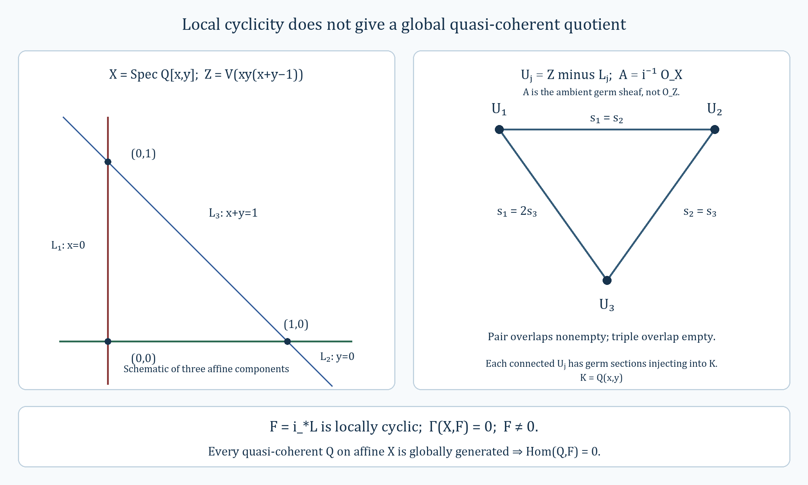

*The left panel is a schematic of the three affine components of $Z$ with their exact pairwise vertices. The right panel is the nerve of the cover $U_j=Z\setminus L_j$, with the compatibility factors in (GQT6). Here $A=i^{-1}\mathcal O_X$ is the ambient germ sheaf, $K=\mathbf Q(x,y)$ and $F=i_*L$. Equations (GQT7)–(GQT11) give the obstruction to a global quasi-coherent source. The editable vector diagram is [global-quotient-triangle.svg](../figures/global-quotient-triangle.svg).*

#### Lemma. Extending quasi-coherent complexes from an open

Suppose $j:U\hookrightarrow X$ is a quasi-compact open immersion of schemes. Restriction is essentially surjective both on unbounded complexes with quasi-coherent cohomology and on those bounded below:
$$D_{\mathrm{QCoh}}(\mathcal O_X)\longrightarrow D_{\mathrm{QCoh}}(\mathcal O_U),\qquad
D^+_{\mathrm{QCoh}}(\mathcal O_X)\longrightarrow D^+_{\mathrm{QCoh}}(\mathcal O_U).$$
If $X$ is quasi-compact, the same conclusion holds for the bounded above and bounded categories $D^-_{\mathrm{QCoh}}$ and $D^b_{\mathrm{QCoh}}$.

**Proof.** Given $F\in D_{\mathrm{QCoh}}(\mathcal O_U)$, use $Rj_*F$ on $X$. An open immersion is separated, hence quasi-separated; together with the assumed quasi-compactness this makes the [quasi-coherent direct-image theorem](#native-perfect-lemma-quasi-coherence-direct-image) applicable. Therefore $Rj_*F$ has quasi-coherent cohomology.

The counit identifies its restriction with $F$. Indeed, on any representative $I$ used to compute the direct image, restriction gives $j^*j_*I=I$ term by term. As restriction is exact, this yields $j^*Rj_*F\simeq F$. It proves essential surjectivity in the unbounded category.

If $F\in D^{\geq a}$, choose an injective resolution with zero terms below $a$. Applying $j_*$ retains that termwise lower bound, so $Rj_*F\in D^{\geq a}$. This proves the bounded-below statement. If $X$ is quasi-compact, the direct-image theorem supplies a fixed integer $N\geq1$ such that
$$F\in D^{\leq b}\quad\Longrightarrow\quad Rj_*F\in D^{\leq b+N-1}.\tag{QEO1}$$
To obtain (QEO1), apply its degree-zero bound to $F[b]$ and then undo the shift. Thus the same extension preserves boundedness above under the stated additional hypothesis. Combining this with the lower bound proves the bounded case. $\square$

#### Lemma. Derived tensor products and affine module models

For a scheme $X$, the category $D_{\mathrm{QCoh}}(\mathcal O_X)$ is closed under derived tensor product. On $X=\operatorname{Spec}(A)$, this product corresponds to the derived tensor product of module complexes: for arbitrary complexes $M,N$ over $A$ there is a natural isomorphism
$$\widetilde M\otimes_{\mathcal O_X}^{\mathbf L}\widetilde N
\cong\widetilde{M\otimes_A^{\mathbf L}N}.\tag{QDT1}$$
No boundedness assumption is imposed.

**Proof.** Choose a K-flat resolution $P\to M$. The [affine K-flat lemma](#native-perfect-lemma-affine-k-flat) shows that $\widetilde P$ is K-flat, and exactness of associated sheaf makes $\widetilde P\to\widetilde M$ a quasi-isomorphism. Hence the left side of (QDT1) is represented by $\operatorname{Tot}(\widetilde P\otimes\widetilde N)$. Associated sheaf preserves tensor products and direct sums; it therefore identifies this complex, with its signed total differential, with $\widetilde{\operatorname{Tot}(P\otimes_A N)}$. The latter represents the right side. The comparison respects quasi-isomorphisms and gives the stated natural isomorphism.

For general $X$ and $K,L\in D_{\mathrm{QCoh}}(\mathcal O_X)$, restrict to an affine open. The [affine derived equivalence](#native-perfect-lemma-affine-compare-bounded) supplies module complexes representing both restrictions. Formula (QDT1) identifies their derived tensor with an associated module complex, whose cohomology is quasi-coherent by exact sheafification. Derived tensor commutes with open restriction, so these affine conclusions prove quasi-coherence on $X$. $\square$

#### Lemma. Comparing Tor amplitude on an affine scheme and its ring

Let $X=\operatorname{Spec}(A)$ and let $E$ correspond to a complex $M$ of $A$-modules. Then $E$ has Tor amplitude in $[a,b]$ exactly when $M$ has Tor amplitude in $[a,b]$. In particular, one has finite Tor dimension exactly when the other does.

**Proof.** If $M$ has the stated amplitude, the [flat-complex criterion for Tor amplitude](#native-more-algebra-lemma-tor-amplitude) represents it by a complex $Q$ of flat modules whose terms lie in $[a,b]$. Its associated sheaf complex is bounded and flat, hence computes derived tensor products with any sheaf and has no tensor cohomology outside that interval. It represents $E$, which consequently has the stated amplitude.

Conversely, test the sheaf amplitude on $\mathcal O_X$ itself to see that $E$ has bounded cohomology. Exact sheafification detects zero modules, so $M$ is bounded in the derived category. Replace it by a bounded above free resolution $P$. The associated complex is bounded above and flat and therefore K-flat. For any $A$-module $N$ this gives
$$E\otimes^{\mathbf L}_{\mathcal O_X}\widetilde N
\simeq\widetilde{P\otimes_A N}.$$
The left side has cohomology only in $[a,b]$. Since sheafification is exact and faithful on modules, $H^i(P\otimes_A N)=0$ outside $[a,b]$. This holds for every $N$, which is the required algebraic Tor bound. Existence of a finite amplitude interval gives the last assertion; if finite Tor dimension is formulated locally, quasi-compactness of $X$ combines a finite local cover into one interval. $\square$

#### Lemma. Sheafification of a K-flat complex on an affine scheme

If $K$ is a K-flat complex over a ring $A$, its associated complex $\widetilde K$ on $X=\operatorname{Spec}(A)$ is K-flat.

**Proof.** At a prime $\mathfrak p$ of $A$, the stalk is $K\otimes_A A_{\mathfrak p}$. To check its K-flatness, take an acyclic complex $C$ of $A_{\mathfrak p}$-modules. It is still acyclic when scalars are restricted to $A$, and associativity gives
$$\operatorname{Tot}\bigl((K\otimes_A A_{\mathfrak p})\otimes_{A_{\mathfrak p}}C\bigr)
\cong\operatorname{Tot}(K\otimes_A C).$$
The right side is acyclic by K-flatness of $K$. This is the [base-change argument for K-flat complexes](#native-more-algebra-lemma-base-change-k-flat).

Finally, K-flatness can be [checked on stalks](#uncovered-cohomology-lemma-check-k-flat-stalks). In the direction needed here, an acyclic sheaf complex $B$ has acyclic stalks, and
$$\operatorname{Tot}(\widetilde K\otimes_{\mathcal O_X}B)_{\mathfrak p}
\cong\operatorname{Tot}(K_{\mathfrak p}\otimes_{A_{\mathfrak p}}B_{\mathfrak p})$$
is acyclic at every prime. Stalks commute with tensor products and the direct sums defining totalization, and they detect exactness. The sheaf tensor complex is therefore acyclic, as required. $\square$

#### Lemma. Unbounded quasi-coherent direct images and a uniform upper bound

Let $f:X\to S$ be a quasi-compact, quasi-separated morphism of schemes. Then $Rf_*$ carries $D_{\mathrm{QCoh}}(\mathcal O_X)$ into $D_{\mathrm{QCoh}}(\mathcal O_S)$.

If $S$ is quasi-compact, there is an integer $N\geq1$ depending only on $f:X\to S$ such that
$$E\in D_{\mathrm{QCoh}}^{\leq0}(\mathcal O_X)
\quad\Longrightarrow\quad H^r(Rf_*E)=0\quad(r\geq N).\tag{QDIB1}$$
The same $N$ works after every base change $S'\to S$, for every object of $D_{\mathrm{QCoh}}^{\leq0}(\mathcal O_{X'})$, where $X'=X\times_SS'$. No quasi-compactness of $S'$ is required.

**Proof.** The [higher-direct-image theorem for quasi-coherent sheaves](#uncovered-coherent-lemma-quasi-coherence-higher-direct-images) gives quasi-coherence of $R^pf_*G$ for a quasi-coherent module $G$. When $S$ is quasi-compact, it also gives one $N$ such that these sheaves vanish for $p\geq N$, uniformly for all $G$ and after every base change. Increase $N$ to at least $1$ if needed.

For a bounded below complex $E$, use the [cohomology-sheaf spectral sequence](#native-derived-lemma-two-ss-complex-functor)
$$E_2^{p,q}=R^pf_*H^q(E)\quad\Longrightarrow\quad H^{p+q}(Rf_*E).\tag{QDIB2}$$
Its filtration in each total degree is finite. Each term on the second page is quasi-coherent, and kernels, cokernels and extensions preserve quasi-coherence. Thus the abutment is quasi-coherent. If also $E\in D^{\leq0}$, the only possibly nonzero entries have $p<N$ and $q\leq0$, which gives (QDIB1). The same argument works for every base-changed morphism, using the same $N$.

Next remove the lower bound in (QDIB1). For an affine open $V\subset S$, put $W=f^{-1}(V)$. The [affine-base cohomology identity](#uncovered-coherent-lemma-quasi-coherence-higher-direct-images-application) and the preceding sheaf bound show that $H^p(W,G)=0$ for $p\geq N$ and every quasi-coherent module $G$ on $W$. The sections functor on $W$ preserves countable products, so the [derived-functor truncation bound](#native-perfect-lemma-application-nice-k-injective) applies. For $E\in D_{\mathrm{QCoh}}^{\leq0}(\mathcal O_X)$ it gives
$$H^r(R\Gamma(W,E|_W))=0\qquad(r\geq N).\tag{QDIB3}$$
These groups compute the cohomology presheaf used for $Rf_*E$ on the affine basis of $S$. Sheafifying, or taking the filtered colimit over affine neighborhoods of a point, gives (QDIB1). For an arbitrary $S'\to S$, apply precisely this argument on each affine open of $S'$. The sheaf bound still uses the original $N$, so it proves the asserted uniformity without requiring $S'$ itself to be quasi-compact.

It remains to prove quasi-coherence for an arbitrary, possibly unbounded $E$. This is local on $S$, so restrict to an affine open and use the corresponding finite $N$. The truncation triangle is
$$A_n=\tau_{\leq-n-1}E\longrightarrow E\longrightarrow
B_n=\tau_{\geq-n}E\longrightarrow A_n[1].\tag{QDIB4}$$
Since $A_n[-n-1]\in D^{\leq0}$, (QDIB1) gives $H^r(Rf_*A_n)=0$ for $r\geq N-n-1$. Fix an integer $q$ and choose $n\geq0$ so large that $q\geq N-n-1$. The two outside terms in the degree-$q$ long exact sequence of (QDIB4) vanish, giving
$$H^q(Rf_*E)\cong H^q(Rf_*B_n).$$
The complex $B_n$ is bounded below, so its direct image has quasi-coherent cohomology by the first part of the proof. This proves quasi-coherence in every degree for $Rf_*E$. $\square$

#### Lemma. The quasi-coherator on an affine scheme

For $X=\operatorname{Spec}(A)$, the following descriptions hold:

1. $Q_X(\mathcal F)=\widetilde{\Gamma(X,\mathcal F)}$ for every $\mathcal O_X$-module $\mathcal F$.
2. $RQ_X(E)$ is the quasi-coherent complex associated to $R\Gamma(X,E)\in D(A)$.
3. On objects with quasi-coherent cohomology, $RQ_X$ is inverse to $D(\mathrm{QCoh}(\mathcal O_X))\to D_{\mathrm{QCoh}}(\mathcal O_X)$.

**Proof.** For any $A$-module $M$, the associated-sheaf adjunction and affine module–sheaf equivalence give
$$\operatorname{Hom}_{\mathcal O_X}(\widetilde M,\mathcal F)
\simeq\operatorname{Hom}_A(M,\Gamma(X,\mathcal F))
\simeq\operatorname{Hom}_{\mathrm{QCoh}(\mathcal O_X)}
(\widetilde M,\widetilde{\Gamma(X,\mathcal F)}).$$
This proves (1). Associated sheaf is exact, so application of (1) to a K-injective representative yields (2). Assertion (3) is the unit-and-counit calculation in the [unbounded affine derived equivalence](#native-perfect-lemma-affine-compare-bounded). $\square$

#### Proposition. Compact objects on a scheme

Let $X$ be a scheme that is quasi-compact and quasi-separated. Within $D_{\mathrm{QCoh}}(\mathcal O_X)$, perfection and compactness define the same class of objects.

**Proof.** If $P$ is perfect, its perfect dual gives the natural identity
$$\operatorname{Hom}_X(P,M)=H^0(X,P^\vee\otimes^{\mathbf L}M).$$
Derived tensor product with $P^\vee$ preserves direct sums. The [direct-image direct-sum theorem](#native-perfect-lemma-quasi-coherence-pushforward-direct-sums), applied to the structure morphism and then to affine sections, shows that $H^0(X,-)$ does so on quasi-coherent derived objects. This proves compactness.

Conversely, suppose $P$ is compact. For an affine open $j:U\hookrightarrow X$, quasi-separatedness makes $j$ quasi-compact. Its derived direct image preserves quasi-coherence and direct sums. Thus for any family $(M_i)$ on $U$,
$$\begin{aligned}
\operatorname{Hom}_U(P|_U,\bigoplus_iM_i)
&\simeq\operatorname{Hom}_X(P,Rj_*\bigoplus_iM_i)\\
&\simeq\bigoplus_i\operatorname{Hom}_X(P,Rj_*M_i)
\simeq\bigoplus_i\operatorname{Hom}_U(P|_U,M_i).
\end{aligned}$$
Hence $P|_U$ is compact. Under the affine derived equivalence it corresponds to a compact object of $D(\Gamma(U,\mathcal O_U))$, which is perfect by the [module compactness theorem](#native-more-algebra-proposition-perfect-is-compact). Therefore every such restriction is perfect, and perfection is local on $X$. $\square$

#### Lemma. Local tests for base change of one complex

Let $X'=X\times_S S'$ be a cartesian square of schemes, with maps $f:X\to S$, $g:S'\to S$, $g':X'\to X$ and $f':X'\to S'$. Suppose $K\in D_{\mathrm{QCoh}}(\mathcal O_X)$, $K'\in D_{\mathrm{QCoh}}(\mathcal O_{X'})$, and a morphism $\alpha:L(g')^*K\to K'$ is specified.

For $x'\in X'$, let $x,s',s$ be its images. The structural ring maps and $\alpha$ define the comparison
$$H^i(K_x\otimes_{\mathcal O_{S,s}}^{\mathbf L}\mathcal O_{S',s'})
\otimes_{\mathcal O_{X,x}\otimes_{\mathcal O_{S,s}}\mathcal O_{S',s'}}
\mathcal O_{X',x'}\longrightarrow H^i(K'_{x'}).$$
It factors through the derived pullback over $\mathcal O_{X,x}$. These are the stalk maps referred to in the base-change condition. The following three requirements are equivalent.

1. Every displayed stalk map, in every integer degree, is an isomorphism.
2. For every pair of affine opens $U\subset X$, $V'\subset S'$ mapping into an affine open $V\subset S$, put $U'=U\times_V V'$. Writing $A=\mathcal O_X(U)$, $R=\mathcal O_S(V)$, $B=\mathcal O_{S'}(V')$ and $C=A\otimes_R B$, the following composite is an isomorphism in $D(B)$:
   $$R\Gamma(U,K)\otimes_R^{\mathbf L}B
   \longrightarrow R\Gamma(U,K)\otimes_A^{\mathbf L}C
   \longrightarrow R\Gamma(U',K').$$

3. Such quadruples can be chosen with the $U'$ covering $X'$ and with the comparisons in (2) isomorphisms.

The base ring in (2) is $\mathcal O_S(V)$; $U$ is an open of $X$, so the source's notation $\mathcal O_S(U)$ must be corrected accordingly.

**Proof.** The [affine pullback formula](#native-perfect-lemma-quasi-coherence-pullback) identifies the middle term with $R\Gamma(U',L(g')^*K)$, so the last arrow is induced by $\alpha$. The first arrow is the canonical change-of-rings comparison. All cohomology groups of the first term have their natural $C$-module structure, and the maps respect it.

We verify the local assertion on one affine square. Let $M$ and $N$ be the complexes of modules corresponding to $K$ and $K'$. The chart comparison is
$$M\otimes_R^{\mathbf L}B\longrightarrow M\otimes_A^{\mathbf L}C\longrightarrow N.$$
For a prime $\mathfrak q'\subset C$ and its images $\mathfrak q\subset A$, $\mathfrak p'\subset B$, $\mathfrak p\subset R$, flat localization gives
$$H^i(M_{\mathfrak q}\otimes_{R_{\mathfrak p}}^{\mathbf L}B_{\mathfrak p'})
\otimes_{A_{\mathfrak q}\otimes_{R_{\mathfrak p}}B_{\mathfrak p'}}C_{\mathfrak q'}
\cong H^i(M\otimes_R^{\mathbf L}B)\otimes_C C_{\mathfrak q'}.$$
Indeed, localizing the two tensor factors first and then localizing their tensor product at $\mathfrak q'$ inverts exactly the same elements as localization of $C$ at $\mathfrak q'$. Localization is exact and commutes with the complexes computing derived tensor, which proves the identity in all degrees. Under this identity the stalk comparison is the localization of the chart comparison on cohomology. A module map is an isomorphism if and only if it is so at every prime, by applying the [local zero criterion](#native-algebra-lemma-characterize-zero-local) to its kernel and cokernel. Thus (1) and (2) agree on an affine square.

The condition in (1) is local on $X'$. Affine squares of this form cover $X'$: choose $V$ around the image in $S$, then $U$ and $V'$ around the two lifted points inside its inverse images. Applying the affine calculation gives (1) implies (2), and (3) implies (1). Choosing such a cover gives (2) implies (3). $\square$

#### Lemma. Global base change from the one-complex condition

In the cartesian scheme square above, assume $f$ is quasi-compact and quasi-separated and $\alpha:L(g')^*K\to K'$ satisfies the equivalent local conditions. Then the canonical composite
$$Lg^*Rf_*K\longrightarrow Rf'_*L(g')^*K\longrightarrow Rf'_*K'$$
is an isomorphism.

**Proof.** Restriction to an open subset of the target commutes with derived direct image and with the comparison. Cover $S$ by affine opens and then their inverse images in $S'$ by affine opens. We may consequently take both $S$ and $S'$ affine. The scheme $X$ is then quasi-compact and quasi-separated.

For a quasi-compact open $T\subset X$, let $\beta_T$ denote the analogous comparison for $T\to S$ and $T'=T\times_S S'$. If $T$ is affine, its isomorphism is exactly the affine test just proved, using the [unbounded affine derived equivalence](#native-perfect-lemma-affine-compare-bounded). We use [quasi-compact open induction](#uncovered-coherent-lemma-induction-principle) to extend this to all $T$.

Suppose $T=U\cup V$ and the assertion holds for $U,V,W=U\cap V$, all quasi-compact. Write $a:U\to S$, $b:V\to S$, $c:W\to S$ and use primes for their base changes. The [relative Mayer–Vietoris triangle](#uncovered-cohomology-lemma-unbounded-relative-mayer-vietoris), followed by $Lg^*$, and its version over $S'$ form a morphism of triangles:
$$\begin{array}{ccc}
Lg^*R(T\to S)_*K_T&\xrightarrow{\beta_T}&R(T'\to S')_*K'_{T'}\\
\downarrow&&\downarrow\\
Lg^*(Ra_*K_U\oplus Rb_*K_V)&\xrightarrow{\beta_U\oplus\beta_V}&Ra'_*K'_{U'}\oplus Rb'_*K'_{V'}\\
\downarrow&&\downarrow\\
Lg^*Rc_*K_W&\xrightarrow{\beta_W}&Rc'_*K'_{W'}\\
\downarrow&&\downarrow\\
Lg^*R(T\to S)_*K_T[1]&\xrightarrow{\beta_T[1]}&R(T'\to S')_*K'_{T'}[1].
\end{array}$$
The columns are the two distinguished triangles. Naturality of restriction, derived base change and $\alpha$ gives the squares, including the boundary square. The middle two comparisons are isomorphisms, hence so is $\beta_T$ by the long exact cohomology sequences. This proves the induction step and therefore $\beta_X$. This is the relative Mayer–Vietoris proof; the alternative comparison method cited in the source is [the general base-change comparison](#native-perfect-lemma-compare-base-change). $\square$

#### Lemma. Noetherian schemes: pseudo-coherence from cohomology

Let $X$ be Noetherian, $E\in D_{\mathrm{QCoh}}(\mathcal O_X)$, and $m\in\mathbf Z$. The following conditions are equivalent:

1. The sheaves $H^i(E)$ are coherent for $i\geq m$, and vanish for all sufficiently large $i$.
2. The object $E$ is $m$-pseudo-coherent.

Consequently pseudo-coherence on $X$ is equivalent to membership in $D^-_{\mathrm{Coh}}(\mathcal O_X)$.

**Proof.** The first condition includes a global upper bound. The second supplies upper bounds on an open cover, since its local finite complexes agree with $E$ above degree $m$. A finite subcover exists because $X$ is quasi-compact, and the maximum of its bounds is global. The remaining assertions can now be tested on affine opens.

On $U=\operatorname{Spec}(R)$, the [affine derived equivalence](#native-perfect-lemma-affine-compare-bounded) writes $E|_U$ as the sheafification of a complex $M$ over the Noetherian ring $R$. By the [affine approximation criterion](#native-perfect-lemma-pseudo-coherent-affine), $m$-pseudo-coherence of these two objects is equivalent. Moreover, [coherent sheaves on an affine Noetherian scheme](#native-properties-lemma-finite-type-module) correspond to finite modules, so coherence of $H^i(E)|_U$ means finiteness of $H^i(M)$. The [Noetherian algebra criterion](#native-more-algebra-lemma-noetherian-pseudo-coherent) gives precisely the desired equivalence on $U$. Locality and the common upper bound give it on $X$.

Applying the equivalence for every $m$ proves the final assertion. In the forward direction even one cutoff yields boundedness above, while the cutoffs together give coherence in every degree. $\square$

#### Lemma. Testing Tor amplitude by quasi-coherent modules on a scheme

Let $X$ be a quasi-separated scheme, $E\in D_{\mathrm{QCoh}}(\mathcal O_X)$, and $a\leq b$ integers. Then $E$ has Tor amplitude in $[a,b]$ if and only if
$$H^i(E\otimes_{\mathcal O_X}^{\mathbf L}\mathcal F)=0
\quad(i\notin[a,b])$$
for every quasi-coherent $\mathcal F$ on $X$.

**Proof.** An amplitude bound tests all modules, so it implies this particular collection of tests. Conversely, let $j:U\hookrightarrow X$ be an affine open. Quasi-separatedness makes $j$ quasi-compact. The [quasi-coherent pushforward theorem](#uncovered-schemes-lemma-push-forward-quasi-coherent) therefore applies to $j$. For any quasi-coherent $G$ on $U$, use $\mathcal F=j_*G$ in the assumed test and restrict to $U$. Since $j^*j_*G=G$, this gives the same bound for $E|_U\otimes^{\mathbf L}G$.

Write $U=\operatorname{Spec}(R)$ and let $M\in D(R)$ correspond to $E|_U$ under the [affine derived equivalence](#native-perfect-lemma-affine-compare-bounded). Quasi-coherent modules on $U$ run through the sheafifications of all $R$-modules $N$. The preceding vanishing is therefore exactly $H^i(M\otimes_R^{\mathbf L}N)=0$ outside $[a,b]$ for every $N$. The [affine Tor comparison](#native-perfect-lemma-tor-dimension-affine) gives that amplitude for $E|_U$ against arbitrary sheaves. These affine opens cover $X$, so the amplitude bound holds on $X$. No quasi-compactness assumption on $X$ was used. $\square$

#### Lemma. Perfect objects descend along affine inverse limits of schemes

For a directed inverse system of quasi-compact, quasi-separated schemes with affine transitions, let $S=\varprojlim_iS_i$. Derived pullback induces an equivalence
$$\operatorname{colim}_iD_{\mathrm{perf}}(S_i)\xrightarrow{\ \sim\ }D_{\mathrm{perf}}(S).$$
In particular every perfect object descends to one stage, every morphism between descended objects descends after enlarging that stage, and equality of two such morphisms can be checked at a later finite stage.

**Proof.** Full faithfulness is the [derived-Hom descent theorem](#native-perfect-lemma-descend-homomorphisms), applied with a perfect source. We prove essential surjectivity by [induction on quasi-compact opens](#uncovered-coherent-lemma-induction-principle) of a fixed $S_0$.

When $S_0$ is affine, all its pullbacks are affine. The [affine perfect-complex criterion](#native-perfect-lemma-perfect-affine) and [descent of finite projective complexes over ring colimits](#native-more-algebra-lemma-colimit-perfect-complexes) give essential surjectivity, including descent of differentials and their square-zero equations.

For the induction step, write $S_0=U_0\cup V_0$ and assume the result on $U_0,V_0,W_0=U_0\cap V_0$. Let $E$ be perfect on $S$. At a common stage $i$, descend $E|_U$ and $E|_V$ to perfect $A_i$ and $B_i$. Their comparison on $W$ descends by full faithfulness to a map $c_i:A_i|_{W_i}\to B_i|_{W_i}$. Descend its inverse too and enlarge the index until both composites are identities. Thus $c_i$ is an isomorphism at the stage, not merely after taking the limit.

Let $p_i:S\to S_i$. The chosen local identifications with $E$ have adjoints
$$a_i:A_i\longrightarrow(Rp_{i*}E)|_{U_i},\qquad
b_i:B_i\longrightarrow(Rp_{i*}E)|_{V_i}.$$
Restriction of direct image to an open agrees with direct image of the restriction. The equality defining $c_i$ after pullback is therefore, by adjunction, exactly $a_i|_{W_i}=b_i|_{W_i}c_i$. The [two-open derived gluing theorem](#native-cohomology-lemma-glue) supplies an object $E_i$ and a map $E_i\to Rp_{i*}E$ with these restrictions. Its restrictions are $A_i$ and $B_i$, so $E_i$ is perfect. The adjoint $Lp_i^*E_i\to E$ restricts to the original isomorphisms on $U$ and $V$, and hence is an isomorphism globally. This completes the induction and proves the equivalence. $\square$

#### Definition. Tor independence over a scheme

For two $S$-schemes $X$ and $Y$, **Tor independence over $S$** means the following stalkwise vanishing: whenever $x\in X$ and $y\in Y$ have the same image $s$, one has
$$\operatorname{Tor}^{\mathcal O_{S,s}}_r(\mathcal O_{X,x},\mathcal O_{Y,y})=0
\qquad\text{for every }r>0.$$
Thus every such pair of stalk algebras must satisfy the [algebraic definition of Tor independence](#native-more-algebra-definition-tor-independent).

#### Lemma. Pseudo-coherent pushforward along a flat proper morphism

Suppose $f:X\to S$ is proper, flat and finitely presented. If $E\in D(\mathcal O_X)$ is pseudo-coherent, then $Rf_*E$ is pseudo-coherent on $S$. For any $g:S'\to S$, write $X'=X\times_SS'$, with projections $g':X'\to X$ and $f':X'\to S'$. The canonical comparison is an isomorphism:
$$Lg^*Rf_*E\ \xrightarrow{\ \sim\ }\ Rf'_*Lg'^*E.\tag{PFPC1}$$

**Proof.** In the [pseudo-coherent tensor direct-image theorem](#native-perfect-lemma-base-change-tensor-pseudo-coherent), take the coefficient complex to be $\mathcal O_X$ in degree zero. Its sole term is finitely presented as an $\mathcal O_X$-module and flat over $S$; its support is proper over $S$. The theorem gives pseudo-coherence and its canonical base-change map becomes (PFPC1), since the ordinary pullback of this coefficient is $\mathcal O_{X'}$. $\square$

**The general relative assertion of Kiehl.** For a proper $f:X\to S$, a complex $E$ that is [pseudo-coherent relative to $S$](#context-more-morphisms-definition-relative-pseudo-coherence) has pseudo-coherent direct image $Rf_*E$. Arbitrary base change is not part of that general assertion and need not hold.

**Proof of the general assertion.**

**Proper relative pseudo-coherent direct image by finite derived descent**

**Target.**
For every proper morphism of schemes $f:X\to S$ and every complex
$M$ pseudo-coherent relative to $S$, the object $Rf_*M$ is pseudo-coherent
on $S$. Neither flatness nor finite presentation of $f$ is assumed.
This does not assert arbitrary classical base change for $Rf_*M$.

**Conventions.**
All complexes are cohomological. An animated ring is a simplicial
commutative ring considered up to weak equivalence. Its module category
is the stable infinity-category of derived modules; its homotopy
category has the usual cohomological $t$-structure. Connective means
$H^i=0$ for $i>0$. Derived tensor is right $t$-exact in this convention.
Finite free cell modules are obtained from finitely many shifts of
the ring by finitely many cone attachments. Pseudo-coherence means
existence, at every integer cutoff $q$, of a finite free cell map
which is an isomorphism above $q$ and surjective at $q$.
On a derived affine this is equivalent to the usual finite-projective
definition: choose finite free generators at the highest degree and
repeat on cones to any prescribed cutoff.

For derived schemes, modules are Zariski descent data for these affine
module categories. Cohomology bounds, pseudo-coherence and truncations
are local. Finite open-cover descent is a homotopy limit; ordinary
descent data in homotopy categories alone are not substituted for it.

We use the [proper coherent-image theorem](#a-12-3-proper-coherent-cohomology-for-algebraic-spaces),
[closed finite-presentation envelopes for proper schemes](#uncovered-limits-lemma-proper-limit-of-proper-finite-presentation), [Noetherian approximation for finitely presented proper schemes](#uncovered-spaces-limits-lemma-proper-limit-of-proper-finite-presentation-noetherian), and [independence of the polynomial presentation in relative pseudo-coherence](#uncovered-more-morphisms-lemma-relative-pseudo-coherence-characterize). The
derived comparison and finite-range descent steps are established below.

**1. Two elementary approximation facts.**
If $N$ is an $A$-module and $q\in\mathbf Z$, then $q$-pseudo-coherence
depends only on $\tau^{\geq q}N$. One implication is immediate by
composition with truncation. For the converse take a finite free cell
approximation to $\tau^{\geq q}N$ at cutoff $q$. It can be chosen with
generators only in degrees $\geq q$: construct it downward from a
common upper cohomological bound and stop upon obtaining surjectivity
in degree $q$. Maps from such a module to a module in
$D^{\leq q-2}(A)$ vanish. Applying this to
$(\tau^{<q}N)[1]$ lifts the approximation through
$N\to\tau^{\geq q}N$. The lifted map has the required cohomology.
This argument applies to every connective animated ring; a free cell
of generator degree $p$ maps to $H^p$ of the target.

Also, if $N$ is pseudo-coherent, then for each integer $r$ there is a
finite free cell $P$ with
$$
       \tau^{\geq r}P\simeq\tau^{\geq r}N.                         \tag{KDC1}
$$
Choose an approximation at cutoff $r-1$. It is an isomorphism in every
degree at least $r$. The generators of $P$ may all be chosen at or
below a fixed upper bound $b$ for $N$.

**2. Restriction along a pseudo-coherent animated algebra.**
Suppose $P\to B$ is a map of connective animated rings and $B$ is
pseudo-coherent as a $P$-module. If a $B$-module $N$, on restricting
scalars, is pseudo-coherent over $P$, then it is pseudo-coherent over
$B$.

Indeed $N$ is bounded above. At its highest nonzero degree $b$,
$H^b(N)$ is finitely generated over $\pi_0(P)$: a finite approximation
at this highest degree gives finite generators. The same generators
generate it over $\pi_0(B)$. They give a map of finite free shifted
$B$-modules to $N$, surjective on $H^b$. The cone is bounded above
by $b-1$ and remains pseudo-coherent over $P$, since the underlying
$P$-modules of the finitely many $B$-cells are pseudo-coherent.
Repeat on the cone. At any specified cutoff there are only finitely
many repetitions. Splicing these triangles gives a finite free cell
$B$-approximation to $N$ at that cutoff. The zero module and an empty
highest range use the zero approximation.

**3. Finite open covers and derived base change.**
Let $Y_0$ be a quasi-compact separated scheme over $\operatorname{Spec}A_0$.
Choose a finite affine open cover $U_1,\ldots,U_n$. Every nonempty
intersection $U_I$ is affine, because $Y_0$ is separated over the
affine base. Empty intersections contribute zero. For an $A_0$-algebra
$A$, put $Y_A=Y_0\times^{\mathbf R}_{A_0}\operatorname{Spec}A$ and
write $B_{I,A}=\Gamma(U_I,\mathcal O_{Y_0})\otimes^{\mathbf L}_{A_0}A$.
The cover and all its intersections base change to derived affines.

The derived section complex of a quasi-coherent module is the finite
alternating Cech totalization
$$
 R\Gamma(Y_A,N)\simeq
 \operatorname{Tot}\left[
 \bigoplus_{|I|=1}N(U_{I,A})\longrightarrow\cdots\longrightarrow
 \bigoplus_{|I|=n}N(U_{I,A})\right].                                \tag{KDC2}
$$
This follows by successive two-open Mayer--Vietoris squares; the
augmented Cech resolution is stalkwise contracted by any index of an
open containing the point. The same construction works for module
complexes, since there are only finitely many Cech degrees. It neither
uses an infinite totalization nor interchanges two infinite products.

It follows that, with $d=n-1$, uniformly in $A$,
$$
 N\in D^{\leq a}(Y_A)\quad\Longrightarrow\quad
 R\Gamma(Y_A,N)\in D^{\leq a+d}(A).                                \tag{KDC3}
$$
For every $A\to A'$ and every $N\in D_{\rm QCoh}(Y_A)$,
$$
 R\Gamma(Y_A,N)\otimes_A^{\mathbf L}A'
 \simeq R\Gamma(Y_{A'},L p^*N).                                   \tag{KDC4}
$$
On each affine intersection this is the definition of derived module
pullback. Derived tensor commutes with the finite sums and finite
fibres in (KDC2), because it is exact. These maps commute with the
restriction maps, proving the natural comparison (KDC4).

**4. Finite-range descent lemma.**
Let $A=\mathop{\rm colim}_{\lambda}A_\lambda$ be a filtered colimit of
ordinary $A_0$-algebras and keep the finite cover above. If $N$ is
pseudo-coherent on $Y_A$, then for every integer $r$ there are an
index $\lambda$ and a module $N_\lambda$ on $Y_{A_\lambda}$ such that
$$
 \tau^{\geq r}L p_\lambda^*N_\lambda
       \simeq\tau^{\geq r}N.                                    \tag{KDC5}
$$
If $A_0$ and all $A_\lambda$ are Noetherian and $Y_0$ is of finite
type over $A_0$, $N_\lambda$ can be chosen bounded with coherent
cohomology on the underlying classical scheme of $Y_{A_\lambda}$.
It is then pseudo-coherent on that derived scheme.

Here is the descent argument, including the morphisms and coherences.
Quasi-compactness gives one upper cohomological bound $b$ for $N$.
On each intersection $U_{I,A}$ choose (KDC1), with cell generators
of degrees at most $b$. Finite free cell modules over a filtered
colimit of animated rings descend to a finite stage: descend a free
cell, and then each attaching map, successively. Maps out of a free
cell are homotopy groups of the target; homotopy groups commute with
filtered colimits. For finitely many cones the same assertion follows
by their finite fibre sequences. Thus maps out of a finite cell,
including all their homotopies, commute with these colimits.

We need this assertion also after truncating the source and target
in degree $r$. For finite cells $P,Q$ there is an equivalence of
mapping spaces
$$
 \operatorname{Map}(\tau^{\geq r}P,\tau^{\geq r}Q)
       \simeq\operatorname{Map}(P,\tau^{\geq r}Q).                 \tag{KDC6}
$$
Indeed maps from $\tau^{<r}P$ to $\tau^{\geq r}Q$, and their higher
homotopies, vanish by the $t$-structure. Truncated pullback is
$T_r(N)=\tau^{\geq r}L p^*N$. It is compatible with composition:
the part discarded in degrees below $r$ remains below $r$ on derived
pullback. Filtered colimits commute with $\tau^{\geq r}$, since they
are exact on module complexes. Together with (KDC6) and finite-cell
compactness, this proves that all mapping spaces between the
truncated cell models are filtered colimits of the corresponding
mapping spaces at finite stages.

For clarity, the category in which this last colimit is taken is the
category of modules truncated below $r$, with transition functors
$T_r$; ordinary pullback without the final truncation is not being
silently substituted. On open restrictions, which are flat,
truncation commutes with pullback.

Zariski module descent for our cover is the homotopy limit over the
finite poset of nonempty subsets $I\subset\{1,\ldots,n\}$, with the
restriction functors to intersections. This finite diagram follows
also by iterating the two-open descent square. Filtered colimits of
small infinity-categories commute with finite homotopy limits. One
can check this categorical fact in the complete Segal-space model:
the nerve in simplicial degree $m$ is the space of functors from the
finite simplex $\Delta^m$ and equivalences between them. These nerves
preserve limits and filtered colimits, and filtered colimits of
spaces commute with finite limits. Thus the comparison is an
equivalence in every simplicial degree. This is also the proof of
Lemma 2.4.5 in J. Lurie's [*Derived Algebraic Geometry XII*](https://www.math.ias.edu/~lurie/papers/DAG-XII.pdf),
8 November 2011.

Apply this fact to the finite diagram of the full local categories
of modules of the form $\tau^{\geq r}P$, with $P$ a finite free cell
with generator degrees at most $b$. The affine finite-cell and
mapping-space arguments above identify its filtered colimit with
the corresponding diagram over $A$. Its descent object therefore
comes from one finite stage. Equivalently, the local models,
overlap equivalences, inverse equivalences and coherent identifications
all descend together. Their homotopy-coherent compatibilities, not
only their homotopy classes, are included. The resulting descent
object is $N_\lambda$, and its truncated pullback is the original
truncated descent object. This proves (KDC5).

For the last claim, the local objects at this stage are
$\tau^{\geq r}P_{I,\lambda}$ for finite free cell modules, bounded
above by $b$. The animated rings $B_{I,A_\lambda}$ are Noetherian in
the derived sense: their $\pi_0$ are Noetherian and their higher
homotopy modules are finite over $\pi_0$. To check this without a
flatness assumption, choose a finite polynomial presentation
$A_0[t]\twoheadrightarrow B_{I,0}$. The Noetherian polynomial ring
has a bounded-above resolution of $B_{I,0}$ by finite free modules.
It is a flat $A_0$-resolution, so tensoring with $A_\lambda$ computes
$B_{I,A_\lambda}$. Its cohomology is finite over the Noetherian ring
$A_\lambda[t]$, hence over $\pi_0(B_{I,A_\lambda})$.
Finite cells and then their truncations have coherent cohomology over
these rings. The descended object is bounded in $[r,b]$ and coherent
locally, hence globally. Over a Noetherian animated ring a bounded
coherent module is pseudo-coherent: successively choose finite
generators of its top cohomology and repeat on the cone; kernels of
maps of finite modules stay finite. This completes the proof of the
finite-range descent lemma.

**5. Proper Noetherian derived base changes.**
Suppose now that $Y_0\to\operatorname{Spec}A_0$ is proper with $A_0$
Noetherian. Write $A$ as the filtered union of its finite type
$A_0$-subalgebras $A_\lambda$ (the image of $A_0$ is allowed).
Each $A_\lambda$ is Noetherian. We prove that for every
pseudo-coherent $N$ on $Y_A$,
$$
                       R\Gamma(Y_A,N)\text{ is pseudo-coherent over }A.
                                                                         \tag{KDC7}
$$
Choose $d$ as in (KDC3). Fix an arbitrary target cutoff $q$ and apply
the finite-range lemma with $r=q-d$. The resulting bounded coherent
$N_\lambda$ has pseudo-coherent sections over $A_\lambda$. Indeed its
finite Postnikov tower has layers given by coherent modules on the
classical proper scheme $Y_0\times_{A_0}\operatorname{Spec}A_\lambda$.
The classical proper coherent-image theorem makes the cohomology of
each layer's sections finite over $A_\lambda$; (KDC3) bounds the upper
degree. The tower is finite, so $R\Gamma(Y_{A_\lambda},N_\lambda)$
is bounded with finite cohomology over a Noetherian ring, hence
pseudo-coherent. Consequently its derived tensor with $A$ is
pseudo-coherent over $A$.

The fibre of $N\to\tau^{\geq r}N$ is in $D^{\leq r-1}$. By
(KDC3), its sections are in $D^{\leq r-1+d}=D^{\leq q-1}$.
The same applies to $L p_\lambda^*N_\lambda$. Thus (KDC5) and
(KDC4) give
$$
 \tau^{\geq q}R\Gamma(Y_A,N)
 \simeq\tau^{\geq q}R\Gamma(Y_A,Lp_\lambda^*N_\lambda)
 \simeq\tau^{\geq q}
   \bigl(R\Gamma(Y_{A_\lambda},N_\lambda)\otimes_{A_\lambda}^{\mathbf L}A\bigr).
                                                                         \tag{KDC8}
$$
The approximation fact in paragraph 1 makes $R\Gamma(Y_A,N)$
$q$-pseudo-coherent. Since $q$ was arbitrary, (KDC7) follows.

**6. From relative pseudo-coherence to the derived model.**
Let $Y\to\operatorname{Spec}A$ be proper and finitely presented.
Choose a proper finite type model $Y_0$ over a Noetherian finite type
$\mathbf Z$-subalgebra $A_0\subset A$, with
$Y=Y_0\times_{A_0}\operatorname{Spec}A$. Put
$\widetilde Y=Y_0\times^{\mathbf R}_{A_0}\operatorname{Spec}A$ and
let $i:Y\to\widetilde Y$ be its classical truncation.
If $M$ is pseudo-coherent relative to $A$ on $Y$, then $i_*M$ is
pseudo-coherent on $\widetilde Y$.

This is local, so take an affine chart
$B=B_0\otimes_{A_0}^{\mathbf L}A$ of $\widetilde Y$.
Choose $P_0=A_0[t_1,\ldots,t_s]\twoheadrightarrow B_0$.
Its finite free Noetherian resolution shows, after derived base
change, that $B$ is pseudo-coherent as a module over
$P=A[t_1,\ldots,t_s]$; these are ordinary polynomial rings.
Moreover $P\to\pi_0(B)$ is surjective. By independence of polynomial
presentations in relative pseudo-coherence, the module $M$ restricted
to this chart is pseudo-coherent as a $P$-module. Paragraph 2 makes
it pseudo-coherent as a $B$-module. This proves the assertion.

The direct image along $i$ retains the underlying module complexes,
so global sections agree:
$$
              R\Gamma(Y,M)=R\Gamma(\widetilde Y,i_*M).             \tag{KDC9}
$$
Paragraph 5 makes (KDC9) pseudo-coherent over $A$.
This proves the theorem for proper finitely presented $Y$ without
requiring flatness or discarding any negative Tor groups.

**7. Removing finite presentation and localizing the base.**
Finally take any proper $f:X\to S$ and relatively pseudo-coherent
$M$. The conclusion is local on $S$, so work over
$\operatorname{Spec}A\subset S$. Proper finite-presentation
approximation gives a closed immersion $j:X\hookrightarrow Y$
over $A$, with $Y\to\operatorname{Spec}A$ proper and finitely
presented. The existing approximation proof uses a separated finite
presentation envelope, finite type ideal approximations and eventual
properness; it does not assume $X$ is finitely presented.

Closed direct image is exact on quasi-coherent modules, and
$j_*M$ remains pseudo-coherent relative to $A$. On affine charts this
is the same underlying module for a finite type quotient
$B\twoheadrightarrow C$: a polynomial algebra surjecting onto $B$
also surjects onto $C$, so the two relative tests are identical by
independence of presentations. Apply paragraph 6 to $j_*M$. Since
$$
                 Rf_*M=R(Y\to\operatorname{Spec}A)_*j_*M,
$$
the required direct image is pseudo-coherent over $A$. Such affine
base opens cover $S$, proving the stated theorem. The empty source
gives zero throughout.$\square$

**Source correspondence.**
The general assertion follows the flat case in [The Stacks Project, Section 36.30](https://stacks.math.columbia.edu/tag/0A1G),
`perfect.tex:lemma-flat-proper-pseudo-coherent-direct-image-general`.
The derived-base-change strategy is related to J. Hall and O. Li,
*Finiteness theorems for pseudo-coherent complexes on algebraic
stacks*, [arXiv:2609.24420v1](https://arxiv.org/html/2609.24420v1), Theorem 5.3 and Section 6. The argument
here specializes to separated schemes and supplies a finite-open-cover
descent construction in paragraph 4. The truncated pullback functors retain all the finite-range descent
data needed for the cohomological comparison.

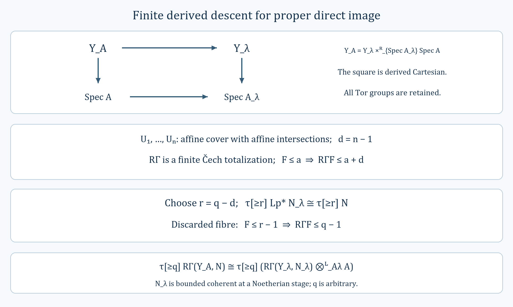

*The derived square retains Tor groups. The bound $d=n-1$ in (KDC3) turns descent above $r=q-d$ into the comparison above $q$ in (KDC8). Here $Y_\lambda=Y_{A_\lambda}$ and $p:Y_A\to Y_\lambda$. The editable vector diagram is [derived-cech-proper-image.svg](../figures/derived-cech-proper-image.svg).*

#### Lemma. The module category modelling projective space

*Human-source credit:* Beilinson, as credited in the Stacks Project's treatment of this equivalence.

For a ring $A$, put $S=A[X_0,\ldots,X_n]$, $X=\mathbf P^n_A$ and
$$P=\bigoplus_{a=0}^n\mathcal O_X(-a),\qquad
R=\operatorname{End}_{\mathcal O_X}(P).$$
The algebra $R$ acts on the left of $P$. With summands ordered as above, its row $a$, column $b$ entry is $S_{b-a}$ for $b\geq a$ and zero for $b<a$; multiplication is matrix multiplication using the products in $S$. In particular $R$ is finite free over $A$. For right $R$-modules the functor
$$F=-\otimes_R^{\mathbf L}P:D(R)\longrightarrow D_{\mathrm{QCoh}}(X)$$
is an $A$-linear equivalence of triangulated categories, with $F(R)=P$. Thus in this case the quasi-coherent derived category of a projective scheme is the derived category of a single, generally noncommutative algebra.

**Proof.** Regard $P$ as a complex concentrated in degree zero. Its ordinary DG endomorphism algebra is $R$ in degree zero. The [derived tensor construction](#native-dga-lemma-tensor-with-complex-derived) therefore defines $F$. Its image has quasi-coherent cohomology by the [quasi-coherent tensor-image theorem](#native-spaces-perfect-lemma-tensor-with-qcoh-complex), or its scheme form. This permits the [tensor-Hom adjunction](#native-dga-lemma-tensor-with-complex-hom-adjoint) to be restricted to
$$F:D(R)\rightleftarrows D_{\mathrm{QCoh}}(X):T,
\qquad T(K)=R\operatorname{Hom}_X(P,K).$$
The right $R$-action on $T(K)$ is precomposition.

Perfect duality and the [projective-space cohomology calculation](#uncovered-coherent-lemma-cohomology-projective-space-over-ring) give
$$\operatorname{Ext}^i_X(P,P)
\cong\bigoplus_{0\leq a,b\leq n}H^i(X,\mathcal O_X(a-b))
=\begin{cases}R,&i=0,\\0,&i\ne0.\end{cases}$$
Indeed the twists lie between $-n$ and $n$, so none has nonzero higher cohomology; negative Ext between these vector bundles vanishes as well. The degree-zero identification is the defining endomorphism algebra, including its multiplication. The adjunction unit at $R$ is consequently an isomorphism $R\simeq TF(R)$.

The bundle $P$ is compact in $D_{\mathrm{QCoh}}(X)$. One may see this directly: perfect duality identifies $T$ with $R\Gamma(X,P^\vee\otimes^{\mathbf L}-)$, and a finite affine cover with affine intersections computes this functor by a finite Čech totalization, which commutes with direct sums of quasi-coherent complexes. Thus $T$ preserves coproducts in this category. So does $F$.

It follows that the objects $M$ for which the unit $M\to TF(M)$ is an isomorphism form a triangulated subcategory closed under coproducts. It contains $R$, and hence all of $D(R)$: a [property-(P) resolution](#native-dga-lemma-resolve) is built from sums of shifts of $R$ by successive extensions and the [telescope of its filtration](#native-dga-lemma-property-p-sequence). Therefore $F$ is fully faithful. This argument uses compactness in $D_{\mathrm{QCoh}}(X)$ throughout.

The [projective-space generator lemma](#native-perfect-lemma-generator-p1) says that $P$ detects zero objects by all its shifted Hom groups. For $K\in D_{\mathrm{QCoh}}(X)$, apply $T$ to the counit $FT(K)\to K$. The triangular identity and the unit isomorphism show that its image under $T$ is an isomorphism. The cone therefore has zero Hom from every shift of $P$, and must vanish. The counit is an isomorphism for every $K$, proving essential surjectivity. Finally all constructions and comparison maps are $A$-linear. $\square$

#### Lemma. Finite free resolutions over an algebra finite free over the base

Let $R$ be a possibly noncommutative $A$-algebra, finite free as an $A$-module. If a complex $M$ of right $R$-modules is pseudo-coherent after restriction to $A$, it has a representative that is bounded above and finite free over $R$ in every degree.

**Proof.** Choose a representative $M^\bullet$. If it is acyclic, the zero complex suffices. Otherwise its nonzero cohomology degrees have a largest element $m$, since pseudo-coherence over $A$ implies boundedness above. The [finiteness lemma for top cohomology](#native-more-algebra-lemma-finite-cohomology) makes $H^m(M)$ finite over $A$, and thus finite over $R$. Choose finitely many cycle representatives of generators and obtain a map
$$\alpha^m:F^m\longrightarrow Z^m(M^\bullet),$$
where $F^m$ is finite free over $R$ and the map is surjective on $H^m$. Set $F^i=0$ for $i>m$. This starts a descending construction.

Suppose $F^{\geq n}\to M^\bullet$ has been constructed, is an isomorphism on cohomology above $n$, and is surjective in degree $n$. Let $C=\operatorname{Cone}(\alpha)$, with the convention
$$C^j=M^j\oplus F^{j+1},\qquad
d_C(u,v)=(d_Mu+\alpha v,-d_Fv).$$
Then $H^j(C)=0$ for $j\geq n$. The finite complex $F^{\geq n}$ is finite free over $A$, so the [cone stability of pseudo-coherence](#native-more-algebra-lemma-cone-pseudo-coherent) makes $C$ pseudo-coherent over $A$. Its top possible cohomology $H^{n-1}(C)$ is finite over $A$ and hence over $R$.

Choose a finite free $R$-module $F^{n-1}$ and a map
$$\beta:F^{n-1}\longrightarrow Z^{n-1}(C)$$
surjective on $H^{n-1}(C)$. Since $C^{n-1}=M^{n-1}\oplus F^n$, write
$$\beta=(\alpha^{n-1},-d_F^{n-1}).$$
The cycle condition gives both
$$d_M\alpha^{n-1}=\alpha^n d_F^{n-1},\qquad
d_F^n d_F^{n-1}=0.$$
Thus the new term extends the differential and the chain map to $F^{\geq n-1}\to M^\bullet$.

For the cohomological step, set $Q=F^{n-1}[-(n-1)]$, so $Q$ is concentrated in degree $n-1$. There is a morphism of distinguished triangles
$$\begin{array}{ccccccc}
F^{\geq n}&\longrightarrow&F^{\geq n-1}&\longrightarrow&Q&\longrightarrow&F^{\geq n}[1]\\
\Vert&&\downarrow&&\downarrow{\scriptstyle\beta}&&\Vert\\
F^{\geq n}&\longrightarrow&M^\bullet&\longrightarrow&C&\longrightarrow&F^{\geq n}[1].
\end{array}$$
The sign in $\beta$ is precisely the cone sign in this diagram. Since $Q\to C$ is surjective on $H^{n-1}$ and both have no cohomology above that degree, the cone of the extended map has no cohomology in degrees $\geq n-1$. Equivalently, the new map is an isomorphism in degrees $\geq n$ and surjective in degree $n-1$.

Iterate for $n=m,m-1,\ldots$. Each fixed degree and its neighbouring differentials eventually stop changing. The resulting bounded-above complex $F^\bullet$ has finite free $R$-terms, and $F^\bullet\to M^\bullet$ is an isomorphism on every cohomology group. This gives the required representative. The induction starts at the highest nonzero degree; a smallest nonzero degree need not exist. $\square$

#### Lemma. An affine direct image detects isomorphisms

Let $f:X\to S$ be affine. A map $\alpha:E\to F$ in $D_{\mathrm{QCoh}}(\mathcal O_X)$ is an isomorphism whenever $Rf_*\alpha$ is an isomorphism.

**Proof.** Form its cone $C$. It is enough to show that $Rf_*C=0$ forces $C=0$. Restrict to an arbitrary affine open $V=\operatorname{Spec}(A)$ in $S$; the inverse image is an affine scheme $U=\operatorname{Spec}(B)$. By the [affine derived equivalence](#native-perfect-lemma-affine-compare-bounded), write $C|_U=\widetilde M$ for $M\in D(B)$. On this open, direct image corresponds to regarding $M$ as an $A$-complex: indeed, its derived global sections are $R\Gamma(U,\widetilde M)=M$, and the same affine equivalence identifies the object on $V$ from these sections. Forgetting the $B$-action does not change the underlying cohomology groups. Thus its vanishing as an $A$-complex implies $H^n(M)=0$ for every $n$, so $C|_U=0$. These inverse images cover $X$, proving $C=0$ and hence the assertion. No bound on the complexes is used. $\square$

#### Lemma. Pullback followed by affine direct image

For an affine morphism $f:X\to S$ and $E\in D_{\mathrm{QCoh}}(\mathcal O_S)$ there is a canonical isomorphism
$$E\otimes_{\mathcal O_S}^{\mathbf L}f_*\mathcal O_X
\ \xrightarrow{\ \sim\ }\ Rf_*Lf^*E.\tag{APAP1}$$

**Proof.** [Relative affine vanishing](#uncovered-coherent-lemma-relative-affine-vanishing) identifies $f_*\mathcal O_X$ with $Rf_*\mathcal O_X$. Define (APAP1) by adjunction from
$$Lf^*(E\otimes^{\mathbf L}Rf_*\mathcal O_X)
\cong Lf^*E\otimes^{\mathbf L}Lf^*Rf_*\mathcal O_X
\xrightarrow{\ 1\otimes\epsilon\ }
Lf^*E\otimes^{\mathbf L}\mathcal O_X\cong Lf^*E,$$
where $\epsilon$ is the counit. This also specifies the comparison without making local choices.

To prove it invertible, take an affine open $V=\operatorname{Spec}(A)$ in $S$ and write $f^{-1}(V)=\operatorname{Spec}(B)$. Under the [affine derived equivalence](#native-perfect-lemma-affine-compare-bounded), let $M\in D(A)$ represent $E|_V$. The [affine pullback computation](#native-perfect-lemma-quasi-coherence-pullback) identifies $Lf^*E$ with $M\otimes_A^{\mathbf L}B$; affine direct image then forgets the $B$-action. The left side of (APAP1) is that same $A$-complex. The adjunction construction is its identity map, as is seen on a K-flat representative of $M$. Thus (APAP1) is an isomorphism over every $V$, proving it globally for arbitrary unbounded $E$. $\square$

#### Lemma. The projection formula for unbounded quasi-coherent complexes

Let $f:X\to Y$ be quasi-compact and quasi-separated. For $E\in D_{\mathrm{QCoh}}(\mathcal O_X)$ and $K\in D_{\mathrm{QCoh}}(\mathcal O_Y)$, the canonical map
$$Rf_*E\otimes_{\mathcal O_Y}^{\mathbf L}K
\longrightarrow Rf_*(E\otimes_{\mathcal O_X}^{\mathbf L}Lf^*K)\tag{QPF1}$$
is an isomorphism.

**Proof.** The map is the [projection-formula comparison](#context-cohomology-equation-projection-formula-map). Equivalently, its adjoint is obtained by tensoring the counit $Lf^*Rf_*E\to E$ with $Lf^*K$. Its being an isomorphism can be tested on an affine open cover of $Y$, so fix $Y=\operatorname{Spec}(A)$ and keep $E$ fixed.

Both sides of (QPF1), viewed as functors of $K$, are exact. They also preserve arbitrary direct sums: derived tensor and derived pullback do so, and the required assertion for $Rf_*$ is the [direct-sum theorem](#native-perfect-lemma-quasi-coherence-pushforward-direct-sums). Consequently the class of $K$ for which (QPF1) is invertible is closed under shifts, direct sums, and taking the third object of a distinguished triangle when the other two belong to the class. For $K=\mathcal O_Y[n]$, the comparison is the identity of $Rf_*E[n]$ under the unit identifications.

Here is why these cases give every unbounded $K$. The [affine comparison](#native-perfect-lemma-affine-compare-bounded) reduces to $D(A)$. The [filtered free-resolution construction](#native-more-algebra-remark-p-resolution) represents an arbitrary object $M$ by a complex $P$ with an exhaustive filtration $0=F_{-1}P\subset F_0P\subset\cdots$, whose successive quotients are sums of shifts of $A$. Induction using the corresponding triangles puts every $F_jP$ in the class. The telescope triangle
$$\bigoplus_{j\geq0}F_jP\xrightarrow{\ 1-\mathrm{shift}\ }
\bigoplus_{j\geq0}F_jP\longrightarrow M
\longrightarrow\left(\bigoplus_{j\geq0}F_jP\right)[1]\tag{QPF2}$$
then puts $M$ in the class. Thus (QPF1) holds on each affine open and hence on $Y$. $\square$

#### Lemma. Perfect tensor direct images with proper support

Suppose $f:X\to S$ is finitely presented, $E\in D(\mathcal O_X)$ is perfect, and $G^\bullet$ is a bounded complex whose terms are finitely presented $\mathcal O_X$-modules, flat over $S$, and have support proper over $S$. Then
$$K=Rf_*(E\otimes_{\mathcal O_X}^{\mathbf L}G^\bullet)$$
is perfect on $S$. For every $g:S'\to S$, with the usual projections $g':X'=X\times_SS'\to X$ and $f':X'\to S'$, the canonical map gives
$$Lg^*K\cong Rf'_*(Lg'^*E\otimes_{\mathcal O_{X'}}^{\mathbf L}g'^*G^\bullet).\tag{SPPS1}$$
The coefficient complex on the right is pulled back term by term.

**Proof.** The [base-change theorem for relatively flat tensor coefficients](#native-perfect-lemma-base-change-tensor) already proves (SPPS1). It remains to prove perfectness. Over a Noetherian base this is the [proper-support perfect-image theorem](#native-perfect-lemma-tensor-perfect).

For an arbitrary base the issue is local, so put $S=\operatorname{Spec}(R)$. Express $R$ as a filtered colimit of finitely generated $\mathbf Z$-subalgebras $R_i$, each Noetherian. The [finite-presentation descent theorem](#native-limits-lemma-descend-finite-presentation) gives a model $X_i\to\operatorname{Spec}(R_i)$ for $X\to S$. The [descent theorem for finitely presented modules](#native-limits-lemma-descend-modules-finite-presentation) descends all the finitely many nonzero terms of $G^\bullet$, their differential maps, and, after a further increase of $i$, the equations saying that consecutive differentials compose to zero. We thereby obtain a bounded complex $G_i^\bullet$ whose termwise pullback is $G^\bullet$.

Increase $i$ again so that every term is [flat over $R_i$](#native-limits-lemma-descend-module-flat-finite-presentation). We can also arrange that every term has proper support, by [eventual properness of support](#uncovered-limits-lemma-eventually-proper-support), using the [equivalence between proper support and proper scheme-theoretic support](#uncovered-coherent-lemma-module-support-proper-over-base). Only finitely many terms are involved, so one index handles all of these requirements. Finally [descent of perfect objects](#native-perfect-lemma-descend-perfect) supplies a perfect $E_i$ whose derived pullback is $E$.

The Noetherian theorem makes
$$K_i=Rf_{i*}(E_i\otimes^{\mathbf L}G_i^\bullet)$$
perfect over $R_i$. Formula (SPPS1), now applied to this model and $\operatorname{Spec}(R)\to\operatorname{Spec}(R_i)$, identifies $K$ with the derived pullback of $K_i$. Derived pullback preserves perfectness, completing the reduction and the proof. $\square$

#### Lemma. Fibre cohomology dimensions of a pseudo-coherent complex

Let $E$ be pseudo-coherent on a scheme $X$. For $i\in\mathbf Z$ put
$$\beta_i(x)=\dim_{\kappa(x)}H^i(E\otimes_{\mathcal O_X}^{\mathbf L}\kappa(x)).\tag{PCB1}$$
Each value is a finite nonnegative integer. The functions $\beta_i$ commute with arbitrary base change, are upper semicontinuous, and have locally constructible level sets.

**Proof.** If $f:Y\to X$, $y\in Y$, and $x=f(y)$, functoriality of derived pullback along the two paths from $y$ to $X$ gives
$$ (Lf^*E)\otimes_{\mathcal O_Y}^{\mathbf L}\kappa(y)
\cong (E\otimes_{\mathcal O_X}^{\mathbf L}\kappa(x))
\otimes_{\kappa(x)}\kappa(y).\tag{PCB2}$$
A field extension is flat and preserves dimensions of finite-dimensional vector spaces. Thus the fibre dimensions for $Lf^*E$ are $\beta_i\circ f$.

Fix $i$. Work on an affine neighborhood, where the [pseudo-coherent lifting theorem](#native-perfect-lemma-lift-pseudo-coherent) represents $E$ by a bounded above complex $F^\bullet$ of finite free modules. The three terms in degrees $i-1,i,i+1$ compute (PCB1), proving its finiteness. The brutal truncation $P=\sigma_{\geq i-1}F^\bullet$ is a bounded finite free complex, and $P\to F^\bullet$ induces the same degree-$i$ cohomology after tensoring with every residue field. We may therefore replace $E$ by this perfect complex when studying $\beta_i$.

At a fixed $x$, the [perfect model with prescribed fibre ranks](#native-more-algebra-lemma-lift-perfect-from-residue-field), together with the [affine comparison](#native-perfect-lemma-affine-compare-bounded) and [affine perfectness](#native-perfect-lemma-perfect-affine), gives a neighborhood $U$ on which $P$ is represented by a bounded free complex whose term in degree $j$ has rank $\dim_{\kappa(x)}H^j(P\otimes^{\mathbf L}\kappa(x))$. In degree $i$ this rank is $\beta_i(x)$. At any $x'\in U$, cohomology is a subquotient of that term, so $\beta_i(x')\leq\beta_i(x)$. These neighborhoods show that $\{x:\beta_i(x)<n\}$ is open for every integer $n$.

For constructibility, again choose a finite free model locally; this can also be obtained from the [local description of perfect complexes](#uncovered-cohomology-lemma-perfect-on-locally-ringed). Write the relevant three terms and matrices as
$$\mathcal O_U^a\xrightarrow{A}\mathcal O_U^b\xrightarrow{B}\mathcal O_U^c,
\qquad BA=0.
$$
Their fibre cohomology dimension is
$$\beta_i(x)=b-\operatorname{rank}A(x)-\operatorname{rank}B(x).\tag{PCB3}$$
The rank-$r$ locus of a matrix is the vanishing locus of its $(r+1)$-minors intersected with the union of the principal opens of its $r$-minors. It is constructible and locally closed; for rank zero the nonvanishing condition is vacuous. There are finitely many possible ranks. Each level set of (PCB3) is consequently a finite union of intersections of two such rank loci, which proves local constructibility. $\square$

#### Lemma. Lifting a fibre idempotent to a direct-image stalk

For a proper morphism $f:X\to S$ and a point $s\in S$, every idempotent in $H^0(X_s,\mathcal O_{X_s})$ is the image of an element of $(f_*\mathcal O_X)_s$.

**Proof.** The idempotents $0$ and $1$ lift as constant sections. For any other idempotent $e$, write $X_s=T_1\amalg T_2$, where $e$ takes the values $1$ and $0$, respectively; both pieces are open and closed.

First suppose the base is Noetherian. Put $M=(f_*\mathcal O_X)_s$ and $\mathfrak m=\mathfrak m_s$. Proper coherence makes $M$ finite over $\mathcal O_{S,s}$. The [stalk form of formal functions](#uncovered-coherent-lemma-formal-functions-stalk) identifies
$$\widehat M\cong\varprojlim_{n\geq1}H^0(X_n,\mathcal O_{X_n}),
\qquad X_n=X\times_S\operatorname{Spec}(\mathcal O_{S,s}/\mathfrak m^n).\tag{PFI1}$$
Each $X_n$ has the topological space of $X_s$. Thus $T_1,T_2$ determine a disjoint open-and-closed decomposition of $X_n$, and the section equal to $1$ on the first piece and $0$ on the second is an idempotent $e_n$. These sections are compatible in $n$ and define $\widehat e\in\widehat M$ with image $e$.

Since the fibre target is annihilated by $\mathfrak m$, the map from $\widehat M$ to it factors through $\widehat M/\mathfrak m\widehat M$. The [finite-module completion identity](#uncovered-algebra-lemma-hathat-finitely-generated) gives
$$M/\mathfrak mM\ \cong\ \widehat M/\mathfrak m\widehat M.\tag{PFI2}$$
Choose an element of $M$ representing the class of $\widehat e$ under (PFI2). It maps to $e$, as required. The assertion asks for an element lifting $e$, not for that element to satisfy an idempotence equation in $M$.

For a general base, restrict to an affine neighborhood of $s$. The [proper Noetherian approximation theorem](#native-limits-lemma-proper-limit-of-proper-finite-presentation-noetherian) writes the proper morphism as an inverse limit of proper $f_i:X_i\to S_i$ over Noetherian bases, with affine transition maps. Let $s_i$ be the image of $s$. The [residue-point limit description](#uncovered-limits-lemma-inverse-limit-irreducibles) gives $s=\varprojlim s_i$. Since [limits commute with limits](#uncovered-categories-lemma-colimits-commute), it follows that $X_s=\varprojlim X_{i,s_i}$.

By [descent of sections](#native-limits-lemma-descend-section), $e$ descends to a section on some $X_{i,s_i}$; after increasing $i$, the equation $e^2=e$ also descends, so this section is an idempotent $e_i$. The Noetherian case supplies a germ in $(f_{i*}\mathcal O_{X_i})_{s_i}$ lifting $e_i$. Represent the germ on a neighborhood of $s_i$ and pull the section back to its inverse image in $S$. Its germ at $s$ maps to $e$, completing the proof. $\square$

#### Lemma. Arbitrary sums commute with quasi-coherent direct image

For a quasi-compact, quasi-separated morphism $f:X\to S$ and any set-indexed family $E_j\in D_{\mathrm{QCoh}}(\mathcal O_X)$, the natural map
$$\bigoplus_j Rf_*E_j\longrightarrow Rf_*\left(\bigoplus_jE_j\right)\tag{QDS1}$$
is an isomorphism, with no common boundedness assumption on the family.

**Proof.** It suffices to prove the assertion on degree-zero cohomology for every family: applying that result to all shifts proves it in every degree. Work locally on $S$ so that the [uniform direct-image bound](#native-perfect-lemma-quasi-coherence-direct-image) is available with one $N\geq1$.

For every $F\in D_{\mathrm{QCoh}}(\mathcal O_X)$, the truncation triangle and that bound give
$$H^0(Rf_*F)\cong H^0(Rf_*\tau_{\geq-N}F).\tag{QDS2}$$
Indeed, the discarded term $\tau_{\leq-N-1}F$ has direct-image cohomology zero in degrees at least $-1$, so the adjacent degree-zero and degree-one terms vanish. Direct sums of module sheaves are exact. Consequently truncation commutes with these sums, and (QDS2) reduces (QDS1) to a family all of whose cohomology vanishes below $-N$.

For this family use the [cohomology-sheaf spectral sequences](#native-derived-lemma-two-ss-complex-functor)
$$R^pf_*H^q(E_j)\ \Longrightarrow\ H^{p+q}(Rf_*E_j),\tag{QDS3}$$
and the analogous sequence for their sum. The [filtered-colimit theorem for higher direct images](#uncovered-coherent-lemma-colimit-cohomology), applied to the directed system of finite subsums, shows that $R^pf_*$ commutes with sums of quasi-coherent sheaves. Hence the natural comparison is an isomorphism on the second pages. Exactness of direct sums carries this comparison through successive pages. The common lower bound $q\geq-N$ and the bound $0\leq p<N$ give finite filtrations in every fixed total degree; therefore the comparison of abutments is an isomorphism. In particular it is so in degree zero, which proves (QDS1) by the first paragraph. $\square$

#### Lemma. Internal derived Hom and quasi-coherence

The following assertions hold on a scheme $X$.

**(1)** If $K$ is pseudo-coherent and $L\in D^+_{\mathrm{QCoh}}(\mathcal O_X)$, then $R\mathcal Hom(K,L)$ has quasi-coherent cohomology and is locally bounded below.

**(2)** If $K$ is perfect, the same quasi-coherence conclusion holds for every $L\in D_{\mathrm{QCoh}}(\mathcal O_X)$, without a boundedness condition.

**(3)** On $X=\operatorname{Spec}(A)$ there is a canonical identification
$$R\mathcal Hom(\widetilde K,\widetilde L)\cong
\widetilde{R\operatorname{Hom}_A(K,L)}\tag{QIH1}$$
when $K$ is pseudo-coherent and $L$ is bounded below, or when $K$ is perfect and $L$ is arbitrary in $D(A)$.

**(4)** For any $K,L\in D(A)$, with neither of these extra hypotheses imposed, the degree-$n$ cohomology sheaf of $R\mathcal Hom(\widetilde K,\widetilde L)$ is the sheafification, on the principal-open basis, of
$$D(t)\longmapsto\operatorname{Ext}_{A_t}^n(K\otimes_A A_t,L\otimes_A A_t).\tag{QIH2}$$

**Proof.** Internal derived Hom restricts to open subsets, as in the [construction of derived sheaf Hom](#context-cohomology-section-internal-hom). Thus (1) and (2) reduce to affine opens and then to (3), by the [affine derived equivalence](#native-perfect-lemma-affine-compare-bounded), [affine pseudo-coherence](#native-perfect-lemma-pseudo-coherent-affine), and [affine perfectness](#native-perfect-lemma-perfect-affine).

In the first case of (3), choose a bounded above complex $P$ of finite projective $A$-modules representing $K$ and a bounded below complex $Q$ representing $L$. In the second case choose $P$ bounded and finite projective, while $Q$ can be arbitrary. The module Hom complex has
$$\operatorname{Hom}_A^n(P,Q)=\prod_j\operatorname{Hom}_A(P^j,Q^{j+n}),
\qquad d\phi=d_Q\phi-(-1)^n\phi d_P.\tag{QIH3}$$
Only finitely many factors are nonzero in each degree, in either case. For a finite projective module $P^j$, the sheaf associated to $\operatorname{Hom}_A(P^j,Q^k)$ is $\mathcal Hom(\widetilde{P^j},\widetilde{Q^k})$. Hence sheafification of (QIH3) equals the corresponding sheaf Hom complex, including its differential. The [internal-Hom computation for finite free summands](#uncovered-cohomology-lemma-rhom-complex-of-direct-summands-finite-free) proves that this computes derived sheaf Hom in the bounded-above/bounded-below case. When $P$ is bounded, the same conclusion follows term by term and by finite totalization: each $\mathcal Hom(\widetilde{P^j},-)$ is exact, so replacing arbitrary $Q$ by a K-injective representative does not change its total Hom cohomology. Bounded above projective complexes compute module derived Hom, proving (QIH1). Its right side has quasi-coherent cohomology. Moreover, if $P^j=0$ for $j>b$ and $Q^k=0$ for $k<c$, (QIH3) vanishes for $n<c-b$. This gives the local lower bound in (1).

Finally, for arbitrary complexes on any ringed space, the degree-$n$ cohomology sheaf of internal derived Hom is the sheaf associated to
$$U\longmapsto\operatorname{Hom}_{D(\mathcal O_U)}(K|_U,L|_U[n]).$$
Apply this description to principal opens of $\operatorname{Spec}(A)$. Restriction corresponds to tensoring with the flat algebra $A_t$, and the affine derived equivalence converts the displayed Hom group into (QIH2). This proves (4) without asserting the stronger formula (QIH1) outside its stated hypotheses. $\square$

#### Lemma. Derived morphisms on inverse limits of schemes

Let $S=\varprojlim_iS_i$, where the schemes $S_i$ are quasi-compact and quasi-separated and the transitions are affine. Fix an index $0$ and objects $E_0,K_0$ on $S_0$. Write $E_i,K_i$ and $E,K$ for their derived pullbacks to later stages and to the limit. The natural map
$$\operatorname{colim}_{i\geq0}\operatorname{Hom}_{D(\mathcal O_{S_i})}(E_i,K_i)
\longrightarrow\operatorname{Hom}_{D(\mathcal O_S)}(E,K)$$
is an isomorphism under either of these hypotheses:

1. $E_0$ is perfect and $K_0$ has quasi-coherent cohomology, with no boundedness requirement;
2. $E_0$ is pseudo-coherent and $K_0$ has quasi-coherent cohomology and finite Tor dimension.

**Affine calculation.** If $S_0=\operatorname{Spec}A_0$, all later stages are affine, say $S_i=\operatorname{Spec}A_i$ and $S=\operatorname{Spec}A$ with $A=\operatorname{colim}A_i$. Use the [unbounded affine derived equivalence](#native-perfect-lemma-affine-compare-bounded). In case (1), represent $E_0$ by a finite projective complex $P_0^\bullet$ and $K_0$ by a K-flat complex $Q_0^\bullet$. The [ring-colimit Hom formula](#native-more-algebra-lemma-colimit-perfect-complexes) applies directly.

In case (2), the [affine pseudo-coherence criterion](#native-perfect-lemma-pseudo-coherent-affine) gives a bounded-above complex $P_0^\bullet$ of finite free modules representing $E_0$. The [affine Tor criterion](#native-perfect-lemma-tor-dimension-affine) and the [bounded flat representative theorem](#native-more-algebra-lemma-tor-amplitude) give a bounded complex $Q_0^\bullet$ of flat modules representing $K_0$. These are K-flat, and $P_0^\bullet$ is K-projective. Thus ordinary scalar extension computes the pullbacks, and maps in the derived category are $H^0$ of the Hom complex
$$\mathcal H_i^r=\prod_q\operatorname{Hom}_{A_i}
(P_0^q\otimes A_i,Q_0^{q+r}\otimes A_i).$$
For each fixed $r$, boundedness of $Q_0^\bullet$ leaves only finitely many $q$. Each $P_0^q$ is finite free. Consequently $\operatorname{colim}_i\mathcal H_i^r=\mathcal H^r$ over $A$, with the differentials identified. Exactness of the colimit proves the result on $H^0$. This argument also applies after any shift of the target.

**Passage to a scheme.** For every quasi-compact open $U_0\subseteq S_0$, impose the asserted comparison in all degrees $\operatorname{Hom}(E_i,K_i[r])$, not just degree zero. It holds for affine opens by the preceding calculation. For $U_0=V_0\cup W_0$, the [Mayer-Vietoris Hom sequence](#native-cohomology-lemma-mayer-vietoris-hom) at each stage and at the limit gives a diagram of long exact sequences. Filtered colimits of abelian groups are exact. If the comparison holds on $V_0,W_0,V_0\cap W_0$ in all shifts, the five-lemma argument in each finite segment proves it on $U_0$. The [quasi-compact open induction principle](#uncovered-coherent-lemma-induction-principle) now proves the comparison on $S_0$. The hypotheses are preserved by every restriction and derived pullback used in this argument. $\square$

#### Situation. The inverse system used for descent

Fix a directed index set $I$ and quasi-compact, quasi-separated schemes $S_i$. For $i'\geq i$, let $f_{i'i}:S_{i'}\to S_i$ be affine transition morphisms satisfying the inverse-system identities. Write
$$S=\varprojlim_{i\in I}S_i,\qquad f_i:S\to S_i$$
for the limit and its projections. Choose an index denoted by $0\in I$; references to $i\geq0$ use the directed cofinal subsystem above this index.

#### Lemma. Pseudo-coherent tensor direct images with proper support

Let $f:X\to S$ be finitely presented and let $E\in D(\mathcal O_X)$ be pseudo-coherent. Suppose $G^\bullet$ is bounded above and every term is a finitely presented $\mathcal O_X$-module, flat over $S$, with support proper over $S$. Then
$$K=Rf_*(E\otimes_{\mathcal O_X}^{\mathbf L}G^\bullet)$$
is pseudo-coherent. For an arbitrary $g:S'\to S$, with $X'=X\times_SS'$ and projections $g',f'$, its canonical base-change identification is
$$Lg^*K\cong Rf'_*(Lg'^*E\otimes_{\mathcal O_{X'}}^{\mathbf L}g'^*G^\bullet).\tag{PCPS1}$$

**Proof.** The [base-change result for relatively flat tensor coefficients](#native-perfect-lemma-base-change-tensor) gives (PCPS1). To prove pseudo-coherence, work on an affine open of $S$. Then $X$ is quasi-compact and quasi-separated. Choose the uniform bound $N\geq1$ from the [unbounded direct-image theorem](#native-perfect-lemma-quasi-coherence-direct-image), so that
$$F\in D_{\mathrm{QCoh}}^{\leq t}(\mathcal O_X)
\quad\Longrightarrow\quad Rf_*F\in D^{\leq t+N-1}(\mathcal O_S).\tag{PCPS2}$$
Choose $b$ with $G^j=0$ for $j>b$, and fix an arbitrary integer $m$.

There are two approximations to make. First, the [perfect-approximation theorem](#native-perfect-theorem-approximation) supplies $P\to E$, with $P$ perfect, approximating $(X,E,m-N-1-b)$. The cone $C$ in
$$P\longrightarrow E\longrightarrow C\longrightarrow P[1]$$
has no cohomology in degrees at least $m-N-1-b$. The usual upper bound for derived tensor therefore gives
$$C\otimes^{\mathbf L}G^\bullet\in D^{\leq m-N-2}.
$$
By (PCPS2), its direct image is in $D^{\leq m-3}$. The resulting long exact sequence shows that
$$Rf_*(P\otimes^{\mathbf L}G^\bullet)\longrightarrow K\tag{PCPS3}$$
is an isomorphism on cohomology in every degree at least $m$.

Second, since $P$ is perfect and $X$ is quasi-compact, choose $a$ with $H^j(P)=0$ for $j>a$. Put $c=m-N-1-a$ and let $G_{\geq c}^\bullet=\sigma_{\geq c}G^\bullet$ be the brutal truncation, regarded as a subcomplex. The quotient $G^\bullet/G_{\geq c}^\bullet$ has terms only in degrees at most $c-1$. Hence
$$P\otimes^{\mathbf L}(G^\bullet/G_{\geq c}^\bullet)
\in D^{\leq a+c-1}=D^{\leq m-N-2}.$$
Its direct image is again in $D^{\leq m-3}$ by (PCPS2). Thus
$$Rf_*(P\otimes^{\mathbf L}G_{\geq c}^\bullet)
\longrightarrow Rf_*(P\otimes^{\mathbf L}G^\bullet)\tag{PCPS4}$$
also induces isomorphisms in all degrees at least $m$.

The complex $G_{\geq c}^\bullet$ is bounded and has the same finite-presentation, relative-flatness and proper-support properties term by term. The [perfect tensor direct-image theorem](#native-perfect-lemma-base-change-tensor-perfect) therefore makes the source of (PCPS4) perfect. Its composite with (PCPS3) is an isomorphism on cohomology in degrees at least $m$, in particular a surjection in degree $m$. Locally represent that perfect source by a bounded finite free complex. This is an $m$-pseudo-coherent approximation of $K$. Since $m$ was arbitrary, $K$ is pseudo-coherent. $\square$

#### Lemma. A perfect generator on projective space

For any ring $A$ and $X=\mathbf P_A^n$, the object
$$P=\bigoplus_{j=0}^n\mathcal O_X(-j)$$
generates $D_{\mathrm{QCoh}}(\mathcal O_X)$ in the [triangulated-category sense](#context-derived-definition-generators): if $\operatorname{Hom}(P,K[r])=0$ for every $r\in\mathbf Z$, then $K=0$.

**Proof.** Assume these Hom groups vanish. The [orthogonality lemma](#uncovered-derived-lemma-right-orthogonal) extends the vanishing to every object built from $P$ by the finite triangulated operations and direct summands, denoted $\langle P\rangle$.

The [twisted Koszul exact complex](#native-perfect-lemma-construct-the-next-one), with initial twist $-n-1$, expresses $\mathcal O_X(-n-1)$ as the object represented by a finite complex of sums of the line bundles $\mathcal O_X(-n),\ldots,\mathcal O_X$. It therefore belongs to $\langle P\rangle$. Apply the same construction with initial twist $-n-2$, then $-n-3$, and continue. At each step all the other line bundles in that finite complex have already been obtained. Induction gives
$$\mathcal O_X(-m)\in\langle P\rangle\qquad(m\geq0).\tag{PSG1}$$
Consequently, for every $m\geq0$ and $r\in\mathbf Z$,
$$0=\operatorname{Hom}(\mathcal O_X(-m),K[r])
=H^r(X,K\otimes_{\mathcal O_X}^{\mathbf L}\mathcal O_X(m)).\tag{PSG2}$$
The line bundle $\mathcal O_X(1)$ is ample: the standard affine charts $D_+(X_j)$ are its nonvanishing loci and form a finite cover, as in the [Proj ampleness construction](#native-properties-lemma-open-in-proj-ample). The [ample-twist detection lemma](#native-perfect-lemma-nonzero-some-cohomology), applied to (PSG2), now implies $K=0$. The argument includes $n=0$. $\square$

#### Lemma. Pseudo-coherence across a closed topological immersion

Let $i:(Z,\mathcal O_Z)\to(X,\mathcal O_X)$ be a morphism of ringed spaces whose underlying map identifies $Z$ with a closed subspace of $X$. Assume $i_*\mathcal O_Z$ is pseudo-coherent over $\mathcal O_X$. For every $E\in D(\mathcal O_Z)$ and integer $m$,
$$E\text{ is }m\text{-pseudo-coherent}
\quad\Longleftrightarrow\quad
Ri_*E\text{ is }m\text{-pseudo-coherent}.\tag{CRPC1}$$

**Proof.** For a closed inclusion, direct image is [exact](#uncovered-modules-lemma-i-star-exact). Its stalk at a point of $Z$ is the original stalk, and its stalk off $Z$ is zero. Thus $Ri_*=i_*$, it commutes with cohomology, and it detects vanishing on $Z$. Neighborhoods in $Z$ are intersections with neighborhoods in $X$.

Fix $m$. We prove both directions locally by reducing an upper cohomology bound $p$ until $p<m$. An $m$-pseudo-coherent object is locally bounded above; in the reverse direction, boundedness of $i_*E$ gives boundedness of $E$ by the stalk description. An object with cohomology only in degrees less than $m$ is $m$-pseudo-coherent, using the map from the zero perfect complex, so this supplies the induction's terminal case.

First suppose $E$ is $m$-pseudo-coherent and $H^j(E)=0$ for $j>p$, where $p\geq m$. Off $Z$ its pushforward is zero. Near a point of $Z$, the [top-cohomology finiteness lemma](#native-cohomology-lemma-finite-cohomology) makes $H^p(E)$ finite type. Choose finitely many local generators and lift them locally to cycles of a representative of $E$. They give a map $\mathcal O_Z^r[-p]\to E$ surjective on $H^p$. In its triangle
$$\mathcal O_Z^r[-p]\longrightarrow E\longrightarrow C
\longrightarrow\mathcal O_Z^r[-p+1],\tag{CRPC2}$$
the cone has cohomology zero in degrees at least $p$. It remains $m$-pseudo-coherent by the [cone rules](#native-cohomology-lemma-cone-pseudo-coherent), because the first term is perfect. Induction applies to $C$, giving $m$-pseudo-coherence of $i_*C$. Push (CRPC2) forward. The first term $(i_*\mathcal O_Z)^r[-p]$ is pseudo-coherent in every degree by the hypothesis, so the same cone rules give $m$-pseudo-coherence of $i_*E$.

Conversely, suppose $i_*E$ is $m$-pseudo-coherent and $H^j(E)=0$ for $j>p\geq m$. The sheaf $i_*H^p(E)=H^p(i_*E)$ is finite type over $\mathcal O_X$. After shrinking a neighborhood of the point, lift finitely many generators to cycles of $i_*\mathcal E^\bullet$, for a complex $\mathcal E^\bullet$ representing $E$. This gives a chain map
$$\mathcal O_X^r[-p]\longrightarrow i_*\mathcal E^\bullet.$$
Adjunction turns it into $\mathcal O_Z^r[-p]\to\mathcal E^\bullet$. The induced map on $H^p$ is surjective: the chosen generators already generate the underlying $\mathcal O_X$-module and hence generate over $\mathcal O_Z$. Its cone $C$ again vanishes in degrees at least $p$. In the pushed-forward triangle, the first term is pseudo-coherent and the middle term is $m$-pseudo-coherent. Thus $i_*C$ is $m$-pseudo-coherent. The reverse induction hypothesis gives that property for $C$, and (CRPC2) gives it for $E$.

Each induction has finitely many steps from the chosen local upper bound to $m-1$. The finite sequence of neighborhood shrinkings is therefore legitimate. This proves (CRPC1) for the stated general ringed-space morphism. $\square$

#### Lemma. Relatively flat tensor factors on schemes

Fix a quasi-compact, quasi-separated morphism of schemes $f:X\to S$ and an object $E\in D_{\mathrm{QCoh}}(\mathcal O_X)$. Suppose the complex $G^\bullet$ vanishes in sufficiently large degrees and each term is quasi-coherent and flat over $S$. For every $g:S'\to S$, write $X'=X\times_S S'$ with maps $g',f'$. Then
$$Lg^*Rf_*(E\otimes_{\mathcal O_X}^{\mathbf L}G^\bullet)
\longrightarrow Rf'_*(L(g')^*E\otimes_{\mathcal O_{X'}}^{\mathbf L}(g')^*G^\bullet)$$
is the canonical base-change isomorphism. The complex $(g')^*G^\bullet$ is pulled back term by term.

**Proof.** On affine opens of a cartesian square, put $S=\operatorname{Spec}R$, $X=\operatorname{Spec}A$, $S'=\operatorname{Spec}B$ and $C=A\otimes_R B$. The local representative $M^\bullet$ of $G^\bullet$ is bounded above and termwise flat over $R$, hence K-flat over $R$. Thus $M^\bullet\otimes_R^{\mathbf L}B$ is computed by $M^\bullet\otimes_R B=M^\bullet\otimes_A C$. This last complex is exactly the ordinary pullback of $G^\bullet$. It follows that $L(g')^*G^\bullet\to(g')^*G^\bullet$ satisfies the [affine one-complex test](#native-perfect-lemma-single-complex-base-change-condition). The identical statement on local rings follows by flat localization.

Use [tensor inheritance](#native-perfect-lemma-single-complex-base-change-condition-inherited), clause (1), to tensor this comparison with $E$. Then [global base change for one complex](#native-perfect-lemma-single-complex-base-change) proves the displayed isomorphism. This proof uses only the valid tensor clause, with no pseudo-coherent Hom assertion. $\square$

#### Lemma. Perfect tensor direct images over a Noetherian base

Let $S$ be Noetherian and let $f:X\to S$ be locally of finite type. Suppose $E$ is perfect on $X$ and $G^\bullet$ is a bounded complex of coherent $\mathcal O_X$-modules whose terms are flat over $S$ and have proper support over $S$. Then
$$Rf_*(E\otimes_{\mathcal O_X}^{\mathbf L}G^\bullet)$$
is perfect on $S$.

**Proof.** Set $F=E\otimes^{\mathbf L}G^\bullet$. We verify the hypotheses of the [perfect direct-image criterion](#native-perfect-lemma-perfect-direct-image): bounded coherent cohomology, proper support of each cohomology sheaf, and finite Tor dimension over $f^{-1}\mathcal O_S$.

Locally choose a bounded finite free representative $P^\bullet$ of $E$. The tensor is represented there by the total complex of $P^\bullet\otimes G^\bullet$. Every term is a finite sum of modules of the form $(G^j)^r$, so it is coherent and flat over $f^{-1}\mathcal O_S$. Since $X$ is locally Noetherian, the cohomology of this finite complex is coherent.

For the global bounds, let $T$ be the union of the supports of the finitely many nonzero terms of $G^\bullet$. This is a closed subset proper over $S$, hence quasi-compact. Cover $T$ by finitely many of the neighborhoods on which the finite free models $P^\bullet$ were chosen. The finitely many degree intervals of their tensor total complexes have a common lower bound $a$ and upper bound $b$. Outside $T$ the tensor vanishes. Therefore $F\in D^b_{\mathrm{Coh}}(\mathcal O_X)$, and the support of each $H^q(F)$ is a closed subset of $T$, hence proper over $S$.

The same finite collection of intervals also bounds the Tor dimension. For any $f^{-1}\mathcal O_S$-module $M$, tensor the local total complexes with $M$. Their terms are flat over that ring sheaf, so ordinary tensor computes derived tensor and has terms only in degrees $[a,b]$. Off $T$ it is zero. Thus
$$H^q\bigl(F\otimes_{f^{-1}\mathcal O_S}^{\mathbf L}M\bigr)=0
\qquad(q<a\text{ or }q>b).\tag{NPT1}$$
All three hypotheses of the criterion hold, so $Rf_*F$ is perfect. This argument does not require $X$ itself to be quasi-compact. $\square$

#### Lemma. Coherent internal Hom with opposite cohomological bounds

Let $X$ be locally Noetherian. If $K\in D^-_{\mathrm{Coh}}(\mathcal O_X)$ and $L\in D^+_{\mathrm{Coh}}(\mathcal O_X)$, then
$$R\mathcal Hom(K,L)\in D^+_{\mathrm{Coh}}(\mathcal O_X).$$

**Proof.** Choose integers $b,c$ such that $H^j(K)=0$ for $j>b$ and $H^j(L)=0$ for $j<c$. We will show coherence locally and vanishing below the same bound $c-b$ on all of $X$.

Take a Noetherian affine open $U=\operatorname{Spec}(A)$. By the [Noetherian characterization of pseudo-coherence](#native-perfect-lemma-identify-pseudo-coherent-noetherian), $K|_U$ is pseudo-coherent. The [internal-Hom comparison](#native-perfect-lemma-quasi-coherence-internal-hom) reduces the problem to the corresponding complexes in $D(A)$. We keep the symbols $K,L$ for those complexes.

The [spectral sequence obtained by filtering the target](#context-injectives-remark-spectral-sequences-ext) is
$$E_2^{p,q}=\operatorname{Ext}_A^p(K,H^q(L))
\quad\Longrightarrow\quad\operatorname{Ext}_A^{p+q}(K,L).\tag{CIH1}$$
For each fixed $q$, the [source-filtration spectral sequence](#context-injectives-remark-spectral-sequences-ext-variant) is
$$F_2^{i,j}=\operatorname{Ext}_A^i(H^{-j}(K),H^q(L))
\quad\Longrightarrow\quad\operatorname{Ext}_A^{i+j}(K,H^q(L)).\tag{CIH2}$$
Every nonzero term on the second page of (CIH2) is finite over $A$, by [finiteness of Ext over a Noetherian ring](#uncovered-algebra-lemma-ext-noetherian). Here $i\geq0$ and $j\geq-b$. On a fixed total-degree diagonal, only finitely many pairs occur. The sequence converges with a finite filtration, so its abutment is finite and vanishes in degrees less than $-b$. We have used that subquotients and finite extensions of finite modules over a Noetherian ring are finite.

It follows that the nonzero second-page terms of (CIH1) are finite, with $p\geq-b$ and $q\geq c$. Again every total-degree diagonal is finite and the sequence converges. Thus every $\operatorname{Ext}_A^n(K,L)$ is finite and it is zero for $n<c-b$. Under the affine comparison these are the cohomology modules of internal derived Hom. Coherence is local, and the common bound $c-b$ is independent of the affine open. The result follows even when $X$ is not quasi-compact. $\square$

#### Theorem. Perfect approximation with prescribed closed support

A quasi-compact, quasi-separated scheme $X$ has approximation by perfect complexes in the sense of the [uniform approximation definition](#native-perfect-definition-approximation).

**Proof.** For each quasi-compact open $W\subset X$, consider the assertion that $W$ has this property. It holds for affine $W$ by the [affine approximation lemma](#native-perfect-lemma-approximation-affine). The [open gluing step](#native-perfect-lemma-induction-step) shows that it passes from a quasi-compact open and an affine open to their union, provided their overlap is quasi-compact. Quasi-separatedness of $X$ supplies that condition. The [scheme induction principle](#uncovered-coherent-lemma-induction-principle) now proves the assertion for $X$. Its finite-cover argument includes the empty scheme. $\square$

#### Lemma. The twisted Koszul exact complex on projective space

For $X=\mathbf P_A^n$ and any $a\in\mathbf Z$, there is an exact complex of vector bundles
$$0\longrightarrow\mathcal O_X(a)\longrightarrow\cdots
\longrightarrow\mathcal O_X(a+i)^{\binom{n+1}{i}}\longrightarrow\cdots
\longrightarrow\mathcal O_X(a+n+1)\longrightarrow0.\tag{PTK1}$$

**Proof.** In the [Proj description of projective space](#context-constructions-definition-projective-space), put $S=A[X_0,\ldots,X_n]$. Multiplication by each successive variable is injective after quotienting by its predecessors: the quotient is a polynomial ring in the remaining variables. Hence the [Koszul exactness criterion](#native-more-algebra-lemma-regular-koszul-regular) applies to $X_0,\ldots,X_n$. The associated homological Koszul complex resolves $S/(X_0,\ldots,X_n)=A$.

Place each basis vector $e_j$ in internal degree one. Its $q$th term is
$$K_q=S(-q)^{\binom{n+1}{q}},\qquad
d(e_{j_1}\wedge\cdots\wedge e_{j_q})=
\sum_{h=1}^q(-1)^{h-1}X_{j_h}
e_{j_1}\wedge\cdots\wedge\widehat e_{j_h}\wedge\cdots\wedge e_{j_q}.\tag{PTK2}$$
The differential has internal degree zero, and the augmented graded resolution is
$$0\longrightarrow S(-n-1)\longrightarrow\cdots
\longrightarrow S(-n-1+i)^{\binom{n+1}{i}}\longrightarrow\cdots
\longrightarrow S\longrightarrow A\longrightarrow0.\tag{PTK3}$$
Apply [exact graded sheafification on Proj](#uncovered-constructions-lemma-proj-sheaves). The sheaf associated to $A$ is zero: localization at any $X_j$ kills $A$, and these standard opens cover $X$. Thus (PTK3) becomes the exact vector-bundle complex starting at $\mathcal O_X(-n-1)$ and ending at $\mathcal O_X$. Tensoring with the invertible sheaf $\mathcal O_X(a+n+1)$ gives (PTK1). $\square$

**Coefficient correction.** The intermediate graded formula in the source prints $\binom ni$. In (PTK3) the correct coefficient is $\binom{n+1}{i}$: the exterior powers are taken on the $n+1$ coordinate generators. This agrees with the source's subsequent sheaf complex and with (PTK1).

#### Lemma. An ample twist detects a nonzero derived object

Let $\mathcal L$ be an ample invertible sheaf on a scheme $X$. For every nonzero $K\in D_{\mathrm{QCoh}}(\mathcal O_X)$ there are integers $N\geq0$ and $p\in\mathbf Z$ such that
$$H^p(X,K\otimes_{\mathcal O_X}^{\mathbf L}\mathcal L^{\otimes N})\ne0.$$

**Proof.** The [definition of ampleness](#native-properties-definition-ample) gives quasi-compactness, and the [affine nonvanishing-locus criterion](#uncovered-properties-lemma-affine-s-opens-cover-quasi-separated) gives separatedness. In particular $X$ has affine diagonal. The [unbounded comparison with complexes of quasi-coherent sheaves](#native-perfect-proposition-quasi-compact-affine-diagonal) therefore supplies a complex $F^\bullet$ of quasi-coherent modules representing $K$.

Choose $p$ and $x\in X$ with $H^p(F^\bullet)_x\ne0$. Ampleness gives a section $s\in\Gamma(X,\mathcal L^{\otimes n})$, for some $n\geq1$, whose nonvanishing locus $U=X_s$ is affine and contains $x$. Choose $\tau\in\Gamma(U,H^p(F^\bullet))$ nonzero at $x$. Exactness of sections on quasi-coherent sheaves over the affine $U$ lifts $\tau$ to a cycle $t\in\Gamma(U,F^p)$ with $d(t)=0$.

There are two uses of [localization at a line-bundle section](#native-properties-lemma-invert-s-sections). First it extends $t$ after a twist: for some $m\geq0$ there is
$$u\in\Gamma(X,F^p\otimes\mathcal L^{\otimes mn}),
\qquad u|_U=t\otimes s^m.\tag{ATD1}$$
Its differential vanishes on $U$, though it may not vanish on $X$. The injectivity part of the same localization result gives a further $l\geq0$ for which $d(u)\otimes s^l=0$ globally. Consequently
$$v=u\otimes s^l\in\Gamma(X,F^p\otimes\mathcal L^{\otimes(m+l)n})
\quad\text{satisfies}\quad d(v)=0.\tag{ATD2}$$

This global cycle defines a class in hypercohomology of $K\otimes^{\mathbf L}\mathcal L^{\otimes(m+l)n}$, via the canonical map from the cohomology of the global-section complex to derived global sections. Restrict that class to $U$. On this affine open, the quasi-coherent complex computes derived cohomology by ordinary sections, so the restricted class is $\tau\otimes s^{m+l}$. It is nonzero at $x$, because $s$ is invertible on $U$. The global class is therefore nonzero. Taking $N=(m+l)n$ proves the assertion, for arbitrary unbounded $K$. $\square$

#### Lemma and correction. Tensor and Hom inheritance of base change

In a cartesian square $X'=X\times_S S'$ of schemes, fix $\alpha:L(g')^*K\to K'$ between quasi-coherent derived objects satisfying the [one-complex condition](#native-perfect-lemma-single-complex-base-change-condition). The original three clauses are as follows, with their status made explicit.

1. For arbitrary $E\in D_{\mathrm{QCoh}}(\mathcal O_X)$, the condition holds for the induced map
   $$L(g')^*(E\otimes^{\mathbf L}K)\longrightarrow L(g')^*E\otimes^{\mathbf L}K'.$$

2. For perfect $E\in D(\mathcal O_X)$, the same holds for
   $$L(g')^*R\mathcal Hom(E,K)\longrightarrow R\mathcal Hom(L(g')^*E,K').$$

3. The source also asserted (2) for pseudo-coherent $E$ provided only that $K$ is bounded below. **This third clause is false.** Its full hypotheses are retained below in the counterexample.

**Proof of (1).** Work on an affine square with rings $R\to A$, $R\to B$, $C=A\otimes_R B$. Let $M,N$ represent $K,K'$. The hypothesis is that the canonical composite $M\otimes_R^{\mathbf L}B\to M\otimes_A^{\mathbf L}C\to N$ is an isomorphism. For $Q\in D(A)$ the comparison in question is
$$(Q\otimes_A^{\mathbf L}M)\otimes_R^{\mathbf L}B
\longrightarrow (Q\otimes_A^{\mathbf L}C)\otimes_C^{\mathbf L}N.$$
Its construction uses the associative tensor constraints and the given map. Both sides, as functors of $Q$, are exact and preserve arbitrary sums. The class of $Q$ on which it is an isomorphism therefore is triangulated, closed under sums and under summands, and it contains $A$ by the hypothesis. The object $A$ is compact and its shifts detect the cohomology of any complex of $A$-modules. The complete [compact-generator telescope construction](#uncovered-derived-lemma-write-as-colimit) consequently builds every $Q$ using shifts and sums of $A$, triangles and a telescope. The comparison is an isomorphism at every such stage and on the telescope. This proves it for all $Q$, including unbounded ones, and hence proves (1) by the affine test. It supplies the unbounded justification for the source's tensor-associativity argument.

**Proof of (2).** Locally represent $E$ by a bounded complex $P$ of finite projective modules. Evaluation gives $R\mathcal Hom(E,K)=E^\vee\otimes^{\mathbf L}K$. The finite-projective dual commutes with pullback, so (1) applied to $E^\vee$ proves (2). The comparison used here is precisely
$$L(g')^*R\mathcal Hom(E,K)\longrightarrow
R\mathcal Hom(L(g')^*E,L(g')^*K)\longrightarrow R\mathcal Hom(L(g')^*E,K'),$$
where the first map comes from [evaluation](#context-cohomology-remark-prepare-fancy-base-change) and the second from $\alpha$. The [tensor](#native-perfect-lemma-quasi-coherence-tensor-product), [pullback](#native-perfect-lemma-quasi-coherence-pullback) and [perfect internal Hom](#native-perfect-lemma-quasi-coherence-internal-hom) statements preserve quasi-coherent cohomology in these cases, so all objects meet the required categorical hypotheses. The ringed-space pullback results for [perfection](#uncovered-cohomology-lemma-perfect-pullback) and [pseudo-coherence](#uncovered-cohomology-lemma-pseudo-coherent-pullback) also follow from the separate [ringed-site pullback proof](#native-sites-cohomology-lemma-pseudo-coherent-pullback) and its perfect version. $\square$

**Refutation of (3).** In the [dual-number calculation](#native-spaces-perfect-lemma-base-change-rhom), take $R=k[\varepsilon]/(\varepsilon^2)$, $X=S=\operatorname{Spec}R$, $X'=S'=\operatorname{Spec}k$, $K=\mathcal O_X$, $K'=\mathcal O_{X'}$, and $E=\widetilde k$. The map $L(g')^*K\to K'$ is the identity after the canonical identification, so it satisfies the condition. Both $K$ and $K'$ are bounded, and $E$ has the explicit bounded above finite-free resolution given there. Nevertheless the proposed Hom comparison has source cohomology $k$ in degree $-1$ and target cohomology zero in that degree. Since the structural maps are identities, this is also the failure of the affine one-complex condition for Hom. Thus even adding boundedness of $K'$ would not rescue the stated clause. The source's omitted finite-free calculation is invalid for this unbounded resolution; it treats a termwise tensor of a bounded below flat Hom complex as a derived tensor. Correction: **AG-AS-08-PSEUDO-HOM-BASE-CHANGE**.

#### Lemma. Perfect direct images with proper cohomology support

Let $S$ be Noetherian and let $f:X\to S$ be locally of finite type. Suppose $E\in D(\mathcal O_X)$ satisfies the following three conditions.

**(1)** The cohomology of $E$ is coherent and is zero outside a finite range.

**(2)** Each cohomology sheaf of $E$ has support proper over $S$.

**(3)** Viewed over the ring sheaf $f^{-1}\mathcal O_S$, the object $E$ has finite Tor dimension.

Then $K=Rf_*E$ is perfect on $S$.

**Proof.** The [coherent direct-image lemma](#native-perfect-lemma-direct-image-coherent) gives $K\in D^b_{\mathrm{Coh}}(\mathcal O_S)$. The [Noetherian criterion](#native-perfect-lemma-identify-pseudo-coherent-noetherian) therefore makes $K$ pseudo-coherent. By the [perfectness criterion](#native-cohomology-lemma-perfect), it remains to bound its Tor dimension.

We first reduce the source to a quasi-compact open without changing the direct image. The closed subset
$$T=\bigcup_q\operatorname{Supp}H^q(E)$$
is a finite union, and is proper over $S$ by the [proper-union lemma](#uncovered-coherent-lemma-union-closed-proper-over-base). In particular it is quasi-compact. Choose finitely many affine opens of $X$ covering $T$, and let $j:X'\hookrightarrow X$ denote their union. The [closed-support restriction lemma](#uncovered-cohomology-lemma-pushforward-restriction) gives $E\simeq Rj_*(E|_{X'})$. Thus, with $f'=f\circ j$,
$$Rf_*E\simeq Rf'_*(E|_{X'}).\tag{NSPI1}$$
The restricted object still has the three stated properties. We may henceforth use $X'$ in place of $X$. Now $f$ is quasi-compact, and it is [quasi-separated over the locally Noetherian base](#uncovered-morphisms-lemma-finite-type-noetherian-quasi-separated).

Since $S$ is quasi-separated, the [quasi-coherent test for Tor amplitude](#native-perfect-lemma-tor-qc-qs) lets us test $K\otimes^{\mathbf L}_{\mathcal O_S}M$ on quasi-coherent modules $M$. Choose $u$ with $K\in D^{\leq u}$. Derived tensor with a module preserves this upper bound, independently of $M$.

For the lower bound, the [projection formula](#native-perfect-lemma-cohomology-base-change) and the [inverse-image-ring tensor identity](#uncovered-cohomology-lemma-variant-derived-pullback) identify
$$\begin{aligned}
K\otimes^{\mathbf L}_{\mathcal O_S}M
&\simeq Rf_*\bigl(E\otimes^{\mathbf L}_{\mathcal O_X}Lf^*M\bigr)\\
&\simeq Rf_*\bigl(E\otimes^{\mathbf L}_{f^{-1}\mathcal O_S}f^{-1}M\bigr).
\end{aligned}\tag{NSPI2}$$
Condition (3) supplies integers $a\leq b$ such that the object inside the last direct image lies in $D^{[a,b]}$ for every $M$. A right derived direct-image functor sends $D^{\geq a}$ into $D^{\geq a}$. Hence the left side of (NSPI2) has no cohomology below $a$. Enlarge $u$ to be at least $a$ if necessary. The interval $[a,u]$ is then a common Tor-amplitude bound for $K$. Combining this with pseudo-coherence proves perfectness. $\square$

#### Lemma. Extending perfect approximation over an open union

Suppose a scheme is covered by $X=U\cup V$, where $U$ is quasi-compact, $V$ is affine and $W=U\cap V$ is quasi-compact. If approximation by perfect complexes holds on $U$, it holds on $X$.

**Proof.** Fix closed $T\subset X$ with retrocompact complement. Choose an approximation bound $r_U$ for $(U,T\cap U)$ and put $a=\max(0,r_U)$. The enlarged bound $a$ still works. Write $T'=T\setminus U$. This is a closed subset of $X$ contained in $V$, and
$$V\setminus T'=(V\setminus T)\cup(U\cap V).$$
Both opens on the right are quasi-compact, the first by retrocompactness and the second by hypothesis. Cover their union by $c\geq1$ affine opens, using the empty affine scheme if the union is empty. Set $r=a+c$, once and for all for this $T$.

Let $E\in D_{\mathrm{QCoh}}(\mathcal O_X)$ be $(m-r)$-pseudo-coherent, with $H^i(E)$ supported on $T$ for $i\geq m-r$. Quasi-compactness of $U$ gives an upper cohomology bound for $E|_U$. If that restriction is nonzero, denote its highest nonzero degree by $t$. We induct on $\max(0,t-(m-c))$; a zero restriction is handled directly in the base case.

If $E|_U=0$ or $t\leq m-c$, the cohomology of $E$ is supported on $T'$ in all degrees $i\geq m-c+1$. On the affine $V$, the [affine approximation lemma](#native-perfect-lemma-approximation-affine) consequently applies with cover size $c$ and cutoff $m$: $(m-r)$-pseudo-coherence implies $m$-pseudo-coherence. It gives a perfect approximation supported on $T'$. Since $c\geq1$, all $H^i(E)$ for $i\geq m$ are supported on $T'$. The [open-support transfer lemma](#native-perfect-lemma-open) therefore extends this to an approximation on $X$. Its support is also contained in $T$.

Now take $t>m-c$. We have $t-a\geq m-r+1$, so the assumptions on $E|_U$ permit approximation at cutoff $t$ with the fixed bound $a$. Choose $P\to E|_U$ accordingly. Then $P$ is perfect, supported on $T\cap U$, has no cohomology above $t$, and surjects onto $H^t(E)|_U$.

Apply the [support-preserving lift](#native-perfect-lemma-lift-perfect-complex-plus-shift-support) to the quasi-compact open $W$ of $V$. It gives a perfect $Q$ on $V$, supported on $T\cap V$, with $Q|_W\simeq(P\oplus P[1])|_W$. The composite from this restriction through $P|_W$ to $E|_W$ extends to $Q\to E|_V$ after replacing $Q$ by $Q\otimes^{\mathbf L}I$, by the [perfect denominator construction](#native-perfect-lemma-lift-map). This replacement is still perfect and supported on $T\cap V$, and is unchanged up to the specified isomorphism on $W$.

Use $P\oplus P[1]\to E|_U$, zero on the shifted summand, as the other local map. The [two-open derived gluing lemma](#native-cohomology-lemma-glue) produces $R\to E$ with these two restrictions. Perfection and support can be checked on $U,V$, so $R$ is perfect and supported on $T$. Its restriction has no cohomology above $t$ and surjects in degree $t$. Consequently, in
$$R\longrightarrow E\longrightarrow E'\longrightarrow R[1],$$
the cone $E'$ has vanishing cohomology on $U$ in degrees $i\geq t$. The pseudo-coherent cone criterion preserves the bound $m-r$. Off $T$ the cone is isomorphic to $E$, so it has the same required support bounds. The induction parameter has decreased.

Take an approximation $R'\to E'$ at cutoff $m$. Complete $R'\to E'\to R[1]$ to a triangle and then, by the morphism-of-triangles axiom, obtain
$$\begin{array}{cccccc}
R&\longrightarrow&R''&\longrightarrow&R'&\longrightarrow R[1]\\
\Vert&&\downarrow&&\downarrow&\Vert\\
R&\longrightarrow&E&\longrightarrow&E'&\longrightarrow R[1].
\end{array}$$
The extension $R''$ is perfect and supported on $T$. We verify its cohomological bounds. In degree $i\geq m$, lift the image of a class of $H^i(E)$ from $H^i(E')$ to $H^i(R')$. The connecting map into $H^{i+1}(R)$ vanishes on this lift, so it comes from $H^i(R'')$; correct the remaining difference by a class of $H^i(R)$. This proves surjectivity. In degree $i>m$, a kernel class in $H^i(R'')$ comes from $H^i(R)$ because the map on $H^i(R')$ is injective. Its image in $H^i(R)$ is a boundary from $H^{i-1}(E')$. Surjectivity of $H^{i-1}(R')\to H^{i-1}(E')$, valid even for $i=m+1$, makes that boundary already zero in $H^i(R'')$. This proves injectivity above $m$. These stalkwise arguments establish the approximation with the same bound $r=a+c$ for every admissible $E,m$. $\square$

#### Proposition. Derived quasi-coherent comparison for an affine diagonal

If $X$ is quasi-compact and its diagonal is affine, then the [comparison functor](#context-perfect-equation-compare)
$$i_X:D(\mathrm{QCoh}(\mathcal O_X))\longrightarrow D_{\mathrm{QCoh}}(\mathcal O_X)$$
is an equivalence. Its quasi-inverse is the derived coherator $RQ_X$.

**Proof.** An affine diagonal is quasi-compact, so $X$ is quasi-separated. For every affine open $U\subset X$, the inclusion $j:U\hookrightarrow X$ is affine by [affine permanence](#uncovered-morphisms-lemma-affine-permanence). The [affine pushforward comparison](#native-perfect-lemma-affine-pushforward) says that the derived direct image in quasi-coherent sheaves agrees, through the comparison functors, with $Rj_*$ in sheaves of modules. These are exactly the hypotheses of the [localization criterion](#native-perfect-lemma-argument-proves). That criterion gives the asserted equivalence with quasi-inverse $RQ_X$. $\square$

#### Lemma. Bounded coherent direct images from proper support

Suppose $S$ is Noetherian, $f:X\to S$ is locally of finite type, and $E\in D^b_{\mathrm{Coh}}(\mathcal O_X)$. If every $H^q(E)$ has support proper over $S$, then $Rf_*E\in D^b_{\mathrm{Coh}}(\mathcal O_S)$.

**Proof.** Choose $a\leq b$ outside which the cohomology of $E$ vanishes. The [cohomology-sheaf spectral sequence](#native-derived-lemma-two-ss-complex-functor) is
$$E_2^{p,q}=R^pf_*H^q(E)\quad\Longrightarrow\quad H^{p+q}(Rf_*E).\tag{CPSI1}$$
By the [proper-support pushforward theorem](#uncovered-coherent-lemma-support-proper-over-base-pushforward), every term on this second page is coherent. Its nonzero terms have $p\geq0$ and $a\leq q\leq b$. Each total-degree diagonal is finite, and the convergent sequence has finite abutment filtrations. On the locally Noetherian scheme $S$, subquotients and finite extensions of coherent sheaves are coherent. Thus every cohomology sheaf of $Rf_*E$ is coherent, and those below degree $a$ are zero.

For an upper bound, form the finite union $T=\bigcup_q\operatorname{Supp}H^q(E)$. It is [proper over $S$](#uncovered-coherent-lemma-union-closed-proper-over-base), hence quasi-compact. There is a quasi-compact open $j:X'\hookrightarrow X$ containing $T$. By [restriction around closed support](#uncovered-cohomology-lemma-pushforward-restriction), $E\simeq Rj_*(E|_{X'})$, so replacing $X$ by $X'$ leaves $Rf_*E$ unchanged. The resulting morphism is quasi-compact and [quasi-separated](#uncovered-morphisms-lemma-finite-type-noetherian-quasi-separated).

The [higher-direct-image bound](#uncovered-coherent-lemma-quasi-coherence-higher-direct-images) now gives one $N\geq1$ such that $R^pf_*G=0$ for $p\geq N$ and every quasi-coherent module $G$. In (CPSI1), therefore, $p+q\leq b+N-1$ whenever the term is nonzero. This proves
$$Rf_*E\in D^{[a,b+N-1]}_{\mathrm{Coh}}(\mathcal O_S).\tag{CPSI2}$$
Alternatively, after the same proper-support reduction, the [unbounded quasi-coherent direct-image bound](#native-perfect-lemma-quasi-coherence-direct-image) applied to $E\in D^{\leq b}$ gives this upper bound directly. Both routes establish the required boundedness without assuming the original $X$ quasi-compact. $\square$

#### Definition. A uniform bound for approximation with support

A scheme $X$ has **approximation by perfect complexes** if the following condition holds. For each closed subset $T\subset X$ whose complement is retrocompact, one can choose an integer $r$ such that every pair $E\in D_{\mathrm{QCoh}}(\mathcal O_X)$ and $m\in\mathbf Z$ satisfying
$$E\text{ is }(m-r)\text{-pseudo-coherent},\qquad
\operatorname{Supp}H^i(E)\subseteq T\quad(i\geq m-r)$$
admits an [approximation of $(T,E,m)$](#native-perfect-definition-approximation-holds). Thus the same integer $r$, for this fixed $T$, must work for all such $E$ and $m$.

#### Lemma. Transferring an approximation from a supporting open

Let $j:U\hookrightarrow X$ be an open immersion of schemes. Consider a triple $(T,E,m)$ with $T$ closed in $X$ and contained in $U$. Suppose it has an approximation after restriction to $U$ and that $H^i(E)$ is supported on $T$ for every $i\geq m$. Then it has an approximation on $X$.

**Proof.** Take a perfect approximation $P\to E|_U$ with support in $T$. On $U$, extension by zero $j_!P$ restricts to $P$; on the open $X\setminus T$ it vanishes. These opens cover $X$, so $j_!P$ is perfect and supported on $T$. The natural map $j_!P\to Rj_*P$ is an isomorphism on both opens, by restriction of derived direct image, and hence globally. This recovers both descriptions of the extended perfect complex.

Use the composite
$$Rj_*P\simeq j_!P\longrightarrow j_!(E|_U)\longrightarrow E.$$
Exactness of $j_!$ carries the approximation bounds through the first arrow. For each $i\geq m$, the last arrow induces $j_!(H^i(E)|_U)\to H^i(E)$, an isomorphism because the sheaf is supported on the closed subset $T\subset U$. The composite is therefore an isomorphism above $m$ and surjective at $m$, as required. $\square$

#### Lemma. A localization criterion for derived quasi-coherent comparison

Let $X$ be quasi-compact and quasi-separated. Write $i_X$ for the [comparison functor](#context-perfect-equation-compare), and $RQ_X$ for its right adjoint. For each affine open immersion $j:U\hookrightarrow X$, let $\Phi$ be the right derived functor of $j_*:\mathrm{QCoh}(\mathcal O_U)\to\mathrm{QCoh}(\mathcal O_X)$. Assume the comparison square commutes:
$$\begin{array}{ccc}
D(\mathrm{QCoh}(\mathcal O_U))&\xrightarrow{i_U}&D_{\mathrm{QCoh}}(\mathcal O_U)\\
{\scriptstyle\Phi}\downarrow&&\downarrow{\scriptstyle Rj_*}\\
D(\mathrm{QCoh}(\mathcal O_X))&\xrightarrow{i_X}&D_{\mathrm{QCoh}}(\mathcal O_X).
\end{array}\tag{LDC1}$$
Then $i_X$ is an equivalence, with quasi-inverse $RQ_X$.

**Proof.** We prove that both adjunction maps are invertible:
$$\eta_A:A\longrightarrow RQ_X(i_XA),\qquad
\epsilon_E:i_X(RQ_XE)\longrightarrow E,\tag{LDC2}$$
for $A\in D(\mathrm{QCoh}(\mathcal O_X))$ and $E\in D_{\mathrm{QCoh}}(\mathcal O_X)$.

For each $n\geq0$, consider the assertion that these maps are isomorphisms whenever $i_XA$ and $E$ are [supported](#native-perfect-definition-supported-on) on a closed subset $T$ covered by $n$ affine opens of $X$. If $n=0$, then $T$ is empty and $E=0=i_XA$. The inclusion of quasi-coherent sheaves into all modules is exact and faithful, so $i_XA=0$ forces every cohomology object of $A$ to vanish. Hence $A=0$, and both maps in (LDC2) are isomorphisms.

Assume the assertion for $n-1$. Choose affine opens $U_1,\ldots,U_n$ covering $T$, and put $U=U_n$. Form the triangles from the restriction adjunctions:
$$\begin{aligned}
A&\longrightarrow\Phi(A|_U)\longrightarrow A'\longrightarrow A[1],\\
E&\longrightarrow Rj_*(E|_U)\longrightarrow E'\longrightarrow E[1].
\end{aligned}\tag{LDC3}$$
Both initial arrows become isomorphisms on $U$; for the first, use (LDC1) and $i_XA|_U=i_U(A|_U)$. The cones vanish there. They also vanish on $X\setminus T$: restriction of direct image to this open is computed from the zero restrictions on $U\setminus T$. It follows that $i_XA'$ and $E'$ are supported on the closed set $T\setminus U$, covered by the other $n-1$ affine opens. The induction hypothesis applies to $A'$ and $E'$.

It remains to check (LDC2) on the middle objects of (LDC3). The open immersion $j$ is flat and, since $X$ is quasi-separated and $U$ is quasi-compact, is quasi-compact and quasi-separated. The [flat direct-image/coherator comparison](#native-perfect-lemma-flat-pushforward-coherator), together with (LDC1), gives
$$\begin{aligned}
RQ_X(i_X\Phi(A|_U))
&\simeq RQ_X(Rj_*i_U(A|_U))\\
&\simeq\Phi(RQ_U(i_U(A|_U))),\\
i_X(RQ_X(Rj_*(E|_U)))
&\simeq i_X(\Phi(RQ_U(E|_U)))\\
&\simeq Rj_*(i_U(RQ_U(E|_U))).
\end{aligned}\tag{LDC4}$$
Under these natural adjunction identifications, the relevant maps are the images, under $\Phi$ and $Rj_*$, of
$$A|_U\longrightarrow RQ_U(i_U(A|_U)),\qquad
i_U(RQ_U(E|_U))\longrightarrow E|_U.$$
Both are isomorphisms by the [affine coherator lemma](#native-perfect-lemma-affine-coherator). Naturality of the unit and counit gives morphisms between the triangles in (LDC3) and their images under the adjunction composites. Two components are now isomorphisms; the [third-isomorphism lemma](#native-derived-lemma-third-isomorphism-triangle) proves that the remaining components $\eta_A$ and $\epsilon_E$ are isomorphisms. This completes the induction.

Finally, $X$ itself is closed in $X$ and has a finite affine cover. Take $T=X$ in the assertion just proved. It applies to every $A$ and $E$, proving the equivalence. $\square$

#### Lemma. Affine direct image in the quasi-coherent derived category

For an affine morphism $f:X\to Y$, applying $f_*$ term by term defines a functor
$$f_*:D(\mathrm{QCoh}(\mathcal O_X))\longrightarrow D(\mathrm{QCoh}(\mathcal O_Y)).$$
It is compatible with the derived direct image of module sheaves, in the square
$$\begin{array}{ccc}
D(\mathrm{QCoh}(\mathcal O_X))&\xrightarrow{i_X}&D_{\mathrm{QCoh}}(\mathcal O_X)\\
{\scriptstyle f_*}\downarrow&&\downarrow{\scriptstyle Rf_*}\\
D(\mathrm{QCoh}(\mathcal O_Y))&\xrightarrow{i_Y}&D_{\mathrm{QCoh}}(\mathcal O_Y).
\end{array}\tag{AQDI1}$$

**Proof.** The [relative affine vanishing lemma](#uncovered-coherent-lemma-relative-affine-vanishing) makes $f_*$ exact on quasi-coherent modules. Thus its termwise action sends acyclic complexes to acyclic complexes and sends quasi-isomorphisms to quasi-isomorphisms. It descends to the entire unbounded derived category; this is the [derived-functor construction for an exact functor](#native-derived-lemma-right-derived-exact-functor).

For any quasi-coherent complex representing an object of the upper-left category, the [unbounded affine direct-image comparison](#native-perfect-lemma-pushforward-affine-morphism) identifies its termwise direct image with its derived direct image among all module sheaves. The comparison is natural, so these identifications give the commutativity of (AQDI1). $\square$

#### Definition. Closed support of a derived object

For a scheme $X$, a closed subset $T\subset X$, and $E\in D(\mathcal O_X)$, the phrase *$E$ is supported on $T$* means that
$$\operatorname{Supp}H^q(E)\subseteq T\qquad\text{for every }q\in\mathbf Z.$$
Equivalently, all the cohomology sheaves of $E$ vanish on the open complement $X\setminus T$.

#### Lemma. Flat direct image and the derived coherator

Suppose $f:X\to Y$ is flat, quasi-compact and quasi-separated. Let
$$\Phi:D(\mathrm{QCoh}(\mathcal O_X))\longrightarrow D(\mathrm{QCoh}(\mathcal O_Y))$$
be the right derived functor of direct image on quasi-coherent modules. Then there is a natural isomorphism of functors on $D(\mathcal O_X)$,
$$RQ_Y\circ Rf_*\simeq\Phi\circ RQ_X.\tag{FDC1}$$

**Proof.** First, $f_*$ [preserves quasi-coherent modules](#uncovered-schemes-lemma-push-forward-quasi-coherent) under the stated quasi-compactness and quasi-separatedness hypotheses. The categories of quasi-coherent modules are [Grothendieck abelian categories](#uncovered-properties-proposition-coherator). Thus the [K-injective existence theorem](#uncovered-injectives-theorem-k-injective-embedding-grothendieck) supplies, for every object $B$ of $D(\mathrm{QCoh}(\mathcal O_X))$, a K-injective representative $I^\bullet$ in that abelian category. Applying $f_*$ to $I^\bullet$ defines $\Phi(B)$.

Flatness makes pullback exact, on all modules and on quasi-coherent modules. Consequently $f^*=Lf^*$ on their derived categories. It is left adjoint to $Rf_*$ on module sheaves by [derived pullback/direct-image adjunction](#native-cohomology-lemma-adjoint), and left adjoint to $\Phi$ on quasi-coherent sheaves by the [derived-adjunction lemma](#uncovered-derived-lemma-derived-adjoint-functors).

Let $i_X,i_Y$ be the derived comparison functors induced by the exact inclusions of quasi-coherent sheaves into all module sheaves. They commute with flat pullback. For $A\in D(\mathrm{QCoh}(\mathcal O_Y))$ and $E\in D(\mathcal O_X)$, the two pullback adjunctions and the two coherator adjunctions give
$$\begin{aligned}
\operatorname{Hom}_{D(\mathrm{QCoh}(\mathcal O_Y))}(A,RQ_Y(Rf_*E))
&\cong\operatorname{Hom}_{D(\mathcal O_Y)}(i_YA,Rf_*E)\\
&\cong\operatorname{Hom}_{D(\mathcal O_X)}(f^*i_YA,E)\\
&\cong\operatorname{Hom}_{D(\mathrm{QCoh}(\mathcal O_X))}(f^*A,RQ_XE)\\
&\cong\operatorname{Hom}_{D(\mathrm{QCoh}(\mathcal O_Y))}(A,\Phi(RQ_XE)).
\end{aligned}\tag{FDC2}$$
Every identification is natural in both arguments. In particular the two functors in (FDC1) are right adjoints to the same functor $i_X\circ f^*=f^*\circ i_Y$. Uniqueness of a right adjoint, or Yoneda applied to (FDC2), gives (FDC1). This argument takes place in the stated categories and does not presume that their comparison functors are equivalences. $\square$

#### Lemma. Computing affine direct image on an unbounded quasi-coherent complex

Let $f:X\to S$ be affine. For every complex $F^\bullet$ of quasi-coherent modules on $X$, the canonical morphism
$$f_*F^\bullet\longrightarrow Rf_*F^\bullet$$
is an isomorphism.

**Proof by acyclic terms.** An affine morphism is quasi-compact and quasi-separated. Each quasi-coherent term $F^j$ is right $f_*$-acyclic by [relative affine vanishing](#uncovered-coherent-lemma-relative-affine-vanishing). The [unbounded acyclicity lemma](#native-perfect-lemma-acyclicity-lemma) now applies to the whole complex and proves the assertion.

**Affine-local proof.** Restrict the base to an affine open $V=\operatorname{Spec}(A)$. Its inverse image is affine, say $f^{-1}(V)=\operatorname{Spec}(B)$. The quasi-coherent complex on this inverse image corresponds, term by term, to a complex of $B$-modules. Ordinary direct image is restriction of those modules along $A\to B$. The [affine derived restriction-of-scalars square](#native-perfect-lemma-quasi-coherence-pushforward) identifies this same object with the derived direct image. Its natural comparison is the one above. The comparison is therefore an isomorphism on each affine open of $S$, which proves it globally. $\square$

#### Lemma. Unbounded complexes of direct-image-acyclic sheaves

Let $f:X\to S$ be quasi-compact and quasi-separated. Suppose $F^\bullet$ is a complex of quasi-coherent $\mathcal O_X$-modules and each $F^j$ is right $f_*$-acyclic. Then the canonical comparison
$$f_*F^\bullet\longrightarrow Rf_*F^\bullet$$
is an isomorphism in $D(\mathcal O_S)$, with no boundedness assumption on $F^\bullet$.

**Proof.** We may work over an affine open of $S$. Shifting the complex reduces the cohomology comparison in any degree to the comparison in degree zero. Choose $N\geq1$ from the [uniform direct-image bound](#native-perfect-lemma-quasi-coherence-direct-image), and then choose $n\geq\max\{1,N\}$.

Write $B^\bullet=\sigma_{\geq-n}F^\bullet$ and $C^\bullet=\sigma_{\leq-n-1}F^\bullet$, where $\sigma$ denotes brutal truncation. There is a termwise split exact sequence of complexes
$$0\longrightarrow B^\bullet\longrightarrow F^\bullet\longrightarrow C^\bullet\longrightarrow0.\tag{UAQI1}$$
The cohomology of $C^\bullet$ is quasi-coherent and vanishes above $-n-1$. The choice of $N$ gives
$$H^j(Rf_*C^\bullet)=0\qquad(j\geq N-n-1).\tag{UAQI2}$$
Since $n\geq N$, this includes $j=-1$ and $j=0$. The direct-image triangle of (UAQI1) therefore gives an isomorphism
$$H^0(Rf_*B^\bullet)\xrightarrow{\sim}H^0(Rf_*F^\bullet).\tag{UAQI3}$$

On the ordinary direct-image complexes, $n\geq1$ ensures that the terms and differentials in degrees $-1,0,1$ are unaffected by passing to $B^\bullet$. Hence $H^0(f_*B^\bullet)\to H^0(f_*F^\bullet)$ is also an isomorphism. Finally, $B^\bullet$ is bounded below and each of its terms is right $f_*$-acyclic, so [Leray's acyclicity lemma](#uncovered-derived-lemma-leray-acyclicity) identifies $f_*B^\bullet$ with $Rf_*B^\bullet$. Naturality makes these comparisons a commutative square, with the desired degree-zero comparison as its remaining side. It too is an isomorphism. Applying the same argument to every shift proves the lemma. $\square$

#### Lemma. Affine derived direct image is restriction of scalars

Let $f:X=\operatorname{Spec}(B)\to Y=\operatorname{Spec}(A)$ arise from a ring map $A\to B$. The unbounded affine comparison equivalences give a commutative square
$$\begin{array}{ccc}
D(B)&\xrightarrow{\ \widetilde{\phantom M}\ }&D_{\mathrm{QCoh}}(\mathcal O_X)\\
{\scriptstyle\operatorname{Res}_{A}^{B}}\downarrow&&\downarrow{\scriptstyle Rf_*}\\
D(A)&\xrightarrow{\ \widetilde{\phantom M}\ }&D_{\mathrm{QCoh}}(\mathcal O_Y).
\end{array}\tag{ADRS1}$$
The left arrow simply regards a complex of $B$-modules as a complex of $A$-modules.

**Proof.** The [affine comparison theorem](#native-perfect-lemma-affine-compare-bounded) identifies the inverse equivalences on the right with derived global sections. It applies to arbitrary unbounded objects. For such an object $K$ on $X$, [unbounded Leray](#uncovered-cohomology-lemma-leray-unbounded) gives the natural identity in $D(A)$
$$R\Gamma(Y,Rf_*K)\simeq\operatorname{Res}_{A}^{B}R\Gamma(X,K).\tag{ADRS2}$$
Consequently the right and left routes in (ADRS1) become the same functor after applying the affine inverse equivalence on $Y$. Applying its quasi-inverse proves the stated commutativity, including its naturality. $\square$

[^1]: For the object $E$ in the [quasi-coherent truncation-limit lemma](#native-perfect-lemma-nice-k-injective), that isomorphism also yields a K-injective representative, by the [inverse-limit K-injective criterion](#uncovered-derived-lemma-difficulty-k-injectives).

#### Triangles, resolutions and derived limits

#### Lemma. The two spectral sequences of a Cartan–Eilenberg resolution

Suppose $F:\mathcal A\to\mathcal B$ is left exact, where both categories are abelian. Fix a bounded below complex $K^\bullet$ and a Cartan–Eilenberg resolution $I^{\bullet,\bullet}$ of it. The two filtrations of $F(I^{\bullet,\bullet})$ give spectral sequences with
$$ {}'E_1^{p,q}=R^qF(K^p),\qquad
{}''E_2^{p,q}=R^pF(H^q(K^\bullet)). \tag{CE2F1}$$
Both are bounded and abut to $H^{p+q}(RF(K^\bullet))$. In each total degree, the filtrations on the abutment have only finitely many nonzero successive quotients. The existence of the specified resolution suffices; no additional assumption about enough injectives is needed here.

**Proof.** Choose an integer $b$ such that $I^{p,q}=0$ unless $p\geq b$ and $q\geq0$. There are three resolutions to keep track of. For each $p$, the column $I^{p,\bullet}$ resolves $K^p$ by injectives. For each $q$, the complex of horizontal cohomology objects $H_I^q(I^{\bullet,\bullet})$, in the vertical variable, resolves $H^q(K^\bullet)$ by injectives. Finally, the map from $K^\bullet$ to $\operatorname{Tot}(I)$ is a quasi-isomorphism by the [total-resolution lemma](#uncovered-homology-lemma-double-complex-gives-resolution). Each term of this total complex is a finite direct sum of injectives, and the complex vanishes sufficiently far to the left. These three resolutions compute, respectively, $RF(K^p[0])$, $RF(H^q(K^\bullet)[0])$ and $RF(K^\bullet)$.

Put $J^{p,q}=F(I^{p,q})$. Since an additive functor preserves finite biproducts, we have a natural identification of complexes
$$\operatorname{Tot}(J)=F(\operatorname{Tot}(I))\simeq RF(K^\bullet). \tag{CE2F2}$$
The [double-complex construction](#uncovered-homology-lemma-ss-double-complex) therefore gives two spectral sequences with this common abutment. There are only finitely many nonzero entries on each total-degree diagonal. The [bounded-diagonal convergence criterion](#uncovered-homology-lemma-first-quadrant-ss) supplies boundedness, convergence and the asserted finite filtrations.

For the first filtration, take vertical cohomology first:
$$ {}'E_1^{p,q}=H^q(F(I^{p,\bullet}))=R^qF(K^p).$$
Its differential ${}'d_1^{p,q}$ is precisely $R^qF(d_K^p):R^qF(K^p)\to R^qF(K^{p+1})$: the horizontal map between the two column resolutions lifts $d_K^p$.

For the other filtration, fix the vertical degree $p$. Write $Z^q$, $B^q$ and $H^q$ for the cycles, boundaries and cohomology of the row $I^{\bullet,p}$. All three are injective by the Cartan–Eilenberg conditions. Thus the sequences $0\to Z^q\to I^{q,p}\to B^{q+1}\to0$ and $0\to B^q\to Z^q\to H^q\to0$ split. Applying $F$ preserves these splittings, and the natural comparison from the cohomology of the resulting row to $F(H^q)$ is an isomorphism. Consequently
$$ {}''E_1^{p,q}=H^q(F(I^{\bullet,p}))
\cong F(H_I^q(I^{\bullet,p})).$$
With the total differential $d_I+(-1)^p d_{II}$, the differential on this page is $(-1)^q$ times $F$ of the vertical differential. The vertical complex $H_I^q(I^{\bullet,\bullet})$ is the injective resolution of $H^q(K^\bullet)$ already identified above. The constant sign $(-1)^q$ does not alter its kernels or images. Taking cohomology in vertical degree $p$ gives ${}''E_2^{p,q}=R^pF(H^q(K^\bullet))$, as required. $\square$

#### Lemma. Sections and direct-sum decompositions of a triangle

In a pre-triangulated category $\mathcal D$, consider a distinguished triangle $X\xrightarrow fY\xrightarrow gZ\xrightarrow hX[1]$.

1. Vanishing of $h$ guarantees a section $s:Z\to Y$ with $gs=1_Z$.
2. Every section of $g$ gives an isomorphism $(f,s):X\oplus Z\xrightarrow{\sim}Y$.
3. Given any two objects $X'$ and $Z'$, the inclusion and projection form a distinguished triangle $X'\to X'\oplus Z'\to Z'\xrightarrow0 X'[1]$.

**Proof.** Apply [exactness of representable Hom](#native-derived-lemma-representable-homological) with source $Z$. If $h=0$, the identity of $Z$ lifts across $\operatorname{Hom}(Z,Y)\to\operatorname{Hom}(Z,Z)$; such a lift is the required $s$.

Conversely, a section forces $h=hgs=0$, since $hg=0$. For any $W$, the long exact Hom sequence then reduces in the relevant degrees to
$$0\longrightarrow\operatorname{Hom}(W,X)
\xrightarrow{f_*}\operatorname{Hom}(W,Y)
\xrightarrow{g_*}\operatorname{Hom}(W,Z)\longrightarrow0.$$ 
The zero on the left follows from $h[-1]=0$. Postcomposition with $s$ splits this sequence, so $(f,s)$ induces an isomorphism on Hom from every $W$. [Yoneda's lemma](#uncovered-categories-lemma-yoneda) now makes $(f,s)$ an isomorphism in $\mathcal D$.

For the final assertion, use the identity triangle of $X'$ and a rotation of the identity triangle of $Z'$ to obtain $X'\xrightarrow1X'\to0\to X'[1]$ and $0\to Z'\xrightarrow1Z'\to0$. Their biproduct is distinguished by the [direct-sum lemma for triangles](#native-derived-lemma-direct-sum-triangles), and it is the claimed triangle. $\square$

#### Lemma. Products of triangle endomorphisms supported at the middle object

Let $X\xrightarrow fY\xrightarrow gZ\xrightarrow hX[1]$ be distinguished in a pre-triangulated category. Suppose $(0,b,0)$ and $(0,b',0)$ are endomorphisms of this triangle. Then $b\circ b'=0$.

**Proof.** For $u=b$ and for $u=b'$, the hypothesis says that the following rows are related by a morphism of triangles:
$$\begin{array}{ccccccc}
X&\xrightarrow f&Y&\xrightarrow g&Z&\xrightarrow h&X[1]\\
0\downarrow&&u\downarrow&&0\downarrow&&0\downarrow\\
X&\xrightarrow f&Y&\xrightarrow g&Z&\xrightarrow h&X[1].
\end{array}$$
In particular, $gb'=0$ and $bf=0$. The covariant and contravariant [Hom exactness statements](#native-derived-lemma-representable-homological) give maps $\alpha:Y\to X$ and $\beta:Z\to Y$ with
$$\begin{aligned}
b'&=f\circ\alpha,&\qquad Y&\xrightarrow{\alpha}X\xrightarrow fY,\\
b&=\beta\circ g,&Y&\xrightarrow gZ\xrightarrow{\beta}Y.
\end{aligned} \tag{TME1}$$
The two rows record the factorizations through $X$ and $Z$, respectively. The [zero-composition property of triangles](#native-derived-lemma-composition-zero) gives $gf=0$, hence
$$bb'=\beta\,g\,f\,\alpha=0.$$
This uses no relation between $b$ and $b'$ beyond their two triangle-morphism conditions. $\square$

#### Remark. Three canonical triangles for good truncation

For a complex $K^\bullet$ in an abelian category and an integer $a$, the [canonical truncations](#context-homology-section-truncations) yield these distinguished triangles in $D(\mathcal A)$:
$$\begin{aligned}
\tau_{\leq a}K^\bullet&\longrightarrow K^\bullet
\longrightarrow\tau_{\geq a+1}K^\bullet
\longrightarrow(\tau_{\leq a}K^\bullet)[1],\\
\tau_{\leq a}K^\bullet&\longrightarrow\tau_{\leq a+1}K^\bullet
\longrightarrow H^{a+1}(K^\bullet)[-a-1]
\longrightarrow(\tau_{\leq a}K^\bullet)[1],\\
H^a(K^\bullet)[-a]&\longrightarrow\tau_{\geq a}K^\bullet
\longrightarrow\tau_{\geq a+1}K^\bullet
\longrightarrow H^a(K^\bullet)[-a+1].
\end{aligned} \tag{GTT1}$$
These are good truncations, with a kernel or cokernel in the boundary degree.

To construct the first triangle, apply the [canonical derived-category delta-functor](#native-derived-lemma-derived-canonical-delta-functor) to
$$0\longrightarrow\tau_{\leq a}K^\bullet\longrightarrow K^\bullet
\longrightarrow Q^\bullet\longrightarrow0,
\qquad Q^\bullet=K^\bullet/\tau_{\leq a}K^\bullet.$$
The map from $K^\bullet$ to its upper truncation kills the lower truncation, so it induces $Q^\bullet\to\tau_{\geq a+1}K^\bullet$. Both sides have the cohomology of $K^\bullet$ above $a$ and zero cohomology at or below $a$, and the induced map is the identity on those surviving groups. It is therefore a quasi-isomorphism. Transporting the short-exact-sequence triangle across it gives the first line of (GTT1), including its canonical connecting arrow.

For the second line, apply the same construction to the inclusion $\tau_{\leq a}K^\bullet\subset\tau_{\leq a+1}K^\bullet$. Its quotient has cohomology only in degree $a+1$; the canonical map to $H^{a+1}(K^\bullet)[-a-1]$ is a quasi-isomorphism. For the third, apply the first construction to $\tau_{\geq a}K^\bullet$ at the cut $a$. Its lower good truncation is canonically $H^a(K^\bullet)[-a]$, while its upper one is $\tau_{\geq a+1}K^\bullet$. The shift of the first term is exactly $H^a(K^\bullet)[-a+1]$. Thus all three triangles, with the displayed shifts and connecting maps, arise from the same delta-functor convention.

#### Lemma. Two isomorphisms determine the third in a triangle morphism

Consider a morphism $(a,b,c)$ from the distinguished triangle $X\to Y\to Z\to X[1]$ to $X'\to Y'\to Z'\to X'[1]$ in a pre-triangulated category $\mathcal D$. If any two components are invertible, then all three are invertible.

**Proof.** First suppose that $a$ and $c$ are isomorphisms. Set $H_W(T)=\operatorname{Hom}_{\mathcal D}(W,T)$ for an arbitrary object $W$. The [long exact representable-Hom sequences](#native-derived-lemma-representable-homological) give the commuting comparison
$$\begin{array}{ccccccccc}
H_W(Z[-1])&\longrightarrow&H_W(X)&\longrightarrow&H_W(Y)&\longrightarrow&H_W(Z)&\longrightarrow&H_W(X[1])\\
H_W(c[-1])\downarrow&&H_W(a)\downarrow&&H_W(b)\downarrow&&H_W(c)\downarrow&&H_W(a[1])\downarrow\\
H_W(Z'[-1])&\longrightarrow&H_W(X')&\longrightarrow&H_W(Y')&\longrightarrow&H_W(Z')&\longrightarrow&H_W(X'[1]).
\end{array} \tag{TIC1}$$
Each row is exact, and all four vertical maps outside the middle position are isomorphisms. The [five lemma](#uncovered-homology-lemma-five-lemma) makes $H_W(b)$ an isomorphism. Since this holds for every $W$, [Yoneda](#uncovered-categories-lemma-yoneda) implies that $b$ is invertible. In either remaining case, rotate the morphism of triangles until the two known isomorphisms occupy the first and third positions. The rotation axiom and invertibility of the translation functor reduce that case to the one just proved. $\square$

#### Lemma. Right adjoints from orthogonal triangles

Let $\mathcal A$ be a full triangulated subcategory of a triangulated category $\mathcal D$. Its inclusion has a right adjoint exactly when each $X\in\mathcal D$ fits into a distinguished triangle
$$A_X\xrightarrow{u_X}X\longrightarrow B_X\longrightarrow A_X[1],
\qquad A_X\in\mathcal A,\quad B_X\in\mathcal A^\perp.$$
Here $\mathcal A^\perp$ consists of objects receiving no nonzero morphisms from any object of $\mathcal A$. In that case $\mathcal A$ is saturated; if it is strictly full, then $\mathcal A={}^\perp(\mathcal A^\perp)$.

**Proof.** If $v$ is a right adjoint, complete its counit $vX\to X$ to a triangle. For $A'\in\mathcal A$, adjunction makes $\operatorname{Hom}(A',vX)\to\operatorname{Hom}(A',X)$ an isomorphism. The same is true after every shift of $A'$. The long exact Hom sequence therefore gives $B_X\in\mathcal A^\perp$.

Conversely, choose one of the stated triangles for every $X$. Since $B_X$ is orthogonal and $\mathcal A$ is closed under shifts, its Hom sequence gives natural bijections
$$\operatorname{Hom}_{\mathcal A}(A',A_X)
\xrightarrow{\ u_X\circ-\ }\operatorname{Hom}_{\mathcal D}(A',X).$$
Set $vX=A_X$. For $f:X\to Y$, the bijection with $A'=A_X$ determines a unique $v(f):A_X\to A_Y$ with $u_Yv(f)=fu_X$. Uniqueness proves preservation of identities and composition; the same bijections give the adjunction. No functorial choice of arbitrary cones is assumed.

For the last assertions, first suppose $\mathcal A$ is strictly full. Its inclusion in ${}^\perp(\mathcal A^\perp)$ follows from the definition. If $X$ belongs to the latter category, then $X\to B_X$ is zero. The splitting criterion for triangles gives $A_X\simeq X\oplus B_X[-1]$. But $\operatorname{Hom}(A_X,B_X[-1])=0$, so the projection onto that summand is zero. Composing it with its inclusion shows $1_{B_X[-1]}=0$. Thus $B_X=0$ and $X\simeq A_X$, proving equality. An orthogonal is closed under retracts and shifts, and under cones by the Hom sequence; consequently it is saturated. For a non-strictly-full $\mathcal A$, replace it by its full closure under isomorphism. This closure has the same triangles up to isomorphism and the same orthogonal, so the argument proves closure under direct summands up to isomorphism, which is the saturation condition for the original subcategory. $\square$

#### Lemma. Stability of orthogonal approximation triangles

Let $\mathcal A\subset\mathcal D$ be a full triangulated subcategory. Say that $X$ admits an orthogonal approximation if there is a distinguished triangle $A\to X\to B\to A[1]$ with $A\in\mathcal A$ and $B\in\mathcal A^\perp$. In a distinguished triangle, existence of such approximations for any two objects implies existence for the third. Objects admitting them are also closed under finite direct sums.

**Proof.** Shifting an approximation gives another one. It thus suffices, by rotation, to start with a triangle $X_1\to X_2\to X_3$ and approximations $A_i\to X_i\to B_i$ for $i=1,2$. Orthogonality and the Hom sequence give
$$\operatorname{Hom}(A_1,A_2)\simeq\operatorname{Hom}(A_1,X_2).$$
Hence the composite $A_1\to X_1\to X_2$ lifts uniquely to $A_1\to A_2$, making the left square commute. Apply the [nine-triangle construction](#native-derived-proposition-9) to this square. Choose its second column to be the given triangle for $X_1,X_2,X_3$, replacing isomorphic cones if needed. Its first column completes $A_1\to A_2$ to a triangle, and its third column has first two entries isomorphic to $B_1,B_2$. The third row therefore has the form
$$A_3\longrightarrow X_3\longrightarrow B_3\longrightarrow A_3[1].$$
The first column puts $A_3$ in $\mathcal A$ up to isomorphism; choose its representative in that subcategory. The Hom sequence of the third column puts $B_3$ in $\mathcal A^\perp$. This proves the desired approximation of $X_3$. The sign change in the bottom-right square of the nine-triangle construction does not alter these first three rows or columns. Rotations give the other cases. Finally the split triangle $X_1\to X_1\oplus X_2\to X_2\to X_1[1]$ gives the assertion for finite sums. $\square$

#### Proposition. A right adjoint by Brown representability

*Source credit:* the original source cites `Neeman-Grothendieck`, Theorem 4.1.

Suppose $\mathcal D$ is a compactly generated triangulated category with arbitrary direct sums. Every exact functor $F:\mathcal D\to\mathcal D'$ preserving those sums has an exact right adjoint.

**Proof.** For $Y\in\mathcal D'$, define $H_Y(W)=\operatorname{Hom}_{\mathcal D'}(FW,Y)$. Exactness of $F$ makes this a contravariant cohomological functor. The coproduct universal property and preservation of sums by $F$ show that $H_Y$ carries sums to products. The [Brown representation lemma](#native-derived-lemma-brown) gives a representing object $GY$ and natural bijections
$$\operatorname{Hom}_{\mathcal D}(W,GY)
\simeq\operatorname{Hom}_{\mathcal D'}(FW,Y).$$
For a morphism $Y\to Y'$, postcomposition defines a transformation $H_Y\to H_{Y'}$. Yoneda gives a unique corresponding map $GY\to GY'$. This makes $G$ a functor and the displayed bijections an adjunction. The [exactness of right adjoints](#native-derived-lemma-adjoint-is-exact) completes the proof. $\square$

#### Lemma. The first possible degree of Ext

In the derived category of any abelian category $\mathcal A$, suppose $X\in D^{\leq a}$ and $Y\in D^{\geq b}$. Then
$$\operatorname{Ext}^n_{\mathcal A}(X,Y)=0\quad(n<b-a),\qquad
\operatorname{Ext}^{b-a}_{\mathcal A}(X,Y)
\simeq\operatorname{Hom}_{\mathcal A}(H^a(X),H^b(Y)).$$
For objects $A,B$ of $\mathcal A$ placed in degree zero this says, in particular, that $\operatorname{Ext}^i(B,A)=0$ for $i<0$ and $\operatorname{Ext}^0(B,A)=\operatorname{Hom}_{\mathcal A}(B,A)$.

**Proof.** Replace a representative of $Y$ by its smart truncation in degrees at least $b$. Represent a derived morphism $X\to Y[n]$ by a roof $X\leftarrow Q\to Y[n]$, whose left arrow is a quasi-isomorphism. Replacing $Q$ by $\tau_{\leq a}Q$ preserves that quasi-isomorphism and makes its terms above $a$ zero. If $n<b-a$, the two complexes have no possibly nonzero terms in a common degree, so the roof represents zero.

At $n=b-a$ a chain map in the roof has only its degree-$a$ component. The chain-map identities make this component factor through the quotient $H^a(Q)$ and into the subobject $H^b(Y)$. Hence it determines a map $H^a(X)\to H^b(Y)$, unchanged by equivalent roofs. Conversely such a map gives a derived morphism by composing the canonical truncation maps
$$X\longrightarrow H^a(X)[-a]\longrightarrow
H^b(Y)[-a]\longrightarrow Y[b-a].$$
The last arrow is the shift of $H^b(Y)[-b]\to Y$. On the truncated roof these operations are inverse, since they recover its sole component. This proves the natural edge isomorphism. Taking $a=b=0$ proves the final assertions, without requiring enough injectives in $\mathcal A$. $\square$

#### Lemma. Cohomology of a sequential telescope

Let $\mathcal D$ be triangulated with countable direct sums, and let $\mathcal A$ be abelian with exact sequential colimits. If a homological functor $H:\mathcal D\to\mathcal A$ preserves countable direct sums, then for any sequence $(K_n,f_n)$,
$$H(\operatorname{hocolim}_nK_n)\simeq\operatorname{colim}_nH(K_n).$$

**Proof.** Put $K=\operatorname{hocolim}K_n$. Its telescope triangle is
$$\bigoplus_nK_n\xrightarrow{1-\mathrm{shift}}\bigoplus_nK_n
\longrightarrow K\longrightarrow\left(\bigoplus_nK_n\right)[1].$$
Applying $H$ gives the exact segment
$$\bigoplus_nH(K_n)\xrightarrow{\delta}\bigoplus_nH(K_n)
\longrightarrow H(K)\longrightarrow\bigoplus_nH(K_n[1])
\xrightarrow{\delta'}\bigoplus_nH(K_n[1]).$$
The shift functor preserves sums, so the displayed direct-sum identifications follow from the hypothesis on $H$. The [sequential-colimit formula](#native-derived-lemma-compute-colimit) says that $\delta'$ is injective and that the cokernel of $\delta$ is $\operatorname{colim}H(K_n)$. Exactness therefore identifies that cokernel with $H(K)$, through the maps furnished by the telescope. $\square$

#### Lemma. Lower cohomological bounds for an additive right derived functor

Let $F:\mathcal A\to\mathcal B$ be additive between abelian categories, and fix $K^\bullet$ and $a\in\mathbf Z$.

1. Suppose $H^i(K^\bullet)=0$ when $i<a$. Whenever $RF(K^\bullet)$ is defined, its cohomology also vanishes in every degree below $a$.
2. If $RF$ is defined on both $K^\bullet$ and $\tau_{\leq a}K^\bullet$, the truncation map induces isomorphisms $H^i(RF(\tau_{\leq a}K^\bullet))\xrightarrow{\sim}H^i(RF(K^\bullet))$ for $i\leq a$.

**Proof.** Under the hypothesis of the first assertion, any quasi-isomorphism $K^\bullet\to L^\bullet$ can be followed by the canonical map $L^\bullet\to\tau_{\geq a}L^\bullet$, and the composite is again a quasi-isomorphism. Thus the targets with zero terms below $a$ form a cofinal system in $K^\bullet/\operatorname{Qis}(\mathcal A)$. By [cofinal invariance of essential constancy](#uncovered-categories-lemma-cofinal-essentially-constant), this restricted system of complexes $F(L^\bullet)$ has the same essentially constant value $RF(K^\bullet)$.

The identity of an essentially constant value factors through some object in its defining system. In this case there are arrows in $D(\mathcal B)$
$$RF(K^\bullet)\longrightarrow F(L^\bullet)\longrightarrow RF(K^\bullet)
\quad\text{with composite }1,\qquad L^n=0\ (n<a). \tag{ADLB1}$$
Additivity gives $F(0)=0$, so $F(L^\bullet)$ has no cohomology below $a$. Its retract $RF(K^\bullet)$ has the same vanishing, proving the first assertion. This argument only needs additivity of $F$.

For the second assertion, take the [canonical truncation triangle](#native-derived-remark-truncation-distinguished-triangle) with terms $\tau_{\leq a}K^\bullet$, $K^\bullet$ and $\tau_{\geq a+1}K^\bullet$. The [two-out-of-three theorem for defined derived functors](#uncovered-derived-lemma-2-out-of-3-defined) says that $RF$ is also defined on the third term and gives a distinguished triangle
$$RF(\tau_{\leq a}K^\bullet)\longrightarrow RF(K^\bullet)
\longrightarrow RF(\tau_{\geq a+1}K^\bullet)
\longrightarrow RF(\tau_{\leq a}K^\bullet)[1].$$
By the first assertion, the third term has zero cohomology in degrees at most $a$. In the long exact sequence, the groups on either side of the comparison in degree $i$ are the third term's cohomology in degrees $i-1$ and $i$. Both vanish for $i\leq a$, giving precisely the claimed isomorphisms. $\square$

#### Definition. Mapping cone and its two canonical maps

For a chain map $f:K^\bullet\to L^\bullet$ in an additive category, its cone $C(f)^\bullet$ has degree-$n$ term $L^n\oplus K^{n+1}$. The differential is the block map
$$d_{C(f)}^n=
\begin{pmatrix}d_L^n&f^{n+1}\\0&-d_K^{n+1}\end{pmatrix}.
\tag{MCD1}$$
The identity $d_L^{n+1}f^{n+1}=f^{n+2}d_K^{n+1}$ cancels the off-diagonal block in $d_{C(f)}^{n+1}d_{C(f)}^n$; the diagonal blocks vanish because $K^\bullet$ and $L^\bullet$ are complexes.

There are canonical chain maps $i:L^\bullet\to C(f)^\bullet$ and $p:C(f)^\bullet\to K^\bullet[1]$. Their degree-$n$ components are, respectively, the biproduct inclusion $i^n=\binom10$ and projection $p^n=(0\ \ 1)$. In particular the minus sign in (MCD1) agrees with the differential on the shifted complex $K^\bullet[1]$.

#### Lemma. Derived morphisms from a bounded above projective complex

Let $P^\bullet$ consist of projective objects of an abelian category $\mathcal A$, with $P^n=0$ for all sufficiently large $n$. For every complex $L^\bullet$, localization gives a bijection
$$\operatorname{Hom}_{K(\mathcal A)}(P^\bullet,L^\bullet)
\xrightarrow{\sim}\operatorname{Hom}_{D(\mathcal A)}(P^\bullet,L^\bullet).$$
Thus homotopy classes already compute the morphisms with this source in the derived category.

**Proof.** This is the dual of the [bounded below injective-complex statement](#uncovered-derived-lemma-morphisms-into-injective-complex). To spell out the localization argument, represent a derived morphism by a roof $P^\bullet\xleftarrow{\alpha}M^\bullet\xrightarrow{\gamma}L^\bullet$, where $\alpha$ is a quasi-isomorphism. The [projective lifting lemma](#native-derived-lemma-morphisms-lift-projective) applied to $1_{P^\bullet}$ gives a chain map $s:P^\bullet\to M^\bullet$ with $\alpha s$ homotopic to the identity. Since $\alpha$ becomes invertible after localization, the original roof is represented by $\gamma s$. This proves surjectivity.

For injectivity, let a chain map $u:P^\bullet\to L^\bullet$ become zero in the derived category. The fraction description then supplies a quasi-isomorphism $\alpha:M^\bullet\to P^\bullet$ such that $u\alpha$ is null-homotopic. Choose $s$ as above. In the homotopy category, $u=u\alpha s=0$. The kernel of the localization map is therefore zero, which proves bijectivity. $\square$

#### Lemma. Lifting maps from a bounded above projective complex

In an abelian category, suppose $P^\bullet$ is bounded above with projective terms. Given a quasi-isomorphism $\alpha:L^\bullet\to K^\bullet$ and a chain map $\gamma:P^\bullet\to K^\bullet$, there is a chain map $\beta:P^\bullet\to L^\bullet$ such that $\alpha\beta$ is homotopic to $\gamma$. If every $\alpha^n$ is surjective, one can arrange the strict equality $\alpha\beta=\gamma$.

**Proof.** The result is dual to the [injective-complex lifting lemma](#uncovered-derived-lemma-morphisms-lift). Here is the direct construction, including the stronger conclusion for a surjective map.

First assume $\alpha$ is surjective in every degree. Its kernel complex $N^\bullet$ is acyclic. Construct $\beta^n$ by descending induction, starting above the last nonzero term of $P^\bullet$. Suppose all components in degrees greater than $n$ are chosen and satisfy the required identities. Projectivity of $P^n$ gives a preliminary lift $t^n:P^n\to L^n$ of $\gamma^n$. The error
$$e^n=\beta^{n+1}d_P^n-d_L^nt^n:P^n\longrightarrow L^{n+1} \tag{PCL1}$$
has image in $N^{n+1}$: applying $\alpha^{n+1}$ gives zero because $\gamma$ is a chain map. It is a cycle in $N^\bullet$, since the already chosen component $\beta^{n+1}$ commutes with the next differential. Acyclicity makes $d_N^n:N^n\to Z^{n+1}(N^\bullet)$ surjective, so projectivity gives $u^n:P^n\to N^n$ lifting $e^n$. Set $\beta^n=t^n+u^n$, viewing $N^n$ inside $L^n$. Then $\alpha^n\beta^n=\gamma^n$ and $d_L^n\beta^n=\beta^{n+1}d_P^n$. Descending induction proves the strict statement.

For arbitrary $\alpha$, replace it by a degreewise surjective map as follows. Take
$$\widetilde L^n=L^n\oplus K^{n-1}\oplus K^n,\qquad
d_{\widetilde L}^n=
\begin{pmatrix}d_L^n&0&0\\0&-d_K^{n-1}&1\\0&0&d_K^n\end{pmatrix},
\qquad\widetilde\alpha^n=(\alpha^n\ \ 0\ \ 1). \tag{PCL2}$$
The first-summand inclusion $i:L^\bullet\to\widetilde L^\bullet$ and projection $s:\widetilde L^\bullet\to L^\bullet$ obey $si=1$ and $is\sim1$, because the last two summands form the contractible cone of $1_{K^\bullet[-1]}$. Also $\widetilde\alpha i=\alpha$. Thus $\widetilde\alpha$ is a quasi-isomorphism as well as a degreewise split surjection. The strict case gives $\widetilde\beta:P^\bullet\to\widetilde L^\bullet$ with $\widetilde\alpha\widetilde\beta=\gamma$. Taking $\beta=s\widetilde\beta$ yields
$$\alpha\beta=\widetilde\alpha\,i\,s\,\widetilde\beta
\sim\widetilde\alpha\widetilde\beta=\gamma.$$

The alternative triangulated argument dualizes the injective proof as well. A map $v:P^\bullet\to A^\bullet$ with acyclic target is null-homotopic: construct $h^n:P^n\to A^{n-1}$ downwards, lifting the cycle $v^n-h^{n+1}d_P^n$ across $A^{n-1}\to Z^n(A^\bullet)$. Projectivity supplies each lift, giving $v=dh+hd$. Apply [representable Hom exactness](#native-derived-lemma-representable-homological) to the cone triangle of $\alpha$. Its cone and shifted cone are acyclic, so the outer Hom groups vanish and
$$\operatorname{Hom}_{K(\mathcal A)}(P^\bullet,L^\bullet)
\xrightarrow{\alpha_*}\operatorname{Hom}_{K(\mathcal A)}(P^\bullet,K^\bullet)$$
is an isomorphism. This proves existence, and also uniqueness up to homotopy, of the lift of $\gamma$. The degreewise construction above supplies the strict lift when $\alpha$ is surjective. $\square$

#### Lemma. Exactness of representable functors on triangles

For an object $W$ of a pre-triangulated category $\mathcal D$, the covariant functor $\operatorname{Hom}_{\mathcal D}(W,-)$ is homological and the contravariant functor $\operatorname{Hom}_{\mathcal D}(-,W)$ is cohomological.

**Proof.** Consider a distinguished triangle $X\xrightarrow fY\xrightarrow gZ\xrightarrow hX[1]$. Consecutive arrows compose to zero by the [triangle composition lemma](#native-derived-lemma-composition-zero). To prove exactness at $\operatorname{Hom}(W,Y)$, take $u:W\to Y$ with $gu=0$. Rotate the identity triangle of $W$ and the given triangle to obtain
$$\begin{array}{ccccccc}
W&\longrightarrow&0&\longrightarrow&W[1]&\xrightarrow{-1}&W[1]\\
u\downarrow&&0\downarrow&&v[1]\downarrow&&u[1]\downarrow\\
Y&\xrightarrow g&Z&\xrightarrow h&X[1]&\xrightarrow{-f[1]}&Y[1].
\end{array}$$
The first square commutes because $gu=0$. The triangle-morphism axiom supplies the indicated third arrow; write it as $v[1]$ since shifting is an equivalence. The final square gives $(-f[1])v[1]=-u[1]$, hence $fv=u$. This proves that the kernel at the middle term is the image of the preceding map. Repeating after rotations and shifts proves the entire long exact sequence. Apply the same argument in the opposite pre-triangulated category, with its inverse translation, to obtain the contravariant long exact sequence. $\square$

#### Lemma. Distinguished triangles and finite biproducts

Let $T=(X,Y,Z,f,g,h)$ and $T'=(X',Y',Z',f',g',h')$ be triangles in a pre-triangulated category. Their componentwise biproduct
$$T\oplus T'=(X\oplus X',Y\oplus Y',Z\oplus Z',f\oplus f',g\oplus g',h\oplus h')$$
is distinguished exactly when both $T$ and $T'$ are distinguished.

**Proof.** Recall the term [special triangle](#context-derived-remark-special-triangles): applying $\operatorname{Hom}(W,-)$ gives an exact sequence through all shifts, for every $W$. Distinguished triangles are special by [representable Hom exactness](#native-derived-lemma-representable-homological). Finite biproducts and direct summands of such exact sequences are exact, so the corresponding operations preserve special triangles. Also, a morphism between special triangles with two invertible components has an invertible third component: the five-lemma and Yoneda proof of the [triangle comparison lemma](#native-derived-lemma-third-isomorphism-triangle) uses precisely these exact sequences.

Suppose first that $T$ and $T'$ are distinguished. Complete $f\oplus f'$ to a distinguished triangle
$$S=(X\oplus X',Y\oplus Y',Q,f\oplus f',g'',h'').$$
The inclusions of the first two components of $T$, and then of $T'$, extend by TR3 to triangle morphisms into $S$. Combining them gives
$$ (1,1,c):T\oplus T'\longrightarrow S. \tag{FBT1}$$
Both triangles in this comparison are special. Hence $c$ is invertible, and (FBT1) is an isomorphism of triangles. TR1 makes $T\oplus T'$ distinguished.

Conversely, assume that $T\oplus T'$ is distinguished. Its summand $T$ is special. Complete $f$ to a distinguished triangle $S=(X,Y,Q,f,g'',h'')$. Apply TR3 to the projections $X\oplus X'\to X$ and $Y\oplus Y'\to Y$ to obtain a morphism $T\oplus T'\to S$. Composing with the componentwise inclusion of $T$ produces $(1,1,c):T\to S$. The special-triangle comparison again makes $c$ invertible, so TR1 shows that $T$ is distinguished. Using the other projections and inclusion proves the same for $T'$. $\square$

#### Lemma. Consecutive arrows of a distinguished triangle compose to zero

For a distinguished triangle $X\xrightarrow fY\xrightarrow gZ\xrightarrow hX[1]$ in a pre-triangulated category, one has
$$gf=0,\qquad hg=0,\qquad f[1]h=0.$$

**Proof.** The identity triangle supplied by TR1 can be compared with the given triangle using $1_X$ and $f$:
$$\begin{array}{ccccccc}
X&\xrightarrow1&X&\longrightarrow&0&\longrightarrow&X[1]\\
1\downarrow&&f\downarrow&&0\downarrow&&1[1]\downarrow\\
X&\xrightarrow f&Y&\xrightarrow g&Z&\xrightarrow h&X[1].
\end{array} \tag{CTC1}$$
TR3 extends the first commuting square to a triangle morphism. Its third component has source $0$ and therefore must be zero. The next square says $gf=0$. Repeat this argument for the two rotations supplied by TR2. It gives $hg=0$ and $(-f[1])h=0$, the latter being equivalent to $f[1]h=0$. $\square$

#### Lemma. The Grothendieck spectral sequence for a bounded below complex

Let $F:\mathcal A\to\mathcal B$ and $G:\mathcal B\to\mathcal C$ be left exact functors of abelian categories. Assume that $\mathcal A$ and $\mathcal B$ have enough injectives and that $F(I)$ is right acyclic for $G$ whenever $I$ is injective in $\mathcal A$. Equivalently, the [canonical composition comparison](#native-derived-lemma-compose-derived-functors)
$$R(G\circ F)\xrightarrow{\sim}RG\circ RF$$
is an isomorphism on $D^+(\mathcal A)$.

For $X\in D^+(\mathcal A)$ there is a spectral sequence of bigraded objects of $\mathcal C$, with pages indexed by $r\geq0$ and differentials of bidegree $(r,1-r)$, such that
$$E_2^{p,q}=R^pG(H^q(RF(X)))
\quad\Longrightarrow\quad H^{p+q}(R(G\circ F)(X)). \tag{GCSS1}$$
It is bounded, converges to the displayed abutment, and gives a finite filtration on each cohomology object of that abutment. In particular, for an object $A$ placed in degree zero, this becomes
$$E_2^{p,q}=R^pG(R^qF(A))
\quad\Longrightarrow\quad R^{p+q}(G\circ F)(A). \tag{GCSS2}$$

**Proof.** Represent $X$ by a bounded below complex $A^\bullet$ and choose an injective resolution $A^\bullet\to I^\bullet$. Then $F(I^\bullet)$ represents $RF(X)$ and is still bounded below. Since $\mathcal B$ has enough injectives, the [Cartan–Eilenberg existence lemma](#uncovered-derived-lemma-cartan-eilenberg) gives a resolution of $F(I^\bullet)$ of that type. Apply the second of the [two Cartan–Eilenberg spectral sequences](#native-derived-lemma-two-ss-complex-functor), using $G$ as the left exact functor. Its second page is $R^pG(H^q(F(I^\bullet)))$, and it converges to $H^{p+q}(RG(RF(X)))$ with the stated boundedness and finite filtrations. The canonical composition isomorphism identifies this with (GCSS1). Substituting $X=A[0]$ gives (GCSS2). $\square$

#### Lemma. The canonical delta-functor from complexes to the derived category

For an abelian category $\mathcal A$, the functor $\operatorname{Comp}(\mathcal A)\to D(\mathcal A)$ has a natural [delta-functor structure](#context-derived-definition-delta-functor). For a short exact sequence
$$0\longrightarrow A^\bullet\xrightarrow a B^\bullet\xrightarrow b C^\bullet\longrightarrow0,$$
use the [cone](#native-derived-definition-cone) $C(a)^\bullet$, its projection $p:C(a)^\bullet\to A^\bullet[1]$, and the chain map
$$q:C(a)^\bullet\longrightarrow C^\bullet,\qquad
q^n=(b^n\ \ 0):B^n\oplus A^{n+1}\longrightarrow C^n.$$
The connecting morphism is
$$\delta_{A^\bullet\to B^\bullet\to C^\bullet}=-p\,q^{-1}:C^\bullet\longrightarrow A^\bullet[1]. \tag{CDDF1}$$
The same construction applies to the bounded below, bounded above and bounded categories, giving delta-functors $\operatorname{Comp}^{+}(\mathcal A)\to D^{+}(\mathcal A)$, $\operatorname{Comp}^{-}(\mathcal A)\to D^{-}(\mathcal A)$ and $\operatorname{Comp}^{b}(\mathcal A)\to D^{b}(\mathcal A)$.

**Proof.** The kernel of $q$ identifies with $C(1_{A^\bullet})$: identify the kernel of $b^n$ with $A^n$ using $a^n$. This cone is contractible, so $q$ is a quasi-isomorphism. The cone triangle with the present convention is
$$A^\bullet\xrightarrow a B^\bullet\xrightarrow i C(a)^\bullet\xrightarrow{-p}A^\bullet[1].$$
It is distinguished in the homotopy category and remains distinguished under the exact localization to $D(\mathcal A)$. Since $qi=b$, transporting it by $q$ gives the triangle associated with the exact sequence and the connecting map (CDDF1).

To prove naturality, consider a morphism of short exact sequences:
$$\begin{array}{ccccccccc}
0&\longrightarrow&A^\bullet&\xrightarrow a&B^\bullet&\xrightarrow b&C^\bullet&\longrightarrow&0\\
&&f\downarrow&&g\downarrow&&h\downarrow&&\\
0&\longrightarrow&(A')^\bullet&\xrightarrow{a'}&(B')^\bullet&\xrightarrow{b'}&(C')^\bullet&\longrightarrow&0.
\end{array} \tag{CDDF2}$$
The [functorial cone construction](#uncovered-derived-lemma-functorial-cone) gives $c:C(a)^\bullet\to C(a')^\bullet$ with degree-$n$ matrix $\operatorname{diag}(g^n,f^{n+1})$. Directly from the projections,
$$q'c=hq,\qquad p'c=f[1]p.$$
Consequently, in the derived category,
$$f[1]\delta=-f[1]p q^{-1}
=-p'c q^{-1}=-p'(q')^{-1}h=\delta'h.$$
This is the required naturality square for the connecting arrows. The cone, its projection and the quotient comparison preserve each of the three stated boundedness conditions; restricting the construction therefore proves every bounded variant. $\square$

#### Definition. Saturation of a full pre-triangulated subcategory

Let $\mathcal D'$ be a full pre-triangulated subcategory of a pre-triangulated category $\mathcal D$. It is called *saturated* when it is closed under taking summands up to isomorphism: if a biproduct $X\oplus Y$ in $\mathcal D$ is isomorphic to an object of $\mathcal D'$, then $X$ and $Y$ are each isomorphic to objects of $\mathcal D'$. The phrase “up to isomorphism” is part of the definition; $\mathcal D'$ is not assumed strictly full here.

#### Lemma. An orthogonal cone characterizes a Hom isomorphism

Suppose $\mathcal A$ is a full subcategory of a triangulated category $\mathcal D$ and is invariant under every shift. For a distinguished triangle $X\xrightarrow fY\to Z\to X[1]$, the following conditions are equivalent:

1. $Z\in\mathcal A^\perp$, meaning $\operatorname{Hom}(A,Z)=0$ for every $A\in\mathcal A$.
2. For each $A\in\mathcal A$, postcomposition with $f$ induces an isomorphism $\operatorname{Hom}(A,X)\xrightarrow{\sim}\operatorname{Hom}(A,Y)$.

**Proof.** If the first condition holds, apply [representable Hom exactness](#native-derived-lemma-representable-homological) to get the segment
$$\operatorname{Hom}(A[1],Z)\longrightarrow\operatorname{Hom}(A,X)
\xrightarrow{f_*}\operatorname{Hom}(A,Y)\longrightarrow\operatorname{Hom}(A,Z).$$
Both outside groups vanish, since $A[1]$ as well as $A$ belongs to $\mathcal A$. Thus $f_*$ is an isomorphism.

Conversely, assume the second condition. The longer segment is
$$\begin{aligned}
\operatorname{Hom}(A,X)&\xrightarrow{f_*}\operatorname{Hom}(A,Y)
\longrightarrow\operatorname{Hom}(A,Z)\\
&\longrightarrow\operatorname{Hom}(A[-1],X)
\xrightarrow{f_*}\operatorname{Hom}(A[-1],Y).
\end{aligned} \tag{OCC1}$$
The first and last displayed maps are isomorphisms, using $A[-1]\in\mathcal A$ for the last one. Exactness makes the arrow out of $\operatorname{Hom}(A,Z)$ both injective and zero, so this group vanishes. As $A$ was arbitrary, $Z$ lies in $\mathcal A^\perp$. $\square$

#### Lemma. Orthogonals are saturated triangulated subcategories

Let $\mathcal A$ be a full subcategory of a triangulated category $\mathcal D$, invariant under all shifts. Both orthogonals
$$\begin{aligned}
\mathcal A^\perp&=\{T:\operatorname{Hom}(A,T)=0\text{ for every }A\in\mathcal A\},\\
{}^\perp\mathcal A&=\{T:\operatorname{Hom}(T,A)=0\text{ for every }A\in\mathcal A\}
\end{aligned}$$
are strictly full, [saturated](#native-derived-definition-saturated), triangulated subcategories of $\mathcal D$.

**Proof.** Isomorphisms preserve the defining vanishing conditions, so both subcategories are strictly full. Shifting a test object across Hom transfers any shift of $T$ to the opposite shift of $A$. Since $\mathcal A$ is shift-invariant, the orthogonals are also shift-invariant. Hom respects finite biproducts, and a summand of a zero Hom group is zero. Thus both orthogonals contain zero, are closed under finite biproducts, and satisfy the stated saturation condition.

For cone closure on the right, consider a distinguished triangle $X\to Y\to Z\to X[1]$ with $X,Y\in\mathcal A^\perp$. For every $A\in\mathcal A$, the induced map $\operatorname{Hom}(A,X)\to\operatorname{Hom}(A,Y)$ is the isomorphism $0\to0$. The [orthogonal-cone criterion](#native-derived-lemma-pre-prepare-adjoint) puts $Z$ in $\mathcal A^\perp$. The [triangulated-subcategory criterion](#uncovered-derived-lemma-triangulated-subcategory) now proves the right-hand assertion. For the left orthogonal, apply the contravariant Hom exact sequence, or the same argument in the opposite category: $\operatorname{Hom}(X[1],A)=\operatorname{Hom}(Y,A)=0$ forces $\operatorname{Hom}(Z,A)=0$. This proves cone closure and hence the left-hand assertion as well. $\square$

#### Proposition. A nine-triangle completion of a commuting square

In a triangulated category, start with maps $f:X\to Y$, $u:X\to X'$, $v:Y\to Y'$ and $f':X'\to Y'$ satisfying $vf=f'u$. They extend to a diagram
$$\begin{array}{ccccccc}
X&\xrightarrow f&Y&\xrightarrow g&Z&\xrightarrow h&X[1]\\
u\downarrow&&v\downarrow&&w\downarrow&&u[1]\downarrow\\
X'&\xrightarrow{f'}&Y'&\xrightarrow{g'}&Z'&\xrightarrow{h'}&X'[1]\\
u'\downarrow&&v'\downarrow&&a''\downarrow&&u'[1]\downarrow\\
X''&\xrightarrow{f''}&Y''&\xrightarrow{g''}&Z''&\xrightarrow{h''}&X''[1]\\
u''\downarrow&&v''\downarrow&&b''\downarrow&&u''[1]\downarrow\\
X[1]&\xrightarrow{f[1]}&Y[1]&\xrightarrow{g[1]}&Z[1]&\xrightarrow{h[1]}&X[2].
\end{array} \tag{NTO1}$$
The first three rows and the first three columns are distinguished triangles. Every small square commutes except the lower-right square, which anticommutes:
$$u''[1]h''=-h[1]b''. \tag{NTO2}$$
The bottom row is the shift of the top row, and the right column is the shift of the left column. Each of these shifted rows or columns becomes a distinguished triangle upon reversing the sign of its final arrow.

**Proof.** Complete the four given arrows to distinguished triangles, naming their remaining maps as in (NTO1). Thus the first two rows and the first two columns are fixed. Complete the common composite $vf=f'u$ to a fifth triangle
$$X\xrightarrow{vf}Y'\xrightarrow k A\xrightarrow{\ell}X[1].$$
Apply the octahedral axiom TR4 to $X\xrightarrow fY\xrightarrow vY'$ and to $X\xrightarrow uX'\xrightarrow{f'}Y'$. It supplies maps
$$a:Z\to A,\quad b:A\to Y'',\qquad
a':X''\to A,\quad b':A\to Z'$$
and distinguished triangles
$$\begin{aligned}
Z&\xrightarrow a A\xrightarrow bY''\xrightarrow cZ[1],& c&=g[1]v'',\\
X''&\xrightarrow{a'}A\xrightarrow{b'}Z'\xrightarrow{c'}X''[1],& c'&=u'[1]h'.
\end{aligned} \tag{NTO3}$$
It also supplies the four triangle morphisms, here displayed by their three object components:
$$\begin{aligned}
(1,v,a)&:(X,Y,Z)\longrightarrow(X,Y',A),\\
(f,1,b)&:(X,Y',A)\longrightarrow(Y,Y',Y''),\\
(1,f',a')&:(X,X',X'')\longrightarrow(X,Y',A),\\
(u,1,b')&:(X,Y',A)\longrightarrow(X',Y',Z').
\end{aligned} \tag{NTO4}$$
Consequently the squares involving $X',Y',X'',Y''$ and $X'',Y'',X[1],Y[1]$ commute if we put $f''=ba'$. Indeed, $a'u'=kf'$, $bk=v'$ and $\ell a'=u''$, $v''b=f[1]\ell$. Likewise, putting $w=b'a$ makes the squares involving $Y,Z,Y',Z'$ and $Z,X[1],Z',X'[1]$ commute: use $ag=kv$, $b'k=g'$ and $\ell a=h$, $h'b'=u[1]\ell$. These verify both comparison diagrams supplied by the first two octahedra.

Now choose a distinguished third row $X''\xrightarrow{f''}Y''\xrightarrow{g''}Z''\xrightarrow{h''}X''[1]$. Apply TR4 a third time, to the composable maps $X''\xrightarrow{a'}A\xrightarrow bY''$. The three input triangles are the second line of (NTO3), this third row, and the rotation
$$A\xrightarrow bY''\xrightarrow cZ[1]\xrightarrow{-a[1]}A[1].$$
We obtain $a'':Z'\to Z''$ and $b'':Z''\to Z[1]$, with a distinguished triangle
$$Z'\xrightarrow{a''}Z''\xrightarrow{b''}Z[1]
\xrightarrow{-b'[1]a[1]}Z'[1]. \tag{NTO5}$$
Rotation and the sign isomorphism on the $Z$ component give the equivalent distinguished triangles
$$\begin{aligned}
Z&\xrightarrow{-b'a}Z'\xrightarrow{a''}Z''\xrightarrow{-b''}Z[1],\\
Z&\xrightarrow{b'a}Z'\xrightarrow{a''}Z''\xrightarrow{b''}Z[1].
\end{aligned}$$
The latter is the required third column. This last octahedron also gives morphisms of triangles
$$\begin{aligned}
(1,b,a'')&:(X'',A,Z')\longrightarrow(X'',Y'',Z''),\\
(a',1,b'')&:(X'',Y'',Z'')\longrightarrow(A,Y'',Z[1]).
\end{aligned} \tag{NTO6}$$

It remains to check the squares not settled earlier. The central square commutes because $g'=b'k$ and $v'=bk$, while the first morphism in (NTO6) gives $a''b'=g''b$. Thus $a''g'=g''v'$. The square on $Y'',Z'',Y[1],Z[1]$ follows from the second morphism in (NTO6): $b''g''=c=g[1]v''$. The square on $Z',X'[1],Z'',X''[1]$ follows from the first: $h''a''=c'=u'[1]h'$.

Finally, the last square of the second morphism in (NTO6) says
$$a'[1]h''=-a[1]b''.$$
Postcompose with $\ell[1]$, using $\ell a'=u''$ and $\ell a=h$. This gives (NTO2), including its minus sign. Together with the initial commuting square, the two comparisons from (NTO4) and the three squares just checked, all nine small squares have now been verified. TR2, together with sign isomorphisms of triangles, gives the stated convention on the last arrow of each shifted boundary triangle. $\square$

#### Lemma. Representing a cohomological functor

*Source credit:* the original source cites `Neeman-Grothendieck`, Theorem 3.1.

Let $\mathcal D$ be a compactly generated triangulated category with arbitrary direct sums. A contravariant cohomological functor $H:\mathcal D\to\textit{Ab}$ that carries sums to products is representable.

**Proof.** Choose a set of compact generators $(E_i)_{i\in I}$ and enlarge this set by all shifts. Form
$$X_1=\bigoplus_{i\in I,\ a\in H(E_i)}E_i.$$
The product formula for $H$ defines $a_1\in H(X_1)$ whose coordinate on the summand indexed by $(i,a)$ is $a$. Yoneda turns $a_1$ into a transformation $\theta_1:\operatorname{Hom}(-,X_1)\to H$, surjective on every $E_i$.

Suppose $X_n,a_n$ and $\theta_n$ have been constructed. For each map $k:E_i\to X_n$ with $H(k)(a_n)=0$, take a copy of $E_i$, and let
$$K_{n+1}=\bigoplus_{(i,k):\,H(k)(a_n)=0}E_i.$$
The component maps $k$ define $K_{n+1}\to X_n$. Complete it to a triangle
$$K_{n+1}\longrightarrow X_n\xrightarrow{v_n}X_{n+1}\longrightarrow K_{n+1}[1].$$
The image of $a_n$ in $H(K_{n+1})$ is zero in every coordinate. The cohomological sequence therefore supplies $a_{n+1}\in H(X_{n+1})$ with $H(v_n)(a_{n+1})=a_n$. Every element of the kernel of $\theta_n(E_i)$ becomes zero under $\operatorname{Hom}(E_i,v_n)$, by the defining triangle.

Take a telescope $X=\operatorname{hocolim}_nX_n$ with triangle
$$\bigoplus_nX_n\xrightarrow{\ 1-v\ }\bigoplus_nX_n
\longrightarrow X\longrightarrow(\bigoplus_nX_n)[1].$$
The compatible sequence $(a_n)$ belongs to the kernel of the resulting map on $\prod_nH(X_n)$. Exactness lifts it to $a\in H(X)$, giving $\theta:\operatorname{Hom}(-,X)\to H$ compatible with the $\theta_n$.

Compactness gives
$$\operatorname{Hom}(E_i,X)=\operatorname{colim}_n\operatorname{Hom}(E_i,X_n).$$
One can see this directly from the telescope Hom sequence: compactness replaces Hom into its two sums by sums of Hom groups, and $1-v$ is injective on the shifted direct sum, because any element has finite support and its first nonzero component survives. Its cokernel is the indicated colimit. Surjectivity of $\theta(E_i)$ follows from the initial construction. Any kernel element comes from some stage and is killed at the next one, so $\theta(E_i)$ is injective as well.

Let $\mathcal B$ contain those $Y$ for which $\theta(Y[t])$ is an isomorphism for every integer $t$. It is invariant under isomorphism and shifts. A morphism of the two long exact cohomological sequences and the five lemma show closure under triangles. Retracts preserve the isomorphism because both natural transformations restrict to the retract. Products of isomorphisms show closure under arbitrary sums. Thus $\mathcal B$ is a strictly full, saturated triangulated subcategory closed under sums, hence also under telescopes. It contains every $E_i$. The [generation-by-derived-colimits lemma](#uncovered-derived-lemma-write-as-colimit) expresses every object using these generators, triangles, sums and telescopes. Therefore $\mathcal B=\mathcal D$. The transformation $\theta$ is an isomorphism everywhere, and $X$ represents $H$. $\square$

#### Lemma. Exactness of a right adjoint

If $F:\mathcal D\to\mathcal D'$ is exact between triangulated categories and has a right adjoint $G$, then $G$ is exact.

**Proof.** Let $\xi_T:F(T[1])\to F(T)[1]$ be the shift isomorphism of $F$, and let $\epsilon_A:FGA\to A$ be the counit. The adjoint of
$$F(GA[1])\xrightarrow{\xi_{GA}}FGA[1]\xrightarrow{\epsilon_A[1]}A[1]$$
is a map $\gamma_A:GA[1]\to G(A[1])$. For every $T$, shifting, adjunction, and $\xi_T$ give a bijection from $\operatorname{Hom}(T[1],GA[1])$ to $\operatorname{Hom}(T[1],G(A[1]))$. This bijection is composition with $\gamma_A$: if $u:T\to GA$ is adjoint to $h:FT\to A$, naturality of $\xi$ gives
$$\epsilon_A[1]\xi_{GA}F(u[1])
=(\epsilon_AF(u))[1]\xi_T=h[1]\xi_T.$$
Yoneda makes $\gamma_A$ an isomorphism. Naturality in $A$ follows by taking adjoints: the corresponding composites agree by naturality of the counit. Use $\gamma^{-1}$ for the shift structure on $G$.

Let $A\to B\to C\to A[1]$ be distinguished. Complete $GA\to GB$ to a triangle $GA\to GB\to T\to GA[1]$. Apply $F$ and use the counits on its first two terms. The morphism-of-triangles axiom gives $FT\to C$ completing the comparison with the original triangle. Its adjoint $t:T\to GC$ yields a commuting comparison
$$\begin{array}{ccccccc}
GA&\longrightarrow&GB&\longrightarrow&T&\longrightarrow&GA[1]\\
\Vert&&\Vert&&\downarrow t&&\downarrow\gamma_A\\
GA&\longrightarrow&GB&\longrightarrow&GC&\longrightarrow&G(A[1]).
\end{array}$$
The last square follows from the definition of $\gamma_A$ and the last square after applying $F$, so it does not assume the lower row is already distinguished. For any $Z\in\mathcal D$, adjunction identifies Hom into that lower row and its shifts with the exact Hom sequence of $A\to B\to C$ tested against $FZ$. The upper row has its usual exact sequence. The five lemma gives a bijection $\operatorname{Hom}(Z,T)\to\operatorname{Hom}(Z,GC)$. Yoneda makes $t$ an isomorphism. The lower row, with the last object identified by $\gamma_A$, is therefore distinguished. This proves exactness. $\square$

#### Lemma. When right derivation commutes with composition

Consider left exact functors $\mathcal A\xrightarrow{F}\mathcal B\xrightarrow{G}\mathcal C$ between abelian categories. Suppose that both $\mathcal A$ and $\mathcal B$ have enough injective objects. The following two requirements are equivalent:

1. Whenever $I$ is injective in $\mathcal A$, the object $F(I)$ is right $G$-acyclic.
2. On bounded below derived categories, the natural comparison

   $$t:R(G\circ F)\longrightarrow RG\circ RF\tag{DCC1}$$

   is invertible as a transformation $D^+(\mathcal A)\to D^+(\mathcal C)$.

**Proof.** First assume (2) and place an injective $I$ in degree zero. This complex computes both $RF(I[0])=F(I)[0]$ and $R(GF)(I[0])=GF(I)[0]$. Consequently, the component $t_{I[0]}$ is the usual map $G(F(I))[0]\to RG(F(I)[0])$. Its invertibility says exactly that $F(I)$ is right $G$-acyclic.

For the converse, represent an object of $D^+(\mathcal A)$ by $A^\bullet$ and take a bounded below injective resolution $A^\bullet\to I^\bullet$. The [general comparison construction](#uncovered-derived-lemma-compose-derived-functors-general) represents the component of $t$ by

$$
\begin{aligned}
R(GF)(A^\bullet)&=GF(I^\bullet)=G(F(I^\bullet))\\
&\longrightarrow RG(F(I^\bullet))=RG(RF(A^\bullet)).
\end{aligned}\tag{DCC2}
$$

The displayed arrow is the canonical comparison for the complex $F(I^\bullet)$, not a separately chosen isomorphism. Every term of this bounded below complex is right $G$-acyclic by (1). Since $\mathcal B$ has enough injectives, $RG$ exists throughout $D^+(\mathcal B)$; the [acyclic-complex computation lemma](#uncovered-derived-lemma-leray-acyclicity) therefore makes this arrow an isomorphism. Every component of the natural transformation $t$ is now invertible, proving (2). $\square$

#### Lemma. A difference-map presentation of sequential colimits

Suppose sequential colimits exist and are exact in an abelian category $\mathcal A$. Countable direct sums then exist and are exact. For a sequence $A_1\xrightarrow{f_1}A_2\xrightarrow{f_2}\cdots$, there is a canonical short exact sequence
$$0\longrightarrow\bigoplus_{n\geq1}A_n\xrightarrow{\delta}
\bigoplus_{n\geq1}A_n\longrightarrow\operatorname{colim}_nA_n\longrightarrow0,$$
where the restriction of $\delta$ to $A_n$ is its inclusion in position $n$ minus $f_n$ followed by inclusion in position $n+1$.

**Proof.** The sequential colimit of the finite partial sums satisfies the universal property of the countable sum. Applying exactness of sequential colimits to the exact finite direct-sum functors proves that this countable sum functor is exact.

For each $n$, use the finite sequence
$$0\longrightarrow\bigoplus_{i<n}A_i\xrightarrow{\delta_n}
\bigoplus_{i\leq n}A_i\xrightarrow{\pi_n}A_n\longrightarrow0.$$
Here $\delta_n$ has the same two-entry columns as $\delta$, and on $A_i$ the map $\pi_n$ is the transition $A_i\to A_n$ (the identity when $i=n$). Their composite is zero. This sequence is split exact: the map from $(\bigoplus_{i<n}A_i)\oplus A_n$ to the middle term given by $\delta_n$ on the first factor and the final-summand inclusion on the second has a finite triangular matrix with identity diagonal, hence an inverse obtained by finite back substitution. In these coordinates $\pi_n$ is projection onto the last factor.

The natural inclusions on the two sums and $f_n$ on the last term give a compatible system of these short exact sequences. Their colimit is exact by hypothesis; its two sum terms are both $\bigoplus_{i\geq1}A_i$, its first arrow is $\delta$, and its last term is $\operatorname{colim}A_n$. This proves the formula in an arbitrary abelian category, without an elementwise argument. $\square$

#### Lemma. Detecting an equivalence by a right adjoint

Let $F:\mathcal D\to\mathcal D'$ be a fully faithful exact functor between triangulated categories. Assume that it admits an exact right adjoint $G:\mathcal D'\to\mathcal D$ and that $G(Y)=0$ implies $Y=0$. Then $F$ is an equivalence.

**Proof.** Write $\eta:1_{\mathcal D}\to GF$ for the unit and $\varepsilon:FG\to1_{\mathcal D'}$ for the counit. Full faithfulness of $F$ makes $\eta$ invertible by the [adjunction criterion](#uncovered-categories-lemma-adjoint-fully-faithful). Explicitly, for $A,B\in\mathcal D$, composition with $\eta_B$ is the bijection

$$\operatorname{Hom}_{\mathcal D}(A,B)\xrightarrow{F}\operatorname{Hom}_{\mathcal D'}(FA,FB)\xrightarrow{\sim}\operatorname{Hom}_{\mathcal D}(A,GFB).$$

Yoneda thus makes $\eta_B$ an isomorphism.

Fix $X\in\mathcal D'$ and complete its counit to a distinguished triangle

$$FGX\xrightarrow{\varepsilon_X}X\longrightarrow Y\longrightarrow(FGX)[1].$$

After applying the exact functor $G$, the first arrow is invertible: the adjunction identity gives

$$G(\varepsilon_X)\circ\eta_{GX}=1_{GX},\qquad G(\varepsilon_X)=\eta_{GX}^{-1}.\tag{AZK1}$$

The remaining object in that triangle is therefore $GY=0$. The kernel hypothesis gives $Y=0$, so the original counit $\varepsilon_X$ is itself an isomorphism. Every $X$ consequently lies in the essential image of $F$. Together with full faithfulness, this proves the assertion; the unit and counit exhibit $G$ as a quasi-inverse. $\square$

#### Lemma. Exact functors already compute their right derivatives

Suppose $F:\mathcal A\to\mathcal B$ is exact, with $\mathcal A$ and $\mathcal B$ abelian. Then all of the following hold:

1. Each object of $\mathcal A$ is right $F$-acyclic.
2. The functor $RF$ exists on every object of $D^+(\mathcal A)$ and takes values in $D^+(\mathcal B)$.
3. There is also an everywhere defined $RF:D(\mathcal A)\to D(\mathcal B)$, without a boundedness restriction.
4. For any complex $K^\bullet$, termwise application of $F$ computes its right derivative: the canonical map $F(K^\bullet)\to RF(K^\bullet)$ is an isomorphism.
5. The functors $R^iF$ vanish for every $i\ne0$.

**Proof.** Exactness identifies kernels, images and their quotients after applying $F$. It follows in every degree that

$$H^n(F(K^\bullet))\cong F(H^n(K^\bullet)).\tag{EFDC1}$$

In particular, acyclic complexes remain acyclic. The same identity, with its naturality for maps of complexes, shows that $F$ sends each quasi-isomorphism to a quasi-isomorphism. It also respects homotopies, since it is additive. Thus termwise $F$ descends from the homotopy category to an exact functor $D(\mathcal A)\to D(\mathcal B)$.

This descended functor is the right derived functor, with the canonical comparison invertible. Indeed, in the right-derivation construction all maps $F(K^\bullet)\to F(L^\bullet)$ coming from quasi-isomorphisms $K^\bullet\to L^\bullet$ are already isomorphisms in $D(\mathcal B)$. The resulting system is therefore essentially constant, represented by $F(K^\bullet)$ itself. This proves (3) and (4). Termwise application preserves a lower bound on the complex, giving the bounded below assertion (2) by the same argument.

For an object $A$ in degree zero, the computation is $RF(A[0])=F(A)[0]$. Its only possibly nonzero cohomology is in degree zero. This gives both right acyclicity in (1) and the vanishing in (5). No injective-resolution hypothesis is needed. $\square$

[^1]: The saturation used for the [orthogonal subcategories](#native-derived-lemma-orthogonal-triangulated) is the direct-summand condition in the [definition of a saturated triangulated subcategory](#native-derived-definition-saturated).

#### Ampleness and Noetherian methods

#### Lemma. Five criteria for finite locally free sheaves

*Historical source:* FAC, Chapter II, §4, no. 50, Corollary, pp. 242–243. In its classical setting, a finite projective module on a connected affine variety yields a locally free coherent algebraic sheaf. The formulation here applies to quasi-coherent sheaves on arbitrary schemes. It treats rank as a locally constant function; a single constant rank follows when the scheme is connected.

For a quasi-coherent $\mathcal O_X$-module $\mathcal F$ on any scheme $X$, these conditions are equivalent:

1. $\mathcal F$ is finitely presented and flat.
2. $\mathcal F$ is finitely presented, and $\mathcal F_x$ is free over $\mathcal O_{X,x}$ for every $x$.
3. $\mathcal F$ is locally free and of finite type.
4. $\mathcal F$ is finite locally free.
5. $\mathcal F$ has finite type, all its stalks are free over their respective local rings, and the function

   $$\rho_{\mathcal F}:X\longrightarrow\mathbf Z,\qquad x\longmapsto\dim_{\kappa(x)}\bigl(\mathcal F_x\otimes_{\mathcal O_{X,x}}\kappa(x)\bigr)\tag{FLFS1}$$

   is locally constant for the Zariski topology.

**Proof.** Every condition can be tested on an open cover of $X$. In particular, local constancy of the rank function can be checked on the members of such a cover. Choose an affine member $U=\operatorname{Spec}(R)$ and write $\mathcal F|_U=\widetilde M$.

The affine dictionary identifies finite type with [finite generation of $M$](#native-properties-lemma-finite-type-module), and finite presentation with [finite presentation of $M$](#native-properties-lemma-finite-presentation-module). It identifies [flatness](#native-properties-lemma-flat-module) on both sides as well. The [local freeness correspondence](#native-properties-lemma-locally-free-module) also includes finite local freeness. At the point corresponding to $\mathfrak p$, the stalk is $M_{\mathfrak p}$ and its residue-field dimension is $\dim_{\kappa(\mathfrak p)}(M\otimes_R\kappa(\mathfrak p))$.

Under these identifications, (1)–(5) become, respectively, conditions (1), (4), (6), (7) and (8) in the [complete finite-projective-module criterion](#native-algebra-lemma-finite-projective). That theorem proves their equivalence for arbitrary rings, including the implication from finite generation, free stalks and locally constant rank without a prior finite-presentation assumption. Hence the five sheaf conditions agree on every affine member of the cover, and therefore on $X$. $\square$

#### Lemma. Finite generation on an affine scheme

*Historical sources:* FAC, Chapter II, §3, no. 45, Theorem 2, Corollary 1, p. 238; and Chapter II, §4, no. 49, opening paragraph, p. 241. The first passage obtains a finite free sheaf surjecting onto a coherent sheaf on a classical affine variety: global sections generate its stalks, and quasi-compactness reduces the required sections to finitely many. The second applies exactness of affine global sections to such a quotient, yielding a finite module of global sections. The equivalence below expresses both directions for a finite type quasi-coherent sheaf on any affine scheme. Neither reducedness nor irreducibility is required.

Let $M$ be an $R$-module and put $X=\operatorname{Spec}(R)$. Then $\widetilde M$ has finite type as an $\mathcal O_X$-module precisely when $M$ is finitely generated over $R$.

**Proof.** A finite set of generators of $M$ gives a surjection $R^r\twoheadrightarrow M$. Its associated sheaf map $\mathcal O_X^{\oplus r}\twoheadrightarrow\widetilde M$ is surjective, proving the finite type assertion in one direction.

Conversely, finite type provides neighborhoods on which finitely many sections generate $\widetilde M$. Refine these neighborhoods by principal opens and then use quasi-compactness to select a finite covering

$$X=D(f_1)\cup\cdots\cup D(f_n).\tag{AFT1}$$

On each member the restricted sheaf is still generated by finitely many sections. Affine exactness of global sections turns that generating sheaf map into a surjection onto $\Gamma(D(f_i),\widetilde M)=M_{f_i}$. Thus every $M_{f_i}$ is finite over $R_{f_i}$, and the [finite localization-cover criterion](#native-algebra-lemma-cover) proves that $M$ is finite over $R$.

Concretely, write finitely many generators in each localization as fractions and collect their finitely many numerators in $M$. Let $N$ be the submodule generated by all those numerators. Then $(M/N)_{f_i}=0$ for every $i$. Since the principal opens cover $X$, every prime localization of $M/N$ vanishes; hence $M/N=0$. This is the finite-generation part of the cited cover criterion and completes the converse. $\square$

#### Lemma. Consecutive degrees identify all twists of an ample section ring

In the [ample section-ring situation](#native-properties-situation-ample), let $S=\bigoplus_{d\geq0}\Gamma(X,\mathcal L^{\otimes d})$, $Y=\operatorname{Proj}(S)$ and $f:X\to Y$ be the canonical morphism. Its image lies in the open $W_1\subset Y$ on which $\mathcal O_Y(1)$ is invertible and every multiplication map
$$\mathcal O_Y(n)\otimes\mathcal O_Y(m)\longrightarrow\mathcal O_Y(n+m)$$
is an isomorphism. Moreover the canonical maps
$$f^*\mathcal O_Y(n)\longrightarrow\mathcal L^{\otimes n}$$
are isomorphisms for every integer $n$.

**Proof.** The [ampleness criteria](#native-properties-proposition-characterize-ample) give an integer $e\geq1$ for which both $\mathcal L^{\otimes e}$ and $\mathcal L^{\otimes(e+1)}$ are globally generated. Given $x\in X$, choose $a\in S_e$ and $b\in S_{e+1}$ nonvanishing at $x$. The canonical map, constructed in the next lemma, sends $x$ into $D_+(ab)$.

Both $a$ and $b$ are homogeneous units in $S_{ab}$, so $b/a$ is a homogeneous unit of degree one. Multiplication by its powers identifies every graded component of $S_{ab}$ with its degree-zero component. Consequently all the twists are invertible on $D_+(ab)$ and their multiplication maps are isomorphisms. This is the local description of $W_1$ in the [invertible-twist criterion](#uncovered-constructions-lemma-where-invertible).

The canonical evaluation map carries $b/a$ to the nowhere-vanishing section $b/a$ of $\mathcal L$ on $X_a\cap X_b$. It carries every positive or negative power of this generator to the corresponding power of that section. Thus the maps on all integer twists are isomorphisms there. Such opens contain every point of $X$, proving both assertions. Equivalently, the degree-$e$ and degree-$(e+1)$ evaluation isomorphisms, together with multiplication on $W_1$, determine all twists because these two degrees generate $\mathbf Z$. $\square$

#### Lemma. The canonical morphism to the Proj of a section ring

Let $\mathcal L$ be an invertible sheaf on a scheme $X$, and set $S=\bigoplus_{d\geq0}\Gamma(X,\mathcal L^{\otimes d})$. Suppose that the nonvanishing opens $X_s$, for homogeneous $s\in S$ of positive degree, cover $X$. There is a canonical morphism
$$f:X\longrightarrow Y=\operatorname{Proj}(S)$$
with the following properties:

1. $f^{-1}(D_+(s))=X_s$ for every homogeneous $s\in S_+$.
2. For every integer $n$ there is an evaluation map $f^*\mathcal O_Y(n)\to\mathcal L^{\otimes n}$, and these maps respect multiplication.
3. For $n\geq0$, the composite $S_n\to\Gamma(Y,\mathcal O_Y(n))\to\Gamma(X,\mathcal L^{\otimes n})$ is the identity.
4. Near any $x\in X$ there is a positive integer $d$ for which the maps on twists $dn$ are isomorphisms for all $n\in\mathbf Z$.

**Proof.** Apply the [evaluation construction for a graded ring and an invertible sheaf](#uncovered-constructions-lemma-invertible-map-into-proj) to the identity homomorphism $S\to\Gamma_*(X,\mathcal L)$. Its domain is the union of the opens $X_s$, hence all of $X$. Here is its local construction and the verification of the four properties.

Fix a positive-degree $s$. A degree-zero fraction $a/s^k\in(S_s)_0$ evaluates to a regular function on $X_s$, because $s$ trivializes $\mathcal L^{\otimes\deg(s)}$ there. This gives
$$X_s\longrightarrow\operatorname{Spec}((S_s)_0)=D_+(s).$$
For any other homogeneous $t$ of positive degree, the degree-zero element $t^{\deg(s)}/s^{\deg(t)}$ is nonvanishing exactly on $X_s\cap X_t$. Its nonvanishing set on $D_+(s)$ is $D_+(s)\cap D_+(t)$. Thus the local map has the required inverse images of the standard Proj opens. On an intersection the two maps agree: their functions are the same evaluated homogeneous fractions. They therefore glue to $f$, proving (1).

More generally a degree-$n$ fraction in $S_s$ evaluates to a section of $\mathcal L^{\otimes n}$ on $X_s$. The graded localization description of $\mathcal O_Y(n)$ turns this evaluation into the map in (2). Evaluation commutes with products and localization, so these maps glue and respect multiplication. An element of $S_n$ evaluates to the section with which we started; this gives (3).

Finally choose $s$ nonvanishing at $x$ and put $d=\deg(s)$. On $D_+(s)$ the section $s^n$ generates the twist $dn$, including when $n$ is negative, since $s$ is invertible in the localized graded ring. On $X_s$ its evaluation generates $\mathcal L^{\otimes dn}$. Hence the evaluation maps are isomorphisms on $X_s$ for every integer $n$, proving (4). The construction uses only restriction, localization and evaluation, which also gives its canonicity. $\square$

#### Lemma. A line-bundle section cuts an affine open inside an affine chart

Let $s$ be a global section of an invertible sheaf $\mathcal L$ on a scheme $X$. For every affine open $U\subset X$, the open $U\cap X_s$ is affine.

**Proof.** Work on $U=\operatorname{Spec}(R)$. The restriction of $\mathcal L$ corresponds to an invertible $R$-module $N$, and the restricted section is an element $s\in N$. Its nonvanishing locus is

$$V=\{\mathfrak p\in\operatorname{Spec}(R):s\notin\mathfrak pN\}.$$

Construct an algebra whose spectrum realizes this open:

$$A=\operatorname{Sym}_R(N),\qquad B=A/(s-1)A,\tag{SOAI1}$$

where $s$ is viewed in the degree-one part of $A$. Symmetric algebras and this quotient commute with extension of scalars. If $\mathfrak p\notin V$, then $s$ becomes zero in $N\otimes_R\kappa(\mathfrak p)$, so the relation $s=1$ makes $B\otimes_R\kappa(\mathfrak p)$ the zero ring. Thus the morphism $\operatorname{Spec}(B)\to\operatorname{Spec}(R)$ has no points over the complement of $V$ and factors through $V$.

Now take any affine open $\operatorname{Spec}(R')\subset V$. On this open $s$ is a basis of $N\otimes_R R'$: it generates each rank-one stalk, and hence trivializes the associated invertible sheaf. Therefore

$$B\otimes_RR'\cong R'[T]/(T-1)\cong R',$$

with $T$ representing $s$. The morphism to $V$ is consequently an isomorphism over every member of an affine cover of $V$, and hence an isomorphism globally. This identifies $U\cap X_s=V$ with $\operatorname{Spec}(B)$. $\square$

#### Lemma. One ample section gives an affine neighborhood of a finite set

Suppose $\mathcal L$ is ample on $X$, $W\subset X$ is open, and $E\subset W$ is finite. Some positive integer $n$ and section $s\in\Gamma(X,\mathcal L^{\otimes n})$ satisfy

$$E\subset X_s\subset W,\qquad X_s\text{ affine}.\tag{ASFS1}$$

**Proof.** If $E$ is empty, take the zero section of $\mathcal L$; its nonvanishing locus is the empty affine scheme. Assume henceforth that $E$ is nonempty. The Proj construction used in the [finite-set affine-neighborhood lemma](#native-properties-lemma-ample-finite-set-in-affine) can be adapted directly to this assertion. We give the route through that lemma instead.

The [ample immersion into Proj](#native-properties-lemma-ample-immersion-into-proj) identifies $X$ with an open subscheme of the Proj of its section ring. Thus $W$ is itself an open subscheme of that Proj, and the locally closed case of the finite-set lemma supplies an affine open $U\subset W$ containing $E$. This application does not require $W$ to be quasi-compact.

Put $S=\bigoplus_{d\geq0}\Gamma(X,\mathcal L^{\otimes d})$. For $x\in E$, define $\mathfrak p_x$ by taking in each degree the sections whose value at $x$ is zero. Choosing a basis of the one-dimensional fiber $\mathcal L\otimes\kappa(x)$ identifies graded evaluation with a homomorphism $S\to\kappa(x)[T]$. Its kernel is $\mathfrak p_x$, so this ideal is homogeneous and prime. Some positive power of $\mathcal L$ is globally generated; in particular, $S_+\not\subset\mathfrak p_x$.

Let $I$ be the homogeneous ideal whose degree-$d$ part consists of sections vanishing at every point of $X\setminus U$. The positive-degree section opens form a basis by the [ampleness criteria](#native-properties-proposition-characterize-ample). For each $x\in E$, choose one such section open containing $x$ and contained in $U$. Its section belongs to $I\cap S_+$ and not to $\mathfrak p_x$. Therefore the graded ideal $J=I\cap S_+$ is contained in none of these finitely many primes.

Apply [graded prime avoidance](#native-algebra-lemma-graded-silly) to $J$. It yields a homogeneous $s\in J$ of positive degree $n$, outside every $\mathfrak p_x$. Nonvanishing at $E$ gives $E\subset X_s$, while membership in $I$ gives $X_s\subset U$. Finally, the [affine intersection lemma](#native-properties-lemma-affine-cap-s-open), applied to $\mathcal L^{\otimes n}$ and the affine open $U$, makes $X_s=U\cap X_s$ affine. $\square$

#### Proposition. Nine equivalent descriptions of ampleness

*Historical sources:* FAC, Chapter III, §2, no. 55, Theorem 1 and Corollary, pp. 247–248; and Chapter III, §3, no. 66, Theorem 2(a), p. 259. For the hyperplane bundle on classical projective space, no. 55 proves global generation of every coherent algebraic sheaf after all sufficiently large twists. Its corollary expresses this by a finite free quotient with a common twist. These give the projective-space instances of (7) and (8) below. No. 66 obtains eventual global generation on a closed projective variety with its restricted hyperplane bundle. The scheme-theoretic statement below extends that conclusion to finite type quasi-coherent sheaves and arbitrary ample invertible sheaves, as part of a full equivalence.

Let $X$ be quasi-compact, let $\mathcal L$ be an invertible sheaf on $X$, and write $S=\bigoplus_{n\geq0}\Gamma(X,\mathcal L^{\otimes n})$. Each of the following conditions implies all the others:

1. The sheaf $\mathcal L$ is ample.
2. The opens $X_s$ for homogeneous $s\in S_+$ cover $X$, and the canonical map $X\to\operatorname{Proj}(S)$ is an open immersion.
3. All the opens $X_s$ from positive-degree homogeneous sections form a topological basis of $X$.
4. The affine members of that collection form a topological basis of $X$.
5. For every quasi-coherent $\mathcal F$, the images of the evaluation maps

   $$e_n:\Gamma(X,\mathcal F\otimes\mathcal L^{\otimes n})\otimes_{\mathbf Z}\mathcal L^{\otimes(-n)}\longrightarrow\mathcal F,\qquad n\geq1,\tag{NAC1}$$

   together generate $\mathcal F$; equivalently, their sum is $\mathcal F$.

6. Condition (5) holds for all quasi-coherent ideal sheaves $\mathcal F\subset\mathcal O_X$.
7. The scheme $X$ is quasi-separated, and for each finite type quasi-coherent $\mathcal F$ there is an integer $n_0$ such that $\mathcal F\otimes\mathcal L^{\otimes n}$ is globally generated for every $n\geq n_0$.
8. The scheme $X$ is quasi-separated, and each finite type quasi-coherent $\mathcal F$ admits a surjection $(\mathcal L^{\otimes(-n)})^{\oplus k}\twoheadrightarrow\mathcal F$ for some integers $n>0$ and $k\geq0$.
9. The scheme $X$ is quasi-separated, and the quotient assertion in (8) holds for every finite type quasi-coherent ideal sheaf.

Here tensor products of sheaves without an indicated base are over $\mathcal O_X$. In (5), the abelian group of global sections is tensored over $\mathbf Z$ with the indicated sheaf.

**Proof of the equivalence of (1)–(4).** The [ample Proj-immersion lemma](#native-properties-lemma-ample-immersion-into-proj) gives (1)$\Rightarrow$(2). Under (2), standard affine Proj opens contained in the image of $X$ refine any open neighborhood there. Their inverse images are exactly the corresponding $X_s$, by the [canonical section-ring morphism](#native-properties-lemma-map-into-proj). This proves (2)$\Rightarrow$(4). Clearly (4)$\Rightarrow$(3). If (3) holds, choose, inside any prescribed neighborhood of a point, an affine open and then a section open containing the point inside that affine. The [affine section-open lemma](#native-properties-lemma-affine-s-opens) makes this section open affine. This gives (4), and also gives ampleness by its definition, since $X$ is quasi-compact.

There is also the power-of-a-twist route from (2) to (1). Identify $X$ with its quasi-compact open image in $Y=\operatorname{Proj}(S)$ and cover that image by finitely many standard opens $D_+(s_i)$ contained in it. Taking a common positive multiple $d$ of the degrees of the $s_i$, the [ample-twist construction on Proj](#native-properties-lemma-open-in-proj-ample) gives an ample invertible $\mathcal O_Y(d)|_X$. On each chosen open, $s_i^{d/\deg(s_i)}$ generates this twist and evaluates to a generator of $\mathcal L^{\otimes d}$. Thus the canonical evaluation identifies these line bundles globally. The [positive-power criterion](#native-properties-lemma-ample-power-ample) now gives ampleness of $\mathcal L$. This argument uses the local evaluation construction, without presupposing any later global-generation conclusion.

**From the first four conditions to (5) and (6).** An open subscheme of $\operatorname{Proj}(S)$ is separated, so $X$ is quasi-separated. Let $X_s$ be one of the affine section opens in (4), and set $d=\deg(s)>0$. For $m\in\Gamma(X_s,\mathcal F)$, apply the [section-localization lemma](#native-properties-lemma-invert-s-sections) to the line bundle $\mathcal L^{\otimes d}$. It gives a positive integer $q$ and a section $m'$ with

$$m'\in\Gamma(X,\mathcal F\otimes\mathcal L^{\otimes dq}),\qquad m=m'\otimes s^{-q}\text{ on }X_s.\tag{NAC2}$$

If the initial denominator exponent is zero, multiply numerator and denominator by $s$ to make it positive. The displayed expression belongs to the image of $e_{dq}$ on $X_s$. Sections over this affine generate $\mathcal F|_{X_s}$, and these affines cover $X$, proving (5). Restricting the allowed sheaves gives (6).

The degree $dq$ in this step is essential. In the source proof, the numerator is written with twist $q$ even though $s$ may have degree $d$. Applying localization to $\mathcal L^{\otimes d}$ gives precisely the corrected twist above.

**From (6) back to ampleness.** Given $x\in X$, choose an affine neighborhood $U$ and give the closed complement $Z=X\setminus U$ its reduced closed-subscheme structure, as in [the reduced closed-subscheme construction](#context-schemes-section-reduced). Its ideal $\mathcal I$ is quasi-coherent and satisfies $\mathcal I_x=\mathcal O_{X,x}$. By (6), some positive $n$ and some $s\in\Gamma(X,\mathcal I\otimes\mathcal L^{\otimes n})$ have nonzero residue at $x$: otherwise all the evaluation images would lie in the maximal ideal there and could not generate $\mathcal I_x$. Regard $s$ as a section of $\mathcal L^{\otimes n}$. It vanishes on $Z$, and therefore $x\in X_s\subset U$. The [affine intersection lemma](#native-properties-lemma-affine-cap-s-open) makes $X_s$ affine. This proves (1), so conditions (1)–(6) are equivalent.

**Eventual generation of powers.** We may assume $X$ is nonempty, since every condition is immediate for the empty scheme. Choose finitely many $s_i\in S_{d_i}$, with $d_i>0$, whose nonvanishing opens cover $X$, and set $d=\prod_i d_i$. Then the sections $s_i^{d/d_i}$ generate $\mathcal L^{\otimes d}$. Tensor products of globally generated sheaves are globally generated: tensor two generating surjections and use the tensor products of their global generators. This is the [tensor-generation lemma](#uncovered-modules-lemma-tensor-product-globally-generated).

Fix a residue $j\in\{0,\ldots,d-1\}$. Apply (5), already proved for any ample invertible sheaf, to the ample power $\mathcal L^{\otimes d}$ and to $\mathcal F=\mathcal L^{\otimes j}$. At every point, some section of a power $\mathcal L^{\otimes(j+dn)}$, $n\geq1$, has nonzero residue. Quasi-compactness selects finitely many such sections whose nonvanishing opens cover $X$. Let their exponents be $j+dn_i$ and put $N_j=\max_i n_i$. Tensoring the $i$th section with generators of $\mathcal L^{\otimes d(N_j-n_i)}$ raises all these degrees to $j+dN_j$ while preserving collective generation at every point. Thus $\mathcal L^{\otimes(j+dN_j)}$ is globally generated. Further tensoring with powers of $\mathcal L^{\otimes d}$ gives the same conclusion in every larger degree in this residue class. Taking the maximum over the finitely many residues yields an integer $b$ such that

$$\mathcal L^{\otimes n}\text{ is globally generated for every }n\geq b.\tag{NAC3}$$

**From (5) to (7).** Let $\mathcal F$ be quasi-coherent of finite type, and let $\mathcal F_n=\operatorname{im}(e_n)$. Tensoring $e_n$ by the invertible sheaf $\mathcal L^{\otimes n}$ shows that $\mathcal F_n\otimes\mathcal L^{\otimes n}$ is globally generated. Condition (5) gives $\mathcal F=\sum_{n\geq1}\mathcal F_n$. Its partial sums form a directed union. The [finite-type quasi-compact colimit lemma](#uncovered-modules-lemma-finite-type-quasi-compact-colimit) supplies $N\geq1$ with $\mathcal F=\sum_{n=1}^N\mathcal F_n$. For $m\geq N+b$, each sheaf

$$\mathcal F_n\otimes\mathcal L^{\otimes m}=(\mathcal F_n\otimes\mathcal L^{\otimes n})\otimes\mathcal L^{\otimes(m-n)},\qquad 1\leq n\leq N,$$

is globally generated. Their sum surjects onto $\mathcal F\otimes\mathcal L^{\otimes m}$, making that sheaf globally generated as well. Quasi-separatedness was established above, proving all of (7).

**The remaining implications.** Assume (7) and choose a positive $n$ with $\mathcal F\otimes\mathcal L^{\otimes n}$ globally generated. For each finite subset $T$ of its global sections, let $\mathcal G_T\subset\mathcal F$ be the image of the map from $|T|$ copies of $\mathcal L^{\otimes(-n)}$ given by those sections. Inclusion of finite subsets makes the $\mathcal G_T$ a directed system, and their union is $\mathcal F$. Apply the same finite-type quasi-compact colimit lemma to obtain $\mathcal G_T=\mathcal F$ for one finite $T$. This is (8). Its restriction to ideal sheaves gives (9).

Finally assume (9), and let $\mathcal I$ be any quasi-coherent ideal. Quasi-compactness and the quasi-separatedness in (9) allow the [finite-type submodule theorem](#native-properties-lemma-quasi-coherent-colimit-finite-type) to write $\mathcal I$ as a directed union of finite type quasi-coherent subideals $\mathcal I_\alpha$. Each has, by (9), a quotient presentation by finitely many copies of one negative power of $\mathcal L$. Each component of such a presentation, followed by $\mathcal I_\alpha\to\mathcal I$, is a global section of $\mathcal I\otimes\mathcal L^{\otimes n_\alpha}$, and hence contributes to the evaluation images in (6). Those images contain every $\mathcal I_\alpha$, so their sum is $\mathcal I$. The numbers of summands and their powers may vary with $\alpha$; (6) imposes no bound on either. Thus (9)$\Rightarrow$(6), completing the equivalence. $\square$

#### Definition. Ampleness through affine section neighborhoods

*Source:* EGA, II, Definition 4.5.3.

An invertible sheaf $\mathcal L$ on a scheme $X$ is called *ample* when the following two requirements hold:

1. The scheme $X$ is quasi-compact.
2. Every point $x$ admits a positive integer $n$ and a global section $s$ of $\mathcal L^{\otimes n}$ for which the nonvanishing locus $X_s$ is affine and contains $x$.

#### Lemma. Finite presentation in the affine module–sheaf correspondence

For an $R$-module $M$, the associated sheaf on $X=\operatorname{Spec}(R)$ is finitely presented over $\mathcal O_X$ exactly when $M$ is finitely presented over $R$.

**Proof.** A finite module presentation $R^a\to R^b\to M\to0$ gives a finite presentation $\mathcal O_X^{\oplus a}\to\mathcal O_X^{\oplus b}\to\widetilde M\to0$, because the [associated-sheaf functor is exact](#uncovered-schemes-lemma-spec-sheaves).

For the converse, finite presentation of $\widetilde M$ implies finite type. The [finite-generation correspondence](#native-properties-lemma-finite-type-module) then makes $M$ finite. Take a finite generating surjection $R^b\twoheadrightarrow M$ and denote its kernel by $K$. Exact sheafification gives

$$0\longrightarrow\widetilde K\longrightarrow\mathcal O_X^{\oplus b}\longrightarrow\widetilde M\longrightarrow0.\tag{AFPD1}$$

The [finite-presentation kernel lemma](#uncovered-modules-lemma-kernel-surjection-finite-free-onto-finite-presentation) makes $\widetilde K$ finite type. Applying the finite-generation correspondence again shows that $K$ is finite. Choose finitely many generators of $K$ to obtain a finite presentation of $M$. $\square$

#### Lemma. Flatness agrees under affine sheafification

For $X=\operatorname{Spec}(R)$ and an $R$-module $M$, the sheaf $\widetilde M$ is flat over $\mathcal O_X$ if and only if $M$ is flat over $R$.

**Proof.** At the point $x$ corresponding to $\mathfrak p$, the local ring and module are $\mathcal O_{X,x}=R_{\mathfrak p}$ and $\widetilde M_x=M_{\mathfrak p}$. The [stalkwise criterion for sheaf flatness](#uncovered-modules-lemma-flat-stalks-flat) says that $\widetilde M$ is flat precisely when every $M_{\mathfrak p}$ is flat over $R_{\mathfrak p}$. The [localization criterion for module flatness](#uncovered-algebra-lemma-flat-localization) says precisely the same about $M$.

In these criteria, the forward direction follows by localization of tensor products. For the reverse module direction, localize the kernel of $J\otimes_R M\to M$ at each prime, for every ideal $J\subset R$. Local flatness makes each such kernel zero, so the original kernel vanishes, giving flatness. On the sheaf side, tensor products commute with stalks and exactness can be detected there. These are the local tests identifying the two conditions. $\square$

#### Lemma. Local bases for modules and their affine sheaves

Let $M$ be an $R$-module and let $\mathcal F=\widetilde M$ on $X=\operatorname{Spec}(R)$. Local freeness of $M$ is equivalent to local freeness of $\mathcal F$. The equivalence also holds with finite local freeness in place of local freeness.

**Proof.** Recall the [module definition](#context-algebra-definition-locally-free): a principal-open cover must make each localization $M_f$ free, with finite free modules in the finite version. The [sheaf definition](#context-modules-definition-locally-free) asks for neighborhoods on which $\mathcal F$ is a direct sum of copies of the structure sheaf, with finite sums in the finite version.

If the module condition holds, sheafify each basis of $M_f$ to obtain the required trivialization on $D(f)$. Conversely, refine each sheaf-trivializing neighborhood by principal opens. On such a $D(f)$, the affine module–sheaf correspondence identifies a trivialization $\mathcal F|_{D(f)}\cong\bigoplus_{i\in I}\mathcal O_{D(f)}$ with an isomorphism $M_f\cong\bigoplus_{i\in I}R_f$. Thus it gives a basis of the localized module. The index sets are finite on one side exactly when they are finite on the other. $\square$

#### Situation. The graded evaluation map of an ample line bundle

Given an ample invertible sheaf $\mathcal L$ on $X$, form the graded section ring and its Proj:

$$S=\Gamma_*(X,\mathcal L),\qquad Y=\operatorname{Proj}(S).$$

The [canonical section-ring construction](#native-properties-lemma-map-into-proj) gives a morphism $f:X\to Y$. Its evaluation maps assemble into a homomorphism of $\mathbf Z$-graded $\mathcal O_X$-algebras

$$\bigoplus_{n\in\mathbf Z}f^*\mathcal O_Y(n)\longrightarrow\bigoplus_{n\in\mathbf Z}\mathcal L^{\otimes n}.\tag{ASRS1}$$

The degree-$n$ component is the canonical evaluation on the $n$th twist, and multiplication is respected in every degree, including negative degrees.

#### Lemma. Affine neighborhoods of finite sets

A scheme $X$ has an affine open containing each of its finite subsets if it satisfies any one of these hypotheses:

1. $X$ is quasi-affine.
2. $X$ is a locally closed subscheme of an affine scheme, up to isomorphism.
3. $X$ admits an ample invertible sheaf.
4. $X$ is a locally closed subscheme of $\operatorname{Proj}(S)$ for some graded ring $S$, up to isomorphism.

**Proof.** By the [quasi-affine definition](#context-properties-definition-quasi-affine), (1) is a special case of (2). Also $\operatorname{Spec}(R)\cong\operatorname{Proj}(R[T])$ when $T$ has degree one: this Proj is the single standard chart $D_+(T)$, whose degree-zero coordinate ring is $R$. Thus (2) implies (4). The [ampleness characterization](#native-properties-proposition-characterize-ample) implies (4) from (3). It remains to prove the assertion under (4).

Identify $X$ with its locally closed image in $Y=\operatorname{Proj}(S)$. Let $E\subset X$ be finite. When $E$ is empty the empty affine open suffices. Otherwise put $Z=\overline X\setminus X$, a closed subset of $Y$. Choose finitely many positive-degree homogeneous elements $f_i$ with

$$E\subset\bigcup_iD_+(f_i)\subset Y\setminus Z.\tag{FSAN1}$$

Write the points of $E$ as homogeneous primes $\mathfrak p_1,\ldots,\mathfrak p_r$. The homogeneous ideal $I=(f_i)_i\subset S_+$ is contained in none of these primes. By [graded prime avoidance](#native-algebra-lemma-graded-silly), there is a positive-degree homogeneous $f\in I$ outside every $\mathfrak p_j$. It follows that

$$E\subset D_+(f)\subset\bigcup_iD_+(f_i).$$

Indeed, a prime containing all the $f_i$ also contains $f$. Since $D_+(f)$ misses the boundary $Z$, its intersection with $X$ is a closed subscheme of the affine $D_+(f)$. That intersection is therefore affine, open in $X$, and contains $E$.

**Direct affine route for (2).** This also supplies the direct proof suggested by the source. Suppose $X$ is locally closed in $\operatorname{Spec}(R)$ and let $Z=\overline X\setminus X$. Write $Z=V(J)$. For the primes corresponding to a nonempty finite $E\subset X$, the ideal $J$ is contained in none of them. Ordinary [prime avoidance](#uncovered-algebra-lemma-silly) produces $f\in J$ outside all those primes. Then $E\subset D(f)$, the open $D(f)$ misses $Z$, and $X\cap D(f)$ is closed in the affine $D(f)$. It is the required affine neighborhood. $\square$

#### Lemma. An ample section ring gives a dense open immersion

For an ample invertible sheaf $\mathcal L$ on $X$, set $S=\Gamma_*(X,\mathcal L)$. The [canonical morphism](#native-properties-lemma-map-into-proj) $f:X\to\operatorname{Proj}(S)$ is an open immersion, and its image is dense.

**Proof.** The [affine section-open separation criterion](#uncovered-properties-lemma-affine-s-opens-cover-quasi-separated) gives quasi-separatedness of $X$. For the part needed here, note that two affine section opens have affine intersection by the [affine intersection lemma](#native-properties-lemma-affine-cap-s-open); the affine-cover criterion therefore gives quasi-separatedness directly.

Ampleness and quasi-compactness supply finitely many homogeneous $s_i\in S$ of positive degrees $d_i$ such that the $X_{s_i}$ are affine and cover $X$. The canonical construction gives $f^{-1}(D_+(s_i))=X_{s_i}$. Apply [localization of sections](#native-properties-lemma-invert-s-sections) to $\mathcal L^{\otimes d_i}$. It identifies the chart map with the isomorphism

$$
\begin{aligned}
(S^{(d_i)})_{(s_i)}&=\Gamma(D_+(s_i),\mathcal O_{\operatorname{Proj}(S)})\\
&\xrightarrow{\sim}\Gamma(X_{s_i},\mathcal O_X),
\end{aligned}\tag{ADPI1}
$$

where $S^{(d_i)}=\bigoplus_{n\geq0}S_{nd_i}$ is the Veronese ring, with its degrees divided by $d_i$, and the subscript denotes degree-zero localization. Both schemes are affine, so $f$ identifies $X_{s_i}$ with $D_+(s_i)$. These identifications are restrictions of the same canonical map and hence glue. They identify $X$ with the open union $\bigcup_iD_+(s_i)$.

The [quasi-compact section-ring map lemma](#uncovered-properties-lemma-map-into-proj-quasi-compact) gives density. Explicitly, if the image missed a nonempty standard open $D_+(s)$, then $X_s$ would be empty. The injective part of section localization, applied to $\mathcal L^{\otimes\deg(s)}$, would force $1=0$ in the localized section ring. Thus some power of $s$ would be zero in $S$, making $D_+(s)$ empty after all. This contradiction proves density. $\square$

#### Lemma. Ampleness is unchanged by a positive tensor power

*Source:* EGA, II, Proposition 4.5.6(i).

For an invertible sheaf $\mathcal L$ on any scheme $X$ and any integer $n\geq1$, ampleness of $\mathcal L$ is equivalent to ampleness of $\mathcal L^{\otimes n}$.

**Proof.** If $s$ is a section of $\mathcal L^{\otimes m}$, its power $s^n$ is a section of $(\mathcal L^{\otimes n})^{\otimes m}$ and has the same nonvanishing open: $X_{s^n}=X_s$. Thus the affine neighborhoods supplied by ampleness of $\mathcal L$ also establish ampleness of $\mathcal L^{\otimes n}$. Conversely, a section of $(\mathcal L^{\otimes n})^{\otimes m}$ is already a section of the positive power $\mathcal L^{\otimes nm}$, so its affine nonvanishing neighborhood is one allowed in the definition for $\mathcal L$. The quasi-compactness requirement on $X$ is identical in both directions. $\square$

#### Lemma. A positive twist is ample on a quasi-compact Proj open

Let $j:X\to Y=\operatorname{Proj}(S)$ be an open immersion, with $X$ quasi-compact and $S$ any graded ring. There exists $d>0$ for which $j^*\mathcal O_Y(d)$ is invertible and ample.

**Proof.** This is the [ample-twist theorem on Proj](#uncovered-constructions-lemma-ample-on-proj). Here is its construction in this setting. Identify $X$ with its image and choose a finite cover by standard opens $D_+(f_i)$ contained in $X$. Put $d=\prod_i\deg(f_i)$, taking $d=1$ if $X$ is empty. On each chosen chart, the homogeneous unit $f_i^{d/\deg(f_i)}$ trivializes the twist $d$ and all its integer multiples. In particular $\mathcal O_Y(d)|_X$ is invertible, and the multiplication maps identify its positive tensor powers with $\mathcal O_Y(nd)|_X$.

Given a point and an open neighborhood in $X$, take a standard Proj open $D_+(g)$ containing the point and contained in that neighborhood. The element $g^d$, whose degree is $d\deg(g)$, defines a section of the $\deg(g)$th power of $\mathcal O_Y(d)|_X$. Its nonvanishing locus is exactly $D_+(g)$. These are affine neighborhoods, proving ampleness. $\square$

#### Lemma. Affine members still form a section-open basis

Let $\mathcal L$ be invertible on a scheme $X$. Suppose the nonvanishing opens of global sections of positive tensor powers of $\mathcal L$ form a basis of the topology. Then those section opens which are affine still form a basis.

**Proof.** Given a point $x$ and an open neighborhood $W$, choose an affine neighborhood $U$ with $x\in U\subset W$. The assumed basis supplies $s\in\Gamma(X,\mathcal L^{\otimes n})$, $n>0$, with $x\in X_s\subset U$. The [affine intersection lemma](#native-properties-lemma-affine-cap-s-open) gives affineness of $U\cap X_s=X_s$. Hence an affine member of the section-open collection refines every neighborhood of every point. No quasi-compactness hypothesis is needed. $\square$

#### Lemma. Localizing sections of a line bundle

*Historical sources:* EGA1-second, §6.8; FAC, Chapter III, §2, no. 55, Lemma 2, pp. 247–248. The classical projective-space argument in FAC extends a section from one standard chart by two steps: it first clears denominators on finitely many charts, then multiplies by a further common power to remove the discrepancies on their overlaps. The following result gives that mechanism for a quasi-coherent module and an invertible sheaf on a scheme.

Let $\mathcal L$ be invertible on $X$, let $s\in\Gamma(X,\mathcal L)$, and let $\mathcal F$ be quasi-coherent. With the [integer-graded section module](#context-properties-equation-module-invert-s)

$$M=\Gamma_*(X,\mathcal L,\mathcal F)=\bigoplus_{n\in\mathbf Z}\Gamma(X,\mathcal F\otimes\mathcal L^{\otimes n}),$$

the natural map from its degree-zero localization is

$$\lambda:M_{(s)}\longrightarrow\Gamma(X_s,\mathcal F|_{X_s}),\qquad t/s^n\longmapsto t|_{X_s}\otimes s^{-n}.\tag{LLBS1}$$

Here $t$ has degree $n$ and the inverse section exists on $X_s$. Then:

1. If $X$ is quasi-compact, $\lambda$ is injective.
2. If $X$ is also quasi-separated, $\lambda$ is an isomorphism.

In particular, on a quasi-compact and quasi-separated $X$ the ring version is an isomorphism:

$$\Gamma_*(X,\mathcal L)_{(s)}\xrightarrow{\sim}\Gamma(X_s,\mathcal O_X),\qquad a/s^n\longmapsto a\otimes s^{-n}.$$

**Proof of injectivity.** Choose a finite affine cover $X=\bigcup_{j=1}^r U_j$ trivializing $\mathcal L$. Write $q_j$ for a basis on $U_j$, and write $s=f_jq_j$, with $f_j\in\Gamma(U_j,\mathcal O_X)$. Thus $U_j\cap X_s=D(f_j)$.

If $\lambda(t/s^n)=0$, then $t$ restricts to zero on $X_s$. On each $U_j$, [localization at a function](#uncovered-properties-lemma-invert-f-sections) gives an exponent $e_j\geq0$ killing $t|_{U_j}$ after multiplication by $f_j^{e_j}$. Let $e=\max_j e_j$. The global section $t\otimes s^e$ vanishes on all the $U_j$, hence vanishes globally. In the localized module,

$$t/s^n=(t\otimes s^e)/s^{n+e}=0.$$

Only quasi-compactness of $X$ was used.

**Proof of surjectivity.** Now assume quasi-separatedness as well, so all intersections $U_j\cap U_k$ are quasi-compact by the [affine-intersection criterion](#uncovered-schemes-lemma-characterize-quasi-separated). Take $u\in\Gamma(X_s,\mathcal F|_{X_s})$. For every $j$, ordinary affine localization writes

$$u|_{D(f_j)}=u_j/f_j^{a_j},\qquad u_j\in\Gamma(U_j,\mathcal F),\quad a_j\geq0.$$

Set $a=\max_j a_j$ and define local sections of one common twist by

$$v_j=f_j^{a-a_j}u_j\otimes q_j^a\in\Gamma(U_j,\mathcal F\otimes\mathcal L^{\otimes a}).\tag{LLBS2}$$

On $U_j\cap X_s$, division by $s^a=(f_jq_j)^a$ sends $v_j$ to $u$. Therefore $v_j-v_k$ vanishes on $U_j\cap U_k\cap X_s$. Apply the already proved injectivity statement on the quasi-compact overlap $U_j\cap U_k$, with coefficient sheaf $\mathcal F\otimes\mathcal L^{\otimes a}$. Some power of $s$ kills that difference. There are only finitely many pairs, so one exponent $b\geq0$ works for all of them:

$$v_j|_{U_j\cap U_k}\otimes s^b=v_k|_{U_j\cap U_k}\otimes s^b.\tag{LLBS3}$$

The sections $v_j\otimes s^b$ now glue to $v\in\Gamma(X,\mathcal F\otimes\mathcal L^{\otimes(a+b)})$. On each $D(f_j)$, division by $s^{a+b}$ recovers $u$. Thus $\lambda(v/s^{a+b})=u$, proving surjectivity.

For $\mathcal F=\mathcal O_X$, every degree-zero localized element uses a numerator of nonnegative degree. Hence the integer-graded module localization agrees with the localization of the nonnegatively graded section ring. This gives the stated ring specialization. $\square$

#### Lemma. Quasi-coherent modules are directed unions of finite type submodules

On a quasi-compact and quasi-separated scheme $X$, every quasi-coherent module $\mathcal F$ is the directed colimit of its finite type quasi-coherent submodules.

**Proof.** The family is directed: for two such submodules, their sum is the image of their direct sum in $\mathcal F$, and remains quasi-coherent and of finite type.

Let $U\subset X$ be affine and let $u\in\Gamma(U,\mathcal F)$. The submodule generated by $u$ on $U$ is quasi-coherent and finite type. The [finite-type extension lemma](#uncovered-properties-lemma-extend) extends it to a finite type quasi-coherent submodule of $\mathcal F$ on all of $X$. Thus every affine-local section is contained in the restriction of one member of our family. Taking stalks proves that its directed colimit is $\mathcal F$.

Here is the global mechanism in that extension step. For a quasi-compact open $U$ and a finite type submodule $\mathcal G\subset\mathcal F|_U$, add finitely many affine opens to $U$ until they cover $X$. At each stage, the intersection with the new affine is quasi-compact by quasi-separatedness. It suffices to extend the given submodule across that affine and then glue submodules with equal restrictions on the intersection.

On an affine $V=\operatorname{Spec}(R)$, write $\mathcal F|_V=\widetilde M$ and let $W\subset V$ be the quasi-compact overlap. For $j:W\to V$, the inverse image in $\widetilde M$ of $j_*\mathcal G\subset j_*(\widetilde M|_W)$ is a quasi-coherent submodule $\mathcal H$ whose restriction is $\mathcal G$. Equivalently, it is the fiber product

$$\mathcal H=\widetilde M\times_{j_*(\widetilde M|_W)}j_*\mathcal G.\tag{QCFT1}$$

Quasi-coherence here follows from quasi-compactness and separatedness of $j$ and closure of quasi-coherent modules under kernels. Write $\mathcal H=\widetilde N$. Cover $W$ by finitely many principal opens $D(f_i)$, on each of which $N_{f_i}$ has finitely many generators. Collect numerators of all these generators into a finite submodule $N'\subset N$. Then $N'_{f_i}=N_{f_i}$ for every $i$, so $\widetilde{N'}|_W=\mathcal G$. This is the finite type extension across $V$ required in the preceding paragraph. Repeating finitely many times constructs the global extension used in the proof. $\square$

#### Lemma. A dense subset of a Noetherian scheme has a countable dense part

Let $S$ be Noetherian and let $T\subset S$ be infinite and dense. There exists a countable subset $E\subset T$ whose closure is $S$. Here a finite set is allowed to be countable.

**Proof.** Define $T'$ to consist of points $s$ for which $T\cap\overline{\{s\}}$ contains a countable subset $E_s$ dense in $\overline{\{s\}}$. Every $s\in T$ belongs to $T'$, using $E_s=\{s\}$.

For a countable set $A=\{s_1,s_2,\ldots\}\subset T'$, put $C=\bigcup_n E_{s_n}\subset T$. Then $C$ is countable and

$$\overline A=\overline C.\tag{NCD1}$$

Indeed, $C\subset\overline A$, while each $s_n$ lies in $\overline{E_{s_n}}\subset\overline C$. Each irreducible component $Z$ of this common closure has its generic point in $T'$. To see this, remove the other finitely many irreducible components. The remaining open part of $Z$ is dense in $Z$, and $C$ intersects it densely, because $C$ is dense in the whole closure. Thus the countable set $C\cap Z\subset T\cap Z$ is dense in $Z$.

Let $T'_0$ be the points of $T'$ with no distinct generization in $T'$. The [maximal-generization lemma](#native-properties-lemma-maximal-points) says that every point of $T'$ is a specialization of a point of $T'_0$, and that no two distinct points of $T'_0$ specialize to one another.

Suppose $T'_0$ were infinite and choose a countably infinite $A\subset T'_0$. Its closure has finitely many irreducible components, and the preceding paragraph puts their generic points in $T'$. At least one component contains infinitely many points of $A$. Its generic point is a generization in $T'$ of every such point. The definition of $T'_0$ would force all of them to equal that one generic point, a contradiction.

Hence $T'_0=\{s_1,\ldots,s_r\}$ is finite. Every point of $T\subset T'$ lies in the closure of this finite set, so its closure is all of $S$. The countable subset $E=\bigcup_{i=1}^r E_{s_i}\subset T$ has that same closure, proving the assertion. $\square$

#### Lemma. Maximal generizations inside a subset of a Noetherian scheme

For a subset $T$ of a Noetherian scheme $S$, let $T_0$ consist of those $t\in T$ for which there is no specialization $t'\leadsto t$ with $t'\in T$ and $t'\ne t$. Then:

1. No two distinct points of $T_0$ specialize to one another.
2. Every point of $T$ is a specialization of some point of $T_0$.
3. The closures of $T$ and $T_0$ in $S$ coincide.

**Proof.** The [dimension theorem for Noetherian local rings](#uncovered-algebra-proposition-dimension) makes $\dim(\mathcal O_{S,s})$ a finite nonnegative integer at every $s$. If $t'\leadsto t$ and $t'\ne t$, then

$$\dim(\mathcal O_{S,t'})<\dim(\mathcal O_{S,t}).\tag{NMG1}$$

For completeness, choose an affine neighborhood of $t$, which also contains its generization $t'$. Their primes satisfy $\mathfrak p'\subsetneq\mathfrak p$. A prime chain of maximal length below $\mathfrak p'$ extends by $\mathfrak p$, so the finite local dimensions differ strictly in the indicated direction.

Fix $t\in T$. Among the points of $T$ that generalize $t$, choose $u$ minimizing $\dim(\mathcal O_{S,u})$. This set of choices is nonempty because it contains $t$. If a distinct point of $T$ generalized $u$, it would also generalize $t$ and have smaller local dimension, contrary to minimality. Therefore $u\in T_0$, proving (2). Assertion (1) follows from the definition of $T_0$. Finally $T_0\subset T$ gives one inclusion of closures, while (2) gives $T\subset\overline{T_0}$ and hence the other. $\square$

The source has two notation slips: the quantified generization must belong to $T$, not an undefined $T'$, and the local dimension is taken on $S$, not on the subset $T$. The statement and proof above make both ambient objects explicit.

#### Lemma. Finite approximations of an integral quasi-coherent algebra

Suppose $X$ is quasi-compact and quasi-separated, and $\mathcal A$ is a quasi-coherent $\mathcal O_X$-algebra integral over $\mathcal O_X$. Then:

1. The finite quasi-coherent subalgebras of $\mathcal A$, ordered by inclusion, form a directed system with colimit $\mathcal A$.
2. There is a filtered system of quasi-coherent algebras, each finite and finitely presented over $\mathcal O_X$, whose colimit is $\mathcal A$.

**Proof.** For (1), the [finite type subalgebra lemma](#uncovered-properties-lemma-algebra-directed-colimit-finite-type) expresses $\mathcal A$ as the union of its quasi-coherent subalgebras of finite type. The system is directed: the image of the multiplication map $\mathcal B\otimes\mathcal C\to\mathcal A$ contains both $\mathcal B$ and $\mathcal C$ and is again of finite type. Every such subalgebra is finite. Indeed, on an affine open, choose algebra generators $b_1,\ldots,b_m$. Each satisfies a monic polynomial over the base ring, because it belongs to the integral algebra $\mathcal A$. If these polynomials have degrees $e_1,\ldots,e_m$, the monomials $b_1^{a_1}\cdots b_m^{a_m}$ with $0\leq a_j<e_j$ span the subalgebra as a module. This is the [integrality criterion for finite algebras](#native-algebra-lemma-characterize-finite-in-terms-of-integral).

For (2), apply the [finite presentation approximation theorem for modules](#uncovered-properties-lemma-directed-colimit-finite-presentation) to obtain a directed system of finitely presented quasi-coherent modules $\mathcal F_i$ with colimit $\mathcal A$. Use their maps to $\mathcal A$ to define

$$
\mathcal P_i=\operatorname{Sym}_{\mathcal O_X}(\mathcal F_i),
\qquad
\mathcal J_i=\ker(\mathcal P_i\to\mathcal A),
\qquad
\mathcal B_i=\mathcal P_i/\mathcal J_i\subset\mathcal A.
\tag{IAFA1}
$$

Each $\mathcal B_i$ is of finite type and therefore finite by (1). Their union is $\mathcal A$: locally every section of $\mathcal A$ comes from some $\mathcal F_i$, and hence belongs to the corresponding image algebra.

Write $\mathcal J_i=\operatorname{colim}_k\mathcal E_{ik}$ with the $\mathcal E_{ik}$ finitely presented quasi-coherent modules. They need not be submodules. Denote by $(\mathcal E_{ik})\subset\mathcal P_i$ the ideal generated by their images and put

$$
\mathcal A_{ik}=\mathcal P_i/(\mathcal E_{ik}).
\tag{IAFA2}
$$

These are finitely presented algebras: locally a finite presentation of $\mathcal F_i$ gives a polynomial presentation of $\mathcal P_i$, and the image of $\mathcal E_{ik}$ adds finitely many relations. For fixed $i$, their colimit is $\mathcal B_i$, since the images of the $\mathcal E_{ik}$ exhaust $\mathcal J_i$.

Here are the transition maps, including the compatibility across different $i$. If $i\leq i'$, then $\mathcal P_i\to\mathcal P_{i'}$ carries $\mathcal J_i$ into $\mathcal J_{i'}$. The [finite presentation and colimit lemma](#uncovered-modules-lemma-finite-presentation-quasi-compact-colimit) factors the composite $\mathcal E_{ik}\to\mathcal J_{i'}$ through some $\mathcal E_{i'k'}$. Thus

$$
\begin{aligned}
\mathcal E_{ik}&\longrightarrow\mathcal E_{i'k'},
&\mathcal J_i&\longrightarrow\mathcal J_{i'},\\
\mathcal E_{ik}&\longrightarrow\mathcal J_i,
&\mathcal E_{i'k'}&\longrightarrow\mathcal J_{i'}
\end{aligned}
\qquad\text{form a commuting square},
\tag{IAFA3}
$$

and the symmetric-algebra map induces $\mathcal A_{ik}\to\mathcal A_{i'k'}$.

More formally, order the pairs by $(i,k)\preceq(i',k')$ when $i\leq i'$ and the map $\mathcal P_i\to\mathcal P_{i'}$ sends $(\mathcal E_{ik})$ into $(\mathcal E_{i'k'})$. This is a directed preorder: move two pairs to a common $i'$, factor their two finite presentation modules into stages of $\mathcal J_{i'}$, and take a common later stage there. The quotient maps depend only on the maps of symmetric algebras, so different choices of the factorizations give the same transition map and compositions agree.

For every fixed $i$, the algebras $\mathcal A_{ik}$ are finite once $k$ is sufficiently large. This is the mechanism in the [finite algebra approximation lemma](#uncovered-properties-lemma-finite-algebra-directed-colimit-finite-finitely-presented). Choose a finite affine cover of $X$ and finitely many generators of $\mathcal F_i$ on each member. Their images in the finite algebra $\mathcal B_i$ satisfy monic equations. The corresponding relation sections belong to $\mathcal J_i$, and each occurs in the image of some $\mathcal E_{ik}$ on that affine open. Sections of quasi-coherent modules on an affine commute with filtered colimits. There are only finitely many equations, so a single later $k$ imposes all of them. The bounded monomials in the generators then span $\mathcal A_{ik}$ as a module on every member of the cover.

Consequently the pairs for which $\mathcal A_{ik}$ is finite form a cofinal directed subsystem: after taking any common upper pair, enlarge its second index to impose these equations. Finally,

$$
\operatorname{colim}_{(i,k)}\mathcal A_{ik}
\;\cong\;\operatorname{colim}_i\mathcal B_i
\;\cong\;\mathcal A.
\tag{IAFA4}
$$

For the first isomorphism, every germ in the kernel of $\mathcal A_{ik}\to\mathcal B_i$ is represented by a germ of $\mathcal J_i$ and disappears at a later second index. Surjectivity follows from the quotient presentations. Cofinality allows restriction to the finite stages, proving (2). $\square$

#### Étale charts, fibre bounds and scheme strata

#### Lemma. Implications between fibre bounds and separation conditions

Let $X$ be an algebraic space over a scheme $S$. Consider the following nine properties, with the same labels used in the implication diagram.

- $(\alpha)$ At every $x\in|X|$, the [finite chart-fibre conditions](#native-decent-spaces-lemma-u-finite-above-x) hold. Equivalently, for every affine étale chart $U\to X$, the fibre of $|U|\to|X|$ over $x$ is finite.
- $(\beta)$ At every $x$, the [finite relation-fibre conditions](#native-decent-spaces-lemma-r-finite-above-x) hold. Thus, for any étale chart $U\to X$ and any $u,u'\in U$ above $x$, the fibre of $|U\times_XU|\to|U|\times_{|X|}|U|$ over $(u,u')$ is finite.
- $(\gamma)$ At every $x$, the [combined chart and relation conditions](#native-decent-spaces-lemma-ur-finite-above-x) hold: for every affine étale chart $U\to X$, both $|U|$ and $|U\times_XU|$ have finite fibres over $x$.
- $(\delta)$ The [universal chart-bound conditions](#native-decent-spaces-lemma-u-universally-bounded) hold. Equivalently, each affine étale chart $U\to X$ has universally bounded fibres; its bound may depend on the chart.
- $(\epsilon)$ The [very reasonable conditions](#native-decent-spaces-lemma-characterize-very-reasonable) hold. Equivalently, $X$ has a Zariski open cover $\{X_i\}$ with quasi-compact surjective étale maps $U_i\to X_i$ from schemes.
- $(\zeta)$ There is a Zariski open cover of $X$ by quasi-separated algebraic spaces.
- $(\eta)$ The algebraic space $X$ is quasi-separated.
- $(\theta)$ The algebraic space $X$ is a scheme.
- $(\iota)$ The algebraic space $X$ is a quasi-separated scheme.

All arrows in the following display hold:

$$
\begin{gathered}
(\iota)\Longrightarrow(\theta)\Longrightarrow(\zeta),
\qquad
(\iota)\Longrightarrow(\eta)\Longrightarrow(\zeta),\\
(\zeta)\Longrightarrow(\epsilon)\Longrightarrow(\delta)
\Longrightarrow(\gamma)
\Longleftrightarrow\bigl((\alpha)\text{ and }(\beta)\bigr).
\end{gathered}
\tag{BFSH1}
$$

**Proof.** A quasi-separated scheme satisfies both $(\theta)$ and $(\eta)$. A scheme is covered by affine schemes, and each affine scheme is quasi-separated, proving $(\theta)\Rightarrow(\zeta)$. The implication $(\eta)\Rightarrow(\zeta)$ uses the cover consisting of $X$ itself.

For $(\gamma)\Leftrightarrow(\alpha)\land(\beta)$, use the chart formulations and the [relation-fibre equivalence](#native-decent-spaces-lemma-r-finite-above-x). If the chart fibre over $x$ has finitely many points, there are only finitely many ordered pairs of them. Under $(\beta)$, each of these pairs has a finite relation fibre, so their union is finite. Conversely, finiteness of the whole relation fibre gives finiteness above a chosen pair in an affine chart through $x$; the cited equivalence then gives $(\beta)$ for every chart. Condition $(\alpha)$ is already part of $(\gamma)$.

The [quasi-separated chart criterion](#native-spaces-properties-lemma-quasi-separated-quasi-compact-pieces) gives $(\zeta)\Rightarrow(\epsilon)$. For clarity, on a quasi-separated open piece choose an affine étale chart $U$ and replace the piece by its open image. The scheme $R=U\times_XU$ is quasi-compact, by quasi-compactness of the diagonal and affineness of $U\times_{\operatorname{Spec}(\mathbf Z)}U$. Thus $R\to U$ is quasi-compact. Descent along the surjective étale chart makes $U\to\operatorname{Im}(U)$ quasi-compact. These images cover the piece.

Assume $(\epsilon)$ and choose $U_i\to X_i$ as stated. For any affine open $W\subset U_i$, form

$$
P=W\times_XU_i=W\times_{X_i}U_i,
\qquad p:P\to U_i,\qquad q:P\to W.
\tag{BFSH2}
$$

The map $q$ is the base change of the quasi-compact map $U_i\to X_i$. Hence $P$ is quasi-compact. The map $p$ is étale, so it is locally quasi-finite. The [bound for a quasi-compact source](#uncovered-morphisms-lemma-locally-quasi-finite-qc-source-universally-bounded) therefore bounds the fibres of $p$ universally. By [descent of the bound](#native-decent-spaces-lemma-descent-universally-bounded), the same holds for $W\to X$: its image lies in $X_i$, the image of $U_i\to X$. Concretely, any nonempty field fibre lifts after a field extension to $U_i$; finiteness and its degree bound descend along that extension. All such affine opens $W$ cover $X$, so the chart-bound equivalence proves $(\delta)$.

Finally assume $(\delta)$ and take an affine étale chart $U\to X$. Write $R=U\times_XU$. Its projections to $U$ have universally bounded fibres by [base change](#native-decent-spaces-lemma-base-change-universally-bounded). Composing one projection with $U\to X$ gives a universal bound for $R\to X$ by the [composition lemma](#native-decent-spaces-lemma-composition-universally-bounded). A finite field fibre of degree at most $N$ has at most $N$ points and surjects onto the corresponding topological fibre, by the [finite-fibre lemma](#native-decent-spaces-lemma-universally-bounded-finite-fibres). Applying this to both $U$ and $R$ proves $(\gamma)$. $\square$

#### Lemma. Stratification by the exact degree of a flat quasi-finite map

Let $X$ be an algebraic space over a scheme $S$, and let $W$ be a scheme. Suppose $f:W\to X$ is flat, locally of finite presentation, separated and locally quasi-finite, and its fibres are universally bounded. There is a finite chain of reduced closed subspaces

$$
\varnothing=Z_{-1}\subset Z_0\subset\cdots\subset Z_n=X_{\mathrm{red}},
\qquad X_r=Z_r\setminus Z_{r-1},
\qquad |X|=\coprod_{r=0}^n|X_r|,
\tag{EDS1}
$$

with this property: for any morphism of algebraic spaces $g:T\to X$ and $0\leq r\leq n$,

$$
W\times_XT\longrightarrow T
\text{ is finite locally free of degree }r
\quad\Longleftrightarrow\quad
g(|T|)\subset |X_r|.
\tag{EDS2}
$$

The containment on the right concerns underlying points. It does not require a morphism from a nonreduced $T$ to factor through the reduced subspace $X_r$.

**Proof.** Fix a universal bound $n$ for the fibre degrees. Choose a scheme $U$ with a surjective étale map $a:U\to X$. Apply the [scheme stratification theorem](#native-more-morphisms-lemma-stratify-flat-fp-lqf-universally-bounded) to $W\times_XU\to U$. It supplies closed subsets

$$
\varnothing=Y_{-1}\subset Y_0\subset\cdots\subset Y_n=|U|,
\qquad D_r=Y_r\setminus Y_{r-1},
\tag{EDS3}
$$

where $D_r$ consists exactly of the points whose field fibre has degree $r$, and the theorem gives (EDS2) after every scheme base change to $U$.

We recall the full mechanism behind that theorem. For a scheme base $B$ and an upper degree bound $n$, the case $n=0$ has empty source. At a point of degree $n$, the étale splitting lemma provides an elementary étale neighborhood on which the source decomposes as $V\amalg H$, with $V$ finite over the neighborhood and $H$ having empty fibre at the chosen point. Flatness and local finite presentation make $V$ finite locally free. Shrink the neighborhood so that its degree is constantly $n$. The bound then forces every fibre of $H$ to be empty; thus $H$ itself is empty. Descent shows that the degree-$n$ locus $B_n$ is open and the morphism over it is finite locally free of degree $n$.

Give $B'=B\setminus B_n$ its reduced structure and apply induction to the pullback there, whose bound is $n-1$. This constructs the remaining strata and their closed cumulative unions. To check the universal property, a finite locally free pullback of degree $r$ has image in the degree-$r$ locus by its field fibres. Conversely, if the image of $T\to B$ lies in the degree-$r$ locus with $r<n$, then $T_{\mathrm{red}}\to B$ factors through $B'$, and induction makes the pullback over $T_{\mathrm{red}}$ finite locally free of degree $r$. The reduction map is a universal homeomorphism, as is its base change to the source. Universal closedness of the pullback over $T$ follows: after any further base change, a closed subset can be transported across these homeomorphisms and its image is closed because the reduced-base morphism is finite. The morphism over $T$ is also separated, locally of finite type and has finite fibres, so the finiteness criterion makes it finite. Together with flatness and local finite presentation this gives finite local freeness; the field fibres give rank $r$. For $r=n$, factor through the open $B_n$. This proves the scheme theorem with its full set-theoretic universal property.

Return to the chart $U\to X$. Field extension preserves the degree of a finite field fibre. Hence the sets $Y_r$, each the union of the degree loci up to $r$, commute with base change. For $R=U\times_XU$ with projections $s,t$,

$$
s^{-1}(Y_r)=t^{-1}(Y_r).
\tag{EDS4}
$$

They therefore descend to closed subsets $C_r\subset|X|$: the surjective open map $|U|\to|X|$ is a quotient map, and the displayed invariance makes each $Y_r$ saturated. Equip $C_r$ with the [reduced induced subspace structure](#native-spaces-properties-definition-reduced-induced-space), denoted $Z_r$. Then $C_n=|X|$, so $Z_n=X_{\mathrm{red}}$.

For arbitrary $g:T\to X$, choose a surjective étale scheme chart $V\to T$ and set $P=U\times_XV$. The map $P\to V$ is surjective étale. Finite local freeness of rank $r$ can be checked on $V$, and then on $P$, by [descent](#native-descent-lemma-descending-property-finite-locally-free). The scheme theorem gives the exact chain of equivalences

$$
\begin{aligned}
W\times_XT\to T\text{ has degree }r\text{ and is finite locally free}
&\Longleftrightarrow \operatorname{Im}(|P|\to|U|)\subset Y_r\setminus Y_{r-1}\\
&\Longleftrightarrow g(|T|)\subset C_r\setminus C_{r-1}
=|X_r|.
\end{aligned}
\tag{EDS5}
$$

The second equivalence uses the surjections $|P|\to|V|\to|T|$ and $a^{-1}(C_j)=Y_j$. This proves the assertion. $\square$

Two source notations are made precise here. Its final proof must use $Y_r\setminus Y_{r-1}$ and $Z_r\setminus Z_{r-1}$, rather than only the cumulative closed sets. Also, the endpoint of a chain of reduced closed subspaces is $X_{\mathrm{red}}$; the equality with $X$ in the stratification means equality of underlying spaces. No reducedness hypothesis on $X$ or $T$ is needed.

#### Lemma. A finite filtration with schematic étale neighborhoods

*Source credit:* The Stacks Project compares this result with GruRay, Proposition 5.7.8.

Suppose the algebraic space $X$ over $\operatorname{Spec}(\mathbf Z)$ is both quasi-compact and quasi-separated. It admits a finite filtration by open subspaces

$$
\varnothing=U_{n+1}\subset U_n\subset\cdots\subset U_1=X
\tag{FSS1}
$$

such that, on writing $T_p=U_p\setminus U_{p+1}$ with its reduced induced structure, one can find a quasi-compact separated scheme $V_p$ and a surjective étale map $f_p:V_p\to U_p$ whose pullback to $T_p$ is an isomorphism.

**Proof.** We give the construction from the [quasi-compact filtration lemma](#native-decent-spaces-lemma-filter-quasi-compact), including the termination argument of the [reasonable-space version](#native-decent-spaces-lemma-filter-reasonable).

Choose an affine scheme $U$ and a surjective étale map $U\to X$. For $p\geq1$, let

$$
Q_p=\underbrace{U\times_X\cdots\times_XU}_{p\text{ factors}},
\qquad
W_p=Q_p\setminus\bigcup_{1\leq a<b\leq p}\Delta_{ab},
\tag{FSS2}
$$

where $\Delta_{ab}$ is the locus where coordinates $a$ and $b$ agree. The map $U\to X$ is separated because $U$ is separated over $\operatorname{Spec}(\mathbf Z)$; its relative diagonal is the pullback of the absolute diagonal of $U$. It is also étale. Its diagonal, and hence every $\Delta_{ab}$, is both open and closed. Thus $W_p$ is an open and closed subscheme of $Q_p$.

The comparison map $Q_p\to U^p_{\operatorname{Spec}(\mathbf Z)}$ is separated and locally quasi-finite, by the [fibre-product comparison lemma](#native-spaces-morphisms-lemma-fibre-product-after-map), applied repeatedly. Its target is affine. Therefore $Q_p$ is separated, and the [affine-neighborhood lemma](#uncovered-more-morphisms-lemma-separated-locally-quasi-finite-over-affine) puts every finite subset of $Q_p$ inside an affine open. The same is true of $W_p$: intersect such an affine with the open and closed subscheme $W_p$, obtaining an affine neighborhood of the chosen finite set.

The symmetric group $\mathfrak S_p$ permutes coordinates freely on $W_p$. The action relation is finite étale, and each orbit is a finite set contained in an affine open. The [finite flat quotient theorem](#uncovered-spaces-properties-proposition-finite-flat-equivalence-global) thus represents

$$
V_p=W_p/\mathfrak S_p
\tag{FSS3}
$$

by a scheme. That theorem is credited in its source to FGA, Exposé 212, Théorème 5.3, Corollaire 5.4 and Scholium, pp. 111–112. The quotient is separated by the [separation lemma for these quotients](#uncovered-spaces-properties-lemma-quotient-separated). The map $W_p\to V_p$ is surjective étale: it is the torsor for the finite constant group acting freely. Since $W_p\to X$ is étale, descent also makes $V_p\to X$ étale.

Let $U_p$ be the open image of $V_p\to X$. Over an algebraically closed field $k$ mapping to $X$, the étale scheme $U\times_X\operatorname{Spec}(k)$ is a disjoint union of copies of $\operatorname{Spec}(k)$. The points of the fibre of $W_p$ are its ordered tuples of $p$ distinct points, and quotienting by $\mathfrak S_p$ gives the unordered subsets of size $p$. Consequently

$$
\begin{aligned}
x\in|U_p|&\Longleftrightarrow
\#(U\times_X\operatorname{Spec}(k))\geq p,\\
x\in|U_p\setminus U_{p+1}|&\Longleftrightarrow
\#(U\times_X\operatorname{Spec}(k))=p.
\end{aligned}
\tag{FSS4}
$$

This gives a decreasing open filtration with $U_1=X$. On $T_p$, every geometric fibre of $V_p\to U_p$ contains exactly one point: there is just one subset of size $p$ in a set of size $p$. The étale morphism $f_p^{-1}(T_p)\to T_p$ is therefore surjective and universally injective. An étale universally injective morphism is an open immersion, so this map is an isomorphism.

It remains to prove finiteness and quasi-compactness. By the [fibre-bound implications](#native-decent-spaces-lemma-bounded-fibres), quasi-separatedness implies the universal affine chart-bound condition, called reasonable in the [definition](#native-decent-spaces-definition-very-reasonable). Let $n$ bound the degrees of the fibres of $U\to X$. Then $U_{n+1}=\varnothing$, which terminates the filtration. If $X$ is empty, take $n=0$ and $U_1=\varnothing$.

Finally, quasi-separatedness of $X$ makes each comparison $Q_p\to U^p_{\operatorname{Spec}(\mathbf Z)}$ quasi-compact. Hence $Q_p$, and its closed subscheme $W_p$, are quasi-compact. The surjection $W_p\to V_p$ makes $V_p$ quasi-compact as well. All the required properties follow. $\square$

#### Lemma. Local dimension cannot increase under a locally quasi-finite map

Let $f:X\to Y$ be locally quasi-finite between algebraic spaces over a scheme $S$. If $x\in|X|$ maps to $y\in|Y|$, then

$$
\dim(\mathcal O_{X,x})\leq\dim(\mathcal O_{Y,y}).
\tag{QFLD1}
$$

Here the [local dimension of an algebraic space](#native-spaces-properties-definition-dimension-local-ring) means the dimension at any lift of the point to an étale scheme chart; it may be infinite.

**Proof.** Take an étale scheme chart $(V,v)\to(Y,y)$. The surjectivity of the map on points for a Cartesian square gives a point of $V\times_YX$ lying over both $v$ and $x$. Choose an étale scheme chart $U\to V\times_YX$ and a point $u$ over that point. The induced map $U\to V$ is locally quasi-finite. The chart definition reduces the assertion to

$$
\dim(\mathcal O_{U,u})\leq\dim(\mathcal O_{V,v}),
\tag{QFLD2}
$$

which is the [algebraic quasi-finite dimension inequality](#native-algebra-lemma-dimension-inequality-quasi-finite).

To recall both cases of that inequality, shrink to affine neighborhoods with a finite type ring map $A\to B$ and primes $\mathfrak q$ over $\mathfrak p$, quasi-finite at $\mathfrak q$. When $A_{\mathfrak p}$ is Noetherian, the dimension inequality for base, fibre and total space gives

$$
\dim B_{\mathfrak q}
\leq\dim A_{\mathfrak p}
+\dim(B_{\mathfrak q}/\mathfrak pB_{\mathfrak q})
=\dim A_{\mathfrak p},
\tag{QFLD3}
$$

because the local fibre has dimension zero. In general let $C$ be the integral closure of $A_{\mathfrak p}$ in $B_{\mathfrak p}$. The algebraic form of Zariski's Main Theorem identifies $B_{\mathfrak q}$ with $C_{\mathfrak q'}$, where $\mathfrak q'=C\cap\mathfrak qB_{\mathfrak p}$. Strict chains of primes in an integral algebra contract to strict chains, by incomparability. Therefore

$$
\dim B_{\mathfrak q}=\dim C_{\mathfrak q'}
\leq\dim C\leq\dim A_{\mathfrak p}.
\tag{QFLD4}
$$

This also handles non-Noetherian bases and proves the claim. $\square$

#### Lemma. Testing finiteness of a point fibre on étale charts

Fix an algebraic space $X$ over a scheme $S$ and a point $x\in|X|$. The following conditions are equivalent.

1. There is a covering family of étale maps $\varphi_i:U_i\to X$ from schemes such that, for every $i$, the fibre of $|U_i|\to|X|$ over $x$ is finite.
2. For every affine scheme $U$ and étale map $\varphi:U\to X$, the fibre of $|U|\to|X|$ over $x$ is finite.

**Proof.** Under (2), refine an étale atlas by affine opens to obtain a family as in (1).

Now assume (1), and fix $\varphi:U\to X$ as in (2). Form the Cartesian squares with projections

$$
P_i=U\times_XU_i,
\qquad p_i:P_i\to U_i,
\qquad q_i:P_i\to U,
\qquad \varphi_i p_i=\varphi q_i.
\tag{ECFF1}
$$

Each $q_i$ is étale and hence open, and their images cover $U$. Refine the schemes $P_i$ by affine opens. The images of those opens still cover $U$, so quasi-compactness of $U$ selects finitely many quasi-compact opens $W_j\subset P_{i_j}$ for which

$$
\coprod_{j=1}^m W_j\xrightarrow{\,\coprod q_{i_j}|_{W_j}\,}U
\quad\text{is surjective}.
\tag{ECFF2}
$$

The indices $i_j$ need not be distinct. Each $p_{i_j}|_{W_j}$ is locally quasi-finite with quasi-compact source. The [universal fibre-bound lemma](#uncovered-morphisms-lemma-locally-quasi-finite-qc-source-universally-bounded) gives a bound $N_j$ for its fibre degrees, hence also for the numbers of points in its fibres. Let $E_i\subset|U_i|$ be the finite fibre over $x$. The fibre of $|W_j|\to|X|$ is a union, indexed by $E_{i_j}$, of fibres of $|W_j|\to|U_{i_j}|$; it therefore has at most $N_j\#E_{i_j}$ points.

The surjection (ECFF2) maps these finitely many finite sets onto the fibre of $|U|\to|X|$ over $x$. Equivalently, this surjectivity follows from the [point map for Cartesian squares](#native-spaces-properties-lemma-points-cartesian) and the covering family. In particular,

$$
\#\varphi^{-1}(x)\leq\sum_{j=1}^m N_j\#E_{i_j}<\infty.
\tag{ECFF3}
$$

This proves (2). $\square$

#### Lemma. Finite relation fibres and field monomorphisms

Fix a point $x$ of an algebraic space $X$ over a scheme $S$. The following four conditions are equivalent.

1. For some étale morphism $U\to X$ from a scheme and some $u,u'\in U$ above $x$, the map $|U\times_XU|\to|U|\times_{|X|}|U|$ has a finite fibre over $(u,u')$.
2. The same finiteness holds for every étale scheme chart $U\to X$ and every pair $u,u'$ above $x$.
3. Some representative $\operatorname{Spec}(k)\to X$ of $x$ has both projections $\operatorname{Spec}(k)\times_X\operatorname{Spec}(k)\to\operatorname{Spec}(k)$ quasi-compact and étale.
4. There is a monomorphism $\operatorname{Spec}(k)\to X$ representing $x$.

**Proof of (1) $\Rightarrow$ (2).** In this proof, write a point such as $u$ also for its residue-field scheme $\operatorname{Spec}(\kappa(u))$. The map $u\to U$ is a monomorphism by the [point and stalk criterion](#uncovered-schemes-lemma-injective-points-surjective-stalks). The scheme $u\times_Xu'$ therefore identifies on points with the fibre in (1).

Take another chart $W\to X$ and points $w,w'$ above $x$. In $W\times_XU$, choose lifts $\widetilde w$ of $(w,u)$ and $\widetilde w'$ of $(w',u')$. They exist by [surjectivity of Cartesian point maps](#native-spaces-properties-lemma-points-cartesian). Both projections are étale, so all four residue-field extensions

$$
\kappa(w)\subset\kappa(\widetilde w)\supset\kappa(u),
\qquad
\kappa(w')\subset\kappa(\widetilde w')\supset\kappa(u')
\tag{RFFM1}
$$

are finite separable. Put

$$
\begin{array}{lll}
A_0=w\times_Xw',&A_1=\widetilde w\times_X\widetilde w',&A_2=u\times_Xu',\\
B_0=w\times_Sw',&B_1=\widetilde w\times_S\widetilde w',&B_2=u\times_Su'.
\end{array}
\tag{RFFM2}
$$

There are comparison maps $B_1\to B_0$ and $B_1\to B_2$. They are finite étale and surjective, being products and base changes of the field extensions above. Their pullbacks along $A_0\to B_0$ and $A_2\to B_2$ are identified by

$$
B_1\times_{B_0}A_0\cong A_1\cong B_1\times_{B_2}A_2.
\tag{RFFM3}
$$

Thus both arrows $A_1\to A_0$ and $A_1\to A_2$ are finite étale and surjective. The set $|A_2|$ is finite by assumption, so $|A_1|$ is finite and its surjective image $|A_0|$ is finite. This proves (2). The products $B_0,B_1,B_2$ are affine: the field maps to $S$ have the same image point, so they factor through any affine neighborhood of that point.

**Proof of (2) $\Rightarrow$ (3).** Choose a chart $U\to X$ through $x$ and a point $u$ over it. The scheme $H=u\times_Xu$ has finitely many points. It maps monomorphically into $E=u\times_XU$, which is étale over $u$. The field classification of étale schemes decomposes $E$ into open and closed components, each the spectrum of a finite separable extension of $\kappa(u)$. The [monomorphism lemma for field schemes](#uncovered-schemes-lemma-mono-towards-spec-field) says that $H\to E$ selects some of those components. There are finitely many because $|H|$ is finite. Consequently $H$ is finite étale over $u$ for one projection, and then also for the other by interchanging factors. This gives (3).

**Proof of (3) $\Rightarrow$ (4).** Let $P=\operatorname{Spec}(k)$ and $R=P\times_XP$. The two maps $R\rightrightarrows P$ form an étale equivalence relation. The [presentation theorem](#uncovered-spaces-theorem-presentation) makes its quotient $Q=P/R$ an algebraic space, with $P\to Q$ surjective étale. The induced map $Q\to X$ is a monomorphism by the [quotient restriction lemma](#uncovered-groupoids-lemma-quotient-groupoid-restrict): locally two lifts to $P$ have the same image in $X$ exactly when the pair belongs to $R$.

Since $R$ is quasi-compact and étale over a field, it is a finite union of spectra of finite separable extensions. The map $R\to P\times_SP$ is quasi-compact, and it is the pullback of the diagonal of $Q$ along the surjective étale map $P\times_SP\to Q\times_SQ$. Hence $Q$ is quasi-separated. The [point-like-space lemma](#uncovered-spaces-properties-lemma-point-like-spaces) gives $Q=\operatorname{Spec}(k_0)$, with $k/k_0$ finite separable. Its mechanism is the affine finite flat quotient theorem: if $R=\coprod_j\operatorname{Spec}(k_j)$, then

$$
k_0=\{a\in k:s_j(a)=t_j(a)\text{ for every }j\}.
\tag{RFFM4}
$$

This invariant subring is a field, since equality of the two images is preserved on taking inverses of nonzero elements. The quotient theorem identifies $P/R$ with its spectrum. That theorem carries the source credit FGA, Exposé 212, Théorème 5.1(iv), p. 111. The monomorphism $Q\to X$ proves (4).

**Proof of (4) $\Rightarrow$ (1).** Let $P=\operatorname{Spec}(k)\to X$ be the monomorphism and choose an étale atlas $U\to X$ with a point $u$ above $x$. The nonempty scheme $P\times_Xu$ maps monomorphically to $u$, so it equals $u$ by the field-scheme lemma. Thus $u\to X$ factors through $P$. In the étale scheme $P\times_XU$, the resulting lift of $u$ has residue field $\kappa(u)$, a finite separable extension of $k$. Since $P\to X$ is a monomorphism,

$$
u\times_Xu=u\times_Pu,
\tag{RFFM5}
$$

which is finite over $k$. Taking the pair $(u,u)$ gives (1). $\square$

In the source's comparison diagram, the lower-left product is printed over $X$. It must be the product over $S$, namely $B_0$ in (RFFM2); with that correction both squares are Cartesian and both finite étale comparison maps are defined.

#### Lemma. Combined fibre finiteness and quasi-compact field representatives

Let $X$ be an algebraic space over a scheme $S$, and fix $x\in|X|$. The following six conditions are equivalent.

1. For every affine scheme $U$ with an étale map $U\to X$, the fibres over $x$ of both $|U|\to|X|$ and $|U\times_XU|\to|X|$ are finite.
2. There is an étale covering family $\{U_i\to X\}$ from schemes such that, for each $i$, the fibres over $x$ of both $|U_i|\to|X|$ and $|U_i\times_XU_i|\to|X|$ are finite.
3. There is a monomorphism $P=\operatorname{Spec}(k)\to X$ representing $x$ such that $P\times_XU$ is finite over $k$ for every affine étale scheme chart $U\to X$.
4. Some representative $\operatorname{Spec}(k)\to X$ of $x$ is both a monomorphism and quasi-compact.
5. Some representative $\operatorname{Spec}(k)\to X$ of $x$ is quasi-compact.
6. Every representative $\operatorname{Spec}(k)\to X$ of $x$ is quasi-compact.

**Proof.** First compare (1) and (3), using the [one-chart combined criterion](#uncovered-decent-spaces-lemma-weak-ur-finite-above-x). Under (1), choose an affine chart through $x$ to obtain a field monomorphism $P\to X$. For every other affine chart through $x$, the same criterion gives another field monomorphism with finite pullback to that chart. Two field monomorphisms representing the same point are uniquely isomorphic over $X$, by the [factorization lemma](#uncovered-spaces-properties-lemma-equivalence-class-point-monomorphism). Hence the originally chosen $P$ works for all charts. On a chart missing $x$, the pullback is empty and therefore finite. This proves (3). Conversely, the one-chart criterion applied to each chart meeting $x$, with empty fibres on the remaining charts, proves (1).

Condition (3) also gives (2): choose an affine étale atlas and apply that same criterion to each member. To prove (2) $\Rightarrow$ (1), the [chart-fibre lemma](#native-decent-spaces-lemma-u-finite-above-x) first makes the fibre of any affine chart $U\to X$ finite, say $\{u_1,\ldots,u_m\}$. Some member $U_i$ of the given cover meets $x$. Its finite relation fibre supplies condition (1) of the [relation-fibre lemma](#native-decent-spaces-lemma-r-finite-above-x). That lemma makes the relation fibre above every pair $(u_a,u_b)$ finite. There are only finitely many pairs, so the whole fibre of $|U\times_XU|\to|X|$ is finite. Thus (1), (2) and (3) are equivalent.

If (4) holds, then $F=P\times_XU\to U$ is quasi-compact for every affine chart $U$. Thus $F$ is quasi-compact. It is étale over $k$, so its decomposition into spectra of finite separable extensions has only finitely many terms. It is finite over $k$, giving (3).

Conversely, assume (3) and choose the affine covering family used above to obtain (2). Each $P\times_XU_i$ is a finite disjoint union of field spectra; its map to $U_i$ is quasi-compact. Therefore

$$
\coprod_i(P\times_XU_i)\longrightarrow\coprod_iU_i
\tag{CFQP1}
$$

is quasi-compact. By [étale-locality of quasi-compactness on the target](#uncovered-spaces-morphisms-lemma-quasi-compact-local), the field monomorphism $P\to X$ is quasi-compact. This proves (4).

Clearly (4) implies (5). To recover (1) from (5), write $P=\operatorname{Spec}(k)$ for the given quasi-compact field map, without assuming it is a monomorphism. For an affine étale chart $U\to X$, the scheme $F=P\times_XU$ is quasi-compact and étale over $k$, hence finite over $k$. Its points surject onto the fibre of $|U|\to|X|$ above $x$. For $R=U\times_XU$, use the canonical identity

$$
R\times_XP\cong (U\times_XP)\times_P(U\times_XP)
=F\times_PF.
\tag{CFQP2}
$$

The right-hand side is finite over $k$. Its points surject onto the fibre of $|R|\to|X|$ above $x$, so this fibre is finite too. This proves (1), and hence (1)–(5) are equivalent.

Finally, (6) implies (5). Under (4), every other field representative $P'=\operatorname{Spec}(k')\to X$ factors uniquely through the field monomorphism $P\to X$. The map $P'\to P$ is affine, hence quasi-compact. Composing it with the quasi-compact map $P\to X$ gives a quasi-compact map, by [composition of quasi-compact morphisms](#uncovered-spaces-morphisms-lemma-composition-quasi-compact). Thus (4) implies (6), completing all equivalences. $\square$

The source's proof of (5) $\Rightarrow$ (1) uses a purported monomorphism $F\times_XF\to F\times_PF$. For an arbitrary field map $P\to X$, that comparison is not available. Formula (CFQP2) gives the required finite scheme directly, with the original hypotheses unchanged.

#### Lemma. Universal fibre bounds can be tested on an étale covering

For an algebraic space $X$ over a scheme $S$, these conditions are equivalent.

1. There is an étale covering family $\{U_i\to X\}$ from schemes, each of whose maps has universally bounded fibres.
2. Every étale map $U\to X$ with $U$ affine has universally bounded fibres.

The bounds may vary with the individual charts.

**Proof.** Under (2), an affine étale atlas provides (1). Conversely, suppose (1) and fix an affine étale chart $\psi:U\to X$. For each covering member $\varphi_i:U_i\to X$, let

$$
P_i=U\times_XU_i,
\qquad p_i:P_i\to U_i,
\qquad q_i:P_i\to U.
\tag{UCBC1}
$$

The maps $q_i$ are open, and their images cover $U$. By refining $P_i$ with affine opens and using quasi-compactness of $U$, select finitely many quasi-compact opens $W_j\subset P_{i_j}$ such that

$$
U=\bigcup_{j=1}^m q_{i_j}(W_j).
\tag{UCBC2}
$$

The locally quasi-finite maps $p_{i_j}|_{W_j}$ have quasi-compact sources. Hence the [scheme fibre-bound lemma](#uncovered-morphisms-lemma-locally-quasi-finite-qc-source-universally-bounded) supplies bounds $a_j$ for them. Let $b_i$ bound $U_i\to X$. By [composition of bounds](#native-decent-spaces-lemma-composition-universally-bounded), the map $W_j\to X$ has bound $a_jb_{i_j}$. Thus $W=\coprod_{j=1}^mW_j\to X$ has bound

$$
N=\sum_{j=1}^m a_jb_{i_j},
\tag{UCBC3}
$$

since degrees add in a finite disjoint union. The induced map $W\to U$ is surjective étale, hence flat. The [flat-surjection permanence lemma](#uncovered-decent-spaces-lemma-universally-bounded-permanence) descends the bound $N$ to $U\to X$. This proves (2). $\square$

In (UCBC2), the projections must be the $q_{i_j}$, whose target is $U$. The source prints $p_{i_j}$ in this covering identity, although those projections take values in $U_{i_j}$; the identity here corrects that target mismatch.

#### Lemma. Two forms of the very-reasonable covering condition

Let $X$ be an algebraic space over a scheme $S$. The following descriptions are equivalent.

1. There is a Zariski open cover $X=\bigcup_iX_i$ such that each $X_i$ admits a quasi-compact surjective étale morphism $U_i\to X_i$ from a scheme.
2. There is an étale covering family $\{U_i\to X\}$ from schemes such that both projections $U_i\times_XU_i\to U_i$ are quasi-compact.

**Proof.** Starting from (1), compose $U_i\to X_i$ with the open immersion $X_i\to X$. The resulting maps are étale and cover $X$. Because an open immersion is a monomorphism,

$$
U_i\times_XU_i=U_i\times_{X_i}U_i.
\tag{VRCC1}
$$

Each projection is therefore a base change of the quasi-compact map $U_i\to X_i$, giving (2).

Conversely, assume (2). Let $X_i$ be the open subspace whose underlying set is the image of $|U_i|\to|X|$. The [étale image lemma](#uncovered-spaces-properties-lemma-etale-image-open) factors $U_i\to X$ through a surjective étale map $U_i\to X_i$, and the $X_i$ cover $X$. Equation (VRCC1) still holds. Pulling $U_i\to X_i$ back along the surjective étale chart $U_i\to X_i$ gives one of the assumed quasi-compact projections. The [representable-morphism descent criterion](#uncovered-spaces-lemma-representable-morphisms-spaces-property) then shows that $U_i\to X_i$ itself is quasi-compact. This proves (1). $\square$

#### Lemma. Descent of a universal fibre-degree bound along the image

Let $f:U\to X$ be a map from a scheme to an algebraic space over a scheme $S$, and let $g:Y\to X$ be representable. Suppose

$$
f(|U|)\subset g(|Y|).
\tag{UBD1}
$$

If $f_Y:U\times_XY\to Y$ has universally bounded fibres, then so does $f$, with the same bound.

**Proof.** Let $n$ bound $f_Y$, and choose any field map $x:\operatorname{Spec}(k)\to X$. Set $F=U\times_X\operatorname{Spec}(k)$. If $F$ is empty, its degree is zero. Otherwise $x$ belongs to the image of $f$ and hence to that of $g$. The [Cartesian point-map lemma](#native-spaces-properties-lemma-points-cartesian) gives a field extension $K/k$ and a lift $\operatorname{Spec}(K)\to Y$ compatible with $x$. Associativity of the fibre product gives

$$
F\times_{\operatorname{Spec}(k)}\operatorname{Spec}(K)
\cong (U\times_XY)\times_Y\operatorname{Spec}(K).
\tag{UBD2}
$$

The right-hand side is finite of degree at most $n$ over $K$. The map $\operatorname{Spec}(K)\to\operatorname{Spec}(k)$ is an fpqc covering. Finiteness descends along it, so $F=\operatorname{Spec}(A)$ for a finite-dimensional $k$-algebra $A$. Its base change has coordinate algebra $A\otimes_kK$, and

$$
\dim_kA=\dim_K(A\otimes_kK)\leq n.
\tag{UBD3}
$$

This is the required bound for every field fibre of $f$. Representability of $g$ ensures that $U\times_XY$ is a scheme, as required by the definition used for $f_Y$. $\square$

#### Lemma. A universal fibre-degree bound survives representable base change

Suppose $U\to X$ is a morphism from a scheme to an algebraic space over $S$, and $Y\to X$ is representable. Any universal bound for the fibres of $U\to X$ is also a bound for the fibres of $U\times_XY\to Y$.

**Proof.** The source of the latter map is a scheme by representability. For a field map $\operatorname{Spec}(k)\to Y$, the fibre is canonically

$$
(U\times_XY)\times_Y\operatorname{Spec}(k)
\cong U\times_X\operatorname{Spec}(k).
\tag{UBBC1}
$$

This is the field fibre of $U\to X$ for the composite map to $X$. It is finite and obeys the original degree bound. Since the field map was arbitrary, the assertion follows. $\square$

#### Lemma. Universal fibre-degree bounds multiply under composition

Let $V\to U\to X$ be maps over a scheme $S$, where $V,U$ are schemes and $X$ is an algebraic space. If $n$ bounds the fibres of $V\to U$ universally and $m$ bounds those of $U\to X$, then $nm$ bounds the fibres of $V\to X$ universally.

**Proof.** Given a field map $\operatorname{Spec}(k)\to X$, write

$$
V_k\longrightarrow U_k\longrightarrow\operatorname{Spec}(k).
\tag{UBC1}
$$

The scheme $U_k$ is finite over $k$, with degree at most $m$, and each field fibre of $V_k\to U_k$ has degree at most $n$. Apply the [scheme composition lemma](#uncovered-morphisms-lemma-composition-universally-bounded). Its full degree argument, including nonreduced intermediate fibres, is as follows.

The space $|U_k|$ is finite and discrete. Each of its open and closed one-point components is Artinian. Passing to that component's residue field is a nilpotent closed immersion and does not change the underlying space of its pullback to $V_k$. Those residue-field fibres are finite and discrete. Thus $|V_k|$ is also finite and discrete, so $V_k$ is affine. Write $U_k=\operatorname{Spec}(B)$ and $V_k=\operatorname{Spec}(A)$. The finite-dimensional algebra $B$ is a finite product of Artinian local algebras $B_{\mathfrak m}$, and correspondingly $A=\prod_{\mathfrak m}A_{\mathfrak m}$.

For each maximal ideal $\mathfrak m$ of $B$, the vector space $A_{\mathfrak m}/\mathfrak mA_{\mathfrak m}$ has dimension at most $n$ over $\kappa(\mathfrak m)$. Lift a spanning family of at most $n$ elements to $A_{\mathfrak m}$ and let $N$ be their $B_{\mathfrak m}$-span. Then $A_{\mathfrak m}=N+\mathfrak mA_{\mathfrak m}$. Iterating this equality and using nilpotence of the maximal ideal gives $A_{\mathfrak m}=N$. This argument does not assume beforehand that $A_{\mathfrak m}$ is finite. Hence it is a quotient of $B_{\mathfrak m}^{\oplus n}$, and

$$
\begin{aligned}
\dim_kA
&=\sum_{\mathfrak m}\dim_kA_{\mathfrak m}\\
&\leq n\sum_{\mathfrak m}\dim_kB_{\mathfrak m}
=n\dim_kB\leq nm.
\end{aligned}
\tag{UBC2}
$$

Thus $V_k$ is finite of the stated degree bound. If $U_k$ is empty, so is $V_k$, and the same conclusion holds. The bound works for every field map to $X$. $\square$

#### Lemma. A fibre-degree bound also bounds the number of points

Let $\varphi:U\to X$ be a morphism over a scheme $S$, with $U$ a scheme and $X$ an algebraic space. If $n$ is a universal degree bound for its field fibres, every fibre of $|U|\to|X|$ has at most $n$ points.

**Proof.** Represent $x\in|X|$ by $\operatorname{Spec}(k)\to X$. The finite $k$-scheme $F=U\times_X\operatorname{Spec}(k)$ has degree at most $n$. Its point map surjects onto the fibre of $|U|\to|X|$ above $x$, by the [Cartesian point-map lemma](#native-spaces-properties-lemma-points-cartesian). If $F=\operatorname{Spec}(A)$, each point contributes an Artinian local factor of positive $k$-dimension to $A$. Therefore

$$
\#\varphi^{-1}(x)\leq\#|F|\leq\dim_kA\leq n.
\tag{BTF1}
$$

The empty fibre satisfies the same inequality. Thus the original universal degree bound also gives the claimed topological bound. $\square$

#### Lemma. Schematic neighborhoods along a decreasing open filtration

Let $X$ be a quasi-compact algebraic space over a scheme $S$. There is a sequence of open subspaces

$$
X=U_1\supset U_2\supset U_3\supset\cdots
\tag{QCSF1}
$$

with the following properties. Give $T_p=U_p\setminus U_{p+1}$ its reduced induced structure. For every $p\geq1$, there is a separated scheme $V_p$ and a surjective étale map $f_p:V_p\to U_p$ such that $f_p^{-1}(T_p)\to T_p$ is an isomorphism. Moreover, a point admitting a quasi-compact representative $\operatorname{Spec}(k)\to X$ belongs to one of the $T_p$.

**Proof.** Choose a surjective étale atlas $U\to X$ with $U$ affine, using the [affine atlas lemma](#native-spaces-properties-lemma-quasi-compact-affine-cover). We construct the $p$th neighborhood by selecting unordered sets of $p$ distinct lifts to this atlas. First form

$$
Q_p=\underbrace{U\times_X\cdots\times_XU}_{p\text{ factors}},
\qquad
W_p=Q_p\setminus\bigcup_{a<b}\Delta_{ab},
\tag{QCSF2}
$$

where $\Delta_{ab}$ imposes equality of the indicated coordinates. The morphism $U\to X$ is separated: its diagonal is obtained by pulling back the absolute diagonal of the affine scheme $U$. It is also étale, so its diagonal is open. Hence all the $\Delta_{ab}$, and also $W_p$, are open and closed in $Q_p$.

Repeated application of the [fibre-product comparison lemma](#native-spaces-morphisms-lemma-fibre-product-after-map) shows that $Q_p\to U^p_{\operatorname{Spec}(\mathbf Z)}$ is separated and locally quasi-finite. The target is affine. In particular $Q_p$ is a separated scheme, and the [finite-set affine-neighborhood result](#uncovered-more-morphisms-lemma-separated-locally-quasi-finite-over-affine) supplies an affine open containing any specified finite subset of $Q_p$. Intersecting with the open and closed subscheme $W_p$ proves the same assertion for $W_p$.

Coordinate permutations give a free action of $\mathfrak S_p$ on $W_p$. Every orbit lies in an affine open by the preceding paragraph. Thus the [finite flat equivalence-relation theorem](#uncovered-spaces-properties-proposition-finite-flat-equivalence-global) produces a scheme

$$
V_p=W_p/\mathfrak S_p.
\tag{QCSF3}
$$

The source of that theorem credits FGA, Exposé 212, Théorème 5.3, Corollaire 5.4 and Scholium, pp. 111–112. The quotient is separated by the [quotient separation lemma](#uncovered-spaces-properties-lemma-quotient-separated). Its quotient map is a torsor under the finite constant group $\mathfrak S_p$, hence is surjective étale. The action respects $W_p\to X$, which therefore descends to $V_p\to X$. This descended map is étale, as can be checked after the étale cover $W_p\to V_p$.

Define $U_p$ to be the open image of $V_p\to X$, and let $f_p$ denote the resulting surjection onto $U_p$. For a geometric point $\operatorname{Spec}(k)\to X$, the scheme $U_k=U\times_X\operatorname{Spec}(k)$ is a disjoint union of copies of $\operatorname{Spec}(k)$; the union can be infinite. The geometric fibre of $W_p$ parametrizes ordered distinct $p$-tuples in $|U_k|$, while that of $V_p$ parametrizes subsets of cardinality $p$. Therefore

$$
\begin{aligned}
x\in|U_p|&\iff \#|U_k|\geq p,\\
x\in|T_p|&\iff \#|U_k|=p.
\end{aligned}
\tag{QCSF4}
$$

Surjectivity of the atlas gives $U_1=X$, and these formulas give the inclusions in (QCSF1). Set $Z_p=f_p^{-1}(T_p)$, a closed subscheme of $V_p$. On every geometric fibre over $T_p$ there is exactly one subset of size $p$, so $Z_p\to T_p$ is surjective, étale and universally injective. The [étale injectivity criterion](#native-spaces-morphisms-lemma-etale-universally-injective-open) makes it an open immersion. Surjectivity then makes it an isomorphism.

Finally, suppose $x$ has a quasi-compact representative $\operatorname{Spec}(k)\to X$. The extension to an algebraic closure is affine and hence quasi-compact. By [composition of quasi-compact maps](#uncovered-spaces-morphisms-lemma-composition-quasi-compact), the resulting map $\operatorname{Spec}(\overline k)\to X$ is quasi-compact. Its pullback to $U$ consequently has quasi-compact source. This source is a nonempty disjoint union of copies of $\operatorname{Spec}(\overline k)$, so the number $p$ of copies is a positive finite integer. Formula (QCSF4) places $x$ in $T_p$, as required. $\square$

#### Definition. Decent, reasonable and very reasonable spaces

For an algebraic space $X$ over a scheme $S$, use the following terminology.

1. Call $X$ **decent** when each $x\in|X|$ satisfies the equivalent [combined chart-and-relation fibre conditions](#native-decent-spaces-lemma-ur-finite-above-x). This is condition $(\gamma)$ in the [fibre-bound hierarchy](#native-decent-spaces-lemma-bounded-fibres).
2. Call $X$ **reasonable** when it satisfies the equivalent [universal chart-bound conditions](#native-decent-spaces-lemma-u-universally-bounded), or, equivalently, condition $(\delta)$ of that hierarchy.
3. Call $X$ **very reasonable** when the equivalent [étale covering criteria](#native-decent-spaces-lemma-characterize-very-reasonable) hold. These express condition $(\epsilon)$ of the hierarchy.

#### Lemma. Reasonableness makes the schematic filtration finite

Suppose $X$ is a quasi-compact reasonable algebraic space over a scheme $S$. There is a finite open filtration

$$
X=U_1\supset U_2\supset\cdots\supset U_n\supset U_{n+1}=\varnothing
\tag{RFF1}
$$

such that each reduced difference $T_p=U_p\setminus U_{p+1}$ has a schematic étale neighborhood: a separated scheme $V_p$ admits a surjective étale morphism $f_p:V_p\to U_p$, and $f_p^{-1}(T_p)\to T_p$ is an isomorphism.

**Proof.** Apply the entire construction in the [quasi-compact filtration lemma](#native-decent-spaces-lemma-filter-quasi-compact). Namely, choose an affine surjective étale atlas $U\to X$, remove the coordinate diagonals from each $p$-fold product over $X$, divide the resulting $W_p$ by its free symmetric-group action, and take $U_p$ to be the open image of the separated scheme $V_p=W_p/\mathfrak S_p$. That lemma proves all the asserted neighborhood and restriction properties.

By [reasonableness](#native-decent-spaces-definition-very-reasonable) and the [universal chart-bound criterion](#native-decent-spaces-lemma-u-universally-bounded), there is an integer $n$ bounding every field-fibre degree of this particular atlas. Over an algebraically closed field, its fibre consists of at most $n$ reduced points. It therefore has no subset of size $n+1$. The geometric-fibre calculation in the construction gives $U_{n+1}=\varnothing$, proving (RFF1). For $X=\varnothing$ one may take $n=0$ and $U_1=\varnothing$. $\square$

#### Lemma. Implications among relative fibre and separation properties

Let $f:X\to Y$ be a morphism of algebraic spaces over a scheme $S$. For each of the words *very reasonable*, *reasonable* and *decent*, the corresponding relative property of $f$ means that $X\times_YT$ has that property for every scheme $T$ mapping to $Y$. Interpret relative $(\beta)$ in the same way, using the finite relation-fibre condition $(\beta)$ of the [absolute hierarchy](#native-decent-spaces-lemma-bounded-fibres).

The following implications hold:

$$
\begin{aligned}
\text{representable}&\Longrightarrow\text{very reasonable},\\
\text{quasi-separated}&\Longrightarrow\text{very reasonable},\\
\text{very reasonable}&\Longrightarrow\text{reasonable}
\Longrightarrow\text{decent}\Longrightarrow(\beta).
\end{aligned}
\tag{RFPH1}
$$

**Proof.** Fix a scheme $T\to Y$. The last three arrows follow by applying the absolute hierarchy to $X\times_YT$, and then allowing $T$ to vary.

If $f$ is representable, $X\times_YT$ is a scheme. Its affine open cover exhibits it as very reasonable: on each member the identity is a quasi-compact surjective étale atlas. This proves the first arrow for every $T$.

Suppose instead that $f$ is quasi-separated. Cover $T$ by affine opens $T_i$. The [separation locality criterion](#uncovered-spaces-morphisms-lemma-separated-local) implies that every $X\times_YT_i$ is a quasi-separated algebraic space. The absolute hierarchy makes each one very reasonable. Their open covers and their quasi-compact surjective étale charts combine to give the required open cover of $X\times_YT$. Thus this entire base change is very reasonable, proving the second arrow. This argument uses no quasi-separatedness assumption on the scheme $T$ itself. $\square$

#### Lemma. Local Noetherianity and decency imply quasi-separatedness

A decent algebraic space that is locally Noetherian is quasi-separated.

**Proof.** For affine schemes $U,V$ with étale maps to $X$, put $W=U\times_XV$. It suffices to prove $W$ quasi-compact, by the [diagonal criterion](#uncovered-spaces-properties-lemma-characterize-quasi-separated). Indeed, affine pieces of an étale atlas give an affine product cover on which quasi-compactness of the diagonal can be checked. Local Noetherianity of $X$ makes $U$ and $V$ Noetherian and $W$ locally Noetherian. The map $W\to U$ is étale and separated; separation follows because it is the pullback of $V\to X$, whose diagonal is the pullback of the absolute diagonal of the affine scheme $V$.

We first check finiteness of every field fibre of $W\to U$. For $u\in U$ with image $x\in|X|$, decency supplies a quasi-compact field monomorphism $P=\operatorname{Spec}(k)\to X$ representing $x$, by the [combined fibre criterion](#native-decent-spaces-lemma-ur-finite-above-x). The schemes $U_k=U\times_XP$ and $V_k=V\times_XP$ are finite étale over $k$. The field map $u\to X$ factors through $P$, and hence

$$
W\times_U\operatorname{Spec}(\kappa(u))
\cong V_k\times_{\operatorname{Spec}(k)}\operatorname{Spec}(\kappa(u)).
\tag{NDQS1}
$$

This fibre is finite. Equivalently, the original argument observes that $W\times_XP=U_k\times_PV_k$ is finite, and then passes to the fibre over the chosen point of $U_k$.

There are finitely many generic points $\eta_1,\ldots,\eta_t$ of the irreducible components of the Noetherian scheme $U$. If $U$ is empty, so is $W$. Otherwise let $n$ be the maximum of the finite degrees of $W\to U$ at those generic points. The [open degree-locus lemma](#uncovered-more-morphisms-lemma-stratify-flat-fp-lqf) gives open subsets

$$
D_r=\{u\in U:\deg_{\kappa(u)}(W_u)\geq r\},
\qquad U=D_0\supset D_1\supset\cdots.
\tag{NDQS2}
$$

No $\eta_i$ belongs to $D_{n+1}$. Every nonempty open of $U$ contains at least one such generic point, so $D_{n+1}$ is empty. Fibre degrees are unchanged by field extensions; consequently $n$ is a universal bound.

Apply the [bounded flat stratification theorem](#native-more-morphisms-lemma-stratify-flat-fp-lqf-universally-bounded). It provides a finite chain of closed subsets $\varnothing=Z_{-1}\subset Z_0\subset\cdots\subset Z_n=|U|$ such that, on the reduced locally closed strata $S_r=Z_r\setminus Z_{r-1}$, the morphisms $W\times_US_r\to S_r$ are finite locally free. Every $S_r$ is Noetherian and quasi-compact. Its finite preimage is therefore quasi-compact. These finitely many preimages cover the underlying space of $W$:

$$
|W|=\bigcup_{r=0}^n|W\times_US_r|.
\tag{NDQS3}
$$

A finite union of quasi-compact subspaces is quasi-compact. Thus $W$ is quasi-compact and the criterion proves the assertion. $\square$

The last step concerns underlying topological spaces. The source writes a coproduct of the strata's preimages; that notation must not be read as an isomorphism of schemes, since locally closed strata need not be open and closed.

#### Lemma. Integral scheme covers with prescribed local étale lifts

Let $X$ be a quasi-compact and quasi-separated algebraic space over a scheme $S$.

1. There is a scheme $H$ with an integral surjective morphism $H\to X$.
2. If a surjective étale morphism $U\to X$ is specified, $H$ can be chosen so that every point of $H$ has an open neighborhood whose map to $X$ factors through $U$.

**Proof.** Taking $U=X$ in (2) gives (1), so we prove (2). First refine $U$ by a surjective étale scheme atlas. Since $X$ is quasi-compact, finitely many affine opens in that atlas still cover $X$. Their disjoint union is affine and maps to the originally specified $U$. It is enough to construct the desired cover with local lifts to this refinement.

We prove the assertion for any quasi-compact separated scheme $U$ with a surjective étale map to $X$, by induction on a universal bound $d$ for its geometric fibre sizes. Such a bound exists: the affine case follows from the [fibre-bound hierarchy](#native-decent-spaces-lemma-bounded-fibres), because $X$ is quasi-separated, and a finite affine open cover of a quasi-compact $U$ gives a bound by adding its chart bounds. If $X$ is empty, the empty scheme works. For nonempty $X$ we can take $d\geq1$. When $d=1$, the surjective étale map is universally injective, hence an isomorphism, and we take $H=U$.

Assume $d>1$. The morphism $U\to X$ is quasi-compact because $U$ is quasi-compact and $X$ is quasi-separated. It is also separated, as follows from absolute separatedness of $U$, and is locally quasi-finite because it is étale. The [quasi-finite normalization factorization](#uncovered-spaces-morphisms-lemma-quasi-finite-separated-quasi-affine) gives

$$
U\xrightarrow{j}Y\xrightarrow{\pi}X,
\qquad j\text{ a quasi-compact open immersion},\quad
\pi\text{ integral}.
\tag{ISCL1}
$$

Replace $Y$ by the scheme-theoretic closure of $j(U)$. The factorization retains these properties, and $U$ is now schematically dense in $Y$, hence dense on underlying spaces. Since $\pi$ is integral and its image contains the image of $U$, it is surjective.

The scheme $P=U\times_XY$ is integral over the quasi-compact separated scheme $U$, so it too is quasi-compact and separated. The graph of $j$ embeds $U$ into $P$. This graph is closed because $Y\to X$ is separated, by the [graph lemma](#native-spaces-morphisms-lemma-semi-diagonal). It is also étale: both $U\to Y$ and $P\to Y$ are étale, and a morphism between spaces étale over a common base is étale. Thus the graph is open as well. Write its open and closed complement as $W$, giving

$$
P=U\amalg W.
\tag{ISCL2}
$$

Let $V\subset Y$ be the open image of $W\to Y$. Surjectivity of $P\to Y$ shows that $Y\setminus U$ lies in $V$. The scheme $W$ is quasi-compact and separated. Its open image $V$ is quasi-compact, and $Y$, being integral over the quasi-separated space $X$, is quasi-separated; hence $V$ is also quasi-separated and $V\hookrightarrow Y$ is quasi-compact.

Over a geometric point of $U\subset Y$, the first summand in (ISCL2) accounts for one point of the fibre of $P\to Y$. Thus the fibre of $W\to Y$ there has at most $d-1$ points. Everywhere, its degree is at most $d$, since $P\to Y$ is the base change of $U\to X$. The [degree stratification theorem](#native-decent-spaces-lemma-quasi-compact-reasonable-stratification) makes the locus where this degree is at least $d$ open. That locus misses the dense open $U$, so it is empty. We have therefore lowered the universal bound to $d-1$.

The induction hypothesis applies to the surjective étale map $W\to V$. It yields an integral surjection $Z\to V$ from a scheme, with local lifts to $W$. Use the [integral extension lemma](#uncovered-decent-spaces-lemma-extend-integral-morphism) to obtain an integral map $Z'\to Y$ and an open identification

$$
Z'\times_YV=Z.
\tag{ISCL3}
$$

As in the source construction, we may replace $Z'$ by the scheme-theoretic closure of $Z$; restriction to $V$ still gives $Z$. Let $T$ be the reduced closed subspace of $Y$ supported on $Y\setminus V$. Consider

$$
H=Z'\amalg T\longrightarrow Y\longrightarrow X.
\tag{ISCL4}
$$

Both summands are integral over $Y$, and their finite disjoint union is integral. Their images cover $Y$: the image of $Z'$ contains $V$, and $T$ covers its complement. Thus (ISCL4) is integral and surjective.

We verify both the local lifting property and the assertion that $H$ is a scheme. Since $Y\setminus V\subset U$, the closed subspace $T$ is contained in the scheme $U$, and is itself a scheme with its map to $X$ factoring through $U$. If $z\in Z'\setminus Z$, its image belongs to $Y\setminus V\subset U$. The inverse image of the open $U\subset Y$ is a neighborhood of $z$ mapping to $U$. If $z\in Z$, the induction hypothesis provides an open neighborhood inside $Z$, hence also inside $Z'$, whose map factors through $W$. The projection $W\subset U\times_XY\to U$ then gives a lift to $U$.

Finally, $Z'\to X$ is integral. Consequently $E=Z'\times_XU$ is a scheme, integral over the scheme $U$. Each of the local lifts just constructed gives a section of the étale map $E\to Z'$ over its open neighborhood. Such a section is an open immersion: it is a monomorphism between spaces étale over that neighborhood, hence is étale and universally injective. Each neighborhood is therefore a scheme, being an open subspace of $E$. These neighborhoods cover $Z'$, so $Z'$ is a scheme. Thus $H$ is a scheme, and its local lifts to the refinement give local lifts to the originally specified cover. This completes the induction and both assertions. $\square$

#### Geometric support constructions

#### Lemma. Étale morphisms are unramified

Every étale morphism of algebraic spaces is unramified.

**Proof.** Let $f:X\to Y$ be étale. Choose a surjective étale scheme atlas $V\to Y$, and then a surjective étale scheme atlas $U\to X\times_YV$. The composite $U\to V$ is étale, and $U\to X$ is surjective étale. We have a commutative chart diagram

$$
\begin{array}{ccc}
U&\xrightarrow{h}&V\\
\downarrow&&\downarrow\\
X&\xrightarrow{f}&Y.
\end{array}
\tag{EIU1}
$$

For schemes, an étale morphism is smooth and unramified, by the [scheme criterion](#uncovered-morphisms-lemma-etale-smooth-unramified). Thus $h$ is unramified. The source-and-target étale chart definition of unramifiedness now gives the same property for $f$. This is precisely the chart reduction used in the [étale quasi-finiteness proof](#native-spaces-morphisms-lemma-etale-locally-quasi-finite), with the scheme unramifiedness criterion in place of the scheme quasi-finiteness criterion. $\square$

#### Lemma. Open diagonals and unramified morphisms

For a morphism $f:X\to Y$ of algebraic spaces over a scheme $S$, the following assertions hold.

1. If $f$ is unramified, its diagonal $\Delta_{X/Y}$ is an open immersion.
2. Conversely, an open immersion $\Delta_{X/Y}$ forces $f$ to be unramified whenever $f$ is locally of finite type.

**Proof.** The diagonal of any morphism of algebraic spaces is a representable monomorphism, by the [diagonal properties lemma](#native-spaces-morphisms-lemma-properties-diagonal). Choose surjective étale maps $V\to Y$ and $U\to P=X\times_YV$ with $U,V$ schemes. Their maps give a commutative square

$$
\begin{array}{ccc}
U&\xrightarrow{\Delta_{U/V}}&U\times_VU\\
\downarrow a&&\downarrow c\\
X&\xrightarrow{\Delta_{X/Y}}&X\times_YX.
\end{array}
\tag{UOD1}
$$

To check that $c$ is étale, use the Cartesian comparison

$$
\begin{array}{ccc}
U\times_VU&\longrightarrow&V\\
\downarrow b&&\downarrow\Delta_{V/Y}\\
U\times_YU&\longrightarrow&V\times_YV.
\end{array}
\tag{UOD2}
$$

The morphism $\Delta_{V/Y}$ is étale, since it is a morphism between schemes étale over $Y$, so $b$ is étale. Also $U\times_YU\to X\times_YX$ is étale, being induced by the étale map $a$. Their composite is $c$, which is therefore étale. The map $a$ is surjective étale.

The proof below only needs surjectivity of $a$. For the particular stronger atlas $U\to P$ chosen here, $c$ is in fact surjective too: it factors as

$$
U\times_VU\longrightarrow P\times_VP
\cong (X\times_YX)\times_YV\longrightarrow X\times_YX,
\tag{UOD3}
$$

and both arrows are surjective étale. With the weaker choice of a surjective étale $U\to X$ merely equipped with a compatible map to $V$, surjectivity of $c$ need not hold; its étaleness still follows from (UOD2).

If $f$ is unramified, its scheme chart $U\to V$ is unramified. The [scheme diagonal criterion](#uncovered-morphisms-lemma-diagonal-unramified-morphism) makes $\Delta_{U/V}$ an open immersion, hence étale. Apply [étale locality on source and target](#native-spaces-properties-lemma-etale-local) to that commutative square, using the surjectivity of $a$. It shows that $\Delta_{X/Y}$ is étale. A representable étale monomorphism is an open immersion, so (1) follows.

For (2), the scheme chart $U\to V$ is locally of finite type. By assumption $X\to X\times_YX$ is étale, and so is $U\to X\times_YX$, being its composite with $a$. We already know that $U\times_VU\to X\times_YX$ is étale. The [permanence lemma](#native-spaces-properties-lemma-etale-permanence) therefore makes $\Delta_{U/V}$ étale. Independently, any diagonal of a morphism of schemes is an immersion, by the [scheme diagonal lemma](#uncovered-schemes-lemma-diagonal-immersion). An étale immersion is an open immersion. The scheme criterion now gives that $U\to V$ is unramified; the chart definition gives that $f$ is unramified. $\square$

The source combines the two comparisons into a diagram containing an unspecified arrow $X\times_YX\to V\times_YV$. Squares (UOD1) and (UOD2) replace that diagram using only canonical maps. Its caution that the middle comparison need not be surjective applies to the weaker chart choice just described; for its stated surjective atlas of $P$, formula (UOD3) proves surjectivity.

#### Lemma. Agreement on a schematically dense open

Let $B$ be an algebraic space over a scheme $S$, and let $f,g:X\to Y$ be morphisms over $B$. Suppose $U\subset X$ is open, its scheme-theoretic closure is all of $X$, and $f|_U=g|_U$. If $Y\to B$ is separated, then $f=g$.

**Proof.** Pull back the diagonal of $Y$ along the pair of morphisms:

$$
Z=X\times_{(f,g),\,Y\times_BY,\,\Delta_{Y/B}}Y.
\tag{SDE1}
$$

Separatedness makes $\Delta_{Y/B}$ a closed immersion, so $Z$ is a closed subspace of $X$. Agreement of $f$ and $g$ on $U$ gives a factorization $U\to Z\hookrightarrow X$. Since no proper closed subspace of $X$ contains this schematically dense open, $Z=X$ as closed subspaces. The pair $(f,g)$ therefore factors through the diagonal, which says exactly that $f=g$. $\square$

#### Lemma. Testing universal closedness through a dense source

Work over a scheme $S$, with algebraic spaces and maps $U\xrightarrow{h}X\xrightarrow{f}Y$. Impose the following requirements.

- **(1)** Both $h$ and $f$ are quasi-compact.
- **(2)** The image of $U$ is dense in the topological space $|X|$.

For the next two requirements, take any valuation ring $A$, write $K=\operatorname{Frac}(A)$, and choose $u:\operatorname{Spec}(K)\to U$ in a commutative square

$$
\begin{array}{ccc}
\operatorname{Spec}(K)&\xrightarrow{h\circ u}&X\\
\big\downarrow&&\big\downarrow f\\
\operatorname{Spec}(A)&\longrightarrow&Y.
\end{array}
\tag{RVC1}
$$

- **(3)** There is at most one map $\operatorname{Spec}(A)\to X$ over $Y$ extending the indicated generic map to $X$.
- **(4)** Such an extension exists after enlarging the valuation ring: one can choose a field extension $L/K$ and a valuation subring $D\subset L$ with fraction field $L$, containing and dominating $A$, together with a map $\operatorname{Spec}(D)\to X$ over $Y$ whose generic restriction is $\operatorname{Spec}(L)\to\operatorname{Spec}(K)\to U\to X$.

These four conditions imply that $f$ is universally closed. If one also has

- **(5)** $f$ is quasi-separated,

then $f$ is separated as well.

**Proof.** We first establish the existence part of the [valuative criterion](#native-spaces-morphisms-definition-valuative-criterion) for an arbitrary diagram

$$
\begin{array}{ccc}
\operatorname{Spec}(K)&\longrightarrow&X\\
\big\downarrow&&\big\downarrow f\\
\operatorname{Spec}(A)&\longrightarrow&Y,
\end{array}
\qquad K=\operatorname{Frac}(A).
\tag{RVC2}
$$

Here the generic map is not assumed to lift to $U$. Once an extension solving this diagram has been constructed, quasi-compactness and the [existence criterion for universal closedness](#native-spaces-morphisms-lemma-quasi-compact-existence-universally-closed) finish the first assertion.

We may carry out this construction with $U$ and $X$ reduced, leaving $Y$ and $S$ fixed. Indeed, maps from fields or valuation rings factor uniquely through the reduction of their target, by the [factorization property of reduced sources](#native-spaces-properties-lemma-map-into-reduction). The induced map $U_{\mathrm{red}}\to X_{\mathrm{red}}$ is quasi-compact: factor it through $U\times_X X_{\mathrm{red}}$, using a closed immersion followed by the base change of $h$. Density and conditions (3) and (4) persist. The map $X_{\mathrm{red}}\to Y$ is also quasi-compact. After every base change over $Y$, the morphism induced by $X_{\mathrm{red}}\to X$ is a universal homeomorphism, so universal closedness of the reduced-source map implies that of $f$. We use the notation $U,X$ for these reductions during the existence proof. Their reducedness and density now say that the scheme-theoretic image of $h$ equals $X$; see the [reduced-image lemma](#native-spaces-morphisms-lemma-scheme-theoretic-image-reduced).

Choose an affine étale chart $\operatorname{Spec}(R)\to Y$ whose image contains the image of the closed point of $\operatorname{Spec}(A)$. The [flat lifting lemma](#native-spaces-morphisms-lemma-lift-valuation-ring-through-flat-morphism) gives an extension of valuation rings $A\subset\widetilde A$ and a compatible map $\operatorname{Spec}(\widetilde A)\to\operatorname{Spec}(R)$. Replace the diagram by this extension and pull $X,U$ back to $\operatorname{Spec}(R)$. Conditions (1), (3) and (4) pass to this diagram by base change. Schematic density passes to it by [flat base change of the scheme-theoretic image](#native-spaces-morphisms-lemma-flat-base-change-scheme-theoretic-image), which uses the quasi-compactness of $h$. The new $X$ is reduced since its map to the previous $X$ is étale. A solution after these changes is a solution after a valuation extension for the original diagram. We can therefore assume $Y=\operatorname{Spec}(R)$.

Next choose an affine étale chart $\operatorname{Spec}(B)\to X$ meeting the image of the generic point in (RVC2). A field extension permits the generic map to lift to this chart. Choose a valuation ring in that field dominating $A$, using [valuation domination](#native-algebra-lemma-dominate), and replace the diagram again. Thus we can suppose that the generic map comes from a homomorphism $B\to K$. Choose a polynomial $B$-algebra $P$ with a surjection $P\twoheadrightarrow K$. There is no finiteness restriction on its set of variables. The composite $\operatorname{Spec}(P)\to\operatorname{Spec}(B)\to X$ is flat. Consequently

$$
\operatorname{SIm}\bigl(U\times_X\operatorname{Spec}(P)\longrightarrow
\operatorname{Spec}(P)\bigr)=\operatorname{Spec}(P).
\tag{RVC3}
$$

Apply [valuation reachability of the scheme-theoretic image](#native-spaces-morphisms-lemma-reach-points-scheme-theoretic-image) at the closed point $\operatorname{Spec}(K)\subset\operatorname{Spec}(P)$. It supplies a valuation ring $A'$, its fraction field $K'$, and a square

$$
\begin{array}{ccc}
\operatorname{Spec}(K')&\longrightarrow&U\times_X\operatorname{Spec}(P)\\
\big\downarrow&&\big\downarrow\\
\operatorname{Spec}(A')&\longrightarrow&\operatorname{Spec}(P),
\end{array}
\tag{RVC4}
$$

whose closed point lands at that chosen point. In particular, the residue map induces a $B$-algebra embedding

$$
\varphi:K\hookrightarrow K'',\qquad K''=A'/\mathfrak m_{A'}.
$$

Take a valuation subring $A''\subset K''$ with fraction field $K''$ dominating $\varphi(A)$. Form the inverse image

$$
C=\{a\in A':\ a\bmod\mathfrak m_{A'}\in A''\},\qquad
\mathfrak q=\mathfrak m_{A'}\subset C.
\tag{RVC5}
$$

The [composition of valuation rings](#native-algebra-lemma-stack-valuation-rings) makes $C$ a valuation ring. More explicitly, an element of $\operatorname{Frac}(A')$ or its inverse belongs to $A'$. If it is a nonunit there, it belongs to $\mathfrak m_{A'}\subset C$; if it is a unit, the valuation criterion in $A''$ puts it or its inverse in $C$. Also

$$
C/\mathfrak q=A'',\qquad C_{\mathfrak q}=A',\qquad
\operatorname{Frac}(C)=K'.
\tag{RVC6}
$$

To check the middle equality, for $a\in A'$ express its residue in the fraction field of $A''$. Multiplication by a suitable nonzero $d\in A''$ puts that residue in $A''$. A lift of $d$ belongs to $C\setminus\mathfrak q$ and multiplies $a$ into $C$. Conversely, each element of $C\setminus\mathfrak q$ is a unit of $A'$. This proves the equality and also the fraction-field assertion. Finally, the map $R\to A'$ lands in $C$: modulo $\mathfrak m_{A'}$ it is the composite $R\to A\to K\xrightarrow{\varphi}K''$, whose image lies in $A''$.

We can now use (4) on $C$. The generic map $\operatorname{Spec}(K')\to U$ comes from (RVC4), and the base map $\operatorname{Spec}(C)\to Y$ comes from this $R$-algebra structure. Obtain a dominating extension $C\subset C_1$, with fraction field $K'_1$ extending $K'$, and a compatible map $g:\operatorname{Spec}(C_1)\to X$. Since the $C$-module $C_1$ is torsion free, it is flat by the [valuation-ring flatness criterion](#native-more-algebra-lemma-valuation-ring-torsion-free-flat). The inclusion is local, hence [faithfully flat](#native-algebra-lemma-local-flat-ff). Surjectivity on prime spectra therefore gives $\mathfrak p\subset C_1$ over $\mathfrak q$. Set

$$
A'_1=(C_1)_{\mathfrak p}.
\tag{RVC7}
$$

Localizations of valuation rings remain valuation rings, and $A'=C_{\mathfrak q}\to A'_1$ is injective and local. There are two maps from $\operatorname{Spec}(A'_1)$ to $X$: the restriction of $g$, and the composite through $\operatorname{Spec}(A')\to\operatorname{Spec}(P)\to\operatorname{Spec}(B)\to X$. They lie over $Y$, and their common generic map is

$$
\operatorname{Spec}(K'_1)\longrightarrow\operatorname{Spec}(K')
\longrightarrow U\longrightarrow X.
$$

Condition (3), applied to the valuation ring $A'_1$, identifies these two maps. On the residue field $\kappa(\mathfrak p)$ their equality says that $g$ induces

$$
\operatorname{Spec}(\kappa(\mathfrak p))\longrightarrow
\operatorname{Spec}(K'')\xrightarrow{\operatorname{Spec}(\varphi)}
\operatorname{Spec}(K)\longrightarrow X.
\tag{RVC8}
$$

Now restrict $g$ to $\operatorname{Spec}(C_1/\mathfrak p)$. The quotient is a valuation ring, with fraction field $\kappa(\mathfrak p)$, by the [quotient and localization lemma](#native-algebra-lemma-make-valuation-rings). The induced inclusion $A''=C/\mathfrak q\hookrightarrow C_1/\mathfrak p$ is local, since $C\to C_1$ is local. Thus this quotient dominates $A''$, which dominates $A$ through $\varphi$. Formula (RVC8) gives precisely the prescribed generic map for (RVC2), after extending its field. This proves existence for every original diagram and hence universal closedness.

For the second assertion return to the original $U,X,Y$. The relevant diagonal is

$$
\Delta_{X/Y}:X\longrightarrow X\times_Y X.
\tag{RVC9}
$$

By (5), this morphism is quasi-compact. We apply the first assertion to $h:U\to X$ followed by $\Delta_{X/Y}$. The quasi-compactness and density requirements remain valid. Uniqueness holds because a diagonal is a monomorphism. To verify existence, a base map $\operatorname{Spec}(A)\to X\times_Y X$ is a pair $a,b:\operatorname{Spec}(A)\to X$ over $Y$. In a diagram of type (RVC1) for the diagonal, their generic restrictions agree and factor through $U$. The original condition (3) gives $a=b$. Hence the pair already factors through the diagonal, without any extension of $A$. All four requirements hold, so $\Delta_{X/Y}$ is universally closed. The [diagonal criterion for separatedness](#native-spaces-morphisms-lemma-separated-diagonal-proper) gives the result. $\square$

#### Lemma. Lifting a valuation through a flat morphism

Suppose $f:X\to Y$ is flat, where $X,Y$ are algebraic spaces over a scheme $S$. Let $A$ be a valuation ring and fix $a:\operatorname{Spec}(A)\to Y$. If the image under $a$ of the closed point belongs to $f(|X|)$, there is a square

$$
\begin{array}{ccc}
\operatorname{Spec}(D)&\longrightarrow&X\\
\big\downarrow&&\big\downarrow f\\
\operatorname{Spec}(A)&\xrightarrow{a}&Y
\end{array}
\tag{FVL1}
$$

in which $A\hookrightarrow D$ is an injective local homomorphism between valuation rings. This is an [extension of valuation rings](#native-more-algebra-definition-extension-valuation-rings); the associated extension of fraction fields need not be finite.

**Proof.** Pull back along $a$. Flatness survives this operation, and the rule for points of a fibre product ensures that the closed point of $\operatorname{Spec}(A)$ has a preimage in $X_A=X\times_Y\operatorname{Spec}(A)$. Choose a scheme atlas $V\to X_A$ and a point $v\in V$ over that closed point. With $B=\mathcal O_{V,v}$, the structural homomorphism $A\to B$ is flat and local. It is therefore faithfully flat, so there is a prime $\mathfrak q\subset B$ contracting to the zero ideal of $A$.

The local domain $B/\mathfrak q$ embeds in its fraction field $\kappa(\mathfrak q)$. Choose a valuation ring $D$ of that field dominating $B/\mathfrak q$, by [valuation domination](#native-algebra-lemma-dominate). The composite

$$
A\longrightarrow B/\mathfrak q\longrightarrow D
\tag{FVL2}
$$

is injective because $\mathfrak q\cap A=0$. It is local because $A\to B$ is local and $D$ dominates the local quotient of $B$. The resulting morphism $\operatorname{Spec}(D)\to\operatorname{Spec}(B)\to V\to X_A$ gives (FVL1) upon composition with $X_A\to X$. $\square$

#### Lemma. Local Noetherianity ascends along locally finite type maps

For a map $f:X\to Y$ of algebraic spaces over a scheme $S$, assume that $Y$ is locally Noetherian and that $f$ is locally of finite type. Then the source $X$ is locally Noetherian.

**Proof.** Take a scheme atlas $V\to Y$ and then a scheme atlas $U\to X\times_Y V$. These give a compatible square

$$
\begin{array}{ccc}
U&\longrightarrow&V\\
\big\downarrow&&\big\downarrow\\
X&\xrightarrow{f}&Y,
\end{array}
\tag{LFTN1}
$$

whose vertical maps are surjective and étale. Local Noetherianity of $Y$ makes $V$ locally Noetherian. The upper map is locally of finite type, by base change and composition with the étale atlas. On affine neighbourhoods it is described by a finitely generated algebra over a Noetherian ring. Hilbert's basis theorem and passage to quotients show that such an algebra is Noetherian. Thus $U$ is locally Noetherian, and the atlas $U\to X$ proves the assertion. This is the chart form of the [scheme finite-type Noetherian lemma](#uncovered-morphisms-lemma-finite-type-noetherian). $\square$

#### Lemma. Finite presentation over a locally Noetherian space

Let $X\xrightarrow{f}Y$ be a morphism between algebraic spaces over a scheme $S$, with $Y$ locally Noetherian. Then:

1. Local finite type of $f$ implies local finite presentation of $f$.
2. If $f$ is quasi-separated and of finite type, it is of finite presentation.

**Proof.** For the first claim use compatible surjective étale scheme charts $U\to X$ and $V\to Y$, chosen so that the upper map $U\to V$ is locally of finite type. The scheme $V$ is locally Noetherian. In affine coordinates the upper map has a presentation

$$
A\longrightarrow A[t_1,\ldots,t_n]/I,
\qquad A\text{ Noetherian}.
\tag{NFTPS1}
$$

The polynomial ring is Noetherian, so $I$ has finitely many generators. This is a finite presentation. Accordingly $U\to V$ is locally of finite presentation, as in the [scheme version](#uncovered-morphisms-lemma-noetherian-finite-type-finite-presentation). Étale locality on source and target gives the same property for $f$.

For the second claim, finite type supplies quasi-compactness in addition to local finite type. The first claim supplies local finite presentation, while quasi-separatedness is part of the hypothesis. These are exactly the three conditions in the [definition of finite presentation](#native-spaces-morphisms-definition-locally-finite-presentation). $\square$

#### Lemma. A finitely presented space over a Noetherian space

Suppose $X\to Y$ is of finite presentation, with $X,Y$ algebraic spaces over a scheme $S$. If $Y$ is Noetherian, so is $X$.

**Proof.** There are three requirements to check in the [Noetherian-space definition](#native-spaces-properties-definition-noetherian). First, finite presentation implies local finite type, so the [preceding local Noetherianity result](#native-spaces-morphisms-lemma-locally-finite-type-locally-noetherian) applies. Second, $X\to Y$ is quasi-compact and $Y$ is quasi-compact, giving quasi-compactness of $X$. Third, finite presentation makes $X\to Y$ quasi-separated. The Noetherian space $Y$ is itself quasi-separated, so [composition of quasi-separated morphisms](#native-spaces-morphisms-lemma-separated-over-separated) makes $X$ quasi-separated. Together these establish the assertion. $\square$

#### Lemma. Affineness of closed immersions

Every closed immersion between algebraic spaces is an affine morphism.

**Proof.** A closed immersion $i:Z\to X$ is representable. Given an affine scheme $T=\operatorname{Spec}(A)$ mapping to $X$, its pullback $Z_T\to T$ is a closed immersion of schemes. Thus $Z_T=\operatorname{Spec}(A/I)$ for an ideal $I\subset A$. In particular, $Z_T$ is affine. This verifies the affine-morphism criterion on every affine test scheme. It is the representable form of the [scheme result](#uncovered-morphisms-lemma-closed-immersion-affine). $\square$

#### Lemma. Properness is preserved by composition

If $X\xrightarrow{f}Y\xrightarrow{g}Z$ are proper maps of algebraic spaces, their composite is proper.

**Proof.** We verify the defining conditions for $g\circ f$. Its diagonal factors as

$$
X\longrightarrow X\times_Y X\longrightarrow X\times_Z X.
\tag{PCS1}
$$

The first arrow is the closed diagonal of $f$; the second is a pullback of the closed diagonal of $g$. Their composite is closed, giving [separatedness of the composite](#native-spaces-morphisms-lemma-composition-separated). The [finite-type composition lemma](#native-spaces-morphisms-lemma-composition-finite-type) applies to $f,g$: on compatible étale scheme charts finite sets of algebra generators compose, and quasi-compactness also composes. Finally, after any base change $Z'\to Z$, the map from $X_{Z'}$ to $Z'$ factors through $Y_{Z'}$. Both factors are closed, being base changes of universally closed maps. Their composition is therefore closed. This proves [universal closedness](#native-spaces-morphisms-lemma-composition-universally-closed) and completes the three checks. $\square$

#### Lemma. Universal closedness and properness over a separated target

Fix a scheme $S$ and a triangle of algebraic spaces over it, with $g:X\to Y$ a map over an algebraic space $B$. Suppose $Y\to B$ is separated.

1. If $X\to B$ is universally closed, then $g$ is universally closed. In particular, its image in $|Y|$ is closed.
2. If $X\to B$ is proper, then $g$ is proper.

**Proof.** Write $p:X\to B$. The graph factorization is

$$
X\xrightarrow{\Gamma_g}X\times_B Y\xrightarrow{\mathrm{pr}_2}Y.
\tag{COST1}
$$

The [graph lemma](#native-spaces-morphisms-lemma-semi-diagonal) makes $\Gamma_g$ a closed immersion, because $Y\to B$ is separated. It is therefore universally closed. The second arrow is a base change of $p$, so it is universally closed whenever $p$ is. Composing proves (1), and applying closedness to all of $|X|$ gives the image assertion.

For (2), retain (1) and check the other properness conditions. Since the composite $X\to Y\to B$ is separated, the [separated-composite lemma](#native-spaces-morphisms-lemma-compose-after-separated) makes $g$ separated. The map $p$ is quasi-compact, and $Y\to B$ is quasi-separated because it is separated; [quasi-compact permanence](#native-spaces-morphisms-lemma-quasi-compact-permanence) therefore makes $g$ quasi-compact. The [local finite-type permanence lemma](#native-spaces-morphisms-lemma-permanence-finite-type) applies to the locally finite type composite $p$, giving local finite type for $g$. Together with quasi-compactness this is finite type. Hence $g$ is proper. $\square$

#### Lemma. When an immersion has closed image

Let $i:Z\to X$ be an immersion between algebraic spaces over a scheme $S$. The map on points identifies $|Z|$ homeomorphically with a locally closed subset of $|X|$. Moreover, $i$ is a closed immersion exactly when this subset is closed in $|X|$.

**Proof.** The topology assertion is the [induced-topology theorem for subspaces](#native-spaces-properties-lemma-subspace-induced-topology). To see its descent mechanism, choose a surjective étale scheme chart $U\to X$. The scheme immersion

$$
j:T=Z\times_X U\longrightarrow U
\tag{CIIS1}
$$

identifies $|T|$ with a locally closed subset of $|U|$. This subset is the inverse image of $i(|Z|)$. An immersion is a monomorphism, so $|i|$ is injective. The maps from the two charts to $X$ and $Z$ are open quotient maps; hence the locally closed subset and its induced topology descend, proving the assertion on $|i|$.

The same chart tests whether $i$ is closed: by [étale locality of closed immersions](#native-spaces-morphisms-lemma-closed-immersion-local), this holds exactly when $j$ is a closed immersion. For schemes, the [closed-image criterion](#uncovered-schemes-lemma-immersion-when-closed) says that this is equivalent to $j(|T|)$ being closed in $|U|$. One can prove that criterion by factoring the immersion through an open subset on which it is closed, then gluing its defining ideal with the unit ideal on the complement of its closed image. Finally, $j(|T|)$ is the inverse image of $i(|Z|)$, and the quotient topology of the surjective étale chart detects closed subsets. Thus it is closed precisely when $i(|Z|)$ is closed. $\square$

#### Lemma. The graph inherits separation properties from its target

Let $T$ be an algebraic space over a scheme $S$ and let $g:X\to Y$ be a morphism over $T$. Its graph $\Gamma_g:X\to X\times_T Y$ has the following properties.

1. It is representable and monomorphic, is separated, and is both locally quasi-finite and locally of finite type.
2. It is an immersion if $Y\to T$ is locally separated.
3. It is a closed immersion if $Y\to T$ is separated.
4. It is quasi-compact if $Y\to T$ is quasi-separated.

**Proof.** The defining square of the graph is Cartesian:

$$
\begin{array}{ccc}
X&\xrightarrow{\Gamma_g}&X\times_T Y\\
{\scriptstyle g}\big\downarrow&&\big\downarrow{\scriptstyle(g\circ\mathrm{pr}_1,\mathrm{pr}_2)}\\
Y&\xrightarrow{\Delta_{Y/T}}&Y\times_T Y.
\end{array}
\tag{GPS1}
$$

Indeed, a point of the fibre product on any test space consists of a pair $(x,y)$ with $g(x)=y$, so it is uniquely determined by $x$. This is also the specialization $X=X\times_Y Y$ of the [comparison of fibre products over different bases](#native-spaces-morphisms-lemma-fibre-product-after-map).

The [general properties of a diagonal](#native-spaces-morphisms-lemma-properties-diagonal) give all five properties listed in (1) for $\Delta_{Y/T}$. Each survives base change, so it holds for $\Gamma_g$. The remaining hypotheses mean, respectively, that $\Delta_{Y/T}$ is an immersion, a closed immersion, or quasi-compact. Pulling that same square back transfers each property to the graph. $\square$

#### Lemma. Support of a quasi-coherent module of finite type

Suppose $X$ is an algebraic space over a scheme $S$ and $\mathcal F$ is a quasi-coherent $\mathcal O_X$-module of finite type. Then its support is closed. A geometric point $\bar x$ with underlying point $x$ detects this support by

$$
\begin{aligned}
x\in\operatorname{Supp}(\mathcal F)
&\ \Longleftrightarrow\ \mathcal F_{\bar x}\ne0\\
&\ \Longleftrightarrow\ 
\mathcal F_{\bar x}\otimes_{\mathcal O_{X,\bar x}}\kappa(\bar x)\ne0.
\end{aligned}
\tag{FTSS1}
$$

For any morphism $f:Y\to X$ of algebraic spaces, $f^*\mathcal F$ is again of finite type and

$$
\operatorname{Supp}(f^*\mathcal F)
=|f|^{-1}\operatorname{Supp}(\mathcal F).
\tag{FTSS2}
$$

**Proof.** Choose a surjective étale scheme chart $\varphi:U\to X$. The [support comparison for an étale chart](#native-spaces-morphisms-lemma-support-covering) identifies the inverse image of the proposed support with $\operatorname{Supp}(\varphi^*\mathcal F)$. Concretely, the geometric stalk is obtained from the ordinary stalk on $U$ by faithfully flat strict henselization, which detects whether a module vanishes. The support on $U$ is closed by the [finite-type scheme support theorem](#uncovered-morphisms-lemma-support-finite-type). In affine coordinates, if $M$ is the corresponding finite module, its support is $V(\operatorname{Ann}(M))$: vanishing after localization means that a single element outside the prime annihilates all members of a finite generating set. Since the topology on $|X|$ is the quotient topology from $|U|$, the support on $X$ is closed.

The first equivalence in (FTSS1) is the definition of support. The stalk $\mathcal F_{\bar x}$ is finite over the local ring $\mathcal O_{X,\bar x}$. Thus [Nakayama's lemma](#native-algebra-lemma-nak) gives the second equivalence.

Pullback preserves a finite set of local generators, so $f^*\mathcal F$ is of finite type. For a geometric point $\bar y$ of $Y$, put $\bar x=f\circ\bar y$. The [stalk formula for pullback](#native-spaces-properties-lemma-stalk-pullback-quasi-coherent) yields

$$
(f^*\mathcal F)_{\bar y}
\cong\mathcal F_{\bar x}\otimes_{\mathcal O_{X,\bar x}}
\mathcal O_{Y,\bar y}.
\tag{FTSS3}
$$

Taking the residue fibre gives a natural isomorphism

$$
\begin{aligned}
(f^*\mathcal F)_{\bar y}\otimes_{\mathcal O_{Y,\bar y}}\kappa(\bar y)
\cong{}&
\bigl(\mathcal F_{\bar x}\otimes_{\mathcal O_{X,\bar x}}\kappa(\bar x)\bigr)\\
&\otimes_{\kappa(\bar x)}\kappa(\bar y).
\end{aligned}
\tag{FTSS4}
$$

The map on local rings induces the indicated field extension. Tensoring a vector space with a field extension detects nonzero vector spaces. By (FTSS1), therefore, $f(y)$ lies in the support of $\mathcal F$ precisely when $y$ lies in that of $f^*\mathcal F$. This proves (FTSS2). $\square$

#### Lemma. Universal closedness descends to a surjective image

Let $B$ be an algebraic space over a scheme $S$, and let $f:X\to Y$ be a surjective morphism over $B$. If $X\to B$ is universally closed, then $Y\to B$ is universally closed. Consequently, if $Y\to B$ is also separated and of finite type, it is proper.

**Proof.** Write $p:X\to B$ and $q:Y\to B$ for the structural maps. After any base change $B'\to B$, denote the resulting maps by $f',p',q'$. Surjectivity is preserved by base change, so $f'$ is surjective; universal closedness of $p$ makes $p'$ closed. Given a closed subset $C\subset|Y_{B'}|$, its inverse image under $|f'|$ is closed, and surjectivity gives

$$
|q'|(C)=|p'|\bigl(|f'|^{-1}(C)\bigr).
\tag{SIUC1}
$$

The right side is closed in $|B'|$. Thus every such $q'$ is closed, which proves universal closedness of $q$. With the two further hypotheses, this is exactly properness. $\square$

#### Lemma. The scheme-theoretic closure of a partial section

Let $f:X\to Y$ be separated, with $X,Y$ algebraic spaces over a scheme $S$. Suppose $V\subset Y$ is open and its inclusion is quasi-compact. Let $s:V\to X$ satisfy $f\circ s=j$, where $j:V\hookrightarrow Y$ is the inclusion. If $Y'\subset X$ denotes the scheme-theoretic image of $s$, then the induced map $Y'\to Y$ restricts to an isomorphism over $V$.

**Proof.** The composite $f\circ s$ is quasi-compact, and $f$ is quasi-separated. Hence [quasi-compact permanence](#native-spaces-morphisms-lemma-quasi-compact-permanence) applies to $s$. For a quasi-compact morphism the [scheme-theoretic image commutes with restriction to an open subspace of the target](#native-spaces-morphisms-lemma-quasi-compact-scheme-theoretic-image). Restricting to $X_V=f^{-1}(V)$ therefore identifies

$$
Y'\times_Y V
=\operatorname{SIm}\bigl(V\xrightarrow{s}X_V\bigr)
\quad\text{as closed subspaces of }X_V.
\tag{IPS1}
$$

The map $X_V\to V$ is separated and $s$ is its section. By the [section criterion](#native-spaces-morphisms-lemma-section-immersion), $s:V\to X_V$ is a closed immersion. Its scheme-theoretic image is consequently its own closed subspace. On this subspace the projection to $V$ is inverse to $s$, giving the required isomorphism. $\square$

#### Lemma. Local finite presentation through an intermediate target

Consider $X\xrightarrow{f}Y\to Z$, a pair of maps between algebraic spaces over a scheme $S$. Assume that $X\to Z$ is locally of finite presentation and that $Y\to Z$ is locally of finite type. Then $f$ is locally of finite presentation.

**Proof.** Choose surjective étale scheme charts in the following order:

$$
W\longrightarrow Z,\qquad
V\longrightarrow W\times_Z Y,\qquad
U\longrightarrow V\times_Y X.
\tag{FPPS1}
$$

They give compatible maps $U\to V\to W$. The scheme map $U\to W$ is locally of finite presentation, while $V\to W$ is locally of finite type. The [scheme permanence theorem](#uncovered-morphisms-lemma-finite-presentation-permanence) then makes $U\to V$ locally of finite presentation.

For completeness, its affine algebra calculation is as follows. Given $A\to B\to C$, write

$$
C=A[x_1,\ldots,x_n]/(r_1,\ldots,r_m),
\qquad B=A[b_1,\ldots,b_a].
$$

Choose $h_i\in A[x_1,\ldots,x_n]$ representing the image of $b_i$ in $C$. Then

$$
C\cong
B[x_1,\ldots,x_n]/
(r_1,\ldots,r_m,h_1-b_1,\ldots,h_a-b_a).
\tag{FPPS2}
$$

To verify this presentation, replace $B$ by a polynomial presentation over $A$. The relations $h_i-b_i$ eliminate its generators; every relation already holding among the $b_i$ becomes zero modulo the $r_j$, because the given map $B\to C$ respects it. Thus no further generators for the ideal of relations are needed. This proves finite presentation over $B$ without assuming that $B$ is finitely presented over $A$.

Applying this calculation locally to $U\to V\to W$ proves the scheme assertion used above. Finally, $U\to X$ and $V\to Y$ are surjective and étale, so local finite presentation descends from the upper map $U\to V$ to $f$. $\square$

#### Definition. The closed subspace supporting a finite-type module

For a finite-type quasi-coherent module $\mathcal F$ on an algebraic space $X$ over a scheme $S$, its **scheme-theoretic support** is the smallest closed subspace $i:Z\hookrightarrow X$ for which $\mathcal F$ is isomorphic to $i_*\mathcal G$ for a quasi-coherent module $\mathcal G$ on $Z$. The [scheme-theoretic support construction](#native-spaces-morphisms-lemma-scheme-theoretic-support) supplies this subspace.

On an affine étale chart $\operatorname{Spec}(A)\to X$, if the pulled-back module corresponds to the finite $A$-module $M$, the pulled-back closed subspace is

$$
\operatorname{Spec}\bigl(A/\operatorname{Ann}_A(M)\bigr).
\tag{STSD1}
$$

These local descriptions agree under étale base change: flat extension of scalars commutes with the annihilator of a finite module. Thus the definition remembers the annihilating ideal, in addition to its underlying closed set.

#### Lemma. Modules carried by a closed subspace

Let $i:Z\hookrightarrow X$ be a closed immersion of algebraic spaces over a scheme $S$, defined by the quasi-coherent ideal $\mathcal I\subset\mathcal O_X$. Use modules on the small étale sites and the associated functors $i^*,i_*$.

1. For every $\mathcal O_X$-module $\mathcal F$, the adjunction unit induces
   $$\mathcal F/\mathcal I\mathcal F\xrightarrow{\sim}i_*i^*\mathcal F.$$
2. For every $\mathcal O_Z$-module $\mathcal G$, the adjunction counit is an isomorphism
   $$i^*i_*\mathcal G\xrightarrow{\sim}\mathcal G.$$
3. On quasi-coherent modules, $i_*$ is exact and fully faithful. Its essential image consists precisely of those $\mathcal F$ on which $\mathcal I$ acts by zero.

**Proof.** Throughout the proof, $i^{-1}$ denotes inverse image on the small étale sites; $i^*$ also includes extension of scalars to $\mathcal O_Z$.

The [structure-sheaf description of a closed immersion](#native-spaces-morphisms-lemma-closed-immersion-ideals) gives

$$
0\longrightarrow\mathcal I\longrightarrow\mathcal O_X
\longrightarrow i_*\mathcal O_Z\longrightarrow0.
\tag{CIME1}
$$

Apply the [closed-immersion projection formula](#native-spaces-morphisms-lemma-closed-immersion-rings) with the module on $Z$ equal to $\mathcal O_Z$. It identifies

$$
i_*i^*\mathcal F
\cong\mathcal F\otimes_{\mathcal O_X}i_*\mathcal O_Z
\cong\mathcal F/\mathcal I\mathcal F.
\tag{CIME2}
$$

Here both tensor factors are sheaves on $X$. The unit $\mathcal F\to i_*i^*\mathcal F$ is, under this identification, the map sending a local section $a$ to $a\otimes1$. Indeed, on a geometric stalk lying on $Z$ this is the usual extension-of-scalars adjunction; off $Z$ the target stalk is zero. Geometric stalks detect equality of sheaf maps. Hence (CIME2) is the isomorphism induced by the stated unit, proving (1).

For (2), [closed-immersion push-pull](#native-spaces-morphisms-lemma-closed-immersion-push-pull) identifies $i^{-1}i_*\mathcal G$ with $\mathcal G$. Also $i^{-1}\mathcal O_X\to\mathcal O_Z$ is surjective. One may check the latter after applying the exact, faithful closed pushforward to the underlying abelian sheaves: the resulting map is a quotient of the surjection in (CIME1), which factors through it. Equivalently, it is the quotient homomorphism on the geometric local stalks along $Z$. Thus

$$
i^*i_*\mathcal G
\cong\mathcal G\otimes_{i^{-1}\mathcal O_X}\mathcal O_Z
\xrightarrow{\sim}\mathcal G,
\qquad a\otimes b\longmapsto ba.
\tag{CIME3}
$$

This is the counit, with inverse $a\mapsto a\otimes1$.

We make the exactness just used explicit. The [closed-pushforward stalk formula](#uncovered-spaces-morphisms-lemma-stalk-push-closed) says that, at a geometric point $\bar x$ of $X$ coming from $\bar z$ of $Z$, the stalk of $i_*\mathcal G$ is $\mathcal G_{\bar z}$; at a geometric point outside $Z$, it is zero. Applying $i_*$ to an exact sequence of modules therefore leaves an exact sequence on every geometric stalk of $X$. Exactness can be tested on these stalks, so $i_*$ is exact. The same formula shows it reflects exactness on sheaves on $Z$.

A closed immersion is quasi-compact and separated, so the [quasi-coherent pushforward theorem](#native-spaces-morphisms-lemma-pushforward) shows that $i_*$ preserves quasi-coherence. Full faithfulness follows from the adjunction together with (2):

$$
\begin{aligned}
\operatorname{Hom}_X(i_*\mathcal G,i_*\mathcal H)
&\cong\operatorname{Hom}_Z(i^*i_*\mathcal G,\mathcal H)\\
&\cong\operatorname{Hom}_Z(\mathcal G,\mathcal H).
\end{aligned}
\tag{CIME4}
$$

Finally, $\mathcal I$ annihilates $i_*\mathcal G$, because its action factors through $\mathcal O_X/\mathcal I=i_*\mathcal O_Z$. Conversely, suppose $\mathcal F$ is quasi-coherent and $\mathcal I\mathcal F=0$. It is then a module over $i_*\mathcal O_Z$ and vanishes off $|Z|$. The supported-sheaf equivalence in closed push-pull gives a module $\mathcal G$ on $Z$ with $i_*\mathcal G\cong\mathcal F$. By (2), this module is $i^*\mathcal F$; [pullback preserves quasi-coherence](#native-spaces-properties-lemma-pullback-quasi-coherent), so $\mathcal G$ is quasi-coherent. Alternatively, (1) directly identifies the unit $\mathcal F\to i_*i^*\mathcal F$ as an isomorphism in this case. This proves the asserted essential image and finishes (3). $\square$

#### Proposition. A separated locally quasi-finite space over a scheme is a scheme

Fix a scheme $S$ and a separated, locally quasi-finite map $f:X\to T$ between algebraic spaces over $S$. When the target $T$ is a scheme, the source $X$ is also a scheme.

**Proof.** First restrict $T$ to its affine open subsets. The inverse images form an open cover of $X$, and separatedness and local quasi-finiteness persist under these base changes. Since being a scheme can be checked on an open cover of an algebraic space, it suffices to treat an affine $T$.

Next cover $X$ by open subspaces admitting an affine surjective étale chart, using the [quasi-compact neighbourhood construction](#native-spaces-properties-lemma-union-of-quasi-compact). We can again work on each member separately and glue by the [scheme-open criterion](#native-spaces-properties-lemma-subscheme). Thus we reduce to

$$
U\longrightarrow X\xrightarrow{f}T,
\qquad U,T\text{ affine},\quad U\to X\text{ surjective and étale}.
\tag{SLQFS1}
$$

The map $U\to T$ is locally quasi-finite: the first factor is étale and hence locally quasi-finite, and this property composes. It is also quasi-compact because it is a morphism of affine schemes, so it is quasi-finite. Form the presentation relation

$$
R=U\times_X U,\qquad X=U/R.
\tag{SLQFS2}
$$

The [presentation theorem](#uncovered-spaces-lemma-space-presentation) identifies this quotient in the fppf sheaf category. Since $f$ is separated, $R\to U\times_T U$ is a closed immersion, being the pullback of $\Delta_{X/T}$. In particular, $R$ is affine. Its source and target projections $s,t:R\to U$ are étale. As maps between affine schemes, they are also quasi-compact and separated, hence quasi-finite and of finite presentation; they are flat as well.

Fix $u\in U$ and write $p\in T$ for its image. Apply the [groupoid decomposition with a universally closed relation map](#native-more-groupoids-lemma-quasi-finite-over-base-j-proper). Here every one of its seven assumptions is satisfied: $U\to T$ is locally of finite type and quasi-finite at $u$; both $U$ and $R$ are separated over the affine scheme $T$; the two projections are flat and locally of finite presentation; $s^{-1}(u)$ is finite; and the relation map $R\to U\times_T U$ is a closed immersion, hence universally closed.

That lemma provides an étale neighbourhood $(T',p')\to(T,p)$, with the same residue field at the marked point, together with clopen decompositions

$$
U_{T'}=U'\amalg W,\qquad R_{T'}=R'\amalg W'
\tag{SLQFS3}
$$

and a point $u'\in U'$ mapping to $u$. Its conclusions retain the full finite groupoid around this point: the fibre of $U'$ at $p'$ is the orbit of $u'$, and the fibre of $R'$ there is the full source preimage of that orbit; $U',R'$ are finite over $T'$; both projections and composition restrict to these pieces; and the restricted identity and inverse make them a groupoid. The additional conclusion identifies $R'$ with the full relation restricted to $U'$.

One can see why the last conclusion is needed by recalling its proof. The finite-piece decomposition first gives

$$
(R_{T'})|_{U'}=R'\amalg E.
\tag{SLQFS4}
$$

The extra clopen piece $E$ has empty fibre at $p'$. Its map to $U'\times_{T'}U'$ is universally closed, and this product is finite over $T'$. Thus $E\to T'$ is closed. Removing its image from $T'$ removes $E$ without changing the marked fibre or the preceding conclusions. Consequently

$$
R'=U'\times_{X_{T'}}U'.
\tag{SLQFS5}
$$

Shrink $T'$ further to an affine neighbourhood of $p'$. The schemes $U',R'$ are then affine. The restricted projections are finite: a map between schemes finite over $T'$ is finite, as seen by its graph and a finite projection. They are étale because the original projections are étale and restriction here is to open subschemes. Hence $R'\rightrightarrows U'$ is a finite étale equivalence relation.

The [open quotient lemma](#uncovered-spaces-lemma-finding-opens), applied to the open inclusion $U'\subset U_{T'}$ and its full restricted relation (SLQFS5), makes

$$
V'=U'/R'\longrightarrow X_{T'}
\tag{SLQFS6}
$$

an open immersion. By the [finite locally free affine quotient theorem](#native-groupoids-proposition-finite-flat-equivalence), this quotient is an affine scheme. More explicitly, if $U'=\operatorname{Spec}(A)$ and $R'=\operatorname{Spec}(B)$, let $C$ be the equalizer of the two maps $A\rightrightarrows B$. The theorem gives $V'=\operatorname{Spec}(C)$, a finite locally free cover $U'\to V'$, and $R'=U'\times_{V'}U'$. In particular, the image $x'$ of $u'$ belongs to the affine open $V'$ of $X_{T'}$.

The [scheme-neighbourhood lemma](#native-spaces-morphisms-lemma-neighbourhood-scheme) now applies. Its base map $T'\to T$ is étale between affine schemes; $X\to T$ is separated and locally quasi-finite; and $V'\subset X_{T'}$ is an open subspace affine, hence quasi-affine, over $T'$. It follows that the image of $V'$ in $X$ is an open subspace that is a scheme. It contains the image $x$ of $u$.

Every point of $X$ has a lift $u$ to the atlas, so these scheme neighbourhoods cover $X$. The scheme-open criterion therefore proves that $X$ is a scheme. $\square$

#### Definition. Three numerical invariants of a fibre at a point

Let $f:X\to Y$ be a morphism of algebraic spaces over a scheme $S$, and fix $x\in|X|$, with image $y\in|Y|$. Choose compatible étale scheme charts $U\to X$ and $V\to Y$, with a map $h:U\to V$ and points $u\mapsto v$ lying over $x\mapsto y$. Write $U_v$ for the scheme fibre of $h$ at $v$.

The following values belong to $\{0,1,2,\ldots,\infty\}$.

1. The **dimension of the local ring of the fibre at $x$** is $d$ when
   $$\dim\mathcal O_{U_v,u}=d.$$
2. The **transcendence degree of $x/y$** is $r$ when
   $$\operatorname{trdeg}_{\kappa(v)}\kappa(u)=r.$$
3. The map $f$ has **relative dimension $d$ at $x$** when
   $$\dim_u(U_v)=d.$$

These definitions do not depend on the chosen charts or lifted points. The [pointwise source-and-target criterion](#native-spaces-morphisms-lemma-local-source-target-at-point) makes a condition in one such chart equivalent to the condition in every such chart. It applies to each of the three properties: [local-ring dimension in the fibre](#native-descent-lemma-dimension-local-ring-fibre), [transcendence degree](#native-descent-lemma-transcendence-degree-at-point), and [dimension of the fibre at the point](#native-descent-lemma-dimension-at-point) are all étale local on source and target. Étale refinement preserves the two dimension values, while the residue-field extensions introduced in the transcendence-degree calculation are finite separable. When both spaces are schemes, these definitions recover the corresponding scheme invariants. The first and third items are distinct notions; no equality between them is part of the definition.

#### Lemma. Finite type survives arbitrary base change

For a locally finite-type map $f:X\to Y$ of algebraic spaces over a scheme $S$, every pullback $X\times_Y Y'\to Y'$ is locally of finite type. If $f$ is of finite type, its pullback is of finite type as well.

**Proof.** On schemes, base change preserves local finite type: an affine algebra generated by $a_1,\ldots,a_n$ remains generated by their images after extending the base ring. This is the [scheme base-change theorem](#uncovered-morphisms-lemma-base-change-finite-type). Apply [transfer of base-change stability through étale charts](#native-spaces-morphisms-remark-base-change-p) to obtain the local assertion for spaces. For the global assertion, finite type means local finite type together with quasi-compactness, and [quasi-compactness also survives base change](#native-spaces-morphisms-lemma-base-change-quasi-compact). $\square$

#### Lemma. Finite presentation survives arbitrary base change

Suppose $f:X\to Y$ is locally of finite presentation between algebraic spaces over a scheme. For any map $Y'\to Y$, the induced map $X\times_Y Y'\to Y'$ is locally of finite presentation. The same conclusion holds with “of finite presentation” throughout.

**Proof.** The [scheme finite-presentation base-change result](#uncovered-morphisms-lemma-base-change-finite-presentation) and [the source-and-target transfer argument](#native-spaces-morphisms-remark-base-change-p) give the local statement. Concretely, a finite list of algebra generators and defining relations remains a finite presentation after tensoring with the new base ring.

For the global statement, retain the two additional conditions in the definition: quasi-compactness and quasi-separatedness. The former follows from [quasi-compact base change](#native-spaces-morphisms-lemma-base-change-quasi-compact), and the latter from [base change for the separation axioms](#native-spaces-morphisms-lemma-base-change-separated), since the new diagonal is a pullback of the old one. Thus all three conditions for finite presentation persist. $\square$

#### Lemma. Flatness survives arbitrary base change

Given a flat map $X\to Y$ of algebraic spaces over a scheme and any $Y'\to Y$, the projection $X\times_Y Y'\to Y'$ is flat.

**Proof.** The [scheme flat base-change lemma](#uncovered-morphisms-lemma-base-change-flat) is the structure-sheaf case of flat module base change. Its algebraic mechanism is the natural identity

$$
N\otimes_{A'}(A'\otimes_A M)\cong N\otimes_A M
\tag{FBCS1}
$$

for an $A'$-module $N$, a ring map $A\to A'$ and a flat $A$-module $M$. The right-hand functor preserves exact sequences; hence the left-hand one does too, proving flatness after extending scalars. Localization gives the scheme assertion. Since flatness is étale local on source and target, [the chart transfer argument](#native-spaces-morphisms-remark-base-change-p) carries this assertion to algebraic spaces. $\square$

#### Lemma. Properness survives arbitrary base change

If $X\to Y$ is proper, then so is $X\times_Y Y'\to Y'$ for every base change between algebraic spaces over the fixed scheme.

**Proof.** Check the three defining properties. [Separation is preserved](#native-spaces-morphisms-lemma-base-change-separated), because the relative diagonal is pulled back. [Finite type is preserved](#native-spaces-morphisms-lemma-base-change-finite-type), including quasi-compactness. Finally, [universal closedness is preserved](#native-spaces-morphisms-lemma-base-change-universally-closed): any further base change of the new map is a base change of the original map, so it is closed. These give properness of the pullback. $\square$

#### Definition. Relative dimension throughout an algebraic space

Fix a morphism $f:X\to Y$ of algebraic spaces over a scheme $S$ and an integer $d\geq0$. Using [relative dimension at a point](#native-spaces-morphisms-definition-dimension-fibre), we impose the following global conditions.

1. The map has **relative dimension at most $d$** if its relative dimension at each $x\in|X|$ is at most $d$.
2. The map has **relative dimension $d$** if its relative dimension at every $x\in|X|$ equals $d$.

Thus each condition is imposed at all source points; it uses the dimension of the fibre at a point, rather than the dimension of that fibre's local ring.

#### Lemma. The change in fibre dimension and transcendence degree

Consider the Cartesian square of algebraic spaces over a scheme $S$

$$
\begin{array}{ccc}
X'&\xrightarrow{g'}&X\\
{\scriptstyle f'}\downarrow&&\downarrow{\scriptstyle f}\\
Y'&\xrightarrow{g}&Y.
\end{array}
\tag{PFBC1}
$$

Assume $f$ is locally of finite type. At a source point, write $d_f$ for relative dimension, $e_f$ for the dimension of the fibre's local ring, and $t_f$ for the transcendence degree over its image. These are the [three chart-defined invariants](#native-spaces-morphisms-definition-dimension-fibre).

For $x'\in|X'|$ mapping to $x\in|X|$, one has

$$
d_{f'}(x')=d_f(x),
\tag{PFBC2}
$$

and

$$
e_{f'}(x')-e_f(x)=t_f(x)-t_{f'}(x')\geq0.
\tag{PFBC3}
$$

Moreover, if $x\in|X|$ and $y'\in|Y'|$ have a common image $y\in|Y|$, there is a point $x'$ above both for which the difference in (PFBC3) is zero.

**Proof.** Choose surjective étale scheme charts $V\to Y$, $U\to V\times_Y X$ and $V'\to V\times_Y Y'$. Put $U'=V'\times_V U$. The square with corners $U',U,V',V$ is Cartesian. Its induced map $U'\to X'$ is surjective and étale, as follows from the factorization

$$
U'\longrightarrow V'\times_Y X\longrightarrow X'.
\tag{PFBC4}
$$

The first arrow is the pullback of $U\to V\times_Y X$. The second is the pullback of the composite $V'\to V\times_Y Y'\to Y'$, both factors of which are surjective and étale. This proves the claimed properties of the chart, including the existence of a point $u'\in U'$ above any given $x'$.

The compatible chart map $U\to V$ is locally of finite type. Apply the [scheme fibre-dimension base-change theorem](#uncovered-morphisms-lemma-dimension-fibre-after-base-change) at $u'$. Its point-dimension equality is (PFBC2), and its local-ring dimension and residue-field identity is (PFBC3), by the definitions of all three invariants on the charts.

For the final assertion, first choose $v\in V$ above $y$. The [surjectivity of points onto a Cartesian product of point sets](#native-spaces-properties-lemma-points-cartesian), followed by the surjectivity of the chosen atlases, gives $v'\in V'$ above both $v,y'$ and $u\in U$ above both $v,x$. The last part of the scheme theorem supplies a point $u'\in V'\times_V U$ over $v',u$ at which the common difference is zero. Its image in $X'$ is the required $x'$. $\square$

#### Lemma. Étale maps have locally finite fibres

An étale map between algebraic spaces is locally quasi-finite.

**Proof.** By [the chart criterion for an étale map](#native-spaces-properties-lemma-etale-local), choose compatible scheme charts $U\to X$, $V\to Y$ with $U\to X$ surjective and with $h:U\to V$ étale. The [scheme étale quasi-finiteness theorem](#uncovered-morphisms-lemma-etale-locally-quasi-finite) makes $h$ locally quasi-finite. Indeed, an étale scheme map is unramified; at a point of an unramified map the local ring of the fibre is its residue field, which is finite separable over the base residue field. This is the isolated-fibre-point criterion for quasi-finiteness. Applying [source-and-target locality](#native-spaces-morphisms-lemma-local-source-target) to $h$ proves local quasi-finiteness of $X\to Y$. $\square$

#### Lemma. Five properties of a relative diagonal

Take $S\in\mathrm{Sch}_{fppf}$ and a morphism $f:X\to Y$ of algebraic spaces over $S$. The relative diagonal

$$
\Delta_{X/Y}:X\longrightarrow X\times_Y X
\tag{RDFP1}
$$

is representable, locally of finite type, a monomorphism, separated and locally quasi-finite.

**Proof.** The absolute diagonal $\Delta_{X/S}$ is representable by the definition of an algebraic space, and it has the other four properties by the [absolute diagonal theorem](#uncovered-spaces-lemma-properties-diagonal). Factor it as

$$
X\xrightarrow{\Delta_{X/Y}}X\times_Y X\longrightarrow X\times_S X.
\tag{RDFP2}
$$

The second arrow is a monomorphism. To check representability of the first arrow, take a scheme $T\to X\times_Y X$. The fibre product of $T$ with $X$ over $X\times_Y X$ equals its fibre product with $X$ over $X\times_S X$: equality after the second arrow already implies equality before it, since that arrow is a monomorphism. The latter fibre product is a scheme by representability of $\Delta_{X/S}$.

Choose a surjective étale scheme atlas $U\to X$ and set $R=U\times_X U$. There are two Cartesian squares in

$$
\begin{array}{ccccc}
R&\longrightarrow&U\times_Y U&\longrightarrow&U\times_S U\\
\downarrow&&\downarrow&&\downarrow\\
X&\longrightarrow&X\times_Y X&\longrightarrow&X\times_S X.
\end{array}
\tag{RDFP3}
$$

Every object in the top row is a scheme, and all three vertical arrows are surjective and étale. Therefore the [representable-property chart test](#uncovered-spaces-lemma-representable-morphisms-spaces-property) reduces the four remaining assertions about $\Delta_{X/Y}$ to the corresponding assertions for $R\to U\times_Y U$.

The composite $R\to U\times_S U$ has all four properties by the absolute diagonal theorem. Its being a monomorphism implies that $R\to U\times_Y U$ is a monomorphism too. Its local finite type implies local finite type of the first factor by [finite-type permanence for schemes](#uncovered-morphisms-lemma-permanence-finite-type): in rings, generators over the smallest base also generate over the intermediate algebra. A monomorphism has at most one point in each fibre; hence the [finite-fibre criterion](#uncovered-morphisms-lemma-finite-fibre), together with local finite type, gives local quasi-finiteness. Finally, a [monomorphism of schemes is separated](#uncovered-schemes-lemma-monomorphism-separated), because its own diagonal is an isomorphism and thus a closed immersion. This proves every assertion. $\square$

#### Lemma. Valuative existence makes a quasi-compact map universally closed

A quasi-compact map $f:X\to Y$ between algebraic spaces over a scheme $S$ is universally closed whenever it satisfies valuative existence, in the sense of the existence part of the valuative criterion.

**Proof.** Both hypotheses persist under arbitrary base change, by [quasi-compact base change](#native-spaces-morphisms-lemma-base-change-quasi-compact) and [base change of valuative lifting](#uncovered-spaces-morphisms-lemma-base-change-valuative-criteria). The [affine test for universal closedness](#uncovered-spaces-morphisms-lemma-universally-closed-local) therefore reduces the proof to closedness of $|X|\to|Y|$ when $Y$ is affine.

Now $X$ is quasi-compact, so choose an [affine surjective étale atlas](#native-spaces-properties-lemma-quasi-compact-affine-cover) $\varphi:U\to X$. Given a closed subset $C\subset|X|$, its inverse image is the underlying set of a closed affine subscheme $Z\subset U$. Thus $f(C)$ is the image of the affine scheme $Z$ in the affine scheme $Y$. The [affine image-closure lemma](#uncovered-algebra-lemma-image-stable-specialization-closed), with its localization and minimal-prime proofs, shows that it suffices to prove stability under specialization.

Take $y'\leadsto y$ in $Y$ with $y'\in f(C)$, and choose $x'\in C$ above $y'$. There is nothing to prove if $y'=y$. Represent $x'$ by $\operatorname{Spec}(K)\to X$. Since $y'$ is a generization of $y$, this gives a ring map $\mathcal O_{Y,y}\to K$ and a commutative square

$$
\begin{array}{ccc}
\operatorname{Spec}(K)&\longrightarrow&X\\
\downarrow&&\downarrow f\\
\operatorname{Spec}(\mathcal O_{Y,y})&\longrightarrow&Y.
\end{array}
\tag{VECS1}
$$

The image $B$ of $\mathcal O_{Y,y}$ in $K$ is a local domain, isomorphic to the quotient by the prime corresponding to $y'$. By the [valuation domination theorem](#native-algebra-lemma-dominate), there is a valuation ring $A\subset K$, with fraction field $K$, dominating $B$. The composite $\mathcal O_{Y,y}\to B\to A$ is local, so the closed point of $\operatorname{Spec}(A)$ maps to $y$.

Apply valuative existence to the resulting square over $\operatorname{Spec}(A)$. It provides an extension $K'/K$, a valuation ring $A'\subset K'$ dominating $A$, and a compatible map $\operatorname{Spec}(A')\to X$. Its generic point still represents $x'$, and its closed point has image $x$ with $f(x)=y$, because $\mathcal O_{Y,y}\to A'$ is local. The point $x$ is a specialization of $x'$, so $x\in C$. Hence $y\in f(C)$, proving specialization stability and therefore closedness. The initial base-change reduction proves universal closedness. $\square$

#### Lemma. The scheme-theoretic image of a reduced space

Let $X\to Y$ be a morphism of algebraic spaces over a scheme, with $X$ reduced. Its scheme-theoretic image is the reduced closed subspace supported on the closure of the image of $|X|$ in $|Y|$. Moreover, for every étale map $V\to Y$, its pullback to $V$ is the scheme-theoretic image of $X\times_Y V\to V$.

**Proof.** Put $C=\overline{\operatorname{im}(|X|\to|Y|)}$ and let $Z$ be the reduced induced closed subspace with underlying set $C$. The [factorization criterion for a reduced source](#native-spaces-properties-lemma-map-into-reduction) makes $X\to Y$ factor through $Z$. If it factors through any closed subspace $W\subset Y$, then $C\subset|W|$. Applying the same criterion to the reduced space $Z$ shows that $Z\to Y$ factors through $W$. Hence $Z$ has exactly the minimality property defining the scheme-theoretic image.

For the second assertion, write $p:|V|\to|Y|$. By [surjectivity on Cartesian point sets](#native-spaces-properties-lemma-points-cartesian), the image of $|X\times_Y V|$ in $|V|$ is $p^{-1}(\operatorname{im}|X|)$. Since an [étale map is open](#uncovered-spaces-properties-lemma-etale-open), continuity and openness give

$$
p^{-1}(C)=\overline{p^{-1}(\operatorname{im}|X|)}.
\tag{RSSI1}
$$

Both $X\times_Y V$ and $Z\times_Y V$ are reduced, as their maps to $X$ and $Z$ are étale. The first part applied over $V$ therefore identifies the image with $Z\times_Y V$. No quasi-compactness assumption is used. $\square$

#### Definition. Existence and uniqueness in the valuative criterion

Fix a morphism $f:X\to Y$ of algebraic spaces over a scheme $S$. Consider every valuation ring $A$, its fraction field $K$, and every commutative square

$$
\begin{array}{ccc}
\operatorname{Spec}(K)&\longrightarrow&X\\
\downarrow&&\downarrow f\\
\operatorname{Spec}(A)&\longrightarrow&Y.
\end{array}
\tag{VCSD1}
$$

The **uniqueness part** requires at most one map $\operatorname{Spec}(A)\to X$ extending the top arrow and lying over the bottom arrow. This condition does not require such a map to exist.

The **existence part** allows an extension of the valuation data: there must be a field extension $K'/K$, a valuation ring $A'\subset K'$ with fraction field $K'$ dominating $A$, and a map $h:\operatorname{Spec}(A')\to X$ fitting into

$$
\begin{array}{ccccc}
\operatorname{Spec}(K')&\longrightarrow&\operatorname{Spec}(K)&\longrightarrow&X\\
\downarrow&&\downarrow&&\downarrow f\\
\operatorname{Spec}(A')&\longrightarrow&\operatorname{Spec}(A)&\longrightarrow&Y.
\end{array}
\tag{VCSD2}
$$

Here the restriction of $h$ to $\operatorname{Spec}(K')$ is the top-row composite, and $f\circ h$ is the bottom-row composite. Domination means that $A\subset A'$ is local, so the maximal ideal of $A'$ contracts to that of $A$. We say that $f$ **satisfies the valuative criterion** when it satisfies both parts.

#### Lemma. Flat pullback of a quasi-compact scheme-theoretic image

Let $f:X\to Y$ be flat and $g:V\to Y$ quasi-compact, with all three spaces algebraic over a scheme $S$. If $Z\subset Y$ is the scheme-theoretic image of $g$ and $Z'\subset X$ that of $V\times_Y X\to X$, then

$$
Z'=X\times_Y Z.
\tag{FBSI1}
$$

**Proof.** Choose a surjective étale chart $Y_0\to Y$ which is a disjoint union of affine schemes, and then such a chart $X_0\to X\times_Y Y_0$. The map $X_0\to Y_0$ is flat by [the flatness chart criterion](#native-spaces-morphisms-lemma-flat-local). Set $V_0=V\times_Y Y_0$.

[Étale compatibility of quasi-compact scheme-theoretic images](#native-spaces-morphisms-lemma-quasi-compact-scheme-theoretic-image) identifies the pullback of $Z$ to $Y_0$ with the image of $V_0\to Y_0$, and the pullback of $Z'$ to $X_0$ with the image of $V_0\times_{Y_0}X_0\to X_0$. Equality of closed subspaces can be checked on the surjective étale chart $X_0\to X$. Restricting these charts to affine opens therefore reduces the question to affine schemes $X,Y$.

In this case $V$ is quasi-compact and has an affine surjective étale atlas $W\to V$. Replacing $V$ by $W$ leaves its scheme-theoretic image in $Y$ unchanged: factorization through a closed subspace can be checked after this cover, or equivalently by the injection of structure sheaves after faithfully étale pullback. The same argument after base change identifies the images of

$$
\begin{gathered}
V\times_Y X\longrightarrow X,\\
W\times_Y X\longrightarrow X.
\end{gathered}
\tag{FBSI2}
$$

Both images in this comparison lie in $X$. We have thus reduced to the [scheme flat-image base-change theorem](#uncovered-morphisms-lemma-flat-base-change-scheme-theoretic-image), which gives (FBSI1). $\square$

#### Lemma. Reaching a scheme-theoretic image point by a valuation

For a quasi-compact morphism $f:X\to Y$ of algebraic spaces over a scheme $S$, let $Z\subset Y$ be its scheme-theoretic image. Every $z\in|Z|$ is the image of the closed point of a valuation spectrum $\operatorname{Spec}(A)\to Z$, whose generic-point map lifts to $X$. More precisely, if $K$ is the fraction field of $A$, there is a commutative diagram

$$
\begin{array}{ccc}
\operatorname{Spec}(K)&\longrightarrow&X\\
\downarrow&&\downarrow\\
\operatorname{Spec}(A)&\longrightarrow&Z
\end{array}
\qquad Z\hookrightarrow Y,
\tag{VAIS1}
$$

with the specified closed-point image $z$.

**Proof.** Choose an affine étale neighbourhood $V\to Y$ and a point $z_V$ above $z$. The [quasi-compact image theorem](#native-spaces-morphisms-lemma-quasi-compact-scheme-theoretic-image) identifies the scheme-theoretic image of $X\times_Y V\to V$ with $Z_V=Z\times_Y V$, so $z_V\in Z_V$.

Quasi-compactness of $f$ and affineness of $V$ make $X\times_Y V$ quasi-compact. Choose an affine surjective étale cover $W\to X\times_Y V$. The image of $W\to V$ is again $Z_V$, since a factorization through a closed subspace descends through a surjective étale cover.

Apply the [scheme valuation-access theorem](#uncovered-morphisms-lemma-reach-points-scheme-theoretic-image) to $W\to V$ and $z_V$. It supplies $A,K$ and compatible arrows $\operatorname{Spec}(K)\to W$, $\operatorname{Spec}(A)\to Z_V$, with closed-point image $z_V$. Compose the former with $W\to X\times_Y V\to X$ and the latter with $Z_V\to Z$. These composites give (VAIS1), and the closed point maps to $z$ as required. $\square$

#### Lemma. Separation detected by a closed or proper diagonal

For a map $f:X\to Y$ between algebraic spaces over a scheme, the following three conditions are equivalent: $f$ is separated; its relative diagonal is universally closed; its relative diagonal is proper.

**Proof.** When $f$ is separated, $\Delta_{X/Y}$ is a closed immersion. A [closed immersion is proper](#native-spaces-morphisms-lemma-closed-immersion-proper), so the first condition implies the third. Properness includes universal closedness, giving the second condition from the third. These scheme implications apply to the representable diagonal by [transfer of implications for representable morphisms](#uncovered-spaces-lemma-representable-transformations-property-implication).

Conversely, suppose the relative diagonal is universally closed. The [diagonal properties lemma](#native-spaces-morphisms-lemma-properties-diagonal) says it is representable, a monomorphism and locally of finite type. The [scheme closed-immersion characterization](#uncovered-spaces-morphisms-etale-lemma-characterize-closed-immersion) therefore makes it a closed immersion, proving that $f$ is separated.

For clarity, the implication used in that characterization has the following mechanism. A universally closed, locally finite-type monomorphism of schemes is separated and has finite fibres. The finite-morphism criterion makes it finite, and a finite monomorphism is a closed immersion. In affine terms the last step says that a finite ring epimorphism is surjective. Thus this use of the characterization requires exactly the properties already established for the relative diagonal. $\square$

#### Lemma. Testing a morphism on compatible source and target charts

Let $\mathcal P$ be a scheme-morphism property which is étale local on source and target. For a map $f:X\to Y$ of algebraic spaces over a scheme $S$, consider diagrams

$$
\begin{array}{ccc}
U&\xrightarrow{h}&V\\
{\scriptstyle a}\downarrow&&\downarrow{\scriptstyle b}\\
X&\xrightarrow{f}&Y,
\end{array}
\tag{STLS1}
$$

where $U,V$ are schemes and $a,b$ are étale. Requiring $h$ to have $\mathcal P$ in every such diagram is equivalent to requiring it in one such diagram with $a$ surjective.

If $X,Y$ are schemes, these conditions are also equivalent to $f$ having $\mathcal P$ as a scheme morphism. If $\mathcal P$ is additionally stable under arbitrary base change and fppf local on the target, then, for representable $f$, they agree with the representable-morphism definition of $\mathcal P$.

**Proof.** Compatible charts with surjective source exist by [lifting a morphism to presentations](#uncovered-spaces-lemma-lift-morphism-presentations). Thus the every-diagram condition implies the one-diagram condition.

For the converse, let $h:U\to V$ be a chart map with $\mathcal P$ and $U\to X$ surjective, and take any other chart map $h':U'\to V'$. Their common refinement is

$$
\begin{array}{ccccc}
U&\longleftarrow&U\times_X U'&\longrightarrow&U'\\
{\scriptstyle h}\downarrow&&\downarrow{\scriptstyle(h,h')}&&\downarrow{\scriptstyle h'}\\
V&\longleftarrow&V\times_Y V'&\longrightarrow&V'.
\end{array}
\tag{STLS2}
$$

All four horizontal projections are étale, and $U\times_X U'\to U'$ is surjective. These fibre products are schemes because the spaces have representable diagonals. By the [scheme source-and-target criterion](#uncovered-descent-lemma-local-source-target-characterize), the left square transfers $\mathcal P$ from $h$ to $(h,h')$. The same criterion on the right square, using its surjective source projection, transfers $\mathcal P$ to $h'$. This proves equivalence.

When $X,Y$ themselves are schemes, that scheme criterion applied directly to (STLS1) identifies the two chart conditions with $\mathcal P(f)$.

Now suppose $f$ is representable and the additional hypotheses on $\mathcal P$ hold. Assume the chart condition, and take any scheme $T$ with a map $T\to Y$. Its pullback $T\times_Y X$ is a scheme. Consider

$$
\begin{array}{ccc}
T\times_Y U&\longrightarrow&T\times_Y V\\
\downarrow&&\downarrow\\
T\times_Y X&\longrightarrow&T.
\end{array}
\tag{STLS3}
$$

The upper arrow is a base change of $h$ and has $\mathcal P$. Both vertical arrows are étale and the left one is surjective. The scheme criterion gives $\mathcal P$ for the lower arrow. This is the test over every scheme mapping to $Y$ required by the representable definition. In the other direction, that definition gives $\mathcal P$ for $X\times_Y V\to V$; the étale map $U\to X\times_Y V$ then gives $\mathcal P(h)$ by source locality. Such a map is étale because $U\to X$ and $X\times_Y V\to X$ are étale. Hence the representable and chart definitions agree. $\square$

#### Lemma. Finite presentation implies finite type

A locally finitely presented map of algebraic spaces is locally of finite type. A finitely presented map of algebraic spaces is of finite type.

**Proof.** Choose compatible scheme charts $U\to X$, $V\to Y$, with the source chart surjective, such that $h:U\to V$ is locally of finite presentation. The [corresponding scheme implication](#uncovered-morphisms-lemma-finite-presentation-finite-type) follows by forgetting the relations in a finite algebra presentation: its finitely many algebra generators still generate. Thus $h$ is locally of finite type. The [chart criterion](#native-spaces-morphisms-lemma-local-source-target) yields local finite type of $X\to Y$.

If the original map is finitely presented, it is also quasi-compact. Local finite type together with quasi-compactness is finite type, proving the second assertion. $\square$

#### Definition. Local, pointwise and global finite presentation

For a morphism $f:X\to Y$ of algebraic spaces over a scheme $S$, use the following conventions.

1. It is **locally of finite presentation** when it satisfies the [equivalent source-and-target chart conditions](#native-spaces-morphisms-lemma-local-source-target) for the scheme property “locally of finite presentation”.
2. It is **of finite presentation at $x\in|X|$** when some open neighbourhood $X_0\subset X$ of $x$ has $f|_{X_0}:X_0\to Y$ locally of finite presentation; see the terminology warning below.
3. It is **of finite presentation** when it is locally of finite presentation, quasi-compact and quasi-separated.

The pointwise phrase in (2) requires local finite presentation on a neighbourhood. It does not assert that the restriction to some neighbourhood satisfies the global condition in (3).

#### Lemma. Inheriting separation from the target

Let $f:X\to Y$ be a morphism of algebraic spaces over a scheme $S$. Each of the following implications holds.

1. Separatedness of $Y$ and of $f$ implies separatedness of $X$.
2. Quasi-separatedness of $Y$ and of $f$ implies quasi-separatedness of $X$.
3. Local separatedness of $Y$ and of $f$ implies local separatedness of $X$.
4. The structural map $X\to S$ is separated provided both $Y\to S$ and $f$ are separated.
5. Quasi-separated maps $Y\to S$ and $f$ likewise give a quasi-separated structural map $X\to S$.
6. Local separatedness over $S$ passes from $Y$ to $X$ whenever $f$ is locally separated.

**Proof.** For the last three assertions, apply [stability of the separation conditions under composition](#native-spaces-morphisms-lemma-composition-separated) to $X\to Y\to S$. The relative definitions impose the corresponding condition on this structural morphism. For the first three, regard the spaces instead as spaces over $\operatorname{Spec}(\mathbf Z)$ and use the same argument: absolute separatedness, quasi-separatedness and local separatedness are defined using this base. Here local separatedness means that the diagonal is an immersion; no quasi-separatedness condition is included in that term. $\square$

#### Lemma. Composing morphisms with a separation condition

For maps of algebraic spaces, each of separatedness, local separatedness and quasi-separatedness is preserved when two maps are composed.

**Proof.** Write the maps as $X\xrightarrow{f}Y\xrightarrow{g}Z$. Their composite has diagonal

$$
X\xrightarrow{\Delta_{X/Y}}X\times_Y X
\xrightarrow{j}X\times_Z X.
\tag{CSS1}
$$

The [fibre-product comparison](#native-spaces-morphisms-lemma-fibre-product-after-map) identifies $j$ as a base change of $\Delta_{Y/Z}$. Respectively, the three separation conditions require a diagonal to be a closed immersion, an immersion or a quasi-compact morphism. These are properties of representable morphisms, and each survives base change and composition. If both $f$ and $g$ satisfy the chosen separation condition, both arrows of (CSS1) have its diagonal property; so does their composite. $\square$

#### Lemma. Composing maps of finite type

Local finite type is preserved by composition of maps of algebraic spaces. Finite type is preserved as well.

**Proof.** Given $X\xrightarrow{f}Y\xrightarrow{g}Z$, choose a surjective étale scheme chart $W\to Z$. Lift it to a compatible chart $V\to Y$, and then lift that chart to $U\to X$, with both source charts surjective and étale. The [presentation-lifting lemma](#uncovered-spaces-lemma-lift-morphism-presentations) supplies these choices. We have a commutative diagram

$$
\begin{array}{ccccc}
U&\longrightarrow&V&\longrightarrow&W\\
\downarrow&&\downarrow&&\downarrow\\
X&\xrightarrow{f}&Y&\xrightarrow{g}&Z.
\end{array}
\tag{CFTS1}
$$

When $f$ and $g$ are locally of finite type, the [chart criterion](#native-spaces-morphisms-lemma-local-source-target) makes both upper maps locally of finite type. The [scheme composition theorem](#uncovered-morphisms-lemma-composition-finite-type) gives this property to $U\to W$, and the chart criterion transfers it to $g\circ f$. This is also the proof of the general composition principle for any scheme property that is étale local on source and target and preserved by composition.

If both maps are of finite type, they are also quasi-compact. Their composite is quasi-compact by [quasi-compact composition](#uncovered-spaces-morphisms-lemma-composition-quasi-compact). Combining this with the local assertion proves finite type. $\square$

#### Lemma. Composing closed and universally closed maps

Two successive closed maps of algebraic spaces have closed composite. If both maps are universally closed, their composite is universally closed.

**Proof.** Suppose $X\xrightarrow{f}Y\xrightarrow{g}Z$ are closed. For a closed subset $C$ of $|X|$, first $f(C)$ is closed in $|Y|$ and then $g(f(C))$ is closed in $|Z|$. Thus the composite is closed.

For the universal assertion, take any algebraic space $T\to Z$. The pullback of the composite factors as

$$
X\times_Z T\longrightarrow Y\times_Z T\longrightarrow T.
\tag{CCLS1}
$$

The second arrow pulls back $g$, and the first pulls back $f$ along $Y\times_Z T\to Y$. Universal closedness of the original maps therefore makes both arrows closed. The first part proves that their composite is closed for every $T$, as required. $\square$

#### Lemma. Pulling back a universally closed map

Suppose $f:X\to Y$ is universally closed. For every map $Y'\to Y$ of algebraic spaces, the induced map $f':X\times_Y Y'\to Y'$ is universally closed.

**Proof.** Test $f'$ after any further map $T\to Y'$. Associativity of fibre products identifies its pullback with

$$
(X\times_Y Y')\times_{Y'}T\cong X\times_Y T,
\tag{UCBC1}
$$

over $T$. The map on the right to $T$ is closed by universal closedness of $f$. This verifies every required pullback of $f'$. $\square$

#### Lemma. A separation condition inherited from the composite

For algebraic spaces over a scheme $S$, consider $X\xrightarrow{f}Y\xrightarrow{g}Z$. If $g\circ f$ is separated, then $f$ is separated. The same implication holds for local separatedness and for quasi-separatedness.

**Proof.** The composite diagonal factors through $j:X\times_Y X\to X\times_Z X$. This comparison is a monomorphism: imposing equality of the two images in $Y$ specifies a subfunctor of the pairs whose images agree in $Z$. Hence for every scheme $T$ equipped with a map to $X\times_Y X$, there is a canonical isomorphism

$$
X\times_{X\times_Y X}T
\cong X\times_{X\times_Z X}T.
\tag{SFCS1}
$$

Indeed, equality after composing with the monomorphism $j$ is already equality before composing with it. The maps in (SFCS1) to $T$ are therefore the same test of the two diagonals. Equivalently,

$$
\begin{array}{ccc}
X&\xrightarrow{\mathrm{id}}&X\\
\downarrow{\scriptstyle\Delta_{X/Y}}&&\downarrow{\scriptstyle\Delta_{X/Z}}\\
X\times_Y X&\xrightarrow{j}&X\times_Z X
\end{array}
\tag{SFCS2}
$$

is Cartesian. A closed immersion, an immersion or a quasi-compact representable morphism remains so after base change. Applying these three facts to the right diagonal proves the respective assertions for the left one. $\square$

#### Lemma. Quasi-compactness over a quasi-separated intermediate map

Consider maps $X\xrightarrow{f}Y\xrightarrow{g}Z$ of algebraic spaces over a scheme. Suppose $g$ is quasi-separated and $g\circ f$ is quasi-compact. Then $f$ must be quasi-compact.

**Proof.** Use the factorization

$$
X\xrightarrow{(1,f)}X\times_Z Y\xrightarrow{\mathrm{pr}_Y}Y.
\tag{QCPS1}
$$

The graph $(1,f)$ is a section of $\mathrm{pr}_X:X\times_Z Y\to X$. This projection is a base change of $g$, so it is quasi-separated by [base-change stability of separation](#native-spaces-morphisms-lemma-base-change-separated). A [section of a quasi-separated morphism is quasi-compact](#native-spaces-morphisms-lemma-section-immersion); thus the first arrow of (QCPS1) is quasi-compact.

The second arrow is a base change of $g\circ f$ and is quasi-compact by [quasi-compact base change](#native-spaces-morphisms-lemma-base-change-quasi-compact). Their [composition](#uncovered-spaces-morphisms-lemma-composition-quasi-compact) is quasi-compact, proving the claim. $\square$

#### Lemma. Local finite type inherited from a composite

Given maps $X\xrightarrow{f}Y\xrightarrow{g}Z$ of algebraic spaces over a scheme, local finite type of $g\circ f$ implies local finite type of $f$.

**Proof.** Successively [lift scheme presentations](#uncovered-spaces-lemma-lift-morphism-presentations) to obtain

$$
\begin{array}{ccccc}
U&\xrightarrow{a}&V&\xrightarrow{b}&W\\
\downarrow&&\downarrow&&\downarrow\\
X&\xrightarrow{f}&Y&\xrightarrow{g}&Z,
\end{array}
\tag{FTPS1}
$$

where all three vertical maps are surjective and étale and $U,V,W$ are schemes. The [local finite-type criteria](#uncovered-spaces-morphisms-lemma-finite-type-local) show that $b\circ a$ is locally of finite type. The [scheme permanence theorem](#uncovered-morphisms-lemma-permanence-finite-type) then makes $a$ locally of finite type: on affine neighbourhoods, generators over the initial ring also generate over the intermediate ring. Applying the same chart criterion to the left square gives local finite type of $f$. No finite-type hypothesis on $g$ is needed. $\square$

#### Lemma. Local tests for the three immersion properties

Let $f:X\to Y$ be a morphism of algebraic spaces over a scheme $S$. Choose one property $\mathcal P$ from closed immersion, open immersion and immersion. The following five conditions are equivalent, separately for each choice.

1. The map $f$ has $\mathcal P$.
2. For every scheme $T$ mapping to $Y$, its pullback $X\times_Y T\to T$ has $\mathcal P$.
3. The assertion in (2) holds for every affine scheme $T$ mapping to $Y$.
4. Some surjective étale scheme chart $V\to Y$ has $X\times_Y V\to V$ with $\mathcal P$.
5. There is a Zariski open cover $Y=\bigcup_i Y_i$ such that every $f^{-1}(Y_i)\to Y_i$ has $\mathcal P$.

In these statements having an immersion property includes representability.

**Proof.** Base change preserves all three immersion properties. This gives (1)$\Rightarrow$(2), and restriction of the test schemes gives (2)$\Rightarrow$(3). Choose a [surjective étale atlas which is a disjoint union of affine schemes](#uncovered-spaces-properties-lemma-cover-by-union-affines). Under (3), the pullback over each affine component has $\mathcal P$. Their disjoint union gives (4).

Assume (4). For schemes, each chosen property is stable under arbitrary base change and is fppf local on the target. Also, every immersion is separated and locally quasi-finite: it is a monomorphism, and locally it is a closed immersion followed by an open immersion. The [effective-descent theorem for separated locally quasi-finite morphisms](#native-more-morphisms-lemma-separated-locally-quasi-finite-morphisms-fppf-descend) therefore makes descent data on morphisms with $\mathcal P$ effective. The descended morphism still has $\mathcal P$ by its fppf locality.

Apply the [sheaf representability criterion using effective descent](#uncovered-spaces-lemma-morphism-sheaves-with-p-effective-descent-etale) to $X\to Y$ and the chart $V$. It proves that $f$ is representable and has $\mathcal P$, yielding (1). This step supplies representability; it does not assume it in advance.

Finally, (1) implies (5), even for the one-member cover. Conversely, assume (5) and choose any surjective étale scheme atlas $V\to Y$. The opens $V_i=V\times_Y Y_i$ cover $V$. Over each $V_i$, the sheaf $X\times_Y V$ is represented by a scheme with a $\mathcal P$-map to $V_i$. These schemes glue on their common open restrictions, giving a scheme over $V$. Since each immersion property is Zariski local on the target, the resulting map to $V$ has $\mathcal P$. Thus (4) holds, finishing all five equivalences. $\square$

#### Lemma. Comparing fibre products over two bases

Take maps $f:X\to Z$, $g:Y\to Z$ and $Z\to T$ of algebraic spaces over a scheme $S$. The comparison $i:X\times_Z Y\to X\times_T Y$ has the following properties.

1. The map $i$ is a separated, representable monomorphism; it is also locally quasi-finite and locally of finite type.
2. Local separatedness of $Z\to T$ makes $i$ an immersion.
3. Under separatedness of $Z\to T$, the comparison $i$ is a closed immersion.
4. Quasi-separatedness of $Z\to T$ ensures quasi-compactness of $i$.

**Proof.** The defining compatibility in a fibre product gives the Cartesian square

$$
\begin{array}{ccc}
X\times_Z Y&\xrightarrow{i}&X\times_T Y\\
\downarrow&&\downarrow{\scriptstyle(f\mathrm{pr}_X,g\mathrm{pr}_Y)}\\
Z&\xrightarrow{\Delta_{Z/T}}&Z\times_T Z.
\end{array}
\tag{FPCS1}
$$

The left arrow sends a compatible pair to its common image in $Z$. Thus $i$ is obtained by pulling back $\Delta_{Z/T}$. The [five diagonal properties](#native-spaces-morphisms-lemma-properties-diagonal) give (1), since each is preserved by base change. The three additional conclusions follow in the same square: local separatedness, separatedness and quasi-separatedness of $Z\to T$ say respectively that its diagonal is an immersion, a closed immersion and quasi-compact. $\square$

#### Lemma. Support on an étale chart

Suppose $X$ is an algebraic space over $S$, $\mathcal F$ is a quasi-coherent module on $X$, and $\varphi:U\to X$ is étale with $U$ a scheme. The ordinary scheme support on $U$ satisfies
$$
\operatorname{Supp}(\varphi^*\mathcal F)
=|\varphi|^{-1}\operatorname{Supp}(\mathcal F).
\tag{SEPS1}
$$
No finite-generation hypothesis on $\mathcal F$ is needed.

**Proof.** Fix $u\in U$ and a geometric point $\bar u$ above it; write $\bar x$ for its image in $X$. The [quasi-coherent stalk comparison](#native-spaces-properties-lemma-stalk-quasi-coherent) gives
$$
(\varphi^*\mathcal F)_u\otimes_{\mathcal O_{U,u}}
\mathcal O_{X,\bar x}\simeq\mathcal F_{\bar x}.
\tag{SEPS2}
$$
Here [the étale local ring](#native-spaces-properties-lemma-describe-etale-local-ring) identifies $\mathcal O_{X,\bar x}$ with $\mathcal O_{U,u}^{sh}$. The map into a strict henselization is faithfully flat: it is a local map obtained from filtered étale extensions, which are flat. Tensoring with it therefore detects whether a module is zero. Thus the left stalk vanishes precisely when $\mathcal F_{\bar x}$ vanishes. This is the asserted equality of supports. $\square$

#### Lemma. Quasi-coherence of a direct image

For a quasi-compact, quasi-separated map $f:X\to Y$ of algebraic spaces over $S$, the functor $f_*$ carries quasi-coherent modules to quasi-coherent modules.

**Proof.** Take $\mathcal F$ quasi-coherent on $X$. Quasi-coherence can be tested on [affine étale charts of the target](#native-spaces-properties-lemma-characterize-quasi-coherent). For such a chart $V\to Y$, set $X_V=X\times_YV$ and let $f_V:X_V\to V$ be the projection. Restriction to $V$ identifies the direct image with $(f_V)_*(\mathcal F|_{X_V})$: on an étale object $T\to V$, both evaluate $\mathcal F$ on $X\times_YT$. Quasi-compactness and quasi-separatedness survive base change. We can consequently work with affine $Y$.

Now $X$ is quasi-compact, so it has a surjective étale atlas $p:U\to X$ with $U$ affine. Put $R=U\times_XU$, and write $a:U\to Y$, $b:R\to Y$ for the structural maps. The [atlas equalizer](#uncovered-spaces-morphisms-lemma-compute-pushforward) supplies
$$
0\longrightarrow f_*\mathcal F
\longrightarrow a_*(\mathcal F|_U)
\xrightarrow{\ t^*-s^*\ } b_*(\mathcal F|_R).
\tag{QDIS1}
$$
The scheme $R$ maps to the affine scheme $U\times_YU$ by a quasi-compact monomorphism, obtained by pulling back $\Delta_{X/Y}$. A monomorphism is separated, so $R$ is a quasi-compact separated scheme. Both $a$ and $b$ are therefore quasi-compact and quasi-separated morphisms of schemes.

The [scheme direct-image comparison on the small étale site](#native-descent-proposition-equivalence-quasi-coherent-functorial) makes the two right-hand terms of (QDIS1) quasi-coherent. Finally, [kernels of maps between quasi-coherent modules](#native-spaces-properties-lemma-properties-quasi-coherent) are quasi-coherent. Their kernel is $f_*\mathcal F$, as required. $\square$

#### Lemma. Finiteness of a closed immersion

Every closed immersion of algebraic spaces is finite, and therefore integral.

**Proof.** A closed immersion is representable. Its pullback to an affine scheme $\operatorname{Spec}(A)$ is $\operatorname{Spec}(A/I)$ for an ideal $I$. As an $A$-module, $A/I$ is generated by the class of $1$, so this pullback is finite. The affine-test definition of finiteness proves the assertion for algebraic spaces. A finite algebra is integral, giving the second assertion. $\square$

#### Lemma. Finite disjoint unions over a common target

Given finitely many finite maps $X_i\to Y$ of algebraic spaces, the induced map $\coprod_{i=1}^n X_i\to Y$ is finite.

**Proof.** Pull back to an arbitrary affine scheme $V\to Y$. Each $X_i\times_YV$ is an affine scheme finite over $V$, and pullback commutes with this disjoint union. The [scheme finite-union lemma](#uncovered-morphisms-lemma-finite-union-finite) shows that their union is finite over $V$. This verifies the defining affine tests; equivalently, one can use the [étale local criterion](#uncovered-spaces-morphisms-lemma-integral-local). $\square$

#### Lemma. Finite maps as affine proper maps

A map $f:X\to Y$ of algebraic spaces over $S$ is finite exactly when it is both affine and proper.

**Proof.** The [finite criterion](#uncovered-spaces-morphisms-lemma-integral-local) and the [affine criterion](#uncovered-spaces-morphisms-lemma-affine-local) show that either side makes $f$ representable. They also permit testing finiteness or affineness on an étale scheme atlas of $Y$. Properness has the same [target-local test](#native-spaces-morphisms-lemma-proper-local). On each affine chart, we are therefore comparing finite morphisms of schemes with affine proper morphisms of schemes. The [scheme equivalence](#uncovered-morphisms-lemma-finite-proper) settles both directions. $\square$

#### Definition. Flatness through scheme charts

Let $f:X\to Y$ be a map of algebraic spaces over $S$.

1. Call $f$ **flat** when it has the property obtained from flat scheme morphisms by the [source-and-target chart criterion](#native-spaces-morphisms-lemma-local-source-target). Thus every compatible pair of étale scheme charts gives a flat scheme map; it suffices to use one such pair whose source chart covers $X$.
2. For $x\in|X|$, call $f$ **flat at $x$** when the [pointwise chart criterion](#native-spaces-morphisms-lemma-local-source-target-at-point) holds for the germ property defined by flatness of the local-ring map. Explicitly, in one, equivalently every, compatible pointed chart $h:(U,u)\to(V,v)$ above $x\mapsto f(x)$, the map $\mathcal O_{V,v}\to\mathcal O_{U,u}$ is flat.

The second definition is independent of the pointed charts because [flatness of germs is étale local on source and target](#uncovered-descent-lemma-flat-at-point).

#### Lemma. Properness of a closed immersion

A closed immersion between algebraic spaces is proper.

**Proof.** Closed immersions are representable, and each scheme pullback is a closed immersion of schemes. Such a pullback is [proper](#uncovered-morphisms-lemma-closed-immersion-proper). Applying the [transfer of property implications to representable maps](#uncovered-spaces-lemma-representable-transformations-property-implication) proves the result. $\square$

#### Lemma. Affineness after base change

If $f:X\to Y$ is affine and $Y'\to Y$ is any map of algebraic spaces, then $X\times_YY'\to Y'$ is affine.

**Proof.** For every affine scheme $T\to Y'$, associativity gives
$$
(X\times_YY')\times_{Y'}T\simeq X\times_YT.
\tag{ABCS1}
$$
The right side is an affine scheme, by the definition of $f$ being affine. Hence the left side passes every affine test over $Y'$. This also exhibits the usual scheme base-change argument inside the representable criterion. $\square$

#### Lemma. Surjectivity after base change

Surjective morphisms of algebraic spaces remain surjective under arbitrary base change.

**Proof.** Write $X\to Y$ for the given map and $Y'\to Y$ for the base change. For $y'\in|Y'|$, choose $x\in|X|$ mapping to its image in $|Y|$. The [point map for fibre products](#native-spaces-properties-lemma-points-cartesian)
$$
|X\times_YY'|\longrightarrow |X|\times_{|Y|}|Y'|
\tag{SBCS1}
$$
is onto. A point above $(x,y')$ maps to $y'$, proving the claim. The point-map result follows by realizing the compatible points over a common field extension, so no representability assumption on $X\to Y$ is required. $\square$

#### Lemma. The ideal and topology of a quasi-compact image

Let $f:X\to Y$ be quasi-compact, where $X,Y$ are algebraic spaces over $S$, and let $Z\subset Y$ be its scheme-theoretic image. Then:

1. $\mathcal I=\ker(\mathcal O_Y\to f_*\mathcal O_X)$ is quasi-coherent.
2. The closed subspace defined by $\mathcal I$ is $Z$.
3. For every étale map $V\to Y$, the scheme-theoretic image of $X\times_YV\to V$ is $Z\times_YV$.
4. The subset $|f|(|X|)$ is dense in $|Z|$.

**Proof.** We first establish (1). Quasi-coherence is étale local, and restriction of the displayed kernel agrees with the corresponding kernel after étale base change. We may thus take $Y$ affine. Quasi-compactness provides an affine scheme $U$ and a surjective étale atlas $U\to X$. Denote its composite with $f$ by $a:U\to Y$. Descent of sections along the atlas gives an injection $f_*\mathcal O_X\hookrightarrow a_*\mathcal O_U$. Consequently
$$
\mathcal I=\ker\bigl(\mathcal O_Y\longrightarrow a_*\mathcal O_U\bigr).
\tag{QCSI1}
$$
The map $a$ is a morphism between affine schemes, hence affine and in particular quasi-compact and quasi-separated. Its direct image $a_*\mathcal O_U$ is quasi-coherent by the [direct-image theorem](#native-spaces-morphisms-lemma-pushforward). Taking a kernel between quasi-coherent modules proves (1). This uses no quasi-separatedness hypothesis on $f$.

The [general construction of the scheme-theoretic image](#uncovered-spaces-morphisms-lemma-scheme-theoretic-image) now identifies it with the subspace defined by $\mathcal I$, giving (2). Restriction to an étale target commutes with the direct image in question and with kernels. The pulled-back morphism is still quasi-compact, so applying (1) and (2) there proves (3).

Finally let $W\subset Y$ be the open complement of the closure of $|f|(|X|)$. Its inverse image in $X$ is empty, so $\mathcal I|_W=\mathcal O_W$. By (2), $Z\times_YW$ is empty. Thus $|Z|$ is contained in that closure. The reverse containment follows because $f$ factors through the closed subspace $Z$. This proves (4). $\square$

#### Lemma. Properties of a section

Suppose $f:X\to T$ is a map of algebraic spaces over $S$ and $s:T\to X$ satisfies $f s=\operatorname{id}_T$. The section $s$ is a separated monomorphism. It is also representable, locally quasi-finite and locally of finite type. In addition:

1. Local separatedness of $f$ makes $s$ an immersion.
2. Separatedness of $f$ makes $s$ a closed immersion.
3. Quasi-separatedness of $f$ makes $s$ quasi-compact.

**Proof.** Apply the [semi-diagonal theorem](#native-spaces-morphisms-lemma-semi-diagonal) to the maps $T\xrightarrow{s}X\xrightarrow{f}T$. Its graph map is
$$
T\xrightarrow{(\operatorname{id}_T,s)}T\times_TX\simeq X,
\tag{SSS1}
$$
which is exactly $s$. Each of the five unconditional properties and each of the three additional conclusions is therefore the corresponding assertion of that theorem. $\square$

#### Lemma. Scheme-theoretic support on an algebraic space

For a finite type quasi-coherent module $\mathcal F$ on an algebraic space $X$ over $S$, there is a least closed subspace $i:Z\hookrightarrow X$ such that $i_*\mathcal G\cong\mathcal F$ for a quasi-coherent module $\mathcal G$ on $Z$.

1. For every étale scheme map $V\to X$, the pullback $V\times_X Z$ is the scheme-theoretic support of $\mathcal F|_V$.
2. The pair consisting of $\mathcal G$ and an isomorphism $i_*\mathcal G\cong\mathcal F$ is unique up to a unique isomorphism compatible with that identification.
3. This $\mathcal G$ has finite type.
4. One has $|Z|=\operatorname{Supp}(\mathcal F)$.

**Proof.** Choose an étale scheme atlas $\varphi:U\to X$ and write $R=U\times_X U$, with projections $t,s$. Let $i':Z'\hookrightarrow U$ be the [scheme-theoretic support](#uncovered-morphisms-lemma-scheme-theoretic-support) of $\varphi^*\mathcal F$, and choose its module $\mathcal G'$ with $i'_*\mathcal G'\cong\varphi^*\mathcal F$. Since $s$ and $t$ are flat and their pullbacks of $\varphi^*\mathcal F$ agree, [flat pullback of support](#uncovered-morphisms-lemma-flat-pullback-support) gives

$$R'=s^{-1}(Z')=t^{-1}(Z').\tag{STSS1}$$

The [invariant-subspace correspondence](#uncovered-spaces-properties-lemma-subspaces-presentation) descends $Z'$ to a closed subspace $Z\subset X$. Write $j':R'\hookrightarrow R$ and $s',t':R'\rightrightarrows Z'$. Flat base change for quasi-coherent direct image supplies the comparison

$$
\begin{aligned}
j'_*t'^*\mathcal G'&\cong t^*i'_*\mathcal G'
\cong t^*\varphi^*\mathcal F\\
&\cong s^*\varphi^*\mathcal F
\cong s^*i'_*\mathcal G'
\cong j'_*s'^*\mathcal G'.
\end{aligned}
\tag{STSS2}
$$

Closed pushforward for scheme modules is fully faithful. Thus (STSS2) comes from a unique compatible isomorphism $t'^*\mathcal G'\cong s'^*\mathcal G'$. Its identity and cocycle conditions hold after the faithful closed pushforward, where they are those of $\mathcal F$. The [presentation equivalence](#native-spaces-properties-proposition-quasi-coherent) descends this datum to $\mathcal G$ on $Z$. Applying the same equivalence on $X$ identifies $i_*\mathcal G$ with $\mathcal F$.

To check (1), pull the construction to an arbitrary étale scheme $V\to X$, and then to the common atlas $V\times_X U$. The two proposed closed subschemes have the same annihilator ideal there, by flat pullback of support. Faithful étale descent of ideals makes them equal on $V$.

Closed pushforward is fully faithful, so it gives the unique compatible comparison in (2). Finite type of $\mathcal G$ can be tested after the cover $Z'\to Z$, where it follows from the scheme result. Supports pull back along étale scheme charts, and the scheme result identifies the support with $|Z'|$ on $U$. Surjectivity of $U\to X$ proves (4).

If a closed subspace $W\subset X$ also carries $\mathcal F$, then on $U$ its defining ideal annihilates $\varphi^*\mathcal F$. The scheme result gives $Z'\subset U\times_X W$. This inclusion descends to $Z\subset W$, proving minimality. $\square$

#### Lemma. Quasi-finite composition for algebraic spaces

For composable maps of algebraic spaces, local quasi-finiteness is preserved under composition. The same is true of quasi-finiteness.

**Proof.** Local quasi-finiteness can be tested in étale source and target charts. The [scheme composition result](#uncovered-morphisms-lemma-composition-quasi-finite), together with the source-and-target local-property composition criterion, proves the locally quasi-finite assertion. In detail, choose a chart of the final target, then a chart of the pullback of the intermediate space, and finally a chart of the pullback of the initial space. The resulting two scheme maps are locally quasi-finite, hence so is their composite. These charts cover the spaces involved, so the criterion applies.

A quasi-finite map of algebraic spaces is a quasi-compact locally quasi-finite map. If the two original maps are quasi-finite, their composite is locally quasi-finite by the first part and quasi-compact by composition. This proves the second assertion. $\square$

#### Lemma. Projection formula along a closed immersion

Let $i:Z\hookrightarrow X$ be a closed immersion of algebraic spaces over $S$. Let $\mathcal A$ on $X_{\acute et}$ and $\mathcal B$ on $Z_{\acute et}$ be sheaves of rings, with a map $\mathcal A\to i_*\mathcal B$. Denote the resulting map of ringed topoi by $f$. For an $\mathcal A$-module $\mathcal F$ and a $\mathcal B$-module $\mathcal G$, the canonical map

$$
\mathcal F\otimes_{\mathcal A}f_*\mathcal G
\longrightarrow f_*(f^*\mathcal F\otimes_{\mathcal B}\mathcal G)
\tag{CIPF1}
$$

is an isomorphism. No quasi-coherence hypothesis is required.

**Proof.** Pullback of the left side to $Z$ is $f^*\mathcal F\otimes_{\mathcal B}f^*f_*\mathcal G$. Tensor the adjunction counit with $f^*\mathcal F$ and then use adjunction to obtain (CIPF1).

Geometric stalks detect isomorphisms. At a geometric point $\bar x$ coming from $\bar z$ of $Z$, the [closed-pushforward stalk formula](#uncovered-spaces-morphisms-lemma-stalk-push-closed) and the stalk formula for pullback identify (CIPF1) with

$$
\mathcal F_{\bar x}\otimes_{\mathcal A_{\bar x}}\mathcal G_{\bar z}
\longrightarrow
(\mathcal F_{\bar x}\otimes_{\mathcal A_{\bar x}}\mathcal B_{\bar z})
\otimes_{\mathcal B_{\bar z}}\mathcal G_{\bar z}.
\tag{CIPF2}
$$

The map sends $a\otimes g$ to $(a\otimes1)\otimes g$, with inverse $(a\otimes b)\otimes g\mapsto a\otimes bg$. At points outside $Z$, both pushforward stalks are zero, so both sides of (CIPF1) have zero stalk. This proves the formula everywhere. $\square$

#### Lemma. Closed subspaces and quasi-coherent ideals

For a closed immersion $i:Z\hookrightarrow X$ of algebraic spaces over $S$, the module $i_*\mathcal O_Z$ is quasi-coherent and the map $\mathcal O_X\to i_*\mathcal O_Z$ is surjective. Its kernel $\mathcal I$ is a quasi-coherent ideal. The assignments $Z\mapsto\mathcal I$ and $\mathcal I\mapsto V(\mathcal I)$ give mutually inverse, inclusion-reversing correspondences between closed subspaces of $X$ and quasi-coherent ideals of $\mathcal O_X$.

For any algebraic space $Y$ and map $h:Y\to X$, factorization through $V(\mathcal I)$ is equivalent to the vanishing of the natural map $h^*\mathcal I\to\mathcal O_Y$. Such a factorization, when it exists, is unique.

**Proof.** Pull $i$ back along an étale scheme chart $U\to X$. Étale base change for module pushforward identifies $(i_*\mathcal O_Z)|_U$ with the direct image of the structure sheaf of the closed subscheme $Z\times_X U$. The [scheme closed-immersion criteria](#uncovered-morphisms-lemma-closed-immersion) show that this is a quasi-coherent quotient of $\mathcal O_U$. Quasi-coherence and surjectivity are local on these charts, and the kernel of a map of quasi-coherent modules is quasi-coherent. This proves the first assertions.

Now start with a quasi-coherent ideal $\mathcal I$. On schemes over $X$, define a subfunctor $Z$ by

$$
Z(T)=\{\,a:T\to X\mid
a^*\mathcal I\longrightarrow\mathcal O_T\text{ is zero}\,\}.
\tag{CSI1}
$$

Vanishing is an étale-local condition, so this is a sheaf. After a scheme map $U\to X$, let $\mathcal J$ be the image of $\mathcal I|_U\to\mathcal O_U$, where restriction here means module pullback. The image is quasi-coherent, and the closed subscheme of $U$ defined by $\mathcal J$ represents $U\times_X Z$. Indeed, the scheme factorization criterion for a closed subscheme is precisely the vanishing condition in (CSI1). Thus $Z\to X$ is representable by closed immersions, and $Z$ is an algebraic space.

On étale scheme charts, its ideal is exactly $\mathcal I|_U$, so its global ideal is $\mathcal I$. Conversely, applying (CSI1) to the ideal of an existing closed subspace recovers it on each chart and hence globally. Scheme ideal inclusions reverse the corresponding closed-subscheme inclusions; testing on the atlas proves the same order reversal on $X$.

The factorization criterion has already been proved when $Y$ is a scheme. For general $Y$, choose an étale scheme atlas. Vanishing gives factorizations on its members, and on overlaps they agree because $Z\to X$ is a monomorphism. Sheaf descent glues them uniquely to $Y\to Z$. A factorization conversely forces the ideal map to vanish, as can be checked on the same atlas. $\square$

#### Proposition. Étale sheaves supported on a closed subspace

Let $i:Z\hookrightarrow X$ be a closed immersion of algebraic spaces. On small étale sites, $i_*$ is fully faithful for sheaves of sets and for abelian sheaves, and $i^{-1}i_*\cong\mathrm{id}$. Its essential image consists of the sheaves whose restriction to $X\setminus Z$ is terminal. For abelian sheaves, this means that the restriction is zero, or equivalently that the support is contained in $|Z|$. On this image, $i^{-1}$ is an inverse equivalence.

**Proof.** The counit $i^{-1}i_*\mathcal G\to\mathcal G$ can be checked after an étale scheme atlas of $X$, pulled back to $Z$. Étale base change for sheaf pushforward identifies it there with the counit for a closed immersion of schemes. The [scheme supported-sheaf equivalence](#uncovered-etale-cohomology-proposition-closed-immersion-pushforward) makes that counit an isomorphism. Hence the original counit is an isomorphism, proving full faithfulness by adjunction.

Every pushforward restricts to the terminal sheaf on the complement, since the inverse image of that complement in $Z$ is empty. Conversely, suppose $\mathcal F$ has terminal restriction there. The unit

$$\mathcal F\longrightarrow i_*i^{-1}\mathcal F\tag{CISE1}$$

is an isomorphism after each étale scheme chart by the same scheme result. Equivalently, at a point on $Z$ its stalk is the identity under the inverse-image and closed-pushforward stalk comparisons, while off $Z$ both stalks are terminal. Thus (CISE1) is an isomorphism globally. All the constructions preserve abelian group structures, proving that version too. $\square$

#### Lemma. A closed immersion is quasi-compact

A closed immersion $i:Z\hookrightarrow X$ of algebraic spaces is quasi-compact.

**Proof.** Closed immersions are representable. After any scheme map $T\to X$, the projection $T\times_X Z\to T$ is a closed immersion of schemes. Its inverse image of an affine open is a closed subscheme of that affine and hence affine; in particular it is quasi-compact. Thus these scheme maps are quasi-compact, and the representable criterion proves the assertion for $i$. Equivalently, the underlying closed subset of a quasi-compact test open is quasi-compact. $\square$

#### Lemma. A closed immersion is separated

Every closed immersion of algebraic spaces is separated.

**Proof.** A closed immersion is a monomorphism, as follows on scheme tests from the uniqueness of factorization through a quotient ring and then by étale descent. For a monomorphism $i:Z\to X$, the diagonal $Z\to Z\times_X Z$ is an isomorphism. In particular it is a closed immersion, which is the separatedness condition. This also recovers the proof by transferring separatedness of scheme closed immersions through representability. $\square$

#### Lemma. Separation properties after base change

Let $f:X\to Y$ be a map of algebraic spaces and let $Y'\to Y$ be arbitrary. For $X'=X\times_Y Y'$, the map $X'\to Y'$ inherits each of the following properties from $f$: separatedness, local separatedness and quasi-separatedness.

**Proof.** Its diagonal is the pullback of $\Delta_{X/Y}$ in the cartesian square

$$
\begin{array}{ccc}
X'&\xrightarrow{\Delta_{X'/Y'}}&X'\times_{Y'}X'\\
\downarrow&&\downarrow\\
X&\xrightarrow{\Delta_{X/Y}}&X\times_Y X.
\end{array}
\tag{SBCS1}
$$

For these three properties the diagonal is, respectively, a closed immersion, an immersion or a quasi-compact morphism. Each of those three conditions survives arbitrary base change, so the square proves all three assertions. $\square$

#### Lemma. Base change of locally quasi-finite maps

An arbitrary base change of a locally quasi-finite map of algebraic spaces is locally quasi-finite. An arbitrary base change of a quasi-finite map is quasi-finite.

**Proof.** The [quasi-finite locus theorem](#uncovered-spaces-morphisms-lemma-base-change-quasi-finite-locus) identifies the locus after base change with the inverse image of the original locus. If the latter is the entire source, so is the former. This proves the first assertion. Quasi-finite maps also have quasi-compact source over the target, and this property survives base change; together with the first assertion this proves the second. $\square$

#### Lemma. A scheme open obtained from an étale chart

Suppose $T'\to T$ is an étale map of affine schemes, $X\to T$ is separated and locally quasi-finite, and $V'\subset X'=T'\times_T X$ is an open subspace whose map to $T'$ is quasi-affine. Then the image $U$ of $V'\to X$ is an open subspace represented by a scheme.

**Proof.** The map $V'\to X$ is étale, so its image is open. Since $V'\to T'$ is quasi-affine and $T'$ is affine, $V'$ is a quasi-compact scheme; hence $U$ is quasi-compact. The étale morphism $T'\to T$ has a uniform finite bound $n$ for the number of points of every geometric fibre, by the bounded-fibre theorem for a locally quasi-finite map with quasi-compact source. We prove the assertion by induction on such a bound.

If $n=0$, then $T'$ and $U$ are empty. If $n=1$, the étale morphism $T'\to T$ is universally injective and therefore an open immersion. In this case $X'\to X$ is an open immersion and identifies $V'$ with $U$, proving the assertion.

Now let $n>1$ and form $T''=T'\times_T T'$. The diagonal of $T'\to T$ is open, because the map is unramified, and closed, because a map between affine schemes is separated. Its complement $T^*\subset T''$ is consequently both open and closed, and is affine. Thus

$$T''=\Delta(T')\amalg T^*.\tag{SNET1}$$

Write $q_0,q_1:T''\rightrightarrows T'$, set $X''=T''\times_T X$ and $X^*=T^*\times_T X$, and use $p_0,p_1:X''\rightrightarrows X'$ for the induced projections. These maps fit into the two triangles

$$
\begin{array}{ccccc}
T''&\xrightarrow{q_0}&T'&\qquad&T''\xrightarrow{q_1}T'\\
&\searrow&\downarrow&&\ \searrow\quad\downarrow\\
&&T&&\qquad T
\end{array}
\tag{SNET2}
$$

and

$$
\begin{array}{ccccc}
X''&\xrightarrow{p_0}&X'&\qquad&X''\xrightarrow{p_1}X'\\
&\searrow&\downarrow&&\ \searrow\quad\downarrow\\
&&X&&\qquad X.
\end{array}
\tag{SNET3}
$$

The map $q_1:T^*\to T'$ is étale and has geometric fibres of size at most $n-1$: over a fixed geometric point of the second factor, the diagonal removes its single matching point from the fibre in the first factor. Put

$$E=p_0^{-1}(V')\cap X^*.$$

This is open in $X^*$ and quasi-affine over $T^*$, being the base change of $V'\to T'$ along $q_0|_{T^*}$. Apply the induction hypothesis to $T^*\to T'$, the separated locally quasi-finite map $X'\to T'$, and the open $E\subset T^*\times_{T'}X'=X^*$. Its image $U^*=p_1(E)$ is an open scheme in $X'$; it is quasi-compact since $E$ is.

The diagonal part of (SNET1) contributes exactly $V'$. Hence

$$p_1(p_0^{-1}(V'))=V'\cup U^*=T'\times_T U.\tag{SNET4}$$

The equality with the last open is the saturation identity for the étale map $X'\to X$: a point lies over the image of $V'$ precisely when it has a lift in the relation with first coordinate in $V'$. Fibre products supply such lifts for points with the same image. Since both sides are open subspaces, the set equality is also equality of open subspaces.

The first two terms of the union in (SNET4) are open schemes, so they glue to a scheme $U'=T'\times_T U$. It is quasi-compact, separated and locally quasi-finite over the affine scheme $T'$, and therefore quasi-finite and separated. The scheme form of Zariski's Main Theorem makes $U'\to T'$ quasi-affine: its map to the normalization of $T'$ in $U'$ is an open immersion, quasi-compact because the normalization is separated, and that normalization is integral and hence affine over $T'$.

Finally let $W\subset T$ be the image of $T'\to T$. The map $U\to T$ factors through $W$, and $T'\to W$ is an étale covering. We have the cartesian square

$$
\begin{array}{ccc}
U'=T'\times_T U&\longrightarrow&U\\
\downarrow&&\downarrow\\
T'&\longrightarrow&W.
\end{array}
\tag{SNET5}
$$

The canonical descent datum on the quasi-affine scheme $U'$ is effective by [quasi-affine descent](#native-descent-lemma-quasi-affine). Its descended scheme represents $U$, since the two sheaves become the same after the cover $T'\to W$. Thus $U$ is a scheme, completing the induction. $\square$

#### Lemma. Pointed charts give a well-defined germ property

Let $\mathcal Q$ be a property of scheme-map germs that is étale local on source and target. Fix $f:X\to Y$ between algebraic spaces over $S$, a point $x\in|X|$, and $y=f(x)$. Consider commutative pointed charts
$$
\begin{array}{ccc}
(U,u)&\xrightarrow{h}&(V,v)\\
\downarrow a&&\downarrow b\\
(X,x)&\xrightarrow{f}&(Y,y),
\end{array}
\tag{PSTS1}
$$
where $U,V$ are schemes and $a,b$ are étale. The following tests are equivalent: $\mathcal Q((U,u)\to(V,v))$ holds for every such chart, or it holds for one such chart. When $X,Y$ are schemes, either test is equivalent to $\mathcal Q((X,x)\to(Y,y))$.

**Proof.** Pointed charts exist: take a scheme atlas $V\to Y$, then a scheme atlas of $X\times_YV$, and choose a point above $x$. Surjectivity of these atlases, together with the [point-map property of fibre products](#native-spaces-properties-lemma-points-cartesian), provides the required pointed lift.

Compare two charts $(U_i,u_i)\to(V_i,v_i)$ above the fixed point. Both $W=U_1\times_XU_2$ and $B=V_1\times_YV_2$ are schemes, since the diagonals of algebraic spaces are representable. There is a compatible map $W\to B$. Choose $w\in W$ above $(u_1,u_2)$ and let $b$ be its image in $B$. The projections from $(W,w)$ to $(U_i,u_i)$ and from $(B,b)$ to $(V_i,v_i)$ are étale. Hence the source-and-target locality of $\mathcal Q$ identifies its truth for either original germ with its truth for $(W,w)\to(B,b)$. One chart therefore implies every chart. The converse follows from existence. For schemes $X,Y$, the identity charts compare this condition with the original germ. $\square$

#### Remark. Transferring base-change stability through étale charts

Suppose a property $\mathcal P$ of scheme morphisms is étale local on source and target and is preserved by every base change of schemes. Then the corresponding property of morphisms between algebraic spaces is preserved by arbitrary base change as well.

To verify this, let $f:X\to Y$ have $\mathcal P$ and let $Y'\to Y$ be given. Choose surjective étale atlases $V\to Y$, $U\to X\times_Y V$ and $V'\to Y'\times_Y V$, with $U,V,V'$ schemes. The map $h:U\to V$ has $\mathcal P$ by [source-and-target locality](#native-spaces-morphisms-lemma-local-source-target). Set $U'=U\times_V V'$. Then $U'\to V'$ has $\mathcal P$ by the scheme base-change hypothesis.

Writing $X'=X\times_Y Y'$, the map $U'\to X'$ factors as

$$
U'\longrightarrow X'\times_{Y'}V'\longrightarrow X'.
\tag{STBT1}
$$

The first arrow is a base change of $U\to X\times_Y V$; the second is a base change of $V'\to Y'$. Both are surjective and étale, since $V'\to Y'$ is the composite of the chosen atlas with the pullback of $V\to Y$. Thus $U'\to X'$ and $V'\to Y'$ are compatible étale charts, with the source chart surjective. The same locality criterion now transfers $\mathcal P$ from $U'\to V'$ to $X'\to Y'$.

#### Lemma. Quasi-compactness under arbitrary base change

If $f:X\to Y$ is a quasi-compact map of algebraic spaces, then its pullback along any map $Y'\to Y$ is quasi-compact.

**Proof.** For a quasi-compact algebraic space $T$ mapping to $Y'$, associativity gives

$$T\times_{Y'}(Y'\times_Y X)\cong T\times_Y X.$$

The space on the right is quasi-compact by the defining test for $f$, applied to the composite $T\to Y$. This is the required test for the pulled-back map. $\square$

#### Lemma. Nine ways to test flatness

Let $f:X\to Y$ be a map of algebraic spaces over $S$. The following conditions are equivalent.

1. The map $f$ is flat.
2. The map $f$ is flat at each point of $|X|$.
3. For every scheme $Z$ and every $Z\to Y$, the map $Z\times_Y X\to Z$ is flat.
4. The test in (3) holds for every affine $Z$.
5. Some surjective étale scheme map $V\to Y$ makes $V\times_Y X\to V$ flat.
6. Some étale scheme atlas $\varphi:U\to X$ makes $f\varphi:U\to Y$ flat.
7. In every commutative square of the form below, with $U,V$ schemes and both vertical maps étale, the top map is flat.
8. There is such a square with $U\to X$ surjective and with flat top map.
9. There are open covers $Y=\bigcup_iY_i$ and $f^{-1}(Y_i)=\bigcup_jX_{ij}$ for which every $X_{ij}\to Y_i$ is flat.

The squares in (7) and (8) are

$$
\begin{array}{ccc}
U&\longrightarrow&V\\
\downarrow&&\downarrow\\
X&\xrightarrow{f}&Y.
\end{array}
\tag{FLC1}
$$

**Proof.** The [source-and-target locality theorem](#native-spaces-morphisms-lemma-local-source-target), applied to flatness of scheme maps, gives the equivalence of (1), (6), (7), (8) and (9). Its hypotheses hold because flatness is local in both étale variables. The corresponding [pointed locality theorem](#native-spaces-morphisms-lemma-local-source-target-at-point), with the flat local-ring criterion, identifies (2) with (1): a scheme map is flat exactly when its local maps are flat at every source point, and the pointed charts cover $|X|$.

Here is also the arbitrary-base-change argument needed for the remaining tests. Choose a scheme atlas $V\to Y$ and a scheme atlas $U\to V\times_Y X$. If $f$ is flat, then $U\to V$ is flat. For any $Y'\to Y$, choose a scheme atlas $W\to Y'\times_Y V$ and put $P=W\times_V U$. The map $P\to W$ is flat by scheme base change. Both $W\to Y'$ and $P\to Y'\times_Y X$ are surjective and étale: the latter factors through $W\times_{Y'}(Y'\times_Y X)$, with each factor a pullback of a chosen atlas. Thus the same chart criterion makes $Y'\times_Y X\to Y'$ flat. In particular (1) implies (3), which implies (4).

Assume (4). Choose an atlas of $Y$ that is a disjoint union of affine schemes. The asserted flatness on each member yields flatness on their union, so (5) holds. Conversely, under (5), choose an étale scheme atlas $U$ of $V\times_Y X$. The map $U\to V$ is flat, and $U\to X$ is surjective and étale. This is a square as in (8), giving (1). All nine tests are therefore equivalent. $\square$

#### Lemma. Target-local tests for properness

For a map $f:X\to Y$ of algebraic spaces, the following five conditions are equivalent.

1. The map $f$ is proper.
2. Every scheme map $Z\to Y$ gives a proper projection $Z\times_Y X\to Z$.
3. Condition (2) holds for affine test schemes.
4. There is a surjective étale scheme map $V\to Y$ for which $V\times_Y X\to V$ is proper.
5. Some open cover $Y=\bigcup_iY_i$ makes each restriction $f^{-1}(Y_i)\to Y_i$ proper.

**Proof.** Properness means finite type, separated and universally closed. Each of these properties is stable under base change, so (1) implies (2); (2) implies (3). If (3) holds, choose an affine étale atlas of $Y$. Each of its pullbacks has the three properties. The target-local criteria for [finite type](#uncovered-spaces-morphisms-lemma-finite-type-local), [separation](#uncovered-spaces-morphisms-lemma-separated-local) and [universal closedness](#uncovered-spaces-morphisms-lemma-universally-closed-local) descend them to $f$. The finite-type criterion includes quasi-compactness, whose required affine and étale tests are supplied by the [quasi-compact local criterion](#uncovered-spaces-morphisms-lemma-quasi-compact-local). Thus (3) implies (1).

Pulling back a proper map along any scheme atlas proves (1)$\Rightarrow$(4). Conversely, the same three target-local criteria applied to the atlas in (4) give (1). Restriction gives (1)$\Rightarrow$(5), and their open-cover forms give (5)$\Rightarrow$(1). None of these arguments requires $f$ to be representable. $\square$

#### Lemma. Integral and finite maps after base change

Base change by an arbitrary map of algebraic spaces preserves integral morphisms and finite morphisms.

**Proof.** Both kinds of map are representable. For $Y'\to Y$ and a scheme test $T\to Y'$, the pullback of the new map is $T\times_Y X\to T$. It is the scheme base change of the original representable map, and so it suffices to recall the affine algebra argument.

For a ring map $A\to B$ and an $A$-algebra $C$, the new algebra is $C\otimes_A B$. If $B$ is finite over $A$, a finite module generating list tensors to a generating list over $C$. If $B$ is integral over $A$, every $1\otimes b$ satisfies the same monic polynomial after extension of coefficients. These elements generate $C\otimes_A B$ as a $C$-algebra, and an algebra generated by integral elements is integral: each element lies in a subalgebra generated by finitely many of them, which is a finite module. Thus both properties hold on all affine tests, proving the assertions. $\square$

#### Lemma. Base change preserves monomorphisms

For a monomorphism $X\to Y$ of algebraic spaces and a map $Y'\to Y$, the projection $X\times_Y Y'\to Y'$ is a monomorphism.

**Proof.** A map from a test scheme into the fibre product is a pair of maps into $X$ and $Y'$ with equal composites to $Y$. Two such pairs with the same $Y'$-component have $X$-components with the same image in $Y$. The original monomorphism makes those components equal. The pairs are therefore equal, which is exactly the monomorphism condition for the projection. $\square$

#### Remark. Factoring an immersion through an open subspace

Let $i:Z\to X$ be an immersion of algebraic spaces. Since it is a monomorphism, identify $|Z|$ with its image in $|X|$. Define

$$B=\overline{|Z|}\setminus|Z|.\tag{ICOF1}$$

This subset is closed. To check this, take an étale scheme atlas $q:V\to X$. The preimage of $|Z|$ is the locally closed image of the scheme immersion $V\times_X Z\to V$. An open continuous map commutes with taking inverse images of closures, so $q^{-1}(B)$ is the difference between the closure of that locally closed image and the image itself. This difference is closed in $V$. Since the surjective open map $|V|\to|X|$ is a quotient map, $B$ is closed in $|X|$.

Give $B$ its reduced induced closed subspace structure $\partial Z$. Then $|Z|$ is closed in $|X\setminus\partial Z|$, and $i$ factors through that open subspace. An immersion with closed image is a closed immersion: on scheme charts this follows by gluing its ideal with the unit ideal off the closed image, and closed immersions descend from the charts. Thus

$$Z\hookrightarrow X\setminus\partial Z
\hookrightarrow X\tag{ICOF2}$$

expresses $i$ as a closed immersion followed by an open immersion. The order cannot always be reversed; the [infinite-variable example](#uncovered-morphisms-example-thibaut) gives a scheme immersion that is not an open subscheme of any closed subscheme of its target.

#### Lemma. Finite locally free maps after change of base

An arbitrary base change of a finite locally free map of algebraic spaces is finite locally free.

**Proof.** The [local criteria](#uncovered-spaces-morphisms-lemma-finite-locally-free-local) make such a map representable. Every scheme test of its base change is therefore a scheme base change of a finite locally free map. On an affine target open, this is the algebra operation $B\mapsto C\otimes_A B$, where $B$ is finite locally free as an $A$-module. A local basis of $B$ tensors to a local basis of the new module, with the same number of elements. The [scheme base-change result](#uncovered-morphisms-lemma-base-change-finite-locally-free) and the representable tests now prove the claim. $\square$

#### Lemma. An étale universally injective map is an open immersion

Let $f:X\to Y$ be étale and universally injective, with $X,Y$ algebraic spaces over $S$. Then $f$ is an open immersion.

**Proof.** It is enough to prove the assertion after every scheme test $T\to Y$. Both hypotheses survive arbitrary base change, so we may assume $Y$ is a scheme.

The diagonal $\Delta:X\to X\times_Y X$ is étale because $f$ is étale, and is a monomorphism. Universal injectivity makes it surjective by the [diagonal criterion](#uncovered-spaces-morphisms-lemma-universally-injective). A diagonal of algebraic spaces is representable. As an étale map it is flat and locally of finite presentation, so the [surjective fppf criterion](#uncovered-spaces-lemma-surjective-flat-locally-finite-presentation) makes $\Delta$ an epimorphism of sheaves. A monomorphism that is also an epimorphism of sheaves is an isomorphism. Consequently $f$ is separated.

Étale maps are locally quasi-finite. The theorem on [separated locally quasi-finite spaces over a scheme](#native-spaces-morphisms-proposition-locally-quasi-finite-separated-over-scheme) therefore makes $X$ a scheme. The [scheme étale-radicial theorem](#uncovered-spaces-morphisms-etale-theorem-etale-radicial-open) applies to $X\to Y$ and proves that it is an open immersion. The scheme tests at the start finish the general case. $\square$

#### Lemma. Finite flat maps and local freeness

For a map $f:X\to Y$ of algebraic spaces, conditions (1) and (2) below are equivalent. If $Y$ is locally Noetherian, condition (3) is equivalent to them as well.

1. The map $f$ is finite locally free.
2. The map $f$ is finite, flat and locally of finite presentation.
3. The map $f$ is finite and flat.

**Proof.** In each case $f$ is representable: use the finite locally free local criterion in (1), and the finite-map criterion in (2) or (3). Choose a surjective étale scheme map $V\to Y$. Finiteness, flatness, local finite presentation and finite local freeness can all be tested on $V\times_Y X\to V$. This is a scheme map, so the [scheme finite-flat theorem](#uncovered-morphisms-lemma-finite-flat) identifies (1) and (2). If $Y$ is locally Noetherian, then the étale scheme $V$ is locally Noetherian, and the third condition is equivalent by the same scheme theorem. $\square$

**Finite-presentation terminology.** Saying that a map is “of finite presentation at $x$” requires a neighbourhood of $x$ on which it is locally of finite presentation. The pointwise phrase omits the word “locally”; it does not require a neighbourhood on which the map is of finite presentation in the global sense, which would also require quasi-compactness and quasi-separatedness. This is the distinction in the earlier definition, and also the warning previously given as a footnote.

#### Coherent sheaves and cohomology for algebraic spaces

#### Lemma. The initial property criterion for coherent sheaves

Let $X$ be a Noetherian algebraic space over a scheme $S$. Suppose that a property $\mathcal P$ of coherent sheaves is stable under extensions and holds for $i_*\mathcal I$ whenever $i:Z\hookrightarrow X$ is reduced and irreducible and $\mathcal I\subseteq\mathcal O_Z$ is a quasi-coherent ideal. Then every coherent sheaf has $\mathcal P$, with the additional requirement $\mathcal P(0)$ when $X$ is empty.

**Proof.** If $X$ is nonempty, take the zero ideal on any reduced irreducible closed subspace; the second assumption already gives $\mathcal P(0)$. The empty case follows from the added requirement. In either case, use the [finite filtration below](#native-spaces-cohomology-lemma-coherent-filter). Each successive quotient has the form covered by the second assumption. Starting with its zero term and applying extension stability at each step proves the assertion for the whole sheaf. The empty-space requirement cannot be omitted: the property that never holds satisfies both original assumptions vacuously on the empty space. $\square$

#### Lemma. Preparing a coherent sheaf on an irreducible support

Let $X$ be a Noetherian algebraic space over a scheme $S$, and let $\mathcal F$ be coherent. Suppose its scheme-theoretic support is a reduced closed subspace $i:Z\hookrightarrow X$ with $|Z|$ irreducible. There are a nonzero quasi-coherent ideal $\mathcal I\subseteq\mathcal O_Z$, an integer $r>0$, and an injection
$$i_*(\mathcal I^{\oplus r})\longrightarrow\mathcal F$$
whose cokernel is supported on a proper closed subset of $Z$.

**Proof.** By [coherence on the scheme-theoretic support](#native-spaces-cohomology-lemma-coherent-support-closed), write $\mathcal F=i_*\mathcal G$ with $\mathcal G$ coherent on $Z$. It is enough to work on $Z$. The [dense open scheme theorem](#native-spaces-properties-proposition-locally-quasi-separated-open-dense-scheme) supplies a dense open scheme in $Z$. Shrink it to a nonempty affine $\operatorname{Spec}(B)$, where $B$ is a Noetherian domain. The finite module representing $\mathcal G$ becomes a nonzero vector space over $\operatorname{Frac}(B)$. Choose elements that form a basis there. The resulting map from a finite free module has finite kernel and cokernel, both zero over the fraction field. Inverting one nonzero element kills both. We thus obtain a dense open $U$ and an isomorphism $\mathcal O_U^{\oplus r}\simeq\mathcal G|_U$, with $r>0$. This also gives directly the generic-freeness step used in the [scheme preparation lemma](#uncovered-coherent-lemma-prepare-filter-irreducible).

Let $\mathcal J$ define the reduced complement of $U$, whose existence follows from the [reduced closed-subspace construction](#native-spaces-properties-lemma-reduced-closed-subspace). The [extension-over-an-open lemma](#native-spaces-cohomology-lemma-homs-over-open) extends this isomorphism to a map $(\mathcal J^a)^{\oplus r}\to\mathcal G$ for some $a\geq0$. Put $\mathcal I=\mathcal J^a$. It is nonzero because its restriction to $U$ is $\mathcal O_U$.

The map is injective. Indeed, pull it back to an étale scheme $W\to Z$. The scheme $W$ is reduced, and the inverse image of $U$ is dense: every nonempty open of $W$ has nonempty open image in the irreducible space $Z$, so meets $U$. The kernel lies inside $\mathcal O_W^{\oplus r}$ and vanishes on this dense open. A regular function on a reduced scheme that vanishes on a dense open is zero, as can be checked at the minimal primes of each affine chart. The kernel is therefore zero on $W$ and hence on $Z$. The cokernel is coherent and vanishes on $U$, giving the required proper support. Push forward along $i$ to finish. $\square$

#### Lemma. Finite filtration by ideals on reduced irreducible subspaces

For any coherent sheaf $\mathcal F$ on a Noetherian algebraic space $X$ over a scheme $S$, there is a finite coherent filtration
$$0=\mathcal F_0\subseteq\mathcal F_1\subseteq\cdots\subseteq\mathcal F_m=\mathcal F$$
with each quotient isomorphic to $(i_j)_*\mathcal I_j$, where $i_j:Z_j\hookrightarrow X$ is reduced and irreducible and $\mathcal I_j$ is a quasi-coherent ideal of $\mathcal O_{Z_j}$.

**Proof.** Induct on the closed support $T$ using the [Noetherian topology](#native-spaces-properties-lemma-noetherian-topology). Empty support means the zero sheaf, with the empty filtration. Filtrations can be joined across a short exact sequence: use the filtration of the subobject first, then the inverse images of the filtration of the quotient.

If $T$ is reducible, write $T=T_1\cup T_2$ with both closed subsets proper. The [support-splitting lemma](#native-spaces-cohomology-lemma-prepare-filter-support) expresses $\mathcal F$ as an extension of coherent sheaves supported on these smaller sets. Apply induction and join their filtrations.

Suppose now that $T$ is irreducible, and let $\mathcal J$ be the ideal of its [reduced closed structure](#native-spaces-properties-lemma-reduced-closed-subspace). By [annihilation by an ideal power](#native-spaces-cohomology-lemma-power-ideal-kills-sheaf), some $\mathcal J^n\mathcal F$ is zero. Consider
$$0=\mathcal J^n\mathcal F\subseteq\mathcal J^{n-1}\mathcal F\subseteq\cdots\subseteq\mathcal J\mathcal F\subseteq\mathcal F.$$
Each quotient is annihilated by $\mathcal J$. If its support is smaller than $T$, induction applies. Otherwise it comes from a coherent module on the reduced space $T$, by the [closed-immersion module equivalence](#native-spaces-morphisms-lemma-i-star-equivalence). Its annihilator there has radical zero because its support is all of $T$, and is zero because $T$ is reduced. Its scheme-theoretic support is therefore exactly $T$.

Apply the preceding preparation lemma to such a quotient $\mathcal H$. It gives an exact sequence
$$0\longrightarrow i_*(\mathcal I^{\oplus r})\longrightarrow\mathcal H\longrightarrow\mathcal Q\longrightarrow0$$
with $\mathcal Q$ supported on a proper closed subset of $T$. The direct sum of ideals has its coordinate filtration, and induction gives a filtration of $\mathcal Q$. Joining these, and then refining the filtration by the powers of $\mathcal J$, proves the result. $\square$

#### Lemma. Five tests for coherence on a locally Noetherian space

Let $X$ be a locally Noetherian algebraic space over a scheme $S$, and let $\mathcal F$ be an $\mathcal O_X$-module. These conditions are equivalent.

1. The module $\mathcal F$ is coherent.
2. It is quasi-coherent and of finite type.
3. It is of finite presentation.
4. Every étale map $u:U\to X$ from a scheme gives a coherent module $u^*\mathcal F$ on $U$.
5. One surjective étale map $u:U\to X$ from a scheme gives a coherent module $u^*\mathcal F$.

Consequently the structure sheaf, every invertible module, and every finite locally free module on $X$ are coherent.

**Proof.** A scheme étale over $X$ is locally Noetherian. Restriction to such a scheme is the pullback functor on modules. Coherence, finite type, quasi-coherence and finite presentation are local properties for the étale topology: their defining local generators and relations restrict to a chart and can be checked on a covering chart. On a locally Noetherian scheme, coherence on the small étale site agrees with coherence on the Zariski site; the same comparison holds for finite type and finite presentation.

Apply the [scheme coherence criterion](#uncovered-coherent-lemma-coherent-noetherian) on an étale scheme chart. It identifies (1), (2) and (3) after restriction, hence on $X$. Restricting (1) to any chart gives (4). Choosing a surjective chart gives (4)$\Rightarrow$(5), and locality of coherence gives (5)$\Rightarrow$(1). A finite locally free module is finitely presented, so (3) proves all the stated consequences. $\square$

#### Lemma. Kernels, cokernels and extensions of coherent modules

On a locally Noetherian algebraic space $X$, coherent modules form an abelian category. For a map between coherent modules, its kernel and cokernel in all $\mathcal O_X$-modules are coherent. An extension whose two ends are coherent is coherent as well.

**Proof.** Choose a surjective étale scheme atlas $u:U\to X$. Its pullback on modules is restriction to the localized site and is exact. Thus it takes each kernel, cokernel or extension in the assertion to the corresponding one on $U$. The scheme $U$ is locally Noetherian, so the [scheme result](#uncovered-coherent-lemma-coherent-abelian-noetherian) makes those modules coherent on $U$. The preceding chart criterion then makes the original modules coherent on $X$. The category contains finite direct sums and the zero module; closure under these kernels and cokernels proves the abelian assertion. $\square$

#### Lemma. Quasi-coherent submodules and quotients are coherent

Suppose $X$ is a locally Noetherian algebraic space and $\mathcal F$ is coherent on $X$. Any quasi-coherent submodule of $\mathcal F$, and any quasi-coherent quotient of $\mathcal F$, is coherent.

**Proof.** Denote the submodule or quotient by $\mathcal G$. For a surjective étale scheme atlas $u:U\to X$, exactness of restriction realizes $u^*\mathcal G$ as the same kind of submodule or quotient of $u^*\mathcal F$. Pullback preserves quasi-coherence. The [Noetherian scheme subquotient result](#uncovered-coherent-lemma-coherent-noetherian-quasi-coherent-sub-quotient) therefore makes $u^*\mathcal G$ coherent. Coherence descends from this atlas, giving the assertion for $\mathcal G$. The sheaf tested here is $u^*\mathcal G$ throughout. $\square$

#### Lemma. Affine maps have no positive quasi-coherent higher images

If $f:X\to Y$ is an affine map of algebraic spaces and $\mathcal F$ is quasi-coherent on $X$, then

$$R^if_*\mathcal F=0\qquad(i>0).$$

**Proof.** An affine map is representable. Choose a surjective étale scheme atlas $V\to Y$ and put $X_V=V\times_YX$. The map $f_V:X_V\to V$ is an affine scheme map. Étale localization of direct images gives

$$\left.R^if_*\mathcal F\right|_V
=R^i(f_V)_*(\mathcal F|_{X_V}).\tag{AHIV1}$$

For quasi-coherent sheaves on these schemes, small étale higher images agree with the Zariski higher images. The [scheme affine-vanishing lemma](#uncovered-coherent-lemma-relative-affine-vanishing) makes the right side zero when $i>0$. A sheaf that is zero on a covering atlas is zero, proving the claim. $\square$

#### Lemma. Twisting away higher direct images over an algebraic space

Let $Y$ be a Noetherian algebraic space over a scheme $S$, let $i:X\hookrightarrow\mathbf P^n_Y$ be a closed immersion, and write $f:X\to Y$ for the projection. Put $\mathcal L=i^*\mathcal O_{\mathbf P^n_Y}(1)$. For every coherent $\mathcal F$ on $X$, some integer $d_0$ satisfies
$$R^pf_*(\mathcal F\otimes\mathcal L^{\otimes d})=0
\qquad(d\geq d_0,\ p>0).$$

**Proof.** Choose finitely many affine étale charts covering $Y$; finiteness is possible because $Y$ is quasi-compact. Their rings are Noetherian. After each such base change the closed subspace $X$ becomes a projective scheme, and the pulled-back $\mathcal L$ is its usual very ample bundle. Apply the [scheme twisting lemma](#uncovered-coherent-lemma-kill-by-twisting) to obtain a bound on each chart. Take the maximum of these finitely many bounds, each of which works in every positive cohomological degree. Higher direct images of quasi-coherent modules commute with étale localization, as in the [representable direct-image comparison](#context-spaces-cohomology-equation-representable-higher-direct-image). Thus the claimed sheaves vanish on every chart for this common bound, and faithful étale descent makes them zero on $Y$. $\square$

#### Lemma. A uniform higher-image bound after every base change

Suppose $f:X\to Y$ is quasi-compact and quasi-separated and $Y$ is quasi-compact. There is an integer $N=N(X\to Y)$ such that, for every algebraic-space map $Y'\to Y$ and every quasi-coherent module $\mathcal F'$ on $X'=Y'\times_YX$,

$$R^i(f')_*\mathcal F'=0\qquad(i\geq N),\qquad f':X'\to Y'.\tag{UHIV1}$$

**Proof.** Choose a surjective étale affine scheme atlas $V\to Y$. A bound for $X_V=V\times_YX\to V$ is a bound for $f$: for any proposed base change $Y'$, its restriction along the covering $V\times_YY'\to Y'$ is the corresponding higher image for the further base change of $X_V\to V$. This is the étale localization identity for derived direct images. Vanishing can be checked on that cover. We may therefore replace $Y$ by $V$ and assume it is affine.

It also suffices to consider affine scheme tests $Y'\to Y$, since affine étale charts cover an arbitrary $Y'$ and the same localization identity applies. The space $X$ is now quasi-compact and quasi-separated. Choose the data from the [finite cohomology bound](#native-spaces-cohomology-lemma-vanishing-quasi-separated): an affine étale atlas $U\to X$, a bound $d$ for its geometric fibre degrees, the alternating quotients $U_p$, and affine étale atlases $V_p\to U_p$ of degrees bounded by $d_p$, for $0\leq p\leq d$.

For an affine scheme $Y'\to Y$, pull back every one of these objects. The schemes

$$U'=Y'\times_YU,\qquad V'_p=Y'\times_YV_p$$

are affine, because all the displayed factors and $Y$ are affine. Formation of the distinct-coordinate locus and its symmetric-group quotient commutes with base change: the former is defined by the diagonals, and the latter is the quotient sheaf of the pulled-back free action. Thus these really are the alternating-cover data for $X'$. The geometric fibre bounds remain

$$d'=d,\qquad d'_p=d_p.\tag{UHIV2}$$

In particular every $d_p$ retains its own index. The same integer

$$N=\max_{0\leq p\leq d}(p+d_p)\tag{UHIV3}$$

therefore gives $H^i(X',\mathcal F')=0$ for $i\geq N$, for all the stated sheaves and affine tests.

The [quasi-coherence theorem](#native-spaces-cohomology-lemma-higher-direct-image) applies to $f'$. Over affine $Y'$, its Leray spectral sequence and affine vanishing identify

$$H^0\bigl(Y',R^i(f')_*\mathcal F'\bigr)=H^i(X',\mathcal F').$$

A quasi-coherent sheaf on an affine scheme is zero when its module of global sections is zero. This proves (UHIV1) on every affine test, hence on every algebraic-space base change as explained above. $\square$

#### Lemma. Quasi-coherence of higher direct images

For a quasi-compact, quasi-separated map $f:X\to Y$ of algebraic spaces, every $R^if_*$ carries quasi-coherent modules on $X$ to quasi-coherent modules on $Y$.

**Proof.** For an affine étale test $V\to Y$, let $f_V:X_V=V\times_YX\to V$ be the pullback. Étale localization gives

$$R^i(f_V)_*(\mathcal F|_{X_V})=(R^if_*\mathcal F)|_V.\tag{HDQC1}$$

Quasi-coherence is checked on étale charts, so we may assume that $Y$ is an affine scheme. Then $X$ is quasi-compact and quasi-separated. Choose an affine scheme atlas $g:U\to X$ and write $h=fg$:

$$\begin{array}{ccc}
U&\xrightarrow{g}&X\\
&\searrow{\scriptstyle h}&\downarrow{\scriptstyle f}\\
&&Y.
\end{array}\tag{HDQC2}$$

The map $g$ is representable, separated and quasi-compact. Separatedness follows from the separated source $U$, and quasi-compactness follows because $X$ is quasi-separated. Higher images under $g$ preserve quasi-coherence: étale scheme charts of its target reduce this to the [scheme higher-image theorem](#uncovered-coherent-lemma-quasi-coherence-higher-direct-images), using the comparison of small étale and Zariski higher images. The same is true for $h$, which is a map between affine schemes. In fact $R^ih_*\mathcal H=0$ for $i>0$ and quasi-coherent $\mathcal H$.

Induct on $n\geq0$ with the assertion that $R^if_*\mathcal F$ is quasi-coherent for every quasi-coherent $\mathcal F$ and every $i\leq n$. The ordinary pushforward theorem gives the case $n=0$. Assume the assertion through degree $n$.

**The Leray edge term.** For quasi-coherent $\mathcal H$ on $U$, use

$$E_2^{p,q}=R^pf_*(R^qg_*\mathcal H)
\ \Longrightarrow\ R^{p+q}h_*\mathcal H.\tag{HDQC3}$$

The inner images $R^qg_*\mathcal H$ are quasi-coherent by the representable case already established. Induction therefore makes all $E_2^{p,q}$ with $p\leq n$ quasi-coherent. The term still needed in total degree $n+1$ is $R^{n+1}f_*g_*\mathcal H$. Its outgoing differentials vanish because their second index is negative. Here are complete details for the remaining edge-term argument, using good truncations of this same Leray calculation and the available affine vanishing for $h$.

Put $T_q=\tau_{\geq q}Rg_*\mathcal H$ for $q\geq1$. We claim that

$$H^k(Rf_*T_q)\text{ is quasi-coherent whenever }k\leq n.\tag{HDQC4}$$

For $q=n+1$, these sheaves are zero: $T_{n+1}$ has no cohomology below degree $n+1$, and a right derived functor of a left exact functor preserves this lower bound. Descend from $q=n$ to $q=1$. The truncation triangle

$$R^qg_*\mathcal H[-q]\longrightarrow T_q
\longrightarrow T_{q+1}\longrightarrow R^qg_*\mathcal H[1-q]$$

gives the exact segment

$$\begin{aligned}
H^{k-1}(Rf_*T_{q+1})&\longrightarrow R^{k-q}f_*(R^qg_*\mathcal H)
\longrightarrow H^k(Rf_*T_q)\\
&\longrightarrow H^k(Rf_*T_{q+1})
\longrightarrow R^{k+1-q}f_*(R^qg_*\mathcal H).
\end{aligned}\tag{HDQC5}$$

For $k\leq n$ and $q\geq1$, both direct-image indices on the outer terms are at most $n$; a negative index means zero. Those terms are quasi-coherent by the induction hypothesis for $f$. The terms involving $T_{q+1}$ are quasi-coherent by the descending induction. The middle term has a submodule equal to the cokernel of the first arrow and quotient equal to the kernel of the last arrow; both are quasi-coherent. The [closure properties on $Y$](#native-spaces-properties-lemma-properties-quasi-coherent) prove (HDQC4).

Now apply $Rf_*$ to $g_*\mathcal H\to Rg_*\mathcal H\to T_1$. The resulting segment is

$$H^n(Rh_*\mathcal H)\longrightarrow H^n(Rf_*T_1)
\longrightarrow R^{n+1}f_*g_*\mathcal H
\longrightarrow H^{n+1}(Rh_*\mathcal H)=0.\tag{HDQC6}$$

The first two terms are quasi-coherent, so their cokernel $R^{n+1}f_*g_*\mathcal H$ is quasi-coherent. All the closure arguments here concern modules on $Y$.

**The two-step filtration for an arbitrary sheaf.** Take $\mathcal H=g^*\mathcal F$. The unit $\mathcal F\to g_*g^*\mathcal F$ is injective, since its pullback to the covering atlas is split by the counit. Its cokernel $\mathcal G$ is quasi-coherent. Apply higher direct image to

$$0\longrightarrow\mathcal F\longrightarrow g_*\mathcal H
\longrightarrow\mathcal G\longrightarrow0.$$

The relevant exact segment is

$$\begin{aligned}
R^nf_*g_*\mathcal H&\longrightarrow R^nf_*\mathcal G
\longrightarrow R^{n+1}f_*\mathcal F\\
&\longrightarrow R^{n+1}f_*g_*\mathcal H
\longrightarrow R^{n+1}f_*\mathcal G.
\end{aligned}\tag{HDQC7}$$

The cokernel $C$ of the first arrow is quasi-coherent, and so is $Q=R^{n+1}f_*g_*\mathcal H$ by the edge-term argument. Thus $R^{n+1}f_*\mathcal F$ has a quasi-coherent submodule $C$ whose quotient embeds into $Q$.

This conclusion was obtained for every quasi-coherent input, so apply it also to $\mathcal G$. It gives an exact sequence

$$0\longrightarrow A\longrightarrow R^{n+1}f_*\mathcal G
\longrightarrow B$$

with $A$ and $B$ quasi-coherent; surjectivity onto $B$ is not needed. Set

$$K=\ker\bigl(Q\longrightarrow R^{n+1}f_*\mathcal G\longrightarrow B\bigr).
\tag{HDQC8}$$

This kernel is quasi-coherent. Its map to $R^{n+1}f_*\mathcal G$ factors through $A$, so $K'=\ker(K\to A)$ is quasi-coherent too. It is exactly the kernel of $Q\to R^{n+1}f_*\mathcal G$. Consequently (HDQC7) yields

$$0\longrightarrow C\longrightarrow R^{n+1}f_*\mathcal F
\longrightarrow K'\longrightarrow0.\tag{HDQC9}$$

Extension closure proves quasi-coherence of the middle term. This completes the induction and the theorem. $\square$

#### Lemma. Cohomology over an affine étale test object

Let $f:X\to Y$ be quasi-compact and quasi-separated between algebraic spaces, and let $\mathcal F$ be quasi-coherent on $X$. For an affine object $V\to Y$ of the small étale site, there is a canonical isomorphism

$$H^q(V\times_YX,\mathcal F|_{V\times_YX})
\cong H^0\bigl(V,(R^qf_*\mathcal F)|_V\bigr)
\qquad(q\in\mathbf Z).\tag{AEHC1}$$

**Proof.** Formation of derived direct image commutes with étale localization. Replace $Y$ by $V$, and replace $X$ and $\mathcal F$ by their restrictions. The Leray spectral sequence is

$$E_2^{p,q}=H^p(Y,R^qf_*\mathcal F)
\ \Longrightarrow\ H^{p+q}(X,\mathcal F).$$

All the sheaves $R^qf_*\mathcal F$ are quasi-coherent by the [higher-image theorem](#native-spaces-cohomology-lemma-higher-direct-image). Affine quasi-coherent vanishing kills every column with $p>0$. The surviving edge map gives the displayed isomorphism. In negative degrees both sides are zero, so the assertion includes every integer $q$. $\square$

#### Lemma. Coherent direct image under a finite map

Let $f:X\to Y$ be a finite map of algebraic spaces, with $Y$ locally Noetherian, and let $\mathcal F$ be coherent on $X$. Then $f_*\mathcal F$ is coherent and

$$R^pf_*\mathcal F=0\qquad(p>0).$$

**Proof.** Choose a surjective étale scheme atlas $V\to Y$. Finiteness makes $X_V=V\times_YX$ a scheme finite over $V$. Both schemes are locally Noetherian, and $\mathcal F|_{X_V}$ is coherent. The [finite scheme pushforward lemma](#uncovered-coherent-lemma-finite-pushforward-coherent) gives a coherent direct image and zero higher images on $V$. The representable comparison and étale base change identify these with the restrictions of the asserted images on $Y$. Coherence is checked on the atlas, and vanishing is checked on a cover. This proves both claims. $\square$

#### Lemma. A Noetherian finite image of an affine scheme is affine

Suppose $f:Y\to X$ is a finite surjective morphism of algebraic spaces over a scheme $S$, with $Y$ affine and $X$ Noetherian. Then $X$ is affine.

**Proof.** We first establish $H^1(X,\mathcal F)=0$ for every coherent sheaf $\mathcal F$. The [coherent approximation of quasi-coherent sheaves](#native-spaces-cohomology-lemma-directed-colimit-coherent) and [cohomology of filtered colimits](#native-spaces-cohomology-lemma-colimits) will then give the same vanishing for every quasi-coherent sheaf. The [cohomological affineness criterion](#native-spaces-cohomology-proposition-vanishing-affine) will conclude the proof.

For coherent $\mathcal F$, let $\mathcal P(\mathcal F)$ denote the assertion $H^1(X,\mathcal F)=0$. Verify the three conditions of the [cohomological dévissage lemma](#native-spaces-cohomology-lemma-property-higher-rank-cohomological). A short exact sequence whose end terms have $\mathcal P$ has a middle term with $\mathcal P$, by the long exact sequence in cohomology. If a positive finite direct sum of copies of $\mathcal F$ has $\mathcal P$, then $\mathcal F$ has it, by additivity. It remains to verify the condition on each reduced irreducible closed subspace.

Fix such a subspace $i:Z\hookrightarrow X$, and form the cartesian square
$$\begin{array}{ccc}
Z'&\xrightarrow{\ i'\ }&Y\\
{\scriptstyle f'}\downarrow&&\downarrow{\scriptstyle f}\\
Z&\xrightarrow{\ i\ }&X.
\end{array}$$
The [finite-pushforward support lemma](#native-spaces-cohomology-lemma-finite-morphism-noetherian) says that
$$\mathcal G=f'_*\mathcal O_{Z'}$$
is coherent and has support all of $Z$. For any nonzero quasi-coherent ideal $\mathcal I\subset\mathcal O_Z$, let $\mathcal I'\subset\mathcal O_{Z'}$ be its extended ideal. The [affine projection formula for ideals](#native-spaces-cohomology-lemma-affine-morphism-projection-ideal) gives
$$\mathcal G'=\mathcal I\mathcal G=f'_*\mathcal I'.$$
The pushforward here is along $f'$, so its target is $Z$. The quotient $\mathcal G/\mathcal G'$ is supported on the zero set of $\mathcal I$, a proper closed subset of the reduced irreducible space $Z$.

The scheme $Z'$ is affine, since it is closed in $Y$, and hence $H^1(Z',\mathcal I')=0$. The map $f'$ is affine, so its [higher direct images](#native-spaces-cohomology-lemma-affine-vanishing-higher-direct-images) on $\mathcal I'$ vanish. [Leray](#native-sites-cohomology-lemma-apply-leray) therefore gives
$$H^1(Z,\mathcal G')=H^1(Z',\mathcal I')=0.$$
The closed immersion $i$ is affine too; applying the same vanishing and Leray argument once more yields
$$H^1(X,i_*\mathcal G')=H^1(Z,\mathcal G')=0.$$
Thus $\mathcal G'$ supplies exactly the subsheaf required by the third dévissage condition, with proper-support quotient and property $\mathcal P$ after pushforward. The lemma proves $\mathcal P$ for every coherent sheaf. The filtered-colimit and affineness steps from the first paragraph now prove that $X$ is affine. $\square$

#### Lemma. Coherence on the scheme-theoretic support

Let $X$ be a locally Noetherian algebraic space over a scheme $S$, let $\mathcal F$ be coherent, and let $i:Z\hookrightarrow X$ be its scheme-theoretic support. If $\mathcal G$ is the quasi-coherent module on $Z$ satisfying $i_*\mathcal G=\mathcal F$, then $\mathcal G$ is coherent.

**Proof.** On an affine étale chart $\operatorname{Spec}(B)\to X$, the ring $B$ is Noetherian and $\mathcal F$ corresponds to a finite $B$-module $M$. The support is defined by $J=\operatorname{Ann}_B(M)$, and the corresponding module on it is the same finite module over $B/J$. That quotient ring is Noetherian, so this module is coherent. These charts cover $Z$ étale locally, where coherence is tested. This proves the assertion and also shows directly that $Z$ is locally Noetherian. $\square$

#### Lemma. Extending a morphism from an open subspace

Let $X$ be a Noetherian algebraic space over a scheme $S$. Let $\mathcal F$ be quasi-coherent, $\mathcal G$ coherent, and $\mathcal I\subseteq\mathcal O_X$ a quasi-coherent ideal. For $U=X\setminus V(\mathcal I)$, restriction induces
$$\operatorname*{colim}_{a\geq0}\operatorname{Hom}_{\mathcal O_X}(\mathcal I^a\mathcal G,\mathcal F)
\simeq\operatorname{Hom}_{\mathcal O_U}(\mathcal G|_U,\mathcal F|_U).$$
Here $\mathcal I^a\mathcal G$ is the product submodule of $\mathcal G$, and the transition maps restrict to higher powers. In particular,
$$\operatorname*{colim}_{a\geq0}\operatorname{Hom}_{\mathcal O_X}(\mathcal I^a,\mathcal F)
\simeq\Gamma(U,\mathcal F).$$

**Proof.** Choose a surjective affine étale atlas $W\to X$, and put $R=W\times_XW$. Both $W$ and $R$ are Noetherian schemes: they are locally Noetherian, and the atlas and relation are quasi-compact because $X$ is Noetherian and quasi-separated. Flat pullback identifies the restrictions of the product $\mathcal I^a\mathcal G$ with the corresponding products on these schemes.

For each $a$, morphisms on $X$ are the equalizer of the two pullback maps from morphisms on $W$ to morphisms on $R$. The same statement holds for $U$, using the restricted atlas. Apply the [scheme extension lemma](#uncovered-coherent-lemma-homs-over-open) on $W$ and $R$. Filtered colimits commute with these finite equalizers: representatives and any equality between two representatives occur at some common later index. Taking colimits in the descent equalizer thus gives the claimed isomorphism. Taking $\mathcal G=\mathcal O_X$ gives the last formula. $\square$

#### Lemma. Splitting a coherent sheaf along a union of supports

Let $X$ be a Noetherian algebraic space over a scheme $S$, and suppose the support of a coherent sheaf $\mathcal F$ is $Z\cup Z'$ for closed subsets $Z,Z'$. There is an exact sequence of coherent sheaves
$$0\longrightarrow\mathcal G'\longrightarrow\mathcal F\longrightarrow\mathcal G\longrightarrow0$$
with $\operatorname{Supp}(\mathcal G')\subseteq Z'$ and $\operatorname{Supp}(\mathcal G)\subseteq Z$.

**Proof.** Let $\mathcal I$ be the ideal of the reduced closed subspace on $Z$. On the Noetherian open $X\setminus Z'$, the support of $\mathcal F$ lies in $V(\mathcal I)$. The ideal-power lemma below supplies an $a\geq1$ for which $(\mathcal I^a\mathcal F)|_{X\setminus Z'}=0$. Set $\mathcal G'=\mathcal I^a\mathcal F$ and $\mathcal G=\mathcal F/\mathcal I^a\mathcal F$. These are coherent. The first vanishes outside $Z'$ by construction, and the second vanishes outside $Z$ because $\mathcal I$ is the unit ideal there. Their defining exact sequence proves the assertion. $\square$

#### Lemma. Support and annihilation by a power of an ideal

Let $X$ be a Noetherian algebraic space over a scheme $S$, let $\mathcal F$ be coherent, and let $\mathcal I\subseteq\mathcal O_X$ be quasi-coherent. Then
$$\operatorname{Supp}(\mathcal F)\subseteq V(\mathcal I)
\quad\Longleftrightarrow\quad
\mathcal I^a\mathcal F=0\text{ for some }a\geq0.$$

**Proof.** Take a surjective affine étale atlas $\operatorname{Spec}(B)\to X$ with $B$ Noetherian. Pullback faithfully tests vanishing and support and commutes with ideal products. We therefore reduce to a finite $B$-module $M$ and a finitely generated ideal $I=(t_1,\ldots,t_s)$.

The support of $M$ is $V(\operatorname{Ann}_B M)$. Its containment in $V(I)$ says $I\subseteq\sqrt{\operatorname{Ann}_B M}$. Choose $e_j\geq1$ with $t_j^{e_j}M=0$. Every monomial of degree $1+\sum_j(e_j-1)$ in the generators contains one of these powers, so that power of $I$ kills $M$. If $I=0$, use exponent one. Conversely, if $I^aM=0$, localization wherever $I$ becomes the unit ideal makes $M$ zero, proving the support containment. This descends along the atlas. $\square$

#### Proposition. A fibre bound and the remaining vanishing obligation

For a quasi-compact separated algebraic space $X$ over a scheme $S$, let $f:U\to X$ be an étale surjection with $U$ affine. The assertion retained from the source is that an integer $d$ bounding the cardinalities of the fibres of the topological map $|U|\to|X|$ gives

$$H^q(X,\mathcal F)=0\qquad(q\geq d)\tag{SSV1}$$

for every quasi-coherent $\mathcal F$ on $X$.

**Proof status.** The assertion with precisely this topological-fibre hypothesis remains unproved in this treatment. The source argument uses a geometric-fibre bound at a step where only a bound on topological points has been stated. These bounds need not agree. This identifies a gap in that argument; it does not disprove (SSV1).

Here is the complete argument supplied by the source, with its valid scope made explicit. Since $U$ is separated, the étale map $U\to X$ is separated. For $p\geq0$, remove every repeated-coordinate diagonal from $U^{p+1}_X$ and call the result $W_p$. These diagonals are open and closed. Separatedness of $X$ embeds $U^{p+1}_X$ as a closed subscheme of the affine product $U^{p+1}_{\operatorname{Spec}\mathbf Z}$. Thus $W_p$ is affine. The free action of $S_{p+1}$ has an affine quotient $U_p=W_p/S_{p+1}$ by the [finite locally free quotient theorem](#native-groupoids-proposition-finite-flat-equivalence).

Write $L_p=\underline{\mathbf Z}(\chi_p)$ for the sign local system. The [twisting lemma](#native-spaces-cohomology-lemma-quasi-coherent-twist) makes $\mathcal F|_{U_p}\otimes_{\mathbf Z}L_p$ quasi-coherent. Small étale cohomology agrees with scheme cohomology on this affine quotient, so its positive cohomology vanishes. Consequently the [alternating spectral sequence](#native-spaces-cohomology-lemma-alternating-spectral-sequence)

$$E_1^{p,q}=H^q(U_p,\mathcal F|_{U_p}\otimes_{\mathbf Z}L_p)
\ \Longrightarrow\ H^{p+q}(X,\mathcal F)\tag{SSV2}$$

has only its $q=0$ row. The cohomology here is on $U_p$, where the coefficient sheaf lives; occurrences of $W_p$ in those cohomology groups in the source are corrected accordingly.

If $d$ bounds the number of points in **every geometric fibre** of $U\to X$, then $W_p$ is empty for $p\geq d$: no such fibre contains $p+1$ distinct elements. Thus the remaining row also vanishes for $p\geq d$, and convergence proves (SSV1) under this geometric-degree hypothesis. This is the version used in the [quasi-separated cohomology bound](#native-spaces-cohomology-lemma-vanishing-quasi-separated).

The source's last emptiness step does not follow from its stated topological bound. For example, $\operatorname{Spec}\mathbf C\to\operatorname{Spec}\mathbf R$ has a single point in its topological fibre, whereas

$$\mathbf C\otimes_{\mathbf R}\mathbf C\cong\mathbf C\times\mathbf C.$$

Deleting the diagonal leaves a nonempty second component, so $W_1\ne\varnothing$ even though the topological bound can be $d=1$. The remaining obligation is to establish (SSV1) for the stated topological bound, or to determine an explicit correction to that statement. No replacement of that hypothesis is implicit here.

The affine quotient step retains the source's credit to FGA, Exposé 212, Théorème 5.1(iv), p. 111.

**The raw-fibre bound for Noetherian schemes when d is at least two**

**Theorem.**
Let $X$ be a Noetherian separated scheme and let $U\to X$ be a
surjective etale morphism with $U$ affine. Let $d\geq2$ bound the
cardinalities of all raw fibres $|U|\to|X|$. Then
$$
                 H^q(X,F)=0\qquad(q\geq d)
$$
for every quasi-coherent $F$. The same conclusion holds with $d=1$
if every irreducible component of $X$ has dimension zero or dimension
at least two. No assertion for arbitrary algebraic spaces or arbitrary
non-Noetherian schemes is included in this theorem.

**A rational-lift lemma for dense etale opens.**
Let $T$ be an integral Noetherian scheme of dimension at least two.
Every nonempty etale scheme $V$ over $T$ has a point $v$ such that
$\kappa(v)=\kappa(t)$, where $t$ is its image.

Here is a direct proof, using the polynomial argument of Moret-Bailly,
Theorem 4.3.1. Choose a point $z$ of $T$ whose local ring
$A=\mathcal O_{T,z}$ has dimension at least two. The image of $V$ is
a nonempty open of the integral scheme $T$, so its generic fibre is
nonempty. After passing to $\operatorname{Spec}A$ and then shrinking a
nonempty principal open $D(s)$, there is an open of $V$ of the form
$$
                     \operatorname{Spec}(A_s[T]/(P)),
$$
finite etale over $A_s$, where $P$ is monic of positive degree.
To justify this reduction, select one field factor of the nonempty
finite etale generic fibre, choose a primitive element, and extend its
minimal polynomial and finitely many ring generators over $A_s$.
The generic isomorphism of finite-type algebras extends after one
further localization. The extra localizations, including those needed
for the discriminant and an affine open of $V$, can all be absorbed
in $s$. Multiplying $s$ by any nonzero element of the maximal ideal
allows us to suppose $s$ is a nonunit.

Clear denominators to obtain
$$
 F(T)=\sum_{j=0}^{n}c_jT^j\in A[T],\qquad c=c_n\ne0,
 \qquad (F)A_s[T]=(P)A_s[T],
$$
with $c$ a unit in $A_s$. The primes minimal over $(sc)$ are finitely
many height-one primes. Choose $b$ in the maximal ideal avoiding all
of them. The element
$$
 \gamma=s^n c^{2n-1}F\!\left(\frac{b}{sc^2}\right)
   =b^n+\sum_{j=0}^{n-1}c_jb^j s^{n-j}c^{2(n-j)-1}
   \in b^n+scA
$$
belongs to the maximal ideal and belongs to none of those minimal
primes. Any prime $\mathfrak p$ minimal over $(\gamma)$ has height at
most one. It cannot contain $sc$: such a height-one prime would be
minimal over $(sc)$, contradicting the choice of $b$. Thus
$s,c\notin\mathfrak p$, and $b/(sc^2)\in\kappa(\mathfrak p)$ is a root
of $F$ and hence of $P$. It defines the required rational point of
the selected open of $V$. Localization at $z$ has not changed the
residue field at the image point of $T$. This proves the lemma.

**Integral components of dimension at least two.**
Let $T$ be an integral closed subscheme of $X$ of dimension at least
two. The scheme $U_T=U\times_XT$ is affine, since it is a closed
subscheme of $U$. Its morphism to $T$ is surjective etale. At a point
$t$ of $T$, closed immersion has not changed the residue field, so
the raw fibre is exactly the original fibre over $t$, with at most
$d$ points.

If some geometric fibre had $N>d$ points, the nonempty configuration
scheme of $N$ pairwise distinct geometric lifts in
$(U_T)^{\times_TN}$ would be etale over $T$. Apply the preceding lemma
to obtain a configuration rational over its image $t'$. Each of its
$N$ coordinates is then a $\kappa(t')$-rational point of the etale
fibre. Their raw points are distinct: two maps into the same field
factor could both be rational only if that factor were
$\kappa(t')$, in which case the maps coincide. This contradicts the
raw bound. Therefore the geometric degrees of $U_T\to T$ are at most
$d$ everywhere.

The established alternating configuration resolution for an affine
etale cover with geometric degrees at most $d$ consequently proves
$$
                 H^q(T,G)=0\qquad(q\geq d)
$$
for every quasi-coherent $G$ on $T$. This uses the already proved
geometric-degree theorem, not the raw-fibre assertion being studied.
If $d=1$, the same argument gives geometric degrees at most one;
the cover is then an isomorphism, so $T$ is affine.

**Components of small dimension.**
For an integral component $T$ of dimension at most one, Grothendieck
vanishing on its Noetherian underlying topological space gives
$H^q(T,G)=0$ for $q\geq2$, for every quasi-coherent $G$. This supplies
the desired bound when $d\geq2$. A zero-dimensional integral
Noetherian scheme consists of one point and is the spectrum of its
function field, so it also supplies the bound when $d=1$.
No analogous assertion for the raw-size-one cover of an arbitrary
one-dimensional component is inferred here.

**A finite component filtration.**
First suppose $X$ reduced, with irreducible components
$T_1,\ldots,T_r$ and their ideal sheaves $I_1,\ldots,I_r$.
Their product is zero, since it lies in their intersection, the
nilradical of the reduced scheme. For any coherent $F$, the finite
filtration
$$
 F\supset I_1F\supset I_1I_2F\supset\cdots
          \supset I_1\cdots I_rF=0
$$
has $j$th successive quotient annihilated by $I_j$. This quotient is
the pushforward of a coherent module on the integral component
$T_j$. Closed immersions do not change the cohomology of a pushed
forward module, so the preceding component bounds and the long exact
sequences give $H^q(X,F)=0$ in the claimed degrees.

For general Noetherian $X$, its nilradical $I$ is nilpotent with a
global finite exponent: use local Noetherianity, finite generation
and a finite affine cover. Filter $F$ by $I^jF$. Every successive
quotient is the pushforward of a coherent module on $X_{red}$, where
the result has just been proved. The long exact sequences again
give the bound for coherent $F$ on $X$.

Finally, every quasi-coherent module on a Noetherian scheme is the
filtered union of its coherent submodules. Cohomology commutes with
these filtered colimits here: a finite affine cover of the separated
scheme has affine intersections, its Cech complex computes
quasi-coherent cohomology, its terms commute with filtered colimits,
and filtered colimits of modules are exact. This extends the bound
to all quasi-coherent $F$ and proves the theorem.

**Scope.**
The original assertion allows arbitrary quasi-compact separated algebraic spaces, arbitrary rings and the bound one; those cases are outside the theorem just proved. The
rank-two valuation example shows that the rational-lift lemma itself
cannot be extended solely by omitting Noetherianity.

**References.**
Laurent Moret-Bailly, *Points rationnels dans leur fibre:
complements a un theoreme de Poonen*, arXiv:1910.14542v3,
Theorem 4.3.1 and Corollary 4.3.3:
[Primary source](https://arxiv.org/abs/1910.14542v3).
The Stacks Project, Proposition 69.7.2 (Tag 072B), is the source of
the original assertion; only its geometric-degree variant is used
above. Johan de Jong's original exposition explicitly assumes
geometric fibre cardinalities:
[Primary source](https://www.math.columbia.edu/~dejong/wordpress/?p=1786).

**A rational-generization obstruction outside the Noetherian case**

Put $k=\mathbf R$, $K_0=k((x))$, $D=k[[x]]$, and
$$
 K=K_0((y)),\qquad V=D+yK_0[[y]]\subset K.
$$
Here $V$ consists of series of nonnegative $y$-order whose constant term,
when nonzero, has nonnegative $x$-order. Equivalently it is the valuation
ring for the composite valuation with value group $\mathbf Z^2$ in
lexicographic order:
$$
 v(f)=(\operatorname{ord}_y f,
        \operatorname{ord}_x\text{ of the leading }y\text{-coefficient}).
$$
The values of $y$ and $x$ are $(1,0)$ and $(0,1)$, respectively. Every
nonzero $f\in K$ has either $v(f)\geq0$ or $v(f^{-1})\geq0$, so this is
indeed a valuation ring with fraction field $K$.

There are exactly three prime ideals:
$$
 (0)\subset P=yK_0[[y]]\subset\mathfrak m=xV=xD+P.
$$
Ideals in a valuation ring are linearly ordered by inclusion, as follows
by comparing the quotient of any two nonzero elements. One can therefore
verify this list without a classification theorem for valuations.
The quotient $V/P=D$ has only the primes $(0)$ and $(x)$. A nonzero prime
$Q$ strictly contained in $P$ cannot exist: if $0\ne f\in Q$, then its
positive $y$-order is an integer $n$. For any $0\ne z\in P$, a sufficiently
large power $z^r$ has first valuation coordinate greater than $n$, hence
$z^r/f\in V$. Primality gives $z\in Q$, and therefore $Q=P$.
The maximal ideal equality follows because $(0,1)$ is the least positive
value: division by $x$ preserves every positive value. Thus
$\dim V=2$, and $\mathfrak m$ is the only prime containing $x$.
The principal ideal $(x)$ is consequently a height-two prime. In
particular $V$ is not Noetherian, by the principal ideal theorem.

The residue fields at the three points, in the same order, are
$$
                 K_0((y)),\quad K_0,\quad\mathbf R.
$$
Both Laurent-series fields are orderable, by the sign of the first
nonzero coefficient in an ordered coefficient field. All three fields
are therefore formally real, and none contains a square root of $-1$.

Consider
$$
 T=\operatorname{Spec}\bigl(V[z]/(z^2+1)\bigr)
           \longrightarrow\operatorname{Spec}V.
$$
It is finite free of rank two. The derivative $2z$ is a unit in its
coordinate ring, since $2$ and $z$ are units, so the morphism is etale.
Every fibre is the spectrum of the quadratic field
$\kappa(p)[z]/(z^2+1)$ and therefore has exactly one raw point and two
geometric points. No point of $T$ is rational over its image. In
particular the point above the closed point has no rational generization,
although the base local ring has dimension two.

This refutes extending the Noetherian rational-generization lemma to
arbitrary local domains merely by keeping the dimension assumption.
It does not refute the original quasi-coherent cohomology assertion:
$\operatorname{Spec}V$ is affine, so all its positive quasi-coherent
cohomology vanishes. The punctured spectrum is also affine, namely
$$
 (\operatorname{Spec}V)\setminus\{\mathfrak m\}
       =D(x)=\operatorname{Spec}V[1/x]
       =\operatorname{Spec}K_0[[y]].
$$
This example cannot supply the required nonaffine separated target or a
nonzero cohomology class in a forbidden degree.

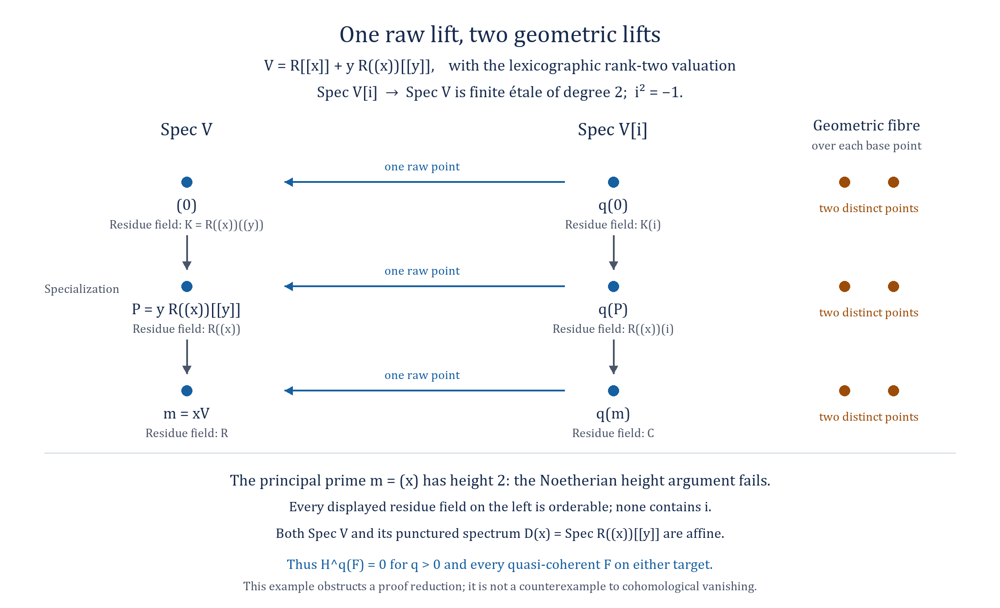

*The three raw points of $\operatorname{Spec}V$ have residue fields $\mathbf R((x))((y))$, $\mathbf R((x))$ and $\mathbf R$. Each has one raw lift and two geometric lifts in $\operatorname{Spec}V[i]$. The height-two principal prime $\mathfrak m=(x)$ shows why the Noetherian rational-lift argument does not apply. Both $\operatorname{Spec}V$ and $D(x)$ are affine. The editable vector diagram is [raw-fibre-rank-two-valuation.svg](../figures/raw-fibre-rank-two-valuation.svg).*

**Raw-size-one affine covers of normal Noetherian curves**

**Theorem.**
Let $X$ be an integral separated Noetherian scheme of dimension one,
and suppose $X$ normal. If $U\to X$ is a surjective etale morphism
with $U$ affine and every raw fibre has one point, then $X$ is affine.

**Rational lifts on a nonaffine normal curve.**
We prove the following stronger intermediate statement: if $X$ as
above is not affine, every nonempty etale scheme $W\to X$ has a
point rational over its image.
Suppose otherwise. Choosing an affine neighbourhood of a point of
the generic fibre, one may restrict to a nonempty affine open
$V=\operatorname{Spec}A\subset X$ on which an open of $W$ is finite
etale and monogenic:
$$
             W_0=\operatorname{Spec}(A[T]/(P)),\qquad
             P\in A[T]\text{ monic of degree }e>0.
$$
This follows by selecting a generic field factor, a primitive
element, and clearing the finitely many denominators in the finite
presentation and the generic isomorphism. The selected finite
etale open is surjective over the smaller integral base $V$.
If $P(c)$ were a nonunit of $A$ for some $c\in A$, a prime
containing it would give a residue-field-rational point of $W_0$.
Consequently the absence of such points implies
$$
                          P(c)\in A^\times\quad(c\in A).       \tag{NCA1}
$$

Since $X$ is a Noetherian integral curve, its complement
$X\setminus V=\{x_1,\ldots,x_r\}$ is finite; it is nonempty because
$X$ is not affine. Put $K=\kappa(\eta)$ and
$B_j=\mathcal O_{X,x_j}$, with normalized discrete valuation $v_j$.
There is an element $f\in A$ with
$$
                              v_j(f)<0\quad(1\leq j\leq r).  \tag{NCA2}
$$
Here is a direct simultaneous construction. For each $j$, $A$ is
not contained in $B_j$: otherwise the two maps
$\operatorname{Spec}B_j\to V\to X$ and
$\operatorname{Spec}B_j\to X$ agree generically but have different
closed images, contradicting separatedness. Choose $a_j\in A$ with
$v_j(a_j)<0$. Choose positive integers $N_j$ so that for each $i$
the minimum of the numbers $N_jv_i(a_j)$ is unique. It is negative
because the $i$th number is negative. Such a choice exists: take
$N_j=M^j$ and avoid the finitely many integer roots of the nonzero
polynomials expressing equality of two negative competing values.
For $f=\sum_j a_j^{N_j}$, the valuation of the sum is its unique
least summand valuation, proving (NCA2).

For sufficiently large $n$, the leading term of $P(f^n)$ has
strictly smaller $v_j$ than every other term, simultaneously for
all $j$. Indeed, for a coefficient $p_l$ of $T^l$, $l<e$, we need
$ne\,v_j(f)<v_j(p_l)+nl\,v_j(f)$, which holds for large $n$.
By (NCA1), $g=P(f^n)$ is a unit of $A$. Therefore
$$
             h=g^{-1}\in A^\times,\qquad v_j(h)>0\quad(j=1,\ldots,r).
                                                                    \tag{NCA3}
$$
Normality identifies $B_j$ with the nonnegative valuation ring.
Thus $h$ is regular on all of $X$, vanishes at all $x_j$, and is
invertible on $V$. If $R=\Gamma(X,\mathcal O_X)$, then
$$
                   X_h=V,\qquad R_h=A,\qquad\operatorname{Frac}R=K.
                                                                    \tag{NCA4}
$$
The equality of sections after localization holds on any
quasi-compact quasi-separated scheme: take a finite affine cover and finite
affine covers of its quasi-compact pairwise intersections. Localize the
resulting finite sheaf equalizer. Here $A$ has fraction field $K$.

Moreover $R$ is a Krull domain. Indeed it is the intersection in
$K=\operatorname{Frac}R$ of the discrete valuation rings at all
closed points of $X$. This intersection has finite character: any
nonzero rational function and its inverse are regular on a common
nonempty open, and the complement of that open is finite.
We use the usual finite-character discrete-valuation
characterization of Krull domains.

**The Krull-domain rational-lift calculation.**
If a Krull domain $R$ has dimension at least two, every nonempty
finite etale scheme over a nonempty principal open of
$\operatorname{Spec}R$ has a point rational over its image. The
polynomial proof is the one in Moret-Bailly, Theorem 4.3.1 and
Corollary 4.3.4; its height steps can be read directly as follows.
In a Krull domain,
$$
 \sqrt{cR}=\bigcap_{v_{\mathfrak p}(c)>0}\mathfrak p
                           \qquad(0\ne c\in R),             \tag{NCA5}
$$
where the intersection is finite and all these primes have height
one. For the reverse inclusion, raise an element in every
displayed prime to a sufficiently large common power and divide
by $c$; all height-one valuations of the quotient are nonnegative,
so the quotient is in $R$.

Localize at a prime of height at least two, shrink the given
finite etale scheme to a nonempty monogenic principal open, and
clear denominators to a nonconstant polynomial
$F(T)=\sum_{l=0}^e c_lT^l$ with leading coefficient $c\ne0$.
Let $s\ne0$ encode the required principal open and denominators,
chosen in the maximal ideal, and choose $b$ in that maximal ideal
avoiding the finitely many primes minimal over $(sc)$.
The identity
$$
 s^ec^{2e-1}F\!\left(\frac{b}{sc^2}\right)
    =b^e+\sum_{l<e}c_lb^l s^{e-l}c^{2(e-l)-1}
    \in b^e+scR                                           \tag{NCA6}
$$
gives a nonunit $\gamma$ avoiding those primes. By (NCA5), a prime
minimal over $(\gamma)$ has height one and cannot contain $sc$.
In its residue field $b/(sc^2)$ is the required root. This
proves the calculation, including its required principal-open
restriction. The argument uses the Krull property (NCA5), not
Noetherianity of $R$.

Applied to $\operatorname{Spec}A=D(h)\subset\operatorname{Spec}R$,
this calculation contradicts the supposed absence of rational
points of $W_0$ whenever $\dim R\geq2$.

**The remaining dimension of the global ring.**
The ring $R$ cannot be a field, since the nonzero element $h$
vanishes at a point of $X$. If $\dim R=1$, it is a Dedekind domain.
For completeness, a one-dimensional Krull domain is Noetherian:
given a nonzero ideal $J$ and $0\ne a\in J$, only finitely many
maximal ideals have $v_{\mathfrak p}(a)>0$. At each choose an
element of $J$ attaining its least valuation. Together with $a$
these elements generate an ideal whose localization agrees with
$J$ at every maximal ideal, hence generate $J$. Its localizations
at nonzero primes are discrete valuation rings.

In this case the canonical map
$q:X\to\operatorname{Spec}R$ is an isomorphism, as we now check
without assuming finite type of $q$. At each closed point $x$,
the valuation ring $\mathcal O_{X,x}$ is an overring of $R$ in
$K$; its center $\mathfrak p$ is nonzero, since center zero would
force it to contain $K$. An overring of the discrete valuation
ring $R_{\mathfrak p}$ in $K$ is either that ring or $K$, so
$$
                       \mathcal O_{X,x}=R_{\mathfrak p}.    \tag{NCA7}
$$
Two closed points cannot have the same center, by separatedness
and uniqueness for the two maps from this valuation ring agreeing
on $\operatorname{Spec}K$.

No nonzero prime $\mathfrak p$ of $R$ can be missing from the
image. If one were missing, the invertible ideal
$\mathfrak p\subset R$ would become the unit ideal at every
point of $X$, so its canonical multiplication map
$\mathfrak p\otimes_R\mathcal O_X\to\mathcal O_X$ would be an
isomorphism. Since $\mathfrak p$ is a finitely generated
projective $R$-module, taking global sections identifies this map
with the proper inclusion $\mathfrak p\to R$, a contradiction.
Thus $q$ is bijective. Both spaces are Noetherian integral
one-dimensional spaces, whose proper closed subsets are finite
sets of closed points, so $q$ is a homeomorphism. Its maps on all
local rings are isomorphisms by (NCA7) and the common generic field.
It is consequently an isomorphism of schemes. This contradicts
the assumption that $X$ is not affine.

All possible dimensions of $R$ have led to a contradiction. The
rational-lift statement for a nonaffine normal curve follows.

**The affine-cover conclusion.**
Suppose the theorem's $X$ were not affine. If a geometric fibre of
$U\to X$ had at least two points, the nonempty etale scheme of
pairs of distinct geometric lifts would have a rational point over
its image, by the statement just proved. Its two coordinates would
then be distinct raw points of that fibre, contradicting the
raw-size-one hypothesis. Hence every geometric fibre has one point.
An etale morphism with this property is a surjective open immersion,
and therefore an isomorphism. This would identify $X$ with the
affine scheme $U$, another contradiction. The theorem is proved.

**Limits and references.**
Normality was used both for the boundary valuations and for the
finite-character Krull representation of the global ring. The
argument does not transfer a raw bound to a normalization, where
residue fields may split fibres. The assertion for arbitrary
singular or non-Noetherian curves is not inferred.
Laurent Moret-Bailly, *Points rationnels dans leur fibre:
complements a un theoreme de Poonen*, arXiv:1910.14542v3,
Theorem 4.3.1 and Corollary 4.3.4,
[Primary source](https://arxiv.org/abs/1910.14542v3).

**Noetherian algebraic spaces and the raw-fibre bound**

**Theorem.**
Let $X$ be a separated Noetherian algebraic space, and let
$U\to X$ be an affine-scheme surjective etale presentation. If
$d\geq2$ bounds the raw fibres $|U|\to|X|$, then
$$
                       H^q(X,F)=0\quad(q\geq d)
$$
for every quasi-coherent $F$. The conclusion also holds for $d=1$
if every one-dimensional reduced irreducible component of $X$ is
normal; there is no normality requirement on the components of
other dimensions. In particular, the raw-size-one presentation of
a normal Noetherian separated algebraic space has affine target.

**A proper birational scheme model.**
An integral separated Noetherian algebraic space $T$ has a proper
surjective birational morphism $p:Y\to T$ with $Y$ an integral
Noetherian scheme. We give the construction to specify where
residue fields are retained. By Noetherian approximation there is
an affine morphism $T\to T_0$ to a separated algebraic space of
finite type over $\operatorname{Spec}\mathbf Z$. Replace $T_0$
by the reduced scheme-theoretic image of this morphism. This is
integral and still of finite type; the morphism remains affine,
and the generic point of $T$ maps to the generic point of $T_0$.

Apply Chow's lemma to $T_0\to\operatorname{Spec}\mathbf Z$.
It gives a proper modification $Y_0\to T_0$ which is an
isomorphism over a nonempty open $T_{00}$ and with $Y_0$ a scheme
immersed in some projective space over $\mathbf Z$. The fibre
product $T\times_{T_0}Y_0$ is a scheme because it is affine over
the scheme $Y_0$. In it take the reduced closure $Y$ of the
nonempty open $T\times_{T_0}T_{00}$. The space $T$ is integral,
so this closure is integral. It is Noetherian and proper over
$T$, and its closed image contains a dense open of $T$; thus it
is surjective. There is a nonempty open $T_1\subset T$ such that
$$
                       p^{-1}(T_1)\xrightarrow{\sim}T_1.    \tag{NAS1}
$$
This is also the scheme-model construction in the approximation
proof of Chow's lemma, Tag 088U. It does not suppose that $T$ is
of finite type over a field or over $\mathbf Z$.

If $\dim T\geq2$, then $\dim Y\geq2$. A chain of two strict
specializations from the generic point of $T$ lifts to such a
chain in $Y$: for a proper map the image of the closure of a
point $y$ is the closure of $p(y)$. Lift the specializations in
order, using that equality. The images are distinct, so the
lifts are distinct.

**Configurations in the isomorphism open.**
Let $T$ now be an integral reduced irreducible component of $X$
of dimension at least two. The base change $U_T\to T$ is
surjective etale, with affine source closed in $U$. A closed
immersion does not change residue fields, so its raw fibres
still have at most $d$ points.

Suppose a geometric fibre has $N>d$ points. Its nonempty
distinct-coordinate configuration scheme $W_N\to T$ is etale.
It is a scheme: the fibre powers of the affine $U_T$ are closed
in products of affine schemes, because $T$ is separated, and
the distinct-coordinate locus is open and closed. Its image is
a nonempty, hence dense, open of the integral space $T$.

Choose the model $p:Y\to T$ and the open $T_1$ of (NAS1), and
put $V=p^{-1}(T_1)$. The morphism
$$
                       W_N\times_TV\longrightarrow Y       \tag{NAS2}
$$
is a nonempty etale morphism of schemes, where the map to $Y$
includes the open immersion $V\subset Y$. The rational-lift
lemma for the integral Noetherian scheme $Y$, proved above by
the explicit polynomial calculation, supplies a point $w$
of (NAS2) rational over its image $y\in V$. Since $p$ is an
isomorphism there, its image $t\in T_1$ has
$$
                          \kappa(w)=\kappa(y)=\kappa(t).    \tag{NAS3}
$$
Thus the configuration has $N$ distinct raw coordinates above
$t$, a contradiction. Notice that the raw bound was never
transferred to all of $Y$: (NAS3) uses only the isomorphism
open, where residue fields are identical.

Every geometric degree of $U_T\to T$ is therefore at most $d$.
The complete geometric-degree vanishing theorem gives
$H^q(T,G)=0$ for $q\geq d$ and every quasi-coherent $G$ on $T$.
When $d=1$, this same argument makes $U_T\to T$ an isomorphism,
so such a component $T$ is affine.

**Low-dimensional components.**
Every separated locally Noetherian algebraic space is a scheme
near a point of local dimension at most one, by the schematic
locus theorem, Tag 0ADD. In particular every component $T$ of
dimension at most one here is a scheme. Grothendieck vanishing
on its Noetherian topological space gives the required bound
$q\geq2$ for $d\geq2$. A zero-dimensional integral component
is the spectrum of a field. If $d=1$ and the one-dimensional
component is normal, the normal-curve affineness theorem just
proved applies to its raw-size-one cover $U_T\to T$. Hence
that component is affine as well.

**Coherent filtrations and arbitrary quasi-coherent modules.**
For reduced $X$, let $I_1,\ldots,I_r$ be the ideal sheaves of
its finitely many reduced irreducible components. Their product
is zero. For a coherent $F$ the quotients of
$$
 F\supset I_1F\supset I_1I_2F\supset\cdots
                    \supset I_1\cdots I_rF=0                \tag{NAS4}
$$
are coherent pushforwards from individual components. A closed
immersion has no higher quasi-coherent direct images, so the
component bounds and the long exact sequences give the desired
cohomology vanishing. On general Noetherian $X$, filter first
by the globally nilpotent nilradical to reduce to this reduced
case. These ideal sheaves, products and quotients are taken in
the etale quasi-coherent category, so the construction applies
to algebraic spaces as well as to schemes.

Every quasi-coherent module on a Noetherian algebraic space is
a filtered union of its coherent submodules, by coherent
approximation for a Noetherian etale groupoid. Cohomology
commutes with this filtered colimit here. Indeed, the etale
Cech nerve of the affine presentation has affine terms because
$X$ is separated. Its complex of global sections computes
quasi-coherent cohomology; its terms commute with filtered
colimits, and filtered colimits are exact. Thus the coherent
bound extends to every quasi-coherent $F$. This proves the
theorem. In the raw-size-one normal case it gives vanishing of
all positive quasi-coherent cohomology, so the cohomological
affineness criterion also identifies $X$ as an affine scheme.

**Remaining scope.**
The theorem does not assert the raw-size-one bound on every
singular one-dimensional Noetherian component, or the bound for
arbitrary non-Noetherian algebraic spaces. Nor does it change
the original raw topological-fibre hypothesis into a geometric
degree hypothesis. The valuation example and the
$\operatorname{Spec}\mathbf C/\operatorname{Spec}\mathbf R$
example still distinguish the two counts.

**References.**
The Stacks Project, Chow's lemma and its approximation proof,
Tag 088U, [Primary source](https://stacks.math.columbia.edu/tag/088U);
the schematic locus in codimension one, Tag 0ADD,
[Primary source](https://stacks.math.columbia.edu/tag/0ADD);
Grothendieck vanishing, Tag 02UZ,
[Primary source](https://stacks.math.columbia.edu/tag/02UZ).

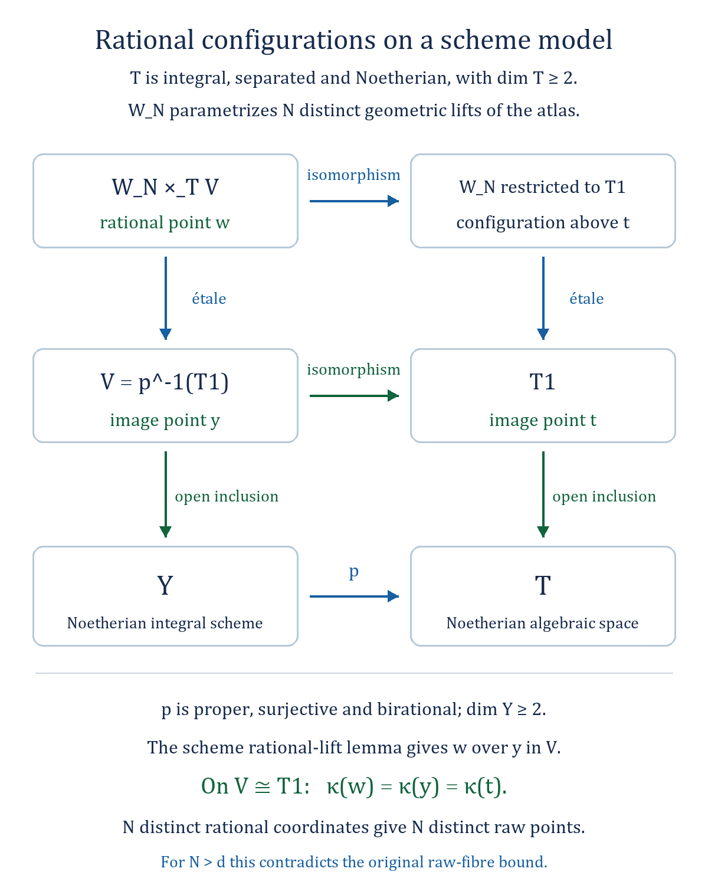

*For an integral Noetherian component $T$ of dimension at least two, a proper scheme model $p:Y\to T$ is an isomorphism on $V=p^{-1}(T_1)\simeq T_1$. The scheme rational-lift lemma is applied to $W_N\times_TV\to Y$. Equations (NAS1)–(NAS3) identify the residue fields exactly where the rational configuration lies, so its $N$ coordinates give $N$ distinct raw lifts over $t$. The editable vector diagram is [raw-fibre-noetherian-model.svg](../figures/raw-fibre-noetherian-model.svg).*

**Two normalization transfers for raw-size-one affine atlases**

**Curve theorem.**
Let $T$ be an integral separated Noetherian scheme of dimension one,
and let $U\to T$ be an etale surjection with $U$ affine and one
raw point in every fibre. Then $T$ is affine if either
(a) $T$ has a nonempty normal open subscheme, or
(b) $T$ is geometrically unibranch at every point.
The alternatives are separate sufficient conditions. Neither is
assumed to hold for every integral Noetherian curve.

**Normalization and affineness.**
Write $\nu:T^\nu\to T$ for the normalization. It is integral,
surjective and birational. By Krull--Akizuki, its affine charts
are Dedekind; because $T$ is quasi-compact and $\nu$ is affine,
$T^\nu$ is a Noetherian normal integral curve. It is separated
because $\nu$ is affine and $T$ is separated. If $T$ is not
affine, neither is $T^\nu$: affineness descends along an integral
surjection (Chevalley's affineness theorem).

**Transfer on an isomorphism open.**
Suppose the first condition holds and $T$ is not affine.
The preceding normal-curve rational-lift theorem says that every
nonempty etale scheme over the nonaffine normal curve $T^\nu$
has a point rational over its image. Let $W\to T$ be any
nonempty etale scheme, and let $V\subset T$ be a nonempty normal
open. Since $T$ is integral, the nonempty open image of $W$
meets $V$. The normalization is an isomorphism over $V$, so
$W_V$ is a nonempty etale scheme over $T^\nu$ with image in
$\nu^{-1}(V)$. A rational lift there therefore has
$$
                   \kappa(w)=\kappa(t^\nu)=\kappa(t).
$$
Thus $T$ itself has the same rational-lift property. The equality
with $\kappa(t)$ uses the isomorphism open, not a general
normalization residue extension.

Apply this property to the etale scheme of pairs of distinct
geometric lifts of $U\to T$, namely
$(U\times_T U)\setminus\Delta_U$. If it is nonempty, a point
rational over its image gives two distinct $\kappa(t)$-rational
coordinates in $U_t$, hence two distinct raw points. This
contradicts the assumed raw-size-one bound. If it is empty,
every geometric fibre has one point; the etale surjection is
then an isomorphism. This identifies $T$ with the affine $U$,
contrary to nonaffineness. The first case follows.

**Transfer through a universal homeomorphism.**
For any universal homeomorphism $g:T'\to T$ and any map $U\to T$,
the two horizontal maps in the Cartesian square
$$
\begin{array}{ccc}
 U'=U\times_T T'&\longrightarrow&U\\
 \downarrow&&\downarrow\\
 T'&\longrightarrow&T
\end{array}
$$
induce homeomorphisms on underlying spaces. The top map is a
universal homeomorphism by base change. Consequently the raw
fibre over each $t'\in T'$ is in bijection with the original
raw fibre over its image $t$.

In the second case, geometric unibranchness makes $\nu$ a
universal homeomorphism. More explicitly its fibre has one
point and the corresponding residue extension is purely
inseparable; integrality then gives universal injectivity and
surjectivity. The square above, with $T'=T^\nu$, preserves the
raw-size-one bound. Its source $U'$ is affine, since it is
integral over the affine scheme $U$. Apply the established
normal Noetherian curve theorem to $U'\to T^\nu$ to see that
$T^\nu$ is affine. Chevalley's theorem then makes $T$ affine.
This proves the second case without assuming a normal open.

**Nagata curves.**
An integral Noetherian Nagata curve satisfies the first case.
Indeed its normalization is finite. On any nonempty affine
open, choose finitely many module generators of that
normalization and clear their denominators in the common
fraction field. The resulting nonzero denominator $c$ gives
an isomorphism of the two rings after inverting $c$. The open
$D(c)$ of the curve is therefore normal. This argument does
not assert that arbitrary Noetherian curves have a normal open.

**Noetherian algebraic spaces.**
The following consequence holds for Noetherian algebraic spaces.
Let $X$ be a separated
Noetherian algebraic space with an affine etale surjection and
a raw fibre bound $d\geq1$. If $d\geq2$, no further condition
is needed. If $d=1$, suppose each one-dimensional reduced
irreducible component either has a nonempty normal open or is
geometrically unibranch. Then
$$
                  H^q(X,F)=0\quad(q\geq d)
$$
for every quasi-coherent $F$. In the $d=1$ case, $X$ is affine.

For high-dimensional components the bound follows from the
proper scheme model and rational configuration argument.
Components of dimension at most one
are schemes by the schematic-locus theorem for separated
locally Noetherian spaces. The curve theorem treats their
one-dimensional cases, and zero-dimensional integral components
are fields. The finite component-ideal and nilradical filtrations,
followed by coherent approximation and filtered-colimit
compatibility of the affine etale Cech complex, are exactly those
in the Noetherian-space proof and apply to these bounds as well.
All components are affine when $d=1$, so the filtration proves
all positive quasi-coherent cohomology vanishes, and the
cohomological affineness criterion applies.
In particular the stated raw bound holds for every separated
Noetherian Nagata algebraic space, for every $d\geq1$.

**Remaining scope.**
The original assertion for arbitrary quasi-compact separated
algebraic spaces is not settled. Neither arbitrary singular
Noetherian curves outside the two specified alternatives nor
arbitrary non-Noetherian spaces have been covered by this
transfer. No raw fibre bound is transferred through a residue
extension unless the map is a universal homeomorphism or the
points lie on the stated isomorphism open.

**Dependencies and precise locators.**
The normal-curve rational-lift and affineness theorem and the
Noetherian-space component proof are the preceding course
arguments. For normalization use Stacks Tag 0C45; for the
geometrically unibranch universal homeomorphism use Tag 0GIQ;
for finite normalization of a Nagata scheme use Section 035E,
Lemma 29.55.11; for integral-surjective affineness descent use
Tag 07VT.
[Primary source](https://stacks.math.columbia.edu/tag/0C45);
[Primary source](https://stacks.math.columbia.edu/tag/0GIQ);
[Primary source](https://stacks.math.columbia.edu/tag/035E);
[Primary source](https://stacks.math.columbia.edu/tag/07VT).

**Raw-size-one affine atlases on arbitrary Noetherian curves**

**Theorem.**
Let $T$ be an integral separated Noetherian scheme of dimension one.
If $f:U\to T$ is an etale surjection, $U$ is affine, and each
raw point fibre has one point, then $T$ is affine. No normality,
Nagata condition or normal-open hypothesis is imposed.

**The generic field and the birational case.**
Put $K=\kappa(\eta)$ for the generic point of $T$. The generic
fibre is $\operatorname{Spec}L$ for one finite separable field
extension $L/K$; set $n=[L:K]$. The morphism $f$ is affine:
its graph is closed in $U\times_{\mathbf Z}T$, and the projection
of this product to $T$ is affine. Its quasi-coherent algebra
$f_*\mathcal O_U$ is flat over $\mathcal O_T$ and injects into
the constant generic algebra $L$ on every affine base open.
Indeed a flat module over a domain is torsion-free.

If $n=1$, the multiplication map
$$
 f_*\mathcal O_U\otimes_{\mathcal O_T}f_*\mathcal O_U
                    \longrightarrow f_*\mathcal O_U
$$
is an isomorphism. It is surjective, and on each affine base
open its source is flat, hence torsion-free; its kernel has
zero generic fibre and is therefore zero. Thus $f$ is a
monomorphism. An etale monomorphism is an open immersion, and
surjectivity makes it an isomorphism. The conclusion follows
from the affineness of $U$. We may henceforth assume $n\geq2$.

**A monogenic model on a large open.**
Choose a primitive element $\gamma$ for $L/K$ and its monic
minimal polynomial
$$
                P(Z)=Z^n+c_1Z^{n-1}+\cdots+c_n\in K[Z].
$$
After shrinking to a nonempty affine open $V\subset T$, the
whole restriction $f^{-1}(V)\to V$ is finite etale and is
$$
               \operatorname{Spec}_V(\mathcal O_V[Z]/(P)).
$$
For detail, separated quasi-finiteness gives a finite
compactification by Zariski's main theorem. Discard components
not meeting $U$, then remove the image of its complement to
make the map finite. The remaining generic polynomial
isomorphism extends after clearing finitely many denominators
in the finite algebra presentation. The coefficients $c_j$
are regular on $V$. The complement $T\setminus V$ is finite.
Every fibre algebra on $V$ is a field of dimension $n$ over
its residue field: it is finite etale of rank $n$ and has one
raw point. In particular $1,\gamma$ remain linearly independent
over every residue field on $V$.

**Two affine sections.**
Choose an ample invertible sheaf $\mathcal H$ on $T$; such a
sheaf exists for every separated Noetherian curve. There are
$e>0$ and a nonzero section
$b\in\Gamma(T,\mathcal H^{\otimes e})$ such that
$T_b$ is affine, contains $\eta$, and is contained in $V$.
Let $D=Z(b)$. This is an effective Cartier divisor with finite
support, containing $T\setminus V$. If $D$ is empty, then
$T=T_b$ is affine already. Otherwise there are $d>0$ and
$a\in\Gamma(T,\mathcal H^{\otimes d})$ such that $T_a$
is affine and contains the support of $D$.
Consequently $T=T_a\cup T_b$. These choices use the affine
section basis and finite-point avoidance for an ample sheaf;
they require no infinite base field or surjectivity onto a
curve point's residue field.

**A global finite locally free order.**
Choose an integer $r>0$ and put
$$
 N=rd-1,\qquad \mathcal M=\mathcal H^{\otimes eN},
 \qquad s=b^N\in\Gamma(T,\mathcal M).                       \tag{NCN1}
$$
Take $r$ sufficiently large that $N>0$ and
$$
           p_j=c_j s^j\in\Gamma(T,\mathcal M^{\otimes j})
                         \quad(1\leq j\leq n).             \tag{NCN2}
$$
To justify this without normality, at a point $x$ of $D$ write
$b=\beta h$ in a local basis $h$ of $\mathcal H^{\otimes e}$.
The element $\beta$ is nonzero and in the maximal ideal of
the one-dimensional local domain $\mathcal O_{T,x}$, so
$\mathcal O_{T,x}[1/\beta]=K$. Each $c_j\beta^{Nj}$ is
therefore regular for all sufficiently large $N$. There are
only finitely many such points and coefficients. Outside $D$
the coefficients are regular already. This proves (NCN2),
also along the progression $N=rd-1$.

There is a finite locally free algebra of rank $n$
$$
        \mathcal B=\mathcal O_T\oplus\mathcal M^{-1}
                     \oplus\cdots\oplus\mathcal M^{-(n-1)}.
                                                                  \tag{NCN3}
$$
Here are its multiplication and gluing explicitly. If $m_i$
is a local basis of $\mathcal M$ and $s=\lambda_i m_i$, use
the local algebra with basis $1,z_i,\ldots,z_i^{n-1}$ and relation
$$
          z_i^n+(c_1\lambda_i)z_i^{n-1}+\cdots
                              +c_n\lambda_i^n=0.
$$
On an overlap $m_j=g_{ij}m_i$, we have
$\lambda_j=g_{ij}^{-1}\lambda_i$ and set
$z_j=g_{ij}^{-1}z_i$. The relations transform consistently,
and all their coefficients are regular by (NCN2). Equivalently,
the algebra is the subalgebra of the constant field $L$ locally
generated by $z_i=\lambda_i\gamma$. The elements $z_i\otimes m_i$
glue to a section
$$
                         z\in\Gamma(T,\mathcal B\otimes\mathcal M).
$$
Over $T_b$ the section $s$ is invertible, and $\mathcal B$
identifies with the monogenic finite etale algebra above.
In particular its fibres there are fields, with $1,z_i$
linearly independent.

**A norm section that never vanishes.**
The section
$$
      v=a^{er}\,1+bz\in
         \Gamma(T,\mathcal B\otimes\mathcal H^{\otimes erd})
                                                                  \tag{NCN4}
$$
is well typed because $e+eN=erd$. At a point of $D$, its
second term is zero and $a$ is nonzero; hence $v$ is a scalar
unit in the fibre algebra. At a point outside $D$, the algebra
is a field, $b$ is nonzero and $1,z_i$ are independent, so $v$
is nonzero and hence a unit there too. Its determinant norm is
therefore a nowhere-vanishing section
$$
       t=\operatorname N_{\mathcal B/\mathcal O_T}(v)
             \in\Gamma(T,\mathcal H^{\otimes nerd}).        \tag{NCN5}
$$
This uses the determinant of multiplication in the finite
locally free algebra (NCN3); it does not require a trace
splitting or division by $n$.

**Why the whole nonvanishing locus is affine.**
Let $S=\bigoplus_{q\geq0}\Gamma(T,\mathcal H^{\otimes q})$.
The canonical map $T\to\operatorname{Proj}S$ is an open
immersion. Moreover the affineness of $T_a$ and $T_b$ identifies
them with the full standard affine opens $D_+(a)$ and $D_+(b)$:
localization of sections gives the corresponding degree-zero
localized section rings.

In this graded ring, the determinant norm has the explicit form
$$
 t=(a^{er})^n-p_1(a^{er})^{n-1}b+
                  p_2(a^{er})^{n-2}b^2-\cdots+(-1)^np_nb^n.
                                                                  \tag{NCN6}
$$
Every summand has degree $nerd$, and $t\in(a,b)S$.
Consequently
$$
       D_+(t)\subset D_+(a)\cup D_+(b)=T
                              \subset\operatorname{Proj}S.
$$
Conversely $t$ vanishes nowhere on $T$ by (NCN5). Hence
$T=D_+(t)$, which is affine. The argument uses the homogeneous
ideal membership in (NCN6), not merely that a positive ample
power has a nowhere-vanishing section. The latter fact alone
would only imply quasi-affineness in general. The theorem
follows.

**Consequence for all Noetherian algebraic spaces.**
Combine this curve theorem with the Noetherian-space argument
already established by proper scheme models and rational
configurations. For every separated Noetherian algebraic space
$X$, every affine etale surjection $U\to X$, and every raw
fibre bound $d\geq1$, one has
$$
                         H^q(X,F)=0\quad(q\geq d)
$$
for every quasi-coherent $F$. For $d\geq2$ the previous proof
applies directly. For $d=1$, high-dimensional integral
components are affine by that proof, zero-dimensional integral
components are fields, and one-dimensional components are
schemes by the schematic-locus theorem and are affine by the
curve theorem above. Finite component and nilradical
filtrations prove the bound for coherent sheaves. Coherent
approximation and the affine etale Cech complex give it for
every quasi-coherent sheaf. In particular every such raw-size-one
Noetherian space $X$ is affine by the cohomological affineness
criterion.
The empty space has zero cohomology in every degree; for a
nonempty space a surjective atlas necessarily has raw bound
$d\geq1$.

**Scope and references.**
The arbitrary non-Noetherian assertion is not inferred. The
curve proof used Noetherianity to obtain an ample sheaf, finite
boundary, and the requisite affine section containing that
boundary. It never transfers a raw fibre bound through an
arbitrary residue extension or replaces it by a geometric bound.
For the standard inputs see Stacks Tag 09ND (an ample sheaf on
an integral separated Noetherian curve), Tag 09NV (an affine
section through finitely many points), Tag 01Q1
(the section-ring open immersion), and Zariski's main
theorem, Tag 05K0. The component argument uses the previously
stated proper-model proof and Tag 0ADD.
[Primary source](https://stacks.math.columbia.edu/tag/09ND);
[Primary source](https://stacks.math.columbia.edu/tag/09NV);
[Primary source](https://stacks.math.columbia.edu/tag/01Q1);
[Primary source](https://stacks.math.columbia.edu/tag/05K0);
[Primary source](https://stacks.math.columbia.edu/tag/0ADD).

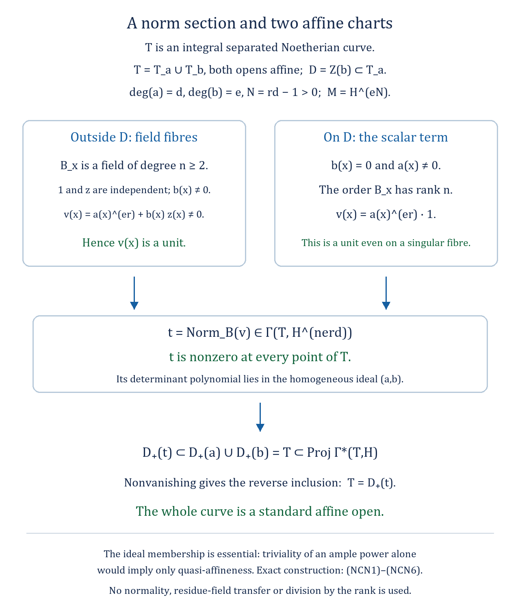

*The finite locally free order in (NCN3) has field fibres on $T_b$. The section $v=a^{er}+bz$ is a unit there by the independence of $1,z$, and on $D=Z(b)$ it is a scalar unit. Its determinant norm $t$ never vanishes and belongs to the homogeneous ideal $(a,b)$ in (NCN6). Since both section loci are affine, this identifies the whole curve with the standard affine open $D_+(t)$. The editable vector diagram is [raw-fibre-curve-norm.svg](../figures/raw-fibre-curve-norm.svg).*

**An affine envelope for the raw-size-one locus of a curve model**

**Envelope lemma.**
Let $T$ be an integral separated Noetherian curve and let
$f_0:U_0\to T$ be a surjective etale map with $U_0$ affine.
Suppose the generic fibre has one raw point. There is an affine
open $W\subset T$ containing every point $t$ for which
$|(U_0)_t|$ has one point.

If the generic field degree is one, the flat birational
argument in the curve norm proof makes $f_0$ an isomorphism,
so take $W=T$. Otherwise use precisely the choices and order
in (NCN1)--(NCN6) of that proof. None of their construction
requires the fibre to be a field at every point of the large
monogenic open. At a point on $D=Z(b)$, the norm section is
nonzero because its element is a scalar unit. At a point off
$D$ where the original raw fibre has one point, the finite
etale algebra is a field of the generic rank, so $1,z$ are
independent and the norm section is nonzero there as well.
The homogeneous membership $t_{\rm norm}\in(a,b)$ still
identifies its nonvanishing locus with the full standard
affine open $D_+(t_{\rm norm})$ in the section-ring Proj.
Thus $W=T_{t_{\rm norm}}$ is affine and contains the indicated
raw-size-one locus. No assertion that this locus is open or
constructible is needed.

**Non-Noetherian affine base change of a curve model.**
Let $g:X\to T$ be any affine morphism, without a Noetherian
hypothesis on $X$, and suppose the base-changed atlas
$$
                     U=U_0\times_T X\longrightarrow X
$$
has exactly one raw point in every fibre. Then $X$ is affine.

Raw point counts in finite etale fibres cannot decrease on a
field extension: each original factor in a product of finite
separable fields remains a nonzero algebra and supplies at
least one prime after tensoring with the extension field.
Consequently $g(X)$ lies in the raw-size-one locus of $f_0$.

If $g$ is dominant, its generic fibre is nonempty. To see this
on an affine neighborhood $\operatorname{Spec}A$ of the generic
point, its inverse image is $\operatorname{Spec}B$, and density
of the image makes $A\to B$ injective. Hence
$B\otimes_A\operatorname{Frac}A\ne0$. The raw count comparison
then shows that $f_0$ has one generic raw point. Apply the
envelope lemma: the map $g$ factors through its affine open
$W$, and an affine morphism to an affine scheme has affine
source.

If $g$ is not dominant, its image has finite closed closure
$Z\subset T$. Let $I$ define the reduced closed subscheme
with that support. On the inverse images of a finite affine
cover of $T$, the image of $I$ is a finitely generated nil
ideal, so it is nilpotent. A single exponent works on the
finite cover. Thus $I^N\mathcal O_X=0$ for some $N$, and $g$
factors through the closed Noetherian zero-dimensional
subscheme $V(I^N)$, which is affine. The factored map is affine
as well (it is the base change of $g$), and $X$ is affine.
The empty source is immediate. This proves the statement
without imposing the generic-field condition on $f_0$ itself.

**The cohomological bound in this relative class.**
More generally, for an affine $g:X\to T$ as above and a
base-changed affine atlas with any raw fibre bound $d$, the
original cohomological conclusion holds. For $d=1$ this is
the affineness just proved. For $d\geq2$, affine pushforward
is exact on quasi-coherent sheaves, so
$H^q(X,F)=H^q(T,g_*F)=0$ for $q\geq2$ by Noetherian
one-dimensional vanishing. No Noetherianity of $X$ is used.

**Scope of the curve-model theorem.**
An arbitrary quasi-compact separated algebraic space need not
come with an affine morphism to a Noetherian curve. General
Noetherian approximation supplies affine projections, but
their images can omit points of every sufficiently late model.
The following example makes this failure explicit even for
an affine source and two descended global functions.

**A valuation ring with no surjective Noetherian coefficient model**

**The valuation ring.**
Put $k=\mathbf R$, $K=k((x))((y))$ and
$$
 V=k[[x]]+y\,k((x))[[y]]\subset K.                 \tag{SM1}
$$
For a nonzero Laurent series in $y$, let $n$ be its first $y$
exponent and let $m$ be the first $x$ exponent of the corresponding
coefficient. The assignment $v(f)=(n,m)$ is a valuation with value
group $\mathbf Z^2$ in lexicographic order. Its valuation ring is
exactly $V$: when $n>0$ the leading coefficient is arbitrary, and
when $n=0$ that coefficient must lie in $k[[x]]$. Thus $V$ is a
domain and $K$ is its fraction field.

Its spectrum consists of exactly three points, with prime ideals
$$
 (0)\subsetneq P=y\,k((x))[[y]]
       \subsetneq\mathfrak m=xV.                  \tag{SM2}
$$
Indeed, $V/P=k[[x]]$ and $V/\mathfrak m=k$. Every element of
positive value is divisible by $x$, so $\mathfrak m=xV$ is the
maximal ideal. If a nonzero prime $Q$ contains an element with
value $(0,m)$, $m>0$, it contains $x$ and equals $\mathfrak m$.
Otherwise, choose a nonzero $a\in Q$ with first value coordinate
positive. For every $b\in P$ a sufficiently large power $b^N$
is divisible by $a$ in $V$. Hence $b\in Q$, and $Q=P$. This
also proves that no further primes occur. The elements $y$ and
$x$ distinguish the two strict inclusions in (SM2).

**A Noetherian domain with finite spectrum.**
A Noetherian domain with finitely many prime ideals has dimension
at most one. To prove this, suppose that a prime $M$ has height
at least two and localize there. The resulting Noetherian local
domain $B$ has only finitely many height-one primes
$p_1,\ldots,p_s$. Its maximal ideal is contained in none of them.
Finite prime avoidance supplies a nonzero element $b$ in the
maximal ideal and outside all the $p_i$. A prime minimal over
$(b)$ has height one by the principal ideal theorem, because
the domain has no height-zero prime containing the nonzero
element $b$. This contradicts the choice of $b$.

**No surjective coefficient model.**
There is no Noetherian subring $B\subset V$ containing both
$x$ and $y$ for which
$$
                 \operatorname{Spec}V\longrightarrow
                 \operatorname{Spec}B
                 \quad\hbox{is surjective}.       \tag{SM3}
$$
Surjectivity would make $\operatorname{Spec}B$ a set of at most
three points. But contraction of (SM2) gives the strict chain
$$
 (0)\subsetneq P\cap B\subsetneq\mathfrak m\cap B: \tag{SM4}
$$
the first strictness is witnessed by $y$, and the second by $x$.
This contradicts the preceding Noetherian-domain lemma. The
argument also excludes any Noetherian ring mapping to $V$ with
both elements in its image and a surjective spectral map: pass
to its image, which is a Noetherian domain.

The same obstruction applies to Noetherian algebraic-space
models with the two elements descended as global functions.
More precisely, there is no surjective morphism
$g:\operatorname{Spec}V\to T$ to a Noetherian algebraic space
with $\xi,\upsilon\in\Gamma(T,\mathcal O_T)$ satisfying
$g^*\xi=x$ and $g^*\upsilon=y$. Such a space would have at most
three underlying points. The images of the three points in
(SM2) form a strict specialization chain: the vanishing of
$\upsilon$ distinguishes its first two points, and that of
$\xi$ distinguishes its last two points. Choose an affine
etale chart of $T$ through its last point. It is Noetherian
and has only finitely many points, because it is quasi-finite
over the finite set $|T|$. Flat going down lifts the two strict
generalizations to this affine chart. Its coordinate ring
therefore has a prime chain of length two. Quotienting by the
first prime gives a Noetherian domain with finite spectrum
and dimension at least two, again a contradiction.

**Consequence for approximation.**
In a Noetherian approximation of $\operatorname{Spec}V$, the
finite pair of functions $x,y$ descends to a sufficiently late
stage. The projection to that stage cannot be surjective, even
if Noetherian models not of finite type over $\mathbf Z$ are
allowed. Thus surjectivity of all sufficiently late model
projections cannot be added to general Noetherian approximation.
This does not refute the raw-fibre cohomology assertion:
$\operatorname{Spec}V$ is affine and its positive
quasi-coherent cohomology is zero.

**References.**
The Stacks Project, finite prime avoidance, Tag 00DS,
[Primary source](https://stacks.math.columbia.edu/tag/00DS); and the
principal ideal theorem, Tag 00KV,
[Primary source](https://stacks.math.columbia.edu/tag/00KV); flat going
down, Tag 00HS, [Primary source](https://stacks.math.columbia.edu/tag/00HS).

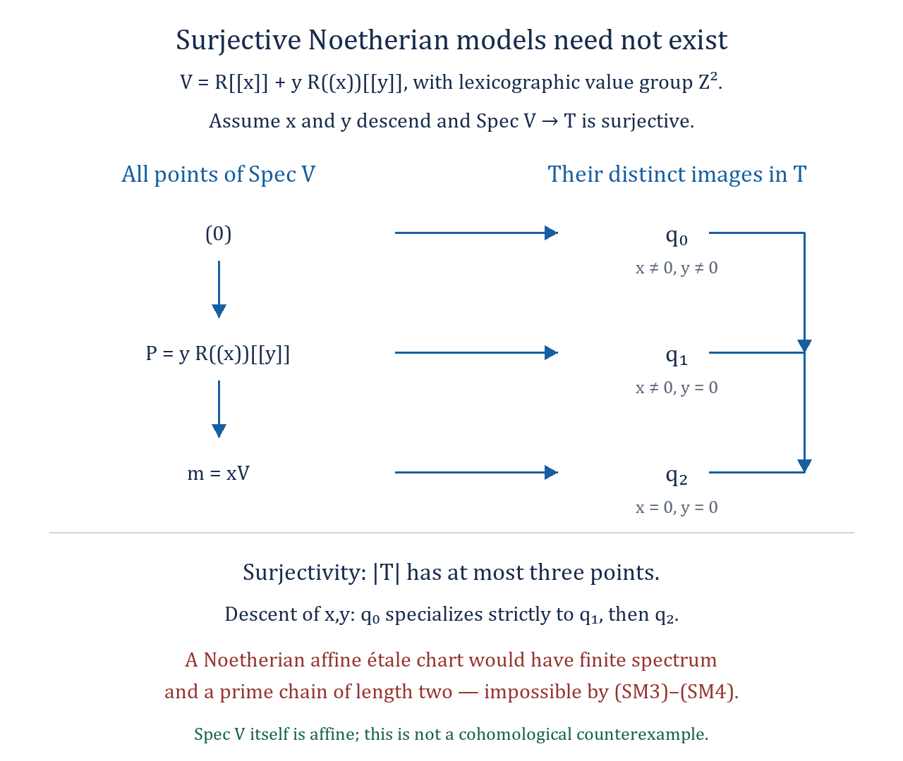

*The valuation ring in (SM1) has exactly the three prime ideals in (SM2). A surjective model projection could have at most three image points. The descended functions $y$ and $x$ distinguish the two strict specializations, forcing a length-two chain in an affine étale chart of the model. Finite prime avoidance and the principal ideal theorem rule this out for a Noetherian chart. The editable diagram is [raw-fibre-surjective-model.svg](../figures/raw-fibre-surjective-model.svg).*

**Reciprocal parameters in the partial-involution construction**

**Theorem.**
Let $A\hookrightarrow B=A[1/a]$ be an injective localization with
$2$ invertible in $A$. Let $\sigma$ be an involution of $B$ such that
every prime ideal of $B$ is fixed by $\sigma$. Suppose that
$i\in B$ satisfies $i^2=-1$ and $\sigma(i)=-i$, and that $A$
and $\sigma(A)$ generate $B$ as a ring. Form the separated scheme
$$
 Y=\operatorname{Spec}A\ \cup_{\operatorname{Spec}B}\
                  \operatorname{Spec}\sigma(A).
$$
If $\sigma(a)=a^{-1}$, then $Y$ and its finite etale quotient
$X=Y/(\mathbf Z/2)$ are affine. Thus
$$
       B/(A+b\sigma(A))=0\qquad(b\in B^\times).       \tag{RP1}
$$
No Noetherian hypothesis, dimension bound or orderability of
residue fields is required.

If $B=0$, injectivity gives $A=0$ and both spaces are empty;
the conclusion is immediate. Assume below that $B\ne0$.

**Adjoining the quadratic element.**
First replace $A$ by its subring $A'=A[i]\subset B$. This is
an injective finite integral extension of $A$, and
$A'[1/a]=B$. Glue the two corresponding affine charts along
$\operatorname{Spec}B$ to obtain $Y'$. Their maps to the
original charts give a finite surjective morphism $Y'\to Y$:
the inverse image of each original chart is its corresponding
finite integral affine chart. The overlap map is the identity.
The involution exchanges these new charts as before. It is
enough to prove that $Y'$ is affine; integral surjective
affineness descent then applies to $Y'\to Y$, and to the
finite surjection $Y\to X$. In the following calculations
write $A$ for $A'$, so that $i\in A\cap\sigma(A)$.

**Two units on both charts.**
Set $c=1+i$, so that $c\sigma(c)=2$. In particular $c$ and
$\sigma(c)$ are units of $A\cap\sigma(A)$, with inverse
$\sigma(c)/2$ and $c/2$, respectively. The element
$$
                      g=a-c
$$
is a unit of $B$. Otherwise a prime $q$ containing $a-c$
would also contain $\sigma(a)-\sigma(c)$, because $q$ is
fixed by $\sigma$. Then the equality $a\sigma(a)=1$ would
give $1=c\sigma(c)=2$ in $B/q$, which is impossible.

Both $g$ and
$$
                    h=1-\sigma(c)a=a\sigma(g)
$$
are units of $A$. They are already units on $D(a)=\operatorname{Spec}B$.
At any prime of $A$ outside $D(a)$, the images of $g,h$ are
$-c,1$, respectively, and are nonzero. Thus neither element
lies in a maximal ideal of $A$.

Define
$$
 u=\frac1{a-c},\qquad
 v=\frac1{\sigma(a)-\sigma(c)}
    =\frac{a}{1-\sigma(c)a}.                       \tag{RP2}
$$
The preceding unit assertions give $u,v\in A$. As
$\sigma(u)=v$ and $\sigma(v)=u$, both also belong to
$\sigma(A)$. Put $R=A\cap\sigma(A)\subset B$, so $u,v\in R$.
On the first chart $u$ is a unit and $v=a/h$ has nonvanishing
locus exactly $D(a)$. On the second chart $v$ is a unit and
$u=\sigma(a)/(1-c\sigma(a))$ has nonvanishing locus exactly
$D(\sigma(a))$. Consequently
$$
                      Y'_u=\operatorname{Spec}A,
       \qquad Y'_v=\operatorname{Spec}\sigma(A).    \tag{RP3}
$$

**The unit ideal and the affine gluing.**
Since $a=c+u^{-1}$ and $\sigma(a)=\sigma(c)+v^{-1}$,
their product is one. Multiplication by $uv$ gives
$$
               1=-cu-\sigma(c)v-uv\quad\hbox{in }R. \tag{RP4}
$$
Thus $(u,v)R=R$. The two-chart equalizer is
$$
 0\longrightarrow R\longrightarrow A\oplus\sigma(A)
                      \longrightarrow B.
$$
Localizing this exact sequence at $u$ identifies
$R_u$ with $A$: here $A_u=A$, $\sigma(A)_u=B$ by the
second-chart expression in (RP3), and $B_u=B$.
Similarly $R_v=\sigma(A)$. Localizing at both gives
$R_{uv}=B$. The standard opens $D(u),D(v)$ cover
$\operatorname{Spec}R$ by (RP4); their rings and overlap
are exactly the two rings and overlap defining $Y'$. Therefore
$Y'=\operatorname{Spec}R$. Affineness descent proves the
claims for $Y$ and $X$ with the original ring $A$ as well.

Finally the transition multiplier $b$ defines an invertible
sheaf $L_b$ on $Y$, and the two affine charts compute
$H^1(Y,L_b)=B/(A+b\sigma(A))$. Affine acyclicity gives (RP1).

**A weaker sufficient hypothesis on the original parameter.**
It suffices that $\sigma(a)^{-1}\in A$. Indeed set
$t=a/\sigma(a)\in aA$. It is a unit of $B$ and
$\sigma(t)=t^{-1}$. The localization $A_t$ equals $B$:
it embeds into $B$, and inverting $t=a\sigma(a)^{-1}$
also inverts $a$, so it contains $A_a=B$. Apply the theorem
with $t$ in place of $a$.

**A norm-separation variant.**
The calculation also works without the quadratic element
whenever the reciprocal datum already has a common unit
$c\in(A\cap\sigma(A))^\times$ with
$c\sigma(c)-1\in B^\times$. The same prime-ideal argument
makes $a-c$ a unit of $B$, and the same boundary argument
makes $a-c$ and $1-\sigma(c)a$ units of $A$. With $u,v$ as
in (RP2), the identity is now
$$
 1=-cu-\sigma(c)v-(c\sigma(c)-1)uv.                 \tag{RP5}
$$
Its coefficients belong to $A\cap\sigma(A)$, so the same
affine gluing proves $Y$ affine. If the action is free, its
finite quotient is affine as well. For example, when $6$ is
invertible in $A$, the scalar $c=2$ satisfies the criterion.
The choice $c=1+i$ above works in every characteristic
different from two after the finite integral adjunction.

**Scope.**
An arbitrary partial-involution datum need not satisfy
$\sigma(a)^{-1}\in A$. No argument establishing such
extension across the complement of $D(a)$ is assumed here.
A nonzero quotient in (RP1) must therefore avoid this
sufficient criterion. The original raw-fibre vanishing
assertion for every quasi-compact separated algebraic space
is not proved by this theorem.

**References.**
The Stacks Project, integral surjective affineness descent,
Tags 05YU and 07VT,
[Primary source](https://stacks.math.columbia.edu/tag/05YU),
[Primary source](https://stacks.math.columbia.edu/tag/07VT); free
finite-group quotients, Section 65.14, Tag 02Z0,
[Primary source](https://stacks.math.columbia.edu/tag/02Z0).

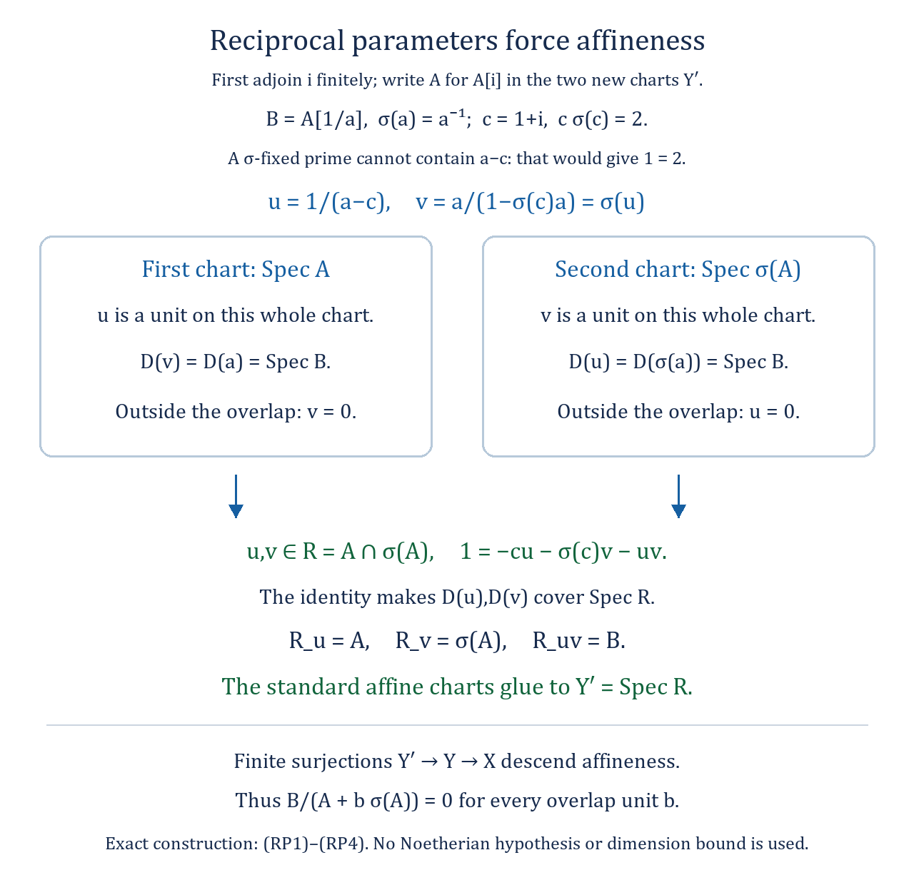

*After the finite integral adjunction of $i$, the norm separator $c=1+i$ gives the functions $u,v$ in (RP2). Each is a unit on one chart and vanishes outside the overlap on the other. The exact identity (RP4) makes their standard opens cover the whole spectrum of the intersection ring, and the localized equalizers recover the two chart rings. Finite surjective descent then proves affineness for the original glued scheme and its quotient. The editable diagram is [raw-fibre-reciprocal-parameter.svg](../figures/raw-fibre-reciprocal-parameter.svg).*

**Schematic overlap and affineness of a finite affine gluing**

**The finite closed-cover criterion.**
Let $Y$ be a quasi-compact quasi-separated scheme with a finite affine
open cover $U_1,\ldots,U_n$. Put
$$
 W=\bigcup_{i<j}(U_i\cap U_j),\qquad
 j:W\longrightarrow Y,\qquad
 Y_0=V\bigl(\ker(\mathcal O_Y\longrightarrow j_*\mathcal O_W)\bigr).
                                                        \tag{SO1}
$$
Thus $Y_0$ is the scheme-theoretic closure of the locus lying in at
least two charts. Then
$$
                         Y\text{ is affine}
                \quad\Longleftrightarrow\quad
                         Y_0\text{ is affine}.            \tag{SO2}
$$
No Noetherian, reducedness, or scheme-theoretic density hypothesis is
imposed. In particular the assertion applies to a separated scheme
covered by two affine opens with quasi-compact intersection.

**Proof of the criterion.**
The intersections in (SO1) are quasi-compact because $Y$ is
quasi-separated. Their finite union $W$ is quasi-compact, and its open
immersion into $Y$ is quasi-compact. Consequently $j_*\mathcal O_W$ is
quasi-coherent, its displayed kernel is a quasi-coherent ideal, and
the definition of $Y_0$ commutes with restriction to every open subset
of $Y$. It also shows that $W\subset Y_0$ is an open subscheme.

For each $i$, the closed subset
$$
                   D_i=Y\setminus\bigcup_{j\ne i}U_j
                                                        \tag{SO3}
$$
lies in $U_i$. Inside the affine scheme $U_i$, its open complement is
the finite union $\bigcup_{j\ne i}(U_i\cap U_j)$ and is therefore
quasi-compact. Choose a finitely generated ideal $I_i$ in the ring
of $U_i$ with this open complement $D(I_i)$. On each overlap
$U_i\cap U_j$, $j\ne i$, the ideal sheaf $\widetilde I_i$ is the
unit ideal. It therefore glues with the unit ideal on all other charts
to a quasi-coherent ideal sheaf on $Y$. Let $Z_i$ be its closed
subscheme. Its support is exactly $D_i$, and $Z_i$ is contained in
$U_i$, where it is a closed subscheme. Hence $Z_i$ is affine.

Every point lying in two or more charts belongs to $W$ and hence to
$Y_0$. Every remaining point belongs to precisely one chart and thus
to the corresponding $Z_i$. Therefore the morphism
$$
                     Y_0\amalg Z_1\amalg\cdots\amalg Z_n
                              \longrightarrow Y           \tag{SO4}
$$
is finite and surjective. Finiteness follows because its restrictions
are closed immersions and the disjoint union is finite. If $Y_0$ is
affine, the source of (SO4) is affine. Integral surjective affineness
descent, The Stacks Project, Proposition 32.11.2, Tag 05YU, gives that
$Y$ is affine. Conversely, if $Y$ is affine, its closed subscheme
$Y_0$ is affine. This proves (SO2). If $W$ is empty, $Y_0$ is empty
and the same finite-cover argument applies without alteration.

**The two principal charts, including localization torsion.**
Suppose now that $Y$ is glued from $\operatorname{Spec}A_1$ and
$\operatorname{Spec}A_2$ along $\operatorname{Spec}B$, with
$B=(A_1)_{a_1}=(A_2)_{a_2}$ via specified localization maps. These maps
need not be injective. Write
$$
 T_i=\ker(A_i\longrightarrow B)
     =\{x\in A_i:\ a_i^N x=0\text{ for some }N\geq0\},\qquad
 \overline A_i=A_i/T_i\ \subset B.                         \tag{SO5}
$$
On the $i$th chart the kernel in (SO1) is $\widetilde T_i$.
The scheme $Y_0$ is consequently the gluing of
$\operatorname{Spec}\overline A_1$ and
$\operatorname{Spec}\overline A_2$ along the unchanged overlap
$\operatorname{Spec}B$. Moreover
$B=(\overline A_i)_{\overline a_i}$, and these new localization maps
are injective. Thus
$$
 Y\text{ is affine}\quad\Longleftrightarrow\quad
 \bigl(\operatorname{Spec}\overline A_1
       \mathop{\cup}_{\operatorname{Spec}B}
       \operatorname{Spec}\overline A_2\bigr)
       \text{ is affine}.                                \tag{SO6}
$$
If $Y$ is separated, the map
$A_1\otimes_{\mathbf Z}A_2\to B$ is surjective. Its image is unchanged
on replacing both chart rings by their images in $B$; hence $Y_0$ is
separated as well, also directly because it is closed in $Y$.

**A reciprocal criterion without injective localization.**
Let $A\to B=A[1/a]$ be an arbitrary localization with $2$ invertible
in $A$. Suppose that $B$ has an involution $\sigma$ fixing every prime
ideal, and an element $i$ satisfying $i^2=-1$ and $\sigma(i)=-i$.
Use two copies of $\operatorname{Spec}A$ and identify their principal
opens by $\sigma$ to form $Y$. Put $\overline A=\operatorname{im}(A\to B)$.
Assume that $\overline A$ and $\sigma(\overline A)$ generate $B$.
This is the separatedness condition for the mixed diagonal. Let
$\overline a$ denote the image of $a$ in $B$. If $B\ne0$ and
$$
                       \sigma(\overline a)^{-1}
                                   \in\overline A,         \tag{SO7}
$$
then $Y$ is affine. Indeed, (SO5) identifies $Y_0$ with the injective
partial-involution gluing for $\overline A\hookrightarrow B$.
Condition (SO7) is precisely the inverse-extension hypothesis of the
reciprocal-parameter theorem (RP1)--(RP5). That theorem proves $Y_0$
affine, and (SO2) proves $Y$ affine. If $B=0$, the two charts are
disjoint and affine, so $Y$ is affine directly.

The chart-exchanging involution on $Y$ is free on geometric points:
outside the overlap it exchanges disjoint chart complements; on the
overlap equality of $i$ and $-i$ would contradict invertibility of $2$.
Consequently the quotient $X=Y/(\mathbf Z/2)$ is an algebraic space,
and $Y\to X$ is a finite etale torsor. Its target is separated, since
the two disjoint closed action graphs give the base change of its
diagonal. The composite $\operatorname{Spec}A\to X$ is an etale
surjection with exactly one raw point in every fibre: outside the
overlap an orbit meets the first chart once, and on the overlap every
raw point is fixed by $\sigma$. Since $Y$ is affine and finite
surjective over $X$, Tag 07VT proves that $X$ is affine as well.
In particular every quasi-coherent sheaf on either $Y$ or $X$ has
zero cohomology in positive degrees under (SO7), even when the
original map $A\to B$ has nonzero kernel.

**Scope and sources.**
The finite closed-cover criterion concerns affineness; it asserts no
equality of positive cohomological dimensions for an arbitrary finite
surjection. The condition (SO7) is sufficient and is not asserted for
every partial-involution gluing. The original raw-fibre vanishing
assertion for all quasi-compact separated non-Noetherian algebraic
spaces remains outside these criteria. Scheme-theoretic closure and
its affine localization formula are discussed in The Stacks Project,
Section 29.7, especially Example 29.7.4, Tag 01RA;
[Primary source](https://stacks.math.columbia.edu/tag/01RA).
Integral surjective affineness descent is Proposition 32.11.2,
Tag 05YU, and its algebraic-space form is Proposition 70.15.2,
Tag 07VT;
[Primary source](https://stacks.math.columbia.edu/tag/05YU),
[Primary source](https://stacks.math.columbia.edu/tag/07VT).
The free finite-group quotient is Section 65.14, Lemmas 65.14.3 and
65.14.5, Tag 02Z0;
[Primary source](https://stacks.math.columbia.edu/tag/02Z0).

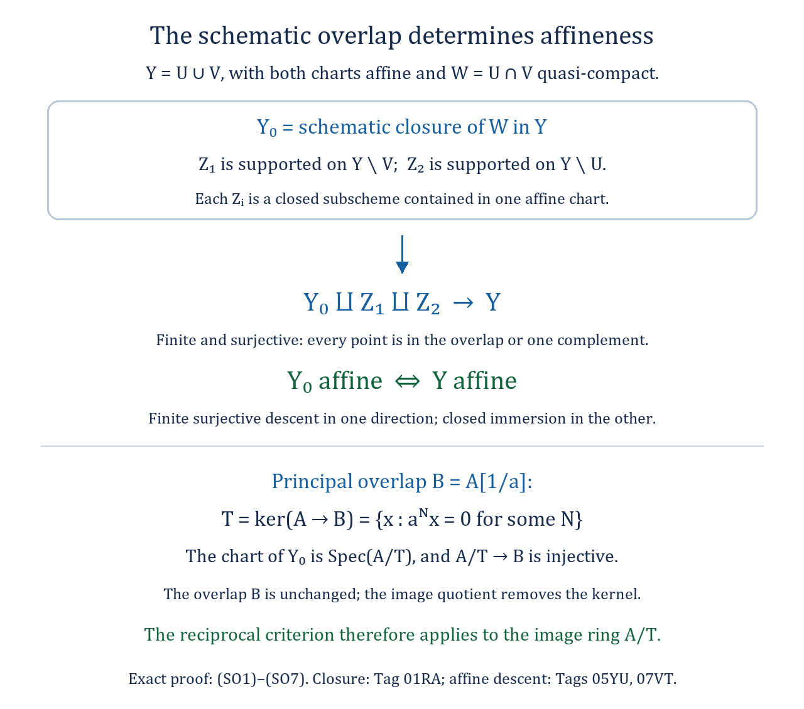

*For a two-chart gluing, the schematic closure $Y_0$ of the overlap and the two closed affine pieces $Z_1,Z_2$ cover every point of $Y$. The finite surjection (SO4) proves that $Y$ is affine exactly when $Y_0$ is affine. On each principal chart the closure is the image-ring quotient (SO5), so the reciprocal criterion applies without assuming injectivity of the original localisation. The editable diagram is [raw-fibre-schematic-overlap.svg](../figures/raw-fibre-schematic-overlap.svg).*

**A normal form for raw-size-one atlases of geometric degree at most two**

**The relation of a given atlas.**
Let $X$ be a quasi-compact separated algebraic space and let
$f:U=\operatorname{Spec}A\to X$ be a surjective etale morphism. Suppose
each fibre of $|U|\to|X|$ has one point and each geometric fibre of
$f$ has at most two points. Then there are an affine quasi-compact
open $j:V=\operatorname{Spec}B\hookrightarrow U$ and an involution
$\tau:V\to V$ such that
$$
 U\times_X U=\Delta_U\amalg\Gamma_\tau(V)
                   \quad\text{inside }U\times_{\mathbf Z}U. \tag{QN1}
$$
The graph in (QN1) is closed in $U\times_{\mathbf Z}U$ and disjoint
from the diagonal. The involution fixes every raw point of $V$ and
has no fixed geometric point. These statements allow every
characteristic and arbitrary, possibly non-Noetherian, rings.

**Proof of the normal form.**
Put $R=U\times_X U$. The separatedness of $X$ makes $R$ a closed
subscheme of the affine scheme $U\times_{\mathbf Z}U$, so $R$ is
affine. Its two projections $s,t:R\to U$ are etale. The diagonal
section $\Delta_U\subset R$ is open and closed, since it is a section
of a separated unramified morphism. Therefore
$R'=R\setminus\Delta_U$ is an affine open and closed subscheme.

Over a geometric point $u$ of $U$, the fibre of $s$ is the geometric
fibre of $f$ over $f(u)$. The diagonal occupies one of its points.
Hence every geometric fibre of $s|_{R'}$ has at most one point. The
etale morphism $s|_{R'}$ is thus universally injective and is an open
immersion, by Tag 025G. The same argument applies to $t|_{R'}$.
Inversion in $R$ exchanges these two maps and preserves $R'$, so
their images are the same open $V\subset U$. This open is affine,
since $s$ identifies it with the affine scheme $R'$; in particular
it is quasi-compact. Define
$$
              \tau=(t|_{R'})\circ(s|_{R'})^{-1}:V\to V.
                                                               \tag{QN2}
$$
Under this identification, inversion in $R'$ is $\tau$; consequently
$\tau^2=1$. The closed immersion $R'\hookrightarrow U\times U$
is its graph. Disjointness from $\Delta_U$ means that $\tau$ has
no fixed geometric point. The two images in $U$ of any raw point
of $R'$ have the same image in $X$. The raw-size-one hypothesis
therefore makes them the same point, proving that $\tau$ fixes
every raw point of $V$. This proves (QN1).

**The converse construction.**
Conversely, let $U=\operatorname{Spec}A$ be affine, let
$V=\operatorname{Spec}B$ be a quasi-compact affine open in $U$, and
let $\tau$ be an involution of $V$. Assume $\tau$ fixes every raw
point, has no fixed geometric point, and its graph is closed in
$U\times_{\mathbf Z}U$. Then the disjoint union of the diagonal and
this graph is a closed etale equivalence relation on $U$. Indeed its
projections are the identity on the diagonal and open immersions on
the graph; composing the nonidentity arrow twice gives the identity
because $\tau^2=1$. On points valued in a general scheme these
descriptions apply on the open and closed pieces specifying which
component of the disjoint relation is used, so the same composition
verifies the equivalence relation as a sheaf.

Its quotient $X=U/R$ is an algebraic space and $U\to X$ is a
surjective etale atlas. The relation is closed, so $X$ is separated;
it is quasi-compact because $U$ is. If two raw points of $U$ have
the same image in $X$, some point of $R$ has these as its two
projections: take a common field over the two residue extensions
in their fibre. On the diagonal they agree, and on the graph they
agree because $\tau$ fixes raw points. Thus every raw fibre has
one point. The relation over a geometric point of $U$ has one point
off $V$ and two on $V$. These are exactly the geometric fibre sizes
of the atlas. This gives the converse to the normal form.

**A finite double cover by two affine charts.**
Form the scheme $Y$ by gluing two copies $U_1,U_2$ of $U$ along
$V$, with the identification $\tau$. The closed-graph assumption
shows on its mixed affine charts that $Y$ is separated. It is
quasi-compact. Exchanging the two charts by their identity maps
defines an involution on $Y$: compatibility on the overlap is exactly
$\tau^2=1$. Off the overlap the two chart complements are exchanged;
on the overlap this action is $\tau$. The action is therefore free
on geometric points. The quotient by the constant group
$G=\mathbf Z/2$ exists as an algebraic space, and its relation on
the first chart is exactly (QN1). Hence this quotient is the same
$X$, and
$$
               Y=U_1\mathop{\cup}_{V,\tau}U_2,
               \qquad \pi:Y\to X
               \quad\text{is a finite etale }G\text{-torsor}.
                                                               \tag{QN3}
$$
For the finiteness assertion, base change the quotient map by its
surjective etale cover $Y\to Y/G$. The result is
$G\times Y\to Y$, a finite etale morphism of rank two. Finiteness
and etaleness descend under this faithfully flat base change. Thus
$$
                         X\text{ affine}
                 \quad\Longleftrightarrow\quad
                         Y\text{ affine}.                    \tag{QN4}
$$
The forward implication uses finiteness of $\pi$; the reverse
implication is integral surjective affineness descent, Tag 07VT.
The original atlas $f$ is not required to be finite.

**An exact module form of the remaining obstruction.**
Write $\rho:A\to B$ for restriction and
$\sigma=\tau^*:B\to B$. The coordinate ring of the mixed graph is
the surjective image
$$
 A\otimes_{\mathbf Z}A\longrightarrow B,
             \qquad a\otimes a'\longmapsto
                       \rho(a)\sigma(\rho(a')).             \tag{QN5}
$$
There is no assertion that $\rho$ is injective, that $V$ is a
principal open, or that a constant quadratic generator exists.

Take arbitrary $A$-modules $M,N$ and a $B$-module isomorphism
$$
 \alpha:B\otimes_{A,\sigma\rho}N
                       \xrightarrow{\sim}B\otimes_{A,\rho}M.
                                                               \tag{QN6}
$$
These are precisely the gluing data for a quasi-coherent sheaf $E$
on the two affine charts of $Y$. Every quasi-coherent sheaf on $Y$
arises in this way, with no finite-generation or local-freeness
assumption on the modules. Put $C_M=B\otimes_{A,\rho}M$, and let
$\iota_M:M\to C_M$ and
$\iota_N:N\to B\otimes_{A,\sigma\rho}N$ be the natural maps.
The affine two-open Cech calculation gives
$$
 H^1(Y,E)=
 \frac{C_M}{\iota_M(M)+\alpha(\iota_N(N))},\qquad
 H^q(Y,E)=0\quad(q\geq2).                                  \tag{QN7}
$$
Since $\pi$ is finite, $F=\pi_*E$ is quasi-coherent and its higher
direct images vanish. Therefore
$$
                        H^q(X,F)=H^q(Y,E)\quad(q\geq0).    \tag{QN8}
$$
In particular an actual nonzero element of the quotient in (QN7),
for data satisfying the stated hypotheses, would give a counterexample
to the original assertion with $d=1$. Conversely if that quotient
vanishes for every choice (QN6), then all positive quasi-coherent
cohomology on $Y$ vanishes. Serre's affineness criterion makes $Y$
affine, and (QN4) makes $X$ affine. Thus (QN7) is an exact obstruction
for the entire geometric-degree-at-most-two raw-size-one case.

For $M=N=A$ and $\alpha$ multiplication by a unit $b\in B^\times$,
the quotient is
$$
                       B/(\rho(A)+b\sigma(\rho(A))).       \tag{QN9}
$$
This rank-one test is a sufficient way to produce a counterexample
if it is nonzero; its vanishing alone is not asserted to settle
the arbitrary-module test (QN7). The normal form is a reduction,
not a vanishing proof or a constructed nonzero quotient. The original
obligation also allows larger geometric fibres and arbitrary raw
bounds, and remains unproved in that full generality here.

**Sources.**
The open-immersion criterion for etale universally injective morphisms
is The Stacks Project, Theorem 41.14.1, Tag 025G;
[Primary source](https://stacks.math.columbia.edu/tag/025G).
Open and closed sections of separated unramified morphisms are
Proposition 41.6.1, Tag 024S;
[Primary source](https://stacks.math.columbia.edu/tag/024S).
Free group quotients and their separatedness are Lemmas 65.14.3
and 65.14.5, Tag 02Z0;
[Primary source](https://stacks.math.columbia.edu/tag/02Z0).
The affine-cover cohomology argument is Lemma 30.4.2, Tag 01XI;
[Primary source](https://stacks.math.columbia.edu/tag/01XI).
Affineness descent is Proposition 70.15.2, Tag 07VT;
[Primary source](https://stacks.math.columbia.edu/tag/07VT).

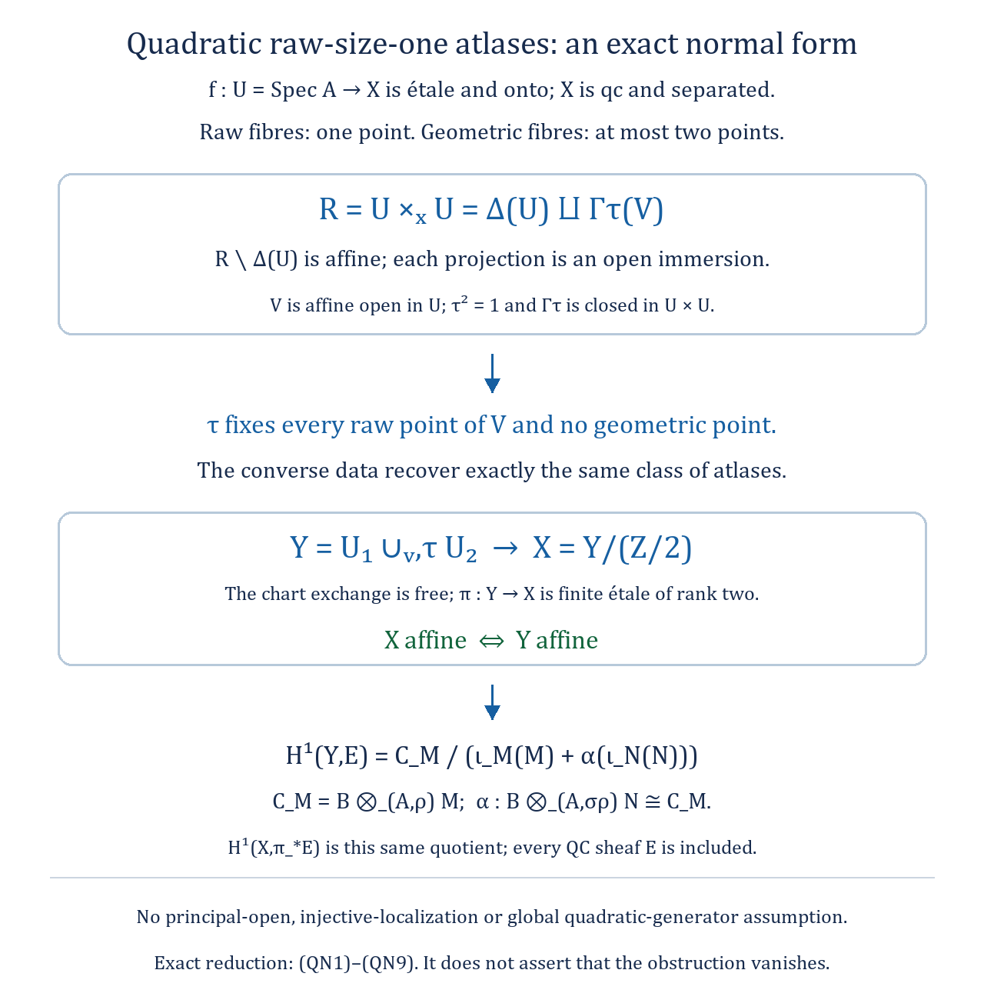

*Removing the diagonal from $U\times_XU$ gives the affine open $V$ and its involution in (QN1)–(QN2). The separated two-chart gluing $Y$ carries the free chart exchange, and its finite étale quotient is the original target $X$. The module quotient (QN7), transported by the finite pushforward in (QN8), describes every quasi-coherent cohomology obstruction on $Y$. This is a structural reduction; it supplies neither a vanishing assertion nor a nonzero class. The editable diagram is [raw-fibre-quadratic-atlas.svg](../figures/raw-fibre-quadratic-atlas.svg).*

**The normalized equivariant Cech complex in the quadratic normal form**

Use the complete hypotheses and notation of (QN1)--(QN9). Put
$C=B^\sigma$. The free action on the affine scheme $V$ has affine
quotient $W=\operatorname{Spec}C$, and $V\to W$ is a finite etale
torsor of rank two. This follows from the affine finite-flat
equivalence-relation theorem, The Stacks Project, Tag 03BM, applied
to $G\times V\rightrightarrows V$. The raw-fixed condition makes
$|V|\to|W|$ a bijection. The open image of $V$ in $X$ is exactly $W$,
since its restricted etale relation is the same free action. Thus the
open quotient is affine, even though affineness of $X$ remains at issue.

A quasi-coherent sheaf $F$ on $X$ is equivalent to an $A$-module $M$
together with a $\sigma$-semilinear involution $T$ of
$P=B\otimes_{A,\rho}M$. This is etale descent for the relation (QN1):
the diagonal action is the identity, and the off-diagonal action is
$T$, with the cocycle condition $T^2=1$. No involution of $M$ itself
is required. Write $\iota:M\to P$ for localization/restriction and
$N=P^T=\ker(T-1)$ for the $C$-module of invariants. Faithfully flat
descent along the torsor gives $B\otimes_C N\simeq P$.

Every term of the atlas Cech nerve is affine, because $X$ is
separated. Its Cech cohomology therefore computes $H^*(X,F)$.
Normalize its cosimplicial module by discarding strings containing
an identity arrow. In degree zero this leaves $M$. In every positive
degree the only possible nondegenerate string consists of repeated
nonidentity arrows, and is parametrized by $V$: after one such
arrow the next one, if present, is forced to be its inverse. All
normalized positive cochain groups are consequently $P$. With the
usual inhomogeneous convention their differentials are
$$
 M\xrightarrow{(T-1)\iota}P
  \xrightarrow{1+T}P\xrightarrow{T-1}P
  \xrightarrow{1+T}P\xrightarrow{T-1}\cdots .             \tag{QE1}
$$
Indeed on a nonidentity string, every internal face in the
normalized differential is zero, because composing its two adjacent
nonidentity arrows gives an identity. The first and last faces give
$T+(-1)^{n+1}$ in degree $n\geq1$. This yields $1+T$ for odd $n$
and $T-1$ for even $n$, exactly as displayed. Degenerate cochains
form the standard contractible summand, so normalization preserves
cohomology. Changing the overall sign of a difference differential
does not change the following kernels or quotients.
This is the usual normalized subcomplex given by the kernels of the
codegeneracies, equivalently the cochains vanishing on every
degenerate simplex. Its cohomology comparison is the cosimplicial
normalization theorem; see The Stacks Project, Section 14.25,
Tag 019H, using this equivalent normalization convention.

The analogous normalized group-cochain complex for $G$ on $P$ starts
with $P$, rather than $M$, in degree zero. It is also the normalized
Amitsur complex for the faithfully flat map $C\to B$ with coefficient
module $N$, using $P\simeq B\otimes_C N$ and
$B\otimes_C B\simeq B\times B$. The faithfully flat Amitsur complex
is exact in positive degrees. Therefore, in every characteristic,
$$
 \ker(1+T)=\operatorname{im}(T-1),\qquad
 \ker(T-1)=\operatorname{im}(1+T).                         \tag{QE2}
$$
This argument uses neither averaging by $1/2$ nor an asserted global
normal basis for the torsor. In characteristic two the two displayed
operators coincide, and Amitsur exactness still proves both identities.

It follows that the entire cohomology of (QE1) is
$$
 \begin{split}
 H^0(X,F)&=\{m\in M:\ \iota(m)\in N\},\\
 H^1(X,F)&\simeq P/(\iota(M)+N),\\
 H^q(X,F)&=0\quad(q\geq2).
 \end{split}                                               \tag{QE3}
$$
For the middle formula, map $P$ onto $\ker(1+T)$ by $T-1$,
using the first identity of (QE2). Its kernel is $N$; the image
of $\iota(M)$ is the degree-zero coboundary group of (QE1).
The claimed quotient follows. This is an isomorphism of abelian
groups, or of modules over $\Gamma(X,\mathcal O_X)$; it is not
asserted to be a $C$-module quotient, since $\iota(M)$ need not
be a $C$-submodule of $P$.

For $F=\mathcal O_X$, take $M=A$, $P=B$ and $T=\sigma$. Then
$$
 \Gamma(X,\mathcal O_X)=\{a\in A:\rho(a)\in C\}
                         \simeq A\times_B C,
 \qquad H^1(X,\mathcal O_X)=B/(\rho(A)+C).                 \tag{QE4}
$$
Restriction $A\to B$ need not be injective; its entire kernel is
retained in the formula for global sections.

Consequently the remaining raw-one vanishing question within this
whole quadratic class is equivalent to
$$
                 P=\iota(M)+P^T                          \tag{QE5}
$$
for every descended-module datum just described, under the normal-form
closed-graph and raw-fixed hypotheses. Formula (QE5) is not proved
here. A nonzero class in (QE3) for actual such data would be a theorem
counterexample; no such class is supplied. The case $M=A$ in (QE4)
alone is not asserted to test all quasi-coherent sheaves. These
formulas also do not settle the larger geometric degrees or other
raw bounds in the original objective.

Primary algebraic leaves: The Stacks Project, Proposition 39.23.9,
Tag 03BM, [Primary source](https://stacks.math.columbia.edu/tag/03BM); and
Section 59.16, Lemmas 59.16.3--59.16.4 and Theorem 59.16.7,
Tag 03O6, [Primary source](https://stacks.math.columbia.edu/tag/03O6).
Cosimplicial normalization is Section 14.25, Lemma 14.25.1,
[Primary source](https://stacks.math.columbia.edu/tag/019H).
The Cech computation also uses affine quasi-coherent acyclicity and
the separated affine atlas already present in the normal-form proof.

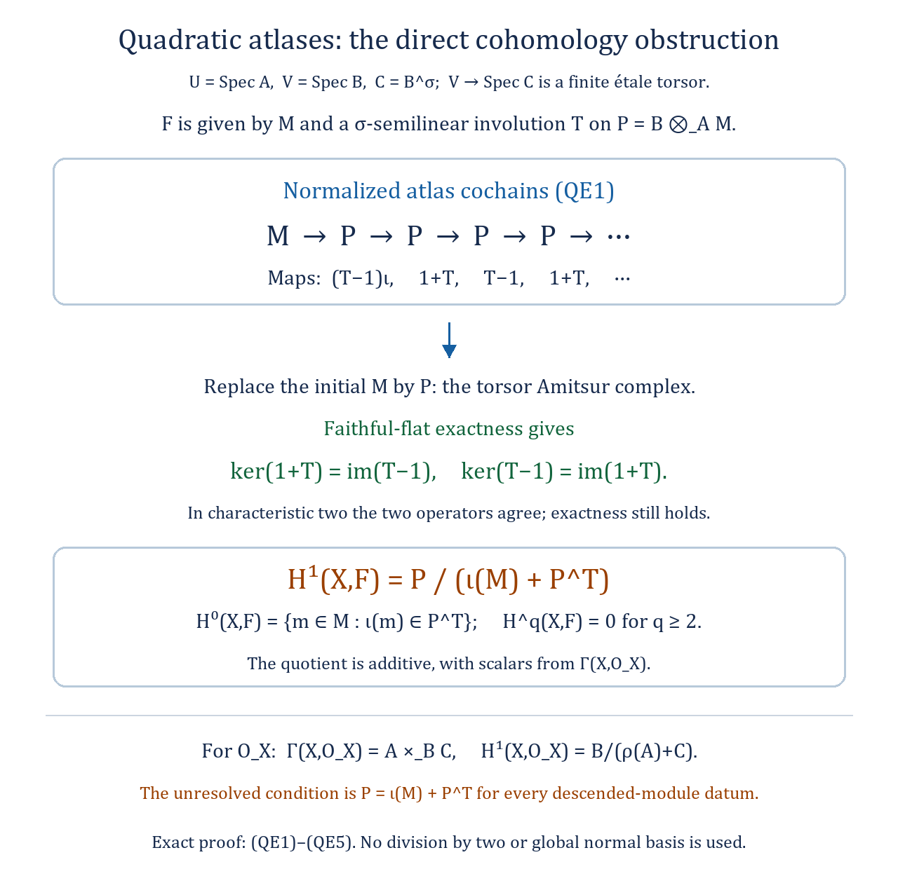

*For a quasi-coherent sheaf on the original target $X$, the normalized atlas cochains are the alternating complex (QE1). Faithfully flat descent for the finite torsor over $\operatorname{Spec}C$ proves the kernel-image identities (QE2), including characteristic two. Formula (QE3) then expresses $H^1(X,F)$ as the quotient of $P$ by the chart sections and invariant sections. The equality (QE5) for all such data is the remaining vanishing question within this quadratic class. The editable diagram is [raw-fibre-equivariant-cech.svg](../figures/raw-fibre-equivariant-cech.svg).*

#### Lemma. Finite cohomological dimension from an étale atlas

Let $X$ be a quasi-compact and quasi-separated algebraic space. One can choose the following data.

1. An affine scheme $U$.
2. A surjective étale map $U\to X$.
3. An integer $d$ bounding its geometric fibre degrees.
4. For each $0\leq p\leq d$, a surjective étale map $V_p\to U_p$ with $V_p$ affine, where $U_p=W_p/S_{p+1}$ and $W_p$ is the locus of pairwise distinct coordinates in the $(p+1)$-fold fibre product of $U$ over $X$.
5. An integer $d_p$ bounding the geometric fibre degrees of $V_p\to U_p$.

For any data satisfying these conditions, every quasi-coherent $\mathcal F$ on $X$ satisfies

$$H^i(X,\mathcal F)=0\quad\text{if}\quad
i\geq\max_{0\leq p\leq d}(p+d_p).\tag{QSCB1}$$

**Proof.** Quasi-compactness supplies an affine étale atlas. The [bounded-fibre theorem](#native-decent-spaces-lemma-bounded-fibres) supplies a universal bound $d$. The map from the affine source is separated. Its diagonals in the iterated fibre products are therefore both open and closed, so $W_p$ is open and closed in that product. Quasi-separatedness of $X$ makes the product, and hence $W_p$, quasi-compact. The product is separated as a scheme: its map to the product of the copies of the separated scheme $U$ is a monomorphism and therefore separated. Thus $W_p$ is separated.

The action of $S_{p+1}$ is free on $W_p$. Its quotient $U_p$ is quasi-compact, and the [finite-group quotient separation result](#uncovered-spaces-lemma-quotient-finite-separated) makes it separated. Choose an affine étale atlas $V_p\to U_p$ and then a universal degree bound $d_p$. The atlas here has target $U_p$, as required in (4). This constructs all the data.

We recall explicitly the separated-space vanishing argument needed for each $U_p$, in the form with a geometric degree bound. If $Z$ is separated and has an affine étale atlas $A\to Z$ of geometric degree at most $e$, the distinct-coordinate locus in $A^{r+1}_Z$ is affine: the whole product is closed in the product over $\operatorname{Spec}\mathbf Z$, and the locus is open and closed. Its quotient by the free finite symmetric group is affine by the finite locally free equivalence-relation quotient theorem. The sign-twisted coefficient sheaf is quasi-coherent. Hence the [alternating spectral sequence](#native-spaces-cohomology-lemma-alternating-spectral-sequence) has no terms in positive cohomological degree, by affine vanishing. It has no terms of simplicial degree $r\geq e$ either, since a geometric fibre with at most $e$ elements has no $(r+1)$-tuple of distinct elements. Therefore $H^q(Z,\mathcal G)=0$ for $q\geq e$ and every quasi-coherent $\mathcal G$.

Now use that same alternating spectral sequence for $U\to X$:

$$E_1^{p,q}=H^q\bigl(U_p,\mathcal F|_{U_p}\otimes_{\mathbf Z}
\underline{\mathbf Z}(\chi_p)\bigr)
\ \Longrightarrow\ H^{p+q}(X,\mathcal F),\tag{QSCB2}$$

where $\chi_p$ is the sign character. The twist is quasi-coherent because its rank-one integral local system becomes trivial étale locally. The separated-space argument with $V_p\to U_p$ makes the displayed term zero for $q\geq d_p$. Also $W_p$, and therefore $U_p$, is empty for $p\geq d$. If $p+q\geq\max_j(j+d_j)$, then $q\geq d_p$, so every term on that total-degree diagonal is zero. Convergence proves (QSCB1), including empty spaces. $\square$

The affine quotient step uses the finite locally free equivalence-relation theorem, credited by the Stacks Project to FGA, Exposé 212, Théorème 5.1(iv), p. 111.

#### Lemma. A canonical splitting of the étale pull–push counit

Let $f:X\to Y$ be étale, separated and quasi-compact between algebraic spaces. For a quasi-coherent module $F$ on $X$, the counit $f^*f_*F\to F$ admits a section.

**Proof.** Write $p,q:X\times_YX\to X$ for the first and second projections, respectively. Apply [flat base change in degree zero](#native-spaces-cohomology-lemma-flat-base-change-cohomology) to the square with horizontal maps $p,f$ and vertical maps $q,f$. Since $f$ is flat and quasi-compact and separated, it gives the canonical identification
$$f^*f_*F\simeq q_*p^*F.$$
The diagonal $\Delta:X\hookrightarrow X\times_YX$ is open because $f$ is étale, and closed because $f$ is separated. Thus its image and its complement $W$ are disjoint open-and-closed subspaces. If $i:W\hookrightarrow X\times_YX$, then
$$p^*F\simeq\Delta_*F\oplus i_*i^*p^*F.$$
Under this decomposition, restriction to the diagonal is projection onto the first summand, since $p\Delta=1_X$. Applying $q_*$ gives
$$q_*p^*F\simeq F\oplus q_*i_*i^*p^*F,
\qquad q\Delta=1_X.$$
The base-change identification carries the counit to this first projection: both maps restrict a pulled-back section to the diagonal. Inclusion of the first summand is consequently a section, and its composite with the counit sends each local section of $F$ to itself.

This uses the flat-base-change theorem. The affine-base-change lemma cited in the source requires an affine structural morphism, a hypothesis absent here; quasi-compact separated étale morphisms need not be affine. $\square$

#### Lemma. Filtered colimits commute with higher direct images

Let $f:X\to Y$ be quasi-compact and quasi-separated between algebraic spaces over a scheme. For a filtered diagram $(\mathcal F_i)$ of abelian sheaves on $X_{\mathrm{\acute et}}$, the natural comparison is an isomorphism in every degree $p\geq0$:

$$\operatorname{colim}_i R^pf_*\mathcal F_i
\ \xrightarrow{\ \sim\ }\ R^pf_*(\operatorname{colim}_i\mathcal F_i).\tag{HFC1}$$

**Proof.** Use the site whose objects are algebraic spaces étale over the target. The continuous functor $V\mapsto X\times_YV$ produces the required morphism of sites and the same small étale topoi, by [functoriality of these sites](#uncovered-spaces-properties-lemma-functoriality-etale-site). The [site comparison for higher images and colimits](#uncovered-sites-cohomology-lemma-higher-direct-image-colimit) reduces the assertion to cohomology on a covering collection of target objects.

Choose the affine étale objects $V\to Y$. Their pullbacks $X\times_YV$ are quasi-compact and quasi-separated. The [filtered-colimit cohomology theorem](#native-spaces-cohomology-lemma-colimits) therefore gives the required comparison on each such pullback, in every degree. These affine objects cover the site, so sheafification gives (HFC1). No module or quasi-coherence assumption is imposed on the abelian sheaves. $\square$

#### Proposition. The cohomological criterion for an affine algebraic space

A quasi-compact, quasi-separated algebraic space $X$ is an affine scheme precisely when every quasi-coherent sheaf has zero cohomology in all positive degrees. In fact the degree-one condition in the [vanishing setup](#native-spaces-cohomology-situation-vanishing) already suffices: with $A=\Gamma(X,\mathcal O_X)$, the canonical map $p:X\to\operatorname{Spec}A$ is an isomorphism.

**Proof.** Take an affine étale surjection $\varphi:U=\operatorname{Spec}B\to X$. The [separatedness consequence of vanishing](#native-spaces-cohomology-lemma-vanishing-separated) says that $p$ is separated. Therefore $R=U\times_XU$ is a closed subscheme of $U\times_{\operatorname{Spec}A}U$, and we can write

$$R=\operatorname{Spec}C,\qquad B\otimes_AB\twoheadrightarrow C.\tag{SAS1}$$

Denote the two maps $B\to C$ by $s,t$. The algebra $C$ is finitely presented over $t(B)$, because the corresponding projection is étale between affine schemes. By (SAS1), finitely many elements $g_1,\ldots,g_m\in B$ can be chosen so that their $s$-images generate this algebra over $t(B)$.

These elements are sections of $\varphi_*\mathcal O_U$. They define an algebra map

$$\mathcal O_X[z_1,\ldots,z_m]\longrightarrow\varphi_*\mathcal O_U,
\qquad z_j\longmapsto g_j.\tag{SAS2}$$

It is surjective. Indeed, pull back to the covering atlas $U$. Flat base change identifies the right side after pullback with $t_*\mathcal O_R$, and (SAS2) becomes precisely the surjection defined by the generators $s(g_j)$ over $t(B)$. Its kernel is quasi-coherent. The degree-one vanishing assumption thus makes the map on global sections surjective. The polynomial algebra is a direct sum of copies of $\mathcal O_X$, indexed by monomials; commutation of sections with filtered colimits gives

$$A[z_1,\ldots,z_m]\twoheadrightarrow B.\tag{SAS3}$$

Thus $U$ is of finite type over $A$, and finite type descends through its étale cover of $X$. The morphism $p$ is now of finite type and separated. It is [universally injective](#native-spaces-cohomology-lemma-vanishing-injective); its field fibres therefore have at most one point. The [discrete-fibre criterion](#uncovered-spaces-morphisms-lemma-locally-quasi-finite) makes $p$ locally quasi-finite. The [separated representability result](#uncovered-spaces-morphisms-lemma-locally-quasi-finite-separated-representable) then shows that $X$ is a scheme.

The [scheme form of Serre's criterion](#uncovered-coherent-lemma-quasi-compact-h1-zero-covering) applies and makes $X$ affine. Its coordinate ring is $A$, so the canonical map $p$ is an isomorphism. Conversely, affine quasi-coherent cohomology vanishes in positive degree, proving the stated equivalence. The same $m$ generators and the same variables are used throughout (SAS2) and (SAS3). $\square$

#### Lemma. A quasi-coherent sheaf is a filtered union of coherent submodules

On a Noetherian algebraic space $X$, every quasi-coherent $\mathcal F$ is the filtered colimit of the coherent subsheaves it contains.

**Proof.** Two coherent subsheaves are contained in their sum. This sum is the image of their finite direct sum in $\mathcal F$, hence is coherent by the Noetherian subquotient criterion. Consequently the collection of coherent subsheaves is directed.

Choose an affine étale atlas $U\to X$, and put $R=U\times_XU$. The schemes $U,R$ are Noetherian, and their source and target projections are flat, quasi-compact and quasi-separated. The [groupoid description of quasi-coherent sheaves](#native-spaces-properties-proposition-quasi-coherent) identifies $\mathcal F$ with an equivariant module on $R\rightrightarrows U$. The [coherent approximation theorem for this groupoid](#uncovered-groupoids-lemma-colimit-coherent) expresses it as a filtered colimit of coherent equivariant modules. Transfer this system back to $X$ and take the image of each map to $\mathcal F$. Each image is coherent. Their images exhaust $\mathcal F$, and the directed collection of all coherent subsheaves consequently has colimit $\mathcal F$. $\square$

#### Lemma. Cohomology of filtered diagrams on a quasi-compact quasi-separated space

For a quasi-compact, quasi-separated algebraic space $X$ and a filtered diagram of abelian sheaves $(\mathcal F_i)$ on its small étale site, the canonical map

$$\operatorname{colim}_i H^p(X,\mathcal F_i)
\longrightarrow H^p(X,\operatorname{colim}_i\mathcal F_i)\tag{FCC1}$$

is an isomorphism for every $p\geq0$.

**Proof.** Work on the equivalent site of algebraic spaces étale over $X$. Let $\mathcal B$ consist of its quasi-compact, quasi-separated objects. Every covering of an object in $\mathcal B$ admits a refinement by finitely many affine étale objects: first refine by affine charts and then use quasi-compactness to select finitely many images covering the object.

Use all finite coverings whose members lie in $\mathcal B$. The [permanence of quasi-compactness and quasi-separatedness](#uncovered-spaces-morphisms-lemma-quasi-compact-quasi-separated-permanence) puts every iterated fibre product of their members over the covered object back in $\mathcal B$. These coverings are cofinal by the preceding refinement argument. All hypotheses of the [finite-cover colimit theorem](#uncovered-sites-cohomology-lemma-colim-works-over-collection) hold. Apply it to the object $X\in\mathcal B$ to obtain (FCC1). $\square$

#### Lemma. Dévissage using coherent sheaves of positive rank

Let $X$ be a Noetherian algebraic space over a scheme, and let $\mathcal P$ be an isomorphism-invariant property of coherent modules. Suppose the following conditions hold.

1. An extension of two modules having $\mathcal P$ also has $\mathcal P$.
2. For every positive integer $r$, $\mathcal P(\mathcal F^{\oplus r})$ implies $\mathcal P(\mathcal F)$.
3. For each reduced irreducible closed subspace $i:Z\hookrightarrow X$, choose a coherent $\mathcal G$ on $Z$ with support all of $Z$. Every nonzero quasi-coherent ideal $\mathcal I$ of $\mathcal O_Z$ admits a quasi-coherent submodule $\mathcal G'\subseteq\mathcal I\mathcal G$ such that $\mathcal G/\mathcal G'$ has proper closed support and $i_*\mathcal G'$ has $\mathcal P$.

Then $\mathcal P$ holds for every **nonzero** coherent module. It holds for every coherent module if one also assumes $\mathcal P(0)$.

**Correction to the source conclusion.** The source asserts the conclusion for every coherent module under just these three conditions. Its zero-module case is false. Take $X=\operatorname{Spec}k$ and let $\mathcal P(\mathcal F)$ mean $\mathcal F\ne0$. Conditions 1 and 2 hold. For condition 3 the only reduced irreducible closed subspace is $X$; take $\mathcal G=k$. Its only nonzero ideal is $k$, and $\mathcal G'=\mathcal G$ works. Nevertheless $\mathcal P(0)$ fails. Thus the additional zero-module condition is necessary for the full source conclusion. The proof below establishes the strongest conclusion under its original assumptions.

**Proof.** If there is a nonzero counterexample, choose one whose nonempty closed support $T$ is minimal. Every nonzero coherent module with support properly contained in $T$ then has $\mathcal P$.

If $T$ is reducible, write it as a union of two proper closed subsets. The [support-splitting lemma](#native-spaces-cohomology-lemma-prepare-filter-support) expresses the counterexample as an extension of modules supported on these subsets. Both modules are nonzero: if one were zero, the support of the original module would lie in the other proper subset. Minimality and condition 1 give a contradiction.

Hence $T$ is irreducible. Let $\mathcal J$ define its reduced closed structure. Some power of $\mathcal J$ annihilates the counterexample, by [the ideal-power lemma](#native-spaces-cohomology-lemma-power-ideal-kills-sheaf). Filter by these powers and discard zero successive quotients. If every remaining quotient had $\mathcal P$, repeated extensions, starting with the first nonzero quotient, would give $\mathcal P$ for the counterexample. Choose a quotient failing $\mathcal P$. Minimality forces its support to be $T$; it is annihilated by $\mathcal J$. Rename it $\mathcal F$. For $i:Z\hookrightarrow X$ the reduced structure on $T$, the closed-immersion equivalence gives $\mathcal F=i_*\mathcal H$ with $\mathcal H$ coherent on $Z$.

Use the sheaf $\mathcal G$ in condition 3. Both $\mathcal H$ and $\mathcal G$ have full support on reduced $Z$, so their annihilators vanish. The [irreducible-support preparation](#native-spaces-cohomology-lemma-prepare-filter-irreducible) supplies positive ranks $r_1,r_2$ and injections from $\mathcal I_1^{\oplus r_1}$ to $\mathcal H$ and from $\mathcal I_2^{\oplus r_2}$ to $\mathcal G$, with nonzero ideals and cokernels of proper support. On a common nonempty open $V$ the ideals and both maps are trivialized. Thus

$$\mathcal G^{\oplus r_1}|_V\cong\mathcal H^{\oplus r_2}|_V.\tag{HRD1}$$

Choose an ideal $\mathcal I$ cutting out $Z\setminus V$. The [extension lemma](#native-spaces-cohomology-lemma-homs-over-open) extends (HRD1) to $\mathcal I^n\mathcal G^{\oplus r_1}\to\mathcal H^{\oplus r_2}$. Let $\mathcal K$ be its kernel. It is coherent and killed by some $\mathcal I^a$. Applying [Artin–Rees](#native-spaces-cohomology-lemma-artin-rees) inside $\mathcal M=\mathcal I^n\mathcal G^{\oplus r_1}$ gives a $c$ such that, for $b\geq c$,

$$\mathcal K\cap\mathcal I^b\mathcal M
=\mathcal I^{b-c}(\mathcal K\cap\mathcal I^c\mathcal M).
\tag{HRD2}$$

For $b\geq c+a$ this is zero. Restricting the map to $\mathcal I^{n+b}\mathcal G^{\oplus r_1}$ therefore makes it injective. Rename the exponent $n$. The ideal $\mathcal I^n$ is nonzero, since it restricts to $\mathcal O_V$. Condition 3 now gives $\mathcal G'\subseteq\mathcal I^n\mathcal G$ and an injection

$$(i_*\mathcal G')^{\oplus r_1}\longrightarrow\mathcal F^{\oplus r_2}\tag{HRD3}$$

with cokernel supported properly inside $T$. Condition 1 gives $\mathcal P$ for the source of (HRD3). If its cokernel is nonzero, minimality and condition 1 give $\mathcal P(\mathcal F^{\oplus r_2})$; if it is zero, (HRD3) is an isomorphism and gives the same conclusion directly. Condition 2 contradicts the choice of $\mathcal F$. This proves the assertion for nonzero modules. The additional assumption $\mathcal P(0)$ covers the only remaining module, including when $X$ is empty. $\square$

#### Lemma. A coherent module of full support from a finite cover

Suppose $f:Y\to X$ is a finite surjection of algebraic spaces over a scheme and $X$ is locally Noetherian. For a closed subspace $Z\hookrightarrow X$, put $Z'=Y\times_XZ$ and write $f':Z'\to Z$. Then $f'_*\mathcal O_{Z'}$ is coherent and has support $Z$.

**Proof.** Base change preserves finiteness and surjectivity. The spaces $Y,Z,Z'$ are locally Noetherian, since the maps defining them are of finite type over locally Noetherian spaces. Coherence follows from [finite pushforward](#native-spaces-cohomology-lemma-finite-pushforward-coherent).

Its support is closed. If a point of $Z$ were outside that support, there would be a nonempty open subspace $V\subseteq Z$ where the pushforward vanishes. On the inverse image $V'$ every global section would then vanish, including the identity section of $\mathcal O_{V'}$. This forces $V'$ to be empty: each local ring would have $1=0$. Surjectivity of $V'\to V$ contradicts the choice of $V$. The support is all of $Z$. $\square$

#### Lemma. An ideal acting through an affine morphism

For an affine map $f:Y\to X$ of algebraic spaces, a quasi-coherent module $\mathcal F$ on $Y$, and a quasi-coherent ideal $\mathcal I\subseteq\mathcal O_X$, there is an equality of submodules of $f_*\mathcal F$:

$$\mathcal I(f_*\mathcal F)=f_*\bigl((f^{-1}\mathcal I)\mathcal F\bigr).\tag{APIS1}$$

Here $f^{-1}\mathcal I$ is an ideal of $f^{-1}\mathcal O_X$, acting through the structure map to $\mathcal O_Y$. The expression on the right uses the submodule of $\mathcal F$ generated by the products of its sections with that ideal. Equivalently it is the image of $f^*\mathcal I\otimes_{\mathcal O_Y}\mathcal F\to\mathcal F$, so it is quasi-coherent.

**Proof.** Equality can be checked on an affine étale cover of $X$. Affineness makes the corresponding source a scheme, and the [scheme ideal projection formula](#uncovered-coherent-lemma-affine-morphism-projection-ideal) applies. Explicitly, for $X=\operatorname{Spec}A$, $Y=\operatorname{Spec}B$, $\mathcal F=\widetilde M$ and $\mathcal I=\widetilde I$, both sides of (APIS1) are associated with the same $A$-submodule $IM=(IB)M$ of $M$. This proves the equality locally and hence globally. $\square$

#### Lemma. Flat base change for quasi-coherent cohomology

Consider a cartesian square of algebraic spaces over a scheme $S$, with maps $f:X\to Y$, $g:Y'\to Y$, $g':X'=X\times_Y Y'\to X$, and $f':X'\to Y'$. Suppose $f$ is quasi-compact and quasi-separated, $g$ is flat, and $F$ is quasi-coherent on $X$. Put $F'=(g')^*F$. For every $i\geq0$, the canonical comparison is an isomorphism
$$g^*R^if_*F\xrightarrow{\ \sim\ }R^if'_*F'.$$
In particular, if $Y=\operatorname{Spec}(A)$ and $Y'=\operatorname{Spec}(B)$, then the corresponding map is
$$H^i(X,F)\otimes_A B\xrightarrow{\ \sim\ }H^i(X',F').$$

**Proof.** Flatness of $g$ also gives flatness of $g'$, by [base change of a flat morphism](#native-spaces-morphisms-lemma-base-change-flat). The [comparison with small étale ringed sites](#uncovered-spaces-morphisms-lemma-flat-morphism-sites) makes both inverse-image functors exact. Thus the [flat base-change construction for ringed topoi](#uncovered-sites-cohomology-lemma-base-change-map-flat-case) defines the displayed morphism. Étale localization on the targets commutes with this construction and with higher direct image. Taking affine charts on $Y$, and then on their inverse images in $Y'$, reduces its invertibility to the asserted affine-base formula.

Fix the resulting flat map $A\to B$. The projection $g':X'=X\times_A\operatorname{Spec}(B)\to X$ is affine. By [affine higher-direct-image vanishing](#native-spaces-cohomology-lemma-affine-vanishing-higher-direct-images) and [Leray](#native-sites-cohomology-lemma-apply-leray),
$$H^i(X',F')\simeq H^i(X,g'_*F').$$
There is a natural identification
$$g'_*F'\simeq F\otimes_{\underline A}\underline B,$$
where the underlined rings denote constant sheaves. To verify it, use an affine étale object $U\to X$. Quasi-coherence on the affine schemes $U$ and $U_B$ gives
$$\Gamma(U_B,F'|_{U_B})=B\otimes_A\Gamma(U,F|_U).$$
These equalities are compatible with restriction, so they identify the indicated sheaves after sheafification.

By [Lazard's theorem](#uncovered-algebra-theorem-lazard), write the flat $A$-module $B$ as a filtered colimit of finite free modules $B_\lambda$. Tensor product commutes with colimits, and [cohomology on a quasi-compact quasi-separated algebraic space](#native-spaces-cohomology-lemma-colimits) commutes with filtered colimits. Hence
$$\begin{aligned}
H^i(X',F')
&\simeq H^i(X,F\otimes_{\underline A}\underline B)\\
&\simeq\operatorname{colim}_\lambda
H^i(X,F\otimes_{\underline A}\underline{B_\lambda})\\
&\simeq\operatorname{colim}_\lambda
\bigl(H^i(X,F)\otimes_A B_\lambda\bigr)\\
&\simeq H^i(X,F)\otimes_A B.
\end{aligned}$$
The middle identification uses that each $B_\lambda$ is finite free, so it amounts to a finite direct sum of copies of $F$. It is natural in homomorphisms between finite free modules, hence compatible with the transition maps. All the identifications arise from restriction and scalar extension; their inverse composite is the original cohomological base-change map. The affine formula, and therefore the sheaf formula, follow. $\square$

#### Lemma. The alternating spectral sequence on quotient spaces

Let $f:U\to X$ be a separated étale surjection of algebraic spaces over a scheme. For each $p\geq0$, let $W_p$ be the open and closed part of $U_X^{p+1}$ where all coordinates are different. Its coordinate-permutation action by $S_{p+1}$ is free. Put $U_p=W_p/S_{p+1}$ and let $L_p=\underline{\mathbf Z}(\chi_p)$ be the rank-one local system for the sign character. For every abelian sheaf $\mathcal F$ on $X_{\mathrm{\acute et}}$ there is a convergent spectral sequence

$$E_1^{p,q}=H^q(U_p,\mathcal F|_{U_p}\otimes_{\mathbf Z}L_p)
\ \Longrightarrow\ H^{p+q}(X,\mathcal F).\tag{ASS1}$$

**Proof.** Recall the alternating resolution: for the extension by zero $f_!\underline{\mathbf Z}$, put $K^p=\bigwedge^{p+1}f_!\underline{\mathbf Z}$. The alternating deletion maps give an augmented exact complex $K^\bullet\to\underline{\mathbf Z}$. Exactness can be checked at geometric stalks: the stalk is the augmented exterior complex of the free abelian group on the nonempty fibre, and wedging with one chosen fibre element supplies a contracting homotopy.

Resolve $\mathcal F$ by injectives $\mathcal I^\bullet$. The first-quadrant double complex $\operatorname{Hom}(K^p,\mathcal I^q)$ has total cohomology $H^*(X,\mathcal F)$, because applying $\operatorname{Hom}(-,\mathcal I^q)$ to the augmented resolution is exact. Its other spectral sequence has columns $\operatorname{Ext}^q(K^p,\mathcal F)$.

The column complex has a geometric description. Tensor powers of $f_!\underline{\mathbf Z}$ correspond to ordered tuples in $U_X^{p+1}$. In the exterior quotient, repeated tuples vanish and permutations impose their signs. Consequently $\operatorname{Hom}(K^p,\mathcal I^q)$ is the group of sign-equivariant sections of $\mathcal I^q$ on $W_p$. This uses the repeated-tuple relations explicitly, so is valid even for sheaves with two-torsion.

For the finite étale torsor $q_p:W_p\to U_p$, these sign-equivariant sections identify with

$$\Gamma(U_p,\mathcal I^q|_{U_p}\otimes_{\mathbf Z}L_p).\tag{ASS2}$$

Indeed, after trivializing the torsor its direct image has the regular permutation basis $e_g$; the sign-equivariant part is generated by $\sum_g\chi_p(g)e_g$. Its coefficients are all $1$ or $-1$, so this description commutes with tensoring by any abelian group and requires no division by the group order. Descent gives (ASS2).

The map $U_p\to X$ is étale: this is detected after the étale surjection $W_p\to U_p$. Restriction along it preserves injectives, as its left adjoint is exact extension by zero. Tensoring by $L_p$ is an exact autoequivalence, with inverse tensoring by its dual. Hence the complex in (ASS2) is an injective-resolution calculation of the group in (ASS1). This identifies every column and proves the spectral sequence. Both indices are nonnegative, so each total degree has a finite filtration and convergence follows. $\square$

#### Lemma. Quasi-coherence survives the character twist

Let a finite group $G$ act freely on an algebraic space $W$, put $U=W/G$, and let $\chi:G\to\{1,-1\}$ be a character. Write $L=\underline{\mathbf Z}(\chi)$ for the associated rank-one local system on $U_{\mathrm{\acute et}}$. If $\mathcal F$ is quasi-coherent on $U$, then $\mathcal F\otimes_{\mathbf Z}L$ is quasi-coherent as an $\mathcal O_U$-module.

**Proof.** The action of $\mathcal O_U$ is on the first tensor factor. Pull back to an étale cover trivializing the torsor and its character local system. There $L$ is the constant free module of rank one, so the twisted module is isomorphic to $\mathcal F$. Quasi-coherence is detected étale locally, giving the assertion. The same reasoning works for any finite-rank locally free constant-ring module. $\square$

#### Lemma. Arbitrary base change for an affine direct image

Let $f:X\to Y$ be affine and let $\mathcal F$ be a quasi-coherent module on $X$. Then $f_*\mathcal F$ is quasi-coherent, the canonical map $f_*\mathcal F\to Rf_*\mathcal F$ is a quasi-isomorphism, and every base change $g:Y'\to Y$ gives the canonical isomorphism

$$g^*f_*\mathcal F\cong f'_*g'^*\mathcal F,\qquad
X'=Y'\times_YX.\tag{ABCS1}$$

**Proof.** Affine direct images are quasi-coherent and have zero higher images, by the [affine vanishing lemma](#native-spaces-cohomology-lemma-affine-vanishing-higher-direct-images). Check (ABCS1) after taking compatible affine étale charts on the target and its base change. Since $f$ is representable and affine, this becomes the [affine scheme calculation](#uncovered-coherent-lemma-affine-base-change). For a ring map $R\to B$, a $B$-module $M$, and an arbitrary $R$-algebra $R'$, its underlying identity is

$$(R'\otimes_RB)\otimes_BM\cong R'\otimes_RM.$$

This is the canonical base-change map on the charts, so the local isomorphisms glue to (ABCS1). No flatness of $g$ is required. $\square$

#### Situation. Vanishing in degree one and the ring of global functions

Fix an algebraic space $X$ over a scheme $S$. Assume that $X$ is quasi-compact and quasi-separated and that

$$H^1(X,\mathcal F)=0\quad\text{for every quasi-coherent }\mathcal F.$$

Throughout this setup, write $A=\Gamma(X,\mathcal O_X)$ and let $p:X\to\operatorname{Spec}A$ be the canonical morphism. For an $A$-module $M$, the notation $M\otimes_A\mathcal O_X$ means $p^*\widetilde M$.

#### Lemma. Degree-one vanishing forces separatedness

In the [vanishing setup](#native-spaces-cohomology-situation-vanishing), $p:X\to\operatorname{Spec}A$ is separated.

**Proof.** The [integral scheme-cover construction](#native-decent-spaces-lemma-there-is-a-scheme-integral-over) gives an integral surjection $Y\to X$ with $Y$ a scheme. This map is affine, so degree-one vanishing for quasi-coherent modules passes to $Y$. It is also quasi-compact; since $X$ is quasi-compact, so is $Y$.

The [scheme cohomological affineness criterion](#uncovered-coherent-lemma-quasi-compact-h1-zero-covering) makes $Y$ affine. In particular $Y$ is separated. An integral map is universally closed, and the [universally closed image lemma](#uncovered-spaces-morphisms-lemma-image-universally-closed-separated) transfers separatedness from $Y$ to $X$. Thus $X$ is separated over $\operatorname{Spec}\mathbf Z$. Its map to the affine scheme $\operatorname{Spec}A$ is consequently separated as well. $\square$

#### Lemma. The map to global functions is universally injective

In the [vanishing setup](#native-spaces-cohomology-situation-vanishing), the canonical map $p:X\to\operatorname{Spec}A$ is universally injective.

**Proof.** The field-fibre criterion for universal injectivity reduces the problem to proving that $\operatorname{Spec}k\times_{\operatorname{Spec}A}X$ has at most one point for every homomorphism $A\to k$ to a field. The [affine base-change lemma](#native-spaces-cohomology-lemma-vanishing-base-change) preserves the vanishing assumption and identifies the new ring of global functions with $k$. We may therefore work with $A=k$.

Choose an algebraically closed extension $K/k$ of sufficiently large transcendence degree. By the large-field-points lemma, every point of $|X|$ has a representative in $X(K)$. Replacing $k$ by $K$ is another affine base change and again leaves the ring of functions equal to the base field. It suffices to prove that any two rational points over that field have the same image in the space.

The space is quasi-separated, hence decent. The [closed-point lemma for algebraic residue fields](#uncovered-decent-spaces-lemma-algebraic-residue-field-extension-closed-point) makes the images of these rational points closed. If their images were distinct, the [separation lemma](#native-spaces-cohomology-lemma-vanishing-separate-closed) would supply a function with values $0$ and $1$ at them. Every global function belongs to $k$, and both evaluations on $k$ are the identity. This is impossible. The field fibre has at most one point, as required. $\square$

#### Lemma. Artin–Rees on a Noetherian algebraic space

Suppose $X$ is a Noetherian algebraic space over a scheme $S$. Fix a coherent $\mathcal O_X$-module $\mathcal F$, a quasi-coherent submodule $\mathcal G\subset\mathcal F$, and a quasi-coherent ideal $\mathcal I$. One can choose a single integer $c\geq0$ for which

$$\mathcal I^n\mathcal F\cap\mathcal G
=\mathcal I^{n-c}(\mathcal I^c\mathcal F\cap\mathcal G)
\qquad\text{for every }n\geq c.\tag{ARSP}$$

**Proof.** Take an [affine étale atlas](#native-spaces-properties-lemma-quasi-compact-affine-cover) $a:U\to X$. This is possible because $X$ is quasi-compact. The scheme $U$ is Noetherian: it is affine and locally Noetherian by the [finite-type preservation result](#native-spaces-morphisms-lemma-locally-finite-type-locally-noetherian). Apply the [scheme version of Artin–Rees](#uncovered-coherent-lemma-artin-rees) to $a^*\mathcal F$, $a^*\mathcal G$, and the pulled-back ideal. Flat pullback carries products, powers and intersections of these submodules to their corresponding constructions on $U$; for intersections this follows by expressing the intersection as a kernel. Thus its integer $c$ makes the pullback of (ARSP) an equality. Since an étale surjection detects equality of subsheaves, the same $c$ works on $X$. $\square$

#### Lemma. Alternating cochains on distinct tuples

Let $f:U\to X$ be an étale surjection, also separated, between algebraic spaces over a scheme. For $p\geq0$, remove every pairwise diagonal from $U_X^{p+1}$ and call the resulting subspace $W_p$. Coordinate permutations act freely on $W_p$. With $K^p=\bigwedge^{p+1}f_!\underline{\mathbf Z}$, every abelian sheaf $\mathcal F$ on $X_{\mathrm{\acute et}}$ has a natural identification

$$\operatorname{Hom}(K^p,\mathcal F)
\simeq\{s\in\Gamma(W_p,\mathcal F|_{W_p}):
\sigma s=\operatorname{sgn}(\sigma)s\text{ for all }\sigma\in S_{p+1}\}.\tag{ACT}$$

**Proof.** The diagonal of $f$ is closed by separatedness. It is open because $f$ is [étale, hence unramified](#native-spaces-morphisms-lemma-etale-unramified), and an [unramified diagonal is open](#native-spaces-morphisms-lemma-diagonal-unramified-morphism). Each pairwise diagonal is a pullback of this diagonal. Thus $W_p$ and its complement $D_p$ are both open and closed. A permutation fixing a tuple with distinct coordinates must be the identity, which proves freeness.

Write $w:W_p\to X$ and $d:D_p\to X$. The [product and disjoint-union identities](#native-spaces-cohomology-lemma-product-is-tensor-product) give

$$\bigl(f_!\underline{\mathbf Z}\bigr)^{\otimes(p+1)}
\simeq w_!\underline{\mathbf Z}\oplus d_!\underline{\mathbf Z}.$$

At a geometric stalk, the left side has the ordered tuples of fibre points as a basis. Projection onto the first summand kills precisely the basis tensors with a repeated coordinate. All of those tensors already vanish in the exterior power, so the exterior quotient factors as

$$\bigl(f_!\underline{\mathbf Z}\bigr)^{\otimes(p+1)}
\twoheadrightarrow w_!\underline{\mathbf Z}\twoheadrightarrow K^p.$$

On this distinct-tuple summand, the remaining relations are exactly $e-\operatorname{sgn}(\sigma)\sigma e$. Indeed, choose an ordering of the fibre-point basis: in each orbit these relations leave one generator, corresponding to its increasing exterior monomial, and impose no further relation. This stalk calculation identifies the sheaf quotient as well.

A homomorphism from that quotient to $\mathcal F$ is consequently a homomorphism from $w_!\underline{\mathbf Z}$ that obeys those sign relations. Extension-by-zero adjunction identifies the latter Hom group with $\Gamma(W_p,\mathcal F|_{W_p})$, giving (ACT), functorially in $\mathcal F$. Repeated tuples were killed before imposing signs; the argument therefore remains valid for coefficients with $2$-torsion. $\square$

#### Lemma. A character local system from a finite torsor

Suppose a finite group $G$ acts freely on an algebraic space $W$ over a scheme. Its [quotient](#uncovered-spaces-properties-lemma-quotient) is an algebraic space $U=W/G$. Fix a homomorphism $\chi:G\to\{1,-1\}$. There is a locally constant, locally free rank-one $\mathbf Z$-sheaf $L_\chi=\underline{\mathbf Z}(\chi)$ on $U_{\mathrm{\acute et}}$ such that, naturally for every abelian sheaf $\mathcal F$,

$$\Gamma(W,\mathcal F|_W)^\chi
\simeq\Gamma(U,\mathcal F\otimes_{\mathbf Z}L_\chi).\tag{FCL1}$$

Here a superscript $\chi$ selects sections $s$ satisfying $gs=\chi(g)s$ for every $g\in G$.

**Proof.** The quotient map $q:W\to U$ is a finite étale $G$-torsor. Pulling back along $W\to U$ trivializes it, giving the disjoint union of copies of $W$ indexed by $G$. Accordingly, $q_*\underline{\mathbf Z}$ becomes the permutation module with basis $e_g$ on this cover. At a geometric point, choosing one lift identifies its fibre with $\mathbf Z[G]$, with $e_g$ corresponding to the translate of the chosen lift.

Define $L_\chi$ to be the $\chi$-equivariant subsheaf of $q_*\underline{\mathbf Z}$. On the trivializing cover it is freely generated by

$$v_\chi=\sum_{g\in G}\chi(g)e_g.\tag{FCL2}$$

This proves local freeness of rank one by an actual étale trivialization, rather than only a statement about stalk ranks. On the same cover the projection map is the elementary identity between a finite direct sum of copies of $\mathcal F$ and its tensor product with the free permutation module. It descends to a $G$-equivariant isomorphism

$$q_*(\mathcal F|_W)\simeq\mathcal F\otimes_{\mathbf Z}q_*\underline{\mathbf Z}.$$

For an arbitrary abelian group $M$, write an element of $M[G]$ as $\sum m_ge_g$. The character equations force $m_g=\chi(g)m_1$ and are satisfied by every such choice. Thus its character submodule is exactly the image of $M\otimes\mathbf Z v_\chi$. In particular, this tensor map is injective, since its coefficient at the identity is $m_1$. Applying this calculation on the trivializing cover gives

$$\bigl(\mathcal F\otimes q_*\underline{\mathbf Z}\bigr)^\chi
\simeq\mathcal F\otimes L_\chi.$$

Taking sections proves (FCL1). No averaging or division by $|G|$ occurs, and $\mathcal F$ may have arbitrary torsion. $\square$

#### Lemma. The alternating Čech map to derived sections

For an étale surjection $f:U\to X$ of algebraic spaces over a scheme, put $K^p=\bigwedge^{p+1}f_!\underline{\mathbf Z}$ for $p\geq0$. If $\mathcal F$ is any abelian sheaf on $X_{\mathrm{\acute et}}$, its alternating Čech complex has terms $\operatorname{Hom}(K^p,\mathcal F)$ and carries a canonical morphism

$$\check{\mathcal C}_{\mathrm{alt}}^\bullet(f,\mathcal F)
\longrightarrow R\Gamma(X,\mathcal F)
\quad\text{in }D(\mathrm{Ab}).\tag{ACD1}$$

There is also a convergent spectral sequence

$$E_1^{p,q}=\operatorname{Ext}^q_{\mathrm{Ab}(X_{\mathrm{\acute et}})}(K^p,\mathcal F)
\ \Longrightarrow\ H^{p+q}(X,\mathcal F).\tag{ACD2}$$

**Proof.** The trace $f_!\underline{\mathbf Z}\to\underline{\mathbf Z}$ sums the coefficients at each geometric fibre. It defines an augmented chain complex with terms $K^p$ and differential given by alternating deletion of one factor, weighted by its trace. This is the [alternating resolution](#context-spaces-cohomology-equation-quasi-isomorphism). Its exactness can be seen directly: at a geometric point the fibre of $f$ is nonempty, so choose a basis element $e$ of the free group on that fibre. Exterior multiplication $h(v)=e\wedge v$ satisfies $dh+hd=1$, including the augmented degree. Since geometric stalks are conservative and exact, the augmented sheaf complex is exact. In cohomological indexing, its term denoted $K^p$ lies in degree $-p$.

Choose an injective resolution $\mathcal F\to\mathcal I^\bullet$ and form $A^{p,q}=\operatorname{Hom}(K^p,\mathcal I^q)$. Let $d_1$ be precomposition with $K^{p+1}\to K^p$, and let $d_2$ be postcomposition with the differential of $\mathcal I^\bullet$. They commute; on $A^{p,q}$ use $d_1+(-1)^p d_2$ as the total differential. Each total degree contains only finitely many terms.

Injectivity of $\mathcal I^q$ makes the augmented row

$$0\longrightarrow\Gamma(X,\mathcal I^q)
\longrightarrow A^{0,q}\longrightarrow A^{1,q}\longrightarrow\cdots$$

exact. The spectral sequence that first computes row cohomology consequently identifies the canonical map

$$\Gamma(X,\mathcal I^\bullet)\longrightarrow\operatorname{Tot}(A)\tag{ACD3}$$

as a quasi-isomorphism. This is also the [double-complex resolution criterion](#uncovered-homology-lemma-double-complex-gives-resolution). Hence the total cohomology is $H^*(X,\mathcal F)$.

The inclusion $\mathcal F\to\mathcal I^0$ defines a map from the alternating Čech complex into $\operatorname{Tot}(A)$. Compose it with the inverse of (ACD3) in the derived category to obtain (ACD1). Comparison maps between injective resolutions commute with this construction. Their uniqueness up to homotopy makes the resulting derived morphism independent of the chosen resolution, and natural in $\mathcal F$.

Finally, first computing the column cohomology of $A$ gives precisely $\operatorname{Ext}^q(K^p,\mathcal F)$. This is the other double-complex spectral sequence and proves (ACD2). The first-quadrant indexing provides a finite filtration in each total degree, so the stated convergence follows. Separatedness of $f$ is not needed here. $\square$

#### Lemma. Degree-one vanishing passes through affine maps

In the [vanishing setup](#native-spaces-cohomology-situation-vanishing), the following hold.

1. For an affine map $a:X'\to X$, every quasi-coherent $\mathcal F'$ on $X'$ has $H^1(X',\mathcal F')=0$.
2. For any $A$-algebra $A'$, the space $X'=X\times_{\operatorname{Spec}A}\operatorname{Spec}A'$ maps affinely to $X$, and its ring of global functions is canonically $A'$.

**Proof.** Affine pushforward preserves quasi-coherence and has no positive higher images. Leray therefore gives

$$H^1(X',\mathcal F')=H^1(X,a_*\mathcal F')=0.$$

For (2), the projection $a$ is the base change of an affine-scheme morphism, hence is affine. The [affine base-change calculation](#native-spaces-cohomology-lemma-affine-base-change), applied to the structure sheaf, identifies

$$a_*\mathcal O_{X'}=A'\otimes_A\mathcal O_X.$$

Taking sections and using the [module recovery lemma](#native-spaces-cohomology-lemma-vanishing-compute) yields $\Gamma(X',\mathcal O_{X'})=A'$. This calculation requires no flatness of $A'$. $\square$

#### Lemma. A global function separates two disjoint closed subsets

In the [vanishing setup](#native-spaces-cohomology-situation-vanishing), suppose $Z_0,Z_1$ are disjoint closed subsets of $|X|$. Some $a\in A$ satisfies $Z_0\subset V(a)$ and $Z_1\subset V(a-1)$.

**Proof.** Give the two subsets their reduced closed-subspace structures and denote the inclusions by $i_0,i_1$. The map

$$\mathcal O_X\longrightarrow
(i_0)_*\mathcal O_{Z_0}\oplus(i_1)_*\mathcal O_{Z_1}\tag{VSC1}$$

is surjective. At a geometric point, at most one summand can be nonzero, and the surviving map is the quotient map for a closed immersion. Both summands, and the kernel, are quasi-coherent. Vanishing of $H^1$ of that kernel makes (VSC1) surjective on sections. Lift the section $(0,1)$; the resulting global function $a$ has the required restrictions. $\square$

#### Lemma. Products and disjoint unions under extension by zero

Take étale maps $f_i:U_i\to X$ of algebraic spaces over a scheme, for $i=1,2$. Denote the induced maps from $U_1\times_XU_2$ and $U_1\amalg U_2$ by $f_{12}$ and $f_\amalg$. Their extension-by-zero sheaves have canonical identifications

$$f_{1!}\underline{\mathbf Z}\otimes_{\mathbf Z}f_{2!}\underline{\mathbf Z}
\xrightarrow{\sim}f_{12!}\underline{\mathbf Z},\qquad
f_{\amalg!}\underline{\mathbf Z}
\xrightarrow{\sim}f_{1!}\underline{\mathbf Z}\oplus f_{2!}\underline{\mathbf Z}.\tag{EZP}$$

**Proof.** For an étale test object $V\to X$, let $P_i(V)$ be the free abelian group with basis $e_\varphi$ indexed by the $X$-maps $\varphi:V\to U_i$. Sheafifying $P_i$ gives $f_{i!}\underline{\mathbf Z}$. The assignments

$$e_{\varphi_1}\otimes e_{\varphi_2}\longmapsto e_{(\varphi_1,\varphi_2)}$$

commute with restriction in $V$. Sheafification therefore defines the first arrow of (EZP). At a geometric point $\bar x$, it becomes the usual isomorphism

$$\mathbf Z[E_1]\otimes\mathbf Z[E_2]\simeq\mathbf Z[E_1\times E_2],$$

where $E_i$ is the set of lifts of $\bar x$ to $U_i$ and $\mathbf Z[E]$ denotes the free abelian group on $E$. Geometric stalks detect isomorphisms, proving the first assertion.

For the second assertion, composing maps with each inclusion $U_i\hookrightarrow U_1\amalg U_2$ gives a canonical arrow in the opposite direction,

$$f_{1!}\underline{\mathbf Z}\oplus f_{2!}\underline{\mathbf Z}
\longrightarrow f_{\amalg!}\underline{\mathbf Z}.$$

Its stalk is $\mathbf Z[E_1]\oplus\mathbf Z[E_2]\to\mathbf Z[E_1\amalg E_2]$, again an isomorphism. Its inverse is the second arrow in (EZP). Concretely, a map from a disconnected test object into $U_1\amalg U_2$ is handled on the two open-and-closed inverse images and then glued. No connectedness of the test object is needed. $\square$

#### Lemma. Recovering a module from its associated sheaf on the space

In the [degree-one vanishing setup](#native-spaces-cohomology-situation-vanishing), every $A$-module $M$ has canonical identifications

$$\Gamma(X,M\otimes_A\mathcal O_X)=M,
\qquad p_*(M\otimes_A\mathcal O_X)=\widetilde M.\tag{VCS1}$$

**Proof.** The global-sections functor is exact on quasi-coherent modules: left exactness always holds, and the assumed vanishing of $H^1$ of a kernel gives surjectivity. Sections commute with arbitrary direct sums of $\mathcal O_X$, by writing a sum as the filtered colimit of its finite subsums and using the [colimit theorem](#native-spaces-cohomology-lemma-colimits). Thus (VCS1) holds for a free module.

Choose a free presentation $F_1\to F_0\to M\to0$. This is a right-exact presentation; the first arrow need not be injective. Pullback is right exact, and the images and kernels involved are quasi-coherent. Applying the exact global-sections functor gives

$$F_1\longrightarrow F_0\longrightarrow
\Gamma(X,M\otimes_A\mathcal O_X)\longrightarrow0.\tag{VCS2}$$

The first two identifications are the free cases, so the cokernel is $M$. Finally $p$ is quasi-compact and quasi-separated, and its pushforward of this quasi-coherent module is quasi-coherent. On the affine target, the module of sections just calculated identifies that pushforward with $\widetilde M$. $\square$

#### Quasi-coherent modules on spaces

#### Lemma. Étale restriction and module direct images

Let $f:X\to Y$ be a map of algebraic spaces over a scheme, and let $g:Y'\to Y$ be étale. Form $X'=X\times_Y Y'$, with projections $h:X'\to X$ and $f':X'\to Y'$. For every $\mathcal O_X$-module $\mathcal F$ and each $i\geq0$, there are canonical $\mathcal O_{Y'}$-linear isomorphisms

$$f'_*(\mathcal F|_{X'})\simeq(f_*\mathcal F)|_{Y'},\qquad
R^if'_*(\mathcal F|_{X'})\simeq(R^if_*\mathcal F)|_{Y'}.\tag{MEBC}$$

The pullback identity recorded in the source footnote is part of the same compatibility: for every $\mathcal O_Y$-module $\mathcal G$,

$$f'^*(\mathcal G|_{Y'})\simeq(f^*\mathcal G)|_{X'}.$$

**Proof.** On the étale sites allowing algebraic spaces as objects, passing to $Y'$ and $X'$ is localization. For a test object $V'\to Y'$, the fibre products $V'\times_{Y'}X'$ and $V'\times_YX$ agree. Evaluating the two direct images on $V'$ therefore gives the same sections of $\mathcal F$, with the same scalar action. The equivalence with the usual small étale sites yields the first isomorphism. This is the module form of [étale base change for sheaves](#native-spaces-properties-lemma-pushforward-etale-base-change).

Restriction to an étale localization is exact and preserves injective modules by the [localized-site lemma](#uncovered-sites-cohomology-lemma-cohomology-of-open). Thus restricting an injective resolution of $\mathcal F$ remains an injective resolution on $X'$. Apply the first isomorphism term by term, then take cohomology; exactness of restriction on $Y$ proves every higher-image isomorphism in (MEBC). No quasi-coherence hypothesis on $\mathcal F$ is used. Finally, étale pullback of modules agrees with restriction. Functoriality of pullback and $f h=g f'$ give the displayed pullback identity. $\square$

#### Lemma. Sobriety of a space that is locally quasi-separated

If an algebraic space $X$ over a scheme is quasi-separated on a Zariski open covering, then $|X|$ is sober: each nonempty irreducible closed subset has exactly one generic point.

**Proof.** Both sobriety and the hypothesis are local for the Zariski topology; see the [topological locality lemma](#uncovered-topology-lemma-sober-local). The [quasi-compact-piece criterion](#native-spaces-properties-lemma-quasi-separated-quasi-compact-pieces) therefore reduces the proof to the case of an affine scheme $U$ with a quasi-compact étale surjection $U\to X$. Let $R=U\times_XU$ and let $s,t:R\to U$ be the projections.

We apply the [finite-relation quotient lemma](#uncovered-topology-lemma-quotient-kolmogorov) to $|R|\rightrightarrows|U|\to|X|$. Its hypotheses include the facts supplied in the source footnote: $|U|$ is [sober because $U$ is a scheme](#uncovered-schemes-lemma-scheme-sober); the maps $s,t$ are étale, hence flat, so their generalizations lift; [points of the presentation](#native-spaces-properties-lemma-points-presentation) give the required equivalence relation; and the [topology of the space](#native-spaces-properties-lemma-topology-points) makes $|U|\to|X|$ open. Finally, the [finite-fibre presentation result](#native-spaces-properties-lemma-finite-fibres-presentation) gives finite fibres for $s,t$. The quotient lemma proves that $|X|$ is $T_0$, also called Kolmogorov. Generic points, if they exist, are consequently unique.

Let $T\subset|X|$ be nonempty, closed and irreducible. Equip it with the [reduced closed subspace structure](#native-spaces-properties-lemma-reduced-closed-subspace) $Z\hookrightarrow X$. The pullback $U\times_XZ$ is affine, and its map to $Z$ is a quasi-compact étale surjection. The same quasi-compact-piece criterion shows that $Z$ is Zariski locally quasi-separated. It therefore has a [dense open subspace which is a scheme](#native-spaces-properties-proposition-locally-quasi-separated-open-dense-scheme), say $Z'$. Its underlying space is a nonempty open subset of the irreducible space $T$, hence is irreducible and dense in $T$.

The scheme $Z'$ has a generic point $\eta$. Its closure in $T$ contains $|Z'|$ and therefore equals $T$. This supplies the desired generic point; the $T_0$ property already proved gives uniqueness. $\square$

#### Lemma. Pullback of a quasi-coherent sheaf at a geometric point

For a morphism $f:X\to Y$ of algebraic spaces over a scheme, take a quasi-coherent $\mathcal O_Y$-module $\mathcal G$ and a geometric point $\bar x$ of $X$. Set $\bar y=f\bar x$. There is a canonical isomorphism

$$ (f^*\mathcal G)_{\bar x}
\simeq\mathcal G_{\bar y}\otimes_{\mathcal O_{Y,\bar y}}\mathcal O_{X,\bar x}.\tag{PCS1}$$

**First proof.** Module pullback is defined by

$$f^*\mathcal G=f_{\mathrm{small}}^{-1}\mathcal G
\otimes_{f_{\mathrm{small}}^{-1}\mathcal O_Y}\mathcal O_X.$$

The [inverse-image stalk formula](#native-spaces-properties-lemma-stalk-pullback) identifies $(f_{\mathrm{small}}^{-1}\mathcal G)_{\bar x}$ with $\mathcal G_{\bar y}$, and identifies the stalk of the pulled-back structure sheaf with $\mathcal O_{Y,\bar y}$. Taking stalks commutes with tensor products, which gives (PCS1).

**Second proof, using scheme charts.** Choose schemes $U,V$ and étale surjections $p:U\to X$, $q:V\to Y$, together with $\alpha:U\to V$ satisfying $q\alpha=fp$. Thus the lower map in the presentation is $f$; the source's diagram label $a$ refers to this same map. Lift $\bar x$ to $\bar u$ on $U$ by the [geometric-point lifting lemma](#native-spaces-properties-lemma-geometric-lift-to-usual), and set $\bar v=\alpha\bar u$. Let $u,v$ be their ordinary scheme points. Abbreviate

$$A=\mathcal O_{U,u},\quad B=\mathcal O_{V,v},\quad
A^{\mathrm{sh}}=\mathcal O_{X,\bar x},\quad B^{\mathrm{sh}}=\mathcal O_{Y,\bar y}.$$

The strict henselizations are understood with the chosen geometric points. The [chart-to-geometric-stalk formula](#native-spaces-properties-lemma-stalk-quasi-coherent), applied twice, and the [scheme pullback-stalk formula](#uncovered-sheaves-lemma-stalk-pullback-modules) give the full calculation

$$\begin{aligned}
(f^*\mathcal G)_{\bar x}
&\simeq(p^*f^*\mathcal G)_u\otimes_A A^{\mathrm{sh}}\\
&\simeq(\alpha^*q^*\mathcal G)_u\otimes_A A^{\mathrm{sh}}\\
&\simeq(q^*\mathcal G)_v\otimes_B A\otimes_A A^{\mathrm{sh}}\\
&\simeq(q^*\mathcal G)_v\otimes_B A^{\mathrm{sh}}\\
&\simeq(q^*\mathcal G)_v\otimes_B B^{\mathrm{sh}}\otimes_{B^{\mathrm{sh}}}A^{\mathrm{sh}}\\
&\simeq\mathcal G_{\bar y}\otimes_{B^{\mathrm{sh}}}A^{\mathrm{sh}}.
\end{aligned}\tag{PCS2}$$

Every arrow is induced by pullback or scalar extension, so this calculation gives the same canonical isomorphism as the first proof. $\square$

#### Lemma. Four tests for étaleness using presentations

For a morphism $f:X\to Y$ of algebraic spaces over a scheme, the following conditions are equivalent.

1. The morphism $f$ is étale.
2. Some scheme $U$ admits an étale surjection $p:U\to X$ such that $fp:U\to Y$ is étale.
3. Some scheme $V$ admits an étale surjection $q:V\to Y$ for which $X\times_YV\to V$ is étale.
4. There are schemes $U,V$ and maps $p:U\to X$, $q:V\to Y$, $\alpha:U\to V$ with $q\alpha=fp$, such that $p,q,\alpha$ are étale and $p$ is surjective. Surjectivity of $q$ is not required in this condition.

**Proof.** We use the [three rules for scheme-source étale maps](#native-spaces-properties-lemma-etale-over-space): they compose with étale maps of schemes; a map between two schemes étale over the same space is étale; and étaleness descends through an étale surjection of source schemes.

Assume (4), and test $f$ using an étale map $W\to X$ from a scheme. The scheme $T=W\times_XU$ is étale over $U$, so $T\to V$ is étale. The first rule makes $T\to Y$ étale. Since $T\to W$ is an étale surjection, the third rule makes $W\to Y$ étale. This is exactly the defining test for (1).

Under (1), choose a [lifting to presentations](#uncovered-spaces-lemma-lift-morphism-presentations) with $p:U\to X$ and $q:V\to Y$ both étale and surjective. The map $U\to Y$ is étale by the definition of $f$, and the second rule makes $\alpha:U\to V$ étale. This proves (4).

Condition (1) gives (2) by choosing any scheme atlas of $X$. Conversely, under (2), for every scheme $W$ étale over $X$, its pullback $T=W\times_XU$ is étale over $U$ and therefore over $Y$. Descending through the étale surjection $T\to W$ proves that $W\to Y$ is étale. Thus (2) implies (1).

For (1) implies (3), choose a scheme atlas $V\to Y$. Given a scheme $T$ étale over $X\times_YV$, the composite $T\to X$ is étale, since the projection to $X$ is étale. Hence $T\to Y$ is étale. The second rule, applied to $T$ and $V$ over $Y$, shows that $T\to V$ is étale. This is the test for $X\times_YV\to V$ to be étale.

Finally assume (3). Choose a scheme atlas $U\to X\times_YV$. The composite $U\to X$ is an étale surjection, while $U\to V$ is étale by (3). These maps form a diagram satisfying (4), so (1) follows. This supplies both directions omitted for (2) and (3) in the source. $\square$

#### Definition. Local dimension and codimension of a point

For a point $x$ of an algebraic space $X$ over a scheme, choose an étale scheme neighbourhood $U\to X$ and a point $u\in U$ above $x$. The [independence lemma](#native-spaces-properties-lemma-pre-dimension-local-ring) shows that $\dim\mathcal O_{U,u}$ is independent of these choices. This value, in $\{0,1,2,\ldots,\infty\}$, is called the **dimension of the local ring of $X$ at $x$**. The convention that **$x$ has codimension $d$ on $X$** means that this value is $d$.

#### Lemma. Quasi-separated pieces and quasi-compact atlases

For an algebraic space $X$ over a scheme $S$, the following four descriptions are equivalent.

1. A Zariski open covering of $X$ consists of spaces quasi-separated over $S$.
2. The space $X$ is Zariski locally quasi-separated in the absolute sense.
3. There is an open covering $X=\bigcup_i X_i$ with, for each $i$, a quasi-compact étale surjection $U_i\to X_i$ from an affine scheme.
4. Such a covering and such atlases can be chosen so that each $U_i\to S$ factors through an affine open of $S$.

**Proof.** Start with (3). Cover each affine $U_i$ by finitely many affine opens $U_{ij}$ whose maps to $S$ land in affine opens. Each composite $U_{ij}\to X_i$ is quasi-compact and étale. Let $X_{ij}$ be its open image. The induced map $U_{ij}\to X_{ij}$ is the base change of $U_{ij}\to X_i$ along $X_{ij}\hookrightarrow X_i$, so remains quasi-compact; it is also étale and surjective. These images cover $X$, proving (4). This uses quasi-compactness over $X_i$, the established target; it does not require the composite $U_{ij}\to X$ to be quasi-compact. Forgetting the condition on $S$ proves (4) implies (3).

To deduce (1) from (4), work on one piece and write its atlas as $U\to X$. The square

$$\begin{matrix}
R=U\times_XU&\longrightarrow&U\times_SU\\
\downarrow&&\downarrow\\
X&\xrightarrow{\Delta_{X/S}}&X\times_SX
\end{matrix}\tag{QAP1}$$

is cartesian. The right arrow is an étale surjection, and its source is affine because $U$ maps into an affine open of $S$. The projection $R\to U$ is quasi-compact, being a base change of the atlas, so $R$ is quasi-compact. Therefore the top arrow of (QAP1) is quasi-compact. Detecting this property on an étale cover of the target proves that $\Delta_{X/S}$ is quasi-compact, which is (1).

Conversely, under (1), restrict to a relatively quasi-separated open of $X$. The [quasi-compact open-piece construction](#native-spaces-properties-lemma-union-of-quasi-compact) gives an open covering by $X_i$, each mapping into an affine open of $S$, with affine étale atlases $U_i\to X_i$. In

$$R_i=U_i\times_{X_i}U_i=U_i\times_XU_i\longrightarrow U_i\times_SU_i,$$

the arrow is a base change of the quasi-compact diagonal. Its target is affine, hence $R_i$ is quasi-compact. Both projections to the affine scheme $U_i$ are then quasi-compact. The [étale target test for representable morphisms](#uncovered-spaces-lemma-representable-morphisms-spaces-property), applied to the atlas itself, proves that $U_i\to X_i$ is quasi-compact. Thus (3) holds.

We have proved the equivalence of (1), (3) and (4). Condition (3) is independent of the base scheme. Applying the same equivalence over $\operatorname{Spec}(\mathbf Z)$ identifies it with (2), completing the proof. $\square$

#### Definition. Closed structures, reduced structures and reduction

If $Z\subset|X|$ is closed for an algebraic space $X$, an **algebraic-space structure on $Z$** means a closed subspace $Z'\hookrightarrow X$ whose underlying set is $Z$. The unique such structure with $Z'$ reduced, supplied by the [reduced-closed-subspace lemma](#native-spaces-properties-lemma-reduced-closed-subspace), is the **reduced induced algebraic-space structure**. Applying it to all of $|X|$ defines the **reduction** $X_{\mathrm{red}}\hookrightarrow X$.

#### Lemma. A map between spaces étale over the same base

Suppose $X,Y,Z$ are algebraic spaces over a scheme, with étale maps $g:X\to Z$ and $h:Y\to Z$. If $f:X\to Y$ satisfies $hf=g$, then $f$ is étale.

**Proof.** Lift $f$ to a map $\alpha:U\to V$ between scheme atlases, so that $p:U\to X$ and $q:V\to Y$ are étale surjections and $q\alpha=fp$. Both composites $U\to Z$ and $V\to Z$ are étale, and $\alpha$ is a map over $Z$. The [scheme-source permanence rule](#native-spaces-properties-lemma-etale-over-space), part (2), makes $\alpha$ étale. The resulting presentation satisfies condition (4) of the [étale-locality criterion](#native-spaces-properties-lemma-etale-local), hence $f$ is étale. $\square$

#### Lemma. Factoring a map from a reduced space through a closed subspace

Let $Z\hookrightarrow X$ be a closed subspace and let $Y$ be a reduced algebraic space, all over a scheme. A map $f:Y\to X$ factors through $Z$ exactly when its image on points lies in $|Z|$.

**Proof.** A factorization certainly has the stated image. For the converse, choose a presentation of $f$ by schemes: étale surjections $a:U\to X$, $b:V\to Y$ and a map $h:V\to U$ with $ah=fb$. The scheme $V$ is reduced because reducedness is étale local. The pointwise image condition puts $h(|V|)$ inside the closed subscheme $U\times_XZ$. By the [reduced-scheme factorization lemma](#uncovered-schemes-lemma-map-into-reduction), $h$ factors through that subscheme. Consequently $fb$ takes values in the subsheaf $Z\subset X$.

The map $V\to Y$ is a covering epimorphism of fppf sheaves. Its local factorizations agree on overlaps because $Z\to X$ is a monomorphism, and therefore descend to a factorization $Y\to Z\to X$. The descending map is $f:Y\to X$; the reversed arrow $X\to Y$ in the source's last sentence is corrected here. $\square$

#### Lemma. Lifting compatible points to a fibre product

For maps $X\to Y$ and $Z\to Y$ of algebraic spaces over a scheme, the canonical function

$$|Z\times_YX|\longrightarrow |Z|\times_{|Y|}|X|$$

is surjective.

**Proof.** Represent compatible points by $\operatorname{Spec}(K)\to X$ and $\operatorname{Spec}(L)\to Z$. Equality of their images in $|Y|$ means that there is a field $M$, with embeddings of $K$ and $L$, on which the resulting two maps to $Y$ agree. The pair of maps from $\operatorname{Spec}(M)$ therefore determines a map into $Z\times_YX$. Its underlying point maps to the original pair, as required. $\square$

#### Proposition. The scheme locus contains every codimension-zero point

If an algebraic space $X$ over a scheme is Zariski locally quasi-separated, it has a dense open subspace that is a scheme. One can choose this open to contain every point of codimension zero on $X$; in particular the assertion applies when $X$ is quasi-separated.

**Proof.** The union of the scheme open subspaces is a scheme, obtained by gluing them on their open intersections. Thus the assertion is local on $X$. By the [quasi-compact-piece criterion](#native-spaces-properties-lemma-quasi-separated-quasi-compact-pieces), reduce to an affine scheme atlas $U\to X$ that is quasi-compact and étale. This atlas is also separated by the [separated-cover lemma](#uncovered-spaces-properties-lemma-separated-cover). Its relation $R=U\times_XU$ has projections $s,t$ that are surjective, quasi-compact, separated and étale. In particular they are quasi-finite with finite fibres.

For every generic point $\eta$ of an irreducible component of $U$, the [generic-finiteness lemma](#uncovered-morphisms-lemma-generically-finite), in its quasi-compact quasi-separated form, gives an open neighbourhood $V$ on which $s^{-1}(V)\to V$ is finite. Let $W\subset U$ be the largest open with this finiteness property. It contains all those generic points. Finiteness is [fpqc local on the target](#uncovered-descent-lemma-descending-property-finite), hence in particular étale local. The [invariant property-locus lemma](#uncovered-more-groupoids-lemma-property-invariant), applied with the étale topology, makes $W$ invariant. Consequently

$$R_W=s^{-1}(W)=t^{-1}(W),\qquad s_W,t_W:R_W\to W
\text{ are finite étale}.\tag{DSO}$$

The quotient $X_0=W/R_W$ is the open subspace of $X$ corresponding to $W$. Every lift to $U$ of a codimension-zero point has local dimension zero and is a generic point of an irreducible component; hence lies in $W$. Thus $X_0$ contains all codimension-zero points of $X$.

The scheme $W$ is quasi-separated, being open in the affine scheme $U$, and $W\to X_0$ is a finite étale surjection. The [finite-cover lemma](#uncovered-spaces-properties-lemma-quasi-separated-finite-etale-cover-dense-open-scheme) gives a scheme open in $X_0$ containing every one of its codimension-zero points. Codimension is unchanged on passage to an open subspace, so this open contains all the codimension-zero points of $X$ as well. These points are dense: they are the images of the dense set of generic points of components in an atlas. Taking the largest scheme open, and then gluing across the original open covering, proves the proposition with its full containment assertion. $\square$

#### Lemma. Noetherian topology from étale charts

If an algebraic space $X$ is locally Noetherian, its underlying topological space is locally Noetherian. If $X$ is also quasi-compact, then $|X|$ is Noetherian. These assertions do not require quasi-separatedness.

**Proof.** Choose an étale scheme atlas $U\to X$. The scheme $U$ is locally Noetherian, so its underlying space is locally Noetherian by the [scheme topology lemma](#uncovered-properties-lemma-noetherian-topology). The map $|U|\to|X|$ is continuous, open and surjective. The [open-image assertion for locally Noetherian spaces](#uncovered-topology-lemma-image-noetherian) proves the first claim. If $X$ is quasi-compact as well, then $|X|$ is quasi-compact. The [finite-cover criterion](#uncovered-topology-lemma-quasi-compact-locally-noetherian-noetherian) makes this locally Noetherian space Noetherian, proving the second claim. $\square$

#### Lemma. The unique reduced structure on a closed subset

For an algebraic space $X$ over a scheme and a closed subset $T\subset|X|$, there is exactly one reduced closed subspace $Z\hookrightarrow X$ with underlying set $T$.

**Proof.** Choose a scheme atlas $U\to X$, and write its relation as $R=U\times_XU$, with projections $s,t$. The inverse image $T'\subset|U|$ is closed and saturated for this relation, so $s^{-1}(T')=t^{-1}(T')$. Give $T'$ its reduced closed subscheme structure $Z'\hookrightarrow U$.

The two closed subschemes $R\times_{s,U}Z'$ and $R\times_{t,U}Z'$ of $R$ are étale over $Z'$, hence reduced. Their underlying closed subsets agree by saturation. Uniqueness of the reduced closed structure on a scheme therefore identifies them as closed subschemes. The [descent of subspaces through a presentation](#uncovered-spaces-properties-lemma-subspaces-presentation) now gives a closed subspace $Z\hookrightarrow X$ pulling back to $Z'$. It has underlying set $T$, and it is reduced because this can be checked on the atlas.

For uniqueness, pull any other reduced closed subspace with underlying set $T$ back to $U$. That pullback is a reduced closed subscheme with underlying set $T'$, hence equals $Z'$. Equality of closed subsheaves can be tested on the covering $U\to X$, so the two closed subspaces coincide. This proves the uniqueness left unstated in the source proof. $\square$

#### Lemma. Étale base change for sheaves and their higher direct images

Let $X'=X\times_YY'$ for maps $f:X\to Y$ and $g:Y'\to Y$ of algebraic spaces over a scheme, with $g$ étale. Write $f':X'\to Y'$ for the induced map. Every sheaf of sets $\mathcal F$ on $X_{\mathrm{\acute et}}$ has a canonical identification

$$f'_{\mathrm{small},*}(\mathcal F|_{X'})
\simeq(f_{\mathrm{small},*}\mathcal F)|_{Y'}.$$

For an abelian sheaf $\mathcal F$, this extends to all $i\geq0$:

$$R^if'_{\mathrm{small},*}(\mathcal F|_{X'})
\simeq(R^if_{\mathrm{small},*}\mathcal F)|_{Y'}.\tag{SEBC}$$

The source footnote also records the inverse-image identity: for a sheaf $\mathcal G$ on $Y_{\mathrm{\acute et}}$,

$$f'^{-1}_{\mathrm{small}}(\mathcal G|_{Y'})
\simeq(f^{-1}_{\mathrm{small}}\mathcal G)|_{X'}.$$

**Proof.** Use the equivalent étale sites with algebraic spaces as objects. The inclusion functors for $X'\to X$ and $Y'\to Y$ are localizations. Base change gives the commuting functor square whose vertical functors send $V'$ to $V'\times_{Y'}X'$ and $V$ to $V\times_YX$. This commutes because $V'\times_{Y'}X'=V'\times_YX$. The [localization comparison for site morphisms](#uncovered-sites-lemma-localize-morphism) consequently identifies the two direct images. Equivalently, both sides have the same sections on each test object $V'\to Y'$.

For abelian sheaves, apply the degree-zero identification to an injective resolution. Étale restriction is exact and [preserves injectives](#uncovered-sites-cohomology-lemma-cohomology-of-open), so the restricted resolution calculates the higher direct images on $Y'$. Taking cohomology proves (SEBC). Finally, functoriality of inverse image, together with the identification of étale inverse image with restriction, proves the footnote identity. $\square$

#### Definition. Noetherianity for an algebraic space

An algebraic space over a scheme is called **Noetherian** when it satisfies three requirements: it is locally Noetherian, quasi-compact and quasi-separated.

#### Lemma. The topology on an immersed subspace

An immersion $i:Z\to X$ of algebraic spaces over a scheme identifies $|Z|$, with its own topology, with a locally closed subset of $|X|$.

**Proof.** Choose a scheme atlas $p:U\to X$ and put $V=Z\times_X U$. The scheme immersion $V\to U$ identifies $|V|$ with a locally closed subset $T'\subset |U|$. Write $T=i(|Z|)$. The [lifting of compatible point pairs](#native-spaces-properties-lemma-points-cartesian) gives
$$
T'=|p|^{-1}(T).
$$
Also $|i|$ is injective. Indeed, representatives of two points with equal image in $X$ agree after a common field extension as maps to $X$; the monomorphism $i$ makes them agree as maps to $Z$.

The atlas map on points is an open continuous surjection. The [open quotient lemma](#uncovered-topology-lemma-open-morphism-quotient-topology) therefore makes $T$ locally closed. Its restriction $T'\to T$ is also open and surjective: for an open $O\subset |U|$, its image on $O\cap T'$ is $|p|(O)\cap T$. Thus it is a quotient map for the induced topology on $T$.

The other projection $V\to Z$ is an étale surjective atlas, so $|V|\to |Z|$ is a quotient map too. Under $|V|\simeq T'$, the two maps have the same fibres and the same composite to $T$. Consequently the continuous bijection $|Z|\to T$ identifies their quotient topologies and is a homeomorphism. The fibre product throughout this argument is $Z\times_X U$; the source's final occurrence of the undefined base $Y$ is corrected to $X$. $\square$

#### Lemma. Finite fibres of an étale chart and its relation

Let $\varphi:U\to X$ be étale, with $U$ a scheme and $X$ an algebraic space over a scheme. Suppose both projections from $R=U\times_X U$ to $U$ are quasi-compact. This holds, in particular, when $\varphi$ is quasi-compact. Then each of the maps
$$
|U|\longrightarrow |X|,\qquad |R|\longrightarrow |X|
$$
has finite fibres. Surjectivity of $\varphi$ is not required.

**Proof.** Denote the two projections by $s,t$. A fibre of the quasi-compact étale scheme map $t$ is a quasi-compact [disjoint union of spectra of finite separable field extensions](#uncovered-morphisms-lemma-etale-over-field), hence has finitely many points.

For $x$ in the image of $|U|$, choose $u$ above $x$. Surjectivity from points of a fibre product to compatible point pairs identifies the two fibres in question as
$$
C_x=s\bigl(t^{-1}(\{u\})\bigr),
\qquad
|R|_x=t^{-1}(C_x).
\tag{FPF}
$$
The first is the image of a finite set. The second is a finite union of finite fibres of $t$. If $x$ is outside the image of $|U|$, both fibres are empty. These cases prove the assertion. $\square$

#### Lemma. Points of a space from a presentation

For a presentation $X=U/R$, the image of $|R|$ in $|U|\times |U|$ is an equivalence relation. Its set of classes is canonically $|X|$.

**Proof.** The atlas $U\to X$ is étale and surjective, and therefore surjective on points by the [surjectivity criterion](#uncovered-spaces-properties-lemma-characterize-surjective). Since $R=U\times_X U$, the [fibre-product point lemma](#native-spaces-properties-lemma-points-cartesian) says that
$$
|R|\longrightarrow |U|\times_{|X|}|U|
$$
is onto. Thus two points of $U$ occur as the projections of a point of $R$ exactly when their images in $X$ coincide. This is the equivalence relation defined by the fibres of the surjection $|U|\to |X|$, whose quotient is $|X|$. $\square$

#### Lemma. The canonical topology on points of algebraic spaces

Fix a scheme $S$. There is precisely one choice of topology on the points of every algebraic space over $S$ satisfying these three conditions:

1. For a scheme, the usual identification of its points gives its ordinary topology.
2. Every morphism of algebraic spaces induces a continuous map on points.
3. An étale map from a scheme to an algebraic space induces an open continuous map.

**Proof.** Choose a scheme atlas $p:U\to X$. Give $|X|$ the quotient topology: a subset $A$ is declared open exactly when $|p|^{-1}(A)$ is open in $|U|$. The map $|p|$ is surjective by the [presentation lemma](#native-spaces-properties-lemma-points-presentation), so this is a topology and $|p|$ is a quotient map.

Let $q:U'\to X$ be any étale map from a scheme, and form $U''=U\times_X U'$. The scheme square and its square on points are
$$
\begin{array}{ccc}
U''&\xrightarrow{b}&U'\\
{\scriptstyle a}\downarrow&&\downarrow{\scriptstyle q}\\
U&\xrightarrow{p}&X
\end{array}
\qquad
\begin{array}{ccc}
|U''|&\xrightarrow{|b|}&|U'|\\
{\scriptstyle |a|}\downarrow&&\downarrow{\scriptstyle |q|}\\
|U|&\xrightarrow{|p|}&|X|.
\end{array}
\tag{TOP1}
$$
Both $a$ and $b$ are étale scheme morphisms, and $b$ is surjective. Thus both maps on points are open and continuous, and $|b|$ is a quotient map. The composite $|q||b|=|p||a|$ is continuous, which proves continuity of $|q|$.

To prove openness, take an open $B\subset |U'|$. The [compatible-pair lifting property](#native-spaces-properties-lemma-points-cartesian), applied to $U''$, gives the equality
$$
|p|^{-1}\bigl(|q|(B)\bigr)
=|a|\bigl(|b|^{-1}(B)\bigr).
\tag{TOP2}
$$
The right side is open, and the defining quotient topology makes $|q|(B)$ open. This step uses the surjectivity of $|U''|\to |U|\times_{|X|}|U'|$, in addition to commutativity of the square.

In particular every other atlas gives an open continuous surjection onto this topology, hence gives the same quotient topology. This proves independence and condition (3). For a scheme $X$, one may now use its identity atlas, which proves (1).

For a general map $h:X\to Y$, choose a [lift to scheme presentations](#uncovered-spaces-lemma-lift-morphism-presentations). It gives the two commuting squares
$$
\begin{array}{ccc}
U&\xrightarrow{\alpha}&V\\
{\scriptstyle p}\downarrow&&\downarrow{\scriptstyle q}\\
X&\xrightarrow{h}&Y
\end{array}
\qquad
\begin{array}{ccc}
|U|&\xrightarrow{|\alpha|}&|V|\\
{\scriptstyle |p|}\downarrow&&\downarrow{\scriptstyle |q|}\\
|X|&\xrightarrow{|h|}&|Y|,
\end{array}
\tag{TOP3}
$$
where $p,q$ are étale surjections. The composite $|q||\alpha|=|h||p|$ is continuous, and $|p|$ is a quotient map, proving (2).

Finally, in any family of topologies with the stated properties, every atlas map must be an open continuous surjection from its ordinary scheme topology. It must therefore give exactly the quotient topology used above. This proves uniqueness. $\square$

#### Lemma. Étale inverse image and geometric stalks

For a morphism $f:X\to Y$ of algebraic spaces over a scheme, write $f_{\mathrm{small}}^{-1}$ for inverse image on their small étale sites.

1. On abelian sheaves, $f_{\mathrm{small}}^{-1}$ is exact.
2. On sheaves of sets, it preserves finite limits and all colimits, in particular both finite limits and finite colimits.
3. If $V\to Y$ is étale and $V$ is an algebraic space, there is a canonical identification
   $$
   f_{\mathrm{small}}^{-1}h_V\simeq h_{X\times_Y V}.
   $$
4. For a geometric point $\bar x$ of $X$, put $\bar y=f\bar x$. Every sheaf $\mathcal G$ on $Y_{\mathrm{\acute et}}$ has a canonical stalk identification
   $$
   (f_{\mathrm{small}}^{-1}\mathcal G)_{\bar x}
   \simeq\mathcal G_{\bar y}.
   \tag{ISP1}
   $$

**Proof.** Use the equivalent étale sites allowing algebraic spaces as objects. The [site morphism associated to $f$](#uncovered-spaces-properties-lemma-functoriality-etale-site) is defined by $V\mapsto X\times_Y V$. Its inverse-image functor is left exact and is a left adjoint, so it preserves finite limits and arbitrary colimits. On abelian sheaves these properties preserve kernels and cokernels, giving (1); on sets they give (2). The [representable-sheaf pullback rule](#uncovered-sites-lemma-pullback-representable-sheaf) gives (3). Transport through the site equivalences gives the stated small-site assertions.

**Proof of (4) by points of sites.** A [geometric point gives a site point](#uncovered-spaces-properties-lemma-stalk-gives-point). On an étale object $V\to Y$, composing the point for $\bar x$ with $f$ evaluates it as
$$
\operatorname{Hom}_X(\bar x,X\times_Y V)
\simeq\operatorname{Hom}_Y(\bar y,V).
$$
This is precisely the point associated to $\bar y$. The [composition rule for a site point and a site morphism](#uncovered-sites-lemma-point-morphism-sites) identifies the corresponding stalk functors and proves (ISP1).

**Direct proof of (4).** Let $\mathcal G'$ correspond to $\mathcal G$ on the étale site with space objects. Inverse image is the sheafification of the presheaf
$$
U\longmapsto
\mathop{\operatorname{colim}}_{a:U\to X\times_Y V}\mathcal G'(V).
$$
The [stalk exactness lemma](#uncovered-spaces-properties-lemma-stalk-exact) allows sheafification to be omitted when computing a geometric stalk. Consequently
$$
\begin{aligned}
(f_{\mathrm{spaces,small}}^{-1}\mathcal G')_{\bar x}
&=\mathop{\operatorname{colim}}_{(U,\bar u)}
(f_{\mathrm{spaces,small}}^{-1}\mathcal G')(U)\\
&=\mathop{\operatorname{colim}}_{(U,\bar u)}
\mathop{\operatorname{colim}}_{a:U\to X\times_Y V}
\mathcal G'(V)\\
&=\mathop{\operatorname{colim}}_{(V,\bar v)}\mathcal G'(V)\\
&=\mathcal G'_{\bar y}.
\end{aligned}
\tag{ISP2}
$$
Here $(U,\bar u,a)$ determines
$\bar v=\operatorname{pr}_V a\bar u$; the projection to $V$ is part of this formula. To justify the third equality, a pointed neighbourhood $(V,\bar v)$ of $\bar y$ supplies the pointed space $X\times_Y V$ of $\bar x$, with $a$ the identity. Every triple over $(V,\bar v)$ maps to this one. Finite compatibility requirements can be imposed by taking pointed fibre products, giving the common refinements used in these colimits. Thus the canonical triples compute the same colimit as all triples. Finally, stalks agree under [restriction from space objects to scheme objects](#context-spaces-properties-equation-stalk-spaces-etale). This changes the two ends of (ISP2) into those of (ISP1). $\square$

#### Lemma. Lifting a geometric point to a prescribed étale point

Let $\bar x:\operatorname{Spec}(k)\to X$ be a geometric point of an algebraic space over a scheme. Given an étale map $\varphi:U\to X$ of algebraic spaces and $u\in |U|$ above the point of $\bar x$, there is a map $\bar u:\operatorname{Spec}(k)\to U$ centered at $u$ with $\varphi\bar u=\bar x$. The same algebraically closed field $k$ is used.

**Proof.** Choose an affine scheme chart $U'\to U$ with a point $u'$ above $u$. A lift centered at $u'$ composes to the required lift. We may therefore replace $(U,u)$ by $(U',u')$ and assume $U$ is a scheme.

The fibre square is
$$
\begin{array}{ccc}
F=\operatorname{Spec}(k)\times_{\bar x,X,\varphi}U
&\xrightarrow{\operatorname{pr}_2}&U\\
{\scriptstyle\operatorname{pr}_1}\downarrow
&&\downarrow{\scriptstyle\varphi}\\
\operatorname{Spec}(k)&\xrightarrow{\bar x}&X.
\end{array}
\tag{GPL}
$$
The map $\operatorname{pr}_1$ is étale. By the [classification of étale schemes over fields](#uncovered-morphisms-lemma-etale-over-field), $F$ is a disjoint union of spectra of finite separable extensions of $k$. Each such extension equals $k$. Moreover,
$$
|F|\longrightarrow
|\operatorname{Spec}(k)|\times_{|X|}|U|
$$
is surjective by the fibre-product point lemma. Choose a point mapping to the pair consisting of the unique point of $\operatorname{Spec}(k)$ and $u$. Its component $\operatorname{Spec}(k)\subset F$, followed by $\operatorname{pr}_2$, is the desired $\bar u$. $\square$

#### Lemma. A quasi-coherent geometric stalk from an ordinary local module

Let $\mathcal F$ be quasi-coherent on an algebraic space $X$ over a scheme, and fix a geometric point $\bar x$ of $X$. For a pointed étale scheme neighbourhood $\varphi:(U,\bar u)\to(X,\bar x)$, let $u$ be the center of $\bar u$. There is a canonical isomorphism
$$
(\varphi^*\mathcal F)_u
\otimes_{\mathcal O_{U,u}}\mathcal O_{X,\bar x}
\;\simeq\;\mathcal F_{\bar x}.
\tag{QST1}
$$

**Proof.** The [description of the étale local ring](#native-spaces-properties-lemma-describe-etale-local-ring) identifies $\mathcal O_{X,\bar x}$ with $\mathcal O_{U,u}^{\mathrm{sh}}$, using the geometric point to specify the strict henselization. This supplies the scalar map in (QST1).

The definition of a geometric stalk can also be expressed using ordinary local modules:
$$
\mathcal F_{\bar x}
=\mathop{\operatorname{colim}}_{(V,\bar v)}
(\mathcal F|_V)_v,\qquad
\mathcal O_{X,\bar x}
=\mathop{\operatorname{colim}}_{(V,\bar v)}\mathcal O_{V,v}.
\tag{QST2}
$$
Indeed, an ordinary local germ is represented on a Zariski neighbourhood of its center, which is another pointed étale neighbourhood. The point indexing the left sides is the fixed $\bar x$; this corrects the varying $\bar u$ subscript in the source's first colimit display.

Refinements mapping to the chosen $(U,\bar u)$ suffice for both colimits. Every pointed neighbourhood has a common refinement with it, obtained from the pointed fibre product, and finite compatibility conditions can be refined again. Put $M=(\varphi^*\mathcal F)_u$ and $A=\mathcal O_{U,u}$. For a refinement $(V,\bar v)\to(U,\bar u)$, the [quasi-coherent transition rule](#native-spaces-properties-lemma-characterize-quasi-coherent-small-etale) gives the compatible identification
$$
(\mathcal F|_V)_v\simeq M\otimes_A\mathcal O_{V,v}.
$$
Passing to the cofinal colimit and commuting tensor product with colimits now gives
$$
\mathcal F_{\bar x}
\simeq\mathop{\operatorname{colim}}_{(V,\bar v)\to(U,\bar u)}
(M\otimes_A\mathcal O_{V,v})
\simeq M\otimes_A\mathcal O_{X,\bar x}.
$$
All maps come from restriction of sections and the structural scalar maps, so this is the inverse of the canonical map in (QST1). $\square$

#### Lemma. Four étale tests for quasi-coherence

For an $\mathcal O_X$-module $\mathcal F$ on an algebraic space $X$ over a scheme, the following conditions are equivalent.

1. The module $\mathcal F$ is quasi-coherent.
2. There is an étale map $f:Y\to X$ of algebraic spaces, surjective on points, for which $f^*\mathcal F$ is quasi-coherent.
3. Some étale surjective scheme atlas $\varphi:U\to X$ has quasi-coherent pullback $\varphi^*\mathcal F$.
4. Pullback of $\mathcal F$ to every affine scheme étale over $X$ is quasi-coherent.

**Proof.** The identity map gives (1)$\Rightarrow$(2). Under (2), choose a scheme atlas $V\to Y$. The composite $V\to X$ is étale and surjective. [Pullback preserves quasi-coherence](#native-spaces-properties-lemma-pullback-quasi-coherent), so this gives (3).

Assume (3). By the [local criterion at a final object](#native-sites-modules-lemma-local-final-object), there is an étale covering $\{U_i\to U\}$ on which the restriction of $\mathcal F$ has a global presentation. These presentations have the form
$$
\mathcal O_{U_i}^{(J_i)}
\longrightarrow\mathcal O_{U_i}^{(I_i)}
\longrightarrow\mathcal F|_{U_i}\longrightarrow0,
\tag{QC4}
$$
with arbitrary indexing sets $I_i,J_i$.

For any scheme object $V\to X$ of the small étale site, the maps $U_i\times_X V\to V$ constitute an étale covering. Restrict (QC4) along $U_i\times_X V\to U_i$. Étale restriction is exact, carries the structure sheaf to the structure sheaf and preserves direct sums. It therefore gives a global presentation over each member of this covering. Every site object consequently has such a covering, which is exactly [quasi-coherence as a local presentation condition](#native-sites-modules-definition-site-local). This proves (1).

Condition (1) implies (4) by the same pullback preservation. Conversely, under (4), take any scheme atlas $U\to X$ and cover $U$ by affine opens. Each composite affine chart to $X$ is étale, so the restriction of $\mathcal F|_U$ to each of these opens is quasi-coherent. The local presentation condition, or the same final-object criterion on $U$, makes $\mathcal F|_U$ quasi-coherent. Thus (4) implies (3), completing all four equivalences. $\square$

#### Lemma. An affine atlas for a quasi-compact space

An algebraic space $X$ over a scheme is quasi-compact exactly when it has an étale surjection from an affine scheme.

**Proof.** Such a surjection makes $|X|$ a continuous image of a quasi-compact affine scheme, hence quasi-compact.

For the converse, take an [atlas that is a disjoint union of affine schemes](#uncovered-spaces-properties-lemma-cover-by-union-affines),
$$
\coprod_{i\in I}U_i\longrightarrow X.
$$
The images of its summands are open and cover $|X|$. Quasi-compactness selects finitely many of these images covering $|X|$. Their disjoint union is affine: if the selected summands are $\operatorname{Spec}(A_1),\ldots,\operatorname{Spec}(A_n)$, it is $\operatorname{Spec}(\prod_{j=1}^n A_j)$. Its map to $X$ is still étale and surjective. The empty space is covered by the empty affine scheme. The source's final description of the resulting morphism as finite is corrected here to étale; the finite choice of summands asserts no finiteness of that morphism. $\square$

#### Lemma. Closure operations for quasi-coherent modules

For an algebraic space $X$, its quasi-coherent $\mathcal O_X$-modules have all six of the following properties.

1. Arbitrary direct sums are quasi-coherent.
2. Colimits of diagrams of quasi-coherent modules, computed among all modules, are quasi-coherent.
3. Kernels and cokernels of maps between quasi-coherent modules are quasi-coherent.
4. In a short exact sequence, quasi-coherence of any two terms implies quasi-coherence of the third.
5. The tensor product of two quasi-coherent modules is quasi-coherent.
6. If $\mathcal F$ and $\mathcal G$ are quasi-coherent and $\mathcal F$ is finitely presented, then $\mathcal H om_{\mathcal O_X}(\mathcal F,\mathcal G)$ is quasi-coherent.

**Proof.** Let $u:U\to X$ be a surjective étale scheme atlas. Use the small étale site of $U$, so there is a commuting square

$$\begin{array}{ccc}
\operatorname{QCoh}(\mathcal O_X)&\xrightarrow{u^*}&\operatorname{QCoh}(\mathcal O_U)\\
\downarrow&&\downarrow\\
\operatorname{Mod}(\mathcal O_X)&\xrightarrow{u^*}&\operatorname{Mod}(\mathcal O_U).
\end{array}\tag{QCCS1}$$

On all modules, $u^*$ is restriction to the localized site. It has both adjoints and thus commutes with limits and colimits; in particular it is exact. A module on $X$ is quasi-coherent exactly when its restriction to this covering atlas is quasi-coherent. The [scheme small-étale result](#uncovered-descent-lemma-properties-quasi-coherent) therefore gives the assertions as follows.

For (1) and (2), restriction of the proposed sum or colimit is the sum or colimit of the restrictions, hence is quasi-coherent on $U$. For (3), restriction of a kernel or cokernel is the corresponding kernel or cokernel on $U$. For (4), restriction keeps the short exact sequence exact and the scheme two-out-of-three property applies. In each case quasi-coherence descends to $X$.

Restriction commutes with tensor product, so for (5) its value is $u^*\mathcal F\otimes_{\mathcal O_U}u^*\mathcal G$, which is quasi-coherent. For (6), localization of a ringed site commutes with internal Hom, giving

$$u^*\mathcal H om_{\mathcal O_X}(\mathcal F,\mathcal G)
=\mathcal H om_{\mathcal O_U}(u^*\mathcal F,u^*\mathcal G).\tag{QCCS2}$$

The first input remains finitely presented, so the scheme assertion makes this restriction quasi-coherent as well. Descent proves (5) and (6). Properties (3) and (4) say in particular that quasi-coherent modules are a weak Serre subcategory of all modules. $\square$

#### Theorem. Geometric stalks detect maps and exactness on an algebraic space

Fix an algebraic space $X$ over a scheme $S$. For a morphism $a:\mathcal F\to\mathcal G$ of set-valued sheaves on $X_{\mathrm{\acute et}}$, the following tests hold: $a$ is a monomorphism precisely when every $a_{\bar x}$ is injective, and it is an epimorphism precisely when every $a_{\bar x}$ is surjective. Here $\bar x$ ranges through the geometric points of $X$. A sequence of abelian sheaves is exact precisely when all of its geometric-stalk sequences are exact. The points in this last assertion also belong to $X$; the source's reference to points of $S$ is a slip.

**Proof.** Geometric stalks are exact functors, so each asserted global property implies its stalkwise version. For the converse take an étale surjection $p:U\to X$ from a scheme. At a geometric point $\bar u$ of $U$, with $\bar x=p\bar u$, the [inverse-image stalk formula](#native-spaces-properties-lemma-stalk-pullback) gives
$$
(\mathcal F|_U)_{\bar u}=\mathcal F_{\bar x}.
$$
This identity can equally be obtained by taking the cofinal pointed refinements that factor through $(U,\bar u)$ in the defining colimit. The [scheme stalk criterion](#uncovered-etale-cohomology-theorem-exactness-stalks) therefore proves the required property after restriction to $U$.

Restriction to this atlas detects both monomorphisms and epimorphisms. Indeed, for each étale test scheme $T\to X$, the map $T\times_XU\to T$ is a cover. Equality of two sections can be checked there by the separatedness axiom, and local lifts there provide local lifts over $T$ after composing coverings. For abelian sheaves, restriction preserves kernels and cokernels. A sheaf that vanishes after restriction vanishes on every such cover, hence vanishes. Apply this to the homology sheaves, or to the kernel and image at each place of the sequence. This proves the exactness assertion. $\square$

#### Lemma. The étale local ring through a scheme chart

Let $X$ be an algebraic space over a scheme and let $\bar x:\operatorname{Spec}\Omega\to X$ be geometric. Choose a pointed étale neighbourhood $(U,\bar u)$ with $U$ a scheme, and denote the center of $\bar u$ by $u$. There are canonical identifications
$$
\mathcal O_{X,\bar x}\simeq\mathcal O_{U,\bar u}
\simeq (\mathcal O_{U,u})^{\mathrm{sh}}.
$$
The last ring uses the separable closure of $\kappa(u)$ inside $\Omega$ specified by $\bar u$.

**Proof.** On an étale chart the structure sheaf restricts to the usual étale structure sheaf: both assign $\Gamma(V,\mathcal O_V)$ to an étale scheme $V\to U$. Applying the [stalk formula for inverse image](#native-spaces-properties-lemma-stalk-pullback) to this restriction proves the first identification. The second is the [scheme computation of the geometric local ring](#uncovered-etale-cohomology-lemma-describe-etale-local-ring), with precisely the residue-field embedding supplied by $\bar u$. Thus neither identification requires an additional choice of algebraic closure. $\square$

#### Proposition. Quasi-coherent modules from an étale presentation

Let $U\to X$ be a surjective étale map from a scheme to an algebraic space over $S$. Put $R=U\times_X U$, with $t=\operatorname{pr}_0$ and $s=\operatorname{pr}_1$. Pullback gives an equivalence between quasi-coherent modules on $X$ and quasi-coherent modules on the groupoid $(U,R,s,t,c)$.

Concretely, the latter are pairs $(\mathcal M,\alpha)$, where $\mathcal M$ is quasi-coherent on $U$ and $\alpha:t^*\mathcal M\xrightarrow{\sim}s^*\mathcal M$ satisfies the identity and cocycle conditions. Morphisms are module maps commuting with $\alpha$. The cocycle compares transport from the first point to the third with the two successive transports on $U\times_X U\times_X U$. In the definition allowing a map $\alpha$ initially, the identity and composition axioms, applied to inverse arrows, already imply its invertibility.

**Proof.** If $\mathcal F$ is quasi-coherent on $X$, the equality of the two composites $R\to X$ identifies $t^*(\mathcal F|_U)$ and $s^*(\mathcal F|_U)$. Functoriality of pullback supplies both required compatibilities. Module homomorphisms pull back compatibly as well.

Conversely, start with $(\mathcal M,\alpha)$. For an étale scheme $V\to X$, the scheme $V'=U\times_X V$ covers $V$ in the étale topology. Its relation is $R\times_X V$. Pullback of $(\mathcal M,\alpha)$ therefore gives a descent datum for quasi-coherent modules on this cover. Faithfully flat descent for quasi-coherent modules produces a module $\mathcal F_V$ on $V$, with its specified identification after pullback to $V'$. This assertion includes descent of homomorphisms and uniqueness with the specified local identifications.

For a map $f:V_1\to V_2$ over $X$, the pullback $f^*\mathcal F_{V_2}$ and $\mathcal F_{V_1}$ induce the same datum on $U\times_X V_1$. Uniqueness in descent gives

$$
f^*\mathcal F_{V_2}\xrightarrow{\sim}\mathcal F_{V_1}.
\tag{QPD1}
$$

These comparisons satisfy the identity and composition rules because they do so after that cover. Notice that a pullback is essential in (QPD1): the two modules must be compared on $V_1$. The sheaves $\mathcal F_V$ and these comparisons consequently define a quasi-coherent module on the small étale site of $X$. One can see the sheaf condition directly by applying the descent uniqueness statement to an étale cover of each $V$; quasi-coherence is checked on the same scheme objects.

A map of groupoid modules descends on each $V$, and the descended maps commute with (QPD1), again by uniqueness. This makes the construction a functor. Starting from $\mathcal F$, descent recovers its restriction on every $V$. Starting from $(\mathcal M,\alpha)$, the restriction to $U$ and its comparison on $R$ recover precisely that pair. These identifications are natural on morphisms, proving the equivalence. $\square$

#### Lemma. Pullback preserves quasi-coherence

For a morphism $f:X\to Y$ of algebraic spaces over a scheme, the functor
$$
f^*:\operatorname{Mod}(\mathcal O_Y)\longrightarrow\operatorname{Mod}(\mathcal O_X)
$$
sends quasi-coherent modules to quasi-coherent modules.

**Proof.** Apply [local pullback on a ringed site](#native-sites-modules-lemma-local-pullback). Its mechanism here is as follows. Locally on $Y_{\mathrm{\acute et}}$, a quasi-coherent module has a presentation
$$
\mathcal O_Y^{(J)}\longrightarrow\mathcal O_Y^{(I)}\longrightarrow\mathcal F\longrightarrow0,
$$
where $I$ and $J$ may be arbitrary sets. Pullback is right exact, preserves direct sums, and sends the structure module to the structure module. It therefore carries this presentation to a presentation of the same form over $X$ wherever the original presentation is defined. Pulling back the covering gives an étale covering by algebraic spaces; refining each member by a scheme atlas makes these presentations presentations on the small site. Quasi-coherence is local for this covering, which proves the assertion. No flatness of $f$ or finiteness of the index sets is used. $\square$

#### Lemma. The largest open part represented by a scheme

Every algebraic space $X$ over a scheme contains a largest open subspace that is a scheme.

**Proof.** Fix a scheme atlas $U\to X$ and its relation $R=U\times_XU$. Open subspaces of $X$ correspond to the $R$-invariant open subsets of $U$. Consequently they form a set. Take the collection $(X_i)_{i\in I}$ of those open subspaces represented by schemes and let $X'$ be the open subspace with
$$
|X'|=\bigcup_{i\in I}|X_i|.
$$
The morphism $\coprod_iX_i\to X'$ is surjective as an fppf sheaf. More specifically, after a map $T\to X'$ from a scheme, its members become open subschemes $T\times_{X'}X_i$ covering $T$. Surjectivity is therefore already witnessed by a Zariski cover.

For completeness, this local representability gives a scheme as follows. Each overlap $X_i\times_{X'}X_j$ is an open subscheme of both factors, and the identifications of these opens satisfy the cocycle on triple overlaps. Glue the schemes $X_i$ along them to a scheme $Z$. The maps $X_i\to X'$ glue to $h_Z\to X'$. Every section of $X'$ over a scheme lifts locally in the Zariski topology to some $X_i$, hence to $Z$. Two such lifts agree exactly when they agree on the indicated overlaps, so this map is also injective. It is an isomorphism of sheaves. Thus $X'$ is represented by $Z$ and contains every open scheme subspace by its construction. The empty union causes no exception: it represents the empty scheme. $\square$

#### Lemma. Open pieces with affine étale atlases

An algebraic space $X$ over a scheme $S$ has a Zariski open covering $(X_i)$ in which every $X_i$ admits an étale surjection from an affine scheme. The pieces may be chosen so that each structural map $X_i\to S$ factors through an affine open of $S$.

**Proof.** Start with a scheme atlas $V\to X$. Refine $V$ by affine opens $U_i$, choosing each $U_i$ inside the inverse image of some affine open $S_i\subset S$. The disjoint union $\coprod_iU_i\to X$ is still étale and surjective.

The image of each $U_i\to X$ is open. Let $X_i$ denote the corresponding open subspace. The map $U_i\to X_i$ is surjective on points and is étale: for a scheme $T\to X_i$, the equality
$$
T\times_{X_i}U_i=T\times_XU_i
$$
reduces the assertion to the original étale map. The images cover $|X|$, so the $X_i$ cover $X$. Finally, surjectivity of $U_i\to X_i$ shows that the image of $|X_i|$ in $|S|$ lies in $|S_i|$. The structural map therefore factors through the open subscheme $S_i$, as required. $\square$

#### Lemma. Étale composition, cancellation and descent over a space

Let $X$ be an algebraic space over a scheme $S$, and let $U,U'$ be $S$-schemes.

1. Composing an étale map $U\to U'$ with an étale map $U'\to X$ gives an étale map $U\to X$.
2. If $\varphi:U\to X$ and $\varphi':U'\to X$ are étale, then any $\chi:U\to U'$ satisfying $\varphi=\varphi'\chi$ is étale.
3. Suppose $\chi:U\to U'$ is étale and surjective. If $\varphi'\chi$ is étale for a map $\varphi':U'\to X$, then $\varphi'$ is étale.

**Proof.** Maps from schemes to $X$ are representable. Thus being étale means that every scheme base change is étale, by the [definition for representable maps](#context-spaces-definition-relative-representable-property).

For (1), base change the composite along a scheme $W\to X$. It becomes the composite of the base change of $U\to U'$ and the étale scheme map $W\times_X U'\to W$. Scheme étale maps are stable under base change and [composition](#uncovered-morphisms-lemma-composition-etale), proving the assertion.

For (2), choose an étale surjective atlas $W\to X$. Consider
$$
\begin{array}{ccc}
W\times_X U&\xrightarrow{\chi_W}&W\times_X U'\\
\downarrow&&\downarrow\\
U&\xrightarrow{\chi}&U'.
\end{array}
\tag{ESP1}
$$
The top two schemes are étale over $W$. The [scheme permanence rule](#uncovered-morphisms-lemma-etale-permanence) makes $\chi_W$ étale. The vertical arrows are étale surjections. Applying [étale descent and permanence](#uncovered-descent-lemma-syntomic-smooth-etale-permanence) to this square proves that $\chi$ is étale.

For (3), now take any scheme map $W\to X$, with no atlas condition. The test diagram is
$$
\begin{array}{ccccc}
W\times_X U&\longrightarrow&W\times_X U'&\longrightarrow&W\\
\downarrow&&\downarrow&&\downarrow\\
U&\xrightarrow{\chi}&U'&\xrightarrow{\varphi'}&X.
\end{array}
\tag{ESP2}
$$
Its first top arrow is étale and surjective, by base change from $\chi$, and its top composite is étale, by the hypothesis on $\varphi'\chi$. Scheme étale descent on the source makes $W\times_X U'\to W$ étale. Since $W\to X$ was an arbitrary scheme test, the defining criterion proves that $\varphi'$ is étale. $\square$

#### Lemma. The canonical map of étale ringed topoi

A morphism $f:X\to Y$ between algebraic spaces over a scheme has a canonical structural map
$$
f^\sharp:f_{\mathrm{small}}^{-1}\mathcal O_Y\longrightarrow\mathcal O_X.
$$
Together with $f_{\mathrm{small}}$ it defines a morphism
$$
(\operatorname{Sh}(X_{\mathrm{\acute et}}),\mathcal O_X)
\longrightarrow(\operatorname{Sh}(Y_{\mathrm{\acute et}}),\mathcal O_Y)
$$
of ringed topoi. This construction respects composition. For schemes it agrees with the usual structural map obtained by [changing to the étale topology](#context-descent-remark-change-topologies-ringed).

**Proof.** The [description by $f$-maps](#uncovered-spaces-properties-lemma-f-map) asks for compatible maps on sections in each square
$$
\begin{array}{ccc}
U&\longrightarrow&X\\
{\scriptstyle g}\downarrow&&\downarrow{\scriptstyle f}\\
V&\longrightarrow&Y,
\end{array}
\qquad U\in X_{\mathrm{\acute et}},\quad V\in Y_{\mathrm{\acute et}}.
\tag{RTM1}
$$
Use the ordinary pullback of regular functions,
$$
\Gamma(V,\mathcal O_V)\xrightarrow{g^\sharp}\Gamma(U,\mathcal O_U).
$$
Restriction to a further test square commutes with this map because pullback of functions respects composition. These section maps consequently pass to the colimit defining inverse image and then to its sheafification, producing $f^\sharp$ as a ring homomorphism.

For $X\xrightarrow fY\xrightarrow hZ$, the structural map for the composite is, under the canonical inverse-image identification,
$$
(hf)^\sharp=f^\sharp\circ f_{\mathrm{small}}^{-1}(h^\sharp).
$$
To verify this equality it suffices to represent a local section on successive test objects. Both sides send a regular function to its pullback along the composite of the two scheme maps. Such representatives generate the inverse-image sheaf, so their agreement proves the equality; the identity morphism similarly gives the identity ring map. If $X$ and $Y$ are schemes, the usual change-of-topology construction uses these very section pullbacks on every étale test square. It therefore gives the same map after sheafification. $\square$

#### Theorem. Reconstructing algebraic-space morphisms from locally ringed étale topoi

Let $X,Y$ be algebraic spaces over $\operatorname{Spec}\mathbf Z$, and suppose
$$
(g,g^\sharp):(\operatorname{Sh}(X_{\mathrm{\acute et}}),\mathcal O_X)
\longrightarrow(\operatorname{Sh}(Y_{\mathrm{\acute et}}),\mathcal O_Y)
$$
is locally ringed. There is a unique algebraic-space morphism $f:X\to Y$ whose canonical étale ringed-topos morphism is $2$-isomorphic to $(g,g^\sharp)$. Equivalently,
$$
X\longmapsto(\operatorname{Sh}(X_{\mathrm{\acute et}}),\mathcal O_X)
$$
is fully faithful from algebraic spaces over $\operatorname{Spec}\mathbf Z$ to locally ringed topoi, taking morphisms on the latter side up to $2$-isomorphism.

**Proof.** Uniqueness follows from [faithfulness for algebraic spaces](#uncovered-spaces-properties-lemma-faithful). We construct $f$ and the required comparison. In the proof, $\mathscr E_Z$ denotes the small étale topos of $Z$, equipped with its structure sheaf, and $f_{\mathrm{et}}$ denotes $f_{\mathrm{small}}$.

**Reconstruction on a pair of charts.** Given scheme objects $U\to X$, $V\to Y$ and a section $s\in(g^{-1}h_V)(U)$, regard $s$ as $h_U\to g^{-1}h_V$. Relocalization gives
$$
\begin{array}{ccc}
(\operatorname{Sh}(X_{\mathrm{\acute et}}/U),\mathcal O_U)
&\xrightarrow{j_U}&\mathscr E_X\\
{\scriptstyle(g_s,g_s^\sharp)}\downarrow&&\downarrow{\scriptstyle(g,g^\sharp)}\\
\mathscr E_V&\xrightarrow{j_V}&\mathscr E_Y.
\end{array}
\tag{ASR1}
$$
Here the upper-left ringed topos is canonically $\mathscr E_U$, and the bottom-left one is the slice of $\mathscr E_Y$ at $h_V$. The [relocalization lemma](#uncovered-sites-modules-lemma-relocalize-morphism-ringed-topoi) shows that $g_s$ is locally ringed. The [scheme reconstruction theorem](#uncovered-etale-cohomology-theorem-fully-faithful) therefore gives a unique scheme map $f_s:U\to V$ and a ring-compatible $2$-isomorphism with $g_s$.

The construction respects compatible changes of both charts. More precisely, suppose $a:U'\to U$, $b:V'\to V$ are arrows in their respective étale sites and $s':h_{U'}\to g^{-1}h_{V'}$ satisfies the first square below. Then the second square commutes:
$$
\begin{array}{ccc}
h_{U'}&\xrightarrow{s'}&g^{-1}h_{V'}\\
{\scriptstyle a}\downarrow&&\downarrow{\scriptstyle g^{-1}b}\\
h_U&\xrightarrow{s}&g^{-1}h_V
\end{array}
\qquad
\begin{array}{ccc}
U'&\xrightarrow{f_{s'}}&V'\\
{\scriptstyle a}\downarrow&&\downarrow{\scriptstyle b}\\
U&\xrightarrow{f_s}&V.
\end{array}
\tag{ASR2}
$$
Indeed, functoriality of relocalization identifies the corresponding ringed-topos composites, and scheme faithfulness identifies their underlying scheme maps. The targets here are $V',V$ and the vertical arrow is $b$; this corrects the undefined $u(V'),u(V),u(b)$ in the source.

**Descending the scheme map.** Choose a scheme atlas $V\to Y$. The map $h_V\to1$ is epi, and inverse image preserves this property. To realize local sections of $g^{-1}h_V\to1$ by a scheme atlas, start with any scheme atlas of $X$, cover it by étale scheme neighbourhoods on which sections exist, and take their disjoint union. We obtain an étale surjection $U\to X$ with a map $s:h_U\to g^{-1}h_V$.

Set $R=V\times_YV$ and $R'=U\times_XU$. These are schemes. Left exactness supplies
$$
g^{-1}h_R\simeq g^{-1}h_V\times g^{-1}h_V,
$$
so $s$ gives $s\times s:h_{R'}\to g^{-1}h_R$. Apply the chart construction and (ASR2) to both projections. The resulting diagram is
$$
\begin{array}{ccc}
R'&\xrightarrow{f_{s\times s}}&R\\
\substack{\operatorname{pr}_0\downarrow\quad\downarrow\operatorname{pr}_1}
&&\substack{\operatorname{pr}_0\downarrow\quad\downarrow\operatorname{pr}_1}\\
U&\xrightarrow{f_s}&V.
\end{array}
\tag{ASR3}
$$
Both projection squares commute. Since the two maps $R\rightrightarrows V$ become equal after passage to $Y$, the map $U\xrightarrow{f_s}V\to Y$ agrees on $R'$. The presentation $X=U/R'$ is the sheaf quotient, so this map descends uniquely to $f:X\to Y$. This is also the map of quotients induced by (ASR3), using $Y=V/R$. In particular its restriction square with $U,V$ is the required one.

**Descending the topos comparison.** Let
$$
t_V:f_{s,\mathrm{et}}^{-1}\xrightarrow{\sim}g_s^{-1},
\qquad
t_R:f_{s\times s,\mathrm{et}}^{-1}\xrightarrow{\sim}g_{s\times s}^{-1}
$$
be the ring-compatible comparisons from scheme reconstruction. For every sheaf $\mathcal H$ on $Y_{\mathrm{\acute et}}$, the [scheme-chart relocalization comparison](#uncovered-spaces-properties-lemma-relocalize-morphism-at-schemes) identifies their effects with the two strings
$$
\begin{aligned}
(f_{\mathrm{et}}^{-1}\mathcal H)|_U
&\simeq f_{s,\mathrm{et}}^{-1}(\mathcal H|_V)
\xrightarrow{t_V}g_s^{-1}(\mathcal H|_V)
\simeq(g^{-1}\mathcal H)|_U,\\
(f_{\mathrm{et}}^{-1}\mathcal H)|_{R'}
&\simeq f_{s\times s,\mathrm{et}}^{-1}(\mathcal H|_R)
\xrightarrow{t_R}g_{s\times s}^{-1}(\mathcal H|_R)
\simeq(g^{-1}\mathcal H)|_{R'}.
\end{aligned}
\tag{ASR4}
$$
We must verify, rather than assume, that the first string restricts to the second under both maps $R'\to U$. For either projection, (ASR2) and functorial relocalization identify the relevant composites as morphisms from the ringed étale topos of the scheme $R'$ to that of the scheme $V$. Both the restricted $t_V$ and the comparison induced by $t_R$ are ring-compatible $2$-isomorphisms between these same morphisms. Their ratio is a $2$-endomorphism of the map induced by the same scheme morphism $R'\to V$. The rigidity proved in the scheme reconstruction theorem makes that endomorphism the identity. Evaluating on $\mathcal H|_V$, whose pullback to $R$ is $\mathcal H|_R$, proves the required equality of the two strings.

Now $U\to X$ is a cover in the equivalent étale site with algebraic-space objects. The [sheaf-descent equivalence](#native-spaces-properties-lemma-descent-sheaf) glues the first string in (ASR4) to
$$
t_{\mathcal H}:f_{\mathrm{et}}^{-1}\mathcal H\xrightarrow{\sim}g^{-1}\mathcal H.
$$
Concretely, on every test scheme one pulls back its atlas cover, applies the local map to matching sections, and uses the verified overlap equality to glue the images. Applying the same construction to the local inverse gives its inverse. If $\mathcal H\to\mathcal K$ is a sheaf map, naturality holds on $U$ because $t_V$ is natural; equality of sheaf maps can be checked on that cover, so naturality holds globally. Finally $g^\sharp t_{\mathcal O_Y}=f^\sharp$ holds after restriction to $U$ by ring compatibility of $t_V$, and hence holds on $X$. Thus $t$ is a $2$-isomorphism of ringed topoi, completing existence and the theorem. $\square$

#### Lemma. Space morphisms induce locally ringed étale topoi morphisms

For a morphism $f:X\to Y$ of algebraic spaces over a scheme, the canonical pair $(f_{\mathrm{small}},f^\sharp)$ is a morphism of locally ringed topoi.

**Proof.** The étale structure sheaves are locally ringed, and [geometric stalks form a conservative family](#native-spaces-properties-theorem-exactness-stalks). The [stalk criterion for a locally ringed morphism](#uncovered-sites-modules-lemma-locally-ringed-morphism) reduces the claim to locality of
$$
\mathcal O_{Y,\bar y}\longrightarrow\mathcal O_{X,\bar x},
\qquad \bar y=f\bar x.
$$
This also implements the criterion using all site points: the [classification of points of the small étale site](#uncovered-spaces-properties-lemma-points-small-etale-site) represents such a point by $\bar x$, and the inverse-image stalk formula represents its image by $\bar y$.

Choose a scheme atlas $V\to Y$ and a scheme atlas $U\to X\times_YV$. Their composite gives an étale surjection $U\to X$, and there is a commutative square
$$
\begin{array}{ccc}
U&\xrightarrow{\psi}&V\\
\downarrow&&\downarrow\\
X&\xrightarrow{f}&Y.
\end{array}
\tag{LRM1}
$$
Lift the given geometric point $\bar x$ to $\bar u$ on $U$ over the same algebraically closed field, and put $\bar v=\psi\bar u$. The resulting ring square is
$$
\begin{array}{ccc}
\mathcal O_{V,\bar v}&\longrightarrow&\mathcal O_{U,\bar u}\\
\uparrow\scriptstyle\simeq&&\uparrow\scriptstyle\simeq\\
\mathcal O_{Y,\bar y}&\longrightarrow&\mathcal O_{X,\bar x}.
\end{array}
\tag{LRM2}
$$
The vertical maps are the étale-chart [local-ring identifications](#native-spaces-properties-lemma-describe-etale-local-ring). The upper map is local by the [scheme result](#uncovered-etale-cohomology-lemma-morphism-locally-ringed). Hence the lower map is local too. On a conservative family of stalks this says that the inverse image of the subsheaf of units of $\mathcal O_X$ is exactly the units of $f_{\mathrm{small}}^{-1}\mathcal O_Y$. That is the defining Cartesian units square for a locally ringed morphism. $\square$

#### Lemma. Sheaf descent along an étale presentation

Let $X$ be an algebraic space over a scheme $S$, and take an étale surjection $\varphi:U\to X$ with $U$ a scheme. Its presentation groupoid has
$$
R=U\times_XU,\qquad t=\operatorname{pr}_0,\quad s=\operatorname{pr}_1,
$$
with composition $c:R\times_{s,U,t}R\to R$, identity $e$ and inversion $i$. Throughout this statement and both proofs, inverse-image notation denotes the inverse image on the small étale topoi; for example $\varphi^{-1}$ abbreviates $\varphi_{\mathrm{small}}^{-1}$.

For a sheaf $\mathcal F$ on $X_{\mathrm{\acute et}}$, the sheaf $\mathcal G=\varphi^{-1}\mathcal F$ has a canonical comparison
$$
\alpha:t^{-1}\mathcal G\xrightarrow{\sim}s^{-1}\mathcal G.
$$
On $R\times_{s,U,t}R$ its cocycle is the equality of the following two paths, where unlabelled identifications come from the groupoid identities:
$$
\begin{aligned}
\operatorname{pr}_0^{-1}t^{-1}\mathcal G
&\xrightarrow{\operatorname{pr}_0^{-1}\alpha}
\operatorname{pr}_0^{-1}s^{-1}\mathcal G
=\operatorname{pr}_1^{-1}t^{-1}\mathcal G\\
&\xrightarrow{\operatorname{pr}_1^{-1}\alpha}
\operatorname{pr}_1^{-1}s^{-1}\mathcal G
=c^{-1}s^{-1}\mathcal G,\\
\operatorname{pr}_0^{-1}t^{-1}\mathcal G
&=c^{-1}t^{-1}\mathcal G
\xrightarrow{c^{-1}\alpha}c^{-1}s^{-1}\mathcal G.
\end{aligned}
\tag{SDC1}
$$
Thus $\operatorname{pr}_1^{-1}\alpha\circ\operatorname{pr}_0^{-1}\alpha=c^{-1}\alpha$, with the displayed identifications understood. Sending $\mathcal F$ to $(\mathcal G,\alpha)$ gives an equivalence between sheaves on $X_{\mathrm{\acute et}}$ and such pairs. A morphism of pairs is a sheaf map commuting with $\alpha$.

**First proof: localization and gluing.** Work in $\mathcal C=X_{\mathrm{spaces},\mathrm{\acute et}}$, which has the same sheaves as the small scheme site. Étale pullback along $U\to X$ identifies with restriction from $\mathcal C$ to $\mathcal C/U$, itself the étale algebraic-space site of $U$. The two subsequent restrictions to $\mathcal C/R$ identify canonically: both are the restriction of the original sheaf on $\mathcal C$. Restricting once further to the triple fibre product gives precisely the two paths in (SDC1).

Now $\{U\to X\}$ covers the final object of $\mathcal C$. The [gluing theorem for sheaves on a site](#context-sites-section-glueing-sheaves) identifies sheaves on $\mathcal C$ with a sheaf on $\mathcal C/U$ and an overlap identification satisfying this cocycle. Its effectivity can be seen locally: every test object is covered by its pullback of $U$; on two such local lifts, the specified overlap isomorphism identifies the proposed sections. The cocycle makes three-way identification consistent, and the sheaf axiom then glues the sections and their maps uniquely. Applied to the present localized sites, this is exactly the claimed category of pairs. Returning to the equivalent small sites completes this proof. $\square$

**Second proof: an explicit equalizer.** For a global $\mathcal F$, the equality $\varphi t=\varphi s$ and functoriality of inverse image produce $\alpha$. Functoriality on the triple fibre product gives (SDC1), naturally in $\mathcal F$.

Conversely, suppose $(\mathcal G,\alpha)$ is given. For a scheme $V\to X$ in the small site, set
$$
V'=U\times_XV,\qquad p:V'\to V,\qquad q:V'\to U,\qquad
\mathcal G'=q^{-1}\mathcal G.
$$
Here $p$ is an étale surjection. The pullback defining $\mathcal G'$ uses $q$, because $\mathcal G$ lives on $U$; the source's map to $V$ cannot be used for this purpose. With
$$
W=V'\times_VV'=R\times_XV,\qquad
t'=\operatorname{pr}_0,\quad s'=\operatorname{pr}_1,
$$
the descent isomorphism pulls back to $\alpha':(t')^{-1}\mathcal G'\to(s')^{-1}\mathcal G'$. The two projections are distinct; this also corrects the source's repeated $\operatorname{pr}_0$. Define
$$
\mathcal F(V)=
\left\{\sigma\in\Gamma(V',\mathcal G'):
\alpha'((t')^*\sigma)=(s')^*\sigma\right\}.
\tag{SDC2}
$$
Equivalently this is the equalizer of the two maps from $\Gamma(V',\mathcal G')$ to $\Gamma(W,(s')^{-1}\mathcal G')$, one obtained by $s'$-restriction and the other by $t'$-restriction followed by $\alpha'$. A map of test objects induces the corresponding fibre-product maps and restrictions of sections, so (SDC2) defines a presheaf.

**The sheaf check.** A covering $(V_i\to V)$ pulls back to covers of both $V'$ and $W$. A matching family in (SDC2) therefore glues uniquely to a section $\sigma$ of $\mathcal G'$ on $V'$. Its two images agree on the induced cover of $W$ and hence agree on $W$. This gives exactly the sheaf axiom for $\mathcal F$.

**Recovery on the atlas.** Suppose a test object has a chosen lift $h:V\to U$. It gives a section $j:V\to V'$ of $p$. Pulling (SDC1) along the identity arrows shows that $e^{-1}\alpha$ is idempotent; since it is an isomorphism it is the identity. A section $b$ of $h^{-1}\mathcal G$ on $V$ now extends to $\mathcal G'$ on $V'$ by pulling back $b$ and applying $\alpha$ along the relation
$$
V'\longrightarrow R,\qquad (u,v)\longmapsto(h(v),u).
$$
The cocycle says precisely that the resulting section satisfies (SDC2). Its restriction along $j$ is $b$. Conversely, the equality in (SDC2), restricted to the pair $((h(v),v),(u,v))$, forces any compatible section to be this extension of its restriction along $j$. Thus
$$
\mathcal F(V)\simeq\Gamma(V,h^{-1}\mathcal G)
$$
naturally for objects over $U$. This gives $\varphi^{-1}\mathcal F\simeq\mathcal G$, and the same transport formula shows that its induced overlap comparison is the given $\alpha$. After this identification, (SDC2) is the ordinary degree-zero Čech equalizer $H^0(\{V'\to V\},h^{-1}\mathcal G)$; this explains the Čech description in the source.

**Recovery globally and on maps.** If the pair came from a global sheaf, its comparison identifies (SDC2) with the usual sheaf equalizer for the cover $V'\to V$, so reconstruction returns that sheaf on every $V$. A map between two pairs carries compatible sections to compatible sections in (SDC2), and hence defines a map of the reconstructed sheaves. Conversely such a map is determined by its pullback to the atlas because sections are determined on a cover. The two recovery isomorphisms are natural and commute with these maps. They are the unit and counit of the asserted equivalence. $\square$

#### Lemma. Independence of the étale chart in local dimension

Let $x\in|X|$ for an algebraic space over a scheme, and fix $d\in\{0,1,2,\ldots,\infty\}$. The equality $\dim\mathcal O_{U,u}=d$ for one point $u$ above $x$ in one étale scheme chart $U\to X$ holds if and only if it holds for every such chart and point. If $X$ is a scheme, these conditions say exactly that $\dim\mathcal O_{X,x}=d$.

**Proof.** For two charts $(U,u)$ and $(V,v)$ over $x$, the [surjectivity on fibre-product points](#native-spaces-properties-lemma-points-cartesian) supplies a point $w$ of the scheme $U\times_XV$ above $(u,v)$. Both projections are étale. The [étale invariance of local dimension](#uncovered-descent-lemma-dimension-local-ring-local) therefore gives

$$\dim\mathcal O_{U,u}=\dim\mathcal O_{U\times_XV,w}=\dim\mathcal O_{V,v}.$$

An atlas supplies at least one such chart and point, so the universal condition is not vacuous. For a scheme $X$, apply the same argument to its identity chart. The equalities hold for infinite dimension as well. $\square$

#### Lemma. Quasi-coherent modules from their étale chart data

For an algebraic space $X$ over a scheme, quasi-coherent $\mathcal O_X$-modules correspond to systems consisting of a quasi-coherent module $\mathcal F_U$ on $U_{\mathrm{\acute et}}$ for every scheme chart $U\to X$, together with isomorphisms
$$
c_a:a_{\mathrm{small}}^*\mathcal F_U\xrightarrow{\sim}\mathcal F_{U'}
\quad(a:U'\to U\text{ in }X_{\mathrm{\acute et}}).
$$
For composable arrows $U''\xrightarrow bU'\xrightarrow aU$ one requires
$$
c_b\circ b_{\mathrm{small}}^*c_a=c_{ab}.
$$
Maps between systems are chartwise module maps compatible with these isomorphisms.

**Proof.** Starting from a quasi-coherent module on $X$, [preservation by pullback](#native-spaces-properties-lemma-pullback-quasi-coherent) makes every chart module quasi-coherent. The canonical composition maps give the stated cocycle. Conversely, apply the [module chart-data criterion](#uncovered-spaces-properties-lemma-characterize-module-small-etale) to reconstruct an $\mathcal O_X$-module with precisely these restrictions. A scheme atlas covers $X$, and on every member its restriction is quasi-coherent. The [local criterion for quasi-coherence](#native-spaces-properties-lemma-characterize-quasi-coherent) therefore proves that the reconstructed module is quasi-coherent. The module equivalence already identifies all morphisms, so its restriction to these systems gives the asserted correspondence. $\square$

#### Ringed-site derived modules

#### Lemma. Relative Leray on ringed topoi

Consider morphisms of ringed topoi
$$
(\operatorname{Sh}(\mathcal C),\mathcal O_{\mathcal C})
\xrightarrow{f}(\operatorname{Sh}(\mathcal D),\mathcal O_{\mathcal D})
\xrightarrow{g}(\operatorname{Sh}(\mathcal E),\mathcal O_{\mathcal E}).
$$
For an $\mathcal O_{\mathcal C}$-module $F$, there is a natural spectral sequence
$$E_2^{p,q}=R^pg_*(R^qf_*F)\quad\Longrightarrow\quad R^{p+q}(g\circ f)_*F.\tag{SRL1}$$
It is functorial with respect to module maps. More generally, if $K\in D^+(\mathcal O_{\mathcal C})$, its version for complexes has
$$E_2^{p,q}=R^pg_*(H^q(Rf_*K))\quad\Longrightarrow\quad H^{p+q}(R(g\circ f)_*K).\tag{SRL2}$$

**Proof.** Module sheaves on each ringed topos form an abelian category with enough injectives. Both direct-image functors are left exact, and their composite is $(g\circ f)_*$. If $I$ is injective, then $f_*I$ is [totally acyclic](#native-sites-cohomology-lemma-direct-image-injective-sheaf). The [four acyclicity properties](#native-sites-cohomology-lemma-limp-acyclic) make it right $g_*$-acyclic. Thus the hypotheses of the [Grothendieck construction](#native-derived-lemma-grothendieck-spectral-sequence) hold. Its derived-composition identification gives $Rg_*Rf_*K\simeq R(g\circ f)_*K$, and its second page gives (SRL2). Taking $K=F[0]$ yields (SRL1).

The construction respects morphisms through comparison maps of resolutions, so the resulting spectral sequence is functorial from its canonical pages. If $K$ has no cohomology below $q_0$, then $p\geq0$ and $q\geq q_0$. Each total degree therefore has finitely many terms, giving convergence and a finite filtration of its abutment. $\square$

#### Lemma. Passing cohomology through a suitable derived inverse limit

Let $(\mathcal C,\mathcal O)$ be a ringed site and $(K_n)$ a countable inverse system in $D(\mathcal O)$. Let $\mathcal B$ be a collection of objects such that every object has a covering by members of $\mathcal B$. Suppose that, for every $U\in\mathcal B$ and every integer $q$,
$$H^p(U,H^q(K_n))=0\quad(p>0),\qquad
R^1\varprojlim_n\Gamma(U,H^q(K_n))=0.$$
Then the canonical comparison is an isomorphism
$$H^q(R\varprojlim_nK_n)\simeq\varprojlim_nH^q(K_n).$$

**Proof.** We spell out the derived-limit calculation used here and below. A countable homotopy inverse limit is the fibre of $1-\mathrm{shift}$ on the derived product. Choose K-injective representatives and chain maps for the successive transitions. Their product and the shifted cone of $1-\mathrm{shift}$ are K-injective: applying Hom from an acyclic complex gives a product, or a cone, of acyclic complexes of abelian groups. Sections commute with products, so this construction shows
$$R\Gamma(U,R\varprojlim K_n)\simeq R\varprojlim R\Gamma(U,K_n).$$
Products of abelian groups are exact. Taking cohomology of the fibre triangle therefore gives the [Milnor exact sequence](#native-more-algebra-remark-compare-derived-limit)
$$0\longrightarrow R^1\varprojlim H^{q-1}(U,K_n)
\longrightarrow H^q(U,R\varprojlim K_n)
\longrightarrow\varprojlim H^q(U,K_n)\longrightarrow0.$$
Here the inverse limit and its first derived functor are the kernel and cokernel of $1-\mathrm{shift}$ on the corresponding product of groups. This is also the [sitewise derived-limit description](#native-sites-cohomology-remark-discuss-derived-limit).

By [acyclic cohomology sheaves on a covering collection](#native-sites-cohomology-lemma-cohomology-over-u-trivial), the hypotheses identify $H^q(U,K_n)$ with $\Gamma(U,H^q(K_n))$, even when $K_n$ is unbounded. The first term of the displayed exact sequence is zero by the hypothesis in degree $q-1$. Thus its middle term is the sections over $U$ of $\varprojlim_nH^q(K_n)$, since sheaf limits are computed objectwise. The sheafification of $U\mapsto H^q(U,R\varprojlim K_n)$ is $H^q(R\varprojlim K_n)$. The collection $\mathcal B$ covers every object, so these compatible local identifications give the asserted sheaf isomorphism. $\square$

#### Lemma. When an inverse limit of sheaves is already derived

Let $(\mathcal F_n)$ be a countable inverse system of modules on a ringed site $(\mathcal C,\mathcal O)$. Suppose a collection $\mathcal B$ covers every object and satisfies, for all $U\in\mathcal B$,
$$H^p(U,\mathcal F_n)=0\quad(p>0),\qquad
R^1\varprojlim_n\mathcal F_n(U)=0.$$
Then
$$R\varprojlim_n\mathcal F_n\simeq\varprojlim_n\mathcal F_n,$$
and $H^p(U,\varprojlim_n\mathcal F_n)=0$ for $p>0$ and $U\in\mathcal B$.

**Proof.** Apply the sitewise Milnor sequence just proved to $\mathcal F_n$ viewed as complexes in degree zero. On any $U\in\mathcal B$, their hypercohomology is confined to degree zero, where it is $\mathcal F_n(U)$. The Milnor sequence then says that $R\Gamma(U,R\varprojlim_n\mathcal F_n)$ has only degree-zero cohomology, equal to $\varprojlim_n\mathcal F_n(U)$. Sheafifying on the covering collection identifies the derived limit with the ordinary limit sheaf in degree zero. The very same calculation of sections gives the positive-degree vanishing for that sheaf. $\square$

#### Lemma. Pseudo-coherence in a distinguished triangle

Let $K\to L\to M\to K[1]$ be a distinguished triangle on a ringed site $(\mathcal C,\mathcal O)$, and let $m\in\mathbf Z$. The following implications hold:

1. $(m+1)$-pseudo-coherence of $K$ and $m$-pseudo-coherence of $L$ imply $m$-pseudo-coherence of $M$.
2. If $K$ and $M$ are $m$-pseudo-coherent, so is $L$.
3. The assumptions of $(m+1)$-pseudo-coherence for $L$ and $m$-pseudo-coherence for $M$ give $(m+1)$-pseudo-coherence for $K$.

**Proof.** For (1), work locally on an arbitrary object of the site. Choose strictly perfect approximations $P\to K$ at cutoff $m+1$ and $Q\to L$ at cutoff $m$, refining to a common cover. Replacing $P$ by its brutal truncation in degrees at least $m+1$ preserves the required isomorphisms and surjection. Thus $P^i=0$ for $i<m+1$.

Represent $L$ by a K-injective complex $J$. The maps $Q\to L$ and $P\to K\to L$ have actual chain-map representatives into $J$. The [local lifting lemma](#native-sites-cohomology-lemma-lift-through-quasi-isomorphism), applied to $Q\to J$ and the strictly perfect $P$, gives a chain map $\gamma:P\to Q$ making the square commute up to homotopy after a further cover. Its hypotheses hold with lower degree $m+1$: the map $Q\to J$ is already an isomorphism on cohomology there and in every higher degree. Completing the square to triangles gives
$$\operatorname{Cone}(\gamma)\longrightarrow M.$$
Its source is strictly perfect.

Check the approximation bounds using, for each $i$, the short exact sequence
$$0\longrightarrow\operatorname{coker}(H^i(P)\to H^i(Q))
\longrightarrow H^i(\operatorname{Cone}(\gamma))
\longrightarrow\ker(H^{i+1}(P)\to H^{i+1}(Q))\longrightarrow0,$$
and the analogous sequence for $K,L,M$. For $i>m$, the maps on the two ends are isomorphisms: at the endpoint $i=m+1$, surjectivity of $H^{m+1}(P)\to H^{m+1}(K)$ is enough to identify the cokernels, while all the maps defining the right-hand kernels are isomorphisms. The middle map is therefore an isomorphism. At $i=m$, the cokernel map is surjective because $H^m(Q)\to H^m(L)$ is. The kernel map is also surjective: lift a kernel element from $H^{m+1}(K)$ to $H^{m+1}(P)$ and use injectivity on $H^{m+1}(Q)\to H^{m+1}(L)$ to see that its lift is in the kernel. This proves surjectivity in degree $m$.

For (2), apply (1) to $M[-1]\to K\to L$: the shift $M[-1]$ is $(m+1)$-pseudo-coherent. For (3), apply (1) to $L\to M\to K[1]$ and shift back. These rotations give precisely the stated endpoints. $\square$

#### Lemma. Two-out-of-three for perfect complexes

On a ringed site, if any two objects of a distinguished triangle are perfect, then the remaining object is perfect as well.

**Proof by finiteness and Tor bounds.** By rotation it suffices to consider $K\to L\to M$ with $K,L$ perfect. They are pseudo-coherent, so the preceding lemma, for every $m$, makes $M$ pseudo-coherent. Locally choose a common finite interval $[a,b]$ for the Tor amplitudes of $K$ and $L$. The tensor cohomology sequence bounds the amplitude of $M$ by $[a-1,b]$. The [criterion combining pseudo-coherence and local finite Tor dimension](#native-sites-cohomology-lemma-perfect) now makes $M$ perfect.

**Proof by an actual cone.** On a suitable cover, represent $K,L$ by strictly perfect complexes $P,Q$. The [local representation lemma](#native-sites-cohomology-lemma-local-actual) makes their given derived morphism an actual chain map after refining the cover. Its cone, with terms $Q^i\oplus P^{i+1}$, is a bounded complex of finite locally projective modules and represents $M$. Thus $M$ is locally strictly perfect. Rotation handles either of the other missing objects. This completes both proof routes. $\square$

#### Lemma. Characterizing perfect complexes by pseudo-coherence and Tor dimension

An object $E\in D(\mathcal O)$ on a ringed site is perfect if and only if it is pseudo-coherent and has finite Tor dimension locally on the site.

**Proof.** A strictly perfect local representative is itself an approximation at every cutoff. Its finitely many terms are flat, so its range of degrees bounds the Tor amplitude there. This proves necessity.

Conversely, work on a cover where the Tor amplitude lies in a finite interval $[a,b]$. Pseudo-coherence includes $(a-1)$-pseudo-coherence on this cover. The [precise perfectness criterion](#native-sites-cohomology-lemma-perfect-precise) then supplies strictly perfect representatives after a further cover. These local representatives are exactly the definition of perfection. $\square$

#### Lemma. Computing a derived pullback tensor over the inverse-image ring

Let $f:(\operatorname{Sh}(\mathcal C),\mathcal O)\to(\operatorname{Sh}(\mathcal C'),\mathcal O')$ be a morphism of ringed topoi. For $F\in D(\mathcal O)$ and $G\in D(\mathcal O')$, there is a canonical isomorphism, natural in both objects,
$$F\otimes_{\mathcal O}^{\mathbf L}Lf^*G
\simeq F\otimes_{f^{-1}\mathcal O'}^{\mathbf L}f^{-1}G.$$

**Proof.** Put $A=f^{-1}\mathcal O'$. On modules the identity follows from $f^*G=\mathcal O\otimes_A f^{-1}G$ and associativity of tensor. To justify its derived form without boundedness assumptions, choose a [K-flat resolution with flat terms](#uncovered-sites-cohomology-lemma-k-flat-resolution) $Q\to G$. Inverse image is exact. The pullback theorem for K-flat complexes with flat terms, applied first to the morphism with target ring $A$ and then to extension $A\to\mathcal O$, says that $f^{-1}Q$ is K-flat over $A$ and $\mathcal O\otimes_A f^{-1}Q$ is K-flat over $\mathcal O$. These are the flat resolutions used in the construction of derived pullback. The precise source is the Stacks Project, *Cohomology on Sites*, `lemma-pullback-K-flat`.

For any complex representing $F$, both derived tensors are therefore computed by the two sides of the termwise identity
$$F\otimes_{\mathcal O}(\mathcal O\otimes_A f^{-1}Q)
\cong F\otimes_A f^{-1}Q.$$
The identification respects total degrees and differentials. It is the usual associativity map on every term, so comparison of resolutions makes it canonical and bifunctorial in the derived categories. $\square$

#### Lemma. Perfect duality, biduality and the global Hom group

For a perfect object $K$ on a ringed site $(\mathcal C,\mathcal O)$, set $K^\vee=R\mathcal Hom_{\mathcal O}(K,\mathcal O)$. Then $K^\vee$ is perfect, the canonical bidual map is invertible, and every $M\in D(\mathcal O)$ has natural identifications
$$M\otimes_{\mathcal O}^{\mathbf L}K^\vee
\simeq R\mathcal Hom_{\mathcal O}(K,M),$$
$$H^0\bigl(\mathcal C,M\otimes_{\mathcal O}^{\mathbf L}K^\vee\bigr)
\simeq\operatorname{Hom}_{D(\mathcal O)}(K,M).$$
Here $H^0(\mathcal C,-)$ denotes degree-zero derived global sections.

**Proof.** The [restriction property of derived internal Hom](#native-sites-cohomology-lemma-restriction-rhom-to-u) allows us to test perfection and the two maps on a cover where $K$ has a strictly perfect representative $P$. Its terms are direct summands of finite free modules. The [strictly perfect Hom calculation](#native-sites-cohomology-lemma-rhom-strictly-perfect) represents the dual by
$$ (P^\vee)^q=\mathcal Hom(P^{-q},\mathcal O),
\qquad d_{P^\vee}^q(\phi)=(-1)^{q+1}\phi\,d_P^{-q-1}.$$
Dualizing a finite free summand again gives a finite free summand, and the finite degree range is reversed. Thus this complex is strictly perfect.

The canonical [bidual evaluation](#native-sites-cohomology-lemma-internal-hom-evaluate) is locally the chain map
$$P^n\longrightarrow(P^{\vee\vee})^n,
\qquad x\longmapsto\bigl(\phi\longmapsto(-1)^n\phi(x)\bigr).$$
With the displayed dual differential, these signs make evaluation a chain map. Finite projective module biduality makes it an isomorphism in every degree, proving $K\simeq K^{\vee\vee}$.

To examine the [tensor-to-Hom evaluation map](#native-sites-cohomology-equation-eval), represent $M$ by a K-flat complex $Q$. In degree $n$ its source and target are respectively
$$\bigoplus_{p+q=n}Q^p\otimes(P^{-q})^\vee,
\qquad
\bigoplus_{p+q=n}\mathcal Hom(P^{-q},Q^p).$$
There are only finitely many terms for each $n$, because $P$ is bounded. The map sends $y\otimes\phi$ to the homomorphism $x\mapsto y\phi(x)$. It is an isomorphism when $P^{-q}$ is finite free, and hence when it is a direct summand of such a module. The tensor and Hom differentials give the same map on these terms; explicitly they both produce $d_Qy\,\phi-(-1)^{p+q}y\phi\,d_P$. Thus evaluation is a chain isomorphism on the cover and a derived isomorphism globally, for arbitrary $M$.

Finally, the [global derived-Hom identity](#native-sites-cohomology-lemma-dual) identifies $H^0(\mathcal C,R\mathcal Hom(K,M))$ with $\operatorname{Hom}_{D(\mathcal O)}(K,M)$. Combining it with evaluation gives the asserted global formula. All maps come from evaluation and adjunction, so the identifications are natural. $\square$

#### Remark. Derived sections after direct image

Given a morphism $f:(\operatorname{Sh}(\mathcal C),\mathcal O_{\mathcal C})\to(\operatorname{Sh}(\mathcal D),\mathcal O_{\mathcal D})$ and an $\mathcal O_{\mathcal C}$-module $F$, the canonical derived-composition map identifies
$$R\Gamma(\mathcal D,Rf_*F)\simeq R\Gamma(\mathcal C,F).\tag{SGC1}$$
These may be viewed as complexes of abelian groups, or with scalars restricted along $\Gamma(\mathcal D,\mathcal O_{\mathcal D})\to\Gamma(\mathcal C,\mathcal O_{\mathcal C})$.

Indeed, choose an injective resolution $F\to I^\bullet$. Each $f_*I^j$ is [totally acyclic](#native-sites-cohomology-lemma-direct-image-injective-sheaf), hence [acyclic for global sections](#native-sites-cohomology-lemma-limp-acyclic). Consequently the bounded below complex $f_*I^\bullet$ computes its own derived sections. Its section complex is exactly $\Gamma(\mathcal C,I^\bullet)$. This is the [composition criterion](#native-derived-lemma-compose-derived-functors), with its canonical comparison, applied to $f_*$ and $\Gamma(\mathcal D,-)$. The same argument works for any bounded below complex on $\mathcal C$.

#### Lemma. Pulling back a pseudo-coherent approximation

Let $f:(\mathcal C,\mathcal O_{\mathcal C})\to(\mathcal D,\mathcal O_{\mathcal D})$ be a morphism of ringed sites. If $E\in D(\mathcal O_{\mathcal D})$ is $m$-pseudo-coherent, then $Lf^*E\in D(\mathcal O_{\mathcal C})$ is $m$-pseudo-coherent. In particular derived pullback preserves pseudo-coherence. The category containing $E$ is the one on $\mathcal D$, the target of $f$; this corrects the source's reversed category.

**Proof.** Suppose the morphism is induced by $u:\mathcal D\to\mathcal C$. Every object $U$ of $\mathcal C$ has a cover by objects mapping into some $u(V)$, by the [covering property of a site morphism](#uncovered-sites-lemma-morphism-of-sites-covering). Since $m$-pseudo-coherence is local, it suffices to work over each such object. The [successive-localization compatibility](#native-sites-modules-lemma-relocalize) and the [localized morphism of ringed sites](#native-sites-modules-lemma-localize-morphism-ringed-sites) reduce this to $\mathcal C/u(V)\to\mathcal D/V$. Thus we can assume both sites have the corresponding final objects. Cover the final object on $\mathcal D$ by objects carrying strictly perfect approximations of $E$ and repeat this localization. The images of this cover cover the final object on $\mathcal C$.

It remains to consider a strictly perfect complex $P$ and a map $P\to E$ which is an isomorphism on $H^j$ for $j>m$ and surjective on $H^m$. Its cone $C$ satisfies $C\in D^{\leq m-1}$. The derived pullback is right t-exact: a bounded above flat resolution of an object of $D^{\leq m-1}$ can be chosen with no terms above $m-1$, and its pullback still has none. Consequently $Lf^*C\in D^{\leq m-1}$. Apply $Lf^*$ to the triangle:
$$Lf^*P\longrightarrow Lf^*E\longrightarrow Lf^*C\longrightarrow (Lf^*P)[1].$$
The long exact cohomology sequence gives the required isomorphisms above $m$ and surjection in degree $m$. Since $P$ is bounded and flat term by term, $Lf^*P=f^*P$, which is [strictly perfect after pullback](#native-sites-cohomology-lemma-strictly-perfect-pullback). This proves the assertion locally and hence globally. The argument applies to each integer $m$. $\square$

#### Lemma. Direct images of injectives have intrinsic acyclicity

Let $f:(\operatorname{Sh}(\mathcal C),\mathcal O_{\mathcal C})\to(\operatorname{Sh}(\mathcal D),\mathcal O_{\mathcal D})$ be any morphism of ringed topoi. For an injective $\mathcal O_{\mathcal C}$-module $I$, the module $f_*I$ is totally acyclic: its underlying abelian sheaf has
$$H^q(K,f_*I)=0\qquad(q>0)$$
for every sheaf of sets $K$ on the target. Here sections over $K$ mean morphisms from $K$ to the underlying sheaf; cohomology is the right derived functor of this evaluation. This property depends only on the topos. Vanishing on the objects of one chosen site alone is generally a weaker condition.

**Proof.** Fix $K$. The [enlarged-site construction](#uncovered-sites-modules-lemma-morphism-ringed-topoi-comes-from-morphism-ringed-sites) allows us to transport the two ringed topoi to equivalent sites with finite limits, to represent $K$ by some $V$, and to describe $f$ by a continuous finite-limit-preserving functor $u:\mathcal D\to\mathcal C$. Equivalence preserves injectivity and the cohomology under consideration.

For a cover $\mathcal V=\{V_j\to V\}$, put $\mathcal U=\{u(V_j)\to u(V)\}$. This is a cover. Preservation of fibre products and the formula $(f_*I)(W)=I(u(W))$ identify every term and every differential in
$$\check C^\bullet(\mathcal V,f_*I)=\check C^\bullet(\mathcal U,I).\tag{SIA1}$$
For example, the degree-$r$ identification is
$$\prod_{j_0,\ldots,j_r}I\bigl(u(V_{j_0}\times_V\cdots\times_VV_{j_r})\bigr)
\simeq\prod_{j_0,\ldots,j_r}I\bigl(u(V_{j_0})\times_{u(V)}\cdots\times_{u(V)}u(V_{j_r})\bigr).$$
The right complex has zero positive cohomology by [injective-module Čech vanishing](#uncovered-sites-cohomology-lemma-injective-module-trivial-cech). Apply the [Čech collection criterion](#uncovered-sites-cohomology-lemma-cech-vanish-collection) to all objects and all covers of $\mathcal D$. It gives $H^q(V,f_*I)=0$ for $q>0$, computed for the underlying abelian sheaf. This is the desired assertion for the chosen $K$, and $K$ was arbitrary. The comparison between module and abelian cohomology, explained with the Čech helper, gives the same conclusion in the module category. $\square$

#### Lemma. Four functors computed by totally acyclic modules

On a ringed topos $(\operatorname{Sh}(\mathcal C),\mathcal O)$, a totally acyclic module $F$ has zero positive right derived functors for each of the following:

1. $F\mapsto\Gamma(U,F)$, for an object $U$ of $\mathcal C$;
2. $F\mapsto F(K)$, for any presheaf of sets $K$ on $\mathcal C$;
3. $F\mapsto\Gamma(\mathcal C,F)$;
4. $F\mapsto f_*F$, for any morphism of ringed topoi with this source.

**Proof.** For a sheaf $F$, evaluation at $K$ is naturally the same as evaluation at its sheafification $K^\#$. This equality holds throughout an injective resolution. Thus total acyclicity gives (2), also for a presheaf that is not itself a sheaf. Module cohomology here agrees with the underlying abelian cohomology, as in the [Čech comparison argument](#uncovered-sites-cohomology-lemma-injective-module-trivial-cech). Taking $K=h_U$ yields (1); taking the terminal sheaf yields (3).

For (4), use [equivalent larger sites](#uncovered-sites-modules-lemma-morphism-ringed-topoi-comes-from-morphism-ringed-sites) to express $f$ by $u:\mathcal D\to\mathcal C$. Total acyclicity is unchanged under this equivalence. The [higher-image computation](#uncovered-sites-cohomology-lemma-higher-direct-images) writes $R^qf_*F$ as the sheafification of $V\mapsto H^q(u(V),F)$. For $q>0$ that presheaf is zero by (1), so its sheafification is zero. $\square$

#### Remark. Presheaf and sheaf comparisons for a derived limit

On a ringed site $(\mathcal C,\mathcal O)$, let $(K_n)$ be a countable inverse system in $D(\mathcal O)$ and put $K=R\varprojlim_nK_n$. Write
$$\mathcal H_n^m=H^m(K_n),\qquad\mathcal H^m=H^m(K),$$
and introduce the hypercohomology presheaves
$$\underline{\mathcal H}_n^m(U)=H^m(U,K_n),\qquad
\underline{\mathcal H}^m(U)=H^m(U,K).$$
The [sheafification computation](#uncovered-sites-cohomology-lemma-sheafification-cohomology) identifies their associated sheaves with $\mathcal H_n^m$ and $\mathcal H^m$. The projections of the derived limit and the sheafification maps give
$$
\begin{array}{ccc@{\qquad}ccc}
K&&&\underline{\mathcal H}^m&\longrightarrow&\mathcal H^m\\
\Vert&&&\downarrow&&\downarrow\\
R\varprojlim_nK_n&&&\varprojlim_n\underline{\mathcal H}_n^m&\longrightarrow&\varprojlim_n\mathcal H_n^m.
\end{array}\tag{SDLP1}
$$
The square commutes by naturality. In general the lower-right sheaf need not be the sheafification of the lower-left presheaf; sheafification need not commute with this inverse limit.

For every object $U$, [derived sections commute with the derived limit](#uncovered-sites-cohomology-lemma-rgamma-commutes-with-rlim). Their Milnor sequence is
$$0\longrightarrow R^1\varprojlim_n\underline{\mathcal H}_n^{m-1}(U)
\longrightarrow\underline{\mathcal H}^m(U)
\longrightarrow\varprojlim_n\underline{\mathcal H}_n^m(U)
\longrightarrow0.\tag{SDLP2}$$
Thus the kernel in the objectwise comparison is controlled by a first derived inverse limit of groups, while the sheaf comparison still requires the separate sheafification step.

#### Lemma. Hypercohomology when the cohomology sheaves are acyclic

Let $K\in D(\mathcal O)$ on a ringed site $(\mathcal C,\mathcal O)$. Suppose that every object has a covering by members of a collection $\mathcal B$ and that
$$H^p(U,H^q(K))=0\qquad(U\in\mathcal B,\ p>0,\ q\in\mathbf Z).$$
Then, for every $U\in\mathcal B$ and every integer $q$,
$$H^q(U,K)\simeq\Gamma(U,H^q(K)).$$

**Proof.** The [uniform local dimension criterion](#uncovered-sites-cohomology-lemma-is-limit-dimension), with $d=0$, gives $K\simeq R\varprojlim_n\tau_{\geq-n}K$. Each truncation is bounded below, so its hypercohomology spectral sequence converges. By the assumption its positive columns are zero, giving
$$H^q(U,\tau_{\geq-n}K)=\Gamma(U,H^q(\tau_{\geq-n}K)).$$
For any fixed $q$, the right side is eventually constantly $\Gamma(U,H^q(K))$; the same is true in degree $q-1$. The [sitewise Milnor sequence](#native-sites-cohomology-equation-ses-rlim-over-u) consequently has zero first-derived-limit term and that stable group as its inverse-limit term. This proves the claim without a boundedness assumption on $K$. $\square$

#### Lemma. Two ways for Leray to collapse on a ringed topos

Let $f:(\operatorname{Sh}(\mathcal C),\mathcal O_{\mathcal C})\to(\operatorname{Sh}(\mathcal D),\mathcal O_{\mathcal D})$ be a morphism, and let $F$ be a module on its source.

1. If $R^qf_*F$ vanishes whenever $q>0$, then $H^p(\mathcal C,F)\simeq H^p(\mathcal D,f_*F)$ for every $p$.
2. If $H^p(\mathcal D,R^qf_*F)$ vanishes for every $q$ and every $p>0$, then $H^q(\mathcal C,F)\simeq\Gamma(\mathcal D,R^qf_*F)$ for every $q$.

**Proof by Leray.** The [absolute spectral sequence](#native-sites-cohomology-lemma-leray) has only its row $q=0$ remaining under (1), and only its column $p=0$ under (2). No subsequent differential can change these entries. In each total degree the abutment filtration has one possible nonzero quotient, so its edge map is the asserted isomorphism. All negative-degree groups in these assertions are zero.

**Direct proofs.** For (1), choose $F\to I^\bullet$ injective. The vanishing of higher direct images says that $f_*I^\bullet$ is a resolution of $f_*F$. Its terms are acyclic for sections, by [total acyclicity of these images](#native-sites-cohomology-lemma-direct-image-injective-sheaf). Applying sections on $\mathcal D$ therefore computes $R\Gamma(\mathcal D,f_*F)$; the resulting complex is $\Gamma(\mathcal C,I^\bullet)$.

For (2), set $L=Rf_*F$, which is bounded below. We give the truncation argument without a spectral sequence. The successive triangles
$$\tau_{\leq r-1}L\longrightarrow\tau_{\leq r}L
\longrightarrow H^r(L)[-r]\longrightarrow(\tau_{\leq r-1}L)[1]\tag{SLD1}$$
start at the lower bound of $L$. Since each $H^r(L)$ is acyclic for $\Gamma(\mathcal D,-)$, its derived sections are concentrated in degree zero. Induction in (SLD1) shows that $R\Gamma(\mathcal D,\tau_{\leq r-1}L)$ has no cohomology above $r-1$. The degree-$r$ exact sequence of the same triangle now identifies
$$H^r(R\Gamma(\mathcal D,\tau_{\leq r}L))\simeq\Gamma(\mathcal D,H^r(L)).$$
The remaining truncation $\tau_{\geq r+1}L$ has derived sections in degrees at least $r+1$, since a right derived left exact functor preserves lower bounds. Hence replacing $\tau_{\leq r}L$ by $L$ does not change degree $r$. Finally [derived composition](#native-sites-cohomology-remark-before-leray) identifies $R\Gamma(\mathcal D,L)$ with $R\Gamma(\mathcal C,F)$. This proves (2) directly, with the same canonical comparison. $\square$

#### Lemma. Leray for a bounded below complex on a ringed topos

Suppose $f:(\operatorname{Sh}(\mathcal C),\mathcal O_{\mathcal C})\to(\operatorname{Sh}(\mathcal D),\mathcal O_{\mathcal D})$ and $F^\bullet$ is a bounded below complex of modules on $\mathcal C$. Then
$$E_2^{p,q}=H^p(\mathcal D,R^qf_*(F^\bullet))
\quad\Longrightarrow\quad H^{p+q}(\mathcal C,F^\bullet).\tag{SBL1}$$
Here $R^qf_*(F^\bullet)$ means $H^q(Rf_*F^\bullet)$.

**Proof.** Use the [Grothendieck spectral sequence](#native-derived-lemma-grothendieck-spectral-sequence) for the left exact functors $f_*$ and $\Gamma(\mathcal D,-)$. The module categories have enough injectives. Images $f_*I$ of injective modules are [totally acyclic](#native-sites-cohomology-lemma-direct-image-injective-sheaf), and thus [acyclic for the second functor](#native-sites-cohomology-lemma-limp-acyclic). Their ordinary composite is $\Gamma(\mathcal C,-)$ as an abelian-group-valued functor. The [canonical derived-composition identification](#native-sites-cohomology-remark-before-leray) supplies the displayed abutment; the second page is (SBL1). If the input begins in degree $q_0$, the possible entries satisfy $p\geq0$ and $q\geq q_0$, so there are finitely many on each diagonal. The convergence includes a finite filtration in each total degree. $\square$

#### Lemma. K-injectivity survives localization

For a ringed site $(\mathcal C,\mathcal O)$ and an object $U$ of $\mathcal C$, restriction to $\mathcal C/U$ takes K-injective complexes of $\mathcal O$-modules to K-injective complexes of $\mathcal O_U$-modules.

**Proof.** Let $I$ be K-injective and $A$ an acyclic complex on $\mathcal C/U$. The [exactness of extension by zero](#uncovered-sites-modules-lemma-extension-by-zero) makes $j_!A$ acyclic. Termwise adjunction, which respects differentials and homotopies, identifies the Hom complexes
$$\operatorname{Hom}^{\bullet}(A,I|_U)
\simeq\operatorname{Hom}^{\bullet}(j_!A,I).$$
The right side is acyclic by K-injectivity. This proves the defining condition for $I|_U$. $\square$

#### Lemma. Extension by zero and derived adjunction

For a localization $j:(\operatorname{Sh}(\mathcal C/U),\mathcal O_U)\to(\operatorname{Sh}(\mathcal C),\mathcal O)$ of a ringed site, extension by zero is left adjoint to restriction also on the unbounded derived categories:
$$\operatorname{Hom}_{D(\mathcal O)}(j_!E,F)
\simeq\operatorname{Hom}_{D(\mathcal O_U)}(E,F|_U).$$

**Proof.** Represent $E$ by a complex $A$ and $F$ by a K-injective complex $I$. Because $j_!$ is exact, $j_!A$ represents $j_!E$; the preceding lemma makes $I|_U$ K-injective. Thus the two derived Hom groups are the degree-zero cohomology groups of $\operatorname{Hom}^{\bullet}(j_!A,I)$ and $\operatorname{Hom}^{\bullet}(A,I|_U)$. The ordinary adjunction identifies these complexes naturally, yielding the required derived adjunction with its unit and counit. $\square$

#### Definition. Pseudo-coherent approximation on a ringed site

Fix a ringed site $(\mathcal C,\mathcal O)$. A strictly perfect complex is bounded and each of its terms is a direct summand of some finite free module. For a complex $F^\bullet$ and an integer $m$, use the following definitions.

1. The complex is **$m$-pseudo-coherent** if, for each object $U$, one can cover $U$ by objects $U_i$ and find strictly perfect complexes $P_i^\bullet$ on $\mathcal C/U_i$ with chain maps $P_i^\bullet\to F^\bullet|_{U_i}$ inducing isomorphisms in cohomological degrees greater than $m$ and an epimorphism in degree $m$.
2. It is **pseudo-coherent** if it has the preceding property for every integer $m$. The covering and approximation can vary with $m$.
3. An object of $D(\mathcal O)$ is $m$-pseudo-coherent, or pseudo-coherent, when it has a representative complex with the corresponding property.

The [representative-independence lemma](#native-sites-cohomology-lemma-pseudo-coherent-independent-representative) shows that “has a representative” can equivalently be replaced by “every representative.” These definitions are local on all site objects; they do not require the site to have a terminal object or the whole complex to have a uniform upper bound.

#### Lemma. Finiteness of the top cohomology of an approximation

Let $K\in D(\mathcal O)$ on a ringed site, and fix $m\in\mathbf Z$.

1. If $K$ is $m$-pseudo-coherent and $H^i(K)=0$ for $i>m$, then $H^m(K)$ is of finite type.
2. If $K$ is $m$-pseudo-coherent and $H^i(K)=0$ for $i>m+1$, then $H^{m+1}(K)$ is finitely presented.

**Proof. Removing the upper terms.** Finiteness of either kind can be checked after covers of each object $U$. On such a cover choose a strictly perfect approximation $P\to K$ with the prescribed cohomology isomorphisms and degree-$m$ epimorphism. Suppose its top nonzero term is $P^n$, and $H^n(P)=0$. Then $d:P^{n-1}\to P^n$ is an epimorphism. By [local lifting from a finite free summand](#uncovered-sites-cohomology-lemma-local-lift-map), it has a section after a further cover. Write
$$P^{n-1}=Q\oplus P^n,\qquad d=(0,1).\tag{SPF1}$$
The preceding differential lands in $Q$ because $d^2=0$. Thus the top two degrees split off the contractible complex $P^n\xrightarrow{1}P^n$, leaving a homotopy equivalent complex with $Q$ in degree $n-1$ and zero in degree $n$. The module $Q$ is again a direct summand of a finite free module: it is a direct summand of $P^{n-1}$, which already has that property. Composing the remaining complex with $P\to K$ preserves the approximation. Only finitely many such steps are needed to remove terms above a fixed bound; composing the successive covers is permitted by the site axioms.

For (1), all cohomology of $P$ above $m$ is zero. Apply this reduction until its terms above $m$ vanish. If there was no nonzero term at or above $m$, the degree-$m$ surjection forces $H^m(K)=0$, and the conclusion holds. Otherwise $H^m(P)$ is a quotient of the finite-type module $P^m$, and $H^m(K)$ is a quotient of $H^m(P)$. This proves (1) on the cover and hence on the site.

For (2), remove terms above $m+1$. The approximation identifies
$$H^{m+1}(K)\simeq H^{m+1}(P)=\operatorname{coker}(P^m\to P^{m+1}).\tag{SPF2}$$
Both terms are finite free summands. A cokernel of a map between such modules is finitely presented. To see this directly, choose a complement $Q'$ with $P^{m+1}\oplus Q'\simeq\mathcal O^N$. The map $P^m\oplus Q'\to\mathcal O^N$ has the same cokernel, and its source is generated by finitely many sections, so a finite free module mapping onto that source supplies finitely many relations. This gives a finite presentation, including when either term is zero. $\square$

#### Lemma. Derived pullback preserves perfect objects

For a morphism of ringed sites $f:(\mathcal C,\mathcal O_{\mathcal C})\to(\mathcal D,\mathcal O_{\mathcal D})$ and a perfect $E\in D(\mathcal O_{\mathcal D})$, the object $Lf^*E$ is perfect in $D(\mathcal O_{\mathcal C})$.

**Proof.** A perfect object is pseudo-coherent and locally has finite Tor amplitude, by the [perfectness criterion](#native-sites-cohomology-lemma-perfect). The [pseudo-coherent pullback lemma](#native-sites-cohomology-lemma-pseudo-coherent-pullback) preserves the first property. The [Tor-amplitude pullback lemma](#uncovered-sites-cohomology-lemma-tor-amplitude-pullback) preserves each local finite interval: for a module $N$ on the source, the derived tensor of $Lf^*E$ with $N$ is computed by pulling back a flat representative of $E$ in that interval and tensoring with $N$. The localizations used in the pseudo-coherent proof carry the relevant covers to the source. The perfectness criterion on the source now gives the conclusion. Equivalently, these same localizations pull back a bounded strictly perfect representative of $E$ to one of $Lf^*E$. $\square$

#### Lemma. Locally lifting a map from a strictly perfect complex

Let $U$ be an object of a ringed site, and let $\alpha:P\to F$ and $f:G\to F$ be chain maps of $\mathcal O_U$-modules. Suppose $P$ is strictly perfect with $P^i=0$ for $i<a$, and suppose $H^i(f)$ is an isomorphism for $i>a$ and an epimorphism for $i=a$. Then there is a covering of $U$ on which maps $\beta:P\to G$ exist with $f\beta$ homotopic to $\alpha$.

**Proof.** The cohomology sequence of $G\to F\to\operatorname{Cone}(f)$ gives $H^i(\operatorname{Cone}(f))=0$ for $i\geq a$. Apply the [local null-homotopy lemma](#uncovered-sites-cohomology-lemma-local-homotopy) to $P\to F\to\operatorname{Cone}(f)$. On a cover this composite vanishes in the homotopy category. Exactness of Hom for the cone triangle in that category then lifts the class of $\alpha$ to a class of maps $P\to G$. Choosing a chain-map representative gives the stated $\beta$ and homotopy. $\square$

#### Lemma. Cones preserve strict perfectness

For a chain map $a:P\to Q$ of strictly perfect complexes on a ringed site, $\operatorname{Cone}(a)$ is strictly perfect.

**Proof.** In the cochain convention its degree-$n$ term and differential are
$$\operatorname{Cone}(a)^n=Q^n\oplus P^{n+1},\qquad
d(q,p)=(d_Qq+a(p),-d_Pp).\tag{SPC1}$$
The chain-map identity gives $d^2=0$. Each term is a sum of two finite free summands, hence a finite free summand itself. Boundedness of $P$ and $Q$ makes these terms zero outside a finite interval. These are exactly the requirements for strict perfectness. $\square$

#### Lemma. Representatives and local tests for pseudo-coherence

Fix $E\in D(\mathcal O)$ on a ringed site and an integer $m$.

1. Suppose the site has a terminal object $X$ and a cover $\{U_i\to X\}$. If on each $U_i$ there is a derived morphism $P_i\to E|_{U_i}$ from a strictly perfect complex, inducing cohomology isomorphisms above $m$ and an epimorphism in degree $m$, then $E$ is $m$-pseudo-coherent.
2. If $E$ is $m$-pseudo-coherent, every complex representing it is $m$-pseudo-coherent.
3. If every object $U$ has a cover $\{U_i\to U\}$ for which all $E|_{U_i}$ are $m$-pseudo-coherent, then $E$ is $m$-pseudo-coherent.

**Proof.** Choose any representative $F^\bullet$ of $E$. In (1), regard the given maps as morphisms to $F^\bullet|_{U_i}$ in the derived category. The [local chain-representative lemma](#native-sites-cohomology-lemma-local-actual) realizes each by a chain map after refining its cover. Its action on cohomology is the given one. These chain maps supply the required approximation on that cover of $X$. Pulling the cover back to any object supplies the defining approximations there as well. In fact this proves the assertion for every $F^\bullet$ at once.

For (2) without a terminal-object assumption, start with the approximations belonging to one representative of $E$, and fix an arbitrary $U$. The site $\mathcal C/U$ has terminal object $U$. Transport those approximation maps to the restriction of any other representative and apply the preceding argument on this localized site. Thus the other representative satisfies the required condition over every $U$.

Finally, under (3), part (2) makes $F^\bullet|_{U_i}$ an $m$-pseudo-coherent complex. Cover each $U_i$ once more by objects carrying its strictly perfect approximations. The composites of these covers form a cover of $U$, and the maps to the restrictions of $F^\bullet$ give its approximation there. Doing this for every $U$ proves (3). $\square$

#### Lemma. Tor-amplitude bounds in a triangle

For a distinguished triangle $K\to L\to M\to K[1]$ on a ringed site and integers $a,b$, one has:

1. If $K$ has Tor amplitude in $[a+1,b+1]$ and $L$ in $[a,b]$, then $M$ has amplitude in $[a,b]$.
2. If $K$ and $M$ both have amplitude in $[a,b]$, the same is true of $L$.
3. If $L$ has amplitude in $[a+1,b+1]$ and $M$ in $[a,b]$, then $K$ has amplitude in $[a+1,b+1]$.

**Proof.** Tensor the triangle in the derived sense with an arbitrary module $N$. For (1), the exact segment
$$H^i(L\otimes^{\mathbf L}N)\longrightarrow H^i(M\otimes^{\mathbf L}N)
\longrightarrow H^{i+1}(K\otimes^{\mathbf L}N)$$
has zero outer terms whenever $i\notin[a,b]$. For (2), use the segment with outer terms $H^i(K\otimes^{\mathbf L}N)$ and $H^i(M\otimes^{\mathbf L}N)$. For (3), use
$$H^{i-1}(M\otimes^{\mathbf L}N)\longrightarrow H^i(K\otimes^{\mathbf L}N)
\longrightarrow H^i(L\otimes^{\mathbf L}N)$$
and take $i\notin[a+1,b+1]$. The vanishing holds for every $N$, which proves all three assertions and their degree endpoints. $\square$

#### Lemma. Local chain representatives and homotopies

Let $P,F$ be complexes of $\mathcal O_U$-modules on an object $U$ of a ringed site, with $P$ strictly perfect. Every derived morphism $P\to F$ is represented by a chain map after a cover of $U$. If a chain map $P\to F$ is zero in the derived category, it is null-homotopic after such a cover.

**Proof.** Choose a quasi-isomorphism $f:F\to I$ to a K-injective complex. A derived morphism from $P$ to $F$ is represented by a chain map $\beta:P\to I$. The preceding local lifting lemma, with any lower bound for the degrees of $P$, lifts $\beta$ through $f$ up to homotopy after a cover. This proves the first assertion.

For the second, if $\alpha:P\to F$ has zero derived class, then $f\alpha$ is null-homotopic because $I$ is K-injective. In the homotopy category, the triangle
$$\operatorname{Cone}(f)[-1]\longrightarrow F\xrightarrow{f}I\longrightarrow\operatorname{Cone}(f)$$
therefore makes the class of $\alpha$ factor through $\operatorname{Cone}(f)[-1]$. This complex is acyclic. A representative of the factor map is locally null-homotopic by the local null-homotopy lemma, and hence so is $\alpha$. This supplies the omitted second proof. $\square$

#### Lemma. A positive-degree cohomology class is locally zero

Let $F$ be a module sheaf on a ringed site, let $U$ be an object, and let $n>0$. Every class $\xi\in H^n(U,F)$ restricts to zero on the members of some cover of $U$.

**Proof.** Choose an injective resolution $F\to I^\bullet$. In its section complex,
$$H^n(U,F)=\frac{\ker(I^n(U)\to I^{n+1}(U))}
{\operatorname{im}(I^{n-1}(U)\to I^n(U))}.\tag{SLC1}$$
Represent $\xi$ by a cycle $z\in I^n(U)$. Since $n$ is positive, exactness of the resolution identifies the image sheaf of $I^{n-1}\to I^n$ with the kernel sheaf $Z^n(I)$. The map $I^{n-1}\to Z^n(I)$ is therefore an epimorphism of sheaves. Local surjectivity supplies a cover $\{U_i\to U\}$ and sections $y_i\in I^{n-1}(U_i)$ satisfying $dy_i=z|_{U_i}$. The restriction of the class is represented by this restricted cycle, now a boundary. Hence $\xi|_{U_i}=0$ for every $i$. $\square$

#### Lemma. Perfectness for every representative

For $E\in D(\mathcal O)$ on a ringed site:

1. If the site has a terminal object $X$, a cover $\{U_i\to X\}$ and derived isomorphisms $P_i\xrightarrow{\sim}E|_{U_i}$ with each $P_i$ strictly perfect, then $E$ is perfect.
2. Once $E$ is perfect, every complex representing it is a perfect complex.

Here a complex is perfect when, over a cover of every object, it receives a quasi-isomorphism from a strictly perfect complex. A derived object is initially called perfect when it has one such representative.

**Proof.** Take any representative $F^\bullet$ of $E$. For (1), view each given isomorphism as a derived map $P_i\to F^\bullet|_{U_i}$. After a refinement the [local chain-representative lemma](#native-sites-cohomology-lemma-local-actual) realizes it by an actual chain map. That map is a quasi-isomorphism because its derived class is invertible. The covers so obtained cover $X$, and their pullbacks cover every object, giving the defining property for $F^\bullet$.

For (2), use the local quasi-isomorphisms for one perfect representative and transport them, in the derived category, to the chosen $F^\bullet$. On each localized site $\mathcal C/U$, the preceding argument applies because $U$ is its terminal object. Refine and compose covers to obtain chain quasi-isomorphisms over a cover of every $U$. Thus every representative is perfect, with no terminal-object assumption on the original site. $\square$

#### Remark. The canonical pullback comparison for internal Hom

For a morphism $h:(\operatorname{Sh}(\mathcal C),\mathcal O)\to(\operatorname{Sh}(\mathcal C'),\mathcal O')$ of ringed topoi and $K,L\in D(\mathcal O')$, there is a natural morphism
$$Lh^*R\mathcal Hom(K,L)\longrightarrow R\mathcal Hom(Lh^*K,Lh^*L).$$
Here is its construction, which does not assert that it is always an isomorphism. The [derived tensor–internal-Hom adjunction](#uncovered-sites-cohomology-lemma-internal-hom) turns the identity of $R\mathcal Hom(K,L)$ into evaluation
$$R\mathcal Hom(K,L)\otimes^{\mathbf L}K\longrightarrow L.$$
Pull it back and use [compatibility of derived pullback with tensor](#native-sites-cohomology-lemma-pullback-tensor-product) to obtain
$$Lh^*R\mathcal Hom(K,L)\otimes^{\mathbf L}Lh^*K
\simeq Lh^*(R\mathcal Hom(K,L)\otimes^{\mathbf L}K)
\longrightarrow Lh^*L.$$
Adjunction on the source topos gives the stated map. Every step is natural in both arguments, so this comparison is canonical. The internal Hom inside the pulled-back tensor is the derived internal Hom throughout; dropping its $R$ in that intermediate expression, as the source does, would change the object.

#### Lemma. Tor amplitude and a flat complex in the same interval

Let $a\leq b$ be integers and $E\in D(\mathcal O)$ on a ringed site. The following are equivalent:

1. $E$ has Tor amplitude in $[a,b]$, meaning $H^i(E\otimes_{\mathcal O}^{\mathbf L}N)=0$ for every module sheaf $N$ and $i\notin[a,b]$.
2. $E$ has a representative $P^\bullet$ of flat module sheaves with $P^i=0$ outside $[a,b]$.

**Proof. Flat resolutions and tensor computation.** We recall the ingredients on a general ringed site. Every module sheaf is an epimorphic image of a flat one: the sum of the maps $j_{U!}\mathcal O_U\to F$ indexed by all sections over all objects is onto. Each summand is flat, since its presheaf version has value $\bigoplus_{V\to U}\mathcal O(V)$ on $V$, and sheafification preserves flatness. Direct sums preserve flatness as well.

This gives a bounded above flat representative for every bounded above complex $G$. To make the construction explicit, set $P^i=0$ above a bound for $G$, and construct $P^k$ in descending degrees. Once $P^{k+1},P^{k+2},\ldots$ and their map $\alpha$ to $G$ are given, take a flat sheaf mapping epimorphically to
$$T^k=\{(x,y)\in G^k\oplus P^{k+1}\mid d_Gx=\alpha(y),\ d_Py=0\}.\tag{STF1}$$
Let its two component maps be $\alpha:P^k\to G^k$ and $d_P:P^k\to P^{k+1}$. The defining equations give both $d_P^2=0$ and the chain-map identity. A cycle $x$ of $G^k$ gives $(x,0)\in T^k$, so it locally lifts to a cycle of $P^k$. A cycle $y$ of $P^{k+1}$ whose image is a boundary $d_Gx$ gives $(x,y)\in T^k$, so it locally becomes a boundary in $P$. These two observations prove that $\alpha:P\to G$ is a quasi-isomorphism of sheaf complexes. There is no lower bound required in this descending construction.

A bounded above flat complex $P$ is K-flat. Indeed, for any acyclic complex $A$, express $A$ as the termwise filtered colimit of its good upper truncations $\tau_{\leq r}A$. Tensor and totalization commute with this colimit, and filtered colimits of module sheaves are exact. It is enough to handle bounded above $A$. Now both directions of $A\otimes P$ are bounded above, so its total-degree diagonals are finite. The double-complex spectral sequence has zero first page, because each $P^j$ is flat and $A$ is acyclic. Thus its total complex is acyclic. This proves K-flatness and justifies computing derived tensor by the ordinary tensor with $P$.

If (2) holds, this computation immediately proves (1). Conversely, assume (1). Testing with $N=\mathcal O$ gives $E\in D^{[a,b]}(\mathcal O)$. Choose a bounded above representative and apply the preceding construction to obtain a bounded above flat complex $K$ for $E$.

Suppose the top nonzero term of $K$ is in degree $n>b$. Since $H^n(K)=0$, the map $K^{n-1}\to K^n$ is onto. Its kernel is flat by the [flat short-exact-sequence lemma](#uncovered-sites-modules-lemma-flat-ses). The good truncation $\tau_{\leq n-1}K$ therefore remains termwise flat and is quasi-isomorphic to $K$. Repeating finitely often gives a flat complex, still denoted $K$, with no terms above $b$.

Finally take the good lower truncation
$$P=\tau_{\geq a}K,\qquad
P^a=\operatorname{coker}(K^{a-1}\to K^a),\qquad P^i=K^i\quad(a<i\leq b).\tag{STF2}$$
The canonical map $K\to P$ is a quasi-isomorphism because $H^i(K)=0$ for $i<a$. The [bottom-cokernel criterion](#uncovered-sites-cohomology-lemma-last-one-flat) makes $P^a$ flat; all its other terms are already flat. This proves (2), including when $a=b$. $\square$

#### Lemma. A precise perfectness criterion

Let $E\in D(\mathcal O)$ on a ringed site have Tor amplitude in $[a,b]$, where $a\leq b$. If $E$ is $(a-1)$-pseudo-coherent, then it is perfect.

**Proof.** Work on a cover where there is a strictly perfect complex $P$ and a map $P\to E$ inducing cohomology isomorphisms in degrees at least $a$. Brutally truncate $P$ below $a-1$, which preserves these isomorphisms. We may also arrange $P^i=0$ for $i>b$: starting at its highest nonzero degree above $b$, the preceding differential is surjective because its cohomology there vanishes. Locally split that surjection onto the finite locally projective last term and remove the resulting contractible two-term summand. Repeating finitely often removes the upper tail.

Put $K=\ker(P^{a-1}\to P^a)$. In the triangle $P\to E\to C\to P[1]$, the cohomology sequence, including the vanishing of $E$ below $a$, identifies
$$C\simeq K[2-a].$$
For any module $N$, tensor this triangle with $N$ in the derived sense. The two degrees $a-2,a-1$ of $E\otimes^{\mathbf L}N$ vanish by the amplitude bound. Consequently the natural map
$$K\otimes N\longrightarrow P^{a-1}\otimes N$$
has image exactly $\ker(P^{a-1}\otimes N\to P^a\otimes N)$.

Let $J=\operatorname{im}(P^{a-1}\to P^a)$ and $Q=\operatorname{coker}(P^{a-1}\to P^a)$. Right exactness of tensoring $K\to P^{a-1}\to J\to0$ identifies $J\otimes N$ with the quotient of $P^{a-1}\otimes N$ by that image. The displayed kernel identity therefore makes $J\otimes N\to P^a\otimes N$ injective. The Tor sequence of $0\to J\to P^a\to Q\to0$, with $P^a$ flat, gives $\operatorname{Tor}_1(Q,N)=0$. Since $N$ was arbitrary, $Q$ is flat. It is locally finitely presented from its presentation by the two finite locally projective terms. The [finite-presentation flatness lemma](#uncovered-sites-modules-lemma-flat-locally-finite-presentation) thus makes $Q$ a summand of a finite free module after a cover.

The smart truncation of $P$ in degrees at least $a$ is now represented by
$$Q\longrightarrow P^{a+1}\longrightarrow\cdots\longrightarrow P^b.$$
It is strictly perfect on this cover. Applying the same truncation to $P\to E$ gives a quasi-isomorphism from this complex to $E$, because the original map is an isomorphism on cohomology in degrees at least $a$ and $E$ has no lower cohomology. Hence $E$ is perfect. $\square$

#### Lemma. Derived pullback preserves tensor products

For a morphism of ringed topoi $f:(\mathcal T,\mathcal O)\to(\mathcal S,\mathcal A)$ and arbitrary $E,F\in D(\mathcal A)$, there is a canonical bifunctorial isomorphism
$$Lf^*(E\otimes_{\mathcal A}^{\mathbf L}F)
\simeq Lf^*E\otimes_{\mathcal O}^{\mathbf L}Lf^*F.\tag{SDT1}$$

**Proof.** Choose [K-flat resolutions with flat terms](#uncovered-sites-cohomology-lemma-k-flat-resolution) $P,Q$ of $E,F$. Their tensor totalization represents $E\otimes^{\mathbf L}F$. It is K-flat by the [tensor K-flatness lemma](#uncovered-sites-cohomology-lemma-tensor-product-k-flat), and its terms are flat by flatness of tensor products and direct sums. The [derived-pullback construction](#uncovered-sites-cohomology-lemma-derived-base-change) therefore computes the left side of (SDT1) by $f^*\operatorname{Tot}(P\otimes Q)$. It also says that $f^*P,f^*Q$ are K-flat, so the right side is computed by $\operatorname{Tot}(f^*P\otimes f^*Q)$.

The [module tensor comparison](#uncovered-sites-modules-lemma-tensor-product-pullback) in each bidegree, and preservation of direct sums by the left adjoint $f^*$, give
$$\operatorname{Tot}(f^*P\otimes_{\mathcal O}f^*Q)
\xrightarrow{\sim} f^*\operatorname{Tot}(P\otimes_{\mathcal A}Q).\tag{SDT2}$$
Its component in bidegree $(p,q)$ is the ordinary tensor-pullback isomorphism. Both total differentials use $d_P\otimes1+(-1)^p1\otimes d_Q$, so these components give a chain isomorphism. The component maps are natural, and the resolving comparisons invert quasi-isomorphisms, making the resulting derived isomorphism independent of the choices and bifunctorial. $\square$

#### Lemma. Derived pullback is left adjoint to derived direct image

For any morphism of ringed topoi $f:(\mathcal T,\mathcal O)\to(\mathcal S,\mathcal A)$, there is a natural bijection
$$\operatorname{Hom}_{D(\mathcal O)}(Lf^*E,F)
\simeq\operatorname{Hom}_{D(\mathcal A)}(E,Rf_*F)\tag{SDA1}$$
for $E\in D(\mathcal A)$ and $F\in D(\mathcal O)$.

**Proof.** Ordinary module pullback is left adjoint to direct image. The [unbounded pullback construction](#uncovered-sites-cohomology-lemma-derived-base-change) supplies its left derived functor on all objects, and K-injective resolutions supply the unbounded right derived direct image. The [derived-adjoint theorem](#uncovered-derived-lemma-derived-adjoint-functors) applies to these abelian module categories and yields (SDA1). Its proof by localization also gives naturality in both variables. In particular, this argument requires neither a flat structure map nor preservation of injective modules by ordinary direct image. $\square$

#### Lemma. Localizing derived internal Hom

For $K,L\in D(\mathcal O)$ and a site object $U$, restriction to $\mathcal C/U$ gives a canonical identification
$$R\mathcal Hom(K,L)|_U\simeq R\mathcal Hom(K|_U,L|_U).\tag{SHR1}$$

**Proof.** Represent $K$ by any complex $P$ and $L$ by a K-injective complex $I$. Derived internal Hom is represented by $\mathcal Hom^\bullet(P,I)$. Restricting internal Hom sheaves to the localized site gives the internal Hom of the restricted sheaves, directly from their definition on objects over $U$. Restriction to this site also preserves products: both products are evaluated on the same objects over $U$. Hence the degreewise products and the signed differential in the Hom complex restrict to those of $\mathcal Hom^\bullet(P|_U,I|_U)$. Finally, the [localization lemma](#native-sites-cohomology-lemma-restrict-k-injective-to-open) makes $I|_U$ K-injective. This identifies the restricted complex with a model for the right side of (SHR1). Compatibility with maps and changes of representatives makes the identification canonical. $\square$

#### Lemma. Derived evaluation with three arguments

For arbitrary $K,L,M\in D(\mathcal O)$ there is a canonical morphism
$$R\mathcal Hom(L,M)\otimes_{\mathcal O}^{\mathbf L}K
\longrightarrow R\mathcal Hom(R\mathcal Hom(K,L),M),\tag{SDE1}$$
natural in the three arguments on a ringed site.

**Proof. The resolution model.** Choose K-injective complexes $I,J$ representing $M,L$ and a K-flat complex $P$ representing $K$. The [chain evaluation map](#uncovered-sites-cohomology-lemma-evaluate-and-more) gives
$$\operatorname{Tot}(\mathcal Hom^\bullet(J,I)\otimes P)
\longrightarrow\mathcal Hom^\bullet(\mathcal Hom^\bullet(P,J),I).\tag{SDE2}$$
K-flatness of $P$ identifies the source with a model for the left side of (SDE1). The inner Hom on the right represents $R\mathcal Hom(K,L)$, and K-injectivity of $I$ identifies the outer Hom with the required target. Thus (SDE2) constructs the morphism.

**Canonicity and functoriality.** Derived tensor-Hom adjunction supplies the evaluation maps $R\mathcal Hom(K,L)\otimes^{\mathbf L}K\to L$ and $R\mathcal Hom(L,M)\otimes^{\mathbf L}L\to M$. Reassociate and use the graded symmetry to form
$$\begin{aligned}
\bigl(R\mathcal Hom(L,M)\otimes^{\mathbf L}K\bigr)
\otimes^{\mathbf L}R\mathcal Hom(K,L)
&\longrightarrow R\mathcal Hom(L,M)\otimes^{\mathbf L}L\\
&\longrightarrow M.
\end{aligned}\tag{SDE3}$$
Transpose under the same adjunction in the last tensor factor. This defines (SDE1) without resolving choices. On the chosen complexes, the transposed pairing is $h\otimes x\mapsto(v\mapsto(-1)^{|x||v|}h(v(x)))$, exactly (SDE2). Hence the two constructions coincide. Evaluation is natural, including its usual compatibility in the evaluated middle variable, and tensor symmetry and adjunction are natural. Their composite therefore proves the stated naturality in all three derived inputs. $\square$

#### Lemma. The canonical map from tensoring with the dual

For arbitrary $L\in D(\mathcal O)$ on a ringed site, put $L^\vee=R\mathcal Hom(L,\mathcal O)$. Each $M\in D(\mathcal O)$ has canonical maps
$$M\otimes_{\mathcal O}^{\mathbf L}L^\vee\longrightarrow R\mathcal Hom(L,M),\tag{SDU1}$$
$$H^0(\mathcal C,M\otimes_{\mathcal O}^{\mathbf L}L^\vee)
\longrightarrow\operatorname{Hom}_{D(\mathcal O)}(L,M),\tag{SDU2}$$
natural in $M$.

**Proof.** Substitute the three objects $L,\mathcal O,M$ into [composition of internal Homs](#uncovered-sites-cohomology-lemma-internal-hom-composition). The canonical identification $R\mathcal Hom(\mathcal O,M)\simeq M$ turns its source into $M\otimes^{\mathbf L}L^\vee$, giving (SDU1). Take degree-zero derived global sections and use the [global derived-Hom identity](#native-sites-cohomology-lemma-section-rhom-over-u) on the target to obtain (SDU2). Both operations preserve the naturality in $M$. No perfectness assumption or isomorphism claim is needed for these canonical maps. $\square$

#### Lemma. The internal Hom complex from a strictly perfect source

On a ringed site $(\mathcal C,\mathcal O)$, let $P$ be strictly perfect and let $F$ be any complex. Then $R\mathcal Hom(P,F)$ is represented by
$$\mathcal H^n=\bigoplus_{p+q=n}\mathcal Hom_{\mathcal O}(P^{-q},F^p),
\qquad d(\alpha)=d_F\alpha-(-1)^n\alpha d_P.$$
This is the usual [internal Hom differential](#context-sites-cohomology-section-internal-hom). The sum is finite in every degree.

**Proof using exact internal Hom.** Choose a quasi-isomorphism $F\to I$ with $I$ K-injective. The derived Hom construction represents $R\mathcal Hom(P,F)$ by $\mathcal Hom^\bullet(P,I)$. Its apparent products over source degrees are finite and equal the displayed sums, since $P$ is bounded.

Each $P^r$ is a summand of a finite free sheaf, so the sheaf functor $\mathcal Hom(P^r,-)$ is exact. Apply it to the acyclic cone of $F\to I$. The total Hom complex from $P$ to that cone has a finite filtration by the source degree, with acyclic successive factors, and hence is acyclic. Thus $\mathcal Hom^\bullet(P,F)\to\mathcal Hom^\bullet(P,I)$ is a quasi-isomorphism. This proves the formula even when $F$ is unbounded.

**Proof through local chain representatives.** The source's local argument gives the same conclusion when its targets are written correctly. For an object $U$ of the site,
$$H^0\bigl(\mathcal Hom^\bullet(P,F)(U)\bigr)
=\operatorname{Hom}_{K(\mathcal O_U)}(P|_U,F|_U),$$
whereas restriction of a K-injective complex stays K-injective, and therefore
$$\begin{aligned}
H^0\bigl(\mathcal Hom^\bullet(P,I)(U)\bigr)
&=\operatorname{Hom}_{K(\mathcal O_U)}(P|_U,I|_U)\\
&\simeq\operatorname{Hom}_{D(\mathcal O_U)}(P|_U,F|_U).
\end{aligned}$$
The [local chain-map and null-homotopy theorem](#native-sites-cohomology-lemma-local-actual) says that the resulting map becomes an isomorphism after sheafification: derived classes have local chain representatives, and a chain map representing zero is locally null-homotopic. Apply the same argument to $F[n]$ for every $n$. It identifies every cohomology sheaf of the two Hom complexes, again proving the quasi-isomorphism. The source proof erroneously writes $I|_U$ in the first Hom group; there it must be $F|_U$. $\square$

#### Remark. The unrestricted base-change map for ringed topoi

Consider a commutative square of ringed topoi
$$\begin{array}{ccc}
(\mathcal T',\mathcal O_{\mathcal T'})&\xrightarrow{g'}&(\mathcal T,\mathcal O_{\mathcal T})\\
{\scriptstyle f'}\downarrow&&\downarrow{\scriptstyle f}\\
(\mathcal S',\mathcal O_{\mathcal S'})&\xrightarrow{g}&(\mathcal S,\mathcal O_{\mathcal S}).
\end{array}\tag{SBC1}$$
For every $K\in D(\mathcal O_{\mathcal T})$, it determines a canonical morphism
$$Lg^*Rf_*K\longrightarrow R(f')_*L(g')^*K
\quad\text{in }D(\mathcal O_{\mathcal S'}).\tag{SBC2}$$

Under the [derived adjunction](#native-sites-cohomology-lemma-adjoint) for $f'$, this map corresponds to
$$L(f')^*Lg^*Rf_*K
\simeq L(g')^*Lf^*Rf_*K
\xrightarrow{L(g')^*(\epsilon_K)}L(g')^*K,\tag{SBC3}$$
where $\epsilon_K$ is the counit of $Lf^*\dashv Rf_*$. The first comparison uses the commutativity of the ringed square and composition of derived pullbacks. It can be computed on flat K-flat resolutions: ordinary composite pullback agrees with successive pullback, which stays flat and K-flat by the pullback theorem. Thus the comparison holds for unbounded objects as well. The counit and adjunction make (SBC2) canonical and natural in $K$. This construction gives a morphism for every such square; further hypotheses are needed when one wants to prove it is invertible.

#### Lemma. Pulling back a strictly perfect complex

Termwise pullback along any morphism $f:(\mathcal C,\mathcal O_{\mathcal C})\to(\mathcal D,\mathcal O_{\mathcal D})$ of ringed topoi carries a strictly perfect complex $P^\bullet$ over $\mathcal O_{\mathcal D}$ to a strictly perfect complex $f^*P^\bullet$ over $\mathcal O_{\mathcal C}$.

**Proof.** Pullback carries a finite free module $\mathcal O_{\mathcal D}^{\oplus n}$ to $\mathcal O_{\mathcal C}^{\oplus n}$, by the [global pullback construction](#native-sites-modules-lemma-global-pullback). It is additive, so it carries a splitting $P\xrightarrow{i}F\xrightarrow{p}P$ with $pi=1$ to another splitting. Thus it preserves the finite-projective terms appearing in a strictly perfect complex. Termwise pullback also keeps its finite degree interval and preserves the equations $d^{n+1}d^n=0$. The resulting bounded complex is strictly perfect. $\square$

#### Lemma. Derived Hom as degree-zero hypercohomology

For arbitrary $L,M\in D(\mathcal O)$ on a ringed site, one has
$$H^0(U,R\mathcal Hom(L,M))
\simeq\operatorname{Hom}_{D(\mathcal O_U)}(L|_U,M|_U)\tag{SDH1}$$
for every object $U$, and
$$H^0(\mathcal C,R\mathcal Hom(L,M))
\simeq\operatorname{Hom}_{D(\mathcal O)}(L,M).\tag{SDH2}$$
The groups on the left are hypercohomology, computed by derived sections.

**Proof.** Choose a K-flat representative $P$ of $L$ and a K-injective representative $I$ of $M$. The complex $\mathcal Hom^\bullet(P,I)$ represents $R\mathcal Hom(L,M)$ and is K-injective by the [K-flat-to-K-injective Hom lemma](#uncovered-sites-cohomology-lemma-rhom-from-k-flat-into-k-injective). Its restriction to $\mathcal C/U$ remains K-injective. Thus ordinary sections of this complex compute the local and global hypercohomology in the statements. Their degree-zero cohomology groups are exactly the two groups in the [Hom-complex section lemma](#uncovered-sites-cohomology-lemma-rhom-into-k-injective), proving both identities with their naturality. $\square$

#### Quasi-coherent derived categories

#### Lemma. Testing quasi-coherent cohomology on an étale covering

For an algebraic space $X$ over a scheme $S$ and $E\in D(\mathcal O_X)$, the following conditions are equivalent:

1. Every cohomology sheaf of $E$ is quasi-coherent.
2. This holds after pullback along every affine scheme étale over $X$.
3. This holds after pullback along every scheme étale over $X$.
4. This holds on some surjective étale scheme atlas of $X$.
5. It holds for $Lf^*E$ for some surjective étale morphism of algebraic spaces $f:Y\to X$.

**Proof.** Étale pullback is exact, so it carries $H^q(E)$ to the corresponding cohomology sheaf of the pulled-back complex. Quasi-coherence of modules is preserved by pullback and descends along a surjective étale map, by the [quasi-coherence criterion](#native-spaces-properties-lemma-characterize-quasi-coherent). Thus (1) gives (3), which gives (2). Taking the disjoint union of an affine atlas proves (2) implies (4). A scheme is an algebraic space, so (4) gives (5). In (5), étaleness identifies $Lf^*$ with $f^*$; descent applied to each cohomology sheaf gives (1). $\square$

#### Lemma. A finite cohomological bound for a product-preserving derived functor

Let $X$ be an algebraic space over a scheme $S$. Let $F:\operatorname{Mod}(\mathcal O_X)\to\operatorname{Ab}$ be left exact and commute with countable products. Suppose $N\geq0$ satisfies $R^pF(\mathcal H)=0$ for every quasi-coherent $\mathcal H$ and every $p\geq N$. For $E\in D_{\mathrm{QCoh}}(\mathcal O_X)$:

1. $H^i(RF(\tau_{\leq a}E))\to H^i(RF(E))$ is an isomorphism for $i\leq a$.
2. $H^i(RF(E))\to H^i(RF(\tau_{\geq b-N+1}E))$ is an isomorphism for $i\geq b$.
3. If $H^i(E)=0$ outside $[a,b]$, allowing infinite endpoints, then $H^i(RF(E))=0$ outside $[a,b+N-1]$.

**Proof.** A right derived functor of a left exact functor is left t-exact. Applying this to $\tau_{\geq a+1}E$ in the truncation triangle proves (1), including the endpoint $i=a$.

For (2), write $E_n=\tau_{\geq-n}E$. The [lower-truncation reconstruction lemma](#native-spaces-perfect-lemma-nice-k-injective) gives $E\simeq R\varprojlim E_n$. Moreover, $RF$ commutes with this derived limit. Indeed, compute it using the fibre of $1-\mathrm{shift}$ on products of K-injective complexes. Such products and their cones are K-injective, and applying $F$ gives the corresponding product and cone of complexes of abelian groups because $F$ preserves countable products. This is the [derived-functor limit comparison](#uncovered-injectives-lemma-rf-commutes-with-rlim).

The fibre triangle for two consecutive truncations has outside terms $H^{-n}(E)[n]$ and $H^{-n}(E)[n+1]$. After applying $RF$, their cohomology in degree $i$ is
$$R^{i+n}F(H^{-n}(E)),\qquad R^{i+n+1}F(H^{-n}(E)).$$
Both vanish for $n\geq N-i$. Thus $H^i(RF(E_n))\to H^i(RF(E_{n-1}))$ is an isomorphism in that range. Every degree gives an eventually constant tower, so the first-derived-limit terms vanish in the Milnor sequence for $RF(E)$.

To compare with the specified truncation, start at the integer $m=N-b-1$, allowing a negative integer index for the finite starting truncation, and continue with all integers $n\geq m$. This tail has the same derived limit as the usual tower. For $n>m$ and $i\geq b$, one has $n\geq N-i$, so all transitions in degree $i$ are isomorphisms. The Milnor sequence therefore identifies $H^i(RF(E))$ with $H^i(RF(E_m))$. Since $E_m=\tau_{\geq b-N+1}E$, this proves (2).

For (3), if $a$ is finite then $\tau_{\leq a-1}E=0$, and (1) gives vanishing below $a$. If $b$ is finite, apply (2) with its parameter equal to $b+N$; its target is $RF(\tau_{\geq b+1}E)=0$. This gives vanishing in degrees at least $b+N$. Infinite endpoints impose no condition on their respective side, so this proves the full assertion. $\square$

#### Lemma. Realizing proper support by a closed subspace

Let $f:X\to Y$ be locally of finite type between algebraic spaces over a scheme $S$, and let $\mathcal F$ be a quasi-coherent module of finite type. The following are equivalent:

1. Its closed support is proper over $Y$.
2. Its scheme-theoretic support is proper over $Y$.
3. There are a closed immersion $i:Z\hookrightarrow X$ with $Z\to Y$ proper and a finite-type quasi-coherent $\mathcal O_Z$-module $\mathcal G$ such that $i_*\mathcal G=\mathcal F$.

**Proof.** Finite type makes the support closed, and the [scheme-theoretic support](#native-spaces-morphisms-definition-scheme-theoretic-support), defined by the annihilator, has precisely that underlying closed subset. By the [definition of proper support](#native-spaces-perfect-definition-proper-over-base), properness does not depend on the chosen closed-subspace structure. This proves (1) equivalent to (2). The module annihilated by its annihilator descends to the quotient structure sheaf, retaining finite type, so (2) gives (3).

Conversely, in (3) the ideal defining $Z$ annihilates $\mathcal F$. Thus its scheme-theoretic support is a closed subspace of $Z$. Its map to $Y$ is the composite of a closed immersion and a proper map and is therefore proper. This proves (2). It also gives the [closed-subset stability of proper support](#native-spaces-perfect-lemma-closed-closed-proper-over-base) in this situation. $\square$

#### Lemma. Restricting and changing the base of a distinguished square

Let $(U\subset W,f:V\to W)$ be an elementary distinguished square of algebraic spaces over a scheme $S$.

1. If $V'\subseteq V$ and $U\subseteq U'\subseteq W$ are open, put $W'=U'\cup f(V')$. Then $(U'\subset W',V'\to W')$ is elementary.
2. For any morphism $p:W'\to W$, the square $(p^{-1}U\subset W',V\times_WW'\to W')$ is elementary.
3. In particular, an arbitrary change of the base scheme $S$ preserves this property.

**Proof.** An étale map is open, so $W'$ in (1) is open. Its complement of $U'$ lies in $W\setminus U$. Over the reduced closed subspace $T=(W\setminus U)_{\mathrm{red}}$, the map $V\to W$ is an isomorphism by definition. The unique point above any point of $W'\setminus U'$ belongs to $V'$ because that point is in $f(V')$. Restricting this isomorphism to the reduced complement in $W'$ therefore gives an isomorphism from its inverse image in $V'$. The other two defining conditions, openness of $U'$ and étaleness of $V'\to W'$, are already satisfied.

For (2), open immersions and étale morphisms are preserved by base change. The reduced complement $T'$ of $p^{-1}U$ in $W'$ maps into $T$: functions in the defining radical ideal vanish on its underlying image and therefore vanish on the reduced space $T'$. Consequently the map over $T'$ is the base change of the isomorphism $V\times_WT\to T$. This proves the complement condition. Statement (3) is the special case obtained by changing the base scheme. $\square$

#### Lemma. Étale restriction of derived direct images

Let $f:X\to Y$ be a morphism of algebraic spaces over a scheme $S$. For an étale map $V\to Y$, write $U=X\times_YV$ and $g:U\to V$. Every $E\in D(\mathcal O_X)$ has the natural identification
$$(Rf_*E)|_V\simeq Rg_*(E|_U).$$

**Proof.** Take a K-injective representative $I$ of $E$. Its restriction $I|_U$ remains K-injective by the [localization lemma](#native-sites-cohomology-lemma-restrict-k-injective-to-open). The two derived images are therefore computed by $(f_*I)|_V$ and $g_*(I|_U)$. These complexes agree term by term: evaluating on an étale object over $V$ gives the same module sections on its fibre product with $X$, which is also its fibre product with $U$ over $V$. This is the [underived étale base-change identification](#native-spaces-properties-lemma-pushforward-etale-base-change-modules). $\square$

#### Lemma. Direct images and closed support

Take an elementary distinguished square $(U\subset X,j:V\to X)$ of algebraic spaces over a scheme $S$, with $T=|X|\setminus|U|$ and $W=U\times_XV$. The support condition gives the following isomorphisms in the derived categories.

**(1)** For $E\in D(\mathcal O_X)$ supported on $T$, both adjunction maps
$$E\longrightarrow Rj_*(E|_V),\qquad j_!(E|_V)\longrightarrow E$$
are isomorphisms.

**(2)** For $F\in D(\mathcal O_V)$ supported on $j^{-1}T$, one has
$$F\longrightarrow(j_!F)|_V,\qquad (Rj_*F)|_V\longrightarrow F,
\qquad j_!F\longrightarrow Rj_*F,$$
all isomorphisms. The first two maps are the unit and counit of the respective adjunctions; the third is their supported comparison.

**Proof.** If $E$ is supported on $T$, its restrictions to $U$ and $W$ vanish. The [direct-image triangle](#native-spaces-perfect-lemma-exact-sequence-j-star) then reduces to the first map in (1), and the [extension-by-zero triangle](#native-spaces-perfect-lemma-exact-sequence-lower-shriek) reduces to the second.

For (2), $F|_W=0$. Both derived direct image and extension by zero commute with étale restriction, so $(Rj_*F)|_U=(j_!F)|_U=0$. It remains to verify the maps over $T$. This can be done after the étale base change $V\to X$: every geometric point of $T$ lifts to $V$, and the resulting morphism $V\times_XV\to V$ has its diagonal section. The base-change identifications respect the unit and counit. The [stability of distinguished squares](#native-spaces-perfect-lemma-make-more-elementary-distinguished-squares) therefore reduces the verification to the case in which $j$ has a section $\sigma$.

In that case put $V_0=\sigma(X)$ and $U'=j^{-1}U$. An étale section is an open immersion, and $V_0\cup U'=V$: over $T$, the reduced-complement isomorphism leaves exactly the section point. Let $k:V_0\hookrightarrow V$ and let $F_0=\sigma^*F$. Since $F$ vanishes on $U'$ and on $U'\cap V_0$, the two Mayer–Vietoris triangles for this open cover give
$$F\simeq k_!(F|_{V_0}),\qquad F\simeq Rk_*(F|_{V_0}).$$
Now $jk:V_0\to X$ is an isomorphism. Composition of the left adjoints, respectively of the derived right adjoints, gives
$$j_!F\simeq F_0\simeq Rj_*F.$$
On $V_0$ the unit and counit become identities. On $U'$ both their source and target vanish. Hence they are isomorphisms on the open cover, proving (2)(a) and (2)(b). The supported comparison in (2)(c) is the map adjoint, under $j^*\dashv Rj_*$, to the inverse of the now verified unit $F\to j^*j_!F$; the same two checks identify it with the displayed isomorphism. This also specifies the maps, rather than only the isomorphism classes of their objects. Returning through the étale base change proves all assertions. In particular, $Rj_*$ detects zero objects with this support. $\square$

#### Lemma. Mayer–Vietoris for derived morphisms

Let $(U\subset X,V\to X)$ be an elementary distinguished square over a scheme $S$, and set $W=U\times_XV$. For $E,F\in D(\mathcal O_X)$, use subscripts to denote restriction and write $\operatorname{Ext}^n(E,F)=\operatorname{Hom}(E,F[n])$ in the relevant derived category. There is a long exact sequence whose degree-zero portion is
$$\begin{aligned}
\cdots&\longrightarrow\operatorname{Ext}^{-1}(E_W,F_W)
\longrightarrow\operatorname{Hom}_X(E,F)\\
&\longrightarrow\operatorname{Hom}_U(E_U,F_U)\oplus\operatorname{Hom}_V(E_V,F_V)
\longrightarrow\operatorname{Hom}_W(E_W,F_W).
\end{aligned}$$
The last map takes the difference of the two restrictions.

**Proof.** Apply the contravariant cohomological functor $\operatorname{Hom}_X(-,F[n])$ to the extension-by-zero triangle
$$j_{W!}E_W\longrightarrow j_{U!}E_U\oplus j_{V!}E_V
\longrightarrow E\longrightarrow j_{W!}E_W[1].$$
The [derived adjunction](#native-sites-cohomology-lemma-adjoint-lower-shriek-restrict) identifies each term involving $j_{Q!}E_Q$ with $\operatorname{Hom}_Q(E_Q,F_Q[n])$, for $Q=U,V,W$. The signs in the triangle give the difference map. The same argument for every $n\in\mathbf Z$ gives the full sequence, including the negative-degree term displayed above. $\square$

#### Lemma. Comparing quasi-coherent derived categories

For a scheme $X$, let $\epsilon:X_{\mathrm{\acute et}}\to X_{\mathrm{Zar}}$ be the canonical morphism of ringed sites. Pullback gives an equivalence
$$\epsilon^*:D_{\mathrm{QCoh}}(\mathcal O_X)
\longrightarrow D_{\mathrm{QCoh}}(\mathcal O_{X_{\mathrm{\acute et}}}),$$
with quasi-inverse $R\epsilon_*$.

**Proof.** At the level of quasi-coherent sheaves, the usual associated étale sheaf construction and restriction to Zariski opens are inverse. More explicitly, $M\to\epsilon_*\epsilon^*M$ is the sheaf-condition isomorphism for a quasi-coherent Zariski module, and every quasi-coherent étale module $N$ comes from such an $M$ by [quasi-coherent descent](#native-descent-proposition-equivalence-quasi-coherent). Hence $\epsilon^*\epsilon_*N\to N$ is also an isomorphism.

Let $E$ be any object with quasi-coherent cohomology on the étale site; no bound on its degrees is imposed. Quasi-coherent sheaves are acyclic on affine étale objects. The [acyclic-cohomology comparison](#native-sites-cohomology-lemma-cohomology-over-u-trivial) therefore gives
$$H^q(V,E)=\Gamma(V,H^q(E))$$
on every such affine $V$. In particular it holds for affine Zariski opens. Since $\epsilon_*$ is restriction to those opens, sheafifying this calculation gives the natural identity
$$H^q(R\epsilon_*E)=\epsilon_*H^q(E).$$
Thus $R\epsilon_*E$ has quasi-coherent cohomology. Exactness of $\epsilon^*$ and the sheaf-level counit identify the cohomology of $\epsilon^*R\epsilon_*E\to E$ with an isomorphism in every degree. The counit is therefore an isomorphism in the derived category.

For $F\in D_{\mathrm{QCoh}}(\mathcal O_X)$ the same calculation, now applied to $\epsilon^*F$, identifies the cohomology of the unit with
$$H^q(F)\longrightarrow\epsilon_*\epsilon^*H^q(F),$$
again an isomorphism. Both adjunction maps are isomorphisms, proving the asserted equivalence for the full unbounded categories. $\square$

#### Lemma. Pseudo-coherence under the comparison of sites

For a scheme $X$, any $E\in D(\mathcal O_X)$ and any integer $m$, the object $E$ is $m$-pseudo-coherent exactly when $\epsilon^*E$ is $m$-pseudo-coherent on $X_{\mathrm{\acute et}}$.

**Proof.** A local strictly perfect approximation pulls back to a strictly perfect approximation with the same degree bounds, since $\epsilon^*$ is exact. This proves one implication.

For the converse work Zariski locally, so that $X$ is quasi-compact. A finite refinement of an étale cover carrying perfect approximations gives a common upper bound for the cohomology of $\epsilon^*E$. The [faithfulness and exactness of pullback](#native-spaces-perfect-lemma-epsilon-flat) give the same bound for $E$. If $H^i(E)=0$ for all $i\geq m$, the zero complex is already an $m$-approximation. Otherwise let $n\geq m$ be the highest nonzero degree, and induct on $n-m+1$.

The top cohomology of the $m$-pseudo-coherent $\epsilon^*E$ is finite type. To see this directly, take a finite perfect approximation and locally split off its acyclic terms above $n$; the degree-$n$ cohomology is then a quotient of a finite module. By [finite-type descent](#native-spaces-perfect-lemma-descend-finite-type), $H^n(E)$ is finite type. Zariski locally choose finitely many generators, and represent $E$ by a complex. The sheaf epimorphism from degree-$n$ cycles to $H^n(E)$ lets us lift those finitely many generators to cycles after refining the open cover. Sending the standard basis to these cycles gives an actual chain map
$$\mathcal O_X^{\oplus d}[-n]\longrightarrow E.$$
Let $C$ be its cone. Its cohomology vanishes in degrees at least $n$. The pseudo-coherent triangle criterion, applied after exact pullback, shows that $\epsilon^*C$ is $m$-pseudo-coherent. Induction makes $C$ $m$-pseudo-coherent on the Zariski site. The same triangle criterion, now before pullback, gives this property for $E$, since the finite free source is perfect. The induction includes the case $C=0$. No quasi-coherence of $E$ was assumed. $\square$

#### Lemma. Exactness and faithfulness of étale pullback

The comparison $\epsilon:X_{\mathrm{\acute et}}\to X_{\mathrm{Zar}}$ for a scheme $X$ is flat as a morphism of ringed sites. Its module pullback is exact and detects zero modules.

**First flatness proof.** The inverse-image structure sheaf is the sheafification of the presheaf which assigns to an étale $f:V\to X$ the ring $\mathcal O_X(f(V))$. When both $V$ and its open image are affine, the structure map to $\mathcal O_V(V)$ is an étale, hence flat, ring map. Such objects cover the small étale site. Indeed, near a point choose an affine $V'$ mapping into an affine open $A\subset X$, then choose an affine neighbourhood $B$ of its image point inside the open $f(V')$. The preimage $V'\times_A B$ is affine and has image $B$. The [flatness argument under sheafification](#native-descent-lemma-compare-etale-zariski-flat) therefore proves that $\mathcal O_{X_{\mathrm{\acute et}}}$ is flat over $\epsilon^{-1}\mathcal O_X$.

**Stalk proof and faithfulness.** At a geometric point $\bar x$ over $x$, the structure-ring map is
$$\mathcal O_{X,x}\longrightarrow\mathcal O_{X_{\mathrm{\acute et}},\bar x}
\simeq\mathcal O_{X,x}^{\mathrm{sh}}.$$
The target is the strict henselization, a faithfully flat local extension. Geometric points detect exactness on the étale site, so these flat stalk maps give another proof of flatness and exactness of $\epsilon^*$. Moreover, for any Zariski module $M$,
$$(\epsilon^*M)_{\bar x}=M_x\otimes_{\mathcal O_{X,x}}\mathcal O_{X,x}^{\mathrm{sh}}.$$
If $\epsilon^*M=0$, faithful flatness forces every $M_x$ to vanish. Thus $M=0$. This also shows that cohomological vanishing and support can be checked after this pullback. $\square$

#### Lemma. Perfection under the comparison of sites

For any $E\in D(\mathcal O_X)$ on a scheme $X$, perfection of $E$ is equivalent to perfection of $\epsilon^*E$ on the small étale site.

**Proof.** A strictly perfect local representative remains strictly perfect after pullback, giving the forward implication. Conversely, the pseudo-coherence comparison gives that $E$ is $m$-pseudo-coherent for every $m$. To descend local finite Tor dimension, work on an affine Zariski open. Choose finitely many étale neighbourhoods covering it on which $\epsilon^*E$ is strictly perfect. The smallest lower and largest upper degree of these finitely many representatives give one interval $[a,b]$ for its Tor amplitude over this open. The [Tor-amplitude comparison](#native-spaces-perfect-lemma-descend-tor-amplitude) gives the same interval for $E$. Hence $E$ is pseudo-coherent with locally finite Tor dimension. The [perfect-complex criterion](#native-sites-cohomology-lemma-perfect) makes it perfect. This verifies the converse locally and therefore globally, without adding a quasi-coherence hypothesis. $\square$

#### Remark. Compatibility of the comparisons with derived functors

Let $f:X\to Y$ be a morphism of representable algebraic spaces over a scheme $S$, represented by $f_0:X_0\to Y_0$. Denote the étale-to-Zariski comparisons by $\epsilon_X,\epsilon_Y$. On quasi-coherent derived categories the natural isomorphism
$$\epsilon_X^*Lf_0^*\simeq Lf^*\epsilon_Y^*$$
identifies the two pullback functors under the preceding equivalences. In diagram form, with the vertical arrows now pointing toward the source of $f$,
$$\begin{array}{ccc}
D_{\mathrm{QCoh}}(\mathcal O_{X_0})&\xrightarrow{\ \epsilon_X^*\ }&D_{\mathrm{QCoh}}(\mathcal O_X)\\
\uparrow{\scriptstyle Lf_0^*}&&\uparrow{\scriptstyle Lf^*}\\
D_{\mathrm{QCoh}}(\mathcal O_{Y_0})&\xrightarrow{\ \epsilon_Y^*\ }&D_{\mathrm{QCoh}}(\mathcal O_Y).
\end{array}$$
If $f$ is quasi-compact and quasi-separated, equivalently if $f_0$ is, direct images also preserve these categories and the corresponding isomorphism is
$$Rf_*\epsilon_X^*\simeq\epsilon_Y^*Rf_{0*}.$$

To justify both assertions, the square of ringed sites is
$$\begin{array}{ccc}
X_{\mathrm{\acute et}}&\xrightarrow{\ \epsilon_X\ }&(X_0)_{\mathrm{Zar}}\\
\downarrow{\scriptstyle f}&&\downarrow{\scriptstyle f_0}\\
Y_{\mathrm{\acute et}}&\xrightarrow{\ \epsilon_Y\ }&(Y_0)_{\mathrm{Zar}}.
\end{array}$$
It commutes because both composites pull a Zariski open of $Y_0$ back to its inverse image in $X_0$, viewed étale locally, and the structure-sheaf maps agree on functions. Composition of derived pullbacks, together with flatness of the two $\epsilon$'s, gives the first formula. For the second, the right adjoints to these pullbacks commute as well:
$$R\epsilon_{Y*}Rf_*\simeq Rf_{0*}R\epsilon_{X*}.$$
Use the quasi-compact, quasi-separated direct-image theorems for schemes and algebraic spaces to restrict to quasi-coherent cohomology, then use $R\epsilon_*$ as the inverse equivalence. This gives the displayed direct-image formula and, equivalently, the commutative square with vertical arrows $Rf_{0*}$ and $Rf_*$. It also identifies the adjunction maps, as required when transporting restrictions and gluing maps.

#### Lemma. Extending a perfect object as a direct summand

Let $X/S$ be a quasi-compact, quasi-separated algebraic space and let $W\subset X$ be a quasi-compact open. Every perfect object $P$ on $W$ is a direct summand of the restriction of a perfect object on $X$.

**Proof.** In the [supported map-extension lemma](#native-spaces-perfect-lemma-lift-map-from-perfect-complex-with-support), take $T=|X|$, $E=0$, and the zero map $P\to0$. The complement of $T$ is empty, so its immersion is quasi-compact, and the support condition on $P$ is automatic. The resulting perfect $R$ has $P$ as a direct summand of $R|_W$, which is the assertion. $\square$

#### Definition. An elementary distinguished square

For algebraic spaces over a scheme $S$, consider the Cartesian square specified by
$$\begin{array}{ccc}
U\times_WV&\longrightarrow&V\\
\downarrow&&\downarrow f\\
U&\xrightarrow{j}&W.
\end{array}$$
It is an *elementary distinguished square* if $j$ identifies $U$ with an open subspace of $W$, the map $f$ is étale, and the restriction
$$V\times_WT\longrightarrow T,\qquad T=(W\setminus U)_{\mathrm{red}},$$
is an isomorphism. Thus the étale map supplies exactly the missing closed complement, with its reduced structure. We abbreviate the data as $(U\subset W,f:V\to W)$.

#### Lemma. The quasi-coherator on an affine algebraic space

Let $X/S$ be represented by an affine scheme $X_0=\operatorname{Spec}(A)$, and write $\widetilde M_{\mathrm{\acute et}}$ for the quasi-coherent étale sheaf associated to an $A$-module $M$. Then:

1. The right adjoint $Q_X$ to the inclusion of quasi-coherent modules is $\mathcal F\mapsto\widetilde{\Gamma(X,\mathcal F)}_{\mathrm{\acute et}}$.
2. Its right derived functor sends $E$ to the associated quasi-coherent complex of $R\Gamma(X,E)$.
3. On $D_{\mathrm{QCoh}}(\mathcal O_X)$ this derived functor is inverse to the natural functor from $D(\mathrm{QCoh}(\mathcal O_X))$.

**Proof.** The étale–Zariski comparison $\epsilon$ identifies the two quasi-coherent module categories. For a quasi-coherent étale module $N$ and any étale module $\mathcal F$, adjunction for $\epsilon^*$ gives
$$\operatorname{Hom}_X(N,\mathcal F)
\simeq\operatorname{Hom}_{X_0}(\epsilon_*N,\epsilon_*\mathcal F)
\simeq\operatorname{Hom}_{X_0}(\epsilon_*N,Q_{X_0}\epsilon_*\mathcal F).$$
Transporting back proves $Q_X=\epsilon^*Q_{X_0}\epsilon_*$. The affine scheme description of $Q_{X_0}$ and the identity $\Gamma(X_0,\epsilon_*\mathcal F)=\Gamma(X,\mathcal F)$ give (1).

Associated étale sheaf is exact. Applying the formula in (1) to a K-injective representative therefore gives the formula in (2). Finally, the unbounded affine derived equivalence and the étale–Zariski derived equivalence identify the natural functor in (3) with the equivalence $D(A)\to D_{\mathrm{QCoh}}(\mathcal O_X)$; its inverse is $R\Gamma(X,-)$. This proves (3), with the natural unit and counit of those equivalences. $\square$

#### Lemma. Mayer–Vietoris for direct images

For an elementary distinguished square $(U\subset X,V\to X)$ of algebraic spaces over a scheme $S$, put $W=U\times_XV$, and denote its three maps to $X$ by $j_U,j_V,j_W$. A sheaf $M$ of $\mathcal O_X$-modules fits into the exact sequence
$$0\longrightarrow M\longrightarrow j_{U*}M|_U\oplus j_{V*}M|_V
\xrightarrow{\ \rho_U-\rho_V\ }j_{W*}M|_W\longrightarrow0.$$
For every $E\in D(\mathcal O_X)$, the corresponding derived statement is the distinguished triangle
$$E\longrightarrow Rj_{U*}E|_U\oplus Rj_{V*}E|_V
\longrightarrow Rj_{W*}E|_W\longrightarrow E[1].$$

**Proof.** Apply $\operatorname{Hom}_{\mathcal O_X}(-,M)$ to the [extension-by-zero exact sequence](#native-spaces-perfect-lemma-exact-sequence-lower-shriek) for $\mathcal O_X$. Adjunction gives exactness of
$$0\longrightarrow M(X)\longrightarrow M(U)\oplus M(V)
\longrightarrow M(W).$$
The obstruction to lifting a section of $M(W)$ to the middle term is its connecting class in $\operatorname{Ext}^1_{\mathcal O_X}(\mathcal O_X,M)=H^1(X,M)$. Such a class vanishes on an étale cover: in an injective resolution of $M$, a positive-degree cocycle is locally a boundary because the resolution is exact as a complex of sheaves in that degree. Thus the last arrow is surjective as a sheaf map. To establish the same statements over any étale object $X'\to X$, repeat this argument on the base-changed distinguished square. This proves the asserted sequence of sheaves, not merely exactness on global sections.

Represent an arbitrary, possibly unbounded, $E$ by a K-injective complex $I$ with injective terms. Each of $I|_U,I|_V,I|_W$ is K-injective by the localization lemma. Applying the sheaf sequence degreewise therefore gives a short exact sequence of complexes
$$0\longrightarrow I\longrightarrow j_{U*}I|_U\oplus j_{V*}I|_V
\longrightarrow j_{W*}I|_W\longrightarrow0.$$
Its standard triangle computes the three derived images and yields the claimed triangle. The degreewise construction also gives its naturality. $\square$

#### Lemma. Direct sums of quasi-coherent derived objects

For any algebraic space $X/S$, the category $D_{\mathrm{QCoh}}(\mathcal O_X)$ has arbitrary direct sums, and its inclusion in $D(\mathcal O_X)$ preserves them.

**Proof.** Direct sums of sheaves of modules are exact; this can be checked on geometric stalks, where it is the exactness of module direct sums. Consequently termwise sums of complexes compute their sums in the derived category, as in the [derived direct-sum construction](#uncovered-injectives-lemma-derived-products), and
$$H^q(\bigoplus_iE_i)=\bigoplus_iH^q(E_i).$$
Quasi-coherent sheaves are closed under arbitrary sums: on an affine étale chart this is the associated sheaf of the corresponding module sum. The displayed cohomology is therefore quasi-coherent whenever all the summands have that property. Fullness gives the same coproduct universal property in the subcategory. $\square$

#### Proposition. Compact objects on an algebraic space

For a quasi-compact, quasi-separated algebraic space $X/S$, the compact objects of $D_{\mathrm{QCoh}}(\mathcal O_X)$ are exactly the perfect complexes.

**Proof.** A perfect $P$ has a perfect dual and
$$\operatorname{Hom}_X(P,M)=H^0(X,P^\vee\otimes^{\mathbf L}M).$$
Tensoring with the dual preserves direct sums, and so does $H^0(X,-)$ on quasi-coherent derived objects by the [direct-image direct-sum theorem](#native-spaces-perfect-lemma-quasi-coherence-pushforward-direct-sums). Thus $P$ is compact.

For the reverse implication, let $P$ be compact and take an affine étale chart $j:U\to X$. The morphism is quasi-compact because $X$ is quasi-separated and $U$ is quasi-compact; it is separated because the absolute diagonal of the affine $U$ is closed. Its derived direct image preserves quasi-coherent cohomology and commutes with sums. Adjunction then identifies
$$\operatorname{Hom}_U(P|_U,\bigoplus_iM_i)
\simeq\bigoplus_i\operatorname{Hom}_U(P|_U,M_i).$$
This first proves that $P|_U$ is **compact**. The affine étale–Zariski equivalence preserves coproducts, so the [scheme compactness theorem](#native-perfect-proposition-compact-is-perfect) makes the corresponding Zariski object perfect. Perfection agrees under that comparison, hence $P|_U$ is perfect on the étale site. Such charts cover $X$, so $P$ is perfect. This separates the adjunction step from the subsequent perfection criterion. $\square$

#### Remark. The distinguished-square triangle for the quasi-coherator

Let $(U\subset X,V\to X)$ be an elementary distinguished square over $S$ with $X,U,V$ quasi-compact and quasi-separated, and put $W=U\times_XV$. For every $K\in D(\mathcal O_X)$ there is a canonical distinguished triangle
$$\begin{aligned}
DQ_XK&\longrightarrow Rj_{U*}DQ_U(K|_U)\oplus Rj_{V*}DQ_V(K|_V)\\
&\longrightarrow Rj_{W*}DQ_W(K|_W)\longrightarrow(DQ_XK)[1].
\end{aligned}$$
Indeed, all four right adjoints exist by the quasi-coherator theorem. A right adjoint to an exact functor is exact, by the [exact-adjoint lemma](#native-derived-lemma-adjoint-is-exact). Apply $DQ_X$ to the canonical elementary-square triangle for $K$. Its commutation with each of the three direct images identifies the resulting terms with those displayed. Exactness also identifies the last term and the boundary map, so the construction retains the canonical triangle, including its final shift.

#### Lemma. One-complex base change on algebraic spaces

Let $X'=X\times_Y Y'$ be a cartesian square of algebraic spaces over a scheme $S$, with projections $g':X'\to X$, $f':X'\to Y'$ and structural maps $f:X\to Y$, $g:Y'\to Y$. Suppose $f$ is quasi-compact and quasi-separated. If $\alpha:L(g')^*K\to K'$ between quasi-coherent derived objects satisfies the [local one-complex condition](#native-spaces-perfect-lemma-single-complex-base-change-condition), then
$$Lg^*Rf_*K\longrightarrow Rf'_*L(g')^*K\xrightarrow{Rf'_*\alpha}Rf'_*K'$$
is an isomorphism.

**Proof.** Étale restriction on the target commutes with derived direct image and these comparisons. Choose affine étale charts on $Y$ and then on their pullbacks to $Y'$. Their images cover $Y'$, so it suffices to work with a map $g:Y'\to Y$ between affine schemes. Now $X$ is quasi-compact and quasi-separated.

For each quasi-compact, quasi-separated algebraic space $T$ étale over $X$, consider the comparison for $T\to Y$, the restriction $K_T$, and $T'=T\times_Y Y'$. The local condition restricts to $T'$. If $T$ is a scheme, the [étale–Zariski derived equivalence](#native-spaces-perfect-lemma-derived-quasi-coherent-small-etale-site) and its [compatibility with derived operations](#native-spaces-perfect-remark-match-total-direct-images) identify this comparison with the scheme comparison. The [scheme theorem](#native-perfect-lemma-single-complex-base-change) proves it, because the space condition is equivalent to the scheme condition on these charts.

Apply [elementary-square induction](#native-spaces-perfect-lemma-induction-principle). In an elementary distinguished square $(U\subset T,V\to T)$, with $U$ quasi-compact and $V$ affine, put $W=U\times_T V$. Assume the comparisons $\beta_U,\beta_V,\beta_W$ are isomorphisms. Denote the maps to $Y$ by $t,a,b,c$ for $T,U,V,W$ and their base changes by primes. The [relative Mayer–Vietoris triangles](#native-spaces-perfect-lemma-unbounded-relative-mayer-vietoris) give
$$\begin{array}{ccc}
Lg^*Rt_*K_T&\xrightarrow{\beta_T}&Rt'_*K'_{T'}\\
\downarrow&&\downarrow\\
Lg^*(Ra_*K_U\oplus Rb_*K_V)&\xrightarrow{\beta_U\oplus\beta_V}&Ra'_*K'_{U'}\oplus Rb'_*K'_{V'}\\
\downarrow&&\downarrow\\
Lg^*Rc_*K_W&\xrightarrow{\beta_W}&Rc'_*K'_{W'}\\
\downarrow&&\downarrow\\
Lg^*Rt_*K_T[1]&\xrightarrow{\beta_T[1]}&Rt'_*K'_{T'}[1].
\end{array}$$
The square remains elementary after base change. The horizontal arrows are the natural base-change composites followed by $\alpha$, so they also respect the boundary maps. Both columns are distinguished triangles: derived pullback is exact, and the original triangles are functorial. The long exact sequences show that the first comparison is an isomorphism when the middle two are. Induction gives the assertion for $T=X$. $\square$

#### Lemma and correction. Inheritance on algebraic spaces

Consider a cartesian square $X'=X\times_S S'$ of algebraic spaces over a scheme $S$. Let $\alpha:L(g')^*K\to K'$ satisfy the one-complex condition. The full list of original assertions is retained with the following correction.

1. If $E\in D_{\mathrm{QCoh}}(\mathcal O_X)$ is arbitrary, the condition holds for
   $$L(g')^*(E\otimes^{\mathbf L}K)\longrightarrow L(g')^*E\otimes^{\mathbf L}K'.$$
2. If $E\in D(\mathcal O_X)$ is perfect, it holds for
   $$L(g')^*R\mathcal Hom(E,K)\longrightarrow R\mathcal Hom(L(g')^*E,K').$$
3. The original extension of (2) to pseudo-coherent $E$ and bounded below $K$ is **false** under these hypotheses.

**Proof of (1) and (2).** Quasi-coherent cohomology is preserved by [tensor](#native-spaces-perfect-lemma-quasi-coherence-tensor-product) and [pullback](#native-spaces-perfect-lemma-quasi-coherence-pullback). For a perfect first argument it is also preserved by [internal Hom](#native-spaces-perfect-lemma-quasi-coherence-internal-hom), as follows locally from a bounded finite-projective representative. Pullback preserves perfection by the [perfect pullback lemma](#native-sites-cohomology-lemma-perfect-pullback). Thus the two assertions make sense within the quasi-coherent derived categories.

The [chart criterion](#native-spaces-perfect-lemma-single-complex-base-change-condition) reduces them to cartesian diagrams of schemes. On an affine chart the comparison for (1) is the associative tensor comparison
$$(Q\otimes_A^{\mathbf L}M)\otimes_R^{\mathbf L}B
\longrightarrow (Q\otimes_A^{\mathbf L}(A\otimes_R B))\otimes_{A\otimes_R B}^{\mathbf L}N.$$
The [scheme inheritance proof](#native-perfect-lemma-single-complex-base-change-condition-inherited) establishes this for every $Q$ by its exactness, preservation of sums and the compact-generator telescope. That proof includes the unbounded case and is compatible with all the chart restrictions. For (2), a bounded finite-projective model of $E$ identifies internal Hom with tensoring by its dual; duals commute with pullback, so (1) applies. Equivalently, the canonical map is the composite of the [evaluation-induced pullback comparison](#native-sites-cohomology-remark-prepare-fancy-base-change) with the map induced by $\alpha$ in the second Hom argument. $\square$

**Counterexample to (3).** Take the scheme square $X=S=\operatorname{Spec}(k[\varepsilon]/(\varepsilon^2))$ and $X'=S'=\operatorname{Spec}k$ for an algebraically closed field $k$, with identity vertical maps. Put $K=\mathcal O_X$, $K'=\mathcal O_{X'}$, $\alpha$ the canonical isomorphism, and $E=\widetilde k$. All hypotheses of (3) hold, including the one-complex condition for $\alpha$. The complete [dual-number computation](#native-spaces-perfect-lemma-base-change-rhom) gives degree-$(-1)$ cohomology $k$ for the source of the Hom base-change comparison and zero for its target. Viewing these schemes as algebraic spaces does not change the calculation. The asserted inheritance therefore fails. Pseudo-coherent pullback itself remains valid; the invalid step is passing an infinite Hom resolution through arbitrary derived base change. Correction: **AG-AS-08-PSEUDO-HOM-BASE-CHANGE**.

#### Lemma. Geometric-stalk and étale-chart base-change tests

For a commutative square of algebraic spaces $X'\xrightarrow{g'}X$, $Y'\xrightarrow{g}Y$, with vertical maps $f',f$, let $\alpha:L(g')^*K\to K'$ be given in the quasi-coherent derived categories. At a geometric point $\bar x'$ put $\bar x=g'(\bar x')$, $\bar y'=f'(\bar x')$, $\bar y=f(\bar x)$ and abbreviate
$$A=\mathcal O_{X,\bar x},\quad R=\mathcal O_{Y,\bar y},\quad
B=\mathcal O_{Y',\bar y'},\quad D=\mathcal O_{X',\bar x'}.$$
The canonical change-of-rings map and $\alpha$ give
$$K_{\bar x}\otimes_R^{\mathbf L}B\longrightarrow
K_{\bar x}\otimes_A^{\mathbf L}D\longrightarrow K'_{\bar x'}.$$
The cohomology of the first term carries an $A\otimes_R B$ action. The resulting geometric-stalk comparisons are
$$H^i(K_{\bar x}\otimes_R^{\mathbf L}B)\otimes_{A\otimes_R B}D
\longrightarrow H^i(K'_{\bar x'}).$$
This defines the maps also when the original square is merely commutative.

Now assume the square is cartesian. The following are equivalent.

1. These geometric-stalk comparisons are isomorphisms at every geometric point of $X'$ and for every $i\in\mathbf Z$.
2. For every compatible diagram of schemes $U\to V\leftarrow V'$ equipped with étale maps $U\to X$, $V\to Y$, $V'\to Y'$, the restrictions to $U$ and $U'=U\times_V V'$ satisfy the [scheme one-complex condition](#native-perfect-lemma-single-complex-base-change-condition).
3. There is such a diagram for which $U'\to X'$ is surjective and the scheme condition holds.

**Proof.** Geometric local rings and the displayed comparison are unchanged by étale localization. Compatible diagrams as in (2) cover $X'$: choose an étale scheme cover $V\to Y$, an étale scheme cover of $X\times_Y V$, and one of $Y'\times_Y V$. Disjoint unions allow each cover to be a single scheme. Their fibre product covers $X'$. Thus it remains to compare the scheme condition with the geometric-stalk condition when all four spaces are schemes.

Use the [comparison of sites](#native-spaces-perfect-lemma-derived-quasi-coherent-small-etale-site) to write $K=\epsilon^*K_0$, $K'=\epsilon^*K'_0$. By the [compatibility of pullback](#native-spaces-perfect-remark-match-total-direct-images), the specified map is the pullback of $L(g'_0)^*K_0\to K'_0$. Both maps pull back from $X$ to $X'$; the unprimed $g$ in the native proof has the wrong domain here.

At the ordinary points below the geometric points write the local rings as $A_0,R_0,B_0,D_0$. Their geometric local rings $A,R,B,D$ are the corresponding strict henselizations, by the [description of étale local rings](#native-spaces-properties-lemma-describe-etale-local-ring). In particular $D_0\to D$ is faithfully flat (see also *Henselian local rings and henselization*, Sections 4 and 6, Proposition 6.1). The [quasi-coherent stalk formula](#native-spaces-properties-lemma-stalk-quasi-coherent), degree by degree with flatness, makes the stalks of $K,K'$ the derived extensions of the ordinary stalks along $A_0\to A$, $D_0\to D$. The [strict-henselization comparison](#native-algebra-lemma-strictly-henselian-functorial-improve) says that $A$ is a strict henselization of $A_0\otimes_{R_0}R$ at the chosen prime, and $B$ is one of $R\otimes_{R_0}B_0$. These maps are flat, as is $R_0\to R$: strict henselizations are filtered colimits of étale local algebras, and a flat local homomorphism is faithfully flat.

Apply the [flat tensor comparison](#native-more-algebra-lemma-lemma-tor-independent-flat-compare) to $M=(K_0)_x$. It gives, compatibly with the canonical maps,
$$H^i((M\otimes_{A_0}^{\mathbf L}A)\otimes_R^{\mathbf L}B)
\cong H^i(M\otimes_{R_0}^{\mathbf L}B_0)
\otimes_{A_0\otimes_{R_0}B_0}(A\otimes_R B).$$
Tensoring this identity with $D$ identifies the source of the geometric-stalk map with the source of the ordinary-stalk map tensored over $D_0$ with $D$. Flatness likewise identifies the target with $H^i((K'_0)_{x'})\otimes_{D_0}D$. Naturality of change of rings and of $\alpha$ identifies the arrows themselves. Faithful flatness of $D_0\to D$ therefore makes one arrow an isomorphism exactly when the other is. This proves the required equivalence on schemes. The étale invariance and covering argument give (1) implies (2), (2) implies (3), and (3) implies (1). $\square$

#### Lemma. Noetherian algebraic spaces: pseudo-coherence from cohomology

Let $X$ be a Noetherian algebraic space over a scheme $S$, let $E\in D_{\mathrm{QCoh}}(\mathcal O_X)$, and fix $m\in\mathbf Z$. Then $E$ is $m$-pseudo-coherent exactly when its cohomology is coherent in degrees at least $m$ and vanishes in all sufficiently large degrees. Thus the pseudo-coherent objects are exactly $D^-_{\mathrm{Coh}}(\mathcal O_X)$.

**Proof.** Choose a [surjective affine étale atlas](#native-spaces-properties-lemma-quasi-compact-affine-cover) $u:U\to X$. The scheme $U$ is Noetherian. Pseudo-coherence at the fixed cutoff is local on this cover by the [local approximation criterion](#native-sites-cohomology-lemma-pseudo-coherent-independent-representative). Coherence is also detected on it by [Noetherian étale descent for coherent sheaves](#native-spaces-cohomology-lemma-coherent-noetherian). Since $u^*$ is exact and conservative, it identifies the pulled-back cohomology and detects its vanishing. In particular, a uniform upper bound on this one atlas is a bound on $X$.

It remains to compare the étale and Zariski formulations for a scheme $U_0$ representing $U$. The [derived étale–Zariski equivalence](#native-spaces-perfect-lemma-derived-quasi-coherent-small-etale-site) writes $E|_U=\epsilon^*E_0$. The [descent theorem for pseudo-coherence](#native-spaces-perfect-lemma-descend-pseudo-coherent) identifies the two approximation conditions. The [finite-type comparison](#native-spaces-perfect-lemma-descend-finite-type) identifies coherence, because the scheme is Noetherian, and [flat conservativity of $\epsilon^*$](#native-spaces-perfect-lemma-epsilon-flat) identifies the cohomology vanishing. The [scheme criterion](#native-perfect-lemma-identify-pseudo-coherent-noetherian) now proves the equivalence. Using it for all cutoffs gives the last statement. $\square$

#### Lemma. Testing Tor amplitude by quasi-coherent modules on an algebraic space

For a quasi-separated algebraic space $X/S$ and $E\in D_{\mathrm{QCoh}}(\mathcal O_X)$, the amplitude of $E$ lies in $[a,b]$ if and only if
$$H^i(E\otimes_{\mathcal O_X}^{\mathbf L}\mathcal F)=0
\quad\text{for every }\mathcal F\in\mathrm{QCoh}(X)\text{ and }i\notin[a,b].$$

**Proof.** Necessity follows by restricting the defining tests to quasi-coherent modules. For sufficiency, take an affine étale chart $j:U\to X$. Quasi-separatedness of $X$ makes this map quasi-compact and separated. In particular, $j_*G$ is quasi-coherent for any quasi-coherent $G$ on $U$, by the [pushforward theorem](#native-spaces-morphisms-lemma-pushforward). Apply the assumed test to $j_*G$ and pull back along the flat map $j$. The resulting object is
$$E|_U\otimes_{\mathcal O_U}^{\mathbf L}j^*j_*G.$$
The [étale counit splitting](#native-spaces-cohomology-lemma-etale-pull-push-split) makes $G$ a retract of $j^*j_*G$. Tensor and cohomology preserve that retraction, so the asserted vanishing holds for $E|_U\otimes^{\mathbf L}G$ too.

For a scheme chart, write $E|_U=\epsilon^*E_0$ using the [derived étale–Zariski comparison](#native-spaces-perfect-lemma-derived-quasi-coherent-small-etale-site). If $G_0$ is quasi-coherent in the Zariski topology, flatness gives
$$H^i\bigl(\epsilon^*E_0\otimes^{\mathbf L}\epsilon^*G_0\bigr)
\simeq\epsilon^*H^i(E_0\otimes^{\mathbf L}G_0).$$
The [conservativity of $\epsilon^*$](#native-spaces-perfect-lemma-epsilon-flat) detects zero on the right. The [scheme test](#native-perfect-lemma-tor-qc-qs) therefore proves the amplitude bound for $E_0$. A bounded flat representative on each affine open pulls back to a bounded flat representative in the same degrees on the étale site. Thus $E|_U$ has amplitude in $[a,b]$ against all modules. This property is local on the étale site, so the charts prove it for $E$. $\square$

#### Lemma. Finite unions of proper closed supports

Let $f:X\to Y$ be locally of finite type between algebraic spaces over a scheme $S$. If closed subsets $T_1,\ldots,T_n$ of $|X|$ are proper over $Y$, their union is proper over $Y$ as well.

**Proof.** Give $T_i$ its reduced induced closed subspace structure $Z_i$. The map $Z=\coprod_{i=1}^nZ_i\to X$ is finite: each [closed immersion is finite](#native-spaces-morphisms-lemma-closed-immersion-finite), and [finite disjoint unions preserve finiteness](#native-spaces-morphisms-lemma-finite-union-finite). It is consequently [universally closed](#native-spaces-morphisms-lemma-finite-proper). The space $Z$ is proper over $Y$, and both $Z$ and $X$ are locally of finite type over $Y$. Apply part (2) of the [proper-image lemma for a universally closed map](#native-spaces-perfect-lemma-functoriality-closed-proper-over-base), with base $Y$, to the whole closed support $|Z|$. Its image is exactly $\bigcup_iT_i$, proving the claim. The base in this argument is $Y$; the source proof's two concluding occurrences of $S$ must be replaced by $Y$. $\square$

#### Lemma. The unbounded projection formula for algebraic spaces

Let $f:X\to Y$ be a quasi-compact, quasi-separated morphism of algebraic spaces over a scheme $S$. If $E\in D_{\mathrm{QCoh}}(\mathcal O_X)$ and $K\in D_{\mathrm{QCoh}}(\mathcal O_Y)$, the canonical map
$$Rf_*E\otimes_{\mathcal O_Y}^{\mathbf L}K
\longrightarrow Rf_*\bigl(E\otimes_{\mathcal O_X}^{\mathbf L}Lf^*K\bigr)$$
is an isomorphism. Both complexes may be unbounded.

**Proof.** Construct the map by [derived adjunction](#native-sites-cohomology-lemma-adjoint). Its adjoint is the composite
$$\begin{aligned}
Lf^*(Rf_*E\otimes^{\mathbf L}K)
&\simeq Lf^*Rf_*E\otimes^{\mathbf L}Lf^*K\\
&\longrightarrow E\otimes^{\mathbf L}Lf^*K,
\end{aligned}$$
where the isomorphism is [compatibility of pullback and tensor](#native-sites-cohomology-lemma-pullback-tensor-product), and the arrow uses the counit. Étale localization of derived direct image respects this construction, so invertibility can be tested after affine étale localization on $Y$.

Now let $Y=\operatorname{Spec}(R)$. For fixed $E$, each side is an exact functor of $K$. Each preserves arbitrary direct sums: this holds for derived pullback and tensor, and for $Rf_*$ on quasi-coherent complexes by the [direct-sum theorem](#native-spaces-perfect-lemma-quasi-coherence-pushforward-direct-sums). The objects for which the comparison is invertible thus form a class closed under sums, shifts and two-out-of-three in triangles. Under the [affine derived equivalence](#native-perfect-lemma-affine-compare-bounded) and the [étale comparison](#native-spaces-perfect-lemma-derived-quasi-coherent-small-etale-site), the objects $\mathcal O_Y[r]$ correspond to $R[r]$. On them the comparison is the unit identification $Rf_*E[r]\to Rf_*E[r]$ and is invertible.

The [free-resolution reduction](#native-more-algebra-remark-p-resolution) now applies. Explicitly, $R$ is a compact generator of $D(R)$, since $\operatorname{Hom}(R[-q],M)=H^q(M)$. The [compact-generator telescope construction](#uncovered-derived-lemma-write-as-colimit) builds every $M$ from sums of these shifts by successive triangles and one telescope triangle. The closure properties just checked therefore carry invertibility to every $K$. This proves the formula with its canonical map, without a boundedness restriction. $\square$

#### Lemma. Pseudo-coherent objects as improving perfect telescopes

On a quasi-compact, quasi-separated algebraic space $X/S$, an object $K\in D(\mathcal O_X)$ is pseudo-coherent if and only if it can be written
$$K\simeq\operatorname{hocolim}_{n\geq1}K_n,$$
where every $K_n$ is perfect and the compatible maps $K_n\to K$ induce isomorphisms on $\tau_{\geq-n}$. In constructing the system from a pseudo-coherent $K$, one may moreover arrange
$$\operatorname{Cone}(K_n\to K)\in D^{\leq-n-2}_{\mathrm{QCoh}}(\mathcal O_X).$$

**Proof from a telescope.** This direction holds on any ringed site. Locally a perfect $K_n$ has a strictly perfect representative, and its map to $K$ can be represented by a chain map after refining the cover, by the [local representative theorem](#native-sites-cohomology-lemma-local-actual). Agreement in cohomology in degrees at least $-n$ then gives, in particular, an approximation at cutoff $-n+1$. These cutoffs are arbitrarily small, so $K$ is pseudo-coherent by the [all-cutoffs definition](#native-sites-cohomology-definition-pseudo-coherent). Equivalently, the same conclusion follows by first transferring the $(-n+1)$-approximation through the identified truncations.

**Construction from pseudo-coherence.** The [perfect approximation theorem](#native-spaces-perfect-theorem-approximation) applies with support $|X|$ at any cutoff. Begin with an approximation $K_1\to K$ at cutoff $-2$. Suppose $K_1\to\cdots\to K_n\to K$ has been constructed. Choose the interval $[a,b]$ in the [perfect Ext-window lemma](#native-spaces-perfect-lemma-ext-from-perfect-into-bounded-qcoh) for $K_n$, and approximate $K$ by $K_{n+1}$ at cutoff
$$r=\min(a-1,-n-2).$$
The [approximation convention](#native-spaces-perfect-definition-approximation-holds) gives isomorphisms above $r$ and a surjection at $r$. In the triangle
$$K_{n+1}\longrightarrow K\longrightarrow C\longrightarrow K_{n+1}[1],$$
this implies $C\in D^{\leq r-1}_{\mathrm{QCoh}}$. In particular its cohomology vanishes throughout $[a,b]$, so $\operatorname{Hom}(K_n,C)=0$. The [long exact Hom sequence](#native-derived-lemma-representable-homological) lifts $K_n\to K$ to $K_n\to K_{n+1}$. This makes the maps to $K$ compatible and completes the induction.

The chosen cutoff is at most $-(n+1)-1$, so $K_{n+1}\to K$ is an isomorphism in every degree at least $-(n+1)$, and its cone lies in degrees at most $-(n+1)-2$. The initial approximation has these same properties for $n=1$. The native induction used $-n-1$ in place of $-n-2$; that cutoff gives only a surjection in degree $-n-1$, so it does not establish the advertised next truncation isomorphism. The lower cutoff above repairs this without changing the theorem.

The compatible maps induce a map from a chosen telescope to $K$: apply $\operatorname{Hom}(-,K)$ to its defining triangle, since their product is killed by the difference map. By the [cohomology formula for a homotopy colimit](#native-derived-lemma-cohomology-of-hocolim), its map in degree $q$ is
$$\operatorname{colim}_nH^q(K_n)\longrightarrow H^q(K).$$
For sufficiently large $n$ these maps are compatible isomorphisms, so the displayed map is an isomorphism. This holds for every $q$, proving that the telescope is $K$ and retaining the stronger cone bounds of the construction. $\square$

#### Lemma. Perfect objects on affine inverse limits of algebraic spaces

Let $X=\varprojlim_iX_i$ be a directed inverse limit of quasi-compact, quasi-separated algebraic spaces over a scheme, with affine transition maps. Then derived pullback gives an equivalence
$$\operatorname{colim}_iD_{\mathrm{perf}}(X_i)\xrightarrow{\ \sim\ }D_{\mathrm{perf}}(X).$$

**Proof.** Full faithfulness follows from [derived-Hom descent for spaces](#native-spaces-perfect-lemma-descend-homomorphisms). To prove descent of objects, apply [induction by elementary distinguished squares](#native-spaces-perfect-lemma-induction-principle) to quasi-compact, quasi-separated étale objects over a fixed $X_0$.

For an affine object, all its inverse images are affine. The [scheme perfect-descent theorem](#native-perfect-lemma-descend-perfect), the [étale derived equivalence](#native-spaces-perfect-lemma-derived-quasi-coherent-small-etale-site), and the [comparison of perfectness](#native-spaces-perfect-lemma-descend-perfect) give the assertion.

For the other induction condition, take an elementary distinguished square $(U_0\subset X_0,V_0\to X_0)$ and write $W_0=U_0\times_{X_0}V_0$. Suppose descent is known for these three pieces. Given perfect $E$ on $X$, descend its restrictions to perfect $A_i$ on $U_i$ and $B_i$ on $V_i$ at a common stage. Full faithfulness on the overlap descends their comparison and its inverse; their two identity equations hold after a further common stage. We obtain an actual isomorphism $c_i:A_i|_{W_i}\to B_i|_{W_i}$.

Let $p_i:X\to X_i$. Étale localization of derived direct image identifies the adjoints of the local pullback isomorphisms with maps
$$a_i:A_i\longrightarrow(Rp_{i*}E)|_{U_i},\qquad
b_i:B_i\longrightarrow(Rp_{i*}E)|_{V_i}.$$
Because $c_i$ pulls back to the comparison through $E|_W$, adjunction gives $a_i|_{W_i}=b_i|_{W_i}c_i$. Apply [derived gluing across the square](#native-spaces-perfect-lemma-glue). It produces $E_i\to Rp_{i*}E$ with the prescribed restrictions. Perfection is étale local, so $E_i$ is perfect. The adjoint $Lp_i^*E_i\to E$ is an isomorphism on both members of the cover, hence globally. This proves descent of objects and the theorem. $\square$

#### Lemma. Two perfect direct-image consequences for proper maps

Let $f:X\to Y$ be proper and of finite presentation between algebraic spaces over a scheme $S$.

1. If $f$ is flat and $E$ is perfect, then $Rf_*E$ is perfect and commutes with arbitrary base change.
2. If $G$ is a finitely presented $\mathcal O_X$-module flat over $Y$, then $Rf_*G$ is perfect and commutes with arbitrary base change.

**Proof.** In (1), apply the [arbitrary-base perfect tensor theorem](#native-spaces-perfect-lemma-base-change-tensor-perfect) with coefficient complex $\mathcal O_X[0]$. Its term is finitely presented, flat over $Y$, and has proper support because $f$ is proper. In (2), use perfect coefficient $E=\mathcal O_X$ and complex $G[0]$. Its support is a closed subspace of the proper space $X$, hence proper over $Y$. The theorem supplies both the perfect direct image and its canonical base-change map in each case. $\square$

The base in (2) is $Y$, as in the statement above. The native text's $S$ at this point would be insufficient. For example, with $S=\operatorname{Spec}k$, $X=Y=\operatorname{Spec}(k[\epsilon]/\epsilon^2)$ and $f$ the identity, the module $G=k$ is finitely presented and flat over $k$, but is not perfect over $k[\epsilon]/\epsilon^2$. Its free resolution has multiplication by $\epsilon$ in every negative degree; tensoring with $k$ gives nonzero Tor in arbitrarily high degrees. This also explains why the already corrected $Y$-flat hypothesis must be retained.

#### Lemma. Mayer–Vietoris for arbitrary derived coefficients

Take an [elementary distinguished square](#native-spaces-perfect-definition-elementary-distinguished-square) $(U\subset X,V\to X)$ of algebraic spaces over a scheme $S$, and put $W=U\times_XV$. For every $E\in D(\mathcal O_X)$ there is a natural distinguished triangle
$$R\Gamma(X,E)\longrightarrow R\Gamma(U,E)\oplus R\Gamma(V,E)
\longrightarrow R\Gamma(W,E)\longrightarrow R\Gamma(X,E)[1].\tag{UMV1}$$
Here coefficients on $U,V,W$ mean restriction from $X$. The first map consists of restrictions, and the second is their difference. In every integer degree this gives the functorial exact sequence
$$\begin{aligned}
\cdots\longrightarrow H^n(X,E)&\longrightarrow H^n(U,E)\oplus H^n(V,E)\\
&\longrightarrow H^n(W,E)\longrightarrow H^{n+1}(X,E)\longrightarrow\cdots.
\end{aligned}\tag{UMV2}$$
There is no boundedness or quasi-coherence requirement on $E$.

**Proof.** The [K-injective embedding theorem](#uncovered-injectives-theorem-k-injective-embedding-grothendieck) provides a representative $I$ of $E$ which is both K-injective and injective in each degree. The category of module sheaves is Grothendieck, so the theorem applies. Write $j_Q:Q\to X$ for $Q=U,V,W$. The proved [direct-image sequence](#native-spaces-perfect-lemma-exact-sequence-j-star), applied degree by degree, gives
$$0\longrightarrow I\longrightarrow j_{U*}I|_U\oplus j_{V*}I|_V
\xrightarrow{\rho_U-\rho_V}j_{W*}I|_W\longrightarrow0.\tag{UMV3}$$
For each $n$, injectivity implies $H^1(X,I^n)=0$. The cohomology sequence of (UMV3) in that degree therefore makes its sequence of global sections surjective at the last term. Left exactness handles the other terms. Thus
$$0\longrightarrow\Gamma(X,I)\longrightarrow\Gamma(U,I)\oplus\Gamma(V,I)
\longrightarrow\Gamma(W,I)\longrightarrow0\tag{UMV4}$$
is a short exact sequence of complexes.

Each restriction $I|_Q$ is K-injective by the [localization theorem](#native-sites-cohomology-lemma-restrict-k-injective-to-open). Consequently every complex in (UMV4) computes the derived sections named in (UMV1). The [canonical delta-functor construction](#native-derived-lemma-derived-canonical-delta-functor) turns (UMV4) into its distinguished triangle; its cohomology gives (UMV2).

To check naturality on the derived category, represent a morphism by a chain map between such K-injective representatives. It acts on all three terms of (UMV4) by restriction and sections, hence gives a morphism of short exact sequences. The canonical connecting arrow is natural for this morphism. Homotopic chain maps induce homotopic maps on the section complexes, so the result depends only on the derived morphism. Quasi-isomorphic K-injective representatives are homotopy equivalent; applying the same argument to those equivalences makes the construction independent of the chosen models. This proves functoriality of both assertions. $\square$

#### Theorem. A differential graded algebra for quasi-coherent complexes

For a quasi-compact, quasi-separated algebraic space $X$ over a scheme, there is a differential graded algebra $A$ with $H^j(A)=0$ outside a finite interval and an equivalence
$$D(A)\simeq D_{\mathrm{QCoh}}(X).$$

**Proof.** Choose a [perfect generator](#native-spaces-perfect-theorem-bondal-van-den-bergh) $G$ and a K-injective representative $I^\bullet$. Put
$$A=\operatorname{Hom}_{\mathrm{dg}}(I^\bullet,I^\bullet).$$
K-injectivity identifies
$$H^j(A)=\operatorname{Ext}^j_X(G,G).$$
The [finite Ext window](#native-spaces-perfect-lemma-ext-from-perfect-into-bounded-qcoh) shows that these groups vanish outside finitely many degrees.

The [derived tensor construction](#native-dga-lemma-tensor-with-complex-derived) and [tensor-Hom adjunction](#native-dga-lemma-tensor-with-complex-hom-adjoint) provide
$$F(M)=M\otimes_A^{\mathbf L}I^\bullet,\qquad
T(K)=R\operatorname{Hom}(I^\bullet,K),\qquad F\dashv T.$$
By the [quasi-coherent tensor lemma](#native-spaces-perfect-lemma-tensor-with-qcoh-complex), $F$ takes values in $\mathcal D=D_{\mathrm{QCoh}}(X)$. Restricting the target gives the same adjunction $F:D(A)\rightleftarrows\mathcal D:T$.

We verify full faithfulness within this category. The object $G$ is [compact in $\mathcal D$](#native-spaces-perfect-proposition-compact-is-perfect). Therefore $T$ preserves coproducts: in every degree, the comparison on cohomology is exactly the compactness isomorphism for $\operatorname{Hom}_{\mathcal D}(G,-[j])$. The left adjoint $F$ also preserves coproducts. The class of $M$ for which the unit
$$\eta_M:M\longrightarrow TF(M)$$
is an isomorphism is consequently closed under triangles and coproducts, and hence under telescopes. It contains $A$ and all its shifts, by the displayed Ext identification. Every DG module has a [property-(P) resolution](#native-dga-lemma-resolve): each filtration stage is obtained by finitely many extensions of coproducts of shifts of $A$, and the resolution is the telescope of those stages. Thus $\eta_M$ is an isomorphism for all $M$, proving full faithfulness.

For $K\in\mathcal D$, apply $T$ to the counit $FTK\to K$. The adjunction identity and invertibility of $\eta_{TK}$ show that its image is an isomorphism. Its cone $C$ belongs to $\mathcal D$ and satisfies
$$\operatorname{Hom}_{\mathcal D}(G,C[j])=H^j(TC)=0$$
for every $j$. Since $G$ is a generator, $C=0$. The counit is therefore an isomorphism as well, giving the asserted equivalence. This argument uses compactness in $D_{\mathrm{QCoh}}(X)$ throughout; compactness in the ambient category of all sheaf complexes is unnecessary. $\square$

#### Lemma. Direct image and arbitrary direct sums

If $f:X\to Y$ is quasi-compact and quasi-separated between algebraic spaces over $S$, the functor $Rf_*:D_{\mathrm{QCoh}}(\mathcal O_X)\to D_{\mathrm{QCoh}}(\mathcal O_Y)$ preserves arbitrary direct sums.

**Proof.** Let $(E_i)$ be a family and put $E=\bigoplus_iE_i$. Consider the canonical map
$$\bigoplus_iRf_*E_i\longrightarrow Rf_*E.$$
It is enough to check its map on cohomology in degree zero, and then apply the same argument to every common shift of the family. The assertion is étale local on $Y$, by restriction of derived direct image and exactness of restriction. We may therefore work over an affine étale chart of $Y$.

Over this quasi-compact target choose $N\geq1$ from the uniform direct-image bound. Applied to the lower truncation triangle, that bound gives
$$H^0(Rf_*E_i)=H^0(Rf_*\tau_{\geq-N}E_i),\qquad
H^0(Rf_*E)=H^0(Rf_*\tau_{\geq-N}E).$$
For example the discarded term $\tau_{\leq-N-1}E_i$ has direct image with no cohomology in degrees at least $-1$, which suffices for both neighboring terms of this comparison. Exactness of sums makes truncation commute with this family. We have reduced to uniformly bounded below complexes.

Their hypercohomology spectral sequences have terms $R^pf_*H^q(E_i)$ and $R^pf_*H^q(E)$. On quasi-coherent sheaves, all $R^pf_*$ preserve direct sums by the [filtered-colimit cohomology theorem](#native-spaces-cohomology-lemma-colimit-cohomology): a direct sum is the filtered colimit of its finite subsums, and the functors are additive. Hence the comparison is an isomorphism on the second pages. Direct sums are exact, and each total degree has a finite filtration, since the complexes share a lower bound and $R^pf_*$ vanishes for $p\geq N$. The comparison is consequently an isomorphism on the abutments. In degree zero, and then in every shifted degree, this proves the claim. $\square$

#### Lemma. Unbounded base change under Tor independence

Consider a cartesian diagram of algebraic spaces over a scheme $S$,
$$\begin{array}{ccc}
X'&\xrightarrow{g'}&X\\
{\scriptstyle f'}\downarrow&&\downarrow{\scriptstyle f}\\
Y'&\xrightarrow{g}&Y.
\end{array}\tag{TBC1}$$
Suppose $f$ is quasi-compact and quasi-separated and $X,Y'$ are Tor independent over $Y$. Then every $E\in D_{\mathrm{QCoh}}(\mathcal O_X)$ has the canonical isomorphism
$$Lg^*Rf_*E\xrightarrow{\sim}Rf'_*L(g')^*E.\tag{TBC2}$$
The complex $E$ may be unbounded, and $g$ is arbitrary.

**Proof. Reduction to an affine base map.** Use the [ringed-topos base-change construction](#native-sites-cohomology-remark-base-change) to define (TBC2). Both sides have quasi-coherent cohomology by the [pullback theorem](#native-spaces-perfect-lemma-quasi-coherence-pullback) and the [qcqs direct-image theorem](#native-spaces-perfect-lemma-quasi-coherence-direct-image); the latter also applies to $f'$.

Invertibility may be tested on an étale cover of $Y'$. First choose affine étale charts $V\to Y$. Their pullbacks cover $Y'$. Derived direct images commute with [étale localization](#native-spaces-perfect-lemma-restrict-direct-image-open), and derived pullbacks compose, so the restriction of (TBC2) to $Y'\times_YV$ is the base-change map for the localized square. The canonical maps agree because localization preserves the adjunction counit defining them. Now cover $Y'\times_YV$ by affine étale schemes and localize once more. The [étale Tor criterion](#native-spaces-perfect-lemma-tor-independent) preserves the hypothesis throughout. We are therefore reduced to $Y=\operatorname{Spec}(R)$ and $Y'=\operatorname{Spec}(R')$. This two-stage argument justifies making both bases affine.

**The affine comparison.** The resulting $g$ is affine, and so is its base change $g'$. Since [affine direct image detects isomorphisms](#native-spaces-perfect-lemma-affine-morphism), it suffices to apply $Rg_*$ to (TBC2). Composition of derived direct images gives the map
$$Rg_*Lg^*Rf_*E\longrightarrow
Rg_*Rf'_*L(g')^*E\simeq Rf_*Rg'_*L(g')^*E.\tag{TBC3}$$
Put $A=g_*\mathcal O_{Y'}$ and $B=g'_*\mathcal O_{X'}$. The [affine pull-push formula](#native-spaces-perfect-lemma-affine-morphism-pull-push) identifies (TBC3) with
$$Rf_*E\otimes_{\mathcal O_Y}^{\mathbf L}A
\longrightarrow Rf_*(E\otimes_{\mathcal O_X}^{\mathbf L}B).\tag{TBC4}$$
The fibre-product description of an affine morphism gives $B=f^*A$; on an affine étale chart $\operatorname{Spec}(C)\to X$ it is the equality of algebras $C\otimes_RR'$.

The [unbounded projection formula](#native-spaces-perfect-lemma-cohomology-base-change) identifies the left side of (TBC4) with $Rf_*(E\otimes^{\mathbf L}Lf^*A)$. Under this identification, (TBC4) is induced by the natural comparison
$$Lf^*A\longrightarrow f^*A=B.\tag{TBC5}$$
Indeed all the comparison maps were defined by adjunction: their adjoints apply the counit to the $E$ factor and the ordinary pullback map to the algebra factor. Associativity of tensor and the adjunction identities identify their composite with the adjoint of (TBC3). Thus this calculation concerns the canonical base-change map itself.

Finally check (TBC5) on an affine étale chart $\operatorname{Spec}(C)\to X$. The [Tor criterion for spaces and schemes](#native-spaces-perfect-lemma-tor-independent), followed by the [ring localization criterion](#native-more-algebra-lemma-tor-independent), says
$$\operatorname{Tor}_i^R(C,R')=0\quad(i>0).
\qquad C\otimes_R^{\mathbf L}R'\xrightarrow{\sim}C\otimes_RR'.\tag{TBC6}$$
These are precisely the local models of (TBC5), so it is an isomorphism. The projection formula now makes (TBC4), hence (TBC3), an isomorphism. Conservativity gives (TBC2) on the affine reduction, and the étale covers used above give it globally. $\square$

#### Lemma. Étale tests and the scheme comparison for Tor independence

Let $X\to B\leftarrow Y$ be algebraic spaces over a scheme $S$. Consider commutative diagrams
$$\begin{array}{ccccc}
U&\longrightarrow&W&\longleftarrow&V\\
\downarrow&&\downarrow&&\downarrow\\
X&\longrightarrow&B&\longleftarrow&Y
\end{array}\tag{TIC1}$$
whose three vertical maps are étale. The following conditions are equivalent.

1. $X$ and $Y$ are [Tor independent over $B$](#native-spaces-perfect-definition-tor-independent).
2. For every diagram (TIC1), $U$ and $V$ are Tor independent over $W$.
3. There is such a diagram in which $W\to B$, $U\to X\times_BW$ and $V\to Y\times_BW$ are all étale and surjective, and $U,V$ are Tor independent over $W$.
4. There is a diagram as in (3) with $U,V,W$ schemes, and $U,V$ are Tor independent over $W$ according to the [scheme definition](#native-perfect-definition-tor-independent).

**Proof. Étale invariance and descent.** An étale map preserves the structure-ring stalk at a geometric point. This follows from the [strict local-ring description](#native-spaces-properties-lemma-describe-etale-local-ring), or directly from the equivalence of pointed étale neighbourhood systems. Applying these isomorphisms to (TIC1) proves $1\Rightarrow2$. The identity diagram proves $2\Rightarrow1$, and the identity diagram also gives $1\Rightarrow3$.

Suppose (3) holds. For a compatible triple $\bar x,\bar y,\bar b$ with algebraically closed field $k$, first lift $\bar b$ to $\bar w$ on $W$. Then lift $(\bar x,\bar w)$ on $X\times_BW$ to $\bar u$ on $U$, and lift $(\bar y,\bar w)$ to $\bar v$ on $V$. All lifts can use the same $k$ by the [geometric-point lifting lemma](#native-spaces-properties-lemma-geometric-lift-to-usual). The two lifted maps to $W$ agree with $\bar w$. Tor vanishes at these lifted points by (3); the étale stalk isomorphisms give its vanishing at the original triple. This proves $3\Rightarrow1$. The second coordinates of these fibre-product points must be $\bar w$, correcting the source's occurrences of $\bar b$ there.

**Comparison with schemes.** Assume for now that $X,Y,B$ are schemes. For compatible geometric points write
$$R=\mathcal O_{B,b},\quad A=\mathcal O_{X,x},\quad C=\mathcal O_{Y,y},
\qquad R'=\mathcal O_{B,\bar b},\quad A'=\mathcal O_{X,\bar x},\quad C'=\mathcal O_{Y,\bar y}.$$
These geometric stalks are the strict henselizations of the corresponding ordinary local rings. The [strict-henselization base-extension lemma](#native-algebra-lemma-strictly-henselian-functorial-improve) identifies $A'$ with the strict henselization of a localization of $A\otimes_RR'$, and similarly for $C'$. A strict henselization is flat: it is a filtered colimit of pointed étale neighbourhood rings, each flat over the local ring. Localization is flat as well. Hence $R'/R$, $A'/(A\otimes_RR')$ and $C'/(C\otimes_RR')$ are flat. The [flat Tor comparison](#native-more-algebra-lemma-tor-independent-flat) gives
$$\operatorname{Tor}_i^R(A,C)\otimes_{A\otimes_RC}(A'\otimes_{R'}C')
\simeq\operatorname{Tor}_i^{R'}(A',C').\tag{TIC2}$$
Thus the scheme condition implies the geometric-stalk condition.

For the converse, work on affine opens $X=\operatorname{Spec}(A_0)$, $Y=\operatorname{Spec}(C_0)$ and $B=\operatorname{Spec}(R_0)$, with the first two mapping into the third. We show the positive Tor modules over $R_0$ vanish at each prime $\mathfrak s_0$ of $A_0\otimes_{R_0}C_0$. Its contractions determine $x,y,b$ and hence the local rings $A,C,R$ above. Let $\mathfrak s$ be the induced prime of $T=A\otimes_RC$; it lies over both maximal ideals.

**Detecting Tor at one prime.** Choose an algebraic closure $k$ of $\kappa(\mathfrak s)$. The map $T\to k$ determines a compatible triple of geometric points. Use this triple to choose $R',A',C'$, and put $T'=A'\otimes_{R'}C'$. The residue maps of these strict local rings to $k$ agree on $R'$, giving
$$T\longrightarrow T'\longrightarrow k.
\tag{TIC3}$$
Its composite is the chosen map $T\to k$. Therefore the kernel $\mathfrak t$ of the second arrow lies above $\mathfrak s$.

The map $T\to T'$ is flat. Indeed, first extend $R$ to $R'$, which is flat; then extend the two tensor factors along the flat maps to $A'$ and $C'$. Each step is a base change of a flat map. Consequently $T_{\mathfrak s}\to T'_{\mathfrak t}$ is a flat local map and is faithfully flat. For completeness, its closed fibre is nonzero because its maximal ideal contains the extended maximal ideal; the local criterion for faithful flatness then applies. By the geometric-stalk hypothesis the right side of (TIC2) is zero for $i>0$. Localizing (TIC2) at $\mathfrak t$ and using faithful flatness gives
$$\operatorname{Tor}_i^R(A,C)_{\mathfrak s}=0\qquad(i>0).\tag{TIC4}$$
The [Tor localization criterion](#native-more-algebra-lemma-tor-independent) identifies this with the localization of $\operatorname{Tor}_i^{R_0}(A_0,C_0)$ at $\mathfrak s_0$. Every prime was arbitrary, so that criterion proves Tor independence of $A_0,C_0$ over $R_0$, and hence the scheme condition on these opens and globally.

It is essential here to choose the geometric points for each prime. The source's stronger claim that one fixed triple covers every such prime is false. For $B=\operatorname{Spec}(\mathbf R)$ and $X=Y=\operatorname{Spec}(\mathbf C)$, the local tensor ring is $\mathbf C\otimes_{\mathbf R}\mathbf C\simeq\mathbf C\times\mathbf C$. Choosing both geometric maps from the identity gives $T'=\mathbf C$ and selects only one of the two primes. Choosing the triple from $\kappa(\mathfrak s)$ in (TIC3) supplies exactly the prime needed by the proof. Also, the two global ring maps in the final affine test are from $\Gamma(B,\mathcal O_B)$ to $\Gamma(X,\mathcal O_X)$ and to $\Gamma(Y,\mathcal O_Y)$; the source repeats $X$ in the second target.

Finally, choose a surjective étale scheme atlas $W\to B$ and scheme atlases of $X\times_BW$ and $Y\times_BW$. Condition (1), its étale invariance and the just-proved scheme comparison give (4). Conversely (4) gives geometric Tor independence on that diagram by the same comparison, hence (3) and then (1). All four conditions follow. $\square$

#### Example. Quasi-coherent complexes and coherent sheaves

On an algebraic space $X$ that is quasi-compact and quasi-separated, consider any inverse sequence $(\mathcal F_n)_{n\geq1}$ of quasi-coherent modules. As usual $X$ is over a scheme. Write $L=R\varprojlim_n\mathcal F_n$ for its inverse limit in $D(\mathcal O_X)$. The right adjoint $DQ_X$ is exact and preserves products. Applying it to the product-and-difference triangle therefore gives
$$R\varprojlim_{D_{\mathrm{QCoh}}(X)}\mathcal F_n\simeq DQ_X(L).$$

For an affine étale chart $U\to X$, derived sections preserve products and the inverse-limit triangle. Quasi-coherent modules are acyclic for sections on $U$, so
$$R\Gamma(U,L)\simeq R\varprojlim_nR\Gamma(U,\mathcal F_n)
\simeq R\varprojlim_n\Gamma(U,\mathcal F_n).$$
The last complex is represented by the usual two-term map
$$\prod_n\Gamma(U,\mathcal F_n)\xrightarrow{1-\mathrm{shift}}
\prod_n\Gamma(U,\mathcal F_n),$$
in degrees zero and one. Thus $H^i(U,L)=0$ outside $[0,1]$, without any surjectivity assumption on the transition maps. The [bound for the derived quasi-coherator](#native-spaces-perfect-lemma-boundedness-better-coherator) now places the cohomology of $DQ_X(L)$ in $[0,1+N(X)]$. In particular the inverse limit in $D_{\mathrm{QCoh}}(X)$ is bounded and has no negative cohomology. This does not identify products in the ambient derived category with products in its quasi-coherent subcategory.

#### Lemma. Finite Ext groups on a proper algebraic space

Let $A$ be Noetherian and let $f:X\to\operatorname{Spec}A$ be proper, with $X$ an algebraic space. If $K$ has coherent cohomology and is bounded above, while $L$ has coherent cohomology and is bounded below, then $\operatorname{Ext}^n_{\mathcal O_X}(K,L)$ is a finite $A$-module for every integer $n$.

**Proof.** The [coherent internal-Hom theorem](#native-spaces-perfect-lemma-coherent-internal-hom) places $E=R\mathcal Hom_{\mathcal O_X}(K,L)$ in $D^+_{\mathrm{Coh}}(\mathcal O_X)$. Each of its coherent cohomology sheaves has proper support over $A$, since $X$ is proper. The [bounded-below proper direct-image theorem](#native-spaces-perfect-lemma-direct-image-coherent-bdd-below), with base scheme $\operatorname{Spec}A$, therefore puts $Rf_*E$ in $D^+_{\mathrm{Coh}}(\mathcal O_{\operatorname{Spec}A})$. By [global derived Hom](#native-sites-cohomology-lemma-section-rhom-over-u) and the [Leray identity](#context-sites-cohomology-section-leray),
$$\operatorname{Ext}^n_{\mathcal O_X}(K,L)=H^n(X,E)=H^n(\operatorname{Spec}A,Rf_*E).$$
On the affine base the last group is the module of global sections of $H^n(Rf_*E)$. This sheaf is coherent over the Noetherian ring $A$, so its module is finite. $\square$

#### Lemma. Reconstructing a quasi-coherent complex from its lower truncations

Let $X$ be an algebraic space over a scheme $S$ and let $E\in D_{\mathrm{QCoh}}(\mathcal O_X)$. The canonical map
$$E\longrightarrow R\varprojlim_{n\geq0}\tau_{\geq-n}E$$
is an isomorphism. In particular, $E$ has a K-injective representative.[^1]

**Proof.** Take the covering collection of affine objects of $X_{\acute etale}$. Each $H^q(E)$ is quasi-coherent, and its restriction to each such object has no positive cohomology by [affine acyclicity](#uncovered-coherent-lemma-quasi-coherent-affine-cohomology-zero). The [local dimension criterion](#uncovered-sites-cohomology-lemma-is-limit-dimension) applies with $d=0$ and proves that the canonical map is an isomorphism.

One can realize this limit by a K-injective complex directly. Resolve each bounded-below truncation by a bounded-below complex of injectives and represent the transition morphisms by chain maps. The product of these K-injective complexes is K-injective, because Hom from an acyclic complex becomes a product of acyclic complexes of abelian groups. The fibre of $1-\mathrm{shift}$ on that product is again K-injective and represents the displayed derived limit, hence $E$. $\square$

#### Definition. A closed subset proper over the base

Let $f:X\to Y$ be locally of finite type between algebraic spaces over a scheme $S$, and let $T\subseteq|X|$ be closed. We say that $T$ is *proper over $Y$* when its reduced induced closed subspace is proper over $Y$. Equivalently, some closed subspace of $X$ with underlying set $T$ is proper over $Y$; equivalently, every such closed-subspace structure is proper over $Y$. These are the equivalent conditions of the [closed-support properness lemma](#native-spaces-perfect-lemma-closed-proper-over-base).

#### Lemma. Closed subsets of proper support

Let $f:X\to Y$ be locally of finite type between algebraic spaces over a scheme $S$. If $T'\subset T\subset|X|$ are closed and $T$ is proper over $Y$, then $T'$ is proper over $Y$ as well.

**Proof.** Choose a closed subspace $Z\subset X$ with underlying space $T$ which is proper over $Y$, as allowed by the [definition of proper closed support](#native-spaces-perfect-lemma-closed-proper-over-base). Inside $Z$, the reduced closed subspace with support $T'$ is proper over $Y$: its map to $Z$ is a closed immersion, and proper maps are closed under composition. It is also a closed subspace of $X$. The same definition now proves properness of the subset $T'$. $\square$

#### Lemma. Mayer–Vietoris for extension by zero

Let $(U\subset X,V\to X)$ be an elementary distinguished square of algebraic spaces over a scheme $S$, and put $W=U\times_XV$. Write $j_Q:Q\to X$ for $Q=U,V,W$. For an $\mathcal O_X$-module $M$, the counits and their difference give an exact sequence
$$0\longrightarrow j_{W!}M|_W\longrightarrow j_{U!}M|_U\oplus j_{V!}M|_V
\longrightarrow M\longrightarrow0.$$
For any complex $E\in D(\mathcal O_X)$ this gives a distinguished triangle
$$j_{W!}E|_W\longrightarrow j_{U!}E|_U\oplus j_{V!}E|_V
\longrightarrow E\longrightarrow j_{W!}E|_W[1].$$

**Proof.** We spell out the stalk computation. Restriction preserves the stalk at a geometric point above $\bar x$, while the stalk of $j_{Q!}$ is the direct sum over geometric lifts of $\bar x$ to $Q$. If $\bar x$ lies in $U$, there is one lift to $U$; writing $I$ for its lifts to $V$ and $N=M_{\bar x}$, the sequence is
$$0\longrightarrow\bigoplus_{i\in I}N
\xrightarrow{\ z\mapsto(\sum_i z_i,-z)\ }
N\oplus\bigoplus_{i\in I}N
\xrightarrow{\ (a,b)\mapsto a+\sum_i b_i\ }N\longrightarrow0.$$
Every vector has finite support, and these displayed maps immediately identify the kernel with the image. If $\bar x$ is outside $U$, it has no lift to $U$ and exactly one lift to $V$, by the reduced-complement isomorphism. The sequence there reduces to $0\to0\to N\xrightarrow{1}N\to0$. Geometric stalks detect exactness, proving the sheaf assertion.

Both restriction and extension by zero are exact. Apply this sheaf sequence to every term of a complex representing $E$. The resulting short exact sequence of complexes produces the stated triangle; no boundedness restriction is involved. $\square$

#### Lemma. Étale restriction of extension by zero

Let $j:U\to X$ and $v:V\to X$ be étale morphisms of algebraic spaces over a scheme $S$. Put $W=U\times_XV$ and let $j_W:W\to V$ be the projection. For $E\in D(\mathcal O_U)$ there is a natural isomorphism
$$(j_!E)|_V\simeq j_{W!}(E|_W).$$

**Proof.** For an $\mathcal O_U$-module $G$, evaluate the presheaf defining extension by zero on an étale object $Z\to V$. Maps $Z\to U$ over $X$ correspond exactly to maps $Z\to W$ over $V$. Under this correspondence the summands of the two presheaves and their restriction maps agree. Sheafification gives $(j_!G)|_V=j_{W!}(G|_W)$. Since all restriction and extension-by-zero functors here are exact, the same termwise identity proves the assertion for arbitrary complexes. $\square$

#### Lemma. Finite-type modules under the comparison of sites

For a scheme $X$ and an arbitrary $\mathcal O_X$-module $M$, the module $M$ is of finite type if and only if $\epsilon^*M$ is of finite type on the small étale site.

**Proof.** Pulling back finitely many local generators proves the forward implication. Conversely, fix $x\in X$ and choose an étale neighbourhood above $x$ where $\epsilon^*M$ has finitely many generating sections. By the description
$$\epsilon^*M=\epsilon^{-1}M\otimes_{\epsilon^{-1}\mathcal O_X}\mathcal O_{X_{\mathrm{\acute et}}},$$
these sections can, after a common refinement around a point over $x$, be written as finite sums of pulled-back sections times coefficients in the étale structure sheaf. The construction of $\epsilon^{-1}$ lets us refine once more so that the finitely many sections involved come from sections $t_1,\ldots,t_N$ of $M$ on a Zariski neighbourhood of the image. Replace that neighbourhood by the open image $A$ of the refined étale map $V\to X$; all the sections restrict to $A$.

The map $\mathcal O_A^{\oplus N}\to M|_A$ becomes surjective on the étale neighbourhood $V$. Its cokernel has zero pullback there. Each point of $A$ has a geometric lift to $V$, and the corresponding map from its local ring into the geometric local ring is faithfully flat. The stalk of that cokernel is therefore zero at every point of $A$. Thus the $t_i$ generate $M|_A$. Since $x$ was arbitrary, $M$ is finite type. This argument does not assume that $M$ is quasi-coherent. $\square$

#### Lemma. Tor amplitude under the comparison of sites

Let $X$ be a scheme and $E\in D(\mathcal O_X)$. For any interval $[a,b]$, the Tor amplitude of $E$ is contained in $[a,b]$ exactly when the same holds for $\epsilon^*E$. Consequently $E$ has finite Tor dimension exactly when $\epsilon^*E$ does.

**Proof.** A complex with Tor amplitude in $[a,b]$ has a flat representative supported in those degrees. Pullback preserves flat modules; applying $\epsilon^*$ term by term therefore preserves this interval. This is also the general [Tor-amplitude pullback lemma](#uncovered-sites-cohomology-lemma-tor-amplitude-pullback).

For the converse, take any $\mathcal O_X$-module $M$. Flatness of $\epsilon$ and compatibility of derived tensor product with pullback identify
$$\epsilon^*(E\otimes_{\mathcal O_X}^{\mathbf L}M)
\simeq\epsilon^*E\otimes_{\mathcal O_{X_{\mathrm{\acute et}}}}^{\mathbf L}\epsilon^*M.$$
The right side has no cohomology outside $[a,b]$. Exactness and faithfulness of $\epsilon^*$ then force the same vanishing for $E\otimes^{\mathbf L}M$. Since this holds for every $M$, the asserted Tor-amplitude bound follows. Allowing any finite interval proves the finite-dimension assertion. $\square$

#### Lemma. Extending a map while retaining support and a summand

Let $X/S$ be a quasi-compact, quasi-separated algebraic space, let $W\subset X$ be quasi-compact and open, and let $T\subset|X|$ be closed with quasi-compact complementary immersion. Given $E\in D_{\mathrm{QCoh}}(\mathcal O_X)$ and a map $\alpha:P\to E|_W$ from a perfect object supported on $T\cap|W|$, there are a perfect $R$ supported on $T$ and $\beta:R\to E$ such that $P$ is a direct summand of $R|_W$ and $\beta|_W$ restricted to this summand is $\alpha$.

**Proof.** For each quasi-compact open $Y\supset W$, consider the existence of such an extension on $Y$, with support in $T\cap|Y|$. It holds on $W$ by taking $R=P$. Apply the [enlargement induction principle](#native-spaces-perfect-lemma-induction-principle-enlarge). It remains to extend a map $R_1\to E|_{W_1}$ already constructed on the open member of an elementary square $(W_1\subset W_2,f:V\to W_2)$ with $V$ affine. The inclusion of $P$ as a summand over the original $W$ is kept throughout.

Put $A=W_1\times_{W_2}V$. It is a quasi-compact open of the affine scheme $V$. The complement of $f^{-1}T$ in $V$ is quasi-compact by base change. Through the étale–Zariski derived equivalence, the [perfect support lift](#native-perfect-lemma-lift-perfect-complex-plus-shift-support) gives a perfect $Q$ on $V$, supported on $f^{-1}T$, and an isomorphism
$$Q|_A\simeq(R_1\oplus R_1[1])|_A.$$
Compose with projection to $R_1|_A$ and its map to $E|_A$. The [morphism-extension lemma](#native-perfect-lemma-lift-map) extends this map to $Q\to E|_V$ after replacing $Q$ by $Q\otimes^{\mathbf L}I$ for a perfect denominator $I$. Its specified map to $Q$ is an isomorphism on $A$, and its support still lies in $f^{-1}T$.

On $W_1$, use the map $R_1\oplus R_1[1]\to E|_{W_1}$ that is the given map on $R_1$ and zero on the other summand. The two local maps agree under the chosen overlap isomorphism. [Derived gluing](#native-spaces-perfect-lemma-glue) supplies $R_2\to E|_{W_2}$ with those restrictions. Perfection and the support condition are étale local, so they hold for $R_2$. Over $W_1$, its restriction contains $R_1$ as the first summand; composing that inclusion with the existing summand inclusion of $P$ retains the required map $\alpha$ over $W$. The induction step, and hence the construction on $X$, is proved. $\square$

#### Lemma. Relative Mayer–Vietoris on algebraic spaces

Let $f:X\to Y$ be a morphism of algebraic spaces over a scheme, and let $(U\subset X,V\to X)$ be an elementary distinguished square. Put $W=U\times_X V$ and let $a,b,c$ be the maps from $U,V,W$ to $Y$. For every $E\in D(\mathcal O_X)$ there is a triangle, functorial in $E$,
$$Rf_*E\longrightarrow Ra_*E_U\oplus Rb_*E_V
\longrightarrow Rc_*E_W\longrightarrow (Rf_*E)[1].$$
No boundedness or quasi-coherence hypothesis on $E$ is required.

**Proof.** Take a K-injective representative $I^\bullet$ with each $I^n$ injective, using the [injective resolution theorem](#uncovered-injectives-theorem-k-injective-embedding-grothendieck). Restriction to each of the étale objects $U,V,W$ preserves K-injectivity by the [restriction lemma](#native-sites-cohomology-lemma-restrict-k-injective-to-open). Hence the four direct-image complexes of these restrictions compute the four derived direct images.

For any injective module $I$, the [elementary-square exact sequence](#native-spaces-perfect-lemma-exact-sequence-j-star) is
$$0\longrightarrow I\longrightarrow j_{U*}I_U\oplus j_{V*}I_V
\longrightarrow j_{W*}I_W\longrightarrow0,$$
with restriction into the middle term and the difference of the two restrictions out of it. Applying $f_*$ keeps the sequence exact on the right because $R^1f_*I=0$. The identities $f_*j_{U*}=a_*$ and their analogues identify the resulting sequence. Degree by degree this gives
$$0\longrightarrow f_*I^\bullet\longrightarrow
a_*I^\bullet_U\oplus b_*I^\bullet_V\longrightarrow c_*I^\bullet_W
\longrightarrow0.$$
The [canonical triangle of a short exact sequence of complexes](#native-derived-lemma-derived-canonical-delta-functor) is the stated triangle, including its boundary. The construction uses restriction maps and functorial injective resolutions, so it descends to a functorial triangle on the derived category. $\square$

#### Lemma. Derived tensor products of quasi-coherent complexes on spaces

For an algebraic space $X$ over a scheme $S$, and arbitrary $K,L\in D_{\mathrm{QCoh}}(\mathcal O_X)$, the object $K\otimes_{\mathcal O_X}^{\mathbf L}L$ also has quasi-coherent cohomology.

**Proof.** Choose a surjective étale scheme atlas $u:U\to X$. Exactness of étale pullback and [compatibility with derived tensor](#native-sites-cohomology-lemma-pullback-tensor-product) identify
$$u^*(K\otimes_{\mathcal O_X}^{\mathbf L}L)
\simeq u^*K\otimes_{\mathcal O_U}^{\mathbf L}u^*L.\tag{SQCT1}$$
Both pulled-back factors have quasi-coherent cohomology. Under the [étale–Zariski derived equivalence](#native-spaces-perfect-lemma-derived-quasi-coherent-small-etale-site) they come from such complexes on the scheme $U$. The flat comparison pullback preserves their derived tensor. The [scheme tensor theorem](#native-perfect-lemma-quasi-coherence-tensor-product) gives quasi-coherence there: on an affine open it identifies the product with the associated sheaf of the derived tensor of two module complexes. Thus the right side of (SQCT1) has quasi-coherent cohomology on the étale site. The [covering criterion](#native-spaces-perfect-lemma-check-quasi-coherence-on-covering) descends this conclusion to $X$. These comparisons and the affine tensor theorem hold for unbounded complexes. $\square$

#### Lemma. Quasi-coherence of internal Hom on an algebraic space

Fix an algebraic space $X$ over a scheme $S$. The object $R\mathcal Hom(K,L)$ has quasi-coherent cohomology in each of the following two cases:

1. $K$ is pseudo-coherent and $L\in D^+_{\mathrm{QCoh}}(\mathcal O_X)$.
2. $K$ is perfect and $L\in D_{\mathrm{QCoh}}(\mathcal O_X)$, with no bound on its cohomological degrees.

**Proof.** Use the [étale covering criterion](#native-spaces-perfect-lemma-check-quasi-coherence-on-covering) to test the assertion on a scheme atlas $U\to X$. Internal derived Hom restricts to the small étale site of $U$: restriction of a K-injective representative remains K-injective, and the sheaf Hom construction commutes with this restriction. The hypotheses on $K$ and $L$ also restrict.

The [equivalence for quasi-coherent derived objects](#native-spaces-perfect-lemma-derived-quasi-coherent-small-etale-site) identifies the restricted objects with pullbacks $\epsilon_U^*K_0$ and $\epsilon_U^*L_0$ from the Zariski site of $U$. Here quasi-coherence of $K$ follows from [pseudo-coherence](#native-spaces-perfect-lemma-pseudo-coherent); a perfect object is pseudo-coherent. This equivalence preserves cohomological bounds. By the [pseudo-coherent comparison](#native-spaces-perfect-lemma-descend-pseudo-coherent) and the [perfect comparison](#native-spaces-perfect-lemma-descend-perfect), $K_0$ has the corresponding property on $U$.

The [canonical internal-Hom comparison](#native-spaces-perfect-lemma-descend-rhom) now identifies the restricted object with
$$\epsilon_U^*R\mathcal Hom(K_0,L_0).$$
In either case the Zariski object inside the pullback has quasi-coherent cohomology by the [scheme theorem](#native-perfect-lemma-quasi-coherence-internal-hom). Exact pullback preserves quasi-coherent sheaves, so the same is true on $U_{\mathrm{\acute et}}$. The atlas detects quasi-coherence, which gives the conclusion on $X$. $\square$

#### Lemma. Images and inverse images of proper closed supports

Let $X$ and $Y$ be algebraic spaces locally of finite type over an algebraic space $B/S$, and let $f:X\to Y$ be a $B$-morphism. Properness of a closed subset over $B$ is understood through its reduced induced closed subspace, equivalently through any closed subspace with that support.

1. If $Y\to B$ is separated, the image under $|f|$ of a closed subset of $|X|$ proper over $B$ is closed and proper over $B$.
2. The same conclusion holds when $f$ is universally closed, without assuming $Y\to B$ separated.
3. If $f$ is proper, the inverse image of a closed subset of $|Y|$ proper over $B$ is closed and proper over $B$.

**Proof of the first assertion.** Give the given subset $T\subset|X|$ its reduced induced structure $Z$. Thus $Z\to B$ is proper. The [proper schematic-image lemma](#uncovered-spaces-morphisms-lemma-scheme-theoretic-image-is-proper) applied to $Z\to Y$ says that its schematic image $W$ is proper over $B$ and that $Z\to W$ is surjective. Consequently $|W|=|f|(T)$, proving both claims about the image.

**Proof for a universally closed map.** Its image $T'=|f|(T)$ is closed. Let $Z$ and $W$ be the reduced induced spaces on $T$ and $T'$. Since $Z$ is reduced and its image lies in $|W|$, the map from $Z$ factors through $W$. Put $V=X\times_YW$. The factorization $Z\to V$ is a closed immersion, while $V\to W$ is a base change of $f$. Thus $Z\to W$ is universally closed and surjective.

By [descent of separatedness through such a surjection](#uncovered-spaces-morphisms-lemma-image-universally-closed-separated), $W\to B$ is separated because $Z\to B$ is. The composite $W\hookrightarrow Y\to B$ is locally of finite type. It is quasi-compact: over any quasi-compact test open in $B$, its inverse image is the continuous surjective image of the corresponding quasi-compact inverse image in $Z$. Hence $W\to B$ is of finite type. Finally, [universal closedness descends to a surjective image](#native-spaces-morphisms-lemma-image-proper-is-proper), so $W\to B$ is universally closed. These three properties make it proper.

**Proof for inverse images.** Give the subset in $|Y|$ its reduced closed structure $Z$ and form $V=X\times_YZ$. The map $V\to Z$ is proper by [base change](#native-spaces-morphisms-lemma-base-change-proper); its composite with $Z\to B$ is proper by [composition](#native-spaces-morphisms-lemma-composition-proper). Since $V$ is closed in $X$ and $|V|=|f|^{-1}(|Z|)$, the [independence of closed structure](#native-spaces-perfect-lemma-closed-proper-over-base) proves the last assertion. $\square$

#### Lemma. A finite cohomological window for maps from a perfect complex

Let $X$ be quasi-compact and quasi-separated over a scheme $S$, and let $P$ be perfect on this algebraic space.

1. There is a finite interval $[a,b]$ such that $\operatorname{Hom}_{D(\mathcal O_X)}(P,L)=0$ whenever $L\in D_{\mathrm{QCoh}}(\mathcal O_X)$ and $H^q(L)=0$ for every $q\in[a,b]$.
2. If such an $L$ is bounded, then $\operatorname{Ext}^n(P,L)$ vanishes outside a finite interval of integers $n$.

**Proof.** By [perfect duality](#native-sites-cohomology-lemma-dual-perfect-complex),
$$\operatorname{Ext}^i(P,L)=H^i(X,P^\vee\otimes^{\mathbf L}L).$$
The [pseudo-coherent quasi-coherence criterion](#native-spaces-perfect-lemma-pseudo-coherent) and [tensor stability](#native-spaces-perfect-lemma-quasi-coherence-tensor-product) put the tensor in $D_{\mathrm{QCoh}}(X)$. Choose a Tor interval $[u,v]$ for $P^\vee$; a finite cover of the quasi-compact space combines its local strictly perfect bounds into one interval.

The tensor-cohomology filtration has terms $H^p(P^\vee\otimes^{\mathbf L}H^q(L))$ in total degree $p+q$, with $u\leq p\leq v$. In particular,
$$H^j(P^\vee\otimes^{\mathbf L}L)=0
\quad\text{if }H^q(L)=0\text{ for }j-v\leq q\leq j-u.$$
This finite-window assertion also follows directly from truncations: the part of $L$ below $j-v$ tensors into degrees at most $j-1$, and the part above $j-u$ tensors into degrees at least $j+1$. The part between them is zero under the stated hypothesis. The truncation triangles therefore prove the displayed vanishing even when $L$ is unbounded.

Choose $N\geq0$ bounding quasi-coherent sheaf cohomology on $X$, as supplied by the [quasi-separated vanishing theorem](#native-spaces-cohomology-lemma-vanishing-quasi-separated). For $M\in D_{\mathrm{QCoh}}(X)$, the [unbounded finite-cohomological-dimension calculation](#native-spaces-perfect-lemma-application-nice-k-injective) gives
$$H^0(X,M)\simeq H^0(X,\tau_{\geq-N}M).$$
If $H^j(M)=0$ for $-N\leq j\leq0$, the latter truncation lies in $D^{\geq1}$, so its degree-zero global cohomology vanishes by [negative-degree vanishing](#native-derived-lemma-negative-vanishing).

Apply this to $M=P^\vee\otimes^{\mathbf L}L$. Taking
$$a=-N-v,\qquad b=-u$$
ensures that vanishing of $L$ on $[a,b]$ gives the required vanishing of $M$ in every degree from $-N$ to zero. This proves (1). If $L$ has cohomology in $[c,d]$, then $L[n]$ has it in $[c-n,d-n]$. This interval meets $[a,b]$ only when $c-b\leq n\leq d-a$. Apply (1) to $L[n]$ outside that finite range to prove (2). $\square$

#### Situation. An inverse limit with affine transition maps

Throughout the descent arguments, fix a scheme $S$ and a directed index set $I$. For each $i\in I$ let $X_i$ be a quasi-compact, quasi-separated algebraic space over $S$. For $i'\geq i$, write $f_{i'i}:X_{i'}\to X_i$ for the transition morphism, and require every such morphism to be affine. Use the notation
$$X=\varprojlim_{i\in I}X_i,\qquad f_i:X\longrightarrow X_i$$
for the limit and its projections. Choose and fix one index $0\in I$; this notation does not require $0$ to be a least element of $I$.

#### Lemma. Derived morphisms on inverse limits of algebraic spaces

Let $X=\varprojlim_iX_i$ be a directed inverse limit of quasi-compact, quasi-separated algebraic spaces over a scheme, with affine transitions. Fix $0$ and let $E_i,K_i,E,K$ be the derived pullbacks of objects $E_0,K_0$ on $X_0$. Then
$$\operatorname{colim}_{i\geq0}\operatorname{Hom}_{D(\mathcal O_{X_i})}(E_i,K_i)
\xrightarrow{\ \sim\ }\operatorname{Hom}_{D(\mathcal O_X)}(E,K)$$
under the following conditions. Require $K_0\in D_{\mathrm{QCoh}}(X_0)$. A perfect $E_0$ permits any such $K_0$, including unbounded objects. Alternatively, one may take $E_0$ pseudo-coherent if $K_0$ has finite Tor dimension.

**Proof.** For each quasi-compact, quasi-separated étale object $U_0\to X_0$, consider the same assertion on $U_i=X_i\times_{X_0}U_0$ and $U=X\times_{X_0}U_0$, in every shifted degree $\operatorname{Hom}(E_i,K_i[r])$. This formulation permits the [étale induction principle](#native-spaces-perfect-lemma-induction-principle).

If $U_0$ is affine, so are all $U_i$ and $U$. The [étale/Zariski derived comparison](#native-spaces-perfect-lemma-derived-quasi-coherent-small-etale-site) identifies their derived categories of quasi-coherent objects with the scheme categories. Its criteria for [pseudo-coherence](#native-spaces-perfect-lemma-descend-pseudo-coherent), [Tor amplitude](#native-spaces-perfect-lemma-descend-tor-amplitude) and [perfection](#native-spaces-perfect-lemma-descend-perfect) identify the two sets of hypotheses as well. The [scheme derived-Hom descent theorem](#native-perfect-lemma-descend-homomorphisms) thus proves every required shifted comparison.

For an elementary distinguished square, use the [Mayer-Vietoris long exact sequence for derived Hom](#native-spaces-perfect-lemma-mayer-vietoris-hom). Pulling the square to each stage and to the limit preserves its defining properties. Taking the filtered colimit of the stage sequences remains exact. If the comparison is known on the open part, the étale part and their overlap for every shift, a diagram chase in the resulting exact sequences proves it on the whole space for every shift. Both induction conditions are now verified. The comparison on $X_0$, in degree zero, is the claimed formula. $\square$

#### Lemma. Tensoring with a quasi-coherent complex has quasi-coherent image

Let $X$ be an algebraic space over a scheme and let $I^\bullet$ have quasi-coherent cohomology. For its endomorphism DG algebra $A=\operatorname{Hom}_{\mathrm{dg}}(I^\bullet,I^\bullet)$, the functor
$$-\otimes_A^{\mathbf L}I^\bullet:D(A)\longrightarrow D(\mathcal O_X)$$
has image in $D_{\mathrm{QCoh}}(X)$.

**Proof.** Compute this functor using a [property-(P) resolution](#native-dga-lemma-resolve) $P$. Its exhaustive filtration has graded-split inclusions and quotients that are coproducts of shifts of $A$. Tensoring with $I^\bullet$ preserves these graded splittings, so the corresponding short exact sequences of complexes yield triangles whose quotient terms are coproducts of shifts of $I^\bullet$. Such terms have quasi-coherent cohomology. Closure of quasi-coherent sheaves under direct sums and extensions now shows, by finite induction, that every $F_iP\otimes_AI^\bullet$ lies in $D_{\mathrm{QCoh}}(X)$.

The filtration sequence gives
$$P\otimes_AI^\bullet\simeq
\operatorname{hocolim}_i(F_iP\otimes_AI^\bullet).$$
Indeed, its difference-map sequence remains degreewise split after tensoring and has this complex as its cokernel. Direct sums and the resulting cone stay in $D_{\mathrm{QCoh}}(X)$, proving the claim. $\square$

#### Lemma. Affine direct image detects isomorphisms on algebraic spaces

For an affine morphism $f:X\to Y$ of algebraic spaces over a scheme $S$, the functor
$$Rf_*:D_{\mathrm{QCoh}}(\mathcal O_X)\longrightarrow D_{\mathrm{QCoh}}(\mathcal O_Y)$$
reflects isomorphisms, with no restriction on cohomological degrees.

**Proof.** For a morphism $a:E\to F$, put $C=\operatorname{Cone}(a)$. If $Rf_*a$ is invertible, exactness of the derived functor gives $Rf_*C=0$. Choose an affine étale chart $V\to Y$. Its inverse image $U=X\times_YV$ is an affine scheme because $f$ is affine. By [étale restriction of derived direct images](#native-spaces-perfect-lemma-restrict-direct-image-open),
$$R(f|_U)_*(C|_U)\simeq (Rf_*C)|_V=0.$$
The [étale–Zariski derived equivalence](#native-spaces-perfect-lemma-derived-quasi-coherent-small-etale-site), with its [compatibility for direct images](#native-spaces-perfect-remark-match-total-direct-images), reduces this to the proved [affine scheme assertion](#native-perfect-lemma-affine-morphism). Thus $C|_U=0$. Explicitly, on affine schemes the functor is restriction of scalars on complexes of modules, which detects vanishing because it leaves every underlying cohomology group unchanged. These $U$ cover $X$ étale locally, so all cohomology sheaves of $C$ vanish. Hence $a$ is an isomorphism. $\square$

#### Lemma. The affine pull-push formula on algebraic spaces

Let $f:X\to Y$ be affine between algebraic spaces over a scheme $S$. For every $E\in D_{\mathrm{QCoh}}(\mathcal O_Y)$ the natural comparison is an isomorphism
$$E\otimes_{\mathcal O_Y}^{\mathbf L}f_*\mathcal O_X
\xrightarrow{\sim}Rf_*Lf^*E.\tag{SAPP1}$$

**Proof.** The [vanishing theorem for affine direct images](#native-spaces-cohomology-lemma-affine-vanishing-higher-direct-images) identifies $f_*\mathcal O_X$ with $Rf_*\mathcal O_X$. Construct (SAPP1) by derived adjunction from
$$\begin{aligned}
Lf^*(E\otimes^{\mathbf L}Rf_*\mathcal O_X)
&\simeq Lf^*E\otimes^{\mathbf L}Lf^*Rf_*\mathcal O_X\\
&\xrightarrow{\ 1\otimes\epsilon\ }Lf^*E\otimes^{\mathbf L}\mathcal O_X
\simeq Lf^*E,
\end{aligned}\tag{SAPP2}$$
where $\epsilon$ is the counit. The first identification is the [derived tensor-pullback comparison](#native-sites-cohomology-lemma-pullback-tensor-product).

This construction commutes with étale restriction on $Y$: restriction respects tensor, pullback, the [derived direct image](#native-spaces-perfect-lemma-restrict-direct-image-open) and its adjunction maps. Choose an affine étale chart $V=\operatorname{Spec}(A)\to Y$; its inverse image is $U=\operatorname{Spec}(B)$. Transport through the [étale–Zariski equivalence](#native-spaces-perfect-lemma-derived-quasi-coherent-small-etale-site) and its [functor comparison](#native-spaces-perfect-remark-match-total-direct-images). The resulting map is precisely the [affine scheme pull-push comparison](#native-perfect-lemma-affine-morphism-pull-push).

In module terms, represent $E|_V$ by $M\in D(A)$. Both sides of (SAPP1) are the underlying $A$-complex of $M\otimes_A^{\mathbf L}B$. On a K-flat representative the adjoint map (SAPP2) is multiplication in the $B$ factor, so (SAPP1) is the identity of this derived tensor complex. It is therefore invertible on every chart and hence on $Y$. The adjunction construction also makes the isomorphism natural in $E$. $\square$

#### Definition. Tor independence at compatible geometric points

Let $X\to B\leftarrow Y$ be algebraic spaces over a scheme $S$. We call $X$ and $Y$ **Tor independent over $B$** when every commutative diagram
$$\begin{array}{ccc}
\operatorname{Spec}(k)&\xrightarrow{\bar x}&X\\
{\scriptstyle\bar y}\downarrow&&\downarrow\\
Y&\longrightarrow&B
\end{array}\qquad(k\text{ algebraically closed})\tag{GTI1}$$
has the following property. If $\bar b$ is its common composite to $B$, then
$$\operatorname{Tor}_i^{\mathcal O_{B,\bar b}}
(\mathcal O_{X,\bar x},\mathcal O_{Y,\bar y})=0
\quad\text{for every }i>0.\tag{GTI2}$$
The rings here are geometric stalks of the structure sheaves. Thus (GTI2) is precisely [Tor independence of rings](#native-more-algebra-definition-tor-independent) for the two stalk maps induced by the diagram; all compatible geometric points, including their maps over $B$, are tested.

#### Lemma. Coherent internal Hom and a uniform lower bound

On a locally Noetherian algebraic space $X/S$, suppose that $K\in D^-_{\mathrm{Coh}}(\mathcal O_X)$ and $L\in D^+_{\mathrm{Coh}}(\mathcal O_X)$. Then
$$R\mathcal Hom(K,L)\in D^+_{\mathrm{Coh}}(\mathcal O_X).$$
More precisely, if $H^i(K)=0$ for $i>a$ and $H^j(L)=0$ for $j<b$, then
$$H^n(R\mathcal Hom(K,L))=0\qquad(n<b-a).\tag{SCIHB1}$$

**Proof.** Cover $X$ by Noetherian affine schemes étale over it. Restriction to each chart commutes with internal derived Hom, by restriction of K-injective representatives. The restricted complexes have the same global bounds $a,b$. Under the [étale-to-Zariski equivalence](#native-spaces-perfect-lemma-derived-quasi-coherent-small-etale-site), they correspond to coherent complexes $K_0,L_0$ on the chart, with these bounds unchanged. Coherence is recognized on charts by the [Noetherian coherence criterion](#native-spaces-cohomology-lemma-coherent-noetherian).

The bounded-above coherent complex $K_0$ is pseudo-coherent by the [Noetherian characterization](#native-perfect-lemma-identify-pseudo-coherent-noetherian). We may therefore use the [internal-Hom comparison of sites](#native-spaces-perfect-lemma-descend-rhom). The [scheme coherent-Hom theorem](#native-perfect-lemma-coherent-internal-hom) gives coherence of every cohomology sheaf and vanishing in degrees below $b-a$. Pullback to the étale site is exact, so it preserves both conclusions. Coherence descends from the charts, and they detect vanishing. Since $b-a$ was fixed before choosing any chart, it is a lower bound on all of $X$, even when $X$ is not quasi-compact. $\square$

#### Lemma. Bounded-below coherent direct images with proper supports

Let $f:X\to Y$ be locally of finite type between algebraic spaces over a scheme $S$, and suppose $Y$ is Noetherian. If $E\in D^+_{\mathrm{Coh}}(\mathcal O_X)$ and every $\operatorname{Supp}(H^q(E))$ is proper over $Y$, then
$$Rf_*E\in D^+_{\mathrm{Coh}}(\mathcal O_Y).$$

**Correction to the base of proper support.** The cited source says that these supports are proper over $S$. That hypothesis alone is false; the properness needed here is over $Y$, as in the [bounded theorem](#native-spaces-perfect-lemma-direct-image-coherent). For a counterexample take $S=\operatorname{Spec}(k)$ and form $Y$ by gluing two copies of $\mathbf P^1_k$ along the complements of their points at infinity. This is a Noetherian scheme with two distinct points at infinity. Let $f:X\hookrightarrow Y$ be the open inclusion of the first copy and take $E=\mathcal O_X$. Its only cohomology support is $X$, which is proper over $S$, and $f$ is locally of finite type.

On the affine chart $V=\operatorname{Spec}(k[t])$ containing the second point at infinity, $f^{-1}(V)=D(t)$. Hence
$$ (f_*\mathcal O_X)|_V=\widetilde{k[t,t^{-1}]}.\tag{CBDI1}$$
The module $k[t,t^{-1}]$ is not finite over $k[t]$: finitely many Laurent polynomials have a common bound on their pole orders at $t=0$, and their $k[t]$-span retains that bound. Thus even $H^0(Rf_*E)$ fails to be coherent. This records the failure of the source hypothesis explicitly.

**Proof by truncation.** Choose $b$ with $E\in D^{\geq b}$. Derived direct image is left t-exact, so $Rf_*E\in D^{\geq b}$. For each $a\geq b$, the complex $\tau_{\leq a}E$ is bounded with coherent cohomology and proper supports over $Y$. The bounded theorem therefore applies to it. In the image of the triangle
$$\tau_{\leq a}E\longrightarrow E\longrightarrow\tau_{\geq a+1}E
\longrightarrow(\tau_{\leq a}E)[1],\tag{CBDI2}$$
the third term has derived direct image in $D^{\geq a+1}$. Its cohomology in degrees $n-1$ and $n$ vanishes for $n\leq a$, giving
$$H^n(Rf_*\tau_{\leq a}E)\simeq H^n(Rf_*E)\qquad(n\leq a).$$
For any fixed $n$, choose $a\geq\max(b,n)$. The left side is coherent, which proves the claim in every degree.

**Proof by the cohomology spectral sequence.** Alternatively use
$$E_2^{p,q}=R^pf_*H^q(E)\quad\Longrightarrow\quad H^{p+q}(Rf_*E).\tag{CBDI3}$$
Each second-page sheaf is coherent by the [proper-support direct-image theorem for sheaves](#native-spaces-perfect-lemma-support-proper-over-base-pushforward). Nonzero terms have $p\geq0$ and $q\geq b$. After a shift this is a first-quadrant spectral sequence; its filtration in each total degree is finite. Its successive factors are coherent subquotients, and finite extensions remain coherent on the Noetherian target. The same degree region gives vanishing below $b$. This proves the assertion again, without requiring an upper cohomological bound for $E$. $\square$

#### Lemma. Properness of a closed support is independent of its structure

Let $f:X\to Y$ be a locally finite type morphism of algebraic spaces over a scheme $S$, and let $T$ be closed in $|X|$. The following conditions are equivalent:

1. The reduced induced closed subspace on $T$ is proper over $Y$.
2. At least one closed subspace of $X$ with underlying space $T$ is proper over $Y$.
3. Every closed subspace of $X$ with underlying space $T$ is proper over $Y$.

**Proof.** The implications from the third condition to the first and from the first to the second follow by choosing the indicated closed structure. Suppose now that $Z'\hookrightarrow X$ satisfies the second condition, and choose any other closed subspace $Z''$ with support $T$.

Take their [scheme-theoretic union](#context-spaces-morphisms-definition-scheme-theoretic-intersection-union) $W=Z'\cup Z''$. Both maps to $W$ are closed immersions. Its support is again $T$: on an étale affine chart the union has ideal $I'\cap I''$, and
$$V(I'\cap I'')=V(I')\cup V(I'').$$
These are the closed-subspace and support properties of the [union lemma](#uncovered-spaces-morphisms-lemma-scheme-theoretic-union).

The map $Z'\to W$ is a surjective closed immersion, hence a universal homeomorphism and universally closed. Since $Z'\to Y$ is proper, [descent of separatedness](#uncovered-spaces-morphisms-lemma-image-universally-closed-separated) makes $W\to Y$ separated. The latter map is locally of finite type as the composite of the closed immersion $W\to X$ with $f$. It is also quasi-compact: over a quasi-compact open of $Y$, its inverse image is the surjective continuous image of the quasi-compact inverse image in $Z'$. It is therefore of finite type. The [surjective-image criterion](#native-spaces-morphisms-lemma-image-proper-is-proper) transfers universal closedness from $Z'\to Y$ to $W\to Y$. Thus $W\to Y$ is proper.

Finally, $Z''\to W$ is a [proper closed immersion](#native-spaces-morphisms-lemma-closed-immersion-proper), so [composition](#native-spaces-morphisms-lemma-composition-proper) shows that $Z''\to Y$ is proper. This proves the third condition for every such $Z''$. $\square$

#### Lemma. Induction starting from a prescribed open

Let $X/S$ be a quasi-compact, quasi-separated algebraic space and $W\subset X$ a quasi-compact open. Suppose a property $P$ of quasi-compact open subspaces holds on $W$. Suppose also that it passes from $W_1$ to $W_2$ whenever $W\subset W_1\subset W_2\subset X$ are quasi-compact opens and $(W_1\subset W_2,V\to W_2)$ is an elementary distinguished square with $V$ affine. Then $P$ holds on $X$.

**Proof.** Use the [finite étale filtration](#native-decent-spaces-lemma-filter-quasi-compact-quasi-separated)
$$\varnothing=U_{n+1}\subset U_n\subset\cdots\subset U_1=X,$$
with its quasi-compact separated schemes $V_p$ and étale surjections $f_p:V_p\to U_p$ that are isomorphisms over the reduced complements of $U_{p+1}$. Set $W_p=W\cup U_p$. These are quasi-compact opens, $W_{n+1}=W$, and $W_1=X$.

Assume inductively that $P(W_{p+1})$ holds. The reduced complement $W_p\setminus W_{p+1}$ is a closed subspace of $U_p\setminus U_{p+1}$. Thus $f_p$, viewed as a map to $W_p$, is still an isomorphism over that complement, and $(W_{p+1}\subset W_p,V_p\to W_p)$ is elementary.

Choose a finite affine cover $V_p=\bigcup_{i=1}^mV_{p,i}$ and define
$$A_0=W_{p+1},\qquad
A_i=W_{p+1}\cup f_p(V_{p,1}\cup\cdots\cup V_{p,i}).$$
Étale maps are open, and these images are quasi-compact; hence every $A_i$ is a quasi-compact open containing $W$, with $A_m=W_p$. The [restriction rule for elementary squares](#native-spaces-perfect-lemma-make-more-elementary-distinguished-squares) shows that $(A_{i-1}\subset A_i,V_{p,i}\to A_i)$ is elementary. In fact its new complement is contained in the image of $V_{p,i}$ and in the old reduced complement, where $f_p$ was an isomorphism. The assumed propagation therefore gives $P(A_1),\ldots,P(A_m)$. Descending induction on $p$ reaches $X$. This is the direct filtration proof of the enlargement principle. $\square$

#### Lemma. Internal derived Hom under the change to the étale site

For a scheme $X$, let $\epsilon:X_{\mathrm{\acute et}}\to X_{\mathrm{Zar}}$ be the canonical comparison of ringed sites. Given $E,F\in D(\mathcal O_X)$, the canonical morphism
$$\epsilon^*R\mathcal Hom(E,F)\longrightarrow
R\mathcal Hom(\epsilon^*E,\epsilon^*F)\tag{SIHC1}$$
is an isomorphism if $E$ is pseudo-coherent and $F$ is bounded below, or if $E$ is perfect and $F$ is arbitrary. No quasi-coherence condition on $F$ is required.

**Construction and localization.** The [flatness of $\epsilon$](#native-spaces-perfect-lemma-epsilon-flat) identifies $\epsilon^*$ with $L\epsilon^*$. Pull back the evaluation morphism $R\mathcal Hom(E,F)\otimes^{\mathbf L}E\to F$ and take its tensor-Hom adjoint. This is the [canonical comparison](#native-sites-cohomology-remark-prepare-fancy-base-change) in (SIHC1). Internal derived Hom and the evaluation morphism restrict to open subsets. It suffices to prove the assertion on affine opens of $X$.

**Pseudo-coherent source and bounded-below target.** On such an affine, the [lifting theorem](#native-perfect-lemma-lift-pseudo-coherent) gives a representative $P$ of $E$ which is bounded above and finite free in each degree. Represent $F$ by a bounded-below complex $Q$. Choose bounds $P^p=0$ for $p>a$ and $Q^q=0$ for $q<b$. The [ringed-space Hom calculation](#uncovered-cohomology-lemma-rhom-complex-of-direct-summands-finite-free) represents $R\mathcal Hom(E,F)$ by
$$\mathcal H^n=\bigoplus_{q-p=n}\mathcal Hom(P^p,Q^q),
\qquad d\phi=d_Q\phi-(-1)^n\phi d_P.\tag{SIHC2}$$
For a fixed $n$, only $b-n\leq p\leq a$ can contribute. The [ringed-site calculation](#uncovered-sites-cohomology-lemma-rhom-complex-of-direct-summands-finite-free) gives the corresponding model after pullback. Exactness of $\epsilon^*$ means that $\epsilon^*P$ and $\epsilon^*Q$ still represent the required objects. For each term there is the natural isomorphism
$$\epsilon^*\mathcal Hom(P^p,Q^q)\xrightarrow{\ \sim\ }
\mathcal Hom(\epsilon^*P^p,\epsilon^*Q^q).\tag{SIHC3}$$
Indeed, for a finite free source both sides are the same finite sum of copies of $\epsilon^*Q^q$. These maps commute with both terms of the signed differential. Since the degreewise sums are finite, they identify the two entire complexes.

The map just constructed is (SIHC1): on these representatives, evaluation sends a graded Hom element and a source element to their value, and (SIHC3) is its adjoint after pullback. Thus the calculation proves invertibility of the canonical map itself.

**Perfect source and unrestricted target.** By the [affine derived comparison](#native-perfect-lemma-affine-compare-bounded) and the [affine description of perfect objects](#native-perfect-lemma-perfect-affine), $E$ has a representative $P$ which is bounded and consists of finite projective summands of finite free sheaves. Take any representative $Q$ of $F$. The [strict-perfect Hom theorem on spaces](#native-cohomology-lemma-rhom-strictly-perfect) and its [site version](#native-sites-cohomology-lemma-rhom-strictly-perfect) compute both sides by (SIHC2). There are finitely many source degrees, so every sum is again finite, regardless of the bounds of $Q$.

For a finite projective summand, (SIHC3) follows from the finite free case by applying the idempotent that cuts out that summand. Pullback preserves this split decomposition. The termwise identifications respect the differential and evaluation just as before. They therefore prove the same canonical isomorphism with arbitrary $F$. $\square$

#### Lemma. Quasi-coherent cohomology above the approximation degree

Let $X$ be an algebraic space over a scheme $S$. If $E\in D(\mathcal O_X)$ is $m$-pseudo-coherent, then $H^i(E)$ is quasi-coherent for every $i>m$. Consequently a pseudo-coherent object belongs to $D_{\mathrm{QCoh}}(\mathcal O_X)$.

**Proof.** On an étale cover, choose a strictly perfect approximation $P\to E$ which induces an isomorphism in degrees greater than $m$ and a surjection in degree $m$. Each term of $P$ is locally a summand of a finite free sheaf, hence is quasi-coherent. The quasi-coherent modules on an algebraic space are closed under kernels and cokernels; this can be checked on affine étale charts, where it is the corresponding assertion for modules. Thus the cohomology sheaves of $P$ are quasi-coherent. For $i>m$ they agree with those of $E$ on the cover, and quasi-coherence descends étale locally. The surjection in degree $m$ is not used to claim an isomorphism there.

If $E$ is pseudo-coherent, apply this conclusion to any integer $m<i$ for each fixed $i$. Every cohomology sheaf is then quasi-coherent, as asserted. $\square$

#### Lemma. Étale induction within a class closed under open subsets

Let $X/S$ be a quasi-compact, quasi-separated algebraic space. Let $\mathcal B$ be a class of objects of $X_{\mathrm{spaces},\acute etale}$, and let $P$ be a property defined on $\mathcal B$. Assume the following:

1. Each member of $\mathcal B$ is quasi-compact and quasi-separated.
2. Every quasi-compact open subspace of a member also belongs to $\mathcal B$.
3. Every affine object of this étale site belongs to $\mathcal B$ and satisfies $P$.
4. Whenever $(U\subset W,V\to W)$ is an elementary distinguished square with $W\in\mathcal B$, $U$ quasi-compact and $V$ affine, the validity of $P$ on $U$, $V$ and $U\times_WV$ implies its validity on $W$.

Then $P$ holds on every object of $\mathcal B$.

**Proof.** All terms in the fourth assumption are in its domain: $U$ is a quasi-compact open in $W$, and $U\times_WV$ is a quasi-compact open in the affine $V$. The quasi-separatedness of $W$ gives the latter quasi-compactness.

First prove the assertion for schemes in $\mathcal B$, following the [scheme induction principle](#uncovered-coherent-lemma-induction-principle). A quasi-compact open in an affine has a finite cover by principal affine opens. Induct on the size of such a cover: adjoining its last member gives an elementary open covering square, and the overlap is a union of at most the preceding number of principal opens in that last affine. Induction gives $P$ on both the preceding union and the overlap; assumption 4 gives it on the full union. All these opens are in $\mathcal B$ by assumptions 2 and 3.

For a general scheme $T\in\mathcal B$, take a finite affine cover and again adjoin one affine $V$ at a time. The preceding union is a quasi-compact open of $T$ and satisfies $P$ by induction. Its intersection with $V$ is a quasi-compact open of an affine, so the case just proved applies. The elementary open covering square and assumption 4 finish this induction. Thus every scheme in $\mathcal B$ satisfies $P$.

Now fix any $W\in\mathcal B$ and use the [finite étale filtration](#native-decent-spaces-lemma-filter-quasi-compact-quasi-separated)
$$\varnothing=U_{n+1}\subset U_n\subset\cdots\subset U_1=W,$$
with quasi-compact separated schemes $V_p$, étale surjections $f_p:V_p\to U_p$, and isomorphisms over the reduced complements of $U_{p+1}$. Each $U_p$ is a quasi-compact open in $W$, hence lies in $\mathcal B$. Start at the empty affine scheme. Suppose $P(U_{p+1})$ is known. Choose a finite affine cover $V_p=\bigcup_{j=1}^mV_{p,j}$ and set
$$A_i=U_{p+1}\cup f_p(V_{p,1}\cup\cdots\cup V_{p,i}),\qquad 0\leq i\leq m.\tag{RCI1}$$
Thus $A_0=U_{p+1}$ and $A_m=U_p$. These are quasi-compact opens in $W$, so they remain in $\mathcal B$. The [restriction rule for elementary squares](#native-spaces-perfect-lemma-make-more-elementary-distinguished-squares) makes $(A_{i-1}\subset A_i,V_{p,i}\to A_i)$ elementary. Its overlap is a quasi-compact open of the affine $V_{p,i}$; it belongs to $\mathcal B$ and satisfies $P$ by the scheme case. Assumption 4 propagates $P$ successively to $A_1,\ldots,A_m$. Descending on $p$ reaches $W$. No additional separation condition on members of $\mathcal B$ has been imposed. $\square$

[^1]: A K-injective complex can be chosen to represent $E$; the [resolution criterion](#uncovered-derived-lemma-difficulty-k-injectives) supplies this choice.

#### DG models and sequential constructions

#### Lemma. Countable DG modules are telescopes of compact objects

Let $A$ be a differential graded algebra for which each $H^j(A)$ is countable. For $M\in D(A)$, countability of every $H^j(M)$ is equivalent to the existence of a sequence of compact objects $C_n$ with
$$M\simeq\operatorname{hocolim}_nC_n.$$

**Proof of the forward implication from a telescope.** A [compact DG object](#native-dga-proposition-compact) is a retract of a module with a finite filtration whose quotients are finite sums of shifts of $A$. Each quotient has countable cohomology. The exact sequences of the filtration and passage to a retract preserve countability. Thus every $H^j(C_n)$ is countable. Cohomology of the telescope is $\operatorname{colim}_nH^j(C_n)$, which is countable as well.

**Reduction of the algebra.** Now assume all $H^j(M)$ are countable. View $A$ as a DG algebra over $\mathbf Z$ for this reduction; no countability of an auxiliary ground ring is required. Choose countably many homogeneous cycles representing all its cohomology classes, in all degrees. Let $A_1$ be the unital DG subalgebra they generate. It is countable and surjects on cohomology. Given a countable $A_r$, for every homogeneous cycle $z\in A_r$ that is a boundary in $A$, choose $b_z\in A$ with $db_z=z$. Adjoin these countably many elements to obtain $A_{r+1}$. Every stage remains countable.

The union $A'=\bigcup_rA_r$ is countable and the inclusion $A'\to A$ is a quasi-isomorphism. Surjectivity on cohomology holds already at the first stage; any cycle in its kernel occurs at a finite stage and becomes a boundary at the next. The [equivalence induced by a DG quasi-isomorphism](#native-dga-lemma-qis-equivalence) identifies $D(A)$ with $D(A')$ by restriction. Equivalences preserve compactness and telescopes. We may therefore replace $A$ by $A'$ and assume its entire underlying graded set is countable.

**Reduction of the module and resolution.** Take any DG representative of $M$. Generate a DG submodule from countably many cycles representing its cohomology. At each subsequent stage adjoin a primitive for every cycle in the current submodule that dies in the ambient module. Closure under the action of the countable algebra preserves countability. The union is a countable DG module quasi-isomorphic to $M$, by the same surjectivity and kernel argument.

The [property-(P) resolution construction](#native-dga-lemma-resolve) can now be made countable. In its [two-layer quotient](#native-dga-lemma-good-quotient), use one free pair for every homogeneous element of the countable module and one free cycle for every homogeneous cycle. There are countably many generators. The kernel remains countable, so repeating the construction uses countably many generators at each of countably many stages. Its direct-sum totalization gives a countable quasi-isomorphism $P\to M$ with property (P), and with countably many chosen free cells.

**Finite submodules.** Write its filtration as
$$0=F_{-1}P\subset F_0P\subset F_1P\subset\cdots,\qquad
F_iP/F_{i-1}P\simeq\bigoplus_{j\in J_i}A[s_{ij}].$$
Choose graded splittings and homogeneous lifts $x_{ij}$ of the free generators. These form a graded right $A$-basis of $P$. With $A[s]^q=A^{q+s}$, their degrees are $-s_{ij}$. Since the quotient generator is a cycle, each differential is a finite sum
$$d x_{ij}=\sum_{h<i,\,k}x_{hk}a_{hk}.$$

Any finite collection of these cells is contained in a finite collection closed under this differential condition. To construct one, start at its highest filtration layer $n$, include all earlier cells occurring in the finitely many differentials there, then do the same at layers $n-1,n-2,\ldots,0$. No new cell occurs in a higher layer, so this procedure terminates with finitely many cells. Their graded span $Q=\bigoplus x_{ij}A$ is a DG submodule: the displayed formula and the right-module Leibniz identity make it stable under $d$. Its induced filtration has finitely many layers, each a finite sum of shifts of $A$. In particular it represents a compact object. This is the explicit finite-closure construction underlying the [finite-cell factorization lemma](#native-dga-lemma-factor-through-nicer).

Enumerate all the countably many cells. Inductively apply this closure procedure to the first $n$ cells together with the already chosen finite submodule. It gives
$$Q_0\subseteq Q_1\subseteq\cdots\subseteq P,\qquad
\bigcup_nQ_n=P.$$
The [DG telescope formula](#native-dga-lemma-homotopy-colimit) identifies $\operatorname{hocolim}_nQ_n$ with $P$, hence with $M$. Passing back through the algebra equivalence completes the proof. The construction includes layer zero and uses right spans $xA$ throughout. $\square$

#### Lemma. The unbounded derived tensor with a sheaf complex

For $K$ on a ringed site and $E=\operatorname{Hom}_{\mathrm{dg}}(K,K)$, the exact functor $-\otimes_EK:K(E)\to K(\mathcal O)$ has a left derived functor on every object:
$$-\otimes_E^{\mathbf L}K:D(E)\longrightarrow D(\mathcal O).$$

**Proof.** Every DG $E$-module $M$ has a [P-resolution](#native-dga-lemma-resolve) $P\to M$. The [derived Hom computation](#native-dga-lemma-hom-derived) identifies the maps from a property-(P) object in $K(E)$ and in $D(E)$. Therefore a quasi-isomorphism between two property-(P) objects is a homotopy equivalence: its inverse in $D(E)$ is represented in $K(E)$, and faithfulness makes both compositions identities there.

The [exact tensor functor on homotopy categories](#native-dga-lemma-tensor-with-complex-homotopy) preserves such homotopy equivalences. The [resolution criterion for a derived functor](#uncovered-derived-lemma-find-existence-computes) consequently applies to the class of property-(P) objects. It constructs the functor on all of $D(E)$, computed by
$$M\otimes_E^{\mathbf L}K=P\otimes_EK.$$
The same Hom computation lifts morphisms to homotopy classes between resolutions; tensor respects those classes. Thus the construction is functorial and independent of the chosen resolutions, with the canonical comparison to ordinary tensor supplied by $P\to M$. No boundedness assumption on $M$ or $K$ is needed. $\square$

#### Lemma. Full faithfulness of tensor from a compact sheaf complex

Let $(\mathcal C,\mathcal O)$ be a ringed site and $I^\bullet$ a complex. Assume its represented object is compact in $D(\mathcal O)$ and that the endomorphism DG algebra
$$A=\operatorname{Hom}_{\mathrm{dg}}(I^\bullet,I^\bullet)$$
computes its derived self-Ext groups via the natural maps. Then
$$F=-\otimes_A^{\mathbf L}I^\bullet:D(A)\longrightarrow D(\mathcal O)$$
is fully faithful.

**Proof.** The [tensor-Hom adjunction](#native-dga-lemma-tensor-with-complex-hom-adjoint) gives a right adjoint $T=R\operatorname{Hom}(I^\bullet,-)$ to $F$. The unit is $M\to TF(M)$. On cohomology it is
$$H^j(M)\longrightarrow
\operatorname{Hom}_{D(\mathcal O)}(I^\bullet,F(M)[j]).$$
Compactness makes the right-hand functors commute with coproducts, and the left-hand functors do so as well. The class where the unit is an isomorphism is thus closed under coproducts, triangles and telescopes. On $M=A[s]$, the displayed comparison is the assumed self-Ext identification. A property-(P) resolution builds every DG module by finite extensions of coproducts of these shifts and then a telescope of its filtration. The unit is therefore invertible for every $M$. For an adjunction $F\dashv T$, this is precisely full faithfulness of $F$. The adjoint used here is the right adjoint, and the comparison is checked in every degree. $\square$

#### Lemma. Derived sheaf tensor and global Hom are adjoint

On a ringed site $(\mathcal C,\mathcal O)$, fix a complex $K$ and its endomorphism DG algebra $E=\operatorname{Hom}_{\mathrm{dg}}(K,K)$. There is an adjunction
$$-\otimes_E^{\mathbf L}K:D(E)\rightleftarrows D(\mathcal O):R\operatorname{Hom}(K,-),\tag{DSTH1}$$
with tensor on the left. The right-hand functor takes values in right DG $E$-modules through precomposition by endomorphisms of $K$.

**Proof by explicit representatives.** Choose a P-resolution $P\to M$ and a K-injective representative $L\to I$ of a sheaf complex. Then tensor is computed by $P\otimes_EK$, and global derived Hom by the DG $E$-module $\operatorname{Hom}_{\mathrm{dg}}(K,I)$. Homotopy equivalences between K-injective representatives remain homotopy equivalences after this Hom functor, so this is a well-defined functor to $D(E)$ on the ringed site.

Currying gives the chain isomorphism
$$\operatorname{Hom}_{\mathrm{dg},\mathcal O}(P\otimes_EK,I)
\simeq\operatorname{Hom}_{\mathrm{dg},E}\bigl(P,\operatorname{Hom}_{\mathrm{dg},\mathcal O}(K,I)\bigr).\tag{DSTH2}$$
Explicitly, $\psi$ maps to $p\mapsto(k\mapsto\psi(p\otimes k))$. The balancing relation expresses exactly $E$-linearity, and the maps in $k$ are sheaf maps. Conversely evaluation defines a map on the sectionwise balanced tensor and then on its sheafification. For a degree-$r$ map, both differentials at homogeneous $p,k$ are
$$d_I\psi(p\otimes k)-(-1)^r\psi(d_Pp\otimes k)
-(-1)^{r+|p|}\psi(p\otimes d_Kk).\tag{DSTH3}$$
Thus these inverse maps commute with differentials as well as with all module structures.

Take degree-zero cohomology in (DSTH2). K-injectivity of $I$ computes the left side in $D(\mathcal O)$, and [K-projectivity of $P$](#native-dga-lemma-hom-derived) computes the right side in $D(E)$. We obtain
$$\operatorname{Hom}_{D(\mathcal O)}(M\otimes_E^{\mathbf L}K,L)
\simeq\operatorname{Hom}_{D(E)}(M,R\operatorname{Hom}(K,L)).$$
Currying is natural on chain maps and homotopies, so these identifications are bifunctorial after passage to the derived categories. They prove the claimed adjunction.

**The filtration argument.** One can also retain the source's reduction using the property-(P) filtration. Its [admissible telescope sequence](#native-dga-lemma-property-p-sequence) reduces the comparison, in every shift, to the coproduct of the $F_iP$. Both Hom functors turn coproducts in $P$ into products, so it suffices to treat one $F_iP$. Its finite admissible filtration reduces the comparison to its graded projective quotients, which are sums of shifted free DG modules. For $E[k]$, currying is the direct evaluation identification; for arbitrary graded projectives the graded identification follows by sums and summands. The differential calculation (DSTH3) verifies it on complexes. Long exact Hom sequences propagate the isomorphism through each finite filtration and then through the telescope. This gives the same canonical map as the explicit construction. $\square$

#### Proposition. Compact DG objects and finite filtrations

An object of $D(A)$ is compact if and only if it is a retract of a DG module $Q$ with a finite filtration by DG submodules whose successive quotients are finite direct sums of shifts of $A$.

**Proof.** Represent a compact object by a [property-(P) resolution](#native-dga-lemma-resolve) $P$. Its filtration gives a triangle
$$\bigoplus_{i\geq0}F_iP\xrightarrow{\ 1-\mathrm{shift}\ }
\bigoplus_{i\geq0}F_iP\longrightarrow P
\xrightarrow{\delta}\bigoplus_{i\geq0}F_iP[1].$$
Here shift sends the $i$th summand forward along $F_iP\hookrightarrow F_{i+1}P$. By compactness, $\delta$ has only finitely many components. Its composite with $1-\mathrm{shift}$ is zero. The zeroth component of this equality forces $\delta_0=0$, and induction forces every component to vanish. Hence $\delta=0$.

Applying $\operatorname{Hom}(P,-)$ to the triangle shows that $\operatorname{id}_P$ factors through the middle coproduct. Compactness makes the factorization pass through finitely many summands $F_iP$. That finite sum has a finite filtration with quotients arbitrary sums of shifts of $A$. The [finite-cell factorization lemma](#native-dga-lemma-factor-through-nicer) factors the map from $P$ through a DG submodule $Q$ having only finitely many cells. Composing back to $P$ still gives its identity. Thus $P$ is a retract of $Q$.

Conversely, $A[s]$ is compact because its derived Hom into $M$ is a cohomology group of $M$, and cohomology commutes with direct sums of DG modules. Finite sums, finite extensions in triangles and retracts of compact objects remain compact; this follows by applying the long exact Hom sequences and the direct-sum comparisons. Induction on the given filtration therefore proves the converse. Equivalently, property (P) computes these derived maps by homotopy classes of maps, and the same induction reduces their direct-sum compatibility to $A[s]$. $\square$

#### Lemma. A DG quasi-isomorphism induces a derived equivalence

If $A\to B$ is a quasi-isomorphism of DG algebras over a ring $R$, then
$$F=-\otimes_A^{\mathbf L}B:D(A)\longrightarrow D(B)$$
is an $R$-linear equivalence, with inverse given by restriction of scalars.

**Proof.** Regard $B$ as an $(A,B)$-bimodule. The right $B$-module $B$ is compact, and
$$H^j(A)\longrightarrow\operatorname{Hom}_{D(B)}(B,B[j])=H^j(B)$$
is an isomorphism. The [compact bimodule criterion](#native-dga-lemma-tensor-with-compact-fully-faithful) makes $F$ fully faithful. Its right adjoint is $R\operatorname{Hom}_B(B,-)$, naturally the restriction functor $T$; this is also the [tensor-Hom adjunction](#native-dga-lemma-tensor-hom-adjoint). Thus the unit is invertible. For any $N\in D(B)$, the adjunction identity makes $T$ applied to the counit $FTN\to N$ invertible. Restriction detects acyclic complexes, so the cone of the counit is zero. The counit is invertible as well, giving the equivalence and the stated quasi-inverse. All these maps respect $R$. $\square$

#### Lemma. Resolutions with property (P)

Every right DG $A$-module $M$ admits a quasi-isomorphism $P\to M$ with property (P): $P$ has an exhaustive filtration starting at zero, the inclusions split as graded modules, and its filtration quotients are coproducts of shifts of $A$.

**Proof.** Set $M_0=M$. Repeatedly apply the following two-layer quotient construction to obtain
$$0\longrightarrow M_{i+1}\longrightarrow Q_i\longrightarrow M_i\longrightarrow0,$$
where $Q_i\to M_i$ is surjective both on terms and on cycles, and $Q_i$ has a graded-split filtration $0\subset Q_i'\subset Q_i$ with free shifted DG quotients. The resulting augmented sequence of complexes
$$\cdots\xrightarrow{f_2}Q_1\xrightarrow{f_1}Q_0\longrightarrow M\longrightarrow0$$
is exact on terms and on cycles. Define its direct-sum totalization by
$$P^n=\bigoplus_{i\geq0}Q_i^{n+i},\qquad
d_Px=f_i x+(-1)^i d_{Q_i}x\quad(x\in Q_i^{n+i}),$$
where the horizontal term is zero on $Q_0$ in the unaugmented total complex. Commutation of the $f_i$ with the internal differentials gives $d_P^2=0$. The unchanged right action satisfies the Leibniz rule: the sign on $x\,da$ is $(-1)^{i+(n+i)}=(-1)^n$.

Refine the filtration from its very first layer:
$$\begin{aligned}
F_{2i}P&=\Bigl(\bigoplus_{j<i}Q_j[j]\Bigr)\oplus Q_i'[i],\\
F_{2i+1}P&=\bigoplus_{j\leq i}Q_j[j],\qquad F_{-1}P=0.
\end{aligned}$$
These are DG submodules because the horizontal differential goes to the preceding column. Their successive quotients are $Q_i'[i]$ and $(Q_i/Q_i')[i]$, respectively, hence coproducts of shifts of $A$. All inclusions split in the graded category, and the filtration exhausts $P$.

For completeness, the augmentation $P\to M$ is a quasi-isomorphism by the following direct argument, which is the [good-resolution totalization calculation](#uncovered-homology-lemma-good-resolution-gives-qis). Exactness on terms and cycles implies exactness on boundaries, and then on cohomology, in the augmented horizontal sequences. Any cycle $z\in P^n$ has only finitely many nonzero column components. Let $i>0$ be the highest column present. Its component $z_i$ is an internal cycle, and $f_i z_i$ is an internal boundary by the total-cycle equation in column $i-1$. Exactness of the horizontal cohomology sequence supplies an internal cycle $w\in Q_{i+1}^{n+i}$ and an element $v\in Q_i^{n+i-1}$ such that $z_i=f_{i+1}w+d_{Q_i}v$. Subtracting $d_P(w+(-1)^iv)$ removes the $i$th component without introducing a higher one. Repeating reduces the class to a cycle in $Q_0$. Surjectivity on cycles of $Q_0\to M$ gives surjectivity on cohomology. If this remaining cycle dies in $H^n(M)$, exactness of the horizontal cohomology sequence writes it as $f_1w+d_{Q_0}v$ with $w$ an internal cycle, so it is a boundary in $P$. This proves injectivity. $\square$

#### Lemma. A two-layer free quotient of a DG module

For every right DG $A$-module $M$, there is a map $Q\to M$ surjective on underlying graded modules and on cycles, together with a graded-split exact sequence
$$0\longrightarrow Q'\longrightarrow Q\longrightarrow Q''\longrightarrow0$$
in which $Q'$ and $Q''$ are coproducts of shifts of $A$.

**Proof.** For each homogeneous $m\in M^k$, take free generators $x_m,y_m$ in degrees $k,k+1$ and set $dx_m=y_m$, $dy_m=0$. Extend by the right-module Leibniz rule. The map $x_m\mapsto m$, $y_m\mapsto dm$ is a DG map. The direct sum of these pairs maps onto every term of $M$.

For each homogeneous cycle $z\in M^k$, add a free generator $u_z$ in degree $k$ with $du_z=0$, mapping to $z$. Its DG span is $A[-k]$, since $A[s]^q=A^{q+s}$. These extra summands make the map surjective on cycles. Let $Q'$ be the span of all $y_m$ and $u_z$. It is a DG submodule, free on these closed generators, while $Q''$ is free on the images of the $x_m$, which are closed in the quotient. The sequence splits as graded right modules by these bases. The construction uses countably many cells when $A$ and $M$ are countable. $\square$

#### Lemma. A compact map factors through finitely many cells

Suppose a right DG $A$-module $P$ has a finite filtration $F_{-1}P=0,\ldots,F_nP=P$ with
$$F_iP/F_{i-1}P\simeq\bigoplus_{j\in J_i}A[s_{ij}].$$
For a compact $C\in D(A)$ and a map $C\to P$, there is a DG submodule $Q\subseteq P$ through which the map factors in $D(A)$, with
$$\frac{Q\cap F_iP}{Q\cap F_{i-1}P}
=\bigoplus_{j\in T_i}A[s_{ij}]$$
under the given identifications, for finite subsets $T_i\subseteq J_i$.

**Proof.** Choose homogeneous lifts of the free quotient bases; the lifts in layer $i$ have degrees $-s_{ij}$. The quotients are graded free, so these choices split the filtration as graded right modules.

We decrease $m$ from $n$ to $-1$. Maintain a DG submodule $Q_m$ containing $F_mP$, containing only finitely many selected cells above layer $m$, and carrying a factorization of the given map. Initially take $Q_n=P$. Suppose $m\geq0$ and $Q_m$ is chosen. The differential of each of its finitely many selected higher generators is a sum of selected higher cells plus an element of $F_mP$. The images of these finitely many latter elements in $F_mP/F_{m-1}P$ involve only a finite subset $T\subseteq J_m$.

Let $B$ be the inverse image of the span of those layer-$m$ cells in $F_mP$, and adjoin the selected higher generators to $B$. This gives a DG submodule $Q'$: their differentials lie in it by construction. Its quotient in $Q_m$ is precisely
$$Q_m/Q'\simeq\bigoplus_{j\in J_m\setminus T}A[s_{mj}].$$
Compactness makes the composite $C\to Q_m/Q'$ factor through finitely many of these summands. Enlarge $T$ to include them. Then the composite to the remaining quotient is zero. The long exact Hom sequence of the quotient triangle lifts the map $C\to Q_m$ through the enlarged $Q'$, which we take as $Q_{m-1}$. At $m=-1$ every layer is finite, including layer zero, and the desired factorization is obtained. $\square$

#### Lemma. A sequential colimit computes the DG telescope

For a direct sequence $M_0\to M_1\to\cdots$ of right DG $A$-modules,
$$\operatorname{hocolim}_nM_n\simeq\operatorname{colim}_nM_n$$
in $D(A)$.

**Proof.** With shift given by the transition maps, there is a degreewise exact sequence
$$0\longrightarrow\bigoplus_nM_n\xrightarrow{\ 1-\mathrm{shift}\ }
\bigoplus_nM_n\longrightarrow\operatorname{colim}_nM_n\longrightarrow0.$$
Injectivity follows successively from the zeroth, first and later coordinates of a finitely supported element. The cokernel imposes exactly the relations defining the colimit. These maps commute with the differentials and right action. Direct sums of DG modules represent coproducts in $D(A)$, and this exact sequence yields a distinguished triangle there. That triangle is the defining telescope triangle, proving the identification. $\square$

#### Lemma. The derived Hom map induced by tensor with a sheaf complex

Let $\mathcal O$ be a sheaf of commutative $R$-algebras on a site, let $K$ be a complex of $\mathcal O$-modules, and let $E=\operatorname{Hom}_{\mathrm{dg}}(K,K)$. For all $M,N\in D(E)$ there is a natural morphism in $D(R)$
$$R\operatorname{Hom}_E(M,N)\longrightarrow
R\operatorname{Hom}_{\mathcal O}(M\otimes_E^{\mathbf L}K,N\otimes_E^{\mathbf L}K).\tag{DSTE2}$$
On degree-$n$ cohomology, it is the map on Ext groups induced by the tensor functor, for every integer $n$. The Hom on the right is global derived Hom on the site.

**Proof.** Choose P-resolutions $P\to M$ and $Q\to N$. Regard these as $(R,E)$-bimodules. By [invariance in the source](#native-dga-lemma-functoriality-derived-restriction) and the [Hom computation from a property-P source](#native-dga-lemma-compute-derived-restriction), the left side is represented by $\operatorname{Hom}_{\mathrm{dg},E}(P,Q)$. The source writes an unrelated algebra $A$ in the bimodule description and $B$ in this Hom; the algebra throughout this construction is $E$.

The [DG tensor functor](#native-dga-lemma-tensor-with-complex) supplies a chain map
$$\operatorname{Hom}_{\mathrm{dg},E}(P,Q)\longrightarrow
\operatorname{Hom}_{\mathrm{dg},\mathcal O}(P\otimes_EK,Q\otimes_EK).\tag{DSTE3}$$
It sends a homogeneous map $u$ to $u\otimes1$, and compatibility with the signed differential was checked in that construction. For any sheaf complexes $F,G$, there is a canonical comparison
$$\operatorname{Hom}_{\mathrm{dg},\mathcal O}(F,G)
=\Gamma(\mathcal C,\mathcal Hom^\bullet(F,G))
\longrightarrow R\operatorname{Hom}_{\mathcal O}(F,G).\tag{DSTE4}$$
Choose a K-injective representative $G\to J$ to realize it by composition with that map. Homotopy equivalences between K-injective choices make the comparison independent of the choice in $D(R)$. This is the comparison for [global derived Hom](#context-sites-cohomology-section-global-rhom).

Compose (DSTE3) with (DSTE4). The [derived tensor computation](#native-dga-lemma-tensor-with-complex-derived) identifies the two tensor complexes with the desired derived objects, giving (DSTE2). Changing P-resolutions amounts to homotopy equivalences between property-P representatives; tensor carries these to homotopy equivalences, and precomposition or postcomposition with homotopic maps gives homotopic maps of Hom complexes. Thus the construction is independent of resolutions and natural in both derived variables.

Finally, a cohomology class of degree $n$ on the left is a homotopy class of maps $P\to Q[n]$. The first map sends it to its tensor with $1_K$, using the canonical shift identification. The second passes that homotopy class to the derived category. It is therefore exactly the action of $-\otimes_E^{\mathbf L}K$ on the corresponding degree-$n$ Ext group, as required. $\square$

#### Lemma. Sheaf tensor is exact on homotopy categories

For a complex $K$ on a ringed site and $E=\operatorname{Hom}_{\mathrm{dg}}(K,K)$, the functor $M\mapsto M\otimes_EK$ induces an exact functor
$$K(E)\longrightarrow K(\mathcal O).$$

**Proof.** The [DG tensor construction](#native-dga-lemma-tensor-with-complex) and the [passage to homotopy categories](#native-dga-lemma-functorial) give the asserted functor. The shift comparison $M[1]\otimes_EK\simeq(M\otimes_EK)[1]$ is given by the unchanged elementary tensors: the shifted source differential and the tensor sign together negate both parts of the original differential.

Take an admissible exact sequence $0\to A\to B\xrightarrow{q}C\to0$ of DG $E$-modules. Choose a graded section $s:C\to B$ with $qs=1_C$. Tensoring its graded splitting gives a degreewise split exact sequence
$$0\longrightarrow A\otimes_EK\longrightarrow B\otimes_EK
\longrightarrow C\otimes_EK\longrightarrow0.\tag{DSTE1}$$
The section is $s\otimes1$. It is a right inverse to the quotient, as the identity $qs=1_C$ shows. The source calls this a left inverse at both stages; the required direction is the one just stated.

The triangle associated with an admissible sequence is built from its graded splitting and the differentials. Tensor carries that construction to the construction for (DSTE1), since it respects the differential on Hom maps and the shift comparison above. Thus it preserves these triangles. Every distinguished triangle in $K(E)$ is isomorphic to one obtained from an admissible sequence, in particular the sequence for a mapping cone. Consequently the induced functor is exact. $\square$

#### Lemma. Computing derived morphisms with P- and I-resolutions

Let $M,N$ be right DG $A$-modules. For a P-resolution $P\to M$ and an I-resolution $N\to I$, the canonical maps give
$$\operatorname{Hom}_{D(A)}(M,N)\simeq\operatorname{Hom}_{K(A)}(P,N),
\qquad
\operatorname{Hom}_{D(A)}(M,N)\simeq\operatorname{Hom}_{K(A)}(M,I).\tag{DHR1}$$

**Proof using a P-resolution.** The map $P\to M$ becomes invertible in $D(A)$. If $s:N\to N'$ is a quasi-isomorphism, its cone is acyclic. The [K-projectivity of $P$](#native-dga-lemma-property-p-k-projective), applied to that cone and its shifts, makes
$$\operatorname{Hom}_{K(A)}(P,N)\xrightarrow{\ \sim\ }\operatorname{Hom}_{K(A)}(P,N')$$
an isomorphism. A morphism from $P$ to $N$ in the localization is represented by a right fraction $s^{-1}g$, with $g:P\to N'$ in $K(A)$. The displayed bijection lifts $g$ uniquely to a homotopy class $P\to N$. It also proves injectivity: if a homotopy class becomes zero after localization, a further quasi-isomorphism kills it, and the same bijection forces it to have been zero. These statements are compatible with refinements of fractions, so give the first canonical identification.

**Proof using an I-resolution.** Now $N\to I$ becomes invertible. For a quasi-isomorphism $s:M'\to M$, the cone and its shifts have zero Hom into $I$ by [K-injectivity](#native-dga-lemma-property-i-k-injective). Hence precomposition gives a bijection
$$\operatorname{Hom}_{K(A)}(M,I)\xrightarrow{\ \sim\ }\operatorname{Hom}_{K(A)}(M',I).$$
A left fraction from $M$ to $I$ is a map $M'\to I$ preceded by the inverse of such an $s$. The bijection extends this map uniquely to $M\to I$. As before it also detects when the localized class is zero and is compatible with all refinements. This proves the second identification. Both arguments apply in every shift and are natural in the objects. $\square$

#### Lemma. The graded-split telescope of a property-P filtration

Let $P$ be a right DG $A$-module with a property-(P) filtration $F_{-1}P=0\subset F_0P\subset F_1P\subset\cdots$. There is an admissible exact sequence of DG modules
$$0\longrightarrow D\xrightarrow{\ \delta\ }D\xrightarrow{\ \pi\ }P\longrightarrow0,
\qquad D=\bigoplus_{i\geq0}F_iP.\tag{PST1}$$
Here $\delta=1-\mathrm{shift}$ and $\pi$ sums the inclusions into $P$.

**Proof.** Denote the inclusion $F_iP\to F_{i+1}P$ by $u_i$ and the summand map to $D$ by $e_i$. Then
$$\delta(e_i x)=e_i x-e_{i+1}u_i x,\qquad \pi(e_i x)=x.\tag{PST2}$$
Both maps respect the differential and the right action. The zeroth coordinate, then the first, and so on show that $\delta$ is injective. Its cokernel imposes exactly the relations $e_i x=e_{i+1}u_i x$, so it is the union of the $F_iP$, namely $P$. This proves exactness.

Choose graded retractions $s_i:F_{i+1}P\to F_iP$ of the inclusions. For $j>i$, write $s_{j,i}=s_i\cdots s_{j-1}$. Define a graded map $r:D\to D$ on a summand by
$$r(e_j x)=-\sum_{i<j}e_i s_{j,i}(x).\tag{PST3}$$
The sum is finite. The identities $s_i u_i=1$ imply
$$r(e_j x)-r(e_{j+1}u_jx)=e_jx,$$
since the components below $j$ cancel. Thus $r\delta=1_D$. The sequence splits in the graded module category and is admissible. A section of $\pi$ can also be recovered by sending the class of $z\in D$ to $z-\delta r(z)$, which is independent of the representative because $(1-\delta r)\delta=0$.

The source omits the minus sign in (PST3). With that sign omitted, the composite with $\delta$ is $-1_D$, not $1_D$. The corrected formula proves the original admissibility statement; no splitting compatible with the differentials is required. $\square$

#### Lemma. The general derived-Hom lift

Let $\mathcal A$ be an abelian category, fix a complex $K$, and put $E=\operatorname{Hom}_{\mathrm{dg},\mathcal A}(K,K)$. If the ordinary right derived functor of
$$\operatorname{Hom}_{\mathrm{dg},\mathcal A}(K,-):K(\mathcal A)\longrightarrow D(\mathbf Z)$$
exists on every object of $D(\mathcal A)$, then it has a canonical exact lift
$$R\operatorname{Hom}_{\mathcal A}(K,-):D(\mathcal A)\longrightarrow D(E)\tag{GHL1}$$
whose underlying complex is the ordinary derived Hom.

**Proof.** The cone calculation gives exactness. An essentially constant diagram in $D(\mathbf Z)$ need not be essentially constant in $D(E)$. The lift can be constructed by localizing Yoneda DG modules.

The [DG Hom functor of a fixed object](#native-dga-lemma-construction) sends a complex $Y$ to $F(Y)=\operatorname{Hom}_{\mathrm{dg},\mathcal A}(K,Y)$ with right action by precomposition. For a map $u:Y\to Z$, the cone has underlying graded object $Z\oplus Y[1]$. Therefore
$$F(C(u))\cong C(F(u)).\tag{GHL2}$$
On a homogeneous pair $(b,a)$ of total degree $r$, its Hom differential is
$$\bigl(d_Zb+u a-(-1)^r b d_K,\ -d_Ya-(-1)^r a d_K\bigr)
=\bigl(d b+F(u)a,-d a\bigr).$$
This proves (GHL2) as an isomorphism of DG $E$-modules. The shift comparison and cone inclusion/projection agree under these identifications. Hence $F:K(\mathcal A)\to D(E)$ is exact.

For $X\in K(\mathcal A)$, consider its filtered localization diagram
$$ (s:X\xrightarrow{\sim}Y)\longmapsto F(Y).\tag{GHL3}$$
Here arrows are quasi-isomorphisms in the homotopy category. The hypothesis on ordinary derived Hom says that (GHL3), after forgetting to $D(\mathbf Z)$, is essentially constant as an ind-object. Essential constancy in $D(E)$ itself requires additional information. The localized Yoneda construction below retains the action directly.

Concretely, essential constancy asks for an object $J$ with a compatible cocone $F(Y)\to J$, a map $J\to F(Y_0)$ splitting the cocone map at some index, and eventual factorization of every transition through these maps. These are morphisms and identities in the category in question. The forgetful functor detects isomorphisms because it detects cohomology isomorphisms. That fact alone does not construct the required $E$-linear cocone, splitting and factorization data.

In particular, essential constancy must not be replaced by eventual invertibility of transition maps. The system $\mathbf Z^2\to\mathbf Z^2\to\cdots$ with transition $(a,b)\mapsto(a+b,0)$ is essentially constant with value $\mathbf Z$, yet every transition has a kernel. The retract is given by $(a,b)\mapsto a+b$ and $z\mapsto(z,0)$. Thus an argument that only reflects isomorphisms of transitions would not address the stated definition.

When every complex of $\mathcal A$ admits a K-injective representative, the lift does have a direct construction: choose $X\to I$ and use $F(I)$. Derived maps between such representatives are homotopy classes; $F$ respects homotopies and homotopy equivalences. Cones and shifts of K-injectives remain K-injective, so (GHL2) proves exactness. The same representatives compute ordinary derived Hom after forgetting. This includes the ringed-site case used in the [sheaf tensor-Hom adjunction](#native-dga-lemma-tensor-with-complex-hom-adjoint). The construction below establishes (GHL1) under the stated existence hypothesis alone.

**A derived-Hom lift from localized DG Yoneda modules**

**Statement and conventions.**
Let $\mathcal A$ be an abelian category, $\mathcal C=\operatorname{Comp}_{\rm dg}(\mathcal A)$,
$K\in\mathcal C$, and $E=\mathcal C(K,K)$. Complexes are cohomologically graded,
$M[s]^j=M^{j+s}$ with differential $(-1)^s d_M$, and DG modules are right
modules. Suppose the Deligne right derived functor of
$$
 F=\mathcal C(K,-):K(\mathcal A)\longrightarrow D(\mathbf Z)
$$
exists everywhere. There is a canonical exact functor
$$
 G_K:D(\mathcal A)\longrightarrow D(E)
$$
together with a natural comparison $F\to U G_Kq$, whose associated map
$RF\to UG_K$ is an isomorphism. Here $q:K(\mathcal A)\to D(\mathcal A)$
is localization and $U$ forgets the $E$-action. No existence of K-injective
complexes in $\mathcal A$ is assumed.

We first work in an ambient universe in which the DG categories under
consideration are small. The final paragraph explains descent to the
original universe for the scalar DG modules. The construction never
requires coproducts in $\mathcal A$.

**DG modules over a DG category.**
A right DG $\mathcal C$-module $M$ has complexes $M(T)$ and associative
unital composition actions $M(T)\otimes\mathcal C(S,T)\to M(S)$.
Let $h_X=\mathcal C(-,X)$. The enriched Yoneda identities give
$$
 \operatorname{Hom}_{\rm dg}(h_T,M)=M(T),\qquad
 \operatorname{Hom}_{D(\mathcal C)}(h_T,M[n])=H^n(M(T)).                 \tag{LDY1}
$$
The second identity follows directly from the first: $h_T$ is
K-projective, since evaluation at $T$ takes an objectwise acyclic module
to an acyclic complex. A quasi-isomorphism of DG modules means an
objectwise quasi-isomorphism. Kernels, sums and filtered colimits are
formed objectwise, and filtered colimits are exact.

Here are the resolution facts needed below, with their constructions.
Every module $M$ admits a semifree resolution $P\to M$ whose cells are
shifts of representables and whose filtration is indexed by the
nonnegative integers. Start with one closed free generator at $T$ for
each cycle of each $M(T)$. This maps onto cohomology. At the next stage,
for every cycle $z\in P_i(T)$ whose image is a boundary $dm\in M(T)$,
adjoin a generator $e$ at $T$ of degree $|z|-1$, with $de=z$ and image
$m$. Use all pairs $(z,m)$; this makes no selection of primitives.
Repeat and take the union. Cohomology surjectivity is retained because
only classes mapping to zero are killed. Every kernel class is
represented at a finite stage and is killed at the next stage. Thus
$P\to M$ is a quasi-isomorphism.

Such a module is K-projective. If $Z$ is objectwise acyclic and a
homogeneous closed map $P\to Z$ is given, construct a nullhomotopy on
the generators in filtration order. At each new generator the required
value has differential a known cycle in $Z(T)$; the cycle condition
follows from the already satisfied homotopy equation on its
differential. A primitive exists because $Z(T)$ is acyclic. This works
in every absolute degree and yields acyclicity of
$\operatorname{Hom}_{\rm dg}(P,Z)$. In particular these resolutions
compute morphisms in the derived category. They also show that a
semifree module belongs to the triangulated subcategory generated by
its cells and closed under coproducts: its filtration union is the
mapping telescope of its finite stages.

**Removing acyclic representables.**
Let $\mathcal N\subset\mathcal C$ be the full DG subcategory of acyclic
complexes. Restriction of DG modules is exact. For a semifree
$\mathcal N$-module $P$, induction $\operatorname{Ind}P$ is obtained by
replacing every cell $\mathcal N(-,N)[s]$ by $h_N[s]$, retaining its
attaching maps. Equivalently it is the usual tensor induction; the
cell description suffices here. Fullness of $\mathcal N\subset\mathcal C$
gives an actual identification
$$
 \operatorname{Res}\operatorname{Ind}P=P.                            \tag{LDY2}
$$
The DG adjunction
$$
 \operatorname{Hom}_{\rm dg,\mathcal C}(\operatorname{Ind}P,Z)
 =\operatorname{Hom}_{\rm dg,\mathcal N}(P,\operatorname{Res}Z)        \tag{LDY3}
$$
is checked on free cells and then on their attaching maps. Since both
$P$ and $\operatorname{Ind}P$ are K-projective, it also computes the
derived adjunction.

For any $M\in D(\mathcal C)$, resolve $\operatorname{Res}M$ by such a
$P_M$ and use the adjunction to form the triangle
$$
 B_M=\operatorname{Ind}P_M\longrightarrow M
       \xrightarrow{\eta_M}L M\longrightarrow B_M[1].              \tag{LDY4}
$$
Restriction of its first arrow is a quasi-isomorphism by (LDY2), so
$\operatorname{Res}(LM)$ is acyclic. Call such modules local. For every
local $Z$, (LDY3) gives
$$
 \operatorname{Hom}_{D(\mathcal C)}(B_M,Z[n])=0
 \quad\hbox{for every }n\in\mathbf Z.
$$
Consequently (LDY4) induces isomorphisms
$$
 \operatorname{Hom}_{D(\mathcal C)}(LM,Z)
       \xrightarrow{\sim}\operatorname{Hom}_{D(\mathcal C)}(M,Z).   \tag{LDY5}
$$
Thus $\eta_M$ is universal for maps from $M$ to local modules. It makes
$L$ a functor, independent up to the unique isomorphism respecting its
unit of all resolution choices. The local subcategory is closed under
shifts and cones. Taking the cone of a map between two localizations
and applying (LDY5), or its long exact Hom sequence, proves that $L$ is
exact. This also proves the compatibility of the unit with shifts.

Let $\mathcal S$ be the localizing subcategory of $D(\mathcal C)$
generated by all $h_N$, $N\in\mathcal N$. A local object is right
orthogonal in every degree to $\mathcal S$. In fact (LDY1) first proves
this for its generators, and the property extends across triangles,
coproducts in the first variable, and telescopes. By the semifree
filtration, $B_M\in\mathcal S$. For $M\in\mathcal S$, (LDY5) applied to
$Z=LM$ says that the identity of $LM$ corresponds to zero, so $LM=0$.
Conversely (LDY4) shows that $LM=0$ implies $M\in\mathcal S$. In
particular $Lh_N=0$ for every acyclic complex $N$.

**The finite-cell factorization.**
Every map from a representable $h_T$ to $B_M[n]$ factors through a
finite-cell submodule of $B_M[n]$. Indeed, $h_T$ is K-projective, so
the map is represented by a closed element of $B_M(T)^n$ using (LDY1).
Its expression involves finitely many graded free cells. The
differential of each selected generator involves finitely many cells
in strictly earlier filtration layers. Close the selection under these
dependencies. The largest selected layer is a finite integer, so this
downward procedure selects only finitely many cells and defines a DG
submodule. The chosen cycle remains a cycle there, and hence gives
the asserted factorization. The same argument applies to any shift.

Every finite-cell submodule so obtained is represented by an acyclic
complex of $\mathcal A$. To see this, order its cells by filtration
layer. Starting with zero, its successive extensions adjoin one shifted
$h_N$ with $N$ acyclic. If the earlier module is $h_T$, a generator of
degree $p$ has differential a closed element
$z\in h_T(N)^{p+1}=\mathcal C(N,T)^{p+1}$. This is a chain map
$N[-p-1]\to T$, and the new module is the Yoneda module of its cone
(with the conventional cone sign). Both $N[-p-1]$ and $T$ are acyclic,
so its cone is acyclic. Finite direct sums and zero cause no exception.
This proof takes finite cones only in $\mathcal A$; all infinite sums
have remained in DG module categories.

**Comparison with Verdier localization.**
Yoneda is exact from $K(\mathcal A)$ to $D(\mathcal C)$, by its
identifications with shifts and cones. Its composite with $L$ kills
acyclic complexes and therefore factors as an exact functor
$$
 J:D(\mathcal A)\longrightarrow D(\mathcal C)_{\rm local},
       \qquad J(X)=Lh_X.                                          \tag{LDY6}
$$
We prove that it is fully faithful. By (LDY5), it suffices to prove
$$
 \operatorname{Hom}_{D(\mathcal A)}(T,X[n])
       \xrightarrow{\sim}
 \operatorname{Hom}_{D(\mathcal C)}(h_T,Lh_X[n]).                    \tag{LDY7}
$$
For surjectivity let $v:h_T\to Lh_X[n]$. Its boundary in (LDY4) is a
map $h_T\to B_{h_X}[n+1]$. The finite-cell factorization writes this
map through $h_N[n+1]$ for an acyclic complex $N$. The first map
corresponds by Yoneda to $T\to N[n+1]$. Complete this to a triangle
$T'\xrightarrow{s}T\to N[n+1]\to T'[1]$ in $K(\mathcal A)$.
Then $s$ is a quasi-isomorphism. The boundary of $v h_s$ is zero, so
the exact Hom sequence of (LDY4) lifts it to a map $h_{T'}\to h_X[n]$.
By (LDY1) this is a homotopy class $f:T'\to X[n]$. Its roof
$T\xleftarrow{s}T'\xrightarrow{f}X[n]$ maps to $v$, proving
surjectivity.

For injectivity write a derived morphism as such a roof. If its image
in the right side of (LDY7) is zero, then the composite
$h_{T'}\xrightarrow{h_f}h_X[n]\to Lh_X[n]$ is zero. The triangle
(LDY4) makes $h_f$ factor through $B_{h_X}[n]$. Apply the finite-cell
factorization again: $f$ factors in $K(\mathcal A)$ through an acyclic
complex. Its image in $D(\mathcal A)$ is zero. The original roof is
zero as well. This proves (LDY7), with its stated naturality because
each map used is induced by Yoneda and the unit of localization.

**Keeping the action.**
Evaluation at $K$ is an exact functor of DG module categories
$$
 \operatorname{ev}_K:D(\mathcal C)\longrightarrow D(E),
       \quad M\longmapsto M(K).
$$
The right action is $m\cdot e=M(e)m$, namely precomposition for a
representable. The DG composition identity gives
$d(me)=dm\,e+(-1)^{|m|}m\,de$; no opposite algebra is substituted for
$E$. Evaluation preserves cones and objectwise quasi-isomorphisms.
Set $G_K=\operatorname{ev}_K J$. This is exact. Evaluating $\eta_{h_X}$
gives a natural $E$-linear map
$$
 \mathcal C(K,X)\longrightarrow (Lh_X)(K).                         \tag{LDY8}
$$
Forgetting $E$ and applying (LDY1), (LDY5), and (LDY7) gives, for every $n$,
$$
 H^n(UG_KX)=H^n((Lh_X)(K))
       =\operatorname{Hom}_{D(\mathcal A)}(K,X[n]).                 \tag{LDY9}
$$

**Identifying the given right derived functor.**
For $X\in K(\mathcal A)$ let $I_X$ be the filtered localization
category of quasi-isomorphisms $s:X\to Y$, with arrows in the homotopy
category. By hypothesis the ind-diagram $F(Y)$ is essentially constant
with value $RF(X)$. Since $G_K(s)$ is invertible, the maps
$$
 F(Y)\xrightarrow{(LDY8)}UG_K(Y)\xrightarrow{UG_K(s)^{-1}}UG_K(X)
$$
give a compatible cocone. Essential constancy therefore gives its
unique associated map $RF(X)\to UG_K(X)$. The construction is natural
in $X$ by the calculus of fractions, equivalently by the universal
property of the Deligne right derived functor.

Taking cohomology of the essentially constant diagram identifies
$$
 H^n(RF(X))
 =\mathop{\rm colim}_{(X\to Y)\in I_X}
       \operatorname{Hom}_{K(\mathcal A)}(K,Y[n])
 =\operatorname{Hom}_{D(\mathcal A)}(K,X[n]).                        \tag{LDY10}
$$
The second equality is precisely the right-fraction description of
the Verdier localization. Under (LDY9) and (LDY10) the comparison on
cohomology sends a roof to the same roof, so it is the identity. It
is an isomorphism in every degree and hence an isomorphism in
$D(\mathbf Z)$. This proves the required lift under the original
existence hypothesis. It does not assert essential constancy of an
arbitrary ind-diagram merely from conservativity of a forgetful
functor.

**Size descent.**
If the preceding construction uses a larger ambient universe than the
one defining $E$ and scalar DG modules, (LDY9)--(LDY10) show that every
cohomology group of $(Lh_X)(K)$ is small in the original universe.
Any DG $E$-module $M$ with that property is quasi-isomorphic to a
small DG submodule: choose a small set of cycles representing all
cohomology classes and take their DG $E$-span. For each cycle in that
small submodule which is a boundary in $M$, adjoin one primitive in
$M$ and take the DG $E$-span again. Iterate countably. The union is
small, surjects on cohomology by the first step, and injects by the
later steps. The inclusion is a quasi-isomorphism.

Moreover, enlarging the universe is fully faithful on the derived
category of small DG $E$-modules: a small semifree resolution of a
small source remains K-projective among larger modules, by the same
generator-by-generator homotopy construction. Its Hom complex into a
small target is unchanged. Thus the full subcategory of larger
$D(E)$ consisting of objects with small cohomology is canonically
equivalent to the original $D(E)$. The functor, its maps, and (LDY8)
descend through this equivalence. This introduces neither an injective
resolution assumption nor an infinite-sum assumption on $\mathcal A$.
$\square$

**Scholarly correspondence.**
See [The Stacks Project, Tag 09LK](https://stacks.math.columbia.edu/tag/09LK). The localized Yoneda
construction is the DG-module orthogonal-complement construction of
Keller and Drinfeld; compare V. Drinfeld, *DG quotients of DG
categories*, [arXiv:math/0210114v7](https://arxiv.org/abs/math/0210114v7), Sections 4.7--4.9 and 10.1.
The resolution, finite-cell factorization, action and comparison
arguments above are given explicitly, so no homotopical flatness of
the original Hom complexes over $\mathbf Z$ is assumed.

**A conservative forgetful functor need not reflect essential constancy**

Let $k=\mathbf F_2$, let $E=k[\epsilon]/(\epsilon^2)$ in degree zero,
and let $T=k$ be the $E$-module on which $\epsilon$ acts as zero.
There is a sequential diagram in $D(E)$ whose underlying diagram in
$D(\mathbf Z)$ is essentially zero, but which is not essentially constant
in $D(E)$. The same is true after forgetting only to $D(k)$.

**Proof.**
A projective resolution of $T$ is
$$
 \cdots\xrightarrow{\epsilon}E\xrightarrow{\epsilon}E
 \xrightarrow{\epsilon}E\longrightarrow T\longrightarrow0.
$$
Exactness follows from $\ker(\epsilon:E\to E)=\epsilon E$ and
$\ker(E\to T)=\epsilon E$. Applying $\operatorname{Hom}_E(-,T)$
gives zero differentials, so $\operatorname{Ext}^n_E(T,T)=k$ for all
$n\geq0$. The extension
$$
 0\longrightarrow T\xrightarrow{1\mapsto\epsilon}E
 \longrightarrow T\longrightarrow0
$$
has a nonzero class $\alpha\in\operatorname{Ext}^1_E(T,T)$.
Under the identification of every first syzygy with $T$, its Yoneda
powers are represented by the successive segments of the displayed
resolution. Equivalently, its comparison map is the identity from
each term of the resolution to the adjacent shifted term; in
characteristic two this is a chain map. Applying $\operatorname{Hom}_E(-,T)$
shows that $\alpha^n$ is the nonzero element of
$\operatorname{Ext}^n_E(T,T)$ for every $n$.

Consider
$$
 T\xrightarrow{\alpha}T[1]\xrightarrow{\alpha[1]}T[2]
 \xrightarrow{\alpha[2]}\cdots.
$$
Every transition from stage $i$ to stage $j>i$ is the nonzero element
$\alpha^{j-i}[i]$. In a filtered diagram representing the zero ind-object,
the identity of each stage must become zero at some later stage: this
is the defining colimit test for maps from a constant object into an
ind-object. Our diagram fails this necessary condition.

On forgetting to $D(k)$ each adjacent transition is zero, since
$\operatorname{Hom}_{D(k)}(k[i],k[i+1])=\operatorname{Ext}^1_k(k,k)=0$.
It is consequently zero after further forgetting to $D(\mathbf Z)$.
Equivalently, the displayed extension splits on its underlying
abelian groups. This uses the particular extension class: one must
not claim that $\operatorname{Ext}^1_{\mathbf Z}(k,k)=0$.
The underlying ind-object is therefore zero. The forgetful functor
commutes with cohomology and is conservative, yet it does not reflect
this essential-zero property. If the original diagram were essentially
constant with some value $J\in D(E)$, its underlying constant value
would have to be zero; conservativity would give $J=0$, contradicting
the nonzero-transition test. Thus it is not essentially constant.
$\square$

**Scope.**
This is a counterexample to a general inference about forgetful functors,
not to the derived-Hom statement of Tag 09LK. The indexing diagram
has not been realized as the localization diagram of a fixed DG Hom
functor in an abelian category. The theorem therefore requires a
separate construction which retains that additional structure.

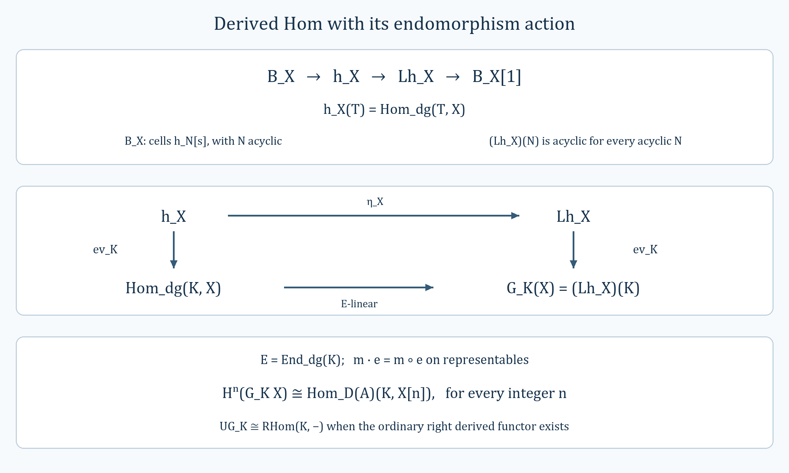

*The triangle (LDY4), evaluation at $K$ and identities (LDY8)–(LDY10). The horizontal map on evaluation is a map of right DG $E$-modules. The editable vector figure is [localized-dg-yoneda.svg](../figures/localized-dg-yoneda.svg).*

#### Lemma. Arbitrary sums and products in a DG derived category

The category $D(A)$ of right DG $A$-modules has all set-indexed coproducts and products. They are represented by the degreewise direct sum and degreewise product of DG modules, with their componentwise differentials and right actions.

**Proof.** These constructions exist first in the abelian category of DG modules. They give sums and products in $K(A)$ as well: maps out of a sum, or into a product, are families of maps, and the same description applies to homotopies. Equivalently, the relevant Hom complexes are products of complexes of abelian groups, whose cohomology commutes with these products.

Let $(M_j)_{j\in J}$ be a family and choose an I-resolution $N\to I$ of an arbitrary test object. The [resolution formula for Hom](#native-dga-lemma-hom-derived) gives
$$\begin{aligned}
\operatorname{Hom}_{D(A)}\left(\bigoplus_jM_j,N\right)
&\simeq\operatorname{Hom}_{K(A)}\left(\bigoplus_jM_j,I\right)\\
&\simeq\prod_j\operatorname{Hom}_{K(A)}(M_j,I)\\
&\simeq\prod_j\operatorname{Hom}_{D(A)}(M_j,N).
\end{aligned}\tag{DGSP1}$$
The maps are induced by the summand inclusions and are natural in $N$, proving the coproduct assertion.

For the product, choose a P-resolution $P\to N$ of the test object instead. Then
$$\begin{aligned}
\operatorname{Hom}_{D(A)}\left(N,\prod_jM_j\right)
&\simeq\operatorname{Hom}_{K(A)}\left(P,\prod_jM_j\right)\\
&\simeq\prod_j\operatorname{Hom}_{K(A)}(P,M_j)\\
&\simeq\prod_j\operatorname{Hom}_{D(A)}(N,M_j).
\end{aligned}\tag{DGSP2}$$
These maps are induced by the projections and are natural in $N$. This is the product universal property. The source's final sentence calls this a direct sum; the calculation establishes the product, as claimed in the statement. $\square$

#### Lemma. Full faithfulness of tensor with a compact bimodule

Let $A,B$ be DG algebras over a ring $R$ and $N$ a DG $(A,B)$-bimodule. Assume $N$ is compact as an object of $D(B)$ and the left action induces isomorphisms
$$H^j(A)\xrightarrow{\ \sim\ }\operatorname{Hom}_{D(B)}(N,N[j])$$
for every integer $j$. Then $F=-\otimes_A^{\mathbf L}N:D(A)\to D(B)$ is fully faithful.

**Proof.** Its [right adjoint](#native-dga-lemma-tensor-hom-adjoint) is $T=R\operatorname{Hom}_B(N,-)$. It suffices to prove that the unit $M\to TF(M)$ is invertible. In each degree its cohomology map is
$$H^j(M)\longrightarrow\operatorname{Hom}_{D(B)}(N,F(M)[j]).$$
Both sides commute with coproducts, on the right by compactness and preservation of coproducts by $F$. They are compatible with triangles. The unit-isomorphism class is therefore closed under triangles, coproducts and telescopes. For $M=A[s]$, one has $F(M)=N[s]$, and the assertion is exactly the assumed self-Ext comparison. Every DG module is represented by a property-(P) resolution built from coproducts of these shifts by finite filtrations and their telescope. Thus the unit is invertible on all objects, proving full faithfulness. This uses the tensor-Hom adjunction in its direction $F\dashv T$. $\square$

#### Lemma. The derived adjunction for a DG bimodule

Let $A,B$ be DG $R$-algebras and let $N$ be a DG $(A,B)$-bimodule. Then
$$-\otimes_A^{\mathbf L}N:D(A)\rightleftarrows D(B):R\operatorname{Hom}_B(N,-)\tag{DBA1}$$
is an adjunction, with derived tensor the left adjoint.

**Proof.** The [DG tensor–Hom adjunction](#native-dga-lemma-tensor-hom-adjunction) gives an adjunction on the homotopy categories. Its two functors have the [derived tensor](#native-dga-lemma-derived-bc) and [derived Hom](#native-dga-lemma-derived-restriction) constructions on all objects. The [general derived-adjunction criterion](#uncovered-derived-lemma-pre-derived-adjoint-functors-general) therefore applies.

Explicitly, choose a P-resolution $P\to M$ over $A$ and an I-resolution $L\to I$ over $B$. The derived tensor is represented by $P\otimes_AN$ and the derived Hom by $\operatorname{Hom}_{\mathrm{dg},B}(N,I)$. The Hom computations for these resolutions give
$$\begin{aligned}
\operatorname{Hom}_{D(B)}(M\otimes_A^{\mathbf L}N,L)
&\simeq\operatorname{Hom}_{K(B)}(P\otimes_AN,I)\\
&\simeq\operatorname{Hom}_{K(A)}(P,\operatorname{Hom}_{\mathrm{dg},B}(N,I))\\
&\simeq\operatorname{Hom}_{D(A)}(M,R\operatorname{Hom}_B(N,L)).
\end{aligned}\tag{DBA2}$$
The middle map is currying on Hom complexes followed by degree-zero cohomology. It respects the differential and all actions by the underived calculation. Every map in this display is natural on representatives and homotopies; passage through resolutions consequently gives a bifunctorial isomorphism in $M,L$. This verifies directly the adjunction supplied by the criterion, without requiring any projectivity or flatness of the bimodule $N$. $\square$

#### Example. Extension and restriction along a DG algebra map

For a morphism $A\to B$ of DG $R$-algebras, regard $B$ as an $(A,B)$-bimodule. The resulting functor between derived categories is
$$-\otimes_A^{\mathbf L}B:D(A)\longrightarrow D(B).$$
Its right adjoint is restriction of scalars $N\mapsto N_A$. The source omits the derived symbol in its first tensor functor and calls this right adjoint a left adjoint; both are corrected here.

**Verification.** For every right DG $B$-module $N$, evaluation gives a natural chain isomorphism
$$\operatorname{Hom}_{\mathrm{dg},B}(B,N)\xrightarrow{\ \sim\ }N_A,
\qquad g\longmapsto g(1).\tag{ERA1}$$
Its inverse sends a homogeneous $x$ to $b\mapsto xb$. Since $d_B1=0$, evaluation commutes with differentials. The right $A$-action is also preserved: precomposition with left multiplication by $a$ evaluates to $g(a)=g(1)a$. Applying (ERA1) to an I-resolution of $N$ identifies $R\operatorname{Hom}_B(B,N)$ with $N_A$, because restriction preserves the underlying complex and hence quasi-isomorphisms. The [derived bimodule adjunction](#native-dga-lemma-tensor-hom-adjoint) becomes
$$\operatorname{Hom}_{D(A)}(M,N_A)
\simeq\operatorname{Hom}_{D(B)}(M\otimes_A^{\mathbf L}B,N).\tag{ERA2}$$

Restriction itself also has a tensor description. Write ${}_BB_A$ for $B$ with the indicated left and right actions. Multiplication identifies
$$N\otimes_B{}_BB_A=N_A\simeq N\otimes_B^{\mathbf L}{}_BB_A.\tag{ERA3}$$
For the derived equality choose a P-resolution $P\to N$ over $B$. Its tensor with ${}_BB_A$ is $P_A$, and $P_A\to N_A$ is a quasi-isomorphism. Thus (ERA3) holds naturally without any additional flatness assumption on $A\to B$.

#### Lemma. A graded projective target gives an admissible surjection

Suppose $q:M\to P$ is a surjective morphism of DG $A$-modules and $P$ is projective in the category of graded $A$-modules. Then $q$ is an admissible epimorphism.

**Proof.** Forgetting the differentials leaves a surjection in the graded category. Projectivity lifts $1_P$ through it to a degree-zero graded $A$-linear map $s:P\to M$ with $qs=1_P$. This is precisely the section required in the definition of admissibility. The section is not required to commute with the differential. $\square$

#### Lemma. The natural connecting morphism for DG modules

The canonical functor from right DG $A$-modules to $D(A)$ has a natural $\delta$-functor structure. For an exact sequence
$$0\longrightarrow K\xrightarrow{a}L\xrightarrow{b}M\longrightarrow0,$$
its connecting map, with the chapter's triangle convention, is
$$\delta_{K\to L\to M}=-p\,q^{-1}:M\longrightarrow K[1].\tag{DCD1}$$
Here $p:C(a)\to K[1]$ is the cone projection and $q:C(a)\to M$ sends $(l,k)$ to $b(l)$.

**Proof.** The cone has $C(a)^n=L^n\oplus K^{n+1}$ and differential $(l,k)\mapsto(d_Ll+ak,-d_Kk)$. The map $q$ is a DG map and is surjective. Since $a$ identifies $K$ with $\ker b$, its kernel is the complex with terms $K^n\oplus K^{n+1}$ and differential $(x,y)\mapsto(d_Kx+y,-d_Ky)$. The degree-minus-one map $(x,y)\mapsto(0,x)$ contracts this complex. Thus $q$ is a quasi-isomorphism and becomes invertible in $D(A)$.

The cone-triangle convention for the [triangulated homotopy category](#native-dga-proposition-homotopy-category-triangulated) uses the distinguished triangle with maps $(a,i,-p)$. Transporting its third object along $q$ gives the distinguished triangle
$$K\xrightarrow{a}L\xrightarrow{b}M\xrightarrow{-p q^{-1}}K[1].\tag{DCD2}$$
This also explains why the minus sign in (DCD1) is retained.

It remains to check naturality. A morphism of exact sequences with components $u:K_1\to K_2$, $v:L_1\to L_2$, $w:M_1\to M_2$ gives the [cone map](#native-dga-lemma-functorial-cone) $c(l,k)=(vl,uk)$. Directly,
$$q_2c=wq_1,\qquad p_2c=u[1]p_1.$$
After inverting the two quasi-isomorphisms, these identities give
$$\delta_2w=-p_2q_2^{-1}w
=-p_2c q_1^{-1}=u[1]\delta_1.$$
Thus connecting morphisms commute with every morphism of short exact sequences. Additivity follows from the same formulas. Together with (DCD2), this is the required natural $\delta$-functor structure. $\square$

#### Lemma. Precomposition in DG derived Hom

Let $A,B$ be DG algebras over a ring $R$. A morphism $f:N\to N'$ of DG $(A,B)$-bimodules induces a natural transformation
$$(-)\circ f:R\operatorname{Hom}_B(N',-)
\longrightarrow R\operatorname{Hom}_B(N,-)\tag{DHSF1}$$
with values in $D(A)$. It is an isomorphism if $f$ is a quasi-isomorphism. These maps compose contravariantly in the first variable.

**Construction.** On an I-resolution $M\to I$ over $B$, the map sends $g:N'\to I$ to $gf:N\to I$. It is a chain map of right DG $A$-modules and is natural in $I$. The derived-Hom construction therefore gives (DHSF1). The operation is precomposition throughout: the source's occurrences of $f\circ(-)$ have the factors reversed.

**Proof of invariance using the filtration.** Choose a property-(I) filtration on $I$ and put $Q_p=I/F_pI$. Completeness gives
$$\operatorname{Hom}_{\mathrm{dg},B}(N,I)
=\varprojlim_p\operatorname{Hom}_{\mathrm{dg},B}(N,Q_p),\tag{DHSF2}$$
and the analogous identity for $N'$. The maps $Q_{p+1}\to Q_p$ split as graded $B$-module maps. Consequently both towers of Hom complexes have surjective transition maps in every degree. Their ordinary limits compute their derived inverse limits by the [surjective-tower calculation](#native-more-algebra-lemma-compute-rlim). Concretely, $1-\mathrm{shift}$ is surjective on the products in every degree, so its kernel represents the shifted cone used for the derived limit.

It suffices to show that precomposition is a quasi-isomorphism for each $Q_p$. This is true for $p=0$, since $Q_0=0$. For the induction, the graded-split sequences
$$0\longrightarrow F_pI/F_{p+1}I\longrightarrow Q_{p+1}\longrightarrow Q_p\longrightarrow0$$
remain short exact after DG Hom from $N$ or $N'$. Precomposition gives a morphism of these sequences. The long exact cohomology sequences reduce the assertion for $Q_{p+1}$ to the assertion for $F_pI/F_{p+1}I$ and the inductive hypothesis.

Each filtration factor is a product of shifts of $B^\vee$. Here it is $B^\vee$, not the $A^\vee$ written once in the source, because $I$ has property (I) as a right $B$-module. Products of complexes of abelian groups preserve quasi-isomorphisms. The [dual-free Hom calculation](#native-dga-lemma-hom-into-shift-dual-free) therefore reduces the factor case to
$$ (N')^\vee\longrightarrow N^\vee.$$
This is a quasi-isomorphism since $f$ is one and the dual functor is exact. Induction proves the assertion for every quotient. Derived inverse limits preserve these isomorphisms, so (DHSF2) proves it for $I$ itself. Forgetting to complexes detects quasi-isomorphisms of DG $A$-modules, which finishes the proof in $D(A)$. $\square$

#### Lemma. Computing DG derived Hom from a homotopically projective source

Let $N$ be a DG $(A,B)$-bimodule over a ring $R$. Suppose that the natural map
$$\operatorname{Hom}_{K(B)}(N,L)\longrightarrow\operatorname{Hom}_{D(B)}(N,L)$$
is bijective for every right DG $B$-module $L$. Then there is a natural identification in $D(A)$
$$R\operatorname{Hom}_B(N,M)\simeq\operatorname{Hom}_{\mathrm{dg},B}(N,M).\tag{CDH1}$$
The hypothesis holds, in particular, if the underlying right DG $B$-module $N$ has property (P).

**Proof.** Choose an I-resolution $M\to I$ over $B$. By the construction of derived Hom, its value is represented by $\operatorname{Hom}_{\mathrm{dg},B}(N,I)$. Consider the natural map from $\operatorname{Hom}_{\mathrm{dg},B}(N,M)$ to this representative. In degree-$j$ cohomology it is the map
$$\operatorname{Hom}_{K(B)}(N,M[j])\longrightarrow\operatorname{Hom}_{K(B)}(N,I[j]).$$
Under the given hypothesis on all targets, this is the corresponding map in $D(B)$, where it is an isomorphism because $M[j]\to I[j]$ is. Thus the map of Hom complexes is a quasi-isomorphism in all degrees, including with its right $A$-action, and proves (CDH1).

The same reasoning shows that ordinary DG Hom from $N$ sends any target quasi-isomorphism to a quasi-isomorphism. It therefore descends functorially to $D(B)$, and the comparison just constructed is natural there. For the last assertion apply the [P-resolution Hom theorem](#native-dga-lemma-hom-derived) with the identity resolution of $N$. $\square$

#### Lemma. Tensoring a DG module with a sheaf complex

Let $(\mathcal C,\mathcal O)$ be a ringed site, let $K$ be a complex of $\mathcal O$-modules, and set $E=\operatorname{Hom}_{\mathrm{dg}}(K,K)$. There is a DG functor
$$T:\operatorname{Mod}^{\mathrm{dg}}_E\longrightarrow\operatorname{Comp}^{\mathrm{dg}}(\mathcal O),
\qquad M\longmapsto M\otimes_EK.$$
It carries $E$ to $K$ and preserves arbitrary coproducts.

**Proof.** On every object $U$ of the site, evaluation makes $K(U)$ a left DG $E$-module. Its right $\mathcal O(U)$-action commutes with that action. Form the sectionwise balanced tensor complex $M\otimes_EK(U)$ and sheafify in each degree. Its differential on homogeneous sections is
$$d(m\otimes k)=d_Mm\otimes k+(-1)^{|m|}m\otimes d_Kk.\tag{DSTC1}$$
The DG Leibniz identities make this well-defined on balanced tensors and make its square zero. Restrictions in $U$ commute with all these operations, so the construction is a complex of sheaves.

For a homogeneous right $E$-linear map $\alpha:M\to N$ of degree $r$, put $T(\alpha)(m\otimes k)=\alpha(m)\otimes k$. This respects the balancing relations and has degree $r$. In the differential of this Hom map, the two terms involving $d_Kk$ have coefficients $(-1)^{|m|+r}$ and $-(-1)^{r+|m|}$ and cancel. What remains is
$$d(T\alpha)(m\otimes k)=\bigl(d_N\alpha-(-1)^r\alpha d_M\bigr)(m)\otimes k=T(d\alpha)(m\otimes k).$$
Composition and identity maps are preserved on elementary tensors. Thus the maps on Hom complexes are chain maps compatible with the DG category structure, including after sheafification.

Evaluation $e\otimes k\mapsto e(k)$ identifies $E\otimes_EK$ with $K$, with inverse $k\mapsto1\otimes k$. Finally sectionwise tensor preserves direct sums, and sheafification preserves colimits. Hence $T$ preserves coproducts as claimed. $\square$

#### Lemma. Passing a DG functor to cycles and homotopy classes

A DG functor $F:\mathcal A\to\mathcal B$ over a ring $R$ induces functors
$$\operatorname{Comp}(\mathcal A)\longrightarrow\operatorname{Comp}(\mathcal B),
\qquad K(\mathcal A)\longrightarrow K(\mathcal B).$$
Here the objects are those of the original DG categories; the first category uses degree-zero cycles in the Hom complexes, and the second uses their degree-zero cohomology.

**Proof.** For each pair of objects, a DG functor gives a chain map of their Hom complexes. It therefore carries degree-zero cycles to cycles and degree-zero boundaries to boundaries. Its compatibility with composition and identities passes first to cycles and then to cohomology. Thus the object assignment and these two induced Hom maps define the asserted functors. In particular homotopic closed degree-zero maps have homotopic images, since their difference is the differential of a degree-minus-one map. $\square$

#### Lemma. Every right DG module has a property-I resolution

For any right DG module $M$ over a DG algebra $A$, there is a quasi-isomorphism $M\to I$ with $I$ satisfying property (I).

**Proof.** Begin with $M_0=M$. Apply the [embedding construction](#native-dga-lemma-good-sub) repeatedly to obtain exact sequences
$$0\longrightarrow M_i\longrightarrow I_i\longrightarrow M_{i+1}\longrightarrow0.$$
Each embedding is injective on cokernels of the differential, and each $I_i$ has a graded-split DG filtration $0\to I_i'\to I_i\to I_i''\to0$ with both factors products of shifts of $A^\vee$. Composing the quotient and next embedding gives an exact augmented complex
$$0\longrightarrow M\longrightarrow I_0\xrightarrow{f_0}I_1\xrightarrow{f_1}I_2\longrightarrow\cdots.\tag{PIR1}$$
The source repeats $I_1$ at the third term; that term must be $I_2$.

Use its product totalization
$$I^n=\prod_{i\geq0}I_i^{n-i},\qquad
(d_Ix)_i=f_{i-1}x_{i-1}+(-1)^i d_{I_i}x_i.\tag{PIR2}$$
The first term is zero when $i=0$. This differential squares to zero. The right $A$-action is componentwise. For $x_i$ of total degree $n$, its degree in $I_i$ is $n-i$; consequently the vertical Leibniz term has sign $(-1)^i(-1)^{n-i}=(-1)^n$. The horizontal maps are DG module maps. This proves the DG Leibniz identity for (PIR2).

Here is the required decreasing filtration, written on graded modules:
$$\begin{aligned}
F_{2i}I&=\prod_{j\geq i}I_j[-j],\\
F_{2i+1}I&=I_i'[-i]\times\prod_{j>i}I_j[-j],\\
F_{2i+2}I&=\prod_{j>i}I_j[-j].
\end{aligned}\tag{PIR3}$$
These are submodules of the totalization, with its differential. Vertical differentials preserve each indicated term; horizontal differentials move to the next factor, which is already in the tail. Thus they are DG submodules. In particular, the odd step replaces the first factor by its submodule. The source's instruction to add $I_{i+1}'$ to the larger tail does not give this intermediate step.

The successive quotients of (PIR3) are $I_i''[-i]$ and $I_i'[-i]$. They are products of shifted copies of $A^\vee$. Such modules are graded injective: evaluation identifies graded maps into $A^\vee[k]$ with the exact functor $\operatorname{Hom}_{\mathbf Z}((- )^{-k},\mathbf Q/\mathbf Z)$, and products of these functors remain exact. The graded splitting of $I_i$ then makes every tail and intermediate term graded injective. The [graded-injective splitting lemma](#native-dga-lemma-source-graded-injective) proves that all filtration inclusions are admissible. Finally, $F_0I=I$ and
$$I\xrightarrow{\sim}\varprojlim_r I/F_rI:$$
the even quotients specify the finite initial segments of the product, and the odd quotients are compatible refinements. This verifies property (I).

It remains to check the augmentation. For each short exact sequence used above, right exactness of cokernels of $d$, together with the chosen injectivity on those cokernels, gives a short exact sequence of cokernels. Splicing these shows that (PIR1) remains exact after taking any cokernel of $d$. The [product-total resolution lemma](#uncovered-homology-lemma-good-right-resolution-gives-qis) therefore applies to its underlying complexes of abelian groups. It proves $M\to I$ is a quasi-isomorphism. $\square$

#### Lemma. Property P annihilates maps to acyclic DG modules

For a right DG $A$-module $P$ with property (P), and every acyclic right DG module $N$,
$$\operatorname{Hom}_{K(A)}(P,N)=0.$$
The same holds with $N$ replaced by any shift, so $P$ is K-projective.

**Proof.** For each integer $k$, the [free-shift calculation](#native-dga-lemma-hom-from-shift-free) identifies maps from $A[k]$ to an acyclic target, modulo homotopy, with a zero cohomology group of that target. A coproduct of these shifts has the same vanishing: a map from the coproduct is a family of maps, and their null-homotopies assemble to a null-homotopy on the coproduct.

Every $F_iP$ has a finite filtration with these coproducts as quotients. Its graded-split exact sequences give distinguished triangles in $K(A)$. Apply the long exact Hom sequence, in all shifts, and induct along the filtration to get
$$\operatorname{Hom}_{K(A)}(F_iP,N[j])=0\qquad(i\geq0,\ j\in\mathbf Z).$$
The same vanishing holds for $\bigoplus_iF_iP$. Finally use the distinguished triangle from the [admissible telescope sequence](#native-dga-lemma-property-p-sequence). Its two coproduct terms have zero Hom to every shift of $N$, so exactness forces the same for $P$. This proves the assertion with no boundedness condition on either DG module. $\square$

#### Lemma. Property I annihilates maps from acyclic DG modules

Let $I$ be a right DG $A$-module with property (I). For every acyclic right DG module $N$,
$$\operatorname{Hom}_{K(A)}(N,I)=0,$$
and the assertion remains true in every shift. Thus $I$ is K-injective.

**Proof.** The [dual-free calculation](#native-dga-lemma-hom-into-shift-dual-free) identifies the Hom groups from $N$ to $A^\vee[k]$ with cohomology of $N^\vee$. The dual functor used here is exact, so those groups vanish when $N$ is acyclic. They also vanish for a product of these shifted modules: maps and homotopies into products are specified componentwise.

Use a property-(I) filtration $I=F_0I\supset F_1I\supset\cdots$. The quotient $Q_i=I/F_iI$ has a finite filtration with factors products of shifts of $A^\vee$. Its exact sequences are graded-split. Induction using the resulting triangles proves
$$\operatorname{Hom}_{K(A)}(N,Q_i[j])=0\qquad(i\geq0,\ j\in\mathbf Z).$$
The [property-I inverse-limit sequence](#native-dga-lemma-property-i-sequence) is admissible:
$$0\longrightarrow I\longrightarrow\prod_iQ_i
\xrightarrow{\ 1-\mathrm{shift}\ }\prod_iQ_i\longrightarrow0.\tag{PIKI1}$$
Here shift uses $Q_{i+1}\to Q_i$. To see the graded splitting directly, choose graded sections $t_i:Q_i\to Q_{i+1}$ of those maps. Given a sequence $(y_i)$, set $x_0=0$ and recursively set $x_{i+1}=t_i(x_i-y_i)$. Then $x_i-u_i x_{i+1}=y_i$, giving a graded right inverse to the last arrow. Its kernel is $\varprojlim_iQ_i=I$ by completeness of the filtration.

The product terms in (PIKI1) have zero Hom from $N$ in every shift by the preceding vanishing and the componentwise description of homotopies. The triangle of (PIKI1) now proves the assertion for $I$. This is the inverse-limit form of the source's filtration argument. $\square$

#### Lemma. The DG Hom functor of a fixed object

Let $\mathcal C$ be a DG category over a ring $R$, fix $x\in\mathcal C$, and set $E=\operatorname{Hom}_{\mathcal C}(x,x)$. Then
$$T:\mathcal C\longrightarrow\mathrm{DGMod}(E),\qquad
T(y)=\operatorname{Hom}_{\mathcal C}(x,y)\tag{HFO1}$$
is a DG functor. It induces functors $\operatorname{Comp}(\mathcal C)\to\mathrm{DG}(E)$ and $K(\mathcal C)\to K(E)$. The algebra in both codomains is $E$; the occurrences of $A$ in the source's induced functors are replaced accordingly.

**Proof.** The right action is $u e=u\circ e$. Associativity and the identity of $x$ give the module laws, and the DG composition rule gives
$$d(u e)=(d u)e+(-1)^{|u|}u(d e).$$
For a homogeneous $g:y\to z$, define $T(g)(u)=g\circ u$. This has degree $|g|$ and is right $E$-linear. Its Hom differential satisfies
$$d(T(g))(u)=d(g u)-(-1)^{|g|}g(d u)=(d g)u=T(dg)(u).$$
Thus each map on Hom complexes is a chain map. Associativity also gives $T(g_2g_1)=T(g_2)T(g_1)$, and identity maps are preserved. This proves the DG-functor assertion. Passing to degree-zero cycles and then degree-zero cohomology, as in the [general functoriality lemma](#native-dga-lemma-functorial), gives the two stated functors. $\square$

#### Lemma. The abelian category and limits of DG modules

For a DG algebra $A$, the category $\mathrm{DG}(A)$ of right DG modules is abelian and admits all small limits and colimits.

**Proof.** For a DG map $u:M\to N$, form the kernel and cokernel in each degree. The DG identities restrict to the kernel and descend to the cokernel, as do the right actions. Their usual universal properties therefore hold for DG maps. The category is additive, and the canonical map from coimage to image is an isomorphism in every degree. Thus it is an abelian category.

Coproducts are degreewise direct sums with their induced differentials and actions. Products are defined by
$$\left(\prod_{j\in J}M_j\right)^n=\prod_{j\in J}M_j^n,\qquad
\prod_{j\in J}M_j=\bigoplus_{n\in\mathbf Z}\prod_{j\in J}M_j^n.\tag{DML1}$$
The differential and multiplication by a homogeneous element of $A$ act componentwise, between the specified degree pieces. A compatible family of DG maps uniquely determines a map into (DML1), and the analogous statement for maps out of a coproduct proves both universal properties.

For a small diagram, its limit is the equalizer of the two usual maps between the product over objects and the product over arrows: one map applies the arrow map to the source component, while the other selects the target component. Its colimit is the coequalizer of the two corresponding maps from the coproduct over arrows to the coproduct over objects. Kernels and cokernels provide these equalizers and coequalizers, proving existence of all small limits and colimits.

Kernels, cokernels and coproducts agree with those of the underlying ungraded $A$-modules, so the same is true of colimits. Products must instead be formed in the graded category. For example, for $A=\mathbf Z$ in degree zero and $M_j=\mathbf Z[-j]$, $j\geq0$, with zero differentials, the underlying group of the DG product is $\bigoplus_{j\geq0}\mathbf Z$, whereas the product of the underlying groups is $\prod_{j\geq0}\mathbf Z$. This explains why the ungraded forgetful functor does not generally preserve products or limits. $\square$

#### Lemma. Sums and products in the DG homotopy category

The homotopy category $K(A)$ of right DG $A$-modules has every set-indexed coproduct and product. They are represented by the [degreewise constructions](#native-dga-lemma-dgm-abelian).

**Proof.** A DG map $\bigoplus_j M_j\to N$ is a family of DG maps $M_j\to N$. The same is true for degree-minus-one graded maps. Thus two such maps are homotopic exactly when their components are homotopic: chosen component homotopies assemble on the direct sum. It follows that
$$\operatorname{Hom}_{K(A)}\left(\bigoplus_jM_j,N\right)
\cong\prod_j\operatorname{Hom}_{K(A)}(M_j,N).$$
The bijection is induced by the summand inclusions and is natural in $N$.

Likewise, maps $N\to\prod_jM_j$ and homotopies between them are specified by their projections. Component homotopies assemble into a degree-minus-one graded map to the product, with the required homotopy identity holding in every component. Consequently
$$\operatorname{Hom}_{K(A)}\left(N,\prod_jM_j\right)
\cong\prod_j\operatorname{Hom}_{K(A)}(N,M_j),$$
naturally through the projections. These are the two universal properties. Equivalently, the associated Hom complexes are products of complexes of abelian groups, and their cohomology commutes with these products. $\square$

#### Lemma. Cohomology of DG derived Hom is Ext

Let $A,B$ be DG algebras over $R$, and let $N$ be a DG $(A,B)$-bimodule. For every integer $n$ there is a natural $R$-linear identification
$$H^n(R\operatorname{Hom}_B(N,M))
\cong\operatorname{Hom}_{D(B)}(N,M[n])
=\operatorname{Ext}_{D(B)}^n(N,M).\tag{DHE1}$$
It is natural in $M$, and contravariantly natural in $N$ for the precomposition maps of [derived-Hom functoriality](#native-dga-lemma-functoriality-derived-restriction).

**Proof.** Choose an I-resolution $M\to I$ over $B$. The [derived-Hom construction](#native-dga-lemma-derived-restriction) represents the left side by $H^n\operatorname{Hom}_{\mathrm{dg},B}(N,I)$. The [DG Hom calculation](#native-dga-example-dgm-dg-cat) and the [I-resolution formula](#native-dga-lemma-hom-derived) give
$$H^n\operatorname{Hom}_{\mathrm{dg},B}(N,I)
\cong\operatorname{Hom}_{K(B)}(N,I[n])
\cong\operatorname{Hom}_{D(B)}(N,M[n]).$$
All maps preserve the $R$-module structure.

To check naturality in the target, a derived map $M\to M'$ is represented, after choosing I-resolutions, by a homotopy class $I\to I'$. Both identifications carry postcomposition with this map to postcomposition by $M\to M'$ in $D(B)$. Homotopic representatives induce the same cohomology maps. In the source variable, a bimodule map $u:N\to N'$ induces precomposition $g\mapsto gu$ on the same Hom complexes. Under the displayed identifications this is exactly precomposition in $D(B)$. These two operations commute. They also commute with changing the I-resolutions, which proves all the asserted naturality. $\square$

#### Remark. Reducing a derived property to the free shifts

Let $T$ be a property of objects of $D(A)$, understood to be invariant under isomorphism. Assume it is preserved by arbitrary coproducts, that in a distinguished triangle validity for two objects implies validity for the third, and that $T(A[k])$ holds for every $k\in\mathbf Z$. Then $T$ holds for every object of $D(A)$.

Indeed, represent an arbitrary object by a [P-resolution](#native-dga-lemma-resolve) $P$. Its filtration starts at zero and has quotients that are coproducts of free shifts. The empty coproduct has $T$, so induction through the graded-split filtration sequences proves $T(F_iP)$ for every $i$. These exact sequences give distinguished triangles. By the coproduct hypothesis, $D=\bigoplus_iF_iP$ has $T$. Finally, the [admissible telescope](#native-dga-lemma-property-p-sequence) supplies a triangle
$$D\xrightarrow{1-\mathrm{shift}}D\longrightarrow P\longrightarrow D[1].$$
The first two objects have $T$, hence so does $P$. Invariance under the isomorphism from $P$ to the original derived object finishes the argument.

#### Remark. Shifting the first tensor factor introduces no map sign

Let $N$ be a DG $(A,B)$-bimodule over $R$, and let $M$ be a right DG $A$-module. For every $k\in\mathbf Z$, the assignment that leaves elementary tensors unchanged gives a natural DG isomorphism
$$ (M\otimes_A N)[k]\xrightarrow{\sim}M[k]\otimes_A N.\tag{TSC1}$$
To check the differential, take $m\in M^p$ and a homogeneous $n\in N$. In the source, the two differential terms have coefficients $(-1)^k$ and $(-1)^{k+p}$. In the target, $m$ has degree $p-k$ and its differential is $(-1)^k d_Mm$, so the coefficients are $(-1)^k$ and $(-1)^{p-k}$. The latter exponents agree modulo two. Thus the identity on elementary tensors commutes with differentials. Right-module shifts leave the action unchanged, so balancing over $A$ and the right $B$-action are respected. The identity formula also proves naturality and supplies the inverse. No extra sign multiplies the tensor itself.

#### Lemma. The unbounded derived tensor of a DG bimodule

For DG algebras $A,B$ over $R$ and an arbitrary DG $(A,B)$-bimodule $N$, tensor has an exact left derived functor
$$-\otimes_A^{\mathbf L}N:D(A)\longrightarrow D(B).$$
For a P-resolution $P\to M$, it is represented by $P\otimes_A N$.

**Proof.** The [tensor DG functor](#native-dga-lemma-tensor) passes to homotopy categories. Its [shift comparison](#native-dga-remark-shift-tensor-no-sign) leaves elementary tensors unchanged. A graded-split exact sequence remains graded-split and exact after tensoring; equivalently, tensor carries its cone construction to the corresponding tensor cone. Thus the functor on homotopy categories is exact.

Every DG module has a P-resolution. If $s:P\to P'$ is a quasi-isomorphism between property-P modules, the [derived Hom formula](#native-dga-lemma-hom-derived) shows that its inverse in $D(A)$ lifts to a homotopy class $t:P'\to P$. Faithfulness of the same formula makes $ts$ and $st$ the identity classes. Hence $s$ is a homotopy equivalence, and tensor carries it to a homotopy equivalence.

The [derived-functor resolution criterion](#uncovered-derived-lemma-find-existence-computes) applies to these P-resolutions. It constructs the stated left derived functor and the comparison to ordinary tensor, induced on a resolution by $P\otimes_A N\to M\otimes_A N$. The Hom formula lifts derived morphisms to homotopy classes between P-resolutions; tensor respects those classes, so the computation is functorial and independent of the resolutions. Exactness follows from the criterion and the exact homotopy functor. No boundedness or flatness of $N$ is needed. $\square$

#### Lemma. The unbounded derived Hom of a DG bimodule

For DG algebras $A,B$ over $R$ and a DG $(A,B)$-bimodule $N$, there is an exact right derived functor
$$R\operatorname{Hom}_B(N,-):D(B)\longrightarrow D(A).$$
If $M\to I$ is an I-resolution over $B$, its value is represented by the right DG $A$-module $\operatorname{Hom}_{\mathrm{dg},B}(N,I)$, with the action induced by precomposition with the left action on $N$.

**Proof.** DG Hom gives a functor on homotopy categories. It respects target shifts and cones. On an admissible exact sequence of targets, the graded splitting makes the sequence of Hom complexes exact and graded-split. These facts give the exact homotopy Hom functor
$$K(B)\longrightarrow K(A)\longrightarrow D(A).$$

Every target admits an [I-resolution](#native-dga-lemma-right-resolution). A quasi-isomorphism $s:I\to I'$ between property-I modules is a homotopy equivalence: the [I-resolution Hom formula](#native-dga-lemma-hom-derived) represents its derived inverse by a homotopy class, and faithfulness gives the inverse identities in $K(B)$. Applying DG Hom from $N$ preserves that homotopy equivalence, including the right $A$-module structure.

The [resolution criterion](#uncovered-derived-lemma-find-existence-computes) therefore constructs the right derived functor with the stated value and the natural comparison from ordinary Hom. Maps between targets can be represented by homotopy classes between their I-resolutions, so applying Hom gives well-defined derived maps independent of the choices. The criterion also preserves exactness. Quasi-isomorphisms are localized in the source $K(B)$; the source's accompanying discussion names $K(A)$ at that point, although $D(A)$ is the target. This DG-module construction requires no boundedness of $M$ or $N$. $\square$

#### Lemma. Tensor–Hom adjunction with grading and differential

Let $A,B$ be algebras over a ring $R$, let $M$ be a right $A$-module, let $N$ be an $(A,B)$-bimodule, and let $L$ be a right $B$-module. There is a natural $R$-linear isomorphism
$$\operatorname{Hom}_B(M\otimes_AN,L)
\simeq\operatorname{Hom}_A(M,\operatorname{Hom}_B(N,L)).\tag{UTHA1}$$
For compatible gradings, it is an isomorphism of the graded Hom modules. For compatible DG structures, it is an isomorphism of the Hom complexes:
$$\operatorname{Hom}_{\mathrm{dg},B}(M\otimes_AN,L)
\simeq\operatorname{Hom}_{\mathrm{dg},A}(M,\operatorname{Hom}_{\mathrm{dg},B}(N,L)).\tag{UTHA2}$$

**Proof.** The right $A$-action on $\operatorname{Hom}_B(N,L)$ is $(g a)(n)=g(an)$. Send $\psi:M\otimes_AN\to L$ to the map $m\mapsto(n\mapsto\psi(m\otimes n))$. The identity $ma\otimes n=m\otimes an$ gives right $A$-linearity, and right $B$-linearity is exactly the condition on the inner map. Conversely, evaluate such an inner map at $n$ to obtain an $A$-balanced, right $B$-linear map of the pair $(m,n)$. This descends uniquely to the tensor product. These two constructions are inverse and commute with maps in all three variables.

If $\psi$ has degree $r$, then its curried map takes $m\in M^p$ to an inner Hom element of degree $p+r$. Thus the same formulas preserve total grading and give the graded assertion. This is the balanced form of the [composition adjunction for complexes](#native-more-algebra-lemma-compose), or equivalently the [characterization of the DG Hom object](#native-dga-lemma-characterize-hom); the module-action check above supplies the extra $A$- and $B$-linearity.

For the DG assertion, evaluate the differential of either curried expression at homogeneous $m,n$. In both cases it is
$$d_L\psi(m\otimes n)-(-1)^r\psi(d_Mm\otimes n)
-(-1)^{r+|m|}\psi(m\otimes d_Nn).\tag{UTHA3}$$
Indeed the inner Hom differential contributes the exponent $|m|+r$, and the outer Hom differential contributes $r$. These are precisely the two signs from applying a degree-$r$ Hom differential to the tensor differential. The inverse graded maps therefore commute with differentials, proving (UTHA2). Their degree-zero cycles and degree-zero cohomology give the adjunction on DG-module maps and on homotopy classes as well. $\square$

#### Lemma. A cone map from a square commuting up to homotopy

Consider DG $A$-module maps in a square
$$\begin{array}{ccc}
K_1&\xrightarrow{f_1}&L_1\\
\downarrow{\scriptstyle a}&&\downarrow{\scriptstyle b}\\
K_2&\xrightarrow{f_2}&L_2.
\end{array}\tag{DCHS1}$$
If the square commutes up to homotopy, there is a DG map $c:C(f_1)\to C(f_2)$ giving a morphism between the two cone triangles in $K(A)$. The target triangle is the one with $K_2,L_2,C(f_2)$; the source text mistakenly repeats the first three objects there.

**Proof.** Use a degree-minus-one, right $A$-linear homotopy $h:K_1\to L_2$ with
$$bf_1-f_2a=d_{L_2}h+h d_{K_1}.\tag{DCHS2}$$
The cone convention is $C(f)^n=L^n\oplus K^{n+1}$ with differential $(l,k)\mapsto(d_Ll+fk,-d_Kk)$. Define
$$c(l,k)=(bl+hk,ak),\qquad
c=\begin{pmatrix}b&h\\0&a\end{pmatrix}.\tag{DCHS3}$$
This has degree zero and is right $A$-linear. The upper-right entry of $d_{C(f_2)}c-cd_{C(f_1)}$ is
$$d_{L_2}h+f_2a-bf_1+h d_{K_1},$$
which is zero by (DCHS2). The diagonal entries vanish because $a,b$ are chain maps, and the remaining entry is zero. Hence $c$ is a chain map.

For the natural inclusion $i_j:L_j\to C(f_j)$ and projection $p_j:C(f_j)\to K_j[1]$, the formulas give
$$ci_1=i_2b,\qquad p_2c=a[1]p_1.$$
The first square of the triangles commutes in $K(A)$ by the given homotopy. Thus $(a,b,c)$ is the required morphism of triangles, with the usual map $a[1]$ on the shifted object.

The order in (DCHS2) is essential for the $+h$ entry of (DCHS3). With a homotopy satisfying $f_2a-bf_1=dh+hd$, as ordered in the source, the upper-right entry must be $-h$ instead. Negating the homotopy gives exactly the convention used here. $\square$

#### Example. The DG category of right DG modules

Let $A$ be a DG algebra over $R$. Its right DG modules form the objects of a DG category $\mathrm{DGMod}(A)$. For objects $L,M$, the degree-$r$ part of its Hom complex consists of all homogeneous right $A$-linear maps $f:L\to M$ of degree $r$. Thus
$$\operatorname{Hom}_{\mathrm{dg},A}(L,M)=\bigoplus_{r\in\mathbf Z}\operatorname{Hom}_A^r(L,M),\qquad
d f=d_Mf-(-1)^r f d_L.\tag{DGC1}$$
Composition is ordinary composition of homogeneous maps.

We verify all the DG-category properties and their relation to the usual categories. First, for homogeneous $x\in L$ and $a\in A$,
$$\begin{aligned}
(d f)(xa)
&=(d_Mf(x))a+(-1)^{|x|+r}f(x)d_Aa\\
&\quad-(-1)^r f(d_Lx)a-(-1)^{r+|x|}f(x)d_Aa\\
&=(d f)(x)a.
\end{aligned}\tag{DGC2}$$
Hence the differential stays within the right $A$-linear maps. It raises degree by one. Expanding it twice gives
$$d^2f=d_M^2f-\bigl((-1)^r+(-1)^{r+1}\bigr)d_Mf d_L
+(-1)^{2r+1}f d_L^2=0.$$
In components, $(d f)^p=d_M^{p+r}f^p-(-1)^r f^{p+1}d_L^p$; this agrees with the ordinary Hom-complex differential.

A degree-$r$ map is a cycle exactly when $d_M f=(-1)^r f d_L$. Since $M[r]$ has differential $(-1)^r d_M$ and the same right action, this is precisely the condition that $f:L\to M[r]$ be a DG map. In degree zero, therefore, the category of cycles is the usual category $\mathrm{DG}(A)$.

The boundary relation also agrees exactly with homotopy. For $g$ of degree $r-1$,
$$d g=d_Mg+(-1)^r g d_L.$$
If $f=d g$, then $h=(-1)^r g:L\to M[r]$ of degree minus one satisfies $f=d_{M[r]}h+h d_L$. Conversely a homotopy $h$ gives $g=(-1)^r h$ with $f=d g$. Thus
$$H^r\operatorname{Hom}_{\mathrm{dg},A}(L,M)
\cong\operatorname{Hom}_{K(A)}(L,M[r]).\tag{DGC3}$$
For $r=0$ this identifies the DG-category homotopy category with the usual homotopy category of DG modules.

Finally, for $f:K\to L$ of degree $r$ and $g:L\to M$ of degree $s$, expansion of (DGC1) yields
$$d(gf)=(d g)f+(-1)^s g(d f).\tag{DGC4}$$
The middle terms $g d_Lf$ cancel. This is precisely the assertion that composition is a chain map from the tensor product of the two Hom complexes. Ordinary composition is associative, and identity maps are closed of degree zero and are units. The differential, all five cycle/homotopy identifications above, and composition therefore satisfy the required DG-category axioms.

#### Lemma. Maps into shifts of the dual free DG module

For a right DG $A$-module $M$, put $M^\vee=\operatorname{Hom}_{\mathbf Z}^\bullet(M,\mathbf Q/\mathbf Z)$, where $\mathbf Q/\mathbf Z$ is in degree zero. There are natural identifications
$$\operatorname{Hom}_{\mathrm{DG}(A)}(M,A^\vee[k])=Z^k(M^\vee),\qquad
\operatorname{Hom}_{K(A)}(M,A^\vee[k])=H^k(M^\vee).\tag{DFH1}$$
Here $A^\vee$ is the right DG module obtained by dualizing the left regular module.

**Proof.** There is a chain isomorphism
$$\operatorname{Hom}_{\mathrm{dg},A}(M,A^\vee)\xrightarrow{\sim}M^\vee,\qquad
f\longmapsto\bigl(m\longmapsto f(m)(1)\bigr).\tag{DFH2}$$
For a degree-$r$ functional $\lambda$, the inverse sends $m$ to the functional on $A$ given by $a\mapsto\lambda(ma)$. Degrees match, and right $A$-linearity follows from associativity. These formulas are inverse by evaluating at $1$ and by applying $A$-linearity.

Since $d_A1=0$, evaluation of the Hom differential gives
$$\bigl(d f\bigr)(m)(1)=(-1)^{r+1}f(d_Mm)(1).$$
This is precisely the differential of the degree-$r$ functional in $M^\vee$. Thus (DFH2) is an isomorphism of complexes, not only of graded groups.

A degree-$k$ cycle on the left is a DG map $M\to A^\vee[k]$, since the differential in the shifted target is $(-1)^k d_{A^\vee}$. Boundaries give exactly the null-homotopic maps: if $f=d g$ with $|g|=k-1$, then $h=(-1)^k g$ is a homotopy in the shifted target. The reverse calculation recovers $g$ from a homotopy. Taking cycles and then cohomology proves (DFH1). Evaluation and its inverse commute with precomposition, which proves naturality in $M$. $\square$

#### Lemma. Tensor with a bimodule is a DG functor

Let $N$ be a DG $(A,B)$-bimodule over a ring $R$. Then $T(M)=M\otimes_A N$ defines a DG functor $\mathrm{DGMod}(A)\to\mathrm{DGMod}(B)$. Consequently it induces functors on DG modules with degree-zero chain maps, and on their homotopy categories.

**Proof.** Use the balanced graded tensor with differential
$$d(m\otimes n)=d_Mm\otimes n+(-1)^{|m|}m\otimes d_Nn.$$
The two DG Leibniz identities make this well-defined on balanced tensors and give $d^2=0$. The right $B$-action comes from $N$ and satisfies the DG module identity.

For a homogeneous right $A$-linear map $f:M\to M'$ of degree $r$, define $T(f)(m\otimes n)=f(m)\otimes n$. Balancing is preserved, and this is right $B$-linear of degree $r$. Its Hom differential is
$$\begin{aligned}
d(T(f))(m\otimes n)
&=d_{M'}f(m)\otimes n+(-1)^{|m|+r}f(m)\otimes d_Nn\\
&\quad-(-1)^r f(d_Mm)\otimes n-(-1)^{r+|m|}f(m)\otimes d_Nn\\
&=\bigl(d_{M'}f-(-1)^r f d_M\bigr)(m)\otimes n\\
&=T(d f)(m\otimes n).
\end{aligned}\tag{DGBTF1}$$
The source's last line applies $d f$ directly to $m\otimes n$, outside its domain. The typed expression is $(d f)(m)\otimes n$, as displayed here. The cancellation proves that the map on each Hom complex is a chain map. Identity and composition are preserved on elementary tensors, so $T$ is a DG functor. Passing to degree-zero cycles and cohomology via the [functoriality lemma](#native-dga-lemma-functorial) gives the two induced functors. $\square$

#### Lemma. An embedding that also detects differential cokernels

Every right DG $A$-module $M$ admits a DG map $j:M\to J$ such that $j$ is injective, each map
$$M^q/d(M^{q-1})\longrightarrow J^q/d(J^{q-1})$$
is injective, and $J$ has an admissible DG exact sequence $0\to J'\to J\to J''\to0$ with $J'$ and $J''$ products of shifts of $A^\vee$.

**Proof.** We spell out the duality conventions used in the construction. For any complex $V$,
$$ (V^\vee)^r=\operatorname{Hom}_{\mathbf Z}(V^{-r},\mathbf Q/\mathbf Z),\qquad
d\phi=(-1)^{r+1}\phi d_V.$$
If $V$ is a left DG module, its dual is right with $(\phi a)(v)=\phi(av)$. If $V$ is right, its dual is left with
$$ (a\phi)(v)=(-1)^{|a|}\phi(va).\tag{GIE1}$$
These formulas satisfy the DG Leibniz identities; for example, on the right-to-left side the two terms involving $d_Aa$ cancel after $|v|=-|a|-|\phi|-1$ is inserted. Associativity follows by multiplying the signs $(-1)^{|a|}$ and $(-1)^{|b|}$. Formula (GIE1) is the specialization to a degree-zero target of the source's Hom action. The different sign $(-1)^{|a||\phi|}$ printed in its graded-dual discussion cannot be used with this differential and the stated bidual convention.

Duality is exact degree by degree because $\mathbf Q/\mathbf Z$ is injective. It is also a cogenerator, so
$$M\hookrightarrow(M^\vee)^\vee,\qquad
m\longmapsto\bigl(\phi\longmapsto(-1)^{|m|}\phi(m)\bigr)\tag{GIE2}$$
is injective. The two action formulas make (GIE2) right $A$-linear. Applying the displayed dual differential twice shows it commutes with $d$ as well.

For each integer $k$, take the free left graded module $Q_k=Ax\oplus Ay$ with $|x|=k$, $|y|=k+1$, and define $d x=y$, $d y=0$, extending by the left Leibniz rule. Each homogeneous $u\in(M^\vee)^k$ gives a DG map $Q_k\to M^\vee$, sending $x$ to $u$ and $y$ to $d u$. Taking all these maps gives a surjection $Q=\bigoplus_\alpha Q_{k_\alpha}\twoheadrightarrow M^\vee$. Exact duality and (GIE2) provide
$$M\hookrightarrow(M^\vee)^\vee\hookrightarrow Q^\vee
\cong\prod_\alpha Q_{k_\alpha}^\vee.\tag{GIE3}$$

The submodule $Ay$ and quotient generated by $x$ give a graded-split DG sequence
$$0\longrightarrow A[-k-1]\longrightarrow Q_k\longrightarrow A[-k]\longrightarrow0.$$
The signed left-shift convention is respected by sending a homogeneous $a$ in the first shift to $(-1)^{(k+1)|a|}ay$, and by identifying $ax$ in the quotient with $(-1)^{k|a|}a$ in the second shift. These formulas also commute with differentials. The dual-shift map $A^\vee[k]\to(A[-k])^\vee$ multiplies its degree-$r$ component by $(-1)^{kr}$; this compensates both the signed left action and the shifted differential. Dualizing the sequence gives
$$0\longrightarrow A^\vee[k]\longrightarrow Q_k^\vee\longrightarrow A^\vee[k+1]\longrightarrow0.\tag{GIE4}$$
Thus $J_0=Q^\vee$ has the required two-step filtration: products of (GIE4) remain exact and graded-split. With the notation $J_k=Q_k^\vee$, both (GIE3) and (GIE4) have the indicated indices. The source instead defines its indexed dual using $Q_{-k}$ without changing these two displays; that indexing is corrected here.

To ensure injectivity on differential cokernels, take, for every $k$, all homomorphisms $\lambda:M^k\to\mathbf Q/\mathbf Z$ that vanish on $d(M^{k-1})$. Such a functional is a degree-$(-k)$ cycle in $M^\vee$. The [dual-free Hom formula](#native-dga-lemma-hom-into-shift-dual-free) therefore gives a DG map
$$f_\lambda:M\longrightarrow A^\vee[-k],\qquad
f_\lambda(m)(a)=\lambda(ma).\tag{GIE5}$$
The minus sign in this shift is necessary. For instance, when $A=\mathbf Z$ is in degree zero and $M=\mathbf Z$ is in degree one, $A^\vee[1]$ has no degree-one part and cannot detect that generator.

Set $J=J_0\times\prod_{k,\lambda}A^\vee[-k]$ and use (GIE3) together with all maps (GIE5) to define $j$. If $\bar m\ne0$ in $M^k/d(M^{k-1})$, the cogenerator property gives one $\lambda$ with $\lambda(m)\ne0$. Evaluation at $1$ of $f_\lambda(m)$ is then nonzero. On the other hand, evaluation at $1$ annihilates every degree-$k$ boundary in $A^\vee[-k]$, since $d_A1=0$. Hence $j(m)$ cannot be a boundary. This proves the claimed injection of cokernels, not merely nonvanishing of $j(m)$.

Finally, place the additional dual-free product in the first filtration term of $J$. The second term remains the quotient of $J_0$ from (GIE4), and the graded splitting is preserved. This proves all three requirements. $\square$

#### Lemma. A graded injective source gives an admissible embedding

Let $u:I\hookrightarrow M$ be a monomorphism of right DG $A$-modules. If $I$ is injective in the category of graded right $A$-modules, then $u$ is admissible.

**Proof.** In the graded category, extend $1_I:I\to I$ across $u$. Injectivity gives a degree-zero $A$-linear map $r:M\to I$ with $ru=1_I$. Thus the underlying graded sequence splits, which is the definition of admissibility. The retraction need not commute with the differentials. $\square$

#### Proposition. The DG homotopy category is triangulated

For a DG algebra $A$, the category $K(A)$ of right DG modules and homotopy classes of maps is triangulated with its usual shifts and the triangles obtained from admissible exact sequences, together with their isomorphic copies.

**Proof.** The category is additive, and the shift $M[1]^n=M^{n+1}$, with differential $-d_M$ and unchanged right action, is an additive auto-equivalence. We first verify the pre-triangulated axioms with the precise connecting signs.

For an admissible sequence $0\to K\xrightarrow{\alpha}L\xrightarrow{\beta}Q\to0$, a graded splitting writes
$$L=K\oplus Q,\qquad d_L=\begin{pmatrix}d_K&\delta\\0&d_Q\end{pmatrix}.\tag{HTR1}$$
The off-diagonal part of $d_L^2=0$ says that $\delta:Q\to K[1]$ is a DG map. Replacing the section $s$ by $s+\alpha t$, with $t:Q\to K$ of degree zero, replaces $\delta$ by $\delta+d_Kt-t d_Q$. This is a homotopic map into $K[1]$, using the homotopy $-t$. Thus the triangle does not depend on the splitting. The change-of-section map has degree zero before shifting; as a homotopy into $K[1]$ it has degree minus one. This distinguishes the two degrees conflated in the source's splitting discussion.

We use the cone convention
$$C(f)^n=L^n\oplus K^{n+1},\qquad d(l,k)=(d_Ll+fk,-d_Kk).
$$
The distinguished cone triangle is
$$K\xrightarrow{f}L\xrightarrow{i}C(f)\xrightarrow{-p}K[1].\tag{HTR2}$$
To see directly that it is distinguished, use the admissible sequence with middle term $L\oplus C(1_K)$, injection $k\mapsto(fk,k,0)$, and quotient map
$$q(l,x,y)=(l-fx,-y):L\oplus C(1_K)\longrightarrow C(f).$$
Its graded quotient section $(l,k)\mapsto(l,0,-k)$ gives connecting map $-p$. Projection of the middle term onto $L$ is a homotopy equivalence by the [mapping-cylinder construction](#native-dga-lemma-make-injective). Moreover, $q$ differs from $i\pi$ by the homotopy $(l,x,y)\mapsto(0,-x)$. This identifies its triangle with (HTR2).

Conversely, in coordinates (HTR1), the cone of $\alpha$ has coordinates $(k,q,x)$. Projection onto $q$ has a chain inverse up to homotopy
$$q\longmapsto(0,q,-\delta q),\qquad
H(k,q,x)=(0,0,k),$$
where $dH+Hd$ is the identity minus the composite of these maps. Under the inverse, $-p$ becomes $\delta$. Hence every distinguished triangle is isomorphic to a cone triangle (HTR2).

TR1 now follows: closure under isomorphism is part of the definition, the sequence with identity $K\to K$ gives the identity triangle, and (HTR2) completes every morphism to a triangle.

For forward rotation in TR2, the admissible sequence $0\to L\to C(f)\to K[1]\to0$ has connecting map $f[1]$. Its triangle $(i,p,f[1])$ is isomorphic, by negating the third object, to $(i,-p,-f[1])$, the required rotation of (HTR2). For the converse, start with a distinguished triangle represented by (HTR1). Its inverse rotation has maps $-\delta[-1],\alpha,\beta$. But $L$ is the cone of $\delta[-1]:Q[-1]\to K$, since its cone differential is exactly (HTR1). Negating the first object identifies the inverse rotation with that cone triangle, whose last map is $-p$. Both directions of TR2 follow.

For TR3, replace both distinguished triangles by cone triangles. A square commuting in $K(A)$ has chain-map representatives and a homotopy between the two composites. The [cone-map calculation](#native-dga-lemma-functorial-cone) extends that square to a map of cones and commutes with both their inclusions and projections. It therefore also commutes with the negative projections in (HTR2), proving TR3. Thus $K(A)$ is pre-triangulated.

Finally, choose chain maps representing a composable pair in $K(A)$. The [finite-sequence replacement](#native-dga-lemma-sequence-maps-split) changes this pair, by homotopy equivalences of its three objects, into two admissible monomorphisms. Their [admissible octahedron](#native-dga-lemma-two-split-injections) supplies all three TR4 conditions. The [octahedron reduction](#uncovered-derived-lemma-easier-axiom-four) transports this construction back to the original objects and to any prescribed distinguished triangles. This proves TR4 and completes the proof. $\square$

#### Lemma. Evaluation on a shifted free generator

For a right DG $A$-module $M$ and an integer $k$, evaluation at $1$ gives natural identifications
$$\operatorname{Hom}_{\mathrm{DG}(A)}(A[k],M)\cong Z^{-k}(M),\qquad
\operatorname{Hom}_{K(A)}(A[k],M)\cong H^{-k}(M).\tag{FSH1}$$

**Proof.** The generator $1$ has degree $-k$ in $A[k]$. A degree-zero right $A$-linear map is therefore uniquely of the form $f(a)=u a$ with $u\in M^{-k}$. Because $d_{A[k]}=(-1)^k d_A$, the chain-map condition is
$$d_M(u a)=(d_Mu)a+(-1)^k u\,d_Aa=f(d_{A[k]}a),$$
which holds exactly when $d_Mu=0$, as evaluation at $a=1$ also shows.

A degree-minus-one right $A$-linear map $h:A[k]\to M$ is determined by $v=h(1)\in M^{-k-1}$. In $(d_Mh+h d_{A[k]})(a)$ the two terms containing $v\,d_Aa$ cancel, leaving $(d_Mv)a$. Thus two chain maps are homotopic exactly when their values on $1$ differ by a boundary. This proves the second identification. Postcomposition acts on these values in the expected way, proving naturality. $\square$

#### Lemma. The product sequence of an I-filtration

Suppose a DG module $I$ has a property-(I) filtration $I=F_0I\supseteq F_1I\supseteq\cdots$. Put $V_i=I/F_iI$, and let $u_i:V_{i+1}\to V_i$ be the quotient map. There is an admissible exact sequence
$$0\longrightarrow I\xrightarrow{\eta}\prod_{i\geq0}V_i
\xrightarrow{D}\prod_{i\geq0}V_i\longrightarrow0,
\qquad D(x)_i=x_i-u_i(x_{i+1}),\tag{IPS1}$$
where $\eta$ is the family of quotient maps.

**Proof.** Each $u_i$ is a DG map and has a degree-zero graded $A$-linear section $\sigma_i$. The map $D$ therefore commutes with the differentials and right actions. Its kernel is the inverse limit of the $V_i$, which is $I$ by the completeness clause of property (I).

Here is a graded section of $D$. For $y=(y_i)$ set recursively
$$x_0=0,\qquad x_{i+1}=\sigma_i(x_i-y_i),\qquad S(y)=(x_i).\tag{IPS2}$$
Every coordinate involves only finitely many coordinates of $y$, so this defines a degree-zero graded $A$-linear map on the product. Since $u_i\sigma_i=1$, it satisfies $D S(y)=y$. Thus (IPS1) is surjective on the right and splits in the graded category. The section need not commute with the differential; a graded splitting is precisely what admissibility requires. This also supplies explicitly the product counterpart of the [property-(P) sequence](#native-dga-lemma-property-p-sequence). $\square$

#### Lemma. Balanced evaluation identifies DG Hom and tensor maps

Let $A$ be a DG algebra over $R$, let $M'$ be a right DG $A$-module, let $M$ be a left DG $A$-module, and let $N$ be a complex of $R$-modules. Give the Hom complex $\operatorname{Hom}_R^\bullet(M,N)$ its right action $(f a)(m)=f(a m)$. Then currying gives a natural bijection
$$\operatorname{Hom}_{\mathrm{DG}(A)}\bigl(M',\operatorname{Hom}_R^\bullet(M,N)\bigr)
\cong\operatorname{Hom}_{\operatorname{Comp}(R)}(M'\otimes_A M,N).\tag{HTC1}$$
The tensor in the source's accompanying explanation must be $M'\otimes_A M$; its repetition $M\otimes_A M$ has the wrong first factor.

**Proof.** For homogeneous $x\in M'$ and $m\in M$, send $g$ on the left to
$$\widetilde g(x\otimes m)=g(x)(m).\tag{HTC2}$$
Right $A$-linearity of $g$ is exactly the balancing identity
$$g(xa)(m)=(g(x)a)(m)=g(x)(am).$$
Degrees agree, and $R$-bilinearity gives a unique map on the balanced graded tensor. Conversely, a balanced degree-zero map $b$ defines $g(x)(m)=b(x\otimes m)$, which is right $A$-linear by the same identity. These operations are inverse.

For $|x|=p$, the Hom differential is $d(f)=d_N f-(-1)^{|f|}f d_M$. Thus the chain-map condition on $g$ says
$$d_N(g(x)(m))=g(d_{M'}x)(m)+(-1)^p g(x)(d_Mm).\tag{HTC3}$$
The [tensor differential](#context-dga-section-tensor-product) sends $x\otimes m$ to $d_{M'}x\otimes m+(-1)^p x\otimes d_Mm$. Hence (HTC3) is exactly the condition that $\widetilde g$ commute with differentials. The converse follows by evaluating that condition on each homogeneous tensor. This is the degree-zero cycle form of the [Hom-complex composition identification](#native-more-algebra-lemma-compose), with its balancing made explicit. Evaluation also shows compatibility with maps in all three variables, proving naturality. $\square$

#### Example. Homogeneous maps form a graded module category

Fix a graded $R$-algebra $A$. Take right graded $A$-modules as objects. For objects $L,M$, define
$$\operatorname{Hom}_{\operatorname{Mod}^{\mathrm{gr}}_A}(L,M)
=\bigoplus_{n\in\mathbf Z}\operatorname{Hom}_A^n(L,M),$$
where $\operatorname{Hom}_A^n(L,M)$ consists of right $A$-linear maps that raise degree by $n$. The module convention is the one in the [graded projective-module discussion](#context-dga-section-projectives-over-algebras).

In double indices, a degree-$n$ map has components $f_{p,q}:L^{-q}\to M^p$, with $p+q=n$, and belongs to the product
$$\operatorname{Hom}_A^n(L,M)\subseteq\prod_{p+q=n}\operatorname{Hom}_R(L^{-q},M^p).$$
The exact condition defining this subset is
$$f_{p,q}(m a)=f_{p-i,q+i}(m)a
\quad(a\in A^i,\ m\in L^{-q-i}).\tag{GMC1}$$
It simply expresses right linearity in each possible degree. There is no finiteness restriction on the components of one homogeneous map.

Composition is ordinary composition: degrees $n$ and $m$ compose to degree $n+m$, and right linearity is preserved. Associativity and the degree-zero identities follow from composition of module maps. Extending this bilinearly over the outer direct sums gives a graded category over $R$. Keeping just its degree-zero morphisms recovers the usual category of graded right $A$-modules.

#### Example. The DG category carried by complexes

For an additive category $\mathcal B$, take its cochain complexes as objects. The graded morphism group is the one for their [underlying graded objects](#native-dga-example-graded-category-graded-objects):
$$\operatorname{Hom}^n(A,B)=\prod_{i\in\mathbf Z}\operatorname{Hom}_{\mathcal B}(A^i,B^{i+n})
=\prod_{p+q=n}\operatorname{Hom}_{\mathcal B}(A^{-q},B^p),\qquad
\operatorname{Hom}^\bullet(A,B)=\bigoplus_n\operatorname{Hom}^n(A,B).\tag{CXC1}$$
In particular, each fixed-degree piece is a product. Define its differential on a degree-$n$ map by
$$Df=d_Bf-(-1)^n f d_A,\qquad
(Df)^i=d_B^{i+n}f^i-(-1)^n f^{i+1}d_A^i.\tag{CXC2}$$
For a component $f_{p,q}:A^{-q}\to B^p$, its two contributions are $d_Bf_{p,q}$ in position $(p+1,q)$ and $-(-1)^{p+q}f_{p,q}d_A$ in position $(p,q+1)$. This spells out the [Hom sign convention](#context-more-algebra-section-sign-rules) without adding maps having different source or target degrees.

Here are all the claimed identifications with ordinary complexes and homotopies. First, expanding twice gives
$$D^2f=d_B^2f-\bigl((-1)^n+(-1)^{n+1}\bigr)d_B f d_A+(-1)^{2n+1}f d_A^2=0.$$
Second, $Df=0$ is the equality $d_Bf=(-1)^n f d_A$. As $d_{B[n]}=(-1)^n d_B$, this is precisely the condition that $f:A\to B[n]$ be a chain map. In degree zero, the cycle category is therefore $\operatorname{Comp}(\mathcal B)$.

Third, if $f=Dg$ with $|g|=n-1$, then $h=(-1)^n g$, regarded as a degree-minus-one map $A\to B[n]$, satisfies
$$d_{B[n]}h+h d_A=d_Bg+(-1)^n g d_A=Dg=f.\tag{CXC3}$$
Conversely a null-homotopy $h$ gives $g=(-1)^n h$ and the same equality. Thus boundaries correspond exactly to maps homotopic to zero, and
$$H^n\operatorname{Hom}^\bullet(A,B)\cong\operatorname{Hom}_{K(\mathcal B)}(A,B[n]).$$
At $n=0$, this yields the asserted canonical identification in either direction between the morphisms of $K(\mathcal B)$ and $H^0$ of this Hom complex.

Finally, use ordinary homogeneous composition. If $|f|=n$ and $|g|=m$, cancellation of the middle terms gives
$$\begin{aligned}
D(gf)&=d_Cgf-(-1)^{m+n}gf d_A\\
&=(d_Cg-(-1)^m g d_B)f+(-1)^m g(d_Bf-(-1)^n f d_A)\\
&=(Dg)f+(-1)^m g(Df).
\end{aligned}\tag{CXC4}$$
Composition is therefore a chain map from the tensor of Hom complexes. It is bilinear and associative, and the identity maps are closed of degree zero. This proves the [DG-category axioms](#native-dga-definition-dga-category), with its cycle and homotopy categories exactly as stated, for arbitrary additive $\mathcal B$.

#### Definition. A category enriched in complexes

A differential graded category over $R$ assigns to each ordered pair of objects $x,y$ a complex $\operatorname{Hom}_{\mathcal C}(x,y)$ of $R$-modules. Composition is associative and $R$-bilinear, with degree-zero identity morphisms, and is a chain map
$$\operatorname{Hom}_{\mathcal C}(y,z)\otimes_R\operatorname{Hom}_{\mathcal C}(x,y)
\longrightarrow\operatorname{Hom}_{\mathcal C}(x,z).\tag{DGD1}$$
Equivalently, composition adds degrees and for homogeneous $g,f$ obeys
$$d(gf)=(dg)f+(-1)^{|g|}g(df).$$
The identities are cycles: applying this formula to $1_x1_x$ gives $d1_x=2d1_x$, hence $d1_x=0$. Thus the degree-zero cycles can themselves be used as the morphisms of an ordinary category.

#### Lemma. Replacing a finite sequence by admissible inclusions

For DG maps $L_1\xrightarrow{f_1}L_2\to\cdots\xrightarrow{f_{n-1}}L_n$, there exist DG maps $M_1\xrightarrow{j_1}M_2\to\cdots\xrightarrow{j_{n-1}}M_n$ and homotopy equivalences $q_i:M_i\to L_i$ with
$$\begin{array}{ccccc}
M_1&\xrightarrow{j_1}&M_2&\longrightarrow\cdots\longrightarrow&M_n\\
\downarrow{\scriptstyle q_1}&&\downarrow{\scriptstyle q_2}&&\downarrow{\scriptstyle q_n}\\
L_1&\xrightarrow{f_1}&L_2&\longrightarrow\cdots\longrightarrow&L_n,
\end{array}\qquad q_{i+1}j_i=f_iq_i,\tag{ASR1}$$
and every $j_i$ is an admissible monomorphism.

**Proof.** Start with $M_1=L_1$ and $q_1=1$. Once $M_i,q_i$ have been defined, apply the [DG mapping-cylinder factorization](#native-dga-lemma-make-injective) to the composite $f_iq_i:M_i\to L_{i+1}$. It gives an admissible inclusion $j_i:M_i\to M_{i+1}$ and a homotopy equivalence $q_{i+1}:M_{i+1}\to L_{i+1}$ whose composite is exactly $f_iq_i$. This preserves all the earlier squares and creates the next one. Finite induction proves the claim, including the single-object case. $\square$

#### Lemma. The octahedron of two admissible embeddings

Let $\alpha:K\to L$ and $\beta:L\to M$ be admissible DG monomorphisms. The quotient triangles for $\alpha$, $\beta\alpha$ and $\beta$ can be chosen to satisfy all of TR4.

**Proof.** Choose graded retractions $r_1:L\to K$ and $r_3:M\to L$, and use $r_2=r_1r_3$ for the composite. Write $Q_1=L/K$, $Q_2=M/K$, $Q_3=M/L$. The splittings identify the graded modules as
$$L=K\oplus Q_1,\qquad M=K\oplus Q_1\oplus Q_3,\qquad Q_2=Q_1\oplus Q_3.$$
In these coordinates the differential of $M$ has the form
$$d_M=\begin{pmatrix}d_K&a&b\\0&d_{Q_1}&c\\0&0&d_{Q_3}\end{pmatrix},\qquad
d_{Q_2}=\begin{pmatrix}d_{Q_1}&c\\0&d_{Q_3}\end{pmatrix}.\tag{AOC1}$$
Here $a,b,c$ raise degree by one and are right $A$-linear. The off-diagonal entries of $d_M^2=0$ give
$$d_Ka+a d_{Q_1}=0,\qquad d_{Q_1}c+c d_{Q_3}=0,\qquad
d_Kb+b d_{Q_3}=-ac.\tag{AOC2}$$

Denote the quotient maps by $p_1:L\to Q_1$, $p_2:M\to Q_2$, $p_3:M\to Q_3$. The connecting maps of their admissible sequences are
$$\delta_1(q)=a q,\qquad \delta_2(q,r)=a q+b r,\qquad
\delta_3(r)=(b r,c r),\tag{AOC3}$$
with targets $K[1],K[1],L[1]$, respectively. This is the formula obtained by taking the differential of a graded lift and projecting onto the kernel. Thus the three quotient sequences give the required distinguished triangles.

Let $u:Q_1\to Q_2$ be inclusion and $v:Q_2\to Q_3$ projection. The sequence $0\to Q_1\xrightarrow{u}Q_2\xrightarrow{v}Q_3\to0$ is admissible and has connecting map $c$. Since $p_1[1]\delta_3=c$, this is precisely the fourth triangle required in TR4.

The triple $(1_K,\beta,u)$ is a morphism from the first quotient triangle to the second: both quotient squares commute, and $\delta_2u=\delta_1$. The first two squares for $(\alpha,1_M,v)$ also commute strictly. Its last square commutes in the homotopy category. Indeed the difference, as a map $Q_2\to L[1]$, is
$$\delta_3v-\alpha[1]\delta_2:(q,r)\longmapsto(-a q,c r).
$$
For the degree-minus-one map $H:Q_2\to L[1]$ defined by $H(q,r)=(0,q)$, the shifted differential is $d_{L[1]}=-d_L$, and
$$d_{L[1]}H+H d_{Q_2}:(q,r)\longmapsto(-a q,c r).\tag{AOC4}$$
This supplies the necessary homotopy. We have verified the fourth distinguished triangle and both specified morphisms of triangles, which are exactly the three requirements of TR4. $\square$

#### Example. Graded objects with maps of every degree

Let $\mathcal B$ be additive. Use [graded objects](#context-homology-definition-graded) $A=(A^i)$ as the objects of a graded category over $\mathbf Z$. Its morphism group from $A$ to $B$ is the outer direct sum of the groups
$$\operatorname{Hom}^n(A,B)=\prod_{i\in\mathbf Z}\operatorname{Hom}_{\mathcal B}(A^i,B^{i+n})
=\prod_{p+q=n}\operatorname{Hom}_{\mathcal B}(A^{-q},B^p).\tag{GOC1}$$
The product allows a homogeneous map to have nonzero components in infinitely many source degrees. The outer direct sum over $n$ permits only finitely many different homogeneous degrees in a general morphism.

For $f$ of degree $n$ and $g$ of degree $m$, define $(gf)^i=g^{i+n}f^i$. In the double-index notation this becomes
$$ (gf)_{p,r}=g_{p,q}f_{-q,r},\qquad p+q=m,\quad -q+r=n.\tag{GOC2}$$
The intermediate index $q$ is determined, so there is no infinite sum in a component of this composition. For general morphisms only finitely many homogeneous degrees contribute. The additive structure of $\mathcal B$ makes composition bilinear; associativity and identities hold componentwise. Degree-zero morphisms are exactly families $A^i\to B^i$, recovering $\operatorname{Gr}(\mathcal B)$.

#### Lemma. Factoring a DG map through an admissible embedding

Every DG map $\alpha:K\to L$ has a factorization
$$K\xrightarrow{j}\widetilde L\xrightarrow{\pi}L,\qquad \pi j=\alpha,\tag{MCF1}$$
where $j$ is an [admissible monomorphism](#native-dga-definition-admissible-ses), and $\pi$ has a DG section $s$ satisfying $s\pi\simeq1_{\widetilde L}$. The direct edge $K\to L$ in the original diagram is $\alpha$, not the identity label printed there.

**Proof.** Set $\widetilde L=L\oplus C(1_K)$. In degree $n$ its coordinates are $(l,x,y)\in L^n\oplus K^n\oplus K^{n+1}$, with
$$d(l,x,y)=(d_Ll,d_Kx+y,-d_Ky).\tag{MCF2}$$
The right action is componentwise. The DG Leibniz identity follows from that on $L,K$ and the shifted differential on the last summand. Define
$$j(k)=(\alpha k,k,0),\qquad \pi(l,x,y)=l,\qquad s(l)=(l,0,0).$$
These are DG maps. Projection onto $x$ is a graded $A$-linear left inverse to $j$, proving admissibility, and the two asserted composite identities with $\pi$ hold on coordinates.

For the remaining homotopy put $h(l,x,y)=(0,0,x)$, a right $A$-linear map of degree $-1$. Direct substitution in (MCF2) gives
$$dh(l,x,y)+hd(l,x,y)=(0,x,y)=(1-s\pi)(l,x,y).\tag{MCF3}$$
This proves the required homotopy equivalence. The same construction is the [mapping-cylinder factorization for complexes](#uncovered-derived-lemma-make-injective); the formulas here also verify its DG module structure. $\square$

#### Definition. Admissibility means splitting after forgetting the differential

For right DG $A$-modules, a DG map $u:K\to L$ is an **admissible monomorphism** when it has a degree-zero graded $A$-linear retraction $r:L\to K$, so $ru=1_K$. A DG map $v:L\to M$ is an **admissible epimorphism** when it has a degree-zero graded $A$-linear section $s:M\to L$, so $vs=1_M$.

An exact DG sequence
$$0\longrightarrow K\xrightarrow{u}L\xrightarrow{v}M\longrightarrow0$$
is **admissible** when the underlying sequence of graded modules splits. Equivalently, one can choose $r,s$ with
$$ru=1_K,\qquad vs=1_M,\qquad rs=0,\qquad ur+sv=1_L.$$
These auxiliary maps need not be DG maps. They identify $L$ with $K\oplus M$ as a graded module, while its differential may have a nonzero off-diagonal entry. A retraction or a section in an exact sequence determines such a graded splitting, so these descriptions agree with both map definitions.

#### Relative finiteness and infinitesimal maps

#### Lemma. Tor independence from two flat sides

Let schemes form a commutative square
$$\begin{array}{ccc}
Z'&\longrightarrow&Y'\\
\downarrow&&\downarrow\\
X'&\longrightarrow&S'.
\end{array}$$
Given $S\to S'$, write $X=X'\times_{S'}S$ and $Y=Y'\times_{S'}S$. Assume $Y'\to S'$ and $Z'\to X'$ are flat. Then the morphisms from $X\times_S Y$ and $Z'$ to $X'\times_{S'}Y'$ are Tor independent.

**Proof.** Put $D'=X'\times_{S'}Y'$. Its projection to $X'$ is flat. Also
$$X\times_S Y\simeq X\times_{X'}D'.$$
Tor independence is local on the spaces and their common base. To make the affine reduction explicit, choose an affine open of $X'$, an affine open of $D'$ over it, an affine open of $X$ over it, and affine opens of $Z'$ over the chosen open of $D'$. These give open covers of the objects in question. Flatness is preserved under these restrictions. The fibre product of the two chosen affine schemes over the affine open of $X'$ is affine and is the corresponding open part of $X\times_{X'}D'$.

On such a piece write $X'=\operatorname{Spec}A'$, $X=\operatorname{Spec}A$, $D'=\operatorname{Spec}B'$ and $Z'=\operatorname{Spec}C'$. Both $B'$ and $C'$ are flat over $A'$. Derived associativity, equivalently the [double base-change tensor identity](#native-more-algebra-lemma-double-base-change), yields
$$\begin{aligned}
(A\otimes_{A'}B')\otimes_{B'}^{\mathbf L}C'
&\simeq (A\otimes_{A'}^{\mathbf L}B')\otimes_{B'}^{\mathbf L}C'\\
&\simeq A\otimes_{A'}^{\mathbf L}C'\\
&\simeq A\otimes_{A'}C'.
\end{aligned}$$
The first and last steps use the respective flatness assumptions. The final complex is concentrated in degree zero. Thus
$$\operatorname{Tor}^{B'}_p(A\otimes_{A'}B',C')=0\qquad(p>0),$$
which proves the assertion on the cover and hence globally. $\square$

#### Lemma. Computing relative pseudo-coherence on a flat presentation

Suppose $X\xrightarrow{i}P\to S$ is a factorization with $i$ a closed immersion and $P\to S$ flat and locally of finite presentation. For $E\in D(\mathcal O_X)$ and $m\in\mathbf Z$, the following conditions agree:

1. $E$ is $m$-pseudo-coherent over $S$.
2. $Ri_*E$ is $m$-pseudo-coherent over $S$.
3. $Ri_*E$ is $m$-pseudo-coherent as a complex on $P$.

**Proof.** Direct image under a closed immersion is exact, so $Ri_*=i_*$. Work over affine opens $V\subset S$ and $W\subset P$ with $W\to V$, and set $U=i^{-1}W$. Choose a closed embedding $j:W\hookrightarrow\mathbf A^r_V$. Both $U$ and $W$ are affine. The two relative tests, for $E|_U$ and for $(i_*E)|_W$, are literally the same test:

$$ (j\circ i|_U)_*(E|_U)=j_*\bigl((i_*E)|_W\bigr)
\quad\hbox{on }\mathbf A^r_V.\tag{RPC137A} $$

The [criterion using every affine pair](#uncovered-more-morphisms-lemma-relative-pseudo-coherence-characterize) therefore proves $1\Longleftrightarrow2$. This argument applies to every $E$ in the stated derived category. In particular it does not apply the finite-morphism theorem outside that theorem's quasi-coherent scope.

The [flat finite-presentation theorem](#native-more-algebra-lemma-flat-finite-presentation-perfect), on these affine opens, shows that $\mathcal O_P$ is pseudo-coherent relative to $S$. Apply the [composition criterion](#native-more-morphisms-lemma-composition-relative-pseudo-coherent) to $P\xrightarrow{\mathrm{id}}P\to S$ and $i_*E$. Relative pseudo-coherence over $P$ is ordinary pseudo-coherence on $P$: in an affine test one may use the identity embedding into affine space of dimension zero. Hence $2\Longleftrightarrow3$. $\square$

#### Lemma. Relative ampleness is unchanged by a thickening

Let $(f,f'):(X\subset X')\to(S\subset S')$ be a morphism of thickenings. For an invertible sheaf $\mathcal L'$ on $X'$, put $\mathcal L=\mathcal L'|_X$. Then $\mathcal L'$ is $f'$-ample if and only if $\mathcal L$ is $f$-ample.

**Proof.** A thickening identifies the underlying topological spaces. Under this identification an open subset of $S'$ is affine exactly when its corresponding open in $S$ is affine, by the [affineness criterion for thickenings](#native-more-morphisms-lemma-thickening-affine-scheme). Relative ampleness is tested on inverse images of these affine opens, by its [definition](#context-morphisms-definition-relatively-ample). On each corresponding pair the question is therefore whether an invertible sheaf on a scheme is ample exactly when its restriction to a closed subscheme with the same underlying space is ample. This is the [ampleness theorem for reductions and thickenings](#native-limits-lemma-ample-on-reduction). Applying it on every such pair proves both directions. No nilpotence bound on the defining ideal is required. $\square$

#### Theorem. Stein factorization of a proper morphism over any scheme

For a proper $f:X\to S$, there is a factorization $X\xrightarrow{g}S'\xrightarrow{\pi}S$ with the following five properties: $g$ is proper and its fibres are geometrically connected; $\pi$ is integral; $g_*\mathcal O_X=\mathcal O_{S'}$ via the natural map; $S'=\underline{\operatorname{Spec}}_S(f_*\mathcal O_X)$; and $S'$ is the normalization of $S$ in $X$.

**Proof.** Apply the [universally closed factorization](#native-more-morphisms-lemma-stein-universally-closed). It gives all the assertions except properness and geometric connectedness of $g$, and also gives its surjectivity. The diagonal of $g$ is the base change of the closed diagonal of $f$, so $g$ is separated. It is of finite type by [permanence of finite type under factoring](#uncovered-morphisms-lemma-permanence-finite-type). Along with universal closedness this proves that $g$ is proper.

Work over an affine open $\operatorname{Spec}R\subset S'$. Its inverse image, again denoted $X$, satisfies

$$\Gamma(X,\mathcal O_X)=R.\tag{PST137A}$$

For any affine étale neighborhood $\operatorname{Spec}B\to\operatorname{Spec}R$, [flat base change](#uncovered-coherent-lemma-flat-base-change-cohomology) gives $\Gamma(X_B,\mathcal O_{X_B})=B$. Properness and surjectivity persist. By the [étale test for geometric connectedness](#native-more-morphisms-lemma-characterize-geometrically-connected-fibres), it remains to prove connectedness of every fibre of any proper surjection satisfying (PST137A).

Fix $s\in\operatorname{Spec}R$ and an idempotent $e\in\Gamma(X_s,\mathcal O_{X_s})$. The [proper fibre-idempotent lifting lemma](#native-perfect-lemma-proper-idempotent-on-fibre) supplies an element of $R_s$ mapping to $e$. The map factors through $\kappa(s)$. Moreover

$$\kappa(s)\longrightarrow\Gamma(X_s,\mathcal O_{X_s})\tag{PST137B}$$

is injective: $X_s$ is nonempty, and evaluation in the residue field at any of its points gives an injective field map. If $c\in\kappa(s)$ maps to $e$, then injectivity and $e^2=e$ imply $c^2=c$. Thus $c$ and $e$ are either zero or one. The nonempty fibre has no nontrivial idempotent, so it is connected. Notice that the lifted element of $R_s$ need not itself be idempotent; the argument only uses its image in the field. The étale test now proves geometric connectedness and completes all five assertions. $\square$

#### Lemma. Effective fppf descent of separated locally quasi-finite schemes

Let $\{X_i\to S\}$ be an fppf covering, and let $(V_i/X_i,\varphi_{ij})$ be descent data with every $V_i\to X_i$ separated and locally quasi-finite. There is an $S$-scheme inducing these data.

**Proof.** Both stated properties survive arbitrary base change. The [reduction for descending types of morphisms](#native-descent-lemma-descending-types-morphisms) reduces the problem to a faithfully flat morphism of finite presentation $X=\operatorname{Spec}A\to S=\operatorname{Spec}R$. Write $V\to X$ for the given scheme and $\varphi:V\times_SX\to X\times_SV$ for its descent isomorphism.

Choose any affine open $W_0\subset V$. On the scheme $T=V\times_SX$ let $s:T\to V$ be projection, and let $t:T\to V$ be projection after $\varphi$. These are the source and target of the equivalence relation defined by the datum. Set

$$W=t\bigl(s^{-1}(W_0)\bigr).\tag{FQD137A}$$

The map $t$ is flat and of finite presentation, hence open, because it is identified by $\varphi$ with the base change of $X\to S$. Thus $W$ is open. Its source $s^{-1}(W_0)=W_0\times_SX$ is affine, so its image $W$ is quasi-compact. The identity arrows give $W_0\subset W$. Inverses and composition, supplied by the descent cocycle, show that $W$ is saturated: an arrow beginning in $W$ also ends in $W$, and conversely. This can be checked on geometric points after a common field extension, where two successive arrows compose. Consequently

$$s^{-1}(W)=t^{-1}(W),\qquad
\varphi(W\times_SX)=X\times_SW.\tag{FQD137B}$$

The morphism $W\to X$ is quasi-compact: a finite affine cover of $W$ has quasi-compact inverse images of the standard opens of the affine scheme $X$. It is also separated and locally quasi-finite, and therefore separated and quasi-finite. The [quasi-affineness theorem](#native-more-morphisms-lemma-quasi-finite-separated-quasi-affine) makes $W\to X$ quasi-affine. To recall why that theorem applies, its normalization factorization has an integral second arrow and a quasi-compact open immersion as first arrow; the finite-type separated normalization theorem identifies the whole quasi-finite locus with that open. Thus the restricted datum on $W$ is effective by [descent of quasi-affine schemes](#native-descent-lemma-quasi-affine).

Doing this for all affine $W_0$ covers $V$ by saturated opens whose data are effective. On intersections the descended schemes agree by descent of open immersions and full faithfulness; the cocycle gives compatibility on triple intersections. They glue to an $S$-scheme, as in the [local effectivity lemma](#native-descent-lemma-effective-for-fpqc-is-local-upstairs). Its pullback and descent isomorphisms are the original ones. The initial reduction then proves the assertion for the given fppf family. $\square$

#### Lemma. The adjunction for schemes over a pushout

Let $X\hookrightarrow X'$ be a thickening of schemes, let $X\to Y$ be affine, and let $Y'=Y\amalg_XX'$ be the [scheme pushout](#native-more-morphisms-lemma-pushout-along-thickening). Define
$$\mathcal C=(\mathrm{Sch}/Y)\times_{(\mathrm{Sch}/X)}(\mathrm{Sch}/X').$$
Base change gives $F:(\mathrm{Sch}/Y')\to\mathcal C$. Its left adjoint sends $(V,U',\varphi)$ to $G(V,U',\varphi)=V\amalg_UU'$, where $U=V\times_YX$ is identified by $\varphi$ with $U'\times_{X'}X$. The unit $\mathrm{id}_{\mathcal C}\to FG$ is an isomorphism.

**Proof.** The map $U\to U'$ is a thickening and $U\to V$ is affine by [base change](#uncovered-morphisms-lemma-base-change-affine), so their pushout exists. Its map to $Y'$ is induced by the compatible structure maps of $V$ and $U'$. Maps of triples induce maps of pushouts, with identities and compositions preserved by uniqueness.

For a scheme $Z/Y'$, restriction gives
$$\operatorname{Hom}_{Y'}(V\amalg_UU',Z)
\cong\operatorname{Hom}_{\mathcal C}((V,U',\varphi),FZ).$$
Indeed, restriction yields maps $V\to Z\times_{Y'}Y$ and $U'\to Z\times_{Y'}X'$ agreeing over $X$. Conversely, compose these maps with their respective projections to $Z$; they agree on $U$ and hence glue uniquely across the pushout. Restriction of this glued map recovers the two original maps by the fibre-product universal property. Gluing the restrictions of a given map recovers that map by pushout uniqueness. The constructions commute with maps of both arguments, proving the adjunction.

To check its unit, work on affine opens of $Y$ and $V$. Affineness of $X/Y$ and [affineness of scheme thickenings](#native-more-morphisms-lemma-thickening-affine-scheme) give compatible affine opens in $X,X',U,U'$. Write their rings as
$$B'=B\times_AA',\qquad C=D\otimes_BA\cong C'\otimes_{A'}A,
\qquad D'=D\times_CC'.$$
The pushout construction identifies the corresponding opens of $Y'$ and $G(V,U',\varphi)$ with $\operatorname{Spec}B'$ and $\operatorname{Spec}D'$. The two components of the unit are induced by
$$D'\otimes_{B'}B\longrightarrow D,\qquad D'\otimes_{B'}A'\longrightarrow C'.$$
They are isomorphisms by [absolute reconstruction](#native-more-algebra-lemma-module-over-fibre-product). As projection-induced maps, they preserve the given comparison over $C$ and agree on overlaps. They therefore prove the unit assertion globally. $\square$

#### Lemma. Constructing the scheme pushout

For a thickening $X\hookrightarrow X'$ of schemes and an affine map $f:X\to Y$, there is a pushout
$$\begin{array}{ccc}X&\longrightarrow&X'\\ f\downarrow&&\downarrow f'\\Y&\longrightarrow&Y'.\end{array}$$
The map $Y\hookrightarrow Y'$ is a thickening, $f'$ is affine, and this square is also cartesian. On the common topological space $|Y|=|Y'|$ its structure sheaf is
$$\mathcal O_{Y'}=\mathcal O_Y\times_{f_*\mathcal O_X}f'_*\mathcal O_{X'}.$$

**Proof.** First use $|Y|$ as the underlying space of $Y'$ and use the displayed fibre product as its sheaf of rings. The topological map $f'$ comes from $|X'|=|X|\to|Y|$. The construction commutes with restriction to open subsets of $Y$.

On an affine open $Y=\operatorname{Spec}B$, write $X=\operatorname{Spec}A$. The corresponding open of $X'$ is affine by [the affine thickening lemma](#native-more-morphisms-lemma-thickening-affine-scheme); write it as $\operatorname{Spec}A'$. The kernel $I$ of $A'\twoheadrightarrow A$ is locally nilpotent. Thus $B'=B\times_AA'$ surjects onto $B$ with locally nilpotent kernel $J\cong I$, and the closed immersion $\operatorname{Spec}B\to\operatorname{Spec}B'$ is a homeomorphism. For $g'\in B'$ with images $g\in B$, $h\in A$, $h'\in A'$, [localization of fibre products](#native-more-algebra-lemma-diagram-localize) gives
$$B'_{g'}=B_g\times_{A_h}A'_{h'}.$$
The right side is exactly the constructed sheaf on the principal open $D(g)$. Hence this ringed space is $\operatorname{Spec}B'$. These identifications on principal opens prove that the global construction is a scheme.

They also show that $Y\hookrightarrow Y'$ is a thickening and that $f'$ is affine. Since $B=B'/J$ and the image of $J$ in $A'$ is $I$, one has $A'\otimes_{B'}B=A'/I=A$. Thus the square is cartesian. On every constructed affine open, its ring fibre product gives the pushout by [the basic affine pushout lemma](#native-more-morphisms-lemma-basic-example-pushout). These compatible local universal properties give the global one by [locality of pushouts](#native-more-morphisms-lemma-pushout-fpqc-local): a compatible pair of maps glues locally uniquely, and uniqueness on overlaps glues those local maps. This proves the stated pushout and sheaf formula. $\square$

#### Lemma. Properties and flat reconstruction for scheme pushouts

Use $F,G,\mathcal C$ from the [scheme adjunction](#native-more-morphisms-lemma-equivalence-categories-schemes-over-pushout), and put $V'=G(V,U',\varphi)$. For each of the following properties, $V'\to Y'$ has it if and only if both $V\to Y$ and $U'\to X'$ have it:

1. locally of finite type;
2. flat;
3. flat and locally of finite presentation;
4. smooth;
5. étale.

If $W'\to Y'$ is flat, the counit $GF(W')\to W'$ is an isomorphism. Thus $F$ and $G$ restrict to inverse equivalences between flat schemes over $Y'$ and triples whose two structure maps are flat.

**Proof.** Necessity is base change, because the preceding unit calculation identifies $V$ and $U'$ with the restrictions of $V'$. For sufficiency choose compatible affine opens as in that calculation. Their rings are $B'=B\times_AA'$ and $D'=D\times_CC'$, with $C=D\otimes_BA=C'\otimes_{A'}A$. Every one of the five assertions is exactly the corresponding assertion in [algebra patching](#native-more-algebra-lemma-properties-algebras-over-fibre-product). These properties are local on source and target, so the affine assertions give the scheme assertions.

For the counit, take affine opens $\operatorname{Spec}L'\subset W'$ over an affine $\operatorname{Spec}B'\subset Y'$. Flatness makes $L'$ flat over $B'$. Tensoring $0\to B'\to B\oplus A'\to A\to0$ with $L'$ gives
$$L'\cong(L'\otimes_{B'}B)\times_{L'\otimes_{B'}A}(L'\otimes_{B'}A').$$
This is the actual ring map defining the counit, so it proves the counit isomorphism locally and compatibly on overlaps. The unit is already an isomorphism for every triple. Both maps are natural, proving the equivalence of flat categories. $\square$

#### Lemma. Patching relatively flat sheaves across a thickening pushout

Let $X\hookrightarrow X'$ be a thickening, let $X\to Y$ be affine, and form $Y'=Y\amalg_XX'$. For any $V'\to Y'$, put $V=V'\times_{Y'}Y$, $U'=V'\times_{Y'}X'$ and $U=V'\times_{Y'}X$. Pullback gives an equivalence between quasi-coherent sheaves on $V'$ flat over $Y'$ and triples $(\mathcal G,\mathcal F',\varphi)$, where $\mathcal G$ on $V$ is quasi-coherent and flat over $Y$, $\mathcal F'$ on $U'$ is quasi-coherent and flat over $X'$, and

$$\varphi:\mathcal G|_U\xrightarrow{\sim}\mathcal F'|_U.\tag{SFP138A}$$

Here restrictions denote pullbacks. The functor sends $\mathcal G'$ to its two pullbacks with their canonical identification on $U$. Under the equivalence:

1. $\mathcal G'$ has finite type on $V'$ if and only if $\mathcal G$ has finite type on $V$ and $\mathcal F'$ has finite type on $U'$.
2. If $V'\to Y'$ is locally of finite presentation, the same equivalence holds for finite presentation over these respective structure sheaves.

**Proof.** Denote the maps from $V,U',U$ to $V'$ by $a,b,c$. Set $\mathcal F=\mathcal F'|_U$, identifying it with $\mathcal G|_U$ using $\varphi$. Define

$$\mathcal P(\mathcal G,\mathcal F',\varphi)
=\ker\bigl(a_*\mathcal G\oplus b_*\mathcal F'\longrightarrow c_*\mathcal F\bigr),\tag{SFP138B}$$

where the arrow is the difference of the two restriction maps. Equivalently this is their sheaf fibre product. The [pushout construction](#native-more-morphisms-lemma-pushout-along-thickening) makes $Y\to Y'$ a closed immersion and $X'\to Y'$ affine. Thus $a,b,c$ are affine; their direct images preserve quasi-coherence, and the kernel in (SFP138B) is quasi-coherent.

Choose an affine chart $\operatorname{Spec}B'\subset Y'$. Its inverse images in $Y,X',X$ are affine with rings $B,A',A$, and the pushout calculation gives $B'=B\times_AA'$ with $A'\twoheadrightarrow A$. Over it take an affine $\operatorname{Spec}D'\subset V'$. Put

$$D=D'\otimes_{B'}B,\quad C'=D'\otimes_{B'}A',\quad C=D'\otimes_{B'}A.$$

Then (SFP138B) has module $N'=N\times_M M'$, for the modules of $\mathcal G,\mathcal F',\mathcal F$ on the three pulled-back affines. The [relative flat-module patching theorem](#native-more-algebra-lemma-relative-flat-module-over-fibre-product) proves that $N'$ is flat over $B'$, recovers $N,M'$ by base change, and recovers any initially given $B'$-flat $D'$-module. These are natural module isomorphisms, compatible with restriction and homomorphisms. They therefore prove globally that $\mathcal P$ is a quasi-inverse to the stated functor, including full faithfulness. No flatness assumption on $D'$ over $B'$ is used.

Finite type and finite presentation pass to pullbacks. For the converse in 1, apply [relative finite-generation patching](#native-more-algebra-lemma-relative-finite-module-over-fibre-product) on these charts. For 2, shrink the charts so that $B'\to D'$ is finitely presented. The [relative finite-presentation theorem](#native-more-algebra-lemma-relative-finitely-presented-module-over-fibre-product) applies with the flat intermediate algebra $B'$ itself. It makes $N'$ finitely presented over $D'$. Both conclusions are local on $V'$ and hence glue. In particular the first sheaf in these conditions is tested over $\mathcal O_V$, its own structure sheaf. $\square$

#### Lemma. Relative flatness and a flat fibre give a finite free neighborhood

Let $f:X\to S$ be of finite presentation and let $\mathcal F$ be a finitely presented $\mathcal O_X$-module. Suppose $x\mapsto s$, $\mathcal F$ is flat over $S$ at $x$, and $(\mathcal F_s)_x$ is flat over $\mathcal O_{X_s,x}$. Then $\mathcal F$ is finite free on some open neighborhood of $x$.

**Proof.** If $\mathcal F_x\otimes\kappa(x)=0$, Nakayama gives $\mathcal F_x=0$. A finite-type sheaf whose stalk is zero vanishes on a neighborhood, proving the assertion with rank zero.

Otherwise $\mathcal F_x\ne0$. Apply the [fibrewise flatness criterion](#native-more-morphisms-theorem-criterion-flatness-fibre) to the identity map $X\to X$ over $S$. Its source is locally of finite presentation, its target is locally of finite type over $S$, and its sheaf is finitely presented. The two assumed flatness conditions are exactly its first condition. It follows that $\mathcal F_x$ is flat over $\mathcal O_{X,x}$. A finitely presented flat module over a local ring is finite free, by the [local freeness criterion](#native-algebra-lemma-finite-flat-local).

Lift a stalk basis to finitely many sections on an open $W\ni x$. They define $\psi:\mathcal O_W^r\to\mathcal F|_W$. Its cokernel has finite type and zero stalk at $x$, so shrink $W$ until $\psi$ is surjective. Finite presentation of $\mathcal F$ makes $\ker\psi$ finite type. This kernel also has zero stalk at $x$, since the stalk map is the chosen basis isomorphism. Shrinking once more makes the kernel zero. Thus $\psi$ is the required finite free presentation. $\square$

#### Lemma. Ten properties detected modulo a nilpotent base ideal

Suppose $S\hookrightarrow S'$ is a finite-order thickening, $X'\to S'$ is a morphism, and $X=X'\times_{S'}S$. Write $f:X\to S$ and $f':X'\to S'$. Each of the following conditions is equivalent for $f$ and $f'$:

1. being a closed immersion;
2. being locally of finite type;
3. being locally quasi-finite;
4. being locally of finite type and of relative dimension $d$;
5. vanishing of the relative differential sheaf;
6. being unramified;
7. being proper;
8. being finite;
9. being a monomorphism;
10. being an immersion.

**Proof.** All ten properties survive base change, including the differential condition by differential base change. It remains to lift them from $f$ to $f'$. Factoring the base thickening through powers of its nilpotent ideal reduces this lifting problem to an ideal $\mathcal I$ with $\mathcal I^2=0$. Each intervening square remains cartesian.

On affine opens the relevant rings satisfy

$$A=A'/I,\qquad B=B'/IB',\qquad I^2=0.\tag{CTP138A}$$

We shall use the elementary nilpotent form of Nakayama: if $M=IM$ and $I^N=0$, then $M=I^NM=0$, with no finite-generation assumption on $M$.

For 1, first work over an affine open of $S'$. Its inverse image in $X$ is affine, since $f$ is a closed immersion; the inverse image in $X'$ is affine by the [thickening affineness lemma](#native-more-morphisms-lemma-thickening-affine-scheme). In (CTP138A), surjectivity $A\to B$ gives $B'=\operatorname{im}(A')+IB'$. The $A'$-module cokernel of $A'\to B'$ therefore equals its product with $I$, so it vanishes. Thus $f'$ is a closed immersion on every such base open, proving 1.

For 2, lift finitely many algebra generators of $B$ over $A$ to $B'$. The induced $A'[t_1,\ldots,t_r]\to B'$ is surjective modulo $I$. Its module cokernel again equals its product with the nilpotent ideal and vanishes, proving finite type on the chosen affine charts. The fibres of $f$ and $f'$ over corresponding points are the same schemes over the same residue fields. Thus 2 and the fibre criterion for local quasi-finiteness prove 3. The definition of relative dimension on fibres proves 4 in the same way.

For 5, differential base change gives

$$\Omega_{B/A}\cong\Omega_{B'/A'}/I\Omega_{B'/A'}.\tag{CTP138B}$$

If its left side vanishes, the nilpotent argument makes $\Omega_{B'/A'}$ zero. Condition 6 follows from 2, 5, and the criterion that an unramified morphism is locally of finite type with zero relative differentials.

For 7, the [arbitrary-thickening invariance theorem](#native-more-morphisms-lemma-thicken-property-morphisms) supplies quasi-compactness, separatedness and universal closedness of $f'$. Combining these with 2 proves properness. For 8, that theorem supplies integrality, and 2 supplies local finite type; together these are equivalent to finiteness.

For 9, the base change of $\Delta_{f'}:X'\to X'\times_{S'}X'$ to $S$ is the isomorphism $\Delta_f$, because $f$ is a monomorphism. Apply 1 to this cartesian square of thickenings: $\Delta_{f'}$ is a closed immersion. Let $\mathcal J$ be its ideal and let $\mathcal K$ be the ideal of the base change to $S$ in $X'\times_{S'}X'$. Since $\Delta_f$ is an isomorphism, $\mathcal J\subset\mathcal K$; and $\mathcal K^2=0$. Hence $\mathcal J^2=0$. The diagonal conormal identity and 5 give

$$\mathcal J/\mathcal J^2\cong\Omega_{X'/S'}=0.\tag{CTP138C}$$

Thus $\mathcal J=0$, the diagonal is an isomorphism, and $f'$ is a monomorphism.

Finally, for 10 choose an open $W\subset S$ through which $f$ factors as a closed immersion followed by the open inclusion. Its corresponding open $W'\subset S'$ contains the image of $X'$ because thickenings identify the underlying spaces. The induced square over $W\subset W'$ is cartesian. By 1, $X'\to W'$ is a closed immersion. Its composite with $W'\to S'$ is the required immersion. $\square$

#### Lemma. Formation of the locally free locus

Let $f:X\to S$ be locally of finite presentation. If $F$ is a finitely presented sheaf on $X$ and is flat over $S$, the points near which $F$ is free form an open subset of $X$. For every map $S'\to S$, the corresponding subset for the pulled-back sheaf is its inverse image in $X\times_SS'$.

**Proof.** The definition makes the locus open. At a point $x$ over $s$, the [free-fibre criterion](#native-more-morphisms-lemma-flat-and-free-at-point-fibre) says that membership is equivalent to flatness of $F|_{X_s}$ at $x$. It is also equivalent to flatness of $F_x$ over $\mathcal O_{X,x}$: local freeness implies that condition, and that condition implies fibre flatness by base change. Apply the [fibrewise base-change criterion for flatness](#native-more-morphisms-lemma-base-change-criterion-flatness-fibre) to $\operatorname{id}_X$, viewed as a morphism over $S$. It identifies this flatness locus after every base change, giving the assertion. $\square$

#### Lemma. Ampleness on nearby fibres of a proper scheme

Let $f:X\to Y$ be proper, and let $L$ be invertible on $X$. If $L|_{X_y}$ is ample for some $y\in Y$, then an open neighbourhood $V$ of $y$ exists on which $L$ is relatively ample. The human source attributes this result to EGA IV, Corollary 9.6.4.

**Proof.** After replacing $Y$ by an affine neighbourhood of $y$, use [proper Noetherian approximation](#native-limits-lemma-proper-limit-of-proper-finite-presentation-noetherian). It expresses $X\to Y$ as the inverse limit of proper morphisms $X_i\to Y_i$, where each $Y_i$ is of finite type over $\mathbf Z$ and the transitions on both source and target are affine. After restricting to a cofinal part of the system, [descent of invertible modules](#native-limits-lemma-descend-invertible-modules) gives compatible $L_i$ pulling back to $L$.

If $y_i$ is the image of $y$, then
$$\kappa(y)=\operatorname*{colim}_i\kappa(y_i),\qquad
X_y\simeq\varprojlim_iX_{i,y_i}.$$
By [ampleness in an inverse system](#native-limits-lemma-limit-ample), some $L_i|_{X_{i,y_i}}$ is ample. The [Noetherian ample-neighbourhood theorem](#uncovered-coherent-lemma-ample-in-neighbourhood) supplies an open $V_i\subset Y_i$ containing $y_i$ over which $L_i$ is relatively ample. Take $V=Y\times_{Y_i}V_i$. The comparison
$$X\longrightarrow Y\times_{Y_i}X_i$$
is affine, since the approximation transitions are affine. Relative ampleness is preserved by [base change](#uncovered-morphisms-lemma-ample-base-change) and by [affine pullback](#uncovered-morphisms-lemma-pullback-ample-tensor-relatively-ample). Applying these in that order proves relative ampleness on $f^{-1}(V)$. The argument does not require the approximation diagram itself to be cartesian. $\square$

#### Lemma. Flatness along a closed fibre from its infinitesimal neighbourhoods

Let $f:X\to S$ be a morphism between locally Noetherian schemes, let $Z\subset S$ be closed, and let $Z_n$ be its infinitesimal neighbourhoods. If every $X_n=X\times_SZ_n\to Z_n$ is flat, then $f$ is flat at all points of $f^{-1}(Z)$.

**Proof.** Fix $x$ above $s\in Z$ and write $R=\mathcal O_{S,s}$ and $C=\mathcal O_{X,x}$. If $I\subset R$ defines $Z$ locally, the hypotheses give flatness of $C/I^nC$ over $R/I^n$ for every $n\geq1$; changing the indexing of infinitesimal neighbourhoods does not change this collection. The rings are Noetherian local and $IC$ lies in the maximal ideal of $C$. Apply the [ideal-power flatness lemma](#native-algebra-lemma-flat-module-powers) to the finite $C$-module $C$. It proves that $C$ is flat over $R$, exactly the required flatness at $x$. $\square$

#### Lemma. Fibre dimension in a proper flat family

For a proper flat finitely presented morphism of schemes $f:X\to Y$, the function $n_{X/Y}(y)=\dim X_y$ is locally constant, with the [fibre-dimension convention](#native-more-morphisms-lemma-base-change-dimension-fibres).

**Proof.** The [flat-family theorem](#native-more-morphisms-lemma-dimension-fibres-flat) gives lower semicontinuity, and the [proper-family theorem](#native-more-morphisms-lemma-dimension-fibres-proper) gives upper semicontinuity. Their integer-valued nonempty-fibre dimension is therefore locally constant. The empty-fibre locus is open by properness and closed because a flat finitely presented morphism is open. This includes the value assigned to empty fibres and proves the assertion everywhere. $\square$

#### Lemma. Zariski's Main Theorem as a finite factorization

*Source credit:* EGA IV, Corollary 18.12.13.

Let $S$ be quasi-compact and quasi-separated and let $f:X\to S$ be separated and quasi-finite. There is a factorization $X\xrightarrow{j}T\xrightarrow{\pi}S$ with $j$ a quasi-compact open immersion and $\pi$ finite.

**Proof.** The [normalization factorization](#native-more-morphisms-lemma-quasi-finite-separated-quasi-affine) writes $X$ as a quasi-compact open in a scheme $S'$ integral over $S$. By [finite approximation of integral algebras](#native-properties-lemma-integral-algebra-directed-colimit-finite), the algebra of $S'$ is the directed union of finite quasi-coherent subalgebras $\mathcal A_i$. Put $T_i=\underline{\operatorname{Spec}}_S\mathcal A_i$. Then

$$T_i\to S\text{ is finite},\qquad S'=\varprojlim_iT_i,\tag{ZMF138A}$$

and the transition maps are affine.

The [descent theorem for quasi-compact opens](#native-limits-lemma-descend-opens) gives an index $i$ and an open $U_i\subset T_i$ whose inverse image is $X\subset S'$. At later stages put $U_k=U_i\times_{T_i}T_k$. These are quasi-compact, and $X=\varprojlim_{k\geq i}U_k$.

Because $X\to S$ is locally of finite type, the [eventually closed immersion lemma](#native-limits-lemma-finite-type-eventually-closed) applied to the identity of this limit gives a closed immersion $X\to U_k$ for some $k$. Its mechanism here is explicit: on a finite affine cover of one $U_i$ mapping into affine opens of $S$, the coordinate algebra of $X$ is a finite-type quotient of the colimit algebra. Lift finitely many generators from finite stages and then choose a common stage for the finite cover. At that stage all the coordinate maps are surjective, giving the closed immersion.

Thus $X\to T_k$ is an immersion. It is quasi-compact because $f$ is quasi-compact and $T_k\to S$ is separated. The [closed-envelope factorization](#uncovered-morphisms-lemma-factor-quasi-compact-immersion) writes it as an open immersion $X\to T$ followed by a closed immersion $T\to T_k$. Consequently $T\to S$ is finite. The first immersion is quasi-compact, again by factoring the quasi-compact map $f$ through a separated $S$-scheme. This proves the required factorization. $\square$

#### Lemma. Stratifying a bounded flat quasi-finite family by degree

Suppose $f:X\to S$ is flat, separated, locally of finite presentation and locally quasi-finite, with universally bounded fibre degrees. Then for a bound $n$ there are closed subsets

$$\varnothing=Z_{-1}\subset Z_0\subset\cdots\subset Z_n=S,\qquad S_r=Z_r\setminus Z_{r-1},\tag{BRS138A}$$

characterized by this property: for any $g:T\to S$ and $0\leq r\leq n$, the map $X_T\to T$ is finite locally free of degree $r$ exactly when $g(T)\subset S_r$. Containment is set-theoretic; no scheme structure on the strata is required in this test.

**Proof.** Induct on the universal degree bound $n$. For $n=0$ all fibres are empty, hence $X$ is empty; take $S_0=S$. Degree here is the dimension of the finite fibre algebra over its residue field, so it includes lengths and is unchanged by field extension.

Suppose a point $s$ has fibre degree $n$. The [étale finite-part splitting](#uncovered-more-morphisms-lemma-etale-splits-off-quasi-finite-part) yields an elementary neighborhood $(U,u)$ and $X_U=V\amalg W$, with $V\to U$ finite and $W_u$ empty. Since $V\to U$ is flat and locally of finite presentation, it is finite locally free. Shrink $U$ so its rank is constant. The fibre at $u$ has degree $n$, so that rank is $n$. Every fibre of $X_U$ has degree at most $n$; additivity of degrees in the decomposition forces every fibre of $W$ to be empty. Thus $W$ itself is empty. Descent of finite locally free morphisms gives rank $n$ over the open image of $U$ in $S$.

It follows that the maximal-degree set $S_n$ is open and $X_{S_n}\to S_n$ is finite locally free of rank $n$. On its reduced closed complement $S'=S\setminus S_n$, the bound drops to $n-1$. Apply induction there. The resulting closed subsets of $S'$ are closed in $S$; together with $Z_n=S$ they form (BRS138A).

We verify the asserted property for arbitrary $T$. If $X_T\to T$ is finite locally free of rank $r$, its fibre degrees are all $r$. For $r=n$ this puts $g(T)$ in $S_n$. For $r<n$ it puts the image in $S'$. The reduced scheme $T_{\mathrm{red}}$ factors through the reduced closed subscheme $S'$: functions in its defining ideal vanish at every point, hence vanish on the reduction. Apply the induction hypothesis to $T_{\mathrm{red}}\to S'$ and the pulled-back finite locally free morphism. It gives $g(T)=g(T_{\mathrm{red}})\subset S_r$.

Conversely suppose $g(T)\subset S_r$. If $r=n$, the map factors through the open $S_n$ and the result follows by base change. If $r<n$, factor $T_{\mathrm{red}}\to S$ through $S'$ and use induction to obtain

$$X_T\times_TT_{\mathrm{red}}\longrightarrow T_{\mathrm{red}}
\quad\text{finite locally free of rank }r.\tag{BRS138B}$$

The reduction map and all its base changes are universal homeomorphisms. The morphism $X_T\to T$ is therefore universally closed: after any base change, closed subsets and their images correspond under these homeomorphisms to those for the finite morphism in (BRS138B). It is also separated, locally of finite type, and has finite fibres, since these follow from the hypotheses and the bound. The [finiteness criterion](#uncovered-more-morphisms-lemma-characterize-finite) makes it finite. Its flatness and local finite presentation then make it finite locally free. Its fibres have degree $r$, so its rank is $r$ everywhere. This proves the converse without any finite nilpotence assumption on $T_{\mathrm{red}}\to T$.

Finally, applying the test to residue-field points shows that $S_r$ is exactly the set of fibre degree $r$, proving the claimed characterization. The empty test scheme satisfies all the stated implications as well. $\square$

#### Lemma. A finite direct image preserves the relative approximation level

Let $X\xrightarrow{\pi}Y\to S$ be morphisms, where $X$ and $Y$ are locally of finite type over $S$ and $\pi$ is finite. For $E\in D_{\mathrm{QCoh}}(\mathcal O_X)$, the conditions that $E$ and $R\pi_*E$ be $m$-pseudo-coherent relative to $S$ are equivalent.

**Proof.** The [quasi-coherent direct-image theorem](#native-perfect-lemma-quasi-coherence-direct-image) places $R\pi_*E$ in $D_{\mathrm{QCoh}}(\mathcal O_Y)$. Use affine pairs $V=\operatorname{Spec}R\subset S$ and $W=\operatorname{Spec}A\subset Y$ mapping to $V$. The inverse image of $W$ is $U=\operatorname{Spec}B$, with $B$ finite over $A$; both algebras have finite type over $R$. Put $K=R\Gamma(U,E)$.

On an affine scheme, the equivalence between complexes of modules and quasi-coherent derived objects identifies $E|_U$ with the sheaf complex associated to $K$. It identifies $(R\pi_*E)|_W$ with the same $K$ after restriction of scalars to $A$. This follows either from affine direct image or from

$$R\Gamma(W,R\pi_*E)=R\Gamma(U,E)=K.\tag{FPC137A}$$

For a polynomial presentation $R[t_1,\ldots,t_r]\twoheadrightarrow B$, the pushforward of $E|_U$ to $\mathbf A^r_V$ is associated to $K$ as a complex over that polynomial ring. The [affine pseudo-coherence criterion](#native-perfect-lemma-pseudo-coherent-affine) thus identifies its geometric relative test with the algebraic relative test for $K$. The same reasoning applies to $A$ and the direct image. The already proved [finite-algebra equivalence](#native-more-algebra-lemma-finite-extension-pseudo-coherent) identifies those two tests, at the same integer $m$. Finally the [affine-local criterion](#uncovered-more-morphisms-lemma-relative-pseudo-coherence-characterize) assembles the equivalence over $S$. Taking every $m$ also gives the corresponding assertion for full relative pseudo-coherence. $\square$

#### Lemma. Changing a pseudo-coherent intermediate base

Let $f:X\to Y$ be an $S$-morphism, with $X,Y$ locally of finite type over $S$. Suppose $\mathcal O_Y$ is pseudo-coherent relative to $S$; equivalently, the morphism $Y\to S$ is pseudo-coherent. For any $E\in D(\mathcal O_X)$ and integer $m$,

$$E\text{ is }m\text{-pseudo-coherent over }Y
\quad\Longleftrightarrow\quad
E\text{ is }m\text{-pseudo-coherent over }S.\tag{CPC137A}$$

**Proof.** The [affine-local characterization](#uncovered-more-morphisms-lemma-relative-pseudo-coherence-characterize) allows us to take all three schemes affine. Choose $Y\hookrightarrow\mathbf A^r_S$ and $i:X\hookrightarrow\mathbf A^d_Y$. The latter embedding exists because a finite set of generators over $S$ also generates the coordinate algebra of $X$ over that of $Y$. They give closed immersions

$$X\xrightarrow{i}\mathbf A^d_Y\xrightarrow{j}\mathbf A^{r+d}_S,\tag{CPC137B}$$

where $j$ is the base change of the embedding of $Y$ by the flat projection $\mathbf A^{r+d}_S\to\mathbf A^r_S$.

The pushforward of $\mathcal O_Y$ to $\mathbf A^r_S$ is pseudo-coherent by assumption. Pulling a local finite free approximation along the flat projection preserves its cohomology comparisons in every degree. Flat base change for this closed immersion identifies the result with $j_*\mathcal O_{\mathbf A^d_Y}$. One may also obtain this using [relative Tor-independent base change](#uncovered-more-morphisms-lemma-base-change-relative-pseudo-coherent). Thus this structure-sheaf pushforward is pseudo-coherent. Its domain is $\mathbf A^d_Y$, as specified in (CPC137B).

The [closed-immersion criterion for arbitrary derived objects](#native-perfect-lemma-closed-push-pseudo-coherent) now gives

$$i_*E\text{ is }m\text{-pseudo-coherent}
\quad\Longleftrightarrow\quad j_*i_*E\text{ is }m\text{-pseudo-coherent}.\tag{CPC137C}$$

These are exactly the relative tests over $Y$ and $S$, respectively. The embedding dimensions $r,d$ are independent of the approximation index $m$. $\square$

#### Lemma. Affineness survives every thickening

If $i:X\hookrightarrow X'$ is a thickening and $X$ is affine, then $X'$ is affine.

*Source credit for the finite-order case:* EGA1, Proposition 5.1.9.

**Proof for an arbitrary thickening.** The map $i$ is a surjective closed immersion, hence universally closed. The [affineness theorem for universally closed surjections from affine schemes](#native-limits-proposition-affine) applies directly to $X\to X'$. It has no finite-order hypothesis, so neither does this argument. $\square$

**Additional proof when the thickening has finite order.** Write $\mathcal I=\ker(\mathcal O_{X'}\to i_*\mathcal O_X)$ and choose $N$ with $\mathcal I^N=0$. For any quasi-coherent $\mathcal F$ on $X'$, consider

$$\mathcal F\supset\mathcal I\mathcal F\supset\cdots
\supset\mathcal I^N\mathcal F=0.\tag{ATH137A}$$

Each quotient is quasi-coherent and killed by $\mathcal I$, so it is $i_*\mathcal G_a$ for a quasi-coherent module $\mathcal G_a$ on $X$, by the [closed-immersion module equivalence](#uncovered-morphisms-lemma-i-star-equivalence). A closed immersion has exact direct image, and its sheaf cohomology agrees with cohomology on the closed subspace. Since $X$ is affine,

$$H^1(X',i_*\mathcal G_a)=H^1(X,\mathcal G_a)=0.\tag{ATH137B}$$

Starting from the zero final term of (ATH137A), the cohomology exact sequences show successively that $H^1(X',\mathcal I^a\mathcal F)=0$, including $a=0$. The space $X'$ is quasi-compact because its underlying topological space is that of $X$. The [cohomological affineness criterion](#uncovered-coherent-lemma-quasi-compact-h1-zero-covering) therefore makes $X'$ affine. This proves the finite-order case independently of the first argument. $\square$

#### Lemma. Stein factorization for universally closed morphisms

Let $f:X\to S$ be universally closed and quasi-separated. There is a factorization $f=\pi g$, with $g:X\to S'$ and $\pi:S'\to S$, such that:

1. $g$ is surjective, universally closed, quasi-compact and quasi-separated.
2. $\pi$ is integral.
3. The natural map $\mathcal O_{S'}\to g_*\mathcal O_X$ is an isomorphism.
4. $S'=\underline{\operatorname{Spec}}_S(f_*\mathcal O_X)$.
5. This is the normalization of $S$ in $X$.

The entire factorization is compatible with flat change of base.

**Proof.** The [quasi-compactness theorem](#uncovered-morphisms-lemma-universally-closed-quasi-compact) makes $f$ quasi-compact. Thus $\mathcal A=f_*\mathcal O_X$ is a quasi-coherent algebra. The [integrality theorem for its sections](#uncovered-morphisms-lemma-normalization-in-universally-closed) says that $\mathcal A$ is integral over $\mathcal O_S$. Set $S'=\underline{\operatorname{Spec}}_S\mathcal A$ and use the canonical morphism $g:X\to S'$. These choices prove 2, 4 and 5.

Since $\pi$ is affine, it is separated. The graph of $g$ in $X\times_SS'$ is consequently closed. Projection $X\times_SS'\to S'$ is a base change of $f$ and is universally closed; its composite with the graph is $g$. Thus $g$ is universally closed, and the quasi-compactness theorem applies to it as well. Its relative diagonal is obtained from the diagonal of $f$ by base change along $X\times_{S'}X\to X\times_SX$. The latter description shows that $g$ is quasi-separated.

Over $S=\operatorname{Spec}R$, write $A=\Gamma(X,\mathcal O_X)$; then $S'=\operatorname{Spec}A$. The quasi-coherent module $g_*\mathcal O_X$ has global module $A$, and its structural map is the identity on $A$. Hence $\mathcal O_{S'}\cong g_*\mathcal O_X$.

The image of $g$ is closed, say $V(J)\subset\operatorname{Spec}A$. Every $a\in J$ vanishes in the residue field of every point of $X$. On each affine open of a finite affine cover of $X$, its restriction is nilpotent. Taking the maximum of the finitely many exponents gives $a^n=0$ in $\Gamma(X,\mathcal O_X)=A$. Therefore

$$J\subset\sqrt{(0)},\qquad V(J)=\operatorname{Spec}A.\tag{UCS137A}$$

This proves surjectivity, and finishes 1 and 3.

Finally [flat base change in degree zero](#uncovered-coherent-lemma-flat-base-change-cohomology) identifies the pullback of $\mathcal A$ with the direct-image algebra of the pulled-back morphism. Relative spectrum commutes with this base change, as is seen on affines by $\operatorname{Spec}A\times_{\operatorname{Spec}R}\operatorname{Spec}B=\operatorname{Spec}(A\otimes_RB)$. The canonical maps from $X$ are induced by evaluation of sections, so they commute with it too. $\square$

#### Lemma. Testing a fibre's geometric connectedness in étale neighborhoods

For $f:X\to S$ and $s\in S$, the fibre $X_s$ is geometrically connected precisely when $X_u$ is connected for every étale neighborhood $(U,u)\to(S,s)$.

**Proof.** One has $X_u=X_s\times_{\kappa(s)}\kappa(u)$, so geometric connectedness implies all the required connectedness statements. Conversely, if $X_s$ fails to be geometrically connected, the [finite separable test](#uncovered-varieties-lemma-characterize-geometrically-disconnected) gives a finite separable $L/\kappa(s)$ for which $(X_s)_L$ is disconnected. The [prescribed-residue-field construction](#uncovered-more-morphisms-lemma-realize-prescribed-residue-field-extension-etale) provides an affine étale $(U,u)$ with $\kappa(u)=L$ over $\kappa(s)$. Its fibre $X_u$ is exactly that disconnected scheme, contradicting the proposed test. No quasi-compactness hypothesis is needed. $\square$

#### Lemma. A separated quasi-finite morphism is open in its normalization

For a separated quasi-finite $f:X\to S$, its normalization factorization $X\xrightarrow{g}S'\xrightarrow{\nu}S$ has $g$ a quasi-compact open immersion and $\nu$ integral. In particular $f$ is quasi-affine.

**Proof.** A quasi-finite morphism is quasi-compact and locally of finite type, hence of finite type. Its quasi-finite locus is all of $X$. The [normalization-locus theorem](#uncovered-more-morphisms-lemma-finite-type-separated) therefore supplies an open $W\subset S'$ with $g^{-1}W=X$ and $X\cong W$. This proves that $g$ is an open immersion. The map $\nu$ is integral by the definition of relative normalization.

As $\nu$ is separated, the graph of $g$ in $X\times_SS'$ is closed. Projection of that product to $S'$ is quasi-compact, by base change from $f$, so $g$ is quasi-compact. Finally $\nu$ is affine, and a quasi-compact open subscheme of a scheme affine over $S$ is quasi-affine over $S$. This proves the last assertion. $\square$

#### Lemma. Constructibility of fibrewise associated-point containment

Suppose $f:X\to Y$ has finite presentation and $\mathcal F$ is a finitely presented quasi-coherent sheaf on $X$. For an open $U\subset X$ whose map to $Y$ is quasi-compact, define
$$E=\{y\in Y:\operatorname{Ass}_{X_y}(\mathcal F_y)\subset U_y\}.\tag{ACC139A}$$
Then $E$ is locally constructible.

**Proof.** Work over an affine neighborhood in $Y$, writing its coordinate ring as a filtered union of finitely generated $\mathbb Z$-subalgebras $A_i$. The [finite-presentation descent theorem](#native-limits-lemma-descend-finite-presentation) produces a finitely presented model $X_i\to\operatorname{Spec}A_i$. At a later stage the [module descent theorem](#native-limits-lemma-descend-modules-finite-presentation) produces $\mathcal F_i$. Here the base changes of $X_i$ form an inverse system of quasi-compact quasi-separated schemes with affine transitions, so that theorem applies. Finally, [descent of quasi-compact opens](#native-limits-lemma-descend-opens) gives an open $U_i$ inducing $U$; its quasi-compactness follows from the assumed quasi-compactness over the affine base. These descents amount to choosing finitely many affine presentations, relations, gluing maps and their finite compatibility data at a common stage.

By [invariance of containment under base change](#uncovered-more-morphisms-lemma-base-change-assassin-in-u), the set (ACC139A) is the inverse image of the analogous set for this model. It therefore suffices to work over a Noetherian base. Inverse images of constructible sets under maps of schemes are locally constructible, which is exactly the conclusion needed before this reduction.

For any irreducible closed subset $Z$ of the Noetherian base, give $Z$ its reduced scheme structure and apply the same base-change invariance. If the containment holds over its generic point, the [generic good-locus lemma](#uncovered-more-morphisms-lemma-good-case) supplies a nonempty open in $Z$ contained in $E$. If it fails there, the [generic bad-locus lemma](#uncovered-more-morphisms-lemma-bad-case) supplies a nonempty open disjoint from $E$, so $E\cap Z$ is not dense. The [Noetherian constructibility criterion](#uncovered-topology-lemma-characterize-constructible-noetherian) now proves that $E$ is constructible on this model. This proves the local assertion on the original base. $\square$

#### Lemma. Pointwise flatness in a base-change square

Let $X'=X\times_S S'$, with projections $g':X'\to X$ and $f':X'\to S'$, and write $g:S'\to S$. For a quasi-coherent sheaf $\mathcal F$ on $X$, choose $x'\in X'$ and put $x=g'(x')$, $s'=f'(x')$.

1. Flatness of $\mathcal F$ over $S$ at $x$ implies flatness of $(g')^*\mathcal F$ over $S'$ at $x'$.
2. Conversely, that latter flatness implies the former whenever $g$ is flat at $s'$.

Consequently, if $g$ is flat, $X\to S$ is locally of finite presentation and $\mathcal F$ is locally finitely presented, the open flat locus pulls back to the open flat locus on $X'$.

**Proof.** Put $s=g(s')$. The four stalk rings form a square of local homomorphisms, and
$$\mathcal O_{X',x'}\text{ is a localization of }
\mathcal O_{X,x}\otimes_{\mathcal O_{S,s}}\mathcal O_{S',s'},\qquad
((g')^*\mathcal F)_{x'}=\mathcal F_x\otimes_{\mathcal O_{X,x}}\mathcal O_{X',x'}.
\tag{FBC139A}$$
The [local algebra base-change lemma](#uncovered-algebra-lemma-base-change-flat-up-down) proves both assertions for these rings and this module. Under the last hypotheses the loci are open by the [openness theorem](#native-more-morphisms-theorem-openness-flatness). Applying the two assertions to every $x'$ identifies them as sets, hence as open subschemes. $\square$

#### Theorem. Relative flatness is open for finite presentations

*Source credit:* EGA IV, Theorem 11.3.1.

For a locally finitely presented morphism $f:X\to S$ and a quasi-coherent sheaf $\mathcal F$ locally of finite presentation on $X$, the set of points where $\mathcal F$ is $S$-flat is an open subset of $X$.

**Proof.** Choose affine opens $\operatorname{Spec}B\subset X$ and $\operatorname{Spec}A\subset S$ with the first mapping into the second. The algebra $B$ is finitely presented over $A$, and the restriction of $\mathcal F$ corresponds to a finitely presented $B$-module $M$. A point represented by $\mathfrak q\subset B$ lies in the desired locus precisely when $M_{\mathfrak q}$ is $A$-flat. The [complete algebraic openness theorem](#native-algebra-theorem-openness-flatness) supplies an open locus on each such chart, including a principal flat neighborhood of every flat point. These chartwise loci describe the same stalk condition on intersections and therefore give an open in $X$. $\square$

#### Lemma. A surjective ring fibre product gives a scheme pushout

Given $A'\twoheadrightarrow A$ and $B\to A$, set $B'=B\times_A A'$. Write $S=\operatorname{Spec}A$, $S'=\operatorname{Spec}A'$, $T=\operatorname{Spec}B$, and $T'=\operatorname{Spec}B'$. Their natural square, with arrows $i:S\to S'$, $f:S\to T$, $i':T\to T'$ and $f':S'\to T'$, is a pushout in schemes.

**Proof.** The [spectrum fibre-product lemma](#native-more-algebra-lemma-points-of-fibre-product) identifies the underlying space of $T'$ with the topological pushout. Put $g=i'f=f'i$. There is also an identification of sheaves
$$\mathcal O_{T'}\simeq i'_*\mathcal O_T
\times_{g_*\mathcal O_S}f'_*\mathcal O_{S'}.\tag{ASP139A}$$
Indeed all three maps to $T'$ are affine, so the right side is a quasi-coherent $\mathcal O_{T'}$-module, as a kernel of a map between affine direct images. Its natural comparison with $\mathcal O_{T'}$ becomes the defining equality $B'=B\times_A A'$ on global sections. The equivalence between modules and quasi-coherent sheaves on an affine scheme proves (ASP139A).

Take maps $m':S'\to Z$ and $n:T\to Z$ agreeing on $S$, and call their common restriction $m$. The topological pushout supplies a unique continuous map $n':T'\to Z$. Direct image preserves the fibre product in (ASP139A), giving
$$n'_*\mathcal O_{T'}=
n_*\mathcal O_T\times_{m_*\mathcal O_S}m'_*\mathcal O_{S'}.\tag{ASP139B}$$
The two given morphisms of sheaves thus define a unique map $\mathcal O_Z\to n'_*\mathcal O_{T'}$. This constructs the unique compatible morphism of ringed spaces. Notice that each structure sheaf in (ASP139B) lies on the domain of its accompanying map.

It remains to check localness. Away from the closed subset $T\subset T'$, the map $S'\to T'$ is an isomorphism: if $a\in\ker(A'\to A)$, localization at $(0,a)\in B'$ identifies $B'_{(0,a)}$ with $A'_a$, and these opens cover the complement. Localness there follows from $m'$. At a point of $T$, the homomorphism from the local ring of $T'$ to that of $T$ is a local quotient. Its composition with the stalk map from $Z$ is the local map induced by $n$. A ring map into a local ring is local if its composition with a local quotient is local: inverse images of the maximal ideals are the same. This proves localness at these points too. Hence $n'$ is a morphism of schemes, with the required existence and uniqueness. $\square$

#### Lemma. A scheme colimit can be checked on an fpqc cover and its overlaps

Let $(X_i)_{i\in\mathcal I}$ be a diagram of $S$-schemes with a cocone $X_i\to W$. Suppose $\{W_a\to W\}$ is an fpqc cover. Assume that $W_a$ is the colimit of $(X_i\times_W W_a)_i$ in schemes for every $a$, and that $W_a\times_W W_b$ is the colimit of $(X_i\times_W W_a\times_W W_b)_i$ for every pair $a,b$. Then $W$ is the colimit of $(X_i)_i$ in schemes.

**Proof.** Fix an arbitrary scheme $Z$ and a compatible family $X_i\to Z$. The first assumption gives a unique map $W_a\to Z$ for each $a$. On a pairwise overlap the two induced maps have the same restriction to every $X_i\times_W W_a\times_W W_b$. The second assumption makes them equal. By [fpqc descent of morphisms](#native-descent-lemma-fpqc-universal-effective-epimorphisms), these maps glue uniquely to $W\to Z$.

This map has the prescribed restrictions to $X_i$, since that equality can be checked on the pulled-back fpqc cover. Any other map with these restrictions agrees on every $W_a$ by the first colimit property, and then agrees on $W$ by the sheaf property. We have proved the universal mapping property for every $Z$, which is the asserted colimit. $\square$

#### Lemma. Flatness and the conormal comparison for schemes

Suppose $(f,f'):(X\hookrightarrow X')\to(S\hookrightarrow S')$ is a morphism of first order thickenings of schemes and $f$ is flat. The following conditions are equivalent: $f'$ is flat and the square is cartesian; the canonical map
$$f^*\mathcal C_{S/S'}\longrightarrow\mathcal C_{X/X'}$$
is an isomorphism.

**Proof.** Work on affine neighbourhoods with rings $A'\to B'$, $A=A'/I$, $B=B'/J$, where $I^2=J^2=0$. The data form the exact-row diagram
$$\begin{array}{ccccccccc}
0&\longrightarrow&J&\longrightarrow&B'&\longrightarrow&B&\longrightarrow&0\\
&&\uparrow&&\uparrow&&\uparrow\\
0&\longrightarrow&I&\longrightarrow&A'&\longrightarrow&A&\longrightarrow&0.
\end{array}$$
The reduced map $A\to B$ is flat and the conormal map is $I\otimes_A B\to J$. There is always a surjection $I\otimes_{A'}B'\to I\otimes_A B$ through which multiplication into $J$ factors, because $J^2=0$. These tensor products are identified once $J=IB'$ has been established; they need not agree beforehand.

If $f'$ is flat and the square cartesian, then $J=IB'$ and $B=B'/IB'$. Flatness gives $\operatorname{Tor}_1^{A'}(B',A)=0$, so the [ideal Tor sequence](#native-algebra-remark-tor-ring-mod-ideal) makes $I\otimes_{A'}B'\to B'$ injective. Its image is $J$, proving the conormal assertion.

Conversely, surjectivity of the conormal map first gives $J=IB'$, hence the cartesian assertion. Now $I\otimes_A B=I\otimes_{A'}B'$, and injectivity gives $\operatorname{Tor}_1^{A'}(B',A)=0$. Together with flatness of $B$ over $A$, the [square-zero flatness criterion](#native-algebra-lemma-what-does-it-mean) proves that $B'$ is flat over $A'$. These local conclusions prove the result. $\square$

#### Lemma. A scheme from a quasi-coherent square-zero sheaf extension

Let $f:X\to S$ be a scheme morphism. Suppose
$$0\longrightarrow\mathcal I\longrightarrow\mathcal A\longrightarrow\mathcal O_X\longrightarrow0$$
is an extension of sheaves on $X$, with $\mathcal A$ an $f^{-1}\mathcal O_S$-algebra and the last map an algebra surjection. If $\mathcal I^2=0$ and $\mathcal I$ is quasi-coherent over $\mathcal O_X$, then $(X,\mathcal A)$ is a scheme giving a first order thickening of $X$ over $S$. Every first order thickening over $S$ arises this way.

**Proof.** A square-zero extension of a local ring is local, with the same residue field, so $(X,\mathcal A)$ is locally ringed. For an affine open $U=\operatorname{Spec}B$, put $A=\mathcal A(U)$ and $I=\mathcal I(U)$. [Affine quasi-coherent cohomology](#uncovered-coherent-lemma-quasi-coherent-affine-cohomology-zero) gives $H^1(U,\mathcal I)=0$, hence an exact sequence $0\to I\to A\to B\to0$ with $I^2=0$. The identity $A\to\Gamma(U,\mathcal A)$ gives the [canonical map to the affine scheme](#uncovered-schemes-lemma-morphism-into-affine) in the commutative square
$$\begin{array}{ccc}
(U,\mathcal O_X|_U)&\xrightarrow{\sim}&\operatorname{Spec}B\\
\downarrow&&\downarrow\\
(U,\mathcal A|_U)&\longrightarrow&\operatorname{Spec}A.
\end{array}$$
Both vertical maps are homeomorphisms, so the bottom map is one too. At a point $u$ corresponding to $\mathfrak p\subset A$ its stalk map occurs in
$$\begin{array}{ccccccccc}
0&\longrightarrow&I_{\mathfrak p}&\longrightarrow&A_{\mathfrak p}&\longrightarrow&B_{\mathfrak p}&\longrightarrow&0\\
&&\downarrow&&\downarrow&&\downarrow\\
0&\longrightarrow&\mathcal I_u&\longrightarrow&\mathcal A_u&\longrightarrow&\mathcal O_{X,u}&\longrightarrow&0.
\end{array}$$
Quasi-coherence identifies the outer vertical maps; exactness then identifies the middle one. Thus each such neighbourhood is $\operatorname{Spec}A$. The base algebra map is local because its reduction is local and units lift across square-zero ideals; it defines the morphism to $S$. Conversely, a first order thickening has a square-zero quasi-coherent ideal and supplies precisely the displayed sheaf extension. $\square$

#### Lemma. Quasi-coherence of the scheme naive cotangent complex

For a scheme morphism $f:X\to Y$, the cohomology of $\mathrm{NL}_{X/Y}$ is quasi-coherent, is concentrated in degrees $-1,0$, and has $H^0=\Omega_{X/Y}$.

**Proof.** The [definition](#context-modules-section-netherlander) is a two-term complex in degrees $-1,0$ whose cokernel is $\Omega_{X/Y}$. This differential sheaf is quasi-coherent by the [diagonal description](#uncovered-morphisms-lemma-differentials-diagonal). For affine opens $U=\operatorname{Spec}A\subset X$ and $V=\operatorname{Spec}R\subset Y$ with $f(U)\subset V$, the [affine comparison](#uncovered-more-morphisms-lemma-nl-affine) identifies the restriction with $\widetilde{\mathrm{NL}_{A/R}}$. Sheafification of modules on an affine scheme is exact, so its degree $-1$ cohomology is the quasi-coherent sheaf associated to $H^{-1}(\mathrm{NL}_{A/R})$. Such opens cover $X$, proving the remaining assertion. $\square$

#### Lemma. Finite local terms for the naive cotangent complex of schemes

For a locally finitely presented scheme morphism $f:X\to Y$, the complex $\mathrm{NL}_{X/Y}$ has, locally on $X$, a quasi-isomorphic representative concentrated in degrees $-1,0$,
$$[\mathcal F^{-1}\longrightarrow\mathcal F^0],$$
where both terms are quasi-coherent, $\mathcal F^{-1}$ is of finite type and $\mathcal F^0$ is of finite presentation.

**Proof.** The cited [affine comparison](#uncovered-more-morphisms-lemma-nl-affine) reduces this to a finitely presented ring map $R\to A$. Choose a presentation $A=P/J$ with $P=R[x_1,\ldots,x_r]$ and $J$ finitely generated. The polynomial-presentation description of the [naive cotangent complex](#context-algebra-section-netherlander) gives
$$\mathrm{NL}_{A/R}\simeq[J/J^2\xrightarrow{\,d\,}\Omega_{P/R}\otimes_PA]
=[J/J^2\longrightarrow\bigoplus_{i=1}^r A\,dx_i],$$
in degrees $-1,0$. Here $J/J^2$ is finite and the second term is finite free. Sheafifying on the affine neighbourhood proves the assertion. This is the presentation comparison recorded in the cited Kähler differentials treatment, Theorems 3.1--3.3, Proposition 3.4 and Theorem 7.1. $\square$

#### Lemma. Twenty-three properties shared by a flat family and its nilpotent reduction

Suppose $S\subset S'$ is a finite-order thickening, $X'$ is flat over $S'$, and $f':X'\to Y'$ is an $S'$-morphism. Set $X=X'\times_{S'}S$, $Y=Y'\times_{S'}S$, and let $f:X\to Y$ be the induced map. Each of the following properties holds for $f$ exactly when it holds for $f'$:

1. flatness;
2. being an isomorphism;
3. being an open immersion;
4. quasi-compactness;
5. universal closedness;
6. separatedness, and also quasi-separatedness;
7. being a monomorphism;
8. surjectivity;
9. universal injectivity;
10. affineness;
11. local finite type;
12. local quasi-finiteness;
13. local finite presentation;
14. local finite type with relative dimension $d$;
15. universal openness;
16. being syntomic;
17. smoothness;
18. being unramified;
19. being étale;
20. properness;
21. integrality;
22. finiteness;
23. finite local freeness, also with a prescribed rank $d$.

**Proof.** The map $f$ is the base change of $f'$ along $Y\to Y'$ (equivalently, the diagram is reduced along $S\to S'$). Thus each listed property descends from $f'$ to $f$ by its base-change permanence. We prove the converse. Factoring the base reduction through successive powers of its defining ideal reduces the argument to square-zero steps. At each step the corresponding source remains flat over its base, since it is a base change of $X'\to S'$.

On affine charts over $\operatorname{Spec}R'\subset S'$, write the source and target rings as $B'$ and $A'$. If $I\subset R'$ defines the reduction, put $R=R'/I$, $A=A'/IA'$, $B=B'/IB'$. Flatness of $B'$ over $R'$ gives the two exact rows and the indicated identification
$$
\begin{gathered}
0\longrightarrow IA'\longrightarrow A'\longrightarrow A\longrightarrow0,\\
0\longrightarrow IB'\longrightarrow B'\longrightarrow B\longrightarrow0,
\qquad IB'\simeq I\otimes_R B,
\end{gathered}\qquad I^2=0.\tag{DFP139A}
$$
The maps between these rows are induced by $f'$.

Property 1 follows from the [nilpotent flat-morphism lemma](#uncovered-more-morphisms-lemma-flatness-morphism-thickenings). That lemma also shows that $Y'$ is flat over $S'$ at points in the image when $f$ is flat.

For 2, suppose $f$ is an isomorphism. It is surjective, so the preceding conclusion makes $Y'$ flat over $S'$. For an affine $V'\subset Y'$, its full inverse image $U'$ is affine: its reduction is the affine scheme $V'\cap Y$, and [affineness survives thickenings](#native-more-morphisms-lemma-thickening-affine-scheme). In (DFP139A), both $A'$ and $B'$ are now $R'$-flat. Thus the left vertical map is the isomorphism
$$IA'\simeq I\otimes_R A\xrightarrow{\sim}I\otimes_R B\simeq IB'.\tag{DFP139B}$$
The right map $A\to B$ is an isomorphism too. Exactness forces $A'\to B'$ to be an isomorphism. These affine checks prove 2. For 3, identify the open image of $f$ in $Y$ with the corresponding open of $Y'$ and apply 2 to that restricted target.

The [arbitrary-thickening invariance theorem](#native-more-morphisms-lemma-thicken-property-morphisms) gives 4, 5, 6, 8, 9, 10, 15 and 21. It includes both separation conditions, and its universal-homeomorphism comparisons apply after every base change. For 7, the reduction of $\Delta_{f'}:X'\to X'\times_{Y'}X'$ is the isomorphism $\Delta_f$. Apply the isomorphism case 2 to this diagonal: its source is still $S'$-flat, and both reductions are cartesian. Hence $\Delta_{f'}$ is an isomorphism, proving that $f'$ is a monomorphism.

For 11, choose finitely many lifts in $B'$ of algebra generators of $B$ over $A$. The map from the resulting polynomial $A'$-algebra to $B'$ is onto modulo $I$. Its module cokernel $C$ satisfies $C=IC$, hence $C=I^2C=0$. This proves surjectivity onto $B'$, not merely onto $B$. It requires no finite-generation assumption on $C$. The two maps have identical residue-field fibres, so 12 and 14 follow from 11 and the fibre criteria for quasi-finiteness and relative dimension.

For 13, use 11 to write $B'=A'[t_1,\ldots,t_r]/J'$. Tensor the presentation sequence with $R$. Flatness of $B'$ over $R'$ eliminates the first Tor term, giving
$$J'/IJ'\simeq\ker\bigl(A[t_1,\ldots,t_r]\longrightarrow B\bigr).\tag{DFP139C}$$
Finite presentation of $B$ over $A$ makes this kernel finitely generated. Lift generators to $J'$. The quotient of $J'$ by the ideal they generate equals its product with $I$, so nilpotence makes it zero. Thus $J'$ is finitely generated and $A'\to B'$ is finitely presented. No flatness of $A'$ over $R'$ is needed for this step.

If $f$ is syntomic, 1 and 13 give flatness and local finite presentation for $f'$. Its unchanged fibres are local complete intersections, so the [syntomic fibre criterion](#uncovered-morphisms-lemma-syntomic-flat-fibres) proves 16. The same argument with smooth fibres and the [smooth fibre criterion](#uncovered-morphisms-lemma-smooth-flat-smooth-fibres) proves 17. For 18, local finite type follows from 11 and the fibres are disjoint unions of spectra of finite separable residue-field extensions; the [unramified fibre criterion](#uncovered-morphisms-lemma-unramified-etale-fibres) applies. Combining flatness, local finite presentation and these étale fibres gives 19 by the [étale fibre criterion](#uncovered-morphisms-lemma-etale-flat-etale-fibres).

For 20, combine 4, 5, 6 and 11 to obtain quasi-compactness, universal closedness, separatedness and local finite type. For 22, combine integrality from 21 with local finite type from 11. Finally, 22, 1 and 13 make $f'$ finite, flat and locally of finite presentation, hence [finite locally free](#uncovered-morphisms-lemma-finite-flat). Its degree at a point is the dimension of its fibre algebra over the residue field. The identical fibres therefore preserve any specified value $d$, proving all of 23. $\square$

#### Theorem. Fibrewise flatness with a finitely presented source

Let $f:X\to Y$ be an $S$-morphism. Assume that $X\to S$ is locally of finite presentation, $Y\to S$ is locally of finite type, and $\mathcal F$ is a finitely presented quasi-coherent sheaf on $X$. At a point $x\mapsto y\mapsto s$ with $\mathcal F_x\ne0$, the following are equivalent:

1. $\mathcal F$ is $S$-flat at $x$ and its fibre $\mathcal F_s$ is $Y_s$-flat at $x$;
2. $Y$ is $S$-flat at $y$ and $\mathcal F$ is $Y$-flat at $x$.

The points satisfying these conditions form an open subset of $\operatorname{Supp}(\mathcal F)$.

**Proof.** Use the local homomorphisms $R=\mathcal O_{S,s}\to A=\mathcal O_{Y,y}\to B=\mathcal O_{X,x}$ and the nonzero finitely presented $B$-module $M=\mathcal F_x$. The fibre module and its acting local ring are
$$M/\mathfrak m_sM,\qquad A/\mathfrak m_sA.\tag{SFC139A}$$
The [finite-presentation-over-finite-type flatness criterion](#uncovered-algebra-lemma-criterion-flatness-fibre-fp-over-ft) applies: $R\to B$ is essentially finitely presented and $R\to A$ is essentially of finite type. It turns condition 1 into flatness of $A$ over $R$ and of $M$ over $A$, which is condition 2. Conversely, composing these two flatness statements makes $M$ $R$-flat; reducing the $A$-flat module modulo $\mathfrak m_sA$ makes (SFC139A) flat over its fibre ring. This proves 1. The hypothesis $M\ne0$ is retained in the direction that deduces flatness of the base ring $A$.

The [finite-presentation permanence lemma](#uncovered-morphisms-lemma-finite-presentation-permanence) makes $f$ locally of finite presentation. Apply [openness of flatness](#native-more-morphisms-theorem-openness-flatness) both to $X\to S$ and to $f$. It gives the open subset
$$V=\{x\in X:\mathcal F_x\text{ is flat over both }S\text{ and }Y\}.\tag{SFC139B}$$
At a point of $V$, base change of $Y$-flatness to $Y_s$ gives fibrewise flatness, so condition 1 holds. On the support the equivalence just proved then gives condition 2. Conversely, either equivalent condition implies membership in $V$. Thus the asserted subset is precisely $V\cap\operatorname{Supp}(\mathcal F)$, open in the support. $\square$

#### Definition. Thickenings, their order and their morphisms

1. A **thickening** $X\subset X'$ is a closed immersion inducing equality of underlying topological spaces.
2. It has **first order** when its defining quasi-coherent ideal $\mathcal I\subset\mathcal O_{X'}$ satisfies $\mathcal I^2=0$.
3. It has **finite order** when $\mathcal I^{n+1}=0$ for some single integer $n\ge0$ on all of $X'$.
4. For a specified $n\ge0$, it has **$n$th order** if $\mathcal I^{n+1}=0$. This does not require that $n$ be the smallest possible bound.
5. A **morphism of thickenings** from $X\subset X'$ to $Y\subset Y'$ consists of a map $f':X'\to Y'$ whose restriction to $X$ factors through the closed subscheme $Y$. Denote that restriction by $f:X\to Y$ and the pair by $(f,f')$. The factorization is scheme-theoretic: the defining ideal of $Y$ pulls back to zero on $X$.
6. For a base scheme $S$, **thickenings over $S$** and their morphisms are the same data with all schemes and every map, including the closed immersions and $f'$, defined over $S$.

The first convention imposes no uniform exponent on the defining ideal; the third and fourth explicitly impose such a bound.

#### Lemma. Morphism properties invariant under arbitrary thickenings

Consider a commutative square $X\hookrightarrow X'$, $S\hookrightarrow S'$ of thickenings, with vertical maps $f:X\to S$ and $f':X'\to S'$. No cartesian assumption or finite nilpotence bound is imposed. The following nine properties hold for $f$ exactly when they hold for $f'$:

1. affine;
2. surjective;
3. quasi-compact;
4. universally closed;
5. integral;
6. separated, and also quasi-separated;
7. universally injective;
8. universally open;
9. quasi-affine.

**Proof.** Thickenings are universal homeomorphisms. For every $T\to S'$, the map $T\times_{S'}S\to T$ is a thickening, and so is

$$X\times_S(T\times_{S'}S)\longrightarrow X'\times_{S'}T,\tag{THP138A}$$

These identifications show that the topological maps and their arbitrary base changes have the same surjectivity, quasi-compactness, closedness, injectivity and openness properties. Conversely one can test $f$ using $T\to S\to S'$, with the same thickening comparison. This proves 2, 3, 4, 7 and 8.

By [affineness under thickenings](#native-more-morphisms-lemma-thickening-affine-scheme), corresponding opens in either pair are affine simultaneously. On corresponding affine base opens, their inverse images in $X,X'$ are again thickenings. The same theorem proves 1. Using [quasi-affineness under thickenings](#uncovered-limits-lemma-thickening-quasi-affine) on these inverse images proves 9. Since integral morphisms are exactly affine universally closed morphisms, 1 and 4 prove 5.

For 6, the relevant product is the product of the source with itself over the target. There is a chain of thickenings

$$X\times_SX=X\times_{S'}X
\longrightarrow X\times_{S'}X'
\longrightarrow X'\times_{S'}X'.\tag{THP138B}$$

The equality uses that $S\to S'$ is a monomorphism; the two arrows are base changes of $X\to X'$. Together with $X\hookrightarrow X'$, (THP138B) is a morphism of thickenings between the diagonals of $f$ and $f'$. Part 3 applied to the diagonals proves equivalence of quasi-separatedness. Part 4 proves equivalence of universal closedness of the diagonals, which for scheme morphisms is equivalent to separatedness. Indeed diagonals are locally closed immersions on affine pairs, and a universally closed such diagonal is a closed immersion. This proves 6 and all the assertions. $\square$

#### Lemma. A base-flat sheaf has a flat locus compatible with every base change

Consider $S$-schemes $X,Y$, an $S$-map $f:X\to Y$, and a quasi-coherent sheaf $\mathcal F$ on $X$. Suppose $X\to S$ is locally of finite presentation, $Y\to S$ is locally of finite type, and $\mathcal F$ is finitely presented and flat over $S$. Its $Y$-flat locus $U\subset X$ is open. For every $S'\to S$, put $X'=X\times_SS'$, $Y'=Y\times_SS'$ and $\mathcal F'=\mathcal F|_{X'}$. If $U'$ denotes the $Y'$-flat locus of $\mathcal F'$, then

$$U'=U\times_SS'.\tag{FBA140A}$$

**Proof.** The [finite-presentation permanence result](#uncovered-morphisms-lemma-finite-presentation-permanence) makes $f$ locally of finite presentation. Hence [openness of flatness](#native-more-morphisms-theorem-openness-flatness) applies.

For $x\in X$ over $s\in S$, the [fibre-flatness criterion](#native-more-morphisms-theorem-criterion-flatness-fibre) and the assumed $S$-flatness identify membership in $U$ with flatness of $\mathcal F_s$ over $Y_s$ at $x$. At a zero stalk this equivalence holds directly: both modules to be tested are zero. The four hypotheses persist after any change of base, so the same description applies to $U'$.

Now fix $s'\mapsto s$. The morphism $X'_{s'}\to Y'_{s'}$ and its sheaf come from $X_s\to Y_s$ by the field extension $\kappa(s)\to\kappa(s')$. The induced map $Y'_{s'}\to Y_s$ is flat. The [ascent and descent result for flat loci](#native-more-morphisms-lemma-flat-locus-base-change) therefore identifies the new fibrewise locus with the inverse image of the old one. Doing this for every $s'$ proves (FBA140A), without a flatness condition on $S'\to S$. $\square$

#### Lemma. The fibre-dimension function under base change

For a finite-type morphism $f:X\to Y$, set $n_{X/Y}(y)=\dim X_y$. Its values on nonempty fibres are nonnegative integers; give an empty fibre the value $-\infty$. If $X'/Y'$ is obtained by pulling back along $g:Y'\to Y$, then
$$n_{X'/Y'}=n_{X/Y}\circ g.$$
This convention includes empty fibres, omitted from the printed nonnegative target of the scheme statement, and agrees with the algebraic-space dimension function.

**Proof.** For $y'\in Y'$ mapping to $y$, the fibre $X'_{y'}$ is $X_y\times_{\kappa(y)}\kappa(y')$. The [base-change dimension theorem](#uncovered-morphisms-lemma-dimension-fibre-after-base-change) preserves local dimensions and detects all points after the field extension. Taking their supremum gives equality of the dimensions. Faithful flatness of a field extension also preserves nonemptiness, proving the formula in the empty case. $\square$

#### Lemma. Lower semicontinuity for a flat family

If $f:X\to Y$ is flat and finitely presented, its fibre-dimension function is lower semicontinuous.

**Proof.** The [open Cohen–Macaulay locus](#uncovered-more-morphisms-lemma-flat-finite-presentation-cm-open) and its [constant-relative-dimension pieces](#uncovered-more-morphisms-lemma-flat-finite-presentation-cm-pieces) provide opens $U_d\subset X$ whose union is dense in every fibre, with $U_d/Y$ of relative dimension $d$. These are the opens denoted by the source's decomposition of the Cohen–Macaulay locus.

Suppose $X_y$ is nonempty of dimension $n$. Choose a component of that dimension. Fibrewise density supplies a point of some $U_d$ on its open part away from the other components; at that point the local fibre dimension is $n$, so $d=n$. Hence $y\in f(U_n)$. A [flat morphism locally of finite presentation is open](#uncovered-morphisms-lemma-fppf-open), so $f(U_n)$ is a neighbourhood of $y$. All fibres over this neighbourhood have dimension at least $n$, because they contain a point in $U_n$.

For every integer $a$, these neighbourhoods make $\{y:n_{X/Y}(y)\geq a\}$ open. For $a=0$ this also follows directly from openness of the image of $f$; the value $-\infty$ on empty fibres is thereby included. This is lower semicontinuity. $\square$

#### Lemma. Upper semicontinuity for a proper family

If $f:X\to Y$ is proper, its fibre-dimension function is upper semicontinuous.

**Proof.** For $d\geq0$, the set
$$Z_d=\{x\in X:\dim_xX_{f(x)}>d\}$$
is closed by the [local dimension-bound theorem](#uncovered-morphisms-lemma-openness-bounded-dimension-fibres). Properness makes $f(Z_d)$ closed, and
$$f(Z_d)=\{y\in Y:n_{X/Y}(y)>d\}.$$
Thus the upper level sets are closed. The remaining nonempty-fibre level set is $f(X)$, also closed by properness. Its complement is the locus with value $-\infty$, so the empty-fibre case is covered too. $\square$

#### Lemma. A one-point finite fibre determines its nearby stalks

Let $\pi:X\to Y$ be finite and suppose the fibre over $y\in Y$ has precisely one point $x$. Then:

1. Each neighborhood $U$ of $x$ contains $\pi^{-1}(V)$ for some neighborhood $V$ of $y$.
2. $\mathcal O_{X,x}$ is finite as an $\mathcal O_{Y,y}$-algebra.
3. If $\pi$ is finitely presented, this local algebra is finitely presented too.
4. For every quasi-coherent $\mathcal F$ on $X$, the natural map identifies

$$ (\pi_*\mathcal F)_y\cong\mathcal F_x
\quad\text{as }\mathcal O_{Y,y}\text{-modules}.\tag{FSF140A}$$

**Proof.** First take $U$ open, replacing a general neighborhood by an open one it contains. Finiteness makes $\pi$ closed, and $y$ does not belong to $\pi(X\setminus U)$. Its complement supplies $V$.

Work over an affine neighborhood $\operatorname{Spec}A$ of $y$, whose inverse image is $\operatorname{Spec}B$. Write $\mathfrak p,\mathfrak q$ for $y,x$. The algebra $B$ is finite over $A$, hence integral and subject to going up. The [unique-prime localization lemma](#uncovered-algebra-lemma-unique-prime-over-localize-below) gives

$$B_{\mathfrak q}=B_{\mathfrak p}
=B\otimes_AA_{\mathfrak p}.\tag{FSF140B}$$

A finite list of module generators for $B$ remains a generating list after this tensor product. Likewise, a presentation by finitely many algebra generators and relations over $A$ localizes to such a presentation over $A_{\mathfrak p}$. This proves 2 and 3.

For $\mathcal F=\widetilde M$, the stalks in (FSF140A) are respectively $M_{\mathfrak p}$ and $M_{\mathfrak q}$; (FSF140B) identifies them. Here it is the stalk $\mathcal F_x$ that equals $M_{\mathfrak q}$, correcting the source's equality with the entire sheaf.

There is also a direct proof of 4. The neighborhoods $\pi^{-1}(V)$ are cofinal among neighborhoods of $x$ by 1. Taking sections and then their filtered colimit gives exactly the two stalks in (FSF140A). Thus the alternative neighborhood proof is retained. $\square$

#### Lemma. Spreading an integral open fibre through an elementary étale neighborhood

Suppose $h:Y\to S$ is normal and finitely presented. Fix $s\in S$ and a geometrically irreducible open subscheme $T\subset Y_s$. There are an affine elementary étale neighborhood $(S',s')\to(S,s)$ and a quasi-compact open $V\subset Y\times_SS'$ such that every fibre of $V\to S'$ is geometrically integral and

$$V_{s'}=T\times_{\operatorname{Spec}\kappa(s)}
\operatorname{Spec}\kappa(s').\tag{NFI140A}$$

**Proof.** The [normal-fibre characterization](#uncovered-more-morphisms-lemma-normal) says that $h$ is flat with geometrically normal fibres. In particular those fibres are geometrically reduced, and $T$ is geometrically connected. Apply the [connected-fibre neighborhood construction](#uncovered-more-morphisms-lemma-fibre-geometrically-connected-reduced). It gives the specified affine elementary neighborhood and quasi-compact $V$ satisfying (NFI140A), with every fibre geometrically connected.

Open restriction and field extension preserve the geometric normality of these fibres. For $t\in S'$, extend $\kappa(t)$ to an algebraic closure. The resulting fibre is normal and connected; it is also Noetherian, since $V\to S'$ is of finite type. The [normal component decomposition](#uncovered-properties-lemma-normal-noetherian) makes it a finite disjoint union of normal integral schemes. Connectedness and nonemptiness leave exactly one component. Thus it is integral. Testing over an algebraic closure proves that $V_t$ is geometrically integral, as required. $\square$

#### Lemma. Four infinitesimal tests for smoothness at a point

Let $f:X\to S$ be locally of finite type, with $S$ locally Noetherian, and choose $x\in X$. The following conditions are equivalent.

1. $f$ is smooth at $x$.
2. Whenever $B'\twoheadrightarrow B$ is a surjection of local rings with square-zero kernel, and maps $\alpha:\operatorname{Spec}B\to X$, $\beta:\operatorname{Spec}B'\to S$ satisfy $f\alpha=\beta i$, where $i:\operatorname{Spec}B\hookrightarrow\operatorname{Spec}B'$ is induced by the surjection and $\alpha$ sends the closed point to $x$, there is a map $\widetilde\alpha:\operatorname{Spec}B'\to X$ with $\widetilde\alpha i=\alpha$ and $f\widetilde\alpha=\beta$.
3. The same lifting assertion holds for all small extensions.
4. It holds for small extensions whose given map induces $\kappa(x)\cong B/\mathfrak m_B$.

A small extension here is a surjective map between Artinian local rings whose kernel has module length one. Condition 2 includes local rings that are not Artinian.

**Proof.** Choose affine neighborhoods $V$ of $f(x)$ and $U$ of $x$ with $f(U)\subset V$. Every point of a local spectrum specializes to its closed point. Consequently an open subset containing that closed point is the whole spectrum. This shows that each $\alpha$ above lands in $U$, and that $\beta$ lands in $V$: the nilpotent immersion $i$ identifies the closed points, whose common image under the compatible maps is $f(x)$. A lift likewise lands in $U$, since its restriction has closed-point image $x$.

The [Noetherian affine tests](#uncovered-properties-lemma-locally-noetherian) make $V=\operatorname{Spec}R$ Noetherian. The [finite-type affine tests](#uncovered-morphisms-lemma-locally-finite-type-characterize) make $U=\operatorname{Spec}A$ a finite-type $R$-scheme. Thus these are precisely the four conditions of the [algebraic small-extension criterion](#uncovered-algebra-lemma-smooth-test-artinian) at the prime representing $x$. That criterion proves their equivalence. $\square$

[^1]: In the earlier relative pseudo-coherence condition, the assertion that $\mathcal O_Y$ is pseudo-coherent over $S$ means that the morphism $Y\to S$ is pseudo-coherent, with the [morphism convention](#context-more-morphisms-definition-pseudo-coherent).

#### Étale thickenings and complexes

#### Definition. Relative approximation levels for algebraic spaces

Let $f:X\to Y$ be a locally finite-type morphism of algebraic spaces over a scheme $S$. Take $E\in D_{\mathrm{QCoh}}(\mathcal O_X)$, a quasi-coherent sheaf $\mathcal F$ on $X$, and an integer $m$.

1. We call $E$ **$m$-pseudo-coherent over $Y$** when it satisfies the equivalent [étale-chart tests](#native-spaces-more-morphisms-lemma-qcoh-relative-pseudo-coherence-characterize).
2. We call $E$ **pseudo-coherent over $Y$** when this holds at every integer level $m$.
3. The phrase **$\mathcal F$ is $m$-pseudo-coherent over $Y$** applies the first convention to the degree-zero complex $\mathcal F[0]$.
4. The phrase **$\mathcal F$ is pseudo-coherent over $Y$** applies the second convention to $\mathcal F[0]$.

Thus the sheaf terminology uses exactly the same approximation conditions as the derived terminology.

#### Lemma. Scheme étale sites across a thickening

For a thickening $X\hookrightarrow X'$ of algebraic spaces over a scheme $S$, the pullback functor
$$X'_{\mathrm{\acute et}}\longrightarrow X_{\mathrm{\acute et}},\qquad V'\longmapsto X\times_{X'}V'$$
is an equivalence, where the objects in these sites are schemes étale over the indicated space.

**Proof.** [Topological invariance](#native-spaces-more-morphisms-theorem-topological-invariance) gives the equivalence when étale algebraic spaces are allowed as objects. Under it $V\hookrightarrow V'$ is a thickening. If $V'$ is a scheme, its closed subspace $V$ is a scheme. Conversely, [schematicity of thickenings](#native-spaces-more-morphisms-lemma-thickening-scheme) says that a scheme $V$ has a scheme $V'$. Thus the equivalence restricts to the asserted full subcategories. Covers correspond because the thickening identifies underlying topological spaces, so this is an equivalence of the étale sites as well. $\square$

#### Lemma. Flatness and the conormal comparison for algebraic spaces

Suppose first order thickenings $X\hookrightarrow X'$ and $Y\hookrightarrow Y'$ of algebraic spaces over a scheme $S$ fit into a commutative square with vertical maps $f$ and $f'$. Assume $f$ is flat. Then $f'$ is flat and $X=Y\times_{Y'}X'$ if and only if
$$f^*\mathcal C_{Y/Y'}\longrightarrow\mathcal C_{X/X'}$$
is an isomorphism.

**Proof.** Choose a surjective étale scheme chart $V'\to Y'$, followed by a surjective étale scheme chart $U'\to X'\times_{Y'}V'$. Put $V=Y\times_{Y'}V'$ and $U=X\times_{X'}U'$. These are schemes, being closed subspaces of schemes. The induced $g:U\to V$ is flat. Étale locality says that $f'$ is flat precisely when $g':U'\to V'$ is flat, and that the conormal comparison is an isomorphism precisely when its pullback $g^*\mathcal C_{V/V'}\to\mathcal C_{U/U'}$ is one. Faithfully flat descent also gives
$$X=Y\times_{Y'}X'\quad\Longleftrightarrow\quad U=V\times_{V'}U'.$$
Apply the [scheme conormal criterion](#native-more-morphisms-lemma-deform). $\square$

#### Lemma. Recovering a morphism of thickenings from its sheaf map

Let $B$ be an algebraic space over a scheme $S$, let $X\hookrightarrow X'$ and $Y\hookrightarrow Y'$ be thickenings over $B$, and let $f:X\to Y$ be a $B$-morphism. Identify the étale topoi across these thickenings. Write $f^{-1}$ for the inverse-image functor on the sites allowing étale algebraic spaces. Suppose an $\mathcal O_B$-algebra map $\alpha$ makes the following square commute:
$$\begin{array}{ccc}
f^{-1}\mathcal O_{Y'}&\xrightarrow{\alpha}&\mathcal O_{X'}\\
\downarrow i_Y^\sharp&&\downarrow i_X^\sharp\\
f^{-1}\mathcal O_Y&\xrightarrow{f^\sharp}&\mathcal O_X.
\end{array}$$
There is exactly one $B$-morphism $f':X'\to Y'$ extending $f$ and inducing $\alpha$.

**Proof.** A section of a ring sheaf is invertible if and only if its image modulo a locally nilpotent ideal is invertible. Indeed, a lifted inverse has product $1+n$, and locally a finite geometric series in the nilpotent section $n$ gives its inverse. The bottom morphism in the square is [locally ringed](#native-spaces-properties-lemma-morphism-locally-ringed). The square and this unit criterion therefore make $(f,\alpha)$ locally ringed as well, in the [sheaf-theoretic sense](#native-sites-modules-definition-morphism-locally-ringed-topoi). The [fully faithful étale-topos construction](#native-spaces-properties-theorem-fully-faithful) now produces a unique $f'$.

The commutative square identifies the morphisms induced by $f'i_X$ and $i_Yf$, so full faithfulness identifies these geometric morphisms. The same argument checks the base: the underlying topos maps to $B$ agree because $f$ is over $B$ and thickenings identify the underlying topoi; their ring maps agree because $\alpha$ is an $\mathcal O_B$-algebra map. Thus $f'$ is over $B$. $\square$

#### Lemma. Constructing an algebraic space from a square-zero extension

Let $f:X\to B$ be a morphism of algebraic spaces over a scheme $S$. On $X_{\mathrm{\acute et}}$ suppose
$$0\longrightarrow\mathcal I\longrightarrow\mathcal A\longrightarrow\mathcal O_X\longrightarrow0$$
is an extension of $f^{-1}\mathcal O_B$-algebras with square-zero kernel $\mathcal I$, quasi-coherent over $\mathcal O_X$. There exists a first order thickening $X\hookrightarrow X'$ over $B$ and an isomorphism $\mathcal O_{X'}\xrightarrow{\sim}\mathcal A$ respecting the base map and the quotient to $\mathcal O_X$.

**Proof.** Start over $\operatorname{Spec}\mathbf Z$. For an affine scheme $U$ étale over $X$, [comparison of quasi-coherent cohomology](#native-descent-proposition-same-cohomology-quasi-coherent) and [affine vanishing](#uncovered-coherent-lemma-quasi-coherent-affine-cohomology-zero) give
$$0\longrightarrow\mathcal I(U)\longrightarrow\mathcal A(U)\longrightarrow\mathcal O_X(U)\longrightarrow0.$$
For a map of affine étale objects $V\to U$, [quasi-coherent descent](#native-descent-proposition-equivalence-quasi-coherent) identifies
$$\mathcal I(V)=\mathcal I(U)\otimes_{\mathcal O_X(U)}\mathcal O_X(V).$$
The [infinitesimal étale criterion](#native-algebra-lemma-lift-etale-infinitesimal) implies that $\mathcal A(U)\to\mathcal A(V)$ is étale. Thus $U\mapsto U'=\operatorname{Spec}\mathcal A(U)$ is functorial on affine étale objects, and its arrows are étale.

For an arbitrary scheme $U$ étale over $X$, restrict the extension to $U_{\rm Zar}$. [Functorial quasi-coherent descent](#native-descent-proposition-equivalence-quasi-coherent-functorial) makes its kernel quasi-coherent there. The [scheme construction](#native-more-morphisms-lemma-first-order-thickening) gives $U'=(U,\mathcal A|_{U_{\rm Zar}})$. It agrees with the preceding construction on affine opens; these local identifications also glue all arrows. This gives the functor on the whole small étale site.

We spell out the compatibility needed to descend a presentation. It preserves fibre products of étale objects: both the thickening assigned to $V\times_U W$ and $V'\times_{U'}W'$ are étale lifts of $V\times_U W$ over $U'$, and the [equivalence across a thickening](#native-spaces-more-morphisms-lemma-thickening-equivalence) identifies them uniquely. Covers are preserved because the underlying topological spaces are unchanged.

Choose an étale [presentation](#context-spaces-definition-presentation) $X=U/R$. Apply the functor to $s,t: R\rightrightarrows U$. Fibre-product compatibility lifts composition on $R\times_U R$ and all the identity, inverse and composition maps; functoriality on composable triples preserves the groupoid equations. This groupoid is an equivalence relation. To see monicity of $R'\to U'\times U'$, its diagonal is open: it is the restriction of the diagonal of the étale map $s':R'\to U'$. Its reduction is an isomorphism, since $R\to U\times U$ is monic. The reduction is a thickening, so that open diagonal is surjective and hence an isomorphism.

The [presentation quotient theorem](#uncovered-spaces-theorem-presentation) gives $X'=U'/R'$. Descent on the étale chart shows that $X\to X'$ is a first order thickening, with pullback $U\hookrightarrow U'$. The local structure-sheaf isomorphism
$$\gamma:\mathcal O_{X'}|_{U_{\mathrm{\acute et}}}\xrightarrow{\sim}\mathcal A|_{U_{\mathrm{\acute et}}}$$
has equal pullbacks along $s$ and $t$, by functoriality of the construction. [Descent for sheaves](#native-spaces-properties-lemma-descent-sheaf) therefore produces the unique global isomorphism $\mathcal O_{X'}\simeq\mathcal A$ compatible with the quotient.

For general $B$, construct $X'$ over $\mathbf Z$ as above. The given algebra structure now supplies $f^{-1}\mathcal O_B\to\mathcal O_{X'}$. Apply the preceding morphism-reconstruction lemma with the identity thickening $B\hookrightarrow B$ to obtain $X'\to B$ extending $f$. This also makes $X'$ an algebraic space over $S$ and proves the required compatibility. $\square$

#### Lemma. Quasi-coherence of the space naive cotangent complex

For a morphism $f:X\to Y$ of algebraic spaces over a scheme, $\mathrm{NL}_{X/Y}$ has quasi-coherent cohomology, vanishing except in degrees $-1,0$, and $H^0(\mathrm{NL}_{X/Y})=\Omega_{X/Y}$.

**Proof.** The [site construction](#context-sites-modules-section-netherlander) gives the two degrees, and its cokernel is the [sheaf of differentials](#context-spaces-more-morphisms-section-sheaf-differentials). That sheaf is [quasi-coherent](#native-spaces-more-morphisms-lemma-module-differentials-quasi-coherent). For degree $-1$, choose étale scheme charts $V\to Y$ and $U\to X\times_YV$. [Étale localization of the complex](#native-spaces-more-morphisms-lemma-nl-etale-localization) identifies its restriction to $U$ with $\mathrm{NL}_{U/V}$. The [scheme comparison](#native-spaces-more-morphisms-lemma-nl-compare-spaces-schemes) identifies this with the pullback of the Zariski complex for $U\to V$. Its cohomology is quasi-coherent by the [scheme result](#native-more-morphisms-lemma-netherlander-quasi-coherent). The [étale criterion for quasi-coherence](#native-spaces-properties-lemma-characterize-quasi-coherent) descends this conclusion to $X$. $\square$

#### Lemma. Ten invariants of a cartesian thickening of spaces

Consider maps $f:X\to Y$ and $f':X'\to Y'$ between algebraic spaces over a scheme $S$, with thickening inclusions $X\subset X'$ and $Y\subset Y'$. Suppose $X=X'\times_{Y'}Y$ and the thickening of $X$ has finite order. The following conditions have the same truth value for $f$ and $f'$:

1. closed immersion;
2. local finite type;
3. local quasi-finiteness;
4. local finite type with relative dimension $d$;
5. zero sheaf of relative differentials;
6. unramifiedness;
7. properness;
8. finiteness;
9. being a monomorphism;
10. being an immersion.

**Proof.** First justify a reduction concerning the base. Let $\mathcal I$ define $Y$ in $Y'$. Cartesianness identifies the ideal of $X$ with $\mathcal I\mathcal O_{X'}$, so some $N\geq1$ satisfies

$$\mathcal I^N\mathcal O_{X'}=0,\qquad
X'\longrightarrow Y''=V(\mathcal I^N)\longrightarrow Y'.\tag{SCT141A}$$

The first arrow is the induced factorization. Now $Y\subset Y''$ has finite order. Passing from $X'\to Y''$ to $X'\to Y'$ preserves each of the ten conditions in both directions. For the reverse direction, base change along the closed inclusion $Y''\to Y'$ recovers $X'\to Y''$. For the forward direction, composition with this inclusion preserves the listed geometric properties. Corresponding target points have identical residue fields and identical fibres, which handles the dimension assertion. The differential modules agree because the quotient ideal of the base acts by zero on the source. Thus we may replace $Y'$ by $Y''$.

Factoring this finite-order base thickening through the successive powers of its ideal reduces lifting each property to a square-zero base ideal. Indeed $\mathcal I^k/\mathcal I^{k+1}$ has square zero for $k\geq1$, and each source is obtained by base change. This supplies the reduction that the source proof uses without justifying it from its hypothesis on $X\subset X'$ alone.

Choose an étale scheme atlas $V'\to Y'$ and an étale scheme atlas $U'\to X'\times_{Y'}V'$. Their reductions $V$ and $U$ form a cartesian square of schemes. The [scheme theorem for a nilpotent base](#native-more-morphisms-lemma-thicken-property-morphisms-cartesian) proves 2, 3, 4 and 6 on these charts. The identification of differentials under [étale localization](#uncovered-spaces-more-morphisms-lemma-localize-differentials) gives 5 as well. To recall its algebraic point, reduction gives $\Omega_{B/A}=\Omega_{B'/A'}/I\Omega_{B'/A'}$; a module satisfying $M=IM$ with nilpotent $I$ is zero. No finiteness assumption on that module is needed. The five conditions in question are detected on these charts.

For the remaining properties the implication from $f'$ to $f$ follows by base change. To lift 1, keep $V'$ as above but take $U'=X'\times_{Y'}V'$. Its reduction $U$ is a closed subscheme of $V$. Thus $U$ is a scheme, and the [scheme-thickening theorem](#native-spaces-more-morphisms-lemma-thickening-scheme) makes $U'$ a scheme. The scheme cartesian theorem makes $U'\to V'$ a closed immersion. Descent along the target atlas proves 1.

The [arbitrary-thickening theorem](#native-spaces-more-morphisms-lemma-thicken-property-morphisms) preserves quasi-compactness, separatedness, universal closedness and integrality. Its first three properties, together with 2, prove 7. Its integrality assertion and 2 prove 8, since an integral map locally of finite type is finite.

For 9 suppose $f$ is a monomorphism. The reduction of $\Delta_{f'}:X'\to X'\times_{Y'}X'$ is then the isomorphism $X\to X\times_YX$. Applying 1 to this cartesian thickening square makes $\Delta_{f'}$ a closed immersion. Write $\mathcal J$ for its ideal. It is contained in the square-zero ideal defining the reduction of the product, hence $\mathcal J^2=0$. The diagonal conormal identity gives

$$\mathcal J/\mathcal J^2\cong\Omega_{X'/Y'}=0.\tag{SCT141B}$$

Here the last equality follows from 5, since the differential sheaf of a monomorphism is zero. The conormal identity can be seen directly from the [split conormal sequence](#native-spaces-more-morphisms-lemma-differentials-relative-immersion-section) for the diagonal and its projection retraction: by the [product formula](#native-spaces-more-morphisms-lemma-differential-product), the map on differentials is $(\omega,\eta)\mapsto\omega+\eta$, whose kernel is the copy $\omega\mapsto(\omega,-\omega)$. Therefore $\mathcal J=0$, and the diagonal is an isomorphism. This proves 9.

Finally, an immersion $f$ is a closed immersion into an open $W\subset Y$. Let $W'\subset Y'$ be the open with the corresponding underlying subset. Since thickenings preserve points and their topology, $f'$ factors through $W'$. The induced cartesian square over $W\subset W'$ satisfies 1, so $X'\to W'$ is closed. This gives 10. $\square$

The source leaves room for further additions to this list; that editorial invitation supplies no additional assertion.

#### Lemma. Finite local terms for the naive cotangent complex of spaces

Let $X\to Y$ be a locally finitely presented morphism of algebraic spaces over a scheme $S$. Étale locally on $X$, the naive cotangent complex is represented in degrees $-1,0$ by
$$[\mathcal F^{-1}\longrightarrow\mathcal F^0],$$
with quasi-coherent terms, the degree $-1$ term of finite type and the degree zero term of finite presentation.

**Proof.** Choose étale scheme charts $V\to Y$ and $U\to X\times_YV$. By [étale localization](#native-spaces-more-morphisms-lemma-nl-etale-localization), the restriction of $\mathrm{NL}_{X/Y}$ to $U$ is $\mathrm{NL}_{U/V}$. The [space-to-scheme comparison](#native-spaces-more-morphisms-lemma-nl-compare-spaces-schemes) identifies this with the étale pullback of the scheme complex. Apply the [scheme finite-presentation lemma](#native-more-morphisms-lemma-netherlander-fp) to $U\to V$ and pull back its local representative. Quasi-coherence and the two stated finiteness properties are preserved, giving the required étale-local form. $\square$

#### Lemma. Morphism properties in a flat finite-order deformation

Suppose algebraic spaces over a scheme $S$ form a diagram of thickenings
$$\begin{array}{ccc}
(X\hookrightarrow X')&\xrightarrow{(f,f')}&(Y\hookrightarrow Y')\\
\searrow&&\swarrow\\
& (B\hookrightarrow B') &
\end{array}$$
in which $B\hookrightarrow B'$ has finite order, $X'$ is flat over $B'$, and
$$X=B\times_{B'}X',\qquad Y=B\times_{B'}Y'.$$
For each of the following properties, $f$ has the property exactly when $f'$ does:

1. representable;
2. flat;
3. an isomorphism;
4. an open immersion;
5. quasi-compact;
6. universally closed;
7. separated, or quasi-separated, respectively;
8. a monomorphism;
9. surjective;
10. universally injective;
11. affine;
12. locally of finite type;
13. locally quasi-finite;
14. locally of finite presentation;
15. locally of finite type with relative dimension $d$;
16. universally open;
17. syntomic;
18. smooth;
19. unramified;
20. étale;
21. proper;
22. integral;
23. finite;
24. finite locally free, with rank $d$ if that rank is specified.

The source leaves a final editorial list slot for further properties; it states no additional assertion.

**Proof.** Representability is invariant by the [general theorem on morphisms of thickenings](#native-spaces-more-morphisms-lemma-thicken-property-morphisms). For properties local for the étale topology on both source and target, take surjective étale scheme charts
$$U'\to B',\qquad V'\to U'\times_{B'}Y',\qquad W'\to V'\times_{Y'}X'.$$
Let $U,V,W$ be their restrictions over $B$. This gives a diagram of scheme thickenings
$$\begin{array}{ccc}
(W\hookrightarrow W')&\longrightarrow&(V\hookrightarrow V')\\
\searrow&&\swarrow\\
&(U\hookrightarrow U')&.
\end{array}$$
The map $W'\to U'$ is flat: it is obtained from $X'\to B'$ by base change followed by étale maps. The [scheme deformation theorem](#native-more-morphisms-lemma-deform-property) therefore applies with precisely its required hypotheses. It proves the cases of flatness, local finite type, local quasi-finiteness, local finite presentation, relative dimension $d$, syntomicity, smoothness, unramifiedness and étaleness. Descent through the chosen charts gives these assertions for $f,f'$.

The thickenings are universal homeomorphisms. Consequently the topological properties in (5), (6), (9), (10) and (16) agree. For a universal assertion, make an arbitrary base change on $Y'$ and compare it with its restriction to $Y$; that restriction is again a surjective universal homeomorphism of the test bases, and the source restriction is cartesian. Thus the same topological comparison applies after every test base change.

In the remaining cases it suffices to lift the property from $f$ to $f'$, since the reverse direction is base change. The relevant preservation references are those for [immersions](#uncovered-spaces-lemma-base-change-immersions), [separatedness](#native-spaces-morphisms-lemma-base-change-separated), [monomorphisms](#native-spaces-morphisms-lemma-base-change-monomorphism), [affineness](#native-spaces-morphisms-lemma-base-change-affine), [properness](#native-spaces-morphisms-lemma-base-change-proper), [integrality](#native-spaces-morphisms-lemma-base-change-integral) and [finite local freeness](#native-spaces-morphisms-lemma-base-change-finite-locally-free).

If $f$ is an open immersion, the cases already proved make $f'$ étale and universally injective. The [étale universal-injectivity criterion](#native-spaces-morphisms-lemma-etale-universally-injective-open) makes it an open immersion. Alternatively, the representability case first reduces the question to schemes, where the scheme deformation theorem proves it. Combining the open-immersion and surjectivity cases gives the isomorphism case.

For separatedness and quasi-separatedness use the general [thickening theorem](#native-spaces-more-morphisms-lemma-thicken-property-morphisms). If $f$ is a monomorphism, consider
$$\Delta_{X'/Y'}:X'\longrightarrow X'\times_{Y'}X'.$$
Its base change over $B$ is $\Delta_{X/Y}$, which is an isomorphism. This diagonal diagram still has finite-order base thickening and source flat over $B'$. The isomorphism case just established therefore makes $\Delta_{X'/Y'}$ an isomorphism, and $f'$ is a monomorphism.

Affineness and integrality also follow from the [general thickening theorem](#native-spaces-more-morphisms-lemma-thicken-property-morphisms). For properness and finiteness use the [cartesian finite-order theorem](#native-spaces-more-morphisms-lemma-thicken-property-morphisms-cartesian), since $f$ is the base change of $f'$ along $Y\hookrightarrow Y'$ and its source thickening has finite order.

Finally assume $f$ finite locally free. The preceding cases give that $f'$ is finite, flat and locally finitely presented. The [finite-flat criterion](#native-spaces-morphisms-lemma-finite-flat) makes it finite locally free. A nilpotent thickening preserves residue fields and all geometric fibres in this cartesian diagram; the ranks are therefore equal at corresponding points. This proves the specified-rank assertion as well. $\square$

#### Lemma. Relative pseudo-coherence can be checked on an étale chart

Let $X\to Y$ be locally of finite type between algebraic spaces over a scheme $S$, let $E\in D_{\mathrm{QCoh}}(\mathcal O_X)$, and fix $m\in\mathbf Z$. For scheme charts $U\to X$, $V\to Y$ that are étale and have a compatible map $U\to V$, consider relative $m$-pseudo-coherence of $E|_U$ over $V$. The following tests agree:

1. The condition holds for every such pair of scheme charts.
2. It holds for one such pair with $U\to X$ surjective.
3. For every such pair with $U,V$ affine, $R\Gamma(U,E)$ is $m$-pseudo-coherent relative to $\mathcal O_Y(V)$ as a complex of $\mathcal O_X(U)$-modules.

On a representable space the relative condition means the one on its representing scheme under the quasi-coherent derived equivalence between the étale and Zariski sites.

**Proof.** The [scheme chart criterion](#uncovered-more-morphisms-lemma-qcoh-relative-pseudo-coherence-characterize) turns 1 into 3. Assuming 3, choose a pair with surjective $U\to X$, then cover $V$ by affines and their inverse images in $U$ by affines. The same criterion on these covers proves 2. Such a pair exists by taking a scheme atlas of $Y$ and then a scheme atlas of its pullback to $X$.

Suppose 2 holds for $U,V$, and let $U',V'$ be any other pair. The fibre products

$$U''=U\times_XU',\qquad V''=V'\times_YV\tag{RPC140A}$$

are schemes. The map $U''\to U'$ is surjective and étale, while $V''$ is étale over both $V$ and $V'$. Pulling $E|_U$ to $U''$ preserves its relative approximation level over $V$: the map is étale, hence pseudo-coherent, so the [relative pullback theorem](#uncovered-more-morphisms-lemma-pull-relative-pseudo-coherent) applies.

The [change-of-target theorem](#uncovered-more-morphisms-lemma-relative-pseudo-coherent-post-compose) first changes the target from $V$ to $V''$, and then from $V''$ to $V'$. Finally [fppf descent](#uncovered-more-morphisms-lemma-relative-pseudo-coherent-descends-fppf) along $U''\to U'$ proves that $E|_{U'}$ has the required level over $V'$. This gives 1. Every pullback used here is étale, so it agrees with the ordinary restriction of $E$ and preserves quasi-coherent cohomology. $\square$

#### Theorem. Topological invariance for étale algebraic spaces

Let $f:X\to Y$ be an integral, universally injective, surjective morphism of algebraic spaces over a scheme $S$. Then
$$V\longmapsto V_X=X\times_YV$$
is an equivalence from algebraic spaces étale over $Y$ to algebraic spaces étale over $X$.

**Proof.** The hypotheses make $f$ representable and a [universal homeomorphism](#context-spaces-morphisms-section-universal-homeomorphisms). We prove faithfulness, fullness, and essential surjectivity.

For two maps $a,b:V'\to V$ between spaces étale over $Y$, their equalizer is the open subspace
$$E=V'\times_{(a,b),\,V\times_YV,\,\Delta_{V/Y}}V.$$
Indeed, the diagonal of an étale morphism is an open immersion. The universal homeomorphism $V'_X\to V'$ detects whether this open is all of $V'$. Thus $a_X=b_X$ implies $a=b$, proving faithfulness.

Suppose now $c:V'_X\to V_X$ is given. One may first replace $V'$ by a surjective étale scheme atlas $a':V''\to V'$ consisting of disjoint affine schemes, hence separated. A lift of $ca'_X$ to a map $V''\to V$ has equal pullbacks to $V''\times_{V'}V''$ by faithfulness, and therefore descends uniquely to $V'$. This explains the source-atlas reduction; separation of that source does not imply closedness of the graph below and is not needed for the next step.

The graph $\Gamma_c\subset(V'\times_YV)_X$ is open: it is a section of the étale projection onto $V'_X$. Under the homeomorphism induced by $f$ it corresponds to a unique open subspace $\Gamma\subset V'\times_YV$, and $\Gamma_X=\Gamma_c$. The projection $\Gamma\to V'$ is étale and becomes an isomorphism after pullback to $X$. That base change is universally surjective, so it detects both surjectivity and universal injectivity of this projection. An [étale universally injective map](#native-spaces-morphisms-lemma-etale-universally-injective-open) is an open immersion; here it is surjective and hence an isomorphism. The other projection therefore defines a map $V'\to V$ lifting $c$. Faithfulness makes this lift unique, proving full faithfulness.

For essential surjectivity let $U\to X$ be étale. Choose a scheme atlas $W\to Y$ and then a surjective étale scheme atlas $U'\to U\times_XW_X$. The composite $U'\to U$ is surjective étale. Its relation $R=U'\times_UU'$ is a scheme, as is $W_X$. Both $U'$ and $R$ are étale over $W_X$, the latter using its first projection to $U'$. The [scheme topological-invariance theorem](#uncovered-etale-cohomology-theorem-topological-invariance), due to the classical étale theory of EGA IV, Theorem 18.1.2, supplies schemes $V',V''$ étale over $W$ and identifications
$$V'_X\cong U',\qquad V''_X\cong R.$$
They are also étale over $Y$. Full faithfulness over $Y$ lifts the two relation maps to $t,s:V''\rightrightarrows V'$. Every map between spaces étale over $Y$ is étale, so these projections are étale.

For completeness the equivalence-relation structure also descends. Fibre products of spaces étale over $Y$ are again étale over $Y$. The diagonal of $(t,s):V''\to V'\times_YV'$ becomes an isomorphism after base change, since $R\to U'\times_XU'$ is a monomorphism. Full faithfulness reflects isomorphisms, so $(t,s)$ is a monomorphism. The identity, inverse and composition maps on $R\rightrightarrows U'$ lift uniquely by fullness; their equations hold by faithfulness. Thus this is an étale equivalence relation, also viewed over $S$.

The [presentation theorem](#uncovered-spaces-theorem-presentation) gives the algebraic space $V=V'/V''$. Its map to $Y$ descends from $V'\to Y$ by [effective epimorphism descent](#uncovered-spaces-descent-lemma-fpqc-universal-effective-epimorphisms), and it is étale because this can be checked on the atlas $V'$. Base changing the presentation gives $R\rightrightarrows U'$ with quotient $U$. Equivalently, $V_X$ and $U$ are both the sheaf quotient of $U'$ by $R$; the same descent lemma identifies them compatibly. This proves essential surjectivity. $\square$

#### Lemma. A thickening of a scheme is a scheme

If $X\hookrightarrow X'$ is a thickening of algebraic spaces over a scheme $S$ and $X$ is a scheme, then $X'$ is a scheme.

**Proof for an arbitrary thickening.** The reductions agree: $X'_{\mathrm{red}}=X_{\mathrm{red}}$. The latter is a scheme. The [criterion using the reduction](#uncovered-spaces-limits-lemma-reduction-scheme) therefore makes $X'$ a scheme. That criterion covers a space by the opens corresponding to affine opens of its reduction and uses descent of affineness along their integral surjective closed immersions. $\square$

**Alternative proof for finite-order thickenings.** If the defining ideal $\mathcal I$ satisfies $\mathcal I^{n+1}=0$, the successive closed subspaces defined by $\mathcal I,\mathcal I^2,\ldots,\mathcal I^{n+1}$ form a chain of square-zero extensions: the kernel $\mathcal I^k/\mathcal I^{k+1}$ has square zero for $k\geq1$. Induction reduces to a first-order thickening. The [scheme locus is open](#native-spaces-properties-lemma-subscheme), and [open subsets correspond across a thickening](#uncovered-spaces-more-morphisms-lemma-open-subspace-thickening). We can therefore work around each point with $X=\operatorname{Spec}A$ affine and $\mathcal I^2=0$.

Put $A'=\Gamma(X',\mathcal O_{X'})$. The [global-sections lemma](#native-spaces-more-morphisms-lemma-first-order-thickening-surjective), using its square-zero cohomological proof, gives $A'\twoheadrightarrow A$ with square-zero kernel $I$. The [map determined by global sections](#uncovered-spaces-properties-lemma-morphism-to-affine-scheme) gives the commutative square
$$\begin{array}{ccc}X&\longrightarrow&X'\\\Vert&&\downarrow f\\\operatorname{Spec}A&\longrightarrow&\operatorname{Spec}A'.\end{array}$$
Both horizontal maps are thickenings. It follows, also after any base change, that $f$ is surjective and universally injective. We show it is étale.

Choose affine étale charts $U'=\operatorname{Spec}B'\to X'$ covering $X'$, and let $U=X\times_{X'}U'=\operatorname{Spec}B$. Write $J=\ker(B'\twoheadrightarrow B)$. On the common étale site, $\mathcal I$ is a quasi-coherent $\mathcal O_X$-module. By the [equivalence for quasi-coherent modules](#native-descent-proposition-equivalence-quasi-coherent), with the [descent structure-sheaf convention](#native-descent-definition-structure-sheaf), it corresponds on the affine $X$ to $I$. Thus $J=I\otimes_AB$, and the natural ring maps give
$$\begin{array}{ccccccccc}0&\longrightarrow&I&\longrightarrow&A'&\longrightarrow&A&\longrightarrow&0\\
&&\downarrow&&\downarrow&&\downarrow&&\\
0&\longrightarrow&J&\longrightarrow&B'&\longrightarrow&B&\longrightarrow&0.\end{array}$$
The rows are exact, their kernels have square zero, and $A\to B$ is étale. The [infinitesimal lifting criterion](#native-algebra-lemma-lift-etale-infinitesimal) makes $A'\to B'$ étale. In that criterion one lifts $B$ to an étale $A'$-algebra $C$, lifts its identity to $C\to B'$ by formal smoothness, and uses $IC=I\otimes_AB=J$ to show the map is an isomorphism on both the kernel and quotient, hence on the whole ring. Consequently $f$ is étale by [the chart definition](#context-spaces-properties-definition-etale). Being also surjective and universally injective, it is an isomorphism by [the étale open-immersion criterion](#native-spaces-morphisms-lemma-etale-universally-injective-open). Every point of $X'$ therefore has a scheme neighbourhood, completing the alternative proof. $\square$

#### Lemma. Surjectivity on sections over an affine étale object

Let $X\hookrightarrow X'$ be a thickening of algebraic spaces, and let $U$ be an affine scheme étale over $X$. Regard $\mathcal O_{X'}$ as a sheaf on the étale site of $X$ via [topological invariance](#context-spaces-more-morphisms-equation-fundamental-equivalence). Then
$$\Gamma(U,\mathcal O_{X'})\longrightarrow\Gamma(U,\mathcal O_X)$$
is surjective.

**Proof for an arbitrary thickening.** Lift $U$ to an étale algebraic space $U'\to X'$ by [topological invariance](#native-spaces-more-morphisms-theorem-topological-invariance). The closed immersion $U\hookrightarrow U'$ is finite and surjective. Since $U$ is affine, the [finite surjective affine-source criterion](#uncovered-spaces-limits-lemma-affine) makes $U'$ affine. The displayed map is the ring map of the closed immersion of these two affine schemes and is therefore onto. $\square$

**Alternative proof for finite-order thickenings.** Factor a finite-order thickening through the successive powers of its ideal as in the preceding proof. It suffices to prove surjectivity at a square-zero step, since compositions of surjections are surjective. At that step the ideal $\mathcal I$ is a quasi-coherent module on the smaller space by [closed-immersion module equivalence](#native-spaces-morphisms-lemma-i-star-equivalence). On its common étale site there is an exact sequence
$$0\longrightarrow\mathcal I\longrightarrow\mathcal O_{X'}\longrightarrow\mathcal O_X\longrightarrow0.$$
The obstruction to lifting a section over the affine object $U$ lies in $H^1_{\mathrm{\acute et}}(U,\mathcal I)$. This group vanishes by [comparison for quasi-coherent cohomology](#native-descent-proposition-same-cohomology-quasi-coherent) and [affine cohomology vanishing](#uncovered-coherent-lemma-quasi-coherent-affine-cohomology-zero). The long exact cohomology sequence gives the required surjectivity. For the successive steps the corresponding lifted étale objects are affine: once a preceding smaller object is affine, the square-zero schematicity proof just given identifies its next thickening with the spectrum of its global sections. This permits the finite induction without a circular appeal to the arbitrary-thickening argument. $\square$

#### Lemma. Quasi-coherence of differentials for spaces

For a map $f:X\to Y$ of algebraic spaces over $S$, the module $\Omega_{X/Y}$ is quasi-coherent.

**Proof.** Take a scheme atlas $V\to Y$, followed by a scheme atlas $U\to X\times_YV$. The map $U\to X$ is étale and surjective. By [differential localization](#uncovered-spaces-more-morphisms-lemma-localize-differentials), restriction of $\Omega_{X/Y}$ to $U$ is $\Omega_{U/V}$. On each compatible affine pair this is the sheaf associated to the corresponding module of ring differentials, since that module commutes with localization. It is therefore quasi-coherent on $U$. Quasi-coherence can be tested after a surjective étale chart, giving the assertion on $X$. $\square$

#### Lemma. Étale restriction of the naive cotangent complex

Suppose maps $p:U\to X$, $q:V\to Y$, $g:U\to V$ and $f:X\to Y$ form a commutative square of algebraic spaces over $S$, with $p$ and $q$ étale. Then

$$\mathrm{NL}_{X/Y}|_{U_{\mathrm{\acute et}}}
\cong\mathrm{NL}_{U/V}\quad\text{in }D(\mathcal O_U).\tag{NEL141A}$$

**Proof.** On small étale topoi, the two étale maps satisfy $p^{-1}\mathcal O_X=\mathcal O_U$ and $q^{-1}\mathcal O_Y=\mathcal O_V$. Commutativity of the square supplies

$$p^{-1}f^{-1}\mathcal O_Y
=g^{-1}q^{-1}\mathcal O_Y=g^{-1}\mathcal O_V.\tag{NEL141B}$$

The naive cotangent complex of a space morphism is formed from its map of ring sheaves. Apply [inverse-image compatibility](#uncovered-sites-modules-lemma-pullback-nl) to that presentation and then use (NEL141B). The resulting complex is exactly the one defining $\mathrm{NL}_{U/V}$. Étale inverse image on modules is exact here because the structure ring itself pulls back identically, so this gives the stated identification in the derived category. Every map used was canonical, which proves the claimed canonicity. $\square$

#### Lemma. Comparing the scheme and space cotangent constructions

Let $f:X\to Y$ be represented by a scheme morphism $f_0:X_0\to Y_0$, and let $\epsilon_X:X_{\mathrm{\acute et}}\to X_{0,\mathrm{Zar}}$ denote the usual ringed-topos morphism. Then there is a canonical isomorphism

$$\epsilon_X^*\mathrm{NL}_{X_0/Y_0}
\ \cong\ \mathrm{NL}_{X/Y}\quad\text{in }D(\mathcal O_X).\tag{NSC141A}$$

The left complex is the scheme construction on the Zariski site, pulled to the étale site by ordinary $\epsilon_X^*$.

**Proof.** The two ringed-topos routes from $X_{\mathrm{\acute et}}$ to $Y_{0,\mathrm{Zar}}$ agree: $\epsilon_Yf=f_0\epsilon_X$. Their structure maps give compatible maps

$$\epsilon_X^{-1}f_0^{-1}\mathcal O_{Y_0}\longrightarrow f^{-1}\mathcal O_Y,
\qquad \epsilon_X^{-1}\mathcal O_{X_0}\longrightarrow\mathcal O_X.\tag{NSC141B}$$

Functoriality of the polynomial presentation, together with [inverse-image compatibility](#uncovered-sites-modules-lemma-pullback-nl), therefore defines $\epsilon_X^{-1}\mathrm{NL}_{X_0/Y_0}\to\mathrm{NL}_{X/Y}$. Extending scalars gives the morphism in (NSC141A).

We verify it on geometric stalks. Let $\bar x$ lie over $x\in X_0$, with image $\bar y$ over $y\in Y_0$. Put $A=\mathcal O_{Y_0,y}$ and $C=\mathcal O_{X_0,x}$. The corresponding étale local rings are compatible strict henselizations $A^{sh}$ and $C^{sh}$. The stalk of the inverse image of a sheaf is its stalk at the image point; for modules, ringed pullback also extends scalars. Applying these facts to the two terms of the presentation yields

$$\begin{aligned}
(\epsilon_X^*\mathrm{NL}_{X_0/Y_0})_{\bar x}
&=\mathrm{NL}_{C/A}\otimes_C C^{sh},\\
(\mathrm{NL}_{X/Y})_{\bar x}
&=\mathrm{NL}_{C^{sh}/A^{sh}}.
\end{aligned}\tag{NSC141C}$$

The stalk map is the canonical map between these complexes. It is a quasi-isomorphism by the [strict-henselization comparison](#native-more-algebra-lemma-henselization-nl), whose proof treats both homology degrees using étale filtered colimits and transitivity. Moreover $C^{sh}$ is flat over $C$, being a filtered colimit of flat étale local algebras. Thus $\epsilon_X^*$ is exact, as can itself be checked at these geometric stalks; ordinary pullback in (NSC141A) is justified without a hidden derived-tensor replacement. Geometric stalks detect exactness of étale sheaves. The cone of the comparison has zero cohomology at every such stalk, and hence globally. This proves (NSC141A). $\square$

#### Lemma. Morphism properties unchanged by arbitrary thickenings

Let $(X\subset X')\to(Y\subset Y')$ be a morphism of thickenings of algebraic spaces over $S$, with maps $f$ and $f'$. Neither a cartesian square nor finite order is assumed. Each condition below holds for $f$ exactly when it holds for $f'$:

1. affine;
2. surjective;
3. quasi-compact;
4. universally closed;
5. integral;
6. separated, and likewise quasi-separated;
7. universally injective;
8. universally open;
9. representable by schemes.

**Proof.** A thickening is an integral universal homeomorphism. The resulting homeomorphisms on source and target preserve surjectivity and quasi-compactness of the map. For any base change $T'\to Y'$, put $T=Y\times_{Y'}T'$. The inclusion

$$X\times_YT\ \subset\ X'\times_{Y'}T'\tag{ATP141A}$$

is again a thickening, as is $T\subset T'$. Thus the two maps to these bases have the same underlying topological behaviour. This proves the forward implications for universal closedness, injectivity and openness. For the reverse implications, any test $T\to Y$ is also a test over $Y'$, and $T\times_{Y'}Y=T$. The same observation applies. We have proved 2, 3, 4, 7 and 8.

For affineness choose an affine étale chart $V'\to Y'$ and let $V=Y\times_{Y'}V'$, an affine closed subscheme. Set $U'=X'\times_{Y'}V'$ and $U=X\times_YV$. If $f$ is affine, $U$ is affine. The finite surjective closed immersion $U\to U'$ then makes $U'$ affine by the affine-source theorem for finite surjections (The Stacks Project, spaces-limits.tex, lemma-affine). Conversely, if $U'$ is affine then its closed subspace $U$ is an affine scheme. These charts cover the target, so affineness descends and 1 follows. This also explains the affine-object correspondence across a thickening used in the source argument. The criterion integral $=$ affine and universally closed proves 5.

To compare the diagonals, observe the chain

$$X\times_YX=X\times_{Y'}X
\longrightarrow X\times_{Y'}X'
\longrightarrow X'\times_{Y'}X'.\tag{ATP141B}$$

The equality uses the monomorphism $Y\to Y'$; both arrows are base changes of a thickening. Together with $X\subset X'$ this gives a morphism of thickenings between the diagonals. Part 3 therefore makes quasi-compactness of the diagonals equivalent, proving quasi-separatedness in 6. If one diagonal is a closed immersion, it is quasi-compact and universally closed; parts 3 and 4 give these properties for the other diagonal. Diagonals of morphisms of algebraic spaces are representable, separated, locally of finite type and monomorphisms. Hence this other diagonal is proper and a monomorphism, so it is a closed immersion. This proves separatedness in both directions.

For 9, assume first that $f$ is representable. Given any scheme $T'\to Y'$, the closed subspace $T=Y\times_{Y'}T'$ is a scheme. Thus $X\times_YT$ is a scheme. It is a thickening inside $X'\times_{Y'}T'$, which is a scheme by the [scheme-thickening theorem](#native-spaces-more-morphisms-lemma-thickening-scheme). This proves representability of $f'$. Conversely, for a scheme $T\to Y$, the space $X\times_YT$ is a closed subspace of the scheme $X'\times_{Y'}T$ when $f'$ is representable, so is itself a scheme. All nine assertions follow. $\square$

The source's request to enlarge the list is editorial and adds no tenth condition.

#### Lemma. A retraction splits the conormal sequence

Suppose $i:Z\to X$ is an immersion over an algebraic space $B$ and has a retraction étale locally. Then, on the same locality, the sequence

$$0\longrightarrow\mathcal C_{Z/X}\longrightarrow
i^*\Omega_{X/B}\longrightarrow\Omega_{Z/B}\longrightarrow0\tag{RCI141A}$$

is split exact. If $g:X\to Z$ is a retraction over $B$, the right inverse of its last nonzero arrow is specifically $i^*c_g$.

**Proof.** Functoriality of differentials and $gi=1_Z$ show that the composite of $i^*c_g$ with the map to $\Omega_{Z/B}$ is the identity. It remains to verify injectivity on the left of the [conormal sequence](#uncovered-spaces-more-morphisms-lemma-differentials-relative-immersion).

The calculation is local for the étale topology, since both conormal modules and relative differentials have the compatible chart identifications. In its ring form, let $A\to C$, let $D=C/J$, and let $s:D\to C$ be the $A$-algebra section supplied by the retraction. Define

$$\delta:C\longrightarrow J/J^2,
\qquad c\longmapsto c-s(\bar c)\pmod{J^2}.\tag{RCI141B}$$

Writing $c=s(\bar c)+j$ shows by multiplication that $\delta$ is an $A$-derivation when $J/J^2$ is a $D$-module. The induced map $D\otimes_C\Omega_{C/A}\to J/J^2$ sends $dj$ to the class of $j$. It is therefore a left inverse to the conormal map, proving its injectivity. The same construction is compatible with the étale restrictions used to realize the retraction, so it proves the desired local assertion for spaces. Together with the already specified right inverse, this establishes (RCI141A). $\square$

#### Lemma. Differentials of a product over a common base

Let $X\to B$ and $Y\to B$ be maps of algebraic spaces over $S$. For the projections $p:X\times_BY\to X$ and $q:X\times_BY\to Y$, the natural maps on differentials give an isomorphism

$$p^*\Omega_{X/B}\oplus q^*\Omega_{Y/B}
\xrightarrow{\ \sim\ }\Omega_{X\times_BY/B}.\tag{PDI141A}$$

**Proof.** Use étale scheme charts on the base and the two factors. Their products cover the fibre product, and [localization of differentials](#uncovered-spaces-more-morphisms-lemma-localize-differentials) identifies the displayed map with its scheme version. On compatible affine charts write the two algebras over the base ring as $A$ and $C$ over $R$, and put $D=A\otimes_RC$. The two inclusions define

$$\bigl(D\otimes_A\Omega_{A/R}\bigr)\oplus
\bigl(D\otimes_C\Omega_{C/R}\bigr)\longrightarrow\Omega_{D/R}.\tag{PDI141B}$$

An inverse is induced by the $R$-derivation

$$a\otimes c\longmapsto\bigl((1\otimes c)\,da,\ (a\otimes1)\,dc\bigr).\tag{PDI141C}$$

It is balanced over $R$, and the product rule verifies that it is a derivation. On the generators $a\otimes1$ and $1\otimes c$ the two composites are the identity; these generators generate the algebra and hence its differential module. Thus (PDI141B) is an isomorphism. Canonicity makes these chart identifications agree on overlaps and descend to (PDI141A). $\square$

#### Lemma. Smoothness and global infinitesimal lifting for spaces

For a morphism $f:X\to Y$ of algebraic spaces over a scheme $S$, smoothness is equivalent to the conjunction of local finite presentation and formal smoothness. Here formal smoothness requires a lift $T'\to X$ over $Y$ for every square-zero closed immersion of affine schemes $T\hookrightarrow T'$ and compatible maps $a:T\to X$, $T'\to Y$. The required lift is defined on all of $T'$.

**Proof.** First assume $f:X\to Y$ is locally of finite presentation and formally smooth. Choose compatible étale scheme charts $U\to X$ and $V\to Y$ with $U\to X$ surjective, and write $\psi:U\to V$ for their map. This scheme map is locally of finite presentation. To see that it is formally smooth, start with an affine square-zero lifting problem for $\psi$. Formal smoothness of $f$ first lifts its map to $X$. Since $U\to X$ is étale, its given map on the closed subscheme extends uniquely over that lift to a map into $U$. The two resulting maps to $V$ coincide: they are maps over $Y$ agreeing on the closed subscheme, and $V\to Y$ is formally unramified. Thus we have a lift over $V$.

The scheme infinitesimal criterion now makes $\psi$ smooth. Concretely, on compatible affine opens its algebra is finitely presented and formally smooth, hence smooth by the algebraic criterion; formal lifting restricts to these opens because a thickening has the same underlying space. Smoothness is detected by such étale charts, so $f$ is smooth. The base in this direction is $Y$, correcting the source's occurrence of $X\to S$.

Conversely suppose $f$ is smooth; it is then locally of finite presentation. Fix an affine test $T\subset T'$ as in the statement and put $\mathcal J=\mathcal C_{T/T'}$, the square-zero ideal regarded as a quasi-coherent module on $T$. On the common étale site of $T$ and $T'$, let $\mathcal F$ be the sheaf of lifts of $a$ over $Y$. Morphisms to an algebraic space satisfy étale descent, so this is a sheaf. Define

$$\mathcal H=
\mathcal H om_{\mathcal O_T}(a^*\Omega_{X/Y},\mathcal J).\tag{FSM141A}$$

Whenever two lifts exist, their difference is a derivation with values in $\mathcal J$. The product rule follows by subtracting the two ring maps and using $\mathcal J^2=0$; they agree modulo $\mathcal J$. Conversely, adding any such derivation to a lift is again a ring map and gives another lift. These constructions are compatible with étale charts and descent. The universal property of $\Omega_{X/Y}$ therefore makes $\mathcal F$ a pseudo-torsor under $\mathcal H$: the action is simply transitive wherever sections exist.

We prove that sections do exist étale locally. Choose a scheme atlas $V\to Y$ and a scheme atlas $U\to X\times_YV$. Then $U\to V$ is smooth. The pullback $W=T\times_XU\to T$ is étale and surjective. By [topological invariance](#native-spaces-more-morphisms-theorem-topological-invariance), it lifts to an étale scheme $W'\to T'$ with reduction $W$. Cover $W'$ by affine opens $Q'$, with $Q=T\times_{T'}Q'$. Their maps $Q\to U\to V$ extend first to $Q'\to V$ over $Y$, using formal étaleness of $V\to Y$, and then to $Q'\to U$ over $V$, using the scheme smoothness criterion. Composing with $U\to X$ gives local lifts. These $Q'$ cover $T'$, so $\mathcal F$ is a torsor.

Now $\Omega_{X/Y}$ is [of finite presentation](#uncovered-spaces-more-morphisms-lemma-finite-presentation-differentials); so is its pullback to $T$. Its Hom into the quasi-coherent $\mathcal J$ is quasi-coherent. On an affine presentation this Hom is the kernel between two finite direct sums of $\mathcal J$, and localization commutes with that finite presentation, which verifies the assertion. The [comparison of quasi-coherent cohomology](#native-descent-proposition-same-cohomology-quasi-coherent) and [affine vanishing](#uncovered-coherent-lemma-quasi-coherent-affine-cohomology-zero) give

$$H^1(T_{\mathrm{\acute et}},\mathcal H)
\cong H^1(T_{\mathrm{Zar}},\mathcal H)=0.\tag{FSM141B}$$

The same calculation applies to the equivalent étale site allowing algebraic-space objects, because scheme charts form a covering basis.

For clarity, here is the torsor-to-section step on this site. Form the free abelian sheaf $\mathbf Z[\mathcal F]$ with augmentation to $\underline{\mathbf Z}$. Its kernel maps to $\mathcal H$ by $[s]-[t]\mapsto s-t$. More generally a sum of coefficients zero is sent to $\sum n_i(s_i-s_0)$ using any local torsor section $s_0$; the result is independent of $s_0$. Push out the augmentation sequence along this map to obtain

$$0\longrightarrow\mathcal H\longrightarrow\mathcal E
\longrightarrow\underline{\mathbf Z}\longrightarrow0.\tag{FSM141C}$$

Locally a torsor section identifies this extension with $\mathcal H\oplus\underline{\mathbf Z}$, and its fibre over $1$ with $\mathcal F$. Hence these identifications of the fibre hold globally. By (FSM141B), the long exact sequence of (FSM141C) lifts the global section $1$ to a section of $\mathcal E$, thus to a global section of $\mathcal F$. This is the required map $T'\to X$.

Both the Hom sheaf and its finite-presentation input use $\Omega_{X/Y}$ throughout. The source's appearances of $\Omega_{X/S}$ in this step must be corrected; no finiteness condition on $X\to S$ has been assumed. The proof yields the global affine lift required by the definition, completing the converse. $\square$

#### Inverse-limit descent of finite presentations

#### Lemma. Finitely presented modules on a filtered inverse limit

Suppose $S=\varprojlim_{i\in I}S_i$, where $I$ is directed, each $S_i$ is quasi-compact and quasi-separated, and the transition maps are affine. Denote the projections by $p_i$ and the transition from $S_j$ to $S_i$ by $p_{ji}$. The following statements hold.

1. Given a finitely presented $\mathcal O_S$-module $F$, there are an index $i$ and a finitely presented $\mathcal O_{S_i}$-module $F_i$ with $p_i^*F_i\simeq F$.
2. For finitely presented $F_i,G_i$ on a specified $S_i$, any map $p_i^*F_i\to p_i^*G_i$ comes from a map $p_{ji}^*F_i\to p_{ji}^*G_i$ for some $j\geq i$.
3. If two maps $F_i\to G_i$ agree after pullback to $S$, they agree after pullback to some $S_j$, with $j\geq i$.

Thus the finitely presented module category on $S$ is the filtered colimit of those on the stages. A finitely presented module sheaf is quasi-coherent; no local freeness is required.

**First proof, using modules and gluing.** For an affine inverse system, the assertion is the [finite-presentation theorem for modules over a ring colimit](#native-algebra-lemma-colimit-category-fp-modules). To recall its finite witnesses, a presentation is a finite matrix. Its entries lift to a common ring in the system. A proposed map is determined by finitely many generator images; its finitely many relation equations hold after enlarging the index. Equality is detected by the images of a finite generating list. These arguments require neither flat nor injective transition maps.

We first prove (3) on schemes. Choose a finite affine covering of $S_i$. Its inverse images at every later stage are affine, and their limits are the corresponding affine opens of $S$. Restrict the two maps to each member and apply affine eventual equality. A common upper bound for the finitely many resulting indices proves equality on the covering, and hence globally.

For (2), use such a covering to descend the map on each affine open. On every pairwise intersection the resulting maps agree at the limit. These intersections are quasi-compact because the stage is quasi-separated. Cover each intersection by finitely many affine opens at the current stage and apply affine eventual equality there. At one later index all the local maps agree on overlaps, so the sheaf gluing axiom gives the desired global map.

For (1), start with a finite affine cover $S_0=\bigcup_a U_{a,0}$ at any index $0$. Write $U_a=p_0^{-1}(U_{a,0})$. Each $F|_{U_a}$ corresponds to a finitely presented module over the affine coordinate ring of $U_a$, so the affine result descends it to a module $F_{a,i}$ on $U_{a,i}$ at one common stage. On $U_a\cap U_b$, the identifications with $F$ provide transition isomorphisms. The systems of overlaps have affine transitions and quasi-compact, quasi-separated terms. Apply (2), already proved, on these overlap systems to descend each isomorphism and its inverse. Apply (3) there to their two inverse identities. On the triple overlaps apply (3) to the cocycle identities; those overlaps are again quasi-compact and quasi-separated. There are only finitely many pairs and triples. After taking one upper bound the data satisfy

$$
\begin{aligned}
\theta_{ba,i}\theta_{ab,i}&=1,\\
\theta_{bc,i}\theta_{ab,i}&=\theta_{ac,i}
\quad\text{on }U_{a,i}\cap U_{b,i}\cap U_{c,i}.
\end{aligned}
\tag{FMD142A}
$$

Here $\theta_{ab,i}$ transports from $F_{a,i}$ to $F_{b,i}$; the identity maps may be chosen for equal indices. Gluing now gives $F_i$. Finite presentation is local on the base, and the prescribed local identifications glue after pullback to recover $F$. This proves all three claims.

**Second proof, using graded affine schemes.** We spell out the structure that must accompany descent of the underlying scheme. For a quasi-coherent module $M$ put

$$
\begin{aligned}
\mathbf V(M)&=\operatorname{Spec}_S\operatorname{Sym}(M),\\
\operatorname{Hom}_{\mathrm{gr},S}(\mathbf V(M),\mathbf V(N))
&\simeq\operatorname{Hom}_{\mathcal O_S}(N,M).
\end{aligned}
\tag{FMD142B}
$$

The left side consists of scheme maps whose algebra maps respect degree. The identity follows because a graded algebra map from $\operatorname{Sym}(N)$ to $\operatorname{Sym}(M)$ is determined uniquely by its degree-one map $N\to M$. Conversely, an affine $V\to S$ with graded algebra $A=\bigoplus_{n\geq0}A_n$, with $A_0=\mathcal O_S$ and $\operatorname{Sym}^n(A_1)\simeq A_n$ for every $n$, is canonically $\mathbf V(A_1)$. This proves an anti-equivalence and its inverse, by taking degree one. The construction commutes with base change.

This is the broad vector-bundle convention of the [construction section](#context-constructions-section-vector-bundle), whose admitted source credits Grothendieck and Dieudonné, *EGA* II, Definition 1.7.8. Its historical comparison cites Serre, *FAC*, Chapter II, §2, no. 41, Proposition 5, p. 233, for classical bundles and their locally free sheaves of sections. If that sheaf is $\mathcal S(E)$, the present convention recovers the geometric bundle as $\mathbf V(\mathcal S(E)^\vee)$. The finite-projective affine comparison is credited there to *FAC*, Chapter II, §4, no. 50, Corollary, pp. 242–243, in its classical finite-rank setting. Those classical correspondences do not impose local freeness on the modules in this lemma.

The morphism $\mathbf V(M)\to S$ is finitely presented exactly when $M$ is. Locally, a presentation $A^r\to A^n\to M\to0$ presents its symmetric algebra as a polynomial algebra in $n$ variables modulo the $r$ linear relations from that matrix. Conversely, for $B=\operatorname{Sym}_A(M)$ the universal property of derivations gives $\Omega_{B/A}\simeq B\otimes_A M$. Pulling back along the augmentation $B\to A$ gives $M$. If $B$ is a finitely presented $A$-algebra, its differential module has a finite Jacobian presentation; its pullback, and hence $M$, is finitely presented.

We now descend a finitely presented graded bundle $V=\mathbf V(F)$ without using the first proof's global module descent. By [scheme descent](#native-limits-lemma-descend-finite-presentation), its underlying finitely presented scheme descends to a finitely presented $Z_i\to S_i$. Fix a finite affine cover $U_{a,i}$ of this stage. On its inverse image $U_a$ the module $F$ has a finite matrix presentation. Lift those matrices to a common later stage and let $C_{a,j}\to U_{a,j}$ be the affine schemes given by the corresponding linear polynomial equations. They are symmetric-algebra schemes of finitely presented modules and have specified isomorphisms
$C_{a,j}\times_{U_{a,j}}U_a\simeq V|_{U_a}$.

Both $C_{a,j}$ and $Z_j|_{U_{a,j}}$ are finitely presented over $U_{a,j}$. Scheme descent of morphisms descends these isomorphisms and their inverses; descent of equality makes their two composites identities. After increasing $j$ we therefore have affine local models $C_{a,j}\simeq Z_j|_{U_{a,j}}$.

The remaining issue is the grading on their transition maps. On a finite affine cover of each overlap, each symmetric algebra has finitely many degree-one generators, supplied by its finite module presentation. The image of any generator under a transition algebra map is a finite sum of homogeneous terms. At the limit it has degree one, since the specified local identifications come from $F$. Each of its finitely many terms of other degrees therefore vanishes in the colimit algebra. The element criterion for filtered colimits makes all these terms vanish at one later stage. Do this for both directions of every transition map and every member of the finite overlap covers. The resulting transition maps preserve degree. Their inverse and cocycle identities already hold, since they are the transition maps of $Z_j$.

Consequently $Z_j\to S_j$ is affine, its local graded coordinate algebras glue, and their degree-one modules glue to $F_j$. The maps $\operatorname{Sym}^n(F_j)\to A_n$ are isomorphisms for every $n$ because this holds on each linear local model. This last conclusion is checked locally, not obtained by descending infinitely many identities. Also $F_j$ is finitely presented on those models, and $Z_j=\mathbf V(F_j)$ with the required graded pullback to $V$.

Finally, a map between two bundles already defined at a stage descends as a scheme map. On a finite affine base cover the same finite-generator and homogeneous-component argument makes it degree-preserving at a later stage. Equality of two such maps descends by the equality assertion for finitely presented schemes. Thus objects, graded maps and their equalities all descend in the bundle category. Apply the anti-equivalence (FMD142B), reversing the arrows consistently, to obtain (1)–(3) for modules. This completes the second proof. $\square$

#### Lemma. Descent of finite locally free modules, line bundles and finite ideals

Let $S=\varprojlim_iS_i$ be a directed inverse limit of quasi-compact, quasi-separated schemes with affine transition maps. Write $p_i:S\to S_i$. Then:

1. Every finite locally free $\mathcal O_S$-module is $p_i^*\mathcal E_i$ for some finite locally free $\mathcal E_i$ on a stage $S_i$.
2. Every invertible $\mathcal O_S$-module descends to an invertible module on some $S_i$.
3. Every finite-type quasi-coherent ideal $\mathcal I\subset\mathcal O_S$ is $\mathcal I_i\mathcal O_S$ for a finite-type quasi-coherent ideal $\mathcal I_i\subset\mathcal O_{S_i}$ at some stage.

**Proof of (1).** A finite locally free module $\mathcal E$ is finitely presented. The [descent theorem for finitely presented modules](#native-limits-lemma-descend-modules-finite-presentation) gives a finitely presented $\mathcal E_i$ pulling back to it. Cover $S_i$ by finitely many affine opens and pull this cover to later stages. On each chart, the limit module is flat. The finite-presentation flatness theorem for filtered colimits, Algebra, Lesson 3, Section 5.6.7, C.1(3), makes the descended module flat at a later stage. Here its ring map is the identity, its module is finitely presented, and all subsequent modules are obtained by base change, so the hypotheses of that theorem apply. Choose a single stage working for the finitely many charts. There $\mathcal E_i$ is flat and finitely presented, hence [finite locally free](#native-algebra-lemma-finite-projective).

**Proof of (2).** Apply (1) to $\mathcal L$ and its inverse $\mathcal L^{-1}$, obtaining finite locally free modules $\mathcal L_i,\mathcal N_i$ at one stage. Module descent also descends the evaluation isomorphism
$$\mathcal L\otimes_{\mathcal O_S}\mathcal L^{-1}\xrightarrow{\sim}\mathcal O_S$$
and its inverse. Their two compositions equal the identity at the limit, so the equality part of module descent makes these identities hold at some common later stage. Thus $\mathcal L_i\otimes\mathcal N_i\simeq\mathcal O_{S_i}$. At every point their finite locally free ranks have product one, so each rank is one. In particular $\mathcal L_i$ is invertible and has the required pullback. The tensor product is over $\mathcal O_S$; no other scheme is involved.

**Proof of (3).** Since $\mathcal I$ is of finite type, $\mathcal O_S/\mathcal I$ is finitely presented. Descend this module and the quotient map to a map $\mathcal O_{S_i}\to\mathcal F_i$ with $\mathcal F_i$ finitely presented. This map is surjective after enlarging $i$. Indeed on each member of a finite affine cover its cokernel is a finite module whose base change to the limit is zero. Every one of its finitely many generators becomes zero at some later index. Taking a common index for all generators and charts kills the cokernel; this is the surjectivity case of [descent of module-map properties](#native-algebra-lemma-module-map-property-in-colimit).

Put $\mathcal I_i=\ker(\mathcal O_{S_i}\to\mathcal F_i)$. It is quasi-coherent and of finite type because $\mathcal F_i$ is finitely presented. Right exactness of pullback gives
$$p_i^*\mathcal I_i\longrightarrow\mathcal O_S\longrightarrow\mathcal O_S/\mathcal I\longrightarrow0.$$
The image of the first arrow is exactly $\mathcal I$. This is the asserted equality $\mathcal I_i\mathcal O_S=\mathcal I$; it does not assert that the first arrow is injective. $\square$

#### Lemma. Properness detected at a finite stage

In the [property-descent situation](#native-limits-situation-descent-property), let $f_0:X_0\to Y_0$ be locally of finite type. If its base change $f:X\to Y$ to the limit is proper, then $f_i:X_i\to Y_i$ is proper for some $i\geq0$.

**Proof.** Properness of $f$ includes separation. By [eventual separation](#native-limits-lemma-descend-separated-finite-presentation), enlarge the initial index so that $f_0$ is separated. The map $f_0$ is quasi-compact: $X_0$ is quasi-compact and $Y_0$ quasi-separated, so the [quasi-compactness permanence lemma](#uncovered-schemes-lemma-quasi-compact-permanence), applied over $\operatorname{Spec}\mathbf Z$, gives this assertion. Thus $f_0$ is of finite type.

Apply [Chow approximation](#native-limits-lemma-chow-finite-type) over the quasi-compact, quasi-separated base $Y_0$. We obtain

$$
X_0\xleftarrow{\ \pi_0\ }X_0'
\xrightarrow{\ j_0\ }\mathbf P^n_{Y_0},
\tag{EP142A}
$$

where $\pi_0$ is proper and surjective and $j_0$ is an immersion, all over $Y_0$. Put $X_i'=X_0'\times_{Y_0}Y_i$ and $X'=X_0'\times_{Y_0}Y$. The composite $X'\to X\to Y$ is proper, because its first map is a base change of $\pi_0$ and its second is $f$.

Projective space is separated over $Y$, so $j:X'\to\mathbf P^n_Y$ is proper. Explicitly, factor it as its closed graph $X'\to X'\times_Y\mathbf P^n_Y$ followed by the projection, which is a base change of $X'\to Y$. Since $j$ is also an immersion, it is a closed immersion.

We may now apply [eventual closed immersion](#native-limits-lemma-descend-closed-immersion-finite-presentation) to $j_0$. Its source is quasi-compact and quasi-separated because it is proper over $X_0$; its target is so because it is projective over $Y_0$. It is locally of finite type as an immersion. These are exactly the required hypotheses, even though finite presentation of $f_0$ was never assumed. At some stage $j_i:X_i'\to\mathbf P^n_{Y_i}$ is closed. Consequently $X_i'\to Y_i$ is proper.

It remains to pass properness to $X_i$. For any $T\to Y_i$, the map $X_i'\times_{Y_i}T\to X_i\times_{Y_i}T$ is surjective. If $C$ is closed in the latter scheme, its inverse image is closed in the former. Its image in $T$ is closed by properness of $X_i'\to Y_i$, and equals the image of $C$ by surjectivity. Hence $f_i$ is universally closed. It is already separated and of finite type, by base change from the chosen $f_0$, so it is proper. $\square$

#### Lemma. Flatness of a finitely presented morphism descends

Use the [property-descent situation](#native-limits-situation-descent-property): $S=\varprojlim_iS_i$ has affine transition maps, $S_i$ are quasi-compact and quasi-separated, and $f_i:X_i\to Y_i$ is the base change of $f_0:X_0\to Y_0$ over $S_0$, with $X_0,Y_0$ quasi-compact and quasi-separated. If $f_0$ is locally of finite presentation and the limit morphism $f:X\to Y$ is flat, then $f_i$ is flat at some stage $i\geq0$.

**Proof.** Choose a finite affine cover $Y_0=\bigcup_jV_{j,0}$ with each $V_{j,0}$ mapping into an affine open $T_{j,0}\subset S_0$. For each $j$, cover $f_0^{-1}(V_{j,0})$ by finitely many affine opens $U_{k,j,0}$. Such finite covers exist since the schemes and the morphism in this situation are quasi-compact and quasi-separated. Pull all these opens to later stages and to the limit. Affineness is preserved because the transition maps are affine. Flatness is local on source and target, so it is enough to descend flatness on these finitely many charts.

On a chart write $R=\operatorname{colim}_iR_i$ for the rings of the pulled-back base opens, and $A_0\to B_0$ for the ring map corresponding to $U_{k,j,0}\to V_{j,0}$. This map is finitely presented: it is locally of finite presentation and is a morphism between affines. Set
$$A_i=R_i\otimes_{R_0}A_0,\qquad B_i=R_i\otimes_{R_0}B_0.$$
Then $A=\operatorname{colim}_iA_i$ and $B=\operatorname{colim}_iB_i$, and $A\to B$ is flat by hypothesis. Apply Algebra, Lesson 3, Section 5.6.7, C.1(3), to the system $(A_i\to B_i,M_i=B_i)$. Each algebra is finitely presented over its indicated base, each module is free of rank one over that algebra, and the transition identifications are base changes. It follows that $B_i$ is flat over $A_i$ at some stage. Taking one index beyond the finitely many chart indices proves flatness everywhere. The initial map is $A_0\to B_0$; the indices on it must agree with the initial base ring. $\square$

#### Lemma. Ampleness descends through an affine inverse system

In the [scheme limit situation](#native-limits-situation-descent), let $\mathcal L_0$ be invertible on $S_0$, with pullbacks $\mathcal L_i$ and $\mathcal L$ to $S_i$ and $S$. If $\mathcal L$ is ample, then $\mathcal L_i$ is ample at some stage.

**Proof.** By the [definition of ampleness](#native-properties-definition-ample) and quasi-compactness, there are finitely many positive integers $d_1,\ldots,d_m$ and sections
$$s_j\in\Gamma(S,\mathcal L^{\otimes d_j})$$
whose nonvanishing opens $S_{s_j}$ are affine and cover $S$. One must allow these positive powers: ampleness alone does not provide such sections in degree one.

By [descent of sections](#native-limits-lemma-descend-section), all the $s_j$ descend at a common stage to sections $s_{i,j}$ of $\mathcal L_i^{\otimes d_j}$. Their nonvanishing opens pull back to $S_{s_j}$. These opens are quasi-compact and quasi-separated: after a finite affine cover trivializing the line bundle they are principal affine opens. The [affineness theorem for inverse limits](#native-limits-lemma-limit-affine) therefore makes each $(S_i)_{s_{i,j}}$ affine after increasing $i$. The [finite-cover descent theorem](#native-limits-lemma-descend-opens) makes these finitely many opens cover $S_i$ at a further common stage. The same ampleness criterion then proves that $\mathcal L_i$ is ample. Thus the proof retains section descent, eventual affineness and eventual coverage, with the required positive powers throughout. $\square$

#### Lemma. Chow approximation over a quasi-compact, quasi-separated base

Let $S$ be quasi-compact and quasi-separated, and let $X\to S$ be separated and of finite type. There exist an integer $n\geq0$, a proper surjection $\pi:X'\to X$, and an $S$-immersion $j:X'\to\mathbf P^n_S$.

**Proof.** The [separated finite-presentation envelope](#native-limits-proposition-separated-closed-in-finite-presentation) gives a closed immersion $X\hookrightarrow Y$ over $S$, with $Y\to S$ separated and finitely presented. Suppose we have the required diagram for $Y$. Set $X'=Y'\times_YX$. The projection $X'\to X$ is proper and surjective by base change. Also $X'\to Y'$ is closed, so its composite with the immersion $Y'\to\mathbf P^n_S$ is an immersion. It therefore suffices to treat the finitely presented case.

By [Noetherian approximation of the base](#native-limits-proposition-approximate), write $S=\varprojlim_iS_i$ with affine transitions and each $S_i$ of finite type over $\mathbf Z$. These stages are Noetherian. The [finite-presentation descent theorem](#native-limits-lemma-descend-finite-presentation) provides a finitely presented $X_i\to S_i$ whose base change is $X\to S$. After enlarging $i$, [descent of separation](#native-limits-lemma-descend-separated-finite-presentation) makes $X_i\to S_i$ separated as well.

Apply [Noetherian Chow approximation](#uncovered-coherent-lemma-chow-noetherian) to $X_i\to S_i$. It supplies a proper surjection $X_i'\to X_i$ and an immersion $X_i'\to\mathbf P^n_{S_i}$ for one finite $n$. Pull this diagram back to $S$. Properness, surjectivity and immersion all survive that base change, and projective space pulls back to $\mathbf P^n_S$. This proves the assertion.

The admitted Noetherian source credits Grothendieck and Dieudonné, *EGA* II, Theorem 5.6.1(a). Its stronger conclusion over the Noetherian stage includes an isomorphism above a dense open. The present reduction asserts the proper surjection and immersion stated here; no density claim after arbitrary base change is needed. $\square$

#### Lemma. A finite closed affine cover forces affineness

Suppose a scheme $X$ has closed affine subschemes $Z_1,\ldots,Z_n$ whose underlying sets cover $|X|$. Then $X$ is affine.

**Proof.** The morphism $\coprod_{a=1}^n Z_a\to X$ is surjective. It is finite, since on an affine open of $X$ it is given by a finite product of quotient algebras, each finite as a module. In particular it is integral. A finite disjoint union of affine schemes is affine. The [affine-source integral-image theorem](#native-limits-proposition-affine) therefore applies and proves the assertion. If the covering family is empty, then $X$ is empty and is already affine. $\square$

#### Lemma. Finitely presented schemes on an inverse limit

Let $S=\varprojlim_{i\in I}S_i$, with $I$ directed, all $S_i$ quasi-compact and quasi-separated, and all transition maps affine. For an $S_i$-scheme $T_i$ write $T_{i,S_j}=T_i\times_{S_i}S_j$ and $T_{i,S}=T_i\times_{S_i}S$. Then:

1. Every finitely presented $S$-scheme $X$ is isomorphic over $S$ to $X_{i,S}$ for a finitely presented $S_i$-scheme $X_i$ at some index.
2. Given finitely presented $X_i,Y_i$ over a specified $S_i$, every $S$-map $X_{i,S}\to Y_{i,S}$ is the pullback of an $S_j$-map $X_{i,S_j}\to Y_{i,S_j}$ for some $j\geq i$.
3. Two $S_i$-maps $X_i\to Y_i$ with equal pullbacks to $S$ become equal after pullback to some $S_j$ with $j\geq i$.

These are the object and morphism assertions that identify the category over $S$ with the filtered colimit of the finite-presentation categories over the stages.

**Proof.** In the entirely affine case, use the [algebra theorem for finite presentations](#native-algebra-lemma-colimit-category-fp-algebras), with arrows reversed. A finite polynomial presentation descends its coefficients; a map descends the images of its generators and the finite list of relation equations; equality descends equality on those generators. The limit of an affine system has the colimit coordinate ring.

We will use three consequences of [descent of quasi-compact opens](#native-limits-lemma-descend-opens): a quasi-compact open of the limit comes from a stage, equality of two such opens holds eventually, and a finite family covering the limit covers at a later stage. If the limit open is affine, [eventual affineness](#native-limits-lemma-limit-affine) makes its descended open affine after increasing the stage. These results apply also to inverse systems obtained from quasi-compact open subschemes or from a scheme over a fixed stage, using the [base-change description of their limits](#native-limits-lemma-scheme-over-limit).

First prove (3). Denote the two maps at a later stage $j$ by $u_j,v_j$, and their common limit by $u=v$. Choose a finite affine cover $(V_{a,i})$ of $Y_i$ subordinate to affine opens of $S_i$. The inverse images $u_i^{-1}(V_{a,i})$ and $v_i^{-1}(V_{a,i})$ are quasi-compact. Indeed $X_i,Y_i$ are quasi-compact and quasi-separated, so these morphisms are quasi-compact. Their pulled-back opens agree at the limit, hence agree at one common later stage $j$ for every $a$. Cover each common open by finitely many affines $W_{ab,j}$. Each such affine maps into the same affine base open as its target $V_{a,j}$. All its later inverse images stay affine. The two restricted maps agree at the limit, so the affine equality assertion makes them equal at a later stage. A common upper bound for the finite chart list gives $u_j=v_j$ globally. Here inverse images at stage $j$ are taken under $u_j,v_j$, not under the original maps on $X_i$.

For (2), take a finite affine cover $(V_{a,i})$ of $Y_i$ as above. The preimages $U_a=u^{-1}(V_a)\subset X$ are quasi-compact opens. Descend them to quasi-compact opens $U_{a,j}\subset X_j$. Enlarge $j$ until these opens cover $X_j$, using the finite-cover assertion. Also make $U_{a,j}$ map into the appropriate affine base open: its intersection with the inverse image of that base open has the same limit, so equality of quasi-compact opens gives this containment eventually. Cover each $U_{a,j}$ by finitely many affines $W_{ab,j}$. Affine descent supplies maps $W_{ab,k}\to V_{a,k}$ inducing the given limit map at a common later stage $k$.

Each $W_{ab,k}$ and each of its pairwise overlaps with another member is finitely presented over $S_k$. To check this, a quasi-compact open immersion into a quasi-separated scheme is finitely presented, and these are quasi-compact opens of the finitely presented $X_k$. By (3), applied on the overlaps, the maps into $Y_k$ agree after a further common base change. They therefore glue to the required map $X_k\to Y_k$.

For (1), choose a finite affine cover $X=\bigcup_a U_a$, with $U_a$ mapping into an affine open $V_a\subset S$. The maps $U_a\to V_a$ are finitely presented. Descend the finitely many $V_a$ to affine opens at one stage, using open descent and eventual affineness. The affine theorem then descends $U_a\to V_a$ to finitely presented affine schemes $U_{a,i}\to V_{a,i}$. Viewed over $S_i$, these are still finitely presented, because $V_{a,i}\to S_i$ is a quasi-compact open immersion.

Each intersection $U_a\cap U_b$ is quasi-compact. Descend it to a quasi-compact open $W_{ab,i}\subset U_{a,i}$; take $W_{aa,i}=U_{a,i}$. These opens are finitely presented over $S_i$. By (2), the identifications of the limit overlaps descend to maps
$\theta_{ab,i}:W_{ab,i}\to W_{ba,i}$. Descend both directions. By (3), their two composites become identities at a later stage; thus these maps are isomorphisms.

For every triple, the two quasi-compact opens that serve as the domain of the cocycle comparison agree at the limit. Open descent makes

$$
\begin{aligned}
\theta_{ab,i}^{-1}(W_{ba,i}\cap W_{bc,i})
&=W_{ab,i}\cap W_{ac,i},\\
\theta_{bc,i}\theta_{ab,i}&=\theta_{ac,i}
\quad\text{on this open}.
\end{aligned}
\tag{SFD143A}
$$

For the second equality use (3), on the now common domain. It is a quasi-compact open of $U_{a,i}$ and hence finitely presented over $S_i$. There are only finitely many equations and opens involved, so one index makes all these conditions hold. Every finite-stage transition map here is pulled back along that finite-stage base change.

The [scheme gluing theorem](#uncovered-schemes-lemma-glue-schemes) now constructs $X_i$ from the $U_{a,i}$ and these overlap identifications. It is locally of finite presentation over $S_i$ by construction. It is quasi-compact over $S_i$ because it is a finite union of finitely presented charts. Its pairwise chart intersections are the quasi-compact $W_{ab,i}$, so it is quasi-separated. Thus $X_i\to S_i$ is finitely presented. Pulling its gluing data to $S$ recovers exactly the original cover and identifications of $X$, yielding $X_{i,S}\simeq X$. $\square$

#### Lemma. Étale morphisms appear at a finite stage

In the [property-descent situation](#native-limits-situation-descent-property), suppose $f_0$ is locally of finite presentation and $f$ is étale. Then $f_i$ is étale for some $i\geq0$.

**Proof.** Cover $Y_0$ by finitely many affine opens $V_{a,0}$ mapping into affine opens $T_{a,0}\subset S_0$. Since $X_0$ is quasi-compact and $Y_0$ quasi-separated, $f_0$ is quasi-compact. Thus each $f_0^{-1}(V_{a,0})$ has a finite affine cover $(U_{ab,0})_b$. Pull all these covers to later stages and to the limit. The resulting opens remain affine because the transition maps are affine.

On one chart let $R_i$ be the coordinate ring of $T_{a,i}$, and write $V_{a,0}=\operatorname{Spec}B_0$, $U_{ab,0}=\operatorname{Spec}C_0$. The map $B_0\to C_0$ is finitely presented: its scheme map is locally of finite presentation and is a map of affines. At stage $i$ its ring map is $R_i\otimes_{R_0}B_0\to R_i\otimes_{R_0}C_0$. At the colimit of the $R_i$ it is étale, since it is a restriction of $f$. The [algebraic étale-descent lemma](#uncovered-algebra-lemma-colimit-etale) makes it étale at a stage. Choose one upper bound for all the finitely many chart indices. Étaleness is preserved by further base change and is local on source and target, so $f_i$ is étale everywhere at that stage. $\square$

#### Lemma. Monomorphisms detected at a finite stage

In the [property-descent situation](#native-limits-situation-descent-property), let $f_0$ be locally of finite type. If $f$ is a monomorphism, then $f_i$ is a monomorphism for some $i\geq0$.

**Proof.** Consider $\Delta_{f_0}:X_0\to X_0\times_{Y_0}X_0$. Its source and target are quasi-compact and quasi-separated. By the [finite-type diagonal lemma](#uncovered-morphisms-lemma-diagonal-morphism-finite-type), this diagonal is locally of finite presentation. Its limit is $\Delta_f$, which is an isomorphism by the [diagonal criterion for monomorphisms](#uncovered-schemes-lemma-monomorphism). Apply [isomorphism descent](#uncovered-limits-lemma-descend-isomorphism) to the diagonal. At some stage $\Delta_{f_i}$ is an isomorphism, and the same criterion then makes $f_i$ a monomorphism. Only the diagonal needs local finite presentation; the hypothesis on $f_0$ remains local finite type. $\square$

#### Lemma. Relative flatness of a finitely presented module descends

Let $S=\varprojlim_jS_j$ be a directed limit of quasi-compact, quasi-separated schemes with affine transitions. Fix an index $i$, an $S_i$-morphism $\varphi_i:X_i\to Y_i$ with both schemes finitely presented over $S_i$, and a finitely presented quasi-coherent module $F_i$ on $X_i$. If its pullback $F$ to $X=X_i\times_{S_i}S$ is flat over $Y=Y_i\times_{S_i}S$, then its pullback $F_j$ to $X_j=X_i\times_{S_i}S_j$ is flat over $Y_j=Y_i\times_{S_i}S_j$ for some $j\geq i$.

**Proof.** Choose finitely many affine opens $V_{a,i}$ covering $Y_i$, each mapping into an affine open $T_{a,i}\subset S_i$. Cover each $\varphi_i^{-1}(V_{a,i})$ by finitely many affine opens $U_{ab,i}$. These finite covers exist because the schemes are quasi-compact and quasi-separated and hence $\varphi_i$ is quasi-compact. All their later inverse images stay affine. In particular the target chart at the limit is $V_a=\varprojlim_{j\geq i}V_{a,j}$, with the stage index on the terms of this limit.

On one chart, write $R_j$ for the ring of $T_{a,j}$, $A_i$ for that of $V_{a,i}$, $B_i$ for that of $U_{ab,i}$, and $N_i$ for the module of $F_i$ there. Both $A_i$ and $B_i$ are finitely presented over $R_i$. Indeed these charts are quasi-compact opens of the finitely presented schemes, and their maps factor through the displayed affine base open. The map $A_i\to B_i$ is finitely presented as well: take finite $R_i$-algebra presentations and impose the finitely many equations specifying the images of generators of $A_i$ in $B_i$. Set

$$
\begin{aligned}
A_j&=R_j\otimes_{R_i}A_i,&
B_j&=R_j\otimes_{R_i}B_i,\\
N_j&=B_j\otimes_{B_i}N_i.
\end{aligned}
\tag{MFD143A}
$$

Their colimits will be denoted by $A,B,N$. Our assumption gives $A$-flatness of $N$. We need eventual $A_j$-flatness of $N_j$.

Here is the relevant algebraic finite-presentation flatness argument, corresponding to part (3) of `algebra.tex`, `lemma-flat-finite-presentation-limit-flat`. First a finitely presented algebra $A\to B$ and finitely presented $B$-module $N$ that is $A$-flat have a flat model over a ring of finite type over $\mathbf Z$. To obtain it, use the [simultaneous finite-model construction](#uncovered-algebra-lemma-limit-module-finite-presentation), writing $(A\to B,N)$ as the colimit of $(R_\lambda\to T_\lambda,P_\lambda)$ with $R_\lambda$ of finite type over $\mathbf Z$ and algebra and module transition maps given by base change.

At a prime of $B$, localize these models at its contractions and at the contractions in their base rings. They have the six properties in the [local model construction](#uncovered-algebra-lemma-limit-module-essentially-finite-presentation). Since the limit module is flat, [eventual local flatness](#uncovered-algebra-lemma-colimit-eventually-flat) gives a stage where the contracted prime belongs to the flat locus of $P_\lambda$ over $R_\lambda$. The [openness theorem](#native-algebra-theorem-openness-flatness) makes that locus $U_\lambda\subset\operatorname{Spec}T_\lambda$ open. Its inverse images in $\operatorname{Spec}B$ cover the latter scheme as $\lambda$ varies. Flatness survives the model base changes, so these inverse images are increasing along the directed order. Quasi-compactness supplies one stage whose flat locus pulls back to all of $\operatorname{Spec}B$.

Write the complement at that stage as $V(J)$. Its empty inverse image says $JB=B$. Choose a finite expression $1=\sum_a h_a b_a$ with $h_a\in J$. The coefficients $b_a$ and this equality occur at a later stage. At that stage every prime maps into the earlier flat locus, and base change of flat modules shows that the entire model module is flat over its base ring. We have obtained $(R'\to T',P')$ with $R'$ of finite type over $\mathbf Z$, $T'$ finitely presented over $R'$, $P'$ finitely presented over $T'$, $P'$ flat over $R'$, and limit base change equal to $(A\to B,N)$.

Now return to the given system (MFD143A). Since $R'$ is finitely presented over $\mathbf Z$, its map to $A=\operatorname*{colim}_j A_j$ factors through some $A_j$. The [finite-presentation algebra theorem](#native-algebra-lemma-colimit-category-fp-algebras) descends the isomorphism $A\otimes_{R'}T'\simeq B$, along with its inverse and their identity equations, to a later stage. After making that identification, the [module theorem](#native-algebra-lemma-colimit-category-fp-modules) does the same for the module isomorphism. Thus eventually

$$N_j\simeq A_j\otimes_{R'}P'
\quad\text{as modules over }B_j\simeq A_j\otimes_{R'}T'.
\tag{MFD143B}$$

The right side is $A_j$-flat by base change. This proves the required algebra assertion for the specified descended module, rather than merely producing a different flat object with the same limit.

Apply it to every chart and take a common upper bound for the finite list of indices. Relative flatness is local on source and target and is preserved by further base change, so $F_j$ is flat over $Y_j$ there. In every occurrence the target is $Y_i\times_{S_i}S_j$ and the chart base algebra is $R_j\otimes_{R_i}A_i$. Taking $F_i=\mathcal O_{X_i}$ recovers the corresponding morphism-flatness assertion. $\square$

#### Lemma. Ampleness across an arbitrary homeomorphic closed immersion

Let $i:Z\hookrightarrow X$ be a closed immersion of schemes whose underlying map is a homeomorphism. For an invertible sheaf $L$ on $X$, $L$ is ample if and only if $i^*L$ is ample. No Noetherian hypothesis is imposed on $X$ or $Z$.

**Proof.** An affine pullback of an ample invertible sheaf is ample, so one implication follows at once. Suppose now that $i^*L$ is ample. Then $Z$ is quasi-compact and [separated](#uncovered-properties-lemma-ample-separated). The surjection $Z\to X$ makes $X$ quasi-compact. It also makes $X$ separated by [descent of separation along a universally closed surjection](#uncovered-morphisms-lemma-image-universally-closed-separated), since a closed immersion is universally closed. In particular $X$ is quasi-compact and quasi-separated.

Use [Noetherian approximation](#native-limits-proposition-approximate) to write $X=\varprojlim_aX_a$ with affine transition maps and each $X_a$ of finite type over $\mathbf Z$. By [module descent](#native-limits-lemma-descend-modules-finite-presentation), followed by [descent of finite locally free modules and line bundles](#native-limits-lemma-descend-invertible-modules), there is an invertible $L_a$ at some stage whose pullback is $L$. Restrict to the directed tail from that stage and use $L_b$ for its later pullbacks. Finite presentation alone would not establish invertibility; the line-bundle descent assertion supplies it.

Let $Z_a\subset X_a$ be the scheme-theoretic image of $Z\to X_a$. This morphism is affine, as the composite of a closed immersion with the affine projection $X\to X_a$. On an affine chart $\operatorname{Spec}A_a\subset X_a$, write its inverse image in $X$ as $\operatorname{Spec}A$, and let $J\subset A$ define the part of $Z$ on that chart. The [affine schematic-image calculation](#uncovered-morphisms-example-scheme-theoretic-image) gives the ideal

$$J_a=\ker(A_a\longrightarrow A/J).
\tag{ACT143A}$$

These closed subschemes are compatible under the transition maps. On the affine inverse system above any fixed chart we have $A=\operatorname*{colim}_b A_b$ and

$$\operatorname*{colim}_b(A_b/J_b)=A/J.
\tag{ACT143B}$$

Surjectivity follows by representing elements at a finite stage. For injectivity, a represented element mapping to zero is already in the corresponding contraction ideal. These local identities identify $Z$ with $\varprojlim_a Z_a$; the transition maps on the $Z_a$ are affine. The stages are Noetherian and hence quasi-compact and quasi-separated.

Since the limit restriction of $L_a$ to $Z$ is ample, [descent of ampleness](#native-limits-lemma-limit-ample) makes $L_a|_{Z_a}$ ample after enlarging $a$. The image of $X\to X_a$ lies in $|Z_a|$: every point of $X$ comes from $Z$. This closed subset is constructible because $X_a$ is Noetherian. By [eventual constructible containment](#uncovered-limits-lemma-limit-contained-in-constructible), some later map $X_b\to X_a$ has image in $|Z_a|$.

Set $T=X_b\times_{X_a}Z_a$. It is a closed subscheme of $X_b$ with the same underlying topological space. The morphism $T\to Z_a$ is affine, so $L_b|_T$ is ample by affine pullback. The [Noetherian thickening lemma](#uncovered-coherent-lemma-ample-on-reduction) now implies that $L_b$ is ample on $X_b$. Finally $X\to X_b$ is affine, so its pullback $L$ is ample. This retains the approximation argument for arbitrary closed thickenings; it does not assume a uniform nilpotence bound on their ideals. $\square$

#### Situation. Base change of one morphism along an inverse system

Let $I$ be directed and $(S_i)_{i\in I}$ an inverse system of schemes whose transition morphisms are affine. Its limit $S=\varprojlim_iS_i$ exists by the [scheme limit construction](#native-limits-lemma-directed-inverse-system-has-limit). Fix $0\in I$ and an $S_0$-morphism $f_0:X_0\to Y_0$. Assume that $S_0$, $X_0$ and $Y_0$ are quasi-compact and quasi-separated.

For $i\geq0$, set $X_i=X_0\times_{S_0}S_i$ and $Y_i=Y_0\times_{S_0}S_i$, and let $f_i:X_i\to Y_i$ be induced by $f_0$. Likewise put $X=X_0\times_{S_0}S$, $Y=Y_0\times_{S_0}S$, and denote the induced morphism by $f:X\to Y$. All references to later stages use the cofinal directed tail $i\geq0$.

#### Lemma. Separation detected on a filtered inverse limit

In the [property-descent situation](#native-limits-situation-descent-property), if $f:X\to Y$ is separated, then $f_i:X_i\to Y_i$ is separated for some $i\geq0$. No finite-type assumption on $f_0$ is needed.

**Proof.** Apply [descent of closed immersions](#native-limits-lemma-descend-closed-immersion-finite-presentation) to

$$
\Delta_{f_0}:X_0\longrightarrow X_0\times_{Y_0}X_0.
\tag{ES142A}
$$

Both schemes in (ES142A) are quasi-compact and quasi-separated, by the hypotheses and permanence for fibre products of such schemes. A scheme diagonal is an immersion and hence locally of finite type. The limit base change of (ES142A) is $\Delta_f$, which is a closed immersion because $f$ is separated. The cited descent lemma therefore makes $\Delta_{f_i}$ a closed immersion at a finite stage. This says exactly that $f_i$ is separated.

The fibre product in (ES142A) must be over $Y_0$. A diagonal over $S_0$ would test separation of $X_0\to S_0$, which is not the property assumed at the limit. $\square$

#### Lemma. A closed immersion after sufficiently far base change

In the [property-descent situation](#native-limits-situation-descent-property), assume that $f_0:X_0\to Y_0$ is locally of finite type and that its limit base change $f:X\to Y$ is a closed immersion. Then $f_i$ is a closed immersion for some $i\geq0$.

**Proof.** A closed immersion is affine. By [descent of affineness](#uncovered-limits-lemma-descend-affine-finite-presentation), we can enlarge the initial index so that $f_0$ is affine. Choose a finite affine cover $(V_{a,0})$ of $Y_0$, refining the inverse images of affine opens of $S_0$. Write $V_{a,0}=\operatorname{Spec}B_{a,0}$ and $f_0^{-1}(V_{a,0})=\operatorname{Spec}C_{a,0}$. The algebra $C_{a,0}$ is of finite type over $B_{a,0}$: the affine morphism on this chart is quasi-compact and locally of finite type.

If $V_{a,0}$ maps into $W_{a,0}=\operatorname{Spec}A_{a,0}\subset S_0$, the inverse images $W_{a,i}=\operatorname{Spec}A_{a,i}$ are affine. Their limit has coordinate ring $A_a=\operatorname*{colim}_{i\geq0}A_{a,i}$. The ring map for $f_i$ on this chart is

$$
A_{a,i}\otimes_{A_{a,0}}B_{a,0}
\longrightarrow
A_{a,i}\otimes_{A_{a,0}}C_{a,0}.
\tag{ECI142A}
$$

It is surjective at the limit, since there $f$ is a closed immersion. The [finite-generator surjectivity lemma](#uncovered-algebra-lemma-colimit-surjective) makes it surjective at some stage. Choose a single stage for all the finitely many charts. The restrictions of $f_i$ over its affine target cover are then closed immersions, so $f_i$ itself is a closed immersion. This argument needs finite type of the chart algebras, not finite presentation. $\square$

#### Situation. A directed system of quasi-compact, quasi-separated schemes

Let $I$ be directed. For $i\in I$ let $S_i$ be a quasi-compact, quasi-separated scheme, with affine transition maps $f_{ji}:S_j\to S_i$ for $j\geq i$. The maps satisfy the inverse-system identities. Denote their [scheme limit](#native-limits-lemma-directed-inverse-system-has-limit) and projections by
$$S=\varprojlim_{i\in I}S_i,\qquad f_i:S\longrightarrow S_i.$$
Fix an index $0\in I$. Whenever we restrict to indices $i\geq0$, we use the cofinal directed tail above this chosen index.

#### Lemma. Sections descend along an affine inverse system

In the [inverse-system setting](#native-limits-situation-descent), let $\mathcal F_0$ be any quasi-coherent module on $S_0$. For $i\geq0$ put $\mathcal F_i=f_{i0}^*\mathcal F_0$, and put $\mathcal F=f_0^*\mathcal F_0$. Pullback of sections induces an isomorphism
$$\operatorname*{colim}_{i\geq0}\Gamma(S_i,\mathcal F_i)\ \xrightarrow{\sim}\ \Gamma(S,\mathcal F).$$

**Proof.** Set $\mathcal A_i=f_{i0,*}\mathcal O_{S_i}$, with the same index on both sides. Affineness gives quasi-coherent algebras and descriptions $S_i=\underline{\operatorname{Spec}}_{S_0}\mathcal A_i$. The limit construction uses $\mathcal A=\operatorname*{colim}_i\mathcal A_i$ and $S=\underline{\operatorname{Spec}}_{S_0}\mathcal A$. On an affine chart these are the usual spectra of the corresponding algebras, so the pullback and pushforward formulas give
$$\mathcal M_i:=\mathcal F_0\otimes\mathcal A_i=f_{i0,*}\mathcal F_i,\qquad
\mathcal M:=\mathcal F_0\otimes\mathcal A=f_{0,*}\mathcal F.
\tag{SD144A}$$
The tensors are over $\mathcal O_{S_0}$. Since tensor product preserves colimits, $\mathcal M=\operatorname*{colim}_i\mathcal M_i$.

Here is why global sections preserve this colimit. Choose a finite affine cover $(U_a)$ of $S_0$. Quasi-separatedness allows a finite affine cover $(U_{ab,c})$ of each $U_a\cap U_b$. For any quasi-coherent $\mathcal N$, its sections on $S_0$ are the kernel of the difference of restrictions
$$\prod_a\Gamma(U_a,\mathcal N)\ \longrightarrow\
\prod_{a,b,c}\Gamma(U_{ab,c},\mathcal N).$$
Each product is finite. Sections on an affine commute with quasi-coherent colimits by the module description; filtered colimits of modules preserve finite products and kernels. Applying these facts to this gluing kernel proves the required assertion without any finite-presentation hypothesis on $\mathcal F_0$. Consequently
$$\begin{aligned}
\Gamma(S,\mathcal F)
&=\Gamma(S_0,\mathcal M)
=\Gamma\bigl(S_0,\operatorname*{colim}_i\mathcal M_i\bigr)\\
&=\operatorname*{colim}_i\Gamma(S_0,\mathcal M_i)
=\operatorname*{colim}_i\Gamma(S_i,\mathcal F_i).
\end{aligned}$$
All identifications use the natural restriction and pullback maps, so this is the stated canonical isomorphism. $\square$

#### Lemma. An affine limit has affine stages eventually

In the [inverse-system setting](#native-limits-situation-descent), suppose $S$ is affine. There is an index $i_0$ such that every $S_i$ with $i\geq i_0$ is affine.

**Proof.** By [descent of quasi-affineness](#uncovered-limits-lemma-limit-quasi-affine), first pass to a tail on which $S_0$ is quasi-affine. Its canonical map
$j_0:S_0\to T_0=\operatorname{Spec}R_0$, where $R_0=\Gamma(S_0,\mathcal O_{S_0})$, is a quasi-compact open immersion. One way to check this canonical description is to cover a quasi-affine scheme by principal opens inside an affine ambient scheme and apply [section localization](#uncovered-properties-lemma-invert-f-sections): each such open becomes the corresponding principal affine in the spectrum of global sections.

Write $\mathcal A_i=f_{i0,*}\mathcal O_{S_i}$ for $i\geq0$. The algebra $j_{0,*}\mathcal A_i$ is quasi-coherent: the open immersion is quasi-compact and separated, so quasi-coherent pushforward applies. This fact also follows by the finite affine-cover gluing kernel, since localization is exact and commutes with its finite products. Define
$$T_i=\underline{\operatorname{Spec}}_{T_0}(j_{0,*}\mathcal A_i)
=\operatorname{Spec}R_i,\qquad R_i=\Gamma(S_i,\mathcal O_{S_i}).$$
Restriction to $S_0$ recovers $\mathcal A_i$, so $S_i$ is precisely the inverse image of $S_0\subset T_0$ in $T_i$. The algebra maps give a compatible affine inverse system $(T_i)$.

If $S=\operatorname{Spec}R$, [section descent](#native-limits-lemma-descend-section) gives $R=\operatorname*{colim}_iR_i$. Thus the canonical maps identify $S$ with $\varprojlim_iT_i$. Put $Z_i=T_i\setminus S_i$; it is the inverse image of the closed subset $T_0\setminus S_0$. If every $Z_i$ were nonempty, the [closed-subset limit lemma](#uncovered-limits-lemma-limit-closed-nonempty) would supply a point of $\varprojlim_iT_i$ lying over every $Z_i$. But the same canonical system identifies this limit with $S=\varprojlim_iS_i$, whose points project into every $S_i$, by the [underlying-set limit assertion](#uncovered-limits-lemma-topology-limit). This is a contradiction. Hence $Z_{i_0}$ is empty for some $i_0$, and $S_{i_0}=T_{i_0}$ is affine. Every later $S_i$ is affine over it and is therefore affine. $\square$

#### Lemma. Quasi-compact opens, their equality, and finite covers descend

In the [inverse-system setting](#native-limits-situation-descent), the following assertions hold.

1. Each quasi-compact open $V\subset S$ is $f_i^{-1}(V_i)$ for a quasi-compact open $V_i\subset S_i$ at some index.
2. If quasi-compact opens $V_i\subset S_i$ and $W_j\subset S_j$ have the same inverse image in $S$, their inverse images agree in some $S_k$ with $k\geq i,j$.
3. If finitely many quasi-compact opens $V_{1,i},\ldots,V_{n,i}$ pull back to a cover of $S$, their pullbacks cover $S_j$ for some $j\geq i$.

**Proof.** Choose a finite affine cover $S_0=\bigcup_a U_{a,0}$. Over the tail $i\geq0$, its inverse images $U_{a,i}$ and their limits $U_a$ are affine.

First consider equality. Pass to a common stage dominating the two given indices and $0$. Intersect both pulled-back opens with $U_{a,k}$ at that same stage; these intersections are quasi-compact, since $S_k$ is quasi-separated. It suffices to prove equality on each of the finitely many affine systems. Write such a system as $\operatorname{Spec}A_k$, with limit ring $A=\operatorname*{colim}A_k$. The two opens are complements of finitely generated ideals, say $(h_1,\ldots,h_r)$ and $(g_1,\ldots,g_t)$. Equality at the limit says that these ideals have the same radical in $A$. Thus for a common positive integer $N$ there are equations
$$g_b^N=\sum_a c_{ba}h_a,\qquad
h_a^N=\sum_b d_{ab}g_b.
\tag{OD144A}$$
Represent the finitely many coefficients at a stage dominating both given stages. Each of these finitely many equalities holds at some later stage, so one common upper bound makes all hold. The radicals, and hence the two opens, agree there. Applying this to the finite chart list proves (2).

For existence on an affine system, a quasi-compact open is a finite union of principal opens $D(g_b)$. Represent all the $g_b$ at one stage and take the union of their principal opens there. In general, $V\cap U_a$ is quasi-compact because $S$ is quasi-separated. Descend it in the affine system $(U_{a,i})$. There are finitely many $a$, so choose an index dominating all their descent indices and take the union of the resulting opens in that stage. Its pullback is $V$. A directed set need not have a maximum of a finite family; a common upper bound is exactly what is used here.

Finally compare the two quasi-compact opens $\bigcup_{a=1}^nV_{a,i}$ and $S_i$. Their pullbacks are equal, and (2) proves (3). $\square$

#### Proposition. A separated finite-type morphism has a separated finite-presentation envelope

Let $S$ be quasi-compact and quasi-separated, and let $X\to S$ be separated and of finite type. There is a separated finitely presented $S$-scheme $X'$ and a closed $S$-immersion $X\hookrightarrow X'$.

**Proof.** The hypotheses make $X$ quasi-compact and quasi-separated. The [closed approximation theorem](#uncovered-limits-lemma-finite-type-is-limit-finite-presentation) writes $X=\varprojlim_iX_i$, where each $X_i$ is quasi-compact and quasi-separated, $X_i\to S$ is finitely presented, and all transitions and projections from $X$ are closed immersions. Because $S$ is quasi-separated and the limit map $X\to S$ is separated, [eventual relative separation](#uncovered-limits-lemma-eventually-separated) makes $X_i\to S$ separated at some stage. Taking that $X_i$ as $X'$ gives both required properties and the closed immersion. $\square$

#### Proposition. Approximating a quasi-compact, quasi-separated scheme over the integers

For every quasi-compact and quasi-separated scheme $S$, there is a directed inverse system $(S_i)$ with affine transition maps such that each $S_i$ is of finite type over $\mathbf Z$ and $S\simeq\varprojlim_iS_i$.

**Proof.** Apply [approximation compatible with an open subscheme](#uncovered-limits-lemma-approximate) to $V=\varnothing\subset S$. Give the empty scheme its constant inverse system over a one-element directed set. It is of finite type over $\mathbf Z$, its transitions are affine, and its limit is empty. The theorem constructs a directed system for $S$ with precisely the asserted finite-type and affine-transition properties. Its limit identification is an isomorphism of schemes. $\square$

#### Lemma. A finite-presentation thickening preserving a fibre-dimension bound

Let $S$ be quasi-compact and quasi-separated, let $X\to S$ be finitely presented, and fix an integer $d\geq0$. Suppose a closed subscheme $Z\subset X$ satisfies $\dim Z_s\leq d$ for every $s\in S$. There is a closed subscheme $Z'\subset X$ containing $Z$ such that $Z'\to X$ is finitely presented and $\dim Z'_s\leq d$ for every $s$.

**Proof.** Use [Noetherian approximation](#native-limits-proposition-approximate) for $S$, and [finite-presentation descent](#native-limits-lemma-descend-finite-presentation) for $X$. After passing to a tail, we have Noetherian $S_i$, finitely presented $X_i\to S_i$, and
$$X_j=X_i\times_{S_i}S_j\quad(j\geq i),\qquad X=X_i\times_{S_i}S.$$
Let $Z_i$ be the scheme-theoretic image of $Z\to X_i$. These morphisms are affine, since $Z\to X$ is closed and $X\to X_i$ is affine. On an affine chart with rings $A_i\to A=\operatorname*{colim}_{j\geq i}A_j$, if $Z$ is defined by $J\subset A$, its image at stage $j$ is defined by
$$J_j=\ker(A_j\longrightarrow A/J),\qquad
\operatorname*{colim}_{j\geq i}(A_j/J_j)=A/J.
\tag{DB144A}$$
The [affine schematic-image calculation](#uncovered-morphisms-example-scheme-theoretic-image) gives the first equality. For the second, represent any element of $A/J$ at a stage; a representative mapping to zero belongs to that stage's contraction ideal. These local equalities prove $Z=\varprojlim_iZ_i$.

For $j\geq i$, the comparison $Z_j\to Z_i\times_{S_i}S_j$ is a closed immersion: locally, the extension of $J_i$ is contained in $J_j$. Each $Z_i\to S_i$ is of finite type, since it is closed in the Noetherian finite-type $X_i$. Thus all hypotheses of the [fibre-dimension limit lemma](#native-limits-lemma-limit-dimension) hold. It gives an index $i$ at which every fibre of $Z_i\to S_i$ has dimension at most $d$.

Set $Z'=Z_i\times_{S_i}S$. The map from $Z$ factors through this closed subscheme of $X$, so $Z\subset Z'$. The ideal of $Z_i$ is locally finitely generated on the Noetherian $X_i$; therefore $Z_i\hookrightarrow X_i$, and its base change $Z'\hookrightarrow X$, are finitely presented. For a point $s\in S$ above $s_i$, the fibre $Z'_s$ is the field-extension base change of $(Z_i)_{s_i}$. [Invariance of fibre dimension under base change](#uncovered-morphisms-lemma-dimension-fibre-after-base-change) preserves the bound $d$. $\square$

#### Lemma. A fibre-dimension bound is visible at a finite stage

Consider a directed inverse system $f_i:X_i\to S_i$ of scheme morphisms. Suppose the bases are quasi-compact and quasi-separated, their transition maps are affine, every $f_i$ is finite type, and the comparisons
$$X_j\longrightarrow X_i\times_{S_i}S_j\qquad(j\geq i)$$
are closed immersions. Write $f:X=\varprojlim_iX_i\to S=\varprojlim_iS_i$. If every fibre of $f$ has dimension at most $d\geq0$, then the same is true for some $f_i$.

**Proof.** The [openness of a local fibre-dimension bound](#uncovered-morphisms-lemma-openness-bounded-dimension-fibres) makes
$$Z_i=\{x\in X_i:\dim_x((X_i)_{f_i(x)})>d\}$$
closed; give it the reduced closed structure. A closed immersion cannot increase local dimension, and local fibre dimension is preserved by base change. Therefore each transition carries $Z_j$ into $Z_i$, and the reduced structures make this a scheme morphism. The transition $X_j\to X_i$ is affine, as the composite of the closed comparison and the affine base-change projection. Its restriction $Z_j\to Z_i$ is consequently affine.

If no $Z_i$ is empty, these closed subsets of the quasi-compact $X_i$ form a system of nonempty quasi-compact schemes. The [nonempty-limit lemma](#uncovered-limits-lemma-limit-nonempty) gives a point $z$ in $Z=\varprojlim_iZ_i\subset X$. Set $s=f(z)$, let $s_i$ be its images, and put $K=\kappa(s)$. The fibres
$$Y_i=(X_i)_{s_i}\times_{\operatorname{Spec}\kappa(s_i)}\operatorname{Spec}K$$
have limit $X_s$, and their transition maps are closed immersions. Fix one index $i_0$. Over the cofinal indices $i\geq i_0$, all $Y_i$ are closed subschemes of the finite-type $K$-scheme $Y_{i_0}$.

This is a Noetherian ambient scheme. The directed increasing collection of defining ideal sheaves has a union generated at a finite stage: use finite generation on each member of a finite affine cover and choose one index dominating the finitely many resulting indices. Thus there is $i_1$ such that
$$Y_i=Y_{i_1}\quad(i\geq i_1),\qquad X_s\simeq Y_{i_1}.$$
In particular $\dim Y_{i_1}\leq d$. But the image of $z$ at stage $i_1$ belongs to the pullback of $Z_{i_1}$, where local fibre dimension is greater than $d$, by [invariance under field extension](#uncovered-morphisms-lemma-dimension-fibre-after-base-change). This is impossible. Hence some $Z_i$ is empty, proving the claim.

The fixed ambient scheme in this argument is $Y_{i_0}$, not the limit fibre $X_s$. This corrects the reversed final immersion in the source's displayed chain. Noetherian stabilization also replaces the unsupported assertion that all components of the finite-stage bad loci pass through the chosen point. $\square$

#### Proposition. Universally closed images of affine schemes

If $f:X\to S$ is surjective and universally closed and $X$ is affine, then $S$ is affine. In particular, this holds when $f$ is surjective and integral: an integral morphism is universally closed by the [integrality criterion](#uncovered-morphisms-lemma-integral-universally-closed).

**Proof.** First $S$ is quasi-compact, since it is a continuous image of $X$. Moreover, $f\times f:X\times X\to S\times S$ is universally closed and sends the closed diagonal of the affine scheme $X$ onto the diagonal of $S$. All products here are over $\operatorname{Spec}\mathbf Z$. Thus the latter diagonal has closed image. The diagonal of a scheme is an immersion, and an immersion with closed image is a closed immersion. Hence $S$ is separated.

The graph of $f$ embeds $X$ as a closed subscheme of $X\times S$, because $S$ is separated. Projection $X\times S\to S$ is affine, so $f$ is affine. The [affine universally closed criterion](#uncovered-morphisms-lemma-integral-universally-closed) now makes $f$ integral.

The base $S$ is qcqs. By [finite-presentation models of an integral morphism](#uncovered-limits-lemma-integral-limit-finite-and-finite-presentation), write $X=\varprojlim_iX_i$ over $S$, where every $X_i\to S$ is finite and finitely presented and the transitions are affine. The $X_i$ are qcqs. Since their limit is affine, [eventual affineness](#native-limits-lemma-limit-affine) makes some $X_i$ affine. Also $X_i\to S$ is surjective: the surjection $X\to S$ factors through it. The [finite affine-image theorem](#uncovered-limits-lemma-affine) applies to this stage and proves that $S$ is affine. $\square$

#### Lemma. Base change of a limit with affine transitions

Let $(S_i)_{i\in I}$ be a directed inverse system of schemes with affine transition maps, and let $S$ be its limit. Choose $0\in I$. For every $S_0$-scheme $T$, there is a canonical isomorphism
$$T\times_{S_0}S\ \simeq\ \varprojlim_{i\geq0}(T\times_{S_0}S_i).\tag{BC145A}$$

**Proof.** The system on the right has affine transitions, since these are base changes of the given transitions. Its scheme limit therefore exists by the [affine-transition limit construction](#native-limits-lemma-directed-inverse-system-has-limit). For a test scheme $Z$, a compatible family of maps to $T\times_{S_0}S_i$ consists of one map $Z\to T$ and compatible maps $Z\to S_i$ with the same composite to $S_0$. The maps to $T$ are identical: any two indices have a common upper bound, and the transitions preserve the $T$ coordinate. The other coordinates specify exactly one map $Z\to S$. Thus these data are precisely a map $Z\to T\times_{S_0}S$. This natural bijection proves the displayed isomorphism. No quasi-compactness or finite-presentation hypothesis on $T$ is needed. $\square$

#### Lemma. Proper approximation over Noetherian bases

If $X\to S$ is proper and $S$ is qcqs, there is a directed inverse system of morphisms $Y_d\to B_d$ such that every $B_d$ is of finite type over $\mathbf Z$, every $Y_d\to B_d$ is proper, both systems have affine transition maps, and
$$ (X\to S)\simeq\varprojlim_d(Y_d\to B_d).\tag{PN145A}$$

**Proof.** By [proper finite-presentation approximation over a fixed base](#uncovered-limits-lemma-proper-limit-of-proper-finite-presentation), choose $X=\varprojlim_{k\in K}X_k$ over $S$, with each $X_k\to S$ proper and finitely presented and all transitions closed immersions. By [Noetherian approximation](#native-limits-proposition-approximate), choose $S=\varprojlim_{j\in J}S_j$, with each $S_j$ of finite type over $\mathbf Z$ and all transitions affine.

For each $k$, finite-presentation descent gives a model over some $S_{j(k)}$, and [eventual properness](#native-limits-lemma-eventually-proper) makes that model proper after enlarging $j(k)$. Fix one such proper finitely presented model $T_k\to S_{j(k)}$ and an identification $T_k\times_{S_{j(k)}}S\simeq X_k$. For $j\geq j(k)$ write $T_{k,j}=T_k\times_{S_{j(k)}}S_j$.

We construct an index that records the compatibility data. A node $d$ consists of a finite nonempty subset $F_d\subset K$ with a greatest element $p_d$, an index $j_d$ dominating all $j(k)$ for $k\in F_d$, and, for every comparable pair $k\leq l$ in $F_d$, a closed immersion
$$\phi^d_{lk}:T_{l,j_d}\longrightarrow T_{k,j_d}$$
whose pullback is $X_l\to X_k$. Require identity maps when $l=k$ and require $\phi^d_{mk}=\phi^d_{lk}\phi^d_{ml}$ for every $k\leq l\leq m$ in $F_d$.

These finite collections of maps exist after increasing $j_d$. Descent of morphisms between finitely presented schemes gives each map; descent of closed immersions makes it closed; and descent of equality gives all the finitely many composition identities. These applications have qcqs stages, since the bases are Noetherian and the models are proper and finitely presented. The same reasoning applies after any prescribed starting index.

Set $d\leq e$ when $F_d\subset F_e$, $j_d\leq j_e$, and every map in the data for $d$, pulled back to $S_{j_e}$, is the corresponding map for $e$. This is a partial order on these data. It is directed. Given two nodes, take the union of their finite sets and adjoin a common upper bound in $K$ as its greatest element. Move to a common base stage. Maps prescribed twice have equal pullbacks to $S$, so they become equal at a later stage. Descend the remaining finitely many maps and then enforce closedness and all composition identities. This gives a node above both. The same construction extends any node to contain any specified $k\in K$ and to have base index above any specified $j\in J$.

For a node $d$, define $B_d=S_{j_d}$ and $Y_d=T_{p_d,j_d}$. If $d\leq e$, the transition is
$$T_{p_e,j_e}\xrightarrow{\ \phi^e_{p_ep_d}\ }T_{p_d,j_e}
\longrightarrow T_{p_d,j_d}.\tag{PN145B}$$
The first arrow is closed and the second is the affine base change of $S_{j_e}\to S_{j_d}$. Thus the transition is affine. Preservation of the old maps and the composition identities at each node show that these transitions compose exactly. Each $Y_d\to B_d$ is proper and finitely presented.

It remains to verify the limits, rather than only the existence of the maps. The projection $d\mapsto j_d$ is cofinal by the extension property, so $\varprojlim_d B_d=S$. Suppose a test scheme $Z$ has a compatible cone to the $Y_d$. Its composites with $Y_d\to B_d$ give $Z\to S$. For a fixed $k$, the nodes containing $k$ form a cofinal subset. At any such node, compose $Z\to T_{p_d,j_d}$ with $\phi^d_{p_dk}$, then with $T_{k,j_d}\to T_k$. Along with $Z\to S$, this gives $Z\to T_k\times_{S_{j(k)}}S=X_k$. A common upper node proves independence of the chosen node. Nodes containing both $k$ and $l$ prove compatibility with $X_l\to X_k$. Hence these maps specify one $Z\to X$.

Conversely, a map $Z\to X$ gives the cone by $X\to X_{p_d}\to T_{p_d,j_d}$. The two operations are inverse: at a node, a map into the fibre product $T_{k,j_d}$ is determined by its maps to $T_k$ and $S_{j_d}$, and compatibility with the node's top element supplies the required equality. Thus $X=\varprojlim_dY_d$, compatibly over $S=\varprojlim_dB_d$. This proves the assertion with a directed system and all the required affine transitions. $\square$

#### Remark. Limit preservation for functors of points

For a scheme $S$, a contravariant functor $F:(\mathrm{Sch}/S)^{\mathrm{op}}\to\mathrm{Sets}$ is called *limit preserving* when the canonical map
$$\operatorname*{colim}_i F(T_i)\longrightarrow F(\varprojlim_iT_i)$$
is a bijection for every directed inverse system of affine $S$-schemes. If $h_X(T)=\operatorname{Hom}_S(T,X)$, the [finite-presentation limit criterion](#uncovered-limits-proposition-characterize-locally-finite-presentation) says exactly that $h_X$ is limit preserving if and only if $X\to S$ is locally of finite presentation.

#### Lemma. Constructing scheme limits with affine transitions

Every directed inverse system $(S_i)$ of schemes with affine transition maps has a limit $S$ in schemes. Each projection $S\to S_i$ is affine. For any index $0$ and any open $U_0\subset S_0$, writing $U_i=S_i\times_{S_0}U_0$ for $i\geq0$, one has
$$S\times_{S_0}U_0\simeq\varprojlim_{i\geq0}U_i.$$

**Proof.** Choose $0$ and use the cofinal tail $i\geq0$. With $f_{i0}:S_i\to S_0$, put
$$\mathcal A_i=(f_{i0})_*\mathcal O_{S_i},\qquad
\mathcal A=\operatorname*{colim}_{i\geq0}\mathcal A_i,\qquad
S=\operatorname{Spec}_{S_0}\mathcal A.\tag{AL145A}$$
These are quasi-coherent algebras; their colimit is quasi-coherent, as is checked on affine opens. Since $S_i=\operatorname{Spec}_{S_0}\mathcal A_i$, the maps $\mathcal A_i\to\mathcal A$ give compatible projections. A map between schemes affine over the same base is affine, by the corresponding ring description over every affine open of that base. Hence these projections are affine.

On an affine $U_0\subset S_0$, the restricted construction is the spectrum of the colimit of the coordinate rings of the affine schemes $U_i$. The [affine limit lemma](#uncovered-limits-lemma-directed-inverse-system-affine-schemes-has-limit) proves its universal property. Now let $g_i:T\to S_i$ be any compatible family. Around a point of $T$, choose an affine open $V\subset T$ contained in $g_0^{-1}(U_0)$ for some affine $U_0$. The affine universal property gives a unique $g_V:V\to S\times_{S_0}U_0$ satisfying
$$f_i\circ g_V=g_i|_V\qquad(i\geq0).$$
Uniqueness on smaller affine opens shows that these maps agree on overlaps. They glue to the unique $g:T\to S$ inducing the family.

For an index outside the chosen tail, choose a common upper bound with $0$ and compose its projection with the appropriate transition. A further common upper bound proves independence of this choice. This extends the cone and its universal property to all of $I$. Repeating the construction with any index in place of $0$ proves that every projection is affine. Finally, restriction of the algebra construction to an arbitrary open $U_0$ commutes with the colimit and relative spectrum. The same local universal-property proof identifies that restriction with $\varprojlim U_i$. No qcqs assumption was used. $\square$

#### Lemma. Detecting immersions and isomorphisms at a finite stage

Let $X=\varprojlim_iX_i$ be a directed inverse limit of $S$-schemes with affine transitions, and let $Y\to X$ be an $S$-morphism.

1. If $Y\to X$ is a closed immersion, the $X_i$ are quasi-compact, and $Y\to S$ is locally of finite type, then $Y\to X_i$ is a closed immersion at every sufficiently late stage.
2. If $Y\to X$ is an immersion, the $X_i$ are quasi-separated, and $Y$ is quasi-compact and locally of finite type over $S$, then $Y\to X_i$ is eventually an immersion.
3. If $Y\to X$ is an isomorphism, the $X_i$ are quasi-compact and locally of finite type over $S$, the transitions are closed immersions, and $Y\to S$ is locally of finite presentation, then $Y\to X_i$ is eventually an isomorphism.

**Proof.** For (1), cover a fixed $X_0$ by finitely many affine opens $U_{0,a}$, each mapping into an affine $W_a=\operatorname{Spec}R_a\subset S$. Their pullbacks $U_{i,a}$ and $U_a\subset X$ are affine. The inverse image $V_a\subset Y$ is closed in $U_a$, hence affine. Writing their rings as $A_{i,a}$, $A_a$ and $B_a$, we have a surjection $A_a\to B_a$, with $A_a=\operatorname{colim}_i A_{i,a}$ and $B_a$ of finite type over $R_a$. Choose finitely many algebra generators of $B_a$. Their lifts in $A_a$ occur in some $A_{i,a}$, so $A_{i,a}\to B_a$ is surjective there. Take a common upper stage for the finite cover. This proves (1), and surjectivity persists thereafter.

For (2), quasi-compactness of $Y$ lets us choose a quasi-compact open $X'_0\subset X_0$ containing its image. Pulling this open back to later stages gives a qcqs system, because $X_0$ is quasi-separated and the transitions are affine. We work in this system. Since $Y\to X$ is an immersion and $Y$ is quasi-compact, there is a quasi-compact open $U\subset X$ in which $Y$ is closed: take finitely many affine neighbourhoods of its image inside an open on which the immersion is closed. By [open descent](#native-limits-lemma-descend-opens), $U$ is the limit of compatible quasi-compact opens $U_i\subset X_i$. Part (1) makes $Y\to U_i$ closed at a late stage. Composing with $U_i\subset X_i$ proves (2).

For (3), use the finite affine cover from (1). On one member, write
$$A=\operatorname*{colim}_{i\geq0}A_i,\qquad A_0\twoheadrightarrow A_i\twoheadrightarrow A.\tag{EI145A}$$
Here each $A_i$ is of finite type over a ring $R$ from the chosen affine base chart, and $A$ is finitely presented over $R$. It is also finitely presented over $A_0$. To see the last assertion explicitly, choose algebra generators $b_1,\ldots,b_m$ of $A_0/R$ and a presentation $A=R[x_1,\ldots,x_n]/(f_1,\ldots,f_r)$. Write the image of $b_l$ as $q_l(x)$ in $A$. Then
$$A\simeq A_0[x_1,\ldots,x_n]/(f_1,\ldots,f_r,b_1-q_1(x),\ldots,b_m-q_m(x)).$$
The evident maps in both directions are inverse, since they agree on the $x_j$ and the generators $b_l$. Thus the kernel of the surjection $A_0\to A$ is a finitely generated ideal, say $(c_1,\ldots,c_t)$. Each $c_l$ vanishes in a late $A_i$. At a common such stage, the kernel of $A_0\to A_i$ contains all the $c_l$ and is contained in the kernel of $A_0\to A$. The two kernels coincide, so $A_i\to A$ is an isomorphism. A common upper stage handles every chart, proving (3). $\square$

The integral special case used in the earlier affine-image proposition relies on the fact that integral morphisms are universally closed; its proof is included in the [integrality criterion](#uncovered-morphisms-lemma-integral-universally-closed).

#### Space purity and flatness

#### Situation. Purity over a chosen point

Fix a scheme $S$, a finite-type decent morphism $f:X\to Y$ of algebraic spaces over $S$, and a point $y\in|Y|$. Let $\mathcal F$ be a quasi-coherent $\mathcal O_X$-module of finite type. The purity statements below use these data. Their accompanying note explains the decency hypothesis and finite presentation of the field-valued fibres.

#### Lemma. A module supported on a closed subspace

In the [purity situation](#native-spaces-flat-situation-pre-pure), suppose $i:Z\hookrightarrow X$ is closed and $\mathcal F=i_*\mathcal G$ for a finite-type quasi-coherent module $\mathcal G$ on $Z$. Then purity over $y$, and likewise universal purity over $y$, is equivalent for $\mathcal F$ and $\mathcal G$.

**Proof.** Closed pushforward commutes with base change. On each fibre, the [finite-morphism associated-point lemma](#native-spaces-divisors-lemma-relative-weak-assassin-finite) identifies the associated points of $\mathcal G$ with those of $i_*\mathcal G$ under the closed embedding. The closure of any such point lies in that closed subspace. It meets a specified fibre in $Z$ exactly when its image closure meets that fibre in $X$. Consequently an impurity for either module is an impurity for the other, for the same base map and specialization. This proves the equivalence both with the quasi-finite restriction defining purity and without that restriction defining universal purity. $\square$

#### Lemma. Quasi-finite base change

In the same situation, let $(Y',y')\to(Y,y)$ be a pointed morphism of algebraic spaces, quasi-finite at $y'$. If $\mathcal F$ is pure over $y$, its pullback is pure over $y'$.

**Proof.** Suppose otherwise. Choose an impurity $T\to Y'$, $t'\leadsto t$, $\xi$ for the pulled-back module, with $T\to Y'$ quasi-finite at $t$ and $t$ mapping to $y'$. The [composition rule](#native-spaces-morphisms-lemma-composition-quasi-finite) makes $T\to Y$ quasi-finite at $t$. The fibre products and pulled-back modules for these two descriptions agree, so the same specialization and associated point give an impurity for $\mathcal F$ over $y$. This contradicts purity. $\square$

[^1]: Every quasi-separated morphism is decent, by the [decent-morphism implications](#native-decent-spaces-lemma-properties-trivial-implications). For a field-valued point $\operatorname{Spec}k\to Y$, the fibre $X_k$ is of finite type over $k$. It is locally Noetherian and decent, hence quasi-separated by the [decent locally Noetherian criterion](#native-decent-spaces-lemma-locally-noetherian-decent-quasi-separated); it is therefore of finite presentation over $k$.

#### Supports in geometric families

#### Lemma. Descent data as locally representable sheaves

Choose $\tau\in\{\mathrm{Zariski},\mathrm{fppf},\mathrm{\acute etale},\mathrm{smooth},\mathrm{syntomic}\}$, a big $\tau$-site containing a scheme $S$, and a cover $\{S_i\to S\}$ in $(\mathrm{Sch}/S)_\tau$. There is an equivalence between scheme descent data $(X_i,\varphi_{ij})$ for this cover, with each $X_i$ an object of that big site over $S$, and sheaves $F$ on $(\mathrm{Sch}/S)_\tau$ for which every $h_{S_i}\times F$ is representable. Under this equivalence, $X_i$ represents $h_{S_i}\times F$, and $F$ is representable exactly when the datum is effective.

The topology list intentionally excludes fpqc, as in the source's accompanying note on big sites. The fpqc covering sheaf conditions proved elsewhere do not enlarge this specified list of big sites.

**Proof.** Representable presheaves are sheaves by the [fpqc effective-epimorphism theorem](#native-descent-lemma-fpqc-universal-effective-epimorphisms), since the five indicated cover types are fpqc covers. Yoneda identifies a natural map of representables with the scheme map obtained by evaluating it on the identity of the source.

Given $F$, choose a representing scheme $X_i$ for $h_{S_i}\times F$. Projection to $h_{S_i}$ gives $X_i\to S_i$. Over $S_i\times_SS_j$, the schemes $X_i\times_SS_j$ and $S_i\times_SX_j$ both represent $h_{S_i}\times F\times h_{S_j}$. The identity on these three factors gives $\varphi_{ij}$ by Yoneda. On a triple overlap, both composites preserve all factors and the element of $F$; they are therefore equal. Thus the cocycle holds. A sheaf map $F\to F'$ gives the compatible maps $X_i\to X'_i$, defining this functor on morphisms too.

Conversely, for a descent datum take the following coequalizer in the category of sheaves:
$$\coprod_{i,j}h_{X_i\times_SS_j}
\ \underset{\operatorname{pr}_2\circ\varphi_{ij}}{\overset{\operatorname{pr}_1}{\rightrightarrows}}\ 
\coprod_i h_{X_i}\longrightarrow F.\tag{DS146A}$$
The two arrows take a point to its original representative in $X_i$ and its transported representative in $X_j$. Diagonal pullback of the cocycle forces the identity map, inversion gives symmetry, and the triple-overlap cocycle gives transitivity. Thus these arrows describe an equivalence relation locally on the site. The sheaf coequalizer is obtained by taking the presheaf quotient and sheafifying: its sections are locally represented by sections of some $h_{X_i}$, with the stated local identifications.

We verify $h_{S_i}\times F\simeq h_{X_i}$. A section of its left side over $T$ consists of a map $a:T\to S_i$ and a section of $F(T)$. Locally on $T$, represent the latter by $x_j:T'\to X_j$. Transport $x_j$ along $\varphi_{ji}$ using $a|_{T'}$. This gives a point of $X_i$ over $a|_{T'}$. The cocycle makes it independent of the local representative and makes the transported points agree on overlaps. Since $h_{X_i}$ is a sheaf, they glue uniquely. This construction is inverse to the map $h_{X_i}\to h_{S_i}\times F$ coming from the quotient. It also recovers exactly the original transition isomorphisms.

Compatible maps of descent data induce a map of the two coequalizer diagrams and hence a map of their sheaves. The local identifications just proved are natural in those maps. Starting with a datum and then passing to its quotient sheaf therefore returns a canonically isomorphic datum. Starting with a sheaf $F$, its locally representing pieces map to $F$ and induce a map from the constructed quotient to $F$. After multiplying by each $h_{S_i}$ this is the identity under the representing identifications. The $S_i$ cover $S$, so after pulling this cover to any test object, the sheaf condition makes the map an isomorphism. The functors are consequently mutually quasi-inverse.

If $F=h_X$, its representing pieces are $X\times_SS_i$, giving an effective datum. If a datum is induced by a scheme $X$, the preceding inverse identification makes its quotient sheaf $h_X$. This proves both final assertions. $\square$

#### Lemma. Monomorphisms are fpqc local on the target

Whether a scheme morphism is a monomorphism can be tested after an fpqc cover of its target.

**Proof.** The defining uniqueness property of a monomorphism persists after every base change. Conversely, let $f:X\to S$ become a monomorphism over an fpqc cover $\{S_i\to S\}$. Given $a,b:T\to X$ with $fa=fb$, use this common map to form the fpqc cover $T_i=T\times_SS_i$ of $T$. The two induced maps $T_i\to X\times_SS_i$ are equal by the assumed monomorphism property. Thus $a$ and $b$ agree on every $T_i$. The [fpqc epimorphism theorem](#native-descent-lemma-fpqc-universal-effective-epimorphisms) implies $a=b$. This holds for every test scheme $T$, proving the assertion. $\square$

#### Lemma. Finite presentation is fpqc local on the target

Finite presentation of a scheme morphism can be checked after an fpqc cover of its target.

**Proof.** A morphism is finitely presented precisely when it is quasi-compact, quasi-separated and locally of finite presentation. Each of these conditions is stable under base change and descends through an fpqc cover, by the respective [quasi-compactness](#native-descent-lemma-descending-property-quasi-compact), [quasi-separatedness](#native-descent-lemma-descending-property-quasi-separated) and [local finite-presentation](#native-descent-lemma-descending-property-locally-finite-presentation) results. Applying all three gives both directions. $\square$

#### Lemma. Finite local freeness and rank descend through fpqc covers

Finite local freeness of a scheme morphism is fpqc local on its target. For each integer $d\geq0$, the condition of being finite locally free of degree $d$ is fpqc local as well.

**Proof.** The [finite-flat criterion](#uncovered-morphisms-lemma-finite-flat) identifies finite local freeness with the conjunction of finiteness, flatness and local finite presentation. These three properties are fpqc local by [finite descent](#uncovered-descent-lemma-descending-property-finite), [flat descent](#native-descent-lemma-descending-property-flat) and [local presentation descent](#native-descent-lemma-descending-property-locally-finite-presentation). This proves the first assertion.

For the degree, let $f:X\to S$ be finite locally free. At $s\in S$ its degree is
$$\dim_{\kappa(s)}\bigl((f_*\mathcal O_X)_s\otimes_{\mathcal O_{S,s}}\kappa(s)\bigr).\tag{FL146A}$$
The finite pushforward is computed by an algebra on affine opens, so its formation commutes with base change. For a point $s'$ lying over $s$, the corresponding fibre vector space is the displayed one tensored with $\kappa(s')$. Its dimension is unchanged by this field extension. Every $s$ has a lift under a covering family. Thus degree $d$ on all the pullbacks gives degree $d$ at every $s$; conversely, degree $d$ is preserved by base change. This includes $d=0$. $\square$

#### Lemma. Module pullback between small and big scheme sites

Let $S$ be a scheme. Write
$$\begin{aligned}
a_\tau &: (\mathrm{Sch}/S)_\tau\longrightarrow S_{\mathrm{Zar}},
&&\tau\in\{\mathrm{Zariski},\mathrm{et},\mathrm{smooth},\mathrm{syntomic},\mathrm{fppf}\},\\
b_\tau &: (\mathrm{Sch}/S)_\tau\longrightarrow S_{\mathrm{et}},
&&\tau\in\{\mathrm{et},\mathrm{smooth},\mathrm{syntomic},\mathrm{fppf}\},\\
r &: S_{\mathrm{et}}\longrightarrow S_{\mathrm{Zar}}
\end{aligned}\tag{SC147A}$$
for the canonical morphisms of ringed sites; $\mathrm{et}$ denotes the étale topology. For an arbitrary $\mathcal O_S$-module $F$, define
$$P_F(T\xrightarrow fS)=\Gamma(T,f^*F).$$
For an arbitrary module $G$ on $S_{\mathrm{et}}$, define
$$Q_G(T\xrightarrow fS)=\Gamma(T_{\mathrm{et}},f_{\mathrm{small}}^*G).$$
Then the following three assertions hold, without a quasi-coherence assumption.

1. $a_\tau^*F$ is the $\tau$-sheafification of the Zariski sheaf $P_F$ on the big site.
2. $r^*F$ is the étale sheafification of $P_F$ restricted to the small étale site.
3. $b_\tau^*G$ is the $\tau$-sheafification of the étale sheaf $Q_G$ on the big site.

**Proof.** The structure-ring map for any of these site morphisms sends a function on $U$ to its ordinary pullback on the relevant fibre product. Thus the site identities in the [Zariski comparison](#uncovered-topologies-lemma-morphism-big-small) and [étale comparison](#uncovered-topologies-lemma-morphism-big-small-etale) are also identities of ringed morphisms. Module inverse images compose by the [composition lemma](#uncovered-sites-modules-lemma-push-pull-composition-modules).

First take the big Zariski site. For every $f:T\to S$, its small-to-big morphism $i_f$ satisfies $a_{\mathrm{Zariski}}\circ i_f=f_{\mathrm{small}}$. Moreover $i_f^{-1}\mathcal O=\mathcal O_T$, so $i_f^*$ on modules is restriction, by the [restriction formula](#uncovered-topologies-lemma-put-in-t). Consequently
$$i_f^*a_{\mathrm{Zariski}}^*F\simeq f^*F.$$
Evaluating on the final object $T/T$ identifies $a_{\mathrm{Zariski}}^*F(T/S)$ with $P_F(T/S)$, naturally in $T$. This proves the assertion for the Zariski topology and shows directly that $P_F$ is a Zariski sheaf.

When one replaces a topology by a finer one on the same category, inverse image of sheaves is sheafification for the finer topology: this is its adjunction to inclusion of finer sheaves into coarser sheaves. The structure ring is already a sheaf in each of our topologies, so the same description applies to module inverse image. Factor $a_\tau$ through the big Zariski site. Composition of inverse images proves (1).

For (2), restrict $a_{\mathrm{et}}^*F$ to $S_{\mathrm{et}}$ using $i_S$. The composite $a_{\mathrm{et}}\circ i_S$ is $r$, with its usual ring map. Every étale covering of an étale $S$-scheme again has members étale over $S$. The covering refinements used to sheafify on that object therefore stay in the small site. Restriction thus commutes with this sheafification. Applying (1) gives exactly the étale sheafification of $P_F|_{S_{\mathrm{et}}}$, proving (2).

Finally start with the big étale site and $G$. The identity $b_{\mathrm{et}}\circ i_f=f_{\mathrm{small}}$ and the [étale restriction formula](#uncovered-topologies-lemma-put-in-t-etale) give
$$i_f^*b_{\mathrm{et}}^*G\simeq f_{\mathrm{small}}^*G.$$
Evaluation at $T/T$ identifies $b_{\mathrm{et}}^*G$ with $Q_G$, including all restriction maps. In particular $Q_G$ is an étale sheaf. Factoring $b_\tau$ through the big étale site and again sheafifying for the finer topology proves (3). $\square$

#### Definition. Structure rings and associated modules on scheme sites

Let $S$ be a scheme, choose a big site containing $S$ with topology $\tau\in\{\mathrm{Zariski},\mathrm{\acute etale},\mathrm{smooth},\mathrm{syntomic},\mathrm{fppf}\}$, and let $\mathcal F$ be a quasi-coherent $\mathcal O_S$-module.

1. On the big site $(\mathrm{Sch}/S)_\tau$, the structure sheaf of rings assigns $\Gamma(T,\mathcal O_T)$ to $T\to S$. It is written $\mathcal O$ or $\mathcal O_S$.
2. For $\tau=\mathrm{Zariski}$ or $\mathrm{\acute etale}$, the structure sheaf on the corresponding small site $S_{\mathrm{Zar}}$ or $S_{\mathrm{\acute etale}}$ uses the same assignment on its objects, with the same two notations.
3. The associated module on the big site assigns $\Gamma(T,f^*\mathcal F)$ to $f:T\to S$. Its notation is $\mathcal F^a$, often shortened to $\mathcal F$.
4. For either of the two small sites in (2), the associated module uses that same pullback-section assignment on the small-site objects and is again denoted $\mathcal F^a$ or $\mathcal F$.

Restriction maps are induced by pullback. The ring action is multiplication on sections. The [section sheaf condition](#native-descent-lemma-sheaf-condition-holds), applied also to $\mathcal O_S$, ensures that these assignments are the indicated sheaves.

#### Lemma. Quasi-coherent sections satisfy the covering sheaf condition

Let $\mathcal F$ be quasi-coherent on a scheme $S$. The functor
$$ (f:T\to S)\longmapsto\Gamma(T,f^*\mathcal F)\tag{QS146A}$$
satisfies the sheaf condition for Zariski, étale, smooth, syntomic, fppf and fpqc covering families.

**Proof.** Each of the first five types of covering is an fpqc covering: the maps are flat, and over an affine target finitely many affine source opens suffice; for the four finer types their images are open, while the Zariski case is the usual finite affine refinement. It is enough to handle an fpqc cover $\{p_i:T_i\to T\}$.

A section of $p_i^*f^*\mathcal F$ is the same as a module map $\mathcal O_{T_i}\to p_i^*f^*\mathcal F$. The sections agree on $T_i\times_TT_j$ exactly when these maps respect the canonical descent data of $\mathcal O_T$ and $f^*\mathcal F$. Full faithfulness of [quasi-coherent fpqc descent](#native-descent-proposition-fpqc-descent-quasi-coherent) supplies a unique map $\mathcal O_T\to f^*\mathcal F$. Its section is the unique glued section. $\square$

#### Proposition. Quasi-coherent modules on the big and small sites

For a scheme $S$, association gives an equivalence
$$\operatorname{QCoh}(S)\xrightarrow{\sim}
\operatorname{QCoh}((\mathrm{Sch}/S)_\tau,\mathcal O)\tag{QE147A}$$
for every $\tau\in\{\mathrm{Zariski},\mathrm{et},\mathrm{smooth},\mathrm{syntomic},\mathrm{fppf}\}$. It also gives an equivalence
$$\operatorname{QCoh}(S)\xrightarrow{\sim}
\operatorname{QCoh}(S_\tau,\mathcal O)\tag{QE147B}$$
for $\tau=\mathrm{Zariski}$ or $\tau=\mathrm{et}$.

**Proof.** Association preserves quasi-coherence and is fully faithful by the [associated-module lemma](#uncovered-descent-lemma-quasi-coherent-gives-quasi-coherent) and [full-faithfulness lemma](#uncovered-descent-lemma-fully-faithful-associated). We prove essential surjectivity, including the compatibility needed for descent.

Let $G$ be a quasi-coherent module on the big site. By its local-presentation definition, some $\tau$-cover $\{S_i\to S\}$ makes $G$ on each localized site a cokernel of a map between arbitrary direct sums of $\mathcal O$. These free modules are the associated modules of $K_i=\mathcal O_{S_i}^{(A_i)}$ and $L_i=\mathcal O_{S_i}^{(B_i)}$. Full faithfulness makes their presentation map the association of a unique map $v_i:K_i\to L_i$. Put $F_i=\operatorname{Coker}v_i$ on $S_i$. It is quasi-coherent. Association is ringed pullback, hence preserves cokernels, so the presentation gives an isomorphism $\eta_i:F_i^a\simeq G|_{S_i}$.

Association commutes with the pullbacks in these localized sites. This follows from [composition of ringed pullbacks](#uncovered-sites-modules-lemma-push-pull-composition-modules) and the canonical big/small comparison squares; on a test scheme both constructions give sections of the same pulled-back module. On $S_{ij}=S_i\times_SS_j$ we therefore obtain
$$(\operatorname{pr}_i^*F_i)^a
\xrightarrow{\eta_i}G|_{S_{ij}}
\xrightarrow{\eta_j^{-1}}(\operatorname{pr}_j^*F_j)^a.\tag{QE147C}$$
Full faithfulness gives a unique scheme-module isomorphism $\phi_{ij}:\operatorname{pr}_i^*F_i\to\operatorname{pr}_j^*F_j$. On a triple overlap, the composite through $j$ associates to $\eta_k^{-1}\eta_j\eta_j^{-1}\eta_i=\eta_k^{-1}\eta_i$. Faithfulness makes it equal to $\phi_{ik}$. Thus the cocycle is proved, with $F_j$ on the second side of (QE147C).

Every indicated $\tau$-cover is fpqc. The [complete quasi-coherent descent theorem](#native-descent-proposition-fpqc-descent-quasi-coherent) gives a quasi-coherent $F$ on $S$ and identifications with all $F_i$ compatible with the $\phi_{ij}$. Combining their associations with the $\eta_i$ produces isomorphisms $F^a|_{S_i}\to G|_{S_i}$ agreeing on overlaps. The [internal-Hom sheaf lemma](#uncovered-sites-modules-lemma-internal-hom) glues them to a map $F^a\to G$. Their inverses also agree and glue. The two composites are identities after the cover, hence are identities globally by the same sheaf uniqueness. This recovers $G$ on the whole site and proves (QE147A).

For the small étale site, a covering of its final object consists of étale $S$-schemes $S_i$. Localizing at $S_i$, or at any of their finite fibre products, gives the small étale site of that scheme. Use the local free presentations there, the small-site full-faithfulness assertion, and exactly the constructions of $F_i$, (QE147C) and its verified cocycle. Quasi-coherent fpqc descent again supplies $F$, and internal-Hom gluing on the small site recovers $G$. For the small Zariski site the objects are opens and the same argument is Zariski gluing of the local presentations and modules; alternatively this site is the ordinary open-set site of $S$. Both cases prove (QE147B). $\square$

#### Proposition. Quasi-coherent cohomology is unchanged by the scheme topology

Let $F$ be a quasi-coherent module on any scheme $S$. For every $q\geq0$ there are canonical isomorphisms
$$H^q(S,F)\simeq H^q((\mathrm{Sch}/S)_\tau,F^a),
\qquad\tau\in\{\mathrm{Zariski},\mathrm{et},\mathrm{smooth},\mathrm{syntomic},\mathrm{fppf}\},\tag{HC147A}$$
and
$$H^q(S,F)\simeq H^q(S_{\mathrm{Zar}},F^a)
\simeq H^q(S_{\mathrm{et}},F^a).\tag{HC147B}$$
Here $\mathrm{et}$ means étale. No separatedness or quasi-compactness assumption on $S$ is made.

**Affine objects.** Let $\mathcal C$ be one of the sites in the statement. Its affine objects have cofinal standard affine coverings. Indeed, refine a covering by affine opens of its members; in the four finer topologies the images are open because the maps are flat and locally of finite presentation, and in the Zariski case they are open by definition. Quasi-compactness of the affine target gives a finite subfamily. Its maps retain the required type. Finite fibre products in such a covering are affine and remain objects of $\mathcal C$.

For these standard covers, the [Čech–Amitsur calculation](#uncovered-descent-lemma-standard-covering-cech-quasi-coherent) gives vanishing of positive Čech cohomology. The [covering-collection criterion](#uncovered-sites-cohomology-lemma-cech-vanish-collection) therefore gives
$$H^q(U,F^a)=0\quad(q>0,\ U\text{ affine in }\mathcal C).\tag{HC147C}$$
In degree zero the group is $\Gamma(U,f^*F)$, where $f:U\to S$; no vanishing is asserted in degree zero. The Zariski calculation uses the componentwise Čech complex, so it does not require a disjoint union to be an object of the small Zariski site.

**The comparison map.** Choose an injective resolution $F^a\to J^\bullet$ of modules on $\mathcal C$. For any object $f:U\to S$, restrict its sections to the Zariski opens of $U$, obtaining a complex $J_U^\bullet$ of $\mathcal O_U$-modules. The augmentation $f^*F\to J_U^\bullet$ is a resolution: on every affine open it is exact by (HC147C) and the degree-zero identification, hence it is exact as a sheaf complex.

Choose an injective resolution $f^*F\to I_U^\bullet$ on $U$. The [injective-complex lifting lemma](#uncovered-derived-lemma-morphisms-lift) gives a map $J_U^\bullet\to I_U^\bullet$ extending the identity on $f^*F$. It gives
$$R\Gamma(U\text{ in }\mathcal C,F^a)
=\Gamma(U,J^\bullet)\longrightarrow
\Gamma(U,I_U^\bullet)=R\Gamma(U,f^*F).\tag{HC147D}$$
Module and underlying abelian cohomology agree by the [injective Čech comparison](#uncovered-sites-cohomology-lemma-injective-module-trivial-cech). Thus either interpretation of these cohomology groups gives this map. Uniqueness up to homotopy in the lifting lemma makes the map independent of the comparison choice; comparing injective resolutions gives independence of the resolutions too. The same uniqueness makes it natural in $F$ and compatible with restriction to opens. For the latter, restriction of an injective module to an open is injective, since extension by zero along that open is an exact left adjoint to restriction.

**Separated objects.** Suppose $U$ is separated, and cover it by affine opens $U_i$. Every finite intersection is affine. Apply the [acyclic-cover comparison](#uncovered-sites-cohomology-lemma-cech-spectral-sequence-application) on $\mathcal C$, using (HC147C), and the [affine-intersection scheme comparison](#uncovered-coherent-lemma-cech-cohomology-quasi-coherent) on $U$. They give
$$H^q(U\text{ in }\mathcal C,F^a)
\simeq\check H^q(\{U_i\},F^a)
=\check H^q(\{U_i\},f^*F)
\simeq H^q(U,f^*F).\tag{HC147E}$$
This is the map (HC147D): the map $J_U^\bullet\to I_U^\bullet$ induces a map of the two Čech double complexes; on vertical cohomology only degree zero remains on the affine intersections, where it is the identity on sections. Their total comparison is therefore exactly (HC147E). This proves the proposition already when $S$ is separated and also proves the comparison for every separated object needed below.

**General schemes.** Now cover $S$ by affine opens $S_i$ without imposing any separation hypothesis on $S$. A finite intersection is an open subscheme of one $S_i$, so it is separated, although it need not be affine or quasi-compact. Use $J^\bullet\to I_S^\bullet$ from (HC147D) to map the site Čech double complex to the Zariski one. The resulting spectral-sequence map has page
$$\check H^p(\{S_i\},\underline H^q(F^a))
\longrightarrow\check H^p(\{S_i\},\underline H^q(F)),\tag{HC147F}$$
where the first coefficient presheaf uses cohomology on $\mathcal C$ and the second uses Zariski cohomology. On every finite intersection, its coefficient map is the canonical comparison already proved for separated objects. Thus all these coefficient maps, and hence (HC147F), are isomorphisms.

The [Čech spectral sequences](#uncovered-sites-cohomology-lemma-cech-spectral-sequence-application) converge to $H^{p+q}(\mathcal C,F^a)$ and $H^{p+q}(S,F)$, respectively. Their filtrations in each total degree are finite. The isomorphism on the displayed page therefore proves that (HC147D) for $U=S$ is an isomorphism in every degree. Its inverse gives (HC147A) and (HC147B). In degree zero these are the original section identifications; all the maps respect global functions and are natural in $F$. $\square$

#### Lemma. The small étale-to-Zariski comparison is flat

For any scheme $S$, the canonical ringed-site morphism
$$\epsilon:S_{\mathrm{et}}\longrightarrow S_{\mathrm{Zar}}$$
is flat: $\mathcal O_{\mathrm{et}}$ is a flat module over $\epsilon^{-1}\mathcal O_{\mathrm{Zar}}$.

**Proof.** Every étale map is [open](#uncovered-morphisms-lemma-etale-open). Consequently, for an object $f:V\to S$ of the small étale site, its image $f(V)$ is the smallest open of $S$ through which $f$ factors. The presheaf formula for inverse image therefore identifies $\epsilon^{-1}\mathcal O_{\mathrm{Zar}}$ with the sheafification of
$$A(V)=\Gamma(f(V),\mathcal O_S).\tag{EF148A}$$
Pullback of functions gives the presheaf ring map $A\to\mathcal O_{\mathrm{et}}$ inducing the structural map of $\epsilon$.

If $V$ and $f(V)$ are both affine, the map
$$A(V)\longrightarrow\Gamma(V,\mathcal O_V)\tag{EF148B}$$
is étale, hence flat. Every étale $V\to S$ has an open affine cover by pieces whose images in $S$ are also affine.[^2] This is a covering in the étale site. Apply the [local presheaf-flatness criterion](#uncovered-sites-modules-lemma-flatness-sheafification-refined) to $A$ and the already sheaf-valued module $\mathcal O_{\mathrm{et}}$. It gives the asserted flatness after sheafification. $\square$

#### Lemma. Reducing effectivity of a morphism type to affine covers

Fix $\tau\in\{\mathrm{fpqc},\mathrm{fppf},\mathrm{etale},\mathrm{smooth},\mathrm{syntomic}\}$ and a property $P$ of morphisms of schemes over a base. Suppose:

1. Every base change preserves $P$.
2. A finite disjoint union of morphisms with $P$ again has $P$.
3. For a surjection $A\to B$ of affine schemes, every descent datum over $A/B$ whose structural morphism has $P$ is effective whenever $A\to B$ has the type corresponding to $\tau$: flat, flat of finite presentation, étale, smooth, or syntomic, respectively.

Then every descent datum relative to a $\tau$-cover, with all its structural morphisms having $P$, is effective.

**Proof over an affine base.** Let $\{U_i\to S\}$ be the cover and let $(X_i,\theta_{ii'})$ be its datum. Pullback along any refinement preserves the condition $P$ by (1). When $S$ is affine, choose a finite standard affine refinement $\{V_a\to S\}$. Its existence is proved for [fpqc](#uncovered-topologies-lemma-fpqc-affine), [fppf](#uncovered-topologies-lemma-fppf-affine), [étale](#uncovered-topologies-lemma-etale-affine), [smooth](#uncovered-topologies-lemma-smooth-affine), and [syntomic](#uncovered-topologies-lemma-syntomic-affine) covers. All these covers are fpqc, so the [refinement functor](#uncovered-descent-lemma-refine-coverings-fully-faithful) is fully faithful.

Write $Y_a\to V_a$ for the refined datum. Its disjoint union has $P$ by (2). The [family–coproduct equivalence](#uncovered-descent-lemma-family-is-one) makes it a datum for the single affine surjection $V=\coprod_aV_a\to S$. This map has exactly the type specified in (3), so the datum descends to an $S$-scheme $X$. The isomorphism from its canonical datum to the refined datum lifts uniquely through the fully faithful refinement functor, as does its inverse. Their compositions are identities by faithfulness. Thus $X$ recovers the original datum over $\{U_i\}$.

**Gluing over a general base.** For every affine open $B\subset S$, the restricted cover has an effective datum by the first part. Choose an effective scheme $X_B\to B$ together with its identification with that restricted datum. If $B'\subset B$ is another affine open, the two schemes $X_{B'}$ and $X_B\times_BB'$ have canonically identified descent data. Full faithfulness for the cover of $B'$ gives a unique isomorphism between them compatible with those identifications. Denote its composite into $X_B$ by $\rho^B_{B'}$.

For affine opens $B''\subset B'\subset B$, both maps below induce the same identification of the original restricted datum:
$$\rho^B_{B''}=\rho^B_{B'}\rho^{B'}_{B''}.\tag{DT148A}$$
Faithfulness proves this equality; it also gives the identity for $B'=B$. The [basis gluing lemma](#uncovered-constructions-lemma-relative-glueing), applied to the basis of all affine opens, gives $X\to S$ with $X|_B\simeq X_B$.

For each original member $U_i$, these identifications supply isomorphisms
$$B\times_S(U_i\times_SX)\longrightarrow B\times_SX_i.
\tag{DT148B}$$
They agree whenever one affine open is contained in another by the construction of $\rho$. On any overlap, refine by affine opens inside the overlap; their isomorphisms agree there and hence on the whole overlap. They therefore glue over $U_i$ to $U_i\times_SX\simeq X_i$. Their compatibility with $\theta_{ii'}$ is likewise checked on this affine-open cover. Thus the glued scheme realizes the entire original descent datum. The conclusion is effectivity; no descent property for $P$ itself has been assumed or used. $\square$

#### Lemma. Effective descent of quasi-affine schemes

For an fpqc covering of a scheme, every descent datum whose scheme morphisms to the covering members are quasi-affine is effective.

**Proof.** We use the convention that a quasi-affine morphism is quasi-compact. The usual fpqc descent reduction lets us work with a faithfully flat map between affine schemes, $X=\operatorname{Spec}A\to S=\operatorname{Spec}R$. Indeed, cover $S$ by affine opens and refine the given cover there by finitely many affine opens whose images cover; their finite disjoint union is an affine faithfully flat cover. Once objects descend over these affine opens of $S$, descent of morphisms of schemes makes their overlap identifications unique and glues them. Thus it suffices to treat a quasi-affine map $\pi:V\to X$ with a descent datum.

The module $\pi_*\mathcal O_V$ is a quasi-coherent algebra, and the canonical map

$$V\longrightarrow W=\operatorname{Spec}_X(\pi_*\mathcal O_V)\tag{QAED1}$$

is a quasi-compact open immersion. Here $\pi$ is quasi-compact and separated; the latter follows from quasi-affineness. Let $p_0,p_1:X\times_S X\to X$ be the projections. Flat base change identifies the algebras $p_i^*\pi_*\mathcal O_V$ with direct images of the structure sheaves of the two pullbacks of $V$. The given isomorphism between these pullbacks therefore induces a descent isomorphism of these algebras. Pullback on functions is contravariant; when an isomorphism in the other direction is desired, use the inverse of the given scheme isomorphism. The cocycle is preserved under this construction.

Faithfully flat descent of quasi-coherent algebras now gives an affine scheme $W_0$ over $S$ with

$$W\cong X\times_S W_0.$$

The original datum on $V$ is the restriction of the descended datum on $W$, by the naturality of (QAED1). Consequently the open subset $|V|\subset|X\times_S W_0|$ is invariant under the two projections from $X\times_S X\times_S W_0$. In the equivalent coordinate descriptions of the pullbacks, the canonical comparison simply reorders $(x_0,w_0,x_1)$ to $(x_0,x_1,w_0)$.

The map $q:X\times_S W_0\to W_0$ is faithfully flat and quasi-compact, hence a quotient map on underlying spaces. Invariance says that $V=q^{-1}(V_0)$ for the subset $V_0=q(V)$; this subset is open by the quotient property. The image of the quasi-compact scheme $V$ is quasi-compact, so $V_0$ is a quasi-compact open subscheme of the affine scheme $W_0$. In particular, $V_0\to S$ is quasi-affine. Equality of the open subsets identifies $X\times_S V_0$ with $V$, and the canonical descent datum agrees with the original one. This proves effectiveness in the affine case. The reduction and gluing at the start complete the proof for the stated fpqc cover. $\square$

#### Lemma. Effectivity can be checked on invariant open neighbourhoods

Let $X\to S$ be surjective, quasi-compact and flat, and let $(V,\theta)$ be a descent datum for $X/S$. Suppose every point of $V$ has an open neighbourhood $W$ such that $\theta(W\times_SX)\subset X\times_SW$ and the restricted datum on $W$ is effective. Then the datum on $V$ is effective.

**Proof.** Choose such a cover $V=\bigcup_iW_i$ and effective schemes $Y_i\to S$, with compatible isomorphisms
$$a_i:X\times_SY_i\xrightarrow{\sim}W_i.\tag{LE148A}$$
The cocycle implies that transition along the diagonal is the identity and that reversing the two base factors gives the inverse transition. Applying the assumed inclusion with those factors reversed therefore proves equality. Thus each $W_i$, and each intersection of them, is invariant under the datum.

The open $a_i^{-1}(W_i\cap W_j)$ in $X\times_SY_i$ consequently has equal inverse images along its two canonical descent projections. The [descent theorem for compatible opens](#uncovered-descent-lemma-open-fpqc-covering) gives a unique open $Y_{ij}\subset Y_i$ such that
$$X\times_SY_{ij}=a_i^{-1}(W_i\cap W_j).\tag{LE148B}$$
The identity on $W_i\cap W_j$, transported through $a_i,a_j$, is a map of canonical descent data. By [full faithfulness](#uncovered-descent-lemma-refine-coverings-fully-faithful), it descends to a unique map $t_{ij}:Y_{ij}\to Y_{ji}$. Descending the identity in the opposite direction gives its inverse, because both composites become identities after the fpqc cover. Thus $t_{ij}$ is an isomorphism.

We verify the whole gluing condition. After pullback to $X$, the opens $Y_{ij}\cap Y_{ik}$ and $t_{ij}^{-1}(Y_{ji}\cap Y_{jk})$ both correspond to $W_i\cap W_j\cap W_k$. Uniqueness of descended opens makes them equal. On this open, $t_{jk}t_{ij}$ and $t_{ik}$ pull back to the same identity identification of the triple intersection. Faithfulness makes the maps equal. Likewise $Y_{ii}=Y_i$ and $t_{ii}=1$.

The [scheme gluing theorem](#uncovered-schemes-lemma-glue) gives an $S$-scheme $Y$ with these charts and transitions. Its map to $S$ glues because every transition is an $S$-map. The maps (LE148A) agree after the transition identifications, so they glue to $X\times_SY\to V$. On each chart this is an isomorphism, and its inverse maps glue as well, proving it is an isomorphism globally. Compatibility with $\theta$ holds on the covering pieces and hence everywhere. Thus $Y$ is an effective descent of the given datum. $\square$

#### Lemma. Fpqc coverings are universal effective epimorphisms

For any fpqc covering $\{T_i\to T\}$ and any scheme $Z$, every family of morphisms $T_i\to Z$ agreeing on $T_i\times_TT_j$ comes from a unique morphism $T\to Z$. This assertion survives arbitrary base change. Equivalently, every representable functor satisfies the fpqc sheaf condition.

**Proof by equalizers and the quotient topology.** Representable functors satisfy Zariski gluing. The [affine sheaf criterion](#uncovered-topologies-lemma-sheaf-property-fpqc) therefore reduces the claim to a faithfully flat map between affines. The [quasi-coherent section sheaf theorem](#native-descent-lemma-sheaf-condition-holds) supplies the module equalizers for this cover. The [quotient-topology theorem](#uncovered-morphisms-lemma-fpqc-quotient-topology), or the equivalent descent of compatible opens, supplies universal submersiveness. The [affine-family effective-epimorphism criterion](#uncovered-descent-lemma-universal-effective-epimorphism) then gives effectivity in schemes. The reduction by the affine sheaf criterion completes this proof.

**Proof by local ring maps.** Under the same reduction, write the covering as $\pi:\operatorname{Spec}A\to\operatorname{Spec}R$ for a faithfully flat map $R\to A$. Let $f:\operatorname{Spec}A\to Z$ have equal composites with the two projections of $\operatorname{Spec}(A\otimes_RA)$. The [fibre-product point lemma](#uncovered-descent-lemma-equiv-fibre-product) makes $f$ constant on each fibre of $\pi$. Surjectivity gives a set map $g:\operatorname{Spec}R\to Z$, and the quotient topology makes it continuous.

At a point of $\operatorname{Spec}R$, choose a principal neighbourhood $D(r)$ whose image under $g$ lies in an affine $\operatorname{Spec}B\subset Z$. The restricted $f$ gives a ring map $B\to A_r$. Its two composites into $A_r\otimes_{R_r}A_r$ agree. The [augmented faithfully flat complex](#uncovered-descent-lemma-ff-exact) gives the equalizer
$$R_r\longrightarrow A_r\rightrightarrows A_r\otimes_{R_r}A_r.\tag{EP146A}$$
Thus $B\to A_r$ factors uniquely through $R_r$, producing a morphism $D(r)\to Z$ with underlying map $g$.

These local morphisms agree on overlaps. To check this near an overlap point, choose a common affine neighbourhood of its image inside the intersection of the two target opens, and then a principal source neighbourhood mapping into it. The two resulting ring maps become equal after the faithfully flat extension; injectivity of that extension makes them equal already. They therefore glue to $g$ as a scheme morphism. The same argument proves uniqueness. The affine sheaf criterion again extends the result to arbitrary fpqc families. Finally, fpqc covers remain fpqc after base change, so either proof gives universality. $\square$

#### Lemma. Quasi-compactness is fpqc local on the target

A scheme morphism is quasi-compact if and only if its pullbacks along an fpqc cover of the target are quasi-compact.

**Proof.** Quasi-compactness survives base change and is local on the target for Zariski covers, by the finite affine-cover criterion. Apply the [affine property test](#uncovered-descent-lemma-descending-properties-morphisms). For a flat surjection $S'\to S$ of affines, suppose $X'=X\times_SS'\to S'$ is quasi-compact. Then $X'$ is quasi-compact. Its surjection to $X$ makes $X$ quasi-compact too. A morphism from a quasi-compact scheme to an affine scheme is quasi-compact: take a finite affine cover of the source; the inverse image of a principal open in the target is principal affine on each member of this cover. Hence $X\to S$ is quasi-compact, proving the required affine test. $\square$

#### Lemma. Quasi-separatedness is fpqc local on the target

A scheme morphism $f:X\to S$ is quasi-separated if and only if its pullbacks along an fpqc cover of $S$ are quasi-separated.

**Proof.** The condition is quasi-compactness of $\Delta_f:X\to X\times_SX$. Its base changes are the diagonals of the pulled-back morphisms, which proves stability under base change. For the converse, the base changes of an fpqc cover of $S$ give an fpqc cover of $X\times_SX$. On that cover the diagonal is quasi-compact. By [descent of quasi-compactness](#native-descent-lemma-descending-property-quasi-compact), $\Delta_f$ is quasi-compact, as required. $\square$

#### Lemma. Local finite presentation is fpqc local on the target

A scheme morphism is locally of finite presentation if and only if its pullbacks along an fpqc cover of the target have that property.

**Proof.** Local finite presentation is preserved by base change and is Zariski local on the target; both facts follow by restricting finite polynomial presentations to affine charts. Use the [affine property criterion](#uncovered-descent-lemma-descending-properties-morphisms). Let $R\to R'$ be faithfully flat and suppose the base-changed scheme morphism is locally of finite presentation. If $U=\operatorname{Spec}B$ is any affine open of the original source over $\operatorname{Spec}R$, its pullback is $\operatorname{Spec}(R'\otimes_RB)$. The latter morphism between affine schemes is finitely presented: it is locally of finite presentation, and a morphism between affines is quasi-compact and quasi-separated. The [algebra presentation descent lemma](#uncovered-algebra-lemma-finite-presentation-descends) makes $B/R$ finitely presented. This holds on every affine source chart, proving local finite presentation. $\square$

#### Lemma. Fibre local-ring dimension is an étale germ invariant

Fix $d\in\{0,1,2,\ldots,\infty\}$. The condition
$$\dim\mathcal O_{X_s,x}=d,\qquad s=f(x),\tag{LD149A}$$
on a pointed morphism $f:(X,x)\to(S,s)$ is étale local on its source and target. Explicitly, a commutative square of pointed morphisms with étale vertical maps preserves and reflects (LD149A); the square need not be cartesian.

**Proof.** Write such a square as $(U',u')\to(V',v')$ over $(U,u)\to(V,v)$. The [fibre-square lemma](#uncovered-descent-lemma-etale-on-fiber) makes $U'_{v'}\to U_v$ étale, carrying $u'$ to $u$. Apply [étale invariance of local-ring dimension](#uncovered-descent-lemma-dimension-local-ring-local) to this map. It gives
$$\dim\mathcal O_{U'_{v'},u'}=\dim\mathcal O_{U_v,u}.$$
That lemma proves both inequalities by finite prime chains and takes their suprema, so the equality also covers infinite dimension. This proves the required equivalence for every $d$. $\square$

#### Lemma. Residue-field transcendence degree is an étale germ invariant

For any $r\in\{0,1,2,\ldots,\infty\}$, the condition $\operatorname{trdeg}_{\kappa(s)}\kappa(x)=r$ on $(X,x)\to(S,s)$ is étale local on the source and target.

**Proof.** Take a commutative pointed square with étale vertical arrows, from $(U',u')\to(V',v')$ to $(U,u)\to(V,v)$. Contravariance of local rings gives the commutative diagram
$$\begin{array}{ccc}
\mathcal O_{U',u'}&\longleftarrow&\mathcal O_{V',v'}\\
\uparrow&&\uparrow\\
\mathcal O_{U,u}&\longleftarrow&\mathcal O_{V,v}.
\end{array}\tag{TD149A}$$
All four maps are local. Passing to residue fields therefore gives a commutative field diagram with the same arrow directions. By the [classification of étale fibres](#uncovered-morphisms-lemma-etale-over-field), its vertical extensions $\kappa(u')/\kappa(u)$ and $\kappa(v')/\kappa(v)$ are finite separable.

Transcendence degree is unchanged by an algebraic extension of the larger field, or by an algebraic enlargement of the base inside that field. Applied to this diagram, these two facts give
$$\operatorname{trdeg}_{\kappa(v)}\kappa(u)
=\operatorname{trdeg}_{\kappa(v)}\kappa(u')
=\operatorname{trdeg}_{\kappa(v')}\kappa(u').\tag{TD149B}$$
One may check both facts using a transcendence basis: algebraic extensions preserve algebraic independence and the remaining extension stays algebraic. This also works for an infinite basis. Thus the two pointed morphisms have the same stated invariant, with no cartesian-square assumption. $\square$

#### Lemma. Fibre neighbourhood dimension is an étale germ invariant

For each $d\in\{0,1,2,\ldots,\infty\}$, the condition $\dim_x(X_s)=d$ on a morphism $(X,x)\to(S,s)$ is étale local on the source and target. Here $\dim_x(X_s)$ means the minimum of the Krull dimensions of open neighbourhoods of $x$ in the fibre.

**Proof.** In a commutative pointed square with étale vertical arrows, the induced map $U'_{v'}\to U_v$ is étale by the [fibre-square lemma](#uncovered-descent-lemma-etale-on-fiber). The [neighbourhood-dimension theorem](#native-descent-lemma-dimension-at-point-local) then gives
$$\dim_{u'}(U'_{v'})=\dim_u(U_v).\tag{ND149A}$$
The theorem includes infinite dimension and requires no finiteness condition on the schemes. Equality proves preservation and reflection of the condition for every $d$. $\square$

#### Lemma. Étale maps preserve neighbourhood dimension

If $f:U\to V$ is étale and $v=f(u)$, then $\dim_uU=\dim_vV$. For a space $Z$ and $z\in Z$, the notation used here is
$$\dim_zZ=\min_{z\in W\subset Z\text{ open}}\dim W,\tag{DN149A}$$
where $\dim W$ is Krull dimension, possibly infinite. This is a dimension of neighbourhoods, not the dimension of the local ring at $z$.

**Proof of $\dim_uU\leq\dim_vV$.** Let $V_0$ be any open neighbourhood of $v$, and put $U_0=f^{-1}(V_0)$. A strict finite chain of irreducible closed subsets in $U_0$ gives a chain of distinct generic points under specialization. Their images form a specialization chain in $V_0$. No two images coincide: two comparable distinct points in a single fibre would contradict the [discreteness of étale fibres](#uncovered-morphisms-lemma-etale-over-field). Taking closures of these image points gives a strict chain of the same length. Therefore $\dim U_0\leq\dim V_0$, and hence $\dim_uU\leq\dim V_0$. Taking the minimum over $V_0$ proves this inequality.

**Proof of $\dim_uU\geq\dim_vV$.** Now choose any open neighbourhood $U_0$ of $u$. Its image $V_0=f(U_0)$ is an open neighbourhood of $v$, since [étale maps are open](#uncovered-morphisms-lemma-etale-open). Take a strict finite chain in $V_0$, with generic points ordered as
$$\xi_n\leadsto\xi_{n-1}\leadsto\cdots\leadsto\xi_0.\tag{DN149B}$$
Choose $\eta_0\in U_0$ above $\xi_0$. The map
$$\mathcal O_{V_0,\xi_0}\longrightarrow\mathcal O_{U_0,\eta_0}\tag{DN149C}$$
is flat and local by [étale flatness](#uncovered-morphisms-lemma-etale-flat). The points in (DN149B) correspond to a prime chain in the first ring, by the [local-spectrum description of generalizations](#uncovered-schemes-lemma-specialize-points). Going down lifts this chain below the maximal ideal of the second ring. Equivalently, apply [flat generalization lifting](#uncovered-morphisms-lemma-generalizations-lift-flat) successively, beginning at $\eta_0$. The lifted points stay in $U_0$ and are distinct because their images are distinct. Their closures give a chain of the same length in $U_0$.

It follows that $\dim U_0\geq\dim V_0\geq\dim_vV$. Minimize over $U_0$ to obtain the reverse inequality. In both arguments dimension is the supremum of finite chain lengths, so neither argument assumes that a finite maximal chain exists; both apply when the dimension is infinite. $\square$

#### Proposition. Pullback and pushforward under the site equivalences

Let $f:T\to S$ be a scheme morphism, and write $F\mapsto F^a$ for the [quasi-coherent association equivalences](#native-descent-proposition-equivalence-quasi-coherent): the big sites for the Zariski, étale, smooth, syntomic and fppf topologies, and the small Zariski and étale sites. Then the following statements hold.

1. Association commutes with pullback. For a quasi-coherent $G$ on $S$, there is a canonical isomorphism $f_{\mathrm{sites}}^*(G^a)\simeq(f^*G)^a$ for the relevant site morphism.
2. Big-site association does not, in general, commute with pushforward.
3. If $f$ is quasi-compact and quasi-separated and $\tau$ is Zariski or étale, both $f_*$ and $f_{\mathrm{small},*}$ preserve quasi-coherence, and the following square commutes up to its canonical natural isomorphism:
$$\begin{array}{ccc}
\operatorname{QCoh}(T)&\xrightarrow{f_*}&\operatorname{QCoh}(S)\\
{\scriptstyle F\mapsto F^a}\downarrow&&\downarrow{\scriptstyle G\mapsto G^a}\\
\operatorname{QCoh}(T_\tau,\mathcal O)&\xrightarrow{f_{\mathrm{small},*}}&\operatorname{QCoh}(S_\tau,\mathcal O).
\end{array}\tag{QF149A}$$
Thus $f_{\mathrm{small},*}(F^a)\simeq(f_*F)^a$ under these hypotheses.

**Pullback.** Association is module pullback along the canonical comparison from the selected site to the small Zariski site. The [ringed comparison maps](#native-descent-lemma-compare-sites) commute with $f$: either composite pulls a function back along the same map of test schemes. Let these comparison maps be $a_T,a_S$. The [composition law for module pullback](#uncovered-sites-modules-lemma-push-pull-composition-modules) gives
$$f_{\mathrm{sites}}^*a_S^*G\simeq a_T^*f^*G.\tag{QF149B}$$
This is (1), naturally in $G$, for every indicated big or small site.

**The big-site warning and its example.** Without hypotheses on $f$, ordinary pushforward need not even preserve quasi-coherence. There is a further issue even when $f$ and all its base changes do preserve it. For an object $g:W\to S$ of the big site, the two proposed pushforwards have values
$$\Gamma(W,g^*f_*F),\qquad
\Gamma(W\times_ST,p^*F),\tag{QF149C}$$
where $p:W\times_ST\to T$ is the projection. Their canonical agreement on all test schemes would require the arbitrary-base-change comparison for $f_*F$ to be an isomorphism. Indeed one can test it further on every open of $W$.

Here is an explicit failure. Let $A=k[x,y]$ for a field $k$, $Y=\operatorname{Spec}A$ and $X=Y\setminus\{(x,y)\}$, with inclusion $j:X\to Y$. This map and all its base changes are quasi-compact and quasi-separated, so their pushforwards preserve quasi-coherence by the [qcqs pushforward lemma](#uncovered-schemes-lemma-push-forward-quasi-coherent). Since $X=D(x)\cup D(y)$, its sections are
$$\Gamma(X,\mathcal O_X)
=\ker\bigl(A_x\oplus A_y\xrightarrow{(a,b)\mapsto a-b}A_{xy}\bigr)
\simeq A_x\cap A_y=A.\tag{QF149D}$$
The intersection is taken in the fraction field of $A$. To see the last equality, write a common element as $P/x^m=Q/y^n$. The identity $y^nP=x^mQ$ and coprimality of $x,y$ imply $x^m\mid P$, so the element lies in $A$. The reverse containment is immediate. Thus the natural map $\mathcal O_Y\to j_*\mathcal O_X$ is an isomorphism: both sheaves are quasi-coherent on affine $Y$, and it is an isomorphism on global modules. Pulling this sheaf to the origin gives $k$, whereas $X\times_Y\operatorname{Spec}k$ is empty and its pushforward is zero. Hence the values in (QF149C) disagree even though quasi-coherence is preserved. This proves (2).

**Small-site pushforward.** Assume now that $f$ is qcqs. The qcqs pushforward lemma makes $f_*F$ quasi-coherent, and the same holds for every base change of $f$. If $g:W\to S$ is étale, let $p:W\times_ST\to T$ and $f_W:W\times_ST\to W$ be the projections. Degree-zero [flat base change](#uncovered-coherent-lemma-flat-base-change-cohomology) gives $g^*f_*F\simeq f_{W,*}p^*F$. Taking sections identifies the two terms in (QF149C). These identifications are the canonical comparisons and commute with all maps between étale test objects. The second term is exactly $f_{\mathrm{small},*}(F^a)(W)$, and the first is $(f_*F)^a(W)$. They give (QF149A) on the small étale site, including its quasi-coherence assertion.

For the small Zariski site, test on each open $W\subset S$. Both sides have sections $\Gamma(f^{-1}W,F)$, with the same restriction maps and module actions. They therefore agree as sheaves. This proves (3) for both topologies. $\square$

#### Lemma. Flatness is fpqc local on the target

A scheme morphism is flat if and only if its pullbacks to an fpqc covering of the target are flat.

**Proof.** Flatness survives arbitrary base change and can be checked on affine charts of the target and source. For descent, use the [affine property criterion](#uncovered-descent-lemma-descending-properties-morphisms). If $R\to R'$ is faithfully flat, an affine source chart $\operatorname{Spec}B$ pulls back to $\operatorname{Spec}(R'\otimes_RB)$. Flatness of the pulled-back morphism makes this algebra flat as an $R'$-module. [Faithfully flat descent of module flatness](#uncovered-algebra-lemma-flatness-descends) makes $B$ flat over $R$. The affine charts cover the source, so the morphism is flat. $\square$

#### Proposition. Quasi-coherent modules descend along every fpqc cover

For any scheme $S$ and fpqc covering $\mathcal U=\{U_i\to S\}$, pullback identifies quasi-coherent $\mathcal O_S$-modules with quasi-coherent descent data for $\mathcal U$. In particular, this functor is fully faithful and every datum is effective.

**Proof.** Cover $S$ by affine opens $V_a$. On each $V_a$, choose a finite standard refinement $\mathcal W_a=\{W_{a,k}\to V_a\}_k$ of $\mathcal U|_{V_a}$, where each $W_{a,k}$ is an affine open in a suitable $U_i$. These are the covering-family comparisons
$$\begin{array}{ccccc}
\mathcal W_a&\longrightarrow&\mathcal U|_{V_a}&\longrightarrow&\mathcal U\\
\Downarrow&&\Downarrow&&\Downarrow\\
V_a&=&V_a&\longrightarrow&S.
\end{array}\tag{QD146A}$$
The vertical symbols indicate the common targets of the families. The [standard-cover theorem](#uncovered-descent-lemma-standard-fpqc-covering) applies on every $V_a$.

First prove faithfulness. If two module maps on $S$ have equal pullbacks to all $U_i$, their stalk maps at any $s\in S$ become equal after tensoring with $\mathcal O_{U_i,u}$ for a point $u$ over $s$. The flat local map $\mathcal O_{S,s}\to\mathcal O_{U_i,u}$ is faithfully flat, so the stalk maps were already equal. Thus the original maps agree.

For fullness, start with compatible maps between the pulled-back modules on the $U_i$. Restrict them to $\mathcal W_a$ and descend them uniquely to a map on $V_a$ by standard-cover descent. These local maps induce the original map on every $U_i\times_SV_a$: test the equality on the fpqc covering obtained by pulling $\mathcal W_a$ back there, where it is exactly the given compatibility. Faithfulness, already proved, then gives equality on $U_i\times_SV_a$. On $V_a\cap V_b$ the two descended maps therefore have equal pullbacks to the original covering, so faithfulness makes them equal. They glue uniquely to the desired global map.

Now take an arbitrary descent datum $(\mathcal F_i,\varphi_{ij})$. Standard-cover descent produces a quasi-coherent module $\mathcal G_a$ on each $V_a$ with identifications on the members of $\mathcal W_a$. On $V_a\cap V_b$, pull back the two such identifications to the common refinement
$$\{W_{a,k}\times_S W_{b,l}\to V_a\cap V_b\}_{k,l}.$$
The original datum identifies the two pulled-back modules there. Fullness descends this to an isomorphism $\mathcal G_a|_{V_a\cap V_b}\to\mathcal G_b|_{V_a\cap V_b}$; its inverse descends in the same way. On triple intersections the two possible composites have the same pullback, by the original cocycle. Faithfulness proves their equality. Zariski gluing therefore gives a quasi-coherent module $\mathcal G$ on $S$. No affineness or quasi-compactness of these intersections is assumed.

We verify recovery of the original datum. For each $U_i\times_SV_a$, pull back the cover $\mathcal W_a$. The known identification of $\mathcal G_a$ on $W_{a,k}$, followed by the original $\varphi$ toward $U_i$, gives an isomorphism between the two pulled-back modules. Its compatibility on pairwise overlaps is the original cocycle. Fullness gives an isomorphism $\mathcal G_a|_{U_i\times_SV_a}\simeq\mathcal F_i|_{U_i\times_SV_a}$. Uniqueness makes these maps agree as $a$ varies, so they glue on $U_i$. Their compatibility on $U_i\times_SU_j$ is again checked after the same covers and follows by faithfulness from the original cocycle. Thus the canonical datum of $\mathcal G$ is isomorphic to the datum with which we started. This finishes essential surjectivity and the proof. $\square$

#### Lemma. Immersions are fppf local on the target

A scheme morphism is an immersion if and only if its pullbacks along an fppf cover of its target are immersions.

**Proof.** An immersion is a closed immersion into an open subscheme. This description is preserved by base change and is local for open covers of the target. Apply the [affine locality criterion](#uncovered-descent-lemma-descending-properties-morphisms). It remains to consider an affine flat finitely presented surjection $\pi:S'\to S$ and a map $f:X\to S$ whose pullback $f':X'\to S'$ is an immersion.

The map $\pi$ is [open](#uncovered-morphisms-lemma-fppf-open). Put $E=f(X)$. Images under scheme base change satisfy
$$f'(X')=\pi^{-1}(E).\tag{IM148A}$$
Indeed a nonempty fibre remains nonempty after extending its residue field. Since $f'$ is an immersion, this inverse image is locally closed. The [open-quotient criterion](#uncovered-topology-lemma-open-morphism-quotient-topology) makes $E$ locally closed in $S$. Its boundary
$$Z=\overline E\setminus E,\qquad Z'=\pi^{-1}(Z)\tag{IM148B}$$
is closed, and $E$ is closed in $S\setminus Z$. The same quotient lemma identifies the closure of $\pi^{-1}(E)$ with $\pi^{-1}(\overline E)$, so $f'(X')$ is closed in $S'\setminus Z'$. A closed-image immersion is a closed immersion: its defining closed ideal on an open neighbourhood extends by the unit ideal off the closed image. Thus the restriction of $f'$ to this complement is a closed immersion.

The map $S'\setminus Z'\to S\setminus Z$ is the base change of $\pi$, hence an fpqc cover. The map $f$ factors through $S\setminus Z$, and [closed-immersion descent](#uncovered-descent-lemma-descending-property-closed-immersion) makes this factor a closed immersion. Its composite with the open inclusion into $S$ is an immersion. The affine locality criterion proves the claim for every fppf family. $\square$

[^1]: The omission of fpqc from the earlier list is intentional. The distinction is explained in the [discussion of the fpqc topology](#context-topologies-section-fpqc).

[^2]: Given $v\in V$, choose an affine neighbourhood $V'\subset V$ mapping into an affine open $U\subset S$. Openness of the étale map makes $f(V')$ open in $U$. Choose an affine open $U'$ with $f(v)\in U'\subset f(V')$. Set $V''=(f|_{V'})^{-1}(U')=V'\times_U U'$. This is affine, contains $v$, and has image exactly $U'$. The restriction to $V'$ in this inverse-image expression is essential.

#### Associated points relative to a space base

#### Lemma. Constructible containment of fibrewise associated points

Let $Y$ be a scheme, let $X\to Y$ be a finitely presented algebraic space, and let $F$ be a finitely presented quasi-coherent module on $X$. Suppose that the open subspace $U\subset X$ is quasi-compact over $Y$. Then
$$E=\{y\in Y:\operatorname{Ass}_{X_y}(F_y)\subset |U_y|\}\tag{AC150A}$$
is locally constructible. The fibres here are the actual algebraic spaces $X_y=X\times_Y\operatorname{Spec}\kappa(y)$.

**Proof.** It suffices to show constructibility over each affine open of $Y$. Make this restriction. Now $X$ and $U$ are quasi-compact and $X$ is quasi-separated. Choose a [finite affine atlas](#uncovered-spaces-properties-lemma-cover-by-union-affines) $p:W\to X$. The morphism $W\to Y$ is locally of finite presentation, as a composite of such maps. Both schemes are affine, so this morphism is also quasi-compact and quasi-separated, hence finitely presented. The pullback $p^*F$ remains finitely presented.

The open $W\times_X U$ is quasi-compact. Indeed it maps quasi-compactly to $W\times_Y U$, by base change of the quasi-compact diagonal of $X\to Y$, and this latter space is quasi-compact. Thus this open satisfies the scheme theorem's quasi-compactness requirement.

For each $y$, the map $W_y\to X_y$ is an étale surjection. The definition of associated points on a locally Noetherian algebraic space gives
$$\operatorname{Ass}_{X_y}(F_y)
=p_y\bigl(\operatorname{Ass}_{W_y}((p^*F)_y)\bigr).\tag{AC150B}$$
These fibres are locally Noetherian because they are of finite type over a field. Consequently (AC150A) is exactly the containment locus for the scheme $W\to Y$, its module $p^*F$, and the open $p^{-1}U$. The [complete scheme constructibility argument](#native-more-morphisms-lemma-relative-assassin-constructible) applies with all its hypotheses verified. It makes $E$ constructible over the chosen affine base, proving the assertion. $\square$

#### Lemma. Relative weak association and finite maps of spaces

Let $Z\xrightarrow{i}X\xrightarrow{f}Y$ be morphisms of algebraic spaces over a scheme, with $i$ finite. For any quasi-coherent module $G$ on $Z$,
$$\operatorname{WeakAss}_{X/Y}(i_*G)
=i\bigl(\operatorname{WeakAss}_{Z/Y}(G)\bigr).\tag{WS150A}$$

**Proof.** Choose a scheme atlas $V\to Y$, followed by a scheme atlas $W\to X\times_Y V$. Set $T=Z\times_X W$. The finite morphism $T\to W$ is representable, so $T$ is a scheme. Moreover $T\to Z\times_Y V$ is an étale surjection. These are compatible charts for the two relative weak assassins.

The [affine base-change identity on spaces](#native-spaces-cohomology-lemma-affine-base-change) gives
$$ (i_*G)|_W\simeq (T\to W)_*(G|_T).\tag{WS150B}$$
Apply the [relative scheme lemma](#uncovered-divisors-lemma-relative-weak-assassin-finite) to $T\to W\to V$. It equates the weak assassin of (WS150B) over $V$ with the image of the weak assassin of $G|_T$ over $V$.

By the étale-chart definition of relative weak association, a point of $X$ belongs to the left side of (WS150A) exactly when a lift in $W$ belongs to this scheme weak assassin. Such a lift belongs precisely when it is the image of a corresponding point of $T$. The image of that point in $Z$ belongs to $\operatorname{WeakAss}_{Z/Y}(G)$, again by the chart definition. Conversely every such point of $Z$ has a lift in $T$, and the scheme equality puts its image in the left side. This proves both inclusions and supplies the chart argument without a finite-type hypothesis on $f$ or a finite-generation hypothesis on $G$. $\square$

#### Lemma. Relative ampleness survives arbitrary base change

Let $f:X\to Y$ be a map of algebraic spaces and $L$ an $f$-ample invertible sheaf. For any $g:Y'\to Y$, write $X'=Y'\times_YX$, $f':X'\to Y'$ and $L'=\operatorname{pr}_X^*L$. Then $L'$ is $f'$-ample.

**Proof.** The definition requires that for every scheme $T\to Y$, the space $X\times_YT$ is a scheme and the pulled-back line bundle is relatively ample over $T$. To test the same definition for $f'$, take any scheme $T\to Y'$. The composite to $Y$ gives the original test, and transitivity identifies
$$T\times_{Y'}X'\simeq T\times_YX,$$
together with the pulled-back line bundles and structural maps to $T$. Thus every required test holds. $\square$

#### Lemma. Four tests for relative ampleness on spaces

For a morphism $f:X\to Y$ of algebraic spaces and an invertible sheaf $L$ on $X$, the following are equivalent.

1. The sheaf $L$ is relatively ample for $f$.
2. For every scheme $T\to Y$, the space $X_T$ is a scheme and $L_T$ is relatively ample over $T$.
3. Condition (2) holds for every affine scheme $T\to Y$.
4. Some surjective étale scheme atlas $V\to Y$ has $X_V$ a scheme and $L_V$ relatively ample over $V$.

**Proof.** The equivalence of (1) and (2) is the definition; (2) implies (3) and gives (4) by choosing an atlas. Under (3), cover any test scheme $T$ by affine opens $T_i$. The open subspaces $X_{T_i}$ are schemes, and they cover $X_T$. The [gluing proof for the largest scheme open](#native-spaces-properties-lemma-subscheme) makes $X_T$ a scheme. Relative ampleness on these pieces then gives relative ampleness over $T$ by the [scheme locality criterion](#uncovered-morphisms-lemma-characterize-relatively-ample). Thus (3) implies (2).

Assume (4), and take an affine scheme $T\to Y$. The fibre product $B=V\times_YT$ is a scheme because the diagonal of an algebraic space is representable. It is an étale surjection onto $T$. The pullback $X_B$ is a scheme, and its line bundle is relatively ample over $B$, by base change from $X_V\to V$.

Choose an affine open cover of $B$. Its images in $T$ are open and cover $T$; quasi-compactness of $T$ permits finitely many of them to be selected. Their disjoint union $B_0$ is affine, and $B_0\to T$ is still étale and surjective. The bundle on $X_{B_0}$ is relatively ample. The [affine étale descent lemma](#uncovered-spaces-divisors-lemma-descend-relatively-ample) now proves that $X_T$ is a scheme and $L_T$ is relatively ample over $T$. This is (3). Keeping a finite covering union here is essential: a single chosen affine open of $B$ need not surject onto $T$. All four tests are proved. $\square$

#### Lemma. Geometric consequences of relative ampleness

If a map $f:X\to Y$ of algebraic spaces admits an $f$-ample invertible sheaf, then $f$ is representable, quasi-compact and separated.

**Proof.** For every scheme $T\to Y$, the definition of relative ampleness says that $X_T$ is a scheme and the pulled-back sheaf is relatively ample for $f_T:X_T\to T$. The first assertion, for all such $T$, is exactly representability of $f$. Relative ampleness for schemes includes quasi-compactness of $f_T$, and the [scheme separation lemma](#uncovered-morphisms-lemma-relatively-ample-separated) makes $f_T$ separated. Quasi-compactness and separatedness of a representable map are tested on these scheme base changes. Thus $f$ has both properties. $\square$

#### Lemma. Canonical evaluation into relative Proj for spaces

Let $f:X\to Y$ be a map of algebraic spaces over a scheme, $A$ a quasi-coherent graded $O_Y$-algebra, $L$ an invertible sheaf on $X$, and
$$\psi:f^*A\longrightarrow\bigoplus_{n\geq0}L^{\otimes n}$$
a graded algebra map. Let $D=U(\psi)$ be the union, over $d\geq1$, of the loci where $\psi_d:f^*A_d\to L^{\otimes d}$ is surjective. Put $P=\underline{\operatorname{Proj}}_Y(A)$. There is a canonical morphism $r:D\to P$ over $Y$ and a graded map
$$\theta:r^*\Bigl(\bigoplus_{n\geq0}O_P(n)\Bigr)
\longrightarrow\bigoplus_{n\geq0}L^{\otimes n}|_D\tag{EP150A}$$
with the following properties.

**(1)** For every étale scheme $V\to Y$ and $n\geq0$, set $X_V=V\times_YX$, $P_V=V\times_YP$ and $D_V=V\times_YD$. The square
$$\begin{array}{ccc}
A_n(V)&\xrightarrow{\psi}&\Gamma(X_V,L^{\otimes n})\\
\big\downarrow{\scriptstyle c_n}&&\big\downarrow{\scriptstyle\mathrm{res}}\\
\Gamma(P_V,O_P(n))&\xrightarrow{\theta\,r^*}&\Gamma(D_V,L^{\otimes n})
\end{array}\tag{EP150B}$$
commutes, where $c_n$ is the canonical Proj section map and sheaves in the square are pulled back to the indicated spaces.

**(2)** For any scheme map $b:W\to X$ and any $d\geq1$ for which $b^*\psi_d$ is surjective, $b$ factors through $D$. Its composite with $r$ is the Proj map of the quadruple
$$\bigl(d,fb,(b^*L)^{\otimes d},b^*\psi^{(d)}\bigr).\tag{EP150C}$$

**(3)** Suppose $X',Y'$ are schemes in a commutative square with $b:X'\to X$, $g:Y'\to Y$ and $f':X'\to Y'$, so $fb=gf'$. Set $A'=g^*A$, $L'=b^*L$, and let
$$\psi':(f')^*A'\longrightarrow\bigoplus_{n\geq0}(L')^{\otimes n}$$
be the pulled-back map. The [scheme construction](#uncovered-constructions-lemma-invertible-map-into-relative-proj) has domain $D'=b^{-1}D$. Under $P'=\underline{\operatorname{Proj}}_{Y'}(A')\simeq Y'\times_YP$, its map is the composite
$$D'\longrightarrow Y'\times_YD\xrightarrow{\,1\times r\,}Y'\times_YP=P',\tag{EP150D}$$
and its evaluation map is the pullback of $\theta$. The given square need not be cartesian.

**Proof.** Étale locally trivialize $L$. The image of $\psi_d$ becomes an ideal $I_d$ in the local structure sheaf. Its surjectivity locus is the open on which this ideal is the unit ideal. A local homomorphism of local rings carries an ideal to the unit ideal exactly when that ideal was already the unit ideal: a proper ideal lies in the maximal ideal, whose image remains proper. This proves that the surjectivity loci, and hence $D$, commute with arbitrary pullback. It also proves that these loci are open, since one image element is a unit on a neighbourhood of any point of surjectivity.

If a quasi-compact scheme $W\to X$ factors through $D$, finitely many such loci of degrees $d_1,\ldots,d_t\geq1$ cover $W$. Choose a positive common multiple $d$. On a locus where degree $d_i$ evaluation is surjective, products of $d/d_i$ evaluated sections show that degree $d$ evaluation is surjective. Therefore it is surjective on all of $W$. The converse is immediate, and the empty scheme satisfies it with $d=1$. Thus
$$W\to X\text{ factors through }D
\quad\Longleftrightarrow\quad
b^*\psi_d\text{ is surjective for some }d\geq1.\tag{EP150E}$$

Use this $d$ to form (EP150C). Its degree-$n$ codomain is $(b^*L)^{\otimes dn}$, exactly as required by the degree-$d$ Veronese algebra. The [quadruple functor for relative Proj](#uncovered-spaces-divisors-lemma-relative-proj-base-change) gives a map $W\to P$. For two possible choices $d,e$, a common multiple identifies the resulting powers of $b^*L$ and the restricted maps from $A$. The quadruples are consequently equivalent. This independence also proves compatibility with restriction and pullback. On a non-quasi-compact scheme, glue from quasi-compact open subschemes; on overlaps use quasi-compact refinements and the same common-multiple argument. We have obtained a transformation of the represented sheaf $D$ into $P$, hence a morphism $r$.

This construction proves (2), including for non-quasi-compact $W$, by applying its fixed degree on an open cover. It also determines $r$ uniquely, since such scheme charts cover $D$. For the square in (3), the first paragraph gives $D'=b^{-1}D$. On quasi-compact opens of $D'$, the scheme construction and (EP150D) are defined by the same degree quotient quadruple, using $(f')^*g^*A=b^*f^*A$. Their maps therefore agree; these opens cover $D'$. This proves the assertion about $r$ in (3).

It remains to construct and identify $\theta$. Choose an étale scheme atlas $V\to Y$, followed by a scheme atlas $T\to X_V$. On $T$ use the full homogeneous-fraction evaluation of the scheme lemma. The preceding comparison identifies its morphism with the pullback of $r$. The [twist base-change isomorphisms](#uncovered-spaces-divisors-lemma-relative-proj-base-change) identify its source sheaves with the pullbacks of the twists on $P$. On $T\times_{X_V}T$, both evaluations send every homogeneous fraction to its evaluated fraction in the same powers of $L$. They are equal, so the maps descend from $T$ to $D_V$. On $V\times_YV$ the same calculation gives equality again; a second descent gives (EP150A) on $D$. Products are preserved on the scheme charts, hence after descent.

The scheme section square proves (EP150B) after pullback to these charts, and equality of sections is local, so it proves (1). For the arbitrary scheme comparison in (3), pull back the descended map and check on the inverse-image charts, refined by schemes if necessary. Homogeneous fractions again have the same evaluation. Thus $\theta'$ is exactly the pullback of $\theta$, completing (3). This chart calculation also proves uniqueness of $\theta$. The maps are not asserted to be isomorphisms in every degree: positive-degree generation only forces isomorphisms for the corresponding multiples on the relevant charts. $\square$

#### Universal flattening by dévissage

#### Definition. Flatness above a finite dimension threshold

Fix a nonnegative integer \(n\), a locally finite type map \(f:X\to S\), and a finite type quasi-coherent sheaf \(\mathcal F\) on \(X\). We say that \(\mathcal F\) is **flat over \(S\) in dimensions at least \(n\)** when it satisfies the equivalent fibre-dimension and residue-transcendence conditions of the [finite-threshold test](#native-flat-lemma-pre-flat-dimension-n). The condition is required on every fibre. At \(n=0\) it is ordinary flatness over the base.

#### Lemma. A finite dimension threshold tests base flatness and survives pullback

Suppose \(f:X\to S\) is locally of finite type and \(\mathcal F\) is quasi-coherent of finite type. For each \(s\), let \(Z_s\) be the nonflat set in \(X_s\), closed by the [single-fibre openness lemma](#native-flat-lemma-open-in-fibre-where-flat). Give it its reduced closed structure. For every integer \(n\ge0\), the following conditions are equivalent:
\[
\begin{aligned}
&\dim Z_s<n &&\text{for every }s\in S;\\
&\operatorname{trdeg}_{\kappa(f(x))}\kappa(x)<n
&&\text{for every nonflat }x\in X.
\end{aligned}
\tag{FD169A}
\]
If they hold, they continue to hold after any change of base. Empty sets have dimension \(-\infty\).

**Dimensions and the finite threshold.** An irreducible reduced scheme locally of finite type over a field \(k\) has the same function field on each nonempty affine open. Such an open is a finite type integral \(k\)-algebra. The complete [Noether normalization proof](artin-axioms.md#native-algebra-lemma-noether-normalization) makes its dimension equal to the transcendence degree of that function field: its finite integral polynomial subring has that dimension, and its fraction field is finite over the polynomial fraction field. The latter assertion follows because a finite domain over a field is a field.

Any finite specialization chain in a scheme lies in an affine open: choose an affine neighborhood of its most specialized point; it contains all its generalizations. Since schemes have generic points for their irreducible closed subsets, this proves that their dimension is the supremum of the dimensions of their affine opens. Apply these observations to the reduced closure of a fibre point \(x\). Every nonempty affine of this integral closure has function field \(\kappa(x)\), so
\[
\dim\overline{\{x\}}^{\,X_s}
=\operatorname{trdeg}_{\kappa(s)}\kappa(x).
\tag{FD169B}
\]
This integer is finite even when the whole fibre is not quasi-compact.

If \(\dim Z_s<n\), every point closure contained in \(Z_s\) has dimension less than \(n\), proving the second condition of (FD169A). Conversely, assume the transcendence bounds. For \(n>0\), every affine open of \(Z_s\) is a finite type field scheme. Its finitely many component generic points have closure dimensions at most \(n-1\) by (FD169B), so the affine open has dimension at most \(n-1\). The supremum over all these opens has that same uniform bound. For \(n=0\), any nonempty \(Z_s\) would contain a point with nonnegative transcendence degree, contradicting the condition. Thus
\[
\mathcal F\text{ is flat in dimensions at least }0
\quad\Longleftrightarrow\quad
\mathcal F\text{ is flat over }S.
\tag{FD169C}
\]
This proves the equivalence fibre by fibre, including empty fibres and bad loci.

The finite-threshold argument avoids an attainment claim at infinity. For example let \(R=k[\epsilon]/(\epsilon^2)\), take \(X=\coprod_{m\ge0}\mathbf A_R^m\), and put \(\mathcal F=\mathcal O_X/\epsilon\mathcal O_X\). The map is locally finite type and the sheaf finite type. At every stalk its nonzero module is annihilated by \(\epsilon\); the map \((\epsilon)\otimes_R\mathcal F_x\to\mathcal F_x\) is zero with nonzero source, so the stalk is not \(R\)-flat. The bad fibre has dimension \(\sup_m m=\infty\), whereas each individual residue transcendence degree is finite. Thus no point realizes that infinite supremum. Formula (FD169A) uses a fixed finite \(n\), for which the uniform-bound argument above is valid.

**Arbitrary base change.** Let \(s'\mapsto s\) under \(S'\to S\). A flat original stalk stays flat at every changed point by the pointwise [base-change theorem](#native-more-morphisms-lemma-flat-locus-base-change). Consequently the new bad set in \(X'_{s'}\) is contained in the inverse image of \(Z_s\). This inverse image is the field extension \(Z_s\times_{\kappa(s)}\kappa(s')\), with nilpotents irrelevant to its dimension.

The full [finite type field-extension dimension theorem](artin-axioms.md#native-algebra-lemma-dimension-preserved-field-extension) preserves the dimension of each affine piece of \(Z_s\). Their changed pieces cover its base change. When \(n>0\), their dimensions are uniformly at most \(n-1\), so the changed bad set has dimension less than \(n\). For \(n=0\), ordinary flatness is preserved directly and the new bad set is empty. The changed morphism remains locally finite type, and pulling back a finite sheaf retains its finite generating lists, so the same equivalence applies there. This proves all of the base-change assertion. \(\square\)

#### Lemma. Flat dimension thresholds descend fpqc and are visible at a finite stage

For the [functor \(F_n\)](#native-flat-situation-flat-dimension-n), both assertions hold:

1. \(F_n\) is a sheaf for fpqc coverings.
2. If \(f\) is quasi-compact and locally finitely presented and \(\mathcal F\) is finitely presented, then \(F_n\) is limit preserving. Explicitly, for a directed inverse system of affine \(S\)-schemes with limit \(T\),
   \[
   \operatorname{colim}_i F_n(T_i)\simeq F_n(T).
   \tag{FN169C}
   \]

The second assertion does not impose quasi-separatedness on the original morphism.

**Fpqc descent.** Pullback preserves the condition by the full [finite-threshold theorem](#native-flat-lemma-pre-flat-dimension-n). For the converse let \((T_i\to T)\) be an fpqc cover with every \(F_n(T_i)\) nonempty. Fix \(t\in T\) and choose \(t_i\) above it. The map of local base rings is flat and local. The pointwise [flat-base-change theorem](#native-more-morphisms-lemma-flat-locus-base-change) identifies the bad subset of \((X_i)_{t_i}\) with the inverse image of the bad subset \(Z_t\subset X_t\): both implications in that theorem apply, without a finite-presentation assumption on the sheaf. The former subset is therefore the underlying space of \(Z_t\times_{\kappa(t)}\kappa(t_i)\).

Dimension is unchanged by this field extension. Indeed, cover \(Z_t\) by affines, apply the exact [field-dimension theorem](artin-axioms.md#native-algebra-lemma-dimension-preserved-field-extension) on each finite type field algebra, and take the supremum of the affine dimensions on both sides. The changed affines cover the changed scheme. Nonempty pieces stay nonempty because tensoring fields is faithful. Thus \(\dim Z_t<n\), including the empty case. This for every \(t\) gives \(F_n(T)=\{*\}\). Since the functor has at most one element on every object, matching-family compatibility and uniqueness are automatic. The proved local-to-global existence gives the sheaf assertion, also for an empty covering of the empty scheme.

**Finite affine reduction for limits.** Only the implication from the limit condition to one finite stage needs proof: base-change stability gives the other direction and uniqueness for these subterminal values. Choose an initial stage \(i_0\). Its affine scheme has a finite affine-open cover \((V_{j,i_0})\), each mapping into an affine open \(W_j\subset S\). Such a cover exists by quasi-compactness, refining the inverse images of affine target opens. At stage \(i\ge i_0\), use the actual inverse images \(V_{j,i}\), whose limits are \(V_j\).

Quasi-compactness of \(f\) makes \(X_{W_j}\) quasi-compact, so choose a finite affine cover of that source. Each member is finitely presented over the affine \(W_j\): it is an affine restriction of a locally finitely presented morphism. Their finite coproduct, pulled back to the \(V_{j,i}\) system, is finitely presented over those affine bases. The point-transcendence condition is local on source and base, so it suffices to prove eventual validity for these finitely many systems. A common upper bound for their indices then gives validity on \(X_i\) over all of \(T_i\). This uses \(\mathcal F_{V_{j,i}}\) at the eventual stage, and avoids any quasi-separatedness assumption on the original \(f\).

We may consequently work with a finitely presented \(X_{i_0}\to T_{i_0}\), a finitely presented sheaf, and their specified base changes. These schemes and all their later changes are quasi-compact and quasi-separated; their transition maps are affine.

**The zero threshold.** If \(n=0\), the limit condition says that \(\mathcal F_T\) is flat over \(T\). The complete [eventual relative-module-flatness theorem](#native-limits-lemma-descend-module-flat-finite-presentation), with target the base itself, makes \(\mathcal F_i\) flat at one later stage. That is the required condition. No negative dimension parameter is passed to a thickening theorem.

**Positive thresholds.** Suppose \(n>0\), and let \(U\subset X_T\) be the open base-flat locus supplied by the [finite-presentation openness theorem](#native-more-morphisms-theorem-openness-flatness). Endow its complement \(Z\) with the reduced closed structure. The limit hypothesis gives \(\dim Z_t\le n-1\) for all \(t\). The complete [dimension-bounded thickening theorem](#native-limits-lemma-approximate-given-relative-dimension), applied with \(d=n-1\ge0\) on this affine base, gives
\[
Z\subset Z'\subset X_T,
\qquad Z'\hookrightarrow X_T\text{ finitely presented},
\qquad \dim Z'_t\le n-1\text{ for all }t.
\tag{FN169B}
\]

Descend \(Z'\) and its inclusion using the full [finite-presentation scheme theorem](#native-limits-lemma-descend-finite-presentation), then the [eventual closed-immersion theorem](#native-limits-lemma-descend-closed-immersion-finite-presentation). The resulting closed \(Z'_i\subset X_i\) is finitely presented over the stage base. Its inclusion is finitely presented as well. On an affine target chart the closed inverse image is affine, and both chart algebras are finitely presented over the base: these are quasi-compact opens of the two finitely presented stage schemes. Finite algebra presentations and the finitely many equations specifying generator images present the resulting quotient map. Its kernel is therefore finitely generated, proving finite presentation of the closed inclusion on these charts.

The complete [fibre-dimension limit theorem](#native-limits-lemma-limit-dimension) now makes every fibre of \(Z'_i\to T_i\) have dimension at most \(n-1\), after increasing the stage. The later comparison maps for these descended closed subschemes are base changes, so satisfy that theorem's closed-immersion hypothesis.

Put \(U_i=X_i\setminus Z'_i\). A finitely presented closed immersion has a locally finite ideal generating list. On a finite affine cover of the quasi-compact \(X_i\), finitely many corresponding principal opens cover this complement. Hence \(U_i\) is quasi-compact, and its open immersion into the quasi-separated \(X_i\) is finitely presented. Its limit is \(X_T\setminus Z'\), contained in \(U\), where the sheaf is flat. Apply the full eventual relative-module-flatness theorem to the specified restricted sheaf on \(U_i\). At a further common stage it is flat over the base there. Therefore the bad fibre set is contained in \((Z'_i)_t\) for every \(t\), and has dimension less than \(n\). The complement used throughout is \(X_i\setminus Z'_i\); the source's undefined \(T'_i\) is replaced by this actual closed subscheme.

This proves eventual validity for each finite affine reduction and hence for the original system. It proves (FN169C) and completes both assertions, with the empty-source and zero-sheaf cases included. \(\square\)

#### Lemma. Étale comparison of the full flatness-dimension functors

Fix the [flatness-threshold situation](#native-flat-situation-flat-dimension-n): $f:X\to S$ is locally of finite type, $\mathcal F$ is quasi-coherent of finite type and $n\ge0$ is a fixed integer. Let $h:X'\to X$ be étale, put $f'=f\circ h$ and $\mathcal F'=h^*\mathcal F$, and form the two subterminal functors $F_n,F_n'$ from these data. Then

$$F_n\subset F_n',\qquad
h(X')\supset\operatorname{Ass}_{X/S}(\mathcal F)
\ \Longrightarrow\ F_n=F_n'.\tag{EC171A}$$

**Inclusion.** Work after any $T\to S$, and denote the changed étale map by $h_T$. At a point $y'\mapsto y$ over $t\in T$, the local acting-ring map is flat and local, hence faithfully flat. The complete [flat acting-ring scalar theorem](#uncovered-algebra-lemma-flatness-descends-more-general) says the stalks of $\mathcal F_T$ and $\mathcal F_T'$ are flat over $\mathcal O_{T,t}$ simultaneously. The étale residue extension $\kappa(y')/\kappa(y)$ is finite separable, so their transcendence degrees over $\kappa(t)$ agree. The full [finite-threshold point test](#native-flat-lemma-pre-flat-dimension-n) therefore takes nonemptiness of $F_n(T)$ to nonemptiness of $F_n'(T)$. The unique maps of their empty or singleton values commute with every restriction, giving the subfunctor inclusion. This also identifies the changed bad-fibre set with the inverse image of the old one.

**Equality under associated-point coverage.** Suppose the image condition holds and $F_n'(T)$ is nonempty. Fix $t\in T$, and let $Z\subset X_t$ be the bad set for $\mathcal F_T$. It is closed by the full [single-fibre flat-locus theorem](#native-flat-lemma-open-in-fibre-where-flat). If $\dim Z\ge n$, choose an affine open containing a finite specialization chain of length at least $n$ in $Z$, and a component generic point $\xi$ on that open whose component has dimension at least $n$. When $n=0$, choose any nonempty affine part of $Z$ and a component generic point. The closure of $\xi$ in $X_t$ is contained in $Z$; by the [point-closure dimension formula](#native-flat-lemma-pre-flat-dimension-n),

$$\operatorname{trdeg}_{\kappa(t)}\kappa(\xi)\ge n.\tag{EC171B}$$

This uses only a finite threshold and a finite chain, even when the whole bad fibre has infinite dimension. A bad point belongs to $\operatorname{Supp}\mathcal F_t$: if its finite stalk vanished modulo the base maximal ideal, local Nakayama would make the stalk zero and therefore flat.

Let $\eta$ be any associated point of $\mathcal F_t$ generalizing $\xi$. Such points exist by the complete [minimal-support associated-prime theorem](#uncovered-algebra-proposition-minimal-primes-associated-primes) on an affine neighbourhood and its [localization theorem](#uncovered-algebra-lemma-bourbaki-fibres). The closure of $\eta$ contains that of $\xi$, so the same point-closure formula gives

$$\operatorname{trdeg}_{\kappa(t)}\kappa(\eta)
\ge\operatorname{trdeg}_{\kappa(t)}\kappa(\xi)\ge n.\tag{EC171C}$$

The full [relative associated-point base-change theorem](#native-divisors-lemma-base-change-relative-assassin) projects $\eta$ to a point $a\in\operatorname{Ass}_{X/S}(\mathcal F)$. Choose an étale preimage $a'\in X'$ of $a$. The ring $\kappa(a')\otimes_{\kappa(a)}\kappa(\eta)$ is nonzero: a field extension is faithfully flat, and remains so after extending another field. A prime of this tensor ring supplies a point $\eta'$ of $X'_t$ over $\eta$. Thus the chosen preimage survives the arbitrary base change. Étaleness of $h_T$ gives a finite residue extension, and hence

$$\operatorname{trdeg}_{\kappa(t)}\kappa(\eta')
=\operatorname{trdeg}_{\kappa(t)}\kappa(\eta)\ge n.$$

The point test for nonempty $F_n'(T)$ makes $\mathcal F_T'$ flat at $\eta'$. Faithful local acting-ring descent then makes $\mathcal F_T$ flat at $\eta$. This works for every associated generalization of $\xi$, so the complete [associated-fibre flatness detector](#native-flat-theorem-check-flatness-at-associated-points) makes it flat at $\xi$, contradicting $\xi\in Z$.

Consequently $\dim Z<n$ for every $t$, including the empty bad fibre convention and $n=0$. Thus $F_n(T)$ is nonempty. Since $T$ was arbitrary, the two subterminal functors are equal. Both directions and their naturality in (EC171A) are proved. $\square$

#### Lemma. One-step dévissage after elementary étale replacement

Let $X\to S$ be locally of finite type, let $\mathcal F$ be quasi-coherent of finite type, and fix $x$ over $s$. If $(\mathcal F_s)_x\ne0$, there is a commutative square
$$\begin{array}{ccc}
(X',x')&\xrightarrow{g}&(X,x)\\
\downarrow&&\downarrow\\
(S',s')&\longrightarrow&(S,s)
\end{array}$$
with elementary étale horizontal arrows, such that $g^*\mathcal F/X'/S'$ has a one-step dévissage at $x'$. When $(\mathcal F_s)_x=0$, an affine open replacement makes $g^*\mathcal F=0$, giving the empty complete chain instead. This states both cases needed by complete dévissage; the printed unconditional one-step assertion does not account for the second case.

**Proof.** Use the [elementary construction](#native-flat-lemma-elementary-devissage). In the nonzero case it supplies the affine schemes, closed immersion, finite map, module, unique marked fibre and purely transcendental residue extension. Let $d$ be the original local support dimension. The étale map preserves that dimension at $x'$. The entire new fibre support has dimension at most $d$: it is carried by $Z'_{s'}$, whose support maps finitely into the smooth $d$-dimensional fibre $Y'_{s'}$. Consequently its global dimension equals its dimension at $x'$, and every condition of the [pointed definition](#native-flat-definition-one-step-devissage-at-x) holds. In the zero case, Nakayama and finite type give the asserted open replacement, as in the elementary construction. $\square$

#### Lemma. A generic presentation with smaller cokernel support

For a one-step dévissage $(Z,Y,i,\pi,\mathcal G)$ of $\mathcal F/X/S$ over $s$, let $\xi$ be the generic point of $Y_s$. There is an integer $r>0$ and a map
$$\alpha:\mathcal O_Y^{\oplus r}\longrightarrow\pi_*\mathcal G$$
which becomes an isomorphism over $\kappa(\xi)$. Every such map satisfies
$$\dim\operatorname{Supp}\bigl(\operatorname{Coker}(\alpha)_s\bigr)
<\dim\operatorname{Supp}(\mathcal F_s).$$

**Proof.** Write $Y=\operatorname{Spec}B$ and $\pi_*\mathcal G=\widetilde N$. Finiteness of $\pi$ makes $N$ a finite $B$-module. If $\mathfrak p$ corresponds to $\xi$, take elements $v_1,\ldots,v_r$ of $N$ whose residues form a basis of $N\otimes_B\kappa(\mathfrak p)$; they define $\alpha$.

The rank is positive. Indeed the fibre support of $\mathcal G$ has dimension $d=\dim\operatorname{Supp}(\mathcal F_s)$ by the closed immersion. Its finite image in $Y_s$ is closed and has the same dimension. Since $Y_s$ is irreducible of dimension $d$, that image is all of $Y_s$. The support of the finite pushforward therefore contains $\xi$, and Nakayama shows that $N\otimes_B\kappa(\mathfrak p)$ is nonzero.

For any $\alpha$ inducing the specified basis isomorphism, put $C=\operatorname{Coker}(\alpha)$. Its residue at $\xi$ is zero, so Nakayama gives $C_\xi=0$. The support of $C_s$ is thus a proper closed subset of the irreducible finite-type $\kappa(s)$-scheme $Y_s$. It has dimension strictly below $d$, which proves the assertion, including the case where the support is empty. $\square$

#### Lemma. Restricting a one-step dévissage

For a [pointed one-step dévissage](#native-flat-definition-shrink) at $x$ over $s$, standard shrinking has these three properties.

1. Any principal neighbourhood $S'\subset S$ of $s$ gives a standard shrinking by pulling back $X,Z,Y$ to $S'$.
2. Given a principal neighbourhood $W\subset Y$ of $y$, one can arrange $Y'=W\times_S S'$.
3. Given any open neighbourhood $U\subset X$ of $x$, one can arrange $X'\subset U$.

**Proof.** The first assertion follows from [pointed base change](#native-flat-lemma-base-change-one-step-at-x); preimages of principal opens under maps between affines are principal.

For the second, smoothness makes the image of $W$ open in $S$. Choose a principal neighbourhood $S'$ of $s$ inside that image and first restrict the entire diagram to $S'$. Put $Y'=W_{S'}$ and $Z'=\pi^{-1}(Y')$. Every fibre of $Y'/S'$ is a nonempty open of a geometrically irreducible smooth fibre, so its dimension and geometric irreducibility are preserved. The open $Z'$ is principal in $Z_{S'}$. Lift a function defining it through the surjection of coordinate rings for $Z_{S'}\hookrightarrow X_{S'}$, and let $X'$ be its principal nonvanishing locus. Then
$$Z'=Z_{S'}\times_{X_{S'}}X'=Z_{S'}\times_{Y_{S'}}Y'.$$
The finite and closed maps, their pushforward identities and the marked single-point fibre restrict accordingly. The local support dimension at $x$ remains $d$, while the global support dimension cannot exceed its old value $d$, so the pointed dimension equality is retained. All four opens are principal in the original affine schemes as well.

For the third assertion, choose a principal neighbourhood of $x$ inside $U$ and call it again $U$. Since $\pi$ is finite and its fibre over $y$ contains just $z$, the closed image of $Z\setminus i^{-1}(U)$ avoids $y$. Choose a principal $W$ in its complement. Apply the second assertion, then intersect its $X'$ with $U$. This intersection is principal; it does not remove any point of the chosen $Z'$, and the restricted module is still $i'_*\mathcal G'$. The resulting data satisfy all one-step conditions. This also proves directly the neighbourhood consequence of the [finite single-fibre lemma](#native-more-morphisms-lemma-finite-morphism-single-point-in-fibre) used in the source. $\square$

#### Lemma. Refining a one-step dévissage along an étale neighbourhood

Let $(Z,Y,i,\pi,\mathcal G,z,y)$ be a one-step dévissage of $\mathcal F/X/S$ at $x$. Suppose
$$\begin{array}{ccc}
(Y',y')&\longrightarrow&(Y,y)\\
\downarrow&&\downarrow\\
(S',s')&\longrightarrow&(S,s)
\end{array}$$
commutes and both horizontal maps are elementary étale. Then there exist an elementary étale $(S'',s'')\to(S',s')$, an open $Y''\subset Y'\times_{S'}S''$ containing the distinguished $y''$, and an elementary étale $(X'',x'')\to(X,x)$. The refined row over $S''$ maps to the original row over $S$ in the commutative diagram
$$\begin{array}{ccccc}
X''&\xleftarrow{i''}&Z''&\xrightarrow{\pi''}&Y''\\
\downarrow&&\downarrow&&\downarrow\\
X&\xleftarrow{i}&Z&\xrightarrow{\pi}&Y.
\end{array}$$
Here $Z''=Z\times_Y Y''$. The pulled-back modules $\mathcal F''$ and $\mathcal G''$, with the indicated maps and marked points, form a one-step dévissage at $x''$. The base map to $S$ is the composite through $S'$.

**Proof.** We first choose $S''$ and $Y''$ so that the smooth fibres remain geometrically irreducible. Restrict $S'$ and $Y'$ to affine neighbourhoods of their marked points. The map $Y'\to Y\times_S S'$ is étale, hence $Y'\to S'$ is smooth of the same relative dimension $d$ as $Y/S$. Between these affine schemes it is of finite presentation.

Let $T$ be the irreducible component of $Y'_{s'}$ through $y'$. Smoothness over the field makes its components disjoint open subschemes. Since $\kappa(y')=\kappa(y)$ and $\kappa(s')=\kappa(s)$, the base field is algebraically closed in $\kappa(y')$: the extension is purely transcendental. The [geometric connectedness criterion](#native-varieties-lemma-geometrically-connected-if-connected-and-point) makes $T$ geometrically connected. Its geometric normality then makes it geometrically integral.

Apply the [normal-family component lemma](#native-more-morphisms-lemma-normal-morphism-irreducible) to the smooth, finitely presented $Y'/S'$ and the open $T$ in its fibre. It gives an affine elementary étale $(S'',s'')\to(S',s')$ and a quasi-compact open $V\subset Y'_{S''}$ whose fibres are geometrically integral and whose distinguished fibre is $T$. Choose an affine open $W\subset V$ around $y''$ and shrink $S''$ to a principal neighbourhood of $s''$ inside the open image of $W$. Replace $W$ by its pullback to this base and call it $Y''$. It remains affine, and each fibre is a nonempty open in the corresponding fibre of $V$, hence geometrically integral of dimension $d$. We only need a neighbourhood in $T$ after this affine shrinking; we do not claim that the entire $T$ remains the fibre.

Now $Z''=Z\times_Y Y''$ is affine because $\pi$ is finite. Its map to $Z_{S''}$ is étale. Apply [affine étale lifting](#native-flat-lemma-lift-etale) to the closed immersion $Z_{S''}\hookrightarrow X_{S''}$. This produces an affine étale $X''\to X_{S''}$ satisfying
$$Z''=X''\times_{X_{S''}}Z_{S''}=X''\times_X Z.$$
All three terms in this lifting use $S''$, correcting the source's switch to $S'$. Set $x''=i''(z'')$. The equality $\kappa(y'')=\kappa(y)$ implies $\kappa(z'')=\kappa(z)=\kappa(x)$, so the composite $(X'',x'')\to(X,x)$ is elementary étale.

Closed immersion of finite presentation and finiteness are preserved in these cartesian squares. Affine pushforward gives $i''_*\mathcal G''=\mathcal F''$. The finite map has fibre $\{z''\}$ over $y''$, and the marked residue extension is the original purely transcendental one. Finally the étale map of distinguished source fibres preserves support dimension at the marked point. Everywhere else its local support dimension is at most the old global value $d$; hence the new global support dimension is also $d$. Together with the constructed smooth geometrically integral fibres of $Y''/S''$, these verify every pointed one-step condition. $\square$

#### Lemma. Pointed base change of a complete chain

Let $\mathcal F/X/S$ have a complete dévissage at $x$ over $s$. Given $(S',s')\to(S,s)$ with $S'$ affine and $\kappa(s')=\kappa(s)$, base change all schemes, modules and presentation maps. Take the unique points above each marked point and $s'$. These data form a complete dévissage of $\mathcal F'/X'/S'$ at $x'$.

**Proof.** The [complete base-change result](#native-flat-lemma-base-change-complete) below gives the chain over $s'$. Apply [pointed one-step base change](#native-flat-lemma-base-change-one-step-at-x) to each of its steps. Cokernels commute with pullback, so the pointed step at $y'_{k-1}$ has exactly the required module. An empty zero-module chain stays empty after pullback. $\square$

#### Lemma. Restricting a complete dévissage

For a [complete chain at $x$](#native-flat-definition-shrink-complete), standard shrinking allows the following operations.

1. Restrict to any principal neighbourhood $S'\subset S$ of $s$, pulling back $X$ and every $Z_k,Y_k$.
2. For a nonempty chain and a principal neighbourhood $W\subset Y_n$ of $y_n$, arrange $Y'_n=W\times_S S'$.
3. For any open $U\subset X$ containing $x$, arrange $X'\subset U$.

**Proof.** The first operation is [pointed complete base change](#native-flat-lemma-base-change-complete-at-x). The second is obtained by working backwards along the chain. Apply [one-step restriction on its finite target](#native-flat-item-shrink-on-y) to the last step, obtaining a principal open in $Y_{n-1}$ as its new source. Apply the same operation to step $n-1$ with this prescribed target; base change the already restricted last step to the further principal base neighbourhood. Continue towards $Y_0=X$. At each stage the next source equals the preceding target after the base restriction. The finitely many base shrinks therefore give a compatible complete chain. Presentations restrict through the finite cartesian squares, so their cokernels agree at every join and the terminal cokernel remains zero. The final $Y_n$ is precisely $W$ over the final base. This backward construction avoids the inconsistent superscript indexing in the printed formula.

For the third operation, induct on the length. An empty chain permits any principal neighbourhood of $x$ inside $U$. For a nonempty chain, [shrink the first step on $X$](#native-flat-item-shrink-on-x) to obtain $S_a,X_a,Z_{1,a},Y_{1,a}$ with $X_a\subset U$. If there is only one step, its zero cokernel remains zero and we are done.

Otherwise base change the original tail to $S_a$. By induction shrink that complete chain into the principal open $Y_{1,a}$ of its source. Denote its new base by $S_b\subset S_a$, its source by $Y_{1,b}\subset Y_{1,a}$, and its later terms by $Z_{k,b},Y_{k,b}$. Restrict the first step to $S_b$ and apply the one-step target restriction with $W=Y_{1,b}$. This gives a further principal $S_c\subset S_b$ and
$$Y_{1,c}=Y_{1,b}\times_{S_b}S_c.$$
Join that first step to the base change of the restricted tail:
$$X_c\xleftarrow{}Z_{1,c}\xrightarrow{}Y_{1,c}
\xleftarrow{}Z_{2,b}\times_{S_b}S_c
\xrightarrow{}Y_{2,b}\times_{S_b}S_c\ \cdots\
Y_{n,b}\times_{S_b}S_c.$$
This has $X_c\subset X_a\subset U$. The matching modules, maps and points give a complete standard shrinking, as asserted. The tail is based at $y_1$, correcting the source's use of $x$ there. $\square$

#### Lemma. Base change of a complete dévissage

Suppose a complete chain of $\mathcal F/X/S$ is given over $s$. For any pointed map $(S',s')\to(S,s)$ with $S'$ affine, its pullback is a complete dévissage over $s'$. The maps $\alpha'_k$ are the pulled-back presentations, interpreted through finite pushforward base change.

**Proof.** [One-step base change](#native-flat-lemma-base-change-one-step) preserves each step. For the finite map $\pi_k$, affine base change identifies $\pi'_{k,*}\mathcal G'_k$ with the pullback of $\pi_{k,*}\mathcal G_k$. Right exactness of tensor product therefore identifies
$$\operatorname{Coker}(\alpha'_k)=\operatorname{Coker}(\alpha_k)|_{Y'_k}.$$
Here the restriction notation denotes pullback along $Y'_k\to Y_k$. In particular the successive modules still match and the last cokernel is zero.

The geometrically irreducible smooth distinguished fibre remains so after the field extension. Its generic point $\xi'_k$ maps to $\xi_k$: the field extension is faithfully flat, and the unique component dominates the original integral fibre. Finite pushforward base change gives the canonical identity
$$\begin{aligned}
\bigl((\pi_{k,*}\mathcal G_k)\otimes\kappa(\xi_k)\bigr)
\otimes_{\kappa(\xi_k)}\kappa(\xi'_k)
&\simeq(\pi'_{k,*}\mathcal G'_k)\otimes\kappa(\xi'_k).
\end{aligned}$$
Under it, the new generic map is the scalar extension of the old isomorphism. Thus all conditions of a complete chain persist. The zero-module empty chain is preserved as well. $\square$

#### Situation. The subterminal functor for a fixed flatness threshold

Fix \(n\ge0\), a locally finite type \(f:X\to S\), and a finite type quasi-coherent \(\mathcal F\). For \(T\to S\), set \(X_T=X\times_S T\) and let \(\mathcal F_T\) be the pullback along \(X_T\to X\). Define
\[
F_n:(\mathrm{Sch}/S)^{\mathrm{op}}\longrightarrow\mathrm{Sets},
\qquad
F_n(T)=
\begin{cases}
\{*\},&\mathcal F_T\text{ is flat over }T\text{ in dimensions at least }n,\\
\varnothing,&\text{otherwise}.
\end{cases}
\tag{FN169A}
\]

The changed morphism is **locally** finite type. On affine charts, a finite algebra generating list remains a generating list after tensoring; the same observation for module generators proves that \(\mathcal F_T\) is finite type. These are the exact hypotheses for the [finite-threshold base-change theorem](#native-flat-lemma-pre-flat-dimension-n).

That theorem makes (FN169A) a functor: if \(T'\to T\) is an \(S\)-map and \(F_n(T)\) is a singleton, so is \(F_n(T')\), and its restriction sends \(*\) to \(*\). From an empty value there is the unique map to either possible target value. Identity and composition follow from uniqueness of these maps, so \(F_n\) is a subfunctor of the terminal functor.

The qualifier “locally” in the changed morphism is essential. An infinite disjoint union of copies of \(\operatorname{Spec}k\) over \(\operatorname{Spec}k\) is locally finite type but not quasi-compact, hence not finite type; its identity base change already gives this distinction. The definition works with that original scope.

#### Definition. Complete dévissage

Fix $s\in S$ and a morphism $X\to S$ locally of finite type. We work with a finite-type quasi-coherent module $\mathcal F$ on $X$. A complete dévissage over $s$ is a finite chain of schemes over $S$
$$X=Y_0\xleftarrow{i_1}Z_1\xrightarrow{\pi_1}Y_1
\xleftarrow{i_2}Z_2\xrightarrow{\pi_2}Y_2\ \cdots\
\xleftarrow{i_n}Z_n\xrightarrow{\pi_n}Y_n,$$
with finite-type quasi-coherent modules $\mathcal G_k$ on $Z_k$ and maps
$$\alpha_k:\mathcal O_{Y_k}^{\oplus r_k}\longrightarrow\pi_{k,*}\mathcal G_k.$$
Put $Q_0=\mathcal F$ and $Q_k=\operatorname{Coker}(\alpha_k)$. For each $1\leq k\leq n$, the data $(Z_k,Y_k,i_k,\pi_k,\mathcal G_k)$ must be a [one-step dévissage](#native-flat-definition-one-step-devissage) of $Q_{k-1}/Y_{k-1}/S$ over $s$. If $\xi_k$ is the unique generic point of $(Y_k)_s$, require
$$\alpha_k\otimes\kappa(\xi_k):\kappa(\xi_k)^{\oplus r_k}
\xrightarrow{\sim}(\pi_{k,*}\mathcal G_k)\otimes\kappa(\xi_k),
\qquad Q_n=0.$$
Thus each new step handles the preceding cokernel, and the last presentation is surjective on its whole scheme. Source and base are affine, as required by the one-step data.

For completeness, when $X$ and $S$ are affine and $\mathcal F=0$, we also allow the empty chain $n=0$. This is an explicit terminal convention for the zero case missing from the printed definition; it introduces no nonempty smooth scheme of negative dimension. A chain containing one step and ending with $Q_1=0$ has length one.

#### Definition. One-step dévissage over a fibre

For $X\to S$ locally of finite type, a finite-type quasi-coherent $\mathcal F$ and $s\in S$, a one-step dévissage consists of an $S$-diagram
$$X\xleftarrow{i}Z\xrightarrow{\pi}Y$$
and a finite-type quasi-coherent module $\mathcal G$ on $Z$. All four schemes $S,X,Z,Y$ are affine. The map $i$ is a closed immersion of finite presentation, $i_*\mathcal G\simeq\mathcal F$, and $\pi$ is finite. Finally $Y\to S$ is smooth with geometrically irreducible fibres, each of dimension
$$d=\dim\operatorname{Supp}(\mathcal F_s).$$
These are the full one-step conditions. In particular a nonempty distinguished fibre here has $d\geq0$. A module which is zero near a marked point is handled by the empty complete chain above, rather than an assertion that such a one-step diagram exists in negative dimension.

#### Lemma. Six flatness tests with finite-presentation neighbourhoods

Let $R\to S$ be flat and finitely presented, with geometrically integral nonempty fibres. Let $N$ be a finitely presented $S$-module, and let $\mathfrak q\subset S$ contract to $\mathfrak r\subset R$. Set $\mathfrak p=\mathfrak rS$. This is prime: the flat algebra $S/\mathfrak rS$ over the domain $R/\mathfrak r$ injects into its nonzero integral generic fibre. There are an integer $a\geq0$ and an $S$-linear map

$$\alpha:S^a\longrightarrow N,\qquad
\alpha\otimes\kappa(\mathfrak p):\kappa(\mathfrak p)^a
\xrightarrow{\sim}N\otimes_S\kappa(\mathfrak p).\tag{FP161A}$$

For any such choice, put $C=\operatorname{coker}\alpha$. The following six conditions are equivalent. A subscript $\mathfrak r$ denotes localization using $R\setminus\mathfrak r$; subscripts $\mathfrak p$ and $\mathfrak q$ use the corresponding primes of $S$.

1. $N_{\mathfrak q}$ is flat over $R$.
2. There are $f\in R\setminus\mathfrak r$ and $g\in S\setminus\mathfrak q$ such that $\alpha_f$ is universally injective over $R_f$ and $C_g$ is flat over $R$.
3. $\alpha_{\mathfrak r}$ is universally injective over $R_{\mathfrak r}$ and $C_{\mathfrak q}$ is flat over $R$.
4. $\alpha_{\mathfrak r}$ is injective and $C_{\mathfrak q}$ is flat over $R$.
5. $\alpha_{\mathfrak p}$ is an isomorphism and $C_{\mathfrak q}$ is flat over $R$.
6. $\alpha_{\mathfrak q}$ is injective and $C_{\mathfrak q}$ is flat over $R$.

**Existence and the local equivalences.** The images of a finite generating list of $N$ span $N\otimes_S\kappa(\mathfrak p)$. Select a basis from this spanning list and lift it to $N$; sending the standard basis to those lifts gives (FP161A), also when $a=0$. Apply the complete [local five-condition lemma](#native-flat-lemma-induction-step) over $R_{\mathfrak r}$ to $S_{\mathfrak r}$ and $N_{\mathfrak r}$. It gives the equivalence of (1), (3), (4), (5) and (6). For the modules localized at $\mathfrak q$, flatness over $R$ is equivalent to flatness over $R_{\mathfrak r}$: elements outside $\mathfrak r$ act invertibly, and tensoring with an $R$-module uses its localization at $\mathfrak r$. Condition (2) implies (3) by further localization of both maps and modules.

**Producing the two neighbourhoods.** It remains to deduce (2) from (1). Let $\Phi:\operatorname{Spec}S\to\operatorname{Spec}R$ and define

$$\begin{aligned}
U_1&=\{\mathfrak h:N_{\mathfrak h}\text{ is }R\text{-flat}\},\\
U_2&=\{\mathfrak h:\alpha_{\mathfrak h}\text{ is an isomorphism}\},
\qquad W=\Phi(U_1\cap U_2).
\end{aligned}\tag{FP161B}$$

The full [openness theorem for flat modules](#native-algebra-theorem-openness-flatness) makes $U_1$ open. The [isomorphism-locus lemma](#native-algebra-lemma-map-between-finitely-presented) makes $U_2$ open, since the source of $\alpha$ is finite and its target is finitely presented. The prime $\mathfrak p$ belongs to both: it is a generalization of $\mathfrak q\in U_1$, and condition (5) holds. The [openness theorem for flat finitely presented algebras](#native-algebra-proposition-fppf-open) makes $W$ an open neighbourhood of $\mathfrak r$.

Fix $\mathfrak t\in W$ and choose $\mathfrak h\in U_1\cap U_2$ above it. The prime $\mathfrak p_{\mathfrak t}=\mathfrak tS$ is contained in $\mathfrak h$. Thus $\alpha$ is an isomorphism at $\mathfrak p_{\mathfrak t}$ and induces a generic-fibre basis there. The local five-condition lemma, now over $R_{\mathfrak t}$, makes $\alpha_{\mathfrak t}$ universally injective. Choose $f\notin\mathfrak r$ with $D(f)\subset W$. For every $R_f$-module $Q$, the kernel of $Q\otimes_{R_f}\alpha_f$ vanishes after localization at each prime of $R_f$, by the just proved local assertions. A module with zero prime localizations is zero. Hence $\alpha_f$ is universally injective over $R_f$; this is also the base-local form of the complete [stalk criterion](#native-algebra-lemma-universally-injective-check-stalks).

For any $\mathfrak h\in U_1\cap\Phi^{-1}(W)$, apply the same local lemma at its contraction. Its generic-basis hypothesis holds by the preceding argument for that base point, and $N_{\mathfrak h}$ is flat by definition of $U_1$. It follows that $C_{\mathfrak h}$ is $R$-flat. This open set contains $\mathfrak q$, so choose $g\notin\mathfrak q$ with

$$D(f)\subset W,\qquad D(g)\subset U_1\cap\Phi^{-1}(W).\tag{FP161C}$$

Every prime localization of $C_g$ is $R$-flat. To conclude flatness of $C_g$ itself, tensor an arbitrary injection of $R$-modules with it and localize the resulting kernel at all primes of $S_g$. All these localizations vanish, so the kernel vanishes. This proves (2), and completes all six equivalences. $\square$

#### Lemma. Generic ranks decompose a flatness threshold as fpqc sheaves

Suppose $X\to S$ is smooth between affine schemes, with geometrically irreducible fibres of dimension $d$, and $\mathcal F$ is finitely presented. For some $c\ge0$,

$$F_d\simeq\coprod_{p=0}^c H_p\quad\text{in fpqc sheaves on }\mathrm{Sch}/S.
\tag{GH172A}$$

Here $F_d$ is the [flatness-dimension functor](#native-flat-situation-flat-dimension-n) and $H_p$ is the [generic-free-rank functor](#native-flat-situation-free-at-generic-points). The coproduct is the sheaf coproduct; ranks may differ on different open-and-closed parts of a test scheme.

**Proof.** Choose $c$ global module generators on the affine $X$. Every fibre generic vector space then has dimension at most $c$, after any test base change. For $p>c$, $H_p$ is the initial sheaf: its value on any nonempty test scheme is empty, and its value on the empty test scheme is a singleton.

If $H_p(T)$ is nonempty, $\mathcal F_T$ is free near each fibre generic point. Smoothness makes these stalks flat over the base. The full [single-fibre flat-locus theorem](#native-flat-lemma-open-in-fibre-where-flat) makes the bad set closed in the integral affine fibre. It omits that fibre's generic point, so has dimension less than $d$: any chain of irreducible closed subsets in a proper closed subset can be extended by the whole fibre. When $d=0$, the proper closed subset is empty. Thus $H_p\to F_d$ for every $p$.

Conversely suppose $F_d(T)$ is nonempty. The generic point $\xi_t$ of each fibre has residue transcendence degree $d$, so the full [finite-threshold point test](#native-flat-lemma-pre-flat-dimension-n) makes $\mathcal F_T$ base-flat there. Its fibre stalk is a finite-dimensional vector space over the generic fibre field, hence flat over that field. The complete [relative-and-fibre-flat free-neighborhood theorem](#native-more-morphisms-lemma-flat-and-free-at-point-fibre) supplies an actual free neighborhood of $\xi_t$, say of rank $r(t)\le c$.

Its smooth open image in $T$ is a neighborhood on which the same rank holds at every fibre generic point, since a nonempty open in a geometrically integral fibre contains its generic point. Consequently $r:T\to\{0,\ldots,c\}$ is locally constant. Its fibres give the canonical clopen partition

$$T=\coprod_{p=0}^c T_p,\qquad H_p(T_p)=\{*\}.\tag{GH172B}$$

The empty pieces have their vacuous singleton values. Conversely such a partition, with the indicated generic-free neighborhoods on each piece, gives $F_d(T)$ by the first direction and locality of the point test. The partition is unique because rank at a fibre generic point is unique, and is preserved by every base change. This proves the natural sheaf-coproduct isomorphism (GH172A), including rank zero and empty tests. The full [fpqc sheaf theorem for $F_d$](#native-flat-lemma-flat-dimension-n) and the [fpqc theorem for $H_p$](#native-flat-lemma-free-at-generic-points) justify this category of sheaves.

The distinction from a pointwise disjoint union matters. Take $S=\operatorname{Spec}(k\times k)$, $f=\mathrm{id}_S$ and a module with ranks zero and one on the respective components. It is flat, so $F_0(S)$ is a singleton, whereas $H_0(S)$ and $H_1(S)$ are both empty. Its two clopen components supply exactly the section of the sheaf coproduct in (GH172A). $\square$

#### Lemma. Locally closed schemes representing every generic free rank

In the [generic-free situation](#native-flat-situation-free-at-generic-points), each $H_p$, for $p\ge0$, is represented by a locally closed immersion $S_p\to S$. If $\mathcal F$ is finitely presented, this immersion is of finite presentation. The original smooth morphism may fail to be quasi-compact or quasi-separated, and in the first assertion $\mathcal F$ is only finite type.

**Local generators at a fibre generic point.** For $s\in S$ put

$$r(s)=\dim_{\kappa(\xi_s)}
\bigl(\mathcal F_{\xi_s}\otimes\kappa(\xi_s)\bigr).$$

The smooth integral fibre is locally Noetherian. Its finite sheaf is free of rank $r(s)$ near its generic point: lift a vector-space basis on an affine fibre chart; its finite kernel and cokernel over the Noetherian chart vanish after shrinking. Thus $H_{r(s)}(\operatorname{Spec}\kappa(s))$ is a singleton, while all other ranks have empty value there.

Lift that fibre basis to sections near $\xi_s$ on $X$. Nakayama on its finite full stalk gives a surjection from $r(s)$ generators. The finite-type cokernel vanishes on a neighborhood, so choose an affine $U$ carrying this surjection. Start over an affine base neighborhood of $s$, then restrict it to a principal neighborhood $W$ inside the smooth open image of $U$. Its inverse image in $U$ stays affine, and is smooth, finitely presented and surjective over $W$, with geometrically integral fibres.

For any open $U$ and any base point in its smooth image, its nonempty fibre open contains the unique original generic point. This remains true under arbitrary field extension. Hence restricting from $X$ to this $U$ over $W$ preserves every $H_p$ exactly.

**The exact affine coefficient argument.** Write $W=\operatorname{Spec}A$, $U=\operatorname{Spec}B$, $q=r(s)$ and $L=\Gamma(U,\mathcal F)$. We have a surjection $u:B^q\twoheadrightarrow L$. The full [arbitrary-base integral-fibre projectivity theorem](#native-flat-lemma-fibres-irreducible-flat-projective-nonnoetherian) makes $B$, hence $B^q$, projective as an $A$-module; its rank need not be finite over $A$.

For every affine test base $A\to D$, nonempty $H_q(D)$ makes $u_D$ an isomorphism at every fibre generic stalk: it is a surjection between free modules of the same finite rank over that local stalk ring. The full generic-basis observation in the [fpqc proof](#native-flat-lemma-free-at-generic-points), applied over $D$ with zero cokernel, makes $u_D$ an isomorphism everywhere. Conversely such an isomorphism makes the sheaf free of rank $q$ on the whole changed $U$. The complete [projective-surjection coefficient lemma](#native-flat-lemma-flattening-module-map) therefore gives an ideal $I\subset A$ with

$$H_q(D)\ne\varnothing
\quad\Longleftrightarrow\quad u_D\text{ is an isomorphism}
\quad\Longleftrightarrow\quad ID=0.\tag{HR172A}$$

These conditions are Zariski local on every test scheme, so $\operatorname{Spec}(A/I)$ represents $H_q$ on all schemes over $W$. This independently supplies the precise affine projective-module case of the original route through the [general map-flattening theorem](#native-flat-theorem-flattening-map); it does not claim that theorem's separate full non-affine proof has been converted.

**All ranks and global gluing.** Each neighborhood just constructed bounds $r$ by its number $q$ of generators. On an affine base the quasi-compactness of the base permits a finite subcover of these neighborhoods, giving a uniform bound $c$, even if $X$ itself is not quasi-compact. For $p>c$ the representative is empty. If the base is empty all assertions are immediate.

The top-rank functor $H_c$ is represented by a closed immersion locally everywhere on this affine base. At points of rank $c$, use (HR172A). At a point of smaller rank, the same construction uses fewer than $c$ generators, so $H_c$ is empty on that neighborhood. The closed ideals agree on overlaps because they represent the same subterminal functor: their quotient test schemes force containment in both directions. They glue to a quasi-coherent ideal, giving a closed representative $S_c\subset S$.

Remove its underlying closed subset. On the resulting open base the fibre ranks are at most $c-1$. Repeat the same argument for $H_{c-1}$ there, and continue through rank zero. Each representative is closed in an open of $S$, hence locally closed in $S$. This represents the original functor, not only its residue-field points: the coefficient condition (HR172A) was proved for every test ring, including nonreduced ones.

For arbitrary $S$, do this over affine base opens. For a fixed $p$, take the union of the resulting target opens on which $H_p$ is closed. It contains every point of the glued representative. On overlaps the closed ideals agree by the same quotient-test argument, so they glue to a quasi-coherent ideal on this union. The representative is closed in that open of $S$, proving a global locally closed immersion. Its uniqueness also identifies all the affine-base constructions.

**Finite presentation of the strata.** Suppose now $\mathcal F$ finitely presented. In every local affine construction write the coefficient ideal as the directed union of its finite subideals $I_\lambda$. The full [limit-preserving theorem for $H_q$](#native-flat-lemma-free-at-generic-points) applies to

$$A/I=\varinjlim_\lambda A/I_\lambda.\tag{HR172B}$$

Its nonempty value descends to some $A/I_\lambda$. Equation (HR172A) gives $I\subset I_\lambda$, so $I=I_\lambda$ is finite. If $I=A$, its unit is already in a finite subideal, with the same conclusion. Thus each local closed representative is finitely presented.

On an affine base the top closed immersion is consequently finitely presented; its complement is quasi-compact, since a finite ideal gives a finite principal-open cover. The next top representative is a finitely presented closed immersion into this quasi-compact open, so its source is quasi-compact. Its complement is also quasi-compact: use a finite affine cover of that open and the finitely many ideal generators on each chart. Finite induction gives these properties for every lower rank. Every $S_p\to S$ is therefore locally of finite presentation and quasi-compact; as an immersion it is also quasi-separated. It is of finite presentation. This is checked over every affine base open, so holds for arbitrary $S$. Empty strata, zero generators and rank zero are included throughout. $\square$

#### Lemma. Base flatness is open inside each finite type fibre

For a locally finite type \(f:X\to S\) and a finite type quasi-coherent \(\mathcal F\), fix \(s\in S\). Then
\[
U_s=\{x\in X_s:\mathcal F\text{ is }S\text{-flat at }x\}
\tag{FL169A}
\]
is open in \(X_s\).

**Proof.** For \(x\in U_s\), use the complete [finite type affine free-neighborhood theorem](#native-flat-lemma-flat-finite-type-affine-neighbourhood-projective). It gives an elementary neighborhood \((S',s')\), the local ring \(A'=\mathcal O_{S',s'}\), and an affine open \(V\subset X\times_S\operatorname{Spec}A'\) containing the marked lift of \(x\), with section module free over \(A'\).

Every sheaf stalk on \(V\) is flat over \(A'\). Indeed, write \(V=\operatorname{Spec}D\) and let \(M\) be its free \(A'\)-section module. A stalk is a localization of \(M\) as a \(D\)-module, hence a filtered colimit of copies of the \(A'\)-flat \(M\) with multiplication maps. Filtered colimits preserve flatness because tensor commutes with them and they preserve injections. In particular the changed sheaf is base-flat at each point of \(V_{s'}\).

The marked residue identity identifies the entire changed closed fibre with \(X_s\), and identifies \(V_{s'}\) with an open of that fibre containing \(x\). The base map \(\operatorname{Spec}A'\to S\) is flat at its mark: it is the composite of an étale map and localization. The full pointwise [flat-base-change descent theorem](#native-more-morphisms-lemma-flat-locus-base-change), which imposes no finite-presentation condition for this assertion, makes every point of this open belong to \(U_s\). Such opens for all \(x\in U_s\) prove the result. The finite type neighborhood theorem includes the polynomial closed-embedding reduction needed before finite-presentation improvement; applying that improvement directly would leave the original locally finite type hypothesis unjustified. \(\square\)

#### Theorem. Associated generalizations in a fibre detect base flatness

Let $f:X\to S$ be locally of finite type, let $\mathcal F$ be quasi-coherent of finite type, and let $x\mapsto s$. Then $\mathcal F$ is $S$-flat at $x$ if and only if it is $S$-flat at every $\eta\in\operatorname{Ass}_{X_s}(\mathcal F_s)$ specializing to $x$.

**Proof.** A stalk at such a generalization is a localization of $\mathcal F_x$, so flatness at $x$ implies all the stated flatness conditions. Conversely put $A=\mathcal O_{S,s}$, $B=\mathcal O_{X,x}$, and $N=\mathcal F_x$. The map $A\to B$ is local and essentially finite type, $N$ is finite over $B$, and $\overline B=B/\mathfrak m_AB=\mathcal O_{X_s,x}$ is Noetherian. If $\overline N=N/\mathfrak m_AN=0$, finite Nakayama over local $B$ gives $N=0$, and the result follows.

Otherwise let $\Sigma\subset B$ consist of elements acting injectively on $\overline N$, and put

$$D=\Sigma^{-1}B,\qquad H=\Sigma^{-1}N.\tag{AF171A}$$

The full [fibre-nonzerodivisor localization theorem](#native-flat-lemma-homothety-spectrum) makes $D$ semilocal, with maximal ideals corresponding to the inclusion-maximal associated primes of $\overline N$. The [Noetherian associated-prime localization proof](#uncovered-algebra-lemma-bourbaki-fibres) identifies these with associated points of $\mathcal F_s$ specializing to $x$. By assumption each corresponding maximal localization of $H$ is $A$-flat.

This implies $H$ is $A$-flat. For any injection of $A$-modules, the kernel after tensoring with $H$ is a $D$-module. Localization at every maximal ideal of $D$ makes it zero by the assumed stalk flatness. A nonzero module element survives at a maximal ideal containing its annihilator, so the kernel was zero. This argument does not require $D$ Noetherian.

The $B$-linear localization map $N\to H$ is injective modulo $\mathfrak m_A$, because every denominator acts injectively on $\overline N$. Apply the full [upstairs fibre-injection theorem](#native-flat-lemma-upstairs-finite-type-injective-into-flat-mod-m), with this arbitrary $A$-flat target $H$. It makes $N$ $A$-flat, which is the desired flatness at $x$. The spectrum used throughout is that of the acting algebra $D$, not of the module $H$. $\square$

#### Definition. One-step dévissage at a marked point

Fix $x\in X$ over $s\in S$, where $X\to S$ is locally of finite type and $\mathcal F$ is quasi-coherent of finite type. A one-step dévissage at $x$ is a [step over $s$](#native-flat-definition-one-step-devissage), together with $z\in Z$ and $y\in Y$, satisfying
$$i(z)=x,\qquad \pi(z)=y,\qquad \pi^{-1}(y)=\{z\},$$
$$\dim_x\operatorname{Supp}(\mathcal F_s)=\dim\operatorname{Supp}(\mathcal F_s),
\qquad \kappa(y)/\kappa(s)\text{ is purely transcendental}.$$
The dimension equality makes the relative dimension of $Y/S$ equal to the support dimension at the chosen point.

#### Lemma. Constructing an elementary dévissage

Let $X\to S$ be locally of finite type, let $\mathcal F$ be quasi-coherent of finite type, and choose $x\in X$ over $s$. In the case $(\mathcal F_s)_x\ne0$, set $d=\dim_x\operatorname{Supp}(\mathcal F_s)$. There are elementary étale neighbourhoods $g:(X',x')\to(X,x)$ and $e:(S',s')\to(S,s)$ and an $S'$-diagram
$$X'\xleftarrow{i}Z'\xrightarrow{\pi}Y'\xrightarrow{h}S'$$
compatible with $X\to S$. The schemes $X',Z',Y',S'$ are affine. There is a finite-type quasi-coherent $\mathcal G$ with $i_*\mathcal G\simeq g^*\mathcal F$; $i$ is a closed immersion of finite presentation; and $\pi$ is finite. Its marked points satisfy
$$i(z')=x',\qquad \pi(z')=y',\qquad h(y')=s',\qquad
\pi^{-1}(y')=\{z'\}.$$
Moreover $\kappa(y')/\kappa(s')$ is purely transcendental and $h$ is smooth of relative dimension $d$ with geometrically integral fibres.

If $(\mathcal F_s)_x=0$, the corresponding conclusion is that $g^*\mathcal F=0$ after an affine open replacement around $x$, so the complete dévissage is empty. The printed unqualified one-step claim omits this necessary distinction: for the zero module it cannot require a nonempty smooth fibre of dimension equal to that of the empty support.

**Proof.** Choose affine neighbourhoods of $s$ and $x$. In the zero case, apply Nakayama to $\mathcal F_x/\mathfrak m_s\mathcal F_x$ and then use finite generation to shrink to $\mathcal F=0$.

For the nonzero case, first suppose the support of $\mathcal F_s$ is all of $X_s$. The [local finite-over-smooth structure theorem](#uncovered-more-morphisms-lemma-local-local-structure-finite-type), with its [affine refinement](#uncovered-more-morphisms-lemma-local-local-structure-finite-type-affine), gives all the stated maps and marked-point properties. Take $Z'=X'$, let $i$ be the identity, and use $\mathcal G=g^*\mathcal F$.

In general the [closed-support construction](#native-flat-lemma-sheaf-lives-on-subscheme) gives a closed immersion $Z\hookrightarrow X$ of finite presentation carrying a finite-type module $\mathcal G_0$ with $i_*\mathcal G_0=\mathcal F$ and underlying fibre $|Z_s|=\operatorname{Supp}(\mathcal F_s)$. Here $x$ lies in $Z$. Apply the previous case to $Z/S$ and $\mathcal G_0$, obtaining $(Z',z')$, $(S',s')$, $Y'$ and the finite map $Z'\to Y'$. The morphism
$$Z'\longrightarrow Z\times_S S'$$
is étale: it is the map between étale schemes over $Z$ induced by their given compatibility. The inclusion $Z\times_S S'\hookrightarrow X\times_S S'$ is closed between affine schemes. [Lift the étale map across that inclusion](#native-flat-lemma-lift-etale) to an affine étale $X'\to X\times_S S'$ with
$$Z'=(Z\times_S S')\times_{X\times_S S'}X'=Z\times_X X'.$$
The resulting $Z'\hookrightarrow X'$ is a closed immersion of finite presentation. Its point $z'$ defines $x'$; the residue field at $x'$ equals that at $x$, so $g$ is elementary étale at the marked point. Finite pushforward commutes with base change, giving $i_*\mathcal G=g^*\mathcal F$ for the pullback of $\mathcal G_0$. All remaining properties come from the already constructed diagram on $Z$. This proves the full stated construction. $\square$

#### Definition. Standard shrinking of one step

For a pointed one-step dévissage $(Z,Y,i,\pi,\mathcal G,z,y)$ on $X/S$ at $x$, a standard shrinking consists of principal opens
$$S'\subset S,\quad X'\subset X,\quad Z'\subset Z,\quad Y'\subset Y$$
containing respectively $s,x,z,y$, such that the restricted diagram and $\mathcal G|_{Z'}$ form a one-step dévissage of $\mathcal F|_{X'}/X'/S'$ at $x$. All the one-step conditions, not merely containment of the marked points, are part of this requirement.

#### Lemma. Pointed base change of one step

Let $(Z,Y,i,\pi,\mathcal G,z,y)$ be a one-step dévissage at $x$ over $s$. Let $(S',s')\to(S,s)$ be a pointed map with $S'$ affine and $\kappa(s')=\kappa(s)$. Base change the entire diagram and both modules. There are unique points $x',z',y'$ over the corresponding original point and $s'$, and the resulting data give a one-step dévissage at $x'$.

**Proof.** [Base change over a fibre](#native-flat-lemma-base-change-one-step) supplies the unpointed step. The residue-field isomorphism identifies its three distinguished fibres with the original fibres. Under these identifications the marked points, the single-point fibre of $\pi$, the two support dimensions and the purely transcendental residue extension are unchanged. These are exactly the extra pointed conditions. $\square$

#### Lemma. Lifting an affine étale scheme across a closed immersion

If $Z\hookrightarrow X$ is a closed immersion of affine schemes and $Z'\to Z$ is affine and étale, there is an affine étale $X'\to X$ with an isomorphism $Z'\simeq Z\times_X X'$ over $Z$.

**Proof.** Write $X=\operatorname{Spec}R$, $Z=\operatorname{Spec}(R/I)$ and $Z'=\operatorname{Spec}\overline B$. The [étale algebra lifting lemma](#native-algebra-lemma-lift-etale) produces an étale $R$-algebra $B$ and an $(R/I)$-isomorphism $B/IB\simeq\overline B$. Taking $X'=\operatorname{Spec}B$ gives both the affine étale map and the claimed cartesian square. No nilpotence condition on $I$ is needed. $\square$

#### Definition. A complete chain at a marked point

Let $x\in X$ map to $s\in S$. A complete dévissage at $x$ is a [complete chain over $s$](#native-flat-definition-complete-devissage) with points $z_k\in Z_k$, $y_k\in Y_k$. With $Y_0=X$, $y_0=x$ and $Q_0=\mathcal F$, require that the $k$th step is a [pointed one-step dévissage](#native-flat-definition-one-step-devissage-at-x) of $Q_{k-1}/Y_{k-1}/S$ at $y_{k-1}$, for every $1\leq k\leq n$. Here $Q_k=\operatorname{Coker}(\alpha_k)$. The empty chain for $\mathcal F=0$ is allowed at every marked point of its affine source.

#### Definition. Standard shrinking of a complete chain

Start with a complete dévissage at $x$ of $\mathcal F/X/S$. Choose principal opens $S'\subset S$, $X'\subset X$, $Z'_k\subset Z_k$ and $Y'_k\subset Y_k$ containing $s,x,z_k,y_k$. They form a standard shrinking when the restricted schemes, modules, presentation maps and marked points give a complete dévissage of $\mathcal F|_{X'}/X'/S'$ at $x$. Thus the last cokernel must still vanish and each preceding cokernel must still match the next step. For an empty chain only $S'$ and $X'$ are required. The word “complete” is essential here; the printed definition incorrectly calls the restricted multi-step system a one-step dévissage and uses undefined $s_k,x_k$ in place of $s,x$.

#### Lemma. Base change of a one-step dévissage

Suppose $(Z,Y,i,\pi,\mathcal G)$ is a one-step dévissage of $\mathcal F/X/S$ over $s$. For any pointed $(S',s')\to(S,s)$ with $S'$ affine, pull back its schemes, maps and modules. The resulting $(Z',Y',i',\pi',\mathcal G')$ is a one-step dévissage of $\mathcal F'/X'/S'$ over $s'$.

**Proof.** Fibre products of affine schemes are affine. Closed immersion of finite presentation, finiteness, smoothness, geometrically irreducible fibres and their fixed relative dimension all survive base change. Affine pushforward commutes with this pullback, so $i'_*\mathcal G'\simeq\mathcal F'$.

It remains to compare the dimension prescribed by the module. The [support rule for a finite-type module](#uncovered-morphisms-lemma-support-finite-type) identifies the new support with the inverse image of the old support on the distinguished fibre. In affine terms this follows from the residue-field test for a finite module and Nakayama. The [field-extension dimension theorem](#uncovered-morphisms-lemma-dimension-fibre-after-base-change) then gives
$$\dim\operatorname{Supp}(\mathcal F'_{s'})=
\dim\operatorname{Supp}(\mathcal F_s).$$
Thus the pulled-back smooth relative dimension is the required one. $\square$

#### Lemma. Five flatness tests for a lifted generic-fibre basis

Let $(R,\mathfrak m)$ be local, and let $S$ be a flat finitely presented $R$-algebra whose fibres are geometrically integral. Set $\mathfrak p=\mathfrak mS$, which is prime because $S/\mathfrak mS$ is a nonzero domain. Fix a prime $\mathfrak q\subset S$ over $\mathfrak m$ and a finite $S$-module $N$. There is a nonnegative integer $r$ and an $S$-linear map

$$\alpha:S^r\longrightarrow N,\qquad
\alpha\otimes_S\kappa(\mathfrak p):
\kappa(\mathfrak p)^r\xrightarrow{\sim}
N\otimes_S\kappa(\mathfrak p).\tag{FI159A}$$

For every such choice, writing $C=\operatorname{coker}\alpha$, the following five conditions are equivalent:

1. $N_{\mathfrak q}$ is flat over $R$.
2. $\alpha$ stays injective after tensoring with every $R$-module, and $C_{\mathfrak q}$ is flat over $R$.
3. $\alpha$ is injective and $C_{\mathfrak q}$ is flat over $R$.
4. $\alpha_{\mathfrak p}$ is an isomorphism and $C_{\mathfrak q}$ is flat over $R$.
5. $\alpha_{\mathfrak q}$ is injective and $C_{\mathfrak q}$ is flat over $R$.

**Proof.** Images of any finite generating list for $N$ span its tensor product with the field $\kappa(\mathfrak p)$. Select a basis from that spanning list, and let $\alpha$ send the standard basis to its selected lifts in $N$. This gives (FI159A), including $r=0$.

Assume (1). Since $\mathfrak p\subset\mathfrak q$, the module $N_{\mathfrak p}$ is a further localization of $N_{\mathfrak q}$ and remains $R$-flat. One justification over an arbitrary base is to express localization as a filtered colimit of copies of the original module; filtered colimits of flat modules are flat. The map from $S^r$ into this module has residue reduction

$$ (S/\mathfrak mS)^r\longrightarrow
N_{\mathfrak p}/\mathfrak mN_{\mathfrak p}
=N\otimes_S\kappa(\mathfrak p),\tag{FI159B}$$

which is injective: it is the inclusion of a free module over the domain $S/\mathfrak mS$ into its fraction-field extension, followed by the basis isomorphism. The [arbitrary-base projectivity theorem](#native-flat-lemma-fibres-irreducible-flat-projective-nonnoetherian) makes $S^r$ projective over $R$. The [residue-field injection criterion](#native-flat-lemma-universally-injective-local) now makes $S^r\to N_{\mathfrak p}$ universally injective over $R$.

For any $R$-module $Q$, that map factors through $Q\otimes_R\alpha$ after tensoring. Injectivity of the composite proves injectivity of $Q\otimes_R\alpha$. Localizing this injection at $\mathfrak q$ shows that $\alpha_{\mathfrak q}$ is also universally injective; localization is exact and commutes with the tensor product over $R$. Thus the exact sequence with terms $(S_{\mathfrak q})^r$, $N_{\mathfrak q}$ and $C_{\mathfrak q}$ stays exact after every such tensor product. By the complete [pure-sequence flatness criterion](#uncovered-algebra-lemma-ui-flat-domain), flatness of its middle term implies flatness of its quotient. This proves (2).

Condition (2) implies (3) by taking $Q=R$. Under (3), localization makes $\alpha_{\mathfrak p}$ injective. Its cokernel is a finite $S_{\mathfrak p}$-module and has zero reduction modulo the maximal ideal, by (FI159A). [Nakayama's lemma](#native-algebra-lemma-nak) makes this cokernel zero, proving (4).

Assume (4). Every element of $S\setminus\mathfrak p$ acts injectively on the domain $S/\mathfrak mS$. Since $S$ is projective over $R$, the [fibrewise regular localization theorem](#native-flat-lemma-invert-universally-injective) makes $S\to S_{\mathfrak p}$ injective, in fact universally injective over $R$. Consequently $S_{\mathfrak q}\to S_{\mathfrak p}$ is injective too. For clarity, if a fraction $a/t$ with $t\notin\mathfrak q$ vanishes in $S_{\mathfrak p}$, some $u\notin\mathfrak p$ has $ua=0$ in $S$; multiplication by $u$ is injective, so $a=0$.

An element in the kernel of $\alpha_{\mathfrak q}$ therefore maps to zero under the isomorphism $\alpha_{\mathfrak p}$ and already vanishes in $(S_{\mathfrak q})^r$. This proves (5). Finally, under (5) the exact sequence

$$0\longrightarrow(S_{\mathfrak q})^r\longrightarrow
N_{\mathfrak q}\longrightarrow C_{\mathfrak q}\longrightarrow0$$

has flat outer terms, so its middle term is flat. This extension property follows, for example, from the tensor long exact sequence: for every $R$-module $Q$, both outer $\operatorname{Tor}_1^R(-,Q)$ terms vanish and hence so does the middle one. Thus (5) implies (1), completing the cycle of equivalences. $\square$

#### Situation. The functor of freedom of a fixed rank near fibre generic points

Let $f:X\to S$ be smooth with geometrically irreducible fibres, and let $\mathcal F$ be quasi-coherent of finite type. Such fibres are nonempty and geometrically integral; the full [smooth-fibre argument](#native-flat-lemma-complete-devissage-flat-finite-type-module) proves their geometric reducedness. For a test scheme $T\to S$, put $\mathcal F_T=\mathcal F|_{X_T}$, with restriction here meaning pullback, and denote by $\xi_t$ the unique generic point of $X_t$ for $t\in T$.

For a fixed integer $p\ge0$, define

$$H_p(T)=\begin{cases}
\{*\},&\mathcal F_T\text{ is free of rank }p\text{ near every }\xi_t,\\
\varnothing,&\text{otherwise}.
\end{cases}\tag{HG172A}$$

The neighborhoods are open in $X_T$ and may depend on $t$. This is an actual free-neighborhood condition, not merely the dimension of a residue vector space. When $T$ is empty the condition is vacuous and the value is a singleton.

For $T'\to T$, a fibre is obtained by the field extension $\kappa(t)\to\kappa(t')$. Its generic point maps to $\xi_t$: on an integral affine fibre chart the field extension is faithfully flat, and geometric integrality makes the changed chart a domain. Thus a free neighborhood of $\xi_t$ pulls back to one of the new generic point, with the same basis rank. Pullback retains quasi-coherence and finite type. A singleton value therefore restricts to a singleton; from an empty value use the unique map to either possible value. These maps respect identities and composition by uniqueness. They define the subterminal functor $H_p:(\mathrm{Sch}/S)^{\mathrm{op}}\to\mathrm{Sets}$, for the original arbitrary smooth morphism.

#### Lemma. Fpqc descent and limits for a fixed generic free rank

The functor $H_p$ in the [generic-free situation](#native-flat-situation-free-at-generic-points) is an fpqc sheaf. If $\mathcal F$ is finitely presented, it is limit preserving. Neither assertion adds quasi-compactness or quasi-separatedness to $f$.

**A generic-basis observation.** Suppose $A\to B$ is smooth and finitely presented, all fibres are geometrically irreducible and nonempty, $L$ is a finite $B$-module, and $\alpha:B^p\twoheadrightarrow L$ is surjective. If its stalk map is an isomorphism at the generic point of every fibre, then $\alpha$ is an isomorphism. Indeed, localize $A$ at each prime $\mathfrak a$. Its closed fibre is geometrically integral. The full [generic-basis induction lemma](#native-flat-lemma-induction-step), with zero cokernel, turns the generic-stalk isomorphism into injectivity of $\alpha\otimes_A A_{\mathfrak a}$ on the whole changed algebra. Localization in $A$ is exact, so $\ker\alpha$ has zero localization at every $\mathfrak a$, and is zero. This uses no finite presentation of $L$.

**Fpqc descent.** Suppose $\{T_i\to T\}$ is an fpqc cover and each changed value is nonempty. For $t\in T$, choose $t_i$ over it. The changed fibre generic point $\xi_i$ maps to $\xi_t$. The stalk map $\mathcal O_{X_T,\xi_t}\to\mathcal O_{X_i,\xi_i}$ is flat local, hence faithfully flat. Its changed sheaf stalk is free of rank $p$. The full [finite-local-projective descent lemma](#uncovered-algebra-lemma-finite-projective-descends) makes the original finite stalk free of that same rank.

Lift a basis at $\xi_t$ to sections on an affine neighborhood. The resulting cokernel is finite type with zero stalk, so shrink to an affine $U$ on which

$$\alpha:\mathcal O_U^p\twoheadrightarrow\mathcal F_T|_U.\tag{GS172A}$$

Work first over an affine neighborhood of $t$ in $T$. Smoothness makes the image of $U$ open. Choose a principal affine base neighborhood of $t$ inside this image and pull back $U$ to it; that pullback remains affine. Its smooth affine map is finitely presented, and every fibre is a nonempty open of the original geometrically integral fibre. For every base point in this smaller neighborhood, the preceding faithful-stalk argument gives a free rank-$p$ target generic stalk. The surjection (GS172A) onto it is an isomorphism: a surjection between free modules of the same finite rank over a local ring has unit determinant. The generic-basis observation therefore makes (GS172A) an isomorphism on $U$. This supplies the required actual free neighborhood of $\xi_t$ downstairs, even though $\mathcal F$ was only finite type.

Functoriality gives ascent on the cover, and subterminality gives uniqueness and compatibility of sections. The descent just proved gives existence, establishing the full fpqc sheaf property.

**Limits using actual free charts.** Let $T=\varprojlim T_i$ be a directed limit of affine $S$-schemes with $H_p(T)$ nonempty, and assume $\mathcal F$ finitely presented. Fix a stage $T_0$. Its affine coordinate ring and the limit ring will be denoted $A_0,A_\infty$, with later rings $A_i$. Choose finitely many principal opens of $T_0$ covering it, each mapping into an affine open of $S$. This is possible by refining the inverse images of affine base opens in the quasi-compact $T_0$.

Over each such base piece, the inverse images of affine opens of $X$ lying over its affine base form a cover by fixed affine smooth charts. Each original chart is finitely presented over that affine base: it is smooth and affine between affines, hence quasi-compact and quasi-separated. At each $\xi_t$ choose one of these changed charts and, inside its actual free rank-$p$ neighborhood, a principal open $W$ containing $\xi_t$. Its map to $T$ is smooth and finitely presented. Its image is open and quasi-compact. These images cover $T$, so finitely many such $W$ suffice.

Each defining principal element uses finitely many coefficients and descends to a common stage. We obtain finitely many affine charts $W_{a,i}$, smooth and finitely presented over $T_i$, with the specified finitely presented module $L_{a,i}$ of the pulled-back sheaf. At the limit there are mutually inverse maps

$$L_{a,\infty}\xrightarrow{\sim}\mathcal O(W_{a,\infty})^p.
\tag{GS172B}$$

Descend the basis map and its inverse, together with their inverse identities, to one later stage. Explicitly a map out of a finite presentation is a finite list of images satisfying finitely many relations. Represent these images at a stage and enforce the finitely many zero relations later. The compositions being identities is checked on finite generating lists of both modules, and those finitely many equalities hold at a common further stage. Hence $L_{a,j}$ is actually free of rank $p$ on every selected chart. This descends freedom over the source algebra, rather than only flatness over the base.

At this stage the finitely many chart images form a quasi-compact open $V_j\subset T_j$, since smooth maps are open and each chart is quasi-compact. Write $V_j=\bigcup_bD(h_b)$ in the affine $T_j$. Images commute with field extension: a nonempty fibre remains nonempty because a residue-field tensor product is nonzero. Thus the inverse image of $V_j$ contains the whole limit base. Its finitely many functions satisfy

$$1=\sum_b c_bh_b\quad\text{in }A_\infty.\tag{GS172C}$$

The coefficients and equality descend to a further $A_k$. The changed chart images therefore cover $T_k$. Every nonempty open in its geometrically irreducible fibre contains that fibre's unique generic point, so the free charts give $H_p(T_k)$ nonempty. Ascent gives the converse. Empty and singleton values now show $\varinjlim H_p(T_i)\simeq H_p(T)$.

All charts were chosen inside fixed affine source/base charts, using principal base refinements and finitely many equations. No descent of a global open in a possibly non-quasi-separated source was assumed. For comparison, over a field the sheaf $\mathcal O_{\mathbf A^1}/(t)$ is flat over the base everywhere and is generically free of rank zero, but is not locally free on the source at the origin. Selecting the base-flat locus would therefore not justify (GS172B). $\square$

#### Situation. Stable conditions on a changed module map

Let $f:X\to S$ be any morphism and let $u:\mathcal F\to\mathcal G$ be a map of quasi-coherent modules. On $X_T=X\times_ST$ write $u_T$ for its pullback. For $P$ equal to isomorphism, surjectivity or vanishing, put

$$F_P(T)=\begin{cases}\{*\},&u_T\text{ has property }P,\\
\varnothing,&\text{otherwise}.
\end{cases}\tag{MC173A}$$

Each is a subterminal functor on $(\mathrm{Sch}/S)^{\mathrm{op}}$. Isomorphisms and zero maps remain so under tensor product, and right exactness preserves surjections. These facts define restrictions from singleton values; from empty values the map is unique. Identity and composition follow by uniqueness. The empty test has a singleton value in every case.

There is also the raw property that $u_T$ is injective. It is stable under flat pullback, and can be tested on an fpqc cover, but in this generality it does not define a functor on all $S$-schemes. For example multiplication by $2$ on $\mathbb Z$ is injective and its pullback to $\mathbb F_2$ is zero on a nonzero module.

When a stable injection functor is needed, require $u_{T'}$ injective for every $T'\to T$; this is universal injectivity relative to the test base. That condition is stable under arbitrary further tests and again gives empty or singleton values. In the surjective-map flattening theorem, raw injectivity is equivalent to being an isomorphism, so its isomorphism condition already has the required stability. The raw injectivity property itself is retained for flat-arrow and fpqc-local tests.

#### Lemma. Closed-fibre associated stalks detect injection from a pure flat source

Let $f:X\to S$ be of finite type, with $S$ local and closed point $s$. Suppose $\mathcal F$ is quasi-coherent of finite type, flat over $S$ and pure along $X_s$. For any map $\varphi:\mathcal F\to\mathcal G$ with $\mathcal G$ quasi-coherent, $\varphi$ is injective if and only if $\varphi_x$ is injective for every $x\in\operatorname{Ass}_{X_s}(\mathcal F_s)$.

**Proof.** Global injectivity gives every stalk injection. Conversely let $\mathcal K=\ker\varphi$, a quasi-coherent sheaf. The full [exact-sequence weak-association lemma](#uncovered-divisors-lemma-ses-weakly-ass) puts its weakly associated points in those of $\mathcal F$, and the complete [flat-tensor formula](#native-flat-lemma-bourbaki-finite-type-general-base) puts them in $\operatorname{Ass}_{X/S}(\mathcal F)$.

Take such a point $y$. Purity along the closed fibre says its closure meets $X_s$. The full [associated-specialization theorem](#native-flat-lemma-associated-point-specializes) then supplies $x\in\operatorname{Ass}_{X_s}(\mathcal F_s)$ with $y\leadsto x$. Thus $y$ is a generalization of $x$, and the map at $y$ is a localization of the injective map at $x$. Consequently $\mathcal K_y=0$, contradicting a nonzero local weak witness at $y$.

There are therefore no weakly associated points of $\mathcal K$. The complete [empty-weak-assassin criterion](#uncovered-divisors-lemma-weakly-ass-zero) gives $\mathcal K=0$. This proves the equivalence with the stated finite-type source and arbitrary quasi-coherent target; the specialization direction is essential. $\square$

#### Theorem. A closed base scheme for a surjection from a flat pure source

Let \(f:X\to S\) be finitely presented. Suppose \(\mathcal F\) is a finitely presented quasi-coherent sheaf, flat over \(S\) and pure relative to \(S\), and let \(u:\mathcal F\twoheadrightarrow\mathcal G\) be a surjection to a quasi-coherent sheaf. For an \(S\)-scheme \(T\), set
\[
H(T)=\begin{cases}\{*\},&u_T\text{ is an isomorphism},\\
\varnothing,&\text{otherwise}.\end{cases}
\qquad H\simeq h_Z\text{ for a closed immersion }Z\hookrightarrow S.
\tag{GF174A}
\]
If \(\mathcal G\) is finitely presented, this closed immersion is finitely presented. The first assertion allows an arbitrary quasi-coherent \(\mathcal G\).

**Proof.** We first supply the generic-freeness arguments used by the associated-point constructibility step. This also makes precise the arbitrary-domain input in its generic good- and bad-locus proofs.

**Generic freeness over an arbitrary domain.** Let \(R\) be a domain. If \(B\) is a finitely presented \(R\)-algebra and \(N\) is a finitely presented \(B\)-module, choose finite algebra and module presentations. Their coefficients belong to a finitely generated \(\mathbb Z\)-subalgebra \(R_0\subset R\). The same matrices and polynomial equations define \(B_0,N_0\), with
\(B=B_0\otimes_{R_0}R\) and \(N=N_0\otimes_{R_0}R\). The ring \(R_0\) is a Noetherian domain. The complete [Noetherian generic-freeness proof](#native-algebra-lemma-generic-flatness-noetherian) gives a nonzero \(a\in R_0\) such that \((N_0)_a\) is free over \((R_0)_a\), with possibly infinite basis. That element remains nonzero in \(R\); tensoring its basis proves that \(N_a\) is free over \(R_a\).

Now assume only that \(B/R\) is of finite type and \(N\) is finite over \(B\). We claim that some nonzero \(a\in R\) makes both \(B_a,N_a\) free over \(R_a\), and also makes \(B_a/R_a\) and \(N_a/B_a\) finitely presented. Begin with a polynomial algebra \(P=R[x_1,\ldots,x_d]\) and a finite \(P\)-module \(L=P^r/K_0\). Put \(K=\operatorname{Frac}(R)\). Since \(P_K\) is Noetherian, finitely many elements of \(K_0\) generate \((K_0)_K\); denominators can be cleared to take these elements in \(K_0\) itself. Their span \(K_1\subset K_0\) gives a finitely presented module \(L'=P^r/K_1\) surjecting onto \(L\), with \(L'_K\simeq L_K\). By the preceding paragraph, \(L'_a\) is free over \(R_a\) for a nonzero \(a\). In particular it injects into its generic fibre. Every element of the kernel of \(L'_a\to L_a\) vanishes in that generic fibre, so this kernel is zero. No finite-generation assumption on this kernel is needed. Thus \(L_a\) is both free over \(R_a\) and finitely presented over \(P_a\).

For general \(B\), choose \(P\twoheadrightarrow B\) and apply this polynomial case to the finite \(P\)-modules \(B\) and \(N\), taking a common product of the two nonzero base elements. Then \(B_a,N_a\) are free over \(R_a\) and finitely presented over \(P_a\). The kernel of the cyclic presentation \(P_a\twoheadrightarrow B_a\) is finitely generated, since its cokernel is finitely presented; hence \(B_a\) is a finitely presented \(R_a\)-algebra. Finally the complete [coefficient-enlargement lemma](#native-algebra-lemma-finitely-presented-over-subring), applied to \(P_a\to B_a\), makes \(N_a\) finitely presented over \(B_a\). This proves the full arbitrary-domain claim. Freeness here always permits infinite rank.

**Associated points on a neighborhood.** Fix \(s\in S\). Flatness and finite type make the given purity [universal](#native-flat-lemma-finite-type-flat-pure-along-fibre-is-universal). The complete [whole-fibre projective chart](#native-flat-lemma-finite-presentation-flat-along-fibre) supplies an affine elementary étale neighborhood \((S',s')\to(S,s)\), an affine \(X'\to S'\), and an étale comparison
\[
\gamma:X'\longrightarrow X_{S'},\qquad
\gamma(X'_{s'})=X_{s'},\qquad
P=\Gamma(X',\gamma^*\mathcal F_{S'})\text{ projective over }A=\Gamma(S',\mathcal O_{S'}).
\tag{GF174B}
\]
The equality uses the selected marked fibre: in the chart proof its finitely many constituent marked-fibre images cover \(X_s\), and their residue fields remain identified under the common elementary refinement. Merely taking images from all fibres above \(s\) would not justify this equality. The comparison to \(X_{S'}\) is étale by cancellation for the compatible étale maps over \(X\). The morphism \(X'\to S'\) is finitely presented: it is locally finitely presented by composition and is a morphism of affine schemes. Its section module \(P\) can have infinite rank.

Write \(U=\gamma(X')\), an open subset of \(X_{S'}\). The affine projectivity theorem makes \(\gamma^*\mathcal F_{S'}\) [universally pure](#native-flat-lemma-affine-locally-projective-pure). All flatness and finite-type hypotheses of the [marked-fibre purity criterion](#native-flat-lemma-criterion) now hold. Its forward implication, with (GF174B), gives containment of the relative associated set in \(U\) over every generalization of \(s'\).

The map \(U\to S'\) is quasi-compact. Over an affine open of \(S'\), its inverse image is the continuous image under \(\gamma\) of the corresponding affine inverse image in \(X'\); the latter is quasi-compact. Thus the full [associated-containment constructibility theorem](#native-more-morphisms-lemma-relative-assassin-constructible) applies to
\[
E=\{t\in S':\operatorname{Ass}_{X_t}(\mathcal F_t)\subset U_t\}.
\tag{GF174C}
\]
For clarity, that theorem descends \(X,\mathcal F,U\) to a Noetherian model using the complete finite-presentation, module and quasi-compact-open descent results. The exact associated-point base-change formula identifies \(E\) with the inverse image of its model. On each irreducible closed reduced part of that model, the complete [good-locus](#uncovered-more-morphisms-lemma-good-case) or [bad-locus](#uncovered-more-morphisms-lemma-bad-case) argument gives a nonempty open on which the generic containment decision persists. The generic-freeness arguments just proved supply their required free and flat modules, including the arbitrary-domain version. Noetherian induction gives constructibility. Hence \(E\) is locally constructible, and on the affine \(S'\) it is constructible.

It contains every generalization of \(s'\). The full [constructible-neighborhood lemma](#uncovered-morphisms-lemma-constructible-containing-open) gives an open neighborhood of \(s'\) inside \(E\). Choose a principal such neighborhood \(D(a)\). Replacing \(S'\) by \(D(a)\) and \(X'\) by its inverse image retains affine schemes and projectivity, since sections become \(P_a\). We have obtained
\[
\operatorname{Ass}_{X_{S'}/S'}(\mathcal F_{S'})\subset\gamma(X').
\tag{GF174D}
\]

**The closed representative on this neighborhood.** For every \(T\to S'\), the complete [universal separation theorem](#native-flat-lemma-universally-separating) makes
\(\mathcal F_T\to\gamma_{T*}\gamma_T^*\mathcal F_T\) injective. Therefore \(\gamma_T^*u_T\) injective implies \(u_T\) injective: a local section in its kernel maps to zero upstairs and is zero by this unit injection. Conversely, flatness of \(\gamma_T\) preserves an injection. Surjectivity is already preserved by every pullback. Consequently
\[
u_T\text{ is an isomorphism}
\quad\Longleftrightarrow\quad
\gamma_T^*u_T\text{ is an isomorphism}.
\tag{GF174E}
\]
This argument tests the stable isomorphism condition. It does not regard raw injectivity of an arbitrary module map as a functor under arbitrary base change.

On the affine \(X'\), the pulled-back surjection corresponds to \(P\twoheadrightarrow N\), where \(N\) is arbitrary. The complete [projective-surjection coefficient calculation](#native-flat-lemma-flattening-module-map) gives an ideal \(I\subset A\) such that, for each \(A\)-algebra \(D\), its tensor extension is an isomorphism exactly when \(ID=0\). Together with (GF174E), this identifies \(H\) on affine tests with \(h_{\operatorname{Spec}(A/I)}\). On general tests, both conditions can be checked on an affine open cover, so the same identification holds. Thus \(Z'=\operatorname{Spec}(A/I)\hookrightarrow S'\) represents \(H|_{S'}\). No finite-generation assertion for \(I\) has been made.

These neighborhoods, as \(s\) varies, form an étale covering of \(S\). The [isomorphism-condition sheaf theorem](#native-flat-lemma-iso-sheaf) says that \(H\) is an fpqc sheaf, hence an étale sheaf. On overlaps the representatives have unique isomorphisms representing the identity of this sheaf; uniqueness gives their cocycle. The [sheaf/descent-data equivalence](#native-descent-lemma-descent-data-sheaves), used for this étale cover, and the full [effective descent of closed immersions](#uncovered-descent-lemma-closed-immersion) produce a closed immersion \(Z\hookrightarrow S\) with these representatives as pullbacks. The local identifications of sheaves glue to \(H\simeq h_Z\), proving (GF174A).

**Finite presentation when the target is finitely presented.** The same [isomorphism-condition limit theorem](#native-flat-lemma-iso-sheaf) now says that \(H\) preserves filtered limits of affine tests: \(f\) is quasi-compact, the source sheaf is of finite type, and the target is finitely presented. Work over any affine open \(\operatorname{Spec}A\subset S\), where the closed representative is \(\operatorname{Spec}(A/I)\). Let \(I_\lambda\) run through the finitely generated subideals of \(I\). Then
\[
A/I=\varinjlim_\lambda A/I_\lambda,\qquad
H(\operatorname{Spec}(A/I))=\{*\}.
\tag{GF174F}
\]
Limit preservation places this element in \(H(\operatorname{Spec}(A/I_\lambda))\) at some stage. Representability by \(A/I\) means that the structure map \(A\to A/I_\lambda\) kills \(I\). Thus \(I\subset I_\lambda\), and the reverse inclusion was built into the system. Hence \(I=I_\lambda\) is finitely generated. This includes \(I=A\), giving the empty representative. A quotient by a finitely generated ideal is finitely presented; doing this on every affine open proves finite presentation of \(Z\to S\). \(\square\)

#### Proposition. Two proofs of finite presentation near a flat point

Let $f:X\to S$ be locally of finite presentation, let $\mathcal F$ be quasi-coherent of finite type, and suppose that $\mathcal F$ is flat over $S$ at $x\in X$. Write $s=f(x)$. There are an elementary étale neighbourhood $(S',s')\to(S,s)$ and an open

$$V\subset X\times_S T,\qquad T=\operatorname{Spec}\mathcal O_{S',s'},\tag{FP160A}$$

containing the unique point over $x$, such that $\mathcal F_T|_V$ is finitely presented as an $\mathcal O_V$-module and flat over $T$. Uniqueness here follows from $\kappa(s')=\kappa(s)$: the fibre over $x$ is $\operatorname{Spec}\kappa(x)$.

**Preparations common to the two proofs.** We may restrict to affine neighbourhoods of $s$ and $x$. If $(\mathcal F_s)_x=0$, Nakayama in $\mathcal O_{X,x}$ gives $\mathcal F_x=0$, and finite generation makes $\mathcal F$ zero on an open neighbourhood of $x$. Its pullback supplies $V$ with the identity elementary étale neighbourhood. This treats empty support before a support dimension is used.

We may also replace a current base by its local ring at the marked point, and compose finitely many elementary étale changes. These operations still produce the neighbourhood required in the statement. More explicitly, an affine étale neighbourhood over a local ring $A_{\mathfrak p}$ has a finite algebra presentation whose coefficients come from some $A_a$, $a\notin\mathfrak p$. Its étaleness descends after increasing this localization by the full [eventual-étaleness argument](#uncovered-algebra-lemma-colimit-etale). The marked point remains a point of that model over $\mathfrak p$, with the same residue field. Thus this neighbourhood comes from an elementary étale neighbourhood of the original base. The localizations are only used to obtain the final open $V$ over the local base; no global finite presentation of $\mathcal F$ on the original $X$ is asserted.

**First proof: induction on the fibre-support dimension.** In the nonzero case set $n=\dim_x\operatorname{Supp}(\mathcal F_s)\geq0$, and induct on this finite integer. The [elementary dévissage construction](#native-flat-lemma-elementary-devissage) gives elementary étale maps on source and base, and a diagram

$$X\xleftarrow{g}X'\xleftarrow{i}Z'\xrightarrow{\pi}Y'\longrightarrow S',\tag{FP160B}$$

with $i_*\mathcal G=g^*\mathcal F$, finite $\pi$, a unique point of $Z'$ over the marked $y'\in Y'$, and $Y'\to S'$ smooth with geometrically integral fibres of dimension $n$. Localize $S'$ at $s'$. The [étale comparison after this localization](#native-flat-lemma-etale-at-point) ensures that the induced map to $X\times_S T$ is still étale. The full [finite-presentation transfer](#native-flat-lemma-devissage-finite-presentation) and [relative-flatness transfer](#native-flat-lemma-devissage-flat) say that a neighbourhood with both desired properties for $\pi_*\mathcal G$ at $y'$ gives such a neighbourhood for the pullback of $\mathcal F$ at $x'$, and then for $\mathcal F_T$ on its open image. These transfers apply because $X/S$ is locally finitely presented.

It therefore suffices, after renaming this diagram, to treat $S=\operatorname{Spec}A$ with $A$ local and $X=\operatorname{Spec}B$ smooth over $A$, with geometrically integral fibres of dimension $n$.

If $n=0$, smoothness with relative dimension zero is étaleness: its locally free relative differential module has rank zero and vanishes, so the [smooth-unramified criterion](#uncovered-morphisms-lemma-etale-smooth-unramified) applies. Every geometric fibre is a single reduced point, by geometric irreducibility and the [étale-field classification](#uncovered-morphisms-lemma-etale-over-field). The same classification shows that every base-changed fibre has at most one point; thus the map is universally injective. The [open-immersion lemma, with both proofs below](#uncovered-descent-lemma-universally-injective-etale-open-immersion), makes $X\to S$ an open immersion. Its image contains the closed point of the local scheme $S$, so it is all of $S$. The sheaf is consequently given by a finite flat $A$-module, which is [finite free](#native-algebra-lemma-finite-flat-local). This proves the base case.

Suppose $n>0$. Write $\mathcal F=\widetilde N$, let $\mathfrak m$ be the maximal ideal of $A$, and let $\mathfrak q$ correspond to $x$. The ideal $\mathfrak p=\mathfrak mB$ is prime, since the special fibre is integral. The complete [generic-basis induction lemma](#native-flat-lemma-induction-step) supplies $\alpha:B^r\to N$ inducing an isomorphism at the residue field of $\mathfrak p$. Since $N_{\mathfrak q}$ is $A$-flat, the same lemma makes $\alpha$ universally injective over $A$ and $Q_{\mathfrak q}$ flat over $A$, where $Q=\operatorname{coker}\alpha$.

The finite module $Q/\mathfrak mQ$ vanishes at the generic point of the integral $n$-dimensional special fibre. Its support is a proper closed subset, so every nonempty part of that support has dimension less than $n$. In particular its local dimension at $\mathfrak q$ is smaller than $n$; if the stalk is zero, use the preliminary zero-support case. Induction applied to $Q$ gives another elementary étale local base change and a principal neighbourhood $D(b)$ of the marked point on which $Q_b$ is finitely presented over $B_b$ and flat over the new local base. Rename the changed rings and modules $A,B,N,Q$.

Universal injectivity of $\alpha$ preserves the short exact sequence through this base change. Localization then gives

$$0\longrightarrow B_b^r\longrightarrow N_b\longrightarrow Q_b\longrightarrow0.\tag{FP160C}$$

The two outer modules are $A$-flat, because $B/A$ is smooth and localization preserves flatness. The [extension-flatness lemma](#uncovered-algebra-lemma-flat-ses) makes $N_b$ flat over $A$. They are also finitely presented over $B_b$, so the [finite-presentation extension lemma](#native-algebra-lemma-extension) makes $N_b$ finitely presented. Transfer through (FP160B) and take the étale open image as above. This finishes the first proof.

**Second proof: a complete dévissage.** The full [existence theorem](#native-flat-proposition-existence-complete-at-x) provides a commutative square of pointed schemes

$$\begin{array}{ccc}
(X',x')&\xrightarrow{g}&(X,x)\\
\downarrow&&\downarrow\\
(S',s')&\longrightarrow&(S,s),
\end{array}\tag{FP160D}$$

whose horizontal maps are elementary étale and for which $\mathcal F'=g^*\mathcal F$ has a complete dévissage on the affine $X'/S'$ at $x'$. Both the point and the sheaf here are the pulled-back ones. [Flat-map permanence](#uncovered-morphisms-lemma-flat-permanence) gives flatness of $\mathcal F'$ over $S$ at $x'$. The [étale intermediate-base lemma](#native-flat-lemma-etale-flat-up-down) makes it flat over $S'$ there.

Put $R=\Gamma(S',\mathcal O_{S'})$, $B=\Gamma(X',\mathcal O_{X'})$ and $N=\Gamma(X',\mathcal F')$. The [geometric–algebraic comparison](#native-flat-remark-same-notion) gives a complete algebraic dévissage of $N/B/R$ at the prime representing $x'$. Let $A=\mathcal O_{S',s'}$ and form $B_A=B\otimes_R A$, $N_A=N\otimes_R A$. Localization is flat, and the distinguished residue field is unchanged. Hence finite presentation of the quotient arrows, finiteness, smoothness, the generic-basis isomorphisms, the marked points and their support dimensions all persist; cokernels commute with this tensor product. The result is a complete algebraic dévissage over $A$ at the distinguished prime.

The ring $B_A$ is finitely presented over $A$: the comparison $X'\to X\times_SS'$ is étale, and $X/S$ is locally finitely presented; both $X'$ and $S'$ are affine. The module at the marked prime is flat over $A$. The complete [flat dévissage theorem](#native-flat-lemma-complete-devissage-flat-finite-type-module) therefore makes $N_A$ finitely presented over $B_A$ and free, hence flat, over $A$. Thus the pullback of $\mathcal F'$ to $X'\times_{S'}T$ is finitely presented and $T$-flat everywhere.

The comparison $X'\times_{S'}T\to X\times_ST$ is étale by the same localized comparison lemma. Its image $V$ is open and contains the unique point above $x$. Finite presentation [descends along the resulting étale cover](#uncovered-descent-lemma-finite-presentation-descends); explicitly, affine opens of $V$ have finite affine refinements of this cover, to which fpqc descent applies. Relative flatness descends by flat-map permanence. The descended sheaf is exactly $\mathcal F_T|_V$, proving both conclusions and completing the second proof. $\square$

#### Lemma. The spectrum obtained by inverting fibre nonzerodivisors

Let $(R,\mathfrak m)$ be local, let $S$ be an $R$-algebra, and let $N$ be an $S$-module. Assume that $\overline S=S/\mathfrak mS$ is Noetherian and $\overline N=N/\mathfrak mN$ is finite over $\overline S$. Let $\Sigma$ consist of the elements of $S$ that act injectively on $\overline N$.

Then $\Sigma^{-1}S$ is semilocal. Its primes correspond to exactly those primes of $S$ contained in some member of $\operatorname{Ass}_S(\overline N)$. Its maximal ideals correspond to the inclusion-maximal members of that associated-prime set, and hence to associated primes of $\overline N$ over $\overline S$.

**Proof.** [Restriction of scalars from a quotient](#uncovered-algebra-lemma-ass-quotient-ring) identifies $\operatorname{Ass}_{\overline S}(\overline N)$ with its inverse images in $S$. The [finite-associated-prime lemma](#uncovered-algebra-lemma-finite-ass) makes this a finite list $\mathfrak q_1,\ldots,\mathfrak q_r$. The [zero-divisor description](#uncovered-algebra-lemma-ass-zero-divisors), applied over the Noetherian ring $\overline S$, gives

$$\Sigma=S\setminus\bigcup_{i=1}^r\mathfrak q_i.\tag{NS152A}$$

A prime $\mathfrak p$ survives localization at $\Sigma$ exactly when it misses $\Sigma$, equivalently when it is contained in the displayed union. [Finite prime avoidance](#uncovered-algebra-lemma-silly) makes this equivalent to $\mathfrak p\subseteq\mathfrak q_i$ for some $i$. The localization correspondence sends such a prime to $\Sigma^{-1}\mathfrak p$ and has inverse contraction, so it preserves their inclusion order. Its maximal members are precisely the maximal members among the finitely many $\mathfrak q_i$. There are only finitely many of them, proving semilocality and the assertion about maximal ideals.

If $\overline N=0$, its associated-prime set is empty and $0\in\Sigma$. The localization is the zero ring, with empty spectrum; the same description and conclusions still apply. $\square$

#### Lemma. Fibre injection for a linear map over the acting ring

Let $A\to B$ be local and essentially of finite type. Suppose $u\colon N\to M$ is $B$-linear, $N$ is finite over $B$, $M$ is flat over $A$, and $N/\mathfrak m_AN\to M/\mathfrak m_AM$ is injective. Then $u$ is universally injective over $A$, $N$ is flat over $A$, and $N$ is finitely presented over $B$.

**Proof.** The complete henselization construction, §4 gives a local faithfully flat $A\to A^h$ with $A^h$ henselian, maximal ideal $\mathfrak m_AA^h$ and residue field $\kappa(A)$. Put $C=B\otimes_A A^h$. The ideal $\mathfrak q=\mathfrak m_BC+\mathfrak m_{A^h}C$ has quotient $\kappa(B)$, so is maximal. Set $B'=C_{\mathfrak q}$, $N'=N\otimes_B B'$ and $M'=M\otimes_B B'$. The map $B\to B'$ is flat and local, hence faithfully flat, and $A^h\to B'$ is local and essentially finite type.

Crucially the whole closed-fibre ring, rather than only its residue field, is unchanged:

$$B'/\mathfrak m_{A^h}B'\simeq B/\mathfrak m_AB,\qquad
N'/\mathfrak m_{A^h}N'\simeq N/\mathfrak m_AN,\qquad
M'/\mathfrak m_{A^h}M'\simeq M/\mathfrak m_AM.\tag{UI171A}$$

Indeed $C/\mathfrak m_{A^h}C=B\otimes_A\kappa(A)=B/\mathfrak m_AB$, already a local ring. Localizing it at the image of $\mathfrak q$ does nothing. Tensor associativity gives the two module identities and identifies the changed residue map with the assumed injection. This justifies the entire closed-fibre hypothesis even for an infinite target.

The module $M\otimes_A A^h$ is $A^h$-flat. Its localization as a $C$-module is $M'$, which remains $A^h$-flat because localization is a filtered colimit of copies of that flat module. The [henselian injection theorem](#native-flat-lemma-henselian-finite-type-injective-into-flat-mod-m) applies to $u'=u\otimes_B B'$. It gives universal injectivity over $A^h$, $A^h$-flatness of $N'$, and finite presentation of $N'$ over $B'$.

Finite presentation descends along the faithfully flat $B\to B'$ by the complete [module-properties theorem](#uncovered-algebra-lemma-descend-properties-modules). Since $A^h$ is $A$-flat, $N'$ is also $A$-flat. The full [flat-extension scalar criterion](#uncovered-algebra-lemma-flatness-descends-more-general) then descends this flatness to $N$.

Finally let $V$ be any $A$-module. After tensoring the $B$-linear map $N\otimes_A V\to M\otimes_A V$ with $B'$, it becomes $N'\otimes_A V\to M'\otimes_A V$. This is the universally injective $u'$ tensored over $A^h$ with $A^h\otimes_A V$, so is injective. Faithful flatness kills the original kernel. This proves universal injectivity over $A$ for every $V$. $\square$

#### Lemma. A finite closed carrier with prescribed fibre support

Suppose \(X\) and \(S\) are affine and \(X\to S\) has finite type. Fix a finite-type quasi-coherent sheaf \(\mathcal F\) on \(X\) and a point \(x\) above \(s\in S\). One can choose a closed immersion \(i:Z\hookrightarrow X\) of finite presentation and a quasi-coherent sheaf \(\mathcal G\), finite type on \(Z\), satisfying
\[
i_*\mathcal G=\mathcal F,\qquad |Z_s|=\operatorname{Supp}(\mathcal F_s).
\tag{FC174A}
\]
The fibre equality is an equality of closed subsets of \(X_s\).

**Proof.** Write \(S=\operatorname{Spec}A\), \(X=\operatorname{Spec}B\), and \(\mathcal F=\widetilde M\). The algebra \(B/A\) is of finite type and \(M\) is a finite \(B\)-module. Put \(I=\operatorname{Ann}_B(M)\), and let \(\mathfrak p\subset A\) correspond to \(s\). The [finite-module support calculation](#uncovered-algebra-lemma-support-closed) gives \(\operatorname{Supp}_B(M)=V(I)\). We first check the precise fibre version without asserting that annihilator ideals commute with base change.

Set \(C=B\otimes_A\kappa(\mathfrak p)\). A prime of \(C\) corresponds to a prime \(\mathfrak q\subset B\) over \(\mathfrak p\). At this prime the fibre module is
\(M_{\mathfrak q}/\mathfrak p A_{\mathfrak p}M_{\mathfrak q}\). The ideal \(\mathfrak p A_{\mathfrak p}B_{\mathfrak q}\) is contained in the maximal ideal of the local ring \(B_{\mathfrak q}\). Since \(M_{\mathfrak q}\) is finite, Nakayama's lemma says this quotient is zero exactly when \(M_{\mathfrak q}=0\). Thus
\[
\operatorname{Supp}_C(M\otimes_A\kappa(\mathfrak p))=V(IC).
\tag{FC174B}
\]

The finite-type algebra \(C\) over a field is Noetherian. Its ideal \(IC\) is generated by the images of finitely many elements \(f_1,\ldots,f_m\in I\). Indeed, a finite generating list of \(IC\) uses only finitely many members of the original generating set coming from \(I\). Put \(I_0=(f_1,\ldots,f_m)\subset B\), and take \(Z=\operatorname{Spec}(B/I_0)\). The immersion \(Z\hookrightarrow X\) is finitely presented because \(I_0\) is finitely generated, even though \(I\) itself need not be. Since \(I_0M=0\), the same finite generating list for \(M\) defines a finite \(B/I_0\)-module and hence a sheaf \(\mathcal G\) with \(i_*\mathcal G=\mathcal F\). Finally \(I_0C=IC\), so (FC174B) proves (FC174A). The displayed generators have the same upper index \(m\) throughout. No reduced or canonical scheme structure on the support is being imposed. \(\square\)

#### Lemma. A residue-field injection from a projective module

Let $(R,\mathfrak m)$ be local. Suppose $u:P\to M$ is an $R$-linear map, $P$ is projective, $M$ is flat, and the induced map $P/\mathfrak mP\to M/\mathfrak mM$ is injective. Then $u$ is universally injective: for every $R$-module $Q$, the map $P\otimes_RQ\to M\otimes_RQ$ is injective.

**Proof.** The [local projective-freeness theorem](#uncovered-algebra-theorem-projective-free-over-local-ring) makes $P$ free in arbitrary rank. It is enough to prove the assertion for each finite coordinate summand: every element of a tensor product $P\otimes_RQ$ uses only finitely many basis vectors. Fix such a summand, still denoted $P$.

By [Lazard's theorem](#uncovered-algebra-theorem-lazard), write $M=\operatorname{colim}_i M_i$ with $M_i$ finite free. The map from the finite free module $P$ factors through one stage $M_i$. For every later stage $M_j$, its reduction $P/\mathfrak mP\to M_j/\mathfrak mM_j$ is injective: composing with the map to $M/\mathfrak mM$ gives the assumed injection.

If $P$ has rank $r$, a matrix for $P\to M_j$ therefore has an $r$-row minor invertible modulo $\mathfrak m$. Its determinant is a unit in $R$. Project onto those rows and invert the resulting square matrix; this gives a left inverse $M_j\to P$. Thus $P\to M_j$ is split injective and stays injective after tensoring with any $Q$. Passing to the filtered colimit preserves this injection and yields $P\otimes_RQ\hookrightarrow M\otimes_RQ$. This final target is the colimit module $M$, correcting the source's leftover stage index. Finally pass through all finite coordinate summands of the original $P$ to obtain the assertion in arbitrary rank. $\square$

#### Lemma. Projectivity from geometrically integral fibres over any base

Let $R\to S$ be a flat, finitely presented algebra map. Suppose every residue-field fibre of this map is geometrically integral, including nonemptiness. Then the underlying $R$-module $S$ is projective. The ring $R$ need not be Noetherian, and this projective module need not have finite rank.

**Proof.** The complete finite-model theorems supply models having, respectively, [flatness](#uncovered-more-morphisms-lemma-noetherian-approximation-flat), [geometrically reduced fibres](#uncovered-more-morphisms-lemma-noetherian-approximation-geometrically-reduced), and [geometrically irreducible fibres](#uncovered-more-morphisms-lemma-noetherian-approximation-geometrically-irreducible). These three properties are preserved by every base change, as proved in those theorems. Apply the [common-model construction](#uncovered-more-morphisms-lemma-noetherian-approximation-combine) twice to obtain a single model with all three properties:

$$R_0\longrightarrow S_0,\qquad
R_0\longrightarrow R,\qquad
S_0\otimes_{R_0}R\simeq S.\tag{NP159A}$$

Here $R_0$ is of finite type over $\mathbb Z$, and $S_0$ is of finite type over $R_0$. In particular $R_0$ is Noetherian. Every fibre of $S_0/R_0$ is geometrically reduced and geometrically irreducible, and hence geometrically integral: after any extension of its residue field it is a nonempty reduced irreducible affine scheme, whose coordinate ring is a domain. Thus the full [Noetherian projectivity theorem](#native-flat-lemma-fibres-irreducible-flat-projective) applies to $S_0/R_0$.

Choose an $R_0$-module $P$ and a set $J$ with $S_0\oplus P\simeq R_0^{(J)}$. Tensoring this isomorphism and its inverse with $R$ gives

$$S\oplus(P\otimes_{R_0}R)\simeq R^{(J)}.$$

Tensor product commutes with direct sums, and the two tensored maps are still inverse. No flatness of $R$ over $R_0$ is needed. Hence $S$ is a summand of a free $R$-module and is projective. If $R=0$, also $S=0$, and the assertion is immediate. $\square$

#### Lemma. Universal injectivity of fibrewise regular localization

In the [fibre nonzerodivisor setting](#native-flat-lemma-homothety-spectrum), assume additionally that $N$ is projective over the local ring $R$. For every $s\in\Sigma$, multiplication $s:N\to N$ is universally injective over $R$. So is the localization map $N\to\Sigma^{-1}N$.

**Proof.** A projective module is flat. By the definition of $\Sigma$, multiplication by $s$ is injective on $N/\mathfrak mN$. The [local projective-to-flat criterion](#native-flat-lemma-universally-injective-local), applied to this multiplication map, proves the first assertion.

Now let $Q$ be any $R$-module. Tensor product commutes with localization, giving

$$Q\otimes_R\Sigma^{-1}N\simeq\Sigma^{-1}(Q\otimes_RN).$$

An element of $Q\otimes_RN$ maps to zero there only if multiplication by some $s\in\Sigma$ kills it. The first assertion says that each such multiplication is injective, so the element is zero. This proves universal injectivity of the localization map. Equivalently, localization is the filtered colimit of these multiplication maps, and filtered colimits preserve the injections after every tensor product. $\square$

#### Lemma. Weakly associated points of a base-flat tensor sheaf

Suppose $f:X\to S$ is locally of finite type, $\mathcal F$ is quasi-coherent of finite type and flat over $S$, and $\mathcal G$ is an arbitrary quasi-coherent sheaf on $S$. Then

$$\operatorname{WeakAss}_X(\mathcal F\otimes f^*\mathcal G)
=\bigcup_{s\in\operatorname{WeakAss}_S(\mathcal G)}
\operatorname{Ass}_{X_s}(\mathcal F_s).\tag{WG173A}$$

**Proof.** At every $x\mapsto s$ the full [pointwise flat-tensor theorem](#native-flat-lemma-bourbaki-finite-type-general-base-at-point) applies. It says exactly that membership on the left is equivalent to $s$ belonging to the displayed indexing set and $x$ belonging to its corresponding fibre-associated set. Taking all points gives equality. No finite generation of $\mathcal G$ is required. In particular take $\mathcal G=\mathcal O_S$: this gives $\operatorname{WeakAss}_X(\mathcal F)\subset\operatorname{Ass}_{X/S}(\mathcal F)$, the relative-associated containment needed in the separation and pure-source injection arguments. $\square$

#### Lemma. A relative associated point specializes to a fibre associated point

Suppose \(X\to S\) is of finite type, \(\mathcal F\) is quasi-coherent of finite type, and \(\mathcal F\) is flat over \(S\) at every point of \(X_s\). Let \(y\in\operatorname{Ass}_{X/S}(\mathcal F)\) lie above a generalization of \(s\). If its closure meets \(X_s\), then
\[
y\leadsto x
\quad\text{for some }x\in\operatorname{Ass}_{X_s}(\mathcal F_s).
\tag{AS166A}
\]

**Proof.** Choose a point \(z\) in that intersection. The closed-fibre part of the reduced closure \(Y=\overline{\{y\}}\) is a finite type scheme over \(\kappa(s)\), hence Noetherian. Take a component containing \(z\), with generic point \(x\). Then \(y\leadsto x\leadsto z\). Flatness of \(\mathcal F\) holds at \(x\) by hypothesis. The complete [associated specialization-and-dimension theorem](#uncovered-more-morphisms-lemma-associated-point-specializes) makes \(x\) relative associated. Since its base point is \(s\), this says exactly that it is associated to \(\mathcal F_s\). The dimension assertion of that theorem remains available, although only its associated-point conclusion is needed here. \(\square\)

#### Lemma. Flat finite type fibre purity persists under every base change

Let \(f:X\to S\) be of finite type, and let \(\mathcal F\) be quasi-coherent of finite type. Fix \(s\in S\). If \(\mathcal F\) is flat over \(S\) at every point of \(X_s\) and is pure along that fibre, then
\[
\mathcal F\text{ is universally pure along }X_s.
\tag{PU167A}
\]
Finite presentation of the morphism or sheaf is not required.

**Proof.** First record the permitted reductions. An elementary étale change \((S',s')\to(S,s)\) preserves ordinary fibre purity by the complete [quasi-finite transfer theorem](#native-flat-lemma-quasi-finite-base-change), and preserves flatness along the marked fibre by base change. Conversely, universal purity on the changed marked fibre descends by [flat pointed descent](#native-flat-lemma-flat-descend-pure). Concretely, for any test \((T,t)\to(S,s)\), the fibre above \(t,s'\) is the spectrum of \(\kappa(t)\otimes_{\kappa(s)}\kappa(s')=\kappa(t)\). Thus it has a specified point \(t'\), and \(T\times_S S'\to T\) is flat there. Purity at \(t'\) descends to purity at \(t\). Localization at the marked base point is permitted by the [local-base purity criterion](#native-flat-definition-pure); universal descent from that local base uses its flat marked map too.

Use the complete [finite type whole-fibre free-cover theorem](#native-flat-lemma-finite-type-flat-along-fibre-free-variant). It supplies an elementary neighborhood, its local ring \(A\), and an affine scheme \(Z\) over \(\operatorname{Spec}A\), with an étale comparison
\(g:Z\to X\times_S\operatorname{Spec}A\), whose **marked fibre** maps onto the entire original fibre. Its section module is free over \(A\), with arbitrary rank allowed. The reductions above let us work on this local base, renaming the changed objects \(S,X,\mathcal F\). Thus \(S\) is local with closed point \(s\), \(g(Z_s)=X_s\), and \(\Gamma(Z,g^*\mathcal F)\) is free over the base ring.

The morphism \(Z\to S\) is of finite type: it is locally of finite type by composition, and the affine source and affine base make it quasi-compact. The pulled-back sheaf is finite type. Its locally projective affine pushforward makes it universally pure by the full [affine projectivity theorem](#native-flat-lemma-affine-locally-projective-pure). Apply the **forward** direction of the [corrected marked-fibre criterion](#native-flat-lemma-criterion), with the identity elementary neighborhood of \((S,s)\). The marked coverage hypothesis holds because \(g(Z_s)=X_s\). Every point of the local base generalizes its closed point, so the conclusion is
\[
\operatorname{Ass}_{X/S}(\mathcal F)\subset g(Z).
\tag{PU167B}
\]

Take any pointed test \((T,t)\to(S,s)\). The exact [relative associated-point base-change theorem](#native-divisors-lemma-base-change-relative-assassin) sends each point of \(\operatorname{Ass}_{X_T/T}(\mathcal F_T)\) to a point in the left side of (PU167B). The image of \(g_T\) is the inverse image of \(g(Z)\). To check this image assertion, a nonempty fibre of \(g\) stays nonempty after extending its residue field; a tensor product of two fields over a common field is nonzero and has a prime. Hence
\[
\operatorname{Ass}_{X_T/T}(\mathcal F_T)
\subset g_T(Z_T).
\]
The changed sheaf is flat along \(X_t\), and the sheaf on \(Z_T\) is pure along its marked fibre by the universal purity already proved upstairs. Both morphisms and both sheaves retain finite type. Apply the **reverse** corrected criterion on \((T,t)\), again with the identity elementary neighborhood: it only needs containment over the generalizations of \(t\), which the displayed inclusion supplies. It proves ordinary purity of \(\mathcal F_T\) along \(X_t\). The full marked-fibre cover also survives this change, although this reverse direction does not need that condition.

This holds for every pointed test. If any universal impurity existed, on its own test base its associated point and missing fibre would constitute an ordinary impurity using the identity elementary neighborhood. That contradicts the purity just obtained. Therefore (PU167A) holds on the reduced base, and flat pointed descent returns it to the original \((S,s)\). Empty fibres and zero modules are included in the cover theorem and in these vacuous associated-point conditions. \(\square\)

#### Lemma. Fpqc tests and finite witnesses for module-map conditions

In the [module-map situation](#native-flat-situation-iso), isomorphism, surjectivity, vanishing and raw injectivity can all be checked on an fpqc cover of the test base. The three stable functors $F_{\mathrm{iso}},F_{\mathrm{surj}},F_{\mathrm{zero}}$ are fpqc sheaves; so is the stable universal-injectivity variant. Raw injectivity gives the same sheaf test on the category with flat transition maps.

If $f$ is quasi-compact, the following assertions hold for arbitrary directed limits of affine $S$-schemes:

1. $F_{\mathrm{surj}}$ is limit preserving when $\mathcal G$ is of finite type.
2. $F_{\mathrm{zero}}$ is limit preserving when $\mathcal F$ is of finite type.
3. $F_{\mathrm{iso}}$ is limit preserving when $\mathcal F$ is of finite type and $\mathcal G$ is finitely presented.

No quasi-separatedness of $f$ or finite presentation of the source in (3) is imposed.

**Fpqc tests.** Above each point of $X_T$ choose a lift in the induced fpqc cover. The stalk extension is flat local, hence faithfully flat. Exact scalar change identifies the kernel and cokernel of the changed map with the scalar changes of the original ones. Their vanishing is detected faithfully. A zero map is detected as well, since faithful flatness detects its image, or detects the vanishing of each image element. This proves both ascent and descent of all four properties along the cover. The stable functors have unique compatible sections, giving their sheaf properties. To descend universal injectivity, repeat the raw injectivity test after every $T'\to T$, using the base-changed fpqc cover. The qualification on raw injectivity is necessary by the multiplication-by-$2$ example in the situation.

**Finite affine reduction for limits.** Write $T=\varprojlim_i T_i$ and choose an initial index $i_0$. Quasi-compactness of $f$ makes $X_{T_{i_0}}$ quasi-compact. Choose a finite affine cover $U_{a,i_0}$, refining inverse images of affine opens of $X$. For $i\ge i_0$ let $U_{a,i}$ be its pullback. These remain affine because $T_i\to T_{i_0}$ is affine, and they cover every stage and the limit. On each chart their rings form a directed system $B_{a,i}$ with limit $B_a$, and the sheaf maps are obtained from one map of modules over $B_{a,i_0}$ by tensor product. The stated finite-type or finite-presentation conditions give exactly the corresponding module hypotheses on this initial chart.

The complete [module-map colimit theorem](#native-algebra-lemma-module-map-property-in-colimit) gives eventual surjectivity from a finite target: represent preimages of its finitely many generators and then kill their finitely many image differences. It gives eventual vanishing from a finite source: the images of its finitely many generators become zero together. For isomorphisms, a finite presentation of the target descends the inverse map; both modules are finite, so the finitely many differences from the two identity maps vanish at a later stage. In particular this argument does not need finite presentation of the source.

Apply these arguments on the finite list of charts and choose one common later index. The chosen property holds on the whole changed $X$ there. Conversely it persists under arbitrary further base change. Since the values are empty or singleton, this proves each claimed canonical isomorphism

$$\varinjlim_iF_P(T_i)\xrightarrow{\sim}F_P(T).\tag{ML173A}$$

The finite cover argument uses no assumptions on chart intersections and hence adds no quasi-separatedness. Empty charts and the empty test are included. $\square$

#### Lemma. One projective étale chart covering a whole fibre

Let $f:X\to S$ be of finite presentation, let $\mathcal F$ be quasi-coherent of finite presentation, and let $s\in S$. Suppose $\mathcal F$ is flat over $S$ at every point of $X_s$. There are an affine elementary étale neighbourhood $(S',s')\to(S,s)$ and an affine scheme $X'$ over $S'$, with a compatible étale map $g:X'\to X$, such that $X_s\subset g(X')$ and $\Gamma(X',g^*\mathcal F)$ is projective over $\Gamma(S',\mathcal O_{S'})$.

**Proof.** At each $x\in X_s$, the full [projective-chart proposition](#native-flat-proposition-finite-presentation-flat-at-point) gives affine pointed schemes $(Y_x,y_x)$ and $(S_x,s_x)$, elementary étale maps to $(X,x)$ and $(S,s)$, and a projective section module

$$P_x=\Gamma(Y_x,g_x^*\mathcal F)
\quad\text{over }R_x=\Gamma(S_x,\mathcal O_{S_x}).$$

Use the selected base fibre of this chart. Under the residue-field identity $\kappa(s_x)=\kappa(s)$, its map $(Y_x)_{s_x}\to X_s$ is étale. Indeed, $Y_x\to X\times_SS_x$ is an étale comparison between schemes étale over $X$, as in the full [comparison lemma](#native-flat-lemma-etale-at-point), before localization. Its base change to $s_x$ is the stated fibre map. Thus

$$W_x=g_x\bigl((Y_x)_{s_x}\bigr)\subset X_s$$

is open and contains $x$. The fibre $X_s$ is quasi-compact because $f$ is finitely presented. Choose finitely many such opens $W_{x_1},\ldots,W_{x_m}$ covering it.

By [cofilteredness of elementary étale neighbourhoods](#uncovered-more-morphisms-lemma-elementary-etale-neighbourhoods), choose a common elementary étale neighbourhood $(S',s')$ with maps to every $(S_{x_i},s_{x_i})$. Shrink it to an affine open containing $s'$. Write $R'=\Gamma(S',\mathcal O_{S'})$ and set

$$\begin{aligned}
X'&=\coprod_{i=1}^mY_{x_i}\times_{S_{x_i}}S',\\
\Gamma(X',g^*\mathcal F)&\simeq
\bigoplus_{i=1}^m P_{x_i}\otimes_{R_{x_i}}R'.
\end{aligned}\tag{FC161A}$$

The disjoint union is finite, so it is affine. Its map to $X$ is étale: each map $S'\to S_{x_i}$ is étale by cancellation for maps between étale $S$-schemes, and base change followed by $g_{x_i}$ preserves étaleness.

The chosen maps identify $\kappa(s')$ with $\kappa(s_{x_i})$ over $\kappa(s)$. Hence the fibre of each summand of $X'$ over $s'$ is identified with $(Y_{x_i})_{s_{x_i}}$, and its image in $X_s$ is exactly $W_{x_i}$. Their union covers $X_s$, proving the required inclusion. Using these marked fibres explicitly is necessary for this argument: the intersection $g_x(Y_x)\cap X_s$ can also contain images from other points of $S_x$ over $s$, which a pointed common refinement need not retain.

Affine pullback identifies the section module of each summand with the indicated tensor product. Sections on a finite disjoint union are a finite product, equal as a module to the displayed direct sum. Arbitrary base change preserves projectivity: tensor a decomposition $P\oplus Q\simeq R^{(J)}$ and its inverse maps to exhibit the changed $P$ as a summand of $(R')^{(J)}$. Each summand in (FC161A), and hence their finite direct sum, is projective over $R'$. No flatness assumption on this base change is needed for that last inference. If $X_s$ is empty, take an affine open neighbourhood $S'$ of $s$ and $X'=\varnothing$; its section module is zero and the covering condition is vacuous. $\square$

#### Lemma. A locally projective affine pushforward is universally pure

Suppose \(f:X\to S\) is affine and of finite type. Let \(\mathcal F\) be a finite type quasi-coherent sheaf such that \(f_*\mathcal F\) is locally projective on \(S\). Projectivity here permits arbitrary rank. Then \(\mathcal F\) is universally pure relative to \(S\).

**Proof.** Test an arbitrary proposed impurity \((T\to S,t'\leadsto t,\xi)\). We may shrink \(S\) to an affine neighborhood of the image of \(t\), and \(T\) to an affine neighborhood of \(t\) mapping into it. These neighborhoods retain \(t'\), and restriction retains the fact that the closure of \(\xi\) misses \(X_t\). Write \(S=\operatorname{Spec}R\), \(X=\operatorname{Spec}B\), and \(\mathcal F=\widetilde M\). The algebra \(B\) is finite type over \(R\), \(M\) is finite over \(B\), and \(M\) is projective over \(R\) by the pushforward hypothesis.

Let \(A=\mathcal O_{T,t}\). On this local test base the objects are
\[
C=B\otimes_R A,\qquad N=M\otimes_R A.
\tag{AP164A}
\]
The module \(N\) is projective over \(A\). Also \(C\) is finite type over \(A\), so \(C/\mathfrak m_A C\) is Noetherian, and \(N/\mathfrak m_A N\) is finite over this closed-fibre ring. The generalization \(t'\) and its associated point \(\xi\) are unchanged by this base localization. The [projective-module associated-specialization theorem](#native-flat-lemma-explain-why-pure) therefore gives a specialization of \(\xi\) to an associated point of the closed fibre. Viewed in \(X_T\), that point belongs to \(X_t\cap\overline{\{\xi\}}\), contrary to the proposed impurity. Every test and every marked base point has been covered, proving universal relative purity.

One can also follow the henselian route. After any test change and localization at its marked point, pass to its henselization. Projectivity remains a direct summand of a free module under these arbitrary base changes, and the finite type closed-fibre hypotheses above still hold. The same associated-specialization theorem makes every relative associated point over the henselian base specialize to a point of its closed fibre. The [henselian purity criterion](#native-flat-definition-pure) yields purity there, and [flat pointed descent](#native-flat-lemma-flat-descend-pure) brings it back to the test base. This proves ordinary purity after every base change. Any proposed impurity would then contradict purity on its own test base, using the identity as its elementary neighborhood. Thus this route also gives universal purity. \(\square\)

#### Lemma. Detecting purity by coverage on the marked fibre

Let \(f:X\to S\) be of finite type and \(\mathcal F\) a finite type quasi-coherent sheaf. Take an elementary étale neighborhood \((S',s')\to(S,s)\) and a commutative square with \(X'\to S'\) and \(g:X'\to X\). Assume:

1. \(\mathcal F\) is flat over \(S\) at all points of \(X_s\).
2. The morphism \(X'\to S'\) has finite type.
3. The sheaf \(g^*\mathcal F\) is pure along \(X'_{s'}\).
4. The map \(g\) is étale.
5. The **marked fibre** covers the associated points of the original fibre:
   \[
   g(X'_{s'})\supseteq\operatorname{Ass}_{X_s}(\mathcal F_s).
   \tag{PC166B}
   \]

Write \(\gamma:X'\to X_{S'}=X\times_S S'\) for the comparison, and \(G(s')=\{t'\in S':t'\leadsto s'\}\). Then
\[
\begin{aligned}
\mathcal F\text{ is pure along }X_s
\quad\Longleftrightarrow\quad
\operatorname{Ass}_{X_{S'}/S'}(\mathcal F_{S'})
\cap f_{S'}^{-1}G(s')\subseteq\gamma(X').
\end{aligned}
\tag{PC166A}
\]
The reverse implication does not use condition 5.

**Why the fibre qualifier is necessary.** The original source condition used \(g(X')\supseteq\operatorname{Ass}_{X_s}(\mathcal F_s)\). With that unmarked condition the stated equivalence is false. For any field \(k\), set \(S=X=\operatorname{Spec}k\), \(f=\mathrm{id}\), and \(\mathcal F=\mathcal O_X\). Put \(S'=\operatorname{Spec}(k\times k)\), whose two points are denoted \(s'_1,s'_2\), and mark \(s'=s'_1\). Let \(X'\) be its second copy of \(\operatorname{Spec}k\), mapping to \(X\) by the identity. This is an allowed elementary neighborhood: its marked residue field is \(k\).

All original hypotheses hold. The original sheaf is flat, \(X'\to S'\) is a finite type open immersion, \(g\) is étale, and \(g(X')=X\) contains the sole fibre associated point. The sheaf on \(X'\) is pure even universally along its empty first fibre: every generalization of a test point mapping to the first isolated base point still maps there, so no impurity point can exist. The identity \(X\to S\) is universally pure too, since an impurity would require a generalization \(t'\leadsto t\) whose closure avoids \(t\) in its own test scheme.

Nevertheless \(X_{S'}=S'\) has both points as relative associated points. The first is the one over a base point specializing to the mark, while
\[
\gamma(X')=\{s'_2\},\qquad g(X'_{s'_1})=\varnothing.
\tag{PC166C}
\]
Thus the original forward implication fails. Condition (PC166B) excludes precisely this wrong-branch coverage; it leaves all other source hypotheses intact.

**Proof of the corrected criterion.** The comparison \(\gamma\) is étale: it is a morphism over \(X\) between two schemes étale over \(X\), by the complete [étale cancellation theorem](#native-algebra-lemma-map-between-etale). Its image \(U\) is open. Purity of \(\mathcal F\) at the original fibre is equivalent to purity of \(\mathcal F_{S'}\) at the marked changed fibre, using [quasi-finite purity transfer](#native-flat-lemma-quasi-finite-base-change) in one direction and [flat pointed descent](#native-flat-lemma-flat-descend-pure) in the other.

Localize \(S'\) at \(s'\), writing \(A=\mathcal O_{S',s'}\), and base change both sources to \(\operatorname{Spec}A\). The points of this local base are exactly \(G(s')\), with unchanged residue fields. The [associated-point base-change equality for algebraic residues](#native-divisors-remark-base-change-relative-assassin) identifies the relative associated points after this localization with the set on the right of (PC166A). The comparison image is the inverse image of \(U\); its fibres are nonempty precisely over the points of that inverse image. The [local-base invariance of purity](#native-flat-definition-pure) applies to both sheaves. The elementary residue identity identifies the closed fibre with \(X_s\), so (PC166B) still covers its associated points. We may therefore work over the same local base for \(X\) and \(X'\), with an étale comparison and its open image \(U\).

Assume first that \(\mathcal F\) is pure along the closed fibre. For \(y\in\operatorname{Ass}_{X/A}(\mathcal F)\), faithful flatness of the henselization \(H\to\operatorname{Spec}A\) lifts its base point. A point above \(y\) then exists by the nonzero tensor of residue fields. Henselization residue extensions are algebraic, as proved with the [pointed étale colimits](#uncovered-algebra-lemma-henselization-different); hence every such lift is relative associated by the algebraic-residue equality. The [henselian purity criterion](#native-flat-definition-pure) makes that lift specialize into the closed fibre. Its projection shows that \(y\) also specializes into the original closed fibre.

The complete [flat-fibre associated-specialization lemma](#native-flat-lemma-associated-point-specializes) now gives \(y\leadsto x\) with \(x\) associated in that fibre. Condition (PC166B) puts \(x\) in \(U\), and an open containing a specialization contains its generalizations. Thus \(y\in U\). This proves the forward coverage assertion.

Conversely suppose \(U\) contains every relative associated point over this local base. Pass to its henselization \(H\). The algebraic-residue equality says that the new relative associated points are the inverse image of the old ones, so all lie in \(U_H\). For any such \(y^h\), choose \(z^h\in X'_H\) mapping to it. The fibre comparison is étale, and both fibres are locally Noetherian finite type schemes over a field. The complete [étale associated-point transfer](#native-flat-lemma-etale-weak-assassin-up-down) therefore makes \(z^h\) relative associated for the pulled-back sheaf on \(X'_H\).

Hypothesis 3, after the local-base identification, says that the sheaf on \(X'\) is pure at its marked fibre. Its own henselian criterion, using this same \(H\), makes \(z^h\) specialize to a point of \(X'_H\) in the closed fibre. Mapping that specialization to \(X_H\) makes \(y^h\) specialize into its closed fibre. Since every relative associated point has this property, the henselian criterion proves purity of \(\mathcal F\). Reversing the initial localization and elementary base change proves (PC166A). This direction needed coverage of the relative associated set, but never the marked-fibre hypothesis 5; in particular the original reverse implication remains valid. \(\square\)

#### Lemma. A flat cover of the relative associated set universally separates sections

Let $g:X'\to X$ be a flat morphism over a scheme $S$, with $X$ locally of finite type over $S$. Let $\mathcal F$ be quasi-coherent of finite type and flat over $S$. If $g(X')$ contains $\operatorname{Ass}_{X/S}(\mathcal F)$, then the adjunction unit

$$\mathcal F\longrightarrow g_*g^*\mathcal F\tag{US173A}$$

is injective. After every $T\to S$, the new unit $\mathcal F_T\to(g_T)_*g_T^*\mathcal F_T$ is injective as well. No quasi-compactness of $g$ is assumed.

**Proof by sections.** If a section on an affine open $U=\operatorname{Spec}B\subset X$ is nonzero, its annihilator is a proper ideal of $B$. Choose a prime minimal over it. The corresponding point $x\in U$ is weakly associated to $\mathcal F$, by the complete [local annihilator criterion](#uncovered-algebra-lemma-weakly-ass-local). The full [flat-tensor formula](#native-flat-lemma-bourbaki-finite-type-general-base) makes $x$ relative associated. By coverage it has a lift $x'\in X'$. The local map $\mathcal O_{X,x}\to\mathcal O_{X',x'}$ is flat local and hence faithfully flat, so the section's nonzero germ at $x$ has nonzero image in its changed stalk. It cannot have zero pullback on $g^{-1}(U)$. Thus a section in the kernel of (US173A) is zero on every affine open, proving injectivity of sheaves.

For an arbitrary test change, the full [relative associated-point base-change theorem](#native-divisors-lemma-base-change-relative-assassin) projects every point of $\operatorname{Ass}_{X_T/T}(\mathcal F_T)$ to the old covered set. Given such a point above $x$, choose any preimage $x'$ of $x$ under $g$. The tensor product of $\kappa(x')$ with the new point's residue field over $\kappa(x)$ is nonzero, since field extensions are faithfully flat. A prime of this tensor product gives a preimage after the test change. Hence $g_T$ covers the entire new relative associated set. Flatness of the map, finite type of the sheaf and its base flatness all persist, so the same section argument applies to the new unit.

This proof concerns the new adjunction unit itself. It does not assume that a non-quasi-compact pushforward is quasi-coherent or that it commutes with arbitrary base change. $\square$

#### Lemma. The coefficient ideal of a projective surjection

Let $u\colon P\twoheadrightarrow N$ be a surjection of $A$-modules with $P$ projective. There is an ideal $I\subset A$ such that, for every $A$-algebra $D$,

$$u\otimes_A D\text{ is an isomorphism}
\quad\Longleftrightarrow\quad I D=0.\tag{PI170A}$$

Neither the rank of $P$ nor the number of generators of $I$ is required to be finite.

**Proof.** Choose $Q$ and a set $J$ with $P\oplus Q\simeq A^{(J)}$. Replacing $u$ by $u\oplus\mathrm{id}_Q:P\oplus Q\to N\oplus Q$ does not change the isomorphism condition after any scalar extension. Its kernel is the original $\ker u$ embedded in this free module. For $k\in\ker u$, let $k_j\in A$ denote its coordinates, only finitely many of which are nonzero. Let $I$ be generated by all these coordinates, for all $k$ and $j$.

Tensor the exact sequence $\ker u\to A^{(J)}\to N\oplus Q\to0$ with $D$. Right exactness says that the kernel of the changed surjection is the image of $(\ker u)\otimes_A D$. This image is zero exactly when the image of every $k\otimes1$ is zero in $D^{(J)}$, equivalently when every coordinate $k_j$ maps to zero in $D$. That is precisely $ID=0$. It follows that $A/I$ corepresents the isomorphism condition, independently of the chosen complement or basis. No injectivity of the tensored kernel map was assumed. $\square$

#### Lemma. An étale comparison after localizing the new base

Suppose a commutative square of schemes has top arrow $a:X'\to X$ and bottom arrow $e:S'\to S$, both étale. Write $b:X'\to S'$ for its other structure map. For $s'\in S'$ put $T=\operatorname{Spec}\mathcal O_{S',s'}$. The induced map

$$X'\times_{S'}T\longrightarrow X\times_ST$$

is étale. The original square need only commute.

**Proof.** The comparison $c=(a,b):X'\to X\times_SS'$ is a map over $X$ between two schemes étale over $X$: for the target this follows by [base change](#uncovered-morphisms-lemma-base-change-etale) from $e$. The [cancellation rule](#uncovered-morphisms-lemma-etale-permanence) makes $c$ étale. Its pullback along $T\to S'$ is the displayed map, so base change proves the conclusion. $\square$

#### Lemma. Finite presentation in an elementary dévissage

Use the [elementary dévissage diagram](#native-flat-lemma-elementary-devissage)

$$X\xleftarrow{g}X'\xleftarrow{i}Z'\xrightarrow{\pi}Y'\longrightarrow S',
\qquad S'\longrightarrow S,$$

with marked points $x,x',z',y',s'$ and $i_*\mathcal G=g^*\mathcal F$. Thus $g$ and $S'\to S$ are étale, $i$ is a closed immersion of finite presentation, $\pi$ is finite, and $\pi^{-1}(y')=\{z'\}$. Assume that $X\to S$ is locally of finite presentation. Then $\pi$ is finitely presented, and the following conditions are equivalent:

1. $\mathcal F$ is finitely presented on a neighbourhood of $x$ in $X$.
2. $\mathcal G$ is finitely presented on a neighbourhood of $z'$ in $Z'$.
3. $\pi_*\mathcal G$ is finitely presented on a neighbourhood of $y'$ in $Y'$.

There is also an equivalence of the following three stalk conditions:

**(a)** $\mathcal F_x$ is finitely presented over $\mathcal O_{X,x}$.

**(b)** $\mathcal G_{z'}$ is finitely presented over $\mathcal O_{Z',z'}$.

**(c)** $(\pi_*\mathcal G)_{y'}$ is finitely presented over $\mathcal O_{Y',y'}$.

**Finite presentation of the map.** Composition makes $Z'\to S$ locally finitely presented, using $i$, $g$ and $X\to S$. The map $Y'\to S$ is locally finitely presented because $Y'\to S'$ is smooth and $S'\to S$ is étale. The [permanence lemma](#uncovered-morphisms-lemma-finite-presentation-permanence) therefore makes $\pi$ locally finitely presented. It is finite, hence quasi-compact and separated, so it is finitely presented.

**Neighbourhood conditions.** Put $\mathcal H=g^*\mathcal F$. Condition (1) implies finite presentation of $\mathcal H$ near $x'$ by [pullback](#uncovered-modules-lemma-pullback-finite-presentation). Conversely, if $\mathcal H$ is finitely presented on an open $U'$ containing $x'$, then $g(U')$ is an open neighbourhood of $x$, because $g$ is étale. The surjective étale map $U'\to g(U')$ is an fpqc cover, so [finite-presentation descent](#uncovered-descent-lemma-finite-presentation-descends) proves (1).

Next compare $\mathcal H=i_*\mathcal G$ with $\mathcal G$. The [finite-pushforward criterion](#uncovered-descent-lemma-finite-finitely-presented-module) applies to $i$ and to each of its restrictions over an open of $X'$. Every neighbourhood of $z'$ in the closed subscheme $Z'$ is the intersection with a neighbourhood of $x'$ in $X'$. The criterion thus equates finite presentation of $\mathcal H$ near $x'$ with (2).

Finally, for every neighbourhood $W$ of $z'$, the [one-point finite-fibre lemma](#native-more-morphisms-lemma-finite-morphism-single-point-in-fibre) gives a neighbourhood $V$ of $y'$ with $\pi^{-1}(V)\subset W$: remove the closed image of $Z'\setminus W$. Apply the finite-pushforward criterion to $\pi^{-1}(V)\to V$. It proves (2) implies (3). Its reverse implication over any neighbourhood where $\pi_*\mathcal G$ is finitely presented proves (3) implies (2). This establishes all three neighbourhood equivalences.

**Stalk conditions.** The local ring maps have the form

$$\mathcal O_{X,x}\longrightarrow\mathcal O_{X',x'}
\longrightarrow\mathcal O_{Z',z'}
\longleftarrow\mathcal O_{Y',y'}.\tag{DP151A}$$

The first is faithfully flat. Consequently finite presentation of $\mathcal F_x$ is equivalent to that of $\mathcal H_{x'}$ over $\mathcal O_{X',x'}$: one direction is extension of a finite presentation and the other is [faithfully flat descent](#uncovered-algebra-lemma-descend-properties-modules). The second map is a finite, finitely presented quotient, and $\mathcal H_{x'}$ is the restriction of scalars of $\mathcal G_{z'}$. The [finite-algebra module theorem](#native-algebra-lemma-finite-finitely-presented-extension) gives the equivalence with (b).

For the last map, the one-point finite-fibre lemma identifies $(\pi_*\mathcal G)_{y'}$ with $\mathcal G_{z'}$ and makes $\mathcal O_{Z',z'}$ finite and finitely presented over $\mathcal O_{Y',y'}$. The same module theorem equates (b) and (c). The fibre used here is $\{z'\}$, correcting the printed $\{x'\}$, whose point belongs to $X'$ instead. $\square$

#### Lemma. Relative flatness in an elementary dévissage

In the [elementary dévissage setting](#native-flat-lemma-elementary-devissage), write $\mathcal H=g^*\mathcal F=i_*\mathcal G$ on $X'$, with $i:Z'\hookrightarrow X'$ and finite $\pi:Z'\to Y'$. The points satisfy $i(z')=x'$, $g(x')=x$ and $\pi^{-1}(y')=\{z'\}$. The following are equivalent:

1. $\mathcal F$ is flat over $S$ on a neighbourhood of $x$.
2. $\mathcal G$ is flat over $S'$ on a neighbourhood of $z'$.
3. $\pi_*\mathcal G$ is flat over $S'$ on a neighbourhood of $y'$.

The corresponding stalk assertions are also equivalent:

**(a)** $\mathcal F_x$ is flat over $\mathcal O_{S,s}$.

**(b)** $\mathcal G_{z'}$ is flat over $\mathcal O_{S',s'}$.

**(c)** $(\pi_*\mathcal G)_{y'}$ is flat over $\mathcal O_{S',s'}$.

**Neighbourhood proof.** By [flat-map permanence](#uncovered-morphisms-lemma-flat-permanence), flatness of $\mathcal F$ near $x$ is equivalent to flatness of $\mathcal H$ over $S$ near $x'$. For the reverse direction, an open $U'$ containing $x'$ has open image $g(U')$ containing $x$, and $U'\to g(U')$ is flat and surjective. The [étale intermediate-base lemma](#native-flat-lemma-etale-flat-up-down) changes flatness over $S$ into flatness over $S'$ on $X'$.

Because $i$ is a closed immersion, $\mathcal H$ has zero stalks off $i(Z')$, and its stalk at $i(z)$ is $\mathcal G_z$ with the same $S'$-module structure. Opens of $Z'$ are intersections with opens of $X'$. Thus flatness of $\mathcal H/S'$ near $x'$ is equivalent to (2).

Here is the affine module test needed for $\pi$. For an affine morphism between affine schemes $\operatorname{Spec}B\to\operatorname{Spec}A$, relative flatness of $\widetilde N$ is equivalent to flatness of $N$ over $A$. In one direction localization of the acting algebra preserves flatness. In the other, for any injection $P\hookrightarrow Q$ of $A$-modules, the kernel of $P\otimes_AN\to Q\otimes_AN$ vanishes after localization at each prime of $B$: there $N$ is flat over the local ring of $A$ and hence over $A$. A module whose localizations at all primes vanish is zero. This proves the test.

The original affine diagram has the common module of sections

$$\Gamma(X',\mathcal H)=\Gamma(Z',\mathcal G)
=\Gamma(Y',\pi_*\mathcal G).\tag{DF151A}$$

The same identity holds for $Z'_V=\pi^{-1}(V)$ and $V$ when $V\subset Y'$ is affine. Since $S'$ is affine, the test just proved equates relative flatness of $\mathcal G$ on $Z'_V$ and of $\pi_*\mathcal G$ on $V$. If (2) holds on $W$, the [one-point finite-fibre lemma](#native-more-morphisms-lemma-finite-morphism-single-point-in-fibre) allows an affine neighbourhood $V$ of $y'$ with $Z'_V\subset W$, giving (3). If (3) holds, shrink to an affine such $V$ and apply the test in reverse, giving (2). All neighbourhood implications follow.

**Stalk proof.** Abbreviate the six local rings by

$$\begin{aligned}
A&=\mathcal O_{S,s},& A'&=\mathcal O_{S',s'},\\
B&=\mathcal O_{X,x},& B'&=\mathcal O_{X',x'},\\
C&=\mathcal O_{Z',z'},& D&=\mathcal O_{Y',y'}.
\end{aligned}$$

Their maps form a commutative diagram whose two paths from $A$ to $C$ are

$$\begin{aligned}
A&\xrightarrow{\varphi}B\xrightarrow{\gamma}B'\xrightarrow{\iota}C,\\
A&\xrightarrow{\epsilon}A'\xrightarrow{\beta}D\xrightarrow{\alpha}C.
\end{aligned}\tag{DF151B}$$

The two composites agree; this records all six maps of the local-ring diagram.

The map $\gamma$ is faithfully flat and $\mathcal H_{x'}=B'\otimes_B\mathcal F_x$. The [relative scalar-extension criterion](#uncovered-algebra-lemma-flatness-descends-more-general) equates $A$-flatness of these two modules. The [étale local-ring lemma](#native-flat-lemma-etale-flat-up-down-local-ring) changes $A$-flatness of $\mathcal H_{x'}$ into $A'$-flatness. Finally, the closed immersion and the one-point finite-fibre calculation give isomorphisms of $A'$-modules

$$\mathcal H_{x'}\simeq\mathcal G_{z'}
\simeq(\pi_*\mathcal G)_{y'}.\tag{DF151C}$$

These identifications prove (a), (b) and (c) equivalent. This argument needs no finite-presentation assumption on $X\to S$. $\square$

#### Lemma. Passing through an étale intermediate base

Suppose $X\xrightarrow{a}T\xrightarrow{e}S$ are scheme morphisms with $e$ étale, and $\mathcal F$ is quasi-coherent on $X$. At any $x\in X$, flatness of $\mathcal F$ over $T$ is equivalent to flatness over $S$. The same equivalence holds globally.

**Proof.** The map $e$ is flat, so a module flat over $\mathcal O_{T,a(x)}$ is flat over $\mathcal O_{S,e(a(x))}$: its tensor functor is a composite of two exact tensor functors. This proves one implication.

For the converse, assume flatness over $S$ at $x$. In $P=X\times_ST$, let $j=(1_X,a):X\to P$ be the graph and choose the specific point $\widetilde x=j(x)$. The [pointwise base-change lemma](#uncovered-morphisms-lemma-base-change-module-flat) makes $\operatorname{pr}_1^*\mathcal F$ flat over $T$ at $\widetilde x$. Since $e$ is unramified, its diagonal is an open immersion. Pulling it back along $(a\operatorname{pr}_1,\operatorname{pr}_2):P\to T\times_ST$ shows that $j$ is an open immersion. On this open, $\operatorname{pr}_2\circ j=a$ and $j^*\operatorname{pr}_1^*\mathcal F=\mathcal F$. Restricting the obtained flatness to that open gives flatness over $T$ at $x$.

Specifying $\widetilde x$ by the graph is essential: its two projections alone need not determine a unique point of a fibre product. The argument proves the equivalence at every $x$, hence also globally. $\square$

#### Remark. Comparing geometric and algebraic complete dévissages

Let $R\to S$ be of finite type, let $N$ be a finite $S$-module, and let $\mathfrak q\subset S$ contract to $\mathfrak r\subset R$. Put $X=\operatorname{Spec}S$, $T=\operatorname{Spec}R$ and $\mathcal F=\widetilde N$. Denote the corresponding points by $x\in X$ and $t\in T$.

1. A [complete geometric dévissage](#native-flat-definition-complete-devissage) of $\mathcal F/X/T$ over $t$ gives a complete algebraic dévissage of $N/S/R$ over $\mathfrak r$.
2. A [complete geometric dévissage at $x$](#native-flat-definition-complete-devissage-at-x) exists if and only if a [complete algebraic dévissage at $\mathfrak q$](#native-flat-definition-complete-devissage-at-x-algebra) exists.

In (1) only the indicated implication is asserted: the unpointed algebraic definition omits the equality between relative dimension and support dimension imposed on a geometric step. The pointed algebraic definition includes the needed dimension condition. The base point throughout is $\mathfrak r$; the source changes this symbol to an undefined $\mathfrak p$ in its conclusion.

**Affine dictionary and the dimension condition.** All schemes in a geometric chain are affine. Write $Z_i=\operatorname{Spec}A_i$, $Y_i=\operatorname{Spec}B_i$ and $\mathcal G_i=\widetilde{M_i}$. The scheme chain becomes the sequence of ring maps

$$S\longrightarrow A_1\longleftarrow B_1
\longrightarrow A_2\longleftarrow B_2\longrightarrow\cdots .\tag{DC160A}$$

Closed immersions of finite presentation give finitely presented quotient maps, and finite scheme maps give finite algebra maps. Smoothness and the geometric fibre conditions are the same conditions in either language. Quasi-coherent modules on an affine scheme correspond to modules, and affine pushforward is restriction of scalars. Taking sections therefore turns the identifications of successive sheaves with cokernels into the identifications of successive modules with cokernels. The last cokernel is zero in one description precisely when it is zero in the other.

The generic point of the distinguished fibre of $Y_i/T$ corresponds to $\mathfrak rB_i$. Thus tensoring the geometric presentation with its residue field gives exactly the generic-basis condition in the algebraic definition. These observations prove (1), since forgetting a dimension equality loses none of the algebraic conditions.

For the pointed assertion, $y_i\in Y_i$ is the prime $\mathfrak q_i\subset B_i$. A unique point $z_i\in Z_i$ above $y_i$ is a unique prime $\mathfrak q'_i\subset A_i$ above $\mathfrak q_i$. Compatibility with the preceding marked point is contraction along $S\to A_1$ or $B_{i-1}\to A_i$. The residue fields, and hence their purely transcendental extension condition over $\kappa(\mathfrak r)$, agree in the two descriptions.

Here is why the stated dimension conditions also agree. A finite morphism preserves the dimension of the support of a finite module when that support is identified with its closed image. Indeed, the induced map on coordinate rings of supports is injective and integral. Every finite chain of base primes lifts by [lying over](#native-algebra-lemma-integral-overring-surjective) and [going up](#native-algebra-lemma-integral-going-up). Conversely, comparable distinct primes upstairs cannot have the same contraction. To see this, localize at that contraction and quotient by the smaller upstairs prime. The resulting domain is integral over the base residue field and is therefore a field: a monic equation of least degree for a nonzero element has nonzero constant term and expresses its inverse. Thus there is no larger prime with the same contraction. Contraction consequently preserves strict prime chains, proving equality of dimensions.

On the distinguished finite-type fibre this applies to each $\pi_i:Z_i\to Y_i$. If $z_i$ is the only point above $y_i$, neighbourhoods of the form $\pi_i^{-1}(V)$ are cofinal among neighbourhoods of $z_i$: for an open $U$ containing $z_i$, remove the closed image of $Z_i\setminus U$. Taking the infimum of support dimensions over such neighbourhoods shows that local support dimensions at $z_i$ and $y_i$ agree. The closed immersion from $Z_i$ into the preceding scheme identifies its module support with that of the preceding cokernel, both globally and at its marked point.

Consequently a geometric pointed step gives exactly the algebraic pointed dimension equality. Conversely, let an algebraic pointed step have smooth relative dimension $d_i$. Its prescribed local support dimension at $\mathfrak q_i$ is $d_i$. The whole fibre of $Y_i$ has dimension $d_i$, so the global support dimension is at most $d_i$ and at least that local support dimension; it is therefore $d_i$. The preceding finite-map and closed-immersion comparisons give the same global and local dimensions for the preceding cokernel. Thus the geometric step satisfies both its global dimension requirement and its equality at the marked point. Applying this to every stage proves the reverse implication in (2). Empty chains correspond to the zero module on both sides under the common terminal convention. $\square$

#### Lemma. Freeness supplied by a complete flat dévissage

Let $(R,\mathfrak m)$ be a local ring, let $S$ be a finitely presented $R$-algebra, and let $N$ be a finite $S$-module. Fix $\mathfrak q\subset S$ over $\mathfrak m$. Assume $N_{\mathfrak q}$ is flat over $R$ and that $N/S/R$ admits a [complete algebraic dévissage at $\mathfrak q$](#native-flat-definition-complete-devissage-at-x-algebra). Then $N$ is finitely presented over $S$ and free over $R$. For the algebras and ranks in this dévissage there is an $R$-module isomorphism

$$N\simeq\bigoplus_{i=1}^n B_i^{r_i},\tag{FD159A}$$

where each $B_i/R$ is smooth with geometrically irreducible fibres. The base-module ranks may be infinite, and the displayed isomorphism is asserted over $R$.

**Why the smooth factors have integral geometric fibres.** For any smooth finite type algebra $B$ over a field $k$ and any field extension $E/k$, pass further to an algebraic closure $F$ of $E$. The algebra $B_F$ is smooth. Every maximal residue field is $F$, by the [Nullstellensatz](artin-axioms.md#native-algebra-theorem-nullstellensatz), so the [smoothness–regularity theorem with separable residue field](artin-axioms.md#native-algebra-lemma-separable-smooth) makes its maximal localizations regular. Regular local rings are domains; a complete proof is *Regular sequences, depth and Cohen–Macaulay modules*, §6, Theorem 6.1, using the polynomial associated graded ring and Krull separation.

Thus $B_F$ is reduced. Indeed, a nilpotent vanishes in every maximal localization; a nonzero element could not do so, since a maximal ideal containing its proper annihilator would give a localization where it remains nonzero. The injection $B_E\to B_F$ then shows that $B_E$ is reduced. This proves geometric reducedness of smooth field algebras, including the empty one. Applied to the fibres of each $B_i/R$, it combines with geometric irreducibility to give geometric integrality and nonemptiness. Smoothness also gives flatness and finite presentation. The [projectivity theorem over an arbitrary base](#native-flat-lemma-fibres-irreducible-flat-projective-nonnoetherian) makes $B_i$ projective over $R$, and the full [local projective-freeness theorem](#uncovered-algebra-theorem-projective-free-over-local-ring) makes it free, in every rank. This preliminary argument does not use dévissage freeness.

**Proof by the length of the chain.** An empty chain has $N=0$ and all conclusions hold. Now suppose the chain is nonempty, with first data $A_1,B_1,M_1,\alpha_1,\mathfrak q_1$. The [finite-presentation transfer lemma](#native-flat-remark-finite-presentation) shows that finite presentation of $N$ over $S$ is equivalent to finite presentation of $M_1$ over $B_1$.

Let $\mathfrak q'_1$ be the unique prime of $A_1$ over $\mathfrak q_1$. It contracts to $\mathfrak q$ in $S$. Since $S\to A_1$ is a quotient and $N\simeq M_1$ as $S$-modules, $N_{\mathfrak q}\simeq(M_1)_{\mathfrak q'_1}$. The finite map $B_1\to A_1$ is integral and has going up. The [unique-prime localization theorem](#uncovered-algebra-lemma-unique-prime-over-localize-below) gives

$$(A_1)_{\mathfrak q_1}\simeq(A_1)_{\mathfrak q'_1},\qquad
(M_1)_{\mathfrak q_1}\simeq N_{\mathfrak q}.$$

Here localization at $\mathfrak q_1$ uses elements from $B_1$; this explains the two initially different subscripts. In particular $(M_1)_{\mathfrak q_1}$ is $R$-flat.

Apply the full [five-condition induction lemma](#native-flat-lemma-induction-step) to $B_1$ and $M_1$. Its hypotheses hold by the preliminary smooth-fibre argument and by the generic-basis condition in the dévissage. Therefore $\alpha_1$ is universally injective over $R$ and $C_{\mathfrak q_1}$ is $R$-flat, where $C=\operatorname{coker}\alpha_1$. The subscript is $\mathfrak q_1\subset B_1$; the original $\mathfrak q\subset S$ is no longer the localization prime for this cokernel.

The remaining stages form a complete dévissage of $C/B_1/R$ at $\mathfrak q_1$. In particular the next distinguished prime contracts along $B_1\to A_2$, exactly as in the corrected pointed definition. The induction hypothesis makes $C$ finitely presented over $B_1$, free over $R$, and the direct sum of the factors with $i\geq2$. When $n=1$, the terminal condition gives $C=0$, so the same conclusion holds for the empty tail.

We have the exact sequence

$$0\longrightarrow B_1^{r_1}\xrightarrow{\alpha_1}M_1
\longrightarrow C\longrightarrow0.\tag{FD159B}$$

Its outer terms are finitely presented over $B_1$. The [finite-presentation extension theorem](#native-algebra-lemma-extension) makes $M_1$ finitely presented over $B_1$, and transfer then makes $N$ finitely presented over $S$. Since $C$ is free over $R$, lift an $R$-basis through the surjection in (FD159B) to obtain an $R$-linear section. Consequently $M_1\simeq B_1^{r_1}\oplus C$ over $R$. Using $N\simeq M_1$ and the tail decomposition proves (FD159A). Each factor is free over $R$ by the preliminary argument, so $N$ is free as claimed. $\square$

#### Lemma. Fibre injection over a henselian local base

In the [fibre-injection situation](#native-flat-situation-mod-injective), assume $A$ is henselian. Then $u$ is universally injective over $A$, $N$ is $A$-flat, and $N$ is finitely presented over $B$. The map is only required to be $A$-linear, and $M$ is an arbitrary flat $A$-module.

**First suppose $N$ is flat.** The full [henselian free-colimit theorem](#native-flat-lemma-flat-finite-type-local-colimit-free) writes $N=\varinjlim F_i$, where each $F_i$ is free over $A$ and every transition is injective modulo $\mathfrak m_A$. A stage maps injectively into the residue colimit: any element becoming zero there is zero at a later stage, whose transition was injective. Thus each composite $F_i\to N\to M$ is residue-injective. The [local projective-source injection theorem](#native-flat-lemma-universally-injective-local), valid in arbitrary rank, makes each composite universally injective. For every $A$-module $V$, tensor commutes with this filtered colimit, and the filtered colimit of the injections into the constant module $M\otimes_A V$ is injective. This proves universal injectivity of $u$ whenever $N$ is flat.

**Establishing flatness.** By the [finite-presentation reduction](#native-flat-lemma-reduce-finite-type-injective-into-flat-mod-m), it suffices to treat a polynomial localization $B$ and a finitely presented $N$. The full [local flattening theorem](#native-flat-theorem-flattening-local) supplies a proper finitely generated ideal $I\subset A$ representing local flatness of $N$. For a quotient base $A/J$, the acting ring $B/JB$ is local and its marked set consists of its maximal prime. Hence that criterion is exactly flatness of $N/JN$ over $A/J$. In particular $N/IN$ is flat over $A/I$.

If $N/I^2N$ were flat over $A/I^2$, representation would force $I\subset I^2$, hence $I=I^2$. Since $I\subset\mathfrak m_A$ and $I$ is finite, Nakayama would then give $I=0$. We now prove this square-zero flatness directly.

The quotient $A/I$ is henselian. The map $u_I\colon N/IN\to M/IM$ satisfies the residue injection, and its source and target are flat over $A/I$. The first part makes $u_I$ universally injective. Consider the commuting tensor diagram

$$\begin{array}{ccccccccc}
0&\longrightarrow&M\otimes_A(I/I^2)&\longrightarrow&M/I^2M&\longrightarrow&M/IM&\longrightarrow&0\\
&&\uparrow u\otimes1&&\uparrow u&&\uparrow u_I&&\\
&&N\otimes_A(I/I^2)&\longrightarrow&N/I^2N&\longrightarrow&N/IN&\longrightarrow&0.
\end{array}\tag{HI171A}$$

The bottom row is right exact and the top row is exact also at its left end, since $M$ is flat. The left vertical arrow is $u_I\otimes_{A/I}(I/I^2)$, hence is injective. An element in the kernel of the lower left horizontal arrow maps, by commutativity, into the kernel of the upper left horizontal arrow. Both injections force that element to vanish. Therefore the lower left horizontal arrow is injective.

Set $R=A/I^2$, $J=I/I^2$, and $H=N/I^2N$. The complete [quotient-Tor identification](#native-algebra-remark-tor-ring-mod-ideal) identifies the kernel just shown zero with

$$\operatorname{Tor}_1^{A/I^2}(A/I,N/I^2N)=0.\tag{HI171B}$$

Here $J\otimes_R H=N\otimes_A(I/I^2)$ and its map to $H$ is multiplication. Also $H/JH=N/IN$ is flat over $R/J$. The full [nilpotent-ideal flatness criterion](#native-algebra-lemma-what-does-it-mean), applied to $J^2=0$, makes $H$ flat over $R$. The preceding ideal argument forces $I=0$. Thus $N$ is $A$-flat, and the first part gives universal injectivity. In the reduced case finite presentation was assumed; the reduction transfers it, along with the other two conclusions, to every original finite source. $\square$

#### Lemma. Projectivity of a flat algebra with integral geometric fibres

Let $R$ be Noetherian and let $S$ be a finite type flat $R$-algebra. If $S\otimes_R\kappa(\mathfrak p)$ is geometrically integral for every prime $\mathfrak p\subset R$, then $S$ is projective as an $R$-module. Geometrically integral fibres are nonempty; this is part of the hypothesis used below.

**Proof.** Suppose the set of ideals $J\subseteq R$ for which $S/JS$ is not projective over $R/J$ is nonempty. The ascending chain condition gives a maximal such ideal $J$. It is proper. Put $K=\sqrt J$. If $J\ne K$, maximality makes $S/KS$ projective over $R/K$. The module $S/JS$ is flat over $R/J$, and $K/J$ is nilpotent: this nilradical is finitely generated in the Noetherian quotient, so a sufficiently high power vanishes. The [nilpotent projectivity-lifting theorem](#uncovered-algebra-lemma-lift-projective) would then make $S/JS$ projective, a contradiction. Thus $J$ is radical.

Replace $R,S$ by $R/J,S/JS$. Flatness, finite type and geometric integrality of fibres persist under this base change. We are reduced to the following situation: $R$ is a nonzero reduced Noetherian ring, $S$ is a counterexample, and $S/HS$ is projective over $R/H$ for every nonzero ideal $H$ of $R$.

**Two ways to obtain a free localization.** First, a reduced Noetherian ring has a nonempty principal open on which it is a domain. To justify this, its spectrum has finitely many irreducible components: otherwise a minimal closed counterexample to finite decomposition, available by the descending chain condition on closed sets, would split into two smaller closed sets and contradict minimality. Thus there are finitely many minimal primes $\mathfrak p_0,\ldots,\mathfrak p_r$. Choose $g_i\in\mathfrak p_i\setminus\mathfrak p_0$ for $i>0$, and let $g=\prod_{i>0}g_i$ (or $g=1$ if there are no others). The ring $R_g$ is nonzero, reduced and has just one minimal prime; that prime is its zero nilradical. Hence $R_g$ is a domain. Apply [generic freeness over a Noetherian domain](#native-algebra-lemma-generic-flatness-noetherian) to $S_g$. Further localization makes it free. Clearing the base denominator gives a nonzero $f\in R$ such that $S_f$ is free over $R_f$; the chosen product can be taken outside $\mathfrak p_0$, so it is nonzero.

Alternatively, apply the [full reduced-base generic-freeness theorem](#uncovered-algebra-lemma-generic-flatness-reduced) to $R\to S$ and $M=S$. Its dense open is nonempty because $R\ne0$, and any principal good neighbourhood there supplies a nonzero $f$ with $S_f$ free. This retains the second generic-freeness route as well as the domain-localization route.

If $f$ is a unit, $S$ itself is free and the contradiction is immediate. Otherwise put $A=\widehat R$ for the $(f)$-adic completion and $B=S\otimes_RA$. The [completion theorem](#uncovered-algebra-lemma-completion-flat) proves that $A$ is Noetherian and $f$-adically complete and that

$$R\longrightarrow R_f\times A\tag{IP155A}$$

is faithfully flat. The [arbitrary-rank descent theorem](#uncovered-algebra-theorem-ffdescent-projectivity) reduces projectivity of $S$ to projectivity of $B$ over $A$, since the other component $S_f$ is already free. Indeed, projectivity over a product ring is checked on its two idempotent components: maps to quotient modules lift componentwise.

**Check the complete-base criterion.** The algebra $B$ is finite type and flat over $A$ by base change, and is finite as a module over itself. Moreover,

$$A/fA\simeq R/(f),\qquad B/fB\simeq S/fS,\tag{IP155B}$$

and the latter is projective over $R/(f)$ by the maximal-counterexample reduction, since $(f)$ is a nonzero ideal. Thus the first five hypotheses of the [six-condition complete-base projectivity criterion](#native-flat-lemma-flat-pure-over-complete-projective) hold.

For the last hypothesis, fix $\mathfrak p\subset A$. Let $\mathfrak p_0$ be its contraction to the original reduced base $R$. The residue-field map $\kappa(\mathfrak p_0)\to\kappa(\mathfrak p)$ identifies the fibre of $B/A$ with the scalar extension of the corresponding fibre of $S/R$. Geometric integrality therefore makes this fibre an integral domain. The flat $A/\mathfrak p$-algebra $B/\mathfrak pB$ injects into its scalar extension to $\operatorname{Frac}(A/\mathfrak p)=\kappa(\mathfrak p)$, by tensoring the injection of the domain into its fraction field. Hence $B/\mathfrak pB$ is itself a nonzero domain, and its structure map from $A/\mathfrak p$ is injective. Consequently $\mathfrak q=\mathfrak pB$ is a prime contracting to $\mathfrak p$.

The integral fibre ring, as a module over itself, has the single associated prime zero. Under its spectral inclusion in $\operatorname{Spec}B$, that prime is $\mathfrak q=\mathfrak pB$ by the injection just proved. It remains to verify that $fB+\mathfrak pB$ is proper.

The completion theorem gives $f\in\operatorname{Jac}(A)$, so $\mathfrak p+fA$ is contained in a maximal ideal $\mathfrak m$ of $A$. The fibre of $B/A$ at $\mathfrak m$ is nonempty, hence has a prime. Its inverse image in $B$ is a prime over $\mathfrak m$, and contains $fB+\mathfrak pB$. This proves properness and verifies the sixth hypothesis.

The complete-base criterion now makes $B$ projective over $A$. Descent through (IP155A) makes $S$ projective over $R$, contradicting the chosen counterexample. The set of bad ideals is therefore empty, and applying this to the zero ideal proves the lemma. $\square$

#### Lemma. The pointwise flat-tensor weak-association formula in finite type

Let $f:X\to S$ be locally of finite type, let $\mathcal F$ be quasi-coherent of finite type, and let $\mathcal G$ be any quasi-coherent sheaf on $S$. If $x\mapsto s$ and $\mathcal F$ is $S$-flat at $x$, then

$$x\in\operatorname{WeakAss}_X(\mathcal F\otimes f^*\mathcal G)
\quad\Longleftrightarrow\quad
s\in\operatorname{WeakAss}_S(\mathcal G)
\ \text{and}\ x\in\operatorname{Ass}_{X_s}(\mathcal F_s).\tag{WP173A}$$

**Proof: a polynomial source.** Work on affine neighborhoods. Write the acting algebra as $B=A[T_1,\ldots,T_d]/I$, without assuming $I$ finite. The closed immersion $i:X\to\mathbf A^d_S$ takes the finite source sheaf to a finite-type quasi-coherent sheaf flat over $S$ at $i(x)$. Tensor associativity on these affines gives

$$i_*(\mathcal F\otimes f^*\mathcal G)
=i_*\mathcal F\otimes p^*\mathcal G,$$

where $p$ is the polynomial projection. The complete [finite direct-image weak-association theorem](#uncovered-divisors-lemma-weakly-associated-finite) transfers weak association through this closed immersion. On the field fibre, ordinary associated primes transfer as well: the annihilator of an element under a quotient ring map is the inverse image of its quotient annihilator, and primes correspond in the same way. Thus it suffices to prove (WP173A) for the polynomial source, which is finitely presented over $S$.

**Finite presentation near the marked flat point.** The full [finite-type flat-point improvement theorem](#native-flat-proposition-finite-type-flat-at-point) gives an elementary étale base neighborhood $(S',s')$ and an open $V$ in $X\times_S\operatorname{Spec}\mathcal O_{S',s'}$, containing the marked lift, where the changed sheaf is finitely presented and flat over the local base. The complete [étale weak-association theorem](#native-flat-lemma-etale-weak-assassin-up-down) transfers weak association of both the tensor sheaf and the arbitrary base sheaf through the étale change. Its Noetherian fibre version transfers the ordinary fibre-associated condition. The unchanged marked residue field identifies the corresponding fibre points.

Pass now to the local base and an affine neighborhood of the marked lift in $V$. The relevant local base ring, source local ring and both pulled-back module stalks are exactly those before this localization. Weak association uses only these stalks by the full [local criterion](#uncovered-algebra-lemma-weakly-ass-local), and the fibre is an open of the same changed fibre. The affine source is finitely presented over the local base, since its morphism is locally finitely presented and affine between affines. We have reduced to an FP algebra, an FP module flat over the base, and an arbitrary base module. The full [finitely presented tensor criterion](#native-flat-lemma-weak-bourbaki-pre) proves precisely (WP173A) there. Every reduction preserved both directions, proving the original statement with flatness needed only at $x$. $\square$

#### Definition. Purity, arbitrary test changes and the henselian criterion

Throughout this definition, \(f:X\to S\) is of finite type and \(\mathcal F\) is a finite type quasi-coherent sheaf. Fix \(s\in S\). An **impurity above \(s\)** consists of a morphism \(g:T\to S\), points \(t'\leadsto t\) with \(g(t)=s\), and a point \(\xi\in X_T\) such that
\[
\xi\in\operatorname{Ass}_{X_T/T}(\mathcal F_T),
\qquad f_T(\xi)=t',
\qquad\overline{\{\xi\}}\cap X_t=\varnothing.
\tag{PU164A}
\]
The closure is taken in \(X_T\). Relative association means association on the fibre over \(t'\); it is not absolute association on the whole test scheme.

The six conventions are as follows.

1. **Purity along \(X_s\)** means that no impurity above \(s\) uses an elementary étale pointed neighborhood \((T,t)\to(S,s)\). Elementary means étale with the canonical marked residue map \(\kappa(s)\to\kappa(t)\) an isomorphism.
2. **Universal purity along \(X_s\)** excludes impurities above \(s\) for all morphisms \(T\to S\).
3. **Purity of \(X\) along \(X_s\)** is purity of its structure sheaf along that fibre.
4. **Universal \(S\)-purity of \(\mathcal F\)**, also called universal purity relative to \(S\), requires universal fibre purity at each \(s\in S\).
5. **\(S\)-purity of \(\mathcal F\)**, also called purity relative to \(S\), requires ordinary fibre purity at each \(s\in S\).
6. **\(S\)-purity of \(X\)**, or purity relative to \(S\), applies convention 5 to \(\mathcal O_X\).

Here are the complete tests that make ordinary purity practical. Set \(H=\operatorname{Spec}\mathcal O_{S,s}^h\), let \(h\) be its closed point, and write \(X^h=X\times_S H\) and \(\mathcal F^h=\mathcal F_H\). The following three existence assertions are equivalent:

* \(E\): an impurity uses an elementary étale neighborhood of \((S,s)\).
* \(Q\): an impurity uses a morphism that is quasi-finite at its marked point \(t\).
* \(H\): an impurity uses \(H\to S\), with the marked point \(h\).

Consequently ordinary purity along \(X_s\) is equivalent to the positive criterion
\[
\text{every }\xi\in\operatorname{Ass}_{X^h/H}(\mathcal F^h)
\text{ specializes to a point of }X_h=X_s.
\tag{PU164B}
\]
The fibre identification uses \(\kappa(h)=\kappa(s)\). In particular, restriction to \(X\times_S\operatorname{Spec}\mathcal O_{S,s}\) does not change ordinary purity along this fibre: its henselization and its objects in (PU164B) are the same.

**Quasi-finite tests reduce to elementary tests.** The implication \(E\Rightarrow Q\) follows from local quasi-finiteness of an étale map. Conversely take a \(Q\)-impurity. Shrink \(T\) around \(t\) so that its map is locally of finite type; the generalization \(t'\) remains in this open. The complete [single finite branch theorem](artin-axioms.md#native-algebra-lemma-etale-makes-quasi-finite-finite-one-prime), applied on affine neighborhoods of \(t\) and \(s\), gives an elementary neighborhood \((U,u)\to(S,s)\) and an open
\(V\subset T\times_S U\) with \(V\to U\) finite. There is just one point \(v\in V\) above \(u\); it maps to \(t\) with \(\kappa(v)=\kappa(t)\). This conclusion persists under any further elementary neighborhood of \((U,u)\): finiteness and openness base change, and the marked fibre is unchanged because its residue field is unchanged. Thus all parts of the scheme finite-neighborhood assertion are retained.

The map \(V\to T\) is étale, hence flat. Its local map at \(v\) is faithfully flat, so a prime over the generalization \(t'\) gives \(v'\leadsto v\). The field extension \(\kappa(v')/\kappa(t')\) is finite separable. The spectrum of \(\kappa(v')\otimes_{\kappa(t')}\kappa(\xi)\) is nonempty; choose a point \(\zeta\in X_{v'}\) above \(\xi\). The [algebraic-residue associated-point equality](#native-divisors-remark-base-change-relative-assassin) makes every such choice relative associated for \(\mathcal F_V\). Continuity shows that its closure misses \(X_v\).

Write \(u'\in U\) for the projection of \(v'\), and denote the projected sheaf point by \(\theta\in X_U\). The specialization becomes \(u'\leadsto u\). The [general associated-point base-change inclusion](#native-divisors-lemma-base-change-relative-assassin) shows that \(\theta\) is relative associated for \(\mathcal F_U\). Notice that the base here is \(U\), and the sheaf is its pullback \(\mathcal F_U\). For the finite map \(\pi:X_V\to X_U\), closedness and continuity give
\[
\pi\bigl(\overline{\{\zeta\}}\bigr)
=\overline{\{\theta\}}.
\tag{PU164C}
\]
Any point of this image in \(X_u\) would lift to the sole fibre \(X_v\), which the closure avoids. Hence \(\overline{\{\theta\}}\cap X_u=\varnothing\), and \((U\to S,u'\leadsto u,\theta)\) is an \(E\)-impurity. This proves \(Q\Rightarrow E\).

**Impurities descend from an affine inverse limit: two proofs.** Suppose \(T=\varprojlim_iT_i\) is a directed limit of affine \(S\)-schemes and an impurity is given on \(T\). Write \(t_i,t'_i,\xi_i\) for the images of its points. The associated-point inclusion makes \(\xi_i\) relative associated for \(\mathcal F_{T_i}\). Specialization is preserved by the projections. We must prove that one closure \(\overline{\{\xi_i\}}\) misses \(X_{t_i}\).

For the first proof, put reduced induced structures on \(Z=\overline{\{\xi\}}\) and \(Z_i=\overline{\{\xi_i\}}\). The [point-closure inverse-limit theorem](#uncovered-limits-lemma-inverse-limit-irreducibles) gives \(Z=\varprojlim_iZ_i\). For \(K=\kappa(t)\), commutation of limits with fibre products yields
\[
\varnothing
=Z\times_T\operatorname{Spec}K
=\varprojlim_i\bigl(Z_i\times_{T_i}\operatorname{Spec}K\bigr).
\tag{PU164D}
\]
Each stage on the right is quasi-compact: \(X_{T_i}\to T_i\) is finite type and \(Z_i\) is closed. The transitions are affine. The complete [nonempty inverse-limit lemma](#uncovered-limits-lemma-limit-nonempty) implies that some stage is empty. The field extension \(K/\kappa(t_i)\) is faithfully flat, so emptiness at that stage is precisely \((Z_i)_{t_i}=\varnothing\). This supplies the required stage impurity.

We retain the second proof, which uses finite-presentation separation. Its supporting assertion is valid for any quasi-compact \(X\to S\): if a closed subscheme \(Z\subset X_T\) misses \(X_t\), then after replacing \(T\) by an affine neighborhood \(V\) of \(t\), one has an affine scheme \(T'\) locally of finite presentation over \(S\), a map \(a:V\to T'\), and a closed subscheme \(Z'\subset X_{T'}\) containing the image of \(Z\cap X_V\) and missing \(X_{a(t)}\).

Here is the full separation argument. Restrict \(S\) to an affine neighborhood \(\operatorname{Spec}R\) of the image of \(t\), and write \(V=\operatorname{Spec}B\), with \(t\) represented by \(\mathfrak q\subset B\). A finite affine cover \(X=\bigcup_{a=1}^n\operatorname{Spec}C_a\) exists by quasi-compactness. Let \(I_a\subset C_a\otimes_R B\) define the restriction of \(Z\). Its fibre ideal at \(\mathfrak q\) is the unit ideal. Clearing the finitely many denominators in these unit-ideal equations, and shrinking \(V\) at elements outside \(\mathfrak q\), gives finitely many relations
\[
x_a+\sum_j f_{aj}c_{aj}=1,
\qquad
x_a\in I_a,\quad f_{aj}\in\mathfrak q.
\tag{PU164E}
\]
The coefficients \(c_{aj}\) belong to \(C_a\otimes_R B\).

Express \(B\) as a filtered colimit of finitely presented \(R\)-algebras \(B_\lambda\), and let \(\mathfrak q_\lambda\) be the inverse image of \(\mathfrak q\). Represent all elements in (PU164E) at one stage and then move to a later stage where all equations hold. Every lifted \(f_{aj,\lambda}\) belongs to the single contracted base prime \(\mathfrak q_\lambda\). Set \(T'=\operatorname{Spec}B_\lambda\). The map \(Z\cap X_V\to X_{T'}\) is affine, so its scheme-theoretic image is the closed subscheme defined on each affine chart by
\[
\ker\bigl(C_a\otimes_R B_\lambda
\longrightarrow (C_a\otimes_R B)/I_a\bigr).
\tag{PU164F}
\]
These kernel ideals glue, since the affine pushforward of the structure sheaf is quasi-coherent and localization preserves kernels. They contain the lifted \(x_{a,\lambda}\). Reducing the stage equations modulo \(\mathfrak q_\lambda\) therefore shows that every fibre chart of the image is empty. This proves the separation assertion, with \(V,T'\) affine, without imposing finite presentation on \(Z\) or quasi-separatedness on \(X\).

Apply this separation to the closure of the impurity point in \(X_T\). [Descent of quasi-compact opens](#native-limits-lemma-descend-opens) gives \(V=T\times_{T_i}V_i\) at a stage, and [eventual affineness](#native-limits-lemma-limit-affine) lets us take \(V_i\) affine after increasing the index. The complete [finite-presentation limit criterion](#uncovered-limits-proposition-characterize-locally-finite-presentation) descends \(a:V\to T'\) to a map \(a_i:V_i\to T'\). The image of \(\xi_i\) lies in \(Z'\). Its closure inside \(X_{V_i}\) is therefore contained in the inverse image of \(Z'\) and misses \(X_{t_i}\), since \(a_i(t_i)=a(t)\). Intersecting the closure in all of \(X_{T_i}\) with the open \(X_{V_i}\) gives this same closure, and the entire fibre \(X_{t_i}\) is in that open. Thus the closure in \(X_{T_i}\) also misses the fibre. This proves the stage impurity by the second route.

**Henselian tests and elementary tests agree.** The [pointed étale colimit description](#uncovered-algebra-lemma-henselization-different) writes \(H\) as an inverse limit of affine elementary neighborhoods of \((S,s)\). If an \(H\)-impurity exists, apply either of the preceding limit proofs. At some stage its point images form an \(E\)-impurity. Thus \(H\Rightarrow E\).

Conversely let an \(E\)-impurity be given. Restrict its neighborhood around \(t\) to an affine one. The same colimit construction provides a factorization \(H\to T\to S\) with \(h\mapsto t\). The local map \(\mathcal O_{T,t}\to\mathcal O_{H,h}\) is faithfully flat. Hence it lifts \(t'\leadsto t\) to some \(h'\leadsto h\). Moreover the map \(H\to T\) is a limit of étale refinements; its residue extension at each point is algebraic separable, as proved with the colimit description. Consequently every point \(\xi'\in X_{h'}\) above \(\xi\) is relative associated by the algebraic-residue equality. Such points exist because a tensor of fields is nonzero. The closure of \(\xi'\) maps into the closure of \(\xi\), so it misses \(X_h\). This gives an \(H\)-impurity and proves \(E\Rightarrow H\), including the details of the arbitrary associated-point choice. Every point of the local scheme \(H\) specializes to \(h\), so absence of its impurities is exactly (PU164B). This completes the three-test equivalence and the positive criterion.

**Why finite type occurs in the definition.** If \(f\) is only locally of finite type, with \(\mathcal F\) still of finite type, the preceding quasi-finite reduction proves \(E\Longleftrightarrow Q\): it uses no quasi-compactness of \(f\). Likewise absence of \(H\)-impurities is equivalent to (PU164B). An equivalence between these two pairs is not asserted in this more general setting. The henselian pair is the alternative purity convention used by Gruson and Raynaud. Finite type supplies the quasi-compactness needed for the limit arguments here. Ordinary and universal purity also remain separate notions: the further Noetherian-base and flat-sheaf results establish their agreement under those hypotheses, while in general even finite presentation of the morphism and sheaf does not ensure agreement. Their comparison proofs and the counterexample retain their separate scope.

[]{#impurity-test-locally-finite-presentation-and-closed-fibre-point}

**An impurity test with a point closed in the fibre.** In the finite-type setup of (PU164A), the existence of an impurity above \(s\) implies the existence of one whose test map \(b:T_0\to S\) is locally of finite presentation and whose marked point \(c\) is closed in the scheme fibre \((T_0)_s\). The morphism \(f:X\to S\) and the quasi-coherent sheaf \(\mathcal F\) need only have the finite-type hypotheses already stated; neither is assumed finitely presented.

**Proof.** Start with \((g:T\to S,t'\leadsto t,\xi)\). Choose an affine open \(S_0\subset S\) containing \(s\), and an affine open \(V\subset g^{-1}(S_0)\) containing \(t\). Since \(t'\) generalizes \(t\), it also lies in \(V\). The closure \(Z=\overline{\{\xi\}}\), given its reduced closed-subscheme structure, restricts to a closed subscheme of \(X_V\) missing \(X_t\).

Apply the separation construction (PU164E)–(PU164F) over \(S_0\). It produces an affine \(S_0\)-scheme \(T_0\) of finite presentation, a map \(a:V\to T_0\), and a closed subscheme \(Z_0\subset X_{T_0}\) containing the image of \(Z\cap X_V\) and avoiding \(X_{a(t)}\). The maps fit into
\[
\begin{array}{ccc}
V&\xrightarrow{\ a\ }&T_0\\
\big\downarrow&&\big\downarrow b\\
T&\xrightarrow{\ g\ }&S .
\end{array}\tag{PU264A}
\]
Here the left arrow is the open immersion, and \(b\) is the composite with \(S_0\hookrightarrow S\). Hence \(b\) is locally of finite presentation, without any quasi-separatedness assumption on \(S\). Put \(q=a(t)\), \(q'=a(t')\), and let \(\xi_0\in X_{T_0}\) be the image of \(\xi\). The [relative associated-point inclusion](#native-divisors-lemma-base-change-relative-assassin) makes \(\xi_0\) relative associated for \(\mathcal F_{T_0}\). Its closure lies in \(Z_0\), since \(Z_0\) is closed and contains its image point. Also \(q'\leadsto q\).

It remains to move the marked point within the fibre over \(s\). That fibre \(Y=(T_0)_s\) is affine of finite type over \(\kappa(s)\). Inside \(Y\), give the closure of \(q\) its reduced structure and write it as \(C=\operatorname{Spec}A\). Thus \(A\) is an integral finite-type \(\kappa(s)\)-algebra and \(q\) is its generic point. Set \(K=\operatorname{Frac}A\) and \(Z_C=Z_0\times_{T_0}C\). Its generic fibre is empty because \((Z_0)_q\) is empty.

The morphism \(Z_C\to C\) is of finite type: a closed immersion is of finite type and \(X_C\to C\) has that property. In particular \(Z_C\) is quasi-compact. Take a finite affine cover \(Z_C=\bigcup_{j=1}^m\operatorname{Spec}D_j\). Emptiness over \(K\) says \(D_j\otimes_AK=0\). The localization criterion for \(1=0\) provides \(h_j\in A\setminus\{0\}\) with \(h_j1_{D_j}=0\). For \(h=\prod_jh_j\), therefore,
\[
h\ne0,\qquad (Z_C)_{D(h)}=\varnothing.
\tag{PU264B}
\]
If \(Z_C\) is empty, take the empty product \(h=1\). This argument uses a finite affine cover and localization; it does not require finite presentation of the ideals defining \(Z_0\).

The ring \(A_h\) is nonzero and of finite type over \(\kappa(s)\). Choose a maximal ideal of \(A_h\), with residue field \(L\). The complete [field-finiteness and closed-point argument](#uncovered-varieties-lemma-locally-finite-type-jacobson) gives \([L:\kappa(s)]<\infty\). The image of \(A\) in \(L\) is a finite-dimensional \(\kappa(s)\)-domain, so multiplication by a nonzero element is an injective linear map and hence surjective. That image is a field. The contracted ideal is consequently maximal in \(A\); its point \(c\) is closed in all of \(C\), as well as lying in \(D(h)\). Since \(C\) is closed in \(Y\), the point \(c\) is closed in \(Y\).

Now \(q\leadsto c\) in \(C\), and thus in \(T_0\). Equation (PU264B) says \((Z_0)_c=\varnothing\). The residue fields of \(c\) in \(C\), \(Y\) and \(T_0\) agree, so this is the required fibre emptiness, without a change of the marked point's field. Combining \(q'\leadsto q\leadsto c\) with the associated point \(\xi_0\) gives the impurity
\[
\bigl(b:T_0\to S,\ q'\leadsto c,\ \xi_0\bigr).
\tag{PU264C}
\]
Its closure misses \(X_c\) because it is contained in \(Z_0\). This proves the assertion. \(\square\)

The closed-point selection takes place in a finite-type scheme over the residue field; it requires no Jacobson or Noetherian hypothesis on the original base \(S\). Only the new test map has the stated finite-presentation property. It need not be quasi-finite, so this result does not identify ordinary purity with universal purity.

*Mathematical source:* the Stacks Project authors, `flat.tex`, `lemma-impure-finite-presentation`, in the pinned AI Integrated Stacks edition. *Exposition:* GPT-6.1 Sol (OpenAI), Codex, Ultra.

#### Lemma. Fibre purity descends at a flat marked base point

Let \(f:X\to S\) be of finite type, and let \(\mathcal F\) be a finite type quasi-coherent sheaf. Suppose \((S',s')\to(S,s)\) is a pointed morphism that is flat at \(s'\). Then each of the following implications holds:

1. Ordinary purity of \(\mathcal F_{S'}\) along the marked upstairs fibre yields purity of \(\mathcal F\) along \(X_s\).
2. Universal purity at the upstairs marked fibre likewise yields universal purity along the downstairs fibre \(X_s\).

**Proof.** Work by contraposition, starting with an impurity \((T\to S,t'\leadsto t,\xi)\) above \(s\). Set \(T_1=T\times_S S'\). Points of \(T_1\) above both \(t\) and \(s'\) form the spectrum
\[
\operatorname{Spec}\bigl(\kappa(t)\otimes_{\kappa(s)}\kappa(s')\bigr).
\tag{FD164A}
\]
The tensor is nonzero: a vector-space basis of either field factor remains a basis after tensoring with the other. Choose a prime of this nonzero ring and denote the corresponding point by \(t_1\). For an arbitrary test \(T\), this choice need not be unique.

Base change of flatness at \(s'\) makes \(T_1\to T\) flat at \(t_1\). Thus the induced map of local rings \(\mathcal O_{T,t}\to\mathcal O_{T_1,t_1}\) is flat and local, hence faithfully flat. Surjectivity of its prime-spectrum map lifts the generalization \(t'\) of \(t\) to a prime of \(\mathcal O_{T_1,t_1}\). Let \(t'_1\) be its point in \(T_1\); it maps to \(t'\) and specializes to \(t_1\). This proves the required generalization lifting using only flatness at the selected point.

Choose a generic point of a component of the nonzero ring
\[
\kappa(t'_1)\otimes_{\kappa(t')}\kappa(\xi),
\tag{FD164B}
\]
and let \(\xi_1\in X_{t'_1}\) be the corresponding point above \(\xi\). The [relative associated-point base-change theorem](#native-divisors-lemma-base-change-relative-assassin) makes \(\xi_1\) relative associated for \(\mathcal F_{T_1}\). Continuity sends its closure into the closure of \(\xi\). Since the latter misses \(X_t\), the former misses \(X_{t_1}\). Hence \((T_1\to S',t'_1\leadsto t_1,\xi_1)\) is an impurity above \(s'\), proving implication 2.

If the original test is elementary étale, \(\kappa(t)=\kappa(s)\). The ring in (FD164A) is then \(\kappa(s')\), so its spectrum has one point, with residue field \(\kappa(s')\). Étaleness is preserved by base change; consequently \((T_1,t_1)\to(S',s')\) is elementary étale. The same constructed impurity now disproves ordinary purity upstairs, proving implication 1. \(\square\)

#### Lemma. One free affine chart covers a fibre in finite type

Suppose \(X\to S\) is of finite type and \(\mathcal F\) is a finite type quasi-coherent sheaf. If \(\mathcal F\) is flat over \(S\) at all points of \(X_s\), then there are an elementary neighborhood \((S',s')\to(S,s)\), its local ring \(A'=\mathcal O_{S',s'}\), and an affine scheme \(X'\) mapping compatibly to \(X\), such that the comparison \(X'\to X\times_S\operatorname{Spec}A'\) is étale, its marked fibre maps onto \(X_s\), and \(\Gamma(X',g^*\mathcal F)\) is free over \(A'\). This version assumes finite type on the morphism.

**Proof.** At every \(x\in X_s\), apply the [finite type point-chart theorem](#native-flat-lemma-finite-type-flat-at-point-free-variant). Write \(A_x=\mathcal O_{S_x,s_x}\) for its elementary local base, \(Y_x\) for its affine source and \(N_x\) for its free section module. Its selected point has residue field \(\kappa(x)\). The fibre comparison is étale, so
\[
W_x=g_x\bigl((Y_x)_{s_x}\bigr)\subset X_s
\tag{FC165C}
\]
is open and contains \(x\). These opens are the images of the marked fibres themselves. Quasi-compactness of the finite type fibre gives a finite subcover \(W_{x_1},\ldots,W_{x_m}\).

Choose a common elementary neighborhood \((S',s')\) of the finitely many bases by [cofilteredness](#uncovered-more-morphisms-lemma-elementary-etale-neighbourhoods). Its maps to them give local maps \(A_{x_i}\to A'\). Form
\[
\begin{aligned}
X'&=\coprod_{i=1}^mY_{x_i}\times_{\operatorname{Spec}A_{x_i}}
\operatorname{Spec}A',\\
\Gamma(X',g^*\mathcal F)&=
\bigoplus_{i=1}^m N_{x_i}\otimes_{A_{x_i}}A'.
\end{aligned}
\tag{FC165B}
\]
The finite coproduct is affine, and base change of each chart comparison gives the étale comparison in the conclusion. The common elementary residue identities identify each changed marked fibre with \((Y_{x_i})_{s_{x_i}}\), so its image in \(X_s\) is exactly \(W_{x_i}\). Thus \(g(X'_{s'})=X_s\).

The section identity in (FC165B) follows by affine tensor pullback and the equality of finite products and finite direct sums of modules. Tensoring a chosen basis of \(N_{x_i}\) gives a free \(A'\)-module; the direct sum is free, with no bound on its rank. The construction uses neither a finite-presentation hypothesis on \(X/S\) nor one on the defining closed ideals of the point charts. For an empty fibre use \(X'=\varnothing\) over any affine open elementary neighborhood of \(s\); its zero section module is free and its empty marked fibre maps onto \(X_s\). \(\square\)

#### Proposition. Projective sections on an elementary étale chart

Let $f:X\to S$ be locally of finite presentation, let $\mathcal F$ be a quasi-coherent sheaf of finite presentation, and suppose it is flat over $S$ at $x\in X$. Put $s=f(x)$. There is a commutative square of pointed schemes

$$\begin{array}{ccc}
(X',x')&\xrightarrow{g}&(X,x)\\
\downarrow&&\downarrow\\
(S',s')&\longrightarrow&(S,s)
\end{array}\tag{PC161A}$$

whose horizontal maps are elementary étale neighbourhoods, with $X'$ and $S'$ affine, such that $\Gamma(X',g^*\mathcal F)$ is projective over $\Gamma(S',\mathcal O_{S'})$. The projective module may have infinite rank over this base ring.

**Proof.** The complete [openness theorem for relative flatness](#native-more-morphisms-theorem-openness-flatness) lets us shrink $X$ around $x$ so that $\mathcal F$ is flat over $S$ everywhere. Apply the full [complete dévissage existence theorem](#native-flat-proposition-existence-complete-at-x). It supplies affine source and base charts as in (PC161A), and a complete geometric dévissage of $\mathcal F'=g^*\mathcal F$ at $x'$, hence over $s'$.

[Flat-map permanence](#uncovered-morphisms-lemma-flat-permanence) and the [étale intermediate-base lemma](#native-flat-lemma-etale-flat-up-down) make $\mathcal F'$ flat over $S'$. It remains finitely presented by pullback. Let $R=\Gamma(S',\mathcal O_{S'})$, $B=\Gamma(X',\mathcal O_{X'})$ and $N=\Gamma(X',\mathcal F')$. The algebra $B$ is finitely presented over $R$: the comparison $X'\to X\times_SS'$ is étale and $X/S$ is locally finitely presented, while both $X'$ and $S'$ are affine. The module $N$ is finitely presented over $B$ and flat over $R$.

For clarity, flatness of the sheaf over an affine base gives flatness of its section module. Tensor an injection of $R$-modules with $N$. At every prime of $B$ its kernel localizes to zero by the given stalk flatness over the corresponding local base, and hence over $R$. The kernel is therefore zero. This proves the asserted module flatness without a finiteness condition on its rank.

The [geometric–algebraic comparison](#native-flat-remark-same-notion) supplies an unpointed complete algebraic dévissage of $N/B/R$ over the prime $\mathfrak r$ corresponding to $s'$. The full [projective decomposition theorem](#native-flat-lemma-complete-devissage-flat-finitely-presented-module) gives $a\in R\setminus\mathfrak r$ with $N_a$ projective over $R_a$. Replace $S'$ by its principal open $D(a)$ and $X'$ by the inverse image. The latter is a principal open in the affine $X'$, so both remain affine. They contain $s'$ and $x'$, the square still commutes, and both horizontal maps remain elementary étale with unchanged marked residue fields. The new section module is $N_a$, which proves the conclusion. $\square$

#### Lemma. Closed-fibre specializations of relative associated primes for a projective module

Let $(R,\mathfrak m)$ be local, let $S$ be an $R$-algebra and let $N$ be an $S$-module projective over $R$. Suppose $S/\mathfrak mS$ is Noetherian and $N/\mathfrak mN$ is finite over it. If $\mathfrak q\subset S$, with contraction $\mathfrak p\subset R$, is associated to $N\otimes_R\kappa(\mathfrak p)$ in its fibre algebra, then $\mathfrak q+\mathfrak mS$ is proper. More precisely, $\mathfrak q$ is contained in an associated prime of the closed-fibre module.

**Proof.** Let $\Sigma$ be the elements acting injectively on $N/\mathfrak mN$. The full [projective-module localization theorem](#native-flat-lemma-invert-universally-injective) makes $N\to\Sigma^{-1}N$ universally injective over $R$. In particular,

$$N\otimes_R\kappa(\mathfrak p)\hookrightarrow
\Sigma^{-1}N\otimes_R\kappa(\mathfrak p).\tag{AP162A}$$

An associated prime is witnessed by a nonzero element whose annihilator in the fibre algebra is that prime. The injection (AP162A) keeps this element nonzero and keeps its annihilator unchanged. Every element of $\Sigma$ acts invertibly on the target; therefore no such element belongs to $\mathfrak q$. Thus $\mathfrak q$ survives in $\operatorname{Spec}(\Sigma^{-1}S)$.

The complete [semilocalization theorem](#native-flat-lemma-homothety-spectrum) now gives an associated prime $\mathfrak q'$ of $N/\mathfrak mN$ with $\mathfrak q\subseteq\mathfrak q'$. Since $\mathfrak mS\subseteq\mathfrak q'$, we have $\mathfrak q+\mathfrak mS\subseteq\mathfrak q'\ne S$. This proves both the specialization statement and properness. If the closed-fibre module is zero, $\Sigma$ contains zero and the universal injection has zero target; then $N=0$ and there are no relative associated primes to consider. $\square$

#### Lemma. Pointed quasi-finite changes preserve fibre purity

Assume \(X\to S\) is of finite type and \(\mathcal F\) is a finite type quasi-coherent sheaf. For a pointed map \((S',s')\to(S,s)\) quasi-finite at \(s'\), purity of \(\mathcal F\) along \(X_s\) implies purity of \(\mathcal F_{S'}\) along \(X_{s'}\).

**Proof.** Suppose instead that an impurity \((T\to S',t'\leadsto t,\xi)\) above \(s'\) uses a map quasi-finite at \(t\). Compose its base map with \(S'\to S\). To check quasi-finiteness at \(t\), first shrink so both maps are of finite type near the marked points. Choose an open neighborhood of \(s'\) whose intersection with the fibre over \(s\) is the singleton \(\{s'\}\), and an open neighborhood of \(t\) whose fibre over \(s'\) is \(\{t\}\). Restrict the latter to the inverse image of the former. Its fibre over \(s\) is now \(\{t\}\), so \(t\) is isolated in the composite fibre. The residue extension \(\kappa(t)/\kappa(s)\) is finite by composition of the two finite residue extensions. This proves quasi-finiteness of the composite at that point.

The point \(\xi\), its fibre sheaf and its closure in \(X_T\) have not changed. They therefore still satisfy the impurity conditions, now above \(s\). The composite is a quasi-finite test at \(t\), contradicting the complete [three-test characterization of purity](#native-flat-definition-pure). That characterization applies to both base schemes and excludes all such tests precisely when ordinary purity holds. \(\square\)

#### Lemma. Weakly associated points under an étale morphism

If \(h:U\to S\) is étale, \(\mathcal G\) is quasi-coherent on \(S\), and \(u\mapsto s\), then
\[
u\in\operatorname{WeakAss}_U(h^*\mathcal G)
\quad\Longleftrightarrow\quad
s\in\operatorname{WeakAss}_S(\mathcal G).
\tag{WE166A}
\]

**Proof.** Take affine neighborhoods at the two points. The [standard étale chart theorem](#uncovered-morphisms-lemma-etale-locally-standard-etale) permits a chart \(U_0=\operatorname{Spec}((A[T]/(F))_\ell)\) around \(u\), with \(F\) monic. The scheme \(U_0\) is an open subscheme of \(Z=\operatorname{Spec}(A[T]/(F))\). Division by the monic polynomial gives a finite free basis \(1,T,\ldots,T^{d-1}\) for this algebra, where \(d=\deg F\). The existence of the chosen point excludes the zero algebra case. Hence \(Z\to\operatorname{Spec}A\) is finite flat. Apply the [finite-flat weak-association theorem](#native-flat-lemma-finite-flat-weak-assassin-up-down) at the point of \(Z\) represented by \(u\). Restriction to the open \(U_0\) leaves the stalk and weak association unchanged, by the local annihilator criterion. This proves (WE166A) on the original schemes, without finiteness of the module or of the base's ideals. \(\square\)

On a locally Noetherian scheme, weak and ordinary association coincide for every quasi-coherent module. A prime minimal over an element's annihilator is a minimal support prime of its cyclic module. The [minimal-support theorem](#uncovered-algebra-proposition-minimal-primes-associated-primes) makes it associated in that finite cyclic module and therefore in the original module. The converse uses the element with prime annihilator. In particular, (WE166A) gives the same equivalence for ordinary associated points on the finite type scheme fibres over fields used in the purity criterion.

#### Lemma. Flatness over the local rings of an étale map

Let $e:T\to S$ be étale, with $t\in T$ above $s\in S$. For every $\mathcal O_{T,t}$-module $M$, flatness over $\mathcal O_{T,t}$ is equivalent to flatness over $\mathcal O_{S,s}$.

**Proof.** Choose affine neighbourhoods $V=\operatorname{Spec}A$ of $s$ and $U=\operatorname{Spec}B$ of $t$ with $e(U)\subset V$. Let $\mathfrak q$ represent $t$ in $U$, so $M$ is a $B_{\mathfrak q}$-module. Regard it as a $B$-module and take its associated quasi-coherent sheaf $\mathcal H$ on $U$. Explicitly, this is the pushforward of $\widetilde M$ under $\operatorname{Spec}B_{\mathfrak q}\to U$: on $D(b)$ both have sections $M_b$. Its stalk at $t$ is $M_{\mathfrak q}=M$, because every element outside $\mathfrak q$ already acts invertibly. Apply the [intermediate-base lemma](#native-flat-lemma-etale-flat-up-down) to $U\xrightarrow{1}U\to V$ and $\mathcal H$ at $t$. The resulting two flatness conditions are exactly those in the statement. $\square$

#### Lemma. Finite presentation along an algebraic dévissage

Consider a nonempty [complete algebraic dévissage](#native-flat-definition-complete-devissage-at-x-algebra) of a finite module $M$ for a finite type map $R\to S$; the additional pointed conditions are not needed here. Every $B_i$ is finitely presented over $R$, and so is $A_i$ for $i\geq2$. If $S$ is finitely presented over $R$, then $A_1$ is too, and all arrows in the algebra sequence are finitely presented. Under this last hypothesis the following are equivalent:

1. $M$ is finitely presented as an $S$-module.
2. $M_1$ is finitely presented as an $A_1$-module.
3. $M_1$ is finitely presented as a $B_1$-module.
4. For every $i$, $M_i$ is finitely presented over both $A_i$ and $B_i$.

**Proof.** Smoothness gives finite presentation of $B_i/R$. Each $A_{i+1}$ is a finitely presented quotient of $B_i$, so finite presentations compose to give finite presentation of $A_{i+1}/R$. The same argument applied to $S\to A_1$ proves the claim about $A_1$ when $S/R$ is finitely presented.

The arrows $B_i\to A_i$ are also finitely presented in that case. More explicitly, write $A_i=R[x]/(f_1,\ldots,f_a)$, choose finite $R$-algebra generators $b_1,\ldots,b_t$ of $B_i$, and represent their images in $A_i$ by polynomials $h_j(x)$. There is a presentation

$$A_i\simeq B_i[x]/(f_1,\ldots,f_a,
h_1(x)-b_1,\ldots,h_t(x)-b_t).\tag{DP159A}$$

Substitution of the $h_j$ eliminates coefficients from $B_i$; every relation among its generators already vanishes in $A_i$, so this quotient and $A_i$ have inverse maps fixing all generators. This is the [finite-presentation composition and intermediate-algebra argument](#native-algebra-lemma-compose-finite-type). The remaining displayed arrows are finitely presented by the dévissage definition itself.

The map $S\to A_1$ is finite, being surjective, and the map $B_1\to A_1$ is finite by hypothesis. Both have just been shown finitely presented. The complete [module-presentation transfer theorem for finite algebras](#native-algebra-lemma-finite-finitely-presented-extension) therefore gives (1)$\Leftrightarrow$(2)$\Leftrightarrow$(3), using $M\simeq M_1$ as $S$-modules.

If $M_i$ is finitely presented over $B_i$, the image of $\alpha_i:B_i^{r_i}\to M_i$ is finitely generated. A quotient of a finitely presented module by a finitely generated submodule is finitely presented, by the full [short-exact-sequence finiteness lemma](#native-algebra-lemma-extension). Hence $M_{i+1}\simeq\operatorname{coker}\alpha_i$ is finitely presented over $B_i$. Transfer across the finite finitely presented surjection $B_i\to A_{i+1}$ and then across the finite finitely presented $B_{i+1}\to A_{i+1}$ gives finite presentation over both rings at the next stage. Starting with (3), this induction proves (4). Condition (4) includes (3), completing the equivalences. For the separate empty-chain case, the module is zero and is finitely presented without referring to an undefined first stage. $\square$

#### Situation. An injection on the closed fibre with an arbitrary flat target

Let $(A,\mathfrak m_A)\to(B,\mathfrak m_B)$ be a local map of local rings, essentially of finite type. Let $N$ be a finite $B$-module, let $M$ be an arbitrary flat $A$-module, and let $u\colon N\to M$ be $A$-linear. Assume

$$\overline u\colon N/\mathfrak m_AN\hookrightarrow M/\mathfrak m_AM.\tag{IS171A}$$

The desired conclusions are universal injectivity of $u$ over $A$, flatness of $N$ over $A$, and finite presentation of $N$ over $B$. Here universal injectivity means injectivity after tensoring with every $A$-module. The target need not have a $B$-module structure or be finite.

If $A$ is Noetherian, all three conclusions follow already. The full [Noetherian permanence proof](artin-axioms.md#native-algebra-lemma-noetherian-permanence) makes $B$ Noetherian, including its localization. The [fibre-injection theorem with Noetherian acting ring](#uncovered-algebra-lemma-mod-injective) makes $u$ injective and $M/u(N)$ flat over $A$. Tensoring its short exact sequence is therefore exact on the left for every module, proving universal injectivity. For an injection of $A$-modules, the corresponding tensor map with $N$ embeds into the injective tensor map with the flat $M$, so $N$ is flat. Finally the kernel of a finite free $B$-surjection onto $N$ is finite over the Noetherian $B$, giving a finite presentation. The quotient in this argument is $M/u(N)$.

#### Lemma. Reducing fibre injection to a finite presentation over a polynomial localization

Fix a local ring $A$. Suppose the three conclusions in the [fibre-injection situation](#native-flat-situation-mod-injective) hold whenever the acting ring is a localization at a prime of a polynomial algebra in finitely many variables over $A$, and the source module is finitely presented. Then they hold in every such situation over $A$.

**Proof.** An essentially finite type local $B$ is a quotient of $C=A[T_1,\ldots,T_d]_{\mathfrak p}$ for a prime $\mathfrak p$ over $\mathfrak m_A$. Indeed choose a finite-type algebra model for $B$, lift its prime to a polynomial presentation, and localize that presentation. The map $A\to C$ is local, $N$ is finite over $C$, and its closed-fibre injection into $M$ is unchanged. Universal injectivity and $A$-flatness are independent of which acting ring is used. Finite presentation of $N$ over $C$ implies finite presentation over the quotient $B$ by the full [coefficient-enlargement lemma](#native-algebra-lemma-finitely-presented-over-subring). We may therefore work over $C$ and rename it $B$.

Choose $N=B^r/K$. The ring $\overline B=B/\mathfrak m_AB$ is a localization of a polynomial algebra over $\kappa(A)$, hence Noetherian by [permanence](artin-axioms.md#native-algebra-lemma-noetherian-permanence). The image of $K$ in $\overline B^r$ is consequently finitely generated. Lift a generating list to actual elements $k_1,\ldots,k_s\in K$, put $K'=\sum Bk_i$, and set $N'=B^r/K'$. Then

$$N'\twoheadrightarrow N,\qquad
N'/\mathfrak m_AN'\xrightarrow{\sim}N/\mathfrak m_AN.\tag{IR171A}$$

This uses the image of all relations on the fibre; it does not assert that $K$ itself is finite. The composite $N'\to N\xrightarrow{u}M$ satisfies the original residue injection, with a finitely presented source and the same arbitrary flat target. By assumption it is injective and has all three required properties. Every element of the kernel of $N'\twoheadrightarrow N$ maps to zero under this composite, so that kernel vanishes. Hence $N'=N$, and its conclusions give precisely those for the original map. No $B$-linearity of $u$ was used. $\square$

#### Lemma. A flat finite local module over a henselian base is a pure colimit of free modules

Let \(A\to B\) be a local map of local rings, essentially of finite type, with \(A\) henselian. If \(N\) is a finite \(B\)-module flat over \(A\), then there is a directed system of free \(A\)-modules with
\[
N\simeq\operatorname{colim}_iF_i,
\qquad F_i/\mathfrak m_AF_i\longrightarrow
F_j/\mathfrak m_AF_j\text{ injective for every }i\le j.
\tag{HC168A}
\]
Every transition is universally injective over \(A\), and \(N\) is Mittag-Leffler. The free ranks may be infinite; \(A\) need not be Noetherian.

**Proof: a finite type model.** Write \(B=C_{\mathfrak q}\) with \(C\) finite type over \(A\). The local map makes \(\mathfrak q\) lie over the closed base point. A finite \(B\)-generating list gives \(B^r\twoheadrightarrow N\). Let \(L_0\) be the kernel of the induced \(C^r\to N\), and put \(M=C^r/L_0\). Localization is exact and \(N\) is already a \(C_{\mathfrak q}\)-module, so \(M_{\mathfrak q}=N\). Thus \(X=\operatorname{Spec}C\), \(x=\mathfrak q\), and \(\mathcal F=\widetilde M\) give a finite type model with \(\mathcal F_x=N\). This construction retains all relations even when \(L_0\) is not finitely generated; no finite presentation of \(N/B\) is assumed.

The closed fibre is Noetherian with a finite module. Its [finite associated set](#uncovered-algebra-lemma-finite-ass) permits deleting the closures of associated points that do not generalize \(x\), then taking an affine neighborhood of \(x\). By the complete [localization theorem](#uncovered-algebra-lemma-bourbaki-fibres), every associated point of this new closed fibre generalizes \(x\). The stalk and its base flatness are unchanged.

**Free neighborhoods over the original henselian ring.** For any affine neighborhood \(V\) of \(x\) in this model, apply the complete [finite type affine free-neighborhood lemma](#native-flat-lemma-flat-finite-type-affine-neighbourhood-projective) to its flat stalk. It gives an affine elementary étale \((T,t)\to(\operatorname{Spec}A,\mathfrak m_A)\), its local ring \(A'=\mathcal O_{T,t}\), and an affine open in \(V\times_A\operatorname{Spec}A'\) whose sections are free over \(A'\).

The full arbitrary-ring henselian section criterion, Theorem 1.2, gives a section \(\Gamma(T,\mathcal O_T)\to A\) inducing the marked residue map. Each element outside the marked prime has nonzero residue, hence maps to a unit in the local \(A\). The section therefore extends to an \(A\)-algebra retraction \(A'\to A\). Equivalently, the complete pointed étale henselization construction gives \(A^h=A\) when \(A\) is henselian, and its structure maps give these sections.

Pull back the affine open along \(\operatorname{Spec}A\to\operatorname{Spec}A'\). Since \(A\to A'\to A\) is the identity, the result is an affine open \(U\subset V\) on the original \(X\), containing \(x\). Its section module is the old free module tensored with \(A\), hence is free over \(A\); tensoring a basis proves this for arbitrary rank. Thus every affine neighborhood contains such a free one.

Let \((U_i)\) be the set of these affine free neighborhoods, ordered by reverse inclusion. It is directed: inside the intersection of two neighborhoods choose an affine neighborhood of \(x\), then a free one by the preceding argument. This family is cofinal among all neighborhoods of \(x\). With \(F_i=\Gamma(U_i,\mathcal F)\), the sheaf-stalk definition gives \(\operatorname{colim}_iF_i=\mathcal F_x=N\).

**Injective residue transitions.** Affine pullback identifies every reduction with the corresponding closed-fibre section module:
\[
F_i/\mathfrak m_AF_i=
\Gamma((U_i)_s,\mathcal F_s),
\qquad
F_i/\mathfrak m_AF_i\longrightarrow F_j/\mathfrak m_AF_j
\text{ is the restriction map.}
\tag{HC168B}
\]
For \(U_j\subset U_i\), let \(K\) be the kernel of this restriction. The coordinate ring of \((U_i)_s\) is a finite type field algebra, hence Noetherian; its sheaf module is finite, so \(K\) is finite as well. If \(K\ne0\), the complete [minimal-support associated-point theorem](#uncovered-algebra-proposition-minimal-primes-associated-primes) gives an associated prime of \(K\). Its associated element also belongs to the ambient fibre module, with the same annihilator, so this prime is associated there. Localization sends it to one of the selected associated points of \(X_s\), all of which generalize \(x\). Such a point lies in every \(U_j\), since an open containing \(x\) contains its generalizations. But the restriction kernel has zero stalk on \((U_j)_s\): both sheaf restrictions have the same stalk there. This contradicts association of that point to \(K\). Hence \(K=0\), proving every residue injection in (HC168A).

Both \(F_i\) and \(F_j\) are free over the local \(A\). The complete [projective-source residue-injection theorem](#native-flat-lemma-universally-injective-local) therefore makes every transition \(A\)-universally injective. Free modules are Mittag-Leffler by the tensor characterization, and the full [directed pure-colimit lemma](#uncovered-algebra-lemma-colimit-universally-injective-ml) proves the final assertion for \(N\). Zero modules use zero free sections; all statements about ranks and residue kernels remain valid. \(\square\)

#### Theorem. The ideal representing local flatness over a henselian base

Let $A\to B$ be a local homomorphism, with $A$ henselian and $B$ essentially of finite type over $A$, and let $M$ be a finite $B$-module. An ideal $I\subset A$ corepresents the [marked local-flatness functor](#native-flat-situation-flat-at-point): for every local $A$-algebra $A'$,

$$F_{\mathrm{lf},M/B/A}(A')\ne\varnothing
\quad\Longleftrightarrow\quad I A'=0.\tag{HI170A}$$

Thus $A/I$ is an object of $\mathcal C_A$ and its local $A$-algebra maps to $A'$ give exactly that functor. If $B$ is essentially finitely presented over $A$ and $M$ is finitely presented over $B$, then $I$ is finitely generated. No finite-ideal assertion is made under the general finite-type hypotheses.

**Obtaining a complete chain over $A$.** Write $B=C_{\mathfrak q}$ for a finite-type $A$-algebra $C$. Choose generators of $M$ and regard the kernel of $B^d\to M$ as the localization of its contraction to $C^d$. Its quotient gives a finite $C$-module $H$ with $H_{\mathfrak q}=M$; this construction does not require finitely many relations.

The [elementary étale algebraic existence theorem](#native-flat-lemma-existence-algebra) supplies an étale square $A\to C$, $R'\to S'$ and marked primes with unchanged base and source residue fields, together with a complete chain for $H\otimes_C S'$ over $R'$. By the full henselian section criterion, §1, the marked residue map $R'\to\kappa(A)$ lifts to an $A$-algebra retraction $R'\to A$. Its contraction of $\mathfrak m_A$ is the marked prime of $R'$.

The comparison $C\otimes_A R'\to S'$ is étale: both its source and target are étale over $C$, so the [map-between-étale-algebras lemma](#native-algebra-lemma-map-between-etale) applies. After the retraction, $S''=S'\otimes_{R'}A$ is therefore étale over $C$. The residue maps define a marked prime $\mathfrak q''$ of $S''$ over $\mathfrak q$, with residue field $\kappa(\mathfrak q)$. Hence $B\to S''_{\mathfrak q''}$ is flat and local. The [flat local change lemma](#native-flat-lemma-flat-at-point-go-up) preserves our functor.

Pull back the complete chain along $R'\to A$. Smoothness, geometric irreducibility and finiteness persist; the finitely presented surjections stay so; tensor right exactness identifies all successive cokernels and preserves the zero last cokernel. The section induces the identity on the marked base residue field, so every marked point has the same residue field after pullback. Generic bases persist by field extension in the integral smooth fibre. These are exactly the [complete pointed base-change conditions](#native-flat-lemma-base-change-complete-at-x). We may thus replace $(C,H,\mathfrak q)$ by these new data and assume a complete algebraic chain over $A$ is given.

**Finite changes and the inductive tail.** Let its first step be

$$C\longrightarrow A_1\longleftarrow B_1,\qquad
\alpha_1:B_1^{r_1}\longrightarrow M_1,\qquad
Q=\operatorname{coker}\alpha_1.\tag{HI170B}$$

Here $C\to A_1$ is a finitely presented quotient, $B_1\to A_1$ is finite, $B_1/A$ is smooth with geometrically irreducible fibres, and $M_1=H$ as a $C$-module. The marked prime $\mathfrak q_1$ of $B_1$ has a unique lift $\mathfrak q'_1$ to $A_1$, contracting to $\mathfrak q$ in $C$. The quotient gives a finite local map $C_{\mathfrak q}\to(A_1)_{\mathfrak q'_1}$. The [unique-prime localization theorem](#uncovered-algebra-lemma-unique-prime-over-localize-below), using going up for the finite map, gives a finite local map in the other direction of the diagram,

$$ (B_1)_{\mathfrak q_1}\longrightarrow(A_1)_{\mathfrak q'_1}.$$

Twice applying [finite local change](#native-flat-lemma-flat-at-point-finite) identifies the original functor with that of $(M_1)_{\mathfrak q_1}/(B_1)_{\mathfrak q_1}/A$. Notice the direction of this finite arrow and the first cokernel in (HI170B).

Induct on chain length. The empty chain has zero module and ideal zero. For a nonempty chain, its remaining steps form a complete chain for $Q/B_1/A$ at $\mathfrak q_1$: their first module is $M_2=Q$, and their terminal cokernel is zero. Applying the induction and the same finite local identifications represents the functor of $Q_{\mathfrak q_1}$ by $A/J$. If this is the last step, $Q=0$ and take $J=0$.

For every local $A'$ and every marked prime above $\mathfrak q_1$, the closed-fibre generic basis of $\alpha_1$ remains a generic basis after extending the residue field. The smooth fibre is geometrically integral, as proved in the preliminary argument of the [complete flat dévissage theorem](#native-flat-lemma-complete-devissage-flat-finite-type-module). The full [generic-basis induction lemma](#native-flat-lemma-induction-step) therefore says that flatness of the corresponding stalk of $M_1\otimes_A A'$ implies flatness of the stalk of $Q\otimes_A A'$ and universal injectivity of $\alpha_1\otimes_A A'$. This applies at every marked prime. The marked residue tensor product is nonzero, since it tensors two fields over a field, and has a prime. In particular

$$F_{\mathrm{lf},M_1}(A')\ne\varnothing
\ \Longrightarrow\ JA'=0.\tag{HI170C}$$

The ideal $J$ is proper: over $\kappa(A)$ every tested module is flat. Replace $A$ by $A/J$, which is again henselian local with the same residue field, and pull back all the chain data. Their pointed complete conditions persist for the reasons above. The representation of the tail says $Q_{\mathfrak q_1}$ is now $A$-flat. The algebra $B_1$ is finitely presented over $A$, so the complete flat dévissage theorem applies to $Q/B_1$, with its tail, and makes $Q$ globally free over $A$. It is also finitely presented over $B_1$. This use of finite presentation concerns the smooth algebra $B_1$, and imposes no finite-presentation hypothesis on the original $C$.

**The coefficient quotient.** Write $P=B_1^{r_1}$ and $L=\operatorname{im}\alpha_1$. The smooth geometrically integral fibres make $B_1$ projective over $A$ by the [arbitrary-base projectivity theorem](#native-flat-lemma-fibres-irreducible-flat-projective-nonnoetherian), hence $P$ is projective. Since $Q$ is $A$-flat, every scalar extension of

$$0\longrightarrow L\longrightarrow M_1\longrightarrow Q\longrightarrow0$$

is exact. For a local $A'$ the generic-basis lemma shows that marked flatness implies injectivity of $\alpha_1\otimes_A A'$. Conversely, if this map is injective, its source $P\otimes_A A'$ and cokernel $Q\otimes_A A'$ are flat, so its middle module is flat. Tensoring extensions of flat modules with injections proves this last assertion. Flatness of the middle module implies flatness of all its marked localizations.

The universal exactness of the displayed sequence now identifies injectivity of $\alpha_1\otimes_A A'$ with the condition that the surjection $P\to L$ becomes an isomorphism. The [projective-surjection coefficient lemma](#native-flat-lemma-flattening-module-map) represents that condition by an ideal $\overline I$ of the current base $A/J$. Take its inverse image $I$ in the original $A$. Equation (HI170C) and the coefficient criterion prove (HI170A) for every object. This supplies directly the affine projective-module case used in the original route through the [general map-flattening theorem](#native-flat-theorem-flattening-map); the latter's full non-affine proof remains a separate scope.

Again $F_{\mathrm{lf}}(\kappa(A))$ is a singleton, so $I\subset\mathfrak m_A$. The quotient map is local. Whenever $I$ maps to zero in a local $A$-algebra, its unique factorization through $A/I$ is local; otherwise no factorization exists. Thus the representation is indeed in $\mathcal C_A$.

**Finite generation in the finite-presentation case.** Write $I$ as the directed union of its finitely generated subideals $I_\lambda$. All $A/I_\lambda$ are local $A$-algebras and their local transition maps have colimit $A/I$. By [local limit preservation](#native-flat-lemma-flat-at-point), the nonempty value at $A/I$ descends to some $A/I_\lambda$. Its representing condition gives $I\subset I_\lambda$, and the reverse inclusion is automatic. Hence $I=I_\lambda$ is finitely generated. This final step uses precisely essential finite presentation of $B$ and finite presentation of $M$, without a Noetherian assumption. $\square$

#### Lemma. Projectivity over a complete base from purity and the quotient module

Let $I\subseteq R$ be an ideal, $R\to S$ a ring map, and $N$ an $S$-module. Assume all six of the following conditions.

1. The ring $R$ is Noetherian and complete in the $I$-adic topology.
2. The algebra $S$ is of finite type over $R$.
3. The module $N$ is finite over $S$.
4. As an $R$-module, $N$ is flat.
5. The module $N/IN$ is projective over $R/I$.
6. For every prime $\mathfrak q\subset S$ with contraction $\mathfrak p\subset R$ that represents an associated prime of the fibre module $N\otimes_R\kappa(\mathfrak p)$, one has $IS+\mathfrak q\ne S$.

Then $N$ is projective over $R$.

**Proof.** The finite type algebra $S$ over the Noetherian ring $R$ is Noetherian. The [fibre criterion for completion](#native-flat-lemma-universally-injective-to-completion-flat) therefore makes $N\to\widehat N$ universally injective. Conditions (1), (4) and (5) give the [Mittag-Leffler property of $\widehat N$](#native-flat-lemma-lift-ml). It passes through the pure inclusion to $N$ by the [pure-submodule lemma](#uncovered-algebra-lemma-pure-submodule-ml).

It remains to check the generation hypothesis in the projectivity theorem. Choose finitely many algebra generators $s_1,\ldots,s_d$ of $S$ and finitely many module generators $n_1,\ldots,n_e$ of $N$. The elements

$$s_1^{a_1}\cdots s_d^{a_d}n_j,
\qquad(a_1,\ldots,a_d)\in\mathbf N^d,\quad1\leq j\leq e,\tag{CP154A}$$

form a countable generating set over $R$. The zero module and the case $d=0$ are included. Thus $N$ is countably generated, flat and Mittag-Leffler over $R$. The [countable projectivity theorem](#uncovered-algebra-lemma-countgen-projective) concludes the proof. $\square$

#### Lemma. The full weak-association criterion for a finitely presented flat tensor factor

Let $R\to S$ be finitely presented, let $N$ be finitely presented over $S$ and flat over $R$, and let $M$ be any $R$-module. For $\mathfrak q\subset S$ above $\mathfrak p\subset R$, write $\overline S=S\otimes_R\kappa(\mathfrak p)$, $\overline N=N\otimes_R\kappa(\mathfrak p)$ and $\overline{\mathfrak q}$ for the fibre prime. Then

$$\mathfrak q\in\operatorname{WeakAss}_S(M\otimes_RN)
\quad\Longleftrightarrow\quad
\mathfrak p\in\operatorname{WeakAss}_R(M)
\ \text{and}\ \overline{\mathfrak q}\in\operatorname{Ass}_{\overline S}(\overline N).
\tag{WB173A}$$

**Étale projective reduction.** Choose $g$ by the full [fibre-prime trimming lemma](#native-flat-lemma-weak-bourbaki-pre-pre). Apply the complete [projective-section chart theorem](#native-flat-proposition-finite-presentation-flat-at-point) to $N_g/S_g/R$ at the chosen primes. It gives a commutative square with étale horizontal maps $R\to R'$ and $S_g\to S'$, marked primes $\mathfrak p',\mathfrak q'$ over the old primes, and

$$N'=N\otimes_SS'\text{ projective over }R',\quad
M'=M\otimes_RR',\quad
\overline S'=S'\otimes_{R'}\kappa(\mathfrak p'),\quad
\overline N'=N'\otimes_{R'}\kappa(\mathfrak p').\tag{WB173B}$$

The residue field defining this changed fibre is the base field $\kappa(\mathfrak p')$. The map $\overline S\to\overline S'$ is étale: first change to the étale $S'$ over $S$, then select the component of the étale base fibre indexed by $\mathfrak p'$. Its module is the pullback of $\overline N$. The complete [étale weak-association theorem](#native-flat-lemma-etale-weak-assassin-up-down) identifies weak association at $\mathfrak q$ with that at $\mathfrak q'$ of $M'\otimes_{R'}N'$, and weak association of $\mathfrak p$ to $M$ with that of $\mathfrak p'$ to $M'$. On the Noetherian fibre rings it also identifies ordinary association of $\overline{\mathfrak q}$ with that of $\overline{\mathfrak q}'$. That theorem includes the proof that weak and ordinary association coincide over a Noetherian ring.

The trimming ensures the following fact: every associated prime of $\overline N'$ contracts to an associated prime $\mathfrak r$ of $\overline N$ with $\mathfrak r\subseteq\overline{\mathfrak q}$. Indeed any other associated prime contains the now inverted $g$.

**Weak association forces fibre association.** Suppose $\overline{\mathfrak q}$ is not associated. All those contractions are then strictly smaller than $\overline{\mathfrak q}$, so $\overline{\mathfrak q}'$ is contained in none of the finitely many associated primes of $\overline N'$. Finite prime avoidance and the full [zero-divisor theorem](#uncovered-algebra-lemma-ass-zero-divisors) give an element of $\overline{\mathfrak q}'$ acting injectively on $\overline N'$. Clear base denominators to lift it to $a'\in\mathfrak q'$.

After localizing $R'$ at $\mathfrak p'$, $N'$ is projective over this local base. The complete [fibrewise regular multiplication theorem](#native-flat-lemma-invert-universally-injective) makes multiplication by $a'$ universally injective over that base. It is therefore injective on $(M'\otimes_{R'}N')_{\mathfrak q'}$. A weak witness there would have maximal-radical annihilator; since $a'$ belongs to that maximal ideal, some power of $a'$ would kill the witness, contradicting this injection. The full [local witness criterion](#uncovered-algebra-lemma-weakly-ass-local) excludes weak association at $\mathfrak q'$, and hence at $\mathfrak q$. Thus the left side of (WB173A) implies its fibre condition. This also covers a zero fibre module.

**Weak association forces base weak association.** Now take a weak witness $z\in M\otimes_RN$ with $\mathfrak q$ minimal over $J=\operatorname{Ann}_S(z)$. Its image in the $\mathfrak q$-localization is nonzero. Choose any set $(f_i)$ generating $\mathfrak p$; it may be infinite. The local radical-annihilator criterion gives, for each $i$, an exponent $n_i\ge1$ and $b_i\in S\setminus\mathfrak q$ with $b_if_i^{n_i}z=0$.

Let $z'$ be its image in $(M'\otimes_{R'}N')_{\mathfrak p'}$. It is nonzero, since its further image at $\mathfrak q'$ is nonzero by faithful flatness of $S_{\mathfrak q}\to S'_{\mathfrak q'}$. Every image $\overline b_i'$ avoids all associated primes of $\overline N'$: their contractions lie below $\overline{\mathfrak q}$, whereas $b_i$ lies outside it. The same universal regular-multiplication theorem cancels $b_i'$ on this tensor module. Hence $f_i^{n_i}z'=0$ for every $i$.

The étale local base fibre is a field, so $\mathfrak pR'_{\mathfrak p'}=\mathfrak p'R'_{\mathfrak p'}$. The proper annihilator of $z'$ in $R'_{\mathfrak p'}$ consequently has radical its maximal ideal. The complete [local projective-freeness theorem](#uncovered-algebra-theorem-projective-free-over-local-ring) makes $N'_{\mathfrak p'}$ free, in possibly infinite rank. A tensor uses only finitely many free coordinates. One nonzero coordinate of $z'$ in $M'_{\mathfrak p'}$ has annihilator containing that of $z'$ and still proper; its radical is therefore the same maximal ideal. The local witness criterion makes $\mathfrak p'$ weakly associated to $M'$. Étale descent then makes $\mathfrak p$ weakly associated to $M$. No finite-generation assumption on $M$ or $\mathfrak p$ entered this argument.

**The reverse implication.** Assume both conditions on the right of (WB173A). After the preceding étale reduction we may take $N$ projective over $R$ and $\overline{\mathfrak q}$ maximal among the associated primes of $\overline N$. To see this maximality upstairs, an associated prime containing $\overline{\mathfrak q}'$ contracts, by trimming, both above and below $\overline{\mathfrak q}$; the contractions agree. Distinct primes in a fibre of an étale map are incomparable, so the primes agree. Next localize $R$ at $\mathfrak p$, and $S,M,N$ accordingly. Localization preserves all three conditions by the local criterion, and $S/R$ and $N/S$ remain finitely presented. Rename these data, so $R$ is local with maximal ideal $\mathfrak p$.

Choose $y\in M$, $y\ne0$, with $I=\operatorname{Ann}_R(y)$ and $\sqrt I=\mathfrak p$. Choose finitely many generators $\overline g_1,\ldots,\overline g_n$ of $\overline{\mathfrak q}$ in the Noetherian fibre ring and lift them to $g_j\in S$. Since $R$ is now local, the map to its residue fibre is surjective and $\mathfrak q=\mathfrak pS+(g_1,\ldots,g_n)$. Consider

$$\Psi:N/IN\longrightarrow(N/IN)^n,\qquad
w\longmapsto(g_1w,\ldots,g_nw).\tag{WB173C}$$

Both modules are projective over $R/I$. This quotient has locally nilpotent maximal ideal and is [auto-associated](#native-more-algebra-definition-auto-ass), with witness $1$. The complete [annihilator theorem](#native-more-algebra-lemma-auto-ass-implies-p) gives property (P), and the full [projective-injection theorem](#native-more-algebra-lemma-p-universally-injective) says that an injection between these arbitrary-rank projectives would remain injective on the residue field. But $\Psi$ on that field is not injective: an associated element of $\overline N$ with annihilator $\overline{\mathfrak q}$ is killed by all the $\overline g_j$. Thus $\Psi$ has a nonzero kernel element $w$.

Its annihilator $K\subset S$ contains $IS$ and every $g_j$, so $\sqrt K$ contains $\mathfrak q$. Choose a prime $\mathfrak s$ minimal over $K$. It contains $\mathfrak q$ and contracts to $\mathfrak p$, the maximal ideal of $R$. It is weakly associated to $N/IN$. Apply the already proved forward implication to the arbitrary base module $R/I$ and the same flat $N$: the fibre prime $\overline{\mathfrak s}$ is associated to $\overline N$. Maximality of $\overline{\mathfrak q}$ forces $\overline{\mathfrak s}=\overline{\mathfrak q}$, hence $\mathfrak s=\mathfrak q$.

Finally $R/I\hookrightarrow M$, sending $1$ to $y$, stays injective after tensoring with the flat $N$. It embeds $N/IN$ into $M\otimes_RN$ as an $S$-submodule, preserving the annihilator of $w$. Thus $\mathfrak q$ is weakly associated to this tensor product. Undoing localization and the marked étale changes proves the reverse implication in the original rings. Both directions of (WB173A) are complete. $\square$

#### Lemma. One free affine chart covers a fibre in finite presentation

Let \(X\to S\) be finitely presented, let \(\mathcal F\) be quasi-coherent of finite type, and fix \(s\in S\). Assume \(\mathcal F\) is flat over \(S\) at every point of \(X_s\). Then some elementary neighborhood \((S',s')\to(S,s)\), with \(A'=\mathcal O_{S',s'}\), admits an affine scheme \(X'\) and a compatible map \(g:X'\to X\) with these properties:

* \(X'\to X\times_S\operatorname{Spec}A'\) is étale, and \(g(X'_{s'})=X_s\).
* The algebra of \(X'\) is finitely presented over \(A'\), and \(g^*\mathcal F\) is finitely presented over \(\mathcal O_{X'}\).
* The section module on \(X'\) is a free \(A'\)-module, in arbitrary rank.

**Proof.** For each \(x\in X_s\), the [pointwise free-chart lemma](#native-flat-lemma-finite-type-flat-at-point-free) gives an elementary base \((S_x,s_x)\), its local ring \(A_x\), an affine chart \((Y_x,y_x)\), and a free module \(N_x=\Gamma(Y_x,g_x^*\mathcal F)\) over \(A_x\). It also gives the asserted algebra and sheaf finite presentation on this chart. The marked fibre map \((Y_x)_{s_x}\to X_s\) is étale, using the residue-field identity and base change of the chart comparison. Hence its image \(W_x\) is open in \(X_s\) and contains \(x\).

The scheme \(X_s\) is quasi-compact. Choose a finite list \(x_1,\ldots,x_m\) whose \(W_{x_i}\) cover it. [Cofilteredness of elementary neighborhoods](#uncovered-more-morphisms-lemma-elementary-etale-neighbourhoods) supplies a common elementary neighborhood \((S',s')\) mapping to each selected \((S_{x_i},s_{x_i})\). It may be taken affine near its marked point. These pointed maps give local ring maps \(A_{x_i}\to A'\). Define
\[
\begin{aligned}
X'&=\coprod_{i=1}^mY_{x_i}\times_{\operatorname{Spec}A_{x_i}}
\operatorname{Spec}A',\\
\Gamma(X',g^*\mathcal F)&\cong
\bigoplus_{i=1}^m N_{x_i}\otimes_{A_{x_i}}A'.
\end{aligned}
\tag{FC165A}
\]
Each summand scheme is affine, and a finite disjoint union of affines is affine. Its comparison is étale by base change; these comparisons give the comparison for \(X'\). Every component algebra and sheaf module remain finitely presented after base change. A finite product of the component algebras is finitely presented over \(A'\): presentations can be combined with finitely many orthogonal idempotents summing to one. A finite product of their finitely presented modules is finitely presented over that product algebra, by taking the finite component generator and relation lists with those idempotents. This supplies the two finite-presentation conclusions on all of \(X'\).

The residue maps of the common elementary neighborhood identify \(\kappa(s')\) with each \(\kappa(s_{x_i})\). The marked fibre of each changed component is therefore the original selected fibre. Its image is \(W_{x_i}\), and their union is \(X_s\). The use of these marked fibre images is essential to this cover argument.

Affine pullback and the finite disjoint union give the module formula in (FC165A). Choose any basis of each \(N_{x_i}\). Its tensor base change is free over \(A'\) on that same basis; flatness of \(A_{x_i}\to A'\) is unnecessary for this assertion. The finite direct sum is consequently free on the disjoint union of the bases. If \(X_s\) is empty, take an affine open elementary neighborhood of \(s\) and \(X'=\varnothing\). Its algebra is the zero algebra, finitely presented, its sheaf is zero and its section module is free of rank zero. All conclusions hold. \(\square\)

#### Lemma. A free local-base chart at a flat point in finite type

Suppose \(x\in X\) lies over \(s\in S\), the morphism \(X\to S\) is locally of finite type, and the finite type quasi-coherent sheaf \(\mathcal F\) is flat over \(S\) at \(x\). Then an elementary neighborhood \((S',s')\to(S,s)\) and a compatible affine pointed chart \((X',x')\) exist such that, for \(A'=\mathcal O_{S',s'}\), the map
\(X'\to X\times_S\operatorname{Spec}A'\) is étale, the residue field at \(x'\) is canonically \(\kappa(x)\), and \(\Gamma(X',g^*\mathcal F)\) is free over \(A'\). Its rank is unrestricted.

**Proof.** Shrink to affine neighborhoods, writing \(S=\operatorname{Spec}A\), \(X=\operatorname{Spec}B\), and \(\mathcal F=\widetilde M\). A finite algebra generating list gives a surjection \(P=A[T_1,\ldots,T_n]\to B=P/I\), hence a closed immersion \(i:X\to\mathbf A^n_S\). The ideal \(I\) need not be finitely generated. Viewed as a \(P\)-module, \(M\) is still finite: lift the coefficients of any finite \(B\)-module generating list through the surjection. Thus \(i_*\mathcal F\) is a finite type quasi-coherent sheaf on polynomial space.

At \(t=i(x)\), its stalk is the original \(\mathcal F_x\) as an \(\mathcal O_{S,s}\)-module. Indeed localizing the quotient map at the prime representing \(t\) identifies the module with its localization at \(x\). It is therefore flat over the marked base ring. Apply the [finite-presentation point-chart lemma](#native-flat-lemma-finite-type-flat-at-point-free) to \(\mathbf A^n_S\to S\), its point \(t\), and \(i_*\mathcal F\). This yields the desired elementary base and an affine chart \(Y=\operatorname{Spec}D\), étale over \(\mathbf A^n_{A'}\), with marked point \(y\) of residue field \(\kappa(t)\), whose pulled-back section module is free over \(A'\).

Form \(X'=Y\times_{\mathbf A^n_S}X\). This is the affine closed subscheme with ring \(C=D\otimes_P B=D/ID\). Its comparison to \(X\times_S\operatorname{Spec}A'\) is étale, by base change of \(Y\to\mathbf A^n_{A'}\). The ideal \(I\) vanishes in the residue field at \(y\), since its image point is \(t\in X\). Thus \(y\) belongs to \(X'\); call it \(x'\). A closed immersion does not change a point's residue field, so \(\kappa(x')=\kappa(y)=\kappa(t)=\kappa(x)\).

The section identification needed for freeness is exact even for an infinitely generated \(I\):
\[
\begin{aligned}
\Gamma(Y,h^*i_*\mathcal F)&=D\otimes_P M,\\
D\otimes_P M&\cong C\otimes_B M
=\Gamma(X',g^*\mathcal F).
\end{aligned}
\tag{FT165A}
\]
For the middle isomorphism, every element of \(I\) annihilates \(M\), so \(ID\) annihilates \(D\otimes_P M\). Sending \([d]\otimes m\) to \(d\otimes m\) gives one map; the same formula with \(d\) reduced modulo \(ID\) gives its inverse. This proves the closed-pushforward base-change identity directly. The left module in (FT165A) is free over \(A'\) by construction, so the right module is free as well. No finite-presentation condition on \(X/S\) or on \(I\) was used. \(\square\)

#### Lemma. Projective decomposition from an unpointed complete dévissage

Let $S$ be finitely presented over $R$, and let $N$ be a finitely presented $S$-module which is flat over $R$. Suppose $N/S/R$ has a complete algebraic dévissage over $\mathfrak r\in\operatorname{Spec}R$. There is $f\in R\setminus\mathfrak r$ such that, for the smooth factors of the localized chain,

$$N_f\simeq\bigoplus_{i=1}^n(B_i)_f^{a_i}
\quad\text{as }R_f\text{-modules}.\tag{PD161A}$$

Every $(B_i)_f$ is smooth over $R_f$ with geometrically irreducible fibres, and $N_f$ is projective over $R_f$. No finite-rank conclusion over the base is imposed.

**Proof.** Induct on the length $n$. The empty chain has $N=0$, and $f=1$ works. For a nonempty chain, denote its first module and presentation by $M_1$ and $\alpha_1:B_1^{a_1}\to M_1$. The complete [finite-presentation transfer](#native-flat-remark-finite-presentation) makes $M_1$ finitely presented over $B_1$. Its underlying $R$-module is $N$, so it is $R$-flat.

Smoothness supplies flatness and finite presentation of $B_1/R$. Its geometrically irreducible fibres are geometrically integral: the independent smooth-fibre reducedness argument in the [complete flat dévissage proof](#native-flat-lemma-complete-devissage-flat-finite-type-module) proves the required reducedness and nonemptiness. Choose a prime of $B_1$ over $\mathfrak r$, possible because that fibre is nonempty. The generic-basis condition of the chain and the [six-condition finite-presentation lemma](#native-flat-lemma-induction-step-fp) give a base localization, avoiding $\mathfrak r$, on which $\alpha_1$ is universally injective. Replace $R$ by that localization and localize the whole chain.

Put $C=\operatorname{coker}\alpha_1$. The exact sequence $0\to B_1^{a_1}\to M_1\to C\to0$ is universally exact over $R$. Its middle term is flat over $R$, so the full [pure-sequence flatness theorem](#uncovered-algebra-lemma-ui-flat-domain) makes $C$ flat over $R$. The image of $\alpha_1$ is finitely generated over $B_1$, and $M_1$ is finitely presented, so the [finite-presentation quotient lemma](#native-algebra-lemma-extension) makes $C$ finitely presented over $B_1$.

The remaining stages are a complete dévissage of $C/B_1/R$ over the same base prime. Since $B_1/R$ is finitely presented, the induction hypothesis applies. After a further base localization it gives the tail decomposition and makes $C$ projective over the localized base. Projectivity provides an $R$-linear section of $M_1\to C$, hence $M_1\simeq B_1^{a_1}\oplus C$ over $R$. Combining this with the tail proves (PD161A). When $n=1$, the last-cokernel condition gives $C=0$, which is the empty-tail case.

Each smooth factor has geometrically integral nonempty fibres by the same independent smooth-fibre argument. The full [arbitrary-base projectivity theorem](#native-flat-lemma-fibres-irreducible-flat-projective-nonnoetherian) therefore makes each factor projective over the localized base. Their finite direct sum is projective, giving the final assertion. This section is over the base ring; a splitting over $B_1$ is not required. Finally, the finite sequence of localizations used in the induction can be combined into one $R_f$ with $f\notin\mathfrak r$: represent each later denominator in the preceding localization and multiply the finitely many numerators and earlier denominators. $\square$

#### Lemma. Weak association transfers across a finite flat morphism

For a finite flat map \(g:T\to S\), a quasi-coherent sheaf \(\mathcal G\) on \(S\), and \(t\mapsto s\), one has
\[
t\in\operatorname{WeakAss}_T(g^*\mathcal G)
\quad\Longleftrightarrow\quad
s\in\operatorname{WeakAss}_S(\mathcal G).
\tag{WF166A}
\]
The module may have arbitrarily many generators and the schemes need not be Noetherian.

**Proof.** The fibre of a finite morphism over a field is the spectrum of a finite-dimensional algebra. It is Artinian, so every one of its points is a component generic point. Therefore the [flat generic-fibre pullback lemma](#uncovered-divisors-lemma-weakly-ass-pullback) proves the implication from \(s\) to \(t\).

For the other implication, choose an affine neighborhood \(\operatorname{Spec}R\) of \(s\). Its inverse image is \(\operatorname{Spec}B\) for a finite flat \(R\)-algebra \(B\). Write \(\mathcal G=\widetilde M\) there and let \(\mathfrak p\subset R\) represent \(s\). The [complete finite weak direct-image theorem](#uncovered-divisors-lemma-weakly-associated-finite) sends a weakly associated point above \(s\) to a weakly associated prime \(\mathfrak p\) of the \(R\)-module \(M\otimes_R B\).

The [finite-flat local basis theorem](#native-algebra-lemma-finite-flat-local) gives \(B\otimes_RR_{\mathfrak p}\cong R_{\mathfrak p}^{\oplus n}\). Here \(n>0\), because the specified point \(t\) supplies a prime of this algebra. Thus
\((M\otimes_R B)_{\mathfrak p}\cong(M_{\mathfrak p})^{\oplus n}\).

A positive finite direct sum of one module has the same weakly associated primes as that module. To check the nontrivial inclusion, the annihilator of a vector is the intersection of the annihilators of its finitely many coordinates. A prime minimal over that intersection contains one coordinate annihilator, since the product of those ideals is contained in their intersection. A minimal prime of that coordinate annihilator lying below it also contains the intersection; minimality makes the two primes equal. The converse follows by placing one element in one coordinate. Apply this fact and the local criterion proved with the generic-fibre lemma. Weak association of \((M_{\mathfrak p})^{\oplus n}\) at its maximal prime implies weak association of \(M_{\mathfrak p}\), hence of \(M\) at \(\mathfrak p\). This proves the reverse implication. \(\square\)

#### Lemma. An affine open with free sections on a local elementary base

Let \(X\to S\) be locally of finite type and \(\mathcal F\) quasi-coherent of finite type, flat over \(S\) at \(x\), with image \(s\). There are an affine elementary étale neighborhood \((S',s')\to(S,s)\), its local ring \(A'=\mathcal O_{S',s'}\), and an affine open
\[
U'\subset X\times_S\operatorname{Spec}A',\qquad
x'\in U',\qquad
\Gamma(U',\mathcal F_{A'}|_{U'})\text{ free over }A'.
\tag{AFT168A}
\]
The rank is unrestricted. No finite presentation of the original morphism or sheaf is assumed.

**Proof.** Restrict to \(S=\operatorname{Spec}R\) and \(X=\operatorname{Spec}B\) around the points. Choose finite algebra generators to write \(B=P/I\), with \(P=R[T_1,\ldots,T_n]\). The closed embedding into polynomial space carries \(\mathcal F=\widetilde M\) to the same finite module over \(P\). Its stalk at the image of \(x\) is the original stalk, so it is flat there over the base local ring. The ideal \(I\) need not be finitely generated.

Apply the complete [finite-presentation improvement at a flat point](#native-flat-proposition-finite-type-flat-at-point) to this pushed-forward sheaf on polynomial space. It gives an elementary local base \(R_1=\mathcal O_{T,t}\) and an open near the marked point where the pushed-forward sheaf is finitely presented and flat. Choose an affine open \(V\) there. The ambient polynomial morphism is finitely presented; thus the new [affine projective-neighborhood lemma](#native-flat-lemma-flat-finite-presentation-affine-neighbourhood-projective) applies to \(V\) and its improved sheaf. It gives an affine elementary étale \((T_1,t_1)\) over \(\operatorname{Spec}R_1\), an affine open \(V_1\), and a section module projective over \(\Gamma(T_1,\mathcal O_{T_1})\).

Localize this last base at \(t_1\), calling its local ring \(R_2\). Affine pullback tensors the section module to \(R_2\). It is projective there, hence free by the complete [arbitrary-rank local-freeness theorem](#uncovered-algebra-theorem-projective-free-over-local-ring). The pulled-back \(V_2\) is an affine open of polynomial space over \(R_2\), containing the marked ambient point.

These intermediate local changes produce the required original elementary neighborhood. The [finite-denominator étale descent argument](#uncovered-algebra-lemma-henselization-different) descends the finitely presented étale coordinate algebra of \(T_1\) from \(R_1\) to a localization \(\Gamma(T,\mathcal O_T)_a\), with \(a\) outside the marked prime. Its finite Jacobian charts, inverses and covering identities descend after a further such localization, proving étaleness of the model. Contract the marked prime to that model. Its local ring is \(R_2\) and its residue field is unchanged. Composing this affine model with \(T\to S\) gives an affine elementary \((S',s')\to(S,s)\) for which \(A'=R_2\). Thus there is one final neighborhood of the original base; an étale algebra over an intermediate local ring is not incorrectly treated as already global over \(S\).

Finally take the closed inverse image of \(V_2\) in \(X_{R_2}\). It is affine because it is closed in the affine \(V_2\), and it is open in \(X_{R_2}\) because \(V_2\) is an ambient open. It contains the required point. Its sections are exactly the free ambient section module. In coordinates write \(P_2=P\otimes_R R_2\), \(B_2=B\otimes_R R_2\), \(M_2=M\otimes_R R_2\), and \(V_2=\operatorname{Spec}D\). The closed inverse image has algebra \(C=D\otimes_{P_2}B_2\), and
\[
C\otimes_{B_2}M_2\simeq D\otimes_{P_2}M_2.
\tag{AFT168B}
\]
The map sends \((d\otimes b)\otimes m\) to \(d\otimes bm\); its inverse sends \(d\otimes m\) to \((d\otimes1)\otimes m\). Their tensor relations and composites verify the isomorphism. This identifies the restricted sheaf sections with the pulled-back pushed-forward sections. It uses no finite-generation condition on \(I\). The elementary residue identity gives the unique point above \(x\). These observations prove (AFT168A), also for the zero module. \(\square\)

#### Situation. A local-flatness functor with all marked primes

Fix a local homomorphism $(A,\mathfrak m_A)\to(B,\mathfrak m_B)$ and a $B$-module $M$. No finiteness is assumed. Let $\mathcal C_A$ have local $A$-algebras $A'$ whose structure maps are local as objects, and local $A$-algebra homomorphisms as arrows. Put $B'=B\otimes_A A'$ and $M'=M\otimes_A A'$. The marked closed subset is

$$Z_B(A')=V(\mathfrak m_{A'}B'+\mathfrak m_BB')
=\operatorname{Spec}\bigl(\kappa(B)\otimes_{\kappa(A)}\kappa(A')\bigr).\tag{LF170A}$$

Define $F_{\mathrm{lf},M/B/A}(A')$ to be a singleton if $M'_{\mathfrak q}$ is flat over $A'$ for every $\mathfrak q\in Z_B(A')$, and the empty set otherwise. The residue tensor product can have many primes; the definition tests all of them.

For a local map $A'\to A''$, every marked prime of $B\otimes_A A''$ contracts to a marked prime of $B'$. Indeed its residue-ring description in (LF170A) comes from extending $\kappa(A')$ to $\kappa(A'')$. The [pointwise flatness base-change theorem](#native-more-morphisms-lemma-flat-locus-base-change) therefore takes a nonempty value at $A'$ to a nonempty value at $A''$. There is a unique map of values in every remaining possible case: the map with empty source or the map between singletons. These maps respect identities and composition by uniqueness. Thus $F_{\mathrm{lf},M/B/A}:\mathcal C_A\to\mathrm{Sets}$ is a covariant subterminal functor.

#### Lemma. Flat local change of the acting ring

Let $A\to B\to C$ be local homomorphisms and suppose $B\to C$ is flat. For an arbitrary $B$-module $M$, set $N=M\otimes_B C$. Then, on $\mathcal C_A$,

$$F_{\mathrm{lf},M/B/A}=F_{\mathrm{lf},N/C/A}.\tag{FC170A}$$

**Proof.** For $A'\in\mathcal C_A$, write $B'=B\otimes_A A'$ and $C'=C\otimes_A A'$. The flat map $B'\to C'$ induces on marked subsets the map

$$\operatorname{Spec}\bigl(\kappa(C)\otimes_{\kappa(A)}\kappa(A')\bigr)
\longrightarrow\operatorname{Spec}\bigl(\kappa(B)\otimes_{\kappa(A)}\kappa(A')\bigr).$$

It is faithfully flat and surjective: $\kappa(C)/\kappa(B)$ is a field extension, so its scalar extension is faithfully flat. This proves both that every marked prime upstairs contracts to a marked prime downstairs and that every marked prime downstairs has a marked lift.

At such a pair $\mathfrak r\mapsto\mathfrak q$, the homomorphism $B'_{\mathfrak q}\to C'_{\mathfrak r}$ is flat and local, hence faithfully flat. Moreover

$$N'_{\mathfrak r}\simeq M'_{\mathfrak q}\otimes_{B'_{\mathfrak q}}C'_{\mathfrak r}.$$

If $M'_{\mathfrak q}$ is $A'$-flat, tensoring an injection of $A'$-modules first with $M'_{\mathfrak q}$ and then with the flat $B'_{\mathfrak q}$-algebra $C'_{\mathfrak r}$ preserves its injectivity. Conversely, if $N'_{\mathfrak r}$ is $A'$-flat, the kernel of that first tensor map becomes zero after this faithfully flat extension and was already zero. Thus the two stalks are $A'$-flat simultaneously. Testing all marked lifts proves (FC170A), without finite generation of either module. $\square$

#### Lemma. Complete algebraic dévissage after an elementary étale localization

Let $R\to S$ be of finite type, let $M$ be finite over $S$, and choose $\mathfrak q\in\operatorname{Spec}S$ with contraction $\mathfrak p\in\operatorname{Spec}R$. There is a commutative square

$$\begin{array}{ccc}
R&\longrightarrow&S\\
\downarrow&&\downarrow\\
R'&\longrightarrow&S'
\end{array}\tag{AE160A}$$

whose vertical maps are étale, with primes $\mathfrak q'\subset S'$ and $\mathfrak p'\subset R'$ mapping to $\mathfrak q$ and $\mathfrak p$, respectively, such that $\mathfrak q'$ contracts to $\mathfrak p'$ and

$$\kappa(\mathfrak q')=\kappa(\mathfrak q),\qquad
\kappa(\mathfrak p')=\kappa(\mathfrak p).$$

For this elementary étale localization, $(M\otimes_S S')/S'/R'$ has a complete algebraic dévissage at $\mathfrak q'$.

**Proof.** Apply the full [geometric existence theorem at a point](#native-flat-proposition-existence-complete-at-x) to $\operatorname{Spec}S\to\operatorname{Spec}R$, $\widetilde M$ and the point $\mathfrak q$. It gives affine pointed schemes $(X',x')$ and $(T',t')$ with elementary étale maps to the original source and base, and a complete dévissage of the pulled-back sheaf at $x'$. Take $S'=\Gamma(X',\mathcal O_{X'})$ and $R'=\Gamma(T',\mathcal O_{T'})$. Their structure maps give (AE160A), and the two elementary conditions give the residue-field identities. Affine pullback identifies the module of the new sheaf with $M\otimes_S S'$. The [geometric–algebraic comparison at a point](#native-flat-remark-same-notion) supplies the desired algebraic chain. If the original fibre stalk is zero, the geometric construction first shrinks to a zero sheaf, and the resulting algebraic chain is empty. $\square$

#### Definition. A complete algebraic dévissage with specified primes

Let $R\to S$ be of finite type, let $N$ be a finite $S$-module, and fix a prime $\mathfrak r\subset R$. We first spell out a complete algebraic dévissage over $\mathfrak r$. Its finite sequence of $R$-algebras has arrows

$$S\longrightarrow A_1\longleftarrow B_1
\longrightarrow A_2\longleftarrow B_2
\longrightarrow\cdots\longrightarrow A_n\longleftarrow B_n.
\tag{DA159A}$$

For each index there is a finite $A_i$-module $M_i$ and a $B_i$-linear map $\alpha_i:B_i^{r_i}\to M_i$, with $r_i\geq0$. Require all of the following:

1. $S\to A_1$ is a finitely presented surjection.
2. For $i<n$, $B_i\to A_{i+1}$ is a finitely presented surjection.
3. Every $B_i\to A_i$ is finite.
4. Every $R\to B_i$ is smooth and has geometrically irreducible fibres.
5. $M_1$ is identified with $N$ as an $S$-module.
6. For $i<n$, $M_{i+1}$ is identified with $\operatorname{coker}\alpha_i$ as a $B_i$-module.
7. With $\mathfrak p_i=\mathfrak rB_i$, one has

$$\kappa(\mathfrak p_i)^{r_i}\xrightarrow[\alpha_i\otimes1]{\sim}
M_i\otimes_{B_i}\kappa(\mathfrak p_i).\tag{DA159B}$$

8. The last cokernel $\operatorname{coker}\alpha_n$ is zero.

The ideal $\mathfrak p_i$ in (7) is prime. Indeed, $B_i/\mathfrak rB_i$ is flat over the domain $R/\mathfrak r$ and hence injects into its fraction-field fibre. That fibre is a nonzero domain, because smooth geometrically irreducible fibres are geometrically integral, as justified in the [flat dévissage theorem](#native-flat-lemma-complete-devissage-flat-finite-type-module). Thus $B_i/\mathfrak rB_i$ is a domain. In this unpointed algebraic definition no equality between relative dimension and support dimension is imposed.

Now fix $\mathfrak q\subset S$ above $\mathfrak r$. A complete algebraic dévissage **at $\mathfrak q$** consists of the preceding data together with primes $\mathfrak q_i\subset B_i$ over $\mathfrak r$ satisfying four additional requirements:

1. The extension $\kappa(\mathfrak q_i)/\kappa(\mathfrak r)$ is purely transcendental, allowing transcendence degree zero.
2. Exactly one prime $\mathfrak q'_i\subset A_i$ lies over $\mathfrak q_i$.
3. The distinguished primes contract along the arrows that connect successive stages:

$$\mathfrak q=(S\to A_1)^{-1}(\mathfrak q'_1),\qquad
\mathfrak q_i=(B_i\to A_{i+1})^{-1}(\mathfrak q'_{i+1})
\quad(i<n).\tag{DA159C}$$

4. The relative dimension of $R\to B_i$ equals the dimension at $\mathfrak q_i$ of $\operatorname{Supp}(M_i\otimes_R\kappa(\mathfrak r))$.

In (3), the contraction lands in $B_i$. The source prints an intersection with $A_i$, but $\mathfrak q_i$ is an ideal of $B_i$ and the given next-stage arrow is $B_i\to A_{i+1}$. Formula (DA159C) gives the correctly typed compatibility needed when applying the construction to a successive cokernel.

As in the [geometric chain definition](#native-flat-definition-complete-devissage), an empty chain is allowed for the zero module. All conclusions about its decomposition use the empty direct sum, namely zero. Statements involving $M_1$ below concern a nonempty chain. This terminal convention does not assert that a nonempty smooth fibre has negative dimension.

#### Lemma. Finite local change for the same underlying module

Suppose $A\to B\to C$ are local homomorphisms, $C$ is finite over $B$, and $N$ is a $C$-module identified with $M$ as a $B$-module. Then

$$F_{\mathrm{lf},M/B/A}=F_{\mathrm{lf},N/C/A}.\tag{FF170A}$$

**Proof.** The finite local algebra $C/\mathfrak m_BC$ over $\kappa(B)$ is Artinian and has a single maximal ideal. Consequently $\sqrt{\mathfrak m_BC}=\mathfrak m_C$. After any local base change $A\to A'$, it follows that the marked subset of $\operatorname{Spec}C'$ is exactly the inverse image of the marked subset of $\operatorname{Spec}B'$: a prime contains $\mathfrak m_BC'$ precisely when it contains $\mathfrak m_CC'$, and the condition involving $\mathfrak m_{A'}$ is the same on both sides.

Fix a marked $\mathfrak q\subset B'$. The ring $D=C'\otimes_{B'}B'_{\mathfrak q}$ is finite over the local ring $B'_{\mathfrak q}$. Every maximal ideal of $D$ contracts to its maximal ideal. These maximal ideals correspond exactly to primes $\mathfrak r\subset C'$ above $\mathfrak q$, hence to marked lifts. No surjectivity of $\operatorname{Spec}C'\to\operatorname{Spec}B'$ is needed here.

As an $A'$-module, $N\otimes_A A'\otimes_{B'}B'_{\mathfrak q}$ is $M'_{\mathfrak q}$. Its localization at a maximal ideal of $D$ is $N'_{\mathfrak r}$. A $D$-module $H$ is $A'$-flat if and only if all its maximal localizations are $A'$-flat. For the reverse implication, tensor any injection of $A'$-modules with $H$; its kernel is a $D$-module, and exact localization identifies each of its maximal stalks with the kernel of the corresponding tensor map. Those stalks vanish. A nonzero element of a module survives at some maximal ideal containing its annihilator, so the kernel is zero. For the forward implication, localization is a filtered colimit of copies of $H$ and preserves $A'$-flatness. This argument includes $D=0$, when $H=0$.

Applying the criterion at every marked $\mathfrak q$ proves (FF170A). The hypothesis concerns the same underlying module, not the scalar extension $M\otimes_B C$; no finiteness of $N$ was used. $\square$

#### Lemma. Flat local descent and local directed limits

For arbitrary local $A\to B$ and arbitrary $M$, a flat local arrow $A'\to A''$ in $\mathcal C_A$ gives $F_{\mathrm{lf}}(A')=F_{\mathrm{lf}}(A'')$. If $B$ is essentially finitely presented over $A$ and $M$ is finitely presented over $B$, then for every directed system of objects and local arrows,

$$\varinjlim_iF_{\mathrm{lf}}(A_i)\xrightarrow{\sim}
F_{\mathrm{lf}}(\varinjlim_i A_i).\tag{LL170A}$$

**Proof of descent.** The map of marked subsets is the scalar extension of the field extension $\kappa(A')\to\kappa(A'')$, and is faithfully flat and surjective. For each marked point downstairs choose a marked lift. Both directions of the [pointwise flatness base-change theorem](#native-more-morphisms-lemma-flat-locus-base-change) apply to their stalks, since the base arrow is flat. Together with the functoriality already proved, this gives equality of the two subterminal values.

**Proof for limits.** Set $A_\infty=\varinjlim A_i$. It is local: the images of the maximal ideals form a proper ideal, because a local arrow never sends a nonunit to a unit, and every element outside it is represented by a unit. Thus $\mathfrak m_\infty=\varinjlim\mathfrak m_i$ and $\kappa(A_\infty)=\varinjlim\kappa(A_i)$, with injective transition maps between the residue fields. The structure map from $A$ is local as well.

Choose a finitely presented $A$-algebra $C$ and a prime $\mathfrak q$ with $B=C_{\mathfrak q}$. A finite presentation of $M$ uses finitely many entries in this localization. Invert their finitely many denominators in $C$, all outside $\mathfrak q$; this leaves $C$ finitely presented and $C_{\mathfrak q}=B$, and supplies a finitely presented $C$-module $H$ with $H_{\mathfrak q}=M$. Write $C_i=C\otimes_A A_i$ and $H_i=H\otimes_A A_i$.

Suppose $F_{\mathrm{lf}}(A_\infty)$ is nonempty. The marked scheme

$$Z_\infty=\operatorname{Spec}\bigl(\kappa(B)\otimes_{\kappa(A)}\kappa(A_\infty)\bigr)$$

maps to $\operatorname{Spec}C_\infty$. At its image points the stalks of $H_\infty$ agree with the marked stalks of $M_\infty$: passage from $C$ to $C_{\mathfrak q}$ merely inverts elements already outside these primes. Those stalks are $A_\infty$-flat. The [finite-presentation openness theorem](#native-more-morphisms-theorem-openness-flatness) therefore supplies a flat open locus containing the image of $Z_\infty$. Since $Z_\infty$ is affine, its image is quasi-compact. Choose finitely many principal opens $D(h_a)$ inside that locus covering the image. On each of these affines $H_\infty$ is $A_\infty$-flat: the tensor-kernel localization criterion checks flatness on all maximal stalks.

The elements $h_a$ descend to a common stage. Each localized algebra $(C_i)_{h_a}$ and its specified localized module are finitely presented. The complete [eventual module-flatness theorem](#native-limits-lemma-descend-module-flat-finite-presentation), applied to these finitely many affine systems, makes all the localized modules flat over one common later $A_j$.

In the residue tensor ring defining $Z_\infty$, the images of the $h_a$ generate the unit ideal. A finite equation expressing $1$ as their linear combination descends, including its finitely many coefficients, through the colimit of the residue tensor rings to a further stage $j$. Hence the opens $D(h_{a,j})$ cover every marked point at that stage, and their flatness proves $F_{\mathrm{lf}}(A_j)$ is nonempty. The other direction follows from arbitrary base-change stability. A directed colimit of empty sets and singletons is a singleton exactly when some stage is nonempty, proving (LL170A). No Noetherian or finite-type condition on $\kappa(B)$ has been introduced. $\square$

#### Lemma. A fibre criterion for injectivity into completion

Let $R\to S$ be a map between Noetherian rings, $I$ an ideal of $R$, and $N$ a finite $S$-module flat over $R$. Assume that whenever $\mathfrak q\subset S$, with contraction $\mathfrak p\subset R$, corresponds to an associated prime of $N\otimes_R\kappa(\mathfrak p)$ over $S\otimes_R\kappa(\mathfrak p)$, the ideal $IS+\mathfrak q$ is proper. Then the $I$-adic completion map $N\to\widehat N$ is universally injective over $R$.

**Proof.** For every finite $R$-module $Q$, the [Bourbaki fibre formula](#uncovered-algebra-lemma-bourbaki-fibres) expresses $\operatorname{Ass}_S(Q\otimes_RN)$ as the union, over $\mathfrak p\in\operatorname{Ass}_R Q$, of the associated primes of $N\otimes_R\kappa(\mathfrak p)$ in their fibre spectra. The same result identifies these primes when computed over $S$ or over the fibre ring. Each prime in this union satisfies the hypothesis about $IS+\mathfrak q$. Thus the [criterion using finite tensor factors](#native-flat-lemma-universally-injective-to-completion) applies, and gives the claimed universal injectivity. $\square$

#### Lemma. Projectivity modulo the ideal controls the completion

Suppose $R$ is Noetherian and $I$-adically complete. If an $R$-module $M$ is flat and $M/IM$ is projective over $R/I$, then $\widehat M$ is a flat Mittag-Leffler $R$-module. No generating-set bound is assumed for $M$.

**Proof.** Choose a free module $F$ surjecting onto $M$, and denote its kernel by $K$. The [compatible-splitting theorem](#uncovered-algebra-lemma-split-completed-sequence) applies to $0\to K\to F\to M\to0$. It gives a split exact completed sequence, so $\widehat M$ is a direct summand of $\widehat F$. The latter is [flat and Mittag-Leffler](#native-flat-lemma-completed-direct-sum-ml).

Flatness passes to a summand: for each injection $T\to T'$, the tensor map for that summand is a direct summand of the injective tensor map for the whole module. A summand inclusion is also universally injective, since its retraction stays a retraction after tensoring. The [pure-submodule Mittag-Leffler lemma](#uncovered-algebra-lemma-pure-submodule-ml) therefore passes the second property to $\widehat M$ as well. $\square$

#### Lemma. Removing fibre associated primes away from a marked generalization set

Let $R\to S$ be finitely presented, let $N$ be finitely presented over $S$, and let $\mathfrak q\subset S$ contract to $\mathfrak p\subset R$. Put $\overline S=S\otimes_R\kappa(\mathfrak p)$ and $\overline N=N\otimes_R\kappa(\mathfrak p)$, and denote the corresponding fibre prime by $\overline{\mathfrak q}$. There is $g\in S\setminus\mathfrak q$ whose fibre image belongs to every $\mathfrak r\in\operatorname{Ass}_{\overline S}(\overline N)$ not contained in $\overline{\mathfrak q}$.

**Proof.** The fibre algebra is a finite type field algebra, hence Noetherian, and its module is finite. The complete [finite-associated-prime theorem](#uncovered-algebra-lemma-finite-ass) makes the unwanted associated primes a finite list. For each one choose an element in it but outside $\overline{\mathfrak q}$, and multiply these choices. The product $a$ still lies outside the prime $\overline{\mathfrak q}$ and lies in every unwanted prime. If the list is empty use $a=1$.

The fibre algebra is obtained by quotienting $S$ by $\mathfrak pS$ and inverting the images of $R\setminus\mathfrak p$. A product of finitely many such denominators multiplies $a$ to the image of some $g\in S$. Its image is still outside $\overline{\mathfrak q}$, so $g\notin\mathfrak q$, and multiplying by a unit of the fibre preserves membership in each unwanted prime. This gives $g$ without any Noetherian condition on $R$ or $S$. $\square$

#### Lemma. A free local-base chart at a flat point in finite presentation

Consider \(x\in X\) above \(s\in S\). Suppose \(X\to S\) is locally of finite presentation, \(\mathcal F\) is quasi-coherent of finite type, and its stalk at \(x\) is flat over \(\mathcal O_{S,s}\). There is an elementary étale neighborhood \((S',s')\to(S,s)\), with \(A'=\mathcal O_{S',s'}\), and an affine pointed scheme \((X',x')\) over \(\operatorname{Spec}A'\) satisfying all of these conclusions:

* The compatible map \(g:X'\to X\) induces an étale comparison \(X'\to X\times_S\operatorname{Spec}A'\).
* Its marked residue map \(\kappa(x)\to\kappa(x')\) is an isomorphism.
* The affine \(A'\)-algebra of \(X'\) is finitely presented, and \(g^*\mathcal F\) is finitely presented over \(\mathcal O_{X'}\).
* The section module \(\Gamma(X',g^*\mathcal F)\) is free over \(A'\), possibly in infinite rank.

The hypothesis on \(\mathcal F\) is finite type; finite presentation is a conclusion on the new chart.

**Proof.** Work first on affine neighborhoods of the two marked points. The complete [flat-point finite-presentation theorem, with its two proofs](#native-flat-proposition-finite-type-flat-at-point) gives an elementary base neighborhood \((S_1,s_1)\) and an open \(V\subset X\times_S\operatorname{Spec}A_1\), for \(A_1=\mathcal O_{S_1,s_1}\), where the pulled-back sheaf is finitely presented and flat over \(A_1\). It contains the unique point above \(x\), whose residue field is \(\kappa(x)\). Choose an affine neighborhood of that point inside \(V\). Its morphism to \(\operatorname{Spec}A_1\) is locally finitely presented, as required for the next step.

Apply the [finitely presented projective-chart theorem](#native-flat-proposition-finite-presentation-flat-at-point) there. It supplies an affine elementary base neighborhood \((S_2,s_2)\) of \((\operatorname{Spec}A_1,s_1)\), an affine source chart \(Y\), and a section module \(P\) projective over \(R_2=\Gamma(S_2,\mathcal O_{S_2})\). The source comparison is étale, its marked residue field is the original one, its algebra is finitely presented over \(R_2\), and its pulled-back sheaf is finitely presented. These finite-presentation assertions follow by pullback and composition of the locally finitely presented comparison, with affine source and base.

Localize the base at \(s_2\). The ring \(A'=\mathcal O_{S_2,s_2}\) is local; tensoring a free-summand decomposition of \(P\) shows that \(P\otimes_{R_2}A'\) is projective. The complete [arbitrary-rank local projective theorem](#uncovered-algebra-theorem-projective-free-over-local-ring) makes it free. For \(X'=Y\times_{S_2}\operatorname{Spec}A'\), affine pullback gives
\[
\Gamma(X',g^*\mathcal F)
=P\otimes_{R_2}A'\cong(A')^{(J)}
\tag{FP165A}
\]
for an arbitrary index set \(J\). Algebra and sheaf finite presentation persist under this base change. Composition of the source comparisons gives the required étale map to \(X\times_S\operatorname{Spec}A'\). Elementary residue identities ensure that the marked point survives each localization and retains \(\kappa(x)\).

Finally present this local base as the local ring of a single elementary neighborhood of the original \((S,s)\). The étale \(A_1\)-algebra for \(S_2\) descends to an étale algebra over a neighborhood of \(s_1\) in \(S_1\): descend its finite presentation and finitely many étale charts, their identities and covering certificates after inverting base elements outside the marked prime. The [pointed étale colimit proof](#uncovered-algebra-lemma-henselization-different) supplies these finite-denominator and map/equality details. Contracting its marked prime preserves the residue field, and localizing the descended algebra there gives the same ring \(A'\). Composing this elementary neighborhood with \(S_1\to S\) gives \((S',s')\to(S,s)\) as claimed. Thus none of the intermediate local-base changes alters the final conclusion. The argument includes the zero section module. \(\square\)

#### Lemma. An affine open with projective sections near a flat finitely presented point

Let \(f:X\to S\) be locally finitely presented, let \(\mathcal F\) be quasi-coherent of finite presentation, and suppose it is \(S\)-flat at \(x\), with \(s=f(x)\). There exist an affine elementary étale neighborhood \((S',s')\to(S,s)\) and an affine open \(U'\subset X\times_S S'\) such that
\[
x'\in U',\qquad
\Gamma(U',\mathcal F_{S'}|_{U'})
\text{ is projective over }\Gamma(S',\mathcal O_{S'}).
\tag{AFP168A}
\]
Here \(x'\) is the unique point over \(x,s'\), because the marked residue fields agree. The projective module may have arbitrary rank.

**Proof.** Work on affine neighborhoods of \(x\) and \(s\). The complete [openness-of-flatness theorem](#native-more-morphisms-theorem-openness-flatness) permits further shrinking the source so that the sheaf is flat everywhere over this base. An affine restriction of a locally finitely presented morphism to an affine base is finitely presented. Its fibre is Noetherian, and its finite sheaf has [finitely many associated points](#uncovered-algebra-lemma-finite-ass).

For each fibre associated point that is not a generalization of \(x\), its closure in \(X\) omits \(x\). Delete the union of these finitely many closures, and take an affine neighborhood of \(x\) inside the complement. The [associated-prime localization theorem](#uncovered-algebra-lemma-bourbaki-fibres) shows that every associated point of the restricted fibre now generalizes \(x\). An elementary marked base change retains this property: its closed fibre and marked point identify with the original ones.

Use the complete [whole-fibre projective chart](#native-flat-lemma-finite-presentation-flat-along-fibre). After its affine elementary base change, there is an affine \(Z\) with an étale comparison \(g:Z\to X\), whose marked fibre covers \(X_s\), and whose section module is projective over the affine base ring. The chart sheaf \(g^*\mathcal F\) is universally pure by [affine projectivity](#native-flat-lemma-affine-locally-projective-pure). Its map to the base is finite type, and the sheaf remains finite type and flat over that base. All notation in this paragraph refers to the changed base. Finitely many successive elementary changes compose to an elementary change; taking an affine neighborhood of the final mark preserves its residue field.

Choose an affine open \(U\) containing \(x\) inside the open image \(g(Z)\). We prove that \(\mathcal F|_U\) is pure along \(U_s\). Take any further elementary pointed base change \((T,t)\to(S,s)\), any generalization \(r\leadsto t\), and any relative associated point \(\xi\in U_T\) over \(r\). The changed comparison image contains \(U_T\): nonempty fibres stay nonempty under residue-field extension. Choose a lift \(\xi'\in Z_T\).

On the finite type field fibres, [étale associated-point transfer](#native-flat-lemma-etale-weak-assassin-up-down) makes \(\xi'\) associated to the chart fibre sheaf. Universal purity upstairs excludes an impurity using the identity test, so its closure meets \((Z_T)_t\). The complete [flat-fibre specialization lemma](#native-flat-lemma-associated-point-specializes) then gives a specialization \(\xi'\leadsto z'\) with \(z'\) associated on that closed fibre. Étale transfer sends its image \(z\) to an associated point of \((X_T)_t\). Under the elementary residue identity this is one of the associated points chosen to generalize \(x\), so \(z\) generalizes the marked \(x_T\). Since the open \(U_T\) contains \(x_T\), it contains \(z\). Thus \(\xi\leadsto z\in U_t\). Every elementary test has been covered, proving the asserted fibre purity by the [full definition](#native-flat-definition-pure).

The complete [purity-openness theorem](#native-flat-lemma-flat-finite-presentation-purity-open) supplies a base neighborhood of \(s\) on which this sheaf is relatively pure. Choose a principal affine neighborhood inside it; the changed \(U\) is affine, contains the marked point and is finitely presented over the new base. The [affine purity/projectivity equivalence](#native-flat-proposition-finite-presentation-flat-pure-is-projective) makes its section module projective. Together with the composed affine elementary neighborhood, this is (AFP168A). Zero sheaves use the same proof with empty associated sets and zero projective sections. \(\square\)

#### Lemma. Universal injectivity into completion

Let $R\to S$ be a map of Noetherian rings, let $I\subseteq R$ be an ideal, and let $N$ be finite over $S$. Suppose that, for each finite $R$-module $Q$ and each $\mathfrak q\in\operatorname{Ass}_S(Q\otimes_RN)$, the ideal $IS+\mathfrak q$ is proper. Then $N\to\widehat N$, where completion is $I$-adic, remains injective after tensoring with any $R$-module.

**Proof.** First fix a finite $Q$ and put $T=Q\otimes_RN$. This is finite over $S$. The projections $\widehat N\to N/I^nN$ induce compatible maps to $T/I^nT$, and hence a natural comparison

$$Q\otimes_R\widehat N\longrightarrow\widehat T.\tag{CI154A}$$

Its composite with $Q\otimes_RN\to Q\otimes_R\widehat N$ is the completion map $T\to\widehat T$. Thus it suffices to prove this last map injective.

Its kernel is $K=\bigcap_{n\geq1}I^nT$. For any $\mathfrak q\in\operatorname{Ass}_S T$, choose a prime $\mathfrak q'$ containing the proper ideal $IS+\mathfrak q$. Localizing each inclusion $K\subseteq I^nT$ gives

$$K_{\mathfrak q'}\subseteq\bigcap_{n\geq1}I^nT_{\mathfrak q'}=0.\tag{CI154B}$$

The equality is [Krull's intersection theorem](#uncovered-algebra-lemma-intersect-powers-ideal-module-zero): $S_{\mathfrak q'}$ is Noetherian local, $T_{\mathfrak q'}$ is finite, and the image of $I$ lies in its maximal ideal. Since $\mathfrak q\subseteq\mathfrak q'$, further localization gives $K_{\mathfrak q}=0$. The [injection into associated-prime localizations](#uncovered-algebra-lemma-zero-at-ass-zero) for $T$ forces $K=0$. Only the inclusion in (CI154B) was used; no interchange of localization with an infinite intersection is assumed.

We have proved injectivity after tensoring by every finite $Q$. An arbitrary $R$-module is a directed union of finite submodules. Tensor commutes with this colimit, and exactness of filtered colimits preserves the injections just proved. This establishes universal injectivity. $\square$

#### Lemma. Flatness and the Mittag-Leffler property after completing a free module

Let $R$ be Noetherian and complete for an ideal $I$. For every set $A$, the module $\widehat{R^{(A)}}$ is flat and Mittag-Leffler over $R$.

**Proof.** The [completed-sum inclusion](#native-more-algebra-lemma-ui-completion-direct-sum-into-product), proved by the full Artin–Rees lifting argument, embeds $\widehat{R^{(A)}}$ universally into $R^A$. Its image consists of families whose coordinates belong to $I^n$ outside a finite set for each $n$. The argument includes arbitrary $A$ and arbitrary tensor factors.

The product $R^A$ is [flat and Mittag-Leffler](#uncovered-algebra-lemma-product-over-noetherian-ring). The inclusion and its cokernel form a universally exact sequence. [Flatness of pure submodules](#uncovered-algebra-lemma-ui-flat-domain) gives flatness of the completed free module, and the [Mittag-Leffler result for pure submodules](#uncovered-algebra-lemma-pure-submodule-ml) gives its Mittag-Leffler property. $\square$

#### Lemma. The fibre-purity locus is open in a flat finitely presented family

Suppose \(f:X\to S\) is finitely presented and \(\mathcal F\) is quasi-coherent of finite presentation and flat over \(S\). Then
\[
P=\{s\in S:\mathcal F\text{ is pure along }X_s\}
\tag{OP167A}
\]
is open.

**Proof.** Fix \(s\in P\). The complete [whole-fibre projective-chart theorem](#native-flat-lemma-finite-presentation-flat-along-fibre) gives an affine elementary neighborhood \((S',s')\to(S,s)\) and an affine \(Z\) over \(S'\), with an étale \(g:Z\to X\), such that its marked fibre covers \(X_s\) and its section module is projective over \(\Gamma(S',\mathcal O_{S'})\). The chart proof selects marked fibre images, so it supplies \(g(Z_{s'})=X_s\), rather than relying only on an unmarked image.

Let \(\gamma:Z\to X_{S'}\) be the comparison. It is étale by [étale cancellation](#native-algebra-lemma-map-between-etale). Its image \(W\) is open and quasi-compact over \(S'\). Indeed, \(Z\) is affine, so its image is quasi-compact; \(X_{S'}\) is quasi-separated over the affine base, and a quasi-compact open of it is quasi-compact over that base. The map \(Z\to S'\) has finite type by local finite type and quasi-compactness. The sheaf on \(Z\) is universally pure by [affine projectivity](#native-flat-lemma-affine-locally-projective-pure).

Define
\[
E=\{r\in S':\operatorname{Ass}_{(X_{S'})_r}((\mathcal F_{S'})_r)
\subset W_r\}.
\]
The complete [associated-containment constructibility theorem](#native-more-morphisms-lemma-relative-assassin-constructible) applies to the finitely presented changed morphism and sheaf, and to this quasi-compact open. It makes \(E\) locally constructible. Ordinary purity passes to the elementary marked fibre by [quasi-finite transfer](#native-flat-lemma-quasi-finite-base-change). Apply the forward [marked-fibre criterion](#native-flat-lemma-criterion) there. All its hypotheses hold, including marked coverage and purity of the projective chart. It shows that every generalization of \(s'\) lies in \(E\).

The complete [constructible neighborhood lemma](#uncovered-morphisms-lemma-constructible-containing-open) now gives an open \(V'\ni s'\) contained in \(E\). For any \(r\in V'\), its generalizations also belong to \(V'\). Thus the comparison image contains all relative associated points over those generalizations. The reverse marked-fibre criterion, using the identity elementary neighborhood at \(r\), proves purity of \(\mathcal F_{S'}\) along its fibre over \(r\). This direction needs no separate coverage assumption on that new marked fibre; purity upstairs holds at every fibre because it is universal.

Finally, the étale map \(S'\to S\) is flat at \(r\). [Flat pointed descent](#native-flat-lemma-flat-descend-pure) proves purity at its image in \(S\). Consequently the open image of \(V'\) is a neighborhood of \(s\) lying in \(P\). This argument for each \(s\in P\) proves openness, including points with empty fibre or zero fibre module. \(\square\)

#### Proposition. Relative purity is equivalent to projectivity for an affine flat presentation

Let \(f:X\to S\) be affine and finitely presented. Let \(\mathcal F\) be quasi-coherent of finite presentation and flat over \(S\). Then
\[
f_*\mathcal F\text{ is locally projective}
\quad\Longleftrightarrow\quad
\mathcal F\text{ is pure relative to }S.
\tag{PP167A}
\]
In particular, if \(A\to B\) is finitely presented and \(N\) is finitely presented over \(B\) and flat over \(A\), then \(N\) is projective over \(A\) exactly when \(\widetilde N\) on \(\operatorname{Spec}B\) is pure over \(\operatorname{Spec}A\). Projectivity over the base permits arbitrary rank.

**Proof.** The forward implication, including universal purity, is the complete [locally projective affine-pushforward theorem](#native-flat-lemma-affine-locally-projective-pure). Suppose conversely that the sheaf is relatively pure. The [flat finite type universalization theorem](#native-flat-lemma-finite-type-flat-pure-along-fibre-is-universal) at each base point shows that this purity persists under arbitrary base change.

The exact [fpqc local-projectivity descent theorem](#uncovered-descent-lemma-locally-projective-descends) reduces the assertion to projectivity on neighborhoods in an étale covering of \(S\). For each \(s\), use the full [marked-fibre projective chart](#native-flat-lemma-finite-presentation-flat-along-fibre). After its affine elementary base change, all schemes in the chart may be taken affine, and its map \(g:Z\to X\) is étale, its marked fibre maps onto \(X_s\), and
\(Q=\Gamma(Z,g^*\mathcal F)\) is projective over the affine base ring. The changed \(X\) remains affine and finitely presented over that ring. As before, \(Z\to S\) is of finite type, and its pulled-back sheaf is universally pure by affine projectivity.

Write \(W=g(Z)\). The image is open and quasi-compact over the affine base: \(Z\) is affine and \(X\) is affine over that base. The forward [corrected criterion](#native-flat-lemma-criterion), with the identity elementary neighborhood at \(s\), gives relative associated-point coverage over every generalization of \(s\). Its marked-fibre condition is supplied by the actual chart construction. The exact [constructibility theorem](#native-more-morphisms-lemma-relative-assassin-constructible) makes
\[
E=\{r\in S:\operatorname{Ass}_{X_r}(\mathcal F_r)\subset W_r\}
\]
locally constructible. The [generalization neighborhood lemma](#uncovered-morphisms-lemma-constructible-containing-open) gives an open around \(s\) contained in \(E\). Choose a principal affine neighborhood inside it. Restriction localizes \(Q\), so retains its projectivity, and base change retains the affine charts and all finite-presentation and flatness hypotheses. Renaming these restricted objects, we have
\(\operatorname{Ass}_{X/S}(\mathcal F)\subset g(Z)\) over the entire affine base.

Let now \(S=\operatorname{Spec}A\), \(X=\operatorname{Spec}B\), and \(Z=\operatorname{Spec}C\). Write \(N=\Gamma(X,\mathcal F)\). The étale algebra map \(B\to C\) is flat. Affine pullback identifies the chart module with \(N\otimes_B C\). Thus the complete [associated-point coverage injection theorem](#native-flat-lemma-base-change-universally-flat) gives
\[
N\longrightarrow N\otimes_B C=Q
\quad\text{universally injective over }A.
\tag{PP167B}
\]
Its hypotheses are exactly finite presentation of \(B/A\), finite presentation of \(N/B\), flatness of \(N/A\), flatness of \(C/B\), and the relative associated-point coverage. The tensor in (PP167B) is over the acting algebra \(B\).

Every projective module is Mittag-Leffler by the [complete tensor criterion](#uncovered-algebra-lemma-pure-submodule-ml). To see the required implication directly, a free module has injective product comparison: each tensor element uses finitely many basis vectors, and vanishing in every coordinate makes each of those coefficients zero. A projective module is a summand of a free module, and the comparison restricts to that summand. The criterion therefore applies to \(Q\), regardless of its rank. Universal injectivity in (PP167B) makes \(N\) a pure submodule of \(Q\). The full pure-sequence part of the same theorem makes \(N\) Mittag-Leffler.

The module \(N\) is countably generated over \(A\). Indeed, \(B\) has finitely many algebra generators, so their monomials give a countable \(A\)-generating list for \(B\). Multiplying that list by a finite \(B\)-generating list for \(N\) gives the required countable list. The finite lists and the case of no algebra variables cause no exception. Since \(N\) is also flat over \(A\), the complete [countable flat Mittag-Leffler theorem](#uncovered-algebra-lemma-countgen-projective) makes it projective. This proves projectivity on the chosen étale neighborhood of each original base point. These neighborhoods cover \(S\), and the fpqc descent theorem proves (PP167A). Affine pushforward commutes with every base change here: in these coordinates it is the identity between the section module \(N\otimes_A A'\) and the sections on \(\operatorname{Spec}(B\otimes_A A')\), so the descended sheaf is the required \(f_*\mathcal F\).

For the stated global module consequence, the full descent proof makes the section module projective on **every** affine open, including \(\operatorname{Spec}A\) itself. Equivalently, choose a finite affine refinement of the étale covering of this quasi-compact base; its coordinate rings form a faithfully flat finite product, and the projective changed module descends by the projectivity theorem used in that proof. Hence the conclusion is global projectivity of \(N/A\), without finite generation or finite presentation over \(A\). Empty sources and zero modules are covered by the zero projective module throughout. \(\square\)

#### Lemma. Universal injection after a flat algebra change covering relative associated points

Let $S$ be finitely presented over $R$, let $N$ be finitely presented over $S$ and flat over $R$, and let $S\to S'$ be flat. Assume that every relative associated prime is in the image of $\operatorname{Spec}S'\to\operatorname{Spec}S$: for every $\mathfrak q\subset S$ with contraction $\mathfrak p\subset R$, if $\mathfrak q$ is associated to $N\otimes_R\kappa(\mathfrak p)$ in the fibre algebra, then it is covered. Under these four hypotheses, $N\to N\otimes_SS'$ is universally injective over $R$.

**Proof.** Fix $\mathfrak q\subset S$ and put $\mathfrak p=\mathfrak q\cap R$. The maps

$$R_{\mathfrak p}\longrightarrow S_{\mathfrak q}
\longrightarrow S'_{\mathfrak q},\qquad
N_{\mathfrak q}\longrightarrow(N\otimes_SS')_{\mathfrak q}
\simeq N_{\mathfrak q}\otimes_{S_{\mathfrak q}}S'_{\mathfrak q}
\tag{UI162C}$$

satisfy the local hypotheses. The first map is local and essentially finitely presented; $N_{\mathfrak q}$ is finitely presented over its acting algebra and flat over $R_{\mathfrak p}$. Flatness of the second map follows by localization.

To check the coverage hypothesis, the closed fibre of this local algebra is the localization of $S\otimes_R\kappa(\mathfrak p)$ using $S\setminus\mathfrak q$. This is a localization of a finite-type field algebra and is Noetherian. The complete [associated-prime localization proof](#uncovered-algebra-lemma-bourbaki-fibres) shows that associated primes of a finite module over a Noetherian ring localize exactly to those associated primes missing the multiplicative set. Hence its associated primes come from relative associated primes $\mathfrak h\subseteq\mathfrak q$ of $N\otimes_R\kappa(\mathfrak p)$, with $\mathfrak h\cap R=\mathfrak p$. The assumed global coverage supplies a prime of $S'$ over each $\mathfrak h$. It misses $S\setminus\mathfrak q$, so it supplies the required prime of $S'_{\mathfrak q}$.

The complete [local injection theorem](#native-flat-lemma-base-change-universally-flat-local) therefore makes the map in (UI162C) universally injective over $R_{\mathfrak p}$. In the source proof the localized target is written with a tensor over $R$; (UI162C) uses the tensor over $S$ required by the actual algebra-change map.

For any $R$-module $Q$, localizing the kernel of $Q\otimes_R(N\to N\otimes_SS')$ at $\mathfrak q$ gives the kernel of the map in (UI162C) tensored over $R_{\mathfrak p}$ with $Q_{\mathfrak p}$. It is zero. This holds at every prime of $S$, so the kernel vanishes. This is the complete [stalk criterion for universal injectivity](#native-algebra-lemma-universally-injective-check-stalks), and proves the global conclusion. $\square$

#### Lemma. Universal injection after a local flat algebra change covering fibre-associated points

Let $(R,\mathfrak m)\to(S,\mathfrak n)$ be local, with $S$ essentially of finite presentation over $R$. Let $N$ be finitely presented over $S$ and flat over $R$. Suppose $S\to S'$ is flat and its map on spectra covers every associated prime of $N/\mathfrak mN$ over $S/\mathfrak mS$. Then $N\to N\otimes_SS'$ is universally injective over $R$.

**Proof.** Set $N'=N\otimes_SS'$ and let $\Sigma$ be the fibre-nonzerodivisor multiplicative set. The tensor product defining $N'$ is over the acting algebra $S$, as in the statement; the source proof incorrectly takes it over $R$. Consider

$$\begin{array}{ccc}
N&\longrightarrow&N'=N\otimes_SS'\\
\downarrow&&\downarrow\\
\Sigma^{-1}N&\longrightarrow&\Sigma^{-1}N'.
\end{array}\tag{UI162B}$$

The closed-fibre algebra is Noetherian and its module is finite. By the complete [associated-prime semilocalization theorem](#native-flat-lemma-homothety-spectrum), $A=\Sigma^{-1}S$ has finitely many maximal ideals, each coming from an associated prime of this fibre module. By hypothesis each is covered by $\operatorname{Spec}S'$. A prime of $S'$ over such a prime misses the image of $\Sigma$, so it remains a prime of $B=\Sigma^{-1}S'$. Thus the flat map $A\to B$ covers every maximal ideal and is faithfully flat.

Here is the module injection supplied by faithful flatness, in the form needed after every tensor test. For any $A$-module $L$, the map $L\to L\otimes_AB$ becomes split injective after tensoring with $B$: its base change is $L\otimes_AB\to L\otimes_AB\otimes_AB$, $l\otimes b\mapsto l\otimes1\otimes b$, and multiplication on the two $B$ factors is a left inverse. Flatness identifies the extended kernel with the kernel of this changed map, and faithfulness forces the original kernel to be zero.

Apply this to $L=Q\otimes_R\Sigma^{-1}N$ for an arbitrary $R$-module $Q$. Since $\Sigma^{-1}N'\simeq\Sigma^{-1}N\otimes_AB$, it proves that the bottom arrow of (UI162B) is universally injective over $R$. The left arrow is universally injective by the complete [flat finite-presentation localization theorem](#native-flat-lemma-homothety-universally-injective). Their composite $N\to\Sigma^{-1}N'$ is therefore universally injective. It factors through the top arrow, so that arrow must stay injective after tensoring with every $Q$ as well. This proves the conclusion. If the closed-fibre module is zero, Nakayama gives $N=0$ and all assertions hold directly. $\square$

#### Lemma. Universal injectivity of regular multiplication on a flat finite-presentation module

Let $(R,\mathfrak m)\to(S,\mathfrak n)$ be local, with $S$ essentially of finite presentation over $R$. Let $N$ be finitely presented over $S$ and flat over $R$. Put $\overline N=N/\mathfrak mN$, and let $\Sigma\subset S$ consist of the elements acting injectively on $\overline N$. Then multiplication by every $s\in\Sigma$ is universally injective over $R$, and so is $N\to\Sigma^{-1}N$.

The closed-fibre algebra $S/\mathfrak mS$ is a localization of a finite-type algebra over a field, hence Noetherian; $\overline N$ is finite over it. Thus these data also satisfy the full [fibre-nonzerodivisor setting](#native-flat-lemma-homothety-spectrum).

**Proof.** Apply the complete [arbitrary-base fibre-injectivity theorem](#uncovered-algebra-lemma-mod-injective-general) to the $S$-linear endomorphism $s:N\to N$. Both its modules are finitely presented, its target is $R$-flat, and its residue map is injective by the choice of $s$. It follows that multiplication is injective and that $N/sN$ is $R$-flat. The complete [flat-quotient tensor lemma](#native-algebra-lemma-flat-tor-zero) therefore preserves the injection after tensoring with any $R$-module $Q$.

For the localization, tensor product commutes with inverting elements of the acting algebra:

$$Q\otimes_R\Sigma^{-1}N\simeq\Sigma^{-1}(Q\otimes_RN).\tag{UI162A}$$

If an element of $Q\otimes_RN$ maps to zero on the right, some $s\in\Sigma$ kills it. The injection just proved forces that element to be zero. This proves universal injectivity of the localization. Equivalently, the localization is a filtered colimit of copies of $N$ with multiplication transitions, and this colimit preserves the injections after every tensor product. When $\overline N=0$, finite generation and Nakayama in $S$ give $N=0$, so the conclusion also holds in this case, even though $0\in\Sigma$. $\square$

[^1]: For the generic-rank functor $H_p$, the subsequent argument requires only the fppf sheaf property. Openness of flat finitely presented morphisms supplies a direct route to that property; the accompanying fpqc sheaf proof gives the stronger descent statement.

#### Ringed-site modules and differentials

#### Lemma. Pullback preserves the seven local presentation and generation conditions

For any morphism of ringed topoi \(f:(\mathcal T,\mathcal O)\to(\mathcal S,\mathcal A)\), pullback preserves each of the first seven [local module conditions](#native-sites-modules-definition-site-local): locally free, finite locally free, locally generated by sections, locally generated by a specified \(r\), finite type, quasi-coherent, and finite presentation.

**Proof.** Here is a description of locality that applies to an arbitrary presentation of a topos by a site. The sheaves represented by site objects, after sheafification, form a generating family. The local condition means that there is an epimorphic family of objects \(E_i\to1\) such that on each slice over \(E_i\) the module has the corresponding global condition. To see this from the site definition, use all site objects as a family covering \(1\), and refine each by a defining local cover. Conversely, pull an epimorphic family back to the sheaf of any site object \(U\). Cover each resulting object by sheafified representables. A map between sheafified representables is locally represented by actual site arrows, so another covering refinement gives a covering sieve of \(U\) with the required global property. Its covering families give the site definition. The global property survives these refinements by the [global pullback lemma](#native-sites-modules-lemma-global-pullback). Thus this description is equivalent to the original definition, even if the site has no final object or all finite limits.

Inverse image takes \((E_i\to1)\) to an epimorphic family \((f^{-1}E_i\to1)\): it preserves coproducts and epimorphisms, and preserves the terminal object. On the corresponding slices the localized geometric morphism is obtained by applying \(f^{-1}\) to objects over \(E_i\). The defining formula for module pullback identifies
\[
(f^*F)|_{f^{-1}E_i}\simeq f_i^*(F|_{E_i}).
\tag{LP175A}
\]
Indeed, both sides are the inverse image of the restricted module tensored with the restricted structure ring; inverse image and restriction commute here because the slice inverse image acts on the same underlying arrows. The global pullback lemma gives each of the seven global properties on these slices. The cover description therefore proves the corresponding local property for \(f^*F\).

The finite-limit-site argument gives the familiar concrete version. When \(f\) comes from a continuous functor \(u:\mathcal D\to\mathcal C\) preserving finite limits, let \(Y\) be final in \(\mathcal D\). Then \(u(Y)\) is final in \(\mathcal C\). The complete [final-object criterion](#native-sites-modules-lemma-local-final-object) gives a cover \(Y_i\to Y\) with the appropriate global bases, generators or presentations. Its image covers \(u(Y)\). The [strong localization square](#uncovered-sites-lemma-localize-morphism-strong), with its ringed structure, identifies the restriction of \(f^*F\) there with the pullback of \(F|_{Y_i}\). The global lemma and the final-object criterion conclude the argument. This includes the seventh, finite-presentation case; the resulting local property belongs to \(f^*F\). \(\square\)

#### Lemma. A conservative family of points detects module flatness

Let \((p_i)\) be a conservative family of points of a ringed site \((\mathcal C,\mathcal O)\). An \(\mathcal O\)-module \(F\) is flat if and only if every \(F_{p_i}\) is flat over \(\mathcal O_{p_i}\).

**Proof.** If \(F\) is flat, the full [flat-stalk theorem](#uncovered-sites-modules-lemma-stalk-flat) proves flatness at each point, without any conservativity assumption for that direction.

Conversely, let \(G\hookrightarrow H\) be an inclusion of module sheaves. Stalks are exact, and the complete [tensor pullback comparison](#uncovered-sites-modules-lemma-tensor-product-pullback) identifies its tensor map at \(p_i\) with
\[
G_{p_i}\otimes_{\mathcal O_{p_i}}F_{p_i}
\longrightarrow H_{p_i}\otimes_{\mathcal O_{p_i}}F_{p_i}.
\tag{CF175A}
\]
It is injective by the assumed module flatness. The kernel sheaf of \(G\otimes F\to H\otimes F\) therefore has zero stalks throughout the conservative family and is zero by the [conservative exactness criterion](#uncovered-sites-modules-lemma-check-exactness-stalks). Thus tensoring with \(F\) preserves every inclusion. Since tensor is right exact, it is exact, proving flatness of \(F\). Only the stated conservative family is used; no claim that every site has enough points is needed. \(\square\)

#### Lemma. Exact inverse image and exact pullback along a flat ring map

For a geometric morphism \(f:\mathcal T\to\mathcal S\), inverse image is exact on abelian sheaves. If \((f,f^\sharp):(\mathcal T,\mathcal O)\to(\mathcal S,\mathcal A)\) is flat, module pullback \(f^*\) is exact too.

**Proof.** Inverse image preserves finite limits of sheaves of sets. Applying it to the addition, zero and inverse maps produces the inverse-image abelian group structure; hence it preserves kernels of homomorphisms. An epimorphism of abelian sheaves is an epimorphism of underlying sheaves of sets: sections lift locally. A geometric inverse image preserves epimorphisms, since they are the coequalizers of their kernel pairs and inverse image preserves both this finite limit and its colimit. Thus it preserves short exact sequences of abelian sheaves.

The same reasoning makes inverse image exact on module sheaves when the new ring is \(B=f^{-1}\mathcal A\): kernels and local surjectivity are detected on their underlying abelian sheaves. By definition, flatness of the ringed morphism means that \(\mathcal O\) is a flat \(B\)-module. Therefore
\[
f^*M=\mathcal O\otimes_B f^{-1}M
\tag{EX175A}
\]
is the composite of two exact functors, inverse image and tensoring with a flat module. This proves the second assertion. The first requires only the geometric morphism; it does not require a flat structure-ring map. \(\square\)

#### Lemma. The stalk of a module pullback is scalar extension of the stalk

Let \((f,f^\sharp):(\mathcal T,\mathcal O)\to(\mathcal S,\mathcal A)\) be a morphism of ringed topoi or ringed sites. For a point \(p\) of \(\mathcal T\), put \(q=fp\). Then, naturally for any \(\mathcal A\)-module \(F\),
\[
(f^*F)_p\simeq F_q\otimes_{\mathcal A_q}\mathcal O_p.
\tag{ST175A}
\]

**Proof.** A stalk is the inverse-image functor of its point. The [point composition theorem](#uncovered-sites-lemma-point-morphism-topoi), or its full [site version](#uncovered-sites-lemma-point-morphism-sites), gives \((f^{-1}F)_p=F_q\) and \((f^{-1}\mathcal A)_p=\mathcal A_q\). The complete [tensor pullback comparison](#uncovered-sites-modules-lemma-tensor-product-pullback), applied to the ringed point with structure ring \(\mathcal O_p\), says that taking this stalk commutes with tensor. Taking the stalk of \(f^*F=\mathcal O\otimes_{f^{-1}\mathcal A}f^{-1}F\) therefore gives (ST175A), with the scalar map \(\mathcal A_q\to\mathcal O_p\) induced by \(f^\sharp\). All comparisons come from the same tensor and inverse-image universal properties, so they commute with module homomorphisms. \(\square\)

#### Lemma. Structure maps agree under successive ringed localization

Let \((\mathcal C,\mathcal O)\) be a ringed site and \(V\to U\) an arrow. The localization morphisms form a commutative triangle of ringed topoi
\((\mathcal C/V,\mathcal O_V)\to(\mathcal C/U,\mathcal O_U)\to(\mathcal C,\mathcal O)\). The first arrow is localization at \(V/U\) in \(\mathcal C/U\).

**Proof.** The underlying triangle and its canonical inverse-image identification are the complete [successive-slice theorem](#uncovered-sites-lemma-relocalize). We check its structure maps, rather than leaving this step implicit. On an object \(W\to V\), all three relevant restrictions of the structure sheaf have the same value \(\mathcal O(W)\). The localization structure maps act there as the identity of this ring. Hence the composite acts as the identity too, and
\[
j_V^\sharp=j^\sharp\circ j^{-1}(j_U^\sharp)
\tag{RL175A}
\]
under the canonical restriction identification. These equalities commute with restriction maps in \(W\), so they are equalities of sheaf morphisms and prove commutativity of the ringed triangle. \(\square\)

#### Lemma. The ring map on a localized morphism

Let \((f,f^\sharp):(\mathcal C,\mathcal O)\to(\mathcal D,\mathcal A)\) be a morphism of ringed sites induced by \(u:\mathcal D\to\mathcal C\). For \(V\in\mathcal D\) and \(U=u(V)\), the localized morphism \(f':\mathcal C/U\to\mathcal D/V\) has a canonical ringed structure making its localization square commute. Both identities
\[
f'_*j_U^{-1}\simeq j_V^{-1}f_*,\qquad
f'_*j_U^*\simeq j_V^*f_*
\tag{RM175A}
\]
hold on the corresponding sheaves and module sheaves.

**Proof.** The underlying square and its first identity are the complete [site localization theorem](#uncovered-sites-lemma-localize-morphism). Its inverse-image identification defines the ring map by
\[
(f')^{-1}\mathcal A_V
\simeq j_U^{-1}f^{-1}\mathcal A
\xrightarrow{j_U^{-1}f^\sharp}j_U^{-1}\mathcal O=\mathcal O_U.
\tag{RM175B}
\]
The equality of this composite with the restricted original structure map is exactly the ringed commutativity assertion. Localization changes the structure ring by restriction itself, so its module pullback \(j^*\) agrees with \(j^{-1}\). Evaluation on \(V'/V\) identifies the two direct-image expressions with the sections on \(u(V')\), as in the site proof. Their module structures coincide: in each description a scalar from \(\mathcal A(V')\) acts through the same restricted map \(f^\sharp\). Thus the sheaf identity is an identity of module functors as well, proving the second formula in (RM175A). \(\square\)

#### Definition. Eight local conditions on a module sheaf

Fix a ringed site \((\mathcal C,\mathcal O)\) and an \(\mathcal O\)-module \(F\). A condition in the following list is imposed on **every** object \(U\) of the site, after choosing a covering family \(U_i\to U\). Write \(F_i=F|_{\mathcal C/U_i}\) and \(\mathcal O_i=\mathcal O|_{\mathcal C/U_i}\).

1. **Locally free:** each \(F_i\) is \(\mathcal O_i^{(I_i)}\), for a set \(I_i\) that may be infinite.
2. **Finite locally free:** those sets \(I_i\) can be chosen finite.
3. **Locally generated by sections:** each \(F_i\) is a quotient of some \(\mathcal O_i^{(I_i)}\).
4. **Locally generated by \(r\) sections:** each such quotient can have source \(\mathcal O_i^r\), with the same specified \(r\ge0\).
5. **Finite type:** each quotient can have a finite free source, whose rank can vary with \(i\).
6. **Quasi-coherent:** there is a presentation \(\mathcal O_i^{(J_i)}\to\mathcal O_i^{(I_i)}\to F_i\to0\), allowing both sets to be arbitrary.
7. **Finite presentation:** both sets in those local presentations can be finite.

The global section terminology in these clauses refers to sections in the slice site: a map \(\mathcal O_i\to F_i\) is determined by its value on \(1\), a section over the final object \(U_i/U_i\).

8. **Coherent:** \(F\) is of finite type and, for each object \(U\) and every finite list \(s_1,\ldots,s_n\in F(U)\), the kernel of the corresponding map \(\mathcal O_U^n\to F|_U\) is of finite type on \(\mathcal C/U\).

These definitions include empty generating lists and zero free modules. Freeness is not required to have the same rank on different members of a cover, except for the explicitly fixed generator bound in clause 4. Quasi-coherence here means the stated local presentation property for a ringed site.

#### Lemma. Pullback of global bases, generators and presentations

For an arbitrary morphism of ringed topoi \(f:(\mathcal T,\mathcal O)\to(\mathcal S,\mathcal A)\), each of the following properties of an \(\mathcal A\)-module passes to its pullback:

1. Being free, with any set indexing its basis.
2. Being free with a finite basis.
3. Having a generating family of global sections.
4. Having \(r\) global generators, for a specified integer \(r\ge0\).
5. Having some finite family of global generators.
6. Admitting a global presentation by two free modules, with arbitrary basis sets.
7. Admitting such a presentation with both basis sets finite.

**Proof.** A global section is a map from the ring module. Accordingly the three generation conditions mean, respectively, epimorphisms from \(\mathcal A^{(I)}\), from \(\mathcal A^r\), and from \(\mathcal A^r\) for some finite \(r\). A global presentation means a right exact sequence \(\mathcal A^{(J)}\to\mathcal A^{(I)}\to M\to0\), with finite \(I,J\) in the seventh case.

The [module adjunction](#uncovered-sites-modules-lemma-exactness-pushforward-pullback) makes \(f^*\) right exact and preserves its arbitrary direct sums. Its defining scalar extension gives \(f^*\mathcal A\simeq\mathcal O\). Therefore
\[
f^*(\mathcal A^{(I)})\simeq\mathcal O^{(I)},\qquad
\mathcal O^{(J)}\longrightarrow\mathcal O^{(I)}\longrightarrow f^*M\longrightarrow0
\tag{GP175A}
\]
is the pulled-back basis or presentation, as appropriate. Epimorphisms remain epimorphisms, finite indexing sets remain finite, and a fixed \(r\) is unchanged. This proves all seven assertions, including \(r=0\). \(\square\)

#### Lemma. All local module conditions can be tested over a final object

Suppose a ringed site \((\mathcal C,\mathcal O)\) has a final object \(X\), and let \(F\) be a module sheaf. For each of the first seven [local module conditions](#native-sites-modules-definition-site-local), the following three assertions are equivalent:

1. \(F\) has that local condition on \(\mathcal C\).
2. A covering family \(X_i\to X\) exists on whose slices the restricted sheaf has that same local condition.
3. Such a family exists on whose slices the restricted sheaf has the corresponding **global** condition.

In order, the seven global conditions are: free; finite free; generated by global sections; generated by the specified \(r\) sections; generated by finitely many sections; globally presented; finitely globally presented. For the eighth condition, coherence, assertion 1 is equivalent to assertion 2. No global-coherence presentation condition is added.

**Proof.** Restricting to a slice preserves each of the definitions: objects, their covers, further slice restrictions and the tested finite lists are the same data viewed over that object. This proves \(1\Rightarrow2\) for all eight cases. For each of the first seven, apply the definition at the final object \(X_i/X_i\) of every slice in assertion 2. This refines \(X_i\) by a cover with the corresponding global condition. Transitivity of coverings makes the combined family a cover of \(X\), proving \(2\Rightarrow3\), including finite presentation.

Assume assertion 3. Given any object \(U\), pull the covering sieve generated by \(X_i\to X\) back along \(U\to X\). It is a covering sieve. Choose a covering refinement \(V_a\to U\) in it, so that each composite \(V_a\to X\) factors through some \(X_{i(a)}\). The localization morphism from \(\mathcal C/V_a\) to \(\mathcal C/X_{i(a)}\) pulls the given global property to the same global property on \(V_a\), by the complete [global pullback lemma](#native-sites-modules-lemma-global-pullback). These covers prove the defining local condition over \(U\), and hence \(3\Rightarrow1\) in all seven cases. This argument does not assume that the formal products \(U\times_X X_i\) exist in the original site; when they do, they give the usual refinement directly.

For coherence, suppose its restrictions over a cover \(X_i\to X\) are coherent. The finite-type part descends by the fifth case just proved. Fix an object \(U\) and a map \(\mathcal O_U^n\to F|_U\) specified by finitely many sections. Choose the refinement \(V_a\to U\) above. On the slice of \(V_a\), its kernel is the kernel of the restricted finite-section map, since restriction preserves kernels. Coherence of \(F|_{X_{i(a)}}\), restricted once more, says this kernel is finite type. The finite-type condition itself glues across a covering: refine any test object by this cover, then by finite generating covers, and compose the covers. Thus the original kernel is finite type on \(\mathcal C/U\). This proves coherence of \(F\), giving \(2\Rightarrow1\) also in the eighth case. All seven triples and the final coherence equivalence are proved. \(\square\)

#### Lemma. Flat modules across a square-zero sheaf quotient

On a site let $\mathcal O'\twoheadrightarrow\mathcal O$ have kernel $\mathcal I$ with $\mathcal I^2=0$. For an $\mathcal O'$-module $\mathcal F'$, put $\mathcal F=\mathcal F'/\mathcal I\mathcal F'$. Then $\mathcal F'$ is flat over $\mathcal O'$ exactly when $\mathcal F$ is flat over $\mathcal O$ and multiplication gives an injection
$$\mathcal I\otimes_{\mathcal O}\mathcal F\longrightarrow\mathcal F'.$$

**Proof.** If $\mathcal F'$ is flat, [change of rings](#uncovered-sites-modules-lemma-flat-change-of-rings) makes $\mathcal F$ flat, and tensoring $0\to\mathcal I\to\mathcal O'\to\mathcal O\to0$ preserves its injection. Here $\mathcal I\otimes_{\mathcal O'}\mathcal F'=\mathcal I\otimes_{\mathcal O}\mathcal F$; equivalently use [Tor vanishing for flat modules](#uncovered-sites-modules-lemma-flat-tor-zero).

Assume the two stated conditions. We first establish the injectivity needed in the tensor diagram below. The ideal sequence gives
$$\mathcal{T}or^{\mathcal O'}_1(\mathcal O,\mathcal F')=0.$$
Consequently $C=\mathcal O\otimes^{\mathbf L}_{\mathcal O'}\mathcal F'$ has $H^0(C)=\mathcal F$ and $H^{-1}(C)=0$. For any $\mathcal O$-module $\mathcal K$, derived tensor associativity gives
$$\mathcal K\otimes^{\mathbf L}_{\mathcal O'}\mathcal F'
=\mathcal K\otimes^{\mathbf L}_{\mathcal O}C.$$
The cone of $C\to\mathcal F[0]$ has cohomology only in degrees at most $-3$: its source truncation lies in degrees at most $-2$. Derived tensor with a module preserves these upper bounds, as can be computed with flat resolutions in nonpositive degrees. Hence degree $-1$ on the right equals $\mathcal{T}or^{\mathcal O}_1(\mathcal K,\mathcal F)=0$. We have proved $\mathcal{T}or^{\mathcal O'}_1(\mathcal K,\mathcal F')=0$ for every module annihilated by $\mathcal I$.

Now take an injection $\mathcal G'\hookrightarrow\mathcal H'$ of $\mathcal O'$-modules. Let $\mathcal G$ and $\mathcal H$ be their subsheaves annihilated by $\mathcal I$. Both quotients $\mathcal G'/\mathcal G$ and $\mathcal H'/\mathcal H$ are annihilated by $\mathcal I$, since $\mathcal I^2=0$. The preceding Tor vanishing makes the rows of the following diagram short exact:
$$\begin{array}{ccccccccc}
0&\longrightarrow&\mathcal G\otimes_{\mathcal O'}\mathcal F'&\longrightarrow&\mathcal G'\otimes_{\mathcal O'}\mathcal F'&\longrightarrow&(\mathcal G'/\mathcal G)\otimes_{\mathcal O'}\mathcal F'&\longrightarrow&0\\
&&\downarrow&&\downarrow&&\downarrow\\
0&\longrightarrow&\mathcal H\otimes_{\mathcal O'}\mathcal F'&\longrightarrow&\mathcal H'\otimes_{\mathcal O'}\mathcal F'&\longrightarrow&(\mathcal H'/\mathcal H)\otimes_{\mathcal O'}\mathcal F'&\longrightarrow&0.
\end{array}$$
The maps $\mathcal G\to\mathcal H$ and $\mathcal G'/\mathcal G\to\mathcal H'/\mathcal H$ are injective: a section of $\mathcal G'$ whose image is killed by $\mathcal I$ is itself killed by $\mathcal I$. For modules killed by $\mathcal I$, tensor with $\mathcal F'$ over $\mathcal O'$ equals tensor with the flat module $\mathcal F$ over $\mathcal O$. Thus both outer vertical maps are injective. Exactness, including the lower left injection established above, makes the middle map injective. Tensoring with $\mathcal F'$ therefore preserves every injection, proving flatness. $\square$

#### Definition. Locally ringed topoi and their morphisms

The nonzero convention is part of the definition. For a ring object \(\mathcal O\), require the equalizer of its sections \(0,1:1\rightrightarrows\mathcal O\) to be the initial sheaf \(\mathbf0\). Also require that every section \(a\) of \(\mathcal O\) locally has either \(a\) or \(1-a\) invertible. A ringed site with these two properties is **locally ringed**. They are intrinsic to its ringed topos, as verified below, so they define a **locally ringed topos** as well.

For a morphism \((f,f^\sharp):(\mathcal T,\mathcal O)\to(\mathcal S,\mathcal A)\) between locally ringed topoi, the condition of being a **morphism of locally ringed topoi** is
\[
f^{-1}(\mathcal A^*)\xrightarrow{\ \sim\ }
f^{-1}\mathcal A\times_{\mathcal O}\mathcal O^*.
\tag{LR176A}
\]
Here the map to \(\mathcal O\) is \(f^\sharp\), and the star denotes the sheaf of units. Thus its usual unit square is cartesian. A ringed-site morphism is called locally ringed when its associated ringed-topos morphism satisfies this condition.

**Verification of the conventions.** The local condition on \(a,1-a\) has two equivalent forms. First, whenever a finite list \(a_1,\ldots,a_n\), \(n\ge1\), generates the unit ideal on an object, some member is invertible locally on a cover. Second, the map
\[
(\mathcal O\times\mathcal O)\amalg(\mathcal O\times\mathcal O)
\longrightarrow\mathcal O\times\mathcal O,
\qquad (a,b)\longmapsto
\begin{cases}(a,ba),&\text{first copy},\\(a,b(1-a)),&\text{second copy},\end{cases}
\tag{LR176B}
\]
is an epimorphism.

For the finite-list assertion, write \(\sum c_i a_i=1\). The one-member case is immediate. In the two-member case, apply the local condition to \(c_1a_1\); invertibility of it or its complement makes \(a_1\) or \(a_2\) invertible. For a longer list apply this two-term argument to \(c_n a_n\) and \(\sum_{i<n}c_i a_i\). On pieces where the latter is invertible, multiply the coefficients by its inverse and apply induction to the first \(n-1\) members. Compose the covering refinements. Conversely, the list \(a,1-a\) generates the unit ideal. For (LR176B), a section \((a,c)\) lifts on a piece where \(a\) is invertible using \(b=c/a\), and on the other pieces using \(b=c/(1-a)\). Conversely, local lifts of \((a,1)\) give a multiplicative inverse for \(a\) or \(1-a\). This proves all three equivalent versions.

Geometric inverse image preserves the finite products and equalizers, the initial and terminal objects, and the coproduct and epimorphism in these formulas. It therefore preserves both the local condition and the nonzero condition. In particular a ringed-topos equivalence preserves them in both directions. This proves the asserted intrinsic nature without assuming enough points.

For completeness, the local condition makes every stalk either zero or a local ring. Represent a stalk element on a pointed object and lift that point to a member of the defining cover; its germ or its complement is invertible. A nonzero ring in which every \(a\) or \(1-a\) is a unit is local: its nonunits are closed under multiplication by arbitrary elements, and two nonunits cannot have an invertible sum, since division by that sum would give two complementary nonunits. They are therefore a proper ideal and contain every proper ideal, hence form the unique maximal ideal. Conversely, in a local ring two nonunits cannot sum to \(1\), giving the stated condition.

Conversely, if a conservative family has stalk rings that are local or zero, (LR176B) is surjective on each of those stalks. The zero-ring case also gives a surjection onto its one-element target. Its image subsheaf therefore has the full stalk everywhere, so its inclusion is an isomorphism by conservativity. This proves the local condition, including its zero-stalk version, on a site with enough points or any specified conservative family.

Separately, the nonzero equalizer condition makes every stalk nonzero, since a point preserves its equalizer and takes the initial sheaf to the empty set. If a conservative family has nonzero stalk rings, the equalizer has empty stalks throughout that family. Its map from the initial sheaf is a stalkwise isomorphism and therefore an isomorphism. Combining these two converse tests gives exactly the locally ringed convention from nonzero local stalks in a conservative family. Without such a family the definition remains the sheaf conditions above. The full [unit-square stalk criterion](#uncovered-sites-modules-lemma-locally-ringed-morphism) applies to (LR176A).

#### Lemma. Geometric inverse image preserves universal differentials

For a geometric morphism \(f:\mathcal T\to\mathcal S\) and a map \(\mathcal A\to\mathcal B\) of ring sheaves on \(\mathcal S\), there is a canonical isomorphism
\[
f^{-1}\Omega_{\mathcal B/\mathcal A}
\simeq\Omega_{f^{-1}\mathcal B/f^{-1}\mathcal A}.
\tag{DI176A}
\]
It takes the inverse image of the universal derivation to the universal derivation on the right.

**Proof.** We first give the full universal construction used here. Write \(\mathcal B^{[E]}\) for the free \(\mathcal B\)-module on a sheaf of sets \(E\), formed by sheafifying finite formal linear combinations. This is a free **module**, distinct from the polynomial algebra \(\mathcal A[E]\) used for cotangent presentations. In \(\mathcal B^{[\mathcal B]}\), quotient by the submodule locally generated by
\[
[b+c]-[b]-[c],\qquad [bc]-c[b]-b[c],\qquad [a]
\quad(a\text{ from }\mathcal A).
\tag{DI176B}
\]
Call the quotient \(\Omega\) and send \(b\) to the class of \([b]\). The relations give an additive map vanishing on \(\mathcal A\) and satisfying the Leibniz rule. Every \(\mathcal A\)-derivation into a \(\mathcal B\)-module \(N\) extends uniquely to a linear map out of the free module. It kills exactly these required relations and so factors uniquely through \(\Omega\). Thus this quotient, with its map, represents the derivation functor and is \(\Omega_{\mathcal B/\mathcal A}\).

This also proves functoriality. In a commutative square \((\mathcal A\to\mathcal B)\to(\mathcal A'\to\mathcal B')\), compose the universal derivation of \(\mathcal B'/\mathcal A'\) with \(\mathcal B\to\mathcal B'\). It is an \(\mathcal A\)-derivation, so it gives the unique map taking \(db\) to the differential of the image of \(b\). The identity and composition laws follow from this rule on all generating symbols.

A geometric inverse image preserves free-module constructions on sheaf objects: finite formal sums are built from finite products, coproducts and quotient relations, all preserved by that inverse image. It also preserves cokernels and the finite products indexing the first two relation families in (DI176B). It takes the ring and module operations defining every relation to the corresponding operations on \(f^{-1}\mathcal A,f^{-1}\mathcal B\). Consequently it transforms the entire quotient construction, and its generating-symbol map, into the same construction for those changed rings. This gives (DI176A), with the stated compatibility and naturality. \(\square\)

#### Lemma. A polynomial sheaf presentation gives the canonical naive cotangent object

Let \(\mathcal A\to\mathcal B\) be ring sheaves on a site. Given a sheaf of sets \(E\) and a map \(\alpha:E\to\mathcal B\) inducing an epimorphism \(P=\mathcal A[E]\twoheadrightarrow\mathcal B\), write \(J=\ker(P\to\mathcal B)\) and
\[
\mathrm{NL}(\alpha)=
\left[J/J^2\longrightarrow\Omega_{P/\mathcal A}\otimes_P\mathcal B\right]
\quad\text{in degrees }-1,0.
\tag{NP176A}
\]
There is a canonical isomorphism \(\mathrm{NL}(\alpha)\simeq\mathrm{NL}_{\mathcal B/\mathcal A}\) in \(D(\mathcal B)\). The latter uses the canonical presentation \(\mathcal A[\mathcal B]\to\mathcal B\), evaluating its variable \([b]\) at \(b\).

**Proof.** We supply the full algebraic comparison and then the sheaf argument. Polynomial brackets in this proof denote polynomial algebras; the free modules used to construct differentials have the meaning specified in the [universal derivation construction](#native-sites-modules-lemma-pullback-differentials).

**Canonical relations.** The kernel of \(A[B]\to B\) is generated by the three families
\[
[b+c]-[b]-[c],\qquad [bc]-[b][c],\qquad [\overline a]-a
\quad(a\in A,\ b,c\in B).
\tag{NP176B}
\]
Indeed, these relations make \(b\mapsto[b]\) an \(A\)-algebra map inverse to evaluation on the quotient. The same argument works locally for ring sheaves. The additive family is essential in the native abbreviated generator list. For example, with \(A=\mathbb F_2\), \(B=\mathbb F_2\times\mathbb F_2\), assign \([1]\mapsto1\) and every nonunit variable to \(0\) in \(\mathbb F_2\). This respects the multiplicative and scalar relations: the only unit of \(B\) is \(1\), and a product with a nonunit cannot be a unit. For \(e=(1,0)\), the evaluation-kernel element \([e]+[1-e]-[1]\) nevertheless maps to \(1\). It is therefore not generated by those two families alone. Using the actual evaluation kernel, as in (NP176A), or the full list (NP176B), gives the required canonical complex.

**All polynomial-presentation comparison assertions over rings.** Consider a commutative square of ring maps \((R\to S)\to(R'\to S')\), and polynomial presentations \(P\twoheadrightarrow S\), \(P'\twoheadrightarrow S'\), with kernels \(I,I'\). Write
\(C(P)=[I/I^2\xrightarrow d\Omega_{P/R}\otimes_PS]\), and similarly for \(P'\).

First, a map of presentations exists: choose in \(P'\) a lift of the prescribed image in \(S'\) of each polynomial variable of \(P\). Together with \(R\to R'\), these choices give the polynomial-algebra map. It takes \(I\) into \(I'\) and induces a chain map on the conormal and differential terms.

Second, any two such maps \(\varphi,\psi\) induce homotopic chain maps. Their difference has values in \(I'\). Modulo \((I')^2\), the actions through \(\varphi\) and \(\psi\) coincide, since their differences lie in \(I'\). The identity
\((\varphi-\psi)(ab)=\varphi(a)(\varphi-\psi)(b)+(\varphi-\psi)(a)\psi(b)\)
therefore makes \(\Delta:P\to I'/(I')^2\) an \(R\)-derivation. Since \(I\) acts as zero on this target, its universal map factors as
\[
h:\Omega_{P/R}\otimes_PS\longrightarrow I'/(I')^2,\qquad
\varphi_{-1}-\psi_{-1}=hd,\qquad
\varphi_0-\psi_0=d'h.
\tag{PH176A}
\]
The first homotopy identity evaluated on \(i\in I\) reads \(h(di)=\varphi(i)-\psi(i)\) modulo \((I')^2\), exactly the definition of \(\Delta\). The second evaluated on \(dp\) reads \(d'h(dp)=d'(\varphi(p)-\psi(p))\) after tensoring with \(S'\), which is the difference of the two induced differential maps. These elements generate the respective terms, so both identities hold on the whole complexes. This verifies the omitted homotopy calculation.

Third, composition of presentation maps gives the composite chain map exactly: both the ideal classes and the generating differentials are sent by the composite algebra map. Thus the maps are compatible with composition, and their homotopy classes do not depend on any chosen lifts.

Fourth, when \(R\to R'\) and \(S\to S'\) are isomorphisms, choose a presentation map in the reverse direction over their inverses. Each composite is a map of a presentation to itself over the identity, hence is homotopic to the identity by the second assertion. The two complex maps are therefore homotopy inverses, and in particular induce inverse isomorphisms on both cohomology groups. Comparing any presentation with the canonical one proves presentation independence up to homotopy with all stated functorialities. If \(S/R\) itself is polynomial, its identity presentation has zero kernel, so the canonical complex is also homotopy equivalent to \([0\to\Omega_{S/R}]\). Infinite sets of variables are permitted throughout.

**The sheaf cohomology comparison.** For any chosen \(\alpha\), let \(P_0(U)=\mathcal A(U)[E(U)]\), let \(B'_\alpha(U)\) be its image in \(\mathcal B(U)\), and let \(I'_\alpha(U)\) be its kernel. The associated sheaves are respectively \(P,\mathcal B,J\). The middle identification uses the assumed epimorphism of sheaves, which supplies local polynomial lifts. Sheafification is exact and takes the presheaf of squares of \(I'_\alpha\) to \(J^2\), because their elements are finite local sums of products. The full [differential sheafification](#uncovered-sites-modules-lemma-differentials-sheafify) and tensor comparisons consequently identify \(\mathrm{NL}(\alpha)\) with the associated sheaf of the sectionwise two-term presentation for \(P_0(U)\twoheadrightarrow B'_\alpha(U)\).

Let \(T(C/A)=H^{-1}(\mathrm{NL}_{C/A})\) for rings in the next two paragraphs; this is the algebraic first homology of the naive complex. The full ring comparison just proved identifies \(H^{-1}(\mathrm{NL}(\alpha))\) with the sheaf associated to
\(U\mapsto T(B'_\alpha(U)/\mathcal A(U))\). The comparison is natural: the polynomial map from \(P_0(U)\) to the canonical presentation sends each variable \(e\) to \([\alpha(e)]\), and every presentation square commutes with these maps on generators.

We claim the natural map of associated sheaves
\[
a\bigl(U\mapsto T(B'_\alpha(U)/\mathcal A(U))\bigr)
\longrightarrow
a\bigl(U\mapsto T(\mathcal B(U)/\mathcal A(U))\bigr)
\tag{NP176C}
\]
is an isomorphism. To prove injectivity, start locally with a representative on the left whose image is zero. Refine once so that it vanishes already in the sectionwise group on the right. The full [directed-colimit theorem for naive complexes](#uncovered-algebra-lemma-colimits-nl) makes it zero in \(T(C/\mathcal A(U))\) for a subalgebra \(C\subset\mathcal B(U)\) generated by finitely many elements over \(B'_\alpha(U)\). Since \(aB'_\alpha=\mathcal B\), those finitely many elements lie locally in \(B'_\alpha(U_i)\). The restriction of \(C\) to \(\mathcal B(U_i)\) therefore factors through this subring. Every algebraic relation is respected because this is the actual restricted homomorphism into a subring, so finite presentation is not needed. The representative is thus zero in \(T(B'_\alpha(U_i)/\mathcal A(U_i))\), proving injectivity of (NP176C).

For surjectivity, a representative in \(T(\mathcal B(U)/\mathcal A(U))\) comes from \(T(C/\mathcal A(U))\) for a finite extension of \(B'_\alpha(U)\) inside \(\mathcal B(U)\), by the same directed-colimit theorem. Lift its finitely many algebra generators into \(B'_\alpha(U_i)\) locally as above. Functoriality then gives a preimage over each \(U_i\). These local preimages prove surjectivity as a sheaf map. Here “finite extension” means finitely generated as an algebra over \(B'_\alpha(U)\); no finite-module, Noetherian or finite-presentation hypothesis is used. Both directions of the claim are proved.

Now \(H^0(\mathrm{NL}(\alpha))=\Omega_{\mathcal B/\mathcal A}\) by the full [conormal sequence](#uncovered-sites-modules-lemma-differential-seq). By (NP176C), its degree \(-1\) cohomology is canonically the sheaf associated to \(U\mapsto T(\mathcal B(U)/\mathcal A(U))\), independent of \(\alpha\).

**Canonical comparisons of the complexes.** Given \(\alpha_i:E_i\to\mathcal B\), use \(E_1\amalg E_2\) with the combined map \(\alpha\). Its inclusions induce canonical chain maps \(\mathrm{NL}(\alpha_i)\to\mathrm{NL}(\alpha)\). On degree-zero cohomology they give the identity of the universal differential module, and on degree \(-1\) cohomology they give the identity under the natural comparisons above. They are therefore quasi-isomorphisms of two-term complexes. Taking one of the maps to be \(\mathrm{id}_{\mathcal B}\) gives the canonical roof
\[
\mathrm{NL}(\alpha)\xrightarrow{\simeq}
\mathrm{NL}(\alpha\amalg\mathrm{id}_{\mathcal B})
\xleftarrow{\simeq}\mathrm{NL}_{\mathcal B/\mathcal A}.
\tag{NP176D}
\]
Passing to a triple coproduct makes all these inclusions commute, so the resulting identifications satisfy the cocycle condition and agree under further such comparisons. A compatible map of presenting sheaves also commutes with the roof inclusions. Thus (NP176D) gives the claimed canonical, functorial isomorphism in \(D(\mathcal B)\), while retaining the original coproduct and image-presheaf route. \(\square\)

#### Geometric families and supports

#### Lemma. The adjunction for algebraic spaces over a pushout

Let $X\hookrightarrow X'$ be a thickening of algebraic spaces over a scheme $S$, let $X\to Y$ be affine, and put $Y'=Y\amalg_XX'$ by the [pushout construction](#native-spaces-pushouts-lemma-pushout-along-thickening). Set
$$\mathcal C=(\mathrm{Spaces}/Y)\times_{(\mathrm{Spaces}/X)}(\mathrm{Spaces}/X').$$
Base change defines $F:(\mathrm{Spaces}/Y')\to\mathcal C$. It has left adjoint
$$G(V,U',\varphi)=V\amalg_UU',\qquad
U=V\times_YX\xrightarrow[\varphi]{\sim}U'\times_{X'}X.$$
Both functors preserve the subcategories whose objects have scheme sources; the common category in the scheme fibre product is $(\mathrm{Sch}/X)$.

**Proof.** Because $Y\to Y'$ is a closed immersion and $X'\to Y'$ is affine, the pullbacks of a scheme over $Y'$ are schemes. This proves the assertion about $F$. For a triple, $U\hookrightarrow U'$ is a thickening and $U\to V$ is affine by [base change of affine morphisms](#native-spaces-morphisms-lemma-base-change-affine). The pushout theorem therefore constructs $G$; its map to $Y'$ glues the two structure maps. Pushout uniqueness makes this construction functorial. When $V,U'$ are schemes, so is $U$, and the [scheme pushout](#native-more-morphisms-lemma-pushout-along-thickening) is also the algebraic-space pushout by [agreement of the two constructions](#native-spaces-pushouts-lemma-pushout-along-thickening-schemes). This proves the assertion about $G$.

For any $Z/Y'$, a map $G(V,U',\varphi)\to Z$ restricts to compatible maps $V\to Z$ and $U'\to Z$. Their given structure maps determine unique lifts to $Z\times_{Y'}Y$ and $Z\times_{Y'}X'$, respectively. Conversely, a morphism of triples to $FZ$ gives those lifts; compose them with
$$Z\times_{Y'}Y\longrightarrow Z,\qquad Z\times_{Y'}X'\longrightarrow Z,$$
in that order. The composites agree on $U$ and hence glue uniquely. The fibre-product and pushout universal properties show that the operations undo one another and are natural. Thus
$$\operatorname{Hom}_{Y'}(G(V,U',\varphi),Z)
\cong\operatorname{Hom}_{\mathcal C}((V,U',\varphi),FZ),$$
which is the asserted adjunction. $\square$

#### Lemma. Constructing a pushout of algebraic spaces

For a thickening $X\hookrightarrow X'$ and an affine morphism $f:X\to Y$ of algebraic spaces over a scheme $S$, there is a pushout
$$\begin{array}{ccc}X&\longrightarrow&X'\\
f\downarrow&&\downarrow f'\\Y&\longrightarrow&Y'.\end{array}$$
Moreover, $Y\hookrightarrow Y'$ is a thickening, $f'$ is affine, the square is cartesian, and on the identified étale sites of $Y$ and $Y'$ one has
$$\mathcal O_{Y'}\cong\mathcal O_Y\times_{f_*\mathcal O_X}f'_*\mathcal O_{X'}.$$

**Proof.** Take a surjective étale scheme atlas $V\to Y$ and set $U=V\times_YX$, a scheme affine over $V$. The [étale-site equivalence for thickenings](#native-spaces-more-morphisms-lemma-thickening-equivalence) lifts $U\to X$ to a surjective étale scheme $U'\to X'$ with $U=U'\times_{X'}X$. Form the [scheme pushout](#native-more-morphisms-lemma-pushout-along-thickening) $V'=V\amalg_UU'$.

The relation schemes
$$R=V\times_YV,\qquad R_U=U\times_XU,\qquad R_{U'}=U'\times_{X'}U'$$
satisfy $R_U=R\times_YX$ and $R_U=R_{U'}\times_{X'}X$. Thus $R_U\to R$ is affine and $R_U\hookrightarrow R_{U'}$ is a thickening. Form the second scheme pushout
$$\begin{array}{ccc}R_U&\longrightarrow&R_{U'}\\\downarrow&&\downarrow\\R&\longrightarrow&R'.\end{array}$$
The first projections on $R,R_U,R_{U'}$ induce $t':R'\to V'$; the second projections induce $s':R'\to V'$. The [scheme patching theorem](#native-more-morphisms-lemma-equivalence-categories-schemes-over-pushout-flat) makes both maps étale. The [scheme unit](#native-more-morphisms-lemma-equivalence-categories-schemes-over-pushout) also gives, for either projection,
$$R'\times_{V'}V=R,\qquad R'\times_{V'}U'=R_{U'}.$$

We check the equivalence relation rather than assuming its structure survives reduction. The map $j'=(t',s'):R'\to V'\times_SV'$ is unramified because $t'$ is étale. Its restriction to $R$ is a monomorphism, since $R\to V\times_SV$ and $V\hookrightarrow V'$ are monomorphisms. Consequently its diagonal is an open immersion which becomes an isomorphism on $R\times_{V'\times_SV'}R=R$. This subspace is a thickening of $R'\times_{V'\times_SV'}R'$, so it contains all underlying points. The open diagonal is therefore surjective and an isomorphism. Hence $j'$ is a monomorphism.

To construct composition, set $D'=R'\times_{s',V',t'}R'$. It is étale, hence flat, over $V'$ via an end projection. The flat counit of the scheme patching theorem expresses $D'$ as the pushout of its restrictions to $V$ and $U'$. By the preceding cartesian identities, those restrictions are the composable-pair schemes of $R\rightrightarrows V$ and $R_{U'}\rightrightarrows U'$. Their composition maps agree on the common composable-pair scheme over $U$, and therefore glue uniquely to $D'\to R'$. The identity map is obtained from the pushout $V'$, and inversion from the pushout $R'$. To check associativity, apply the same flat counit to the scheme of three composable arrows, which is again étale over $V'$. Both candidate composites agree on its restrictions to $V$ and $U'$, so uniqueness makes them equal. The identity and inverse equations are checked in the same way on the one- and two-arrow schemes. We have constructed an étale equivalence relation.

Let $Y'=V'/R'$ by the [presentation theorem](#uncovered-spaces-theorem-presentation). The cartesian identities above say that the relation on $V$ and the relation on $U'$ are exactly the pullbacks of $R'$ under either projection. Descent of these equivariant morphisms gives
$$V=V'\times_{Y'}Y,\qquad U'=V'\times_{Y'}X',$$
where $Y=V/R$ and $X'=U'/R_{U'}$. Together with $U=V\times_YX=U'\times_{X'}X$, these are the four cartesian side faces of the comparison of pushout squares. The map $V'\to Y'$ is surjective étale. The closed thickening $V\hookrightarrow V'$ therefore descends to $Y\hookrightarrow Y'$, and the affine map $U'\to V'$ descends to the affine map $f':X'\to Y'$. The base square is cartesian because its pullback to $V'$ is the cartesian scheme pushout square.

The thickening identifies the [étale sites](#native-spaces-more-morphisms-lemma-thickening-equivalence). On this site the structure maps define a map from $\mathcal O_{Y'}$ to the displayed fibre product. Pull it back to $V'$: it is the structure-sheaf formula for the scheme pushout $V\amalg_UU'$. Thus it is an isomorphism, since an étale cover detects isomorphisms of sheaves.

Finally let $a':X'\to Z$ and $b:Y\to Z$ agree on $X$, with $Z$ any algebraic space over $S$. The [scheme-to-space agreement lemma](#native-spaces-pushouts-lemma-pushout-along-thickening-schemes) glues their restrictions to a unique $h:V'\to Z$. Its restrictions satisfy
$$h|_{U'}=a'\circ(U'\to X'),\qquad h|_V=b\circ(V\to Y).$$
These equations are the two commutative squares with vertices $(U',V',X',Z)$ and $(V,V',Y,Z)$, respectively. The maps $ht'$ and $hs'$ agree on $R$ and $R_{U'}$, hence agree on their scheme pushout by the same agreement lemma. Therefore $h$ descends to $Y'\to Z$. Uniqueness on $V'$ and surjectivity of its atlas prove uniqueness on $Y'$. This is the required universal property. $\square$

#### Lemma. The scheme pushout has the same universal property for spaces

Let $X\hookrightarrow X'$ be a thickening of schemes and $X\to Y$ affine. The scheme $Y'=Y\amalg_XX'$ is also their pushout among algebraic spaces over the base scheme.

**Proof.** Apply the [colimit agreement criterion](#native-spaces-pushouts-lemma-colimit-agrees) to $Y\leftarrow X\to X'$. The [scheme pushout](#native-more-morphisms-lemma-pushout-along-thickening) gives its first hypothesis, and $Y\hookrightarrow Y'$ is already surjective, giving the second. If $T\to Y'$ is étale, it is flat; the counit in [scheme flat patching](#native-more-morphisms-lemma-equivalence-categories-schemes-over-pushout-flat) identifies $T$ with the pushout of its restrictions, giving the third hypothesis. Conversely, a compatible system of separated étale schemes over $Y,X,X'$ patches to a scheme étale over $Y'$ by that same theorem, and the [scheme unit](#native-more-morphisms-lemma-equivalence-categories-schemes-over-pushout) recovers the given system. This proves the fourth hypothesis and hence the assertion. $\square$

#### Lemma. Cancelling cartesian squares after an étale cover

Consider a commutative diagram of algebraic spaces
$$\begin{array}{ccccc}A&\longrightarrow&C&\longrightarrow&E\\\downarrow&&\downarrow&&\downarrow\\B&\longrightarrow&D&\longrightarrow&F.\end{array}$$
Suppose the left square and the outer rectangle are cartesian, and $B\to D$ is surjective étale. Then the right square is cartesian.

**Proof.** The natural map $C\to D\times_FE$, after base change along $B\to D$, becomes
$$B\times_DC\longrightarrow B\times_FE.$$
Both sides are canonically $A$ by the two assumed cartesian squares, and the map is their identity by commutativity. Isomorphisms of algebraic spaces descend along a surjective étale cover. Thus $C\cong D\times_FE$, as required. $\square$

#### Lemma. When a scheme colimit is an algebraic-space colimit

Let $i\mapsto X_i$ be a diagram of schemes over $S$ in $(\mathrm{Sch}/S)_{fppf}$. Assume:

1. its colimit $X$ exists among schemes over $S$;
2. the map $\coprod_iX_i\to X$ is surjective;
3. every étale scheme $U\to X$ is the scheme colimit of $U_i=X_i\times_XU$;
4. every cartesian compatible system of separated étale schemes $U_i\to X_i$ comes from an étale scheme $U\to X$.

Then $X$ is also the colimit among algebraic spaces over $S$.

**Proof.** Let compatible maps $f_i:X_i\to Z$ to an algebraic space be given. Choose a surjective étale scheme atlas $W\to Z$ with $W$ a disjoint union of affines; this map is separated. The schemes $U_i=X_i\times_ZW$ form a cartesian system of separated étale maps. By 4 it comes from $U\to X$. By 3 the compatible projections $U_i\to W$ give $h:U\to W$. The map $U\to X$ is surjective: each $U_i\to X_i$ is surjective and the images of the $X_i$ cover $X$ by 2.

To descend $g:U\xrightarrow{h}W\to Z$, consider the two projections on $U\times_XU$. This scheme is étale over $X$, so 3 makes it the colimit of $U_i\times_{X_i}U_i$. On each of these schemes the pair of maps to $W$ factors through the scheme $W\times_ZW$. Their compatibility and the scheme colimit give a map $U\times_XU\to W\times_ZW$. Its composite to $W\times_SW$ is the pair defined by $h$, by uniqueness in the same colimit. Thus the two pullbacks of $g$ agree. Since $Z$ is an étale sheaf, $g$ descends uniquely to $f:X\to Z$. Pullback to the surjective covers $U_i\to X_i$ shows $f|_{X_i}=f_i$.

There is also uniqueness among all maps on $X$. If $a,b:X\to Z$ agree on every $X_i$, their equalizer
$$P=X\times_{(a,b),\,Z\times_SZ,\,\Delta_{Z/S}}Z$$
is a scheme because the diagonal of an algebraic space is representable by schemes. The compatible maps $X_i\to P$ induce a map $X\to P$ by 1. Its composite with $P\to X$ is the identity, since both maps restrict to the identity structure maps on every $X_i$. Such a section forces $a=b$. This proves the full colimit universal property. $\square$

#### Obstructions for square-zero extensions

#### Lemma. Recognizing geometric thickenings from the étale ringed topos

For a morphism $i:Z\to Z'$ of algebraic spaces over a scheme $S$, the following are equivalent: $i$ is a thickening; the induced morphism of small étale ringed topoi is a thickening. In the latter condition the underlying topoi are equivalent and the structure-ring map is surjective with locally nilpotent kernel, as in the [ringed-topos definition](#context-defos-section-thickenings-ringed-topoi).

**Proof.** A geometric thickening induces an [equivalence of étale sites](#native-spaces-more-morphisms-lemma-thickening-equivalence), and its structure-sheaf surjection has the stated kernel. This proves the forward implication, using the [associated ringed-topos morphism](#native-spaces-properties-lemma-morphism-ringed-topoi).

Conversely, assume the ringed-topos condition. For every étale scheme $Y'\to Z'$, set $Y=Z\times_{Z'}Y'$. The equivalence restricts to these slice topoi. Quasi-compactness can be recognized [inside the topos](#uncovered-sites-lemma-quasi-compact): every cover of the final object has a finite subcover. Quasi-separatedness can likewise be tested by quasi-compactness of intersections of quasi-compact étale objects. Consequently $Y$ is quasi-compact and quasi-separated when $Y'$ is affine.

For such an affine $Y'$, write $g:Y\to Y'$. This morphism is quasi-compact and quasi-separated. For every quasi-coherent $\mathcal F$ on $Y$, its [pushforward](#native-spaces-morphisms-lemma-pushforward) is quasi-coherent, and the equivalence of topoi gives
$$H^q(Y,\mathcal F)=H^q(Y',g_*\mathcal F)=0\qquad(q>0).$$
Here vanishing uses affineness of $Y'$. The [cohomological affineness criterion](#native-spaces-cohomology-proposition-vanishing-affine) then proves that $Y$ is affine. Thus $i$ is affine. On these affine charts the ring-sheaf map is a surjection between quasi-coherent modules; its kernel is quasi-coherent too. Exactness of global sections makes the corresponding ring map surjective. Its kernel is a nil ideal, since local nilpotence of a section on the quasi-compact affine spectrum implies nilpotence after taking a finite cover. The resulting closed immersion is a homeomorphism on spectra. Hence the charts, and therefore $i$, are thickenings. $\square$

#### Lemma. Flat module deformations under a strict morphism

Use the [morphism-of-thickenings setup](#native-defos-situation-morphism-thickenings-ringed-topoi), and suppose both thickenings are first order. Let $\mathcal F'$ be an $\mathcal O'$-module, set $\mathcal F=\mathcal F'/\mathcal I\mathcal F'$, and assume that $\mathcal F$ is flat over $f^{-1}\mathcal O_{\mathcal B}$. If $(f,f')$ is [strict](#native-defos-definition-strict-morphism-thickenings-ringed-topoi), then $\mathcal F'$ is flat over $f^{-1}\mathcal O_{\mathcal B'}$ if and only if
$$f^*\mathcal J\otimes_{\mathcal O}\mathcal F\longrightarrow\mathcal I\mathcal F'$$
is an isomorphism. Under either condition both arrows in
$$f^*\mathcal J\otimes_{\mathcal O}\mathcal F\longrightarrow\mathcal I\otimes_{\mathcal O}\mathcal F\longrightarrow\mathcal I\mathcal F'$$
are isomorphisms.

**Proof.** Strictness says $\mathcal I=(f^{-1}\mathcal J)\mathcal O'$. Thus $\mathcal I\mathcal F'=(f^{-1}\mathcal J)\mathcal F'$ and $\mathcal F=\mathcal F'/(f^{-1}\mathcal J)\mathcal F'$. Also
$$f^*\mathcal J\otimes_{\mathcal O}\mathcal F
=f^{-1}\mathcal J\otimes_{f^{-1}\mathcal O_{\mathcal B}}\mathcal F.$$
Apply the [site flatness criterion](#native-sites-modules-lemma-flat-over-thickening) to the square-zero quotient $f^{-1}\mathcal O_{\mathcal B'}\to f^{-1}\mathcal O_{\mathcal B}$. It says exactly that the displayed surjection onto $\mathcal I\mathcal F'$ is injective as well. Finally $f^*\mathcal J\to\mathcal I$ is onto by strictness, so both maps in the final chain are onto. If their composite is an isomorphism, each of them is one. $\square$

#### Lemma. The torsor of square-zero extensions on a ringed topos

Fix a first order thickening of a base ringed topos, a morphism $f:(\operatorname{Sh}(\mathcal C),\mathcal O)\to(\operatorname{Sh}(\mathcal B),\mathcal O_{\mathcal B})$, an $\mathcal O$-module $\mathcal G$, and an $f^{-1}\mathcal O_{\mathcal B}$-linear map $c:f^{-1}\mathcal J\to\mathcal G$ from the base ideal. A solution is a square-zero $f^{-1}\mathcal O_{\mathcal B'}$-algebra extension of $\mathcal O$ by the marked module $\mathcal G$ inducing $c$, as in the [extension problem](#context-defos-equation-to-solve-ringed-topoi). If there is a solution, the set of its isomorphism classes is a torsor for
$$\operatorname{Ext}^1_{\mathcal O}(\mathrm{NL}_{\mathcal O/\mathcal O_{\mathcal B}},\mathcal G).$$

**Proof.** The [comparison obstruction](#native-defos-lemma-huge-diagram-ringed-topoi) associates to two solutions an element $o(\mathcal O'_1,\mathcal O'_2)$ of this Ext group. A compatible morphism fixes kernel and quotient, hence is an isomorphism by the two short exact sequences. Therefore the obstruction is zero exactly when the solutions are isomorphic.

We construct a solution at any prescribed displacement $\xi$. Write $A=f^{-1}\mathcal O_{\mathcal B}$ and $A'=f^{-1}\mathcal O_{\mathcal B'}$. The [representation lemma](#native-defos-lemma-nl-represent-ext-class-ringed-topoi) supplies $\alpha:E\to\mathcal O$, $R=A[E]\twoheadrightarrow\mathcal O$, $I=\ker(R\to\mathcal O)$, and a map $\delta:I/I^2\to\mathcal G$ representing $\xi$. Replace $E$ by $E\times_{\mathcal O}\mathcal O'$ for a chosen solution $\mathcal O'$. Pullback along the resulting presentation quasi-isomorphism preserves the represented class, and gives a lift of $E$ to $\mathcal O'$. Put
$$R'=A'[E],\qquad a:R'\to\mathcal O',\qquad I'=\ker(R'\to\mathcal O).$$
In particular $I'$ is the kernel of the map to the reduced sheaf, not the kernel of $a$. Its restriction $\psi_0=a|_{I'}$ takes values in $\mathcal G$, giving the exact-row square
$$\begin{array}{ccccccccc}
0&\longrightarrow&\mathcal G&\longrightarrow&\mathcal O'&\longrightarrow&\mathcal O&\longrightarrow&0\\
&&\uparrow\psi_0&&\uparrow a&&\Vert\\
0&\longrightarrow&I'&\longrightarrow&R'&\longrightarrow&\mathcal O&\longrightarrow&0.
\end{array}$$
Change this kernel map to
$$\psi=\psi_0+\bigl(I'\to I'/(I')^2\to I/I^2\xrightarrow{\delta}\mathcal G\bigr).$$
For completeness, the pushout extension has an explicit ring construction. Give $\mathcal G\oplus R'$ the multiplication
$$ (g,p)(h,q)=(\bar p h+\bar q g,pq),$$
where bars mean images in $\mathcal O$. Quotient by the ideal of pairs $(\psi(i),-i)$, for $i\in I'$. This is an ideal because $\psi$ is $R'$-linear via $\mathcal O$ and $I'\mathcal G=0$. The quotient, denoted $\mathcal O'_\xi$, fits into $0\to\mathcal G\to\mathcal O'_\xi\to\mathcal O\to0$: the graph ideal meets $\mathcal G\oplus0$ trivially, and an element over zero is uniquely reduced to an element of $\mathcal G$. The kernel has square zero. On the base ideal $\psi$ equals $\psi_0$, so the induced map is still $c$.

With $\psi_0$ this construction recovers $\mathcal O'$ via $(g,p)\mapsto g+a(p)$. For the new quotient let $b:R'\to\mathcal O'_\xi$ be the canonical map. On $I'$ we have $b-a=\delta$ after identifying the two marked kernels. The formula for the comparison obstruction consequently gives $o(\mathcal O',\mathcal O'_\xi)=\xi$, with the sign convention $b-a$.

Finally the comparison obstructions add: on a common presentation lifting generators to three solutions, the differences of the three evaluation maps telescope. The presentation quasi-isomorphisms identify the resulting Ext classes. Thus $o(P,R)=o(P,Q)+o(Q,R)$. The construction realizes every displacement, and vanishing detects precisely one isomorphism class. It therefore defines a free transitive action; equivalently successive modifications by $\delta_1$ and $\delta_2$ modify the kernel map by their sum. $\square$

#### Lemma. Comparing square-zero extensions of ringed topoi

Write $C_j=(\operatorname{Sh}(\mathcal C_j),\mathcal O_j)$ and $B_j=(\operatorname{Sh}(\mathcal B_j),\mathcal O_{\mathcal B_j})$, with primed notation for their first order thickenings. Suppose the two squares
$$\begin{array}{ccc}C_2&\xrightarrow{i_2}&C'_2\\
\downarrow f_2&&\downarrow f'_2\\
B_2&\xrightarrow{t_2}&B'_2\end{array}
\qquad
\begin{array}{ccc}C_1&\xrightarrow{i_1}&C'_1\\
\downarrow f_1&&\downarrow f'_1\\
B_1&\xrightarrow{t_1}&B'_1\end{array}$$
are connected by the given arrows $g:C_2\to C_1$, $B_2\to B_1$, and $B'_2\to B'_1$, with all available faces commuting. The arrow sought is $g':C'_2\to C'_1$. Let $\mathcal G_j=\ker(\mathcal O'_j\to\mathcal O_j)$ and $\mathcal J_j=\ker(\mathcal O_{\mathcal B'_j}\to\mathcal O_{\mathcal B_j})$. Put $A'_j=f_j^{-1}\mathcal O_{\mathcal B'_j}$, $A_j=f_j^{-1}\mathcal O_{\mathcal B_j}$, and $K_j=f_j^{-1}\mathcal J_j$. On each $C_j$ the prescribed solution is
$$\begin{array}{ccccccccc}
0&\longrightarrow&\mathcal G_j&\longrightarrow&\mathcal O'_j&\longrightarrow&\mathcal O_j&\longrightarrow&0\\
&&\uparrow c_j&&\uparrow&&\uparrow\\
0&\longrightarrow&K_j&\longrightarrow&A'_j&\longrightarrow&A_j&\longrightarrow&0
\end{array}\qquad(j=1,2).$$
The five maps connecting these two exact-row diagrams are
$$g^{-1}K_1\to K_2,\quad g^{-1}A'_1\to A'_2,\quad g^{-1}A_1\to A_2,\quad
g^{-1}\mathcal O_1\to\mathcal O_2,\quad \nu:g^{-1}\mathcal G_1\to\mathcal G_2.$$
Assume that $\nu$ is $g^{-1}\mathcal O_1$-linear and that every prescribed square commutes, including the square with $c_1,c_2$. The [base extension problem](#context-defos-equation-to-solve-ringed-topoi) thus holds on each face.

There is a canonical obstruction
$$o\in\operatorname{Ext}^1_{\mathcal O_2}(Lg^*\mathrm{NL}_{\mathcal O_1/\mathcal O_{\mathcal B_1}},\mathcal G_2)$$
which vanishes exactly when a compatible $g'$ inducing $\nu$ exists. When nonempty, the set of such $g'$ is a torsor for any of the naturally identified groups
$$\begin{aligned}
\operatorname{Hom}_{\mathcal O_1}(\Omega_{\mathcal O_1/\mathcal O_{\mathcal B_1}},g_*\mathcal G_2)
&=\operatorname{Hom}_{\mathcal O_2}(g^*\Omega_{\mathcal O_1/\mathcal O_{\mathcal B_1}},\mathcal G_2)\\
&=\operatorname{Ext}^0_{\mathcal O_2}(Lg^*\mathrm{NL}_{\mathcal O_1/\mathcal O_{\mathcal B_1}},\mathcal G_2).
\end{aligned}$$

**Proof.** First put everything on $C_2$. Inverse image is exact and preserves polynomial ring sheaves, kernels, products of ideals, and differentials, the last also following from [pullback of differentials](#native-sites-modules-lemma-pullback-differentials). Applying it to the polynomial presentation therefore gives
$$g^{-1}\mathrm{NL}_{\mathcal O_1/\mathcal O_{\mathcal B_1}}
=\mathrm{NL}_{g^{-1}\mathcal O_1/g^{-1}f_1^{-1}\mathcal O_{\mathcal B_1}}.$$
The degree-zero term of this presentation is flat. Consequently the map from derived pullback to ordinary tensor pullback induces isomorphisms in degrees $-1,0$; extra negative terms can begin only in degree $-2$. These terms do not affect Ext in degrees $0,1$ with a module as target. Derived tensor adjunction identifies those Ext groups with
$$\operatorname{Ext}^k_{g^{-1}\mathcal O_1}(\mathrm{NL}_{g^{-1}\mathcal O_1/g^{-1}f_1^{-1}\mathcal O_{\mathcal B_1}},\mathcal G_2),\qquad k=0,1.$$
The underlying morphism of topoi of $g'$ is prescribed. Its remaining datum is an algebra map $g^{-1}\mathcal O'_1\to\mathcal O'_2$ over $g^{-1}f_1^{-1}\mathcal O_{\mathcal B'_1}$ reducing to $g^\sharp$ and inducing $\nu$. Thus it suffices to solve a sheaf-ring problem on one site.

Omit inverse-image symbols for this one-site calculation. Write $A'=A'_1$, $A=A_1$, $D_j=\mathcal O_j$, $D'_j=\mathcal O'_j$, and $G_j=\mathcal G_j$. Take the sheaf of pairs
$$E=D'_1\times_{D_2}D'_2,\qquad R'=A'[E],\qquad R=A[E].$$
Projection to $D'_1$ is an epimorphism, so $E\to D_1$ is one. Define $I'=\ker(R'\to D_1)$ and $I=\ker(R\to D_1)$. The map $I'\to I$ is onto, with kernel $K_1R'$. The two evaluations $a:R'\to D'_1$ and $b:R'\to D'_2$ are $A'$-algebra maps. They send $I'$ into $G_1,G_2$, respectively, and kill $(I')^2$. Compatibility with the base ideals makes $b-\nu a$ vanish on $K_1R'$. Hence
$$\xi:I/I^2\longrightarrow G_2,\qquad [r]\longmapsto b(r')-\nu(a(r'))$$
is well defined, where $r'$ is any local lift in $I'$.

Set $\Omega=\Omega_{R/A}\otimes_R D_1$. The [presentation comparison](#native-sites-modules-lemma-nl-up-to-qis) identifies $[I/I^2\xrightarrow{d}\Omega]$ with $\mathrm{NL}_{D_1/A}$. Its triangle
$$\Omega[0]\longrightarrow\mathrm{NL}_{D_1/A}\longrightarrow(I/I^2)[1]\longrightarrow\Omega[1]$$
sends $\xi$ to an Ext class $o$. The exact Hom sequence says $o=0$ precisely when $\xi=\theta d$ for a $D_1$-linear map $\theta:\Omega\to G_2$. This step uses the triangle, not global projectivity of a free sheaf module. The construction is canonical: any alternative sheaf of generators with evaluations to both extensions maps to $E$, and the resulting presentation quasi-isomorphism carries the displayed difference to its pullback. Comparing through such presentations identifies the Ext class independently of auxiliary presentations.

If $\varphi:D'_1\to D'_2$ is a desired map, then $b-\varphi a$ has values in $G_2$. Its product rule follows by expanding the difference of the two ring maps; the product of two differences vanishes since $G_2^2=0$. It vanishes on $A'$ and on $K_1R'$, hence descends to an $A$-derivation $R\to G_2$. Its associated $\theta:\Omega\to G_2$ restricts to $\xi$, proving necessity.

Conversely, if $\xi=\theta d$, define $h=b-\theta d:R'\to D'_2$, with $d$ taken after reduction to $R$. The derivation rule and square-zero kernel show that $h$ is a unital $A'$-algebra map. On $I'$ it satisfies $h=\nu a$. The map $a$ is onto because $E\to D'_1$ is onto. Thus $h$ kills $\ker a\subset I'$ and descends to a map $\varphi:D'_1\to D'_2$. It induces $\nu$ on $G_1$ since $I'\to G_1$ is onto, and has the prescribed quotient and base maps. Equivalently it is the extension pushout determined by its agreeing maps on $I'$. It need not kill all of $I'$; agreement there with $\nu a$ is the required condition.

For the torsor assertion, two compatible maps $\varphi,\psi$ have difference in $G_2$ and agree on $G_1$. Their difference therefore factors as $D_1\to G_2$. They agree on $A'$, so the resulting map $D$ is an $A$-derivation; for lifted sections its product rule is
$$D(rs)=(\varphi(r')-\psi(r'))\varphi(s')+\psi(r')(\varphi(s')-\psi(s'))
=sD(r)+rD(s).$$
Conversely $\psi+D\pi$, with $\pi:D'_1\to D_1$, is a compatible ring map for every such derivation. This action is free and transitive. Universal differentials identify derivations with $\operatorname{Hom}(\Omega_{D_1/A},G_2)$. Pullback adjunction, $H^0(\mathrm{NL})=\Omega$, and derived adjunction give the three displayed descriptions of the acting group. $\square$

#### Situation. The ideal map for a morphism of thickenings

A morphism of thickenings of ringed topoi consists of a commutative square
$$\begin{array}{ccc}
(\operatorname{Sh}(\mathcal C),\mathcal O)&\xrightarrow{i}&(\operatorname{Sh}(\mathcal D),\mathcal O')\\
\downarrow f&&\downarrow f'\\
(\operatorname{Sh}(\mathcal B),\mathcal O_{\mathcal B})&\xrightarrow{t}&(\operatorname{Sh}(\mathcal B'),\mathcal O_{\mathcal B'}),
\end{array}$$
where the horizontal maps are thickenings. Identify their underlying topoi and put $\mathcal I=\ker i^\sharp$, $\mathcal J=\ker t^\sharp$. Then $f^{-1}=(f')^{-1}$ and the structural ring map induces
$$f^{-1}\mathcal J\longrightarrow\mathcal I,\qquad (f')^*\mathcal J\longrightarrow\mathcal I.$$
If the thickenings are first order, $\mathcal I^2=\mathcal J^2=0$. The latter map factors canonically as
$$ (f')^*\mathcal J\twoheadrightarrow
\mathcal O\otimes_{\mathcal O'}(f')^*\mathcal J
=f^*\mathcal J\longrightarrow\mathcal I.$$
The quotient is essential in general. For example, over a field $k$, take the map $k[\epsilon]/(\epsilon^2)\to k[\delta]/(\delta^2)$ sending $\epsilon$ to zero, with both reductions $k$. Then $(f')^*(\epsilon)\simeq k[\delta]/(\delta^2)$ whereas $f^*(\epsilon)\simeq k$. If the ideal map is surjective, so that $\mathcal I=(f^{-1}\mathcal J)\mathcal O'$, the two pullbacks do agree: multiplication by $\mathcal I$ annihilates $(f')^*\mathcal J$ since $\mathcal J^2=0$.

#### Definition. Strictness of a morphism of thickenings

The morphism $(f,f')$ in the preceding situation is **strict** when $(f')^*\mathcal J\to\mathcal I$ is surjective, or equivalently when the image of the base ideal generates $\mathcal I$ in $\mathcal O'$. In the first order case this is also equivalent to surjectivity of $f^*\mathcal J\to\mathcal I$.

#### Lemma. Representing an Ext class after enlarging the generators

Let $A\to B$ be a map of ring sheaves on a site, let $G$ be a $B$-module, and let $\xi\in\operatorname{Ext}^1_B(\mathrm{NL}_{B/A},G)$. There is a sheaf map $\alpha:E\to B$ with $A[E]\twoheadrightarrow B$ such that, writing $I$ for its kernel, $\xi$ is represented by a map $I/I^2\to G$ through the presentation of the naive cotangent complex.

**Proof.** Start with any generating $E$, for instance the underlying sheaf of sets of $B$. By [presentation independence](#native-sites-modules-lemma-nl-up-to-qis),
$$\mathrm{NL}_{B/A}\simeq[I/I^2\longrightarrow\Omega],\qquad
\Omega=\Omega_{A[E]/A}\otimes_{A[E]}B.$$
The sheaf $\Omega$ is the sheafification of $U\mapsto\bigoplus_{e\in E(U)}B(U)$, namely the free $B$-module on the sheaf $E$. In particular $E\to\Omega$ is canonical. The triangle of this two-term complex says that the only obstruction to representing $\xi$ by $I/I^2\to G$ is its image in $\operatorname{Ext}^1_B(\Omega,G)$. Represent that image by $0\to G\to H\to\Omega\to0$.

Define $E'=E\times_\Omega H$, with its map $\alpha':E'\to B$. The square
$$\begin{array}{ccc}E'&\longrightarrow&E\\
\downarrow&&\downarrow\\
H&\longrightarrow&\Omega\end{array}$$
is cartesian, and $E'\to E$ is an epimorphism, so $A[E']\to B$ remains onto. Put $I'=\ker(A[E']\to B)$ and $\Omega'=\Omega_{A[E']/A}\otimes B$. The map $E'\to H$ extends uniquely to a $B$-linear map $\Omega'\to H$ lifting $\Omega'\to\Omega$. It splits the pulled-back extension of $\Omega'$ by $G$. Thus the image of $\xi$ in $\operatorname{Ext}^1_B(\Omega',G)$ is zero. Applying the triangle again gives $I'/(I')^2\to G$ representing $\xi$ under the presentation quasi-isomorphism. This argument does not assume that free sheaf modules are projective for global Hom. $\square$

#### Lemma. Comparing square-zero deformations of ringed spaces

Suppose we are given the following two squares of ringed spaces, with horizontal first order thickenings:
$$\begin{array}{ccc}
(X_2,\mathcal O_{X_2})&\xrightarrow{i_2}&(X'_2,\mathcal O_{X'_2})\\
\downarrow f_2&&\downarrow f'_2\\
(S_2,\mathcal O_{S_2})&\xrightarrow{t_2}&(S'_2,\mathcal O_{S'_2})
\end{array}
\qquad
\begin{array}{ccc}
(X_1,\mathcal O_{X_1})&\xrightarrow{i_1}&(X'_1,\mathcal O_{X'_1})\\
\downarrow f_1&&\downarrow f'_1\\
(S_1,\mathcal O_{S_1})&\xrightarrow{t_1}&(S'_1,\mathcal O_{S'_1}).
\end{array}$$
There are also given morphisms $g:X_2\to X_1$, $S_2\to S_1$, and $S'_2\to S'_1$, with the specified faces commuting. Write $\mathcal G_j=\ker i_j^\sharp$ and $\mathcal J_j=\ker t_j^\sharp$. A given $g$-map $\nu:\mathcal G_1\to\mathcal G_2$ is required to respect the base-ideal maps in the following two diagrams, where $A'_j=f_j^{-1}\mathcal O_{S'_j}$, $A_j=f_j^{-1}\mathcal O_{S_j}$, and $K_j=f_j^{-1}\mathcal J_j$:
$$\begin{array}{ccccccccc}
0&\longrightarrow&\mathcal G_j&\longrightarrow&\mathcal O_{X'_j}&\longrightarrow&\mathcal O_{X_j}&\longrightarrow&0\\
&&\uparrow c_j&&\uparrow&&\uparrow\\
0&\longrightarrow&K_j&\longrightarrow&A'_j&\longrightarrow&A_j&\longrightarrow&0
\end{array}\qquad(j=1,2).$$
The five connecting arrows are $g^{-1}K_1\to K_2$, $g^{-1}A'_1\to A'_2$, $g^{-1}A_1\to A_2$, $g^{-1}\mathcal O_{X_1}\to\mathcal O_{X_2}$, and $g^{-1}\mathcal G_1\xrightarrow{\nu}\mathcal G_2$. All the resulting specified squares commute. These are precisely the two marked solutions of the [ringed-space extension problem](#context-defos-equation-to-solve-ringed-spaces).

A morphism $g':X'_2\to X'_1$ completing the geometric diagram and inducing $\nu$ exists exactly when a canonical class in
$$\operatorname{Ext}^1_{\mathcal O_{X_2}}(Lg^*\mathrm{NL}_{X_1/S_1},\mathcal G_2)$$
vanishes. If it exists, the set of all such morphisms is a torsor for
$$\begin{aligned}
\operatorname{Hom}_{\mathcal O_{X_1}}(\Omega_{X_1/S_1},g_*\mathcal G_2)
&=\operatorname{Hom}_{\mathcal O_{X_2}}(g^*\Omega_{X_1/S_1},\mathcal G_2)\\
&=\operatorname{Ext}^0_{\mathcal O_{X_2}}(Lg^*\mathrm{NL}_{X_1/S_1},\mathcal G_2).
\end{aligned}$$

**Proof.** Identify the underlying spaces across each thickening. In the [ringed-space definition of the cotangent complex](#context-modules-definition-cotangent-complex-morphism-ringed-topoi), $\mathrm{NL}_{X_1/S_1}$ is the complex for $f_1^{-1}\mathcal O_{S_1}\to\mathcal O_{X_1}$. Its [inverse-image comparison](#uncovered-modules-lemma-pullback-nl) is
$$g^{-1}\mathrm{NL}_{X_1/S_1}
=\mathrm{NL}_{g^{-1}\mathcal O_{X_1}/g^{-1}f_1^{-1}\mathcal O_{S_1}}.$$
The degree-zero term is flat. Thus the comparison
$$Lg^*\mathrm{NL}_{X_1/S_1}\longrightarrow
g^{-1}\mathrm{NL}_{X_1/S_1}\otimes_{g^{-1}\mathcal O_{X_1}}\mathcal O_{X_2}$$
is an isomorphism on cohomology in degrees $-1,0$. Negative degrees below $-1$ cannot contribute to Ext in degrees $0,1$ against $\mathcal G_2[0]$. Tensor adjunction therefore permits the use of
$$\operatorname{Ext}^k_{g^{-1}\mathcal O_{X_1}}
(\mathrm{NL}_{g^{-1}\mathcal O_{X_1}/g^{-1}f_1^{-1}\mathcal O_{S_1}},\mathcal G_2),\qquad k=0,1.$$
The continuous map underlying $g'$ is already fixed. Specifying $g'$ amounts to giving a $g^{-1}f_1^{-1}\mathcal O_{S'_1}$-algebra map $g^{-1}\mathcal O_{X'_1}\to\mathcal O_{X'_2}$ with reduction $g^\sharp$ and kernel map $\nu$. Pulling everything to $X_2$ has reduced the problem to ring sheaves on one space.

Here is the resulting calculation, retaining the presentation and the existence argument explicitly. Suppress inverse images, set $A'=\mathcal O_{S'_1}$ and $A=\mathcal O_{S_1}$ for the pulled-back base sheaves, and write $D'_j=\mathcal O_{X'_j}$, $D_j=\mathcal O_{X_j}$. Use
$$E=D'_1\times_{D_2}D'_2,\quad R'=A'[E],\quad R=A[E],\quad
I'=\ker(R'\to D_1),\quad I=\ker(R\to D_1).$$
The two evaluations $a:R'\to D'_1$ and $b:R'\to D'_2$ are $A'$-algebra maps. There is a surjection $I'\to I$ with kernel $\mathcal J_1R'$. Both evaluations kill $(I')^2$, and $b-\nu a$ kills $\mathcal J_1R'$ by base compatibility. Hence it defines
$$\xi:I/I^2\to\mathcal G_2,\qquad [r]\mapsto b(r')-\nu(a(r')).$$
By [independence of the presentation](#uncovered-modules-lemma-nl-up-to-qis), the complex $[I/I^2\to\Omega]$, where $\Omega=\Omega_{R/A}\otimes_R D_1$, computes $\mathrm{NL}_{D_1/A}$. Its triangle
$$\Omega[0]\longrightarrow\mathrm{NL}_{D_1/A}\longrightarrow(I/I^2)[1]\longrightarrow\Omega[1]$$
sends $\xi$ to the obstruction. The class is zero if and only if $\xi=\theta d$ for a $D_1$-linear map $\theta:\Omega\to\mathcal G_2$. No global projectivity of $\Omega$ is needed. The canonical pair sheaf $E$ compares every other presentation with chosen evaluations; its quasi-isomorphisms preserve the difference map, so the class is canonical, as in the [topos comparison proof](#native-defos-lemma-huge-diagram-ringed-topoi).

If a compatible $\varphi:D'_1\to D'_2$ is given, $b-\varphi a$ has values in $\mathcal G_2$, vanishes on $A'$ and $\mathcal J_1R'$, and descends to an $A$-derivation on $R$. Expanding its value on a product verifies the derivation rule, since $\mathcal G_2^2=0$. Its associated map $\Omega\to\mathcal G_2$ restricts to $\xi$, so the obstruction vanishes.

Conversely, suppose $\xi=\theta d$. The map $h=b-\theta d$ is an $A'$-algebra map: the correction is a derivation with values in the square-zero kernel, so the product rule preserves multiplication and it vanishes on $1$. Its restriction to $I'$ is $\nu a$. The extension $D'_1$ is the pushout of $I'\to R'$ along $a|_{I'}:I'\to\mathcal G_1$. Explicitly it is the quotient of $\mathcal G_1\oplus R'$ with product $(u,p)(v,q)=(\bar p v+\bar q u,pq)$ by the pairs $(a(i),-i)$. The map $(u,p)\mapsto\nu(u)+h(p)$ kills these pairs, and hence gives the required $\varphi:D'_1\to D'_2$.

Finally, for two such maps $\varphi,\psi$, their difference kills $\mathcal G_1$ and takes values in $\mathcal G_2$, hence factors to $D:D_1\to\mathcal G_2$. It vanishes on $A$ and satisfies
$$D(rs)=(\varphi(r')-\psi(r'))\varphi(s')+\psi(r')(\varphi(s')-\psi(s'))=sD(r)+rD(s).$$
Conversely every $A$-derivation gives another map $\psi+D\pi$. This proves the torsor assertion. Universal differentials, pullback adjunction, and $H^0(\mathrm{NL}_{X_1/S_1})=\Omega_{X_1/S_1}$ yield all three descriptions of its group. $\square$

#### Lemma. Comparing square-zero extensions of rings

For $j=1,2$, suppose we have an exact-row diagram of ring extensions with square-zero kernels:
$$\begin{array}{ccccccccc}
0&\longrightarrow&N_j&\longrightarrow&B'_j&\longrightarrow&B_j&\longrightarrow&0\\
&&\uparrow c_j&&\uparrow&&\uparrow\\
0&\longrightarrow&I_j&\longrightarrow&A'_j&\longrightarrow&A_j&\longrightarrow&0.
\end{array}$$
Suppose also that the five maps $I_1\to I_2$, $A'_1\to A'_2$, $A_1\to A_2$, $B_1\to B_2$, and $\nu:N_1\to N_2$ commute with all given arrows. Here $\nu$ is $B_1$-linear for the prescribed action on $N_2$. Thus each face solves the [ring extension problem](#context-defos-equation-to-solve). There is a canonical obstruction in
$$\operatorname{Ext}^1_{B_1}(\mathrm{NL}_{B_1/A_1},N_2)$$
to a compatible ring map $B'_1\to B'_2$. Its vanishing is equivalent to existence. If a map exists, all such maps form a torsor for $\operatorname{Hom}_{B_1}(\Omega_{B_1/A_1},N_2)$.

**Proof.** Take the set $E=B_1$, put $R=A_1[E]$, and write $J=\ker(R\to B_1)$. The [polynomial presentation](#context-algebra-section-netherlander) gives
$$\mathrm{NL}_{B_1/A_1}=[J/J^2\xrightarrow{d}\Omega],\qquad
\Omega=\Omega_{R/A_1}\otimes_R B_1=\bigoplus_{e\in E}B_1\,dx_e.$$
Here $\Omega$ is a free module over a ring, hence projective. The triangle of the complex therefore identifies
$$\operatorname{Ext}^1_{B_1}(\mathrm{NL}_{B_1/A_1},N_2)
=\operatorname{coker}\bigl(\operatorname{Hom}_{B_1}(\Omega,N_2)
\xrightarrow{\theta\mapsto\theta d}\operatorname{Hom}_{B_1}(J/J^2,N_2)\bigr).$$
Let $R'=A'_1[E]$ and $J'=\ker(R'\to B_1)$. Then $J'\twoheadrightarrow J$ has kernel $I_1R'$. Choose lifts $y_e\in B'_1$ of $e$ and $z_e\in B'_2$ of its image in $B_2$. They define evaluations $a:R'\to B'_1$ and $b:R'\to B'_2$, both over $A'_1$. Their restrictions to $J'$ take values in $N_1,N_2$, kill $(J')^2$, and agree on $I_1R'$ after applying $\nu$ to the first. Thus
$$\xi:J/J^2\longrightarrow N_2,\qquad [r]\longmapsto r'(z_e)-\nu(r'(y_e))$$
is well defined. Its class in the displayed cokernel is the obstruction.

The independence of the chosen lifts is explicit. If $y_e$ is replaced by $y_e+\delta_{1,e}$ and $z_e$ by $z_e+\delta_{2,e}$, with $\delta_{j,e}\in N_j$, square-zero Taylor expansion gives
$$\begin{aligned}
r'(z_e+\delta_{2,e})-\nu(r'(y_e+\delta_{1,e}))
&=r'(z_e)-\nu(r'(y_e))\\
&\quad+\sum_e(\delta_{2,e}-\nu(\delta_{1,e}))\frac{\partial r}{\partial x_e}.
\end{aligned}$$
Only finitely many variables occur in $r$, and all higher Taylor terms vanish. The coefficients act through $B_1\to B_2$ on $N_2$. The change is $\theta d$ for $\theta(dx_e)=\delta_{2,e}-\nu(\delta_{1,e})$, so the obstruction class is independent of the choices.

If a compatible map $\varphi$ exists, choose $z_e=\varphi(y_e)$; then $\xi=0$. Conversely, if the class of $\xi$ is zero, choose $\theta$ with $\xi=\theta d$ and replace $z_e$ by $z_e-\theta(dx_e)$. The new evaluation $b$ agrees with $\nu a$ on $J'$. The extension $B'_1$ is the pushout of $J'\to R'$ along $J'\to N_1$; concretely the map $N_1\oplus R'\to B'_1$, $(n,p)\mapsto n+a(p)$ is onto and its kernel consists of the pairs $(a(j),-j)$. The agreeing maps $\nu$ and $b$ therefore descend to the desired ring homomorphism $B'_1\to B'_2$.

For the final assertion let $\varphi,\psi$ be compatible maps. They agree on $N_1$ and have the same quotient map, so $\varphi-\psi$ factors through $D:B_1\to N_2$. It vanishes on $A_1$. If $r',s'$ lift $r,s$, then
$$\begin{aligned}
D(rs)&=\varphi(r's')-\psi(r's')\\
&=(\varphi(r')-\psi(r'))\varphi(s')+\psi(r')(\varphi(s')-\psi(s'))\\
&=sD(r)+rD(s).
\end{aligned}$$
It is therefore an $A_1$-derivation, or equivalently a $B_1$-linear map $\Omega_{B_1/A_1}\to N_2$. Conversely $\psi+D\pi$, where $\pi:B'_1\to B_1$, is a compatible ring map for every such derivation, because the kernel is square zero. These operations are inverse, giving a free transitive action. $\square$

#### Affine neighbourhoods preserved by finite orbits

The finite-groupoid argument below supplies the saturated affine open used in the schematic-locus theorem. Its two boundary functions control the dense finite-flat part and its closed complement separately before the resulting opens are joined.

#### Lemma. An invariant affine neighbourhood for an orbit in local dimension at most one

Let $(U,R,s,t,c)$ be a groupoid scheme with finite $s$ and $t$, and suppose $U$ is separated and locally Noetherian. If every point $u'$ of the orbit of $u\in U$ satisfies $\dim\mathcal O_{U,u'}\leq1$, then an invariant affine open of $U$ contains $u$.

**Proof.** The orbit $O$ is finite. The [finite-point affine-neighbourhood proposition](#native-varieties-proposition-finite-set-of-points-of-codim-1-in-affine) puts it in an affine open $U_0$. Remove the saturation of the closed complement:
$$U_1=U\setminus t\bigl(s^{-1}(U\setminus U_0)\bigr).$$
This is invariant and open, is contained in $U_0$, and contains $O$. Replacing $U$ by $U_1$ makes it quasi-affine and Noetherian.

The [integral descent lemma](#native-more-groupoids-lemma-find-affine-integral) allows passage to the reduction. For reduced $U$, the closed thickening $W'\subset W$ in the [almost-dense finite-flat construction](#native-more-groupoids-lemma-finite-flat-over-almost-dense-subscheme) is an equality. Every orbit meets $\overline W$, and in particular $O$ contains some $u'$ there. Apply integral descent again to the reduced closed subscheme $\overline W\subset U$ and the restricted groupoid. Solving the problem there at $u'$ solves it on $U$ for the original orbit. These restrictions preserve the local-dimension bound. Thus we may suppose $U$ contains a dense invariant open $W$ on which the restricted maps $s_W,t_W$ are finite locally free.

If $u\in W$, its finite orbit lies in an affine open of the quasi-affine $W$, by the [finite-point consequence of ampleness](#native-properties-lemma-ample-finite-set-in-affine). The [finite locally free groupoid lemma](#native-groupoids-lemma-find-invariant-affine) then gives the required invariant affine neighbourhood. Hence assume $O\cap W=\varnothing$.

Every strict generalization of a point of $O$ is a generic point of a component of $U$, by the local-dimension bound. Such a point does not belong to $O$, by the [absence of specializations within finite orbits](#native-more-groupoids-lemma-no-specializations-map-to-same-point), and it lies in the dense open $W$. There are only finitely many such points; denote them by $\xi_1,\ldots,\xi_m$. Flatness of both projections on $W$ shows that each of their orbits consists of generic points as well.

Choose an immersion $j:U\to\operatorname{Spec}(A)$. Take a closed subset $C$ in this affine spectrum in which $j(U)$ is open. Then $j(W)$ is open in $C$. Choose an ideal $J$ defining $C\setminus j(W)$. In particular
$$V(J)\cap j(W)=\varnothing,\qquad
V(J)\cup j(W)=C,\qquad
j(U\setminus W)\subset V(J).$$
The last containment is the boundary condition needed here. Apply the [almost-invariant function lemma](#native-more-groupoids-lemma-find-almost-invariant-function) on $W$, to this ideal and the $\xi_i$. It gives $f\in J$ such that
$$F=j^{-1}D(f)\subset W$$
is invariant and affine and contains every $\xi_i$. The asserted containment in $W$ follows from the explicit last boundary condition, not merely from disjointness of $V(J)$ and $j(W)$.

Let $Z=(U\setminus F)_{\mathrm{red}}$. Its underlying set is invariant; its reduced scheme structure need not be invariant. Nevertheless we can restrict the groupoid to $Z$. Its projections are finite (and finitely presented, since everything is Noetherian), and its orbit through $u$ has the same points as $O$. All strict generalizations of points of $O$ were placed in $F$, so these points are generic in $Z$.

Now choose an ideal $I\subset A$ defining the boundary $C\setminus j(U)$. The subset $V(I)\cup j(Z)$ is closed in $\operatorname{Spec}(A)$ and disjointly adjoins that boundary to $j(Z)$. A second application of the almost-invariant function lemma, this time on $Z$, gives $h\in I$ such that
$$H=Z\cap j^{-1}D(h)$$
is invariant and affine and contains $O$.

On $W$ form the norm
$$g=\operatorname{Norm}_{s_W}\bigl(t_W^\sharp(j^\sharp h|_W)\bigr)
\in\Gamma(W,\mathcal O_W).$$
It is invariant by the [groupoid determinant identity](#native-groupoids-lemma-determinant-trick). Only its restriction to the invariant affine $F$ is needed, where this is the norm for a finite locally free map of affine schemes. Define a subset of $U$ by
$$V=(F\cap W_g)\cup H.$$
It is invariant and contains $O$. It is constructible, so to prove openness it suffices to show stability under generalization; this is the [Noetherian constructibility criterion](#uncovered-topology-lemma-characterize-closed-noetherian), or the [general constructible specialization criterion](#uncovered-topology-lemma-constructible-stable-specialization-closed) applied to the complement.

The first part $F\cap W_g$ is already open. Consider a specialization $u_1\leadsto u_2$ with $u_2\in H$. If $u_1\in Z$, nonvanishing of $h$ at $u_2$ implies nonvanishing at $u_1$, so $u_1\in H$. Otherwise $u_1\in F\subset W$. If $g$ vanished at $u_1$, its norm description would supply $r_1\in R$ with $s(r_1)=u_1$ and $h$ vanishing at $t(r_1)$. Finiteness of $s$ lifts the specialization to $r_1\leadsto r_2$ with $s(r_2)=u_2$. Then $h$ still vanishes at $t(r_2)$. But invariance of $H$ puts $t(r_2)$ in $H$, where $h$ is nonzero. This is a contradiction. Hence $g(u_1)\ne0$, proving $u_1\in F\cap W_g$ and establishing openness of $V$.

The identity arrow in each fibre shows that nonvanishing of the norm $g$ implies nonvanishing of $h$. Thus $V\subset j^{-1}D(h)$, and $j$ restricts to a quasi-compact immersion
$$j':V\longrightarrow\operatorname{Spec}(A_h).$$
Let $f'$ be the image of $f$ in $A_h$. Its inverse nonvanishing open in $V$ is the principal open defined by $g$ on the affine scheme $F$, so is affine. Its complementary image is
$$j'(V)\cap V(f')=j'(H).$$
Since $h\in I$ removes the boundary of $j(U)$ in $C$, the image of $U\cap D(h)$ is closed in $\operatorname{Spec}(A_h)$. Intersecting with $V(f')$ proves that $j'(H)$ is closed there as well. The [affine-immersion criterion](#native-more-groupoids-lemma-get-affine) now makes $V$ affine. It is the desired invariant neighbourhood. $\square$

#### Lemma. A universally closed relation makes the finite groupoid a full restriction

Under all six hypotheses of the [finite groupoid neighborhood theorem](#uncovered-more-groupoids-lemma-quasi-finite-over-base), assume also that \(j=(t,s):R\to U\times_SU\) is universally closed. One may choose its elementary neighborhood, marked point and decompositions so that all seven conclusions hold and
\[
R'=(U'\times_{S'}U')\times_{U_{S'}\times_{S'}U_{S'}}R_{S'}.
\tag{FG177A}
\]
Thus \(R'\) is the whole restriction of the changed groupoid to \(U'\).

**Proof.** Take the full neighborhood theorem's \(S',p',U',R'\). Their source and target containment gives a clopen decomposition
\[
(j')^{-1}(U'\times_{S'}U')=R'\amalg E.
\tag{FG177B}
\]
Indeed the left side is clopen in \(R_{S'}\), and its intersection with the complementary clopen \(W'\) is \(E\). On the marked fibre the neighborhood theorem says that every arrow whose source lies in \(U'_{p'}\) already lies in \(R'_{p'}\). Hence \(E_{p'}\) is empty.

The morphism from the whole inverse image in (FG177B) to \(U'\times_{S'}U'\) is a base change of \(j\), so is universally closed. Its restriction to the clopen \(E\) is universally closed too. The target is finite over \(S'\), hence universally closed there. The composite \(E\to S'\) is therefore closed, and its closed image misses \(p'\). Remove that image. This preserves the elementary marked residue field, the decompositions, and every one of the seven earlier conclusions. It leaves \(E\) empty, giving (FG177A). The full [compatibility of groupoid and relation restriction](#uncovered-groupoids-lemma-restrict-groupoid-relation) identifies this fibre product with the restricted groupoid, as claimed.

We also retain the native properness observation under these hypotheses. Since \(R\to S\) is separated, the relative diagonal shows that \(j\) is separated. The morphism \(R\to S\) is locally of finite type, by composition of \(s\) with \(U\to S\); the same finite algebra generators on affine charts make \(j\) locally of finite type over \(U\times_SU\). Universal closedness makes \(j\) quasi-compact by the complete [universal-closedness theorem](#uncovered-morphisms-lemma-universally-closed-quasi-compact). Thus \(j\) is finite type, separated and universally closed, which is proper. Conversely every proper morphism is universally closed by definition. This proves the footnote's equivalence while keeping the actual extra hypothesis in the theorem as stated. \(\square\)

#### Lemma. Descending an invariant affine open along an integral map

Let $(U,R,s,t,c)$ be a groupoid over a scheme $S$, with integral source and target maps. Suppose $g:U'\to U$ is integral and its image intersects every orbit. Write $R'$ for the groupoid restricted to $U'$. If $u'\in U'$ has an $R'$-invariant affine open neighbourhood, then $g(u')$ has an $R$-invariant affine open neighbourhood in $U$.

**Proof.** Choose such a neighbourhood $W'$. Form
$$\widetilde R=U'\times_{g,U,t}R,\qquad
p:\widetilde R\longrightarrow U',\qquad
h=s\circ\operatorname{pr}_1:\widetilde R\longrightarrow U.$$
The map $p$ is a base change of $t$, while $h$ is a composite of integral maps. Thus both are integral. The orbit hypothesis makes $h$ surjective. The inverse image $\widetilde W=p^{-1}(W')$ is affine, since $p$ is affine.

Let $W=h(\widetilde W)$ as a set. This is the union of the orbits meeting $g(W')$, so it is invariant. Moreover,
$$h^{-1}(W)=\widetilde W.$$
Indeed, if a point of $\widetilde R$ maps into $W$, its $U'$-coordinate and some point of $W'$ map to the same $R$-orbit. They therefore belong to one $R'$-orbit, and invariance of $W'$ puts the first coordinate in $W'$. Here orbit comparisons can be made after a common field extension, so they do give points of the restricted relation. The reverse inclusion follows from the definition of $W$.

An integral surjection is closed and gives the quotient topology; see [integral maps are universally closed](#uncovered-morphisms-lemma-integral-universally-closed) and the [closed-surjection criterion](#uncovered-topology-lemma-closed-morphism-quotient-topology). Since its inverse image is open, $W$ is open in $U$. The restricted map $\widetilde W\to W$ is integral and surjective. The [integral descent criterion for affineness](#native-limits-proposition-affine) proves that $W$ is affine. It contains $g(u')$. $\square$

#### Lemma. An orbit-dense open with a finite flat thickening

For a groupoid $(U,R,s,t,c)$ over $S$ with finite $s$ and $t$, there are invariant subschemes $W'\subset W\subset U$ with the following properties: $W$ is open; $W'\hookrightarrow W$ is a closed immersion inducing a homeomorphism; the restricted source and target maps on $W'$ are finite locally free; and
$$t\bigl(s^{-1}(\overline W)\bigr)=U$$
as underlying sets.

**Proof.** Use the [finite-rank stratification](#uncovered-more-groupoids-lemma-finite-stratify). It supplies invariant closed subschemes
$$U=Z_0\supset Z_1\supset Z_2\supset\cdots,\qquad
\bigcap_{n\geq0}|Z_n|=\varnothing,$$
such that restriction to $Z_{r-1}\setminus Z_r$ has source and target finite locally free of rank $r$. We will choose pairwise disjoint invariant opens $W_r\subset U$, and closed thickenings $W'_r\subset W_r$, with that rank. To track the part already reached, put
$$C_n=\bigcup_{1\leq r\leq n}t\bigl(s^{-1}(\overline{W_r})\bigr).$$
Each summand is closed because $t$ is finite, and is invariant because it is an orbit saturation. In addition to disjointness, invariance, the thickening property and the rank condition, maintain
$$U\setminus Z_n\subset C_n.$$

Start with $W_1=W'_1=U\setminus Z_1$. On this stratum the finite locally free maps have rank one and the identity section makes them isomorphisms. All five requirements hold.

Suppose they hold up to $n$. Define the underlying next open by
$$W_{n+1}=U\setminus(Z_{n+1}\cup C_n)
=Z_n\setminus(Z_{n+1}\cup C_n),$$
and give it the open subscheme structure from $U$. The equality follows from $U\setminus Z_n\subset C_n$. In particular this formula proves openness directly. Give $W'_{n+1}$ the scheme structure induced from the open $Z_n\setminus(Z_{n+1}\cup C_n)$ of $Z_n$.

The underlying sets of $W'_{n+1}$ and $W_{n+1}$ coincide, and the former is closed in the latter. Both are invariant. They are disjoint from the earlier pieces, since $W_r\subset C_n$ for $r\leq n$. The rank condition follows by restricting the stratum $Z_n\setminus Z_{n+1}$. Finally, any point of $U\setminus Z_{n+1}$ either already lies in $C_n$ or belongs to $W_{n+1}$, hence lies in $C_{n+1}$. This proves the induction, including the required coverage condition. The direct formula for $W_{n+1}$ avoids an incorrect index in the closure argument of the source proof.

Set
$$W=\coprod_{r\geq1}W_r,\qquad W'=\coprod_{r\geq1}W'_r.$$
Because the $W_r$ are disjoint opens of $U$, their union has precisely this coproduct structure. The closed immersions on these pieces combine to a closed thickening $W'\subset W$. The rank assertions give finite local freeness on $W'$. Every point eventually belongs to $U\setminus Z_n$, hence to some $C_n$; since $\overline{W_r}\subset\overline W$, the claimed saturation of $\overline W$ follows.

We also record the finite-presentation refinement needed below. If $s,t$ are of finite presentation, the strata $Z_n\hookrightarrow U$ are of finite presentation. Thus so is $W'\hookrightarrow W$. Further, every orbit consisting of generic points of components is contained in $W$. To see this, such a finite orbit lies in one stratum $Z_k\setminus Z_{k+1}$. Local constructibility of this stratum gives, around each point of the orbit, an open contained in that stratum. If an orbit point belongs to $\overline{W_r}$, this open meets $W_r\subset Z_{r-1}\setminus Z_r$, forcing $r=k+1$. Consequently the orbit is disjoint from $C_k$ and is contained in $W_{k+1}$. The relevant index is $k+1$, including in this refinement. $\square$

#### Lemma. Distinct points in a finite orbit cannot specialize to each other

Suppose the source and target maps of a groupoid scheme are finite. No two distinct points of a single orbit are related by specialization.

**Proof.** Suppose instead that $u_0\leadsto u_1$ is a strict specialization in an orbit. Select $r_0\in R$ with $s(r_0)=u_0$ and $t(r_0)=u_1$. Since $s$ is finite, its restriction to $\overline{\{r_0\}}$ is closed, so there is a specialization $r_0\leadsto r_1$ with $s(r_1)=u_1$. This is also the [quasi-compact closed-map specialization argument](#uncovered-schemes-lemma-quasi-compact-closed). Write $u_2=t(r_1)$. Then $u_1\leadsto u_2$, and this specialization is strict: otherwise the distinct specializing points $r_0,r_1$ would lie in a single finite fibre of $t$, whose points have no strict specializations.

Apply the same construction to $r_1$ and repeat. It produces an infinite chain of strict specializations inside the original orbit. Strict specialization is transitive and cannot return to an earlier point in the underlying space of a scheme. This contradicts finiteness of the orbit $t(s^{-1}(\{u_0\}))$. $\square$

#### Lemma. A function defining an invariant affine open near generic orbits

Let $(U,R,s,t,c)$ have finite source and target maps of finite presentation. Suppose $u_1,\ldots,u_m$ have orbits consisting of generic points of irreducible components of $U$. Let $j:U\to\operatorname{Spec}(A)$ be an immersion and let $I\subset A$ satisfy
$$j(U)\cap V(I)=\varnothing,\qquad j(U)\cup V(I)\text{ is closed}.$$
Then some $h\in I$ makes $j^{-1}D(h)$ affine and invariant, with all the $u_i$ in this open.

**Proof.** First choose invariant affine subschemes $V'\subset V\subset U$ containing the selected points, with $V$ open, $V'\subset V$ a thickening of finite presentation, and the relation on $V'$ finite locally free. These are the [generic-orbit affine neighbourhoods](#uncovered-more-groupoids-lemma-invariant-affine-open-around-generic-point). Their construction uses the refinement in the preceding finite-flat lemma: the generic orbits lie in its $W$, and a common affine neighbourhood of their points in $W'$ can be shrunk to an invariant affine open by the [finite locally free groupoid argument](#native-groupoids-lemma-find-invariant-affine). Its corresponding open in the thickening $W$ is affine as well. The hypothesis needed there that $U$ be quasi-separated holds here because $U$ is immersed in an affine scheme.

The subset $V(I)\cup j(U\setminus V)$ is closed in $\operatorname{Spec}(A)$. Choose an ideal $J\subset I$ defining this closed set; for example, take the elements of $I$ vanishing on $j(U\setminus V)$. Thus an element of $J$ can be nonzero on $j(U)$ only within $j(V)$. On the thickening $V'$ the same ideal is a boundary ideal: $V(J)$ avoids $j(V')$, and their union is closed.

We now work on the affine scheme $V'=\operatorname{Spec}(C)$. By [finite prime avoidance](#uncovered-algebra-lemma-silly), select $f\in J$ nonzero at every point in all the selected orbits. Use the same symbol for its pullback to $C$. For the restricted relation define
$$g=\operatorname{Norm}_{s'}\bigl((t')^\sharp f\bigr)\in C.$$
The [groupoid norm identity](#native-groupoids-lemma-determinant-trick) gives $(s')^\sharp g=(t')^\sharp g$. Its nonvanishing locus is therefore invariant. The fibrewise determinant is nonzero at each $u_i$, because $f$ is nonzero at every point of its orbit. Conversely, if $g$ is nonzero at a point, the element whose norm is taken is a unit on that finite fibre. Evaluation on the identity arrow shows that $f$ is nonzero there too. Hence
$$D(g)\subset D(f)\quad\text{inside }V'.$$

Because $f\in J$, the immersion $V'\cap D(f)\to\operatorname{Spec}(A_f)$ has closed image and is a closed immersion. Therefore $A_f\to C_f$ is surjective. Choose $a\in A$ and $b\geq0$ so that $g=a/f^b$ in $C_f$. There is an $\ell\geq0$ with
$$f^\ell(f^b g-a)=0\quad\text{in }C.$$
Consequently the ambient element $h=f^{\ell+1}a\in J$ maps to $f^{b+\ell+1}g$. This clears both denominators and any kernel introduced by localization. It follows that
$$D(h)\cap V'=D(g),$$
using $D(g)\subset D(f)$.

Finally return to $U$. Since $h\in J$, its nonvanishing locus there is contained in $V$. On the common underlying space of $V$ and $V'$ it agrees with $D(g)$, so it is invariant and contains all $u_i$. It is affine because it is a principal open in the affine scheme $V$. This last step explicitly lifts the open through the thickening; the norm was used only where the relation is finite locally free. Since $J\subset I$, the resulting $h$ has all the stated properties. $\square$

#### Lemma. Affineness from an affine principal part and a closed remainder

Suppose $j:V\to\operatorname{Spec}(A)$ is a quasi-compact immersion. If some $f\in A$ has affine inverse image $j^{-1}D(f)$ and the subset $j(V)\cap V(f)$ is closed, then $V$ is affine.

**Proof.** One route is the [general affine-neighbourhood criterion](#uncovered-morphisms-lemma-get-affine). Here is the direct global-section argument as well. Put $A'=\Gamma(V,\mathcal O_V)$. The [canonical map for a quasi-affine scheme](#uncovered-properties-lemma-quasi-affine) is a quasi-compact open immersion
$$j':V\longrightarrow\operatorname{Spec}(A').$$
If $f'$ is the image of $f$, its nonvanishing open is the same affine scheme as before. Let $Z=V\times_{\operatorname{Spec}(A)}V(f)$. Its immersion into $\operatorname{Spec}(A)$ has closed image, so it is a closed immersion. Under $j'$ it is again closed in $\operatorname{Spec}(A')$: its graph over $\operatorname{Spec}(A)$ is closed because the latter affine morphism is separated, and base change of $Z\hookrightarrow\operatorname{Spec}(A)$ is closed. Equivalently, apply the [section and immersion criterion](#uncovered-schemes-lemma-section-immersion). We may therefore replace $A$ by $A'$ and assume that $V$ is open in $\operatorname{Spec}(A)$ and $A=\Gamma(V,\mathcal O_V)$.

For this canonical open immersion, the [affine principal-open comparison](#uncovered-properties-lemma-invert-f-affine) says that the affine open $V\cap D(f)$ maps isomorphically onto $D(f)$. In particular $D(f)\subset V$.

If some point $p$ of $\operatorname{Spec}(A)$ were outside $V$, choose a principal open $D(g)$ containing $p$ and avoiding the closed set $V\cap V(f)$. Its intersection with $V$ lies in $D(f)$ and is the principal open defined by $g$ in the affine scheme $D(f)$. It is thus affine. Applying the same principal-open comparison to $g$ now gives
$$D(g)=V\cap D(g)\subset D(f).$$
But $p\in D(g)$ is outside $V$, whereas $D(f)\subset V$. This contradiction proves $V=\operatorname{Spec}(A)$. $\square$

[^1]: Under the other hypotheses of the preceding proper-relation lemma, universal closedness of $j$ is equivalent to properness.

#### A conductor calculation for one-dimensional local algebra

The following argument from the human Stacks Project supplies the descent of reciprocals used in constructing ample bundles. It only requires finite intermediate algebras, even when the full normalization is not finite.

#### Lemma. Powers in the Jacobson radical descend from the normalization

Let $B$ be a semilocal Noetherian domain of dimension one, with fraction field $K$, and let $B'\subset K$ be its normalization. Then $B'$ is semilocal Dedekind. If $0\ne x\in\operatorname{Jac}(B')$, every $y\in B'$ satisfies $x^N y\in B$ for some positive integer $N$.

**Proof.** The [one-dimensional normalization theorem](#native-algebra-lemma-integral-closure-dedekind) makes $B'$ Dedekind and gives an integral surjection on spectra with finite fibres. Maximal ideals lie above maximal ideals of $B$, so semilocality of $B$ and finiteness of those fibres imply semilocality of $B'$.

Fix $x,y$ and put $A=B[x,y]\subset B'$. Both generators are integral, so the [finite integral-generation criterion](#native-algebra-lemma-characterize-finite-in-terms-of-integral) makes $A$ a finite $B$-algebra. The finite $B$-module $A/B$ becomes zero over $K$. In a one-dimensional domain its support is therefore contained in the finite set of closed points of $\operatorname{Spec}(B)$. Writing $\mathfrak m=\operatorname{Jac}(B)$, Noetherianity gives an $n\geq1$ such that
$$\mathfrak m^n(A/B)=0,\qquad\text{or equivalently }\mathfrak m^nA\subset B.$$

The [lying-over theorem](#native-algebra-lemma-integral-overring-surjective) applies to $A\subset B'$. Since $x$ is in every maximal ideal upstairs, it belongs to every maximal ideal of $A$. The finite algebra $A$ is semilocal, and
$$\operatorname{Jac}(A)=\sqrt{\mathfrak m A}.$$
Choose $m\geq1$ with $x^m\in\mathfrak m A$. Then
$$x^{mn}y\in(\mathfrak m A)^n A=\mathfrak m^n A\subset B.$$
This proves the assertion with $N=mn$. Choosing a power of $x$ itself in $\mathfrak m A$ is essential for this implication; a condition only on $x^m y$ would not justify the displayed power. $\square$

#### Lemma. Picard surjectivity for a finite map with discrete exceptional set

Let $f:X\to Y$ be finite. Suppose there is an open $V\subset Y$ over which $f$ is an isomorphism, and suppose $T=Y\setminus V$ is discrete. Every invertible sheaf on $X$ is then isomorphic to the pullback of an invertible sheaf on $Y$.

**Proof.** Use [line bundles as $H^1$ of units](#native-cohomology-lemma-h1-invertible). The degree-one part of the [Leray spectral sequence](#native-cohomology-lemma-leray) has the form
$$0\longrightarrow H^1(Y,f_*\mathcal O_X^*)\longrightarrow H^1(X,\mathcal O_X^*)\longrightarrow H^0(Y,R^1f_*\mathcal O_X^*).$$
For any line bundle on $X$, the [finite-local trivialization lemma](#native-divisors-lemma-finite-trivialize-invertible-upstairs) gives a neighbourhood of every $y\in Y$ on whose inverse image the bundle is trivial. Its class therefore maps to zero under the last arrow. As this holds for every class, the first arrow is an isomorphism.

Let $\mathcal K$, $\mathcal A$ and $\mathcal C$ be the kernel, image and cokernel of the units map $f^\sharp:\mathcal O_Y^*\to f_*\mathcal O_X^*$. Both $\mathcal K$ and $\mathcal C$ have zero stalks off $T$. Each is a closed pushforward of an abelian sheaf on $T$. All higher cohomology on a discrete space vanishes, since global sections there are an exact product of stalks. By [closed-pushforward invariance](#native-cohomology-lemma-cohomology-and-closed-immersions), with the [exactness of closed pushforward](#uncovered-modules-lemma-i-star-exact), it follows that
$$H^q(Y,\mathcal K)=H^q(Y,\mathcal C)=0\qquad(q>0).$$
Now split the units map into
$$0\longrightarrow\mathcal K\longrightarrow\mathcal O_Y^*\longrightarrow\mathcal A\longrightarrow0,$$
$$0\longrightarrow\mathcal A\longrightarrow f_*\mathcal O_X^*\longrightarrow\mathcal C\longrightarrow0.$$
The first long exact sequence, using $H^2(Y,\mathcal K)=0$, gives surjectivity onto $H^1(Y,\mathcal A)$. The second, using $H^1(Y,\mathcal C)=0$, gives surjectivity from that group onto $H^1(Y,f_*\mathcal O_X^*)$. Composing with the Leray isomorphism proves that
$$H^1(Y,\mathcal O_Y^*)\longrightarrow H^1(X,\mathcal O_X^*)$$
is onto. Under the Picard identifications this is exactly pullback. $\square$

#### Lemma. Dimension and specialization for locally algebraic schemes

*Source credit: FAC, Chapter II, §1, no. 36, p. 230, as cited in the original source.*

Let \(X\) be locally of finite type over a field \(k\). Put \(d(x)=\dim_xX\), \(h(x)=\dim\mathcal O_{X,x}\), and \(r(x)=\operatorname{trdeg}_k\kappa(x)\). Dimension at a point is the minimum dimension of its open neighborhoods; chain length counts strict inclusions. Then:

1. The underlying space is catenary.
2. If \(x\) is closed in \(X\), then \(d(x)=h(x)\).
3. If \(X\) is irreducible, every nonempty open \(U\) satisfies \(\dim U=\dim X\), and \(d(x)=\dim X\) for every point.
4. In that irreducible case, each chain of irreducible closed subsets extends to a maximal chain, and every maximal chain has length \(\dim X\).
5. For every point,
\[
d(x)=\max_{Z\ni x}\dim Z
    =\min_{x\leadsto x_0,\ x_0\text{ closed}}h(x_0),
\tag{LD178A}
\]
where \(Z\) ranges over irreducible components of \(X\).
6. For irreducible \(X\) with generic point \(\eta\), one has \(\dim X=r(\eta)\).
7. An immediate specialization \(x\leadsto x'\) satisfies \(r(x)=r(x')+1\).
8. The global dimension is \(\sup_\eta r(\eta)\), over generic points of all components. This supremum may be infinite.
9. For a nontrivial specialization \(x\leadsto x'\), all four conclusions hold: \(d(x)\leq d(x')\); \(h(x)<h(x')\); \(r(x)>r(x')\); and every maximal chain of strict specializations from \(x\) to \(x'\) has length \(r(x)-r(x')\).
10. At each point, \(d(x)=r(x)+h(x)\).
11. If \(X\) is irreducible or equidimensional, an immediate specialization has \(h(x')=h(x)+1\).

No quasi-compactness or separatedness of \(X\) is assumed. All pointwise numbers are finite; the empty-space and empty-supremum dimension convention is \(-\infty\).

**Catenarity and affine foundations.** For an affine chart \(\operatorname{Spec}B\) of finite type over \(k\), present \(B\) as a quotient of a finite-variable polynomial algebra. The [polynomial height-interval proof](#uncovered-algebra-lemma-dimension-height-polynomial-ring) gives finite common lengths in that algebra; the [whole quotient-interval correspondence](#uncovered-algebra-lemma-quotient-catenary) gives catenarity of \(B\). The [ring/spectrum equivalence](#uncovered-algebra-lemma-catenary) and [open-local topological theorem](#uncovered-topology-lemma-catenary) prove assertion 1 on \(X\).

The alternative catenary argument is retained too. The field \(k\), of dimension and depth zero, is Cohen–Macaulay. The [complete universal-catenarity theorem](#uncovered-algebra-lemma-cm-ring-catenary), including its polynomial-permanence proof, makes every finite-type \(k\)-algebra catenary directly. Passing from affine spectra to \(X\) uses the same topological theorem. Its stronger full-support module assertion is also proved there, rather than silently omitted.

On an affine chart, assertion 2 is the [closed-point local-dimension lemma](#uncovered-algebra-lemma-dimension-closed-point-finite-type-field). Restricting open neighborhoods to a chart leaves their minimum dimension unchanged, and the local ring is unchanged too. A globally closed point is closed in that chart, so this proves assertion 2 on \(X\).

**Irreducible spaces, opens and maximal chains.** Replace an irreducible \(X\) by its reduction for these dimension calculations. Every nonempty affine chart is then the spectrum of a finite-type domain and has fraction field \(\kappa(\eta)\). The [complete domain dimension theorem](#uncovered-algebra-lemma-dimension-prime-polynomial-ring) gives the same finite dimension \(r(\eta)\) to all these charts. Any finite chain in \(X\) meets one affine chart: choose a point of its smallest member and an affine neighborhood of that point. Intersecting the chain with this neighborhood preserves all strict inclusions, since the nonempty open part of each irreducible closed member is dense in it. Closing any affine chain in \(X\) preserves strict inclusions in the other direction. Hence \(\dim X=r(\eta)\). The same argument applies to every nonempty open and every neighborhood of a point. This proves 3 and 6.

There is also the original closed-point comparison of affine dimensions. Two nonempty affine charts intersect because \(X\) is irreducible. The [Jacobson theorem](#uncovered-varieties-lemma-locally-finite-type-jacobson) supplies a globally closed point in that intersection. The [full maximal-chain theorem for domains](#uncovered-algebra-lemma-dimension-spell-it-out) identifies the dimension of each reduced chart with the dimension of the same local ring at that point. Thus their dimensions agree by this route as well.

Every chain in irreducible \(X\) is finite and has length bounded by the finite number just computed. Insert irreducible closed sets, or extend its endpoints, whenever possible. Each change raises the number of strict steps, so this process terminates at a maximal chain. Such a chain ends at \(X\), and its smallest member is a globally closed point: every nonempty closed subset has a closed point by the Jacobson property, and otherwise that singleton could be prepended. An affine neighborhood of this point identifies the chain with a maximal chain in that affine chart. An insertion there would close up to an insertion in \(X\), and conversely. The reduced chart is a finite-type domain, whose maximal-chain theorem gives length \(\dim X\). This proves all of assertion 4.

**Component maximum and closed-specialization minimum.** Fix \(x\) and a finite-type affine chart \(U\) containing it. Intersecting with \(U\), and closing back in \(X\), identify components through \(x\) with the components of \(U\) through \(x\). One can see this from their generic points: an irreducible closed subset of a scheme has the generic point obtained in any nonempty affine part, and maximal such subsets correspond under this operation. There are finitely many of them through \(x\), since the chart is Noetherian. Each component, with reduced structure, is itself locally of finite type. Assertion 3 gives \(\dim(Z\cap U)=\dim Z\). The [full affine point/component theorem](#uncovered-algebra-lemma-dimension-at-a-point-finite-type-over-field) therefore proves the first equality in (LD178A).

Any closed specialization \(x_0\) belongs to every component through \(x\); their dimensions bound \(d(x_0)=h(x_0)\) below. To attain the bound, remove from \(U\) its finitely many components missing \(x\). The remaining part of \(\overline{\{x\}}\cap U\) is nonempty and relatively open. By the global Jacobson theorem it contains a point \(x_0\) closed in \(X\). No additional component through \(x_0\) is possible: every such component meets \(U\) and would be one of the removed chart components unless it already contained \(x\). Thus the component maximum at \(x_0\) equals the component maximum at \(x\). Assertion 2 gives the desired minimum of \(h(x_0)\). This proves 5, including existence of a minimizing closed specialization. It also shows pointwise finiteness without imposing a bound on the dimensions of all components of \(X\).

**Immediate specialization and global dimension.** Give \(Z=\overline{\{x\}}\) and \(Z'=\overline{\{x'\}}\) their reduced structures. If the specialization is immediate, there is no irreducible closed subset strictly between \(Z'\) and \(Z\): an intermediate subset has a generic point and would give an intermediate specialization. Extend \(Z'\subsetneq Z\) to a maximal chain in \(Z\), using 4. The part ending at \(Z'\) is a maximal chain there. Their lengths differ by one, so \(\dim Z=\dim Z'+1\). Assertion 6 applied to these irreducible schemes identifies the two dimensions with \(r(x)\) and \(r(x')\). This proves 7.

The [complete component-existence and chain argument](#uncovered-topology-lemma-irreducible) gives \(\dim X=\sup_Z\dim Z\) for arbitrary spaces: each chain is contained in a component, and a component's closed chains remain closed chains in \(X\). Assertion 6 now gives 8, with no finiteness assumption on the set of components and with the empty and infinite cases included.

**All four specialization assertions.** Every neighborhood of \(x'\) contains its generization \(x\), so the minimum defining \(d(x)\) is at most the minimum defining \(d(x')\). For local dimension, choose an affine neighborhood of \(x'\), which contains \(x\). The ring \(\mathcal O_{X,x}\) is the localization of \(\mathcal O_{X,x'}\) at a strictly smaller prime. A longest prime chain in the former corresponds to a chain below that prime in the latter; appending its maximal ideal adds a strict step. These finite Noetherian local dimensions therefore satisfy \(h(x)<h(x')\).

The interval of specializations is contained in that same affine chart: any intermediate point is a generization of \(x'\). Its chains have bounded finite length and extend to saturated chains by insertion. Every adjacent pair in a saturated chain is an immediate specialization. Assertion 7 telescopes along it, giving length \(r(x)-r(x')\). This is positive for a nontrivial specialization, proves the strict transcendence-degree drop, and proves the common length of every maximal chain in the interval. All four parts of 9 follow.

**The point formula and the last height step.** On an affine chart, the [complete formula for arbitrary finite-type algebras](#uncovered-algebra-lemma-dimension-at-a-point-finite-type-field) gives \(d(x)=r(x)+h(x)\). Neighborhood dimension, local ring and residue field are unchanged by this restriction, proving 10 globally. Finally, if \(X\) is irreducible, assertion 3 makes \(d\) constant. If \(X\) is equidimensional, every component has one common finite dimension and assertion 5 makes \(d\) that same constant at every point. For an immediate specialization, subtract the two equalities in 10 and use \(r(x)-r(x')=1\) from 7. The result is \(h(x')-h(x)=1\), proving 11 using both required inputs. \(\square\)

#### Proposition. A common affine neighbourhood for finitely many codimension-one points

Let $X$ be separated, and suppose every quasi-compact open of $X$ has finitely many irreducible components. If $x_1,\ldots,x_r\in X$ have Noetherian local rings of dimension at most one, then all of them lie in a single affine open of $X$.

**Proof.** First take a quasi-compact open containing these finitely many points, so that $X$ itself has finitely many components. The [componentwise affine-neighbourhood lemma](#uncovered-varieties-lemma-finite-set-codim-1-points-in-affine-per-component) reduces the task to checking the corresponding assertion on each component with its reduced structure. Such a component is integral and separated. Its local rings at the specified points are quotients of the original Noetherian local rings and still have dimension at most one. The [integral finite-point lemma](#uncovered-varieties-lemma-finite-set-codim-1-points-in-affine) therefore supplies the required affine open on each component, and the componentwise lemma combines them into one on $X$. $\square$

#### Lemma. A point with no extra algebraic constants prevents geometric disconnection

Suppose \(X\) is a connected scheme over \(k\). If some point \(x\) has the property that every element of \(\kappa(x)\) algebraic over \(k\) already lies in \(k\), then \(X\) is geometrically connected. This applies in particular when \(x\) is \(k\)-rational. Connected spaces here are nonempty; no finiteness or separation condition on \(X\) is imposed.

**Proof.** The [complete relative-constants theorem](#uncovered-algebra-lemma-field-extension-geometrically-irreducible) makes \(T=\operatorname{Spec}\kappa(x)\) geometrically irreducible. It is therefore nonempty and geometrically connected. Its canonical morphism \(T\to X\) satisfies the hypotheses of the [connected-source criterion](#uncovered-varieties-lemma-geometrically-connected-criterion), which proves the assertion for every extension of the ground field. That criterion includes its complete separable-closure test and infinite-Galois descent argument. For a rational point, \(\kappa(x)=k\), so the relative-constants hypothesis holds immediately. \(\square\)

#### Sheaf and proper-space moduli

#### Proposition. The algebraic space of morphisms

Let $Z\to B$ and $X\to B$ be morphisms of algebraic spaces over a scheme $S$. Suppose $Z\to B$ is proper, flat and finitely presented, and $X\to B$ is separated and finitely presented. Then $\mathit{Mor}_B(Z,X)$ is represented by an algebraic space locally of finite presentation over $B$.

**Proof.** The product $Z\times_BX$ is separated and finitely presented over $B$, so the [Hilbert representability theorem](#native-quot-proposition-hilb) applies to it. The [graph-locus lemma](#native-quot-lemma-mor-into-hilb-open) identifies $\mathit{Mor}_B(Z,X)$ with an open subfunctor of that Hilbert functor: a Hilbert family is a graph precisely when its projection onto $Z$ is an isomorphism. An open subspace of the resulting algebraic space is again an algebraic space, and its map to $B$ is locally of finite presentation. $\square$

#### Remark. Changing the base of the space groupoids

Let $B$ be an algebraic space over $\mathbf Z$. Define $B\textit{-Spaces}'_{ft}$ by adjoining to a finite-type family $X\to S$ a map $h:S\to B$. An arrow from $(X'\to S',h')$ to $(X\to S,h)$ is a cartesian family arrow $(f,g)$ for which $h'=h\circ g$. The projection to its base and the forgetful map give a $2$-cartesian square
$$\begin{array}{ccc}
B\textit{-Spaces}'_{ft}&\longrightarrow&\mathcal S\!paces'_{ft}\\
\downarrow&&\downarrow\\
(\mathrm{Sch}/B)_{fppf}&\longrightarrow&\mathrm{Sch}_{fppf}.
\end{array}$$
Indeed an object of the fibre product is just a family together with a map from its base to $B$, and the arrow compatibility is exactly the equation above. This lets one transfer the absolute constructions to families over $B$. Restricting throughout to proper, flat, finitely presented families gives the identical construction for $B\textit{-Spaces}'_{fp,flat,proper}$.

#### Lemma. Algebraicity of the polarized forgetful morphism

The [forgetful functor](#context-quot-equation-over-proper-spaces)
$$F:\mathcal{P}\!ol\longrightarrow\mathcal S\!paces'_{fp,flat,proper}$$
is an [algebraic morphism](#context-criteria-definition-algebraic) of stacks in groupoids over $\mathrm{Sch}_{fppf}$.

**Proof.** Both categories are stacks by [proper-space descent](#native-quot-lemma-spaces-stack) and [polarized descent](#native-quot-lemma-polarized-stack). Fix a scheme $S$ and an object $\xi=(X\to S)$ in the target. Algebraicity of $F$ asks that
$$\mathcal X=(\mathrm{Sch}/S)_{fppf}\times_{\xi,\mathcal S\!paces'_{fp,flat,proper}}\mathcal{P}\!ol$$
be algebraic. Using the specified identification with $X$ in this fibre product, an object over $T/S$ is an invertible sheaf $\mathcal L$ on $X_T$ that is relatively ample over $T$. Such ampleness also makes $X_T$ a scheme. Arrows are the usual pullback-compatible bundle isomorphisms. Consequently this is the full subcategory
$$\mathcal X\subset\mathcal{P}\!ic_{X/S}$$
on relatively ample bundles. The ambient Picard stack is algebraic by the [Picard representability proposition](#native-quot-proposition-pic), since $X/S$ is proper, flat and finitely presented.

For any scheme $T$ mapping to this Picard stack, let $\mathcal L$ be its associated bundle on $X_T$. The [universal ampleness-locus lemma](#native-spaces-descent-lemma-ample-in-neighbourhood) gives an open $V\subset T$ such that a base change $T'\to T$ makes this bundle relatively ample exactly when it factors through $V$. This identifies $T\times_{\mathcal{P}\!ic_{X/S}}\mathcal X$ with $V$. The full inclusion is therefore representable by open immersions. It follows that $\mathcal X$ is an algebraic stack, as required. $\square$

#### Situation. The fibred groupoid of flat sheaves with proper support

Fix a scheme \(S\) and an \(S\)-morphism \(f:X\to B\) of algebraic spaces which is of finite presentation. Define \(\mathcal C\!oh_{X/B}\) over the category of \(S\)-schemes as follows. An object consists of an \(S\)-scheme \(T\), an \(S\)-map \(g:T\to B\), and a quasi-coherent module \(\mathcal F\) on
\[
X_T=X\times_{B,g}T
\]
which is finitely presented, flat over \(T\), and has support proper over \(T\).

An arrow from \((T,g,\mathcal F)\) to \((T',g',\mathcal F')\) is a pair \((h,\varphi)\). Here \(h:T\to T'\) is an \(S\)-map satisfying \(g' h=g\), and, for its induced map \(h_X:X_T\to X_{T'}\),
\[
\varphi:h_X^*\mathcal F'\xrightarrow{\sim}\mathcal F.
\tag{CS180A}
\]
Thus arrows lie over maps to \(B\), and the displayed sheaf isomorphism has the pullback-to-source direction.

For a second arrow \((k,\psi)\) from \((T',g',\mathcal F')\) to \((T'',g'',\mathcal F'')\), composition uses \(kh\) and
\[
(kh)_X^*\mathcal F''
\xrightarrow{\sim}h_X^*k_X^*\mathcal F''
\xrightarrow{h_X^*\psi}h_X^*\mathcal F'
\xrightarrow{\varphi}\mathcal F.
\]
The first arrow is the canonical pullback comparison. Identity arrows use the canonical identity-pullback comparison. Associativity and the identity laws follow from the associativity and unit identities for tensor products on affine charts; these comparisons agree on overlaps and hence give the same identities for sheaves. In particular, this definition uses the canonical coherence maps rather than treating iterated pullbacks as literally equal.

Arbitrary changes of the test scheme preserve all object conditions. Quasi-coherence, finite presentation and base flatness are preserved by pullback. For proper support, if \(Z\subset X_T\) is the closed support defined by \(\operatorname{Ann}\mathcal F\), the pullback of this annihilator annihilates the pulled-back module. Its support is therefore a closed subspace of \(Z_{T'}\). The latter is proper over \(T'\), and a closed immersion is [proper](#native-spaces-morphisms-lemma-closed-immersion-proper), so that closed support is proper too. This argument does not require annihilator ideals to commute with arbitrary base change.

Consequently pulling back an object supplies a cartesian lift of every base arrow. Over a fixed \(T\to B\), arrows are module isomorphisms and form a groupoid; the specified cartesian arrows give the claimed fibred groupoid. No separatedness condition is added to \(X\to B\). Algebraicity and stack descent are separate assertions, not part of this definition.

#### Remark. Polarized families with a map to the base

For an algebraic space $B$ over $\operatorname{Spec}\mathbf Z$, a $B\textit{-Polarized}$ object is a polarized family $(X\to S,L)$ together with a specified map $h:S\to B$. An arrow from $(X'\to S',L',h')$ to $(X\to S,L,h)$ is a polarized arrow $(f,g,\varphi)$ satisfying $h'=h\circ g$. In particular, the map to $B$ is part of the object and is respected by every arrow.

These definitions identify the square
$$\begin{array}{ccc}
B\textit{-Polarized}&\longrightarrow&\mathcal P\!ol\\
\downarrow&&\downarrow\\
(\mathrm{Sch}/B)_{fppf}&\longrightarrow&\mathrm{Sch}_{fppf}
\end{array}$$
as a $2$-fibre product. Its objects and morphisms are precisely the triples and compatible arrows just described. Thus absolute results about polarized families can be transported to a given algebraic-space base by this base-change construction.

#### Remark. Curve families over a specified algebraic-space base

Let $B$ be any algebraic space over $\operatorname{Spec}\mathbf Z$. Add to a curve family $X\to S$ a map $h:S\to B$ to obtain an object of $B\text{-}\mathcal C\!urves$. Its arrows are the cartesian pairs $(f,g)$ of the curve category with the additional equality $h'=h\circ g$. On objects and arrows this gives the $2$-cartesian square
$$\begin{array}{ccc}
B\text{-}\mathcal C\!urves&\longrightarrow&\mathcal C\!urves\\
\downarrow&&\downarrow\\
(\mathrm{Sch}/B)_{fppf}&\longrightarrow&\mathrm{Sch}_{fppf}.
\end{array}$$
Thus the relative category is obtained by base change of the absolute one, and absolute results stable under base change apply to families equipped with their specified map to $B$.

#### Lemma. Graph families form an open subfunctor of the Hilbert functor

Under the [full graph-injection hypotheses](#uncovered-quot-lemma-mor-into-hilb), the natural map
\[
\operatorname{Mor}_B(Z,X)
\longrightarrow\operatorname{Hilb}_{Z\times_B X/B}
\]
is representable by open immersions. In particular this assertion assumes separatedness of \(X/B\) and properness, flatness and finite presentation of \(Z/B\), and adds no finite-presentation hypothesis on \(X/B\).

**Proof.** Fix a scheme \(T\to B\) and a Hilbert family \(Y\subset(Z\times_B X)_T\). Let \(k:Y\to Z_T\) be its first projection. This family is a graph exactly when \(k\) is an isomorphism. In that event the unique morphism producing it is \((\operatorname{pr}_2|_Y)k^{-1}\), by the graph-injection proof.

Apply the [complete universal isomorphism-locus theorem](#uncovered-spaces-more-morphisms-lemma-where-isomorphism) to
\[
Y\xrightarrow{k}Z_T\longrightarrow T.
\]
The first structure map \(Y\to T\) is flat, finitely presented and proper by the definition of a Hilbert family, hence locally finitely presented and universally closed. The second structure map \(Z_T\to T\) is proper and finitely presented, hence separated, closed and locally of finite type. These are exactly all six hypotheses of that theorem. It gives an open subspace \(V\subset T\), therefore an open subscheme, which classifies those maps \(T'\to T\) for which \(k_{T'}\) is an isomorphism.

For each such test map, the graph reconstruction gives a unique morphism \(Z_{T'}\to X_{T'}\); it is natural under further base change. Thus the fibre product of the morphism functor with \(T\) over the Hilbert functor is represented by \(V\), and its map to \(T\) is the open immersion just constructed. Since this holds for every Hilbert test family and every further test map, it proves the representability assertion. \(\square\)

#### Proposition. The Hilbert functor is an algebraic space locally of finite presentation

Let \(X\to B\) be a separated morphism of finite presentation between algebraic spaces over \(S\). Then \(\operatorname{Hilb}_{X/B}\) is an algebraic space locally of finite presentation over \(B\).

**Proof.** The complete [Hilbert–Quot identification](#uncovered-quot-lemma-hilb-is-quot) gives a natural equality
\[
\operatorname{Hilb}_{X/B}=\operatorname{Quot}_{\mathcal O_X/X/B}.
\]
Its two constructions identify each flat proper finitely presented closed family with its structure-sheaf quotient, and commute with every test base change. The [Quot theorem](#uncovered-quot-proposition-quot) therefore makes this functor an algebraic space. Its source module \(\mathcal O_X\) is finitely presented as an \(\mathcal O_X\)-module, so the theorem's conditional assertion applies and proves local finite presentation over \(B\). Separatedness is used in this representability theorem through Quot; the underlying Hilbert–Quot identity itself requires finite presentation alone. \(\square\)

#### Proposition. The Picard stack of a flat proper finitely presented space is algebraic

Suppose \(X\to B\) is flat, proper and of finite presentation between algebraic spaces over \(S\). Then the stack \(\mathcal P\!ic_{X/B}\) of invertible modules is algebraic.

**Proof.** The [universal line-bundle locus](#uncovered-quot-lemma-picard-stack-open-in-coh) identifies
\[
\mathcal P\!ic_{X/B}\longrightarrow\mathcal C\!oh_{X/B}
\]
as a morphism representable by open immersions. This statement includes every base-change test, all module isomorphisms and the three coherent-object conditions for an invertible module. Invertible modules and their isomorphisms satisfy fppf descent, so the source is a stack.

There are two available algebraicity inputs for the target, and both apply. Properness gives separatedness; together with finite presentation and the given flatness, it satisfies the [flat coherent-stack theorem](#uncovered-quot-theorem-coherent-algebraic), with its two deformation-theory openness proofs. Alternatively, separatedness and finite presentation alone satisfy the [general coherent-stack theorem](#uncovered-quot-theorem-coherent-algebraic-general), whose openness proof uses strong formal effectivity. Each route proves that \(\mathcal C\!oh_{X/B}\) is algebraic. Finally an open immersion is representable by algebraic spaces, so the [representable algebraicity lemma](#uncovered-algebraic-lemma-representable-morphism-to-algebraic) applies to the displayed morphism and proves algebraicity of \(\mathcal P\!ic_{X/B}\). \(\square\)

#### Geometric support methods

#### Lemma. Finite type is fpqc local on the target for algebraic spaces

Let \(f:X\to Y\) be a morphism of algebraic spaces. For an fpqc covering \(\{Y_i\to Y\}\), the morphism \(f\) is of finite type if and only if every \(X\times_Y Y_i\to Y_i\) is of finite type.

**Proof.** Finite type is preserved by arbitrary base change, giving one implication. We prove descent of its two parts, quasi-compactness and local finite type.

The fpqc reduction to affine targets works as follows. Test over an affine scheme \(V\to Y\). The pulled-back covering has a standard refinement by finitely many affine schemes \(V_j\to V\) mapping to members of the original family. Their disjoint union \(V'\) is affine, and \(V'\to V\) is faithfully flat. Each property under consideration is tested on affine target charts, is preserved by base change, and is preserved under finite disjoint unions. It is therefore enough to descend it along this one faithfully flat affine map. This reduction applies to arbitrary fpqc families of algebraic spaces; it does not assume that their original members are schemes.

For quasi-compactness, let \(T\to V\) be any affine test. Its pullback \(T'=T\times_VV'\) is affine. The space \(X\times_Y T'\) is quasi-compact because the changed morphism is quasi-compact. Its projection onto \(X\times_Y T\) is surjective, so the latter is quasi-compact as the continuous image of a quasi-compact space. This proves the affine test for quasi-compactness of \(f\).

For local finite type, choose an étale scheme atlas of the source over an affine target chart. Its pullback to \(V'\) is étale over the changed source, hence locally of finite type over \(V'\). Reduce further to affine source and target charts, with rings \(A\to C\) and faithfully flat \(A\to B\). If \(C\otimes_A B\) is finitely generated over \(B\), write a finite set of its algebra generators as finite sums of tensors. Let \(C_0\subset C\) be the \(A\)-subalgebra generated by the finitely many entries in \(C\) occurring in these expressions. The map \(C_0\otimes_A B\to C\otimes_A B\) is surjective. Faithful flatness, applied to its module cokernel, makes \(C_0\to C\) surjective. Thus \(C\) is a finite-type \(A\)-algebra. The étale local test gives local finite type for \(f\).

Combining the descended local finite-type and quasi-compact properties proves finite type, as claimed. \(\square\)

#### Lemma. Finite presentation is fpqc local on the target for algebraic spaces

For a morphism \(f:X\to Y\) of algebraic spaces and any fpqc covering \(\{Y_i\to Y\}\), finite presentation of \(f\) is equivalent to finite presentation of all its pullbacks over the \(Y_i\).

**Proof.** Base change preserves finite presentation. For descent we verify local finite presentation, quasi-compactness and quasi-separatedness.

Use the affine faithfully flat reduction and the source étale charts from the [finite-type argument](#native-spaces-descent-lemma-descending-property-finite-type). On rings this gives \(A\to C\) and faithfully flat \(A\to B\), with \(C\otimes_A B\) finitely presented over \(B\). Finite-type descent first gives a surjection \(A[t_1,\ldots,t_r]\twoheadrightarrow C\); call its kernel \(J\). Flatness identifies \(J\otimes_A B\) with the defining ideal after base change. That ideal is finitely generated over \(B[t_1,\ldots,t_r]\). Choose finite expressions for a generating set and take the finitely many entries in \(J\) occurring there. If \(J_0\) is the ideal they generate, then \((J/J_0)\otimes_A B=0\). Faithful flatness gives \(J=J_0\). Hence \(C\) is finitely presented over \(A\), proving the local assertion on the charts.

Quasi-compactness descends by the same affine-test argument already proved for finite type. For quasi-separatedness, the diagonal of each changed morphism is quasi-compact. These are the pullbacks of
\[
\Delta_f:X\longrightarrow X\times_YX
\]
along the fpqc covering \(\{Y_i\times_Y(X\times_YX)\to X\times_YX\}\). Quasi-compactness descent, applied to this diagonal, makes \(f\) quasi-separated. These three properties give finite presentation. No Noetherian hypothesis is used. \(\square\)

#### Lemma. Flatness is fpqc local on the target for algebraic spaces

A morphism \(f:X\to Y\) of algebraic spaces is flat exactly when its pullbacks over the members of an fpqc covering of \(Y\) are flat.

**Proof.** Flatness ascends under arbitrary base change. For descent, test on affine target charts and use a finite standard refinement of their pulled-back fpqc covers. As in the [finite-type descent argument](#native-spaces-descent-lemma-descending-property-finite-type), this reduces the target cover to a faithfully flat map \(\operatorname{Spec}B\to\operatorname{Spec}A\). Choose an étale scheme atlas \(U\to X\). The changed atlas is étale over the changed source, so its map to \(\operatorname{Spec}B\) is flat. Flatness of algebraic-space morphisms is tested on these étale charts, leaving the corresponding assertion for schemes.

On an affine source chart the assertion is faithful flat descent of module flatness. For an injection of \(A\)-modules \(M\to N\), tensoring with the source algebra and then with \(B\) gives an injection, because that source algebra after base change is flat over \(B\). Exactness and faithfulness of tensoring with \(B\) imply that the original tensor map was injective. Thus the source algebra is flat over \(A\). This proves flatness on every source chart, and hence of \(f\). \(\square\)

#### Lemma. Properness is fpqc local on the target for algebraic spaces

Let \(\{Y_i\to Y\}\) be an fpqc covering of algebraic spaces. A morphism \(f:X\to Y\) is proper if and only if each \(X\times_Y Y_i\to Y_i\) is proper.

**Proof.** Properness is stable under base change. For the converse, finite type descends by the [complete finite-type result](#native-spaces-descent-lemma-descending-property-finite-type). We verify the other two parts of properness.

Separatedness means that \(\Delta_f:X\to X\times_YX\) is a closed immersion. Its pullbacks to the induced fpqc cover of \(X\times_YX\) are the closed diagonals of the changed morphisms. Closed immersions have [effective fpqc descent](#uncovered-descent-lemma-closed-immersion), including their defining ideals and compatible maps. Descend these diagonals to a closed subspace of \(X\times_YX\). The comparison with \(X\) is an isomorphism after the cover, hence an isomorphism of the represented fppf sheaves. Thus the original diagonal is a closed immersion and \(f\) is separated. This step establishes the closed immersion itself, not only closedness of its underlying point set.

For universal closedness, use affine target tests and finite standard refinements to reduce to a faithfully flat affine covering \(V'\to V\). The same reduction remains available after every further base change. Fix such a base change \(T\to V\), with \(T\) affine, and put \(T'=T\times_VV'\). This is an affine faithfully flat cover of \(T\). For a closed subset \(C\subset|X_T|\), its inverse image \(C'\subset|X_{T'}|\) is closed. Its image in \(T'\) is closed, since the changed morphism is universally closed.

That image is exactly the inverse image of the image of \(C\) in \(T\). To prove the nontrivial inclusion, a point of \(T'\) and a point of \(C\) over the same point of \(T\) lift to a point of their fibre product: the tensor product of their residue fields over the common residue field is nonzero, and a prime in it gives a lift. This argument works for algebraic-space points after scheme charts as well.

The map \(T'\to T\) gives the quotient topology. For clarity, this fpqc topological fact does not require finite presentation: for a faithfully flat affine map, a subset with closed inverse image is the image of a closed affine subscheme upstairs. Its image is proconstructible, while flat going down and saturation make it stable under specialization; hence it is closed. Here proconstructibility follows from compactness in the constructible topology, and a proconstructible specialization-stable subset of a spectrum is Zariski closed. Finite affine covers give the same assertion for any quasi-compact flat surjection. Applying it to our saturated closed image shows that the image of \(C\) is closed in \(T\).

This proves closedness after every affine target test and every further base change, hence universal closedness. Together with separatedness and finite type it proves properness. \(\square\)

#### Proposition. Quasi-coherent modules descend through every fpqc cover of spaces

For an fpqc covering \(\{X_i\to X\}\) of algebraic spaces over \(S\), restriction gives an equivalence
\[
\operatorname{QCoh}(X)\xrightarrow{\sim}
\operatorname{Desc}_{\{X_i/X\}}(\operatorname{QCoh}).
\tag{QD183A}
\]
The target includes module morphisms compatible with the specified descent isomorphisms. In particular, descent is effective and restriction is fully faithful. No finite-type condition on the modules or finite-presentation condition on the covering maps is imposed.

**Proof.** We first recall the module calculation for schemes. If \(A\to B\) is faithfully flat and a \(B\)-module \(N\) has a descent isomorphism \(\theta\) over \(B\otimes_A B\), satisfying the cocycle identity, let \(M\subset N\) be the equalizer of the two maps into the corresponding overlap module, one using \(\theta\). There is a natural map
\[
B\otimes_A M\longrightarrow N.
\]
It is an isomorphism. Here is the descent argument behind that assertion. Tensor the equalizer with \(B\); flatness preserves this kernel. The base-changed covering algebra \(B\to B\otimes_A B\) has the section given by multiplication. For a covering algebra with a section, restrict its descent module along that section; the descent isomorphism identifies its pullback with the original module. Restricting the cocycle identity to the section proves both that this identification has the required descent isomorphism and that its two composites are identities. Thus the displayed map becomes an isomorphism after the faithfully flat tensor with \(B\), so it was an isomorphism already. This also proves that the equalizer recovers every \(A\)-module.

A map of descent modules preserves these equalizers. Conversely a map of the equalizers pulls back to the original compatible map, using the displayed isomorphisms. This proves the assertion on arrows, not only on modules. Every comparison used here is natural, so the unit and counit commute with maps of descent data.

This calculation proves fpqc descent on schemes. Indeed, over any affine open in the target, the definition of an fpqc covering permits a refinement by finitely many affine source pieces whose disjoint union still covers that affine. Their finite product algebra is faithfully flat over its coordinate ring. Apply the calculation and then glue on affine target overlaps. Changing the refinement gives the same descended module and comparison: on a common refinement their pullbacks are identified, and full faithfulness of the calculation descends the unique identifying map. Consequently the construction also works for arbitrary fpqc covering families, with no finite-presentation assumption.

Now take descent data \((\mathcal F_i,\theta_{ij})\) on the algebraic-space cover in the statement. Refine the \(X_i\) by étale scheme atlases. Restricting \(\theta\) gives descent data on this refined fpqc scheme family. Such restriction is functorial, and the cocycle identity supplies its comparisons on further refinements. It therefore suffices to carry out the construction after this refinement and recover its canonical comparisons on the original family.

For an étale scheme chart \(U\to X\), the family
\[
\{U\times_X X_i\longrightarrow U\}
\]
consists of schemes after the refinement and is fpqc. It need not be fppf. Apply scheme fpqc descent to obtain a quasi-coherent module \(\mathcal F_U\) on \(U\), with its specified comparisons to the pulled-back \(\mathcal F_i\).

For any morphism \(h:U\to V\) in the small étale site of \(X\), the modules \(h^*\mathcal F_V\) and \(\mathcal F_U\) have the same descent data on the induced fpqc cover of \(U\). Full faithfulness of scheme descent gives a unique isomorphism between them respecting those data. For two composable site maps, the composite of these isomorphisms and the isomorphism for the composite map agree on that cover. Faithfulness makes them equal. The identity comparison is the identity for the same reason. Thus the \(\mathcal F_U\) and their canonical restrictions form a quasi-coherent \(\mathcal O_X\)-module \(\mathcal F\) on the small étale site. The sheaf identities can be checked on these scheme charts; there they are the usual sheaf identities of the modules just descended.

Likewise a morphism \((\mathcal F_i,\theta)\to(\mathcal G_i,\eta)\) descends on every \(U\). Uniqueness makes the resulting maps commute with the site restriction comparisons, and gives a morphism \(\mathcal F\to\mathcal G\). Identity and composition are preserved because they are preserved after pullback to the faithful covers. We have constructed a functor back from descent data to modules on \(X\).

Its restriction to each original \(X_i\) is canonically isomorphic to \(\mathcal F_i\): this follows on the refined scheme charts from the unit of scheme descent, and uniqueness glues the comparisons over the original family and respects \(\theta_{ij}\). Conversely, beginning with a module on \(X\) and descending its restrictions recovers that module on every étale chart by the counit of scheme descent. These counits are compatible with all chart maps and glue globally. The unit and counit are natural; their triangle identities hold after the same covers and hence globally by faithfulness. They are the inverse equivalence in (QD183A). \(\square\)

#### Lemma. Relative ampleness descends through an fpqc cover

Let $f:X\to Y$ be a morphism of algebraic spaces over a scheme $S$, and let $\mathcal L$ be invertible on $X$. For an fpqc covering $\{g_i:Y_i\to Y\}_{i\in I}$, set $X_i=X\times_YY_i$, let $f_i:X_i\to Y_i$ be the projection, and write $\mathcal L_i$ for the pullback. The following conditions are equivalent:

1. $\mathcal L$ is relatively ample for $f$.
2. Every $\mathcal L_i$ is relatively ample for $f_i$.

**Proof.** The forward implication is [base change for relative ampleness](#native-spaces-divisors-lemma-ample-base-change). Assume (2). Relative ampleness can be checked [étale locally on the base](#native-spaces-divisors-lemma-relatively-ample-local). Take such a scheme cover of $Y$, then [refine the fpqc cover by schemes](#uncovered-spaces-topologies-lemma-refine-fpqc-schemes). We may therefore work with $Y$ and all $Y_i$ schemes.

The [properties of a relatively ample morphism](#native-spaces-divisors-lemma-relatively-ample-properties) show that each $X_i$ is a scheme and each $f_i$ is quasi-compact and separated. Descent of [quasi-compactness](#native-spaces-descent-lemma-descending-property-quasi-compact) and [separatedness](#native-spaces-descent-lemma-descending-property-separated) gives those two properties for $f$. Form the graded algebra
$$\mathcal A=\bigoplus_{d\geq0}f_*\mathcal L^{\otimes d}.$$
It is quasi-coherent by the [direct-image theorem](#native-spaces-morphisms-lemma-pushforward). [Flat base change](#native-spaces-cohomology-lemma-flat-base-change-cohomology) identifies
$$g_i^*\mathcal A\simeq\mathcal A_i,
\qquad \mathcal A_i=\bigoplus_{d\geq0}(f_i)_*\mathcal L_i^{\otimes d}.$$
Under these identifications the pullback of the evaluation map
$$\psi_d:f^*\mathcal A_d\longrightarrow\mathcal L^{\otimes d}$$
is the evaluation map for $\mathcal L_i^{\otimes d}$.

Fix a geometric point $\bar x$ of $X$ and lift it to a geometric point $\bar x_i$ of some $X_i$. Ampleness gives a positive degree $d$ for which the latter evaluation is surjective at $\bar x_i$, either by its definition or by the [relative-ampleness criterion](#uncovered-morphisms-lemma-characterize-relatively-ample). The map of geometric local rings at these points is flat and local, hence faithfully flat. Surjectivity of $\psi_d$ at $\bar x$ follows by faithful flatness. Since this holds at every point, the graded evaluation
$$\psi:f^*\mathcal A\longrightarrow\bigoplus_{d\geq0}\mathcal L^{\otimes d}$$
has $U(\psi)=X$ in the [relative-Proj construction](#native-spaces-divisors-lemma-invertible-map-into-relative-proj). It consequently defines
$$r_{\mathcal L,\psi}:X\longrightarrow\underline{\operatorname{Proj}}_Y(\mathcal A).$$

Its base change to $Y_i$ is the corresponding map for $\mathcal L_i$, which is an open immersion by the same relative-ampleness criterion. [Descent of open immersions](#native-spaces-descent-lemma-descending-property-open-immersion) makes $r_{\mathcal L,\psi}$ an open immersion. Its target is a scheme, so $X$ is a scheme too. The criterion now applies on $Y$ and proves that $\mathcal L$ is relatively ample. Étale locality then returns the conclusion on the original algebraic-space base. $\square$

#### Lemma. Fpqc descent of quasi-compactness

Quasi-compactness of a map of algebraic spaces is local on the target for fpqc coverings. In particular, $f:X\to Y$ is quasi-compact if and only if every $X\times_Y Y_i\to Y_i$ is quasi-compact for an fpqc covering $\{Y_i\to Y\}$.

**Proof.** Use the [six local tests for quasi-compactness](#uncovered-spaces-morphisms-lemma-quasi-compact-local): arbitrary scheme tests, affine scheme tests, quasi-compact affine-test source spaces, an étale atlas, and an open cover all characterize the same property. Disjoint unions of two quasi-compact maps are quasi-compact, since inverse images of quasi-compact opens in the two disjoint target components are quasi-compact and their union is finite. Thus the [affine fpqc criterion](#native-spaces-descent-lemma-descending-properties-morphisms) reduces descent to faithfully flat affine $Z'\to Z$.

Suppose $X'=Z'\times_Z X\to Z'$ is quasi-compact. For each affine $Y\to Z$ form the following cube. Its two square faces and four connecting arrows specify every vertex and edge:
$$\begin{array}{ccc}
Y\times_Z Z'\times_Z X&\longrightarrow&Z'\times_Z X\\
\downarrow&&\downarrow\\
Y\times_Z Z'&\longrightarrow&Z'
\end{array}
\qquad
\begin{array}{ccc}
Y\times_Z X&\longrightarrow&X\\
\downarrow&&\downarrow f\\
Y&\longrightarrow&Z.
\end{array}\tag{QC184A}$$
The four connecting arrows, from the first face to the second, are respectively the projections forgetting $Z'$:
$$\begin{gathered}
Y\times_Z Z'\times_Z X\to Y\times_Z X,\qquad
Z'\times_Z X\to X,\\
Y\times_Z Z'\to Y,\qquad Z'\to Z.
\end{gathered}\tag{QC184B}$$
All six faces are cartesian. The schemes $Y\times_Z Z'$ and $Z'$ are affine, so quasi-compactness of $X'\to Z'$ makes the upper left space quasi-compact. Its projection onto $Y\times_Z X$ is surjective: it is the base change of $Z'\to Z$. A continuous image of a quasi-compact space is quasi-compact. Thus $Y\times_Z X$ is quasi-compact for every affine $Y\to Z$. The affine local test proves $X\to Z$ quasi-compact, and the criterion gives the assertion for every fpqc family. Stability under base change gives the converse. No finiteness condition on the flat cover enters this argument. $\square$

#### Lemma. Fpqc descent of local finite type

Being locally of finite type is local on the target for the fpqc topology on algebraic spaces.

**Proof.** The [local finite type tests](#uncovered-spaces-morphisms-lemma-finite-type-local) include all affine target tests and all scheme étale charts of the source and target. The property is preserved under disjoint unions of maps. Apply the [fpqc locality criterion](#native-spaces-descent-lemma-descending-properties-morphisms), reducing to $Z'=\operatorname{Spec}B\to Z=\operatorname{Spec}A$ faithfully flat and $X_{Z'}\to Z'$ locally of finite type.

Take an étale scheme chart of $X$ and an affine open $U=\operatorname{Spec}C$ in that chart. Then $U\times_Z Z'\to Z'$ is locally of finite type: its map to $X_{Z'}$ is étale, and compositions preserve local finite type. It is a map of affines, so $C\otimes_A B$ is a finitely generated $B$-algebra. Choose finitely many algebra generators, write them as finite sums of pure tensors, and let $c_1,\ldots,c_r\in C$ be all their $C$-entries. If $C_0=A[c_1,\ldots,c_r]\subset C$, then $C_0\otimes_A B\to C\otimes_A B$ is onto. The quotient $A$-module $C/C_0$ has zero tensor with $B$; faithful flatness makes it zero. Hence $C=C_0$ is of finite type over $A$.

This proves local finite type on every affine source chart. The scheme chart tests give the property for $X\to Z$, and the criterion gives it over the original covering family. The reverse implication follows by base change. $\square$

#### Lemma. Fpqc descent of quasi-separatedness

Quasi-separatedness of morphisms of algebraic spaces is local on the target for fpqc coverings.

**Proof.** A morphism is quasi-separated when its diagonal is quasi-compact. Let $f:X\to Y$, let $\{Y_i\to Y\}$ be an fpqc covering and put $X_i=X\times_Y Y_i$. Diagonal base change gives cartesian squares
$$\begin{array}{ccc}
X_i&\longrightarrow&X\\
\downarrow{\scriptstyle\Delta_{f_i}}&&\downarrow{\scriptstyle\Delta_f}\\
Y_i\times_Y(X\times_Y X)&\longrightarrow&X\times_Y X.
\end{array}\tag{QS184A}$$
Here the lower left term is canonically $X_i\times_{Y_i}X_i$. The bottom arrows form an fpqc covering, by [covering base change](#uncovered-spaces-topologies-lemma-fpqc). If every $f_i$ is quasi-separated, every left diagonal is quasi-compact. The [quasi-compact descent theorem](#native-spaces-descent-lemma-descending-property-quasi-compact) applied to this covering makes $\Delta_f$ quasi-compact. Conversely its quasi-compactness survives every base change, giving quasi-separatedness of all $f_i$. This agrees with all six [separation tests](#uncovered-spaces-morphisms-lemma-separated-local); neither the sources $X_i$ nor $X$ are assumed to be schemes. $\square$

#### Lemma. Fpqc descent of local finite presentation

Local finite presentation of maps of algebraic spaces is local on the target for fpqc coverings.

**Proof.** The [finite presentation local tests](#uncovered-spaces-morphisms-lemma-finite-presentation-local) give the affine target criterion; disjoint unions of two such maps retain the property. By the [fpqc criterion](#native-spaces-descent-lemma-descending-properties-morphisms), it suffices to descend across faithfully flat $\operatorname{Spec}B\to\operatorname{Spec}A$. For an affine piece $\operatorname{Spec}C$ of any étale source chart, the assumption makes $C\otimes_A B$ a finitely presented $B$-algebra. The preceding [finite type argument](#native-spaces-descent-lemma-descending-property-locally-finite-type) gives a surjection $A[t_1,\ldots,t_r]\to C$ with kernel $J$.

Flatness identifies $J\otimes_A B$ with the kernel of $B[t_1,\ldots,t_r]\to C\otimes_A B$. This kernel is finitely generated, since the quotient algebra is finitely presented. Express a finite set of its generators using finitely many elements $j_1,\ldots,j_s\in J$, and let $J_0=(j_1,\ldots,j_s)$. Then $(J/J_0)\otimes_A B=0$, and faithful flatness gives $J=J_0$. Thus $C$ has a finite presentation over $A$. This argument applies to every affine open in every étale source chart; together with the target chart tests it gives local finite presentation for $X\to\operatorname{Spec}A$. The criterion proves descent for arbitrary fpqc families. Base change supplies the other direction. $\square$

#### Lemma. Reducing fpqc locality to one affine faithfully flat map

Let $P$ be a property of maps of algebraic spaces with these three features.

1. If $f_1:X_1\to Y_1$ and $f_2:X_2\to Y_2$ have $P$, so does $f_1\amalg f_2:X_1\amalg X_2\to Y_1\amalg Y_2$.
2. A map $f:X\to Y$ has $P$ exactly when $Z\times_Y X\to Z$ has $P$ for every affine scheme $Z\to Y$.
3. If $Z'\to Z$ is faithfully flat between affine schemes and $X\to Z$ is a map of algebraic spaces, then $X\times_Z Z'\to Z'$ having $P$ implies that $X\to Z$ has $P$.

Then for every nonempty fpqc covering $\{Y_i\to Y\}$,
$$P(X\to Y)\quad\Longleftrightarrow\quad
P(X\times_Y Y_i\to Y_i)\text{ for every }i.\tag{LC184A}$$

If empty covering families are allowed, assume also $P(\varnothing\to\varnothing)$; then the same assertion holds for every covering and says precisely that $P$ is fpqc local on the target. This empty-base condition holds for every geometric property to which we apply the criterion. It cannot be inferred from the three conditions alone: the property which is false for every map satisfies all three but fails descent for the empty covering of the empty space.

**Proof.** Condition 2 already implies invariance under arbitrary base change. Indeed, every affine test of a base-changed map is also an affine test of the original map, and the two iterated fibre products agree. This proves the forward direction of (LC184A).

For the converse fix an affine $Z\to Y$. The covering definition gives a finite standard covering $\{Z_j\to Z\}$ and lifts $Z_j\to Y_{i(j)}$. The maps $X\times_Y Z_j\to Z_j$ have $P$ by base change from the assumed maps over $Y_{i(j)}$. Put $Z'=\coprod_j Z_j$. This is affine and faithfully flat over $Z$. Finite induction in condition 1 gives $P(X\times_Y Z'\to Z')$. Condition 3 then gives $P(X\times_Y Z\to Z)$, and condition 2 finishes the proof. For a nonempty index set, an empty affine test can use one empty component with its unique lift to a chosen $Y_i$. For an empty index set the target, source and every test are empty, and the stated empty-base assumption proves the assertion directly. $\square$

#### Lemma. Fpqc descent of universal closedness

Universal closedness of a morphism of algebraic spaces is local on the target for fpqc coverings.

**Proof.** The [universal closedness tests](#uncovered-spaces-morphisms-lemma-universally-closed-local) reduce its detection to all affine target maps. Finite disjoint unions of universally closed maps are universally closed: after any base change, the image of a closed set is the finite union of the closed images from the disjoint target components. The [fpqc locality criterion](#native-spaces-descent-lemma-descending-properties-morphisms) therefore leaves a faithfully flat affine map $Z'\to Z$ and $X\to Z$ whose pullback to $Z'$ is universally closed.

For affine $Y\to Z$, use the entire cube (QC184A)–(QC184B) in the [quasi-compactness proof](#native-spaces-descent-lemma-descending-property-quasi-compact). Its upper first-face vertical map
$$Y\times_Z Z'\times_Z X\longrightarrow Y\times_Z Z'$$
is closed by the assumption, while $q:Y\times_Z Z'\to Y$ is faithfully flat between affine schemes. Let $C\subset |Y\times_Z X|$ be closed and $D$ its inverse image in the upper left vertex. The image of $D$ in $|Y\times_Z Z'|$ is closed and equals
$$q^{-1}\bigl(\operatorname{image}(C\to |Y|)\bigr).\tag{UC184A}$$
To check the nontrivial containment, take a point of $C$ and a point upstairs over its image in $Y$. Their residue fields are extensions of the same field; their tensor product over that field is nonzero and has a prime. A corresponding point of the fibre product lifts the given pair and lies in $D$. This proves the equality, with all residue-field extensions allowed.

The [fpqc quotient topology theorem](#uncovered-morphisms-lemma-fpqc-quotient-topology) says that a surjective quasi-compact flat scheme map is a quotient map, universally. Its proof uses quasi-compact images in the constructible topology and lifting generalizations under flat maps; no openness or finite presentation assumption is imposed. Applying it to $q$ and (UC184A) shows that the image of $C$ is closed. This holds for every affine $Y\to Z$, so the local tests give universal closedness of $X\to Z$. In particular the test includes arbitrary further algebraic-space base changes, through their étale affine atlases. The fpqc criterion finishes the descent; base change proves the converse. The underlying quotient-topology result is the classical one of SGA 1, Exposé VIII, Corollary 4.3, and EGA IV, Corollary 2.3.12. $\square$

#### Lemma. Fpqc descent of separatedness

Separatedness of maps of algebraic spaces is local on the target for the fpqc topology.

**Proof.** For $f:X\to Y$ and an fpqc covering $\{Y_i\to Y\}$, write $X_i=X\times_Y Y_i$. The cartesian diagonal square (QS184A) in the [quasi-separatedness proof](#native-spaces-descent-lemma-descending-property-quasi-separated) identifies $\Delta_{X_i/Y_i}$ with the pullback of $\Delta_{X/Y}$ by $Y_i\times_Y(X\times_Y X)\to X\times_Y X$. These maps form an fpqc covering. If each $X_i\to Y_i$ is separated, the left diagonals are closed immersions. The [closed-immersion descent theorem](#uncovered-spaces-descent-lemma-descending-property-closed-immersion) gives a closed immersion $\Delta_{X/Y}$, including its represented scheme structure, rather than just a closed image on points. Thus $f$ is separated. The reverse implication is stability of closed immersions under base change. The [six separation tests](#uncovered-spaces-morphisms-lemma-separated-local) consequently detect this same property on all the usual charts and open covers. $\square$

#### Lemma. Pullback and comparison for family descent data

Fix a scheme $S$, families $\mathcal U=\{U_i\to U\}_{i\in I}$ and $\mathcal V=\{V_j\to V\}_{j\in J}$ of algebraic spaces over $S$, and a map of families: a map $g:U\to V$, an index map $\alpha:I\to J$, and maps $g_i:U_i\to V_{\alpha(i)}$ over $g$. For quasi-coherent module descent data the following assertions hold.

1. Pullback of the modules and overlap arrows gives a descent datum for $\mathcal U$.
2. This construction is functorial in descent data.
3. For two maps $(g,\alpha,g_i)$ and $(g,\alpha',g'_i)$ with the same base map, the resulting functors are canonically isomorphic. These comparisons commute with identities and composition of maps of families.

No covering hypothesis on either family is needed for these constructions.

**Proof.** Write a datum as modules $F_j$ on $V_j$ and overlap isomorphisms
$$\varphi_{jk}:\operatorname{pr}_j^*F_j\xrightarrow{\sim}\operatorname{pr}_k^*F_k
\quad\text{on }V_j\times_V V_k,\qquad
\varphi_{k\ell}\varphi_{jk}=\varphi_{j\ell}\tag{FD184A}$$
after pullback to every triple overlap. The cocycle gives identity on the diagonal and inverse upon swapping the two factors. Define $N_i=g_i^*F_{\alpha(i)}$. On $U_i\times_U U_h$, pull $\varphi_{\alpha(i),\alpha(h)}$ back along $(g_i,g_h)$, using the canonical identifications between iterated pullbacks, to obtain $\psi_{ih}$. Pulling (FD184A) back to the triple overlap gives $\psi_{hk}\psi_{ih}=\psi_{ik}$. Pullback preserves quasi-coherence, so these are data in the asserted category. A compatible family $u_j:F_j\to G_j$ pulls back to $g_i^*u_{\alpha(i)}$; its overlap squares are the pullbacks of the original squares. Identities and composition of these module maps are preserved. This proves both the datum and functor assertions.

For the second map, the pair $(g_i,g'_i)$ lands in $V_{\alpha(i)}\times_V V_{\alpha'(i)}$, precisely because their base maps agree. Pulling back $\varphi_{\alpha(i),\alpha'(i)}$ gives
$$c_i:g_i^*F_{\alpha(i)}\xrightarrow{\sim}(g'_i)^*F_{\alpha'(i)}.\tag{FD184B}$$
On $U_i\times_U U_h$, the two paths from $g_i^*F_{\alpha(i)}$ to $(g'_h)^*F_{\alpha'(h)}$ agree: both are the transition between these endpoint indices, by the cocycle on the relevant triple products (or twice on the quadruple product). Thus the $c_i$ give an isomorphism of descent data. The original overlap square for $u$ proves naturality of $c$ in the datum.

For three choices with the same base map, their comparisons satisfy $c_{\alpha',\alpha''}c_{\alpha,\alpha'}=c_{\alpha,\alpha''}$, since this is (FD184A) pulled back along the three chosen maps from $U_i$. Taking identical choices gives identity comparisons, and reversing choices gives inverses. If $h$ is a second map of families, canonical tensor associativity gives $h_i^*g_j^*F\simeq(g_jh_i)^*F$, compatibly with every overlap. In affine notation it is the equality between $(M\otimes_A B)\otimes_B C$ and $M\otimes_A C$, taking $(m\otimes b)\otimes c$ to $m\otimes bc$. Its associativity on a third map follows by applying both sides to these generating pure tensors. Pulling (FD184B) through it gives exactly the comparison for the composite family maps. Combining this tensor associativity with the already proved triple-comparison identity proves all composition and identity coherences. $\square$

#### Lemma. Fpqc descent of open immersions

A map $f:X\to Y$ of algebraic spaces is an open immersion if and only if its pullbacks by the members of an fpqc covering of $Y$ are open immersions.

**Proof.** Open immersions survive base change and disjoint unions of maps. The [open immersion local tests](#native-spaces-morphisms-lemma-closed-immersion-local) give detection by all affine target tests. The [fpqc locality criterion](#native-spaces-descent-lemma-descending-properties-morphisms) reduces the problem to faithfully flat affine $Z'\to Z$ and $X\to Z$ with $X'=X\times_Z Z'$ an open subscheme $U'\subset Z'$.

The canonical datum on $X'$ identifies its two inverse images on $Z'\times_Z Z'$. Hence those of the open $U'$ agree. The [scheme open descent theorem](#uncovered-descent-lemma-open-fpqc-covering) gives a unique open $U\subset Z$ with $U'=U\times_Z Z'$. The canonical map $X\to Z$ factors through $U$: on any scheme test $T\to X$, the map to $Z$ lands in $U$ after the surjective base change $T\times_Z Z'\to T$, and hence lands there already. Factoring through an open is then a unique scheme morphism, so these factorizations define $X\to U$.

The inverse $U'\to X'$ followed by $X'\to X$ is compatible on the two overlaps over $U$. The [fpqc sheaf theorem for $X$](#uncovered-spaces-properties-proposition-sheaf-fpqc) descends it to $U\to X$. The two composites are identities because they become identities on the fpqc covers $U'\to U$ and $X'\to X$, and that theorem also gives uniqueness. Thus $X\simeq U$ over $Z$, proving actual representability by an open subscheme.

The inclusions, restrictions and projections give the commutative comparison
$$\begin{array}{ccc}
U'&\longrightarrow&U\\
\downarrow{\scriptstyle\sim}&&\downarrow\\
X'&\longrightarrow&X\\
\downarrow&&\downarrow\\
Z'&\longrightarrow&Z.
\end{array}\tag{OI184A}$$
Its two additional comparison arrows $U'\to Z'$ and $U\to Z$ are the composites down the columns, so this specifies all nine arrows. The lower square is cartesian, and the top row is the base change of $U\to X$ along $X'\to X$. The fpqc criterion now proves the assertion over arbitrary algebraic-space targets and covering families. $\square$

#### Lemma. The open locus representing relative ampleness

Let $f:X\to Y$ be a proper morphism of algebraic spaces over a scheme $S$, with $\mathcal L$ invertible on $X$. Relative ampleness of its pullbacks is represented by an open subspace $V\subset Y$. Explicitly, for any algebraic space $Y'$ equipped with $h:Y'\to Y$, the bundle on $X\times_YY'$ is [relatively ample over $Y'$](#context-spaces-divisors-definition-relatively-ample) exactly when $h$ admits a factorization $Y'\to V\hookrightarrow Y$.

**Proof.** First reduce from algebraic-space bases to scheme bases. Choose a surjective étale map $U\to Y$ from a scheme and write $s,t:R=U\times_YU\rightrightarrows U$. If the assertion holds for scheme bases, it gives an open $V'\subset U$ for the pulled-back pair. Its universal property gives
$$s^{-1}(V')=t^{-1}(V').$$
This invariant open descends to an open $V\subset Y$ with preimage $V'$. The bundle over $V$ is relatively ample by [étale locality](#native-spaces-divisors-lemma-relatively-ample-local). If it becomes relatively ample after $Y'\to Y$, the projection $U\times_YY'\to U$ factors through $V'$ by the universal property there. Since $U\times_YY'\to Y'$ is surjective, the image of $Y'$ lies in $V$, so $Y'\to Y$ factors through that open. Conversely, factorization through $V$ gives ampleness by base change. Thus it remains to prove the scheme case, which is local on $Y$; assume $Y$ affine.

We establish the following neighbourhood assertion:

1. If $\operatorname{Spec}k\to Y$ has image $y$ and $\mathcal L_k$ is ample on $X_k/k$, then $\mathcal L$ is relatively ample above some open neighbourhood of $y$.

By [fpqc descent of ampleness](#native-spaces-descent-lemma-descending-property-ample) along the field extension $\kappa(y)\subset k$, it suffices to start with $k=\kappa(y)$. Use [proper Noetherian approximation](#uncovered-spaces-limits-lemma-proper-limit-of-proper-finite-presentation-noetherian) to write
$$ (X\longrightarrow Y)=\varprojlim_i(X_i\longrightarrow Y_i),$$
where the displayed equality denotes a limit of morphisms: $X=\varprojlim_iX_i$ and $Y=\varprojlim_iY_i$. The transition maps on both sides are affine, each $Y_i$ is of finite presentation over $\mathbf Z$, and each $f_i:X_i\to Y_i$ is proper and finitely presented. Because $Y$ is affine, [eventual affineness](#uncovered-spaces-limits-lemma-limit-is-affine) lets us pass to a tail on which the $Y_i$ are affine schemes. [Descent of invertible modules](#native-spaces-limits-lemma-descend-invertible-modules) supplies, on a further tail, compatible bundles $\mathcal L_i$ whose pullback is $\mathcal L$.

Let $y_i$ be the image of $y$. Then
$$\kappa(y)=\operatorname*{colim}_i\kappa(y_i),\qquad X_y=\varprojlim_iX_{i,y_i}.$$
The ample fibre $X_y$ is a scheme. By [eventual schematicity](#native-spaces-limits-lemma-limit-is-scheme), the fibres $X_{i,y_i}$ are schemes on a sufficiently late tail. [Descent of ampleness through affine limits](#native-limits-lemma-limit-ample) then makes $\mathcal L_{i,y_i}$ ample for some $i$. Now $Y_i$ is Noetherian, so the [Noetherian neighbourhood theorem](#uncovered-spaces-divisors-lemma-ample-in-neighbourhood) gives an open $V_i\subset Y_i$ containing $y_i$ over which $\mathcal L_i$ is relatively ample.

Take $V=Y\times_{Y_i}V_i$. The bundle on $Y\times_{Y_i}X_i$ is relatively ample by [base change](#uncovered-morphisms-lemma-ample-base-change). The comparison
$$X\longrightarrow Y\times_{Y_i}X_i$$
is affine: the inverse-limit projection $X\to X_i$ is affine, and, since $Y_i,Y$ are affine, this comparison is affine after restricting to affine opens of $X_i$. Thus [pullback by an affine morphism preserves ampleness](#uncovered-morphisms-lemma-pullback-ample-tensor-relatively-ample), and $\mathcal L$ is relatively ample above $V$. This proves the neighbourhood assertion.

Let $V$ now be the union of all open subsets of $Y$ on which $\mathcal L$ is relatively ample. Relative ampleness is local on the base, so it holds over this union. If it holds after $Y'\to Y$, take any point $y'\in Y'$ with image $y$. Its residue-field fibre is ample; the neighbourhood assertion, applied to $\operatorname{Spec}\kappa(y')\to Y$, shows that $y\in V$. Hence the map factors through $V$. The converse is base change. This proves the required universal property and, with the first paragraph, the general case. $\square$

#### Versality criteria

#### Definition. Preservation of affine limits by a fibred groupoid

Let $\mathcal X$ be fibred in groupoids over the big fppf site of a scheme $S$. We call $\mathcal X$ **limit preserving** if, for every directed inverse system of affine $S$-schemes $T_i$ with limit $T$, the pullback functor is an equivalence
$$\mathop{\rm 2\!\operatorname{colim}}_i\mathcal X(T_i)
\longrightarrow\mathcal X(T).\tag{LP185A}$$
The colimit here is the filtered colimit of groupoids: an object occurs at a stage, an arrow between two such objects is represented at a common later stage, and two representatives agree when their pullbacks agree at some further stage. Thus (LP185A) requires three things: every object over $T$ descends up to isomorphism; every isomorphism between descended objects descends; and equality of descended isomorphisms is detected eventually. These requirements are independent of the choices of pullback functors, since the canonical comparison isomorphisms identify the resulting groupoids. Preservation **on objects** means only the first requirement. No finite presentation of the test schemes over $S$ is part of this definition.

#### Lemma. Tangent modules and the action on liftings under RS-star

Suppose a fibred groupoid $\mathcal X$ over $S$ satisfies (RS-star). Fix an $S$-algebra $A$ and $x\in\mathcal X(\operatorname{Spec}A)$. For an $A$-module $M$ write $A[M]=A\oplus M$ with $M^2=0$, and give every lifting its specified identification with $x$ after reduction. There are $A$-linear functors on **all** $A$-modules
$$\operatorname{Inf}_x,\ T_x:\operatorname{Mod}_A\longrightarrow\operatorname{Mod}_A\tag{TA185A}$$
such that $T_x(M)$ is naturally the set of isomorphism classes of liftings to $A[M]$. For every square-zero deformation situation $A'\twoheadrightarrow A$ with kernel $I$, $T_x(I)$ acts simply transitively on the set $\operatorname{Lift}(x,A')$ whenever it is nonempty. For each chosen lift $x'$ there is a canonical group isomorphism
$$\operatorname{Inf}_x(I)\simeq
\ker\bigl(\operatorname{Aut}_{A'}(x')\to\operatorname{Aut}_A(x)\bigr).
\tag{TA185B}$$

**Proof.** Let $x_M^0$ be the trivial lift, obtained from $x$ along $A\to A[M]$. Define $T_x(M)$ as the stated marked lifting classes and $\operatorname{Inf}_x(M)$ as the automorphisms of $x_M^0$ inducing the identity on $x$. Maps of modules induce maps of split square-zero algebras, hence both set functors. The ring identity
$$A[M\oplus N]=A[M]\times_A A[N]\tag{TA185C}$$
and (RS-star) identify their values on $M\oplus N$ with their products; on automorphisms use full faithfulness of that equivalence. Both functors have a singleton value at zero. The [product-to-linearity lemma](#native-formal-defos-lemma-linear-functor) therefore supplies their unique $A$-module structures and $A$-linearity. On infinitesimal automorphisms this addition agrees with composition: the product identification respects composition and the addition operation, so the interchange identity and their common identity element make the two laws equal. In particular these automorphism groups are abelian.

For an arbitrary $A'\twoheadrightarrow A$ as above, the difference of two elements over the same reduction defines an algebra isomorphism
$$\begin{aligned}
A'\times_A A'&\xrightarrow{\sim}A'\times_A A[I],\\
(a_1,a_2)&\longmapsto
\bigl(a_1,(\overline{a_1},a_2-a_1)\bigr).
\end{aligned}\tag{TA185D}$$
Its inverse sends $(a,(\bar a,i))$ to $(a,a+i)$. Multiplication is respected because $I^2=0$ and its $A'$-action factors through $A$. Apply (RS-star) to both fibre rings. On marked lifting groupoids it gives an equivalence between the product of two liftings over $A'$ and the product of one such lifting with a split lifting over $A[I]$. Denote the latter second component by $D(x'_1,x'_2)$. It is the deformation difference with the convention that the second lift is measured from the first.

On three factors the ring maps satisfy
$$ (a_2-a_1)+(a_3-a_2)=a_3-a_1.\tag{TA185E}$$
Functoriality of the patching equivalences gives $D(x'_1,x'_3)=D(x'_1,x'_2)+D(x'_2,x'_3)$ on classes, with $D(x',x')=0$. Fixing the first lift in the equivalence makes $[x'_2]\mapsto D(x'_1,x'_2)$ a bijection onto $T_x(I)$. Its inverse defines the action. The triple identity proves its action law, and the bijection proves simple transitivity; if there are no lifts no transitivity assertion is needed.

Finally fix $x'$. Under the pointed equivalence with first component $x'$, the pair $(x',x')$ corresponds to $(x',x_I^0)$. Taking automorphisms which are the identity in the first component gives exactly (TA185B), by full faithfulness. Composition is carried to composition, and the preceding interchange argument identifies the latter with module addition. All constructions commute with maps of coefficient modules and with the canonical pullback identifications. They use neither finite generation of $M$ nor a splitting of $A'\to A$. $\square$

#### Remark. Tangent and automorphism spaces at a marked field object

Let $S$ be locally Noetherian, let $\mathcal X$ satisfy (RS-star), let $k$ be a field of finite type over $S$, and let $x_0\in\mathcal X(k)$. Write $\mathcal F_{\mathcal X,k,x_0}$ for the category of Artinian deformations with residue field identified with $k$ and reduction identified with $x_0$. Then the canonical identifications are $k$-linear:
$$T\mathcal F_{\mathcal X,k,x_0}=T_{x_0}(k),\qquad
\operatorname{Inf}(\mathcal F_{\mathcal X,k,x_0})=\operatorname{Inf}_{x_0}(k).
\tag{TC185A}$$
Indeed, both tangent spaces classify precisely the same marked objects on $k[\epsilon]=k[k]$, with precisely the same marked isomorphisms. Both infinitesimal-automorphism spaces are the automorphisms of the trivial such object reducing to the identity. Their additions come from the same two-factor square-zero fibre ring, and multiplication by $c\in k$ comes from $\epsilon\mapsto c\epsilon$. Thus the identifications preserve the vector-space structures, and do not discard either the residue-field identification or the marking of the object.

#### Lemma. Strong effectivity makes the versal locus open

Let \(S\) be locally Noetherian and let \(\mathcal X\) be fibred in groupoids over \((\operatorname{Sch}/S)_{\mathrm{fppf}}\). Assume:

1. Its diagonal is representable by algebraic spaces.
2. It satisfies \((\mathrm{RS}^*)\).
3. It is limit preserving.
4. Every marked system of the [strong-effectivity convention](#native-artin-remark-strong-effectiveness), with
\[
\ker(R_m\to R_n)^2=0\quad\text{for every }m\geq n,
\tag{SE182A}
\]
is effective over \(\varprojlim R_n\).

Then \(\mathcal X\) satisfies openness of versality.

**Proof.** The complete strong-effectivity proof in [Lesson 7, Section 5.1](artin-axioms.md#5-1-a-failed-lift-can-be-placed-in-a-family) applies to exactly these hypotheses. We give the construction using the full tower and retraction statements here, so that all the markings and the condition for every pair \(m\geq n\) remain explicit.

Take a finite type point \(u_0\) of a locally finite-type parameter scheme \(U/S\), at which \(x\in\mathcal X(U)\) is versal. Work in an affine neighbourhood \(U=\operatorname{Spec}A\) over an affine \(\operatorname{Spec}\Lambda\subset S\). Let \(E\) be its nonversal finite type points. By the [generization theorem](#native-artin-lemma-generalization-versality), no member of \(E\) specializes to \(u_0\).

If no versal neighbourhood exists, \(u_0\in\overline E\). The [maximal-generization theorem](#native-properties-lemma-maximal-points) replaces \(E\) by an incomparable subset with the same closure. The [countable-density theorem](#native-properties-lemma-countable-dense-subset), applied to its Noetherian closed support with the reduced scheme structure, then gives an at most countable subset with that closure. It cannot be finite: the closure of a finite set is the union of its point closures, none of which contains \(u_0\). We obtain incomparable nonversal points \(u_1,u_2,\ldots\) accumulating at \(u_0\).

Use the [complete obstruction-tower construction](#native-artin-lemma-infinite-sequence-pre) to obtain compatible \(x_n\) over \(U_n=\operatorname{Spec}R_n\), beginning with \(R_0=A\). Every transition is surjective, and its explicit square-zero direct-sum kernel gives (SE182A). For \(R=\varprojlim R_n\), the map \(R\twoheadrightarrow A\) is surjective: lift any element successively along the surjective transitions. Its kernel is square zero because this holds in every \(R_n\). Assumption (4) supplies an object \(\xi\in\mathcal X(R)\) with compatible identifications to all \(x_n\).

Limit preservation descends \(\xi\) to \(\xi'\in\mathcal X(A')\) on a finite type \(\Lambda\)-subalgebra \(A'\subset R\). Include lifts of generators of \(A\) in \(A'\). This makes \(A'\twoheadrightarrow A\) surjective with square-zero kernel. Write \(U'=\operatorname{Spec}A'\); its restriction is the marked object \(x\).

The represented product \(Z=U\times_{\mathcal X}U'\) has a map \(i:U\to Z\) induced by that marking. Its projection \(q:Z\to U'\) is smooth at \(i(u_0)\) by the [versal base-change theorem](#native-artin-lemma-base-change-versal). Limit preservation supplies its diagonal finiteness input. Shrink \(U\) to an affine neighbourhood of \(u_0\) on which \(q\) is smooth along \(i(U)\), and restrict the corresponding square-zero thickening \(U'\). The [affine infinitesimal lifting property](#native-spaces-more-morphisms-lemma-smooth-formally-smooth) gives a section \(j:U'\to Z\) lifting \(i\).

The other projection yields \(r:U'\to U\), and the universal isomorphism yields \(\xi'\cong r^*x\). Both restrict to the original identity and marking on \(U\). Because \(u_0\) is in the closure of the \(u_i\), one of them, say \(u_j\), lies in this neighbourhood. Pull the retraction back along \(U_j\to U'\), induced by \(A'\subset R\to R_j\). This gives a marked map from \(x_j\) back to \(x\) near \(u_j\). Its composite with the given map from \(x\) is the canonical restriction, contradicting the tower's third property. Thus \(u_0\notin\overline E\), and a neighbourhood free of nonversal finite type points exists. This is openness of versality. \(\square\)

#### Lemma. Artin's criterion when the diagonal is already representable

Let \(S\) be locally Noetherian, and let \(\mathcal X\) be a category fibred in groupoids on its fppf scheme site. Assume the following five conditions.

1. The diagonal of \(\mathcal X\) is representable by algebraic spaces.
2. Axioms \([-1],[0],[1],[2],[3]\) hold, with the numbering of [Lesson 7](artin-axioms.md#4-the-axioms-and-the-two-artin-criteria).
3. Every formal object is effective.
4. Versality is open for \(\mathcal X\).
5. For each finite type point \(s\) of \(S\), the local ring \(\mathcal O_{S,s}\) is a G-ring.

Then \(\mathcal X\) is an algebraic stack.

**Proof.** This is precisely the stack case of the complete [Theorem 4.1 in Lesson 7](artin-axioms.md#4-the-axioms-and-the-two-artin-criteria). Its five assumptions are the ones displayed here: in particular it asks for effectivity of formal objects at this stage, and does not replace it by an additional full-faithfulness assumption. We recall the atlas argument to specify the entire application.

For every object \(x_0\) over a finite type field \(k\) over \(S\), that proof constructs a finite type affine family \(U_{k,x_0}\to\mathcal X\), smooth after restricting around a finite type point with residue field exactly \(k\), whose image object is \(x_0\). It uses the finite tangent and infinitesimal-automorphism dimensions, formal versal existence, effectivity, G-ring approximation and openness of versality. None of those steps is replaced by an assumption of an existing atlas. The full constructions and proofs are retained at the linked criterion and its preceding versal-chart lemmas.

Take their disjoint union \(U\). The object-and-arrow cardinal bound in axiom \([-1]\) makes this an allowable scheme of the chosen site; it is also the set-theoretic justification for this coproduct. To verify surjectivity, first test against an affine \(V\) locally of finite presentation over \(S\), with an object of \(\mathcal X(V)\). Representability of the diagonal gives the algebraic space \(W=U\times_{\mathcal X}V\). Its projection to \(V\) is smooth, so its image is open. At a finite type point \(v\) of \(V\), use the chart chosen for the object over \(\kappa(v)\). The chosen point of that chart and \(v\), with their specified identification in \(\mathcal X\), give a point of \(W\) above \(v\).

Every nonempty closed complement in \(V\) has a finite type point: choose a point closed in an affine open of that complement; the resulting point is locally closed in the locally Noetherian scheme \(V\), hence its residue-field immersion is of finite type. Thus the open image is all of \(V\). The limit-preservation test, proved and used in Lesson 7, extends this surjectivity from finite-presentation affine tests to arbitrary tests. Finally axiom \([0]\), the étale stack condition, identifies \(\mathcal X\) with the stack of the smooth groupoid \(U\times_{\mathcal X}U\rightrightarrows U\): smooth surjections have étale local sections, and the groupoid records exactly the descent arrows. This supplies the algebraic-stack atlas and the conclusion. \(\square\)

#### Remark. Effectivity includes all transition identifications

Let \(S\) be locally Noetherian and let \(\mathcal X\) be fibred in groupoids over its fppf scheme site. Choose an affine open \(\operatorname{Spec}\Lambda\subset S\), and a tower of \(\Lambda\)-algebras
\[
\cdots\twoheadrightarrow R_2\twoheadrightarrow R_1\twoheadrightarrow R_0
\]
whose transition kernels are locally nilpotent. Suppose objects \(\xi_n\in\mathcal X(R_n)\) are equipped with compatible identifications under these transitions. Put \(R=\varprojlim_n R_n\).

The marked system is **effective** if some \(\xi\in\mathcal X(R)\) comes with isomorphisms
\[
\xi|_{R_n}\xrightarrow{\sim}\xi_n
\]
which respect every specified transition identification. Thus it is the whole system, including its arrows, that must arise by pullback. Separate isomorphisms of unmarked objects do not suffice.

There is no requirement that the rings \(R_n\) be Noetherian, that this be an adic system, or that the kernels have a common nilpotence exponent. The [strong-effectivity criterion](#native-artin-lemma-sge-implies-openness-versality) uses the particular class of such systems for which \(\ker(R_m\to R_n)^2=0\) for every \(m\geq n\). That pairwise condition is part of its hypothesis.

#### Lemma. A finite type generization of a versal point is versal

Let \(S\) be locally Noetherian. Suppose \(\mathcal X\) is fibred in groupoids over its fppf scheme site, has diagonal representable by algebraic spaces, satisfies \((\mathrm{RS}^*)\), and is limit preserving. If \(x\in\mathcal X(U)\), with \(U\to S\) of finite type, and finite type points satisfy \(u\leadsto u_0\), then versality at \(u_0\) implies versality at \(u\).

**Proof.** Work in an affine neighbourhood \(U=\operatorname{Spec}A\) of \(u_0\) mapping to an affine \(\operatorname{Spec}\Lambda\subset S\). It contains \(u\) as well. If \(u\) were nonversal, the single-point construction proved in [Lesson 7, Lemma 5.1](artin-axioms.md#5-1-a-failed-lift-can-be-placed-in-a-family) would give a square-zero extension \(C\twoheadrightarrow A\) and a marked object \(y\in\mathcal X(C)\) extending \(x\), without a marked retraction on any neighbourhood of \(u\). Its construction and no-retraction proof are also spelled out in the [tower argument](#native-artin-lemma-infinite-sequence-pre).

Express \(C\) as the filtered union of its finite type \(\Lambda\)-subalgebras. Limit preservation descends \(y\) to an object \(x'\) over one of them, say \(A'\subset C\). Increase \(A'\) to contain lifts of a finite set of \(\Lambda\)-algebra generators of \(A\). Then \(A'\twoheadrightarrow A\) is surjective, with square-zero kernel, and \(x'|_A\cong x\) with its induced marking. Write \(U'=\operatorname{Spec}A'\).

The [diagonal tests](#uncovered-algebraic-lemma-representable-diagonal) represent
\[
Z=U\times_{\mathcal X}U'
\]
by an algebraic space, with projections \(p:Z\to U\), \(q:Z\to U'\). The marking defines \(i:U\to Z\). By the [versal base-change theorem](#native-artin-lemma-base-change-versal), \(q\) is smooth at \(i(u_0)\). Its locally finite-type diagonal hypothesis follows from limit preservation; \((\mathrm{RS}^*)\) includes \((\mathrm{RS})\). Restrict to an affine open around \(u_0\) whose image under \(i\) lies in the smooth locus, and to the corresponding opens in \(U'\) and \(Z\). This still contains \(u\), and preserves the non-retraction assertion because all the square-zero thickenings have the same underlying topological space.

The global affine lifting property of a [smooth algebraic-space morphism](#native-spaces-more-morphisms-lemma-smooth-formally-smooth) lifts \(i\) through \(U\hookrightarrow U'\) to a section \(j:U'\to Z\) of \(q\). The composite \(r=pj:U'\to U\) restricts to the identity on \(U\). Pulling back the universal identifying isomorphism on \(Z\) gives \(x'\cong r^*x\), with exactly the original marking on \(U\). Pulling this back along \(\operatorname{Spec}C\to U'\) gives the forbidden marked retraction of \(y\) on a neighbourhood of \(u\). This contradiction proves the assertion. This is also the complete generization argument in [Lesson 7, Section 5.1](artin-axioms.md#5-1-a-failed-lift-can-be-placed-in-a-family), with each hypothesis checked here. \(\square\)

#### Lemma. Combining local failures of versality into a square-zero tower

Let \(S\) be locally Noetherian and let \(\mathcal X\) be fibred in groupoids over its fppf scheme site, satisfying \((\mathrm{RS}^*)\). Take \(x\in\mathcal X(U)\), with \(U\) affine and of finite type over \(S\). Suppose \(u_1,u_2,\ldots\) are finite type points of \(U\), no two distinct ones specialize to one another, and \(x\) is nonversal at every \(u_i\). There is a compatible sequence
\[
x\longrightarrow x_1\longrightarrow x_2\longrightarrow\cdots
\quad\text{over}\quad
U\longrightarrow U_1\longrightarrow U_2\longrightarrow\cdots
\]
with these three properties:

1. Each \(U\hookrightarrow U_n\) is a square-zero thickening.
2. With \(U_0=U\), the successive structure sheaves fit into
\[
0\longrightarrow\kappa(u_n)\longrightarrow\mathcal O_{U_n}
\longrightarrow\mathcal O_{U_{n-1}}\longrightarrow0.
\tag{NT182A}
\]
3. On no open neighbourhood of \(u_n\) in \(U_n\) can \(x_n\) be mapped back to \(x\) so that its composite with the given map from \(x\) is the canonical restriction map.

**Proof.** Write \(U=\operatorname{Spec}A\). At each \(u_i\), failure of the marked Artinian lifting test is witnessed by a small extension \(D'_i\twoheadrightarrow D_i\), a map \(A\to D_i\), and an object over \(D'_i\) extending the induced object over \(D_i\), with no compatible lift of that map and its identification. The residue field is \(\kappa(u_i)\). This is the single-point construction of the complete [Lemma 5.1 in Lesson 7](artin-axioms.md#5-1-a-failed-lift-can-be-placed-in-a-family); its construction uses only \((\mathrm{RS}^*)\).

Explicitly set \(C_i=A\times_{D_i}D'_i\). It surjects onto \(A\) with square-zero kernel \(\kappa(u_i)\). Property \((\mathrm{RS}^*)\) patches the two objects to \(y_i\in\mathcal X(C_i)\), with its specified identification on \(U\). Any marked retraction of \(y_i\) near \(u_i\) would restrict to \(\operatorname{Spec}D'_i\), whose only point lies over \(u_i\), and solve the forbidden lifting problem. Thus this retraction cannot exist. This verifies the full local assertion, without extra diagonal or limit-preservation assumptions.

Define
\[
R_n=C_1\times_A\cdots\times_A C_n,\qquad
U_n=\operatorname{Spec}R_n.
\]
These are the affine pushouts \(U_n=U_{n-1}\amalg_U\operatorname{Spec}C_n\). Applying \((\mathrm{RS}^*)\) at each step gives \(x_n\), with compatible restrictions to all earlier objects and to \(y_n\). The kernel of \(R_n\to A\) is \(\bigoplus_{i\leq n}\kappa(u_i)\), with zero multiplication, and the kernel of \(R_n\to R_{n-1}\) is its last summand. This proves (1) and (2), including the induced module action in (NT182A).

To check the omitted local detail in (3), choose \(f\in A\) which is nonzero at \(u_n\) and zero at each \(u_i\) for \(i<n\). Such an \(f\) exists: for each earlier prime \(\mathfrak p_i\), incomparability gives an element of \(\mathfrak p_i\setminus\mathfrak p_n\), and their finite product works. Localizing at any lift of \(f\) kills the kernels \(\kappa(u_i)\) for \(i<n\). Hence, on this neighbourhood,
\[
(R_n)_f\cong (C_n)_f,
\]
and the patched marked object becomes \(y_n\). A retraction as in (3) would therefore give a retraction of \(y_n\) near \(u_n\), already excluded. All three conclusions follow. The displayed kernel description also shows that \(\ker(R_m\to R_n)^2=0\) for every \(m\geq n\). \(\square\)

#### Lemma. Versality gives smoothness after representable base change

Let \(S\) be locally Noetherian, \(\mathcal X\) fibred in groupoids on its fppf scheme site, and \(x\in\mathcal X(U)\), where \(U\to S\) is locally of finite type. Suppose that:

1. The diagonal of \(\mathcal X\) is representable by algebraic spaces.
2. That diagonal is locally of finite type.
3. The property \((\mathrm{RS})\) holds.

Take another locally finite-type \(S\)-scheme \(V\), with \(y\in\mathcal X(V)\), and put \(Z=U\times_{\mathcal X}V\). If a finite type point \(z\in|Z|\) lies over a finite type point \(u\in U\) at which \(x\) is versal, then \(Z\to V\) is smooth at \(z\).

Condition (2) holds in particular when \(\mathcal X\) is limit preserving. Limit preservation is not an extra assumption of the theorem.

**Proof.** The [diagonal equivalences](#uncovered-algebraic-lemma-representable-diagonal) make \(Z\) an algebraic space. Its morphism to \(U\times_S V\) is a base change of the diagonal and is locally of finite type. Choose an étale scheme chart \(W\to Z\), with a finite type point \(w\) above \(z\). Both \(W\to U\) and \(W\to V\) are locally of finite type, and \(V\) is locally Noetherian. Set
\[
k=\kappa(u),\qquad l=\kappa(w).
\tag{VB182A}
\]
These are the residue fields of the actual chosen points. In particular, \(\operatorname{Spec}l=w\); no identification of \(w\) with \(\operatorname{Spec}\kappa(z)\) is required. Since \(w\to W\to U\) is locally of finite type, its pullback to \(u\) makes \(l\) a finite-type \(k\)-algebra. The [field-finiteness argument](#uncovered-varieties-lemma-locally-finite-type-jacobson) therefore makes \(l/k\) finite, including the inseparable case.

We spell out the change-of-field lifting step. For an Artinian local ring \(B\) with residue field \(l\), the ring
\[
D=B\times_l k
\]
is Artinian local with residue field \(k\). Its maximal ideal is that of \(B\), whose successive quotients have finite length over \(k\) because \(l/k\) is finite. Property \((\mathrm{RS})\), applied to \(B\twoheadrightarrow l\) and \(k\to l\), identifies marked deformations over \(D\) of the object over \(k\) with marked deformations over \(B\) of its pullback to \(l\). The same assertion for scheme maps follows directly from the ring fibre product.

For a small extension \(B'\twoheadrightarrow B\) of these \(l\)-rings, the induced map \(D'=B'\times_l k\twoheadrightarrow D\) is an Artinian surjection with residue field \(k\). Its finite-length kernel can be filtered to factor this map into small extensions over \(k\). Smoothness of the marked deformation functor at \(u\) solves the lifting problem across each factor. Passing from \(D'\) to \(B'\) gives the required lift, with its specified object isomorphism. Thus
\[
\mathcal F_{U,l,u_l}\longrightarrow
\mathcal F_{\mathcal X,l,x_l}
\]
is smooth. This proves the finite-field-extension assertion used in the complete [versal-chart proof of Lesson 7](artin-axioms.md#3-from-versality-to-a-smooth-chart) directly under \((\mathrm{RS})\).

Now consider deformations of the chosen point of \(Z\) over \(l\). By the definition of its two-fibre product, an object is a deformation of its map to \(U\), one of its map to \(V\), and an isomorphism of their induced \(\mathcal X\)-objects, compatible with the given identification at the closed point. Arrows are exactly pairs compatible with this isomorphism. Consequently the marked deformation category is the two-fibre product
\[
\mathcal F_{Z,l,z_l}
\simeq\mathcal F_{U,l,u_l}
\times_{\mathcal F_{\mathcal X,l,x_l}}
\mathcal F_{V,l,v_l}.
\]
Smoothness of the preceding functor gives smoothness of its projection to \(\mathcal F_{V,l,v_l}\): in a lifting problem, the already supplied \(V\)-object and identifying arrow specify exactly the target object for the lifting problem on the \(U\)-side. This also verifies permanence under two-fibre products without dropping any marking.

The étale chart \(W\to Z\) lifts uniquely across nilpotent Artinian thickenings once its closed point \(w\) is fixed. Its marked deformation functor is therefore smooth, and composing gives a smooth functor \(\mathcal F_{W,l,w}\to\mathcal F_{V,l,v_l}\). Equivalently, every small-extension lifting problem for \(W\to V\) at \(w\), with unchanged residue field \(l\), has a solution. The [four infinitesimal smoothness tests](#native-more-morphisms-lemma-lifting-along-artinian-at-point) make \(W\to V\) smooth at \(w\). Smoothness is étale local on the source, so \(Z\to V\) is smooth at \(z\).

Finally, the parenthetical sufficient condition follows from the full arrow part of limit preservation: after any affine scheme test of the diagonal, its representing Isom space preserves filtered affine limits. The finite-presentation limit criterion for algebraic spaces makes that tested morphism locally of finite presentation, in particular locally of finite type. This is the diagonal limit argument also used in Lesson 7. The proof of the theorem itself used only (1)–(3), as asserted. \(\square\)

#### Lemma. A smooth finite type neighbourhood of a field object

Let $S$ be locally Noetherian, let $\mathcal X$ be a category fibred in groupoids over its fppf site, and fix a finite type field object $x_0\in\mathcal X(k)$ with image $s\in S$. Assume:

1. The diagonal of $\mathcal X$ is representable by algebraic spaces.
2. $\mathcal X$ satisfies [Artin's axioms](#context-artin-section-axioms) [1], [2] and [3].
3. Every formal object of $\mathcal X$ is effective.
4. Versality is open for families in $\mathcal X$.
5. The local ring $\mathcal O_{S,s}$ is a G-ring.

Then there are a finite type morphism $U\to S$, an object $x\in\mathcal X(U)$ and a finite type point $u_0\in U$ such that $\kappa(u_0)=k$, $x_{u_0}\simeq x_0$, and $U\to\mathcal X$ defined by $x$ is smooth.

**Proof.** Axiom [2] and the [marked patching theorem](#native-artin-lemma-deformation-category) make $\mathcal F_{\mathcal X,k,x_0}$ a deformation category. The [Schlessinger consequences](#native-artin-remark-deformation-category-implies) give (S1) and (S2), and axiom [3] gives a finite-dimensional tangent space. The full [formal-object construction](#native-formal-defos-lemma-versal-object-existence) produces a versal formal object $\xi$ over a complete Noetherian local ring with residue field $k$.

By assumption 3, $\xi$ is induced by an actual object over that ring. Axiom [1] and assumption 5 let us apply the complete [marked chart algebraization argument](artin-axioms.md#3-from-versality-to-a-smooth-chart), Lemma 3.1. It produces a finite type family $x$ over $U$ and a point $u_0$ with residue field exactly $k$, whose completion is isomorphic to $\xi$ with its transition identifications. In that argument the order-two approximation and versality give a surjective map on completed parameter rings; equality of every graded-piece dimension makes the maps on their finite-length Artinian quotients isomorphisms, hence makes the completed map an isomorphism. Thus the resulting family is versal at $u_0$ and has the required reduction $x_0$.

By openness, restrict $U$ to a finite type open neighbourhood of $u_0$ on whose finite type points $x$ is versal. The [finite-field versality argument](#native-artin-lemma-versal-smooth) gives all marked Artinian smoothness tests for $U\to\mathcal X$. This map is representable by algebraic spaces: its fibre over $T\to\mathcal X$ is a base change of the represented diagonal to $U\times_S T$. The scheme $U$ preserves limits on objects, and $\mathcal X$ is limit preserving by axiom [1]. The [represented smoothness criterion](#native-artin-lemma-implies-smooth) now proves $U\to\mathcal X$ smooth. This is the required neighbourhood. $\square$

#### Definition. Versality of a family at a finite type point

Suppose \(S\) is locally Noetherian, \(\mathcal X\) is fibred in groupoids over \((\operatorname{Sch}/S)_{\mathrm{fppf}}\), \(U\to S\) is locally of finite type, and \(x\in\mathcal X(U)\). At a finite type point \(u\in U\), put \(k=\kappa(u)\) and \(x_u=x|_{\operatorname{Spec}k}\).

The family is **versal at \(u\)** when its natural functor of marked deformation categories
\[
\widehat x:\mathcal F_{U,k,u}\longrightarrow\mathcal F_{\mathcal X,k,x_u}
\]
is smooth. Here the source records maps from Artinian local test schemes with residue field \(k\) to \(U\), with the specified closed point, and the target records objects together with their identification on that closed point. Smoothness means that a source object over a smaller Artinian ring can be lifted, with its given identification, whenever a compatible target object has been supplied over a small extension. A small extension has a one-dimensional residue-field kernel; iterating such extensions gives the general Artinian surjection test.

The identifications are part of the lifting problem. This is the convention used in the complete [versal-chart discussion in Lesson 7](artin-axioms.md#3-from-versality-to-a-smooth-chart). Equivalently one may use the completed local ring of \(U\) at \(u\), since all these Artinian maps factor through a sufficiently high quotient of that local ring and hence through its completion.

#### Lemma. A limit-preserving groupoid has a locally finite type represented diagonal

Let $\mathcal X$ be a fibred groupoid over a scheme $S$, assume it is limit preserving, and suppose its diagonal is representable by algebraic spaces. Then that diagonal is locally of finite type.

**Proof.** The target $\mathcal X\times\mathcal X$ is limit preserving, by the componentwise object and arrow comparisons. Apply the [affine finite presentation test for represented properties](#uncovered-criteria-lemma-check-property-limit-preserving) with $P$ equal to local finite type. This property is stable under base change and fppf local on the target. It remains to test a pair $\theta=(x_1,x_2)$ over an affine $V$ locally of finite presentation over $S$.

The representing space is the actual isomorphism space
$$F_\theta=\mathcal X\times_{\Delta,\mathcal X\times\mathcal X,\theta}V
\longrightarrow V.\tag{DG185A}$$
The scheme $V$ is limit preserving over $S$. The full [2-fibre-product limit theorem](#native-artin-lemma-fibre-product-limit-preserving) therefore makes $F_\theta$ limit preserving. The [space limit criterion](#native-artin-lemma-limit-preserving-algebraic-space) shows that $F_\theta\to S$ is locally of finite presentation, in particular locally of finite type. It follows that $F_\theta\to V$ is locally of finite type: on compatible affine charts, any finite set of generators over the base algebra also generates over the intermediate target algebra. The affine tests now establish the assertion for every base change of the represented diagonal. $\square$

#### Lemma. Formal smoothness gives smooth marked deformation functors

Let $S$ be locally Noetherian and $F:\mathcal X\to\mathcal Y$ a morphism of fibred groupoids over $S$. Each of the following assumptions implies smoothness of the induced functor at every finite type field $k/S$ and $x_0\in\mathcal X(k)$:

1. $F$ is formally smooth on objects.
2. $F$ is represented by algebraic spaces and formally smooth.
3. $F$ is represented by algebraic spaces and smooth.

The induced functor is $\mathcal F_{\mathcal X,k,x_0}\to\mathcal F_{\mathcal Y,k,F(x_0)}$, with all residue and object markings retained.

**Proof.** In case 1 take a small extension $B\twoheadrightarrow A$ in the Artinian test category. A marked smoothness problem consists of a deformation $x_A$, a deformation $y_B$, and an isomorphism $F(x_A)\simeq y_B|_A$ respecting the reductions to the fixed field object. The object lifting condition gives $x_B$, its identification with $x_A$ after reduction, and an isomorphism $F(x_B)\simeq y_B$ whose restriction is the prescribed one. Transport the marking from $x_A$ to $x_B$ along that identification. This solves the marked problem. Every Artinian surjection factors into small extensions, so these solutions give smoothness for all the required surjections.

The [represented lifting equivalence](#uncovered-criteria-lemma-representable-by-spaces-formally-smooth) makes case 2 imply case 1. In case 3, every represented smooth space morphism is formally smooth by the full [space infinitesimal criterion](#native-spaces-more-morphisms-lemma-smooth-formally-smooth), so case 2 applies. In that criterion the affine lift is global: local lifts form a torsor under the quasi-coherent sheaf $\mathcal H om(a^*\Omega_{X/Y},\mathcal J)$, whose first cohomology vanishes on the affine test scheme. Thus the use of formal smoothness does provide the actual marked affine lift. No limit-preservation assumption enters any of the three implications. $\square$

#### Lemma. The marked groupoid at a field object satisfies patching

Suppose $S$ is locally Noetherian and $\mathcal X$ satisfies (RS). For every finite type field $k/S$ and $x_0\in\mathcal X(k)$, its marked predeformation category $\mathcal F=\mathcal F_{\mathcal X,k,x_0}$ is a deformation category.

**Proof.** Fix maps $A_1\to A\leftarrow A_2$ of the coefficient Artinian local rings, with $A_2\twoheadrightarrow A$. Their fibre ring $B=A_1\times_A A_2$ is local Artinian, has the specified residue field $k$, and is of finite type over $S$. For example its kernel over $A_1$ has finite length, and the residue field and nilpotent layers give finite type over a Noetherian affine neighbourhood in $S$. Its spectrum is the scheme pushout of $\operatorname{Spec}A_1$ and $\operatorname{Spec}A_2$ along $\operatorname{Spec}A$, with the indicated closed immersion.

Condition (RS) therefore gives an equivalence
$$\mathcal X(B)\simeq
\mathcal X(A_1)\times_{\mathcal X(A)}\mathcal X(A_2).\tag{MD185A}$$
It commutes with reduction to $\mathcal X(k)$. Take the 2-fibre over the chosen object $x_0$ on both sides: an object of this fibre is precisely an object with a specified isomorphism of its reduction to $x_0$. We obtain
$$\mathcal F(B)\simeq
\mathcal F(A_1)\times_{\mathcal F(A)}\mathcal F(A_2).\tag{MD185B}$$
This retains every gluing isomorphism and every compatible arrow, not just the isomorphism classes of objects. The fibre over $k$ has a single object up to unique marked isomorphism, as required for a predeformation category. The equivalences (MD185B) are the groupoid form of the Rim–Schlessinger condition, so they make $\mathcal F$ a deformation category. $\square$

#### Remark. Schlessinger conditions for a marked field deformation

For $S$ locally Noetherian, $k/S$ a finite type field and $x_0\in\mathcal X(k)$, suppose $\mathcal F=\mathcal F_{\mathcal X,k,x_0}$ is a deformation category. Its Rim–Schlessinger equivalences imply (S1) and (S2) by the [groupoid patching lemma](#native-formal-defos-lemma-rs-implies-s1-s2). Its functor $\overline{\mathcal F}$ of isomorphism classes also satisfies (S1) and (S2), by the [isomorphism-class lemma](#native-formal-defos-lemma-s1-s2-associated-functor): the predeformation marking makes the fibre at $k$ trivial, so its first sufficient condition applies. In particular these conclusions hold when $\mathcal X$ satisfies (RS), by the [marked deformation groupoid theorem](#native-artin-lemma-deformation-category). They concern the actual marked categories and their classes, without assuming the absence of automorphisms over other Artinian rings.

#### Lemma. Versality at finite type points gives all marked Artinian tests

Let $S$ be locally Noetherian, let $\mathcal X$ satisfy (RS), and let $x\in\mathcal X(U)$ for $U$ locally of finite type over $S$. If $x$ is versal at every finite type point of $U$, then $U\to\mathcal X$ induces a smooth marked deformation functor at every finite type field-valued point.

**Proof.** For $u_l:\operatorname{Spec}l\to U$ with $l$ of finite type over $S$, put $k=\kappa(u)$ for its image point. Work in affine neighbourhoods $\operatorname{Spec}C\subset U$ and $\operatorname{Spec}\Lambda\subset S$. The field $l$ is a finite type $\Lambda$-algebra, hence a finite type $C$-algebra and a finite type $k$-algebra. The field-finiteness lemma gives $l/k$ finite. Since $\Lambda$ is Noetherian, the Artin–Tate lemma applied to its image in $k\subset l$ makes $k$ a finite type $\Lambda$-algebra, hence a finite type $C$-algebra. Thus $u$ is a finite type point. We prove explicitly that versality at $u$ persists under this finite field extension.

Take an Artinian lifting problem with residue field $l$, consisting of $B\twoheadrightarrow A$, an $A$-point of $U$ marked by $u_l$, an object over $B$ marked by $x_u|_l$, and their specified identification over $A$. Put
$$A_0=A\times_l k,\qquad B_0=B\times_l k.\tag{VF185A}$$
These are local Artinian rings with residue field $k$. Their nilpotent layers have finite dimension over $k$, since $l/k$ is finite; thus they remain finite type Artinian test schemes over $S$. Also $B_0\to A_0$ is surjective. It can be factored into finitely many small extensions with residue $k$.

The defining square $B_0=B\times_l k$ is dual to the pushout along the nilpotent closed immersion $\operatorname{Spec}l\hookrightarrow\operatorname{Spec}B$. By (RS), the marked object over $B$ and $x_u$ over $k$ glue to an object over $B_0$. The same construction for $A$ glues the given $U$-point to $u$ over $A_0$. For schemes such as $U$, this patching follows directly from the pushout: the Artinian spectra have one point, their images lie in a common affine neighbourhood, and the fibre-ring identity glues the corresponding algebra maps. The original comparison isomorphism descends as well by the full faithfulness in (RS).

We now have a marked deformation problem over $B_0\twoheadrightarrow A_0$ at the residue object $x_u$ over $k$. Versality at $u$ solves it, successively through the small extensions. Push its solution along $B_0\to B$. The (RS) equivalence identifies its target object and all reduction isomorphisms with the original data over $B$. This is the desired solution over $l$. The construction works for inseparable as well as separable finite extensions. Since every $u_l$ was arbitrary, it proves the stated Artinian smoothness condition. $\square$

#### Lemma. Artinian tests and limit preservation imply represented smoothness

Let $S$ be locally Noetherian and $f:\mathcal X\to\mathcal Y$ a morphism of fibred groupoids. Suppose that $f$ is representable by algebraic spaces, its marked deformation functor is smooth at every finite type field object, $\mathcal X$ preserves affine limits on objects, and $\mathcal Y$ is limit preserving. Then $f$ is smooth.

**Proof.** Smoothness is stable under base change and fppf local on the target. The [affine finite presentation test](#uncovered-criteria-lemma-check-property-limit-preserving) reduces the assertion to $y\in\mathcal Y(V)$ with $V$ affine and locally of finite presentation over $S$. Let $Z\to V$ represent $\mathcal X\times_{\mathcal Y,y}V$.

The first [2-fibre-product limit assertion](#native-artin-lemma-fibre-product-limit-preserving) gives object preservation for $Z$: only object preservation of $\mathcal X$ is needed, whereas the intervening target $\mathcal Y$ preserves arrows and their equalities as well. The [algebraic-space criterion](#native-artin-lemma-limit-preserving-algebraic-space) makes $Z\to S$ locally of finite presentation. Choose a surjective étale scheme chart $W\to Z$. Then $W\to S$ is locally of finite presentation, and $W\to V$ is locally of finite type. The scheme $V$ is locally Noetherian, so these maps have the finiteness needed for the scheme infinitesimal criterion.

The marked smoothness condition holds for $Z\to V$ by [base change](#native-artin-lemma-base-change-smooth). It holds for $W\to Z$ because that map is étale, hence represented smooth, by the [formal-to-Artinian implication](#native-artin-lemma-smooth-smooth). It consequently holds for $W\to V$ by [composition](#native-artin-lemma-composition-smooth).

Let $w$ be a finite type point of $W$. Since $W\to S$ is locally of finite type, $\kappa(w)$ is a finite type field over $S$. The resulting marked Artinian test, with this same residue field, is condition 4 of the full [four-test scheme criterion](#native-more-morphisms-lemma-lifting-along-artinian-at-point). Hence $W\to V$ is smooth at $w$. Its smooth locus is open. If its closed complement were nonempty, the [finite type point lemma](#uncovered-morphisms-lemma-enough-finite-type-points) would give such a point in that complement, a contradiction. Thus $W\to V$ is smooth everywhere. Smoothness descends along the étale atlas, so $Z\to V$ is smooth. The affine test then proves smoothness of $f$ on every scheme base change. $\square$

#### Lemma. Filtered affine limits and a 2-fibre product

Let $\mathcal X\to\mathcal Y\leftarrow\mathcal Z$ be maps of fibred groupoids over a scheme $S$. If $\mathcal X$ and $\mathcal Z$ preserve affine limits on objects and $\mathcal Y$ preserves them fully, then $\mathcal X\times_{\mathcal Y}\mathcal Z$ preserves them on objects. If all three preserve limits fully, so does their 2-fibre product.

**Proof.** For $T=\varprojlim T_i$, an object over $T$ is a triple $(x,z,\alpha)$, where $\alpha:p(x)\xrightarrow{\sim}q(z)$ lies in $\mathcal Y(T)$. Descend $x$ and $z$ to a common stage. Fullness of the comparison for $\mathcal Y$ descends $\alpha$ at a later stage. This gives an object of the fibre product whose pullback is isomorphic to the original triple, proving the first assertion.

For the second assertion take triples $(x,z,\alpha)$ and $(x',z',\alpha')$ already at one stage. An arrow between their pullbacks is a pair $(u:x\to x',v:z\to z')$ satisfying
$$q(v)\alpha=\alpha'p(u).\tag{FL185A}$$
Fullness for $\mathcal X$ and $\mathcal Z$ descends $u,v$ at a common stage. Faithfulness for the filtered comparison of $\mathcal Y$ makes (FL185A) hold at some further stage, so the pair descends as an arrow of triples. If two such pairs give the same arrow over $T$, eventual equality of their two components follows from faithfulness for $\mathcal X$ and $\mathcal Z$. At a common later stage the pairs are equal. This proves full faithfulness as well as essential surjectivity, hence the full equivalence. All transition and comparison isomorphisms are those of pullback, so the argument also respects their compositions. $\square$

#### Lemma. Limit preservation for algebraic stacks in setoids

For an algebraic stack $\mathcal X$ over a scheme $S$, the following conditions are equivalent:

1. $\mathcal X$ is a stack in setoids and preserves affine limits on objects.
2. $\mathcal X$ is a stack in setoids and is limit preserving.
3. $\mathcal X$ is represented by an algebraic space locally of finite presentation over $S$.

**Proof.** A [stack in setoids which is algebraic](#uncovered-algebraic-proposition-algebraic-stack-no-automorphisms) is represented by an algebraic space $X$. Conversely the fibred groupoid of a space is in setoids. We therefore prove the limit assertions for this represented functor.

Assume condition 1. Choose a scheme étale atlas $U\to X$. It is locally of finite presentation. We claim that $U$ preserves affine limits on objects over $S$. Given $T=\varprojlim T_i\to U$, first descend its composite to $X$ to a map $x_i:T_i\to X$. The space $U_i=U\times_X T_i$ is locally of finite presentation over $T_i$. The full [relative limit criterion](#native-spaces-limits-proposition-characterize-locally-finite-presentation) descends the resulting map $T\to U_i$ to a map $T_j\to U_i$ at some later stage, hence to $U$. This proves the claim without assuming uniqueness of an object descended to $X$.

Restrict to affine charts $U_0=\operatorname{Spec}B$ and $S_0=\operatorname{Spec}A$ with $U_0\to S_0$. A map descended to $U$ lands in $U_0$ after a later stage: its inverse image of the complementary closed set is empty at the inverse limit, and the affine-limit emptiness test removes that complement at a finite stage. Thus object preservation holds for $U_0/S_0$. Write $B$ as a filtered colimit of finitely presented $A$-algebras $B_\lambda$. Applying this surjectivity to the identity of $B$ gives
$$B\xrightarrow{i}B_\lambda\xrightarrow{p}B,\qquad pi=1.\tag{SO185A}$$
A retract of a finitely presented algebra is finitely presented. Explicitly, if $c_1,\ldots,c_r$ generate $B_\lambda$ and $e=ip$, then $B$ is the quotient of $B_\lambda$ by the finitely generated ideal $(c_a-e(c_a))_{a=1}^r$: the endomorphism $e$ kills this ideal and becomes the identity on that quotient, giving inverse maps with its image. A finite presentation of $B_\lambda$ together with these finitely many relations is a presentation of $B$. Hence $U\to S$ is locally of finite presentation, and descent along its étale atlas gives that property for $X\to S$. This proves 1$\Rightarrow$3.

Under condition 3 the full relative limit criterion gives a bijection on the sets of maps from every affine inverse system. The fibres of the represented groupoid have at most one arrow between any two objects, so this bijection of isomorphism classes is fully faithful as well as essentially surjective. Thus 3$\Rightarrow$2. Finally 2$\Rightarrow$1 follows by taking the object part of the equivalence. $\square$

#### Definition. Rim–Schlessinger patching on finite type Artinian schemes

Let $S$ be locally Noetherian and $\mathcal Z$ a category fibred in groupoids over its fppf site. Condition **(RS)** requires the following comparison to be an equivalence for every indicated pushout square of $S$-schemes:
$$\begin{array}{ccc}
X&\longrightarrow&X'\\
\downarrow&&\downarrow\\
Y&\longrightarrow&Y'=Y\amalg_X X',
\end{array}
\qquad
\mathcal Z(Y')\longrightarrow
\mathcal Z(Y)\times_{\mathcal Z(X)}\mathcal Z(X').\tag{RS185A}$$
All four schemes must be spectra of local Artinian rings and of finite type over $S$, and $X\to X'$ must be a closed immersion. The pushout also makes $Y\to Y'$ a closed immersion. In affine coordinates, if the square is dual to $A_1\to A\leftarrow A_2$ with $A_2\twoheadrightarrow A$, then $Y'=\operatorname{Spec}(A_1\times_A A_2)$.

The product in (RS185A) is a **2-fibre product**: its object includes an isomorphism between the two restrictions to $X$, and its arrows must respect that isomorphism. Thus (RS) requires both effectivity of every compatible pair and unique descent of every compatible arrow. It concerns these finite type local Artinian tests; the stronger (RS-star) condition has its separately stated larger class of square-zero tests.

#### Lemma. Base change preserves the Artinian smoothness condition

Let $S$ be locally Noetherian and let $f:\mathcal X\to\mathcal Y$ have the following property: for every finite type field $k/S$ and $x_0\in\mathcal X(k)$, the induced marked deformation functor is smooth. For any $\mathcal Z\to\mathcal Y$, the projection $\mathcal P=\mathcal X\times_{\mathcal Y}\mathcal Z\to\mathcal Z$ has the same property.

**Proof.** Fix $p_0=(x_0,z_0,\alpha_0)$ over $k$. Taking marked deformations commutes with this 2-fibre product:
$$\mathcal F_{\mathcal P,k,p_0}\simeq
\mathcal F_{\mathcal X,k,x_0}\times_{\mathcal F_{\mathcal Y,k,f(x_0)}}
\mathcal F_{\mathcal Z,k,z_0}.\tag{BC185A}$$
Here $\alpha_0$ identifies the target markings for the second factor. An object on either side is exactly a triple of deformations with a comparison isomorphism reducing to $\alpha_0$; arrows are exactly the pairs of arrows respecting that comparison. This proves the equivalence on objects and arrows and its compatibility with each Artinian base map. The third [permanence assertion](#native-formal-defos-lemma-smooth-properties) now makes the projection smooth. Since $k$ and $p_0$ were arbitrary, the result follows. $\square$

#### Lemma. Formal or represented smoothness supplies Artinian tests

Let $S$ be locally Noetherian and $f:\mathcal X\to\mathcal Y$ a morphism of fibred groupoids. If $f$ is formally smooth on objects, then for every finite type field $k/S$ and $x_0\in\mathcal X(k)$ its induced marked deformation functor is smooth. The same conclusion holds if $f$ is representable by algebraic spaces and smooth.

**Proof.** The first and third cases of the [marked formal smoothness theorem](#native-artin-lemma-formally-smooth-on-deformation-categories) give exactly these assertions. Explicitly, its lift includes both the identification with the given object over the Artinian quotient and the prescribed target isomorphism. Their residue restrictions provide the required marking at $x_0$. Thus it solves the smoothness problem in the marked category, for every small extension and hence for every Artinian surjection. $\square$

#### Lemma. Composition preserves Artinian smoothness

For $S$ locally Noetherian, let $\mathcal X\xrightarrow{f}\mathcal Y\xrightarrow{g}\mathcal Z$ be morphisms of fibred groupoids. If the marked deformation functors for both maps are smooth at every finite type field object, so are those for $gf$.

**Proof.** At $k/S$ and $x_0\in\mathcal X(k)$, the functor for $gf$ is the composite, up to the canonical pullback identifications,
$$\mathcal F_{\mathcal X,k,x_0}\longrightarrow
\mathcal F_{\mathcal Y,k,f(x_0)}\longrightarrow
\mathcal F_{\mathcal Z,k,gf(x_0)}.\tag{CP185A}$$
Both arrows are smooth by assumption. The first [permanence assertion](#native-formal-defos-lemma-smooth-properties) proves that their composite is smooth, with the actual comparison isomorphisms in a lifting problem obtained by composition. This is the required condition for every $k$ and $x_0$. $\square$

**Footnote 1 (atlas size).** The coproduct in the atlas construction for Artin's criterion lies in the fixed big fppf site: axiom [-1] bounds its index set, and the [closure property for the chosen category of schemes](#uncovered-sets-lemma-what-is-in-it) permits that bounded coproduct.

#### Ample and invertible modules

#### Lemma. Flat degree pieces give a flat Proj

Let $\mathcal A$ be a quasi-coherent graded algebra on a scheme $S$, and write $p:X=\underline{\operatorname{Proj}}_S\mathcal A\to S$. If $\mathcal A_d$ is flat over $\mathcal O_S$ for all sufficiently large $d$, then $p$ and every twist $\mathcal O_X(q)$ are flat over $S$.

**Proof.** Over an affine base $\operatorname{Spec}R$, write the algebra as $A$. For homogeneous $f\in A_e$ with $e>0$, the coordinate module on $D_+(f)$ is
$$A_{(f)}=\operatorname*{colim}_{n}A_{ne},$$
where the transition maps multiply by $f$. The corresponding module for the twist $q$ is $\operatorname*{colim}_{n}A_{q+ne}$. Each system has a cofinal flat tail. [Filtered colimits of flat modules](#native-algebra-lemma-colimit-flat) are flat, proving both assertions on the standard affine cover. $\square$

#### Lemma. Properness for a finite-type graded algebra

Suppose that $\mathcal A_0$ is finite as an $\mathcal O_S$-module. Then finite type of $\mathcal A$ over $\mathcal A_0$ is equivalent to finite type over $\mathcal O_S$. Under these equivalent hypotheses, $\underline{\operatorname{Proj}}_S\mathcal A\to S$ is locally projective, and therefore proper.

**Proof.** Choose an affine open in the base $S$, say $U=\operatorname{Spec}R$, and let $A$ represent $\mathcal A|_U$. The finite $R$-module $A_0$ is a finite-type $R$-algebra. Thus [composition of finite-type ring maps](#native-algebra-lemma-compose-finite-type) proves one implication, while any finite generating family over $R$ also generates over $A_0$, proving the other.

It remains to prove projectivity over $R$. The [finite-type Proj theorem](#native-divisors-lemma-relative-proj-finite-type) gives finite type of $\operatorname{Proj}A/R$. Some positive twist is ample by the [ampleness theorem for Proj](#uncovered-constructions-lemma-ample-on-proj). Hence this morphism is [quasi-projective](#context-morphisms-definition-quasi-projective) and admits an [open immersion into a projective scheme](#uncovered-morphisms-lemma-quasi-projective-open-projective). On the other hand, the [universal-closedness result](#native-divisors-lemma-relative-proj-universally-closed) applies because $A_0$ is finite over $R$. The open immersion consequently has closed image, using the [closed-image argument over a proper target](#uncovered-morphisms-lemma-image-proper-scheme-closed); an open immersion with closed image is a closed immersion. Thus the source is projective over $R$. This proves local projectivity, whose [properness consequence](#uncovered-morphisms-lemma-locally-projective-proper) gives the stated conclusion.

The human source also proposes a direct construction of a closed immersion into projective space as an alternative proof of this projectivity assertion. That construction can replace the quasi-projective compactification argument above. The affine open used in either proof belongs to $S$, the scheme carrying $\mathcal A$. $\square$

#### Lemma. Finite presentation of Proj and its twists

If a quasi-coherent graded $\mathcal O_S$-algebra $\mathcal A$ is finitely presented, then $X=\underline{\operatorname{Proj}}_S\mathcal A$ is finitely presented over $S$, and each $\mathcal O_X(q)$ is finitely presented as an $\mathcal O_X$-module.

**Proof.** Work over $\operatorname{Spec}R\subset S$. Take a finite homogeneous presentation
$$A=R[T_1,\ldots,T_s]/(F_1,\ldots,F_t),\qquad
\deg T_i=a_i,\quad\deg F_j=b_j.$$
Let $R_0\subset R$ be the $\mathbf Z$-subalgebra generated by the finitely many coefficients occurring in these relations, and define $A_0$ by the same weighted presentation over $R_0$. Then $A=A_0\otimes_{R_0}R$. The [base-change theorem for Proj](#uncovered-constructions-lemma-base-change-map-proj) identifies $X$ and its twists with the pullbacks of $X_0=\operatorname{Proj}A_0$ and its twists.

The ring $R_0$ is Noetherian. The [finite-type theorem for Proj and its twists](#native-divisors-lemma-relative-proj-finite-type) makes $X_0$ finite type over $R_0$ and every twist a quasi-coherent sheaf of finite type on $X_0$. Therefore $X_0/R_0$ is [finitely presented](#uncovered-morphisms-lemma-noetherian-finite-type-finite-presentation), and its twists are [finitely presented on the Noetherian scheme](#uncovered-coherent-lemma-coherent-noetherian). Pullback preserves these properties, proving the claims for $X$. $\square$

#### Lemma. Relative associated points after base change

Suppose that \(f:X\to S\) is locally of finite type and that \(\mathcal F\) is any quasi-coherent sheaf on \(X\). For a morphism \(g:S'\to S\), put \(X'=X\times_S S'\), let \(g':X'\to X\) be the projection, and set \(\mathcal F'=(g')^*\mathcal F\). If \(x'\) has images \(x,s',s\) in \(X,S',S\), respectively, then
\[
x'\in\operatorname{Ass}_{X'/S'}(\mathcal F')
\quad\Longleftrightarrow\quad
\begin{cases}
x\in\operatorname{Ass}_{X/S}(\mathcal F),\\
x'\in\operatorname{Gen}(\operatorname{Spec}C),
\end{cases}
\tag{RA163A}
\]
Here \(C=\kappa(s')\otimes_{\kappa(s)}\kappa(x)\), its spectrum is the fibre over \(x\) of \(X'_{s'}\to X_s\), and \(\operatorname{Gen}\) denotes the generic points of its irreducible components. No finiteness condition on \(\mathcal F\) is imposed.

**Proof.** Relative association is, by definition, association on the appropriate scheme fibre. Write \(k=\kappa(s)\) and \(E=\kappa(s')\). The two fibre objects are
\[
X'_{s'}=X_s\times_{\operatorname{Spec}k}\operatorname{Spec}E,
\qquad
\mathcal F'_{s'}=\mathcal F_s\otimes_k E.
\tag{RA163B}
\]
Around \(x\), choose an affine open \(\operatorname{Spec}B\subset X_s\) with \(B\) a finitely generated \(k\)-algebra. Thus \(B\) is Noetherian. Let \(M\) denote the corresponding module of \(\mathcal F_s\); it may have infinitely many generators. On the inverse image of this chart, the ring and module are \(B_E=B\otimes_k E\) and \(M_E=M\otimes_k E\). The map \(B\to B_E\) is flat. The complete [associated-prime formula for flat tensor products](#uncovered-algebra-lemma-bourbaki-fibres), whose equality allows arbitrary modules over a Noetherian base, gives
\[
\operatorname{Ass}_{B_E}(M_E)
=\bigcup_{\mathfrak p\in\operatorname{Ass}_B(M)}
\operatorname{Ass}_{B_E}
\bigl(B_E\otimes_B\kappa(\mathfrak p)\bigr).
\tag{RA163C}
\]
Here the spectrum of each fibre algebra is understood as its corresponding subset of \(\operatorname{Spec}B_E\). The quotient and localization facts proved with that formula identify association as a module over \(B_E\) with association inside the fibre algebra.

For the point \(x\) represented by \(\mathfrak p\), this algebra is
\(E\otimes_k\kappa(\mathfrak p)\). The field \(\kappa(\mathfrak p)\), being the fraction field of \(B/\mathfrak p\), is finitely generated over \(k\). The [tensor-field theorem](#uncovered-algebra-lemma-tensor-fields-cm) therefore makes this fibre algebra Noetherian and Cohen–Macaulay, even when \(E/k\) is arbitrary. Its minimal primes are associated by the [minimal-support theorem](#uncovered-algebra-proposition-minimal-primes-associated-primes), and it has no embedded associated primes by the [\(S_1\) criterion](#uncovered-algebra-lemma-criterion-no-embedded-primes). Its associated points are consequently precisely its component generic points. Substitution in (RA163C) proves (RA163A) on the chart. Such charts cover every point under consideration, which proves the assertion for the original schemes. \(\square\)

#### Remark. Algebraic residue extensions preserve the whole inverse image

In the setting of the [relative associated-point base-change lemma](#native-divisors-lemma-base-change-relative-assassin), one always has
\[
\operatorname{Ass}_{X'/S'}(\mathcal F')
\subseteq(g')^{-1}\operatorname{Ass}_{X/S}(\mathcal F).
\tag{RA163D}
\]
If every extension \(\kappa(s')/\kappa(g(s'))\) is algebraic, this inclusion is an equality. In particular, equality holds for locally quasi-finite \(g\), since its residue-field extensions are finite.

To justify the stronger algebraic assertion, fix \(x,s',s\) as in that lemma, and put \(K=\kappa(x)\), \(k=\kappa(s)\), \(E=\kappa(s')\). Algebraicity of \(E/k\) makes \(C=K\otimes_k E\) integral over \(K\): each generator \(1\otimes e\) satisfies a monic polynomial over \(K\), and every element belongs to the algebra generated by finitely many such integral elements. For every prime \(\mathfrak q\subset C\), the domain \(C/\mathfrak q\) is integral over the embedded field \(K\), hence is a field. Indeed, a nonzero element in this domain satisfies a monic equation of least degree whose constant coefficient is nonzero; solving that equation for its inverse shows the inverse belongs to the domain. Thus every prime of \(C\) is maximal. No two distinct primes can be comparable, so every prime is also minimal. Every point above an old relative associated point is therefore a component generic point in its tensor-field fibre. The lemma yields equality in (RA163D). This reasoning covers infinite algebraic and inseparable extensions. It does not assert that every point of a tensor-field fibre is generic for an arbitrary field extension.

#### Lemma. Trivializing a line bundle over a finite inverse image

Given a finite morphism $\pi:X\to Y$, an invertible sheaf $\mathcal L$ on $X$, and a point $y\in Y$, some open neighbourhood $V$ of $y$ has $\mathcal L|_{\pi^{-1}V}\simeq\mathcal O_{\pi^{-1}V}$.

**Proof.** Replace $Y$ by an affine neighbourhood of $y$. Finiteness makes $X$ affine as well, and the fibre over $y$ has finitely many points. The cited [nonvanishing-section lemma on a quasi-affine scheme](#uncovered-properties-lemma-quasi-affine-invertible-nonvanishing-section) provides a global section of $\mathcal L$ nonzero at all of them. Here is also a direct construction of that section.

For each fibre point choose a closed specialization in the affine scheme $X$, and let $E$ be the resulting finite set of closed points. For $x\in E$ write $i_x:\operatorname{Spec}\kappa(x)\hookrightarrow X$. The fibre quotient gives a surjection of quasi-coherent sheaves
$$\mathcal L\longrightarrow\bigoplus_{x\in E}i_{x,*}i_x^*\mathcal L.$$
The [equivalence for quasi-coherent sheaves on an affine scheme](#uncovered-schemes-lemma-equivalence-quasi-coherent) makes global sections exact, so the induced map
$$\Gamma(X,\mathcal L)\longrightarrow\bigoplus_{x\in E}\mathcal L_x/\mathfrak m_x\mathcal L_x$$
is surjective. Choose a nonzero vector in each of these one-dimensional fibres and lift their tuple to $s$. Its nonvanishing open contains $E$, hence every generalization of a point of $E$, including the entire fibre above $y$.

The closed set $X\setminus X_s$ has closed image under the finite map $\pi$, and that image does not contain $y$. Set
$$V=Y\setminus\pi(X\setminus X_s).$$
Then $\pi^{-1}V\subset X_s$. On this inverse image the section $s$ is a basis of $\mathcal L$, which gives the required trivialization. $\square$

#### Lemma. Finite type for relative Proj and all its twists

Let a quasi-coherent nonnegatively graded algebra $\mathcal A$ on $S$ be of finite type over $\mathcal O_S$. Its relative Proj $p:X\to S$ is then a finite type morphism. For each integer $d$, the quasi-coherent sheaf $\mathcal O_X(d)$ has finite type as an $\mathcal O_X$-module.

**Proof.** Both conclusions can be checked locally over the base. On a sufficiently small affine base $\operatorname{Spec}(R)$, write $\mathcal A=\widetilde A$ with $A$ a finite type graded $R$-algebra. The [relative quasi-compactness tests](#uncovered-divisors-lemma-relative-proj-quasi-compact) show that Proj is quasi-compact over this base. On a standard affine chart $D_+(f)$ its ring is $A_{(f)}$, which is finite type over $R$ by [finite dehomogenization](#uncovered-algebra-lemma-dehomogenize-finite-type). These charts prove local finite type, and together with quasi-compactness prove finite type.

On that same chart, the module for $\mathcal O_X(d)$ is $(A(d)[f^{-1}])_0$. Here $A(d)_n=A_{n+d}$, so $A(d)$ is a finite graded module with generator of degree $-d$. The module assertion of the dehomogenization lemma applies for every $d\in\mathbf Z$. Its explicit finite residue-monomial generators prove the required finiteness. The argument allows arbitrary weights; it does not assert that these twists are invertible. $\square$

#### Lemma. Integral degree zero makes relative Proj universally closed

Let $X=\underline{\operatorname{Proj}}_S(\mathcal A)$ for a quasi-coherent nonnegatively graded algebra. Suppose that $\mathcal O_S\to\mathcal A_0$ is integral and that $\mathcal A$ has finite type over $\mathcal A_0$. Then $X\to S$ is universally closed.

**Proof.** Work locally on $S$, writing $S=\operatorname{Spec}(R)$ and $X=\operatorname{Proj}(A)$. Factor the structural map as

$$
\operatorname{Proj}(A)\longrightarrow\operatorname{Spec}(A_0)
 \longrightarrow\operatorname{Spec}(R).
\tag{UC186A}
$$

The first arrow is quasi-compact by the [finite standard-open criterion](#uncovered-constructions-lemma-proj-quasi-compact), since $A$ has finitely many homogeneous generators over $A_0$. It has valuative existence by the [weighted valuation argument](#uncovered-constructions-lemma-proj-valuative-criterion). The [scheme valuative criterion](#uncovered-schemes-proposition-characterize-universally-closed) therefore makes this arrow universally closed. The second arrow is universally closed by the complete [integral-morphism theorem](#uncovered-morphisms-lemma-integral-universally-closed). Composition proves the assertion over this affine base, and universal closedness is local on the target. Every base change is covered by the same argument, or directly by stability of the two universally closed arrows.

**Footnote 1 (integral closure).** The integrality assumption says precisely that the integral closure of $\mathcal O_S$ inside $\mathcal A_0$, in the [sheaf-theoretic definition](#context-morphisms-definition-integral-closure), is all of $\mathcal A_0$. No finiteness of $\mathcal A_0$ over $\mathcal O_S$ is required. $\square$

#### Scheme descent and equivalence relations

#### Proposition. The affine quotient of a finite locally free equivalence relation

Let $(U,R,s,t,c)$ be a groupoid of schemes over $S$, with $U=\operatorname{Spec}(A)$ and $R=\operatorname{Spec}(B)$. Assume that $s,t$ are finite locally free and that $(t,s):R\to U\times_SU$ is an equivalence relation. Using the same letters for the ring maps $s,t:A\to B$, put

$$C=\{a\in A:s(a)=t(a)\},\qquad M=\operatorname{Spec}(C).$$

Then $U\to M$ is finite locally free,

$$\theta:A\otimes_CA\xrightarrow{\sim}B,\qquad
a\otimes a'\longmapsto t(a)s(a'),\tag{FFQ1}$$

identifies $R$ with $U\times_MU$, and $M$ represents the fppf quotient sheaf $U/R$.

**Proof.** The [representable-quotient criterion](#uncovered-groupoids-lemma-criterion-quotient-representable) reduces the claim to finite local freeness of $C\to A$ and (FFQ1), together with surjectivity of $U\to M$. The latter is part of the [description of points over invariants](#uncovered-groupoids-lemma-points). The arrow $R\to U\times_MU$ is a monomorphism, inherited from the given equivalence relation, and finite: $B$ is already a finite module over the first copy of $A$. A [finite monomorphism is closed](#uncovered-morphisms-lemma-finite-monomorphism-closed), so $\theta$ is surjective.

Formation of $C$ [commutes with flat scalar extension](#uncovered-groupoids-lemma-invariants-base-change), as it is the kernel of $s-t:A\to B$. It will therefore suffice to prove the assertion after a flat local extension of every $C_{\mathfrak p}$. Indeed, such an extension is faithfully flat over $C_{\mathfrak p}$. If $\theta$ becomes an isomorphism in all these tests, its kernel is zero after every localization and hence is zero. The same tests prove flatness of $A$ over $C$ by faithful-flat descent. Surjectivity on spectra then makes $C\to A$ faithfully flat. Once (FFQ1) holds, the finite presentation of $B$ as an $A$-module descends along $C\to A$ to finite presentation of $A$ as a $C$-module. A finitely presented flat module is finite locally free.

We now establish the local tests. The [constant-rank decomposition for the groupoid](#uncovered-groupoids-lemma-finite-locally-free-disjoint-free) decomposes $A$ and $B$ into finite products indexed by the locally free rank of $s$ and $t$. The components are invariant, as in the [integrality-over-invariants argument](#uncovered-groupoids-lemma-integral-over-invariants), so $C$ decomposes by the same factors. It is enough to treat a common fixed rank $r>0$; positivity follows from the identity section. For each prime of a component of $C$, take a flat local extension with infinite residue field. Such an extension can be chosen explicitly as

$$C_{\mathfrak p}\longrightarrow
C_{\mathfrak p}[z]_{\mathfrak p C_{\mathfrak p}[z]},\tag{FFQ2}$$

whose residue field is $\kappa(\mathfrak p)(z)$. Thus suppose from now on that $C$ is local with infinite residue field and $s,t$ have constant rank $r$.

The ring $A$ is integral over $C$, and so is $B$. Every maximal ideal of either ring therefore lies over the maximal ideal of $C$. Choose one maximal ideal of $A$. There are only finitely many primes of $B$ above it under $t$, because $t$ is finite. The orbit description of the fibre of $\operatorname{Spec}(A)\to\operatorname{Spec}(C)$ shows that their images under $s$ exhaust all maximal ideals of $A$. Hence $A$ is semilocal, and its finite algebra $B$ is semilocal too.

The surjection $\theta$ says that the $C$-submodule $s(A)\subset B$ generates $B$ as an $A$-module through $t$. Apply the [semilocal basis-selection lemma](#uncovered-algebra-lemma-semi-local-module-basis-in-submodule): because the residue field of $C$ is infinite, there are $x_1,\ldots,x_r\in A$ such that $s(x_1),\ldots,s(x_r)$ form an $A$-basis of $B$ for its $t$-module structure. The [groupoid basis lemma](#uncovered-groupoids-lemma-basis), with $s$ and $t$ interchanged by inversion, then gives

$$A=\bigoplus_{i=1}^r Cx_i,\qquad B\simeq A\otimes_CA.$$

This is exactly the required local assertion. The descent argument above proves it over the original $C$. Finally $U\to M$ is a finite locally free surjection, hence an fppf cover, and its kernel-pair relation is $R$. The fppf sheaf quotient is consequently $M$, as claimed. $\square$

The human-source credit is FGA, Exposé 212, Théorème 5.1(iv), p. 111.

#### Lemma. An invariant affine neighbourhood for a finite locally free groupoid

Let $(U,R,s,t,c)$ be a scheme groupoid over $S$, with $s$ and $t$ finite locally free. If the orbit $C=t(s^{-1}(u))$ of a point $u\in U$ lies in an affine open, then $u$ has an invariant affine open neighbourhood.

**Proof.** The orbit is finite, since $s$ has finite fibres, and contains $u$ by the identity arrow. Choose an affine open $W$ containing it. The closed subset

$$Z=R\setminus\bigl(s^{-1}(W)\cap t^{-1}(W)\bigr)$$

has closed image under the finite map $t$. Its image is precisely the union of orbits meeting $U\setminus W$: an arrow leaving $W$ gives such a pair, and composition and inversion propagate that condition through the orbit. Therefore $W'=U\setminus t(Z)$ is an invariant open with $C\subset W'\subset W$.

Choose $f\in\Gamma(W,\mathcal O_W)$ such that $C\subset D_W(f)\subset W'$. To justify this choice, the ideal defining the closed complement $W\setminus W'$ is not contained in any of the finitely many primes of $C$. Finite prime avoidance gives an element of that ideal outside all those primes. It is a suitable $f$.

Invariance ensures that $t:s^{-1}(W')\to U$ takes values in $W$. Since $s:s^{-1}(W')\to W'$ is finite locally free, form

$$g=\operatorname{Norm}_s(t^\sharp f)\in\Gamma(W',\mathcal O_{W'}).\tag{IAO1}$$

At a point $w\in W'$, this determinant is invertible in the residue field exactly when $t^\sharp f$ is invertible on the finite fibre of $s$ over $w$, equivalently when $f$ is nonzero at every point of the orbit of $w$. Thus $D_{W'}(g)$ is invariant and contains $C$. The identity arrow also shows $D_{W'}(g)\subset D_W(f)$.

Affineness follows without assuming that $W'$ is affine: on the affine open $D_W(f)\subset W'$, the function $g$ is defined, and

$$D_{W'}(g)=D_{D_W(f)}(g|_{D_W(f)}).\tag{IAO2}$$

The right side is a principal open in an affine scheme. We obtain the full chain

$$C\subset D_{W'}(g)\subset D_W(f)\subset W'\subset W\subset U,$$

so the first of these open neighbourhoods has all the required properties. $\square$

The source credits FGA, Exposé 212, proof of Théorème 5.3, pp. 111–112, for this construction.

#### Lemma. Norms give invariant functions for finite locally free groupoids

Let $U=\operatorname{Spec}(A)$ and $R=\operatorname{Spec}(B)$ form a groupoid over $S$, with both $s,t:R\to U$ finite locally free. Its invariant ring is $C=\{a\in A:s^\sharp(a)=t^\sharp(a)\}$. For every $f\in A$, the element

$$
N=\operatorname{Norm}_{s^\sharp}(t^\sharp(f))
\tag{NI186A}
$$

belongs to $C$.

**Proof.** The norm is the determinant of multiplication by $t^\sharp(f)$ on the finite locally free $A$-module $B$, viewed through $s^\sharp$. Determinants commute with arbitrary scalar extension: this is the determinant identity for a matrix on an open where the module is free, and these identities glue. The construction therefore also works when the rank varies on open-and-closed pieces of the base.

Use $H=R\times_{s,U,t}R$ and the full diagram

$$
\begin{array}{ccccc}
&&U&&\\
&\nearrow^{t}&&\nwarrow^{t}&\\
R_L&\xleftarrow{\mathrm{pr}_0}&H&\xrightarrow{c}&R_R\\
{\scriptstyle s}\downarrow&&{\scriptstyle\mathrm{pr}_1}\downarrow&&{\scriptstyle s}\downarrow\\
U_L&\xleftarrow{t}&R_B&\xrightarrow{s}&U_R.
\end{array}
\tag{NI186B}
$$

Its seven vertices and nine arrows, and the cartesian property of both lower squares, are proved in the [groupoid diagram lemma](#uncovered-groupoids-lemma-diagram). The top composite identity $t\circ\mathrm{pr}_0=t\circ c$ gives

$$
\mathrm{pr}_0^\sharp(t^\sharp f)=c^\sharp(t^\sharp f).
\tag{NI186C}
$$

Apply determinant base change to the lower right square and then to the lower left square. Respectively, they identify

$$
\begin{aligned}
s^\sharp(N)&=\operatorname{Norm}_{\mathrm{pr}_1^\sharp}
                       (c^\sharp(t^\sharp f)),\\
t^\sharp(N)&=\operatorname{Norm}_{\mathrm{pr}_1^\sharp}
                       (\mathrm{pr}_0^\sharp(t^\sharp f)).
\end{aligned}
\tag{NI186D}
$$

Equation NI186C makes these equal. Thus $N\in C$. This argument applies to an arbitrary groupoid with the stated finite locally free maps; it does not require its arrow map to be an equivalence relation. $\square$

#### Formal deformation groupoids with markings

#### Lemma. Recovering linear structure from finite products

Let $R$ be a ring. Let $L$ be a functor to sets from either all $R$-modules or the finitely generated $R$-modules. Suppose $L(0)$ has one element and every canonical map $L(M\oplus N)\to L(M)\times L(N)$ is bijective. Then there is a unique $R$-linear functor $\widetilde L$ to $R$-modules with underlying set functor $L$. This gives both commuting diagrams
$$\begin{array}{ccc}
\operatorname{Mod}^{\rm fg}_R&\xrightarrow{\widetilde L}&\operatorname{Mod}_R\\
&\searrow L&\downarrow\scriptstyle\mathrm{forget}\\
&&\operatorname{Sets}
\end{array}
\qquad
\begin{array}{ccc}
\operatorname{Mod}_R&\xrightarrow{\widetilde L}&\operatorname{Mod}_R\\
&\searrow L&\downarrow\scriptstyle\mathrm{forget}\\
&&\operatorname{Sets}.
\end{array}\tag{LN185A}$$

**Proof.** On $L(M)$ define zero by $L(0\to M)$, scalar multiplication by $r$ by $L(r\,1_M)$, and addition by
$$L(M)\times L(M)\simeq L(M\oplus M)
\xrightarrow{L(\mathrm{sum})}L(M).\tag{LN185B}$$
The two descriptions of a triple sum are obtained by applying $L$ to the same map $M^{\oplus3}\to M$; the product identifications therefore prove associativity. Swapping the two factors proves commutativity. The zero inclusions and $\mathrm{sum}\circ(1,-1)=0$ give the neutral element and additive inverse. The identities $r(s m)=(rs)m$, $(r+s)m=rm+sm$, $r(m+n)=rm+rn$ and $1m=m$ follow by applying $L$ to the corresponding scalar, diagonal and sum diagrams in modules. Hence these operations make $L(M)$ an $R$-module.

For any module map $f:M\to N$, its commutation with sums, zero and scalars proves that $L(f)$ is linear. More is true: writing $f+g$ as diagonal, followed by $f\oplus g$, followed by sum gives $L(f+g)=L(f)+L(g)$. Likewise $L(rf)=rL(f)$. Thus the functor is $R$-linear on every Hom group. Any $R$-linear enhancement must preserve biproducts and their projections, so its product identification is the specified one; applying it to zero, scalars and sum forces exactly (LN185B). This proves uniqueness. Every construction uses only finite direct sums, so it proves both domain cases, without imposing finite generation in the second. $\square$

#### Lemma. Three permanence properties of smooth deformation morphisms

For functors $\mathcal F\xrightarrow{\varphi}\mathcal G\xrightarrow{\psi}\mathcal H$ of categories cofibred in groupoids over $\mathcal C_\Lambda$:

1. Smoothness of the two arrows implies smoothness of their composite.
2. The arrow $\psi$ is smooth provided $\varphi$ is essentially surjective and the composite $\psi\varphi$ is smooth.
3. For any $\mathcal G'\to\mathcal G$, forming the 2-fibre product of a smooth $\varphi$ gives a smooth projection $\mathcal F\times_{\mathcal G}\mathcal G'\to\mathcal G'$.

**Proof.** Use the equivalent lifting formulation: for every surjection $B\twoheadrightarrow A$, smoothness of $\varphi$ is essential surjectivity of
$$\mathcal F(B)\longrightarrow
\mathcal F(A)\times_{\mathcal G(A)}\mathcal G(B).
\tag{SP185A}$$
The object on the right includes its specified comparison isomorphism.

For assertion 1, start with an $\mathcal F$-object over $A$ and a compatible $\mathcal H$-object over $B$. First lift the corresponding $\mathcal G$-object using smoothness of $\psi$, and then lift the $\mathcal F$-object using smoothness of $\varphi$. Composing the supplied comparison isomorphisms gives the specified comparison in $\mathcal H$, so the resulting object solves the composite lifting problem.

For assertion 2, replace the given $\mathcal G$-object over $A$ by an isomorphic image of an $\mathcal F$-object. Essential surjectivity permits this in the fibre: an isomorphism whose base is not the identity can first be transported along its base isomorphism. Apply smoothness of $\psi\varphi$ to that object and the prescribed $\mathcal H$-object over $B$. Its image under $\varphi$, with the transported comparison, solves the lifting problem for $\psi$.

For assertion 3, an object of the 2-fibre product is $(x,z,\alpha)$ with $\alpha:\varphi(x)\simeq g(z)$. Given such an object over $A$ and a lift $z_B$ of $z$, use $\alpha$ and that lift to form the comparison needed in (SP185A). Smoothness gives $x_B$ and $\alpha_B:\varphi(x_B)\simeq g(z_B)$ reducing to $\alpha$. Then $(x_B,z_B,\alpha_B)$, with its specified reduction isomorphism, is the required lift in the product. This proves all three assertions without forgetting a gluing isomorphism. $\square$

#### Lemma. Constructing a versal formal object from S1 and S2

Let $\mathcal F$ be a predeformation category over $\mathcal C_\Lambda$. Assume (S1), (S2), and $r=\dim_k T\mathcal F<\infty$. Then $\mathcal F$ has a versal formal object over a complete Noetherian local parameter ring with the specified residue field $k$.

**Proof.** First choose a complete Noetherian local $\Lambda$-algebra $R$, with residue field $k$, whose functor on $\mathcal C_\Lambda$ is smooth. For this existence assertion choose a finite polynomial $\Lambda$-algebra surjecting onto $k$, localize at its kernel and complete. A continuous map from the completion to an Artinian test ring lifts across a surjection by lifting the finitely many polynomial generators; elements inverted in the localization remain units, and continuity extends the map to the completion. This supplies the required smooth formal base, including when the residue extension is inseparable. Put $P=R[[t_1,\ldots,t_r]]$.

Choose a basis $\theta_1,\ldots,\theta_r$ of the tangent space. Set
$$J_1=\mathfrak m_P,\qquad J_2=\mathfrak m_P^2+\mathfrak m_RP,
\qquad P/J_2=k[V],\quad V=\bigoplus_{a=1}^r kt_a.
\tag{VO185A}$$
Take the unique marked object $\xi_1$ over $k$. The tangent vector-space construction and (S2) identify the classes over $k[V]$ with $T\mathcal F\otimes_k V$. Choose $\xi_2$ with class $\sum_a\theta_a\otimes t_a$, with its map to $\xi_1$. Its induced tangent map is surjective, since a linear functional on $V$ can select each basis element.

We construct descending ideals $J_n$ and compatible objects $\xi_n$ over $P/J_n$. Given $\xi_n$, choose the smallest ideal $J_{n+1}$ with
$$\mathfrak m_PJ_n\subset J_{n+1}\subset J_n
\quad\text{such that }\xi_n\text{ lifts to }P/J_{n+1}.
\tag{VO185B}$$
Here is the existence argument for this smallest ideal. For an Artinian surjection $B\to A=B/I$ with $\mathfrak m_B I=0$, the admissible subspaces $J\subset I$ are those on which the given object lifts to $B/J$. They form a nonempty upward-closed collection. For two such subspaces $J,K$, enlarge $J$ to $J'$ with $J'+K=I$ and $J'\cap K=J\cap K$, by choosing a vector-space complement to $J+K$ in $I$. The lift to $B/J$ pushes to $B/J'$. The identity
$$B/(J\cap K)=B/J'\times_{B/I}B/K\tag{VO185C}$$
and (S1), using the specified reductions to the original object, produce a lift over $B/(J\cap K)$. Thus admissible subspaces are closed under intersection. Since $I$ is finite-dimensional, a member of least dimension is contained in every member and is the required smallest one. Apply this with $B=P/(\mathfrak m_PJ_n)$ and $I=J_n/(\mathfrak m_PJ_n)$, and choose a lift $\xi_{n+1}\to\xi_n$ realizing (VO185B). In particular $\mathfrak m_P^n\subset J_n$ for every $n$.

Let $J=\bigcap_nJ_n$ and $Q=P/J$. The ideals $J_n/J$ are cofinal with powers of $\mathfrak m_Q$. To prove this, for each $q$ the images of $J_n$ in the Artinian ring $P/\mathfrak m_P^q$ stabilize to an ideal $E_q$. Their transition maps are surjective: choose a common sufficiently late $n$ at two consecutive levels. Thus $E=\varprojlim_q E_q$ surjects onto each $E_q$. Completeness identifies $E$ with $J$: its elements belong to every $J_n+\mathfrak m_P^q$, hence to every $J_n$ because ideals in a complete Noetherian local ring are closed; the converse inclusion is immediate. Therefore eventually $J_n\subset J+\mathfrak m_P^q$. Together with $\mathfrak m_P^n\subset J_n$ this proves cofinality.

The compatible $\xi_n$ consequently define a formal object $\xi$ over $Q$. Explicitly, push the objects forward along $Q/(J_n/J)\to Q/\mathfrak m_Q^q$ on a cofinal subsequence. The converse pushforwards on an interlaced cofinal subsequence recover the original system; the cofibred comparison isomorphisms give natural inverse identifications. Thus the formal object retains all transition maps, and its tangent map is surjective by its chosen quotient $\xi_2$.

We next establish the ring lifting part of versality. Consider a small extension $B\twoheadrightarrow A$, an object $y$ over $B$, and a map $\xi\to x$ over $Q\to A$ whose reduction is identified with that of $y$. Choose $n$ so that $Q\to A$ factors through $P/J_n$, with the corresponding map $\xi_n\to x$. Set
$$C=(P/J_n)\times_A B,\qquad C\overset{q}{\twoheadrightarrow}P/J_n.
\tag{VO185D}$$
If $q$ splits, its section followed by $C\to B$ immediately gives a ring lift $Q\to B$. Otherwise $q$ is a nonsplit small extension and is essential: a subalgebra of $C$ mapping onto $P/J_n$ either contains its one-dimensional kernel, hence is all of $C$, or maps isomorphically onto $P/J_n$, which would split $q$.

Smoothness of the chosen $R$ lifts $R\to A$ to $R\to B$. Lifting the variables $t_a$ in the maximal ideal extends it continuously to $P\to B$, and hence gives $P\to C$ over the surjection $P\to P/J_n$. Essentiality makes $P\to C$ surjective. Its kernel $K$ satisfies $\mathfrak m_PJ_n\subset K\subset J_n$. By (S1), the pair $(\xi_n,y)$ with its comparison over $A$ gives an object over $C=P/K$ lifting $\xi_n$. Minimality yields $J_{n+1}\subset K$. Therefore $Q\to P/J_{n+1}\to C\to B$ is the required ring lift. This proves the ring assertion in both cases.

We finish by explaining why the ring lift can be made into a lift of the **specified object** $y$. Choose a ring lift $b:Q\to B$ as just constructed, and put $y'=b_*\xi$, with its prescribed map to $x$. By (S1), patch $y'$ and $y$ to an object $z$ over $B\times_A B$. For $I=\ker(B\to A)$ the difference map
$$\bar g:B\times_A B\longrightarrow k[I],\qquad
(u,v)\longmapsto(\bar u,v-u)\tag{VO185E}$$
gives a tangent object $\bar g_*z$. Tangent surjectivity supplies a map $\xi\to\bar g_*z$. Take an Artinian quotient $B_1$ of $Q$ through which this map and $b$ both factor, and let $\xi_1$ denote the induced object over $B_1$. There is a map $h:B_1\to B$ with the required compatibility to $A$. Applying (S1) again gives an object $z_1$ over $B_1\times_A B$ with maps to $\xi_1$ and $z$, commuting over $y'$.

The map $g(u,v)=(\bar u,v-h(u))$ gives the ring isomorphism
$$B_1\times_A B\xrightarrow{\sim}B_1\times_k k[I].\tag{VO185F}$$
The chosen tangent morphism gives $\xi_1\to g_*z_1$. Its ring map, together with the identity on $B_1$, defines a section of the first projection of (VO185F). Push $\xi_1$ along this section. This pushforward and $z_1$ have the same two boundary objects. Condition (S2), since $k[I]\simeq k[\epsilon]$, gives an isomorphism between them commuting with the projection to $\xi_1$. Composing with the pushforward map yields a section $\xi_1\to z_1$ on objects. The composite $\xi\to\xi_1\to z_1\to y$ commutes with the originally specified map to $x$. This is the required marked lift. Small extensions generate Artinian surjections, so the formal object is versal. $\square$

#### Definition. Smooth lifting for cofibred groupoids

Let $\varphi:\mathcal F\to\mathcal G$ be a morphism of groupoids cofibred over $\mathcal C_\Lambda$. Call it smooth when the following lifting problem always has a solution. Choose any surjection $B\twoheadrightarrow A$ in this base category, objects $y\in\mathcal G(B)$ and $x\in\mathcal F(A)$, and an arrow $a:y\to\varphi(x)$ over that surjection. A solution consists of $x'\in\mathcal F(B)$, an arrow $b:x'\to x$ over $B\to A$, and a vertical isomorphism $c:\varphi(x')\to y$ making

$$
\begin{array}{ccc}
\varphi(x')&\xrightarrow{c}&y\\
&\searrow_{\varphi(b)}&\downarrow a\\
&&\varphi(x)
\end{array}
\tag{SM187A}
$$

commute. Thus $a\circ c=\varphi(b)$; the prescribed arrow $a$ is part of the problem, rather than merely an equality of isomorphism classes.

#### Remark. The groupoid that records a smooth lifting problem

After choosing pushforwards for a map $B\to A$, a morphism $\varphi:\mathcal F\to\mathcal G$ gives the two-commutative square

$$
\begin{array}{ccc}
\mathcal F(B)&\xrightarrow{\varphi}&\mathcal G(B)\\
\downarrow&&\downarrow\\
\mathcal F(A)&\xrightarrow{\varphi}&\mathcal G(A).
\end{array}
\tag{ES187A}
$$

Its comparison functor takes values in $\mathcal F(A)\times_{\mathcal G(A)}\mathcal G(B)$. An object there consists of $x\in\mathcal F(A)$, $y\in\mathcal G(B)$, and an isomorphism between $\varphi(x)$ and the reduction of $y$. Its arrows are pairs of isomorphisms compatible with that comparison. Essential surjectivity says exactly that this entire datum comes from an object of $\mathcal F(B)$, with compatible isomorphisms. By [the lifting triangle](#native-formal-defos-definition-smooth-morphism), this is equivalent to smoothness when required for every Artinian surjection.

It suffices to require it for small extensions. Indeed, the kernel of an Artinian surjection has a finite filtration by ideals whose successive quotients are one-dimensional over $k$ and annihilated by the maximal ideal. Factor the surjection accordingly and solve the prescribed lifting problem successively, composing the comparison isomorphisms at each stage. The reverse implication is immediate. Changing the chosen pushforwards conjugates the square and comparison functor by canonical natural isomorphisms, so this criterion is independent of those choices.

#### Definition. Deformation categories

A category over $\mathcal C_\Lambda$ is a deformation category when it is a predeformation category and has Rim's condition (RS). Thus its residue-field fibre is the trivial groupoid, and its required Artinian fibre products satisfy the Rim patching property. A morphism between two such categories is a functor over $\mathcal C_\Lambda$.

#### Lemma. Rim patching as an equivalence of groupoids

Let $\mathcal F$ be any groupoid cofibred over $\mathcal C_\Lambda$. The following conditions are equivalent:

1. $\mathcal F$ has (RS).
2. For each pair $A_1\to A\leftarrow A_2$ with $A_2\to A$ surjective, the natural functor

$$
\mathcal F(A_1\times_A A_2)\longrightarrow
\mathcal F(A_1)\times_{\mathcal F(A)}\mathcal F(A_2)
\tag{RS187A}
$$

is an equivalence.

3. The equivalence in RS187A holds whenever $A_2\to A$ is small.

**Proof.** Under (RS), every compatible pair $x_i\to x$ has its categorical pullback $x_1\times_x x_2$ over the fibre ring. Conversely, every object over that fibre ring is such a pullback. The universal property identifies vertical arrows by

$$
\operatorname{Hom}_{A_1\times_A A_2}(x_1\times_xx_2,y_1\times_yy_2)
\simeq
\operatorname{Hom}_{A_1}(x_1,y_1)
\times_{\operatorname{Hom}_A(x,y)}
\operatorname{Hom}_{A_2}(x_2,y_2).
\tag{RS187B}
$$

Here the compatibility uses the specified reduction arrows. This proves essential surjectivity and full faithfulness, hence condition 2. Condition 2 implies condition 3.

Suppose condition 3 holds. For a compatible pair $x_i\to x$ across a small extension, choose $y$ corresponding to it under RS187A. Given any $z\in\mathcal F(C)$, arrows $z\to y$ are described by a ring map $f:C\to A_1\times_A A_2$ and a vertical isomorphism $f_*z\to y$. The equivalence identifies these data with

$$
\left\{(f_1,f_2,\alpha_1,\alpha_2):
q_1f_1=q_2f_2,\quad
q_{1,*}\alpha_1=q_{2,*}\alpha_2\right\},
\tag{RS187C}
$$

where $q_i:A_i\to A$ and $\alpha_i:f_{i,*}z\to x_i$; the last equality is read using the chosen comparisons to $x$. Thus

$$
\operatorname{Hom}_{\mathcal F}(z,y)\simeq
\operatorname{Hom}_{\mathcal F}(z,x_1)
\times_{\operatorname{Hom}_{\mathcal F}(z,x)}
\operatorname{Hom}_{\mathcal F}(z,x_2).
\tag{RS187D}
$$

So $y$ is the actual categorical pullback, including arrows from objects over arbitrary $C$.

Finally factor a general surjection $A_2\to A$ into small extensions. For a factorization $A_2\to B\to A$, put $C=A_1\times_A B$. The small-extension equivalence for $A_2\to B$ and induction for $B\to A$ give

$$
\mathcal F(A_1\times_A A_2)
\simeq\mathcal F(C)\times_{\mathcal F(B)}\mathcal F(A_2)
\simeq\mathcal F(A_1)\times_{\mathcal F(A)}\mathcal F(A_2).
\tag{RS187E}
$$

Associativity of two-fibre products retains the same gluing isomorphisms. Applying the preceding Hom calculation proves (RS) for every surjection. A trivial residue-field fibre was not assumed. $\square$

#### Lemma. Rim–Schlessinger patching implies S1 and S2

Let $\mathcal F$ be any category cofibred in groupoids over $\mathcal C_\Lambda$. If it satisfies (RS), then it satisfies both Schlessinger conditions (S1) and (S2).

**Proof.** In the groupoid formulation, (RS) says that for $A_1\to A\leftarrow A_2$ with $A_2\twoheadrightarrow A$ the functor
$$\mathcal F(A_1\times_A A_2)\longrightarrow
\mathcal F(A_1)\times_{\mathcal F(A)}\mathcal F(A_2)\tag{SC185A}$$
is an equivalence. Equivalently the compatible objects have a categorical fibre product, and its compatible arrows are their fibre products of Hom sets. Essential surjectivity of (SC185A) gives the object and commuting arrows required by (S1).

For (S2), specialize to $A_1=C$, $A=k$ and $A_2=k[\epsilon]$, where $C$ is any coefficient Artinian ring. Existence follows from the same essential surjectivity. For the uniqueness assertion, let $y,y'$ be two patchings of the same diagram $x\to x_0\leftarrow x_\epsilon$. They correspond to the same object on the right of (SC185A). Full faithfulness lifts its identity to an isomorphism $y\to y'$ compatible with both projections. In particular it commutes with the projection to $x$, which is the assertion of (S2). The proof does not require that $\mathcal F(k)$ be trivial, so it applies to arbitrary cofibred groupoids as stated. $\square$

#### Lemma. Schlessinger conditions after taking isomorphism classes

Let $\mathcal F$ be cofibred in groupoids over $\mathcal C_\Lambda$, and write $\overline{\mathcal F}$ for its functor of isomorphism classes. Condition (S1) for $\mathcal F$ implies (S1) for $\overline{\mathcal F}$. Condition (S2) for $\mathcal F$ implies (S2) for $\overline{\mathcal F}$ under any one of these three assumptions:

1. $\mathcal F$ is a predeformation category.
2. $\mathcal F(k)$ is a set or a setoid.
3. For every $x_\epsilon\to x_0$ over $k[\epsilon]\to k$, the map $\operatorname{Aut}(x_\epsilon)\to\operatorname{Aut}(x_0)$ is surjective.

**Proof.** For (S1), representatives whose classes agree after reduction can be equipped with an isomorphism of those reductions. Applying (S1) to that chosen commuting diagram produces a class over the fibre ring mapping to the two original classes. This proves the required surjectivity. The existence part of (S2) follows in exactly this way on $A\times_k k[\epsilon]$.

For its injectivity take $y,y'\in\mathcal F(A\times_k k[\epsilon])$ with isomorphic images $x,x'$ over $A$ and $x_\epsilon,x'_\epsilon$ over $k[\epsilon]$. Choose isomorphisms $\alpha:x\to x'$ and $\beta:x_\epsilon\to x'_\epsilon$. The first induces an isomorphism $\gamma:x_0\to x'_0$ on reduction. If $e:x_\epsilon\to x_0$ and $e':x'_\epsilon\to x'_0$ are the reduction arrows, the second gives an isomorphism $\gamma'$ determined by $e'\beta=\gamma'e$.

Under assumption 2, $\gamma=\gamma'$ by uniqueness of arrows in the setoid. Assumption 1 implies this case because a predeformation category has a trivial fibre at $k$. Under assumption 3 choose $\delta\in\operatorname{Aut}(x_\epsilon)$ whose reduction is
$$\delta_0=(\gamma')^{-1}\gamma.
\quad\text{Then}\quad e'(\beta\delta)=\gamma'\delta_0 e=\gamma e.
\tag{SA185A}$$
Replacing $\beta$ by $\beta\delta$ therefore gives a compatible pair of isomorphisms on the two sides of the fibre square. Transporting the two diagrams by these isomorphisms, (S2) gives an isomorphism $y\to y'$ over $A\times_k k[\epsilon]$, commuting with their arrows to $x$ after the transport. Thus their classes coincide. This proves injectivity and hence the full (S2) assertion in all three cases. $\square$

#### Lemma. A smooth formal base with minimal cotangent data

In the deformation-base setting there is a complete Noetherian local $\Lambda$-algebra $R$ with residue field $k$ whose Artinian-point functor is smooth and for which the canonical comparisons are isomorphisms

$$
H_1(L_{k/\Lambda})\simeq\mathfrak m_R/\mathfrak m_R^2,
\qquad
\Omega_{R/\Lambda}\otimes_Rk\simeq\Omega_{k/\Lambda}.
\tag{FB187A}
$$

It satisfies all the equivalent [smooth formal-base criteria](#native-formal-defos-lemma-smooth): adic formal smoothness; flatness with geometrically regular closed fibre; or flatness with adically formally smooth closed fibre, as well as smoothness of the Artinian-point functor. In the classical case the power-series description in that criterion also applies.

**Classical and separable cases.** In the classical setting $\Lambda$ is complete local and its residue is $k$; take $R=\Lambda$. The conormal sequence for the quotient to $k$ gives the first isomorphism, and both differential modules in the second are zero. The point functor is smooth because the structural $\Lambda$-map itself supplies every lift.

More generally write $k'$ for the residue field at $\ker(\Lambda\to k)$, localize the base there when taking its completion, and suppose $k/k'$ is separable. There is a unique finite étale local algebra over $\widehat\Lambda$ with the specified residue extension. Choose a primitive element $\alpha$ and lift its monic separable minimal polynomial to $G\in\Lambda[T]$. Then take $R=\widehat\Lambda[T]/(G)$. Its reduction is the field $k$, its derivative is a unit, and the ring is finite free and complete local. Hensel uniqueness of the root with residue $\alpha$ gives uniqueness of this marked étale algebra. Equivalently, roots lift uniquely through each Artinian quotient and then through their inverse limit. The same construction realizes $R$ as the completion, at its marked maximal ideal, of the smooth algebra $(\Lambda[T]/(G))_{G'}$ over the original base.

Étale lifting makes its Artinian-point functor smooth. Transitivity for $\Lambda\to k'\to k$ identifies $H_1(L_{k/\Lambda})$ with $(\mathfrak m_\Lambda/\mathfrak m_\Lambda^2)\otimes_{k'}k$, because the separable field extension has zero cotangent complex. Flatness of the finite étale algebra and the unchanged first-order neighbourhood under completion identify this with $\mathfrak m_R/\mathfrak m_R^2$. The relative differential fibres on both sides of FB187A are zero. This proves the stronger comparisons in this case, not just smoothness.

**General residue extension.** Work over the original Noetherian base $\Lambda$. Choose a smooth $\Lambda$-algebra $P$ of finite presentation surjecting onto $k$; a polynomial algebra in finitely many variables suffices. Let $\mathfrak m$ be its kernel. Smoothness of $P$ over $\Lambda$ gives the exact Jacobi--Zariski sequence

$$
0\longrightarrow H_1(L_{k/\Lambda})
\longrightarrow\mathfrak m/\mathfrak m^2
\xrightarrow{d}\Omega_{P/\Lambda}\otimes_Pk
\longrightarrow\Omega_{k/\Lambda}\longrightarrow0.
\tag{FB187B}
$$

The initial zero comes from vanishing of first cotangent homology for the smooth map $\Lambda\to P$. If $d$ is nonzero, choose $h\in\mathfrak m$ with nonzero differential fibre. The [prescribed smooth-slice lemma](#uncovered-more-morphisms-lemma-slice-smooth-given-element) makes $P/(h)$ smooth near its marked point. Replace it by a suitable principal localization and continue with this new smooth algebra surjecting onto $k$. The cotangent space of its maximal ideal is the preceding one modulo the nonzero class of $h$, so its finite dimension drops by one. Repetition stops with $d=0$. At that stage FB187B yields

$$
H_1(L_{k/\Lambda})\simeq\mathfrak m/\mathfrak m^2,
\qquad\Omega_{P/\Lambda}\otimes_Pk\simeq\Omega_{k/\Lambda}.
\tag{FB187C}
$$

Let $R$ be the $\mathfrak m$-adic completion of this final $P$. Completion of a Noetherian ring at a maximal ideal is complete Noetherian local with the same residue field, and $P/\mathfrak m^2\simeq R/\mathfrak m_R^2$. Thus the maximal-ideal cotangent spaces agree. The [differential comparison modulo ideal powers](#uncovered-algebra-lemma-differential-mod-power-ideal), with $n=1$, identifies their differential fibres as well. Functoriality of FB187B now proves exactly FB187A.

A local map $R\to A$ to an Artinian test ring restricts to $P\to A$. Across an Artinian surjection $B\to A$, smoothness of $P$ over $\Lambda$ supplies a lift $P\to B$. Its residue is still the fixed map to $k$, so it sends $\mathfrak m$ into the nilpotent maximal ideal of $B$ and extends uniquely to $R\to B$. Hence the Artinian-point functor is smooth. Equally, formal smoothness of $P$ passes to its adic completion by this continuous lifting construction; the cited equivalent criteria give the remaining formulations. This completes all cases.

**The converse completion characterization.** Every smooth formal base is in fact a completion of a smooth $\Lambda$-algebra. Here is a proof using the stronger comparisons just constructed. Denote the constructed minimal base by $R_0$, and let $Q$ be any complete Noetherian local deformation base whose Artinian-point functor is smooth. Smoothness of $R_0$ lifts its residue map compatibly through $Q/\mathfrak m_Q^n$, giving a local map $a:R_0\to Q$.

We first show that $\underline Q\to\underline{R_0}$ is smooth. Take a small extension $B\to A$ with kernel $I$, a map $Q\to A$, and a compatible map $\beta:R_0\to B$. Smoothness of $Q$ over $\Lambda$ gives a lift $\psi:Q\to B$. The difference $\delta=\beta-\psi a:R_0\to I$ is a $\Lambda$-derivation; the module action on $I$ factors through $k$. The stronger comparison $\Omega_{R_0/\Lambda}\otimes k\simeq\Omega_{k/\Lambda}$ makes $\delta$ the composite of $R_0\to k$ with a derivation $d:k\to I$. Thus

$$
\psi'=\psi+d\circ(Q\to k)
\quad\text{satisfies}\quad\psi'a=\beta.
\tag{FB187D}
$$

The square-zero derivation rule proves that $\psi'$ is a ring map, and it still reduces to the given $Q\to A$. This solves every small-extension problem over $R_0$; factorization into small extensions solves every Artinian surjection.

Let $q_1,\ldots,q_r$ lift a basis of $\mathfrak m_Q/(\mathfrak m_{R_0}Q+\mathfrak m_Q^2)$, and put $T=R_0[[X_1,\ldots,X_r]]$. The relative first-order quotients of $Q$ and $T$ are canonically split square-zero $k$-algebras; identify them by $q_i\mapsto X_i$. The smooth morphism just proved lifts the resulting map from $Q$ first to $T/\mathfrak m_T^2$, then compatibly to every $T/\mathfrak m_T^n$. Completeness gives an $R_0$-map $u:Q\to T$ inducing an isomorphism on relative cotangent spaces.

Such a map of complete Noetherian local rings is surjective. To see this directly, relative cotangent surjectivity implies ordinary cotangent surjectivity, since the missing base directions already come from $R_0$. Products of degree-one lifts then span every successive maximal-ideal quotient. Starting with a lift of the residue of an element of $T$, correct its error in each successive power using elements of the corresponding power in $Q$. These corrections form a convergent series in $Q$ and map to the chosen element of $T$. This proves surjectivity without requiring a section of the residue map of either complete ring.

Choose preimages of the $X_i$ in $\mathfrak m_Q$. They give a continuous $R_0$-map $v:T\to Q$ with $uv=1_T$. Its relative cotangent map is the inverse of that of $u$, so the same surjectivity argument makes $v$ onto. The identity $uv=1_T$ makes it injective as well. Therefore

$$
Q\simeq R_0[[X_1,\ldots,X_r]].
\tag{FB187E}
$$

Finally $R_0$ was constructed as the completion of a smooth algebra $P_0$ at its marked maximal ideal. The right side of FB187E is the completion of the smooth algebra $P_0[X_1,\ldots,X_r]$ at the maximal ideal generated by that marked ideal and the $X_i$. This proves the converse characterization in its full stated scope. $\square$

#### Lemma. Tangent vectors from the isomorphism-class S2 condition

Let $\mathcal F$ be a predeformation category, and assume that its isomorphism-class functor $F=\overline{\mathcal F}$ has (S2). Then $T\mathcal F=F(k[\epsilon])$ is naturally a $k$-vector space. For each finite-dimensional $k$-space $V$, there is a canonical functorial isomorphism

$$
T\mathcal F\otimes_k V\simeq F(k[V]).
\tag{TV187A}
$$

**Proof.** Condition (S2) for $F$ says that adjoining a split one-dimensional square-zero summand over $k$ gives the product bijection. Iterating it over a basis of $V$ proves, for every $A\in\mathcal C_\Lambda$,

$$
F(A\times_k k[V])\simeq F(A)\times F(k[V]).
\tag{TV187B}
$$

In particular the functor $V\mapsto F(k[V])$ preserves finite products, since $k[W]\times_k k[V]=k[W\oplus V]$, and its zero value is a singleton. The [square-zero linearization](#native-formal-defos-lemma-tangent-space-functor) gives its vector-space structure, and the [canonical tensor argument](#native-formal-defos-lemma-tangent-space-tensor) proves TV187A, including naturality without a basis choice.

**Footnote 1 (a sufficient hypothesis).** For example, (S2) for $\mathcal F$ itself implies (S2) for $\overline{\mathcal F}$ here: the predeformation hypothesis is one of the sufficient cases in the [isomorphism-class comparison](#native-formal-defos-lemma-s1-s2-associated-functor). The assumption needed in this lemma is precisely (S2) for the class functor. $\square$

#### Lemma. The least ideal on which a specified deformation lifts

Suppose $\mathcal F$ is cofibred in groupoids and has (S1). Let $B\twoheadrightarrow A=B/I$ be an Artinian deformation-base surjection with $\mathfrak m_B I=0$, and fix $x\in\mathcal F(A)$. Among the ideals $J\subset I$ for which there is an arrow $y\to x$ over $B/J\to A$, there is a smallest ideal.

**Proof.** The collection is nonempty because it contains $I$, and is upward closed by pushforward of objects. All subspaces of the finite-dimensional $k$-space $I$ are ideals of $B$. For admissible $J,K$, choose a complement $L$ to $J+K$ in $I$ and put $J'=J+L$. Then $J'\cap K=J\cap K$ and $J'+K=I$. The lift over $B/J$ pushes to one over $B/J'$, still with its specified arrow to $x$. The exact ring identity is

$$
B/(J\cap K)\simeq B/J'\times_{B/I}B/K.
\tag{MI187A}
$$

Condition (S1) patches the two marked lifts on the right to a lift on the left. Thus admissible ideals are closed under pairwise intersection. Choose one of minimum dimension. Its intersection with any other member is admissible and cannot have smaller dimension, so it is contained in every member. This proves the asserted minimum, without any infinite-intersection assumption on (S1). $\square$

#### Lemma. Descending ideals and the quotient adic topology

Let $R$ be a complete Noetherian local deformation base. Suppose $J_1\supset J_2\supset\cdots$ and $\mathfrak m_R^n\subset J_n$. Put $J=\bigcap_nJ_n$. The ideals $J_n/J$ induce precisely the maximal-ideal-adic topology of $R/J$.

**Proof.** The given inclusions supply one cofinality direction. Fix $q$. The images of $J_n$ in the Artinian ring $R/\mathfrak m_R^q$ stabilize; call the eventual image $E_q$. The maps $E_{q+1}\to E_q$ are surjective: choose an index late enough for stabilization at both levels, and reduce the same $J_n$ between those two quotients. Hence $E=\varprojlim_qE_q$ surjects onto each $E_q$, by choosing lifts successively.

Completeness embeds $E$ in $R$. For $e\in E$ and fixed $n$, stabilization shows $e\in J_n+\mathfrak m_R^q$ for every $q$. Ideals of a complete Noetherian local ring are closed, by Krull intersection on $R/J_n$. Therefore $e\in J_n$ for all $n$, so $E\subset J$. Conversely each element of $J$ maps into every stabilized image, giving $J\subset E$. Thus $E=J$, and $J$ maps onto each $E_q$.

Choose $N$ at which the images stabilize at level $q$. The last surjectivity gives

$$
J_N\subset J+\mathfrak m_R^q.
\tag{AD187A}
$$

Together with $\mathfrak m_R^n\subset J_n$, these are exactly the two cofinality statements after quotienting by $J$. $\square$

#### Lemma. Formal objects for any cofinal ideal filtration

Let $R$ be a complete Noetherian local deformation base and let $I_n$ be decreasing ideals defining its maximal-ideal-adic topology. Objects of $\widehat{\mathcal F}_{\mathcal I}(R)$ are systems $\xi_n\in\mathcal F(R/I_n)$ with arrows $f_n:\xi_{n+1}\to\xi_n$ over the quotient maps. Its morphisms are compatible systems of vertical arrows. For any groupoid cofibred over $\mathcal C_\Lambda$, this category is equivalent to $\widehat{\mathcal F}(R)$ defined using $\mathfrak m_R^n$.

**Proof.** Let $m(n)$ be the least index with $I_{m(n)}\subset\mathfrak m_R^n$. It is nondecreasing. Push $\xi_{m(n)}$ to an object $\eta_n$ over $R/\mathfrak m_R^n$. The cofibred universal property supplies the unique transition $g_n$ making

$$
\begin{array}{ccc}
\xi_{m(n+1)}&\xrightarrow{f_{m(n)}\circ\cdots\circ f_{m(n+1)-1}}&\xi_{m(n)}\\
\downarrow&&\downarrow\\
\eta_{n+1}&\xrightarrow{g_n}&\eta_n
\end{array}
\tag{FI187A}
$$

commute; an empty composite is the identity. Pushforward of the components of a morphism gives the corresponding morphism of $\eta$ systems. The uniqueness property proves their compatibility with $g_n$, identities and composition.

For an inverse, let $p(n)$ be the least index such that $\mathfrak m_R^{p(n)}\subset I_n$ and apply the same construction in the other direction. Both composite constructions compare with the original system after passing, at each level, to a sufficiently late common index. The two maps from that index to the required quotient ring are equal. Since all arrows over quotient maps are coCartesian, their pushforwards are canonically isomorphic in the target fibre. Uniqueness in the coCartesian factorization shows that these isomorphisms commute with each transition and are natural in morphisms. It also makes the two possible comparisons on a still later index equal, so they do not depend on the chosen common refinement. These are natural isomorphisms of both composites with the identity, proving the equivalence, including its full arrow and transition data. $\square$

#### Lemma. A tangent and ring criterion for versality

Let $\mathcal F$ be a predeformation category satisfying (S1) and (S2). Let a formal object $\xi$ over $R$ determine $\underline\xi:\underline R|_{\mathcal C_\Lambda}\to\mathcal F$. It is versal exactly when both of the following hold:

1. Its tangent map $T\underline R\to T\mathcal F$ is onto.
2. For every marked diagram

$$
\begin{array}{ccc}&y&\\&\downarrow&\\\xi&\longrightarrow&x\end{array}
\qquad\text{over}\qquad
\begin{array}{ccc}&B&\\&\downarrow&\\R&\longrightarrow&A,\end{array}
\tag{VC187A}
$$

where $B\twoheadrightarrow A$ is a small Artinian extension, there is a ring map $R\to B$ lifting the specified map $R\to A$.

**Proof.** Versality solves the marked object lifting problem, so it supplies the ring lift. Applying it to $k[\epsilon]\to k$ gives tangent surjectivity. Conversely assume the two conditions and fix VC187A. Choose a ring lift $b:R\to B$ and let $y'=b_*\xi$, with its prescribed arrow to $x$. By (S1) there is $z$ over $B\times_A B$ mapping to both $y'$ and $y$ compatibly over $x$. Write $I=\ker(B\to A)$ and use

$$
\bar g:B\times_A B\to k[I],\qquad
(u,v)\mapsto(\bar u,v-u).
\tag{VC187B}
$$

Tangent surjectivity, and the natural tensor comparison for the one-dimensional space $I$, give a morphism $\xi\to\bar g_*z$ over some $i:R\to k[I]$. Choose a common Artinian quotient $R\twoheadrightarrow B_1$ through which both $b$ and $i$ factor. Let $\xi_1$ be the resulting object, and $h:B_1\to B$ the induced ring map. CoCartesian factorization gives compatible arrows $\xi\to\xi_1\to y'$ and $\xi\to\xi_1\to\bar g_*z$.

Apply (S1) again to $\xi_1\to y'\leftarrow z$. It produces the full commuting diagram

$$
\begin{array}{ccccc}
z_1&\longrightarrow&z&\longrightarrow&y\\
\downarrow&&\downarrow&&\downarrow\\
\xi_1&\longrightarrow&y'&\longrightarrow&x
\end{array}
\qquad\text{over}\qquad
\begin{array}{ccccc}
B_1\times_A B&\longrightarrow&B\times_A B&\longrightarrow&B\\
\downarrow&&\downarrow&&\downarrow\\
B_1&\xrightarrow{h}&B&\longrightarrow&A.
\end{array}
\tag{VC187C}
$$

The middle vertical arrow is first projection, and the upper right arrow is second projection. On the left fibre ring set $g(u,v)=(\bar u,v-h(u))$. It is the composite of the upper left map in VC187C with $\bar g$. Therefore $g_*z_1\simeq\bar g_*z$, with the required arrow $\xi_1\to g_*z_1$. The [difference-section lemma](#native-formal-defos-lemma-lifting-along-small-extension), applied to the outer square of VC187C, gives $\xi_1\to y$ commuting over $x$. Its composite with $\xi\to\xi_1$ solves the original marked object problem.

This is the same complete two-patching mechanism used at the end of the [versal-object construction](#native-formal-defos-lemma-versal-object-existence); here it is established for every given $\xi$ satisfying the two tests. Factoring Artinian surjections into small extensions finishes the proof of smoothness of $\underline\xi$, hence of versality. $\square$

#### Lemma. Fibre rings of Artinian deformation bases

Take maps $f_i:A_i\to A$ in $\mathcal C_\Lambda$, and put $B=A_1\times_A A_2$.

1. If either $f_i$ is surjective, $B$ belongs to $\mathcal C_\Lambda$.
2. If $f_2$ is small, the projection $B\to A_1$ is small.
3. If $k/k'$ is separable, $B$ belongs to $\mathcal C_\Lambda$ without a surjectivity assumption on either map.

**Proof.** The two structural maps give $B$ its $\Lambda$-algebra structure. The ideal

$$
\mathfrak n=\mathfrak m_{A_1}\times_{\mathfrak m_A}\mathfrak m_{A_2}
=\ker(B\to k)
\tag{AF187A}
$$

is the unique maximal ideal: a pair outside it has two unit components, whose inverses still have equal images in $A$. The image of $B\to k$ is therefore a field, possibly a proper subfield of $k$.

Each composition factor of the Artinian $A_i$ as an $A_i$-module is $k$, whose $\Lambda$-length is $[k:k']$. Thus $A_1\times A_2$ has finite $\Lambda$-length. Its submodule $B$ does too, and every chain of ideals of $B$ is a chain of $\Lambda$-submodules. Consequently $B$ is Artinian. Only surjectivity of its residue map to $k$ remains to make it a marked deformation base.

If $f_2$ is onto, $B\to A_1$ is onto, proving that residue surjectivity. The argument with the indices exchanged handles $f_1$. If $f_2$ is small, this projection has kernel canonically $\ker(f_2)$, annihilated by $\mathfrak n$ and one-dimensional over $k$. This proves the first two assertions.

For the third, choose a primitive element $\alpha$ for the finite separable extension $k/k'$. Lift its monic minimal polynomial to $P\in\Lambda[T]$. In each of $A,A_1,A_2$, Hensel lifting gives a root of $P$ reducing to $\alpha$, and that root is unique with the specified residue. Concretely, the derivative is a unit; correcting a root by $-P/P'$ lifts it through successive nilpotent maximal-ideal powers. Uniqueness follows because the difference of the values at two roots with the same residue is their difference times a unit. The roots $a_i\in A_i$ therefore map to the same root in $A$, so $(a_1,a_2)\in B$. Its residue is $\alpha$. The residue image of $B$ already contains $k'$ and now contains a generator of $k/k'$, so it is all of $k$. This proves the separable case. $\square$

#### Lemma. Essential surjections and the differential sequence

Let $f:B\to A$ be a map of Artinian deformation bases. For any such base $D$, let $d_D:\mathfrak m_D/\mathfrak m_D^2\to\Omega_{D/\Lambda}\otimes_Dk$ be its relative differential, and write $V_D=\operatorname{im}(d_D)$. The functorial Jacobi--Zariski sequences have fixed outer terms $H=H_1(L_{k/\Lambda})$ and $Q=\Omega_{k/\Lambda}$:

$$
\begin{array}{ccccccccc}
H&\longrightarrow&\mathfrak m_B/\mathfrak m_B^2&\xrightarrow{d_B}&\Omega_{B/\Lambda}\otimes_Bk&\longrightarrow&Q&\longrightarrow&0\\
\Vert&&\downarrow&&\downarrow&&\Vert&&\\
H&\longrightarrow&\mathfrak m_A/\mathfrak m_A^2&\xrightarrow{d_A}&\Omega_{A/\Lambda}\otimes_Ak&\longrightarrow&Q&\longrightarrow&0.
\end{array}
\tag{EX187A}
$$

Then the following assertions hold.

1. Surjectivity of $f$ is equivalent to surjectivity of $V_B\to V_A$, and also to surjectivity of $\Omega_{B/\Lambda}\otimes_Bk\to\Omega_{A/\Lambda}\otimes_Ak$. These conditions are also equivalent to surjectivity on either the ordinary or the relative cotangent spaces of the maximal ideals.
2. Essentiality of $f$ is equivalent to $V_B\to V_A$ being an isomorphism, and also to the differential-module map being an isomorphism. Here essential means that $f$ is surjective and every $g:C\to B$ in $\mathcal C_\Lambda$ for which $fg$ is surjective must itself be surjective.
3. For separable $k/k'$, essentiality is equivalent to the isomorphism

$$
\frac{\mathfrak m_B}{\mathfrak m_\Lambda B+\mathfrak m_B^2}
\longrightarrow
\frac{\mathfrak m_A}{\mathfrak m_\Lambda A+\mathfrak m_A^2}.
\tag{EX187B}
$$

4. A small extension is nonessential exactly when it has a section in $\mathcal C_\Lambda$.

**Surjectivity.** The short exact sequences $0\to V_D\to\Omega_{D/\Lambda}\otimes_Dk\to Q\to0$ show that the two differential surjectivity tests are equivalent. If $V_B\to V_A$ is onto, EX187A shows that every class of $\mathfrak m_A/\mathfrak m_A^2$ lifts: after matching its differential from $B$, its remaining class comes from $H$, which also maps into the upper row. Thus the ordinary cotangent map is onto. Its relative variant is equivalent: the extra terms from $\mathfrak m_\Lambda$ already lift from $B$.

For completeness, cotangent surjectivity makes $\mathfrak m_A=f(\mathfrak m_B)A+\mathfrak m_A^2$, hence $\mathfrak m_A=f(\mathfrak m_B)A$ by Nakayama. The residue map of $f$ is the identity of $k$, so $A=f(B)+\mathfrak m_BA$. The finite $B$-module $A/f(B)$ vanishes by Nakayama. Finiteness follows, for instance, from finite $\Lambda$-length of $A$. Therefore $f$ is onto. The converse cotangent and differential surjections follow directly from a quotient presentation. This proves assertion 1.

**Essentiality.** The same short exact sequences with fixed $Q$ identify the two isomorphism tests in assertion 2. If $V_B\to V_A$ is an isomorphism and $fg$ is onto, then $V_C\to V_A$ is onto by assertion 1, so $V_C\to V_B$ is onto; assertion 1 makes $g$ onto. Also $f$ itself is onto. Thus $f$ is essential.

Conversely suppose $f$ essential. It is onto. Let $K$ be the kernel of the differential-module map. EX187A identifies $K$ with the image under $d_B$ of the kernel of the ordinary cotangent map. Choose a vector-space splitting $\Omega_{B/\Lambda}\otimes_Bk\simeq(\Omega_{A/\Lambda}\otimes_Ak)\oplus K$. Projecting the universal derivation to $K$ gives a $\Lambda$-derivation $D:B\to K$, with $B$ acting on $K$ through $k$. Put $C=\ker(D)$.

This is a $\Lambda$-subalgebra. For any $b\in B$, choose $u\in\mathfrak m_B$ with $D(u)=D(b)$, using the preceding description of $K$. Then $b-u\in C$ has the same residue as $b$, so $C\to k$ is onto. An element of $C$ invertible in $B$ has inverse in $C$, by the derivation rule. Thus $C$ is local with residue field $k$. It is Artinian because it is a $\Lambda$-submodule of the finite-length module $B$. Hence $C$ is an object of $\mathcal C_\Lambda$.

Given $\omega\in V_A$, take $b\in\mathfrak m_B$ whose differential maps to $\omega$. Choose $u\in\mathfrak m_B$ whose cotangent class maps to zero over $A$ and satisfies $D(u)=D(b)$. Then $b-u\in\mathfrak m_C$, and its class in $\Omega_{C/\Lambda}\otimes_Ck$ maps to $\omega$. Therefore $V_C\to V_A$ is onto, making $C\to A$ onto by assertion 1. Essentiality forces $C\to B$ onto. Thus $D=0$ and $K=0$, proving assertion 2.

**The separable and small-extension cases.** If $k/k'$ is separable, the residue-field transitivity sequence gives $H\simeq(\mathfrak m_\Lambda/\mathfrak m_\Lambda^2)\otimes_{k'}k$. Consequently $V_D=\mathfrak m_D/(\mathfrak m_\Lambda D+\mathfrak m_D^2)$. Assertion 2 proves assertion 3.

If a small extension has a section, that section is a nonsurjective left factor whose composite is the identity, so the extension is not essential. Conversely choose $C\to B$ nonsurjective with $C\to A$ onto, and put $C'=\operatorname{im}(C\to B)$. If $I=\ker(f)$, then $\operatorname{length}_C(B)=\operatorname{length}_C(A)+1$. Since $C'$ is proper, its length is at most $\operatorname{length}_C(A)$; since it surjects onto $A$, its length is at least that number. Thus $C'\to A$ is an isomorphism and gives a section. Equivalently, the one-dimensional kernel cannot meet $C'$ nontrivially without forcing $C'=B$. This proves assertion 4. $\square$

#### Lemma. Small extensions suffice for smooth lifting

For a morphism $\varphi:\mathcal F\to\mathcal G$ of groupoids cofibred over $\mathcal C_\Lambda$, smoothness can be tested on small extensions. Given $x\in\mathcal F(A)$ and $y\in\mathcal G(B)$ with a prescribed arrow $b:y\to\varphi(x)$ over $B\twoheadrightarrow A$, seek $x'\in\mathcal F(B)$, an arrow $a:x'\to x$ over that surjection, and a vertical isomorphism $c:y\xrightarrow{\sim}\varphi(x')$ making the target-groupoid square commute:

$$
\begin{array}{ccc}&&y\\ &&\downarrow{\scriptstyle b}\\ &&\varphi(x)\end{array}
\qquad
\begin{array}{ccc}y&\xrightarrow{c}&\varphi(x')\\ {\scriptstyle b}\downarrow&&\downarrow{\scriptstyle\varphi(a)}\\ \varphi(x)&=&\varphi(x).\end{array}
\quad p(a)=p(b):B\twoheadrightarrow A.
\tag{SE188A}
$$

Every object and arrow in the displayed diagrams belongs to $\mathcal G$; the arrow $a$ itself belongs to $\mathcal F$. No condition on the fibre over $k$ is imposed.

**Proof.** A small extension is one of the surjections in the definition, proving necessity. Conversely, use [the factorization of Artinian surjections](#native-formal-defos-lemma-factor-small-extension) to write $B=B_r\twoheadrightarrow B_{r-1}\twoheadrightarrow\cdots\twoheadrightarrow B_0=A$. Push $y$ to objects $y_i$ over $B_i$. Starting with $x_0=x$ and the prescribed $y_0\to\varphi(x_0)$, lift one stage at a time. If $c_i:y_i\xrightarrow{\sim}\varphi(x_i)$ has been obtained, the next prescribed arrow is $y_{i+1}\to y_i\xrightarrow{c_i}\varphi(x_i)$. Small-extension lifting supplies $x_{i+1}\to x_i$ and $c_{i+1}$ with

$$
\begin{array}{ccccc}y_{i+1}&\xrightarrow{c_{i+1}}&\varphi(x_{i+1})&\longrightarrow&\varphi(x_i)\\ \downarrow&&&&\Vert\\ y_i&\xrightarrow{c_i}&\varphi(x_i)&=&\varphi(x_i).
\end{array}
$$

The composite of these commuting squares solves SE188A over $B\to A$. If a chosen reduction of $x_i$ is only isomorphic to $x_{i-1}$, compose with that isomorphism, or its inverse when changing the reduction identification, before taking the next lift. Thus the original marked arrow survives every step. $\square$

#### Lemma. Every lifted fibre square is a pullback under (RS)

Suppose $\mathcal F$ satisfies (RS). Given a commuting square and its base square

$$
\begin{array}{ccc}y&\longrightarrow&x_2\\ \downarrow&&\downarrow\\ x_1&\longrightarrow&x\end{array}
\qquad
\begin{array}{ccc}B=A_1\times_A A_2&\longrightarrow&A_2\\ \downarrow&&\downarrow\\ A_1&\longrightarrow&A,\end{array}
\quad A_2\twoheadrightarrow A,
\tag{RP188A}
$$

the square in $\mathcal F$ is a categorical pullback.

**Proof.** (RS) provides a pullback $P=x_1\times_xx_2$ over $B$, with the specified projections. The universal property gives the commuting comparison

$$
\begin{array}{ccccc}y&\longrightarrow&P&\longrightarrow&x_2\\ \downarrow&&\downarrow&&\downarrow\\ x_1&=&x_1&\longrightarrow&x.\end{array}
$$

The ring map beneath $y\to P$ has both projections equal to the projections of $B$. It is therefore $\operatorname{id}_{A_1\times_A A_2}$. An arrow over an identity in a cofibred groupoid is invertible. Transporting the universal property along this isomorphism proves the assertion, for arrows from every object of $\mathcal F$. $\square$

#### Lemma. Rim patching is determined by small extensions

To establish (RS) for a groupoid cofibred over $\mathcal C_\Lambda$, it suffices to establish its categorical pullback assertion for spans $x_1\to x\leftarrow x_2$ whose second base map is small.

**Proof.** Factor the surjection beneath $x_2\to x$ as $A_2=B_r\twoheadrightarrow\cdots\twoheadrightarrow B_0=A$, and push $x_2$ to compatible $z_i$ with $z_0=x$. Initially $P_0=x_1$. Inductively form the actual categorical pullback

$$
\begin{array}{ccc}P_{i+1}=P_i\times_{z_i}z_{i+1}&\longrightarrow&z_{i+1}\\ \downarrow&&\downarrow\\ P_i&\longrightarrow&z_i.\end{array}
\qquad
(A_1\times_A B_i)\times_{B_i}B_{i+1}=A_1\times_A B_{i+1}.
$$

The small-extension hypothesis supplies it over precisely the displayed ring. Associativity of categorical pullbacks gives $P_i=x_1\times_xz_i$: applying $\operatorname{Hom}(w,-)$ for arbitrary $w$ identifies both sides with the same compatible pairs of arrows. Hence $P_r=x_1\times_xx_2$ lies over $A_1\times_A A_2$ with its required projections. This is (RS). The converse follows by restricting its defining test. $\square$

#### Definition. The two Schlessinger patching conditions for groupoids

Let $\mathcal F\to\mathcal C_\Lambda$ be cofibred in groupoids. Condition **(S1)** asks that every span in the left diagram over the indicated ring span admit a commuting completion on the right:

$$
\begin{array}{ccc}&&x_2\\ &&\downarrow\\ x_1&\longrightarrow&x\end{array}
\quad
\begin{array}{ccc}&&A_2\\ &&\downarrow\\ A_1&\longrightarrow&A\end{array}
\qquad
\begin{array}{ccc}y&\longrightarrow&x_2\\ \downarrow&&\downarrow\\ x_1&\longrightarrow&x\end{array}
\quad
\begin{array}{ccc}A_1\times_A A_2&\longrightarrow&A_2\\ \downarrow&&\downarrow\\ A_1&\longrightarrow&A.\end{array}
\tag{SC188A}
$$

Here $A_2\to A$ is any surjection. All the maps in the original span are part of the datum.

Condition **(S2)** concerns just the ring square $A\times_k k[\epsilon]$, where $\epsilon^2=0$. First, every span $x\to x_0\leftarrow x_\epsilon$ over $A\to k\leftarrow k[\epsilon]$ has a commuting completion. Second, for any two such completions there is a vertical isomorphism $b:y\xrightarrow{\sim}y'$ satisfying $a'b=a$, where $a,a'$ are their arrows to $x$:

$$
\begin{array}{ccc}y&\longrightarrow&x_\epsilon\\ {\scriptstyle a}\downarrow&&\downarrow\\ x&\longrightarrow&x_0\end{array}
\quad
\begin{array}{ccc}y'&\longrightarrow&x_\epsilon\\ {\scriptstyle a'}\downarrow&&\downarrow\\ x&\longrightarrow&x_0\end{array}
\quad\text{over}\quad
\begin{array}{ccc}A\times_k k[\epsilon]&\longrightarrow&k[\epsilon]\\ \downarrow&&\downarrow\\ A&\longrightarrow&k.\end{array}
\tag{SC188B}
$$

The comparison must respect the projection to $x$; compatibility with the other projection is not required. Neither uniqueness of $b$ nor triviality of $\mathcal F(k)$ is part of (S2).

#### Lemma. Equivalent smoothness tests for a complete coefficient algebra

For $R\in\widehat{\mathcal C}_\Lambda$, write $k'$ for the residue field of $\Lambda$. The following four assertions are equivalent.

1. $\underline R|_{\mathcal C_\Lambda}$ is smooth over the terminal cofibred category.
2. $\Lambda\to R$ is formally smooth for the $\mathfrak m_R$-adic topology.
3. $R$ is flat over $\Lambda$ and $R\otimes_\Lambda k'$ is geometrically regular over $k'$.
4. $R$ is flat over $\Lambda$ and $k'\to R\otimes_\Lambda k'$ is formally smooth for the induced adic topology.

In the classical situation, where $\Lambda$ is complete and its residue field is the specified $k$, these conditions are also equivalent to condition 5: $R\simeq\Lambda[[X_1,\ldots,X_n]]$ as a marked $\Lambda$-algebra, for some finite $n$.

**Proof.** Condition 1 means that every solid lifting diagram

$$
\begin{array}{ccc}R&\longrightarrow&A\\ \uparrow&&\uparrow\\ \Lambda&\longrightarrow&B\end{array}
\qquad B\twoheadrightarrow A
\quad\text{admits }R\longrightarrow B\text{ over }\Lambda.
\tag{CR188A}
$$

Adic formal smoothness supplies these lifts, since a local map from $R$ to an Artinian ring kills a power of $\mathfrak m_R$. For the converse use the complete proof of [the local formal smoothness tests](#native-more-algebra-lemma-fs-local). Its Artinian tests at the closed point, including arbitrary square-zero directions through their finite quotients, are exactly CR188A. The rings are Noetherian and the marking fixes the residue map, as that criterion requires; no choice of a coefficient-field section is needed.

The full [flatness and closed-fibre theorem](#native-more-algebra-proposition-fs-flat-fibre-fs) identifies condition 2 with conditions 3 and 4. Apply it to the local map $\Lambda_{\mathfrak p}\to R$, where $\mathfrak p$ is the inverse image of $\mathfrak m_R$; in the present coefficient convention this is the designated maximal ideal. Localization does not change the closed fibre or any of the tests. Its Noetherian hypotheses hold for both rings. This uses the theorem's complete local, adic and geometric-regularity assertions, with no finite-type assumption on $R$.

In the classical case $\underline\Lambda|_{\mathcal C_\Lambda}$ is terminal. Apply [the power-series criterion for smooth complete maps](#native-formal-defos-lemma-smooth-morphism-power-series) to $\Lambda\to R$. It proves the equivalence with condition 5 in both directions. $\square$

#### Lemma. Condition (S2) works in every finite tangent direction

If $\mathcal F$ satisfies (S2), its existence and first-projection comparison assertions remain true with $k[\epsilon]$ replaced by $k[V]=k\oplus V$, $V^2=0$, for every finite-dimensional $k$-space $V$.

**Proof for functors to sets.** In this case (S2) gives bijections over $F(k)$. Choose a basis of $V$ and use $k[V]=\prod_k k[\epsilon]$ with $\dim V$ factors. Applying the bijection successively to $A$ and to the preceding partial products gives

$$F(A\times_k k[V])\simeq F(A)\times_{F(k)}F(k[V]).$$

For $V=0$ this is the identity fibre product. This proves the entire assertion in the set-valued case.

**Proof for groupoids.** The zero-dimensional case follows because the projections above identity ring maps are invertible. The one-dimensional case is (S2). For the induction step put $V=V'\oplus k\epsilon$, $C=A\times_k k[V']$, and $B=C\times_k k[\epsilon]=A\times_k k[V]$. Start with the span $x\to x_0\leftarrow x_V$; push $x_V$ to $x_{V'}$ and $x_\epsilon$, retaining the induced maps to $x_0$. The induction hypothesis and then (S2) give

$$
\begin{array}{ccc}u&\longrightarrow&x_{V'}\\ \downarrow&&\downarrow\\ x&\longrightarrow&x_0\end{array}
\quad\text{over }C,
\qquad
\begin{array}{ccc}y&\longrightarrow&x_\epsilon\\ \downarrow&&\downarrow\\ u&\longrightarrow&x_0\end{array}
\quad\text{over }B=C\times_k k[\epsilon].
\tag{SV188A}
$$

Push $y$ to $y_V$ over $k[V]$. The cofibred axioms factor its arrows to $x_{V'}$ and $x_\epsilon$ through $y_V$. Thus there are commuting squares

$$
\begin{array}{ccc}y_V&\longrightarrow&x_\epsilon\\ \downarrow&&\downarrow\\ x_{V'}&\longrightarrow&x_0\end{array}
\qquad
\begin{array}{ccc}x_V&\longrightarrow&x_\epsilon\\ \downarrow&&\downarrow\\ x_{V'}&\longrightarrow&x_0\end{array}
\quad\text{over }k[V']\times_k k[\epsilon].
$$

The comparison part of (S2) gives $y_V\simeq x_V$ commuting with their arrows to $x_{V'}$, hence to $x_0$. Compose $y\to y_V$ with it. Together with $y\to u\to x$ this is the required square over $A\times_k k[V]$. Compatibility with the projection to $x_\epsilon$ is unnecessary here.

For the comparison assertion start with two completed squares $y,y'$ over $B$, with common lower-right span $x\to x_0\leftarrow x_V$. Push them to $y_{V'},y'_{V'}$ over $C$. Their squares with $x$ and $x_{V'}$ satisfy the induction hypothesis, giving $b:y_{V'}\simeq y'_{V'}$ commuting with their maps to $x$. Now form

$$
\begin{array}{ccc}y&\longrightarrow&x_\epsilon\\ \downarrow&&\downarrow\\ y'_{V'}&\longrightarrow&x_0\end{array}
\qquad
\begin{array}{ccc}y'&\longrightarrow&x_\epsilon\\ \downarrow&&\downarrow\\ y'_{V'}&\longrightarrow&x_0\end{array}
\quad\text{over}\quad
\begin{array}{ccc}C\times_k k[\epsilon]&\longrightarrow&k[\epsilon]\\ \downarrow&&\downarrow\\ C&\longrightarrow&k.\end{array}
\tag{SV188B}
$$

The first left edge uses $y\to y_{V'}\xrightarrow b y'_{V'}$. The top edges are the given arrows through $x_V$. Apply (S2) with base $C$ to obtain $y\simeq y'$ respecting the arrows to $y'_{V'}$, and consequently the arrows to $x$. This proves precisely the required comparison. $\square$

#### Remark. The set-valued form of Schlessinger's conditions

For $F:\mathcal C_\Lambda\to\mathrm{Sets}$, regarded as a discrete cofibred category, (S1) says that

$$F(A_1\times_A A_2)\longrightarrow F(A_1)\times_{F(A)}F(A_2)$$

is onto for every $A_2\twoheadrightarrow A$. This is Schlessinger's condition (H1). Condition (S2) says that

$$F(A\times_k k[\epsilon])\longrightarrow F(A)\times_{F(k)}F(k[\epsilon])$$

is a bijection, which is his (H2). Existence gives surjectivity. Two preimages of one compatible pair give the two patching squares; their comparison respecting $F(A)$ is an identity in a discrete category, so the preimages coincide. Conversely a bijection gives both assertions of (S2). The products remain over $F(k)$; replacing them by ordinary products requires the additional hypothesis that $F(k)$ has one element. These identifications use the formulation in Schlessinger, *Functors of Artin Rings*, conditions (H1) and (H2).

#### Lemma. Linear structure on square-zero functor values

Let $R$ be an $S$-algebra. Let $\mathcal C$ be a strictly full subcategory of $S\text{-}\operatorname{Alg}/R$ containing the augmented square-zero algebras $R[M]=R\oplus M$ for all finite $R$-modules $M$. Suppose $F:\mathcal C\to\operatorname{Sets}$ takes $R$ to a singleton and gives bijections

$$
F(R[M]\times_R R[N])\longrightarrow F(R[M])\times F(R[N])
\tag{LF187A}
$$

for finite $M,N$. Then every $F(R[M])$ has a natural $R$-module structure, functorial and $R$-linear in $M$.

**Proof.** Send $M$ to $R\oplus M$ with multiplication $(r,m)(r',m')=(rr',rm'+r'm)$. A linear map of modules gives the corresponding augmented algebra map. We have $R[0]=R$ and

$$
R[M\oplus N]\simeq R[M]\times_R R[N],
\tag{LF187B}
$$

by matching the common $R$ component. Thus all rings in LF187A lie in $\mathcal C$, including their finite products. The functor $L(M)=F(R[M])$ preserves finite products and takes zero to a singleton. Apply the complete [linearization proof](#native-formal-defos-lemma-linear-functor): addition comes from the sum map, scalars from multiplication maps, and its module identities and Hom-linearity give the claimed structure and functoriality. $\square$

#### Lemma. The canonical tensor formula over a field

Under the hypotheses of the preceding [square-zero linearization lemma](#native-formal-defos-lemma-tangent-space-functor), suppose $R=K$ is a field, and put $TF=F(K[\epsilon])$. For each finite-dimensional $K$-space $V$, there is a natural linear isomorphism $TF\otimes_KV\simeq F(K[V])$.

**Proof.** Write $L(V)=F(K[V])$, with its linear enhancement. For $v\in V$, let $\iota_v:K\to V$ take $1$ to $v$. The map

$$
TF\times V\longrightarrow L(V),\qquad
(t,v)\longmapsto L(\iota_v)(t)
\tag{TF187A}
$$

is bilinear: linearity in $t$ follows because $L(\iota_v)$ is linear, and linearity in $v$ follows from linearity of $L$ on Hom groups. It induces the claimed tensor map. After choosing a finite basis of $V$, finite-product preservation identifies both sides with the same finite direct sum of copies of $TF$; the tensor map is the identity on each summand. It is therefore an isomorphism. The construction before choosing a basis shows that the isomorphism is canonical and commutes with every linear map of finite-dimensional spaces. $\square$

#### Remark. Formal objects as morphisms from a complete representable

For $R\in\widehat{\mathcal C}_\Lambda$ put $R_n=R/\mathfrak m_R^n$ and $\underline R(S)=\operatorname{Hom}_{\widehat{\mathcal C}_\Lambda}(R,S)$. Throughout, $\operatorname{Cof}$ refers to categories cofibred in groupoids, with functors over the base and natural transformations over its identity. For $\mathcal F\in\operatorname{Cof}(\mathcal C_\Lambda)$ there is an equivalence of categories

$$
\operatorname{Mor}_{\operatorname{Cof}(\mathcal C_\Lambda)}
(\underline R|_{\mathcal C_\Lambda},\mathcal F)
\simeq \widehat{\mathcal F}(R).
\tag{FY188A}
$$

An object on the right is a compatible system $\xi=(\xi_n,\xi_{n+1}\to\xi_n)$ over $R_n$. The equivalence sends $\phi$ to the system obtained by evaluating it at the quotient maps $R\to R_n$, including their transition arrows. A transformation is evaluated at the same maps.

**An explicit inverse.** Let $\alpha:R\to A$ be an object of $\underline R|_{\mathcal C_\Lambda}$. If $m$ is the least positive integer with $\mathfrak m_A^m=0$, then $\alpha$ factors as $R\to R_m\xrightarrow{\alpha_m}A$. Set $\underline\xi(\alpha)=\alpha_{m,*}\xi_m$. For an arrow $u:A\to B$ with $\beta=u\alpha$, choose $N$ at least the nilpotence indices of both $A$ and $B$. The arrows

$$\xi_N\longrightarrow\xi_m\longrightarrow\alpha_{m,*}\xi_m,
\qquad
\xi_N\longrightarrow\xi_{m'}\longrightarrow\beta_{m',*}\xi_{m'}$$

are over $R_N\to A$ and $R_N\to B$. Their coCartesian factorization defines $\underline\xi(\alpha)\to\underline\xi(\beta)$ over $u$. Increasing $N$ changes neither arrow: the transition maps and uniqueness of coCartesian factorization identify the results. The same uniqueness proves preservation of identities and composition. For a formal arrow $(c_n):\xi\to\zeta$, push $c_m$ along $\alpha_m$; the transition squares show that these components are a natural transformation. Thus this construction is a functor on the two morphism categories.

Evaluation of $\underline\xi$ on $R\to R_n$ recovers $\xi_n$ by its transition isomorphisms, including when the least nilpotence index is smaller than $n$. All these isomorphisms commute with the transition maps. Conversely the arrows from the universal truncations to any $\alpha:R\to A$ give a natural comparison between $\underline{\xi_\phi}$ and $\phi$. It is an isomorphism at every $\alpha$, since functors over the base preserve coCartesian arrows. These comparisons also commute with transformations. They establish FY188A with both quasi-inverse identities.

**The completed construction.** The [completion–restriction adjunction](#native-formal-defos-remark-completion-restriction-adjoint), followed by the cofibred [two-Yoneda equivalence](#uncovered-categories-lemma-yoneda-2category), gives another description:

$$
\operatorname{Mor}(\underline R|_{\mathcal C_\Lambda},\mathcal F)
\simeq\operatorname{Mor}(\underline R,\widehat{\mathcal F})
\simeq\widehat{\mathcal F}(R).
\tag{FY188B}
$$

Here both occurrences of $\underline R$ over the completed base use $\operatorname{Hom}_{\widehat{\mathcal C}_\Lambda}(R,S)$, including for non-Artinian $R,S$. A formal object $\xi$ produces the functor $\iota_\xi$ taking $f:R\to S$ to $f_*\xi$. Its restriction, followed by the canonical Artinian evaluation, is naturally isomorphic to $\underline\xi$ above. Since the representable functor preserves the adic inverse limit, completing $\underline\xi$ recovers $\iota_\xi$ under the canonical identification of the completed representable with $\underline R$. These isomorphisms respect arrows and two-morphisms by the same pushforward comparisons. Thus both descriptions identify the same formal object and the same equivalence.

#### Lemma. Smoothness propagates essential surjectivity from the residue fibre

Let $\phi:\mathcal F\to\mathcal G$ be smooth. If $\mathcal F(k)\to\mathcal G(k)$ is essentially surjective, then $\phi$ is essentially surjective, and so is $\widehat\phi:\widehat{\mathcal F}\to\widehat{\mathcal G}$.

**Proof over Artinian rings.** For $y\in\mathcal G(A)$, reduce to $y_0\in\mathcal G(k)$. Choose $x_0\in\mathcal F(k)$ and an isomorphism $y_0\simeq\phi(x_0)$. Smoothness for $A\twoheadrightarrow k$ lifts this marked datum to $x\in\mathcal F(A)$ and $y\simeq\phi(x)$. This is essential surjectivity in each Artinian fibre and hence in the entire cofibred category.

**Proof over complete rings.** Given $\eta=(\eta_n)$ over $R$, first choose $\xi_1$ with $c_1:\eta_1\simeq\phi(\xi_1)$. Inductively apply smoothness to $R_{n+1}\twoheadrightarrow R_n$ and the prescribed arrow $\eta_{n+1}\to\eta_n\xrightarrow{c_n}\phi(\xi_n)$. It supplies

$$
\begin{array}{ccc}\eta_{n+1}&\xrightarrow{c_{n+1}}&\phi(\xi_{n+1})\\ \downarrow&&\downarrow\\ \eta_n&\xrightarrow{c_n}&\phi(\xi_n).\end{array}
$$

Thus the $\xi_n$ and their arrows are a formal object, and $(c_n)$ is a formal isomorphism $\eta\simeq\widehat\phi(\xi)$. This proves the completed assertion with compatible transition maps, rather than merely separate lifts at each level. $\square$

#### Remark. Versality of a formal object is its marked lifting property

Let $\xi\in\widehat{\mathcal F}(R)$ for any groupoid cofibred over $\mathcal C_\Lambda$. Under the formal-object equivalence it defines $\underline\xi:\underline R|_{\mathcal C_\Lambda}\to\mathcal F$. It is versal precisely when this morphism is smooth. Spelling out the definition, for every Artinian surjection $B\twoheadrightarrow A$, every $R\to A$, and every arrow $y\to\underline\xi(R\to A)$ over that surjection, there must exist $R\to B$ lifting $R\to A$ and a vertical isomorphism that completes

$$
\begin{array}{ccc}y&\xrightarrow{\sim}&\underline\xi(R\to B)\\ \downarrow&&\downarrow\\ \underline\xi(R\to A)&=&\underline\xi(R\to A).\end{array}
$$

Equivalently, give a diagram in $\widehat{\mathcal F}$ and require its indicated extension:

$$\begin{array}{ccc}&&y\\ &&\downarrow\\ \xi&\longrightarrow&x\end{array}
\qquad\leadsto\qquad
\begin{array}{ccc}&&y\\ &\nearrow&\downarrow\\ \xi&\longrightarrow&x.\end{array}$$

Here $y\to x$ lies over the Artinian surjection $B\to A$ and the map beneath $\xi\to x$ is $R\to A$. The new arrow $\xi\to y$ must preserve the given composite to $x$. It suffices to check small extensions by successive lifting of this marked triangle. Different choices of pushforwards yield naturally isomorphic morphisms $\underline\xi$; conjugating the lifting isomorphisms by that natural isomorphism identifies their smoothness tests. No patching assumption on $\mathcal F$ enters this equivalence.

#### Lemma. A tangent comparison produces a marked section

Suppose $\mathcal F$ is a predeformation category with (S2), and consider a commuting square

$$
\begin{array}{ccc}y&\longrightarrow&x_2\\\downarrow&&\downarrow a_2\\x_1&\xrightarrow{a_1}&x\end{array}
\qquad\text{over}\qquad
\begin{array}{ccc}A_1\times_A A_2&\longrightarrow&A_2\\\downarrow&&\downarrow f_2\\A_1&\xrightarrow{f_1}&A.\end{array}
\tag{DS187A}
$$

Assume $f_2$ is small and there is $h:A_1\to A_2$ satisfying $f_1=f_2\circ h$. Put $I=\ker(f_2)$, and define

$$
g:A_1\times_A A_2\longrightarrow k[I],\qquad
(u,v)\longmapsto(\bar u,v-h(u)).
\tag{DS187B}
$$

If there is an arrow $x_1\to g_*y$, then there is an arrow $b:x_1\to x_2$ with $a_2b=a_1$.

**Proof.** The difference in DS187B belongs to $I$ by the typed compatibility $f_1=f_2h$. Since $\mathfrak m_{A_2}I=0$, multiplication of two differences gives the square-zero multiplication rule; thus $g$ is a ring map. More precisely,

$$
A_1\times_A A_2\xrightarrow{(\mathrm{pr}_1,g)}A_1\times_k k[I],
\qquad
(u,(\bar u,i))\longmapsto(u,h(u)+i)
\tag{DS187C}
$$

are mutually inverse ring maps. Here $\mathrm{pr}_1$ denotes the projection to $A_1$. The one-dimensional space $I$ gives $k[I]\simeq k[\epsilon]$ after choosing a basis.

The original square consequently supplies

$$
\begin{array}{ccc}y&\longrightarrow&g_*y\\\downarrow&&\downarrow\\x_1&\longrightarrow&x_0\end{array}
\qquad\text{over}\qquad
\begin{array}{ccc}A_1\times_k k[I]&\longrightarrow&k[I]\\\downarrow&&\downarrow\\A_1&\longrightarrow&k,\end{array}
\tag{DS187D}
$$

where $x_0$ is the residue object. All arrows to it are unique because the residue fibre is trivial. The given arrow $x_1\to g_*y$, together with the identity of $A_1$, determines a ring section of the first projection in DS187D. Push $x_1$ along that section. Its two boundary objects identify with those of $y$, and (S2) gives an isomorphism from this pushforward to $y$ compatible with the projection to $x_1$. Composing yields an actual object section $s:x_1\to y$. The arrow $b=(y\to x_2)s$ satisfies $a_2b=a_1$ by DS187A. Its underlying ring map may differ from $h$ by the tangent correction determined by the given arrow; the conclusion requires the marked compatibility to $A$, which this construction preserves. $\square$

#### Lemma. Comparing lengths through the residue-field degree

Let $A$ be a local $\Lambda$-algebra whose residue field is the specified finite extension $k$ of the residue field $k'$ of $\Lambda$. For every $A$-module $M$,

$$\operatorname{length}_\Lambda(M)=[k:k']\operatorname{length}_A(M),\tag{LN188A}$$

where lengths may be infinite. In the classical case the two lengths agree.

**Proof.** If $M$ has finite $A$-length, a composition series has simple factors all isomorphic to $k$. As a $\Lambda$-module, $k$ is annihilated by the maximal ideal and has length $\dim_{k'}k=[k:k']$. Additivity along the composition series proves LN188A. If $M$ has infinite $A$-length, it has finite chains of $A$-submodules of arbitrarily large length. Each is also a chain of $\Lambda$-submodules, so the $\Lambda$-length is infinite. This covers arbitrary modules, without an Artinian hypothesis on $A$. In the classical case $k=k'$. $\square$

#### Lemma. Three tests for surjectivity of an Artinian deformation map

Let $f:A\to B$ be a morphism in $\mathcal C_\Lambda$. The following are equivalent.

1. $f$ is onto.
2. $\mathfrak m_A/\mathfrak m_A^2\to\mathfrak m_B/\mathfrak m_B^2$ is onto.
3. $\mathfrak m_A/(\mathfrak m_\Lambda A+\mathfrak m_A^2)\to\mathfrak m_B/(\mathfrak m_\Lambda B+\mathfrak m_B^2)$ is onto.

**Proof.** The map is local and induces the identity on the marked residue field $k$. Thus surjectivity of $f$ gives surjectivity on maximal ideals, and hence condition 2. Taking their indicated quotients gives condition 3. To recover condition 2 from condition 3, use the exact rows

$$\begin{array}{ccccccc}
(\mathfrak m_\Lambda/\mathfrak m_\Lambda^2)\otimes_{k'}k&\longrightarrow&\mathfrak m_A/\mathfrak m_A^2&\longrightarrow&\mathfrak m_A/(\mathfrak m_\Lambda A+\mathfrak m_A^2)&\longrightarrow&0\\
\Vert&&\downarrow&&\downarrow&&\\
(\mathfrak m_\Lambda/\mathfrak m_\Lambda^2)\otimes_{k'}k&\longrightarrow&\mathfrak m_B/\mathfrak m_B^2&\longrightarrow&\mathfrak m_B/(\mathfrak m_\Lambda B+\mathfrak m_B^2)&\longrightarrow&0.
\end{array}\tag{AS189A}$$

Lift a class on the bottom right to the top right and then to the top middle. Its error in the bottom middle comes from the common left term, which can also be lifted. This proves ordinary cotangent surjectivity.

Assume condition 2 and put $J=\mathfrak m_A B$. It implies $\mathfrak m_B=J+\mathfrak m_B^2$. Nakayama over $B$, applied to the finite module $\mathfrak m_B/J$, gives $\mathfrak m_B=J$. Since the residue fields agree, $B=f(A)+\mathfrak m_A B$. The $A$-module $B/f(A)$ consequently equals $\mathfrak m_A(B/f(A))$. The maximal ideal $\mathfrak m_A$ is nilpotent, so iterating this equality gives $B/f(A)=0$. This is the second, nilpotent form of Nakayama and proves condition 1. $\square$

#### Lemma. Essential surjections are detected on first-order quotients

For $f:B\to A$ in $\mathcal C_\Lambda$, the following conditions are equivalent.

1. $f$ is an essential surjection.
2. $B/\mathfrak m_B^2\to A/\mathfrak m_A^2$ is an essential surjection.
3. $\overline B\to\overline A$ is an essential surjection, where $\overline D=D/(\mathfrak m_\Lambda D+\mathfrak m_D^2)$.

Essential means surjective and minimal with respect to a left factor: whenever $C\to B\to A$ is onto, $C\to B$ must be onto.

**Proof of $3\Rightarrow1$.** The surjectivity in condition 3 makes the relative cotangent map for $f$ onto. The [Artinian surjectivity criterion](#native-formal-defos-lemma-surjective) makes $f$ onto. If $C\to B$ has surjective composite to $A$, its composite to $\overline A$ is onto. Essentiality of $\overline B\to\overline A$ makes $C\to\overline B$ onto. This gives relative cotangent surjectivity for $C\to B$, and the same criterion makes that map onto. Thus $f$ is essential, including its surjectivity requirement.

**Proof of $1\Rightarrow3$.** The quotient map induced by $f$ is onto. Let $C\to\overline B$ have surjective composite to $\overline A$. Form the marked Artinian fibre ring

$$\begin{array}{ccc}C'=C\times_{\overline B}B&\longrightarrow&B\\ \downarrow&&\downarrow\\ C&\longrightarrow&\overline B.\end{array}\tag{EQ189A}$$

The left projection is onto. Hence $C'\to\overline A$ is onto; the relative cotangent criterion makes $C'\to A$ onto. Essentiality of $f$ now makes $C'\to B$ onto. Every element of $\overline B$ is therefore the image of an element of $C'$ and, by the fibre-ring equality, of its $C$ coordinate. Thus $C\to\overline B$ is onto, proving essentiality of the quotient map.

Apply this already proved equivalence to $B/\mathfrak m_B^2\to A/\mathfrak m_A^2$. Its relative first-order quotients are exactly $\overline B,\overline A$. Consequently conditions 2 and 3 are equivalent, completing all three implications. $\square$

#### Lemma. The first cotangent homology of the marked residue field

There is a canonical map $\mathfrak m_\Lambda/\mathfrak m_\Lambda^2\to H_1(L_{k/\Lambda})$. If the specified finite extension $k/k'$ is separable, it induces

$$ (\mathfrak m_\Lambda/\mathfrak m_\Lambda^2)\otimes_{k'}k\xrightarrow{\sim}H_1(L_{k/\Lambda}).\tag{HC189A}$$

This applies in characteristic zero. When $k=k'$, in particular in the classical case, tensoring is unnecessary. For every $A\in\mathcal C_\Lambda$, the composite to $\mathfrak m_A/\mathfrak m_A^2$ is the map induced by the structural map $\mathfrak m_\Lambda\to\mathfrak m_A$.

**Proof.** The quotient $\Lambda\twoheadrightarrow k'$ identifies $H_1(L_{k'/\Lambda})$ with its conormal module $\mathfrak m_\Lambda/\mathfrak m_\Lambda^2$. Functoriality for $\Lambda\to k'\to k$ supplies the stated canonical map and its $k$-linear extension. For finite separable $k/k'$, the field extension is étale and its cotangent complex vanishes. The transitivity sequence therefore identifies $L_{k/\Lambda}$ with $L_{k'/\Lambda}\otimes_{k'}k$, giving HC189A on first homology. Setting $k=k'$ gives the classical identification.

For the last assertion use the commutative square

$$\begin{array}{ccc}\Lambda&\longrightarrow&A\\ \downarrow&&\downarrow\\ k'&\longrightarrow&k.\end{array}$$

Functoriality of the cotangent maps identifies the composite $H_1(L_{k'/\Lambda})\to H_1(L_{k/\Lambda})\to H_1(L_{k/A})$ with the map on conormal modules of the two vertical surjections. The latter takes the class of $\lambda\in\mathfrak m_\Lambda$ to the class of its image in $\mathfrak m_A/\mathfrak m_A^2$. This proves the final composite as well as its compatibility with every marked structural map. $\square$

#### Lemma. Factoring an Artinian surjection into small steps

Every surjection $B\twoheadrightarrow A$ in $\mathcal C_\Lambda$ is a finite composite of small extensions. An isomorphism has an empty such factorization.

**Proof.** Put $I=\ker(B\to A)\subset\mathfrak m_B$. Choose $N$ with $\mathfrak m_B^N=0$. The ideals $I\mathfrak m_B^j$ give the quotient chain

$$B=B/(I\mathfrak m_B^N)\twoheadrightarrow B/(I\mathfrak m_B^{N-1})\twoheadrightarrow\cdots\twoheadrightarrow B/I=A.$$

Each nonzero successive kernel is killed by the maximal ideal and is a finite-dimensional $k$-space. Refine it by a flag with one-dimensional successive quotients. Every subspace in the flag is an ideal, because multiplication factors through $k$ on this kernel. The corresponding intermediate quotient maps therefore have one-dimensional kernels annihilated by their maximal ideals; they are small extensions. Remove identity factors. All quotients retain the given residue marking and finite $\Lambda$-length. $\square$

#### Definition. Rim's categorical patching condition

A groupoid $\mathcal F$ cofibred over $\mathcal C_\Lambda$ has **(RS)** if for every span $x_1\to x\leftarrow x_2$ over $A_1\to A\leftarrow A_2$ with $A_2\twoheadrightarrow A$, its categorical fibre product exists in $\mathcal F$ over the ring fibre product, with the indicated projections:

$$
\begin{array}{ccc}x_1\times_xx_2&\longrightarrow&x_2\\ \downarrow&&\downarrow\\ x_1&\longrightarrow&x\end{array}
\quad\text{over}\quad
\begin{array}{ccc}A_1\times_A A_2&\longrightarrow&A_2\\ \downarrow&&\downarrow\\ A_1&\longrightarrow&A.\end{array}
$$

Categorical fibre product means that for every $z\in\mathcal F$, composition with the projections is a bijection

$$\operatorname{Hom}_{\mathcal F}(z,x_1\times_xx_2)\simeq\operatorname{Hom}_{\mathcal F}(z,x_1)\times_{\operatorname{Hom}_{\mathcal F}(z,x)}\operatorname{Hom}_{\mathcal F}(z,x_2).$$

The arrows and their equality after composition to $x$ are part of this condition. In particular, its universal property concerns objects over every Artinian base, not only vertical isomorphisms over $A_1\times_A A_2$.

#### Lemma. Smooth complete maps are power-series extensions

For a map $R\to S$ in $\widehat{\mathcal C}_\Lambda$, the induced morphism $\underline S|_{\mathcal C_\Lambda}\to\underline R|_{\mathcal C_\Lambda}$ is smooth if and only if $S$ is isomorphic over $R$ to $R[[X_1,\ldots,X_n]]$ for some finite $n$.

**Power series give lifts.** A lifting problem is

$$\begin{array}{ccc}S&\longrightarrow&A\\ \uparrow&&\uparrow\\ R&\longrightarrow&B\end{array}\qquad B\twoheadrightarrow A.$$

When $S=R[[X_1,\ldots,X_n]]$, lift the images of the variables from $\mathfrak m_A$ to $\mathfrak m_B$. Together with the prescribed $R\to B$ these define the desired continuous local map, because the maximal ideal of $B$ is nilpotent.

**A smooth map has this form.** Choose a $k$-basis of $\mathfrak m_S/(\mathfrak m_R S+\mathfrak m_S^2)$ of size $n$, and put $T=R[[X_1,\ldots,X_n]]$. The quotients by $\mathfrak m_R$ and the squares of the respective maximal ideals are square-zero $k$-algebras. Sending the chosen basis to the classes of $X_i$ gives an $R$-algebra isomorphism

$$S/(\mathfrak m_R S+\mathfrak m_S^2)\simeq T/(\mathfrak m_R T+\mathfrak m_T^2).\tag{PS188A}$$

Smoothness lifts the resulting map from $S$ first to $T/\mathfrak m_T^2$ and then compatibly to all $T/\mathfrak m_T^j$. Each step is an Artinian surjection with its prescribed $R$-map. Completeness gives $f:S\to T$ inducing PS188A. Apply the [complete cotangent surjectivity criterion](#native-formal-defos-lemma-surjective-cotangent-space) with coefficient ring $R$: $f$ is onto.

Choose $s_i\in\mathfrak m_S$ with $f(s_i)=X_i$. Substitution defines $g:T\to S$ over $R$ and $fg=\operatorname{id}_T$. Its relative cotangent map is inverse to that of $f$, so the same criterion makes $g$ onto. The identity $fg=\operatorname{id}_T$ also makes $g$ injective. Consequently $g$ and $f$ are inverse isomorphisms. All maps preserve the residue marking and are continuous. This proves the assertion for every complete map under consideration. $\square$

#### Lemma. Square-zero augmentation carries finite products to fibre products

Fix a ring map $S\to R$. The functor $M\mapsto R\oplus M$ from $R$-modules to augmented $S$-algebras over $R$, with multiplication $(r,m)(s,n)=(rs,rn+sm)$, preserves finite products.

**Proof.** For any two modules, the maps induced by the projections identify

$$R\oplus(M\times N)\xrightarrow{\sim}(R\oplus M)\times_R(R\oplus N),\qquad(r,m,n)\longmapsto((r,m),(r,n)).$$

The inverse reads the common $R$-coordinate and the two module coordinates. The multiplication formula shows directly that both maps are ring maps; they preserve augmentation and the $S$-structure. The zero module is taken to $R$, the terminal augmented algebra. Binary products and this empty product give every finite product, for arbitrary modules. $\square$

#### Lemma. A linear functor on finite vector spaces is a tensor functor

Let $K$ be a field and $L:\mathrm{Vect}^{\mathrm{fin}}_K\to\mathrm{Vect}_K$ a $K$-linear functor. There is a canonical natural isomorphism

$$L(K)\otimes_K V\xrightarrow{\sim}L(V),\qquad x\otimes v\longmapsto L(\iota_v)(x),\quad\iota_v(a)=av.\tag{TF188A}$$

**Proof.** Linearity on Hom spaces makes the displayed formula linear in $v$, and each $L(\iota_v)$ is linear in $x$. It therefore defines the tensor map. A linear functor preserves finite biproducts: the inclusions and projections satisfy $\pi_i\iota_j=\delta_{ij}$ and $\sum_i\iota_i\pi_i=1$, and applying $L$ preserves these identities. Also $L(0)=0$, since its identity is the image of a zero morphism. A basis of $V$ now identifies both sides of TF188A with the finite direct sum of copies of $L(K)$, and the map is the identity on those summands. For $h:V\to W$, the identity $h\iota_v=\iota_{h(v)}$ proves naturality. The defining tensor formula is independent of the basis used to prove invertibility. No dimension restriction on $L(K)$ is required. $\square$

#### Remark. The morphism-category adjunction between restriction and completion

Let $\mathcal G$ be cofibred in groupoids over $\widehat{\mathcal C}_\Lambda$, and $\mathcal F$ over $\mathcal C_\Lambda$. For this fixed pair there is an equivalence

$$\operatorname{Mor}_{\mathcal C_\Lambda}(\mathcal G|_{\mathcal C_\Lambda},\mathcal F)
\simeq\operatorname{Mor}_{\widehat{\mathcal C}_\Lambda}(\mathcal G,\widehat{\mathcal F}).\tag{AD188A}$$

There is no continuity hypothesis on $\mathcal G$. Two canonical constructions define the functors. Reduction sends $z\in\mathcal G(R)$ to its pushforwards $z_n$ over $R/\mathfrak m_R^n$, with their uniquely induced transition arrows; denote this morphism by $\eta_\mathcal G:\mathcal G\to\widehat{\mathcal G|_{\mathcal C_\Lambda}}$. The Artinian evaluation equivalence is $\mathrm{can}_\mathcal F:\widehat{\mathcal F}|_{\mathcal C_\Lambda}\to\mathcal F$. Set

$$\Phi(\phi)=\widehat\phi\,\eta_\mathcal G,
\qquad \Psi(\psi)=\mathrm{can}_\mathcal F\,(\psi|_{\mathcal C_\Lambda}).\tag{AD188B}$$

Transformations are reduced, completed and evaluated by these same operations on their components.

**The two inverse comparisons.** For Artinian $A$, the reductions of $z\in\mathcal G(A)$ become constant at $z$ once $\mathfrak m_A^n=0$. Thus evaluating the completed sequence $\phi(z_n)$ gives a canonical isomorphism $\Psi\Phi(\phi)(z)\simeq\phi(z)$. The commuting transition arrows prove naturality in $z$, and evaluating a transformation proves naturality in $\phi$.

For the other comparison, let $z\in\mathcal G(R)$ and write $\psi(z)=(\xi_n)$. The arrow $z\to z_n$ gives $\psi(z)\to\psi(z_n)$ over $R\to R_n$. Its reduction at level $n$, followed by Artinian evaluation, identifies $\xi_n$ with $\Psi(\psi)(z_n)$: both are pushforwards of the same formal object to $R_n$. The coCartesian property makes this identification invertible and unique relative to the given arrows. Taking all $n$ gives

$$\psi(z)\xrightarrow{\sim}\Phi\Psi(\psi)(z).$$

The squares for $R_{n+1}\to R_n$ commute by uniqueness of pushforward comparison, so this is an actual formal isomorphism. Applying the same uniqueness to an arrow $z\to w$ proves naturality over every complete-base map. For a transformation $\psi\Rightarrow\psi'$, its naturality squares at $z\to z_n$ show compatibility at every level, hence compatibility of formal transformations. These are quasi-inverse functors on the displayed morphism categories. This statement asserts the fixed-pair equivalence AD188A; no further higher-category coherence assertion is needed.

#### Remark. A limit-preserving functor is determined by its Artinian values

If $G:\widehat{\mathcal C}_\Lambda\to\mathrm{Sets}$ preserves limits, its canonical reduction map identifies it with the completion of its restriction:

$$G(S)\xrightarrow{\sim}\varprojlim_nG(S/\mathfrak m_S^n)
=\widehat{G|_{\mathcal C_\Lambda}}(S).$$

Indeed $S=\varprojlim_n S/\mathfrak m_S^n$ in the completed category, so limit preservation gives exactly this map and its invertibility, naturally in $S$. Preservation of these particular adic limits is already sufficient. In particular this applies to $G=\underline R$. Compatible local continuous maps $R\to S/\mathfrak m_S^n$ give one map $R\to S$ by completeness. It is local, and it is continuous because $\mathfrak m_R^n$ maps into $\mathfrak m_S^n$. Conversely its reductions give the original compatible family. Thus $\underline R\simeq\widehat{\underline R|_{\mathcal C_\Lambda}}$, with the Hom taken in $\widehat{\mathcal C}_\Lambda$ on the completed side.

#### Definition. A predeformation category has one residue object up to a unique arrow

A groupoid cofibred over $\mathcal C_\Lambda$ is a **predeformation category** if its fibre over $k$ is equivalent to the terminal category. Equivalently, that fibre is nonempty and between every two of its objects there is exactly one arrow. The equivalence follows by choosing one residue object: the unique-arrow condition makes the resulting functor to the terminal category fully faithful and essentially surjective, while an equivalence has those two properties. A morphism of predeformation categories is a functor over $\mathcal C_\Lambda$. The residue condition applies to the fibre over $k$; it imposes no uniqueness of arrows over other bases.

#### Lemma. Sections can be detected on the dual-number projection

Assume (S2) for $\mathcal F$, and consider the commuting square

$$\begin{array}{ccc}y&\xrightarrow{q}&x_\epsilon\\ {\scriptstyle a}\downarrow&&\downarrow{\scriptstyle e}\\ x&\xrightarrow{d}&x_0\end{array}
\quad\text{over}\quad
\begin{array}{ccc}A\times_k k[\epsilon]&\longrightarrow&k[\epsilon]\\ \downarrow&&\downarrow\\ A&\longrightarrow&k.\end{array}$$

There is $s:x\to y$ with $as=\operatorname{id}_x$ if and only if there is $s_\epsilon:x\to x_\epsilon$ with $es_\epsilon=d$.

**Proof.** A section gives $s_\epsilon=qs$. Conversely let $h=p(s_\epsilon):A\to k[\epsilon]$. The equation with $e$ makes $h$ compatible with the residue map, so

$$\sigma=(\operatorname{id}_A,h):A\to A\times_k k[\epsilon]$$

is a ring section of the first projection. Push $x$ along $\sigma$, obtaining $j:x\to z=\sigma_*x$. The coCartesian property factors $s_\epsilon$ through an arrow $z\to x_\epsilon$, and factors $\operatorname{id}_x$ through $c:z\to x$ with $cj=\operatorname{id}_x$. The equality $es_\epsilon=d$ gives

$$\begin{array}{ccc}z&\longrightarrow&x_\epsilon\\ {\scriptstyle c}\downarrow&&\downarrow{\scriptstyle e}\\ x&\xrightarrow d&x_0,\end{array}$$

over the same ring square as the original one. Apply the comparison part of (S2) to obtain $b:z\simeq y$ with $ab=c$. Then $s=bj$ satisfies $as=cj=\operatorname{id}_x$. Only compatibility with the $x$-projection was used; no assumption on the number of residue objects is necessary. $\square$

#### Remark. Smoothness agrees with Schlessinger's set-valued definition

Let $F,G:\mathcal C_\Lambda\to\mathrm{Sets}$. For their associated discrete cofibred categories, a natural transformation $F\to G$ is smooth exactly when, for every Artinian surjection $B\twoheadrightarrow A$, the map

$$F(B)\longrightarrow F(A)\times_{G(A)}G(B)$$

is surjective. A point of this fibre product is precisely a marked lifting problem; an element mapping to it is its solution. Equivalently use the two-fibre-product smoothness criterion: all these categories are discrete, so the two-fibre product is the ordinary fibre product and essential surjectivity is surjectivity. This is the smoothness condition in Schlessinger, *Functors of Artin Rings*, Definition 2.2. The small-extension test gives the same condition by factoring surjections.

#### Lemma. A complete local map is onto exactly when its cotangent map is onto

For $f:R\to S$ in $\widehat{\mathcal C}_\Lambda$, the following three conditions are equivalent.

1. $f$ is surjective.
2. $\mathfrak m_R/\mathfrak m_R^2\to\mathfrak m_S/\mathfrak m_S^2$ is surjective.
3. $\mathfrak m_R/(\mathfrak m_\Lambda R+\mathfrak m_R^2)\to\mathfrak m_S/(\mathfrak m_\Lambda S+\mathfrak m_S^2)$ is surjective.

**Proof by Artinian quotients and inverse limits.** The first condition implies the second, which implies the third. Assume condition 3 and set $R_n=R/\mathfrak m_R^n$, $S_n=S/\mathfrak m_S^n$. For $n\geq2$ the relative cotangent spaces do not change on taking these quotients. The full [Artinian cotangent criterion](#native-formal-defos-lemma-essential-surjection) therefore makes $R_n\to S_n$ onto; for $n=1$ this map is the identity on the marked residue field $k$. Put $K_n=\ker(R_n\to S_n)$. We have compatible exact sequences

$$0\longrightarrow K_n\longrightarrow R_n\longrightarrow S_n\longrightarrow0.\tag{CT188A}$$

For each fixed $n$, the images of $K_m$ in $K_n$ form a descending chain of ideals of the Artinian ring $R_n$, so they stabilize. Here is the resulting Mittag-Leffler lifting argument. For a compatible sequence $(s_n)$, its nonempty fibre $T_n\subset R_n$ is a coset of $K_n$. The images of $T_m$ in $T_n$ are nested nonempty cosets of the corresponding images of $K_m$. Once those subgroups stabilize, their nested cosets coincide. Call the eventual image $E_n$. The transition $E_{n+1}\to E_n$ is onto: choose a common sufficiently late index $m$ at which both eventual images are attained, and lift an element of $E_n$ from $T_m$; its image in $T_{n+1}$ belongs to $E_{n+1}$. Recursively choosing compatible elements of $E_n$ gives $(r_n)$ mapping to $(s_n)$. Completeness identifies the two limits with $R,S$, proving surjectivity of $f$.

**Direct complete approximation.** There is also a constructive proof of the same last step. Surjectivity of $R_n\to S_n$ at $n=2$ gives ordinary cotangent surjectivity. Products of degree-one classes generate $\mathfrak m_S^j/\mathfrak m_S^{j+1}$; lift their coefficients through the common residue field and their factors through $\mathfrak m_R$. Thus each degree-$j$ map on these graded pieces is onto. Given $s\in S$, choose $r_1\in R$ agreeing modulo $\mathfrak m_S$, and successively add $a_j\in\mathfrak m_R^j$ to correct the error modulo $\mathfrak m_S^{j+1}$. The sequence $r_1+\sum_{j<N}a_j$ converges in $R$, and its image is $s$ by separated completeness of $S$. This retains both the inverse-system argument and the explicit adic construction. $\square$

#### Remark. Linearity and preservation of finite products

An $R$-linear functor on $R$-modules, or on finitely generated $R$-modules, preserves finite products. Indeed $\pi_i\iota_j=\delta_{ij}$ and $\sum_i\iota_i\pi_i=1$ exhibit a finite direct sum as a biproduct. A linear functor preserves these equations, including the sums and zero maps, so its images exhibit the corresponding product. The zero object is preserved because its identity is zero. This also supplies the empty product.

Conversely, for a functor from either of these module categories to sets that preserves finite products, the full [linearization construction](#native-formal-defos-lemma-linear-functor) equips every value with its unique compatible $R$-module structure and makes the functor $R$-linear. Explicitly use the addition map $M\times M\to M$, the zero from the terminal object, and scalar maps $r:M\to M$. The module identities follow by applying the functor to their identities on finite powers. Maps preserve these operations by naturality. The equality $(f+g)=+\circ(f,g)$ and preservation of products then give linearity on Hom spaces. These operations also force uniqueness of the enhancement.

#### Remark. Completion acts on morphisms and transformations level by level

A formal object of $\mathcal F$ over $R$ consists of objects $\xi_n$ over $R_n=R/\mathfrak m_R^n$ and arrows $d_n:\xi_{n+1}\to\xi_n$ over the quotient maps. A formal arrow over $a:R\to S$ is a compatible family of arrows over the induced $a_n:R_n\to S_n$.

A morphism $\phi:\mathcal F\to\mathcal G$ over $\mathcal C_\Lambda$ induces

$$\widehat\phi(R,(\xi_n),(d_n))=(R,(\phi(\xi_n)),(\phi(d_n))).$$

It sends a formal arrow $(a,(u_n))$ to $(a,(\phi(u_n)))$. For a transformation $t$ from $\phi$ to $\phi'$ over the identity of the base, its completed component at $\xi$ is

$$\widehat t_\xi=(\operatorname{id}_R,(t_{\xi_n})_n):\widehat\phi(\xi)\longrightarrow\widehat{\phi'}(\xi).\tag{CM188A}$$

Naturality of $t$ at $d_n$ is exactly the compatibility with formal transitions; naturality at each $u_n$ proves naturality on formal arrows. Identities, composition of morphisms, vertical composition of transformations and horizontal composition are all computed at each $n$. Their identities therefore follow from those in the original categories. In this way completion is a two-functor on the cofibred groupoid categories. The component in CM188A is indexed by the source object $\xi_n$, where $t$ is defined.

#### Remark. Restricting a completion to Artinian bases recovers the original groupoid

For $A\in\mathcal C_\Lambda$, let $N(A)$ be the least positive integer with $\mathfrak m_A^{N(A)}=0$. A formal object over $A$ is eventually a sequence of vertical isomorphisms. Evaluation defines

$$\mathrm{can}:\widehat{\mathcal F}|_{\mathcal C_\Lambda}\longrightarrow\mathcal F,
\qquad(A,(\xi_n),(d_n))\longmapsto\xi_{N(A)}.$$

On an arrow over $u:A\to B$, take a common $N\geq N(A),N(B)$, use its level-$N$ component and the invertible tail transitions to obtain an arrow $\xi_{N(A)}\to\eta_{N(B)}$ over $u$. The commuting transition squares make this independent of $N$ and preserve composition and identities. Thus evaluation is a functor over the whole Artinian base, even when the nilpotence indices differ.

Its inverse up to natural isomorphism sends $x\in\mathcal F(A)$ to its pushforwards along all $A\to A/\mathfrak m_A^n$, with the induced transitions, and sends arrows by pushforward. Evaluation of this system gives $x$ up to its canonical vertical isomorphism. For a formal system, pushing its evaluated tail object back to $A/\mathfrak m_A^n$ recovers $\xi_n$: use a common index beyond $n,N(A)$ and factor its transition arrow. Uniqueness of coCartesian factorization makes these isomorphisms compatible with $d_n$ and with arrows over every $u$. These are the two natural inverse comparisons. Consequently one may identify $\mathcal F$ with a full subcategory of $\widehat{\mathcal F}$ through this equivalence.

**The cofibred structure used here.** For a complete-base map $R\to S$, push each $\xi_n$ along $R_n\to S_n$. The composites from $\xi_{n+1}$ to the resulting level-$n$ object factor uniquely through its level-$(n+1)$ pushforward; these factorizations define the new transitions. A compatible formal arrow out of $\xi$ then factors uniquely at each level through these pushforwards. Uniqueness makes the factors commute with transitions. This proves both the existence of formal pushforwards and their coCartesian universal property.

**Tangent-space example.** For a predeformation category satisfying (S2), its isomorphism-class functor also satisfies (S2), by the [class-functor comparison](#native-formal-defos-lemma-s1-s2-associated-functor). Thus it has the vector-space and tensor descriptions in [the tangent-space theorem](#native-formal-defos-lemma-tangent-space-vector-space). This is a sufficient example; the tangent theorem itself requires only (S2) for that class functor.

### Supporting results

The supporting material ranges from commutative algebra and deformation theory to descent, representability and the geometry of morphisms. The included statements and proofs can be read alongside the moduli arguments. Entries consisting of a precise source reference identify supporting material whose proof is external to this reader.

#### Lemma. A monomorphism locally of finite type is separated and locally quasi-finite

Let $f:X\to Y$ be a monomorphism of schemes which is locally of finite type. Then $f$ is separated and locally quasi-finite.

**Proof.** The diagonal of a monomorphism is an isomorphism $X\simeq X\times_YX$. It is therefore a closed immersion, proving separatedness. A monomorphism is universally injective on points: after any base change two points with the same image would, after extending their residue fields to a common field, give two field-valued points with the same image, contradicting the monomorphism property. Thus each nonempty fibre has a single point. That point is isolated. The [pointwise quasi-finiteness tests](#uncovered-morphisms-lemma-quasi-finite-at-point-characterize), applied using the local finite-type hypothesis, show that $f$ is quasi-finite at every point of $X$. $\square$

#### Lemma. Algebraic stacks admit two-fibre products

For algebraic stacks $\mathcal X,\mathcal Y,\mathcal Z$ over $S$ and morphisms $f:\mathcal X\to\mathcal Z$, $g:\mathcal Y\to\mathcal Z$, the category $\mathcal P=\mathcal X\times_{\mathcal Z}\mathcal Y$ is algebraic and is their two-fibre product in algebraic stacks. In fact algebraicity of $\mathcal Z$ can be replaced by the weaker requirement that it be a stack in groupoids with diagonal representable by algebraic spaces.

**Proof.** Over a test scheme an object is $(x,y,\alpha)$ with $\alpha:f(x)\xrightarrow{\sim}g(y)$. An arrow $(a,b)$ satisfies $g(b)\alpha=\alpha'f(a)$. These data define pullbacks and a fibred groupoid. Given descent data, descend $x$ and $y$ in their stacks; then descend $\alpha$ using the Isom sheaf in $\mathcal Z$. The same equation descends arrows and the cocycles. Thus $\mathcal P$ is a stack.

For $u=(x,y,\alpha)$ and $v=(x',y',\alpha')$ over $T$, its Isom sheaf is given by the cartesian square

$$\begin{array}{ccc}\operatorname{Isom}(u,v)&\longrightarrow&\operatorname{Isom}(y,y')\\ \downarrow&&\downarrow{\scriptstyle b\mapsto g(b)\alpha}\\ \operatorname{Isom}(x,x')&\xrightarrow{\ a\mapsto\alpha'f(a)\ }&\operatorname{Isom}(f(x),g(y')).\end{array}\tag{FP189A}$$

The other three sheaves are algebraic spaces by their represented diagonals. Their fibre product is an algebraic space. The [diagonal tests](#uncovered-algebraic-lemma-representable-diagonal) therefore give a represented diagonal for $\mathcal P$.

Choose smooth surjective scheme atlases $U\to\mathcal X$, $V\to\mathcal Y$. The diagonal assumption on $\mathcal Z$ makes $E=U\times_{\mathcal Z}V$ an algebraic space. The morphism $E\to\mathcal P$ factors as two base changes of the atlases, so is smooth and surjective. An étale surjective scheme chart $W\to E$ gives a smooth surjective scheme atlas of $\mathcal P$. This proves algebraicity in the stronger generality stated.

Finally, from any stack $\mathcal T$, a morphism to $\mathcal P$ is the datum of two morphisms to $\mathcal X,\mathcal Y$ and an invertible transformation between their composites to $\mathcal Z$. Transformations between such morphisms are exactly the compatible pairs of transformations. This gives the two-universal property, on both objects and arrows of each morphism category. Algebraic stacks form a full two-subcategory of stacks in groupoids, so the same property holds within algebraic stacks. $\square$

#### Lemma. Proj and every twist commute with change of the degree-zero base

Let $A$ be a graded ring, let $R\to A_0$ and $R\to R'$ be ring maps, and give $B=R'\otimes_R A$ its induced grading. For the graded map $\psi:A\to B$, all of $Y=\operatorname{Proj}B$ belongs to its Proj domain, the square

$$\begin{array}{ccc}Y&\xrightarrow{r_\psi}&X=\operatorname{Proj}A\\ \downarrow&&\downarrow\\ \operatorname{Spec}R'&\longrightarrow&\operatorname{Spec}R\end{array}\tag{PB189A}$$

is cartesian, and the canonical maps $r_\psi^*\mathcal O_X(n)\to\mathcal O_Y(n)$ are isomorphisms for every $n\in\mathbf Z$.

**Proof.** Every positive-degree element of $B$ is a finite sum of scalar multiples of images of positive-degree elements of $A$. Hence the ideal generated by $\psi(A_+)$ is $B_+$, and the opens $D_+(\psi(f))$ cover $Y$. Thus the natural domain $\bigcup_{f\in A_+}D_+(\psi(f))$ equals $Y$.

For homogeneous $f$ of positive degree, graded localization gives $B_{\psi(f)}=R'\otimes_R A_f$. Taking any degree commutes with this tensor product, because the grading is a direct sum. In particular

$$B_{(\psi(f))}=R'\otimes_R A_{(f)},\qquad (B_{\psi(f)})_n=R'\otimes_R(A_f)_n.\tag{PB189B}$$

These ring identities give PB189A on each standard chart. The chart morphisms and the twist maps are the natural maps on fractions, $a/f^j\mapsto\psi(a)/\psi(f)^j$, and agree after further homogeneous localization. They therefore glue to the canonical Proj morphism and its canonical twist maps. The second identity in PB189B identifies the pulled-back module for $\mathcal O_X(n)$ with that for $\mathcal O_Y(n)$, proving their invertibility as comparison maps. No flatness of $R'$ is used, and no generation in degree one is needed; the twists themselves need not be invertible sheaves. This proves all three assertions. The base-change statement is also the one in EGA II, Proposition 2.8.10. $\square$

#### Lemma. Relative ampleness is preserved by arbitrary base change

Let $f:X\to S$ be a scheme morphism and $\mathcal L$ an $f$-ample invertible sheaf. For every $S'\to S$, its pullback $\mathcal L'$ on $X'=X\times_S S'$ is ample relative to $f':X'\to S'$.

**Proof.** Choose an affine open covering of $S'$ whose members $V'$ map into affine opens $V\subset S$. Such a refinement exists around every point. The map $V'\to V$ is affine, so its base change $X'_{V'}\to X_V$ is affine. The restriction of $\mathcal L$ to $X_V$ is ample by the affine characterization of relative ampleness. The [quasi-affine pullback theorem](#uncovered-morphisms-lemma-pullback-ample-tensor-relatively-ample), applied to this affine map, makes its pullback ample on $X'_{V'}$. These affine base opens cover $S'$, proving the relative assertion. Equivalently, affine nonvanishing opens for powers of $\mathcal L$ pull back to affine opens, which give the same ample basis on each $X'_{V'}$. $\square$

#### Lemma. Universal closedness and properness survive base change

If $X\to S$ is universally closed, then so is $X\times_S S'\to S'$ for any $S'\to S$. If $X\to S$ is proper, the base-changed map is proper as well.

**Proof.** For any further $T\to S'$, the pulled-back map is $X\times_S T\to T$, which is closed by universal closedness over $S$. This proves the first assertion directly from its quantified definition. Properness combines universal closedness, separatedness and finite type. The diagonal of the new map is the base change of the old diagonal, hence remains a closed immersion. On affine charts a finite list of generators of a finite-type algebra remains a list of generators after tensoring with the new base ring; base changes of the quasi-compact finite-type charts give finite type for the new morphism. Thus the other two conditions are preserved, proving properness. $\square$

#### Lemma. An algebraic morphism inherits a representable diagonal from its target

Work with groupoid stacks on $(\mathrm{Sch}/S)_{fppf}$ and an algebraic morphism $F:\mathcal X\to\mathcal Y$. Assume the diagonal of $\mathcal Y$ is represented by algebraic spaces. The diagonal of $\mathcal X$ then has the same representability property. Here algebraic means that every pullback of $F$ by a scheme is an algebraic stack; representability of $F$ itself is not required.

**Proof.** Given $x_1,x_2\in\mathcal X(U)$, put $y_i=F(x_i)$. The map

$$\operatorname{Isom}_{\mathcal X}(x_1,x_2)\longrightarrow\operatorname{Isom}_{\mathcal Y}(y_1,y_2)\tag{DG189A}$$

has algebraic-space target. Test its fibre over a scheme $V\to U$ and an isomorphism $\beta:y_{1,V}\xrightarrow{\sim}y_{2,V}$. Let $\mathcal Z=V\times_{y_{1,V},\mathcal Y}\mathcal X$. This is algebraic by the hypothesis on $F$. Its two objects $z_1=(x_{1,V},\operatorname{id})$ and $z_2=(x_{2,V},\beta)$ have comparison maps from $y_{1,V}$. Their Isom sheaf is exactly

$$T/V\longmapsto\{\alpha:x_{1,T}\xrightarrow{\sim}x_{2,T}\mid F(\alpha)=\beta|_T\}.\tag{DG189B}$$

It is an algebraic space because $\mathcal Z$ has a represented diagonal. Thus DG189A is representable by algebraic spaces. A sheaf represented by spaces over every scheme test of an algebraic-space target is itself an algebraic space: take an étale scheme atlas of that target, pull back, and glue the resulting algebraic spaces along their étale descent relation. Hence the source of DG189A is an algebraic space. The [Isom criterion for the diagonal](#uncovered-algebraic-lemma-representable-diagonal) finishes the proof. $\square$

#### Lemma. A stack over a stack is a stack over the original site

Let $p:\mathcal X\to\mathcal C$ be a stack on a site. Give $\mathcal X$ the inherited topology: covering families are cartesian lifts of covering families in $\mathcal C$. If $q:\mathcal Y\to\mathcal X$ is a stack for this topology, then $pq:\mathcal Y\to\mathcal C$ is a stack. This assertion holds for stacks in categories. If both given stacks are in groupoids, so is their composite.

**Fibredness.** Lift a base arrow first in $\mathcal X$ and then in $\mathcal Y$. The [composite-fibration argument](#uncovered-categories-lemma-fibred-over-fibred) shows that the resulting arrow is cartesian over $\mathcal C$.

**Descent of morphisms.** For $y_1,y_2$ over $U\in\mathcal C$, set $x_i=q(y_i)$. A compatible family of local arrows $\varphi_i:y_1|_{U_i}\to y_2|_{U_i}$ maps to arrows in $\mathcal X$ which glue uniquely to $\psi:x_1\to x_2$, since $\mathcal X$ is a stack. Choose a $q$-cartesian arrow $y_{12}\to y_2$ over $\psi$. Each $\varphi_i$ factors uniquely through an arrow $y_1|_{U_i}\to y_{12}|_{U_i}$ over $x_1|_{U_i}$. These factors agree on overlaps, by cartesian uniqueness. The covering $\{x_1|_{U_i}\to x_1\}$ is a covering in the inherited site. Morphism descent for $q$ glues the factors uniquely to $y_1\to y_{12}$. Composing with $y_{12}\to y_2$ glues the original arrows. The two uniqueness statements also prove separatedness of this Hom presheaf.

**Descent of objects.** Given a descent datum $(y_i,\varphi_{ij})$ over $\{U_i\to U\}$, its image $(x_i,q(\varphi_{ij}))$ descends in $\mathcal X$ to $x$ over $U$. Use its descent isomorphisms to transport $y_i$ to objects over $x|_{U_i}$. Their induced transitions lie over the canonical transitions of these pullbacks of $x$, and still satisfy the cocycle identity. They are therefore a descent datum for $q$ on the covering $\{x|_{U_i}\to x\}$. Its effectivity gives $y$ over $x$, and its descent isomorphisms recover the original datum over $\mathcal C$. Thus all three stack conditions hold.

If the two original fibrations have groupoid fibres, an arrow of $\mathcal Y$ over an identity of $\mathcal C$ maps to an isomorphism in $\mathcal X$. Every arrow of the groupoid fibration $q$ is cartesian, and a cartesian arrow over an isomorphism is invertible. Hence every composite fibre is a groupoid. $\square$

#### Lemma. Groupoid fibrations and chosen pullbacks

A functor $p:\mathcal S\to\mathcal C$ is fibred in groupoids if and only if it is fibred and every fibre $\mathcal S_U$ is a groupoid. In that situation every arrow of $\mathcal S$ is strongly cartesian. Chosen pullbacks determine a contravariant pseudofunctor from $\mathcal C$ to the two-category of groupoids, functors and invertible transformations.

**Proof.** In the lifting-and-unique-factorization definition of a groupoid fibration, arrows to any object have the cartesian factorization property, so are strongly cartesian. To see that a vertical $a:y\to x$ is invertible, apply that property to the triangles

$$\begin{array}{ccc}y&\xrightarrow a&x\\ \uparrow{\scriptstyle b}&&\Vert\\ x&=&x\end{array}
\qquad\text{over}\qquad
\begin{array}{ccc}U&\xrightarrow{1}&U\\ \uparrow{\scriptstyle1}&&\Vert\\ U&=&U.\end{array}$$

It supplies $b:x\to y$ with $ab=1_x$. Applying the same property to $b$ supplies $c:y\to x$ with $bc=1_y$. Then $c=(ab)c=a(bc)=a$, so $ba=1_y$. Thus every fibre is a groupoid, and the existence of lifts makes $p$ a fibration.

Conversely, suppose $p$ is fibred and its fibres are groupoids. For an arrow $a:y\to x$ over $f:V\to U$, choose a cartesian lift $f^*x\to x$. Factoring $a$ through it gives a vertical isomorphism $i:y\simeq f^*x$. For $b:z\to x$ over $fh$, the chosen cartesian arrow gives a unique $j:z\to f^*x$ over $h$. Then $i^{-1}j$ is the required unique factor through $a$. This is the groupoid-fibration axiom and proves that every arrow is strongly cartesian.

For completeness, chosen pullbacks send a vertical map $a:x\to y$ to the unique $f^*a:f^*x\to f^*y$ commuting with the arrows to $y$. Uniqueness proves the functor laws. For composable $f:V\to U$, $g:W\to V$, the two chosen cartesian arrows to $x$ give the canonical comparison $g^*f^*x\simeq(fg)^*x$; the identity lift gives $\operatorname{id}_U^*x\simeq x$. These are natural in $x$. Every composite occurring in the associativity coherence diagram is the unique vertical map between the same pullbacks commuting with their cartesian maps to $x$, so the associativity diagram commutes. The same argument gives both unit diagrams. All comparisons are invertible because they lie in groupoid fibres. This constructs the stated pseudofunctor with its full coherence. $\square$

#### Lemma. Fibrations of categories compose

If $\mathcal A\xrightarrow F\mathcal B\xrightarrow G\mathcal C$ are functors with $F$ and $G$ fibred, then $GF$ is fibred. The fibre categories need not be groupoids.

**Proof.** For $y\in\mathcal A$ and $h:U\to GF(y)$, choose a $G$-cartesian arrow $b\to F(y)$ over $h$, then an $F$-cartesian arrow $x\to y$ over $b\to F(y)$. Its composite base is $h$. To verify its universal property, give $z\to y$ and $k:GF(z)\to U$ such that their composites in $\mathcal C$ agree. The $G$-cartesian property gives a unique arrow $F(z)\to b$ over $k$ compatible with $F(z)\to F(y)$. The $F$-cartesian property then gives a unique $z\to x$ over that arrow, with the prescribed composite to $y$. Conversely any required factor must map to the first unique factor and must equal the second. Thus $x\to y$ is strongly cartesian for $GF$. This supplies all required lifts and proves the result. It also proves directly the useful rule that an $F$-cartesian arrow whose image is $G$-cartesian is $GF$-cartesian. $\square$

#### Lemma. Effective fppf descent for algebraic spaces

Consider algebraic spaces over $S$ and a family $\{X_i\to X\}_{i\in I}$ which covers $X$ for the fppf topology.

1. If $I$ is countable, every descent datum for algebraic spaces on this covering is effective.
2. For arbitrary $I$, every descent datum $(Y_i,\varphi_{ij})$ with $Y_i\to X_i$ of finite type is effective.

The countability qualification in assertion 1 concerns the size of coproducts in the fixed big site. Larger index sets are allowed by the same argument when the descended spaces have a common size bound that keeps the required charts in that site; no finite-type condition is imposed in assertion 1.

**The descended sheaf.** Regard the $Y_i$ as fppf sheaves over $X_i$. Over $T\to X$, glue compatible sections over $T\times_X X_i$, using $\varphi_{ij}$ and their cocycle. These values can be computed after scheme charts of the algebraic-space pullbacks; sheaf descent makes the result independent of those charts. This produces an fppf sheaf $F\to X$ with canonical identifications $F\times_X X_i\simeq Y_i$ recovering the transition isomorphisms. Morphisms are glued by the same compatibility rule. Thus it remains to prove that this sheaf is an algebraic space, rather than merely a descended sheaf.

**Countable covering.** The chosen big-site conventions allow countable coproducts of algebraic spaces. Consequently $Y=\coprod_iY_i$ is an algebraic space. The map

$$\coprod_iY_i=F\times_X\coprod_iX_i\longrightarrow F\tag{FD189A}$$

is a surjection represented by algebraic spaces. It is flat and locally of finite presentation, since it is the base change of the covering map to $X$. The complete [flat quotient theorem](bootstrap-theorem.md#4-the-flat-quotient-theorem), in its sheaf-with-flat-presentation formulation, proves that $F$ is algebraic. This also proves the larger-index variant whenever that coproduct has admissible charts.

**Finite-type descent with arbitrary index set.** Choose an étale surjective scheme atlas $U\to X$. It suffices to prove that $F'=F\times_X U$ is an algebraic space. Indeed $F'\to F$ is representable, étale and surjective, and the same flat quotient theorem then applies to $F$. Refine the fppf cover $X_i\times_X U\to U$ by affine schemes mapping through some $X_i$. Their images are open and cover $U$. Choose an affine open cover $\{V_\lambda\}_{\lambda\in H}$ of $U$. For each $\lambda$, quasi-compactness of $V_\lambda$ gives finitely many affine chart pieces $U_{\lambda,r}\to V_\lambda$ whose images cover it and which refine the original covering. Retain these pieces, indexed by $J$. Every retained map $U_j\to U$ is flat and locally of finite presentation, and factors through some $X_{a(j)}$. The spaces

$$F_j=F'\times_U U_j=Y_{a(j)}\times_{X_{a(j)}}U_j$$

are of finite type over the affine schemes $U_j$, hence quasi-compact. Choose affine schemes $W_j$ with étale surjections $W_j\to F_j$; finitely many affine chart pieces suffice because $F_j$ is quasi-compact. Their maps $W_j\to U$ are locally of finite type.

Here are the size estimates ensuring that the combined chart remains in the fixed site. For a scheme $T$, let $\operatorname{size}(T)$ be the maximum of $\aleph_0$, its number of affine opens, and the cardinalities of the rings of sections on those opens. Put $\kappa=\operatorname{size}(U)$. Then

$$|H|\leq\kappa,\qquad |J|\leq\max\{|H|,\aleph_0\}\leq\kappa,\qquad
\operatorname{size}(W_j)\leq\kappa,\qquad
\operatorname{size}\left(\coprod_jW_j\right)
\leq\max\{|J|,\sup_j\operatorname{size}(W_j)\}\leq\kappa.
\tag{FD189B}$$

To justify the middle bound, a quasi-compact scheme locally of finite type over $U$ has a finite affine cover mapping into affine opens of $U$. A finite-type algebra over $A$ is a quotient of $A[T_1,\ldots,T_n]$, whose cardinality is at most $\max\{\aleph_0,|A|\}$: its polynomials are finite lists of coefficients and exponent tuples. Localization has the same bound, since fractions are indexed by a numerator and a nonnegative exponent. Affine opens are finite unions of principal opens, and their section rings embed in the corresponding finite products of localizations. This proves the affine size bound. For an open cover, each affine open has a finite affine refinement from that cover; its sections inject into the finite product of the refinement's section rings. Counting the finite lists of covering indices and affine opens yields the displayed maximum bound for the disjoint union, as well as the finite-cover bound just used. These arguments prove FD189B, including its cardinal estimates.

The big-site size closure now admits the scheme $W=\coprod_jW_j$. The spaces $F_j$ also form an admissible coproduct via its étale chart $W$. Their map to $F'$ is a base change of the fppf cover $\coprod_jU_j\to U$. It is therefore a representable flat, locally finitely presented surjection. Applying the flat quotient theorem makes $F'$ an algebraic space. Descending through $U\to X$ as above makes $F$ an algebraic space. Its pullbacks and their specified identifications give the required effective descent in both assertions. $\square$

#### Lemma. Algebraic spaces with all morphisms form a prestack

Let $\mathscr A$ have objects $X/U$, with $U$ a scheme over $S$ and $X$ an algebraic space over $U$. An arrow $X/U\to Y/V$ is a pair of compatible maps $X\to Y$, $U\to V$. Projection to $U$ makes $\mathscr A$ fibred over $(\mathrm{Sch}/S)_{fppf}$, and all its Hom presheaves are sheaves. These are the first two stack conditions for this category, whose fibre arrows are all morphisms of spaces.

**Cartesian arrows.** An arrow $(f,g):X/U\to Y/V$ is strongly cartesian exactly when $X\to U\times_VY$ is an isomorphism. The canonical projection $U\times_VY/U\to Y/V$ has this property because, for every $Z/W$,

$$\begin{aligned}
\operatorname{Hom}_{\mathscr A}(Z/W,(U\times_VY)/U)
&=\coprod_{h:W\to U}\operatorname{Hom}_{\mathrm{Spaces}/W}(Z,W\times_{gh,V}Y)\\
&=\operatorname{Hom}_{\mathscr A}(Z/W,Y/V)
\times_{\operatorname{Hom}_S(W,V)}\operatorname{Hom}_S(W,U).
\end{aligned}\tag{PS189A}$$

This is the full cartesian universal property. Composing it with an isomorphism preserves that property. Conversely any cartesian lift of $g$ is uniquely isomorphic, over $U$ and with its arrow to $Y$, to the displayed canonical lift. This proves both directions and supplies every base lift.

**Hom descent.** Suppose $X,Y$ lie over $U$ and maps $\varphi_i:X_{U_i}\to Y_{U_i}$ agree on double overlaps of an fppf covering $\{U_i\to U\}$. Algebraic spaces are fppf sheaves. For a section of $X$ over a scheme $T/U$, apply the $\varphi_i$ after the covering $T\times_U U_i\to T$. Their values in $Y$ agree on overlaps and so glue uniquely. The result is functorial in $T$, giving a morphism of sheaves $X\to Y$ over $U$, hence a morphism of algebraic spaces. Uniqueness of sheaf gluing proves uniqueness of the map and its specified pullbacks. Thus the Hom presheaf is a sheaf. No finiteness condition on $X$ or $Y$ was used. $\square$

#### Lemma. Finite-type algebraic spaces form a stack of categories

Let $\mathscr A_{ft}$ be the full subcategory of $\mathscr A$ consisting of spaces $X/U$ of finite type over $U$. Projection makes it a stack over $(\mathrm{Sch}/S)_{fppf}$, with all morphisms over each base allowed. Its inclusion into $\mathscr A$ preserves cartesian arrows.

**Fibredness and Hom sheaves.** Finite type is stable under base change, so the canonical cartesian lift of $Y/V$ to $U$ still belongs to $\mathscr A_{ft}$. The cartesian characterization just proved shows that this lift, and every cartesian arrow isomorphic to it, remains cartesian after inclusion in $\mathscr A$. Fullness identifies its Hom presheaves with those in $\mathscr A$, so they are sheaves by the prestack result.

**Effective descent.** Give an arbitrary fppf covering $\{U_i\to U\}$, spaces $X_i\to U_i$ of finite type, and isomorphisms

$$\varphi_{ij}:X_i\times_U U_j\xrightarrow{\sim}U_i\times_U X_j\tag{FT189A}$$

over $U_i\times_U U_j$, satisfying the cocycle identity after pullback to each triple overlap. The finite-type part of [effective descent for spaces](#uncovered-quot-bootstrap-lemma-descend-algebraic-space) gives an algebraic space $X/U$ and isomorphisms $X\times_U U_i\simeq X_i$ recovering every $\varphi_{ij}$. Its map to $U$ is locally of finite type by [fpqc descent of local finite type](#native-spaces-descent-lemma-descending-property-locally-finite-type), and is quasi-compact by [fpqc descent of quasi-compactness](#native-spaces-descent-lemma-descending-property-quasi-compact). Both properties hold after the given fppf covering, which is an fpqc covering in these locality tests. Together they mean that $X\to U$ is of finite type. Thus $X/U$ belongs to the full subcategory and gives effective descent there. This proves all three stack conditions, for arbitrary covering index sets, and the cartesian assertion about the inclusion. $\square$

#### Applications of the flat quotient theorem

Fix a scheme $S$ and the big fppf site of schemes over $S$. All sheaves in this passage are sheaves of sets. Quotients of groupoids mean fppf sheaf quotients unless square brackets indicate their quotient stacks. The [flat quotient theorem](bootstrap-theorem.md#4-the-flat-quotient-theorem) applies whenever such a sheaf admits a surjection from an algebraic space which is represented by algebraic spaces, flat and locally of finite presentation. We use its full sheaf formulation below.

**A. Recognizing a space after a covering.** Suppose $F$ is a sheaf and $\{S_i\to S\}_{i\in I}$ an fppf covering. Put $F_i=h_{S_i}\times F$. If every $F_i$ is an algebraic space and $\coprod_iF_i$ is an algebraic space in the chosen big site, then $F$ is an algebraic space. Indeed

$$\coprod_iF_i=F\times_{h_S}\coprod_i h_{S_i}\longrightarrow F\tag{BApp1}$$

is the base change of the covering of $S$. It is represented by spaces, is surjective, and is flat and locally of finite presentation. The flat quotient theorem proves the assertion. The hypothesis about the coproduct is the precise size condition. Describing $F_i$ as a space is equivalent to describing the restriction of $F$ to the fppf site over $S_i$ as a space; the two descriptions have the same sections and pullbacks on that slice.

**B. Finite type supplies the size condition.** In A, it suffices instead to assume that every $F_i\to S_i$ is of finite type, without a separate coproduct hypothesis. This uses all three assumptions: $F$ is a sheaf, its restrictions are algebraic spaces, and the indicated maps are of finite type.

Here is the bounded-cover argument, also used later. Let $\kappa=\operatorname{size}(S)$, where size is the maximum of $\aleph_0$, the number of affine opens and the cardinalities of their rings of sections. Refine the given cover by affine schemes. Their images are open. Over each member of an affine open cover $\{V_\lambda\}_{\lambda\in H}$ of $S$, choose finitely many of these affine pieces whose images cover that member. The retained covering $\{T_j\to S\}_{j\in J}$ therefore satisfies

$$|H|\leq\kappa,\qquad |J|\leq\max\{|H|,\aleph_0\}\leq\kappa.\tag{BApp2}$$

Base change preserves the finite-type hypothesis. Thus $F\times_S T_j$ is quasi-compact and has an étale surjection from an affine scheme $W_j$: take finitely many affine pieces of an étale scheme atlas. Since $W_j\to S$ is locally of finite type and $W_j$ is quasi-compact, $\operatorname{size}(W_j)\leq\kappa$. Consequently

$$\operatorname{size}\left(\coprod_jW_j\right)
\leq\max\{|J|,\sup_j\operatorname{size}(W_j)\}\leq\kappa.\tag{BApp3}$$

The combined scheme belongs to the fixed site, so its étale quotient presentation makes $\coprod_j(F\times_S T_j)$ an algebraic space. Apply A with this refined cover.

For clarity, the cardinal estimates do not use a bound on the number of points of $S$. On an affine $\operatorname{Spec}A$, finite-type algebras are quotients of polynomial rings in finitely many variables. Their cardinalities, and those of localizations, are bounded by $\max\{\aleph_0,|A|\}$, since polynomials and fractions use finite data. Affine opens are finite unions of principal opens, and sections inject into the corresponding finite products of localization rings. Finite affine covers and the same counting of finite lists give the open-cover estimate in BApp3. These facts prove the asserted finite-type bound on $W_j$. For later use, if $P,Q$ are schemes over a scheme $Z$, the corresponding argument gives

$$\operatorname{size}(P\times_ZQ)\leq
\max\{\operatorname{size}(P),\operatorname{size}(Q)\}.\tag{BApp4}$$

To see this with a nonaffine $Z$, cover $P,Q$ by bounded families of affines. The image of each such affine is quasi-compact, so finitely many members of any affine cover of $Z$ suffice to contain that image. Select those members for every affine in the two bounded families. The resulting family has bounded index, so the open-cover estimate reduces to affine base pieces. In the affine case the coordinate rings are tensor products, and elements of $A\otimes_C B$ are finite sums of pure tensors. Hence their number is at most $\max\{\aleph_0,|A|,|B|\}$. Refining the inverse images by affine opens proves BApp4 in general.

**C. Effective descent of spaces.** For an fppf covering $\{X_i\to X\}_{i\in I}$ of algebraic spaces, every descent datum is effective if $I$ is countable. For an arbitrary index set it is effective whenever the spaces being descended have finite-type maps $Y_i\to X_i$. The countability condition can be replaced by a bound which keeps the required chart coproduct in the chosen site; it is not a finite-type condition in the first assertion.

The complete proof is [effective fppf descent for algebraic spaces](#uncovered-quot-bootstrap-lemma-descend-algebraic-space). Its construction first glues the compatible sheaf sections and their transition isomorphisms to a sheaf $F\to X$, with $F\times_X X_i=Y_i$. In the countable case $\coprod_iY_i$ gives the flat presentation BApp1. In the finite-type case take an étale scheme atlas of $X$, refine its pulled-back covering as in B, and use BApp2–BApp3 for its finite-type local charts. The flat quotient theorem makes the pulled-back sheaf a space and then makes $F$ a space. The resulting identifications recover every prescribed transition map. This retains both descent assertions and their full size qualification.

**D. Descent of representability along a flat presentation.** Let $F\xrightarrow aG\xrightarrow bH$ be morphisms of sheaves. Assume that $a$ is represented by algebraic spaces, is flat and locally of finite presentation, and is surjective. If $ba$ is represented by algebraic spaces, then so is $b$.

For a scheme $T$ and $\xi\in H(T)$, the space $T\times_H F$ maps onto the sheaf $T\times_HG$. This map is the base change of $a$, so has all its stated properties. The flat quotient theorem makes $T\times_HG$ an algebraic space. This holds for every scheme test of $H$, which is exactly the conclusion about $b$.

**E. Isom spaces of quotient stacks.** Let $B$ be an algebraic space over $S$, and let $R\rightrightarrows U$ be any groupoid in algebraic spaces over $B$. For every scheme $T/S$ and $x,y\in[U/R](T)$, the sheaf $I=\operatorname{Isom}_T(x,y)$ is an algebraic space. No flatness or finite-type assumption on the groupoid is imposed.

Choose an étale surjective scheme atlas $U'\to U$, and restrict the groupoid to $U'$. Stackifying this restricted groupoid gives the same quotient stack: every object locally lifts to $U'$, and its arrow sheaves are exactly the pullbacks of $R$. These observations give local essential surjectivity and full faithfulness, and stack descent gives the equivalence. Write $U,R$ for the restricted objects, so that $U$ is now a scheme.

By the definition of stackification, choose a common fppf covering $T_i\to T$ on which $x,y$ come from maps $x_i,y_i:T_i\to U$. The arrow presheaf between these objects is already a sheaf, since it is the fibre product of the algebraic space $R$. Stackification therefore leaves it unchanged. With the endpoint convention $(t,s)$ on $R$, this gives

$$I_i=h_{T_i}\times_{h_T}I
=T_i\times_{(y_i,x_i),\,U\times_S U}R.\tag{BApp5}$$

The product is over $S$. The maps from $x$ and $y$ to $B$ need not coincide, and this formula also covers that situation.

It remains to justify the global space, including the size condition. Refine to affine $T_i$ and select finitely many pieces above each affine open of $T$, as in B. Then $|I_{\rm cov}|\leq\operatorname{size}(T)$ for the retained covering index, and every retained $T_i$ has size at most $\operatorname{size}(T)$ because it is affine and locally of finite presentation over $T$. Choose an étale surjective scheme atlas $W\to R$. Since $U\times_S U$ is a scheme, the schemes

$$V_i=T_i\times_{(y_i,x_i),\,U\times_S U}W\longrightarrow I_i$$

are étale and surjective. Set $\mu=\max\{\operatorname{size}(T),\operatorname{size}(W)\}$. By BApp4 and the open-cover bound,

$$\operatorname{size}(V_i)\leq\mu,\qquad
\operatorname{size}\left(\coprod_iV_i\right)\leq
\max\{|I_{\rm cov}|,\mu\}=\mu.\tag{BApp6}$$

Thus the coproduct chart is admitted by the big-site conventions and presents $\coprod_iI_i$ as an algebraic space. Apply A to the sheaf $I$ over $T$. This proves the full assertion for arbitrary algebraic-space groupoids.

**F. Properties of the quotient projection.** Suppose $R\rightrightarrows U$ is a groupoid in algebraic spaces, its projections are flat and locally of finite presentation, and $R\to U\times_S U$ is a monomorphism defining an equivalence relation. Its quotient $Q=U/R$ is an algebraic space, and $U\to Q$ is a surjection which is flat and locally of finite presentation.

The flat quotient theorem gives algebraicity. Two sections of $U$ have the same quotient class precisely when they are locally joined by an arrow of $R$. This follows directly by sheafifying the presheaf of orbit sets. Such an arrow is unique when its endpoints are prescribed; the local arrows therefore glue. Hence

$$R\xrightarrow{\sim}U\times_Q U.\tag{BApp7}$$

Take an étale scheme atlas $Z\to Q$. The quotient sheaf construction gives an fppf covering $Z_i\to Z$ and lifts $Z_i\to U$. Over each lift, BApp7 identifies $Z_i\times_Q U\to Z_i$ with a base change of one projection of $R$. It is flat and locally of finite presentation. These properties descend along the fppf covering, first to $Z$ and then through its étale atlas to $Q$. Local lifting also proves surjectivity. This proves every asserted property of the projection.

**G. Free flat group actions.** Let a group algebraic space $G/B$ act on $X/B$. Suppose $G\to B$ is flat and locally of finite presentation, and the action is free on all test schemes. Then $Q=X/G$ is an algebraic space. The projection $X\to Q$ is a flat surjection locally of finite presentation; as a space over $Q$, $X$ is a torsor for the fppf topology under the group pulled back from $G$.

The action groupoid has arrow space $G\times_BX$. Its source projection is a base change of $G\to B$. The automorphism $(g,x)\mapsto(g,gx)$, whose inverse is $(g,z)\mapsto(g,g^{-1}z)$, gives the same properties for its target. Freeness says that its endpoint map is a monomorphism, so F applies. The relation identity is exactly

$$G\times_BX\xrightarrow{\sim}X\times_Q X,
\qquad(g,x)\longmapsto(gx,x).\tag{BApp8}$$

The quotient map is locally split for the fppf topology: for a scheme test of $Q$, a scheme atlas of its surjective flat locally finitely presented pullback to $X$ supplies such a covering and section. A section together with BApp8 identifies the pulled-back space with the acting group. Thus it is a torsor with the stated topology. This is also the full free-action corollary in [the flat quotient theorem](bootstrap-theorem.md#4-the-flat-quotient-theorem).

**H. The component group of a commutative group scheme.** Let $G$ be a commutative group scheme locally of finite type over a field $k$, and let $G^0$ be its canonical identity component. Then

$$\pi_0(G)=G/G^0\tag{BApp9}$$

is an étale commutative group scheme over $k$, and $G\to\pi_0(G)$ is an fppf $G^0$-torsor. If $G$ is quasi-compact, then $\pi_0(G)$ is finite étale over $k$.

We spell out the component facts used in this proof. After extending to an algebraic closure $\overline k$, every point lies on a unique irreducible component. For the identity, if two components pass through it, their product under multiplication is contained in an irreducible component and contains both original components, so they coincide. Translation proves the assertion at rational points; extending the residue field of any point and using faithful flatness proves it at every point. A locally Noetherian scheme has locally finite irreducible components, so these disjoint components are open and closed. The identity component $H$ is an open and closed subgroup: inversion preserves it, and the irreducible image of $H\times H$ under multiplication contains the identity component and stays in it.

It is quasi-compact. Choose a nonempty affine open $V\subset H$. For any $h\in H(\overline k)$, the opens $hV$ and $V$ intersect, and their intersection has a rational point because it is locally of finite type over the algebraically closed field. Thus $h=v_1v_2^{-1}$ with $v_1,v_2\in V(\overline k)$. The image of $V\times V\to H$, $(v_1,v_2)\mapsto v_1v_2^{-1}$, is open: multiplication followed by inverse is, up to an automorphism, a projection, and the group over the field is flat and locally of finite presentation. The image contains every closed point of $H$. The Jacobson property therefore makes the image all of $H$. It is the image of a quasi-compact scheme, proving quasi-compactness and hence finite type of $H$.

This identity component is geometrically irreducible. Its two pullbacks over $\overline k\otimes_k\overline k$ coincide: on every geometric fibre they are the unique irreducible component containing the identity. Open and closed subschemes are determined by those fibres. Faithfully flat descent of open and closed immersions, equivalently descent of their defining idempotents on affine charts, gives the canonical $G^0\subset G$ over $k$. Its subgroup operations descend as well. It is flat, open and closed, geometrically irreducible and quasi-compact. These properties identify it with the connected component of the identity and show that its formation commutes with field extension. This proves the component facts needed here; they agree with the canonical group-scheme identity-component theorem.

The group $G^0$ is of finite type over $k$, hence of finite presentation, and it is flat over that field. Its translations on $G$ are free. By G, the quotient in BApp9 is an algebraic space and the projection is an fppf torsor. Commutativity gives the quotient its commutative group structure. Over $\overline k$, every component contains a rational point, and translation identifies it with $(G^0)_{\overline k}$. Thus, as schemes and as quotient sheaves,

$$G_{\overline k}=\coprod_C g_C(G^0)_{\overline k},
\qquad \pi_0(G)_{\overline k}=\coprod_C\operatorname{Spec}\overline k.\tag{BApp10}$$

The quotient is therefore étale after this faithfully flat extension, so is étale over $k$ by descent. An étale algebraic space over a field is a scheme: its geometric points form a discrete set with continuous Galois action, each orbit is finite, and each orbit descends to the spectrum of the corresponding finite separable extension. Their disjoint union represents the space. One may also use the locally quasi-finite algebraic-space criterion over a field. Finally a quasi-compact $G$ has quasi-compact quotient. Only finitely many of the discrete components in BApp10 then occur, making the quotient finite étale. This proves all conclusions, without an assumption that $G$ is smooth or that $k$ is perfect.

**I. Torsion components.** Let $N$ be an étale commutative group scheme over $k$. Put $p=\operatorname{char}(k)$ in positive characteristic and $p=1$ in characteristic zero. With $N[n]=\ker([n])$, define

$$N_{\rm tors}=\bigcup_{n\geq1}N[n],\qquad
N_{p'}=\bigcup_{(n,p)=1}N[n],\qquad
N_p=\bigcup_{h\geq0}N[p^h].\tag{BApp11}$$

They are open and closed subgroup schemes, and

$$N_{p'}\cap N_p=e,\qquad N_{p'}N_p=N_{\rm tors}.\tag{BApp12}$$

For $G$ as in H, let $q:G\to N=\pi_0(G)$. The inverse images

$$G^\tau=q^{-1}(N_{\rm tors}),\qquad
G^\sigma=q^{-1}(N_{p'}),\qquad G^\rho=q^{-1}(N_p)\tag{BApp13}$$

are open and closed subgroup schemes of $G$, with $G^\sigma\cap G^\rho=G^0$ and $G^\sigma G^\rho=G^\tau$.

Indeed the components of an étale $k$-scheme are spectra of finite separable extensions of $k$. The kernels and unions in BApp11 select unions of these components, so are open and closed. They are stable under the group operations, as can be checked after a separable closure. There the assertion is elementary abelian-group arithmetic: an element of order $p^a m$, with $(m,p)=1$, has a unique sum of a $p$-primary element and an element of order prime to $p$, by Bézout's identity. This proves BApp12. In characteristic zero $p=1$, the subgroup $N_p$ is the identity and the same formulas hold. The assertions descend to $k$. Taking inverse images gives the intersection statement for $G$. For the product statement, lift the two component factors fppf locally along the surjection $q$; their product differs from the original section by an element of $G^0$, which belongs to both inverse-image subgroups. This proves the product equality as a sheaf equality, hence as the stated subgroup schemes.

**J. Picard component groups.** If $G$ represents a Picard functor, the étale scheme $\pi_0(G)$ in H is often called the reduced Néron–Severi scheme. If the reduced subscheme $(G^0)_{\rm red}$ is a subgroup scheme of $G$, its translations give a free action. It is of finite type and flat over $k$, so G also gives a commutative group algebraic space $G/(G^0)_{\rm red}$ and makes $G\to G/(G^0)_{\rm red}$ an fppf torsor. The subgroup hypothesis on the reduced component is part of this assertion.

**K. Descent of fppf torsors.** Let $G$ be any group algebraic space over $S$, and $\{S_i\to S\}_{i\in I}$ any fppf covering. Suppose $X_i$ is an fppf $G_{S_i}$-torsor, and equivariant isomorphisms

$$\varphi_{ij}:X_i\times_S S_j\xrightarrow{\sim}S_i\times_S X_j\tag{BApp14}$$

are given. On every $S_i\times_S S_j\times_S S_k$ they must satisfy $\varphi_{jk}\varphi_{ij}=\varphi_{ik}$, with pullbacks understood. Then there is an fppf $G$-torsor $X/S$ whose pullbacks, with their identifications, recover this entire datum. No finite-type, flatness or finite-presentation hypothesis on $G\to S$ is added.

First descend the sheaves $X_i$ by compatible sections, as in C, obtaining a sheaf $X$ with $X\times_S S_i=X_i$. Equivariance makes the action maps compatible on overlaps, so Hom descent glues them to $G\times_S X\to X$. The unit and associativity identities can be checked on the covering, and hence hold globally. The same argument applied to the inverse local comparison maps proves the pseudo-torsor identity

$$G\times_S X\xrightarrow{\sim}X\times_S X,
\qquad(g,x)\longmapsto(gx,x).\tag{BApp15}$$

The local torsor sections are defined on fppf coverings $S_{ij}\to S_i$ for $j\in J_i$. Composing these coverings gives an fppf covering of $S$ on which $X$ is the trivial $G$-torsor. Thus the sheaf already has the action and local triviality required of a torsor. It remains to prove representability by an algebraic space.

Refine the composite trivializing cover to affine schemes, and choose finitely many covering pieces above each affine open of $S$, as in B. With $\kappa=\operatorname{size}(S)$, the retained covering has index at most $\kappa$, each retained affine $T_a$ has size at most $\kappa$, and $X_{T_a}\simeq G_{T_a}$. Choose an étale surjective scheme chart $W\to G$. Then $W_a=W\times_S T_a$ is a scheme with an étale surjection to $X_{T_a}$. For $\mu=\max\{\operatorname{size}(W),\kappa\}$, BApp4 and the coproduct bound give

$$\operatorname{size}(W_a)\leq\mu,\qquad
\operatorname{size}\left(\coprod_a W_a\right)\leq\mu.\tag{BApp16}$$

The combined chart belongs to the fixed site, and so $\coprod_aX_{T_a}$ is an algebraic space. A, applied to this covering of $S$, proves that $X$ is an algebraic space. The already constructed action, pseudo-torsor identity and fppf local sections make it the required fppf torsor. Every original $X_i$ and $\varphi_{ij}$ is recovered by the sheaf descent identifications, so the refinements used to bound the chart do not change the specified datum. $\square$

#### Lemma. Eight equivalent tests for a representable diagonal

Let \(\mathcal X\) be any category fibred in groupoids over the fppf site of schemes over \(S\). The following conditions are equivalent. All products of fibred categories are two-fibre products.

1. The diagonal \(\mathcal X\to\mathcal X\times_S\mathcal X\) is representable by algebraic spaces.
2. For every scheme \(T/S\) and \(x,y\in\mathcal X(T)\), the actual presheaf \(\operatorname{Isom}_T(x,y)\) is represented by an algebraic space over \(T\).
3. Every morphism \(T\to\mathcal X\) from a scheme is representable by algebraic spaces.
4. For any two schemes mapping to \(\mathcal X\), their two-fibre product over \(\mathcal X\) is represented by an algebraic space.
5. Every morphism \(\mathcal T\to\mathcal X\) from a category fibred in groupoids represented by a scheme is representable by algebraic spaces.
6. The two-fibre product of any two such scheme-represented categories mapping to \(\mathcal X\) is represented by an algebraic space.
7. Every morphism \(\mathcal A\to\mathcal X\) from a category represented by an algebraic space is representable by algebraic spaces.
8. The two-fibre product of any two algebraic-space-represented categories mapping to \(\mathcal X\) is represented by an algebraic space.

In (2) representation concerns the presheaf itself; passing to a sheafification would change the condition. No stack assumption on \(\mathcal X\) is imposed.

**Proof.** Over a scheme \(T\), pulling back the diagonal by \((x,y):T\to\mathcal X\times_S\mathcal X\) gives the category of identifications between \(x\) and \(y\). It is equivalent to the discrete fibred category of the Isom presheaf. This proves (1)\(\Leftrightarrow\)(2), and in particular explains why (2) supplies its sheaf property as well as its representability.

For schemes \(T_1,T_2\) with objects \(x_1,x_2\), there is a canonical equivalence
\[
T_1\times_{\mathcal X}T_2
\simeq (T_1\times_S T_2)\times_{\mathcal X\times_S\mathcal X}\mathcal X.
\tag{RD182A}
\]
On any test scheme, both sides consist of a pair of maps to \(T_1,T_2\) and an isomorphism between the pulled-back objects. Their arrows, pullbacks and composition agree with this description. Hence (1) implies (4). Conversely, take \(T_1=T_2=T\) and pull the product in (4) back along \(\Delta_{T/S}\). The result is \(\operatorname{Isom}_T(x,y)\), proving (2). Condition (3) is equivalent to (4) by the definition of a representable morphism.

Replacing a scheme by an equivalent scheme-represented fibred category preserves these constructions: a quasi-inverse induces a quasi-inverse on the described triples, including their identifying arrows. Thus (3) and (5) are equivalent, as are (4) and (6). Conditions (5) and (6) also express the same scheme tests for representability.

We recall the extension from scheme tests to algebraic-space tests. If a morphism of fppf sheaves is representable by algebraic spaces and its target is an algebraic space \(A\), choose a surjective étale scheme atlas \(A_0\to A\). The inverse image is an algebraic space; refine it by an étale scheme atlas. The resulting cover of the source sheaf is étale and surjective. Its equivalence relation is obtained from the two atlas pullbacks and their common pullback over \(A_0\times_A A_0\), all algebraic spaces. Refining these by scheme charts gives an étale presentation, and its sheaf quotient recovers the original sheaf by descent. The source is therefore an algebraic space. The same argument applies to a fibred category: the scheme tests first identify it with a sheaf, since their fibres are discrete and their represented Isom presheaves glue.

Assume (3). For a map \(\mathcal A\to\mathcal X\) with \(\mathcal A\) represented by an algebraic space and for any scheme \(T\to\mathcal X\), the morphism \(T\to\mathcal X\) is representable by (3). Its base change over \(\mathcal A\), using the preceding atlas argument, makes \(T\times_{\mathcal X}\mathcal A\) an algebraic space. This is precisely (7). Conversely (7) includes scheme sources and gives (3).

Finally (7) implies (8) by applying the same extension of base change from schemes to algebraic spaces. Condition (8), restricted to scheme sources, implies (4). This proves all eight equivalences, including both algebraic-space variants. \(\square\)

#### Lemma. Maps from a proper source to a separated target

Let $u:X\to Y$ be a morphism over a scheme $S$, and assume that $Y\to S$ is separated.

1. Universal closedness of $X\to S$ implies universal closedness of $u$.
2. Properness of $X\to S$ implies properness of $u$.

In either case $u(X)$ is a closed subset of $Y$.

**Proof.** Use the factorization

$$X\xrightarrow{\Gamma_u}X\times_S Y\xrightarrow{\operatorname{pr}_2}Y.\tag{PT191A}$$

The graph is the pullback of the closed diagonal of $Y/S$, so is a closed immersion. It is [proper](#uncovered-morphisms-lemma-closed-immersion-proper), and hence universally closed. The second arrow is obtained by base change from $X\to S$. Base change and composition preserve each of universal closedness and properness: for the former, every further base change is a composition of closed maps; for the latter, separatedness and finite type also survive both operations. Applying these statements to PT191A proves (1) and (2). Taking the image of the closed subset $X\subset X$ proves the final assertion. $\square$

#### Lemma. Projective immersions from every sufficiently large ample power

Suppose $f:X\to S$ is locally of finite type and $L$ is an ample invertible sheaf on $X$. There is an integer $d_0\geq1$ such that, for each $d\geq d_0$, some $n\geq0$ and some immersion $i_d:X\to\mathbf P^n_S$ satisfy

$$i_d^*O_{\mathbf P^n_S}(1)\simeq L^{\otimes d}.\tag{PI191A}$$

Here [ampleness](#native-properties-definition-ample) includes quasi-compactness of $X$. The conclusion concerns every large integer, including those outside any fixed divisibility class.

**A first immersion.** The empty scheme satisfies the assertion directly, so assume $X$ nonempty. By the [affine-section ampleness criteria](#native-properties-proposition-characterize-ample), choose finitely many positive-degree sections $a_i\in\Gamma(X,L^{\otimes r_i})$ such that the affine opens $X_{a_i}$ cover $X$ and each maps into an affine open $V_i\subset S$. Local finite type gives finitely many algebra generators $g_{ij}$ of $\Gamma(X_{a_i},O_X)$ over $\Gamma(V_i,O_S)$.

The [localization theorem for sections](#native-properties-lemma-invert-s-sections), applied to $L^{\otimes r_i}$, writes $g_{ij}=b_{ij}/a_i^{e_{ij}}$, where $b_{ij}\in\Gamma(X,L^{\otimes e_{ij}r_i})$. We may arrange $e_{ij}\geq1$. Choose $D$ divisible by every $r_i$ and large enough that $D/r_i\geq e_{ij}$ for all pairs. The sections

$$a_i^{D/r_i},\qquad b_{ij}a_i^{D/r_i-e_{ij}}\quad\text{of }L^{\otimes D}\tag{PI191B}$$

generate $L^{\otimes D}$, since the first group already has no common zero. They define $j:X\to\mathbf P^m_S$ with $j^*O(1)=L^{\otimes D}$. Let $T_i$ be the coordinate of $a_i^{D/r_i}$ and $T_{ij}$ the coordinate of the second section. Then

$$j^{-1}\bigl(D_+(T_i)\times_S V_i\bigr)=X_{a_i},\qquad
j^*(T_{ij}/T_i)=g_{ij}.\tag{PI191C}$$

The coordinate-ring map from this affine projective chart onto $\Gamma(X_{a_i},O_X)$ is surjective. Hence the restriction of $j$ is a closed immersion there. These target opens cover its image. Closed immersions are local on the target, so $j$ is closed into their open union, and is an immersion into projective space.

**All larger powers.** The ampleness criteria also give $b\geq0$ such that $L^{\otimes e}$ is globally generated whenever $e\geq b$. Quasi-compactness permits finitely many generating sections for each such power. Set $d_0=\max\{1,D+b\}$. For $d\geq d_0$, let $s_1,\ldots,s_t$ generate $L^{\otimes(d-D)}$, and let $u_0,\ldots,u_m$ be the sections defining $j$. Their products give exactly $N=(m+1)t$ sections, indexed by the pairs $(\alpha,\beta)$, and define

$$i_d:X\longrightarrow\mathbf P^{N-1}_S,
\qquad [u_\alpha s_\beta]_{0\leq\alpha\leq m,\ 1\leq\beta\leq t}.\tag{PI191D}$$

The resulting pullback of $O_{\mathbf P^{N-1}_S}(1)$ is $L^{\otimes d}$. To check immersion, write this map as

$$X\xrightarrow{(j,j')}\mathbf P^m_S\times_S\mathbf P^{t-1}_S
\xrightarrow{\mathrm{Segre}}\mathbf P^{N-1}_S.\tag{PI191E}$$

The first arrow is an immersion: its graph into $X\times_S\mathbf P^{t-1}_S$ is closed because projective space is separated, and $j\times1$ is an immersion. For completeness the Segre arrow is closed. On the target chart where $Z_{\alpha\beta}\ne0$, its inverse image is $D_+(U_\alpha)\times D_+(V_\beta)$. The coordinate ratios map by

$$Z_{\gamma\delta}/Z_{\alpha\beta}
\longmapsto (U_\gamma/U_\alpha)(V_\delta/V_\beta).\tag{PI191F}$$

These images include every affine coordinate in both factors, using $\delta=\beta$ and $\gamma=\alpha$. Thus each chart map is surjective on rings. The chartwise closed immersions prove that Segre is closed. Composition in PI191E proves the required immersion for every $d\geq d_0$. $\square$

#### Lemma. Ampleness across a Noetherian closed thickening

Let $i:Z\hookrightarrow X$ be a closed immersion of Noetherian schemes inducing a homeomorphism on their underlying spaces. For an invertible sheaf $L$ on $X$, its restriction $i^*L$ is ample exactly when $L$ is ample.

**Proof.** Restriction of an ample invertible sheaf along the affine morphism $i$ is ample. For the reverse implication, let $J$ be the coherent ideal of $Z$. Its sections are locally nilpotent because the closed immersion is a homeomorphism. On each of a finite affine cover, the finitely generated ideal has a power equal to zero; a common power gives $J^r=0$ on $X$. The closed subschemes defined by $J,J^2,\ldots,J^r$ therefore reduce the assertion to square-zero extensions. At each step the defining ideal has square zero. Assume henceforth $J^2=0$.

The exact sequence for the immersion, tensored with an invertible power, is

$$
0\longrightarrow J\otimes L^n
\longrightarrow L^n
\longrightarrow i_*(i^*L)^n
\longrightarrow0.
\tag{NAT143A}
$$

Here and below tensor products of sheaves on $X$ are over $\mathcal O_X$. The ideal $J$ is annihilated by itself, so it is a quasi-coherent $\mathcal O_Z$-module. The groups $H^1(X,J\otimes L^n)$ and $H^1(Z,J\otimes(i^*L)^n)$ are identified by the homeomorphism and the sheaf identification.

Fix a point $z\in Z$. Ampleness gives a positive integer $n$ and $s\in\Gamma(Z,(i^*L)^n)$ with $z\in Z_s$ and $Z_s$ affine. Its obstruction to lifting through (NAT143A) is
$\xi=\partial(s)\in H^1(Z,J\otimes(i^*L)^n)$. The boundary obeys

$$\partial(s^{e+1})=(e+1)s^e\xi.
\tag{NAT143B}$$

For clarity, this follows directly by choosing local lifts of $s$: their differences lie in the square-zero ideal, so the difference of their $(e+1)$st powers is $(e+1)s^e$ times the original difference. These differences represent the boundary classes and prove (NAT143B) without any division by $e+1$.

The class $s^e\xi$ is zero for sufficiently large $e$. This is the section-localization assertion for quasi-coherent cohomology: the directed colimit of the groups obtained by successively multiplying by $s$ is the cohomology on $Z_s$, and its positive-degree cohomology vanishes because $Z_s$ is affine. One can check this assertion on a finite affine cover of $Z$ trivializing $i^*L$. The scheme $Z$ is separated by ampleness, so its finite intersections are affine. Localization of the resulting Čech complex computes the restriction to $Z_s$; filtered colimits are exact and therefore commute with its cohomology. A class that is zero in the colimit is killed by some power of $s$.

Thus a positive power of $s$ lifts to a section $s'$ of the corresponding power of $L$ on $X$. Its nonvanishing open $X_{s'}$ contains the point of $X$ corresponding to $z$, and $Z_s\to X_{s'}$ is a finite surjective closed immersion with affine source. The target is Noetherian. The [finite affine-image theorem](#native-spaces-cohomology-lemma-image-affine-finite-morphism-affine-noetherian) makes $X_{s'}$ affine. Doing this at every point supplies the affine nonvanishing opens required for ampleness of $L$. Notice that this open is defined by the lifted section $s'$ on $X$; the original $s$ is a section only on $Z$. $\square$

#### Lemma. Four topological tests under a closed surjection

Let $p:E\to B$ be continuous, surjective and closed. For any subset $T\subset B$:

1. $\overline T=p(\overline{p^{-1}T})$.
2. $T$ is closed exactly when $p^{-1}T$ is closed.
3. $T$ is open exactly when $p^{-1}T$ is open.
4. $T$ is locally closed exactly when $p^{-1}T$ is locally closed.

Thus $p$ gives $B$ its quotient topology.

**Proof.** Continuity puts $\overline{p^{-1}T}$ inside $p^{-1}(\overline T)$. Its image is closed and contains $T$, by surjectivity. These two inclusions prove (1). In (2), one direction is continuity and the other follows by taking the closed image of $p^{-1}T$. Passing to complements proves (3).

Inverse images preserve locally closed subsets, giving one direction of (4). Conversely set $C=\overline{p^{-1}T}$. Under the hypothesis, $p^{-1}T$ is open in $C$. Part (1) says that $p|_C:C\to\overline T$ is surjective; this restricted map is continuous and closed, since $C$ is closed in $E$. Its inverse image of $T$ is $p^{-1}T$. Apply (3) to this restricted closed surjection. It makes $T$ open in $\overline T$, which proves local closedness. $\square$

#### Lemma. A constructible set containing every generalization contains a neighborhood

Let \(E\) be locally constructible in a scheme \(X\). If every generalization of \(x\in X\) belongs to \(E\), some open neighborhood of \(x\) is contained in \(E\). No Noetherian assumption is needed.

**Proof.** Choose an affine neighborhood \(V=\operatorname{Spec}A\) of \(x\) on which \(E\) is constructible, and write \(x\) as the prime \(\mathfrak p\). All its generalizations lie in \(V\). The complement \(C=V\setminus E\) is a finite union
\[
C=\bigcup_{i=1}^r\bigl(V(I_i)\cap D(f_i)\bigr),
\qquad B=\prod_{i=1}^r(A/I_i)[1/f_i],
\tag{CO167A}
\]
where each \(I_i\) has a finite generating list. This description follows directly from the constructible subsets of an affine scheme: finite Boolean combinations of principal opens become finite unions of intersections of one principal open with finitely many principal closed sets.

The affine map \(\operatorname{Spec}B\to\operatorname{Spec}A\) has image exactly \(C\). Indeed, the primes of each factor correspond to the primes containing \(I_i\) and avoiding \(f_i\), and a finite product has the disjoint union of the factor spectra. This gives the finite-presentation affine image used in the source argument. Let \(J=\ker(A\to B)\). Its scheme-theoretic image is \(V(J)\): the map factors through that quotient, and any quotient through which it factors has its defining ideal in \(J\).

The primes of \(B\otimes_A A_{\mathfrak p}\) would map to primes of \(A\) contained in \(\mathfrak p\), hence to generalizations of \(x\) lying in \(C\). There are none, so this localized algebra is zero. Equivalently, \(1\in B\) is killed by some \(a\in A\setminus\mathfrak p\). Thus \(a\in J\). It follows that \(x\notin V(J)\), whereas every point of \(C\) belongs to \(V(J)\). The open \(V\setminus V(J)\) therefore contains \(x\) and lies in \(E\). This proves the assertion and the full scheme-theoretic-image route. If \(C\) is empty, take \(B=0\); the same argument gives \(J=A\) and the whole neighborhood \(V\). \(\square\)

#### Lemma. An immersion is open in its schematic closure

Let $h:Z\to X$ be an immersion, and assume either that $h$ is quasi-compact or that $Z$ is reduced. If $C\subset X$ is its scheme-theoretic image, the induced map $Z\to C$ is an open immersion. Its image is dense both scheme-theoretically and topologically.

**The quasi-compact case.** An immersion is quasi-separated. Therefore $h_*O_Z$ is quasi-coherent: on an affine target open, use a finite affine covering of its inverse image and finite affine coverings of the overlaps; the sheaf equalizer commutes with localization. The ideal

$$J=\ker(O_X\longrightarrow h_*O_Z)\tag{IC191A}$$

is consequently quasi-coherent and defines the least closed subscheme through which $h$ factors. Choose an open $U\subset X$ in which $Z$ is closed. On $U$, the ideal $J$ is exactly the ideal of this closed immersion. Thus $C\cap U=Z$, proving the open-immersion assertion. The induced map $O_C\to j_*O_Z$ is injective, by the definition of $J$, which is scheme-theoretic density. A nonempty open of $C$ disjoint from $Z$ would have its nonzero structure sheaf injected into zero. There is no such open, proving topological density.

**The reduced case.** Give the closure $\overline{h(Z)}$ its reduced closed-subscheme structure $C_0$. The map from the reduced scheme $Z$ factors through $C_0$: functions vanishing on the image pull back to functions in every prime ideal, hence to zero. On the open $U$ above, $C_0\cap U$ and $Z$ are reduced closed subschemes with the same underlying set, so are equal. This identifies $Z$ with an open subscheme of $C_0$, topologically dense by construction.

It is also schematically dense. A section of $O_{C_0}$ vanishing on $Z$ vanishes at every point of that dense open. On an affine open its zero set is closed and contains a dense subset, so the section lies in every prime; reducedness makes it zero. Hence $O_{C_0}\to j_*O_Z$ is injective. Every closed subscheme of $X$ through which $h$ factors has its ideal inside the ideal of $C_0$, by this injection. Consequently $C_0$ is the scheme-theoretic image $C$, proving all assertions in the second case too. $\square$

#### Lemma. Quasi-compactness from a quasi-separated comparison

For scheme morphisms $X\xrightarrow fY\xrightarrow gZ$, suppose that $gf$ is quasi-compact and $g$ is quasi-separated. Then $f$ is quasi-compact.

**Proof.** Factor $f$ as

$$X\xrightarrow{(1,f)}X\times_ZY\xrightarrow{\operatorname{pr}_2}Y.\tag{QC191A}$$

The graph in QC191A is the pullback of $\Delta_g:Y\to Y\times_ZY$ along $(f\operatorname{pr}_1,\operatorname{pr}_2)$. Quasi-separatedness makes this diagonal quasi-compact, and base change preserves that property. The second arrow is the base change of $gf$, so is also quasi-compact. Composing proves the claim. In these two uses of stability, finite affine covers of inverse images give base-change stability, and the inverse image of each of their finitely many affine members gives composition stability. $\square$

#### Lemma. Surjective images preserve universal closedness

Let $u:X\to Y$ be a surjective scheme morphism over $S$. If $X\to S$ is universally closed, so is $Y\to S$. If $Y\to S$ is additionally separated and locally of finite type, it is proper.

**Closedness after every base change.** For $S'\to S$, write $u':X_{S'}\to Y_{S'}$ and let $p',q'$ be the maps to $S'$. Surjectivity of scheme morphisms survives base change: over a point of $Y_{S'}$, choose a point of $X$ above its image; the tensor product of their residue fields over the intervening residue field is nonzero and has a prime, giving a point of the fibre product. For a closed $D\subset Y_{S'}$, continuity and universal closedness give

$$q'(D)=p'\bigl((u')^{-1}D\bigr)\quad\text{closed in }S'.\tag{UI191A}$$

This proves universal closedness of $Y/S$.

**Why universal closedness supplies quasi-compactness.** We give the argument due to Bjorn Poonen. Suppose a morphism $W\to\operatorname{Spec}(A)$ is universally closed but $W$ is not quasi-compact, and cover $W$ by affine opens $W_i$, $i\in I$. Some point $s$ of the base has no neighborhood with quasi-compact inverse image, since otherwise finitely many such neighborhoods would cover the affine base and make $W$ quasi-compact. Put

$$T=\operatorname{Spec}(A[y_i\mid i\in I]),\qquad
C=(W\times_A T)\setminus\bigcup_i(W_i\times_A D(y_i)).\tag{UI191B}$$

The set $C$ is closed. The point $t$ over $s$ with every $y_i=1$ has no preimage in $C$, because the $W_i$ cover $W$. If the image of $C$ in $T$ were closed, some polynomial $g$ would vanish on it and have $g(t)\ne0$. Choose a coefficient $a$ of $g$ nonzero at $s$ and set $U=D(a)$. Let $J\subset I$ be the finite set of variables occurring in $g$. The scheme $W_U$ is not quasi-compact. Each $W_i\cap W_U$ is an affine principal open in $W_i$, so finitely many with $i\in J$ cannot cover $W_U$. Choose $w$ outside their union, above $v\in U$.

The polynomial $g$ remains nonzero over $\kappa(v)$. In $\operatorname{Spec}(\kappa(v)[y_j\mid j\in J])$, choose a point where $g\ne0$, and set all other coordinates to zero. This gives $t'\in T$ above $v$, outside $V(g)$ and outside every $D(y_i)$ with $i\notin J$. A point of $W\times_A T$ above $w,t'$ exists by the residue-field tensor-product argument. It belongs to $C$ but maps outside $V(g)$, a contradiction. Thus the projection after this base change is not closed.

Applying this contradiction over each affine open of an arbitrary base proves that every universally closed scheme morphism is quasi-compact. In particular $Y\to S$ above is quasi-compact. Together with local finite type this gives finite type; separatedness and universal closedness then give properness. $\square$

#### Lemma. Coherent cohomology and section modules for a proper ample scheme

Let $R$ be Noetherian, let $X\to\operatorname{Spec}(R)$ be proper, let $L$ be an ample invertible sheaf, and let $F$ be coherent on $X$. Put $A=\bigoplus_{d\geq0}\Gamma(X,L^{\otimes d})$. Then:

1. $A$ has finite type as an $R$-algebra.
2. There is a surjection $\bigoplus_{j=1}^r L^{\otimes a_j}\twoheadrightarrow F$ for finitely many integers $a_j$.
3. Every $H^p(X,F)$ is a finite $R$-module.
4. For $p>0$, $H^p(X,F\otimes L^{\otimes d})=0$ whenever $d$ is sufficiently large.
5. For every integer $k$, the module $\bigoplus_{d\geq k}\Gamma(X,F\otimes L^{\otimes d})$ is finite over $A$.

*Source context:* FAC, Chapter III, §3, no. 66, Theorems 1 and 2, pp. 259–260, treats finite-dimensional coherent cohomology and eventual vanishing for a closed projective variety with its hyperplane bundle. The statement here uses an arbitrary Noetherian base and an arbitrary ample invertible sheaf. Eventual generation is supplied by the [ampleness criteria](#native-properties-proposition-characterize-ample).

**Projective-space input.** The complete [projective coherent-cohomology proof](#uncovered-coherent-lemma-locally-projective-pushforward) gives finiteness and positive-degree eventual vanishing for every coherent sheaf $H$ on $\mathbf P^N_R$, as well as a quotient $E=\bigoplus_jO(-b_j)\twoheadrightarrow H$ with coherent kernel $K$. We also need its graded section consequence for every cutoff $c$. Here are the details. Vanishing of $H^1(K(d))$ makes

$$\Gamma(\mathbf P^N_R,E(d))\twoheadrightarrow
\Gamma(\mathbf P^N_R,H(d))\qquad(d\gg0).\tag{CA191A}$$

Set $P=R[T_0,\ldots,T_N]$. For large nonnegative degrees the sections of each $O(d-b_j)$ are the polynomial pieces $P_{d-b_j}$. The sum of those pieces in a sufficiently high tail is finite over $P$: it is a truncation of a finite sum of shifted free graded modules, and $P$ is Noetherian. CA191A makes the corresponding high tail for $H$ finite. Between an arbitrary cutoff $c\in\mathbf Z$ and that tail there are only finitely many degrees, each a finite $R$-module by cohomological finiteness. Adding finite generators of those pieces proves

$$\bigoplus_{d\geq c}\Gamma(\mathbf P^N_R,H(d))
\quad\text{finite over }P\quad(c\in\mathbf Z).\tag{CA191B}$$

This argument also covers $N=0$, since the polynomial formula was used only in high nonnegative degree; it imposes no false negative-twist formula on $\mathbf P^0_R$.

**Reduction of $X$ to projective space.** The [ample embedding theorem](#uncovered-morphisms-lemma-quasi-projective-finite-type-over-s) gives an immersion $i:X\to\mathbf P^N_R$ and an integer $e>0$ with $L^{\otimes e}=i^*O(1)$. Since $X/R$ is proper and projective space is separated, the [proper-source lemma](#uncovered-morphisms-lemma-image-proper-scheme-closed) makes $i$ proper. Its locally closed image is closed, so the immersion is a closed immersion. Consequently $i_*G$ is coherent for coherent $G$, and

$$H^p(X,G)=H^p(\mathbf P^N_R,i_*G),\qquad
i_*(G\otimes L^{\otimes(en+q)})=i_*(G\otimes L^{\otimes q})\otimes O(n).\tag{CA191C}$$

These identities follow by the affine closed-immersion pushforward and by the projection formula for an invertible sheaf, checked on trivializing opens. Pushforward is exact here, so there are no higher direct images to contribute.

For (1), let $T_i$ act on $A$ by the section of $L^{\otimes e}$ that it defines. For each $0\leq q<e$, CA191B applied to $i_*L^{\otimes q}$ shows that $\bigoplus_{n\geq0}A_{en+q}$ is finite over $P$. Their finite direct sum is $A$, so $A$ is a finite $P$-module and hence a finite-type $R$-algebra. This action raises the original degree by $e$; no assertion that $P\to A$ preserves degree one is needed.

Part (2) is the finite-quotient assertion in the ampleness criteria, applied to $F$. Part (3) follows from the first identity of CA191C and projective-space finiteness, including the zero groups in negative degrees. For (4), apply eventual projective vanishing to each of the finitely many coherent sheaves $i_*(F\otimes L^{\otimes q})$, $0\leq q<e$, and use CA191C. Taking the largest bound over these residue classes proves vanishing for every large $d$. The projective affine-cover bound makes the number of potentially nonzero positive cohomological degrees finite as well.

Finally fix any integer $k$. Decomposing the module in (5) by $d=en+q$ gives

$$\bigoplus_{d\geq k}\Gamma(X,F\otimes L^{\otimes d})
=\bigoplus_{q=0}^{e-1}\ \bigoplus_{en+q\geq k}
\Gamma(\mathbf P^N_R,i_*(F\otimes L^{\otimes q})(n)).\tag{CA191D}$$

In each summand the integer $n$ is bounded below, possibly by a negative number. CA191B proves its finiteness over $P$. Thus the full module is finite over $P$. The $P$-action factors through its natural $A$-action, so the same generators generate over $A$. This proves (5) for every cutoff. $\square$

#### Lemma. A universally closed ample scheme equals its section Proj

Let $f:X\to S$ be universally closed and let $L$ be $f$-ample. The canonical morphism is an isomorphism:

$$X\xrightarrow{\sim}\underline{\operatorname{Proj}}_S
\left(\bigoplus_{d\geq0}f_*L^{\otimes d}\right).\tag{AP191A}$$

**Proof.** Relative ampleness includes quasi-compactness. The [relative ampleness criteria](#uncovered-morphisms-lemma-characterize-relatively-ample) show that the displayed algebra is quasi-coherent and that the canonical evaluation map $r$ is an open immersion. Its target is separated over $S$, as follows from the standard affine Proj charts and the surjectivity of the ring map defining the diagonal on their intersections. The [proper-source comparison](#uncovered-morphisms-lemma-image-proper-scheme-closed), using its universal-closedness assertion, makes the image of $r$ closed.

It remains to check that this image is dense. On an affine open $V\subset S$, the canonical evaluation construction is exactly the map from $X_V$ to the Proj of the full graded section ring of $L|_{X_V}$. That map has [dense image by the ample section-ring theorem](#native-properties-lemma-ample-immersion-into-proj). Hence the image of $r$ is dense over each affine $V$, and therefore globally. A closed dense image is the whole target. The resulting surjective open immersion is an isomorphism, giving AP191A. No finite-type hypothesis on the section algebra, and no Noetherian hypothesis on $S$, was used. $\square$

#### Lemma. Evaluation into relative Proj for schemes

Let $f:X\to S$ be a scheme morphism, $A$ a quasi-coherent graded $O_S$-algebra, and $L$ an invertible sheaf on $X$. A graded map
$$\psi:f^*A\longrightarrow\bigoplus_{n\geq0}L^{\otimes n}$$
defines an open $D\subset X$: over each affine open $V\subset S$, take the union of the nonvanishing opens of $\psi(a)$ for positive-degree homogeneous $a\in A(V)$. There are canonical maps
$$\begin{gathered}r:D\longrightarrow P=\underline{\operatorname{Proj}}_S(A),\\
\theta:r^*\Bigl(\bigoplus_{n\geq0}O_P(n)\Bigr)
\longrightarrow\bigoplus_{n\geq0}L^{\otimes n}|_D.
\end{gathered}\tag{SP150A}$$
They have the following three properties.

**(1)** For every open $V\subset S$ and every $n\geq0$, the two section maps in this square agree:
$$\begin{array}{ccc}
A_n(V)&\xrightarrow{\psi}&\Gamma(X_V,L^{\otimes n})\\
\big\downarrow{\scriptstyle c_n}&&\big\downarrow{\scriptstyle\mathrm{res}}\\
\Gamma(P_V,O_P(n))&\xrightarrow{\theta\,r^*}&\Gamma(D\cap X_V,L^{\otimes n}).
\end{array}\tag{SP150B}$$
Here $X_V=f^{-1}V$, $P_V=\pi^{-1}V$, and $c_n$ is the canonical Proj section map.

**(2)** If $d\geq1$ and $W\subset X$ is open with $\psi_d|_W:f^*A_d|_W\to L^{\otimes d}|_W$ surjective, then $W\subset D$. The restriction $r|_W$ is the relative Proj map of the quotient quadruple $(d,f|_W,L^{\otimes d}|_W,\psi^{(d)}|_W)$.

**(3)** For affine $V\subset S$, the triple $(D\cap X_V,r,\theta)$ is the absolute construction for the graded ring $A(V)$ and its evaluation map into $\bigoplus_{n\geq0}\Gamma(X_V,L^{\otimes n})$.

**Proof.** We give that absolute construction first. For a graded ring $B$, a scheme $T$, an invertible sheaf $N$, and a map $B\to\Gamma_*(T,N)$, let $D_a=T_{\psi(a)}$ for homogeneous $a$ of positive degree $e$. A homogeneous fraction evaluates by
$$\frac{b}{a^k}\longmapsto\frac{\psi(b)}{\psi(a)^k}
\in\Gamma(D_a,N^{\otimes(\deg b-ke)}).\tag{SP150C}$$
The denominator is a nowhere-zero section of $N^{\otimes ke}$ on $D_a$, so the formula is defined. The relations of graded localization are respected. In degree zero this gives a ring map $(B_a)_0\to\Gamma(D_a,O_T)$, hence a morphism $D_a\to\operatorname{Spec}(B_a)_0=D_+(a)$.

For another positive-degree element $b$, the degree-zero fraction $b^e/a^{\deg b}$ vanishes exactly where $\psi(b)$ fails to be invertible on $D_a$. Thus the inverse image of $D_+(b)$ is $D_a\cap D_b$. On such intersections the two morphisms evaluate exactly the same fractions, so they agree and glue. This gives $r:\bigcup_aD_a\to\operatorname{Proj}B$ with $r^{-1}D_+(a)=D_a$.

In degree $n$, (SP150C) defines the module map from the pullback of $O(n)$ to $N^{\otimes n}$. These maps glue for the same reason and commute with products. This construction even gives every integer degree, although (SP150A) only needs the nonnegative degrees. It evaluates an element of $B_n$ to its original section, proving the section identity. Uniqueness follows chart by chart: the functions and module generators on $D_+(a)$ are homogeneous fractions, and compatibility with the original evaluation and with inversion of $a$ forces (SP150C).

If degree $d$ evaluation is surjective, the source is covered by the opens on which some degree-$d$ element evaluates nonvanishingly. Indeed, after trivializing the line bundle, the evaluated elements generate the unit ideal; at a point some generator is a unit. On each such open the quadruple map is defined by the same fractions. It therefore agrees with $r$. The powers of the degree-$d$ generator also show that
$$r^*O(nd)\longrightarrow N^{\otimes nd}\tag{SP150D}$$
is an isomorphism there for every integer $n$.

Apply this construction with $B=A(V)$ and $T=X_V$ on each affine base open. Quasi-coherence identifies restriction to a principal base open with localization of the coefficient ring. Formula (SP150C) is unchanged under that localization. On an arbitrary intersection, cover by affine opens refining both choices; uniqueness gives agreement on each refinement and hence on the intersection. The maps and their evaluations therefore glue over $S$. This proves existence and uniqueness of (SP150A) and assertion (3). The degree-$d$ chart argument proves (2), also when $W$ is not quasi-compact, by covering $W$ with those charts. Finally the local section identity glues to (SP150B) on every base open, proving (1). $\square$

#### Lemma. Six criteria for relative ampleness on schemes

*Source:* EGA, II, Proposition 4.6.3.

Let $f:X\to S$ be a quasi-compact morphism of schemes and $L$ an invertible sheaf on $X$. The following conditions are equivalent.

1. The sheaf $L$ is $f$-ample.
2. Some open cover $S=\bigcup_iV_i$ makes each $L|_{f^{-1}V_i}$ relatively ample over $V_i$.
3. Some affine open cover $S=\bigcup_iV_i$ makes each $L|_{f^{-1}V_i}$ ample as an invertible sheaf on that scheme.
4. There are a quasi-coherent graded $O_S$-algebra $A$ and a graded map $\psi:f^*A\to\bigoplus_{n\geq0}L^{\otimes n}$ for which $U(\psi)=X$ and the canonical map $r:X\to\underline{\operatorname{Proj}}_S(A)$ is an open immersion.
5. The map $f$ is quasi-separated, and (4) holds for $A=f_*(\bigoplus_{n\geq0}L^{\otimes n})$ with its adjunction map $\psi$.
6. The data of (4) exist with $r$ an immersion.

The canonical maps and domains are those of the [complete relative Proj evaluation construction](#uncovered-constructions-lemma-invertible-map-into-relative-proj).

**Proof.** The definition gives (1)$\Rightarrow$(2)$\Rightarrow$(3); refining the cover in (2) by affine opens gives its second implication. Also (5)$\Rightarrow$(4)$\Rightarrow$(6).

Assume (3). Each $f^{-1}V_i$ has an ample invertible sheaf and is therefore [separated](#uncovered-properties-lemma-ample-separated). Its map to the affine scheme $V_i$ is separated; gluing the closed diagonals shows that $f$ is separated. The [qcqs direct-image theorem](#uncovered-schemes-lemma-push-forward-quasi-coherent) makes $A=f_*(\bigoplus_{n\geq0}L^{\otimes n})$ quasi-coherent. The finite affine-cover equalizer in that proof commutes with direct sums: affine sections do so, and direct sums of modules are exact. Thus $A=\bigoplus_{n\geq0}f_*L^{\otimes n}$ with its asserted grading. On $V_i$, this is the graded section algebra of $L|_{f^{-1}V_i}$. Positive-degree sections with affine nonvanishing opens cover that scheme, so the adjunction domain is all of it. The [ample section-ring theorem](#native-properties-lemma-ample-immersion-into-proj) identifies its canonical map with an open immersion. These identifications are the affine restrictions of the relative evaluation map. They prove (5) globally.

Now assume (4), and take any affine open $V\subset S$. Put $B=A(V)$ and identify $X_V=f^{-1}V$ with its quasi-compact open image $Q\subset\operatorname{Proj}B$. Finitely many positive-degree evaluated sections cover $X_V$. Taking a common multiple $e$ of their degrees, the fraction construction identifies
$$L^{\otimes e}|_{X_V}\simeq r^*O(e),\qquad
L^{\otimes ne}|_{X_V}\simeq r^*O(ne)\quad(n\in\mathbb Z).\tag{RA150A}$$
The [seven-part Proj twist lemma](#uncovered-constructions-lemma-ample-on-proj) gives a $d\geq1$ with $O_Q(d)$ ample and with the prescribed multiplication isomorphisms. Take a common multiple $m$ of $d$ and $e$. By those multiplication maps, $O_Q(m)$ is a positive power of $O_Q(d)$, hence ample. By (RA150A), its pullback is $L^{\otimes m}|_{X_V}$. The [positive-power criterion](#native-properties-lemma-ample-power-ample) makes $L|_{X_V}$ ample. This works on every affine open $V$, giving (1). Conditions (1) through (5) are now equivalent, including locality on the base.

Finally assume (6). By that locality it suffices to take $S$ affine. The immersion identifies $X$ with a closed subscheme of some open $H\subset\operatorname{Proj}(A(S))$. As $X$ is quasi-compact, finitely many standard Proj opens contained in $H$ cover its image. Their union $Q$ is quasi-compact, and $X$ is closed in $Q$. The same finite-degree argument gives (RA150A) on $X$. Choose an ample twist $O_Q(d)$ and a common multiple $m$ of $d$ and $e$, just as above. The restriction of $O_Q(m)$ to $X$ is ample: its affine section opens intersect $X$ in closed affine subschemes, and these restricted sections give a neighbourhood basis. Quasi-compactness of $X$ supplies the remaining ampleness requirement. This restriction is $L^{\otimes m}$ by (RA150A); the power criterion proves ampleness of $L$. Thus (6) implies (1), completing the six equivalences. $\square$

#### Lemma. Relative Proj and all twists depend only on high degrees

Let $\psi:\mathcal A\to\mathcal B$ be a graded map of quasi-coherent nonnegatively graded $O_S$-algebras. Write $X=\underline{\operatorname{Proj}}_S(\mathcal A)$ and $Y=\underline{\operatorname{Proj}}_S(\mathcal B)$. If $\mathcal A_d\to\mathcal B_d$ is an isomorphism for every sufficiently large $d$, then:

1. The canonical morphism $r_\psi:U(\psi)\to X$ is defined on all of $Y$.
2. This morphism $Y\to X$ is an isomorphism.
3. For every integer $n$, the comparison $r_\psi^*O_X(n)\to O_Y(n)$ is an isomorphism.

The twists need not be invertible, and neither algebra is assumed generated in degree one.

**Proof.** Work first on an affine base, with graded rings $A,B$, and choose a bound $c$ after which their pieces agree. A positive-degree homogeneous $b\in B$ has a power $b^r$ of degree at least $c$, so $b^r=\psi(a)$ for a positive-degree $a\in A$. Its nonvanishing locus is $D_+(b)$. These opens cover $\operatorname{Proj}(B)$, and lie in the canonical domain, proving (1).

For any homogeneous $a\in A$ of positive degree, the map of graded localizations is an isomorphism:

$$A_a\xrightarrow{\sim}B_{\psi(a)}.\tag{EG191A}$$

Indeed, to lift a homogeneous fraction $b/\psi(a)^r$, multiply its numerator and denominator by a sufficiently large power of $\psi(a)$. The new numerator has degree at least $c$, so comes from $A$. For injectivity, an element whose image vanishes is killed by some power of $\psi(a)$; multiply further until the corresponding numerator has degree at least $c$. Injectivity of that high-degree piece makes the numerator zero in $A$, hence the original fraction zero. Sums of homogeneous fractions give the full statement.

Degree zero in EG191A identifies the affine Proj charts. Its degree-$n$ component identifies the localized modules defining $O_X(n)$ and $O_Y(n)$ for any $n\in\mathbf Z$. These maps commute with further localization, so the chart isomorphisms and all twist comparisons glue. On an arbitrary base, quasi-coherent graded algebras restrict on each affine open to this construction. On $V\subset S$ it is $Y_V=q^{-1}V$ that maps to $X_V=p^{-1}V$, where $q:Y\to S$ and $p:X\to S$ are their respective structure maps. The local comparisons agree on overlaps and give (2) and (3) globally. $\square$

#### Lemma. Induction from affine opens on a quasi-separated scheme

Let $X$ be a quasi-compact and quasi-separated scheme, and let $P$ be a property of its quasi-compact open subschemes. Suppose $P$ holds on every affine open. Suppose also that it holds on $U\cup V$ whenever $U$ is quasi-compact open, $V$ is affine open, and it holds on $U$, $V$, and $U\cap V$. Then it holds on every quasi-compact open of $X$, in particular on $X$. This is the full prerequisite `coherent.tex`, `lemma-induction-principle`, of the human-authored Stacks Project.

**Proof.** First prove the assertion for separated quasi-compact opens $W$, by induction on the size of a finite affine cover $W=V_1\cup\cdots\cup V_r$. The empty case is affine, and the one-member case is assumed. Put $U=V_1\cup\cdots\cup V_{r-1}$ and $V=V_r$. The open $U$ has a shorter affine cover. Also,
$$U\cap V=\bigcup_{j<r}(V_j\cap V_r),$$
and each intersection on the right is affine because $W$ is separated. Thus induction gives $P$ on $U$ and $U\cap V$, while the affine hypothesis gives it on $V$. The gluing assumption yields it on $W$.

Now take any quasi-compact open $W$ and induct on a finite affine cover in the same way. Quasi-separatedness makes $U\cap V$ quasi-compact. It is separated, being an open of the affine scheme $V$, so the first part already proves $P$ there. The induction hypothesis gives $P$ on $U$, and the affine hypothesis gives it on $V$. Applying the gluing assumption proves $P$ on $W$ and completes the argument. $\square$

#### Affine vanishing for quasi-coherent sheaves

If $\mathcal F$ is quasi-coherent on a scheme $X$ and $V\subset X$ is affine, then
$$H^p(V,\mathcal F)=0\qquad(p>0).$$
There is no Noetherian, finite-type or coherence hypothesis.

**Proof.** We give both the module calculation and the passage from Čech cohomology to sheaf cohomology. Let $V=\operatorname{Spec}(A)$, write $\mathcal F|_V=\widetilde M$, and choose a finite principal-open cover with generators $f_1,\ldots,f_s$ of the unit ideal. The augmented ordinary Čech complex is
$$0\longrightarrow M\longrightarrow\prod_iM_{f_i}
\longrightarrow\prod_{i,j}M_{f_if_j}\longrightarrow\cdots,$$
with the alternating deletion differential on tuples; repeated indices are allowed in this ordinary complex. Each product in a fixed degree is finite.

Localize this complex at a prime $\mathfrak p$. Some $f_a$ is a unit in $A_{\mathfrak p}$, so the component indexed by $(a,i_0,\ldots,i_{p-1})$ has the same localization as the one indexed by $(i_0,\ldots,i_{p-1})$. Define a degree-$-1$ map by
$$ (hs)_{i_0\ldots i_{p-1}}=s_{a i_0\ldots i_{p-1}};$$
in degree zero it is projection to the $a$th component, now identified with $M_{\mathfrak p}$. In the formula for $dh+hd$, the deletion of the newly inserted index contributes $s$, and every other deletion appears twice with opposite signs. Thus $dh+hd=1$, including the augmented degree. The localized complex is exact. Since localization is exact and commutes with these finite products, its cohomology is the localization of the original cohomology. A module whose localizations at all primes vanish is zero: for a nonzero element, a maximal ideal containing its annihilator gives a localization in which that element remains nonzero. Hence the augmented complex is exact before localization. In particular its positive Čech cohomology vanishes.

We now justify why these cover calculations imply the assertion about sheaf cohomology. Use the basis of affine opens and, on each, the finite principal-open covers. Every open cover of an affine has such a refinement: principal opens form a basis and an affine is quasi-compact. All intersections occurring in one of these principal covers are again affine.

The following argument works for any sheaf $\mathcal G$ having zero positive Čech cohomology for all these covers. Embed $\mathcal G$ into an injective sheaf $\mathcal I$, and put $\mathcal Q=\mathcal I/\mathcal G$. A section of $\mathcal Q$ on an affine $W$ lifts locally to $\mathcal I$. Refine its lifting cover to a finite principal cover of $W$. Differences between the lifts form a Čech $1$-cocycle in $\mathcal G$. Its class is zero, so subtracting a Čech $0$-cochain makes the lifts agree. They glue, proving
$$0\longrightarrow\mathcal G(W)\longrightarrow\mathcal I(W)
\longrightarrow\mathcal Q(W)\longrightarrow0.$$
This holds on every affine $W$ and therefore on every intersection in the chosen covers.

An injective sheaf has zero positive Čech cohomology. One way to see the exactness used here is to take the augmented Čech chain resolution of $\mathcal O_W$ by sums of extensions by zero of $\mathcal O$ on the intersections. At a stalk it is the augmented simplex complex on the cover members containing that point, contracted by inserting any one such index. Thus it is exact. Applying $\operatorname{Hom}(-,\mathcal I)$ is exact by injectivity and gives the augmented Čech cochain complex of $\mathcal I$. This argument works for both the ordinary and the alternating version; in the alternating version a repeated vertex is zero.

Consequently the short exact sequence above, applied on all intersections, gives a short exact sequence of Čech complexes. Its cohomology sequence shows that $\mathcal Q$ has zero positive Čech cohomology as well. Also $H^p(W,\mathcal I)=0$ for $p>0$, since injective objects are acyclic for the section functor. The sheaf cohomology sequence now gives $H^1(W,\mathcal G)=0$ and
$$H^{p+1}(W,\mathcal G)\cong H^p(W,\mathcal Q)\qquad(p\geq1).$$
Repeat the argument with $\mathcal Q$, which satisfies the same Čech vanishing condition. This proves vanishing in every positive degree. Applying it to $\mathcal G=\mathcal F$ completes the proof. $\square$

This is the affine-vanishing result `lemma-quasi-coherent-affine-cohomology-zero` of the source `coherent.tex`; the module contraction and basis argument provide its full proof for the consumers in the geometric and perfect-complex sections.

#### Lemma. Coherent direct images for locally projective morphisms

Let $f:X\to S$ be a locally projective morphism of schemes, with $S$ locally Noetherian, and let $\mathcal F$ be coherent on $X$. Then $R^qf_*\mathcal F$ is coherent for every $q\geq0$. The following proof supplies `coherent.tex`, `lemma-locally-projective-pushforward`, and the projective-space finiteness and twisting argument it uses, without invoking proper coherent direct images for algebraic spaces.

**Proof.** Work locally on $S$. We may take $S=\operatorname{Spec}(B)$ with $B$ Noetherian and choose a closed immersion $i:X\hookrightarrow\mathbf P^n_B$. The module $i_*\mathcal F$ is coherent, and closed-immersion pushforward is exact with no positive direct images on quasi-coherent modules. It suffices to prove that coherent sheaves on $\mathbf P^n_B$ have finite cohomology over $B$.

We prove at the same time that, for every coherent $\mathcal H$ on $\mathbf P^n_B$, all $H^q(\mathbf P^n_B,\mathcal H(d))$ with $q>0$ vanish for sufficiently large $d$. The standard affine cover has $n+1$ members and affine intersections, so its Čech complex gives zero cohomology in degrees above $n$.

Every coherent $\mathcal H$ is a quotient of a finite direct sum of line bundles $\mathcal O(-a_j)$. Here is the denominator argument. On each standard chart choose finitely many generators. A chosen section on $D_+(T_i)$ extends after multiplication by a sufficiently large power of $T_i$ to a section of some $\mathcal H(a)$. On another standard chart this follows by localization at $T_i/T_j$ and clearing denominators. The extensions agree on the part of each overlap where $T_i$ is invertible; their differences are therefore killed by a further power of $T_i$. There are finitely many charts and overlaps, so one additional power makes all the extensions agree. They glue to the asserted global twisted section. Doing this for the finitely many chosen generators produces a surjection
$$\mathcal E=\bigoplus_{j=1}^r\mathcal O(-a_j)\longrightarrow\mathcal H.$$
Its kernel $\mathcal K$ is coherent since projective space is Noetherian.

Now descend on $q$, proving the finiteness assertion for every coherent sheaf at each step. In the exact sequence
$$H^q(\mathbf P^n_B,\mathcal E)\longrightarrow
H^q(\mathbf P^n_B,\mathcal H)\longrightarrow
H^{q+1}(\mathbf P^n_B,\mathcal K),$$
the left term is finite by the [line-bundle computation](#uncovered-coherent-lemma-cohomology-projective-space-over-ring), and the right term is finite by induction. A submodule of a finite module over $B$ is finite, so the middle term is finite too. The induction starts above degree $n$ and includes $q=0$.

For $q>0$, twist the same short exact sequence by $\mathcal O(d)$. The left term becomes zero for large $d$ by the line-bundle formula, and the right term becomes zero for large $d$ by the descending induction applied to $\mathcal K$. The middle term then vanishes. Taking the largest of the finitely many bounds for $1\leq q\leq n$ proves simultaneous positive-degree vanishing. This is the projective-space Serre vanishing needed below.

Finally, the finite affine cover of $X$ obtained from the standard charts has affine intersections. Localizing $B$ commutes with its Čech complex and with cohomology, since localization is exact. Thus each $R^qf_*\mathcal F$ over $\operatorname{Spec}(B)$ is the sheaf associated to the finite module $H^q(X,\mathcal F)$ just computed. It is coherent. These local conclusions agree on overlaps and prove the statement over $S$. $\square$

#### Proposition. Valuative existence detects universal closedness for schemes

For a quasi-compact morphism of schemes $f:X\to Y$, universal closedness is equivalent to the following condition: whenever $V$ is a valuation ring with fraction field $K$, each compatible pair $\operatorname{Spec}(K)\to X$, $\operatorname{Spec}(V)\to Y$ extends to $\operatorname{Spec}(V)\to X$ over $Y$. This condition uses the given $V$ and $K$, without passing to a larger valuation ring or field.

**From closedness to a lift.** Base change to $\operatorname{Spec}(V)$. Let $x_\eta$ be the image of the given generic map in $X_V$. Universal closedness implies that the closure of $x_\eta$ maps onto $\operatorname{Spec}(V)$, since its closed image contains the generic point. Choose $x$ in that closure over the closed valuation point. The specialization gives a map $\mathcal O_{X_V,x}\to\kappa(x_\eta)\to K$. Its composite with $V\to\mathcal O_{X_V,x}$ is the inclusion $V\hookrightarrow K$.

The image $B\subset K$ of this local ring is local and dominates $V$: the original map to the local ring at $x$ is local, and taking its quotient by the kernel preserves the maximal-ideal contraction. A valuation ring admits no proper dominating local subring inside its fraction field. Indeed, if $b\in B\setminus V$, then $b^{-1}\in\mathfrak m_V$, while $b^{-1}$ is a unit in $B$, a contradiction. Thus $B=V$. The resulting ring map $\mathcal O_{X_V,x}\to V$ supplies the required scheme map. On the generic point it agrees with the original map through $x_\eta$. This direction does not need quasi-compactness.

**From lifts to closedness.** The lifting condition survives arbitrary base change by the universal property of a fibre product. Quasi-compactness also survives base change. It is enough, therefore, to prove closedness over an affine target after any base change. Let $C\subset X$ be closed, give it its reduced closed-subscheme structure, and let $Z$ be the scheme-theoretic image of the quasi-compact map $C\to Y$. This image has underlying set $\overline{f(C)}$. For each $z\in Z$, the complete [valuation access argument for scheme-theoretic images](#uncovered-morphisms-lemma-reach-points-scheme-theoretic-image) supplies a valuation ring $V$ with fraction field $K$, a generic map into $C$, and a compatible map $\operatorname{Spec}(V)\to Z$ taking the closed point to $z$. Apply the assumed lifting property to the resulting square for $X\to Y$. The image in $X$ of the closed valuation point is a specialization of the generic image in $C$, and hence still lies in $C$. It maps to $z$. Consequently $f(C)=|Z|$ is closed. Repeating this argument after every base change proves universal closedness.

**The specialization formulation.** One can equivalently organize this proof through lifting of specializations, as in the two supporting specialization lemmas for schemes. Universal closedness makes the image of $\overline{\{x'\}}$ closed after any base change; hence every specialization of the image of $x'$ has a lift specializing $x'$. Conversely, suppose specializations lift universally. For quasi-compact $f$, valuation access to $Z$ above shows that each $z\in\overline{f(C)}$ specializes some $f(x')$ with $x'\in C$. Lifting that specialization puts a point above $z$ in $C$, proving closedness as before. Finally, valuative existence implies universal specialization lifting directly: for $y'\leadsto y$ and $x'$ over $y'$, the image of $\mathcal O_{Y,y}$ in $\kappa(x')$ is a local domain. A valuation ring in $\kappa(x')$ [dominating that domain](#native-algebra-lemma-dominate) yields a square whose generic point is $x'$ and whose closed base point is $y$. A valuative lift supplies the required specialization. For the converse, apply universal specialization lifting over $\operatorname{Spec}(V)$, then use the local-ring domination argument in the first paragraph. These arguments give the original specialization route as well as the direct scheme-image route. $\square$

#### Lemma. Locally projective morphisms of schemes are proper

Every locally projective scheme morphism $f:X\to S$ is proper.

**Proof.** Properness is local on the target: finite type and the closed diagonal glue over open covers, and closedness after any base change can be checked on the corresponding target cover. Locally on $S$, the defining projective presentation gives a closed immersion $X\hookrightarrow\mathbf P^n_S$. Closed immersions are [proper](#uncovered-morphisms-lemma-closed-immersion-proper), so it suffices to verify properness of projective space.

Projective space has the finite affine cover whose chart rings are

$$O_S(V)[T_0/T_i,\ldots,\widehat{T_i/T_i},\ldots,T_n/T_i]
\quad(V\subset S\text{ affine},\ 0\leq i\leq n).\tag{LP191A}$$

Thus its projection is quasi-compact and locally of finite type. It is separated: the standard-chart diagonal maps are closed immersions, as proved by the homogeneous-fraction calculation in the [complete Proj valuation theorem](#uncovered-constructions-lemma-proj-valuative-criterion). The same theorem supplies a lift over the given valuation ring for every generic-point diagram, with no enlargement of the field. Applied to the polynomial graded algebra with all generator weights one, it gives exactly valuative existence for $\mathbf P^n_S$. The [scheme valuative criterion](#uncovered-schemes-proposition-characterize-universally-closed), whose quasi-compactness hypothesis was just checked, proves universal closedness. Therefore projective space is proper. Composing its projection with the closed immersion proves the result. $\square$

#### Lemma. H-quasi-projective morphisms have H-projective closures

If $f:X\to S$ is H-quasi-projective, it factors as an open immersion $X\to X'$ followed by an H-projective morphism $X'\to S$.

**Proof.** By definition, choose a quasi-compact immersion $i:X\to\mathbf P^n_S$ presenting $f$. Let $X'$ be its scheme-theoretic image. The [schematic-closure lemma for immersions](#uncovered-morphisms-lemma-quasi-compact-immersion), using its quasi-compact alternative, makes $X\to X'$ an open immersion. Since $X'$ is closed in this fixed finite-dimensional projective space, its map to $S$ is H-projective. These two maps give the required factorization. $\square$

#### Lemma. Relative affine-space immersions for quasi-affine schemes

Let $X$ be quasi-affine and let $f:X\to S$ be locally of finite type. For some finite $n\geq0$ there is an $S$-immersion $X\to\mathbf A^n_S$.

**Proof.** Set $A=\Gamma(X,O_X)$. The [canonical affine-envelope theorem](#uncovered-properties-lemma-quasi-affine) identifies $X$ with a quasi-compact open of $\operatorname{Spec}(A)$. Principal opens contained in $X$ consequently form an affine basis. Choose finitely many of them, $X_{f_i}=\operatorname{Spec}(A_{f_i})$, covering $X$, with each mapping into an affine open $V_i\subset S$. This is possible by refining that basis inside the inverse images of affine base opens and using quasi-compactness.

Local finite type makes each $A_{f_i}$ a finite-type algebra over $\Gamma(V_i,O_S)$. Choose finitely many numerators $a_1,\ldots,a_N\in A$ such that these elements together with $1/f_i$ generate $A_{f_i}$ over the indicated base ring for every $i$. Fractions representing any finite set of generators allow this single finite list. The global functions $f_1,\ldots,f_r,a_1,\ldots,a_N$ define

$$j:X\longrightarrow\mathbf A^{r+N}_S.\tag{QA191A}$$

On the target open $D(T_i)\times_S V_i$, where $T_i$ is the coordinate of $f_i$, its inverse image is exactly $X_{f_i}$. The corresponding affine map comes from the surjection

$$\Gamma(V_i,O_S)[T_1,\ldots,T_{r+N},1/T_i]
\twoheadrightarrow A_{f_i}.\tag{QA191B}$$

It is therefore a closed immersion. These opens cover the image of $j$, so the restrictions glue to a closed immersion into their open union. This makes $j$ an immersion into affine space. If $X$ is empty, its unique map into $\mathbf A^0_S$ already has the required property. $\square$

#### Vanishing from a finite affine cover

Let $X$ be quasi-compact with affine diagonal, and let $t$ be the least number of affine opens in a cover of $X$. For every quasi-coherent $\mathcal F$,
$$H^n(X,\mathcal F)=0\qquad(n\geq t).$$
The empty scheme has $t=0$ and all these groups are zero. For nonempty $X$, one has $t\geq1$. An intersection of affine opens is affine under the diagonal hypothesis: it is the inverse image of their affine product under the affine diagonal. The same holds for every finite intersection.

**Proof by two-open gluing.** More generally, a cover by $t$ affines gives the stated bound, whether or not it is minimal. For $t=1$ this is [affine vanishing](#uncovered-coherent-lemma-quasi-coherent-affine-cohomology-zero). Suppose the assertion is proved for $t-1$ and write
$$X=W\cup V,\qquad W=V_1\cup\cdots\cup V_{t-1},$$
where the $V_i$ and $V$ are affine. The intersection $W\cap V$ is covered by the $t-1$ affine opens $V_i\cap V$. Open subschemes inherit affine diagonal. The induction hypothesis therefore applies to $W$ and $W\cap V$.

The Mayer–Vietoris sequence contains
$$H^{n-1}(W\cap V,\mathcal F)\longrightarrow H^n(X,\mathcal F)
\longrightarrow H^n(W,\mathcal F)\oplus H^n(V,\mathcal F).$$
For $n\geq t$ the outside groups vanish, giving the result. To justify this sequence, apply sections on $X,W,V,W\cap V$ to an injective resolution. For each injective term, the two-open sequence is exact and ends surjectively on $W\cap V$: injective sheaves are flasque, because a restriction map is obtained by applying Hom into that injective to the monomorphism between the corresponding extensions by zero of $\mathcal O$. The resulting short exact sequence of section complexes gives the displayed long exact sequence. $\square$

**Proof by Čech cochains.** Choose a cover $\mathcal V$ by $t$ affines. Affine vanishing holds on all its finite intersections. Thus the bounded below case of [the finite-cover comparison](#native-cohomology-lemma-alternating-cech-complex-complex-ss), applied to $\mathcal F[0]$, identifies $R\Gamma(X,\mathcal F)$ with its alternating Čech complex. The latter has one summand for each increasing tuple of cover indices and hence has no term of degree $n\geq t$. Its cohomology vanishes there. This gives the second proof of the same bound. $\square$

Both arguments establish `lemma-vanishing-nr-affines` of the source `coherent.tex`, used in the closed-support construction.

#### Lemma. An affine limit is affine at a finite stage

Let $X=\varprojlim_{i\in I}X_i$ be a directed inverse system of quasi-compact, quasi-separated algebraic spaces over $S$, with affine transition maps. If $X$ is an affine scheme, some $X_i$ is an affine scheme.

**Sections and comparison maps.** Fix an index $0$. Choose an affine scheme with a surjective étale map $U_0\to X_0$, and put $U_i=U_0\times_{X_0}X_i$, $R_i=(U_0\times_{X_0}U_0)\times_{X_0}X_i$. The [space-limit construction](#native-spaces-limits-lemma-directed-inverse-system-has-limit) gives $X=U/R$, where $U=\varprojlim U_i$ and $R=\varprojlim R_i$. Each $U_i$ is affine, while each $R_i$ is a quasi-compact separated scheme. For any quasi-coherent module pulled back from $X_0$, the [scheme section theorem](#native-limits-lemma-descend-section) on $U_i$ and $R_i$, followed by the descent equalizer, gives

$$\Gamma(X,F)=\varinjlim_{i\geq0}\Gamma(X_i,F_i).\tag{AL192A}$$

Filtered colimits commute with this finite equalizer. In particular, if $A_i=\Gamma(X_i,O_{X_i})$ and $X=\operatorname{Spec}(A)$, then $A=\varinjlim A_i$.

We also use the following finite-stage isomorphism test. Suppose $Y_0,Z_0$ are qcqs spaces representable over $X_0$, and $h_0:Y_0\to Z_0$ is locally of finite presentation and becomes an isomorphism over $X$. Pull back along the chosen $U_i\to X_i$. The resulting $Y_0\times_{X_0}U_i$ and $Z_0\times_{X_0}U_i$ are qcqs schemes: the maps to their original spaces are base changes of the quasi-compact, quasi-separated atlas, and they are schemes by representability. The [scheme eventual-isomorphism theorem](#uncovered-limits-lemma-descend-isomorphism) makes their comparison an isomorphism at a finite stage. Its inverse is unique, so it agrees on the double overlap of the surjective étale atlas and descends. This proves the asserted isomorphism test for the spaces themselves.

**An étale polynomial chart.** Write $U=\operatorname{Spec}(B)$. The map $U\to X$ is étale and, being a map of affine schemes, is quasi-compact and separated; it is therefore finitely presented. An étale algebra has a square Jacobian presentation

$$B=A[z_1,\ldots,z_n]/(g_1,\ldots,g_n),\qquad
\det(\partial g_a/\partial z_b)\in B^\times.\tag{AL192B}$$

Descend its finitely many coefficients to $A_i$. The determinant inverse and its identity descend after a further stage. We obtain étale algebras $B_i=A_i[z_1,\ldots,z_n]/(g_{1,i},\ldots,g_{n,i})$, with cartesian transitions and colimit $B$. The map $\operatorname{Spec}(B_i)\to\operatorname{Spec}(A_i)$ is surjective at a later stage. Indeed its image is quasi-compact open because it is étale of finite presentation. Cover this image by finitely many principal opens. They cover $\operatorname{Spec}(A)$ at the limit, and the finite unit-ideal equation expressing that fact holds at a later $A_j$, which proves surjectivity there.

The coordinate classes $z_a\in B=\varinjlim\Gamma(U_i,O_{U_i})$ descend to sections on a common $U_i$. Their finitely many equations $g_{a,i}=0$ hold after increasing the index. We therefore have a square

$$\begin{array}{ccc}
U_i&\longrightarrow&X_i\\
\downarrow&&\downarrow\\
\operatorname{Spec}(B_i)&\longrightarrow&\operatorname{Spec}(A_i).
\end{array}\tag{AL192C}$$

The right arrow is the canonical map defined by global sections. At the limit the square is cartesian by construction. The comparison

$$U_i\longrightarrow X_i\times_{\operatorname{Spec}(A_i)}\operatorname{Spec}(B_i)\tag{AL192D}$$

is a map between étale spaces over $X_i$, hence is étale and locally of finite presentation. Both source and target are qcqs and representable over $X_i$: the source is a scheme étale over it, and the target is a base change of an affine scheme map. The isomorphism test just proved makes AL192D an isomorphism at a later stage.

Thus base change of $X_i\to\operatorname{Spec}(A_i)$ along the faithfully flat finitely presented cover $\operatorname{Spec}(B_i)\to\operatorname{Spec}(A_i)$ is the affine map $U_i\to\operatorname{Spec}(B_i)$. Affine descent identifies its descent algebra with a quasi-coherent algebra on $\operatorname{Spec}(A_i)$; the relative spectrum realizes its effective descent. Descent of sheaves identifies that spectrum with $X_i$. Hence $X_i$ is affine, as claimed. Its ring of global sections is $A_i$, so it is in fact canonically $\operatorname{Spec}(A_i)$. $\square$

#### Lemma. Two finite approximations of an integral algebra on a space

Let $X$ be a quasi-compact and quasi-separated algebraic space over a scheme $S$, and let $A$ be an integral quasi-coherent $O_X$-algebra. Then:

1. The finite quasi-coherent subalgebras of $A$ form a directed system with colimit $A$.
2. There is a directed system of finite, finitely presented quasi-coherent $O_X$-algebras with colimit $A$.

The terms in (2) need not inject into $A$; they are not asserted to be the subalgebras in (1).

**Finite subalgebras.** The [finite-type subalgebra theorem](#uncovered-properties-lemma-algebra-directed-colimit-finite-type), including its space version, gives a directed union of finite-type subalgebras. On an affine étale chart their finitely many generators are integral over the chart ring. If their monic equations have degrees $e_1,\ldots,e_r$, the monomials with each exponent less than its corresponding $e_j$ span the generated algebra as a module. Thus each subalgebra is finite, proving (1).

**Generators and relations at separate stages.** Use the [module approximation theorem for qcqs spaces](#uncovered-properties-lemma-directed-colimit-finite-presentation) to write $A=\varinjlim_iF_i$ as modules, with each $F_i$ finitely presented. Form

$$P_i=\operatorname{Sym}(F_i),\qquad
J_i=\ker(P_i\to A),\qquad B_i=P_i/J_i\subset A.\tag{IA192A}$$

Each $B_i$ is a finite-type subalgebra and hence finite by (1). Their images exhaust $A$. Write $J_i=\varinjlim_kE_{ik}$ using finitely presented modules, not necessarily submodules, and set

$$A_{ik}=P_i/(E_{ik}).\tag{IA192B}$$

The parentheses mean the ideal generated by the image of $E_{ik}$. This is a finitely presented algebra: finite generators and relations for $F_i$ present $P_i$, and the finite generators of $E_{ik}$ add finite relations. For a fixed $i$, the colimit over $k$ is $B_i$.

For $i\leq i'$, the symmetric-algebra map takes $J_i$ into $J_{i'}$. The [Hom-colimit theorem](#uncovered-modules-lemma-finite-presentation-quasi-compact-colimit) factors each composite $E_{ik}\to J_{i'}$ through some $E_{i'k'}$. Thus the square

$$\begin{array}{ccc}
E_{ik}&\longrightarrow&E_{i'k'}\\
\downarrow&&\downarrow\\
J_i&\longrightarrow&J_{i'}
\end{array}\tag{IA192C}$$

commutes, and induces $A_{ik}\to A_{i'k'}$. To make the indexing precise, order pairs by $(i,k)\preceq(i',k')$ when $i\leq i'$ and $P_i\to P_{i'}$ carries the first generated relation ideal into the second. The displayed factorization gives a common upper pair for any two pairs: move to a common first index and then to a common relation stage. The quotient map is determined by $P_i\to P_{i'}$, so it is independent of the chosen factorization in IA192C, and compositions agree. We obtain a directed preorder with well-defined transition maps. Equivalent indices may be identified if a partial order is desired.

**Finite stages are cofinal.** Fix $i$. On an affine surjective étale chart choose finite generators of $F_i$. Their images in $B_i$ satisfy monic equations. Each corresponding relation lies in $J_i$ and is represented by a section from some $E_{ik}$ on this affine chart. Finitely many equations have a common relation stage; at that stage they vanish in $A_{ik}$. Bounded monomials then span it on the chart, so it is finite over $O_X$. This remains true at every larger relation stage. Given any finite collection of pairs, first take a common upper pair and then enlarge its second index to impose these monic equations. Thus the finite pairs form a cofinal directed subsystem.

Finally,

$$\varinjlim_{(i,k)}A_{ik}\simeq\varinjlim_iB_i\simeq A.\tag{IA192D}$$

For the first equality, every relation germ in $J_i$ is killed at a later second index, and the quotient maps are surjective onto $B_i$. For the second, the images of the $F_i$ already exhaust the underlying module of $A$. Restricting the first colimit to its finite cofinal subsystem proves (2). This retains both the symmetric-algebra relation construction and the finite-equation argument, with the generator index $i$ and relation index $k$ kept distinct. $\square$

#### Lemma. Local tests for integral and finite maps

Fix $f:X\to Y$ between algebraic spaces over $S$. For either choice $P=$ integral or $P=$ finite, the following are equivalent:

1. The map $f$ is representable and has $P$ in the scheme-test sense.
2. It has $P$ in the affine-test definition for algebraic spaces.
3. Some surjective étale scheme atlas $V\to Y$ makes $X\times_YV\to V$ a map with $P$.
4. There is an open cover $Y=\bigcup_iY_i$ for which each $f^{-1}(Y_i)\to Y_i$ has $P$.

**Proof.** The first condition directly gives the second. Under (2), use an atlas that is a disjoint union of affine schemes. Its inverse images are affine schemes with the prescribed ring property; their union gives (3).

Assume (3). Every affine open $W\subset V$ has affine inverse image in $X\times_YV$. These inverse images are open and cover that algebraic space, so they glue to make it a scheme. Its map to $V$ is affine and has $P$. Apply the [effective-descent representability theorem](#uncovered-spaces-lemma-morphism-sheaves-with-p-effective-descent-etale) to $P$. Here are its required ingredients. Integral and finite scheme maps survive base change. Their properties descend fpqc locally: integral means affine and universally closed, while finite means integral and locally of finite type. Descent data for these maps are effective because they are affine. In the affine descent construction, a faithfully flat ring cover $A\to A'$ with a descent algebra $B'$ yields the subalgebra of compatible elements $B\subset B'$, with $A'\otimes_AB\simeq B'$. Property descent makes the resulting affine map integral or finite, respectively. These are precisely the base-change, locality and effectivity inputs of the representability theorem. It follows that $f$ is representable with $P$, proving (1).

Condition (1) gives (4) by restriction. Conversely, under (4), pull back to an arbitrary scheme $T\to Y$. Over the open cover $T\times_YY_i$, the pullbacks of $X$ are schemes by the implication already proved. They glue to a scheme over $T$, and its map to $T$ has $P$ by locality on the target. Thus (4) gives (1). $\square$

#### Lemma. Finite presentation detected by algebra maps

For an $R$-algebra $B$, the following conditions are equivalent:

1. $B$ is finitely presented over $R$.
2. For every directed system $(A_i)$ of $R$-algebras, the canonical map below is bijective.
3. That map is always surjective.

The map in these conditions is
$$\operatorname*{colim}_i\operatorname{Hom}_R(B,A_i)\longrightarrow
\operatorname{Hom}_R(B,\operatorname*{colim}_iA_i)\tag{FP145A}$$
and is induced by the structure maps to the colimit.

**Proof.** A finite presentation has finitely many generators and finitely many equations. A map to a colimit is therefore defined at a stage where the images of all generators and all those equations exist. Equality of two maps is detected at a stage where the finitely many generator images agree. This proves (1)$\Rightarrow$(2), and (2)$\Rightarrow$(3) is immediate.

For the converse, present $B$ as the colimit of finitely presented algebras as follows. Take a finite subset $E\subset B$ and finitely many polynomials $F$ in the kernel of $R[T_e:e\in E]\to B$. Use the algebra $P_{E,F}=R[T_e:e\in E]/(F)$. Enlargement of $E$ and of the finite relation list gives a directed system. Every element of $B$ is represented, and every equality is imposed at a stage, so its colimit is $B$.

By (3), the identity of $B$ lifts to a map $\sigma:B\to P$ for one of these finitely presented algebras, with $\pi\sigma=1_B$, where $\pi:P\to B$ is the structure map. Put $e=\sigma\pi$. If $p_1,\ldots,p_n$ generate $P$ over $R$, let $J=(p_l-e(p_l):1\leq l\leq n)$. Polynomial subtraction shows that $p-e(p)\in J$ for every $p\in P$. Consequently, if $p\in\ker\pi$, then $e(p)=0$ and $p\in J$. The reverse inclusion is immediate from $\pi e=\pi$. Thus $\ker\pi=J$, and $B=P/J$ is finitely presented. This proves (1). $\square$

#### Proposition. Local finite presentation and inverse limits

For a morphism $X\to S$ of arbitrary schemes, the following conditions are equivalent:

1. $X\to S$ is locally of finite presentation.
2. For every directed inverse system of affine $S$-schemes $T_i$, with limit $T$, the canonical map below is bijective.
3. The same bijectivity holds for every directed inverse system of qcqs $S$-schemes with affine transitions.

The map in these conditions is
$$\operatorname*{colim}_i\operatorname{Hom}_S(T_i,X)\longrightarrow\operatorname{Hom}_S(T,X)\tag{SC145A}$$
and sends a stage map to its composite with the projection from $T$.

The source credits EGA IV, Proposition 8.14.2 for this criterion.

**Proof.** Condition (3) implies (2). Suppose (2) holds. Take affine opens $U\subset X$ and $V\subset S$ with $U$ mapping into $V$. For any directed system of $\Gamma(V,\mathcal O_V)$-algebras, its affine spectra form an $S$-system. A map from its limit into $U$ factors at a finite stage as a map into $X$ by (2). That stage map eventually lands in $U$: otherwise its inverse images of the closed complement $X\setminus U$ would be compatible nonempty closed subsets of the stages and would have a point in the limit, by the [closed-limit nonemptiness lemma](#uncovered-limits-lemma-limit-closed-nonempty). This contradicts the prescribed limit map into $U$. Equality of two maps into $U$ is detected using (2) for their composites into $X$, because an open immersion is a monomorphism. Thus the algebra criterion applies to $\Gamma(V,\mathcal O_V)\to\Gamma(U,\mathcal O_U)$ and proves it finitely presented. This proves (1).

Assume (1). We first prove eventual equality of two stage maps $g_i,h_i:T_i\to X$ agreeing on $T$. In $X\times_SX$, take the open union $W$ of all $U\times_VU$, where $U\subset X$ and $V\subset S$ are affine with $U\to V$. The diagonal lies in $W$ and is closed there. The limit of the pair $(g_i,h_i)$ lands on that diagonal. Applied to the inverse images of $(X\times_SX)\setminus W$, closed-limit nonemptiness makes the pair land in $W$ at a late stage.

Cover that stage by finitely many affine opens mapping into members $U\times_VU$ of this cover of $W$. Write $U=\operatorname{Spec}B$ and $V=\operatorname{Spec}R$. The algebra $B$ is finitely presented over $R$, and the diagonal ideal in $B\otimes_RB$ is generated by the finitely many elements $b_l\otimes1-1\otimes b_l$ for algebra generators $b_l$ of $B/R$. Their images in the coordinate ring of each chosen test affine vanish in the limit. Coordinate rings of its affine inverse system form a filtered colimit, so all these finitely many equations vanish at a common later stage. The pair then factors through the diagonal. Hence $g_j=h_j$ there. This proves injectivity without any separation assumption on $X$ or $S$.

Now let $g:T\to X$ be given. Choose a finite affine open cover $W_a$ of $T$ such that $g(W_a)$ lies in an affine $U_a\subset X$ mapping into an affine $V_a\subset S$. [Open descent](#native-limits-lemma-descend-opens), [eventual affineness](#native-limits-lemma-limit-affine) and eventual coverage give, at a common stage, an affine open cover $W_{a,i}\subset T_i$ whose pullback is the chosen cover. These form compatible affine systems afterwards. Their maps to $S$ eventually land in $V_a$, by the same closed-complement argument: the limit map already does so.

On each chart, the [algebraic finite-presentation criterion](#uncovered-algebra-lemma-characterize-finite-presentation) descends $g|_{W_a}$ to an $S$-map $W_{a,i}\to U_a$ at a sufficiently late common index. The overlaps $W_{a,i}\cap W_{b,i}$ are qcqs, since $T_i$ is quasi-separated, and their transitions are affine. Their two maps to $X$ agree at the limit. The eventual-equality result just proved makes them agree at one later index for all finitely many pairs. They therefore glue to $g_i:T_i\to X$, with $g=g_i\circ(T\to T_i)$. This proves surjectivity and establishes (3). $\square$

#### Lemma. Relative limit preservation and composition

Work on the big fppf site over a scheme $S$. A functor $F$ to sets is *limit preserving* if $F(T)=\varinjlim_iF(T_i)$ whenever $T=\varprojlim_iT_i$ is a directed affine inverse system. A transformation $a:F\to G$ is *relatively limit preserving* if, for every scheme $V/S$ and $y\in G(V)$, the fibre functor

$$F_y(W/V)=\{x\in F(W):a(x)=y|_W\}\tag{RL192A}$$

is limit preserving over $V$. This condition is equivalent to requiring the square

$$\begin{array}{ccc}
\varinjlim_iF(T_i)&\longrightarrow&F(T)\\
\downarrow a&&\downarrow a\\
\varinjlim_iG(T_i)&\longrightarrow&G(T)
\end{array}\quad\text{cartesian for every such system}.\tag{RL192B}$$

If $F\xrightarrow aG\xrightarrow bH$ are both relatively limit preserving, then so is $ba$. No sheaf or representability assumption is imposed on these functors.

**The cartesian criterion.** Assume the fibre condition. A pair in the lower-left/upper-right fibre product in RL192B consists of a class represented by $y_i\in G(T_i)$ and $x\in F(T)$ above its restriction. On the tail $j\geq i$, apply limit preservation of $F_{y_i}$ to $T_j/T_i$. It gives a unique colimit class of lifts with the prescribed image $y_i|_{T_j}$. This is exactly a class in the upper left mapping to the pair. Changing the chosen representative of the lower-left class only requires a later index, so both existence and uniqueness give the cartesian square.

Conversely assume RL192B. For $y\in G(V)$ and an affine inverse system $W=\varprojlim W_i$ over $V$, the restrictions $y_i=y|_{W_i}$ belong to $G(W_i)$. A section $x\in F_y(W)$, together with their colimit class, has a lift in $\varinjlim F(W_i)$ by the square. Equality of its image with the class of $y_i$ holds at a later index, so it is represented there by a section of the actual fibre $F_y(W_i)$. If two such fibre sections agree on $W$, injectivity in the same square makes them equal at a later index. This proves the fibre condition. In particular all occurrences of $y_i$ here are in $G$, not in $F$.

**Composition.** For a fixed inverse system, form

$$\begin{array}{ccc}
\varinjlim F(T_i)&\longrightarrow&F(T)\\
\downarrow&&\downarrow\\
\varinjlim G(T_i)&\longrightarrow&G(T)\\
\downarrow&&\downarrow\\
\varinjlim H(T_i)&\longrightarrow&H(T).
\end{array}\tag{RL192C}$$

The upper and lower squares are cartesian by the criterion. Substituting the fibre-product description from the lower square into the upper one identifies their outer rectangle with a fibre product. That rectangle is RL192B for $ba$, proving the assertion. $\square$

#### Lemma. Étale maps of algebraic spaces have local finite presentation

Every étale morphism $f:X\to Y$ of algebraic spaces is locally of finite presentation.

**Proof.** Take a surjective étale scheme chart $V\to Y$ and then a surjective étale scheme chart $U\to X\times_YV$. The definition and étale-local criterion for $f$ say that $U\to V$ is étale. On affine neighborhoods its ring maps are étale, and therefore have finite presentations. Thus this scheme map is locally of finite presentation. The definition of local finite presentation for algebraic-space morphisms tests exactly these source and target charts. It therefore gives the asserted property of $f$.

Equivalently, the chart diagrams show that the same condition holds after every étale refinement; finite presentations of algebras survive base change and the condition is local on both schemes. Hence the result does not depend on the choices of $U,V$. $\square$

#### Lemma. Base change of a relatively limit-preserving functor

Let $a:F\to G$ be relatively limit preserving for set-valued functors on the big fppf site over $S$, and let $b:H\to G$ be any transformation. Then

$$a':H\times_GF\longrightarrow H\tag{RB192A}$$

is relatively limit preserving.

**Proof.** One can apply the fibre definition directly: for $y\in H(V)$, the fibre of $a'$ over $y$ is canonically the fibre of $a$ over $b(y)$, with the same sections and pullback maps on every $V$-scheme. Hence it preserves the indicated limits.

Here is also the full colimit-square verification. Filtered colimits of sets commute with finite fibre products. A pair of classes can be represented at a common stage, and equality of their images is witnessed at a later stage; this proves the surjectivity of that commutation map. Equality of two representative pairs is likewise witnessed at a common later stage, proving injectivity. Thus, writing $T=\varprojlim T_i$, the [cartesian criterion](#uncovered-spaces-limits-lemma-composition-locally-finite-presentation) gives

$$\begin{aligned}
\varinjlim_i(H(T_i)\times_{G(T_i)}F(T_i))
&=(\varinjlim_iH(T_i))\times_{\varinjlim_iG(T_i)}\varinjlim_iF(T_i)\\
&=(\varinjlim_iH(T_i))\times_{G(T)}F(T)\\
&=(\varinjlim_iH(T_i))\times_{H(T)}(H(T)\times_{G(T)}F(T)).
\end{aligned}\tag{RB192B}$$

These are the natural restriction maps, so RB192B says precisely that the square for RB192A is cartesian. It proves both descent of sections with their specified $H$-value and eventual equality, for arbitrary functors. $\square$

#### Lemma. Fppf sheafification preserves limit preservation

Let $F$ be a set-valued functor on the big fppf site over $S$. If $F$ preserves directed inverse limits of affine schemes, then so does its fppf sheafification $F^\#$.

**Finite covers and their descent.** A covering of an affine $T$ can be refined to finitely many affine flat finitely presented schemes: refine by affine opens of its members, use openness of flat maps locally of finite presentation, and select a finite subcover of the quasi-compact base. Call these finite affine families *standard covers*.

If $T=\varprojlim T_i$, a standard cover $\mathcal V=\{V_a\to T\}_{a=1}^r$ descends to a standard cover at a finite stage. Indeed write its finitely presented coordinate algebras using finitely many generators and relations and descend those data to some $T_i$. Flatness can be arranged at a later stage by the [finite-model flatness theorem](#uncovered-more-morphisms-lemma-noetherian-approximation-flat), applied to the coordinate algebra as its rank-one module over itself. The resulting finite disjoint union maps to $T_i$ by a finitely presented flat morphism. Its image is a quasi-compact open; its complement disappears at the limit, so it disappears at a later stage. More explicitly, on an affine base, a quasi-compact open is a finite union of principal opens. Coverage at the limit says that their defining elements generate the unit ideal there; the finite equation expressing $1$ already holds at a later stage. Thus the descended family is jointly surjective. Maps between finite presented cover objects descend by their finite presentations, and equality of any two such maps descends after a later index. The same applies to finite common refinements and their maps.

**One plus construction.** For a standard cover, set

$$C(\mathcal V,F)=\operatorname{Eq}\left(
\prod_aF(V_a)\rightrightarrows\prod_{a,b}F(V_a\times_TV_b)\right).\tag{SH192A}$$

The plus functor $F^+(T)$ consists of matching families in these sets, identifying two families when their restrictions agree on a common covering refinement. It suffices to use standard covers and finite standard common refinements. Products $V_a\times_TV_b$ remain affine and finitely presented over $T$.

Fix a cover $\mathcal V_i$ descended to $T_i$, and for every $j\geq i$ write $\mathcal V_j=\mathcal V_i\times_{T_i}T_j$. Limit preservation of $F$ and commutation of filtered colimits with finite products and equalizers give

$$\begin{aligned}
\varinjlim_{j\geq i}C(\mathcal V_j,F)
&=\operatorname{Eq}\left(
\prod_a\varinjlim_{j\geq i}F(V_{j,a})
\rightrightarrows
\prod_{a,b}\varinjlim_{j\geq i}F(V_{j,a}\times_{T_j}V_{j,b})\right)\\
&=C(\mathcal V,F).
\end{aligned}\tag{SH192B}$$

The same stage variable $j\geq i$ is used in every term; the left side uses the cover at that stage, rather than a fixed cover at the limit.

We now prove that $\varinjlim_iF^+(T_i)\to F^+(T)$ is bijective. A class on $T$ is represented on a standard cover. Descend that cover to $T_i$, and use SH192B to descend its matching family to some later stage. This gives surjectivity. For injectivity, represent two stage classes by standard covers at a common stage. If they agree on $T$, their pulled-back families agree after a common covering refinement. Refine this further to a finite standard cover. Its cover objects and refinement maps descend, by the finite-presentation construction above. There are only finitely many section equalities to impose, so limit preservation of $F$ makes all of them hold at a common later stage. The two stage classes then agree in $F^+$ there. This proves injectivity, including the identifications by refinement rather than just the matching equations on one chosen cover.

**Sheafification.** The plus construction applied twice gives the associated sheaf of a presheaf of sets. The proof just given works for any limit-preserving functor, so first $F^+$ and then $(F^+)^+$ preserve the required affine limits. Since $F^\#=(F^+)^+$, the conclusion follows. $\square$

#### Theorem. Étale equivalence relations give algebraic-space presentations

Let $U$ be a scheme over $S$, and let $(s,t):R\to U\times_SU$ be an étale scheme equivalence relation. Its fppf sheaf quotient $F=U/R$ is an algebraic space. The map $c:U\to F$ is étale and surjective, and its relation is $R=U\times_FU$. Thus $(U,R,c)$ is a presentation of $F$.

**The relation and local lifts.** Equality of two sections in the quotient means that they are locally related by an arrow of $R$. That arrow is unique once the endpoints are prescribed, since the relation map is a monomorphism. Local arrows therefore glue, giving $R=U\times_FU$ as sheaves. Each section $a:T\to F$ is locally represented by maps $a_i:T_i\to U$ on an fppf cover, with their unique relation arrows on overlaps. For $G=T\times_FU$ this gives

$$T_i\times_TG\simeq T_i\times_{a_i,U,t}R.\tag{EQ192A}$$

Whenever $F$ has been proved algebraic, its diagonal makes $G$ a scheme. Equation EQ192A then proves that $G\to T$ is étale and surjective by fppf descent of those properties. This supplies the presentation conclusion from algebraicity.

**First prove algebraicity when $U$ is affine.** The scheme $U\times_SU$ is separated: it maps by a monomorphism to the product of the affine scheme $U$ with itself over $\mathbf Z$, and monomorphisms are separated. Its monomorphism $R\to U\times_SU$ is separated as well, so $R$ is separated. Hence $s,t:R\to U$ are separated and étale. Also the relation map $j:R\to U\times_SU$ is locally of finite type: a finite list of generators over the first affine factor still generates over the larger target chart. As a monomorphism it has at most one geometric point in each fibre. The pointwise quasi-finite criterion makes $j$ locally quasi-finite. Thus $j$ is separated and locally quasi-finite.

For a scheme test $T\to F$, the right side of EQ192A is a separated locally quasi-finite scheme over $T_i$. The local sheaves, with their canonical overlap identifications, give a descent datum. The complete [effective fppf descent theorem for separated locally quasi-finite schemes](#native-more-morphisms-lemma-separated-locally-quasi-finite-morphisms-fppf-descend) makes this datum effective in schemes. Its descended sheaf is $G$. Therefore $U\to F$ is represented by schemes, and EQ192A makes it étale and surjective.

It remains to prove the diagonal of $F$ is represented. Let $T\to F\times F$ be a scheme test, and set

$$T'=(U\times_SU)\times_{F\times F}T,\qquad
G=T\times_{F\times F,\Delta}F,\qquad G'=T'\times_TG.\tag{EQ192B}$$

The map $T'\to T$ is a surjective étale scheme map, since $U\to F$ is represented, étale and surjective. The relation identity identifies $G'$ with $T'\times_{U\times_SU}R$. The full fibre-product cube can be displayed as its front and back faces, with all four connecting arrows below:

$$\begin{array}{ccccccc}
G'&\longrightarrow&G&&R&\longrightarrow&F\\
\downarrow&&\downarrow&&\downarrow j&&\downarrow\Delta\\
T'&\longrightarrow&T&&U\times_SU&\longrightarrow&F\times F
\end{array}
\qquad
\begin{array}{c}
G'\longrightarrow R,\quad G\longrightarrow F,\\
T'\longrightarrow U\times_SU,\quad T\longrightarrow F\times F.
\end{array}\tag{EQ192C}$$

The connecting arrows are the natural pullback maps. The back and front faces are cartesian, as are the top and bottom faces and both side faces. The identification of $G'$ follows by substituting the back and bottom fibre products into the front one, so it does not presuppose representability of $G$. This description includes all eight vertices and twelve arrows of the cube.

Consequently $G'$ is a scheme and $G'\to T'$ is separated and locally quasi-finite, as a base change of $j$. Its canonical descent datum along $T'\to T$ is effective by the same separated locally quasi-finite descent theorem. Thus $G$ is a scheme. This proves the represented diagonal, and the already constructed étale surjective scheme atlas proves that $F$ is an algebraic space when $U$ is affine.

**Reduction to affine pieces and open gluing.** An étale surjection $U'\to U$ does not change the quotient after restricting the relation: any representative in $U$ lifts fppf locally to $U'$, while two lifts are related exactly by the restricted relation. These two facts prove both surjectivity and injectivity of $U'/R'\to U/R$. Apply this to the disjoint union of an affine open cover of $U$. We may therefore assume $U=\coprod_aU_a$, with all $U_a$ affine.

Let $R_a$ be the restriction to $U_a$, and put $F_a=U_a/R_a$. The affine case shows that each $F_a$ is an algebraic space. The [open-subquotient lemma](#uncovered-spaces-lemma-finding-opens) says that $F_a\to F$ is represented by open immersions. They cover $F$ as sheaves, since the $U_a$ cover $U$.

For clarity, the open gluing argument also proves the diagonal rather than assuming it. For two tests $T,T'\to F$, let $V_a=T\times_FF_a$ and $V'_a=T'\times_FF_a$, open subschemes covering their respective schemes. The fibre product $T\times_FT'$ is covered by the schemes $V_a\times_{F_a}V'_a$; their overlaps are open and their canonical identifications satisfy the gluing cocycle. They glue to a scheme representing that fibre product. Choose a surjective étale scheme atlas of the admitted coproduct $\coprod_aF_a$. Over a scheme test of $F$, its pieces are étale over the corresponding $V_a$, so its map to $F$ is étale and surjective. This proves algebraicity of $F$, including the usual coproduct size condition supplied by the given scheme cover in the fixed big site. EQ192A now proves the asserted properties of $U\to F$.

**The Bootstrap argument as a second proof.** The complete [flat quotient theorem and quotient-projection application](#uncovered-quot-bootstrap-section-applications) apply directly: an étale equivalence relation has flat projections locally of finite presentation. They make $F$ an algebraic space and identify its relation with $R$. Formula EQ192A, using that $t$ is étale, upgrades the projection from flat local finite presentation to étale. This gives a second route to all conclusions. The affine-chart, diagonal-descent and open-gluing proof above supplies the original presentation argument in full. $\square$

#### Lemma. Support from the annihilator of a finite module

For a finite $R$-module $M$,

$$\operatorname{Supp}(M)=V(\operatorname{Ann}_R M).$$

In particular this support is closed in $\operatorname{Spec}R$.

**Proof.** If an annihilator of $M$ avoids a prime $\mathfrak p$, it becomes a unit in $R_{\mathfrak p}$ and forces $M_{\mathfrak p}=0$. Thus a prime in the support contains the whole annihilator ideal.

Conversely, suppose $M_{\mathfrak p}=0$. For each element in a finite generating list of $M$, the criterion for vanishing in a localization supplies an element outside $\mathfrak p$ that kills that generator. Their product kills all of $M$ and still avoids $\mathfrak p$. Hence $\operatorname{Ann}_R M$ is not contained in $\mathfrak p$. For $M=0$ the empty product is $1$, and both sets are empty. $\square$

#### Lemma. Normalization after restricting a domain base

Let $R\subset S$ be an inclusion with $R$ a domain and $S$ a finite-type $R$-algebra. There are algebraically independent elements $y_1,\ldots,y_d$ over $R$ and an intermediate ring

$$R\subset R[y_1,\ldots,y_d]\subset D\subset S$$

such that $D$ is finite over $R[y_1,\ldots,y_d]$ and $D_f=S_f$ for some nonzero $f\in R$.

**Proof.** Choose algebra generators $x_1,\ldots,x_n$ for $S/R$ and put $K=\operatorname{Frac}(R)$. The algebra $S_K$ is nonzero because $R\subset S$. The [integer-coordinate form of Noether normalization](artin-axioms.md#native-algebra-lemma-noether-normalization) supplies elements $y_j$ that are integer polynomials in the $x_i$, with $K[y_1,\ldots,y_d]\subset S_K$ finite. In particular the $y_j$ are elements of $S$. Any polynomial relation over $R$ between them would remain a relation over $K$, so $R[y_1,\ldots,y_d]\to S$ is injective.

Each $x_i$ satisfies a monic polynomial $P_i(T)\in K[y_1,\ldots,y_d][T]$ of positive degree $e_i$. Choose nonzero $f_0\in R$ clearing all its coefficients. The element $f_0P_i(x_i)\in S$ vanishes in $S_K$, hence is annihilated by some nonzero element of $R$. Multiplying $f_0$ by these finitely many annihilators gives nonzero $f\in R$ such that all coefficients of $fP_i$ lie in $R[y_1,\ldots,y_d]$ and all $fP_i(x_i)$ vanish in $S$. This additional annihilation step allows $S$ to have $R$-torsion.

The polynomial

$$Q_i(T)=f^{e_i}P_i(T/f)$$

is monic over $R[y_1,\ldots,y_d]$: the coefficient of $T^j$ for $j<e_i$ is $f^{e_i-j}$ times the corresponding coefficient of $P_i$, and $e_i-j\geq1$. Moreover $Q_i(fx_i)=f^{e_i-1}(fP_i(x_i))=0$. Therefore

$$D=R[y_1,\ldots,y_d,fx_1,\ldots,fx_n]$$

is finite over the polynomial subring, by the [integral-generation criterion](artin-axioms.md#native-algebra-lemma-characterize-finite-in-terms-of-integral). Localization preserves its inclusion in $S$, and every $x_i=(fx_i)/f$ lies in $D_f$. This proves $D_f=S_f$. ∎

#### Lemma. Finite filtrations with prime cyclic factors

If $R$ is Noetherian and $M$ is finite over $R$, there is a finite filtration

$$0=M_0\subset M_1\subset\cdots\subset M_t=M,
\qquad M_j/M_{j-1}\simeq R/\mathfrak p_j$$

with each $\mathfrak p_j$ prime. The empty filtration is allowed for the zero module.

**First proof: a maximal counterexample ideal.** A finite generating list first filters $M$ by cyclic quotients. It is enough to give a prime filtration for every $R/J$: filtrations of a submodule and quotient combine by taking inverse images of the quotient filtration.

If some $R/J$ fails, the ascending chain condition gives a maximal such ideal $J$. It is proper and not prime, since a prime quotient already has the required one-step filtration. Choose $a,b\notin J$ with $ab\in J$. There is an exact sequence

$$0\longrightarrow R/(J:a)\xrightarrow{\,a\,}R/J
\longrightarrow R/(J+(a))\longrightarrow0.$$

Both outer ideals strictly contain $J$: the first contains $b$, and the second contains $a$. Maximality gives prime filtrations for the two outer modules. Joining them yields one for $R/J$, a contradiction.

**Second proof: the Oka-family formulation.** Denote by $\mathcal P$ the class of modules with a finite prime filtration. It contains zero and is closed under extensions by the same joining construction. The ideals $J$ for which $R/J\in\mathcal P$ form an Oka family: if both $R/(J:a)$ and $R/(J+(a))$ lie in $\mathcal P$, the displayed exact sequence puts $R/J$ there too. The [maximal-counterexample principle for Oka families](#uncovered-algebra-proposition-oka) therefore makes a maximal ideal outside this family prime. Every prime ideal is already in the family, a contradiction. The finite cyclic filtration of $M$ finishes this route as well. $\square$

#### Lemma. Specialization tests for constructible subsets of a spectrum

Let $R$ be any ring, and let $E\subset\operatorname{Spec}(R)$ be constructible.

1. If $E$ is stable under specialization, it is closed.
2. If $E$ is stable under generalization, it is open.

**Proof through images of finitely presented algebras.** Constructible sets in a spectrum are finite unions of pieces $D(f)\cap V(g_1,\ldots,g_m)$. Each piece is the image of

$$\operatorname{Spec}\bigl((R/(g_1,\ldots,g_m))_f\bigr)
\longrightarrow\operatorname{Spec}(R).\tag{CS193A}$$

This algebra is finitely presented: add one inverse variable with the relation $fu-1$. A finite product of these algebras represents their disjoint union and has the union as image. It is again finitely presented; a presentation uses finitely many orthogonal idempotents summing to $1$, together with the generators and relations in their respective factors. For the empty union use the zero algebra. Thus $E$ is an affine-spectrum image for a finite-presentation map.

The complete [specialization-stable image theorem](#uncovered-algebra-lemma-image-stable-specialization-closed), which applies even without finite presentation, makes $E$ closed in case (1). Both of its proofs are available there: localization at a closure point finds an image prime generalizing it, while the minimal-prime proof first divides out the kernel and then reaches every minimal prime of that quotient. Specialization stability finishes each route; neither needs a Noetherian hypothesis.

The complement of a constructible set is constructible. If $E$ is stable under generalization, its complement is stable under specialization, so (1) makes that complement closed. This proves (2).

**Proof through spectral topology.** The spectrum of a ring is spectral. Its quasi-compact open basis consists of the $D(f)$, with $D(f)\cap D(g)=D(fg)$; quasi-compactness follows by extracting a finite unit-ideal equation from a covering by principal opens. It is $T_0$, and every irreducible closed subset has its unique generic point, the prime radical defining it. The [spectral patch-closure theorem](#uncovered-topology-lemma-constructible-stable-specialization-closed) therefore applies. A constructible subset is both open and closed in the patch topology. That theorem makes a specialization-stable one closed and a generalization-stable one open, giving the two conclusions independently of the affine-image route. $\square$

#### Lemma. Lifting specializations controls images of stable subsets

Let $f:X\to Y$ be continuous.

1. Under specialization lifting for $f$, every specialization-stable subset $A\subset X$ has specialization-stable image $f(A)$.
2. Under generalization lifting for $f$, the image of each generalization-stable $A\subset X$ is likewise generalization-stable.

Here $x'\leadsto x$ means that $x$ is a specialization of $x'$.

**Proof.** For (1), start with $y'\in f(A)$ and $y'\leadsto y$. Choose $x'\in A$ over $y'$. The lifting hypothesis supplies $x'\leadsto x$ with $f(x)=y$. Stability puts $x$ in $A$, and hence $y$ in its image.

For (2), let $y\in f(A)$ and let $y'$ generalize $y$. Choose $x\in A$ above $y$. Generalization lifting gives $x'$ above $y'$ generalizing $x$. Now stability under generalization puts $x'$ in $A$, so $y'$ belongs to $f(A)$. These arguments use the specified starting point in the source; surjectivity of $f$ is unnecessary. $\square$

#### Lemma. Closed sets, open sets and specialization complements

On any topological space $X$:

1. Every closed subset is stable under specialization.
2. Every open subset is stable under generalization.
3. A subset is stable under specialization exactly when its complement is stable under generalization.

**Proof.** If $x'\in C$ with $C$ closed, then $\overline{\{x'\}}\subset C$. Thus every specialization of $x'$ is in $C$, proving (1).

For (3), fix $x'\leadsto x$. The implication $x'\in A\Rightarrow x\in A$ is equivalent by contraposition to $x\notin A\Rightarrow x'\notin A$. The latter is exactly generalization stability of $X\setminus A$. Applying this to the closed complement of an open subset and using (1) proves (2). These implications do not assert that an arbitrary specialization-stable subset of an arbitrary space is closed; the constructibility or patch hypotheses in the neighboring criteria supply that converse. $\square$

#### Theorem. Chevalley’s constructible-image theorem for finitely presented algebras

If $R\to B$ is a finitely presented ring map, the image of every constructible subset of $\operatorname{Spec}(B)$ is constructible in $\operatorname{Spec}(R)$. The base ring is arbitrary.

**Reductions and the elementary embeddings.** For a finite ideal $I=(h_1,\ldots,h_r)$, the closed immersion $\operatorname{Spec}(R/I)\to\operatorname{Spec}(R)$ preserves constructible subsets: lift a basic constructible piece from the quotient, and its image is

$$D(a)\cap V(h_1,\ldots,h_r,b_1,\ldots,b_m).\tag{CH193A}$$

The principal open immersion $\operatorname{Spec}(R_c)\to\operatorname{Spec}(R)$ also preserves constructible subsets. A finite collection of fractions defining such a piece has numerators in $R$, and its image is the corresponding finite Boolean combination of principal opens and their complements, intersected with $D(c)$. Finite unions preserve constructibility in both assertions.

Write $B=R[x_1,\ldots,x_n]/(h_1,\ldots,h_r)$. By CH193A it suffices to prove that polynomial projection preserves constructible subsets. Factoring it into the $n$ one-variable projections reduces the theorem to $\operatorname{Spec}(R[x])\to\operatorname{Spec}(R)$. Constructible subsets there are finite unions of pieces

$$T=D(f)\cap V(g_1,\ldots,g_m),\qquad f,g_j\in R[x].\tag{CH193B}$$

It is enough to treat every such piece, for every coefficient ring.

**Two base cases in the affine line.** When no equations are imposed, write $f=\sum_{i=0}^da_ix^i$. Over a prime $\mathfrak p$ the fibre of $D(f)$ is nonempty exactly when $\bar f$ is nonzero in $\kappa(\mathfrak p)[x]$. Thus

$$\operatorname{im}(D(f))=\bigcup_{i=0}^dD(a_i).\tag{CH193C}$$

For $f=0$ the image is empty. This proves, in particular, that the affine-line projection is open and sends principal opens to quasi-compact opens.

For the other base case, suppose there is one nonzero equation $g$ whose leading coefficient is a unit. After scaling it, make it monic of degree $e$. If $e=0$ the equation is a unit and $T$ is empty. For $e>0$, $A=R[x]/(g)$ is free with basis $1,x,\ldots,x^{e-1}$. Let multiplication by $f$ have characteristic polynomial

$$P_f(Z)=Z^e+r_{e-1}Z^{e-1}+\cdots+r_0.\tag{CH193D}$$

The determinant formula for characteristic polynomials commutes with every residue-field base change. Over a field, an operator is nilpotent exactly when its characteristic polynomial is $Z^e$: one direction follows by a basis adapted to the kernels of its powers, and the other by Cayley–Hamilton. Multiplication by $\bar f$ is nilpotent exactly when $\bar f$ is a nilpotent element of $A\otimes_R\kappa(\mathfrak p)$, since its powers evaluated at $1$ are the powers of that element. The localization of this fibre algebra at $\bar f$ is nonzero exactly when $\bar f$ is not nilpotent. A nonzero ring has a prime, so this is precisely the condition for a point of $D(f)\cap V(g)$ over $\mathfrak p$. Hence

$$\operatorname{im}(D(f)\cap V(g))=\bigcup_{i=0}^{e-1}D(r_i).\tag{CH193E}$$

This proves the second base case, including both directions of its fibre criterion.

**The coefficient cuts and terminating induction.** Discard zero equations in CH193B. Order the remaining equations by degree, and induct lexicographically on

$$\left(m,\ \sum_{j=1}^m\deg(g_j)\right)\in\mathbf N^2.\tag{CH193F}$$

The induction concerns all coefficient rings at once. The case $m=0$ is CH193C. For $m>0$ let $c$ be the nonzero leading coefficient of a smallest-degree equation $g_1$. Split the base into $V(c)$ and $D(c)$, and the polynomial spectrum into their inverse images. Over $R/(c)$, either $g_1$ becomes zero and is discarded, lowering $m$, or its degree falls, lowering the sum. Other degrees cannot increase. Thus induction handles that part. Its constructible image in $\operatorname{Spec}(R/(c))$ is constructible in $\operatorname{Spec}(R)$ by CH193A.

Over $R_c$, the leading coefficient of $g_1$ is a unit. If another equation becomes zero or loses degree upon localization, discard any zero equations and apply induction immediately: the same measure has already decreased. We may therefore assume that every equation retains its original degree. If $g_1$ is constant its vanishing set is empty. If it is the only equation, CH193E applies. Otherwise let $g_2$ have degree $d_2\geq d_1=\deg(g_1)$ and leading coefficient $c'$. Replace it by

$$g'_2=g_2-(c'/c)x^{d_2-d_1}g_1.\tag{CH193G}$$

This preserves the ideal generated by all equations. If the new polynomial is zero, discard it and lower $m$; otherwise its degree is strictly smaller, lowering the degree sum. Induction therefore handles this part too, and the principal-open embedding transfers its constructible image back to the original base. The union of the images of the two pieces is constructible.

The measure CH193F strictly decreases in every recursive branch, including when equations vanish after a coefficient cut, so this argument terminates. It proves the one-variable case for every CH193B. The finite union and polynomial/quotient reductions then prove the full theorem. No Noetherian or domain assumption on $R$ has entered the proof. $\square$

#### Lemma. Going up and going down are preserved by composition

If $R\to B$ and $B\to C$ satisfy going down, then so does $R\to C$. The same assertion holds with going up in place of going down.

**Going down.** Take $\mathfrak p\subset\mathfrak p'$ in $R$ and a prime $\mathfrak r'\subset C$ contracting to $\mathfrak p'$. Its contraction $\mathfrak q'$ in $B$ lies over $\mathfrak p'$. Going down for the first map gives $\mathfrak q\subset\mathfrak q'$ over $\mathfrak p$. Going down for the second, starting at $\mathfrak r'$, then gives

$$\mathfrak r\subset\mathfrak r',\qquad
\mathfrak r\cap B=\mathfrak q,\qquad\mathfrak r\cap R=\mathfrak p.\tag{GD193A}$$

This is the required prime for the composite.

**Going up.** Start instead with a prime $\mathfrak r$ over $\mathfrak p$ and let $\mathfrak q=\mathfrak r\cap B$. First lift $\mathfrak p\subset\mathfrak p'$ to $\mathfrak q\subset\mathfrak q'$ by going up for $R\to B$. Then lift this latter inclusion to $\mathfrak r\subset\mathfrak r'$ by going up for $B\to C$. Its final contraction in $R$ is $\mathfrak p'$, proving the second assertion.

**Topological formulation.** In a spectrum, $\mathfrak p\subset\mathfrak p'$ means $\mathfrak p\leadsto\mathfrak p'$. Thus going down is exactly lifting of generalizations, while going up is lifting of specializations, each from the prescribed point upstairs. These translations prove both directions of the prime/topology equivalences. For continuous maps $X\xrightarrow fY\xrightarrow gZ$, lift a specialization from $gf(x')$ first through $g$, beginning at $f(x')$, and then through $f$, beginning at $x'$. The resulting point maps to the desired endpoint in $Z$. Reversing the specialization orientation gives the identical two-step proof for generalizations. Consequently either lifting property is preserved by composition, which gives the two ring statements again. $\square$

#### Lemma. Principal localization gives the principal open spectrum

For any ring $R$ and $f\in R$, contraction induces a homeomorphism

$$\operatorname{Spec}(R_f)\xrightarrow{\sim}D(f)\subset\operatorname{Spec}(R).\tag{PL193A}$$

Its inverse sends $\mathfrak p$ to $\mathfrak pR_f$.

**Proof.** A prime of $R_f$ contracts to a prime avoiding $f$, since $f$ is invertible in the localization. If $f\notin\mathfrak p$, the quotient $(R/\mathfrak p)_f$ is a nonzero domain. Hence $\mathfrak pR_f$ is prime and contracts back to $\mathfrak p$. Conversely a prime ideal of $R_f$ is generated by its contraction: if a fraction $a/f^n$ belongs to it, multiplying by the unit $f^n$ puts $a/1$ in it. These statements give the two inverse maps.

The spectrum map is continuous, and a principal open $D(a/f^n)$ of $\operatorname{Spec}(R_f)$ maps exactly to $D(a)\cap D(f)$. These form the respective bases, so the inverse is continuous as well. This proves the homeomorphism. If $R_f=0$, for example when $f$ is nilpotent, both spectra in PL193A are empty and the same assertion holds. $\square$

#### Lemma. Flat ring maps satisfy going down

Let $R\to B$ be flat. For every pair $\mathfrak p\subset\mathfrak p'$ of primes of $R$ and every prime $\mathfrak q'$ of $B$ over $\mathfrak p'$, there is a prime $\mathfrak q\subset\mathfrak q'$ over $\mathfrak p$.

**Proof.** Localization gives a flat local map

$$R_{\mathfrak p'}\longrightarrow B_{\mathfrak q'}.\tag{FG193A}$$

It is faithfully flat. Here is a direct explanation of the local-flat criterion. For any nonzero module over the local base, choose a nonzero element with annihilator $I$, giving an injection of the nonzero cyclic module $R_{\mathfrak p'}/I$. Flatness preserves that injection after tensoring with $B_{\mathfrak q'}$. The tensor of the cyclic module is $B_{\mathfrak q'}/IB_{\mathfrak q'}$, which is nonzero: $I$ is contained in the maximal ideal of the local base, and locality sends that ideal into the proper maximal ideal of the target. Thus tensoring kills no nonzero module, proving faithfulness. This is also the complete [flat-local faithful-flatness criterion](#native-algebra-lemma-local-flat-ff).

In particular the fibre ring of FG193A over $\mathfrak pR_{\mathfrak p'}$ is nonzero. Choose a prime in it. By the correspondence for localization and quotient, it determines a prime of $B_{\mathfrak q'}$ contracting to $\mathfrak pR_{\mathfrak p'}$. Contract once more to $B$ to obtain $\mathfrak q$. Localization gives $\mathfrak q\subset\mathfrak q'$, and its contraction to $R$ is precisely $\mathfrak p$. This proves going down using only flatness of the original map, without requiring that map to be faithful or of finite type. $\square$

#### Lemma. The surjectivity locus of a map with finite target

Let $u\colon M\to N$ be an $R$-linear map, with $N$ finitely generated. The following two subsets of $\operatorname{Spec}R$ coincide and are open:

$$\{\mathfrak p:u_{\mathfrak p}\text{ is surjective}\}=\{\mathfrak p:u\otimes_R\kappa(\mathfrak p)\text{ is surjective}\}.$$

Call this subset $U$. If $D(f)\subset U$, then $M_f\to N_f$ is surjective. No finite-generation assumption on $M$ is needed.

**Proof.** The cokernel $C$ is finite because it is a quotient of $N$. Right exactness identifies the two surjectivity conditions with $C_{\mathfrak p}=0$ and $C_{\mathfrak p}/\mathfrak pC_{\mathfrak p}=0$, respectively. They are equivalent by [Nakayama's lemma](artin-axioms.md#native-algebra-lemma-nak). If $C_{\mathfrak p}=0$, choose a finite generating list for $C$ and, for each generator, an annihilating denominator outside $\mathfrak p$. Their product $h\notin\mathfrak p$ makes $C_h=0$, so $D(h)\subset U$. This proves openness. Finally, when $D(f)\subset U$, every prime localization of $C_f$ vanishes. [Local detection of a zero module](artin-axioms.md#native-algebra-lemma-characterize-zero-local) gives $C_f=0$, proving the last assertion. ∎

#### Lemma. Lifting an exact complex from the closed fibre

Let $(R,\mathfrak m)\to S$ be a local map of Noetherian local rings. Consider a finite complex
$$0\longrightarrow F_e\longrightarrow F_{e-1}\longrightarrow\cdots\longrightarrow F_0,$$
where every $F_i$ is finite over $S$ and flat over $R$. If reduction modulo $\mathfrak m$ is exact at all positive degrees, then the original complex is exact there and its degree-zero cokernel is flat over $R$.

**Proof.** For $e=0$, the cokernel means $F_0$, and the assertion is part of the assumptions. For $e=1$, apply the [fibre-injectivity lemma](#uncovered-algebra-lemma-mod-injective) to $F_1\to F_0$. It proves both injectivity and flatness of its cokernel.

For $e>1$, the same lemma shows that the first map $F_e\to F_{e-1}$ is injective and that $C=\operatorname{coker}(F_e\to F_{e-1})$ is $R$-flat. It is finite over $S$. Right exactness identifies $C/\mathfrak mC$ with the cokernel of the first map on the closed fibre. The fibre complex
$$0\longrightarrow C/\mathfrak mC\longrightarrow F_{e-2}/\mathfrak mF_{e-2}\longrightarrow\cdots\longrightarrow F_0/\mathfrak mF_0$$
is therefore exact at positive degrees. Apply the induction hypothesis to the corresponding complex before reduction. It gives the remaining exactness and flatness of the same degree-zero cokernel. This includes $e=2$, where the shortened map is $C\to F_0$. ∎

#### Lemma. Openness of fibrewise exactness

Let $R$ be Noetherian and let $R\to S$ be flat and of finite type. For a finite complex of finite free $S$-modules
$$F_\bullet:\quad0\longrightarrow S^{n_e}\xrightarrow{d_e}S^{n_{e-1}}\longrightarrow\cdots\xrightarrow{d_1}S^{n_0},$$
the set of primes $\mathfrak q$ at which
$$F_{\bullet,\mathfrak q}\otimes_R\kappa(\mathfrak p),\qquad\mathfrak p=\mathfrak q\cap R,$$
is exact in positive degrees is open. In particular this includes the stated case in which all fibres are Cohen–Macaulay of a fixed dimension. No exactness is asserted at the unaugmented degree-zero term.

**Proof for the full assertion.** Fix a prime with exact fibre complex. Apply the [closed-fibre lifting lemma](#uncovered-algebra-lemma-complex-exact-mod) to $R_{\mathfrak p}\to S_{\mathfrak q}$. It gives exactness of $F_{\bullet,\mathfrak q}$ in positive degrees and flatness of its degree-zero cokernel over $R_{\mathfrak p}$, hence over $R$.

All positive homology modules of $F_\bullet$ are finite over the Noetherian ring $S$. Their vanishing at $\mathfrak q$ therefore spreads to a principal neighborhood: choose finite generating lists and multiply denominators killing their elements. Put $C=\operatorname{coker}(d_1)$, with $C=F_0$ if $e=0$. The independently proved Noetherian openness theorem, Theorem 5.2, gives a further principal neighborhood of $\mathfrak q$ on which $C$ is flat over $R$ at every source prime. Its proof uses generic freeness and the local ideal criterion, without using the fibrewise-exactness lemma being proved here.

On this neighborhood $C$ itself is $R$-flat. Indeed, for any injection of $R$-modules, the kernel after tensoring with $C$ has zero localization at every prime of the acting algebra, and hence is zero. The exact augmented complex $F_\bullet\to C\to0$ now consists of $R$-flat modules with flat final term. Successive kernels are flat, by the Tor sequence, and each short exact sequence stays exact after every base tensor product. Tensoring with any residue field proves fibrewise exactness throughout this neighborhood. This proves the full assertion, including fibres with components of different dimensions. ∎

**The determinantal proof for equidimensional Cohen–Macaulay fibres.** We also retain the proof used for the polynomial-algebra application. Assume every nonempty fibre is equidimensional and Cohen–Macaulay of dimension $d$. The determinantal exactness criterion of Buchsbaum and Eisenbud, in *The Stacks Project*, Algebra, proposition `proposition-what-exact`, says that a finite free complex over a Noetherian local ring is exact in positive degrees precisely when its maps have ranks
$$r_i=n_i-n_{i+1}+\cdots+(-1)^{e-i}n_e$$
and their ideals of $r_i$-minors are the unit ideal or contain a regular sequence of length $i$. Here rank is the largest size of a nonzero minor, and the ideal of zero-size minors is the unit ideal.

Start at a prime with exact fibre. The closed-fibre lifting lemma and finiteness of homology again make the original complex exact on a principal neighborhood. Applying the determinantal criterion at all its local rings shows that every $(r_i+1)$-minor vanishes there. Denote the ideal of $r_i$-minors by $I_i$. It remains to preserve the regular-sequence conditions on fibres; those conditions also prevent the required rank from dropping.

If $(I_i)_{\mathfrak q}$ is the unit ideal, invert one of its elements outside $\mathfrak q$. Otherwise choose $i$ elements in its localization whose images form a regular sequence on the fibre at $\mathfrak q$. By inverting their finitely many denominators, view those same elements as $f_1,\ldots,f_i\in I_i$ on a neighborhood.

Their fibrewise regularity is open within $V(f_1,\ldots,f_i)$. Here is the dimension argument. Write $T=S/(f_1,\ldots,f_i)$. At the chosen prime the regular sequence lowers local fibre dimension by $i$. Equidimensionality and the dimension formula for a finite type algebra over a field therefore give
$$\dim_{\mathfrak q}(T/R)=d-i.$$
Upper semicontinuity of fibre dimension on the source gives a neighborhood on which $\dim_{\mathfrak q'}(T/R)\le d-i$ at every point of $V(f_1,\ldots,f_i)$. In each nonempty fibre this bounds the dimension of its quotient by the same $i$ equations. For an equidimensional Cohen–Macaulay algebra of dimension $d$, that bound makes the equations a regular sequence at every prime containing them: at maximal ideals the ambient local dimension is $d$, the quotient has dimension at most $d-i$, and the Cohen–Macaulay parameter criterion applies; localization gives the assertion at the other primes. This is the regular-sequence openness argument of Algebra, lemmas `lemma-open-regular-sequence` and `lemma-CM-dim-finite-type`.

Outside $V(f_1,\ldots,f_i)$, the ideal $I_i$ is already a unit ideal locally. Thus after a further shrinking, every fibre satisfies the determinantal condition for this $i$. Repeat for the finitely many positive degrees. The criterion then proves exactness on all fibres of the resulting neighborhood.

Equidimensionality is used in this second proof's dimension comparison. A bound on the largest fibre dimension alone does not supply that comparison. The first proof establishes the full assertion without that extra hypothesis, while this determinantal proof applies directly to polynomial fibres and preserves the original syzygy route.

#### Lemma. A free closed fibre and base flatness

Let $(R,\mathfrak m)\to S$ be a local homomorphism of Noetherian local rings. If a nonzero finite $S$-module $M$ is flat over $R$ and $M/\mathfrak mM$ is free over $S/\mathfrak mS$, then $M$ is free over $S$ and $S$ is flat over $R$.

**Proof.** The free fibre has finite rank $r$. Nakayama shows that $r>0$, since $M\ne0$ and $\mathfrak mS$ lies in the maximal ideal of $S$. Lift a basis to $M$, obtaining $u:S^r\to M$. Its reduction modulo $\mathfrak m$ is an isomorphism. The [fibre-injectivity lemma](#uncovered-algebra-lemma-mod-injective) gives injectivity of $u$, using flatness of its target over $R$. Its finite cokernel vanishes modulo $\mathfrak mS$, so Nakayama also gives surjectivity. Thus $M\simeq S^r$. Since $r>0$, $S$ is an $R$-module direct summand of the flat module $M$ and is flat over $R$. ∎

For the zero module the freeness conclusion still holds, but it gives no information about flatness of $S$. This distinction is used when a syzygy has rank zero.

#### Lemma. Flatness of extensions and kernels with flat quotient

Let $0\to K\to M\to C\to0$ be an exact sequence of modules over a ring $R$. If $K$ and $C$ are flat over $R$, then $M$ is flat. If $M$ and $C$ are flat over $R$, then $K$ is flat. No finiteness hypothesis is needed.

**Proof.** In both assertions $C$ is flat. By the full [flat-quotient tensor lemma](#native-algebra-lemma-flat-tor-zero), tensoring the sequence with any $R$-module $P$ gives an exact sequence beginning with $0\to P\otimes_R K$: the possible kernel is the image of $\operatorname{Tor}_1^R(P,C)=0$. For an injection $u:P\hookrightarrow Q$, we therefore have the commutative diagram with exact rows

$$\begin{array}{ccccccccc}
0&\longrightarrow&P\otimes_R K&\longrightarrow&P\otimes_R M&\longrightarrow&P\otimes_R C&\longrightarrow&0\\
&&\downarrow&&\downarrow&&\downarrow\\
0&\longrightarrow&Q\otimes_R K&\longrightarrow&Q\otimes_R M&\longrightarrow&Q\otimes_R C&\longrightarrow&0.
\end{array}\tag{FS160A}$$

Assume first that $K$ and $C$ are flat. An element in the kernel of the middle vertical arrow has zero image on the right, because the right vertical arrow is injective. Lift it to the upper left term. The image of that lift in the lower left term maps to zero in the lower middle term, so it is zero by exactness. Injectivity of the left vertical arrow then makes the lift zero. Thus the middle vertical arrow is injective for every $u$, proving flatness of $M$.

Now assume instead that $M$ and $C$ are flat. The composite from the upper left term to the lower middle term is injective: its two factors along the top and then down are injective. It also factors through the left vertical arrow, which must consequently be injective. This holds for every $u$, proving flatness of $K$. $\square$

#### Lemma. Free resolutions and finite free resolutions

Every module $M$ over a ring $R$ admits a free resolution
$$\cdots\longrightarrow F_2\longrightarrow F_1\longrightarrow F_0\longrightarrow M\longrightarrow0.$$
If $R$ is Noetherian and $M$ is finite, each $F_i$ can be chosen to have finite rank.

**Proof.** A free module with basis indexed by the elements of a module maps onto that module by sending each basis vector to its index. Apply this first to $M$, then to the kernel of that surjection, and continue with the successive kernels. The maps to the preceding free modules are the surjections onto these kernels followed by inclusion. Their images are precisely the required kernels, giving exactness at every position.

Under the additional hypotheses, begin with a finite generating list for $M$. A submodule of a finite module over a Noetherian ring is finite, so the kernel at every subsequent step again has a finite generating list. Using those lists makes all the free modules finite. A zero kernel can be followed by zero free modules. ∎

#### Lemma. Extension of scalars for flat modules

Fix an arbitrary homomorphism $A\to A'$. Scalar extension $M\mapsto M'=A'\otimes_AM$ sends flat $A$-modules to flat $A'$-modules. It also sends faithfully flat $A$-modules to faithfully flat $A'$-modules.

**Proof.** For each $A'$-module $Q$, associativity gives a natural identification

$$Q\otimes_{A'}M'\simeq Q\otimes_AM.$$

An injection of $A'$-modules stays injective on forgetting to $A$-modules. Flatness of $M$ therefore shows that tensoring with $M'$ preserves injections. If $M$ is faithfully flat, the same identity shows that $Q\otimes_{A'}M'=0$ forces $Q=0$. Thus the tensor functor is exact and, in the second case, detects zero modules, proving both assertions. $\square$

#### Lemma. Simultaneous finite models for an algebra and a module

Let $S$ be finitely presented over $R$, and let $M$ be finitely presented over $S$. There is a directed system $(R_i\to S_i,M_i)$ with these six properties:

1. Its ring-map and module colimits are $R\to S$ and $M$.
2. The coefficient ring $R_i$ has a finite list of algebra generators over $\mathbb Z$.
3. The stage algebra $S_i$ is finitely generated over $R_i$.
4. The module $M_i$ has a finite generating list over its acting ring $S_i$.
5. For $i\le j$, the natural map $S_i\otimes_{R_i}R_j\to S_j$ is an isomorphism.
6. For $i\le j$, the natural map $M_i\otimes_{S_i}S_j\to M_j$ is an isomorphism.

In particular $S=S_i\otimes_{R_i}R$ and $M=M_i\otimes_{S_i}S=M_i\otimes_{R_i}R$ for every stage. The constructed algebras and modules actually have finite presentations at every stage.

**Proof.** Choose a finite algebra presentation $S=R[X_1,\ldots,X_n]/(f_1,\ldots,f_m)$ and a finite matrix presentation $S^a\xrightarrow{H}S^b\to M\to0$. Represent each entry of $H$ by a polynomial. Let $R_0\subseteq R$ be generated over $\mathbb Z$ by all coefficients of these representatives and the $f_l$. Use as indices all finite type $\mathbb Z$-subalgebras $R_i\subseteq R$ containing $R_0$. They form a directed family with union $R$.

Over each $R_i$, use the same polynomial relations to define $S_i$ and the same matrix representatives to define $H_i$. Set $M_i=\operatorname{coker}(S_i^a\xrightarrow{H_i}S_i^b)$. Tensoring the polynomial quotient and matrix cokernel gives (5) and (6); right exactness suffices, so transition maps need not be flat. Taking directed colimits of these presentations gives $S$ and $M$. Their finite lists of generators and equations give (2)–(4) and the stronger finite-presentation assertions. The final displayed identifications follow from the same presentations over $R$. ∎

#### Lemma. Eventual flatness in a filtered colimit

Use a system $R_\lambda\to S_\lambda$, $M_\lambda$ with the six properties of the module-model lemma below, with colimit $R\to S$, $M$. If $M$ is flat over $R$, then $M_\mu$ is flat over $R_\mu$ at some stage $\mu$.

**Proof.** Fix a stage $\lambda$ and let $\mathfrak m_\lambda$ be the maximal ideal of $R_\lambda$. Both rings at this stage are Noetherian. The module

$$T_\lambda=\operatorname{Tor}_1^{R_\lambda}
(M_\lambda,R_\lambda/\mathfrak m_\lambda)
=\ker(\mathfrak m_\lambda\otimes_{R_\lambda}M_\lambda\to M_\lambda)$$

is finite over $S_\lambda$: the ideal $\mathfrak m_\lambda$ is finite, $M_\lambda$ is finite over $S_\lambda$, and a submodule of a finite module over the Noetherian ring $S_\lambda$ is finite. Choose generators $\xi_1,\ldots,\xi_a$.

Flatness of $M$ gives injectivity of

$$\mathfrak m_\lambda R\otimes_RM\longrightarrow M.$$

For $\mu\geq\lambda$, the ideals $\mathfrak m_\lambda R_\mu$ and modules $M_\mu$ form directed systems whose tensor products have this source as their colimit. Each $\xi_i$ therefore becomes zero in $\mathfrak m_\lambda R_\mu\otimes_{R_\mu}M_\mu$ at some later stage. Choose one common stage $\mu$ for the finite list. The natural map

$$T_\lambda\longrightarrow
\operatorname{Tor}_1^{R_\mu}(M_\mu,R_\mu/\mathfrak m_\lambda R_\mu)$$

is then zero.

The [change-of-base local flatness lemma](artin-axioms.md#native-algebra-lemma-another-variant-local-criterion-flatness) now applies. Its ideal is $\mathfrak m_\lambda$, its base change is $R_\lambda\to R_\mu$, and its localized tensor-product algebra is $S_\mu$. Its quotient-flatness hypothesis holds because $M_\lambda/\mathfrak m_\lambda M_\lambda$ is a vector space over the field $R_\lambda/\mathfrak m_\lambda$. Its Tor-map hypothesis is the vanishing just arranged. All maps are local, so the extended ideal is proper. The conclusion is flatness of $M_\mu$ over $R_\mu$.

For completeness, the Tor-surjectivity step in that criterion can be seen with free presentations. Write $0\to K\to F\to N\to0$, with $F$ free over a base ring $A$, and suppose $N/JN$ is flat over $A/J$. Modulo $J$, put $L=\operatorname{im}(K/JK\to F/JF)$ and $T=\operatorname{Tor}_1^A(N,A/J)$. The quotient in $0\to L\to F/JF\to N/JN\to0$ is flat, so this sequence remains injective on the left after tensoring with any $A/J$-module $Q$. Right exactness of tensoring $T\to K/JK\to L\to0$ consequently gives a surjection

$$T\otimes_{A/J}Q\twoheadrightarrow\operatorname{Tor}_1^A(N,Q).$$

For a ring map $A\to A'$ and an $A'$-module $Q$, the kernel of $F\otimes_AA'\to N\otimes_AA'$ is the image of $K\otimes_AA'$. Tensoring that surjection with $Q$ shows that every element of $\operatorname{Tor}_1^{A'}(N\otimes_AA',Q)$ lifts to the kernel of $K\otimes_AQ\to F\otimes_AQ$. Thus there is also a surjection

$$\operatorname{Tor}_1^A(N,Q)\twoheadrightarrow
\operatorname{Tor}_1^{A'}(N\otimes_AA',Q).$$

Take $Q=A'/JA'$ and then localize in the tensor-product algebra. These surjections show that a zero map from the old Tor module forces the new Tor module to vanish. Quotient flatness survives this base change and localization, so the [ideal form of the local flatness criterion](artin-axioms.md#native-algebra-lemma-variant-local-criterion-flatness) completes the argument. This supplies the transport step without assuming that $A\to A'$ is flat. ∎

#### Lemma. Local finite models for an algebra and a module

Suppose $(R,\mathfrak m)\to(S,\mathfrak n)$ is local, $S$ is essentially of finite presentation over $R$, and $M$ is finitely presented over $S$. There is a directed system of local maps $R_i\to S_i$ of local rings, with modules $M_i$, satisfying:

1. The colimits recover $R\to S$ and $M$.
2. The coefficient ring $R_i$ is a localization of a finite type $\mathbb Z$-algebra.
3. The stage ring $S_i$ is a localization of a finite type algebra over $R_i$.
4. The module $M_i$ admits a finite generating list over $S_i$.
5. For $i\le j$, $S_j$ is the localization of $S_i\otimes_{R_i}R_j$ at a prime.
6. For $i\le j$, $M_i\otimes_{S_i}S_j\to M_j$ is an isomorphism.

**Proof.** Write $S=B_{\mathfrak q}$, where $B=R[X_1,\ldots,X_n]/(f_1,\ldots,f_m)$ and $\mathfrak q$ contracts to $\mathfrak m$. Such a prime localization suffices because a local localization of a ring is its localization at the inverse image of its maximal ideal.

For a finite type $\mathbb Z$-subalgebra $A_i\subseteq R$, set $R_i=(A_i)_{A_i\cap\mathfrak m}$. These are subrings of $R$, since the inverted elements are units there. They form a directed system of local rings with local transitions and union $R$. Restrict to the cofinal family containing the coefficients of all $f_l$. Define $B_i$ using those equations over $R_i$, let $\mathfrak q_i$ be the inverse image of $\mathfrak n$ under $B_i\to S$, and put $S_i=(B_i)_{\mathfrak q_i}$. Contraction makes the maps and their transitions local.

Every polynomial coefficient and denominator representing an element of $S$ occurs at a stage. Equality of two fractions is witnessed by a denominator and a finite polynomial relation, also at a stage. Thus $\varinjlim_i S_i=S$. Moreover $B_i\otimes_{R_i}R_j=B_j$. Tensoring $S_i$ first inverts a subset of $B_j\setminus\mathfrak q_j$; localizing at the induced prime then inverts the whole complement and gives $S_j$. This proves (5).

Choose a matrix $H$ presenting $M$ over $S$. Its finitely many entries lift simultaneously to some $S_{i_0}$. On the cofinal tail $i\ge i_0$, let $H_i$ be the resulting matrix and set $M_i=\operatorname{coker}(S_i^a\xrightarrow{H_i}S_i^b)$. Tensoring gives (6), and taking colimits gives $M$. The finite presentations and the displayed localizations prove all the finiteness assertions. In particular both rings at each stage are Noetherian. ∎

#### Lemma. Where the intersection of the powers of an ideal vanishes

Let $R$ be Noetherian, let $I$ be an ideal, and let $M$ be a finite $R$-module. Put $N=\bigcap_{n\geq0}I^nM$.

1. For each prime $\mathfrak p$ containing $I$, some $f\notin\mathfrak p$ satisfies $N_f=0$.
2. If $I$ lies in the Jacobson radical of $R$, then $N=0$.

**Proof.** The submodule $N$ is finite because $M$ is Noetherian. For a prime as in (1), its image in $M_{\mathfrak p}$ lies in every $(IR_{\mathfrak p})^nM_{\mathfrak p}$. The [local intersection theorem](#uncovered-algebra-lemma-intersect-powers-ideal-module-zero) makes that image zero. Localization preserves the injection $N\to M$, so $N_{\mathfrak p}=0$. Choose generators $u_1,\ldots,u_r$ of $N$. For each generator choose $f_i\notin\mathfrak p$ with $f_i u_i=0$. Then $f=\prod_i f_i$ works; if $N=0$, take $f=1$. This proves (1) without interchanging localization with an infinite intersection.

Under (2), every maximal ideal contains $I$, so (1) gives $N_{\mathfrak m}=0$ at every maximal ideal. If $u\in N$ were nonzero, a maximal ideal containing its proper annihilator would make $u/1$ nonzero in that localization: an element outside the maximal ideal could not annihilate $u$. Thus $N=0$. $\square$

#### Lemma. A variant of the local criterion for flatness

Let $R\to S$ be a local map of Noetherian local rings, let $I\subsetneq R$, and let $M$ be a finite $S$-module. If

$$\operatorname{Tor}_1^R(M,R/I)=0\qquad\text{and}\qquad
M/IM\text{ is flat over }R/I,$$

then $M$ is flat over $R$.

**Proof through the residue field.** The complete quotient argument and local criterion are *Faithful flatness and the local criterion for flatness*, Lemma 4.3, Corollary 4.4 and Theorem 4.2. With $\mathfrak m$ the maximal ideal of $R$, the proper ideal $I$ is contained in $\mathfrak m$. Hence it annihilates $\kappa=R/\mathfrak m$. Lemma 4.3 gives $\operatorname{Tor}_1^R(\kappa,M)=0$, and Theorem 4.2 gives flatness. Symmetry of Tor over a commutative ring identifies the hypothesis here with the order of its arguments in that lemma. Finiteness is required over $S$, as stated, rather than over $R$.

**Proof using a tensor relation.** The same local criterion reduces the problem to injectivity of $\mathfrak m\otimes_RM\to M$. Suppose

$$z=\sum_i f_i\otimes x_i,\qquad f_i\in\mathfrak m,\qquad\sum_i f_ix_i=0.$$

Apply the equational flatness criterion to this relation in $M/IM$ over $R/I$. Lift its finite factorization to elements $a_{ij}\in R$ and $y_j\in M$. Then

$$x_i-\sum_j a_{ij}y_j\in IM,\qquad
c_j=\sum_i f_ia_{ij}\in I.$$

In $\mathfrak m\otimes_RM$ the original tensor can therefore be written as

$$z=\sum_i f_i\otimes\left(x_i-\sum_j a_{ij}y_j\right)
+\sum_j c_j\otimes y_j.$$

Each term comes from $I\otimes_RM$. For the first sum, express its parenthesized element as a finite sum $\sum_\ell b_{i\ell}v_{i\ell}$ with $b_{i\ell}\in I$ and move the coefficients across the tensor sign; then $f_ib_{i\ell}\in I$. The second sum already has coefficients in $I$. Thus $z$ is the image of some $w\in I\otimes_RM$.

Multiplication sends $w$ to the same zero element of $M$ as $z$. The Tor hypothesis makes $I\otimes_RM\to M$ injective, by the exact sequence of $0\to I\to R\to R/I\to0$. Hence $w=0$ and $z=0$. The maximal-ideal tensor map is injective, so the Noetherian local criterion proves flatness. ∎

#### Lemma. Filtered colimits commute with homology

For a directed system of three-term complexes of $R$-modules

$$L_i\xrightarrow{u_i}M_i\xrightarrow{v_i}N_i,$$

write $H_i=\ker(v_i)/\operatorname{im}(u_i)$. The colimit is a complex, and its middle homology is canonically $\varinjlim_i H_i$. In particular, directed colimits are exact. The same assertions hold for any filtered index category.

**Proof.** The transition maps preserve cycles and boundaries, hence induce maps on the $H_i$ and a canonical map from their colimit to the homology $H$ of the colimit complex. Composition is zero in the colimit because it is zero at every stage.

We use the element description of a directed colimit: each element has a representative at a stage, and two representatives agree exactly when they agree at a common later stage. Thus a cycle in $\varinjlim_iM_i$ has a representative $m_i\in M_i$ whose image under $v_i$ becomes zero later. Move to that later stage; the representative is now a cycle there. This proves surjectivity onto $H$.

For injectivity, suppose a cycle $m_i$ represents a class mapping to zero in $H$. Its colimit image is the image of some element represented by $l_j\in L_j$. At a common later stage, the images of $m_i$ and $u_j(l_j)$ agree. The class of $m_i$ is therefore zero in that stage's homology, so it is zero in $\varinjlim_iH_i$.

For a filtered category, the same element description holds with arrows to a common object in place of passage to a larger index. Indeed, form the equivalence relation on the disjoint union of the underlying sets by declaring two elements equivalent when arrows to a common object give equal images. Filteredness supplies common targets, and its equalization of parallel arrows makes this relation transitive and makes addition and scalar multiplication independent of all choices. It gives the module colimit. Consequently every zero or equality used in the two preceding paragraphs is again witnessed at one object. Those arguments prove the filtered assertion too. Applying homology commutation to exact complexes, including zero end terms, proves exactness of filtered colimits. ∎

#### Lemma. Detecting algebra maps at a finite stage

Fix $A$-algebras $B,C$ and a directed system of $A$-algebras with colimit $R=\varinjlim_i R_i$. Write $B_i=B\otimes_A R_i$, $C_i=C\otimes_A R_i$, and use a subscript $R$ for base change to $R$.

1. If $B$ is of finite type and $u,u':B\to C$ satisfy $u_R=u'_R$, then $u_i=u'_i$ at some stage.
2. If $C$ is of finite type and $u:B\to C$ has surjective $u_R$, then $u_i$ is surjective at some stage.
3. If $C$ is finitely presented, every $R$-algebra map $v:C_R\to B_R$ descends to an $R_i$-algebra map $v_i:C_i\to B_i$ at some stage.
4. If $B$ is of finite type, $C$ is finitely presented, and $u:B\to C$ has invertible $u_R$, then $u_i$ is invertible at some stage.

**Proof.** Tensoring commutes with these colimits, and a finite set of equalities in a directed colimit holds at a common later stage.

For (1), choose finitely many algebra generators of $B$. The differences of their images under $u$ and $u'$ vanish after base change to $R$, so they all vanish at one stage. The maps there agree on generators and scalars.

For (2), choose algebra generators $c_1,\ldots,c_m$ of $C$. Surjectivity over $R$ gives preimages of $c_s\otimes1$ in $B_R$. Represent these preimages by elements $b_s$ at a common stage $B_i$. At this stage their images need not yet equal $c_s\otimes1$. Pass to a further common stage $j\ge i$ at which every difference
$$u_j(b_s\otimes1)-c_s\otimes1$$
vanishes. The image of $u_j$ now contains the algebra generators of $C_j$ and its scalar ring, proving surjectivity.

For (3), choose $C=A[X_1,\ldots,X_m]/(f_1,\ldots,f_t)$. Represent the finitely many elements $v(X_s)$ in one $B_i$. Each evaluation of a relation $f_l$ vanishes in $B_R$. A further stage kills all these evaluations simultaneously. The resulting substitution map from the polynomial algebra therefore factors through $C_i$, giving $v_i$ and the required base change.

For (4), apply (3) to the inverse of $u_R$ and obtain $v_i$. Now regard the tail $j\ge i$ as a system of $R_i$-algebras. Both $B_i$ and $C_i$ are of finite type over this base. Apply (1) to $v_i u_i$ and $\mathrm{id}_{B_i}$, and to $u_i v_i$ and $\mathrm{id}_{C_i}$. At a common later stage both equalities hold, so the two maps are inverse there. Using $R_i$ as the base here is necessary, since the descended inverse need only be $R_i$-linear. ∎

#### Lemma. Normality survives localization

If $R$ is a normal domain and $S$ is a multiplicative subset with $0\notin S$, then $S^{-1}R$ is a normal domain.

**Proof.** The localization is a subring of $K=\operatorname{Frac}(R)$ and has the same fraction field. Suppose $z\in K$ satisfies
$$z^d+a_1z^{d-1}+\cdots+a_d=0,\qquad a_i\in S^{-1}R.$$
Choose $s\in S$ for which all $sa_i$ belong to $R$. Multiplying the equation by $s^d$ gives a monic equation for $sz$ with coefficients $s^i a_i\in R$. Normality implies $sz\in R$, hence $z\in S^{-1}R$. ∎

If a multiplicative set contains zero, its localization is the zero ring. Under the convention that a domain has $1\ne0$, this case is excluded from the assertion about normal domains; the integrality statement itself is vacuous there.

#### Lemma. Elements of a finite algebra satisfy monic equations

If $S$ is finite as a module over $R$, every element of $S$ is integral over $R$.

**Proof.** Fix $s\in S$ and choose an $R$-module generating column $v=(v_1,\ldots,v_t)^{\mathrm t}$ for $S$. Multiplication by $s$ gives equations $sv=Av$ for a matrix $A\in\operatorname{Mat}_t(R)$. The adjugate identity yields

$$\det(sI_t-A)v=0,\qquad P(T)=\det(TI_t-A)\in R[T].\tag{FI160A}$$

The polynomial $P$ is monic. Since the $v_i$ span $1\in S$, their annihilation by $P(s)$ gives $P(s)=0$ in $S$. This uses neither linear independence of the generators nor injectivity of $R\to S$. If the empty list generates $S$, then $S=0$; its only element satisfies the monic polynomial $T$. Thus the assertion also includes the zero algebra. $\square$

#### Lemma. A finite modification of a nonregular local ring of dimension one

Let $(R,\mathfrak m,k)$ be Noetherian local of dimension $1$, with $\dim_k(\mathfrak m/\mathfrak m^2)>1$. There is a ring map $R\to R'$ such that:

1. $R'$ is finite as an $R$-module.
2. The map is not an isomorphism.
3. Its kernel and cokernel are killed by a power of $\mathfrak m$.
4. $\mathfrak m$ is not an associated prime of the $R$-module $R'$.

In fact one can take $R'\ne0$.

**Proof.** The local finite-modification theorem applies because $R$ is neither Artinian nor regular of dimension one, and its depth is at most its dimension, hence is less than two. We give its construction in this case. The construction is attributed to János Kollár in the Stacks Project's local finite-modification theorem.

Let $J=\bigcup_{n\geq0}(0:\mathfrak m^n)$. This ascending union stabilizes in the Noetherian ring, so $\mathfrak m^NJ=0$ for some $N$. If $J\ne0$, use $R'=R/J$. The ideal $J$ is proper, since $J=R$ would make $\mathfrak m$ nilpotent and $R$ zero-dimensional. The quotient is finite and the map has the required nonzero kernel and zero cokernel. If $\mathfrak m$ annihilated a nonzero class of $z$ in $R/J$, then $\mathfrak m z\subset J$ would give $\mathfrak m^{N+1}z=0$, forcing $z\in J$. Thus (4) holds as well.

Assume now that $J=0$. Then $\mathfrak m$ is not associated to $R$. Prime avoidance for the finite set of associated primes supplies a nonzerodivisor $x\in\mathfrak m$. Every nonmaximal prime of this one-dimensional local ring is minimal, and $x$ lies in none of those primes. Thus $R/xR$ is a nonzero zero-dimensional Noetherian local ring, hence Artinian. Its socle is nonzero, so choose

$$y\notin xR,\qquad y\mathfrak m\subset xR,\qquad u=y/x\in R_x\setminus R.\tag{NM194A}$$

We claim $u\mathfrak m\subset\mathfrak m$. Otherwise some $t\in\mathfrak m$ has $ut$ a unit of $R$. Rescale $t$ by that unit to get $yt=x$. Since $x$ is a nonzerodivisor, so is $y$. For every $t'\in\mathfrak m$, write $yt'=xs=yts$; cancellation of $y$ gives $t'=ts$. Therefore $\mathfrak m=(t)$, contradicting the assumed dimension of $\mathfrak m/\mathfrak m^2$. The claim follows.

Multiplication by $u$ is now an endomorphism of the finite module $\mathfrak m$. The [monic annihilator lemma](#uncovered-algebra-lemma-charpoly-module) gives $P$ with $P(u)\mathfrak m=0$ in $R_x$. As $x\in\mathfrak m$ is invertible there, $P(u)=0$. Set $R'=R[u]\subset R_x$. A monic equation of degree $d$ makes this a finite $R$-module spanned by $1,u,\ldots,u^{d-1}$. The inclusion is not surjective from $R$ because $u\notin R$. Also $\mathfrak m u\subset R$, so $\mathfrak m^j u^j\subset R$ and $\mathfrak m^d(R'/R)=0$. The kernel is zero. Finally $x$ is a nonzerodivisor on $R'$ as a submodule of $R_x$, which excludes $\mathfrak m$ from its associated primes. This proves all four conclusions. $\square$

#### Lemma. Valuation rings are normal domains

Every valuation ring $A$ is integrally closed in its fraction field $K$, and hence is a normal domain. Here the valuation-ring convention is that $A$ is a local domain maximal under domination among local subrings of $K$.

**Proof.** Suppose $z\in K$ is integral over $A$, and set $C=A[z]$. Its monic equation makes $C$ a finite $A$-module. There is a prime of $C$ contracting to the maximal ideal $\mathfrak m$ of $A$. To see this directly, $\mathfrak mC=C$ would imply $C=0$ by [Nakayama's lemma](#native-algebra-lemma-nak), contrary to $A\subset C\subset K$. Choose a maximal ideal of the nonzero ring $C/\mathfrak mC$ and take its inverse image $\mathfrak q$ in $C$. Its contraction to the local ring $A$ is exactly $\mathfrak m$.

The local subring $C_{\mathfrak q}\subset K$ therefore dominates $A$: its maximal ideal contracts to $\mathfrak m$. Maximality for domination forces $C_{\mathfrak q}=A$. Since $z\in C\subset C_{\mathfrak q}$, we get $z\in A$. This is the integral-overring and lying-over proof of normality, with the required prime supplied explicitly. $\square$

#### Lemma. The ring defined by an ordered-group valuation

Let $\Gamma$ be a totally ordered abelian group, let $K$ be a field, and let $v:K^\times\to\Gamma$ be a group homomorphism. Assume

$$v(a+b)\geq\min\{v(a),v(b)\}\quad(a,b,a+b\ne0).\tag{VG194A}$$

Then the following formulas define a valuation ring, its maximal ideal and its units:

$$\begin{aligned}
A&=\{0\}\cup\{a\in K^\times:v(a)\geq0\},\\
\mathfrak m&=\{0\}\cup\{a\in K^\times:v(a)>0\},\\
A^\times&=\{a\in K^\times:v(a)=0\}.
\end{aligned}\tag{VG194B}$$

Its fraction field is $K$ and its ordered value group is $\operatorname{Im}(v)$, which need not equal $\Gamma$.

**Proof.** We have $v(1)=0$ and $v(-1)=0$, the latter because an ordered abelian group has no nonzero torsion. Multiplicativity, VG194A and these identities show that $A$ contains $1$ and is closed under addition, negation and multiplication. It is a domain as a subring of $K$.

An element of value zero has its inverse in $A$. An element of positive value does not, so the displayed unit formula holds. The positive-value elements together with zero form an ideal: VG194A handles addition, and multiplying by an element of nonnegative value preserves positivity. Thus the nonunits form the proper ideal $\mathfrak m$, and $A$ is local with that maximal ideal.

For each $a\in K^\times$, either $a\in A$ or $a^{-1}\in\mathfrak m$. This also shows that $K$ is the fraction field of $A$. If a local subring $B\subset K$ dominates $A$ and contained $a\notin A$, then $a^{-1}\in\mathfrak m\subset\mathfrak m_B$ would be a unit of $B$, a contradiction. Hence no proper dominating local subring exists, proving the valuation-ring condition.

Finally $\ker(v)=A^\times$, so $v$ induces an isomorphism $K^\times/A^\times\simeq\operatorname{Im}(v)$. The nonnegative classes on the left are precisely those represented by nonzero elements of $A$; this isomorphism respects their order. It identifies the actual value group with the stated image. $\square$

#### Lemma. Noetherian valuation rings

A valuation ring is Noetherian precisely when it is a field or a discrete valuation ring.

**Proof.** For a discrete valuation ring, normalize the valuation to take all integer values on the fraction field. A nonzero ideal has an element $a$ of smallest value, since its nonzero values are nonnegative integers. Every other element $b$ of the ideal satisfies $v(b/a)\ge0$, so $b/a$ belongs to the ring. The ideal is therefore generated by $a$. The zero ideal is principal as well, proving that the ring is Noetherian. A field is Noetherian too.

Conversely let $A$ be a Noetherian valuation ring, $K$ its fraction field, and $\Gamma=K^*/A^*$ its ordered value group. If $\Gamma=0$, every nonzero element of $A$ is a unit, so $A$ is a field. Otherwise consider the principal ideals generated by elements of positive value. The ascending chain condition provides a maximal one, say $(\pi)$ with $v(\pi)=\gamma_0>0$. Principal ideals in a valuation ring are totally ordered: divisibility is comparison of values. Maximality therefore says that $\gamma_0$ is the least positive element of $\Gamma$.

For any $\gamma>0$, suppose all the values $\gamma-n\gamma_0$ remained positive. They would give a strictly ascending infinite chain of principal ideals, contradicting Noetherianity. Thus for some $n\ge0$,
$$0\le\gamma-n\gamma_0<\gamma_0.$$
Minimality of $\gamma_0$ forces the middle value to be zero. Every positive value is consequently an integer multiple of $\gamma_0$, and taking negatives gives the same conclusion for all of $\Gamma$. Thus $\Gamma$ is order-isomorphic to $\mathbb Z$, which makes $A$ a discrete valuation ring. ∎

#### Proposition. Maximal members outside an Oka family are prime

For a ring $R$, an *Oka family* is a family $\mathcal F$ of ideals containing $R$ with this property: if both $I+(a)$ and $(I:a)=\{r\in R:ra\in I\}$ belong to $\mathcal F$, then $I$ belongs to $\mathcal F$. Every ideal maximal among those outside $\mathcal F$ is prime.

**Proof.** Let $I$ be such a maximal member of the complement. Since $R\in\mathcal F$, the ideal $I$ is proper. If $a,b\notin I$ but $ab\in I$, then $I+(a)$ strictly contains $I$, and $(I:a)$ strictly contains $I$ because it contains $b$. Maximality of $I$ in the complement puts both larger ideals in $\mathcal F$. The Oka property then puts $I$ in $\mathcal F$, contradicting its choice. Thus $ab\in I$ implies $a\in I$ or $b\in I$, as required. This assertion does not assume that maximal members of the complement exist. $\square$

#### Example. Finitely generated ideals form an Oka family

Suppose $(I:a)$ is generated by $c_1,\ldots,c_n$, and $I+(a)$ is generated by $a,b_1,\ldots,b_m$ with each $b_j\in I$. Then

$$I=(ac_1,\ldots,ac_n,b_1,\ldots,b_m).\tag{OK194A}$$

**Proof.** Every displayed generator lies in $I$. Conversely, express $x\in I$ as $x=ra+\sum_jr_jb_j$. Because $x$ and all $b_j$ belong to $I$, the coefficient $r$ lies in $(I:a)$. Writing $r$ in the $c_i$ gives the claimed generating list.

If $I+(a)$ is merely known to be finitely generated, adjoining $a$ to a finite generating list and replacing each other generator by an element of $I$ congruent to it modulo $(a)$ gives a list of the required form. Thus finite generation of both $I+(a)$ and $(I:a)$ implies finite generation of $I$. The unit ideal is generated by $1$, so these ideals satisfy the complete Oka-family definition. $\square$

#### Lemma. Finite sets of integral elements lie in finite subalgebras

Let $R\to S$ be any ring map and $s_1,\ldots,s_n\in S$. Every $s_i$ is integral over $R$ if and only if there is an $R$-subalgebra of $S$, finite as an $R$-module, containing them all.

**Proof.** Choose a monic equation of positive degree $d_i$ for each $s_i$. Repeatedly eliminating its highest powers shows that the subalgebra generated by these elements is spanned over $R$ by

$$s_1^{e_1}\cdots s_n^{e_n},\qquad 0\leq e_i<d_i.\tag{IN194A}$$

The finite list includes $1$ and is closed under the reductions needed to multiply any polynomial in the $s_i$, so it spans the whole subalgebra. For an empty set of elements use the image of $R$, generated as an $R$-module by $1$.

Conversely, multiplication by $s_i$ on a finite subalgebra has a monic annihilating polynomial by the [finite-module determinant argument](#uncovered-algebra-lemma-charpoly-module). Apply this annihilation to $1$ to obtain that same monic equation for $s_i$ in $S$. This is also the complete [finite-algebra integrality proof](#uncovered-algebra-lemma-finite-is-integral). The argument does not require $R\to S$ to be injective. $\square$

#### Lemma. Base change preserves integral maps and finite maps

For ring maps $R\to S$ and $R\to R'$, put $S'=R'\otimes_R S$.

1. If $S$ is integral over $R$, then $S'$ is integral over $R'$.
2. If $S$ is finite over $R$, then $S'$ is finite over $R'$.

**Proof of (2).** If $s_1,\ldots,s_r$ generate $S$ as an $R$-module, the elements $1\otimes s_i$ generate $S'$ as an $R'$-module. Indeed each tensor $a\otimes s$ is their linear combination after expressing $s$ in that list. Every element of the tensor product is a finite sum of such tensors.

**Proof of (1).** Each $1\otimes s$ satisfies the monic equation obtained from a monic equation for $s$ by applying $R\to R'$ to its coefficients. These elements generate the tensor algebra, even if $S$ has no finite algebra generating set. More explicitly, any element $u=\sum_{i=1}^ra_i\otimes s_i$ involves only finitely many $s_i$. The [finite-subalgebra criterion](#uncovered-algebra-lemma-characterize-integral) places them in a finite $R$-subalgebra $C\subset S$. Part (2) makes $R'\otimes_R C$ finite over $R'$, as is its image in $S'$. That finite subalgebra contains $u$, so the converse direction of the criterion makes $u$ integral over $R'$. This proves integrality for every element, without assuming that base change preserves the injection $C\subset S$. $\square$

#### Lemma. Localizing an integral closure

For any ring map $A\to B$, let $B'\subset B$ consist of the elements integral over $A$. If $S\subset A$ is multiplicative, then $S^{-1}B'$ is the integral closure of $S^{-1}A$ in $S^{-1}B$.

**Proof.** Localization preserves the inclusion $B'\subset B$. If $x\in B'$ satisfies $x^d+a_1x^{d-1}+\cdots+a_d=0$ and $f\in S$, division by $f^d$ gives a monic equation for $x/f$ with coefficient $a_i/f^i$ in degree $d-i$. This proves one inclusion.

Conversely, suppose $y=x/f\in S^{-1}B$ satisfies

$$y^d+\sum_{i=1}^d(a_i/s_i)y^{d-i}=0,\qquad a_i\in A,\ s_i\in S.\tag{IC194A}$$

Take $d\geq1$ and put $t=\prod_i s_i$. Multiplication by $(ft)^d$ shows that $z=tx$ satisfies a monic equation in the localization with coefficients

$$c_i=a_i f^i\,t^i/s_i\in A.\tag{IC194B}$$

Here $t^i/s_i$ denotes the actual product in $A$ obtained by cancelling the displayed factor $s_i$ from $t^i$, rather than an assumption that $s_i$ is invertible in $A$. The element $E=z^d+\sum_i c_i z^{d-i}$ of $B$ becomes zero after localization. Consequently some $w\in S$ has $wE=0$ in $B$. It follows that

$$ (wz)^d+\sum_{i=1}^d w^ic_i(wz)^{d-i}=w^dE=0.\tag{IC194C}$$

Thus $wtx\in B'$, and $y=(wtx)/(wtf)$ lies in $S^{-1}B'$. The extra factor $w$ is essential when localization kills nonzero elements. This proof covers arbitrary torsion, noninjective $A\to B$, and the zero localization. $\square$

#### Lemma. Five descriptions of a prime in a spectrum image

Let $\varphi:R\to S$ be a ring map and $\mathfrak p\in\operatorname{Spec}(R)$. The following conditions are equivalent:

1. A prime of $S$ contracts to $\mathfrak p$.
2. $S\otimes_R\kappa(\mathfrak p)$ is nonzero.
3. $S_{\mathfrak p}/\mathfrak pS_{\mathfrak p}$ is nonzero, where $S_{\mathfrak p}=(R\setminus\mathfrak p)^{-1}S$.
4. $(S/\mathfrak pS)_{\mathfrak p}$ is nonzero.
5. $\varphi^{-1}(\mathfrak pS)=\mathfrak p$.

**Proof.** The rings in (2), (3) and (4) are canonically isomorphic, by the tensor description of a residue field and the compatibility of quotient with localization. Their primes correspond exactly to primes $\mathfrak q$ of $S$ containing $\mathfrak pS$ and avoiding the images of $R\setminus\mathfrak p$. Those two conditions on $\mathfrak q$ say precisely that its contraction is $\mathfrak p$. A nonzero commutative ring has a maximal ideal, whereas the zero ring has no prime; this proves (1)–(4).

The ring in (4) is zero exactly when some $r\in R\setminus\mathfrak p$ maps into $\mathfrak pS$: localization kills $1$ exactly when a denominator annihilates it in $S/\mathfrak pS$. Since $\mathfrak p\subset\varphi^{-1}(\mathfrak pS)$ always, nonvanishing is equivalent to the equality in (5). This includes arbitrary noninjective maps and imposes no finiteness assumption. $\square$

#### Lemma. Residue fields in a finite extension of fraction fields

Let $R\to S$ be a map of domains inducing an inclusion of fraction fields $K\subset L$. Suppose $R$ is Noetherian local of dimension $1$, with maximal ideal $\mathfrak m$, and $r=[L:K]<\infty$. Then:

1. Every prime of $S$ over $\mathfrak m$ is maximal.
2. There are only finitely many such primes.
3. Their residue fields are finite extensions of $R/\mathfrak m$.

Neither finiteness nor integrality of $S$ over $R$ is assumed.

**The finite-rank length estimate.** For $0\ne x\in\mathfrak m$ and any $R$-submodule $F\subset K^r$, we have

$$\operatorname{length}_R(F/xF)\leq r\operatorname{length}_R(R/xR).\tag{RF194A}$$

The number $a=\operatorname{length}_R(R/xR)$ is finite: the only prime of $R$ containing $x$ is $\mathfrak m$, so $R/xR$ is a zero-dimensional Noetherian local ring.

First assume $F$ is finite. Replace $K^r$ by the span of $F$, of dimension $s\leq r$, and clear the finitely many denominators of its generators to put $F\subset R^s$. This rescaling preserves $F/xF$. The finite torsion module $C=R^s/F$ is supported only at $\mathfrak m$, hence has finite length. Choose $c$ with $x^cR^s\subset F$. Multiplication by $x$ is injective on $F$, so its successive power quotients give

$$\operatorname{length}_R(R^s/x^nF)=\operatorname{length}_R(C)+n\operatorname{length}_R(F/xF).\tag{RF194B}$$

The inclusions $x^{n+c}R^s\subset x^nF\subset x^nR^s$ bound the left side between $sna$ and $s(n+c)a$. Dividing those bounds by $n$ and letting $n$ grow gives $\operatorname{length}_R(F/xF)=sa\leq ra$.

For an arbitrary submodule $F$, take any finite strictly increasing chain of length $k$ in $F/xF$. Choose a representative in $F$ for an element witnessing each strict inclusion, and let $F_0$ be the finite submodule they generate. The inverse images of that chain under $F_0/xF_0\to F/xF$ still have all $k$ strict inclusions. The finite case gives $k\leq ra$. Since every finite chain has this bound, $F/xF$ has finite length at most $ra$. This proves RF194A without assuming $F$ finite.

**Application to the fibre.** Regard $S\subset L\simeq K^r$ as an $R$-submodule. RF194A makes $S/xS$ finite length over $R$. Its quotient $A=S/\mathfrak mS$ is therefore finite-dimensional over $k=R/\mathfrak m$. Every prime quotient of $A$ is a finite-dimensional domain over $k$, hence is a field: multiplication by a nonzero element is an injective endomorphism of a finite-dimensional vector space and so is surjective. All primes of $A$ are consequently maximal, and their residue fields are finite over $k$.

There can be only finitely many distinct maximal ideals of $A$. Indeed, for any finite list of them the Chinese remainder map onto their product of residue fields is surjective; that list has at most $\dim_k A$ members. An infinite collection would contain a longer finite list, a contradiction. If $A=0$, there are none. Primes of $A$ correspond to primes of $S$ over $\mathfrak m$, so these statements prove (1), (2) and (3). $\square$

#### Lemma. An integral overring has the same dimension

If $R\subset S$ is an integral extension, then $\dim R=\dim S$, with no Noetherian assumption.

**Proof.** Every prime of $R$ has a prime above it by [lying over for integral overrings](artin-axioms.md#native-algebra-lemma-integral-overring-surjective). Starting above the first prime of a finite chain in $R$, repeated [going up](artin-axioms.md#native-algebra-lemma-integral-going-up) lifts the whole chain to $S$. Distinct contractions ensure that all its inclusions remain strict. This proves $\dim R\leq\dim S$.

Conversely, contract any finite strict chain in $S$ to $R$. Two comparable primes over the same base prime must coincide, by [integral incomparability](artin-axioms.md#native-algebra-lemma-integral-no-inclusion). Hence every contracted inclusion is strict, giving $\dim S\leq\dim R$. Taking suprema over all finite chains covers infinite dimensions as well. If $R=0$, its unital overring is also zero and the two spectra are empty. ∎

#### Theorem. Krull–Akizuki for intermediate rings in a finite field extension

Let $R$ be a Noetherian domain of dimension $1$, write $K=\operatorname{Frac}(R)$, and let $L/K$ be finite. Every ring $A$ with $R\subset A\subset L$ is Noetherian. The base need not be local, and $A$ need not be integral or finite over $R$.

**Nonzero ideals meet the base.** If $I\subset A$ is a nonzero ideal, choose $0\ne y\in I$. Algebraicity of $y$ over $K$, followed by clearing denominators in its minimal polynomial, gives

$$b_dy^d+\cdots+b_1y+b_0=0,\qquad b_i\in R,\quad b_d b_0\ne0.\tag{KA195A}$$

The constant coefficient is nonzero because $y\ne0$ in a field. It satisfies $b_0=-y(b_dy^{d-1}+\cdots+b_1)\in I\cap R$. Thus every nonzero ideal contains a nonzero base element. This also implies that the image of any proper closed subset of $\operatorname{Spec}(A)$ is not dense in $\operatorname{Spec}(R)$: such a subset is defined by a nonzero ideal, and a nonzero element $x$ of its contraction puts its entire image in the proper closed subset $V_R(x)$.

**The global finite-length input.** For any $R$-submodule $M\subset K^r$ and $0\ne x\in R$, the quotient $M/xM$ has finite length over $R$. If $x$ is a unit it is zero. Otherwise, $R/xR$ is Noetherian of dimension zero: every prime containing $x$ is nonzero, hence maximal in the one-dimensional domain. It is therefore Artinian and decomposes into the finite product of its local rings at the maximal ideals $\mathfrak m_1,\ldots,\mathfrak m_s$ containing $x$.

The corresponding idempotents split every module over $R/xR$, whether or not it is finitely generated. Applied to $M/xM$, they give

$$M/xM\simeq\bigoplus_{i=1}^s(M/xM)_{\mathfrak m_i}
\simeq\bigoplus_{i=1}^sM_{\mathfrak m_i}/xM_{\mathfrak m_i}.\tag{KA195B}$$

Each $R_{\mathfrak m_i}$ is a Noetherian local domain of dimension $1$, with fraction field $K$, and $M_{\mathfrak m_i}\subset K^r$. The complete [finite-rank length estimate](#uncovered-algebra-lemma-finite-extension-residue-fields-dimension-1) therefore bounds the length of its quotient by $x$ by $r\operatorname{length}_{R_{\mathfrak m_i}}(R_{\mathfrak m_i}/xR_{\mathfrak m_i})$. That estimate includes its separate finite-module and arbitrary-submodule proofs. Each local quotient has a finite filtration with factors $\kappa(\mathfrak m_i)$. These are simple as $R$-modules too. The finite direct sum in KA195B thus has finite length over $R$, proving the global input without assuming $M$ finite.

**Generating an arbitrary ideal.** Regard $A\subset L\simeq K^r$, with $r=[L:K]$, as an $R$-submodule. Choose $0\ne x\in I\cap R$ by KA195A. The global input makes $A/xA$ finite length over $R$, as is its submodule $I/xA$. Choose $a_1,\ldots,a_t\in I$ whose classes generate that submodule over $R$. Since $R\subset A$, these elements and $x$ generate $I$ as an ideal of $A$:

$$I=xA+Aa_1+\cdots+Aa_t.\tag{KA195C}$$

Indeed each element of $I$ is an $R$-linear combination of the $a_j$ modulo $xA$, and every displayed summand lies in $I$. The zero ideal is finitely generated as well. Thus all ideals of $A$ are finite, so $A$ is Noetherian. Equivalently, the union of any ascending chain of ideals has finitely many generators, all in a single stage, which forces the chain to stabilize. $\square$

#### Lemma. Integral maps and dimension

An integral homomorphism $R\to S$ satisfies $\dim S\leq\dim R$. Under its spectrum map, the image of a closed point is again closed.

**Proof.** In a strict prime chain of $S$, consecutive primes have different contractions by [incomparability](artin-axioms.md#native-algebra-lemma-integral-no-inclusion). Contraction therefore gives a strict chain of the same length in $R$, proving the dimension inequality. For a maximal ideal $\mathfrak q$ of $S$, put $\mathfrak p=\mathfrak q\cap R$. The field $S/\mathfrak q$ is integral over the embedded domain $R/\mathfrak p$. For a nonzero element $a$ of this domain, its inverse in that field satisfies a monic equation. Multiplication of that equation by $a^{n-1}$ expresses $a^{-1}$ as an element of $R/\mathfrak p$. Thus $R/\mathfrak p$ is a field and $\mathfrak p$ is maximal, as in the [maximal-prime criterion](artin-axioms.md#native-algebra-lemma-going-up-maximal-on-top). ∎

#### Theorem. Zariski's Main Theorem in affine algebra

Let $S$ be finite type over an arbitrary ring $R$, let $C\subset S$ be the subring of elements integral over $R$, and suppose $R\to S$ is quasi-finite at $\mathfrak q\in\operatorname{Spec}S$. Then some $g\in C\setminus\mathfrak q$ makes the canonical map
$$C_g\longrightarrow S_g$$
an isomorphism.

**Proof.** We retain the monogenic calculation, the conductor step and the induction through a finite intermediate algebra. The complete argument also appears in *Quasi-finite morphisms and Chevalley's theorem*, §2A, Theorem 2A.1. Its two conductor inputs have complete proofs in *The theorem on formal functions*, Appendix Z, at the exact locators used below.

We first record the pointwise operations used in the proof. The [isolated-fibre criterion](artin-axioms.md#native-algebra-lemma-isolated-point-fibre) characterizes quasi-finiteness for finite type maps by isolation of the selected point in its fibre. For $A\to B\to D$ with $D$ finite type over $A$, the same algebra generators generate $D$ over $B$. A principal open isolating a prime of $D$ in its fibre over $A$ still isolates it in the smaller fibre over $B$. Thus enlarging the intermediate base preserves quasi-finiteness at that prime, without any finiteness assumption on $B/A$. Localizing the base and source away from their selected primes also preserves and reflects the property: the local fibre is unchanged, and in the fibre topology the source localization is an open neighborhood of the point.

We also need the full four-ring assertion. In a commutative square
$$\begin{array}{ccc}
A&\longrightarrow&B\\
\big\downarrow&&\big\downarrow\\
A'&\longrightarrow&B'
\end{array}$$
suppose $A\to B$ is finite type and $B\otimes_AA'\to B'$ is surjective. Let $\mathfrak q'$ contract to $\mathfrak q\subset B$ and to $\mathfrak p'\subset A'$, with $\mathfrak p\subset A$ their common contraction. Quasi-finiteness at $\mathfrak q$ implies it at $\mathfrak q'$. Indeed the isolated closed point $\mathfrak q$ in $B\otimes_A\kappa(\mathfrak p)$ gives a product decomposition $H_1\times H_2$, where $H_1$ is the finite-dimensional local fibre algebra at that point. After extending to $\kappa(\mathfrak p')$ and taking the quotient defining the new fibre, its idempotent gives a factor $H'_1$, a quotient of $H_1\otimes_{\kappa(\mathfrak p)}\kappa(\mathfrak p')$. This factor is finite-dimensional. The chosen prime lies in it, since the idempotent of $H_1$ maps to one in its residue field. The spectrum of a finite-dimensional algebra over a field is finite and discrete, so $\mathfrak q'$ is isolated in its fibre. The quotient map also ensures finite type over $A'$. This proves the assertion with all four rings arbitrary.

**The monogenic case.** Suppose $S=R[x]=R[X]/I$, and put $\mathfrak p=\mathfrak q\cap R$. Some polynomial in $I$ has a coefficient outside $\mathfrak p$. Otherwise the fibre would be $\kappa(\mathfrak p)[X]$, which has no isolated points: its zero prime has transcendental residue field, and every nonzero prime contains that zero prime as a distinct generization. Thus we have a relation
$$a_mx^m+\cdots+a_0=0$$
with coefficients in $C$, at least one outside $\mathfrak q$. Initially the coefficients come from $R$; allowing $C$ permits the following degree reduction.

For $m\geq1$, the element $a_mx$ is integral over $C$. Multiplying the relation by $a_m^{m-1}$ gives a monic equation in $a_mx$. Transitivity puts $a_mx$ in $C$, since $C$ is the integral closure of $R$ in $S$. If $a_m\notin\mathfrak q$, then $x=(a_mx)/a_m\in C_{a_m}$, and $C_{a_m}=S_{a_m}$. If $a_m\in\mathfrak q$, replace the leading two terms by
$$\bigl(a_mx+a_{m-1}\bigr)x^{m-1}.$$
This reduces the degree while retaining a coefficient outside $\mathfrak q$, because $a_mx\in\mathfrak q$. A degree-zero relation with its coefficient outside $\mathfrak q$ is impossible. The process therefore reaches a leading coefficient outside $\mathfrak q$ and proves the monogenic case. All localized inclusions used here are injective by exactness of localization.

**The conductor step.** Now suppose $R\subset S$, that $R$ is integrally closed in $S$, and that $S$ is finite over $R[x]$ for an element $x\in S$. The map from the polynomial ring $R[X]$ need not be injective. Let
$$J=\{u\in S:uS\subset R[x]\}.$$
It is an ideal of $S$, contained in $R[x]$. The complete coefficient lemma is Appendix Z, Lemma Z.6, including the monic-denominator and leading-coefficient arguments in Z.1–Z.5. It says that
$$\begin{gathered}
u\sum_{i=0}^m a_ix^i\in\sqrt J\\
\Longrightarrow\quad ua_i\in\sqrt J\quad(0\leq i\leq m),
\end{gathered}$$
for $u\in S$ and $a_i\in R$. These hypotheses allow zero divisors and a noninjective map $R[X]\to S$.

Set $\bar S=S/\sqrt J$ and $\bar R=R/(R\cap\sqrt J)$. The canonical maps form the commutative diagram
$$\begin{array}{ccccc}
R&\longrightarrow&R[X]&\longrightarrow&S\\
\big\downarrow&&\big\downarrow&&\big\downarrow\\
\bar R&\longrightarrow&\bar R[X]&\longrightarrow&\bar S.
\end{array}$$
Here $\bar R$ embeds in $\bar S$, the horizontal composites are the structural maps, and $\bar S$ is finite over the image $\bar R[\bar x]$ of $\bar R[X]$. Both $\bar R$ and $\bar S$ are reduced. The coefficient lemma says that $\bar x$ is strongly transcendental over $\bar R$: an equation $\bar u\sum\bar a_i\bar x^i=0$ forces every $\bar u\bar a_i=0$.

The complete strong-transcendence theorem, Appendix Z, Lemma Z.11, with Z.8–Z.10 and the polynomial-normality proof in §0, now says that $\bar R\to\bar S$ has no quasi-finite points. Its proof passes to one minimal component and then to a normal domain by integral extension; it makes no Noetherian or finiteness-of-normalization assumption. If $J\subset\mathfrak q$, the four-ring assertion above would carry quasi-finiteness at $\mathfrak q$ to $\mathfrak q/\sqrt J$, a contradiction. Hence choose $u\in J\setminus\mathfrak q$.

The definition of the conductor gives $R[x]_u=S_u$: for $s\in S$, one has $s=(us)/u$ and $us\in R[x]$. The contracted point of $R[x]$ is quasi-finite over $R$, because the local fibre ring is the same as that of $S$. The integral closure of $R$ inside $R[x]$ is still $R$. The monogenic case therefore supplies $a\in R\setminus\mathfrak q$ with $R_a=R[x]_a$. Write the image of $u$ there as $b/a^N$, with $b\in R$. Since $u$ and $a$ avoid the chosen prime, so does $b$. Inverting $h=ab$ makes both $a$ and $u$ units, and yields
$$R_h=R[x]_h=S_h.$$
This proves the finite-over-one-generator case when the base is integrally closed in the target.

**Induction.** Replace $R$ by its image in $S$ if necessary. This preserves the fibre at the selected point, finite type and the integral closure. Choose $x_1,\ldots,x_n\in S$ such that $S$ is finite over $R[x_1,\ldots,x_n]$, and induct on $n$. Such a list exists because a finite algebra-generating list works.

If $n=0$, then $S$ is integral over $R$, so $C=S$. If $n=1$, replace the base by $C$. Quasi-finiteness persists by the intermediate-base observation. The same finite module generators span $S$ over $C[x_1]$, and transitivity makes $C$ integrally closed in $S$. The conductor step supplies the required element of $C$.

For $n>1$, let $D$ be the integral closure of $R[x_1,\ldots,x_{n-1}]$ in $S$. Again $D\to S$ is quasi-finite at $\mathfrak q$, $D$ is integrally closed in $S$, and $S$ is finite over $D[x_n]$. The conductor step gives $v\in D\setminus\mathfrak q$ with $D_v=S_v$.

To use induction, a finite type intermediate algebra is essential. Choose a finite $R$-algebra generating list of $S_v$, and write its members as $y_j/v^{e_j}$ with $y_j\in D$. Let
$$E=R[x_1,\ldots,x_{n-1},v,y_1,\ldots,y_t]\subset D.$$
Then $E_v=S_v$: surjectivity follows from the chosen generators, and injectivity from localization of inclusions. Every added generator is integral over $R[x_1,\ldots,x_{n-1}]$, so $E$ is finite over that ring. At $\mathfrak q_E=E\cap\mathfrak q$, its local ring and local fibre agree with those of $S$, proving quasi-finiteness of $E/R$ at $\mathfrak q_E$.

Let $F$ be the integral closure of $R$ in $E$. Induction gives $w\in F\setminus\mathfrak q_E$ with $F_w=E_w$. Express $v=c/w^N$ in that ring, with $c\in F$. The equality implies $c\notin\mathfrak q_E$, since $v,w$ avoid the prime. Put $g=wc$. Inverting $g$ makes $w$ and $v$ units, so
$$F_g=E_g=S_g.$$
Finally $F\subset C\subset S$, and localization of these inclusions is injective. The outer equality forces $C_g=S_g$. The element $g$ belongs to $C\setminus\mathfrak q$, completing the proof. ∎

#### Lemma. Dimensions of a base, fibre and total space

For a homomorphism $R\to S$ of Noetherian rings and a prime $\mathfrak q$ of $S$ contracting to $\mathfrak p$ of $R$,

$$\dim S_{\mathfrak q}\leq\dim R_{\mathfrak p}
+\dim\bigl(S_{\mathfrak q}/\mathfrak pS_{\mathfrak q}\bigr).$$

**Proof.** This is the upper-bound part of *Dimension theory of Noetherian local rings*, Theorem 5.1. Its proof requires only the stated Noetherian hypotheses. Let $A=R_{\mathfrak p}$, $B=S_{\mathfrak q}$, and denote their maximal ideals by $\mathfrak m$ and $\mathfrak n$. Choose $d=\dim A$ parameters in $A$, and choose $e=\dim(B/\mathfrak mB)$ parameters in the local fibre, with lifts $y_1,\ldots,y_e\in B$. These choices are justified by the local dimension theorem in §2 of the same lesson.

The images of the $d$ base parameters together with the $e$ lifts generate an ideal $J$ whose radical is $\mathfrak n$. Indeed, a prime containing $J$ contains $\mathfrak mB$ because a power of $\mathfrak m$ is contained in the base parameter ideal. Its image in the fibre contains the fibre parameter ideal, and must therefore be the fibre's maximal ideal. Pulling back gives $\mathfrak n$. The parameter characterization of local dimension now bounds $\dim B$ by $d+e$, as claimed. There is no finite-type assumption on the homomorphism. ∎

#### Proposition. Formal smoothness of smooth algebras

For any ring homomorphism $R\to S$, the following are equivalent:

1. The algebra $S$ is finitely presented over $R$ and is formally smooth over $R$.
2. The map $R\to S$ is smooth.

**Proof.** Choose a finite polynomial presentation $S=P/I$. Its conormal sequence is
$$I/I^2\xrightarrow d\Omega_{P/R}\otimes_P S\longrightarrow\Omega_{S/R}\longrightarrow0.$$
The complete equivalence between formal smoothness and this sequence being split exact with an initial zero is *Formally smooth, unramified and étale ring maps*, Theorem 3.1. Its proof constructs the lift from a section of $P/I^2\to S$ and constructs that section from the splitting by subtracting the induced derivation.

If (1) holds, the sequence is split exact. The middle term is finite free, so its quotient $\Omega_{S/R}$ is finite projective, and injectivity on the left says $H_1(\mathrm{NL}_{S/R})=0$. These are the smoothness conditions. Conversely, smoothness makes that conormal map injective and its cokernel finite projective. The sequence therefore splits, so Theorem 3.1 gives formal smoothness. Finite presentation is already included in smoothness. This proves both implications. ∎

#### Lemma. Products of smooth algebras

For $R$-algebras $S',S''$, the product $S=S'\times S''$ is smooth over $R$ exactly when both factors are smooth over $R$.

**Proof.** The coordinate idempotents give a disjoint open cover

$$\operatorname{Spec}S=\operatorname{Spec}S'\amalg\operatorname{Spec}S''.$$

Each factor is the corresponding principal localization of $S$. Smoothness of $S/R$ therefore implies smoothness of both factors. Conversely, if both factors are smooth, every point of $\operatorname{Spec}S$ has a principal neighborhood on which the map from $R$ is smooth, namely its whole factor. The [locality criterion for smoothness](artin-axioms.md#native-algebra-lemma-locally-smooth) then makes $S/R$ smooth. Equivalently the two idempotent localizations form a finite cover, so finite presentation glues and the pointwise smoothness criterion holds everywhere. This also includes a zero factor. ∎

#### Lemma. Relative dimension in a Cohen–Macaulay family

Suppose $R\to S$ is flat and finitely presented, and every fibre is Cohen–Macaulay. There is a finite product decomposition

$$S=S_0\times\cdots\times S_n$$

such that every $S_d$ is flat and finitely presented over $R$, has Cohen–Macaulay fibres, and each of its nonempty fibres is equidimensional of dimension $d$.

**Proof.** Let $W_d$ consist of the points where the dimension of the fibre at that point is $d$. The [openness theorem for the Cohen–Macaulay fibre locus of fixed dimension](artin-axioms.md#native-algebra-lemma-finite-presentation-flat-cm-locus-open) makes each $W_d$ open under the stated hypotheses. These subsets are disjoint and cover $\operatorname{Spec}S$. Quasi-compactness implies that only finitely many are nonempty: a finite subcover of a disjoint cover contains every nonempty member. Each $W_d$ is also closed, since its complement is the union of the other open members.

The clopen-idempotent correspondence gives orthogonal idempotents $e_d$ with $D(e_d)=W_d$ and $\sum_de_d=1$. Set $S_d=e_dS\simeq S_{e_d}$, inserting zero factors for missing indices between zero and the largest occurring dimension. Each factor is a direct summand of the flat $R$-module $S$, hence flat. It is a principal localization of a finitely presented $R$-algebra, hence finitely presented. Its fibres are clopen pieces of the original fibres, so remain Cohen–Macaulay.

At every point of a nonempty fibre of $S_d$, the fibre dimension is $d$. This also gives equidimensionality. In a finite type scheme over a field, the dimension at the generic point of an irreducible component equals that component's dimension: any neighborhood meets the component in a dense open of the same dimension, and finitely many other components can be removed near that generic point. Thus every component of this fibre has dimension $d$. If $S=0$, choose $n=0$ and $S_0=0$. ∎

#### Lemma. A smooth algebra descends to a finitely generated subring

If $R\to S$ is smooth, there is a subring $R_0\subset R$ finitely generated over $\mathbf Z$ and a smooth $R_0$-algebra $S_0$ such that $S\simeq R\otimes_{R_0}S_0$. No Noetherian hypothesis is imposed on $R$; the constructed ring $R_0$ is Noetherian.

**The section criterion.** For a polynomial presentation $S=P/I$, formal smoothness over $R$ is equivalent to the existence of an $R$-algebra section

$$\sigma:S\longrightarrow P/I^2,\qquad
\pi\sigma=\operatorname{id}_S,\quad \pi:P/I^2\longrightarrow P/I.\tag{SM195A}$$

One direction applies the lifting property to this square-zero quotient and the identity of $S$. For the converse, consider any square-zero test

$$\begin{array}{ccc}
S&\xrightarrow{u}&B/J\\
\uparrow&&\uparrow\\
R&\longrightarrow&B,
\end{array}\qquad J^2=0.\tag{SM195B}$$

Lift the images of the polynomial variables to $B$ to obtain an $R$-algebra map $P\to B$. It sends $I$ into $J$ and therefore kills $I^2$. The induced map $P/I^2\to B$, composed with $\sigma$, gives the required lift of $u$. This works for an arbitrary set of polynomial variables. Successive powers of a nilpotent ideal reduce the general nilpotent lifting test to square-zero tests, so it is the full formal-smoothness criterion.

**Keeping finitely many identities.** Smoothness is equivalent to finite presentation and formal smoothness by the complete [conormal criterion](#uncovered-algebra-proposition-smooth-formally-smooth). Choose

$$P=R[X_1,\ldots,X_n],\qquad I=(f_1,\ldots,f_m),\qquad S=P/I.$$

Take a section as in SM195A and choose $h_i\in P$ representing $\sigma(\overline X_i)$. Its reduction is the identity, and substitution by the $h_i$ kills every defining equation modulo $I^2$. Hence there are polynomials $b_{ij},c_{jkl}\in P$ with the exact identities

$$\begin{aligned}
X_i-h_i&=\sum_{j=1}^m b_{ij}f_j &&(1\leq i\leq n),\\
f_j(h_1,\ldots,h_n)&=\sum_{k,l=1}^m c_{jkl}f_kf_l &&(1\leq j\leq m).
\end{aligned}\tag{SM195C}$$

All the displayed index sets are finite. Let $R_0$ be the subring of $R$ generated by the images of the integers and all coefficients of the $f_j,h_i,b_{ij},c_{jkl}$. Put $P_0=R_0[X_1,\ldots,X_n]$, $I_0=(f_1,\ldots,f_m)$ and $S_0=P_0/I_0$. Because $R_0\hookrightarrow R$ is injective, the polynomial equalities SM195C already hold in $P_0$.

The second family of identities makes substitution $\overline X_i\mapsto h_i\bmod I_0^2$ a well-defined $R_0$-algebra map $\sigma_0:S_0\to P_0/I_0^2$. The first family makes its composite with $P_0/I_0^2\to S_0$ the identity. By the section criterion, $S_0$ is formally smooth over $R_0$. It is finitely presented by construction, so the same conormal criterion makes it smooth.

Finally scalar extension of the explicit presentation gives

$$R\otimes_{R_0}S_0\simeq
R[X_1,\ldots,X_n]/(f_1,\ldots,f_m)=S.\tag{SM195D}$$

This uses right exactness of scalar extension and does not require $R$ to be flat over $R_0$. The finite coefficient list makes $R_0$ a finitely generated $\mathbf Z$-algebra, hence Noetherian. All the hypotheses and the actual square-zero section have therefore descended with the algebra. $\square$

#### Lemma. Smooth algebras are syntomic

If $R\to S$ is smooth, then $\operatorname{Spec}S$ admits a cover by principal opens $D(g)$ for which $S_g$ is standard smooth over $R$. In particular, every smooth ring map is syntomic.

**Proof.** The full local-standard-form argument is *Formally smooth, unramified and étale ring maps*, Theorem 5.1. It applies to an arbitrary base ring. Section 4 of that lesson proves that its definition of smoothness agrees with the naive-cotangent definition used here. The theorem's proof starts with the finite projective conormal module, chooses a basis at the given prime, uses Nakayama in the localized polynomial ring to generate the actual ideal, clears finitely many denominators, and adjoins an inverse variable to give a standard smooth presentation. Thus it supplies the asserted principal neighbourhood at every prime, including rank zero.

By [Standard smooth algebras](artin-axioms.md#native-algebra-lemma-standard-smooth), each resulting chart is a relative global complete intersection. [The complete-intersection criterion](artin-axioms.md#native-algebra-lemma-relative-global-complete-intersection) makes every chart syntomic. A finite subcover and [locality](artin-axioms.md#native-algebra-lemma-local-syntomic) then make $R\to S$ syntomic. For the zero algebra the spectrum is empty and the same local assertion is vacuous. ∎

#### Lemma. Support under base change

For a ring map $R\to R'$ and a finite $R$-module $M$, the support of $M\otimes_RR'$ is the inverse image of the support of $M$ under $\operatorname{Spec}R'\to\operatorname{Spec}R$.

**Proof.** Suppose $\mathfrak p'\subset R'$ lies over $\mathfrak p\subset R$. If $M_{\mathfrak p}=0$, then

$$ (M\otimes_RR')_{\mathfrak p'}
\simeq M_{\mathfrak p}\otimes_{R_{\mathfrak p}}R'_{\mathfrak p'}=0.$$

Conversely, if $M_{\mathfrak p}\ne0$, Nakayama for this finite local module gives $M\otimes_R\kappa(\mathfrak p)\ne0$. Extending this nonzero vector space along the field embedding $\kappa(\mathfrak p)\to\kappa(\mathfrak p')$ keeps it nonzero. But that extension is

$$ (M\otimes_RR')\otimes_{R'}\kappa(\mathfrak p'),$$

the residue quotient of the localized module at $\mathfrak p'$. That localized module is therefore nonzero. The two implications prove the assertion. ∎

#### Lemma. The smooth locus under flat base change

Let $R\to S$ be finitely presented, let $R\to R'$ be flat, and put $S'=S\otimes_RR'$. If $U\subset\operatorname{Spec}S$ and $V\subset\operatorname{Spec}S'$ are the respective smooth loci, then $V$ is the inverse image of $U$.

**Proof.** Smoothness survives base change, so every point above $U$ belongs to $V$. For the converse, let $\mathfrak q'\in V$ contract to $\mathfrak q\subset S$. The local map

$$A=S_{\mathfrak q}\longrightarrow B=S'_{\mathfrak q'}$$

is flat and local, hence faithfully flat. The [flat base-change comparison for the naive cotangent complex](artin-axioms.md#native-algebra-lemma-change-base-nl), followed by localization, identifies the complex over $B$ with the base change of the one over $A$. Flatness commutes with its homology. Since the degree-one homology vanishes at the smooth point $\mathfrak q'$, faithful flatness makes it vanish at $\mathfrak q$.

Also $\Omega_{S/R}\otimes_SB\simeq\Omega_{S'/R'}\otimes_{S'}B$ is finite projective. The module $\Omega_{S/R}\otimes_S A$ is finitely presented, since a finite algebra presentation gives a finite presentation of differentials. By [faithfully flat descent of finite projectivity](artin-axioms.md#native-algebra-lemma-finite-projective-descends), it is projective over $A$. These two conclusions are exactly the [smooth-point criterion](artin-axioms.md#native-algebra-lemma-smooth-at-point), so $\mathfrak q\in U$. ∎

#### Lemma. Smooth morphisms and local algebra

Smoothness of $R\to S$ is equivalent to smoothness at each point $\mathfrak q\in\operatorname{Spec}(S)$.

**Proof.** A smooth algebra stays smooth after inverting a single element, so the forward direction follows. For the converse, smoothness at each prime supplies principal-open neighborhoods $D(g)$ on which the localized algebra is smooth. Quasi-compactness gives finitely many of them, say $D(g_1),\ldots,D(g_r)$, covering $\operatorname{Spec}(S)$.

The [finite-presentation criterion on a cover of the target](artin-axioms.md#native-algebra-lemma-cover-upstairs) makes $S$ finitely presented over $R$. By [localization of the naive cotangent complex](artin-axioms.md#native-algebra-lemma-localize-nl), its degree-one homology vanishes after localization at every $g_i$, hence vanishes globally. Also $\Omega_{S/R}$ localizes to the finite projective modules $\Omega_{S_{g_i}/R}$. The [local criterion for finite projectivity](artin-axioms.md#native-algebra-lemma-finite-projective) therefore makes $\Omega_{S/R}$ finite projective. These are precisely the finite-presentation and cotangent conditions for smoothness. If $S=0$, the same conclusion holds directly: it is finitely presented and its cotangent complex is zero. ∎

#### Lemma. Base change of smooth ring maps

If $S$ is smooth over $R$ and $R\to R'$ is any homomorphism, then $S'=S\otimes_RR'$ is smooth over $R'$.

**Proof.** Choose a finite presentation $S=Q/I$, with $Q=R[x_1,\ldots,x_m]$, and put $Q'=R'[x_1,\ldots,x_m]$ and $I'=\ker(Q'\to S')$. Tensoring the presentation shows that $R'\otimes_RI\to I'$ is surjective. Consequently there is a natural surjection

$$E=(I/I^2)\otimes_SS'\longrightarrow E'=I'/(I')^2.$$

Smoothness gives a split exact conormal sequence for $S/R$,

$$0\longrightarrow I/I^2\xrightarrow{d}
\Omega_{Q/R}\otimes_QS\longrightarrow\Omega_{S/R}\longrightarrow0,$$

with finite projective last term. After tensoring with $S'$, it remains split exact. In particular its first map embeds $E$ as a direct summand of $F=(S')^m$. Under the natural identification $F=\Omega_{Q'/R'}\otimes_{Q'}S'$, that map factors as

$$E\twoheadrightarrow E'\xrightarrow{d}F.$$

Since the composite is injective, the first arrow is also injective and hence an isomorphism. It follows that the conormal map for $S'/R'$ is split injective and that its cokernel is $\Omega_{S/R}\otimes_SS'$, a finite projective module. The base-changed algebra is finitely presented, so the naive-cotangent criterion proves smoothness. Split exactness justifies tensoring here even when $R'$ is not flat over $R$. ∎

#### Lemma. Composition of smooth ring maps

Given smooth maps $R\to S$ and $S\to T$, the composite $R\to T$ is smooth.

**Proof by the cotangent sequence.** First, $T$ is finitely presented over $R$: combine a finite presentation of $S$ over $R$ with a finite presentation of $T$ over $S$, lifting the coefficients of the latter equations to the former polynomial ring. The module $\Omega_{S/R}$ is projective, so its first and second Tor groups with $T$ vanish. The [transitivity sequence](artin-axioms.md#native-algebra-lemma-exact-sequence-nl), including its comparison of the first homology after tensoring, therefore gives
$$H_1(\mathrm{NL}_{S/R})\otimes_S T\longrightarrow
H_1(\mathrm{NL}_{T/R})\longrightarrow H_1(\mathrm{NL}_{T/S})\longrightarrow
\Omega_{S/R}\otimes_S T\longrightarrow\Omega_{T/R}\longrightarrow\Omega_{T/S}\longrightarrow0.$$
Smoothness of the two given maps makes both outside $H_1$ terms zero. Hence $H_1(\mathrm{NL}_{T/R})=0$, and the differential terms form a short exact sequence with initial term $\Omega_{S/R}\otimes_S T$. That term is finite projective by scalar extension, and the last term $\Omega_{T/S}$ is finite projective. Projectivity of the last term splits the sequence, so the middle term is finite projective as well. These are precisely the smoothness conditions for $R\to T$.

**Proof using standard presentations.** This also makes the local geometric mechanism explicit. Let $\mathfrak q\in\operatorname{Spec}(T)$ and $\mathfrak p$ its inverse image in $S$. The [standard-neighborhood theorem for a smooth algebra](artin-axioms.md#native-algebra-lemma-smooth-syntomic) gives a principal neighborhood $S_f$ of $\mathfrak p$ standard smooth over $R$. The map $S_f\to T_f$ is smooth by localization, and a further principal neighborhood $(T_f)_g$ of $\mathfrak q$ is standard smooth over $S_f$. The [composition calculation for standard smooth presentations](artin-axioms.md#native-algebra-lemma-compose-standard-smooth) makes $(T_f)_g$ standard smooth over $R$: its Jacobian has the two invertible diagonal blocks. If $g=t/f^a$, this is a principal neighborhood $T_{ft}$ of $\mathfrak q$. Such neighborhoods cover $\operatorname{Spec}(T)$, so [locality of smoothness](artin-axioms.md#native-algebra-lemma-locally-smooth) proves the assertion. This route uses the previously proved standard-neighborhood and locality statements, with their finite-presentation hypotheses retained. ∎

#### Lemma. Closed subsets of an affine spectrum

For any ideal $I\subset R$, contraction identifies $\operatorname{Spec}(R/I)$ homeomorphically with $V(I)$. Its inverse sends a prime $\mathfrak p\supset I$ to $\mathfrak p/I$.

**Proof.** A prime in the quotient contracts to a prime containing $I$. Conversely, $(R/I)/(\mathfrak p/I)\simeq R/\mathfrak p$ is a domain, so $\mathfrak p/I$ is prime; these operations are inverse. The principal open defined by the class of $r\in R$ corresponds exactly to $D(r)\cap V(I)$. These sets form bases for the two topologies, proving the homeomorphism. ∎

#### Lemma. Idempotent ideals and connected components

Suppose an ideal $I$ of $R$ is finitely generated and satisfies $I^2=I$. Then there is an element $e$ with $e^2=e$ and $I=eR$. For $e'=1-e$ one has a canonical isomorphism $R/I\simeq R_{e'}$, and $V(I)$ is both open and closed in $\operatorname{Spec}R$.

**Proof.** Apply the determinant form of [Nakayama's lemma](artin-axioms.md#native-algebra-lemma-nak) to the finite module $I=II$. It supplies $f\in1+I$ such that $fI=0$. Since $f-1\in I$, the equality $f(f-1)=0$ says that $f$ is idempotent. Put $e=1-f$. Then $e\in I$, $e^2=e$, and multiplication by $e$ fixes every element of $I$, because $fI=0$. These observations give $I=eR$.

The element $e'=f$ becomes $1$ modulo $I$, so the quotient map factors through $R_f$. Conversely, $f$ being invertible forces its complementary idempotent $e$ to vanish, so localization factors through $R/I$. The two factorizations are inverse by their universal properties. Explicitly, an idempotent that is invertible equals $1$, and the localization kernel consists of those $r$ with $fr=0$. Such an $r$ satisfies $r=er$, giving exactly the ideal $eR$.

Finally, $ef=0$ and $e+f=1$. A prime contains exactly one of these two elements. It follows that $V(I)=V(e)=D(f)$, which exhibits the same subset as closed and open. These conclusions include $I=0$ and $I=R$. ∎

#### Lemma. Characterizations of étale algebras

Let $R\to S$ be finitely presented, and let $\mathfrak q\subset S$ lie over $\mathfrak p\subset R$. Suppose $R_{\mathfrak p}\to S_{\mathfrak q}$ is flat, $\mathfrak pS_{\mathfrak q}$ is the maximal ideal of $S_{\mathfrak q}$, and $\kappa(\mathfrak q)/\kappa(\mathfrak p)$ is finite separable. Then $R\to S$ is étale at $\mathfrak q$.

**Proof.** The fibre local ring is the field $\kappa(\mathfrak q)$. By [An isolated point of a fibre](artin-axioms.md#native-algebra-lemma-isolated-point-fibre), a principal neighbourhood of $\mathfrak q$ has no other point in that fibre. Replace $S$ by this neighbourhood. Its fibre algebra is local and equals its localization at that one point, hence equals $\kappa(\mathfrak q)$. The finite separable field extension is étale, so this fibre is smooth.

[Smoothness from flatness and smooth fibres](artin-axioms.md#native-algebra-lemma-flat-fibre-smooth) now gives a smooth principal neighbourhood. Refine it by [the standard smooth neighbourhood theorem](artin-axioms.md#native-algebra-lemma-smooth-syntomic) to a presentation
$$S_g=R[x_1,\ldots,x_n]/(f_1,\ldots,f_c)$$
with an invertible $c$-column Jacobian minor. Its fibre at the retained point is still the same field. A nonempty fibre of this standard presentation has dimension $n-c$, by [Standard smooth algebras](artin-axioms.md#native-algebra-lemma-standard-smooth), so $n=c$. The presentation therefore has invertible full square Jacobian and zero differentials. It is smooth and unramified, hence étale, proving the assertion at $\mathfrak q$. ∎

#### Lemma. The fibrewise criterion for flatness (Critère de platitude par fibres)

Let $R\to S\to S'$ be local homomorphisms of local rings, and let $\mathfrak m$ be the maximal ideal of $R$. Suppose that both $S$ and $S'$ are essentially finitely presented over $R$, and that $M\ne0$ is a finitely presented $S'$-module. If $M$ is flat over $R$ and $M/\mathfrak mM$ is flat over $S/\mathfrak mS$, then $S$ is flat over $R$ and $M$ is flat over $S$.

**Proof.** We reduce the data, including both flatness conditions, to Noetherian local models. Express $R$ as a filtered colimit of local rings $R_\lambda$ essentially of finite type over $\mathbb Z$, with local transition maps and local maps to $R$. Denote their maximal ideals by $\mathfrak m_\lambda$. One construction takes finite-type subrings of $R$ and localizes at the inverse images of $\mathfrak m$. The [essential finite-presentation model lemma](artin-axioms.md#native-algebra-lemma-limit-essentially-finite-presentation) permits a common later index at which both ring maps and their composite have compatible finite presentations.

More explicitly, after fixing finite lists of coefficients we obtain local rings
$$
\begin{aligned}
S_\lambda&=\bigl(R_\lambda[x_1,\ldots,x_n]/(f_{1,\lambda},\ldots,f_{u,\lambda})\bigr)_{\mathfrak q_\lambda},\\
S'_\lambda&=\bigl(S_\lambda[y_1,\ldots,y_m]/(\overline g_{1,\lambda},\ldots,\overline g_{v,\lambda})\bigr)_{\mathfrak q'_\lambda},
\end{aligned}
$$
with colimits $S$ and $S'$. The indicated primes are the inverse images of the final maximal ideals. Lift a finite presentation matrix for $M$ at a further index and set $M_\lambda$ to be its cokernel over $S'_\lambda$. Then
$$M_\mu=M_\lambda\otimes_{S'_\lambda}S'_\mu,\qquad
M=M_\lambda\otimes_{S'_\lambda}S'$$
for all sufficiently late indices. Every $M_\lambda$ is nonzero, since a zero one would make its base change $M$ zero.

For $\mu\geq\lambda$, the maps
$$S_\lambda\otimes_{R_\lambda}R_\mu\longrightarrow S_\mu,
\qquad S'_\lambda\otimes_{S_\lambda}S_\mu\longrightarrow S'_\mu$$
are localizations. The same is true of $S'_\lambda\otimes_{R_\lambda}R_\mu\to S'_\mu$. Apply [Eventual flatness in a filtered colimit](artin-axioms.md#native-algebra-lemma-colimit-eventually-flat) to the models $R_\lambda\to S'_\lambda,M_\lambda$. The flatness of $M$ over $R$ gives flatness of $M_\lambda$ over $R_\lambda$ at all sufficiently late indices.

The maximal ideals have colimit $\mathfrak m$, so quotienting gives
$$S/\mathfrak mS=\varinjlim S_\lambda/\mathfrak m_\lambda S_\lambda,\qquad
M/\mathfrak mM=\varinjlim M_\lambda/\mathfrak m_\lambda M_\lambda,$$
and likewise for $S'$. These quotient models still have the required localization and module base-change properties. Indeed, quotienting the preceding localized tensor products by $\mathfrak m_\mu$ identifies their source with
$$
\bigl(S'_\lambda/\mathfrak m_\lambda S'_\lambda\bigr)
\otimes_{S_\lambda/\mathfrak m_\lambda S_\lambda}
\bigl(S_\mu/\mathfrak m_\mu S_\mu\bigr),
$$
and its map to $S'_\mu/\mathfrak m_\mu S'_\mu$ is a localization. The presentation matrix gives the analogous base-change isomorphism for the quotient modules. Thus these are [essentially finitely presented module models](artin-axioms.md#native-algebra-lemma-limit-module-essentially-finite-presentation). Applying eventual flatness a second time, now to the assumed flatness of $M/\mathfrak mM$, makes
$$M_\lambda/\mathfrak m_\lambda M_\lambda
\quad\text{flat over}\quad S_\lambda/\mathfrak m_\lambda S_\lambda$$
at all sufficiently late indices.

Choose one index at which both conclusions hold. The rings $R_\lambda,S_\lambda,S'_\lambda$ are Noetherian local, and $M_\lambda$ is finite and nonzero. The [Noetherian fibrewise criterion](artin-axioms.md#native-algebra-lemma-criterion-flatness-fibre-noetherian) gives flatness of $S_\lambda$ over $R_\lambda$ and of $M_\lambda$ over $S_\lambda$. Finally $S$ is a localization of $S_\lambda\otimes_{R_\lambda}R$, and $M$ is obtained from $M_\lambda\otimes_{S_\lambda}S$ by the corresponding further localization. Flatness survives both base change and localization, yielding the two required conclusions over the original, possibly non-Noetherian rings. ∎

#### Lemma. Étaleness at a prime ideal

Let $\mathfrak q\subset S$ contract to $\mathfrak p\subset R$. If $R\to S$ is étale at $\mathfrak q$, then

1. $\mathfrak pS_{\mathfrak q}=\mathfrak qS_{\mathfrak q}$;
2. $\kappa(\mathfrak q)$ is a finite separable extension of $\kappa(\mathfrak p)$.

**Proof.** Choose a principal neighborhood $S_g$ of $\mathfrak q$ which is étale over $R$. Base change makes $C=S_g\otimes_R\kappa(\mathfrak p)$ étale over the residue field. By the complete classification in *Formally smooth, unramified and étale ring maps*, Theorem 7.2, $C$ is a finite product of finite separable extensions of that field. Localizing at the point determined by $\mathfrak q$ selects one factor. Therefore

$$S_{\mathfrak q}/\mathfrak pS_{\mathfrak q}
\simeq C_{\bar{\mathfrak q}}$$

is a field finite separable over $\kappa(\mathfrak p)$. Its zero ideal is the maximal ideal of this local quotient, so $\mathfrak pS_{\mathfrak q}$ is the maximal ideal of $S_{\mathfrak q}$, proving (1). The quotient is then $\kappa(\mathfrak q)$, proving (2). ∎

#### Lemma. Gluing a module on a finite principal cover

Let $f_1,\ldots,f_n$ generate $R$ as an ideal, and let $M$ be any $R$-module. The sequence

$$
0\longrightarrow M\xrightarrow{\alpha}\bigoplus_iM_{f_i}
\xrightarrow{\beta}\bigoplus_{i,j}M_{f_if_j}
$$

is exact. Here $\alpha(m)=(m/1)_i$, and the $(i,j)$ entry of $\beta((s_i)_i)$ is the image of $s_i$ minus the image of $s_j$ in the common localization. No map onto the last term is asserted.

**Proof.** The composite is zero. By [local detection of exactness](#native-algebra-lemma-characterize-zero-local), it is enough to check the sequence after localization at each maximal ideal $\mathfrak m$. Some $f_a$ lies outside $\mathfrak m$. Write $N=M_{\mathfrak m}$. Successive localization identifies the resulting sequence with the sequence for $N$ over $R_{\mathfrak m}$. Its $a$th summand is $N$, because $f_a$ is a unit, and its $(a,i)$ overlap is $N_{f_i}$.

The $a$th component of the first map is the identity of $N$, proving injectivity. For a tuple in the kernel of the second map, call its $a$th entry $s\in N$. Vanishing of its $(a,i)$ difference says that its $i$th entry is the localization of $s$. Thus the tuple is the image of $s$, proving exactness at the middle term. Local detection gives the asserted global sequence. An empty family generates the unit ideal only in the zero ring, where every unital module is zero and the conclusion also holds. ∎

#### Lemma. Closed images stable under specialization

Let $E$ be the image of $\operatorname{Spec}S\to\operatorname{Spec}R$ for any ring homomorphism. If $E$ is stable under specialization, it is closed.

**Proof by localization.** Take $\mathfrak p$ in the closure of $E$. For every $f\notin\mathfrak p$, the neighbourhood $D(f)$ meets $E$, so $S_f$ is nonzero. Consequently $S_{\mathfrak p}$ is nonzero: if $1/1=0$ there, some single $f\notin\mathfrak p$ would kill $1$ in $S$, making $S_f=0$. Choose a prime of $S_{\mathfrak p}$. Its inverse image in $S$ contracts to a prime $\mathfrak p'\subset\mathfrak p$ belonging to $E$. Specialization stability now puts $\mathfrak p$ in $E$. Thus $E$ contains its closure.

**Proof using minimal primes.** Put $I=\ker(R\to S)$ and replace the base by $R/I$. This identifies its spectrum with the closed subset $V(I)$, so it suffices to prove that the image for this injective map is the entire spectrum. If $\mathfrak p$ is minimal in $R/I$, the localization of $R/I$ at $\mathfrak p$ is nonzero and injects into the corresponding localization of $S$. A prime in the latter ring contracts to the unique prime of the former, because primes in that base localization correspond to primes contained in the minimal prime $\mathfrak p$. Therefore every minimal prime belongs to the image. Every prime contains a minimal prime; specialization stability gives every remaining point. Returning to the original base, the image is exactly $V(I)$, hence closed. ∎

#### Lemma. Lifting specializations and generalizations along a continuous map

Let $f:X\to Y$ be continuous. Write $z'\leadsto z$ when $z\in\overline{\{z'\}}$.

1. If $f$ is closed, then for every $y'\leadsto y$ and every $x'$ above $y'$, there is $x$ above $y$ with $x'\leadsto x$.
2. Suppose $Y$ is Kolmogorov and $X$ is Noetherian, with a generic point in each of its irreducible closed subsets. If $f$ is open, then for every $y'\leadsto y$ and every $x$ above $y$, there is $x'$ above $y'$ with $x'\leadsto x$.

Here Kolmogorov means that distinct points have distinct closures, equivalently that mutual specialization forces equality. No separation assumption on $X$ is added.

**Proof of (1).** The closed set $Z=\overline{\{x'\}}$ has closed image containing $y'$. Its image consequently contains the specialization $y$. Choose $x\in Z$ with $f(x)=y$. Membership in $Z$ says exactly $x'\leadsto x$.

**Proof of (2).** Put $F=f^{-1}(\{y'\})$. Every open neighborhood $U$ of $x$ has $f(U)$ open and containing $y$. An open set containing a specialization also contains its generalizations, so $y'\in f(U)$. Thus $U$ meets $F$, proving $x\in\overline F$.

The subspace $F$ is Noetherian and therefore is a finite union of irreducible components $F_1,\ldots,F_n$. Its closures in $X$ give

$$\overline F=\bigcup_{i=1}^n\overline{F_i}.\tag{SP196A}$$

Choose $i$ for which $x\in\overline{F_i}$, and a generic point $x'$ of this irreducible closed subset. Then $x'\leadsto x$. Continuity gives both inclusions

$$f(\overline{F_i})\subseteq\overline{\{y'\}},\qquad
f(\overline{F_i})=f(\overline{\{x'\}})\subseteq\overline{\{f(x')\}}.\tag{SP196B}$$

The first follows from $F_i\subseteq f^{-1}(\{y'\})$. It puts $f(x')$ in the closure of $y'$. The nonempty set $F_i$ maps to $y'$, so the second inclusion puts $y'$ in the closure of $f(x')$. These two points specialize to each other. The Kolmogorov condition on $Y$ therefore gives $f(x')=y'$, proving (2). The only finiteness used was the finite component decomposition in SP196A, and the generic point was chosen in $X$ as stipulated. $\square$

#### Lemma. Henselization as colimits of pointed étale algebras

Fix a ring \(R\) and a prime \(\mathfrak p\). Let \(\mathcal E\) have objects \((B,\mathfrak q)\) with \(B\) étale over \(R\), \(\mathfrak q\cap R=\mathfrak p\), and canonical residue map \(\kappa(\mathfrak p)\to\kappa(\mathfrak q)\) an isomorphism. A morphism is an \(R\)-algebra map whose inverse image of the target marked prime is the source marked prime. This category is filtered, and there are canonical identifications
\[
\begin{aligned}
(R_{\mathfrak p})^h
&=\operatorname*{colim}_{(B,\mathfrak q)\in\mathcal E}B,\\
&=\operatorname*{colim}_{(B,\mathfrak q)\in\mathcal E}B_{\mathfrak q}.
\end{aligned}
\tag{HC164A}
\]
No Noetherian hypothesis is needed.

**Proof.** Every object has the canonical evaluation \(B\to\kappa(\mathfrak p)\). Morphisms preserve it, since their maps on residue fields agree with the prescribed identifications. The category contains \((R,\mathfrak p)\). Two objects map to \(B\otimes_R B'\), with evaluation obtained by multiplying their two evaluations. The kernel marks its prime with residue field \(\kappa(\mathfrak p)\): the image lies in that field and contains \(R/\mathfrak p\), whose fraction field is already \(\kappa(\mathfrak p)\).

For parallel maps \(u,v:B\to B'\), take the inverse image of the open diagonal of the étale scheme \(\operatorname{Spec}B\) over \(\operatorname{Spec}R\) under their pair of scheme maps. It is an open equalizer containing the marked point of \(\operatorname{Spec}B'\), because the two residue evaluations coincide. Choose a principal affine neighborhood of that point inside the equalizer. Its coordinate algebra is an étale \(R\)-algebra receiving \(B'\), it retains the marked residue field, and the two maps become equal. This proves all three filteredness conditions. Equivalently, this is the complete [elementary étale neighborhood argument](#uncovered-more-morphisms-lemma-elementary-etale-neighbourhoods) on affine schemes.

For \(b\in B\setminus\mathfrak q\), the pair \((B_b,\mathfrak qB_b)\) is a further object. Thus every element outside a marked prime becomes invertible in the colimit of the unlocalized algebras. The maps from all \(B_{\mathfrak q}\) to that colimit are compatible. They give an inverse to the natural map from the first colimit of (HC164A) to the second. This proves equality of these two colimits, including the case of nonmaximal \(\mathfrak p\).

It remains to identify the common ring. Each pair gives, by base localization, a pointed étale algebra over \(R_{\mathfrak p}\). Conversely every pointed étale \(R_{\mathfrak p}\)-algebra descends to an étale algebra over \(R_f\) for some \(f\notin\mathfrak p\). Here are the finite-data details. Descend a finite algebra presentation. Choose a finite principal cover by étale Jacobian charts, and descend their finite presentations, Jacobian inverses, chart identifications and the finite identity certifying that the principal opens cover. There are finitely many coefficients and equations; finitely many denominators can be inverted outside \(\mathfrak p\), and equalities true over \(R_{\mathfrak p}\) hold after a further such localization. The descended charts certify étaleness of the descended algebra. The composite over \(R\) is étale because \(R\to R_f\) is étale. Contract the chosen prime to this model. Base localization does not change its residue field, so it gives an object of \(\mathcal E\). Algebra maps and their equalities also descend after further localization, using finite presentations. Together with the refinements \((R_f,\mathfrak pR_f)\), this proves the cofinal comparison with the pointed étale system over \(R_{\mathfrak p}\).

The latter system constructs \((R_{\mathfrak p})^h\). Its complete construction is AG-CA 20, Section 4: filteredness, isolation of the selected residue factor, locality, the simple-root lift, the unique extension to henselian local targets and faithful flatness are all proved there. The comparison just established therefore proves the first identification in (HC164A). \(\square\)

For a scheme \(S\), a point \(s\), and an affine neighborhood \(\operatorname{Spec}R\) with prime \(\mathfrak p\) representing \(s\), affine elementary étale neighborhoods factoring through this affine open form a cofinal neighborhood system. Indeed one first pulls back to the affine open and then takes an affine neighborhood of the marked point; the equalizer argument above handles parallel maps. Their coordinate algebras are precisely the pairs just considered. Thus
\[
\mathcal O_{S,s}^h
=\operatorname*{colim}_{(U,u)}\Gamma(U,\mathcal O_U),
\qquad
\operatorname{Spec}\mathcal O_{S,s}^h=\varprojlim_{(U,u)}U.
\tag{HC164B}
\]
One may compute the limit using a cofinal directed system of affine elementary neighborhoods. The closed point has the same residue field as \(s\). In particular, the construction supplies a factorization through any specified elementary neighborhood. After localizing at its marked point, the map to the henselization is flat and local, hence faithfully flat. It is a filtered limit of étale refinements of that neighborhood. At any point of the henselization, its residue field is the filtered union of the residue fields at those refinements; each is a finite separable extension of the residue field of its image in the neighborhood. The resulting residue extension is therefore algebraic separable, without requiring the base ring to be Noetherian.

#### Lemma. Strict henselization from all pointed étale triples

Let $R$ be a ring, $\mathfrak p\subset R$ a prime, and $k=\kappa(\mathfrak p)\subset k^{\mathrm{sep}}$ a chosen separable algebraic closure. Let $\mathcal E$ have objects $(S,\mathfrak q,\phi)$, where $S$ is étale over $R$, $\mathfrak q$ lies over $\mathfrak p$, and $\phi:\kappa(\mathfrak q)\hookrightarrow k^{\mathrm{sep}}$ is a $k$-embedding. A morphism $S\to S'$ must contract the marked prime to the marked prime and respect the specified residue embeddings. Then $\mathcal E$ is filtered, and canonically

$$ (R_{\mathfrak p})^{sh}
\simeq\operatorname*{colim}_{(S,\mathfrak q,\phi)\in\mathcal E}S
\simeq\operatorname*{colim}_{(S,\mathfrak q,\phi)\in\mathcal E}S_{\mathfrak q}.
\tag{SC196A}$$

No locality or Noetherian assumption is imposed on $R$. An object may equivalently be specified by its compatible evaluation $e:S\to k^{\mathrm{sep}}$: its kernel is $\mathfrak q$, and the induced embedding of its residue field is $\phi$. Conversely the triple gives that evaluation. The residue extension is finite separable, by the classification of étale field algebras. Use a set of representatives of finite presentations and their evaluations, so the colimits are indexed by a small category.

**All filteredness conditions.** The object $(R,\mathfrak p,k\hookrightarrow k^{\mathrm{sep}})$ gives nonemptiness. Two objects have a common recipient $S\otimes_R S'$, evaluated by $s\otimes s'\mapsto e(s)e'(s')$. Its kernel is the required marked prime; its residue field maps to the compositum of the two embedded residue fields. Tensor products and compositions of étale maps are étale, so this is an object of $\mathcal E$.

For parallel maps $u,v:S\to T$ preserving the evaluations, put

$$ U=(T\otimes_{u,S,v}T)\otimes_{T\otimes_R T}T
\simeq T/J,\qquad J=(u(s)-v(s):s\in S).
\tag{SC196B}$$

The last tensor factor uses multiplication $T\otimes_R T\to T$. The displayed quotient description follows by imposing that multiplication and then the relations $u(s)=v(s)$. Equivalently $U=T\otimes_{S\otimes_R S}S$, where $S\otimes_R S\to T$ sends $s\otimes t$ to $u(s)v(t)$ and its map to $S$ is multiplication. That multiplication map is étale by the maps-between-étale-algebras proposition; base change makes $T\to U$ étale, hence $R\to U$ étale. The common residue evaluation kills $J$ and gives $U\to k^{\mathrm{sep}}$. Thus $T\to U$ is a morphism of triples equalizing $u,v$. This completes the proof of filteredness.

**Equality of the two colimits.** Put $C=\operatorname{colim}_{\mathcal E}S$. If $s\notin\mathfrak q$, the object $S_s$, with its extended evaluation, receives $S$ and makes $s$ invertible. Hence every $S\to C$ extends to $S_{\mathfrak q}\to C$. These extensions are compatible with all morphisms of triples. They give an inverse to the natural map from the unlocalized colimit to the localized one. In particular every element of $R\setminus\mathfrak p$ becomes invertible, so the base map factors through $R_{\mathfrak p}$.

**Residue field and locality.** The evaluations induce $e_C:C\to k^{\mathrm{sep}}$. This map is surjective. To see this for any $\alpha\in k^{\mathrm{sep}}$, choose its monic separable minimal polynomial over $k$. Lift its finitely many coefficients to $R_{\mathfrak p}$, then choose $a\in R\setminus\mathfrak p$ so all lifts lie in $R_a$. If $F\in R_a[X]$ is the lifted monic polynomial, the standard étale algebra

$$ E=(R_a[X]/(F))_{F'},\qquad X\longmapsto\alpha
\tag{SC196C}$$

is an étale $R$-algebra with a compatible evaluation. Its selected residue field is $k(\alpha)$ and its class of $X$ maps to $\alpha$. This includes every element of $k$, since the localizations of $R$ outside $\mathfrak p$ are also objects.

Any element of $C$ with nonzero evaluation is represented by $s\in S$ with $s\notin\mathfrak q$, and is a unit by the further object $S_s$. An element with zero evaluation cannot be a unit. Therefore $C$ is local, its maximal ideal is $\ker e_C$, and its residue field is precisely the chosen $k^{\mathrm{sep}}$.

**Henselianity by simple roots.** Let a monic polynomial over $C$ have a prescribed simple root $\alpha$ in its residue field. Represent the finitely many coefficients in one object $S$, giving a monic $G\in S[X]$. Evaluation at $\alpha$ defines a map

$$ (S[X]/(G))_{G'}\longrightarrow k^{\mathrm{sep}}.
\tag{SC196D}$$

It is defined because the derivative is nonzero at the chosen residue root. The source is étale over $S$, hence over $R$, and is a further object of $\mathcal E$. Its class of $X$ supplies the desired root in $C$. The simple-root criterion proves that $C$ is henselian. Its residue field is separably closed, so it is strictly henselian.

**Canonical identification.** If $A$ is henselian local, $R_{\mathfrak p}\to A$ is local, and $\iota:k^{\mathrm{sep}}\hookrightarrow\kappa(A)$ extends the residue map, compose each evaluation with $\iota$. The henselian evaluation theorem gives a unique $R$-algebra map $S\to A$ with that residue. Uniqueness makes all these maps compatible, giving a local $C\to A$. It is local because its residue is $\iota e_C$ and $\iota$ is injective. Any competing local map inducing $\iota$ agrees on every stage by the same evaluation theorem. Thus $C$ has exactly the strict universal property. Applying it and the strict-henselization universal property in both directions identifies $C$ with $(R_{\mathfrak p})^{sh}$; the composites are identities by uniqueness. Together with the preceding localization argument, this proves both identifications in SC196A.

**The intermediate henselian-ring argument.** The ordinary pointed subsystem, whose residue fields are $k$, gives the canonical local map $R_{\mathfrak p}^h\to C$ by the [ordinary colimit construction](#uncovered-algebra-lemma-henselization-different). The maximal ideal of that ordinary henselization is extended from $\mathfrak pR_{\mathfrak p}$, so the map is local. The ind-étale change-of-base argument proved in [henselization after tensoring](#uncovered-algebra-lemma-henselian-functorial-improve) writes $C$ as a filtered colimit of étale algebras over $R_{\mathfrak p}^h$. Localize each at the inverse image of the maximal ideal of $C$; their colimit is still $C$, since each inverted element is already a unit there.

Each of these local stages is finite and henselian over $R_{\mathfrak p}^h$. Here is the finite-branch justification. For a henselian local base $A$ and an étale algebra $B$ with a prime $\mathfrak b$ over its maximal ideal, the [affine Zariski Main theorem](#uncovered-algebra-theorem-main-theorem) gives a finite $A$-subalgebra $D\subset B$ and $g\in D\setminus\mathfrak b$ with $D_g=B_g$. The finite-algebra criterion decomposes $D$ into finite henselian local factors. The prime $\mathfrak b\cap D$ selects one factor, and $g$ is a unit in it. Hence $B_{\mathfrak b}=D_{\mathfrak b\cap D}$ is that finite henselian local factor. The finite-algebra and permanence proofs apply over an arbitrary henselian base.

A filtered colimit of henselian local rings along local maps is henselian: its residue field is the filtered union of the stage residue fields, and a monic polynomial and simple residue root descend to a common stage; the residue equations remain valid there because the residue-field maps are injective. That stage supplies the root. Hence $C$ is henselian also by this intermediate-ring argument. The explicit residue calculation above then makes it strictly henselian and the evaluation uniqueness identifies the same canonical colimit.

The evaluation maps also determine functoriality together with its residue embedding. If $R\to B$ is local, with residue fields $k_R,k_B$ and a chosen compatible embedding $\phi:k_R^{\mathrm{sep}}\to k_B^{\mathrm{sep}}$, the corresponding commuting squares are

$$\begin{array}{ccc}
k_R^{\mathrm{sep}}&\xrightarrow{\phi}&k_B^{\mathrm{sep}}\\
\uparrow&&\uparrow\\
k_R&\longrightarrow&k_B,
\end{array}\qquad
\begin{array}{ccc}
R^{sh}&\longrightarrow&B^{sh}\\
\uparrow&&\uparrow\\
R&\longrightarrow&B.
\end{array}\tag{SC196E}$$

The upper ring map is the unique one inducing $\phi$ on residues: compose each stage evaluation with $\phi$ and use the unique henselian evaluation. Both squares, including the chosen embedding, are part of that functoriality. $\square$

#### Lemma. Henselization after tensoring the base

Let $R\to S$ be any ring map, and let $\mathfrak q\subset S$ contract to $\mathfrak p\subset R$. Write $R^h=(R_{\mathfrak p})^h$ and $S^h=(S_{\mathfrak q})^h$, and let $\mathfrak m^h$ be the maximal ideal of $R^h$. The functorial local map $R^h\to S^h$ identifies $S^h$ with the henselization of $T=R^h\otimes_R S$ at the unique prime $Q$ lying over both $\mathfrak m^h$ and $\mathfrak q$.

**The prime and its residue field.** Such a prime must contain $\mathfrak m^hT+\mathfrak qT$. The quotient is canonically

$$T/(\mathfrak m^hT+\mathfrak qT)
\simeq\kappa(\mathfrak p)\otimes_R(S/\mathfrak q)
\simeq (R\setminus\mathfrak p)^{-1}(S/\mathfrak q).\tag{HT196A}$$

This ring need not be a field. A prime of it whose contraction to $S/\mathfrak q$ is zero must itself be zero, by the prime correspondence for localization. Since $S/\mathfrak q$ is a domain, zero is indeed a prime. Its inverse image is the unique required $Q$, and its residue field is $\kappa(\mathfrak q)$. Equivalently, $Q$ is the kernel of $T\to S^h\to\kappa(\mathfrak q)$. Its contraction to $R^h$ is $\mathfrak m^h$, and its contraction to $S$ is $\mathfrak q$. The local map $T_Q\to S^h$ induces the identity on that residue field.

**Inverse maps from the universal property.** Put $H=(T_Q)^h$. The ordinary henselization universal property gives a local extension $a:H\to S^h$ of $T_Q\to S^h$. The structural map $S_{\mathfrak q}\to T_Q\to H$ is local, so the same property gives $b:S^h\to H$.

The composite $ab$ extends the structural map $S_{\mathfrak q}\to S^h$ and is the identity by uniqueness. To check $ba$, first compare the two maps $R^h\to H$ obtained from the structural map and from $b$ after $R^h\to S^h$. Both are local and extend the same map $R_{\mathfrak p}\to H$, so uniqueness makes them equal. The maps on $S$ also agree. Consequently $ba$ fixes $T$, then $T_Q$, and uniqueness for its henselization gives $ba=1_H$. Thus

$$a:H\xrightarrow{\ \sim\ }S^h,\qquad ab=1_{S^h},\quad ba=1_H.\tag{HT196B}$$

This isomorphism respects the specified functorial map. The same universal property supplies its commuting square

$$\begin{array}{ccc}
R^h&\longrightarrow&S^h\\
\uparrow&&\uparrow\\
R&\longrightarrow&S.
\end{array}\tag{HT196C}$$

**The ind-étale argument.** The [pointed-neighborhood construction](#uncovered-algebra-lemma-henselization-different) makes $R^h$ and $S^h$ filtered colimits of étale algebras over $R$ and $S$, respectively. In particular $T$ and $S^h$ are both ind-étale over $S$. We justify the change of base used here: whenever $A\to B$ is a map of ind-étale $D$-algebras, $B$ is ind-étale over $A$.

Write $A=\operatorname{colim}_i A_i$ and $B=\operatorname{colim}_j B_j$ with all stages étale over $D$. Finite presentation makes $A_i\to B$ factor through some $B_j$. Index these factorizations by $(i,j,\alpha:A_i\to B_j)$. They form a filtered category: take common later source and target stages for two objects, factor the map from the later source using finite presentation, and enlarge the target until the two required restrictions agree. There are only finitely many generator equalities to enforce. The same eventual-equality argument equalizes parallel arrows. Every $\alpha$ is étale, because a map between étale $D$-algebras is étale; the complete finite-presentation and unique-lifting proof is Proposition 7.4 of the étale lesson. Hence $A\otimes_{A_i}B_j$ is étale over $A$.

The natural comparison is

$$\operatorname*{colim}_{(i,j,\alpha)}
\bigl(A\otimes_{A_i}B_j\bigr)\xrightarrow{\ \sim\ }B.\tag{HT196D}$$

For surjectivity, represent an element of $B$ in some $B_j$ and enlarge that stage to receive one factorization. For injectivity, write an element of a tensor stage as a finite sum $\sum a_t\otimes b_t$. Lift its finitely many $a_t$ to a common later $A_i$ and choose a compatible factorization at a later $B_j$. There it is represented by the single element $\sum\alpha(a_t)b_t$. If its image in $B$ is zero, that element becomes zero at a later $B_j$. This proves injectivity and HT196D, without flatness of any transition map.

Apply this with $D=S$, $A=T$ and $B=S^h$. It makes $S^h$ ind-étale over $T$. The local ring $H$ is also ind-étale over $T$: localization is the filtered colimit of finite principal localizations, and each finitely presented étale neighborhood over $T_Q$ descends after finitely many such inversions. Both $H$ and $S^h$ are henselian local with the same specified residue field $\kappa(\mathfrak q)$. Unique [evaluation of ind-étale algebras in a henselian local ring](artin-axioms.md#native-algebra-lemma-map-into-henselian-colimit) gives inverse $T$-maps between them. Their uniqueness identifies them with $a$ and $b$ above. Thus ind-étale evaluation gives the same canonical isomorphism. $\square$

#### Lemma. Functoriality of strict henselization

Let $R\to S$ be a local map. Choose separable closures $k_R^{\mathrm{sep}}$ and $k_S^{\mathrm{sep}}$ of their residue fields, and an embedding

$$\phi:k_R^{\mathrm{sep}}\longrightarrow k_S^{\mathrm{sep}}$$

extending the induced residue-field map $k_R\to k_S$. There is a unique local homomorphism $R^{sh}\to S^{sh}$ extending $R\to S\to S^{sh}$ and inducing $\phi$ on residues.

**Proof.** Apply the strict universal property, Theorem 5.1, to the henselian local target $S^{sh}$ and the specified embedding $\phi$.

The filtered-evaluation description makes the maps explicit. For every pointed étale algebra $(E,\epsilon:E\to k_R^{\mathrm{sep}})$ defining $R^{sh}$, compose $\epsilon$ with $\phi$. The henselian evaluation theorem gives one map $E\to S^{sh}$ with that residue. These maps agree along all transitions by uniqueness, so induce $R^{sh}\to S^{sh}$. An element in the maximal ideal has zero residue and maps into the maximal ideal of $S^{sh}$, proving locality. Any competing local map inducing $\phi$ agrees at each stage and hence on the colimit. The residue embedding is part of the required data. ∎

#### Lemma. The reciprocal criterion for a valuation ring

For a subring $V$ of a field $K$, the following descriptions are equivalent:

1. The ring $V$ is local, its fraction field is $K$, and no strictly larger local subring of $K$ dominates it.
2. Every $x\in K^\times$ satisfies $x\in V$ or $x^{-1}\in V$.

The first description is the definition of a valuation ring in terms of domination. Both allow $V=K$.

**Proof of (2)$\Rightarrow$(1).** The fraction field of $V$ contains each nonzero element of $K$: either that element lies in $V$, or it is the reciprocal of an element of $V$. Hence the fraction field is $K$.

There cannot be distinct maximal ideals $\mathfrak m,\mathfrak n$ of $V$. If there were, choose $a\in\mathfrak m\setminus\mathfrak n$ and $b\in\mathfrak n\setminus\mathfrak m$. Membership $a/b\in V$ would force $a\in\mathfrak n$, while membership $b/a\in V$ would force $b\in\mathfrak m$. Both contradict their choices. Since the nonzero ring $V$ has a maximal ideal, it is local.

Now suppose a local ring $W\subseteq K$ dominates $V$. If $x\in W\setminus V$, condition (2) gives $x^{-1}\in V$. This inverse is not a unit of $V$, since otherwise $x$ would belong to $V$. It therefore lies in $\mathfrak m_V\subseteq\mathfrak m_W$, contradicting the equality $xx^{-1}=1$ in $W$. Thus $W=V$.

**Proof of (1)$\Rightarrow$(2).** First $V$ is integrally closed in $K$. For an integral element $y\in K$, lying over supplies a prime of $V[y]$ above $\mathfrak m_V$. Localization at it dominates $V$, so maximality makes that localization equal to $V$. In particular $y\in V$.

Take $x\in K^\times\setminus V$. If $\mathfrak m_VV[x]$ were proper, a prime containing it would contract to the maximal ideal $\mathfrak m_V$. Its localization would be a strictly larger local ring dominating $V$, since it contains $x$. Hence $\mathfrak m_VV[x]=V[x]$, and there are $c_0,\ldots,c_d\in\mathfrak m_V$ with

$$
1=c_0+c_1x+\cdots+c_dx^d,\qquad d\ge1.
$$

Since $1-c_0$ is a unit, multiplication by $x^{-d}$ and division by $1-c_0$ give the monic equation

$$
(x^{-1})^d-\sum_{i=1}^d\frac{c_i}{1-c_0}(x^{-1})^{d-i}=0.
$$

Thus $x^{-1}$ is integral over $V$, and the preceding argument places it in $V$. This proves (2). ∎

#### Lemma. Detecting faithful flatness on fibres

For a flat $R$-module $M$, the following conditions are equivalent:

1. Tensoring with $M$ is faithfully flat: it preserves and reflects exactness of complexes of $R$-modules.
2. If $N$ is a nonzero $R$-module, then $M\otimes_RN\ne0$.
3. For each prime $\mathfrak p$ of $R$, one has $M\otimes_R\kappa(\mathfrak p)\ne0$.
4. For each maximal ideal $\mathfrak m$ of $R$, one has $M/\mathfrak mM\ne0$.

**Proof.** Under (1), the identity of a nonzero module cannot become zero after tensoring. Equivalently, reflection of exactness applied to the complex $0\to N\to0$ prevents its middle term from becoming zero. This proves (2). Residue fields are nonzero modules, so (2) implies (3), and restricting to maximal primes proves (3)$\Rightarrow$(4).

Suppose (4) holds. Let $N_1\to N_2\to N_3$ be a complex that becomes exact at its middle term after tensoring with $M$. Its middle homology $H$ satisfies $H\otimes_RM=0$: flatness identifies the tensor of its kernel and image with the kernel and image of the tensored complex. If $x\in H$ is nonzero, its annihilator $I$ is proper, and the cyclic submodule it generates gives an injection $R/I\hookrightarrow H$. Flatness would then give

$$M/IM\hookrightarrow H\otimes_RM=0.$$

Choose a maximal ideal $\mathfrak m\supset I$. The quotient map $M/IM\to M/\mathfrak mM$ would force the latter module to be zero, contradicting (4). Hence $H=0$. Tensoring already preserves exactness by flatness, and now also reflects it, proving (1). No finite-generation condition on any of these modules is used. ∎

#### Proposition. Localization preserves exact sequences

*Historical source:* FAC, Chapter II, §4, no. 48, Lemma 1, p. 241. The fraction construction there assumes $0\notin S$; the zero localization is included below.

For any multiplicative subset $S\subset A$, localization is an exact functor on $A$-modules.

**Proof.** Recall that $m/s=m'/s'$ precisely when some $t\in S$ kills $s'm-sm'$. Addition and scalar multiplication use common denominators. These relations identify localization with extension of scalars by the inverse maps
$$
\begin{aligned}
S^{-1}A\otimes_AM&\longrightarrow S^{-1}M,\\
(a/s)\otimes m&\longmapsto am/s,\\
S^{-1}M&\longrightarrow S^{-1}A\otimes_AM,\\
m/s&\longmapsto (1/s)\otimes m.
\end{aligned}
$$
The fraction relation makes the first formula independent of representatives and balanced over $A$. For the second, the relation $t(s'm-sm')=0$ becomes $s'm-sm'=0$ after extending scalars, since $t$ is invertible; division by $ss'$ then proves independence. The elementary tensor identities prove that these maps are inverse.

Take an exact sequence $L\xrightarrow{u}M\xrightarrow{v}N$. Its localization is a complex. If $m/s$ is in the localized kernel, there is $t\in S$ with $tv(m)=0$. Choose $\ell\in L$ with $u(\ell)=tm$. Then
$$m/s=u(\ell)/(ts),$$
which lies in the localized image. The reverse inclusion follows from $vu=0$. Applying this to sequences with a zero end also preserves injections and surjections, proving exactness. If $0\in S$, every localized module is zero and the conclusion holds directly. ∎

#### Proposition. Two successive localizations

For multiplicative subsets $S,T$ of a ring $A$, let $\overline S$ be the image of $S$ in $T^{-1}A$. There is a canonical isomorphism
$$\overline S^{-1}(T^{-1}A)\ \cong\ (ST)^{-1}A.$$

**Proof.** The localization at $ST$ inverts both $S$ and $T$, since each multiplicative subset contains $1$. Its structure map therefore factors through the two successive localizations. Conversely, the successive localization inverts every product $st$, so its structure map factors through $(ST)^{-1}A$. The resulting maps have the formulas
$$\frac{a/t}{s/1}\longmapsto\frac{a}{st},
\qquad
\frac{a}{st}\longmapsto\frac{a/t}{s/1}.$$
The universal properties prove they are well-defined. Their composites are the unique endomorphisms extending the original structure map from $A$, hence are identities. The argument includes multiplicative subsets containing zero, when the corresponding rings are zero. ∎

#### Lemma. A finite-module endomorphism has a monic annihilator

If $M$ is a finite module over any ring $R$ and $\phi:M\to M$ is linear, then some monic $P(T)\in R[T]$ satisfies $P(\phi)=0$.

**Proof.** Choose generators $m_1,\ldots,m_n$ and let $q:R^n\to M$ send $e_i$ to $m_i$. Express each $\phi(m_i)$ in those generators. Put its coefficients in the $i$th column of a matrix $A$, so $qA=\phi q$. Thus the square is

$$\begin{array}{ccc}
R^n&\xrightarrow{q}&M\\
{\scriptstyle A}\downarrow&&\downarrow{\scriptstyle\phi}\\
R^n&\xrightarrow{q}&M.
\end{array}\tag{CM194A}$$

Cayley–Hamilton gives $P(A)=0$ for $P(T)=\det(TI_n-A)$. This matrix identity holds over an arbitrary ring: first form the universal matrix over $\mathbf Z[X_{ij}]$, embed that domain in $\mathbf Q(X_{ij})$, apply the field theorem, and use injectivity to return to the polynomial ring. Specializing its variables to the entries of $A$ gives the desired identity over $R$; determinants and polynomial evaluation commute with specialization.

The relation $qA=\phi q$ implies $qP(A)=P(\phi)q$. The left side is zero and $q$ is surjective, so $P(\phi)=0$. For $M=0$ the constant monic polynomial $1$ already annihilates its endomorphism; a nonempty generating list and a positive-degree polynomial can also be used. No basis of $M$ or finite presentation of $M$ is required. $\square$

#### Lemma. Flatness through Tor

For an arbitrary $R$-module $M$, the following five tests are equivalent.

1. Tensoring with $M$ is exact.
2. $\operatorname{Tor}_i^R(M,N)=0$ for every $R$-module $N$ and every $i>0$.
3. $\operatorname{Tor}_1^R(M,N)=0$ for every $R$-module $N$.
4. $\operatorname{Tor}_1^R(M,R/I)=0$ for every ideal $I$ of $R$.
5. The equality in (4) holds for every finitely generated ideal $I$.

**Proof.** If $M$ is flat, tensoring a free resolution of $N$ with $M$ preserves exactness in positive degrees. Computing Tor from this resolution proves (2). The implications (2)$\Rightarrow$(3)$\Rightarrow$(4)$\Rightarrow$(5) simply restrict the indices or modules being tested.

Suppose (5). For a finitely generated ideal $I$, the sequence $0\to I\to R\to R/I\to0$ gives
$$0\longrightarrow\operatorname{Tor}_1^R(M,R/I)
\longrightarrow M\otimes_RI\longrightarrow M.$$
This is the relevant portion of the [long exact Tor sequence](artin-axioms.md#uncovered-algebra-lemma-long-exact-sequence-tor); the preceding term is $\operatorname{Tor}_1^R(M,R)=0$. One obtains that sequence by tensoring the short exact sequence with a free resolution of $M$. Each free term preserves its exactness, and the resulting short exact sequence of complexes has the usual connecting maps on homology. Thus the vanishing in (5) makes $I\otimes_RM\to M$ injective for every finitely generated ideal. The [full ideal criterion for flatness](artin-axioms.md#native-algebra-lemma-flat) implies (1). No finiteness assumption on $M$ or Noetherian assumption on $R$ enters this argument. ∎

#### Lemma. When an element vanishes in a directed colimit

Let $(M_i,\mu_{ij})$ be a system of modules over a directed preordered set, and let $\mu_i\colon M_i\to M=\operatorname{colim}_iM_i$ be its structure maps. Then

$$\mu_i(x)=0
\quad\Longleftrightarrow\quad
\mu_{ij}(x)=0\text{ for some }j\geq i.$$

**Proof.** Here is the explicit colimit construction. Start with the disjoint union of the sets $M_i$ and declare $x\in M_i$ equivalent to $y\in M_j$ when their images agree in some $M_k$ with $k\geq i,j$. Reflexivity and symmetry are immediate. For transitivity, move the two witnessing equalities to a common upper index; the middle representatives then agree there, giving equality of the first and last representatives.

Add two classes by moving their representatives to any common upper index and adding there. Define scalar multiplication using any representative. To check independence of representatives or of the upper index, move the finitely many equality witnesses to one further upper index. The proposed results agree at that index. The same procedure reduces all module axioms to the corresponding axioms in one $M_k$. The maps $M_i\to M$ are linear and compatible. Every compatible family of maps $M_i\to Q$ has a unique induced linear map on these classes, because equivalent representatives have the same image. This proves the universal property of the colimit.

All stage zeros represent the same class. Applying the equivalence relation to $x\in M_i$ and $0\in M_i$ gives exactly the criterion stated above. Neither the preorder nor the module transition maps are required to be injective. ∎

#### Lemma. Right exactness of tensor products

For an exact sequence of $R$-modules

$$M_1\xrightarrow{f}M_2\xrightarrow{g}M_3\longrightarrow0$$

and any $R$-module $N$, the sequence

$$M_1\otimes_RN\xrightarrow{f\otimes1}M_2\otimes_RN
\xrightarrow{g\otimes1}M_3\otimes_RN\longrightarrow0$$

is exact.

**Proof.** We give the tensor–Hom argument, including the adjunction it uses. For arbitrary $R$-modules $U,N,P$, an $R$-linear map $a\colon U\otimes_RN\to P$ determines

$$U\longrightarrow\operatorname{Hom}_R(N,P),\qquad
u\longmapsto(n\longmapsto a(u\otimes n)).$$

Additivity and the scalar relation in a tensor product make this map $R$-linear. Conversely, an $R$-linear map $b\colon U\to\operatorname{Hom}_R(N,P)$ gives the bilinear function $(u,n)\mapsto b(u)(n)$, and hence a unique map $U\otimes_RN\to P$. The two constructions are inverse, are linear on the Hom modules, and commute with maps in each argument. They prove the natural adjunction.

A map $M_2\to\operatorname{Hom}_R(N,P)$ that vanishes on $f(M_1)$ factors uniquely through $M_3$, because $M_3$ is the cokernel of $f$. Under this adjunction, it follows that a map $M_2\otimes_RN\to P$ vanishing on the image of $f\otimes1$ factors uniquely through $M_3\otimes_RN$. This proves that $M_3\otimes_RN$ is the cokernel of $f\otimes1$. Explicitly, if $Q$ is that cokernel, the factorization property constructs maps $Q\to M_3\otimes_RN$ and back; uniqueness makes their composites the identities. The first map is the one induced by $g\otimes1$. It is also visibly surjective, since each generator $m_3\otimes n$ lifts by choosing a preimage of $m_3$ under $g$. These facts prove the displayed exact sequence. ∎

#### Lemma. Polynomial correction of an idempotent

Let $A$ be a unital ring, possibly noncommutative, and take $e\in A$. If $x=e^2-e$ is nilpotent, there is an idempotent $e'\in A$ of the form

$$
e'=e+x\sum_{i,j}a_{ij}e^ix^j,\qquad a_{ij}\in\mathbf Z,
$$

where only finitely many integer coefficients $a_{ij}$ are nonzero.

**Proof.** Choose $n\ge1$ for which $x^n=0$. Consider the commutative ring

$$
B=\mathbf Z[T]/((T^2-T)^n)
$$

and its nilpotent principal ideal $J=(T^2-T)B$. The class of $T$ in $B/J$ is idempotent. By [lifting idempotents across a nilpotent ideal](#native-algebra-lemma-lift-idempotents), it lifts to an idempotent $b\in B$. Since $b-T\in J$, one can write $b=T+(T^2-T)q(T)$ for an integer polynomial $q$.

Evaluation at $e$ defines a unital homomorphism $\mathbf Z[T]\to A$: integer multiples of the identity are central, and powers of the single element $e$ commute. The relation $(T^2-T)^n$ maps to $x^n=0$, so this homomorphism factors through $B$. Its image of $b$ is an idempotent of the required form; already the terms with $j=0$ suffice.

An explicit way to obtain the same kind of correction is to iterate

$$
v\longmapsto3v^2-2v^3.
$$

Each iterate is an integer polynomial in $e$. The identity

$$
(3v^2-2v^3)^2-(3v^2-2v^3)
=(4v^2-4v-3)(v^2-v)^2
$$

holds because it is an identity in one indeterminate. Thus iteration squares the error ideal inside the commutative subring generated by $e$ and the integers. Eventually that error is zero. At every step the new element differs from the previous one by a multiple of its error, so the final difference from $e$ is still divisible by $x$ in this subring. No commutativity of the ambient ring is needed. ∎

#### Lemma. Characterizations of projective modules

For an arbitrary $R$-module $P$, these conditions are equivalent:

1. $P$ is projective.
2. There is an $R$-module $Q$ such that $P\oplus Q$ is free.
3. $\operatorname{Ext}^1_R(P,M)=0$ for every $R$-module $M$.

**Proof.** Take a free surjection $\pi:F\to P$. If $P$ is projective, its identity lifts to $i:P\to F$, with $\pi i=1_P$. Every $f\in F$ has the unique decomposition

$$f=i\pi(f)+(f-i\pi(f)),\qquad f-i\pi(f)\in\ker\pi.$$

Thus $F=i(P)\oplus\ker\pi$, proving (1)$\Rightarrow$(2). Conversely, maps from a free module lift across every surjection: lift the images of a basis independently. If $F=P\oplus Q$, extend a map from $P$ to $F$ by zero on $Q$, lift it from $F$, and restrict the lift to $P$. This proves projectivity of $P$. Equivalently, $\operatorname{Hom}_R(F,-)$ is a product of copies of the identity functor, hence exact, and $\operatorname{Hom}_R(P,-)$ is a direct summand of that functor.

For (2)$\Rightarrow$(3), one can compute Ext by an explicit free resolution. On $F=P\oplus Q$, let $e_P$ and $e_Q$ be the complementary projections, viewed as endomorphisms of $F$. The sequence

$$\cdots\longrightarrow F\xrightarrow{e_P}F
\xrightarrow{e_Q}F\xrightarrow{\pi}P\longrightarrow0$$

continues with alternating $e_Q,e_P$. It is exact because each projector has image equal to the kernel of the other, and $\ker\pi=Q$. Applying $\operatorname{Hom}_R(-,M)$ gives complementary projections again. The complex is split exact in positive degrees, so its first cohomology, $\operatorname{Ext}^1_R(P,M)$, vanishes.

Assume (3), and choose any free resolution with differentials $d_j:F_j\to F_{j-1}$ and augmentation $F_0\to P$. Set $K=\ker(F_0\to P)$, and write $d_1=iq$, where $i:K\hookrightarrow F_0$ and $q\colon F_1\twoheadrightarrow K$. Since $q d_2=0$, the map $q$ is a degree-one cocycle in $\operatorname{Hom}_R(F_\bullet,K)$. Its class vanishes by (3), so there is $s:F_0\to K$ with $q=s d_1=s i q$. Surjectivity of $q$ implies $si=1_K$. Hence

$$F_0=\ker s\oplus i(K),\qquad \ker s\simeq P.$$

This is (2). No finite-generation hypothesis was used. ∎

#### Lemma. Hom from a finitely presented module

Let $M$ be finitely presented over $R$, and let $N$ be any $R$-module. For a multiplicative subset $U$ there are canonical identifications

$$U^{-1}\operatorname{Hom}_R(M,N)
\simeq\operatorname{Hom}_{U^{-1}R}(U^{-1}M,U^{-1}N)
\simeq\operatorname{Hom}_R(U^{-1}M,U^{-1}N).$$

Taking $U=\{1,f,f^2,\ldots\}$ gives, in particular,

$$\operatorname{Hom}_R(M,N)_f\simeq\operatorname{Hom}_{R_f}(M_f,N_f)
\simeq\operatorname{Hom}_R(M_f,N_f).$$

**Proof.** Choose a finite presentation $R^a\to R^b\to M\to0$. Applying Hom into $N$ identifies $\operatorname{Hom}_R(M,N)$ with the kernel of the induced map $N^b\to N^a$. Localization is exact and commutes with these finite direct sums. Thus its localization is the kernel of $(U^{-1}N)^b\to(U^{-1}N)^a$. Localizing the chosen presentation of $M$ shows that this is precisely $\operatorname{Hom}_{U^{-1}R}(U^{-1}M,U^{-1}N)$, with its natural localization map. Finally, any $R$-linear map between modules on which every $u\in U$ acts invertibly must commute with $u^{-1}$ as well as with $u$. It is automatically $U^{-1}R$-linear, proving the second identification. ∎

#### Lemma. Localization of a flat module

Let $R$ be a ring and $U\subset R$ a multiplicative set.

1. The algebra $U^{-1}R$ is flat over $R$.
2. A module over $U^{-1}R$ is flat over $R$ exactly when it is flat over $U^{-1}R$.
3. An $R$-module $M$ is flat exactly when $M_{\mathfrak p}$ is flat over $R_{\mathfrak p}$ for every prime $\mathfrak p$.
4. In (3) it is enough to test all maximal ideals.
5. If $R\to A$, $M$ is an $A$-module, and $g_1,\ldots,g_t$ generate the unit ideal of $A$, then $M$ is $R$-flat exactly when every $M_{g_i}$ is $R$-flat.
6. For an $A$-module $M$, flatness over $R$ is equivalent to flatness of $M_{\mathfrak q}$ over $R_{\mathfrak p}$ for every $\mathfrak q\in\operatorname{Spec}A$, where $\mathfrak p$ is its inverse image in $R$.
7. In (6) it is enough to test maximal ideals $\mathfrak q$ of $A$; their contractions in $R$ need not be maximal.

**Proof.** Tensoring with $U^{-1}R$ is the exact localization functor, proving (1). For (2), a flat $U^{-1}R$-module is $R$-flat by composition with (1). In the other direction, if $N$ is a $U^{-1}R$-module, tensoring it with $M$ over $R$ agrees with tensoring over $U^{-1}R$. Exactness over $R$ therefore tests exactness over the localization too.

We prove (6) and (7) together using the [ideal criterion](artin-axioms.md#native-algebra-lemma-flat). If $M$ is $R$-flat and $J\subset R$ is an ideal, the injection $J\otimes_R M\to M$ remains injective on localization as a map of $A$-modules. For a prime $\mathfrak q$ of $A$ over $\mathfrak p$, every ideal $L\subset R_{\mathfrak p}$ is $J_{\mathfrak p}$ for its contraction $J\subset R$. The localized map is

$$L\otimes_{R_{\mathfrak p}}M_{\mathfrak q}\longrightarrow M_{\mathfrak q},$$

so the ideal criterion proves $R_{\mathfrak p}$-flatness of $M_{\mathfrak q}$.

Conversely, suppose these localized modules are flat for all maximal $\mathfrak q$ of $A$. For any ideal $J\subset R$, let $K$ be the kernel of $J\otimes_R M\to M$, viewed as an $A$-module. At a maximal $\mathfrak q$ its localization is the kernel of

$$J_{\mathfrak p}\otimes_{R_{\mathfrak p}}M_{\mathfrak q}\longrightarrow M_{\mathfrak q},$$

and this is zero by the assumed flatness. Local detection over $A$ gives $K=0$. The ideal criterion then makes $M$ flat over $R$. Testing all primes implies testing all maximal primes, and the forward argument gave all primes, establishing both (6) and (7). Taking $A=R$ proves (3) and (4).

For (5), if $M$ is $R$-flat, localize each injection $J\otimes_R M\to M$ at $g_i$ and apply the ideal criterion to $M_{g_i}$. Conversely, if all those localized modules are flat, the same kernel $K$ has $K_{g_i}=0$ for each $i$. The finite-cover criterion over $A$ gives $K=0$, again proving flatness. This also treats the empty cover, for which $A=0$ and $M=0$. ∎

#### Lemma. Generators near a localized quotient

Let $U\subset R$ be multiplicative, let $I$ be an ideal, and let $M$ be a finite $R$-module. Suppose $x_1,\ldots,x_r\in M$ generate $U^{-1}(M/IM)$ as a module over $U^{-1}(R/I)$. There exists $f\in U+I$ for which their images generate $M_f$ over $R_f$. Here $U+I=\{u+i:u\in U,\ i\in I\}$.[]{#nak197-special-cases-ref}[⁴](#nak197-special-cases)

**Proof when $I=0$.** Fix a finite generating list $y_1,\ldots,y_m$ of $M$. Express each image $y_i/1$ using the $x_j/1$ in $U^{-1}M$. One element $u\in U$ clears the finitely many coefficient denominators. The resulting relations hold in the localization, so each becomes an equality in $M$ after multiplication by a further $v_i\in U$. For $v=\prod_i v_i$, every $uvy_i$ lies in the $R$-span of the $x_j$. Inverting $uv$ therefore makes those elements generate $M_{uv}$. The product $uv$ belongs to $U$.

**Proof for arbitrary $I$.** Apply that case to the finite module $M/IM$. It gives $s\in U$ such that the images of the $x_j$ generate $(M/IM)_s$. Write

$$N=M_s\big/\sum_{j=1}^rR_sx_j.$$

This finite $R_s$-module satisfies $N=I_sN$. Choose finite generators and a matrix $A$ expressing each generator as an $I_s$-linear combination of them. The adjugate identity shows that $g=\det(1-A)$ annihilates $N$. Every nonconstant term of that determinant lies in $I_s$, so $g\in1+I_s$. Thus $N_g=0$.

Write $g=1+i/s^d$ with $i\in I$ and $d\geq0$, and set $s'=s^d$. Then

$$f=ss'+si=s(s'+i)=ss'g\in U+I.\tag{NK197A}$$

In $R_f$, both factors $s$ and $s'+i$ are units; hence $s'$ and $g$ are units as well. Conversely, if $s$ and $g$ are inverted, then $f=ss'g$ is a unit. These inverse localization maps identify

$$R_f\simeq(R_s)_g.\tag{NK197B}$$

The quotient $N$ vanishes over this ring, which says exactly that the original $x_j$ generate $M_f$. This argument includes empty generating lists and zero localizations. $\square$

[]{#nak197-special-cases}**4.** Two useful cases have the same chosen generators. With $I=0$, generation after inverting $U$ holds already after inverting one element of $U$. If $I=\mathfrak p$ is prime and $U=R\setminus\mathfrak p$, generation of $M\otimes_R\kappa(\mathfrak p)$ holds on some $M_f$ with $f\notin\mathfrak p$. Indeed $u+i$ lies outside $\mathfrak p$ whenever $u$ does and $i\in\mathfrak p$. [↩](#nak197-special-cases-ref)

#### Lemma. Flatness is equivalent to triviality of finite relations

An $R$-module $M$ is flat exactly when every finite relation $\sum_{i=1}^n r_im_i=0$ can be expressed in the following way: there are finitely many $y_j\in M$ and $a_{ij}\in R$ with

$$m_i=\sum_j a_{ij}y_j,\qquad \sum_i r_i a_{ij}=0\quad\text{for every }j.\tag{EF194A}$$

These equations are the meaning of a *trivial relation*. Neither $R$ nor $M$ has a finiteness hypothesis.

**Flatness gives the factorization.** Put $J=(r_1,\ldots,r_n)$ and let $K$ be the kernel of $R^n\to J$, $e_i\mapsto r_i$. The tensor $\sum_i r_i\otimes m_i$ maps to zero under $J\otimes_R M\to M$. Flatness makes this map injective, so the tensor is zero. Right exactness of

$$K\otimes_R M\longrightarrow R^n\otimes_R M\longrightarrow J\otimes_R M\longrightarrow0\tag{EF194B}$$

then lifts the vector $\sum_i e_i\otimes m_i$ to a finite sum $\sum_j k_j\otimes y_j$. Writing $k_j=\sum_i a_{ij}e_i$ gives the first equations of EF194A; membership $k_j\in K$ gives the second equations.

**The factorization gives flatness.** If $z=\sum_i r_i\otimes m_i\in J\otimes_R M$ multiplies to zero, EF194A gives

$$z=\sum_j\left(\sum_i r_i a_{ij}\right)\otimes y_j=0.\tag{EF194C}$$

Thus every ideal, in particular every finitely generated ideal, has an injective tensor map to $M$.

For completeness, this ideal test implies flatness as follows. Induct on $n$ to prove that $L\otimes_R M\to M^n$ is injective for every submodule $L\subset R^n$. The case $n=1$ is the ideal test. For the step, project $L$ to the last $n-1$ coordinates. Its kernel is an ideal in the first coordinate, and its image is a submodule of $R^{n-1}$. The right-exact tensor sequence for kernel, module and image, and the two injective outside coordinate maps, show that the middle map is injective as well.

Now take an injection $U\subset V$ and a tensor that dies in $V\otimes_R M$. It comes from a finite submodule $U_0\subset U$. Because tensor commutes with directed unions, its vanishing is already witnessed in a finite submodule $V_0\subset V$ containing $U_0$. Write $V_0=R^n/K$ and let $L\subset R^n$ be the inverse image of $U_0$. The preceding step identifies $K\otimes_R M$ and $L\otimes_R M$ with nested submodules of $M^n$. Taking their quotients shows that $U_0\otimes_R M\to V_0\otimes_R M$ is injective. Hence the original tensor was zero. Tensor therefore preserves every injection; with its usual right exactness, this is flatness. $\square$

#### Lemma. An annihilating polynomial with coefficients in powers of an ideal

Let $M$ be a finite $R$-module, let $I\subset R$ be an ideal, and suppose $\phi(M)\subset IM$. There is a monic polynomial

$$P(T)=T^n+c_1T^{n-1}+\cdots+c_n,\qquad c_j\in I^j,\qquad P(\phi)=0.\tag{CI194A}$$

**Proof.** With generators $m_i$ and quotient $q:R^n\to M$, write $\phi(m_i)=\sum_j a_{ji}m_j$ with all $a_{ji}\in I$. The resulting map $\widetilde A:R^n\to I^{\oplus n}$ gives the commutative square

$$\begin{array}{ccc}
R^n&\xrightarrow{q}&M\\
{\scriptstyle\widetilde A}\downarrow&&\downarrow{\scriptstyle\phi}\\
I^{\oplus n}&\xrightarrow{q_I}&M,
\end{array}\tag{CI194B}$$

where $q_I$ is the restriction of $q$ to $I^{\oplus n}$. Composing $\widetilde A$ with the inclusion $I^{\oplus n}\hookrightarrow R^n$ produces the endomorphism matrix $A=(a_{ji})$ of $R^n$. Its characteristic polynomial has the form in CI194A: the coefficient of $T^{n-j}$ is a signed sum of principal $j$-row minors, each a sum of products of $j$ entries of $I$. Hence it lies in $I^j$.

The [arbitrary-ring Cayley–Hamilton argument](#uncovered-algebra-lemma-charpoly-module) gives $P(A)=0$. As $qA=\phi q$, surjectivity of $q$ again implies $P(\phi)=0$. If $M=0$, take $n=0$ and $P=1$, with no coefficients to check. $\square$

#### Lemma. Localizing the base or the target of differentials

For a ring map $A\to B$, the following canonical identifications hold.

1. If a multiplicative subset $U\subset A$ maps to units of $B$, then $\Omega_{B/A}\cong\Omega_{B/U^{-1}A}$.
2. For a multiplicative subset $U\subset B$, one has $U^{-1}\Omega_{B/A}\cong\Omega_{U^{-1}B/A}$.

**Proof.** For (1), an $A$-derivation into a $B$-module vanishes on the image of $a\in A$. If $u\in U$, differentiating $u\,u^{-1}=1$ shows that it vanishes on $u^{-1}$ as well, since $u$ acts invertibly. It therefore vanishes on the entire image of $U^{-1}A$. The two types of derivations coincide for every target module, which proves the canonical identification.

For (2), put $N=U^{-1}\Omega_{B/A}$ and define
$$\delta(b/u)=u^{-1}db-bu^{-2}du.$$
We check the fraction relation explicitly. If $b/u=b'/u'$, there is $v\in U$ with $v(bu'-b'u)=0$. Differentiating this equality in $N$, and using the fact that $bu'-b'u$ is zero after localization, gives
$$u'\,db+b\,du'-u\,db'-b'\,du=0.$$
Divide by $uu'$, and write $q=b/u=b'/u'$. The resulting equation is
$$\frac{db}{u}-\frac{db'}{u'}
=q\left(\frac{du}{u}-\frac{du'}{u'}\right),$$
which is exactly the equality of the two proposed values of $\delta$. In this argument $v$ is invertible in $U^{-1}B$, so cancellation of its action on $N$ is justified.

For addition, expand the formula at $(bu'+b'u)/(uu')$ and use
$$d(uu')=u\,du'+u'\,du.$$
The cross terms cancel, leaving $\delta(b/u)+\delta(b'/u')$. For multiplication the same expansion gives
$$\delta\left(\frac{bb'}{uu'}\right)
=\frac{b}{u}\delta\left(\frac{b'}{u'}\right)
+\frac{b'}{u'}\delta\left(\frac{b}{u}\right).$$
The formula vanishes on the image of $A$ and sends $1$ to zero. Thus it is an $A$-derivation, inducing a map $\Omega_{U^{-1}B/A}\to N$.

In the other direction the derivation $B\to\Omega_{U^{-1}B/A}$ induces the canonical map from $N$. The two composites fix every $db$, and in the target localization the product rule forces
$$d(b/u)=u^{-1}db-bu^{-2}du.$$
Since these differentials generate the respective modules, both composites are identities. The proof also covers a multiplicative set containing zero, when the localized ring and both modules are zero. ∎

#### Lemma. Differentials of a finite-type algebra form a finite module

If $S$ is a finite-type $R$-algebra, then $\Omega_{S/R}$ is finite over $S$. Finite presentation of the algebra is not required.

**Proof.** Choose algebra generators $s_1,\ldots,s_n$ and the surjection $P=R[X_1,\ldots,X_n]\to S$ sending $X_i$ to $s_i$. Let $K$ be its kernel. The conormal sequence gives

$$K/K^2\longrightarrow
\Omega_{P/R}\otimes_P S\longrightarrow\Omega_{S/R}\longrightarrow0,
\qquad \Omega_{P/R}\otimes_P S\simeq S^n.\tag{FG197A}$$

The last identification sends the polynomial differential $dX_i\otimes1$ to the $i$th basis vector. Under the surjection to $\Omega_{S/R}$, these basis vectors go to $ds_i$. Consequently the finite list $ds_1,\ldots,ds_n$ generates.

One can check the surjectivity directly: every $s\in S$ is the value of a polynomial $F$ in the $s_i$, and repeated additivity and the product rule give

$$ds=\sum_{i=1}^n
\left(\frac{\partial F}{\partial X_i}(s_1,\ldots,s_n)\right)ds_i.\tag{FG197B}$$

All symbols $ds$ thus lie in the claimed span. No assertion that $K$ is finitely generated was needed; its possibly infinite relations only impose a quotient on the finite module $S^n$. If $n=0$, then $S$ is a quotient of $R$ and the differential module is zero. $\square$

#### Lemma. A quotient has no relative differentials over its source

For a surjection of rings $R\twoheadrightarrow S$, one has $\Omega_{S/R}=0$.

**Proof by derivations.** Take any $S$-module $N$ and any $R$-derivation $D:S\to N$. Given $s\in S$, choose $r\in R$ mapping to it. An $R$-derivation vanishes on the image of $R$, so $D(s)=0$. The universal derivation is therefore zero. Its values generate $\Omega_{S/R}$, forcing that module to be zero.

**Proof from its presentation.** Present $\Omega_{S/R}$ as the $S$-module generated by symbols $ds$, subject to additivity, the Leibniz rule and $d\overline r=0$ for each $r\in R$. Surjectivity makes each generator $ds$ one of these zero symbols. The presented module is zero, proving the same assertion. $\square$

#### Lemma. Finiteness after arbitrary base change

Given $R\to S$, an $S$-module $M$, and $R\to R'$, put

$$S'=S\otimes_RR',\qquad M'=M\otimes_RR'.$$

Then:

1. If $M$ is finite over $S$, then $M'$ is finite over $S'$.
2. If $M$ is finitely presented over $S$, then $M'$ is finitely presented over $S'$.
3. If $S$ is a finite-type $R$-algebra, then $S'$ is a finite-type $R'$-algebra.
4. If $S$ is a finitely presented $R$-algebra, then $S'$ is a finitely presented $R'$-algebra.

**Proof.** The canonical identification

$$M\otimes_SS'\cong M\otimes_RR'$$

sends $m\otimes(s\otimes r')$ to $sm\otimes r'$. Its inverse sends $m\otimes r'$ to $m\otimes(1\otimes r')$; the balancing relations verify that both maps are well-defined. Tensoring a finite generating surjection $S^n\to M$ with $S'$ gives a surjection $(S')^n\to M'$. Tensoring a finite presentation $S^a\to S^b\to M\to0$ gives the right exact sequence $(S')^a\to(S')^b\to M'\to0$. These prove (1) and (2).

For the algebra assertions, take any polynomial presentation

$$S=R[x_i\mid i\in E]/(f_j\mid j\in F).$$

The universal property of polynomial algebras and quotients identifies its base change with

$$S'=R'[x_i\mid i\in E]/(f'_j\mid j\in F),$$

where $f'_j$ is obtained by mapping every coefficient to $R'$. Equivalently, a map from this displayed algebra to an $R'$-algebra is exactly an $R$-algebra map from $S$ compatible with its $R'$-structure, which is the tensor-product universal property. If $E$ is finite, the resulting algebra is finite type. If both $E$ and $F$ are finite, its presentation is finite. This proves (3) and (4), with no flatness assumption on the base change. ∎

#### Lemma. Relative differentials and the diagonal ideal

For any ring map $R\to S$, put $B=S\otimes_R S$, let $\mu:B\to S$ be multiplication, and write $J=\ker\mu$. Give $J/J^2$ its $S$-module structure through $B/J=S$. There is a canonical isomorphism

$$\theta:\Omega_{S/R}\xrightarrow{\ \sim\ }J/J^2,
\qquad a\,db\longmapsto
[a\otimes b-ab\otimes1].\tag{DC197A}$$

**Proof using the split conormal sequence.** Regard $B$ as an $S$-algebra by $\iota_1(a)=a\otimes1$. Multiplication has this section, giving the commuting square

$$\begin{array}{ccc}
S\otimes_R S&\xrightarrow{\mu}&S\\
{\scriptstyle\iota_1}\uparrow&&\uparrow{\scriptstyle1_S}\\
S&\xrightarrow{1_S}&S.
\end{array}\tag{DC197B}$$

The split conormal sequence is

$$0\longrightarrow J/J^2\xrightarrow{d}
\Omega_{B/S}\otimes_B S\longrightarrow\Omega_{S/S}
\longrightarrow0.\tag{DC197C}$$

Here is the splitting explicitly. The map $r:B\to J/J^2$ given by $r(z)=[z-\iota_1\mu(z)]$ vanishes on $\iota_1(S)$. For $z,w\in B$, expand their differences from their images under $\iota_1\mu$; the product of the two differences belongs to $J^2$. Hence

$$r(zw)=\mu(z)r(w)+\mu(w)r(z).$$

It is an $S$-derivation for the action through $\mu$, and induces a map $\Omega_{B/S}\otimes_B S\to J/J^2$. On $j\in J$ it sends $dj\otimes1$ to $[j]$, so it is a left inverse of the first map in DC197C. The usual conormal quotient gives exactness at the other terms. Since $\Omega_{S/S}=0$, that first map is an isomorphism.

Base change of the second tensor factor gives

$$\Omega_{B/S}\otimes_B S
\simeq(\Omega_{S/R}\otimes_S B)\otimes_B S
\simeq\Omega_{S/R}.\tag{DC197D}$$

To specify this identification, the relative derivation on $B$ followed by $\mu$ sends $a\otimes b$ to $a\,db$. Thus the map from $J/J^2$ in DC197C sends $[a\otimes b-ab\otimes1]$ to $a\,db$. Its inverse sends $db$ to $[1\otimes b-b\otimes1]$ by the explicit splitting $r$, and hence sends $a\,db$ to exactly the formula in DC197A. This proves that canonical formula, including its sign.

**Proof by generators and the product rule.** Put $\varepsilon(b)=1\otimes b-b\otimes1$. The tensor balancing relation gives $\varepsilon(r)=0$ for elements coming from $R$, and additivity is immediate. The failure of the product rule before quotienting is the product

$$ (a\otimes b-ab\otimes1)+(b\otimes a-ab\otimes1)
-(1\otimes ab-ab\otimes1)
=(a\otimes1-1\otimes a)(1\otimes b-b\otimes1)
\in J^2.\tag{DC197E}$$

Therefore $b\mapsto[\varepsilon(b)]$ is an $R$-derivation into $J/J^2$, inducing $\theta$ with the stated formula.

For the inverse, define $\delta:B\to\Omega_{S/R}$ by $\delta(a\otimes b)=a\,db$. It is well-defined by $R$-balancing, vanishes on the first factor and satisfies $\delta(zw)=\mu(z)\delta(w)+\mu(w)\delta(z)$. It consequently kills $J^2$ and induces $\overline\delta:J/J^2\to\Omega_{S/R}$. This is also the conormal map followed by DC197D. The composite $\overline\delta\theta$ fixes each $db$.

For the other composite, every $j=\sum_i a_i\otimes b_i\in J$ satisfies $\sum_i a_ib_i=0$ and therefore

$$j=\sum_i(a_i\otimes1)(1\otimes b_i-b_i\otimes1).\tag{DC197F}$$

These differences generate $J$, and $\theta\overline\delta$ fixes each of their classes. It is thus the identity on $J/J^2$. Both composites are identities, completing the second proof. No flatness or finiteness hypothesis on $R\to S$ is used. $\square$

#### Powers of ideals contained in a radical

If $R$ is Noetherian and $I,J$ are ideals with $J\subset\sqrt I$, then $J^N\subset I$ for some $N\geq1$. In particular, an ideal all of whose elements are nilpotent is a nilpotent ideal.

**Proof.** More generally, only finite generation of $J$ is needed. Write $J=(a_1,\ldots,a_r)$ and choose positive integers $d_i$ with $a_i^{d_i}\in I$. For $r>0$, take
$$N=1+\sum_{i=1}^r(d_i-1).$$
A degree-$N$ product of the generators contains at least $d_i$ copies of some $a_i$; otherwise its degree would be at most $N-1$. Every such product belongs to $I$, and these products generate $J^N$. For $J=0$, choose $N=1$. Applying this with $I=0$ gives the last assertion. ∎

#### Example. A standard smooth algebra from an inverted Jacobian minor

Let $0\leq c\leq n$ and $f_1,\ldots,f_c\in R[x_1,\ldots,x_n]$, over any ring $R$. Keep the derivative matrix with variables indexing its rows and equations indexing its columns:

$$H=\left(\frac{\partial f_j}{\partial x_i}\right)_{1\leq i,j\leq c},
\qquad h=\det H.\tag{JS197A}$$

Adjoin the variable $x_{n+1}$ and form

$$S=R[x_1,\ldots,x_n,x_{n+1}]
/(f_1,\ldots,f_c,x_{n+1}h-1).\tag{JS197B}$$

This is standard smooth when the variables are ordered

$$x_1,\ldots,x_c,x_{n+1},x_{c+1},\ldots,x_n.\tag{JS197C}$$

Indeed, the first $c+1$ variables in this order and the $c+1$ displayed equations have derivative matrix

$$\begin{pmatrix}
H&x_{n+1}(\partial h/\partial x_i)_{1\leq i\leq c}\\
0\ \cdots\ 0&h
\end{pmatrix}.
\tag{JS197D}$$

The lower left block is zero because the $f_j$ do not involve $x_{n+1}$. Its determinant is $h\det H=h^2$. In $S$, the relation $x_{n+1}h=1$ makes $h$, and hence $h^2$, a unit. The chosen first-variable Jacobian determinant is therefore invertible, as required by the definition of a standard smooth presentation. The order in JS197C places precisely the columns and rows used in this test first.

Equivalently, the underlying algebra is $(R[x_1,\ldots,x_n]/(f_1,\ldots,f_c))_h$, since adjoining $x_{n+1}$ imposes the inverse of $h$. If $c=0$, use the empty determinant $h=1$; the extra equation is $x_{n+1}-1$, and the presentation is the polynomial algebra in the remaining variables. No assumption on the characteristic or on Noetherianity is needed. $\square$

#### Lemma. A square standard-smooth presentation for an étale algebra

If $B\to C$ is étale, then, for some finite $n$, there is a presentation
$$
C=B[x_1,\ldots,x_n]/(P_1,\ldots,P_n)
$$
in which the determinant of $(\partial P_i/\partial x_j)_{i,j}$ becomes a unit of $C$. Thus an étale algebra is standard smooth globally, not just after choosing an open covering.

**Proof.** Start with a finite polynomial presentation $C=A/I$, where $A=B[y_1,\ldots,y_m]$. Étaleness includes finite presentation, so $I$ is finitely generated. It also gives the conormal isomorphism
$$
I/I^2\xrightarrow{\mathrm d}\Omega_{A/B}\otimes_AC
=\bigoplus_{j=1}^mC\,\mathrm dy_j.
\tag{ESS1}
$$
Lift a basis of $I/I^2$ to elements $F_1,\ldots,F_m\in I$, and put $J=(F_1,\ldots,F_m)$. Then $I=J+I^2$, so the finite $A$-module $I/J$ satisfies $I(I/J)=I/J$. The determinant form of Nakayama supplies $g\in1+I$ annihilating $I/J$. Equivalently, $gI\subset J$, and hence $I_g=J_g$.

Because $g$ maps to $1$ in $C$, this gives the presentation
$$
C\simeq A_g/J_g
\simeq B[y_1,\ldots,y_m,z]/(F_1,\ldots,F_m,gz-1).
\tag{ESS2}
$$
This is the extra-variable construction in the Stacks Project's Huber presentation lemma. Modulo its defining ideal, the Jacobian has block form
$$
\begin{pmatrix}
(\partial F_i/\partial y_j)&0\\
(z\partial g/\partial y_j)&g
\end{pmatrix}.
$$
The determinant of its upper-left block is invertible by (ESS1), and $g=1$ in $C$. Therefore the whole determinant is invertible. Renaming the $m+1$ variables and equations proves the assertion. This argument also verifies directly the basis assertion for the new conormal module that underlies the presentation lemma. $\square$

#### Proposition. Characterizations of separable field extensions

Let $K/k$ be an extension of fields. In characteristic zero all five assertions below hold:

1. $K/k$ is separable.
2. $K$ is geometrically reduced over $k$.
3. The homomorphism $k\to K$ is formally smooth.
4. $H_1(L_{K/k})=0$.
5. The canonical map $K\otimes_k\Omega_{k/\mathbb Z}\to\Omega_{K/\mathbb Z}$ is injective.

If $\operatorname{char}(k)=p>0$, the following six assertions are equivalent:

1. $K/k$ is separable.
2. $K\otimes_k k^{1/p}$ is reduced.
3. $K$ is geometrically reduced over $k$.
4. The canonical map $K\otimes_k\Omega_{k/\mathbb F_p}\to\Omega_{K/\mathbb F_p}$ is injective.
5. $H_1(L_{K/k})=0$.
6. The homomorphism $k\to K$ is formally smooth.

These statements allow arbitrary field extensions, without finite generation.

**Proof.** In positive characteristic, [the reducedness criterion](artin-axioms.md#native-algebra-lemma-characterize-separable-field-extensions) proves (1)$\Leftrightarrow$(2)$\Leftrightarrow$(3), and [the differential criterion for separability](artin-axioms.md#native-algebra-lemma-separable-differentials) proves (1)$\Leftrightarrow$(4). Both criteria treat the general extension through its finitely generated subextensions. The [field-lifting argument](artin-axioms.md#native-algebra-lemma-formally-smooth-extensions-easy) gives (1)$\Rightarrow$(6), including the passage through arbitrary directed unions using degree-one cotangent homology.

For completeness, formal smoothness also explains directly why (6) implies (4). Given a derivation of $k$ over $\mathbb F_p$ into a $K$-vector space $V$, equip $K\oplus V$ with its square-zero multiplication and the $k$-algebra structure $a\mapsto(a,Da)$. Formal smoothness lifts the identity of $K$ through $K\oplus V\to K$. The second component of the lift extends $D$ to $K$. Applying this to the universal derivation into $K\otimes_k\Omega_{k/\mathbb F_p}$ gives a left inverse of the map in (4). Finally [the cotangent criterion for a field extension](artin-axioms.md#native-algebra-lemma-characterize-formally-smooth-field-extension) identifies (5) and (6), since every $K$-vector space, in particular $\Omega_{K/k}$, is projective.

In characteristic zero, each finitely generated subextension is separably generated, giving separability of the whole extension. The same field-lifting argument gives formal smoothness and then the vanishing of $H_1$. Replacing $\mathbb F_p$ by $\mathbb Z$ in the square-zero derivation argument proves the final injection. Geometric reducedness follows from [preservation of reducedness under separable field extension](artin-axioms.md#native-algebra-lemma-separable-extension-preserves-reducedness), applied to each extension field of $k$ as a reduced $k$-algebra. ∎

#### Lemma. A finite-type domain has its full dimension at every maximal ideal

Let \(B\) be a finite-type domain over a field \(k\), and let \(K\) be its fraction field. With \(d=\operatorname{trdeg}_kK\), one has
\[
\dim B=d=\dim B_{\mathfrak m}
\quad\text{for each maximal ideal }\mathfrak m.
\]

**Proof.** Use the complete [dimension and prime-height proof](artin-axioms.md#native-algebra-lemma-dimension-prime-polynomial-ring). Its exact supporting treatment is *Krull dimension and Noether normalization*, §§2–4, Theorems 4.2–4.3 and Corollary 4.4. These results concern arbitrary ground fields and every specified prime; no infinite-field hypothesis or choice of a favorable maximal ideal is involved.

For completeness, the normalization calculation has a finite inclusion \(C=k[y_1,\ldots,y_r]\subset B\). Integral dimension theory gives \(\dim B=r\). Inverting all nonzero elements of \(C\) makes \(B\) a finite-dimensional domain over \(\operatorname{Frac}C\), hence a field: multiplication by any nonzero element is an injective, and therefore surjective, endomorphism of a finite-dimensional vector space. This field contains \(B\), so it is \(K\). Thus \(d=r\).

For a prime \(\mathfrak p\) of \(B\), the same complete proof uses normalization adapted to \(\mathfrak p\). If its contraction in the polynomial subring is \((y_1,\ldots,y_t)\), incomparability bounds a chain ending at \(\mathfrak p\) by \(t\), and going down over the normal polynomial subring lifts a chain of length \(t\) ending at that very prime. The quotient integral inclusion has dimension \(r-t\). It follows that
\[
\operatorname{ht}_B\mathfrak p+\dim(B/\mathfrak p)=\dim B.
\tag{DH178A}
\]
The cited §§2–3 supply the full adapted normalization construction, including the finite-field coordinate argument; the integrated proof binds it explicitly. If \(\mathfrak p=\mathfrak m\) is maximal, the second term is zero. The equality \(\dim B_{\mathfrak m}=\operatorname{ht}_B\mathfrak m\) is the prime correspondence for localization. This proves the maximal-localization assertion as well as the global one. \(\square\)

#### Lemma. Localization of the naive cotangent complex

For $A\to B$ and a multiplicative subset $U\subset B$, localization gives a quasi-isomorphism
$$\mathrm{NL}_{B/A}\otimes_B U^{-1}B\longrightarrow\mathrm{NL}_{U^{-1}B/A}.$$

**Proof.** The principal localizations $B_u$, indexed by $u\in U$ with common later terms obtained by taking products, have colimit $U^{-1}B$. For each $u$, [The cotangent complex of a principal localization](artin-axioms.md#native-algebra-lemma-principal-localization-nl) gives the required comparison over $B_u$. Take their filtered colimit. Tensor product commutes with this colimit on the left; [Filtered colimits of naive cotangent complexes](artin-axioms.md#native-algebra-lemma-colimits-nl) identifies the right-hand side. Filtered colimits of modules are exact, so they preserve the homology isomorphisms of these two-term complexes. This proves the assertion for any multiplicative set, without a finiteness hypothesis on it. ∎

#### Lemma. Syntomic algebras in a filtered colimit

Any field extension $K/k$ is a filtered colimit of global complete-intersection $k$-algebras. If the extension is separable, smooth $k$-algebras suffice.

**Proof.** We construct such subalgebras containing any given finite subset $E\subset K$. Let $L=k(E)$. The triangular monic construction in the proof of [Cartier's equality](artin-axioms.md#native-more-algebra-lemma-cartier-equality) gives a domain $A\subset L$ that is a global complete intersection over $k$ and has fraction field $L$. Express each element of $E$ as a fraction in $A$, and invert the product of its finitely many nonzero denominators. The resulting algebra contains $E$. It remains a global complete intersection: for a localization at $s$, adjoin a variable $v$ and append the equation $vs-1$ to the regular sequence presenting $A$.

In the separable case, the finitely generated extension $L/k$ has a separating transcendence basis $t_1,\ldots,t_d$, and $L/k(t)$ is finite separable. Choose a primitive element $\alpha$ with monic minimal polynomial $f(T)\in k(t)[T]$. Clear its coefficients' denominators by a nonzero $D\in k[t]$. The ring $A=k[t]_D[T]/(f)$ embeds in $L$ and has fraction field $L$. Since $f'(\alpha)\ne0$, localizing $A$ at $f'(\alpha)$ makes it étale over the smooth algebra $k[t]_D$ and therefore smooth over $k$. Further localization at the finitely many denominators of the elements of $E$ preserves smoothness and puts $E$ in the algebra. This is the explicit construction behind [Smooth localizations of separable extensions](artin-axioms.md#native-algebra-lemma-localization-smooth-separable).

The family is directed under inclusion: for two constructed finite type subalgebras, apply the appropriate construction to the union of their finite generating sets. Its union contains every element of $K$ and is contained in $K$, so its filtered colimit is exactly $K$. ∎

#### Lemma. Power series over the residue field of a complete regular local ring

Let $(R,\mathfrak m)$ be a complete Noetherian regular local ring, and set $\kappa=R/\mathfrak m$ and $d=\dim R$.

1. If $R$ contains $\mathbb Q$ or some prime field $\mathbb F_p$, there is an isomorphism $R\simeq\kappa[[X_1,\ldots,X_d]]$.
2. Suppose a field map $\iota:k\to R$ induces an isomorphism $k\to\kappa$. Then an isomorphism $k[[X_1,\ldots,X_d]]\simeq R$ can be chosen as a map of $k$-algebras for that specified $\iota$.

**Choosing the coefficients.** In the first assertion, $R$ has the same characteristic as its residue field. The coefficient-field construction supplies a section $\kappa\to R$. In characteristic zero it is the limit of compatible field maps into $R/\mathfrak m^n$. In characteristic $p$, the Cohen-ring map in that construction factors through its residue field because $pR=0$; its induced residue map is the prescribed identity. Thus both cases supply an actual field inside $R$, not merely a map onto the residue field. Applying the second assertion with this section will prove the first. For the second assertion we use $\iota$ itself throughout.

**Constructing the map.** Regularity says $\dim_k\mathfrak m/\mathfrak m^2=d$, with scalars identified by the residue map. Choose $u_1,\ldots,u_d\in\mathfrak m$ representing a basis. Nakayama's lemma gives $\mathfrak m=(u_1,\ldots,u_d)$. Define

$$
\begin{aligned}
\Phi:k[[X_1,\ldots,X_d]]&\longrightarrow R,\\
\sum_{\alpha\in\mathbb N^d}a_\alpha X^\alpha
&\longmapsto\lim_{N\to\infty}\sum_{|\alpha|<N}\iota(a_\alpha)u^\alpha.
\end{aligned}
\tag{PS198A}
$$

The differences of successive partial sums lie in $\mathfrak m^N$. Completeness gives the limit and separatedness makes it unique. Modulo each $\mathfrak m^N$, addition and multiplication are those of finite polynomial sums; hence the limit is a ring homomorphism. Its restriction to $k$ is exactly $\iota$, and $\Phi(X_j)=u_j$. This construction is the power-series evaluation in Cohen structure, Theorem 6.1, with the coefficient map fixed in advance.

**Surjectivity.** Given $r\in R$, first choose its constant coefficient through the isomorphism $k\to\kappa$. Suppose a polynomial has already been chosen with error in $\mathfrak m^N$. Since the $u_j$ generate $\mathfrak m$, write that error as a finite sum $\sum_{|\alpha|=N}b_\alpha u^\alpha$. For each $b_\alpha$, choose $a_\alpha\in k$ with $\iota(a_\alpha)\equiv b_\alpha\pmod{\mathfrak m}$. Adding the homogeneous polynomial $\sum_{|\alpha|=N}a_\alpha X^\alpha$ leaves error in $\mathfrak m^{N+1}$. Iterating specifies one power series. Formula PS198A and separatedness show that its image is $r$.

**Injectivity.** Put $P=k[[X_1,\ldots,X_d]]$. This is a regular local domain of dimension $d$, as used in the power-series regularity argument. The residue map of $\Phi$ is an isomorphism, so every element of its kernel lies in the maximal ideal of $P$. If that kernel contained $0\ne F$, then $F$ would be a nonzerodivisor and the one-equation dimension theorem would give

$$
\dim(P/(F))=d-1,\qquad
\dim R\leq\dim(P/(F))<d.
\tag{PS198B}
$$

Here the inequality holds because the surjection $P\to R$ factors through $P/(F)$. It contradicts $\dim R=d$. Thus the kernel is zero. When $d=0$, Nakayama gives $\mathfrak m=0$ and the prescribed residue-field map is already the required isomorphism. Both assertions follow; no perfectness assumption on either coefficient field is needed. $\square$

#### Lemma. The Artin–Rees lemma (Artin-Rees)

Let $R$ be Noetherian, $I\subset R$ an ideal, and $N\subset M$ finite $R$-modules. Some integer $c>0$ satisfies

$$I^nM\cap N=I^{n-c}(I^cM\cap N)\qquad(n\geq c).$$

**Proof.** The full graded argument is *Noetherian and Artinian rings*, Theorem 5.1. Introduce the Rees algebra and its module

$$\mathcal R=\bigoplus_{n\geq0}I^nt^n,\qquad
\mathcal M=\bigoplus_{n\geq0}I^nM\,t^n.$$

Generators of the finite ideal $I$ make $\mathcal R$ a finite type $R$-algebra, hence Noetherian. Generators of $M$ in degree zero make $\mathcal M$ finite over it. Its graded submodule

$$\mathcal N=\bigoplus_{n\geq0}(I^nM\cap N)t^n$$

therefore has a finite homogeneous generating list. Choose $c\geq1$ at least as large as every generator degree. If a generator has degree $d\leq c$, its contribution in degree $n\geq c$ lies in

$$I^{n-d}(I^dM\cap N)
\subset I^{n-c}(I^cM\cap N).$$

This gives one inclusion in the assertion. The reverse inclusion follows because multiplication by $I^{n-c}$ sends $I^cM\cap N$ into both $I^nM$ and $N$. If the graded submodule is zero, take $c=1$. Thus the strictly positive choice in the statement is always available. ∎

#### Theorem. Six tests for universal exactness

Fix a short exact sequence of $R$-modules

$$0\longrightarrow A\xrightarrow{u}B\xrightarrow{v}C\longrightarrow0.\tag{UE153A}$$

The following six conditions are equivalent.

1. Tensoring (UE153A) with every $R$-module preserves exactness. This is called universal exactness.
2. It suffices to tensor with finitely presented $R$-modules: for each such $Q$, the map $A\otimes_RQ\to B\otimes_RQ$ is injective.
3. Every finite system of linear equations with constants in $A$ that has a solution in $B$ has a solution in $A$. More precisely, if $x_i\in A$, $y_j\in B$ and $a_{ij}\in R$ satisfy $u(x_i)=\sum_j a_{ij}y_j$, for $1\leq i\leq n$ and $1\leq j\leq m$, there are $z_j\in A$ with $x_i=\sum_j a_{ij}z_j$ for every $i$.
4. For each commuting square (UE153B) below with finite $n,m$, there is $t:R^m\to A$ satisfying $td=a$. Only this triangle is required; one need not have $ut=b$.
5. Every map $P\to C$ from a finitely presented $R$-module lifts to $B$, or equivalently $\operatorname{Hom}_R(P,B)\to\operatorname{Hom}_R(P,C)$ is surjective for every such $P$.
6. Sequence (UE153A) is a directed colimit of split short exact sequences $0\to A\to B_i\to C_i\to0$, where each $C_i$ is finitely presented and all transition maps on $A$ are the identity.

The square used in condition (4) is

$$\begin{matrix}
R^n&\xrightarrow{d}&R^m\\
{\scriptstyle a}\big\downarrow&&\big\downarrow{\scriptstyle b}\\
A&\xrightarrow{u}&B.
\end{matrix}\tag{UE153B}$$

**Proof.** Condition (1) immediately gives (2). Assume (2) and take the data in (3). Form the map $R^m\to R^n$ whose matrix is $(a_{ij})$, and let $Q$ be its cokernel. This $Q$ is finitely presented. Tensoring its presentation with $A$ and $B$ gives right exact rows

$$\begin{matrix}
A^m&\longrightarrow&A^n&\longrightarrow&A\otimes_RQ&\longrightarrow&0\\
\big\downarrow&&\big\downarrow&&\big\downarrow\\
B^m&\longrightarrow&B^n&\longrightarrow&B\otimes_RQ&\longrightarrow&0.
\end{matrix}\tag{UE153C}$$

The vector $(x_i)$ maps to zero in $B\otimes_RQ$ because the vector $(y_j)$ supplies its preimage in the lower row. The right vertical arrow is injective by (2), so $(x_i)$ already maps to zero in $A\otimes_RQ$. Exactness of the upper row supplies the vector $(z_j)$ required in (3).

Conditions (3) and (4) are the same assertion in coordinates. In the square, write $d(e_i)=\sum_j a_{ij}f_j$ in bases of $R^n$ and $R^m$, and put $x_i=a(e_i)$ and $y_j=b(f_j)$. Specifying $t(f_j)=z_j$ identifies its triangle equation with the equations in (3).

Assume (4), and let $\phi:P\to C$ have a finite presentation $R^n\xrightarrow{d}R^m\xrightarrow{q}P\to0$. Lift $\phi q$ to a map $b:R^m\to B$ by choosing lifts of the finitely many basis images. Since $vbd=\phi qd=0$, there is a unique $a:R^n\to A$ with $ua=bd$. Condition (4) gives $t:R^m\to A$ with $td=a$. Consequently

$$(b-ut)d=bd-ua=0.$$

The map $b-ut$ descends through $q$ to $\widetilde\phi:P\to B$. Its composition with $v$ is $\phi$, since both maps become $\phi q$ after the surjection $q$. This proves (5).

To obtain (6), express $C=\operatorname{colim}_i C_i$ as a directed colimit of finitely presented modules. Such a system for any module is constructed explicitly in the [finite-presentation part of the proof of Lazard's theorem](#uncovered-algebra-theorem-lazard); no flatness is needed for that construction. Define

$$B_i=B\times_C C_i
=\{(b,c_i):v(b)\text{ equals the image of }c_i\text{ in }C\}.\tag{UE153D}$$

Projection to $C_i$ is surjective, and its kernel is the fixed copy of $A$ given by $a\mapsto(u(a),0)$. By (5), the map $C_i\to C$ lifts to $B$. Pair that lift with the identity of $C_i$ to split $B_i\to C_i$. The transition maps of the $C_i$ induce transition maps of these exact sequences and act identically on $A$.

Filtered colimits of modules preserve exact sequences. On taking the colimit, the comparison to (UE153A) is the identity on $A$ and the specified isomorphism on $C$. It is also an isomorphism in the middle: an element in its kernel maps to zero in $C$, hence comes from $A$ and vanishes there; for surjectivity, lift the image of any $b\in B$ to the colimit of the $B_i$ and correct the difference by an element of $A$. Thus (6) holds.

Finally, a split sequence remains exact after any tensor product. Tensor product commutes with directed colimits, and those colimits preserve exactness. Therefore (6) implies (1), completing the cycle of implications. $\square$

#### Lemma. The transitivity sequence for the naive cotangent complex (Jacobi-Zariski sequence)

Let $A\to B\to C$ be homomorphisms. Choose polynomial presentations
$$P=A[x_s\mid s\in S]\twoheadrightarrow B,\qquad B[y_t\mid t\in T]\twoheadrightarrow C$$
with kernels $I$ and $J$. The variable sets may be infinite. Put $Q=P[y_t\mid t\in T]$ and $K=\ker(Q\to C)$. There is a canonical commutative diagram with exact rows
$$
\begin{array}{ccccccccc}
&&(I/I^2)\otimes_B C&\longrightarrow&K/K^2&\longrightarrow&J/J^2&\longrightarrow&0\\
&&\downarrow d&&\downarrow d&&\downarrow d&&\\
0&\longrightarrow&\Omega_{P/A}\otimes_P C&\longrightarrow&\Omega_{Q/A}\otimes_Q C&\longrightarrow&\Omega_{B[y]/B}\otimes_{B[y]} C&\longrightarrow&0.
\end{array}
$$
It gives the exact sequence
$$
\begin{aligned}
H_1(\mathrm{NL}_{B/A}\otimes_B C)&\longrightarrow H_1(L_{C/A})
\longrightarrow H_1(L_{C/B})\\
&\longrightarrow\Omega_{B/A}\otimes_B C
\longrightarrow\Omega_{C/A}\longrightarrow\Omega_{C/B}\longrightarrow0.
\end{aligned}
$$
The first tensor product is the ordinary tensor product of a two-term presentation complex. If
$$\operatorname{Tor}_1^B(\Omega_{B/A},C)=\operatorname{Tor}_2^B(\Omega_{B/A},C)=0,$$
its first homology identifies with $H_1(L_{B/A})\otimes_B C$.

**Proof.** The differential row separates the free basis $\{dx_s,dy_t\}$ into its two groups. Its first map includes the $dx_s$ summands, and its last map kills those summands and carries each $dy_t$ to the corresponding relative differential.

For the conormal row, put $I_Q=IQ$. The surjection $Q\to B[y]$ has kernel $I_Q$, so $K/I_Q=J$. The map $K/K^2\to J/J^2$ is onto and has kernel $(I_Q+K^2)/K^2$. The left-hand module is canonically
$$E=(I/I^2)\otimes_B C=I_Q/I_QK,$$
and inclusion of $I_Q$ into $K$ induces its surjection onto that kernel. These are the asserted maps. Universal derivations commute with the polynomial maps and with passage to $C$, proving commutativity.

To obtain the homology sequence without assuming that $E\to K/K^2$ is injective, let $D$ be its image. Its kernel consists of elements represented in $I_Q\cap K^2$, whose differential is zero after tensoring with $C$. Therefore the left vertical differential factors through $D$. Replacing $E$ by $D$ gives a short exact sequence of two-term complexes, with the middle and right complexes representing $\mathrm{NL}_{C/A}$ and $\mathrm{NL}_{C/B}$. The homology sequence of that short exact sequence has the claimed form with $H_1(D\to\Omega_{P/A}\otimes_P C)$ at the left.

Every degree-one cycle of this last complex lifts to a degree-one cycle of $E\to\Omega_{P/A}\otimes_P C$, because the map in degree zero is the identity. Their first homologies thus map surjectively. Their degree-zero homologies agree, and are $\Omega_{B/A}\otimes_B C$. Substitution gives the displayed exact sequence with its stated first term. The comparison of polynomial presentations identifies all these homology modules with the indicated cotangent homology groups.

For the last assertion, write a presentation complex for $B/A$ as $N^{-1}\to N^0$, with $N^0$ free, and denote its image by $M$. The exact sequence
$$0\longrightarrow M\longrightarrow N^0\longrightarrow\Omega_{B/A}\longrightarrow0$$
remains left exact after tensoring with $C$ when $\operatorname{Tor}_1^B(\Omega_{B/A},C)=0$. Since $N^0$ is free, its Tor sequence also gives
$$\operatorname{Tor}_1^B(M,C)\simeq\operatorname{Tor}_2^B(\Omega_{B/A},C)=0.$$
Tensoring $0\to H_1(L_{B/A})\to N^{-1}\to M\to0$ consequently remains exact on the left as well. Combining the two sequences identifies the kernel of $N^{-1}\otimes_B C\to N^0\otimes_B C$ with $H_1(L_{B/A})\otimes_B C$, as required. ∎

#### Lemma. Base change of the naive cotangent complex (Flat base change)

Let $P\twoheadrightarrow S$ be a polynomial presentation over $R$, with kernel $I$, and let $R\to R'$ be flat. Write $P'=P\otimes_RR'$, $S'=S\otimes_RR'$, and let $\alpha'$ be the induced presentation. Then

$$\mathrm{NL}(P\to S)\otimes_RR'
\cong\mathrm{NL}(P\to S)\otimes_SS'
\cong\mathrm{NL}(\alpha').$$

In particular, the canonical comparison $\mathrm{NL}_{S/R}\otimes_SS'\to\mathrm{NL}_{S'/R'}$ is a homotopy equivalence.

**Proof.** Flatness preserves the exact sequence defining $I$, so $I'=\ker(P'\to S')$ is $I\otimes_RR'$. Its square is the image of $I^2\otimes_RR'$: products of tensors generate the ideal on both sides. Right exactness therefore identifies

$$I'/(I')^2\cong(I/I^2)\otimes_RR'.$$

The degree-zero terms agree by base change of polynomial differentials. These identifications send the conormal differential of $i$ to the differential of its image, so they identify the complexes, not only their homology. To pass to canonical presentations, use the full comparison-of-presentations proof: its polynomial lifts give homotopy equivalences, and tensoring preserves their homotopy identities. This also identifies the resulting map with the canonical comparison. Arbitrarily many polynomial variables are allowed. ∎

#### Lemma. Degrees of extensions obtained by adjoining p-th roots

Suppose $\operatorname{char}(k)=p>0$ and the differentials $da_1,\ldots,da_n$ are linearly independent in $\Omega_{k/\mathbb F_p}$. Then

$$[k(a_1^{1/p},\ldots,a_n^{1/p}):k]=p^n.$$

**Proof.** For $n=0$ the assertion is the identity extension. Inductively let $L=k(a_1^{1/p},\ldots,a_{n-1}^{1/p})$ have degree $p^{n-1}$. Its monomials

$$\prod_{j<n}a_j^{i_j/p},\qquad 0\leq i_j<p,$$

form a $k$-basis: they span by reducing $p$-th powers, and their number equals the known degree. If $a_n=b^p$ for $b\in L$, express $b$ in this basis, with coefficients $\lambda_I\in k$. Frobenius then gives

$$a_n=\sum_I\lambda_I^p\prod_{j<n}a_j^{i_j}.$$

Differentiating over $\mathbb F_p$ puts $da_n$ in the span of $da_1,\ldots,da_{n-1}$, contrary to the hypothesis. Therefore $a_n$ has no $p$-th root in $L$.

The polynomial $T^p-a_n$ is consequently irreducible over $L$. Indeed, in an algebraic closure it is $(T-b)^p$. If the minimal polynomial of $b$ had degree $d<p$, it would be $(T-b)^d$; its next-to-leading coefficient $-db\in L$ would force $b\in L$, because $1\leq d<p$. Thus adjoining the root has degree $p$, and the tower formula finishes the induction. This argument also supplies the initial one-element case. ∎

#### Lemma. Composition of formally smooth maps

Formal smoothness is preserved by composition of ring maps.

**Proof.** Let $R\to S\to T$ be formally smooth, and consider an $R$-algebra map $T\to A/I$ with $I^2=0$. First lift its restriction on $S$ to an $R$-algebra map $S\to A$. Use this lift to regard $A$ as an $S$-algebra. The given map $T\to A/I$ is now a map of $S$-algebras, so formal smoothness of $S\to T$ lifts it to $T\to A$. This is also an $R$-algebra lift, proving the claim. ∎

#### Theorem. Coefficient subrings and power-series quotients

Let $(R,\mathfrak m)$ be a local ring that is complete and separated for its maximal-ideal filtration, and write $\kappa=R/\mathfrak m$.

1. There is a subring $D\subset R$ that is complete local, has residue field $\kappa$ through the given inclusion, and satisfies $D\cap\mathfrak m=pD$, where $p=\operatorname{char}\kappa$ and $p=0$ is allowed.
2. If $\mathfrak m$ has a finite generating list, there are a field or a Cohen ring $\Lambda$, an integer $r\geq0$, and an ideal $J$ with $R\simeq\Lambda[[Y_1,\ldots,Y_r]]/J$.

A Cohen ring here means a complete discrete valuation ring with maximal ideal generated by the prime integer $p$. The first assertion places no finiteness condition on $\mathfrak m$. The coefficient and lifting inputs are proved in Coefficient rings and the Cohen structure theorem, Sections 1–4; its coefficient-subring construction applies to arbitrary residue fields.

**Residue characteristic zero.** Every nonzero integer has nonzero image in $\kappa$, hence is a unit of $R$. This gives its $\mathbb Q$-algebra structure. Construct compatible sections $s_n:\kappa\to R/\mathfrak m^n$ of the residue maps. Begin with $s_1=1_\kappa$. For $n\geq2$, reduction $\rho_n$ has square-zero kernel $\mathfrak m^{n-1}/\mathfrak m^n$. Formal smoothness of the arbitrary field extension $\kappa/\mathbb Q$ supplies the diagonal lift in

$$
\begin{array}{ccc}
R/\mathfrak m^{n-1}&\xleftarrow{\rho_n}&R/\mathfrak m^n\\
\uparrow^{s_{n-1}}&\nearrow^{s_n}&\uparrow\\
\kappa&\longleftarrow&\mathbb Q.
\end{array}
\tag{CS199A}
$$

The square commutes through the structural field maps, and $\rho_ns_n=s_{n-1}$. Taking the inverse limit therefore defines $s:\kappa\to R$ with residue map the identity. Its image $D=s(\kappa)$ is a field, is complete for its zero maximal ideal, and has $D\cap\mathfrak m=0$.

**Positive residue characteristic.** Choose a Cohen ring $C$ with a specified identification $C/pC=\kappa$. Such a ring exists for every $\kappa$ by the Cohen-ring construction. That proof also establishes that $\mathbb Z/p^n\mathbb Z\to C/p^nC$ is formally smooth for each $n\geq1$.

Starting with the specified map at $n=1$, construct $t_n:C/p^nC\to R/\mathfrak m^n$. Let $q_n:C/p^nC\to C/p^{n-1}C$ be reduction. At stage $n\geq2$, the required square and its diagonal lift are

$$
\begin{array}{ccc}
R/\mathfrak m^{n-1}&\xleftarrow{\rho_n}&R/\mathfrak m^n\\
\uparrow^{t_{n-1}\circ q_n}&\nearrow^{t_n}&\uparrow\\
C/p^nC&\longleftarrow&\mathbb Z/p^n\mathbb Z.
\end{array}
\tag{CS199B}
$$

Indeed $p\in\mathfrak m$, so both quotient rings on top have the displayed base-ring structure. The kernel of $\rho_n$ is square-zero, and formal smoothness supplies $t_n$ satisfying $\rho_nt_n=t_{n-1}q_n$. Completeness on both sides now gives $t:C\to R$ inducing the selected residue identification.

Set $D=t(C)$. Its kernel is a proper ideal of the DVR $C$, so it is either zero or $(p^e)$ for some $e\geq1$. Accordingly $D$ is isomorphic to $C$ or $C/(p^e)$, each complete for the ideal generated by $p$. Its residue map identifies $D/pD$ with $\kappa$: an element $t(c)$ lies in $\mathfrak m$ exactly when $c\in pC$. Thus $D\cap\mathfrak m=pD$, which is its maximal ideal. This proves the coefficient-subring assertion. In particular $pR=0$ gives the coefficient field $C/pC$, while a larger finite nilpotence exponent gives a truncated Cohen ring. The Cohen source itself remains a DVR; its image need not be one.

**A finite power-series presentation.** Suppose now $\mathfrak m=(y_1,\ldots,y_r)$. Use the field map obtained above in residue characteristic zero, or the map from $C$ before taking its image in positive residue characteristic. In either case we have a map $\lambda:\Lambda\to R$ from an allowed coefficient ring, surjective onto $\kappa$ after reduction. Define

$$
\begin{aligned}
\Phi:\Lambda[[Y_1,\ldots,Y_r]]&\longrightarrow R,\\
\sum_\alpha a_\alpha Y^\alpha
&\longmapsto\lim_{N\to\infty}\sum_{|\alpha|<N}\lambda(a_\alpha)y^\alpha.
\end{aligned}
\tag{CS199C}
$$

Each tail evaluates into $\mathfrak m^N$, so completeness and separatedness give a unique value. Finite truncation modulo every $\mathfrak m^N$ verifies addition and multiplication, making $\Phi$ a ring map. Its source is complete for the variable ideal $(Y_1,\ldots,Y_r)$; its target is complete for the image ideal $\mathfrak m$. These are the respective ideals used in this evaluation, including in mixed characteristic.

To prove surjectivity, lift the residue of $a\in R$ to a constant in $\Lambda$. Once a partial polynomial matches $a$ modulo $\mathfrak m^N$, write the remaining error as $\sum_{|\alpha|=N}b_\alpha y^\alpha$. Lift the residues of the finitely many $b_\alpha$ to $\Lambda$ and append that homogeneous polynomial. The error then belongs to $\mathfrak m^{N+1}$. Induction constructs a series whose image is $a$ by separatedness. Consequently $\Phi$ is onto, and taking $J=\ker\Phi$ proves the second assertion. For $r=0$, the maximal ideal is zero and the coefficient map is already onto the field $R$; no variables are required. No Noetherian hypothesis on $R$ was used in the coefficient construction. $\square$

#### Lemma. Regularity descends along a flat local map

Suppose $(R,\mathfrak m)\to S$ is a flat local homomorphism between Noetherian local rings. If $S$ is regular, then $R$ is regular.

**Proof.** A flat local map is faithfully flat. Let $d=\dim S$. When $d=0$, regularity makes $S$ a field. The local map sends $\mathfrak m$ to zero, whereas faithful flatness makes $R\to S$ injective. Hence $\mathfrak m=0$, and $R$ is a field as well.

Assume $d\geq1$, and put $\kappa=R/\mathfrak m$. Noetherianity permits a free resolution of $\kappa$ with finite terms $F_i$. Write $F_{-1}=\kappa$ for the augmented target and set

$$K_d=\ker(F_{d-1}\longrightarrow F_{d-2}).$$

For $d=1$, this means the kernel of $F_0\to\kappa$. Flatness preserves the exact sequence

$$0\longrightarrow K_d\otimes_R S\longrightarrow F_{d-1}\otimes_R S\longrightarrow\cdots\longrightarrow F_0\otimes_R S\longrightarrow\kappa\otimes_R S\longrightarrow0.$$

The complete homological criterion in AG-CA 14, Section 2, Theorem 2.2 gives $\operatorname{gl.dim}S=d$. Thus this $d$th syzygy is projective, by [independence of projective resolutions](artin-axioms.md#native-algebra-lemma-independent-resolution). It is finite, since $K_d$ is finite over $R$, and hence is free over the local ring $S$. By [faithfully flat descent of finite projectivity](artin-axioms.md#native-algebra-lemma-finite-projective-descends), $K_d$ is finite projective over $R$, and therefore free. Truncating the resolution at $K_d$ gives finite projective dimension to $\kappa$. The converse in the same homological criterion now proves that $R$ is regular. ∎

#### Lemma. Elementary formally smooth extensions

For a field extension $K/k$, each of the following hypotheses implies formal smoothness of $k\to K$:

1. $K$ is purely transcendental over $k$, with any cardinality of transcendence basis.
2. $K/k$ is separable algebraic, without a finite-degree assumption.
3. $K/k$ is separable, in the sense that every finitely generated intermediate extension is separably generated.

**Proof.** For (1), write $K=k(t_j\mid j\in J)$. Polynomial algebras on an arbitrary set of variables are formally smooth, and localization preserves formal smoothness, by the complete proof of *Formally smooth, unramified and étale ring maps*, Theorem 1.2. Its localization step applies here because every nonzero polynomial has a unit image under any test map from the field; units lift across a square-zero ideal. Thus it treats arbitrary $J$ and every required denominator.

For (2), every finite intermediate field $E/k$ is formally étale by the same lesson, Proposition 6.3, whose proof lifts a separable generating tower by unique root corrections. The fields $E$ form a directed system with union $K$. Given a square-zero lifting problem for $K$, lift its restriction to each $E$. Uniqueness makes these lifts agree under every inclusion, so they define a lift on the union. Restriction to each $E$ also proves uniqueness. Hence $K/k$ is in fact formally étale.

For (3), let $E$ range over all intermediate fields finitely generated over $k$. Separability supplies a transcendence basis $\mathbf t$ of $E/k$ with $E/k(\mathbf t)$ separable algebraic. Parts (1) and (2), followed by the composition assertion of Theorem 1.2, give formal smoothness of each $E/k$.

To pass to their union, use [the cotangent criterion for a field extension](artin-axioms.md#native-algebra-lemma-characterize-formally-smooth-field-extension): it gives $H_1(L_{E/k})=0$. The [filtered-colimit comparison](artin-axioms.md#native-algebra-lemma-colimits-nl) for naive cotangent complexes then gives $H_1(L_{K/k})=0$. More explicitly, tensor each presentation complex with the field $K$; this is exact on $E$-modules, and the resulting filtered colimit is the presentation complex for $K/k$. Exactness of filtered colimits therefore gives the stated homology vanishing. Apply the field criterion again to conclude formal smoothness. This argument does not require arbitrary choices of smooth lifts at different stages to be compatible. ∎

#### Lemma. Injectivity into finitely many principal localizations

For a ring $R$, an arbitrary $R$-module $M$, and a finite family $f_1,\ldots,f_n\in R$, consider

$$
\begin{aligned}
\alpha:M&\longrightarrow\bigoplus_{i=1}^n M_{f_i},
&m&\longmapsto(m/1)_i,\\
\beta:M&\longrightarrow\bigoplus_{i=1}^n M,
&m&\longmapsto(f_im)_i.
\end{aligned}
\tag{FI199A}
$$

Then $\alpha$ is injective if and only if $\beta$ is injective. The elements need not define a covering, and neither the ring nor the module has a finiteness hypothesis.

**From localizations to multiplication.** Suppose $\alpha$ is injective and $f_im=0$ for all $i$. Each $m/1$ is zero in $M_{f_i}$, by the fraction criterion with exponent one. Hence $\alpha(m)=0$ and $m=0$, proving injectivity of $\beta$.

**From multiplication to localizations.** Suppose $\beta$ is injective. An element in the kernel of $\alpha$ admits simultaneous witnesses

$$
f_i^{e_i}m=0\quad(1\leq i\leq n),
\qquad e_i\geq1.
\tag{FI199B}
$$

We prove that these equalities force $m=0$ by induction on $E=\sum_i(e_i-1)$. At $E=0$ they say exactly $\beta(m)=0$. If $E>0$, choose $j$ with $e_j>1$ and put $m'=f_jm$. Its witnesses have exponent $e_j-1$ at $j$ and exponent $e_i$ elsewhere: the latter equalities follow because scalar multiplications commute. Their sum of excess exponents is $E-1$. Induction gives $m'=0$.

We may therefore replace the $j$-th witness for the original $m$ by $f_jm=0$, with exponent one. The new tuple has excess sum $E-(e_j-1)<E$, so another application of the induction hypothesis gives $m=0$. Thus $\ker\alpha=0$.

For an empty family both codomains are zero, and both maps are injective precisely when $M=0$. If some $f_i=0$, its localization is the zero module and its multiplication map is zero; the same proof still applies. All arguments concern arbitrary module elements and finite exponent tuples, with no finite-generation assumption on $M$. $\square$

#### Formal lifting for every Cohen ring

For a Cohen ring $\Lambda$ with residue characteristic $p$, and every $n\geq1$, the map
$$\mathbf Z/p^n\mathbf Z\longrightarrow\Lambda/p^n\Lambda$$
is flat and formally smooth.

Coefficient rings and the Cohen structure theorem, Section 4, Theorem 4.1 supplies the complete proof, using the prime-field lifting and flat square-zero base-lifting results of Sections 1–2. Its flatness argument uses cancellation of powers of $p$ in the DVR; induction through $\mathbf Z/p^{n+1}\to\mathbf Z/p^n$ gives formal smoothness. These steps use only the defining properties of a Cohen ring and apply to every such $\Lambda$, including those with imperfect residue field.

#### Lemma. Regular rings are Cohen--Macaulay

Let $(R,\mathfrak m)$ be regular local of dimension $d$, and choose any minimal generating list $x_1,\ldots,x_d$ for $\mathfrak m$. This list is $R$-regular. For each $0\leq c\leq d$, the local ring $R/(x_1,\ldots,x_c)$ is regular of dimension $d-c$. In particular, $R$ is Cohen–Macaulay.

**Proof.** Use the complete proof of *Regular sequences, depth and Cohen–Macaulay modules*, Theorem 6.1 and Corollary 6.2. The theorem begins with any minimal generating list. It proves that $\operatorname{gr}_{\mathfrak m}R$ is the polynomial ring on the initial forms of that list, then uses Krull separation to obtain injectivity successively in the quotients. It therefore proves regularity of the given list, not merely the existence of some regular list, and proves that $R$ is Cohen–Macaulay.

For completeness, the quotient conclusion follows within that same proof route as follows. Corollary 6.2 gives dimension $d-c$ after a prefix of length $c$. The remaining $d-c$ elements generate its maximal ideal, so its embedding dimension is at most $d-c$. Embedding dimension is at least Krull dimension for a Noetherian local ring. Equality follows, which is exactly regularity. At $c=d$ the quotient is the residue field, and $d=0$ is already the field case of Theorem 6.1. ∎

#### Lemma. Flatness over a regular local ring

Let $R\to S$ be a homomorphism of Noetherian local rings. Suppose $R$ is regular and a regular system of parameters $x_1,\ldots,x_d$ of $R$ maps to an $S$-regular sequence. Then $S$ is flat over $R$.

**Proof.** The last quotient $S/(x_1,\ldots,x_d)S$ is flat over the field $R/(x_1,\ldots,x_d)$. Now lift flatness one parameter at a time. At step $i$, multiplication by $x_i$ is injective on both $R/(x_1,\ldots,x_{i-1})$ and $S/(x_1,\ldots,x_{i-1})S$, and the quotient of the latter by $x_i$ is already flat over the corresponding quotient of the former. The [local criterion for flatness](artin-axioms.md#native-algebra-lemma-variant-local-criterion-flatness) therefore gives flatness before that last quotient. Apply this for $i=d,d-1,\ldots,1$.

All these quotient rings are Noetherian local, and the parameters lie in their maximal ideals: properness of the regular-sequence ideal in the local ring $S$ ensures this on the target. Thus the local criterion applies at every step. For $d=0$, the initial field argument is already the conclusion. ∎

#### Lemma. Flat extension of the algebra acting on a module

Let $B\to C$ be a flat map of $A$-algebras, and let $N$ be a $B$-module. Set $N_C=C\otimes_BN$. Then:

1. Flatness of $N$ over $A$ implies flatness of $N_C$ over $A$.
2. If $B\to C$ is faithfully flat, these two flatness conditions are equivalent.

**Proof.** For an injection $P\hookrightarrow Q$ of $A$-modules, write $K$ for the kernel of $P\otimes_AN\to Q\otimes_AN$. Exactness of $-\otimes_BC$, followed by tensor associativity, gives

$$C\otimes_BK\simeq
\ker(P\otimes_AN_C\longrightarrow Q\otimes_AN_C).\tag{FE151A}$$

If $N$ is $A$-flat, $K=0$, so the right side vanishes for every injection. This proves (1). Conversely, flatness of $N_C$ makes the right side zero; faithful flatness of $C/B$ then makes $K=0$. This is exactly the injection criterion for flatness of $N$, proving (2). $\square$

#### Noetherianity of completion along any ideal

If $R$ is Noetherian and $I$ is any ideal, the completion $\widehat R=\varprojlim_nR/I^n$ is Noetherian.

**Proof by initial forms.** The ideal $I$ is finitely generated and $R/I$ is Noetherian. Thus the complete [adic-completion theorem](artin-axioms.md#native-algebra-lemma-completion-noetherian) applies. Its proof makes the associated graded ring a quotient of a polynomial ring over $R/I$, chooses finitely many initial generators for an arbitrary ideal, and sums the successively improving coefficients in the completion. It proves this assertion without any assumption on $I$ beyond the finite generation already supplied by Noetherianity.

**Power-series proof.** Write $I=(f_1,\ldots,f_t)$. Evaluation defines a homomorphism
$$R[[X_1,\ldots,X_t]]\longrightarrow\widehat R,
\qquad X_i\longmapsto f_i.$$
For precision, evaluate the terms of degree less than $n$ modulo $I^n$. The results are compatible as $n$ increases, because every omitted monomial evaluates into $I^n$. This constructs the map in the inverse limit, and addition and multiplication commute with it by the same finite truncation calculation.

The map is surjective. Given $a\in\widehat R$, first lift its residue modulo $I$ to $R$. After matching it modulo $I^n$, its error modulo $I^{n+1}$ lies in $I^n/I^{n+1}$, which is generated over $R/I$ by the degree-$n$ monomials in the $f_i$. Lift the finitely many coefficients to $R$ and add the corresponding homogeneous polynomial of degree $n$ in the $X_i$. Induction produces a power series whose evaluation agrees with $a$ modulo every $I^n$, hence equals $a$.

Finally, the power-series ring is Noetherian. It is the $(X_1,\ldots,X_t)$-adic completion of $R[X_1,\ldots,X_t]$: the coefficients of each bounded total degree stabilize uniquely in the inverse limit. The already proved initial-form theorem applies to this finitely generated ideal, whose quotient is $R$. Its conclusion gives Noetherianity of the power-series ring, and its displayed quotient $\widehat R$ is therefore Noetherian. This supplies the evaluation and surjectivity details in the second proof. If $I=R$, the completion is the zero ring and the conclusion is immediate. ∎

#### Lemma. The universal derivation represents derivations

For a ring map $R\to S$ and an $S$-module $M$, composition with the universal derivation gives a natural isomorphism
$$\operatorname{Hom}_S(\Omega_{S/R},M)
\longrightarrow\operatorname{Der}_R(S,M),
\qquad \alpha\longmapsto\alpha\circ d.$$

**Proof.** Start with the free $S$-module having symbols $[s]$ for all $s\in S$. Its quotient defining $\Omega_{S/R}$ imposes precisely
$$[s+t]-[s]-[t],\qquad
[st]-s[t]-t[s],\qquad [r]\quad(r\in R),$$
where $r$ in the final expression denotes its image in $S$. A function $D\colon S\to M$ extends uniquely to a linear map from the free module. It annihilates these relations exactly when $D$ is additive, obeys the Leibniz rule, and vanishes on $R$. Those are the conditions for an $R$-derivation. Thus it factors uniquely through $\Omega_{S/R}$ exactly in that case. Composition with a homomorphism of target modules commutes with this construction, proving naturality. ∎

#### Lemma. Descending module generators and finite presentations

Take an ideal $I$ of a ring $R$ and a multiplicative subset $S$. Write $R'=S^{-1}(R/I)$. Then:

1. A finitely generated $R'$-module $M'$ is isomorphic to $S^{-1}(M/IM)$ for some finitely generated $R$-module $M$.
2. If $M'$ has a finite presentation, $M$ can be chosen with a finite presentation as well.

**Generators alone.** Choose a surjection $(R')^n\to M'$, and denote its kernel by $K'$. Pull $K'$ back along $R^n\to(R')^n$, obtaining a submodule $K\subset R^n$. Set $M=R^n/K$. This module has the required finite list of generators; no finiteness of $K$ is needed.

The image of $S^{-1}K$ in $(R')^n$ is exactly $K'$. One inclusion follows from the definition of $K$. For the other, any $z\in K'$ can be written $\bar x/s$ with $x\in R^n$ and $s\in S$. Since $\bar x=sz$ belongs to $K'$, we have $x\in K$. Thus $z$ belongs to that image. Tensoring the cokernel presentation with $R'$ therefore gives

$$R'\otimes_R M
 =\operatorname{coker}\bigl(R'\otimes_R K\longrightarrow(R')^n\bigr)
 \simeq (R')^n/K'=M'.\tag{FM200A}$$

Here $R'\otimes_R M=S^{-1}(M/IM)$, as claimed.

**A finite relation matrix.** For the second assertion start with $(R')^m\xrightarrow{A'}(R')^n\to M'\to0$. Its finitely many entries admit a common denominator: there are $s\in S$ and $A\in\operatorname{Mat}_{n\times m}(R)$ whose images satisfy $A'=A/s$. Form

$$R^m\xrightarrow{A}R^n\longrightarrow M\longrightarrow0.
 \tag{FM200B}$$

After extending scalars, multiplication of the matrix by the unit $s^{-1}$ leaves its image unchanged. Consequently the cokernels of $A$ and $A'$ over $R'$ coincide. More explicitly, sending the $i$th generator of $M$ to the $i$th chosen generator of $M'$ respects the relations, because $A=sA'$ over $R'$, and induces the required isomorphism. This proves the second assertion without a Noetherian assumption. Zero ranks and the zero localized ring are covered by the same constructions. $\square$

#### Lemma. Flatness ascends and descends through a local tensor-product square

Consider local homomorphisms $R\to S$, $R\to R'$, $S\to S'$ and $R'\to S'$ forming a commutative square, where $S'$ is a localization of $S\otimes_R R'$. For an $S$-module $M$, put $M'=M\otimes_S S'$.

1. If $M$ is $R$-flat, then $M'$ is $R'$-flat.
2. If $R'$ is $R$-flat and $M'$ is $R'$-flat, then $M$ is $R$-flat.

Taking $M=S$ yields both corresponding assertions for the ring maps: $R$-flatness of $S$ ascends, and flatness of $R\to R'$ and $R'\to S'$ implies flatness of $R\to S$.

**Proof.** The first assertion follows by tensoring the flat module $M$ with $R'$ and then localizing; these operations preserve flatness over the new base.

For the second, $S\to S'$ is flat, since it is a localization of the base change of the flat map $R\to R'$. It is also local, and hence faithfully flat. For an ideal $J\subset R$, suppose $J\otimes_R M\to M$ has a nonzero kernel. Faithful flatness ensures that this kernel remains nonzero after tensoring over $S$ with $S'$. But the resulting map is
$$JR'\otimes_{R'}M'\longrightarrow M',\tag{LFB139A}$$
because $J\otimes_R R'=JR'$ by flatness of $R'$. The map (LFB139A) is injective by $R'$-flatness of $M'$, a contradiction. The ideal criterion for flatness therefore proves that $M$ is $R$-flat. The two ring assertions are the stated specialization. $\square$

#### Lemma. Universal exactness splits a finitely presented quotient

Let $0\to A\to B\xrightarrow{v}C\to0$ be an exact sequence of $R$-modules, with $C$ finitely presented. The sequence is universally exact if and only if it splits.

**Proof.** If it splits, an identification $B\simeq A\oplus C$ identifies every tensor product sequence with a split exact sequence, proving universal exactness. Conversely, apply the [finitely presented lifting criterion for universal exactness](#uncovered-algebra-theorem-universally-exact-criteria) to $P=C$ and its identity map. It gives $s:C\to B$ with $vs=\operatorname{id}_C$, which is the desired splitting. $\square$

#### Lemma. Lifting fibre injectivity with a flat target

Let $(R,\mathfrak m)\to(S,\mathfrak n)$ be a local ring map, with $S$ Noetherian. Suppose $N$ is finite over $S$, $M$ is flat over $R$, and $u:N\to M$ is $R$-linear. If $u$ is injective modulo $\mathfrak m$, then $u$ is injective and $M/u(N)$ is flat over $R$. No Noetherian hypothesis on $R$ is needed.

**Proof of injectivity.** We show inductively that $N/\mathfrak m^aN\to M/\mathfrak m^aM$ is injective for every $a\ge1$. The case $a=1$ is assumed. For the step, use the right exact sequence
$$
N\otimes_R(\mathfrak m^a/\mathfrak m^{a+1})
\longrightarrow N/\mathfrak m^{a+1}N
\longrightarrow N/\mathfrak m^aN\longrightarrow0.
$$
The corresponding row for $M$ is also injective at its left end, by flatness. Its left vertical map is the tensor product over the field $R/\mathfrak m$ of the assumed injection modulo $\mathfrak m$ with $\mathfrak m^a/\mathfrak m^{a+1}$. It is therefore injective. If a middle element maps to zero, the inductive hypothesis puts it in the image of the left term; injectivity of the bottom left arrow and of the left vertical arrow makes its lift zero. This proves the step.

It follows that $\ker u\subseteq\bigcap_a\mathfrak m^aN$. Apply [Krull intersection](#uncovered-algebra-lemma-intersect-powers-ideal-module-zero) to the finite $S$-module $N$ and the proper ideal $\mathfrak mS\subseteq\mathfrak n$. The intersection vanishes, proving injectivity.

**Proof of flatness of the quotient.** Let $J\subsetneq R$ be any ideal. The induced local map $R/J\to S/JS$ still has Noetherian target, the source module $N/JN$ is finite over that target, and $M/JM$ is flat over $R/J$. The map between these modules is injective modulo the maximal ideal, because it is the original map modulo $\mathfrak m$. The injectivity argument just proved applies again, so $N/JN\to M/JM$ is injective. The case $J=R$ is immediate.

Writing $C=M/u(N)$, the Tor sequence of $0\to N\to M\to C\to0$ and flatness of $M$ identify $\operatorname{Tor}_1^R(C,R/J)$ with the kernel of this last map. It is zero for every ideal $J$. The ideal criterion for flatness gives the assertion. ∎

#### Lemma. A regular quotient cuts out part of a parameter system

*Source credit:* FAC, Chapter III, §5, no. 75, proof of Theorem 3, pp. 269–270.

In the cited geometric setting, the ideal of a nonsingular subvariety in a local ring of projective space is generated by as many equations as its codimension. The successive colon equalities recorded there express regularity of those equations. The following local argument identifies the generators intrinsically.

Let $(R,\mathfrak m)$ be regular local, and suppose $R/I$ is regular local. There is a minimal generating list $x_1,\ldots,x_d$ for $\mathfrak m$ such that $I=(x_1,\ldots,x_c)$ for some $0\leq c\leq d$.

**Proof.** Put $d=\dim R$, $\dim(R/I)=d-c$, and $\kappa=R/\mathfrak m$. Since $I$ is proper, $I\subseteq\mathfrak m$. The cotangent-space quotient gives an exact sequence
$$0\longrightarrow (I+\mathfrak m^2)/\mathfrak m^2
\longrightarrow\mathfrak m/\mathfrak m^2
\longrightarrow\mathfrak m/(I+\mathfrak m^2)
\longrightarrow0.$$
Regularity of both rings says that the middle and final dimensions are $d$ and $d-c$. Choose $x_1,\ldots,x_c$ in $I$ representing a basis of the kernel, and extend it to a basis using $x_{c+1},\ldots,x_d\in\mathfrak m$. Nakayama makes this a minimal generating system.

The regular-parameter quotient theorem, equivalently the parameter assertion in [regular rings are Cohen–Macaulay](artin-axioms.md#native-algebra-lemma-regular-ring-cm), shows that
$$A=R/(x_1,\ldots,x_c)$$
is a regular local domain of dimension $d-c$. It surjects onto $R/I$. If its kernel were nonzero, choose a nonzero element $g$ in that kernel. It is a nonunit and a nonzerodivisor in the domain $A$. The [one-equation dimension result](artin-axioms.md#native-algebra-lemma-one-equation) would give
$$\dim(R/I)\leq\dim(A/gA)=\dim A-1,$$
contrary to their equal dimensions. Thus the kernel is zero and $I=(x_1,\ldots,x_c)$.

This argument includes $c=0$, with an empty initial list, and dimension zero, when $A$ is a field and cannot have a nonzero proper kernel. Because a regular parameter system is a regular sequence, the source's colon assertions are exactly
$$(x_1,\ldots,x_{j-1}):x_j=(x_1,\ldots,x_{j-1}),
\qquad 1\leq j\leq c.$$
They say that multiplication by $x_j$ is injective after dividing by its predecessors. ∎

#### Lemma. Completion at a finitely generated ideal is complete

*Historical source credit:* Matlis, Theorem 15, is the citation in the original source. The proof below follows the argument credited there to Bjorn Poonen's email of 5 November 2016.

For a finitely generated ideal $I\subset R$ and an arbitrary $R$-module $M$, put $\widehat M=\varprojlim_r M/I^rM$. Then, for every $n\geq1$, the natural maps identify

$$I^n\widehat M=\ker(\widehat M\longrightarrow M/I^nM)=\widehat{I^nM}.$$

In particular, $\widehat M$ is complete for its $I$-adic filtration. Taking $M=R$ gives $I^n\widehat R=\widehat{I^n}$ and $\widehat R/I^n\widehat R=R/I^n$.

**Proof.** The ideal $I^n$ has a finite generating list $a_1,\ldots,a_s$. Complete the surjection

$$M^s\longrightarrow I^nM,\qquad (m_j)_j\longmapsto\sum_j a_jm_j.$$

The [surjectivity theorem for completions](artin-axioms.md#native-algebra-lemma-completion-generalities) and commutation of inverse limits with finite products give a surjection $(\widehat M)^s\to\widehat{I^nM}$. The intrinsic filtration on $I^nM$ consists of $I^{n+r}M$, so

$$\widehat{I^nM}=\varprojlim_{r\geq n}I^nM/I^rM.$$

This limit embeds naturally in $\widehat M$ and is exactly the kernel of its projection to $M/I^nM$: an element of that kernel has, at every later level $r$, a component in $I^nM/I^rM$, and conversely such compatible components give an element of the kernel. The composite from $(\widehat M)^s$ to $\widehat M$ is multiplication by the list $(a_j)$, whose image is $I^n\widehat M$. This proves all three identifications. The quotient projection is surjective, since every residue class has a representative in $M$. Hence

$$\widehat M/I^n\widehat M\cong M/I^nM.$$

These isomorphisms respect the transition maps. Taking their inverse limit identifies the canonical map from $\widehat M$ to its own completion with an isomorphism, proving completeness without any Noetherian hypothesis. ∎

#### Lemma. Directed colimits of canonical naive cotangent complexes

Let \((R_\lambda\to S_\lambda)\) be any directed system of ring maps, and put \(R=\operatorname{colim}R_\lambda\), \(S=\operatorname{colim}S_\lambda\). The natural comparison is an isomorphism of the actual canonical two-term complexes:
\[
\operatorname{colim}_\lambda\mathrm{NL}_{S_\lambda/R_\lambda}
\simeq\mathrm{NL}_{S/R}.
\tag{NC176A}
\]
The colimit uses the induced maps on their underlying modules and carries its natural \(S\)-module structure. No injectivity or flatness is required of the transition maps.

**Proof.** Use the canonical polynomial presentations \(P_\lambda=R_\lambda[S_\lambda]\twoheadrightarrow S_\lambda\), with kernels \(I_\lambda\). Each polynomial is a finite expression in finitely many coefficients and variables. Such an expression over \(R,S\) lifts to one stage; equality of two expressions holds at a later common stage. Consequently \(P=R[S]\simeq\operatorname{colim}P_\lambda\), compatibly with evaluation to \(S\).

Filtered colimits of modules are exact: any zero image or equality involving a representative and finitely many operations is witnessed at a later stage. Applied to the kernel sequences, this gives \(I=\ker(P\to S)\simeq\operatorname{colim}I_\lambda\). Products of two ideal elements lift together to one stage, and finite sums of such products do too. Their images therefore give \(I^2\), and exactness yields
\[
\operatorname{colim}_\lambda I_\lambda/I_\lambda^2\simeq I/I^2.
\tag{NC176B}
\]
These arguments concern images and eventual equalities, so they also apply when transition maps have kernels.

The degree-zero term at a stage is \(\Omega_{P_\lambda/R_\lambda}\otimes_{P_\lambda}S_\lambda=\bigoplus_{s\in S_\lambda}S_\lambda\,d[s]\). This formula follows directly from the derivation property for a polynomial algebra: arbitrary choices of images of its variables extend uniquely to a derivation by the polynomial sum and product rules. A finite linear combination of the symbols \(d[s]\) lifts to a common stage; its equality with zero is witnessed there eventually. Thus the colimit of these terms is \(\bigoplus_{s\in S}S\,d[s]=\Omega_{P/R}\otimes_PS\).

At every stage the differential takes a relation class to its universal polynomial differential. The finite polynomial sum and product rules commute with all transition maps, so the two termwise identifications intertwine the differentials. This proves (NC176A) as complexes, with their \(S\)-module actions. Exactness of the same filtered colimit also shows that their kernels and cokernels, in particular their degree \(-1\) and degree \(0\) cohomology, commute with it. \(\square\)

#### Lemma. Tensoring an arbitrary module colimit

Let $(M_i,\mu_{ij})$ be an $R$-module diagram indexed by a preordered set $J$, and let $N$ be an $R$-module. With $M=\operatorname{colim}_J M_i$ and structure maps $\mu_i$, there is a canonical isomorphism

$$\psi:\operatorname{colim}_J(M_i\otimes_R N)
 \xrightarrow{\ \sim\ }M\otimes_R N,
 \qquad \psi\lambda_i=\mu_i\otimes1.
 \tag{TC200A}$$

The index need not be directed. In particular this assertion includes coproducts, coequalizer diagrams and the empty colimit.

**Proof by adjunction.** For every $R$-module $Q$, tensor–Hom adjunction and the universal property of $M$ give natural identifications

$$\begin{aligned}
\operatorname{Hom}_R(M\otimes_R N,Q)
&\simeq\operatorname{Hom}_R(M,\operatorname{Hom}_R(N,Q))\\
&\simeq\varprojlim_{i\in J}\operatorname{Hom}_R(M_i,\operatorname{Hom}_R(N,Q))\\
&\simeq\varprojlim_{i\in J}\operatorname{Hom}_R(M_i\otimes_R N,Q).
\end{aligned}$$

The limit uses the restriction maps of these contravariant Hom diagrams. Thus $M\otimes_R N$ has precisely the colimit property for the tensor diagram, with the indicated coprojections. This proves TC200A.

**Direct construction of both inverses.** Put $P=\operatorname{colim}_J(M_i\otimes_R N)$, with coprojections $\lambda_i$. For $i\leq j$ the actual compatibility square is

$$\begin{array}{ccc}
M_i\otimes_R N&\xrightarrow{\mu_i\otimes1}&M\otimes_R N\\
\big\downarrow{\scriptstyle\mu_{ij}\otimes1}&&\big\downarrow{\scriptstyle\mathrm{id}}\\
M_j\otimes_R N&\xrightarrow{\mu_j\otimes1}&M\otimes_R N.
\end{array}\tag{TC200B}$$

It gives $\psi:P\to M\otimes_R N$. To construct its inverse, fix $n\in N$. The linear maps $M_i\to P$, $x\mapsto\lambda_i(x\otimes n)$, form a compatible cocone, so they induce a unique linear map $u_n:M\to P$. For $n,n'\in N$ and $a\in R$, the identities

$$u_{n+n'}=u_n+u_{n'},\qquad u_{an}=a u_n$$

hold after precomposition with every $\mu_i$; the uniqueness in the colimit property proves them on $M$. Hence $\widehat\phi(m,n)=u_n(m)$ is bilinear, and it induces $\phi:M\otimes_R N\to P$. If $g_i(x,n)=x\otimes n$, the maps fit into the full diagram

$$\begin{array}{ccccccc}
M_i\times N&\xrightarrow{g_i}&M_i\otimes_R N&\xrightarrow{\mathrm{id}}&M_i\otimes_R N&&\\
\big\downarrow{\scriptstyle\mu_i\times\mathrm{id}}&&\big\downarrow{\scriptstyle\lambda_i}&&\big\downarrow{\scriptstyle\mu_i\otimes\mathrm{id}}&\searrow{\scriptstyle\lambda_i}&\\
M\times N&\xrightarrow{\widehat\phi}&P&\xrightarrow{\psi}&M\otimes_R N&\xrightarrow{\phi}&P.
\end{array}\tag{TC200C}$$

The product-to-tensor arrows here are bilinear maps of sets. Indeed $\phi(\mu_i(x)\otimes n)=\lambda_i(x\otimes n)$, which verifies the triangle and the right-hand square on pure tensors. Also $\psi u_n$ and the linear map $m\mapsto m\otimes n$ agree on every $\mu_i$, hence agree everywhere. It follows that $\psi\phi$ is the identity on $M\otimes_R N$. Finally $\phi\psi\lambda_i=\lambda_i$ for every $i$, so the colimit property gives $\phi\psi=\mathrm{id}_P$. This argument does not require an element of $M$ to come from a single stage. For an empty diagram, both colimits are zero and the same conclusion follows. $\square$

#### Lemma. Finite diagonals give convergence of both spectral sequences

Let $K^{\bullet,\bullet}$ be a double complex in an abelian category $\mathcal A$. Assume that, for each integer $n$, only finitely many objects $K^{p,q}$ on $p+q=n$ are nonzero. No quadrant condition is required. Then both spectral sequences of the double complex are bounded, both induced filtrations on each total cohomology object are finite, and both spectral sequences converge to that total cohomology. Moreover, if every term of one page of either spectral sequence belongs to a weak Serre subcategory $\mathcal C\subset\mathcal A$, every total cohomology object belongs to $\mathcal C$.

Use the commuting convention $d_1d_2=d_2d_1$, with $d_1$ of bidegree $(1,0)$ and $d_2$ of bidegree $(0,1)$. Thus the total complex and its differential are

$$T^n=\bigoplus_{p+q=n}K^{p,q},\qquad
 d|_{K^{p,q}}=d_1+(-1)^p d_2.
 \tag{DC200A}$$

These are finite direct sums, which exist in every abelian category. The sign gives $d^2=0$. The convention for a commuting double complex has the historical reference FAC, Chapter I, Section 4, no. 27, pages 219–220.

The two decreasing filtrations are

$$F_I^aT^n=\bigoplus_{\substack{p+q=n\\p\geq a}}K^{p,q},
 \qquad
 F_{II}^aT^n=\bigoplus_{\substack{p+q=n\\q\geq a}}K^{p,q}.
 \tag{DC200B}$$

They are filtrations by subcomplexes. In each fixed degree either filtration is all of $T^n$ for sufficiently small $a$ and zero for sufficiently large $a$; the bounds may depend on $n$. For reference, their page conventions are

$$\begin{aligned}
{}'E_0^{p,q}&=K^{p,q},&{}'d_0&=(-1)^p d_2,\\
{}''E_0^{p,q}&=K^{q,p},&{}''d_0&=d_1,\\
{}'E_1^{p,q}&=H^q(K^{p,\bullet}),&{}'d_1&=H^q(d_1),\\
{}''E_1^{p,q}&=H^q(K^{\bullet,p}),&{}''d_1&=(-1)^q H^q(d_2),\\
{}'E_2^{p,q}&=H_I^pH_{II}^q(K),&
{}''E_2^{p,q}&=H_{II}^pH_I^q(K).
\end{aligned}\tag{DC200C}$$

**Boundedness and stabilization.** On a fixed total diagonal each initial page has finite support. Later pages are subquotients at the same positions, so this remains true. This is boundedness of these spectral sequences; it does not assert a uniform finite band for all degrees. A differential on page $r$ has bidegree $(r,1-r)$. For a fixed position of total degree $n$, its outgoing target lies on degree $n+1$, and its incoming source lies on degree $n-1$. Each adjacent diagonal has only finitely many possible nonzero positions. As $r$ grows, both source and target therefore leave that support. Incoming and outgoing differentials are eventually zero, giving stabilization at every position and regularity of both sequences.

**The limit and the cohomology filtration.** Treat either filtration $F$ in DC200B. Put $Z^n=\ker(d:T^n\to T^{n+1})$ and $B^n=\operatorname{im}(d:T^{n-1}\to T^n)$. Give $H^n(T)$ the induced filtration

$$F^aH^n(T)=\bigl((Z^n\cap F^aT^n)+B^n\bigr)/B^n.
 \tag{DC200D}$$

For fixed $a,n$, choose $r$ so large that $F^{a+r}T^{n+1}=0$ and $F^{a-r+1}T^{n-1}=T^{n-1}$. The filtered-complex cycle and boundary conditions then stabilize to

$$\begin{aligned}
 F^aT^n\cap d^{-1}(F^{a+r}T^{n+1})&=F^aT^n\cap Z^n,\\
 F^aT^n\cap d(F^{a-r+1}T^{n-1})&=F^aT^n\cap B^n.
\end{aligned}$$

Intersections, sums and quotients here are subobjects in $\mathcal A$. The stable page consequently has the canonical description

$$E_\infty^{a,n-a}
 \simeq\frac{Z^n\cap F^aT^n}
 {(Z^n\cap F^{a+1}T^n)+(B^n\cap F^aT^n)}
 \simeq\operatorname{gr}_F^a H^n(T).
 \tag{DC200E}$$

This proves weak convergence. Because $F$ on $T^n$ is finite, DC200D is a finite filtration as well: it equals $H^n(T)$ at the lower end and zero at the upper end. It is therefore exhaustive and separated. Its quotient inverse system is eventually the constant object $H^n(T)$, so the filtration is complete. These facts, together with regularity already proved, give convergence in the full filtered-complex sense. The argument applies separately to $F_I$ and $F_{II}$ and proves all three convergence assertions.

**The weak Serre conclusion.** A weak Serre subcategory contains zero and is closed under kernels and cokernels of maps between its objects and under extensions. It is consequently closed under images of such maps: write an image as the kernel of the map to a cokernel. If a page is in $\mathcal C$, its next-page terms, obtained as kernels modulo images, are in $\mathcal C$. Inductively all later pages lie there. For each $n$ there are only finitely many relevant positions, so one can choose one page on which all of them have stabilized. DC200E puts every associated graded object of the finite filtration on $H^n(T)$ in $\mathcal C$. Repeated extension closure gives $H^n(T)\in\mathcal C$. This works for either spectral sequence and does not require closure under arbitrary subobjects. $\square$

#### Lemma. The local map induced on ordinary henselizations

For a local homomorphism $u:R\to S$ of local rings there is a unique local homomorphism $f:R^h\to S^h$ making the square

$$\begin{array}{ccc}
R^h&\xrightarrow{f}&S^h\\
\uparrow&&\uparrow\\
R&\xrightarrow{u}&S
\end{array}\tag{HF200A}$$

commute. The vertical arrows are the ordinary henselization maps. There are no Noetherian or residue-field perfection assumptions.

**Proof.** The [pointed étale construction](#uncovered-algebra-lemma-henselization-different) expresses $R^h$ as a filtered colimit of étale $R$-algebras, with maximal ideal over $\mathfrak m_R$ and canonical residue identification $\kappa(R^h)=\kappa(R)$. The ring $S^h$ is henselian local and has residue field $\kappa(S)$. The local composite $R\to S\to S^h$ therefore supplies the canonical field embedding

$$\tau:\kappa(R^h)=\kappa(R)\hookrightarrow
 \kappa(S)=\kappa(S^h).\tag{HF200B}$$

Apply the complete [ind-étale evaluation theorem](artin-axioms.md#native-algebra-lemma-map-into-henselian-colimit) with algebra $A=R^h$, target $S^h$, marked prime $\mathfrak m_{R^h}$ and residue embedding $\tau$. Its base prime is $\mathfrak m_R$, since $u$ is local. The theorem supplies an $R$-algebra map $f$ inducing exactly $\tau$ and satisfying

$$f^{-1}(\mathfrak m_{S^h})=\mathfrak m_{R^h}.$$

This equality makes $f$ local, and being an $R$-algebra map gives HF200A. Conversely a local map fitting that square has this same inverse-image prime. Its residue map must be $\tau$, because the residue map from $R$ onto $\kappa(R^h)$ is surjective and the square fixes its composite. The uniqueness part of ind-étale evaluation thus identifies any such map with $f$. $\square$

#### Lemma. Integral extensions

Let $R\to S$ be integral, and let $I$ be an ideal of $R$. Each $z\in IS$ satisfies an equation

$$z^n+a_1z^{n-1}+\cdots+a_n=0,\qquad a_j\in I^j,$$

for some $n\geq1$. Thus $z$ is integral over the ideal $I$.

**Proof.** This is *Integral extensions: lying over, going up and going down*, Lemma 4.2, whose determinant proof applies to arbitrary ring maps. In that proof one writes $z$ as a finite sum of elements of $I$ times integral elements, puts those elements in a finite $R$-subalgebra containing $1$, and represents multiplication by $z$ using a matrix with entries in $I$. Its characteristic coefficients have the required powers of $I$. The adjugate identity annihilates the finite subalgebra, including its identity element, so the resulting equation holds in $S$. Neither injectivity of $R\to S$ nor finite generation of $I$ is needed. ∎

#### Lemma. Resolving subsets and computed derived values

Let $F:\mathcal D\to\mathcal D'$ be an exact functor between triangulated categories. Let $S$ be a saturated multiplicative system in $\mathcal D$ compatible with its triangulated structure. For an object $X$, the fraction category $X/S$ consists of arrows $s:X\to Y$ in $S$; an arrow from $s$ to $t:X\to Z$ is a map $v:Y\to Z$ with $vs=t$. It is filtered. The dual category $S/X$, with objects $s:Y\to X$ in $S$, is cofiltered.

Suppose a subset $\mathcal I\subset\operatorname{Ob}(\mathcal D)$ has these two properties:

1. Each $X$ admits an arrow $X\to I$ in $S$ with $I\in\mathcal I$.
2. If $s:I\to I'$ is in $S$ and $I,I'\in\mathcal I$, then $F(s)$ is invertible.

Then $RF$ is defined on every object, and every $I\in\mathcal I$ computes it: the canonical comparison $F(I)\to RF(I)$ is an isomorphism. For any chosen $S$-arrow $X\to I$, the derived value at $X$ is represented by $F(I)$.

Dually, suppose $\mathcal P\subset\operatorname{Ob}(\mathcal D)$ satisfies:

1. Each $X$ receives an arrow $P\to X$ in $S$ with $P\in\mathcal P$.
2. Every $S$-arrow between objects of $\mathcal P$ becomes an isomorphism under $F$.

Then $LF$ is defined on every object, with value represented by $F(P)$ for any such arrow $P\to X$. Each $P\in\mathcal P$ computes it, through the canonical isomorphism $LF(P)\to F(P)$.

**Right derived values.** Let $\mathcal J_X\subset X/S$ be the full subcategory with target in $\mathcal I$. It is nonempty by the first condition. Every object $X\to Y$ of $X/S$ maps to one of $\mathcal J_X$: compose it with a chosen $S$-arrow $Y\to I$. Any finite diagram in $\mathcal J_X$ first has a cocone in the filtered category $X/S$; resolving its target puts a cocone in $\mathcal J_X$. This also equalizes each pair of parallel arrows, so $\mathcal J_X$ is filtered. For cofinality, the same argument in the category of objects under any fixed $s\in X/S$ shows that $(s\downarrow\mathcal J_X)$ is nonempty and connected: take a common cocone for two targets, equalize their resulting composites from $s$, and resolve once more. Thus restriction to $\mathcal J_X$ does not change the ind-object defining $RF(X)$.

Every morphism $v$ of $X/S$ belongs to $S$. Indeed $vs=t$ with $s,t\in S$, so its image under localization is invertible. Saturation puts $v$ itself in $S$. In particular the second condition makes every morphism of the diagram $F|_{\mathcal J_X}$ an isomorphism.

Here is the coherence needed for essential constancy. Fix $j_0\in\mathcal J_X$. For another object $j$, choose arrows $a:j\to k$ and $b:j_0\to k$ to a common later object and set

$$\theta_j=F(b)^{-1}F(a):F(j)\xrightarrow{\ \sim\ }F(j_0).
 \tag{DF200A}$$

Two choices can be carried to a common later object; filteredness equalizes the two resulting maps from $j$ and the two from $j_0$. Applying $F$ and cancelling the invertible transition maps proves independence of choices. The same refinement for an arrow $c:j\to j'$ proves $\theta_{j'}F(c)=\theta_j$. Taking $j=j_0$ and equalizing the two maps out of $j_0$ gives $\theta_{j_0}=\mathrm{id}$. Hence these isomorphisms identify the diagram coherently with the constant diagram on $F(j_0)$.

It follows that the ind-object over $X/S$ is essentially constant. This is precisely the condition defining $RF(X)$, so $RF$ is everywhere defined. Choosing $j_0$ to be the resolution $X\to I$ identifies its value with $F(I)$. If $X=I\in\mathcal I$, one can instead take $j_0=\mathrm{id}_I$. The structure map from this object is the canonical $F(I)\to RF(I)$ and is an isomorphism, proving the computation assertion.

**Left derived values.** In $S/X$ take the full subcategory $\mathcal K_X$ of arrows $P\to X$ with $P\in\mathcal P$. Every source can be preceded by a resolving $S$-arrow from $\mathcal P$. Finite cones and equalizations in $S/X$ can therefore be resolved again at their source, proving that $\mathcal K_X$ is cofiltered and coinitial. For an arrow $v$ between two such objects, the equation $t v=s$ and saturation again put $v$ in $S$, so $F(v)$ is invertible.

Choose a common earlier object with arrows $a:k\to j$ and $b:k\to j_0$. The isomorphisms $F(b)F(a)^{-1}:F(j)\to F(j_0)$ are independent of this choice and natural, by common earlier refinement and equalization. Thus the pro-object defining $LF(X)$ is essentially constant on $F(P)$ for any chosen $P\to X$. For $X=P\in\mathcal P$, its identity arrow identifies the canonical map $LF(P)\to F(P)$ with an isomorphism. This proves the full dual statement. Only $S$-arrows between resolving objects were required to be inverted by $F$. $\square$

#### Lemma. Compatible resolutions of the upper truncations

Let $\mathcal A$ be abelian. Suppose a class $\mathcal P$ contains zero, is closed under finite direct sums, and provides an epimorphism onto every object. Every complex $G$ admits a strictly commutative diagram
$$\begin{array}{ccccc}
P_1&\longrightarrow&P_2&\longrightarrow&\cdots\\
\downarrow&&\downarrow\\
\tau_{\leq1}G&\longrightarrow&\tau_{\leq2}G&\longrightarrow&\cdots
\end{array}\tag{GSR1}$$
whose vertical maps are degreewise epimorphic quasi-isomorphisms. Each $P_n$ is bounded above with terms in $\mathcal P$. Every transition is split injective in each degree, and each degree of its cokernel belongs to $\mathcal P$.

**Proof.** The [bounded above resolution lemma](#uncovered-derived-lemma-subcategory-left-resolution) supplies $P_1\to\tau_{\leq1}G$. Suppose the construction has reached $P_n$. In the homotopy category form the cone triangle
$$P_n\longrightarrow T\longrightarrow C\longrightarrow P_n[1],
\qquad T=\tau_{\leq n+1}G.$$
Both $P_n$ and $T$ are bounded above, so $C$ is as well. Resolve $C$ by a bounded above $Q$ with terms in $\mathcal P$. Complete the composite $Q\to C\to P_n[1]$ to a triangle $P_n\to B\to Q\to P_n[1]$. The mapping-cone construction realizes this triangle by a degreewise split exact sequence
$$0\longrightarrow P_n\xrightarrow{i}B\longrightarrow Q\longrightarrow0.\tag{GSR2}$$
Thus $B$ is bounded above, its terms lie in $\mathcal P$, and the degreewise cokernel of $i$ has that property too.

The triangle axioms give the diagram
$$\begin{array}{ccccccc}
P_n&\longrightarrow&B&\longrightarrow&Q&\longrightarrow&P_n[1]\\
\Vert&&\downarrow f&&\downarrow&&\Vert\\
P_n&\longrightarrow&T&\longrightarrow&C&\longrightarrow&P_n[1].
\end{array}\tag{GSR3}$$
The outside vertical maps are quasi-isomorphisms, so the cohomology sequences make $f$ a quasi-isomorphism. Initially the left square commutes up to homotopy. Choose a chain representative of $f$. If $fi-a=dh+hd$ for the prescribed $a:P_n\to T$, extend the degree-minus-one map $h$ from the graded summand $P_n$ to $B$. Replacing $f$ by $f-(d\widetilde h+\widetilde h d)$ makes $fi=a$ exactly, while keeping its homotopy class.

The only remaining issue is degreewise surjectivity. Since $P_n\to\tau_{\leq n}G$ is onto and its composite to $T$ equals $fi$, the map $f$ is already onto except possibly in degrees $n,n+1$. Choose an epimorphism $q:R\to G^n$ with $R\in\mathcal P$. Add the contractible disk
$$D=(0\longrightarrow R\xrightarrow{1}R\longrightarrow0),\tag{GSR4}$$
in degrees $n,n+1$, mapping to $T$ by $q$ and $d_Gq$. It supplies all of $T^n$ and the boundaries in $T^{n+1}=Z^{n+1}(G)$. The quasi-isomorphism $f$ already supplies the remaining quotient $H^{n+1}(T)$. Consequently $f\oplus(q,d_Gq):B\oplus D\to T$ is onto in every degree and is still a quasi-isomorphism. Put $P_{n+1}=B\oplus D$, with transition $(i,0)$. The split-injection and cokernel requirements remain true by closure of $\mathcal P$ under finite sums. Induction proves every assertion. $\square$

#### Lemma. Countable products or coproducts split every idempotent

A pre-triangulated category $\mathcal D$ is Karoubian if it has countable products. The same conclusion holds if it has countable coproducts instead: each $e:X\to X$ with $e^2=e$ admits maps $i:E\to X$ and $p:X\to E$ with $ip=e$ and $pi=1_E$, and $X$ decomposes into its two idempotent summands.

**Kernels of split epimorphisms.** First let $q:A\to B$ have a section $s$. Complete $q$ to a distinguished triangle $K\xrightarrow{k}A\xrightarrow{q}B\xrightarrow{h}K[1]$. Consecutive maps compose to zero, so $h=hqs=0$. Exactness of the representable Hom sequences then gives, for every $W$, a split short exact sequence

$$0\longrightarrow\operatorname{Hom}(W,K)
 \xrightarrow{k_*}\operatorname{Hom}(W,A)
 \xrightarrow{q_*}\operatorname{Hom}(W,B)\longrightarrow0.
 \tag{IP201A}$$

The zero at the left follows as well from the preceding connecting map $h[-1]=0$. Thus $k$ is a categorical kernel, and Yoneda identifies $k\oplus s:K\oplus B\to A$ as an isomorphism. This uses the pre-triangulated axioms, not an abelian structure.

**The countable-product construction.** Fix an idempotent $e$ on $X$ and put $a=1-e$. On $P=\prod_{n\geq1}X$ define morphisms by their coordinate formulas

$$\begin{aligned}
\Phi(x_1,x_2,x_3,\ldots)
 &=(ax_1+ex_2,\ ax_2+ex_3,\ldots),\\
\Psi(y_1,y_2,y_3,\ldots)
 &=(y_1,\ ey_1+ay_2,\ ey_2+ay_3,\ldots).
\end{aligned}\tag{IP201B}$$

These formulas mean the corresponding sums of coordinate projections; they do not require elements in $\mathcal D$. The identities $a^2=a$, $e^2=e$ and $ae=ea=0$ give $\Phi\Psi=1_P$ coordinate by coordinate. The preceding argument supplies $k:E\to P$ as the kernel of $\Phi$.

For any $W$, write a map $W\to P$ as a sequence $(x_n)$ of maps to $X$. The equations $ax_n+ex_{n+1}=0$ imply $ax_n=0$ and $ex_{n+1}=0$. For $n\geq2$ these give both $ax_n=0$ and $ex_n=0$, hence $x_n=0$. The only remaining condition is $x_1=ex_1$. Therefore the kernel functor is precisely the functor of maps to $X$ fixed by $e$.

Set $i=\pi_1k$. The map $X\to P$ with coordinates $(e,0,0,\ldots)$ is killed by $\Phi$, so factors uniquely as $kp$ for $p:X\to E$. Its first coordinate gives $ip=e$. The coordinate description of $k$ gives $kpi=k$, and the monomorphism $k$ then gives $pi=1_E$. This splits $e$. Repeating with $1-e$ produces its complementary image; their inclusions and projections give $X\simeq E\oplus E'$ with $e$ the projection onto $E$.

**Coproducts.** If $\mathcal D$ has countable coproducts, its opposite pre-triangulated category has countable products. Apply the whole product construction there. On returning to $\mathcal D$, its maps $i,p$ exchange roles and still satisfy the two splitting identities. Equivalently this dualizes the kernel of a split epimorphism to the cokernel of a split monomorphism and transposes the two countable matrices. It proves the second alternative with no product hypothesis on $\mathcal D$. $\square$

#### Lemma. Bounded above resolutions from an epimorphism-generating class

Let $\mathcal A$ be abelian and let $\mathcal P$ contain the zero object. Suppose every object of $\mathcal A$ receives an epimorphism from an object of $\mathcal P$. Fix an integer $a$.

1. If $G^i=0$ for $i>a$, there is a quasi-isomorphism $P\to G$, surjective in each degree, with $P^i\in\mathcal P$ and $P^i=0$ for $i>a$.
2. If only $H^i(G)=0$ for $i>a$ is assumed, there is still a quasi-isomorphism $P\to G$ with the same conditions on $P$. Degreewise surjectivity to $G$ is not asserted in this case.

**Proof.** For (1), construct the terms downwards. At a stage $n$, require a complex in degrees at least $n$, a map $\alpha$ to $G$, epimorphisms $P^j\to G^j$ for $j\geq n$, cohomology isomorphisms in degrees greater than $n$, and an epimorphism $Z^n(P)\to Z^n(G)$. The zero terms above $a$ start the induction at $n=a+1$.

Choose an epimorphism from an object $P^{n-1}\in\mathcal P$ to
$$T=G^{n-1}\mathbin{\times}_{G^n}Z^n(P)
=G^{n-1}\mathbin{\times}_{Z^n(G)}Z^n(P).\tag{GBR1}$$
Its projections define $\alpha^{n-1}$ and $d_P^{n-1}$. The pullback equation is the chain-map identity, and the second projection lands in cycles, so $d_P^nd_P^{n-1}=0$. Because $Z^n(P)\to Z^n(G)$ is onto, $T\to G^{n-1}$ is onto; hence $\alpha^{n-1}$ is onto. A cycle $x$ of $G^{n-1}$ determines $(x,0)\in T$, whose lifts are cycles of $P^{n-1}$. This proves surjectivity on cycles in degree $n-1$. A cycle $y$ of $P^n$ with $\alpha(y)=d_Gx$ determines $(x,y)\in T$, whose lifts make $y$ a boundary. Thus the degree-$n$ cohomology map, already surjective by the induction hypothesis, is injective too. These element descriptions express pullbacks and epimorphisms in the abelian category; they do not require actual elementwise lifting in that category.

All induction requirements now hold one degree lower. Continuing in every lower integer degree constructs (1). For (2), the natural inclusion $\tau_{\leq a}G\to G$ is a quasi-isomorphism. Apply (1) to its source and compose the resulting map with this inclusion. $\square$

#### Lemma. Flatness of a cokernel

Let $\varphi:P_1\to P_2$ be a homomorphism of finite projective modules over $R$. Define subsets of $\operatorname{Spec}R$ by

$$U=\{\mathfrak p:\varphi\otimes_R\kappa(\mathfrak p)\text{ is injective}\},$$
$$W=\{\mathfrak p:\varphi\otimes_R\kappa(\mathfrak p)\text{ is surjective}\},
\qquad V=U\cap W.$$

All three are open. For any principal open $D(f)$ contained in $U$, the localized map $P_{1,f}\to P_{2,f}$ is injective with finite projective cokernel. For $D(f)\subset W$, it is surjective with finite projective kernel. For $D(f)\subset V$, it is an isomorphism.

**Proof.** Work on an open neighborhood where $P_1$ and $P_2$ are free of ranks $a$ and $b$, using the [finite-projectivity criteria](artin-axioms.md#native-algebra-lemma-finite-projective). If $a\leq b$, fibrewise injectivity means that some $a\times a$ minor of the matrix is nonzero in the residue field. The corresponding principal opens are precisely $U$ in this chart; if $a>b$, that locus is empty. Where one such minor is a unit, invertible row operations put the map in the form

$$R^a\longrightarrow R^a\oplus R^{b-a},\qquad v\longmapsto(v,0).$$

It is therefore injective and its cokernel is free there. This proves openness of $U$ and the local splitting assertion. If $D(f)\subset U$, local detection makes the kernel of $\varphi_f$ zero. The cokernel is finitely presented and locally free by these charts, hence finite projective by the same projectivity criteria. This proves the entire assertion over $R_f$.

For surjectivity interchange the role of the two ranks in the maximal-minor test: when $a\geq b$, the nonvanishing $b\times b$ minors define $W$. Where such a minor is invertible, the matrix is a split surjection. Thus $W$ is open, and if $D(f)\subset W$, the cokernel of $\varphi_f$ vanishes at every prime of $R_f$, hence vanishes. Projectivity of $P_{2,f}$ supplies a global section over $R_f$. The kernel is then a direct summand of the finite projective module $P_{1,f}$, so is finite projective. This also gives the surjectivity proof through the vanishing locus of the finite cokernel.

The isomorphism locus is $V=U\cap W$. On a principal open contained in it, the two conclusions give injectivity and surjectivity. The rank-zero cases use the determinant of the empty matrix, which is $1$, and fit all the same assertions. ∎

#### Lemma. Smoothness from flatness and smooth fibres

For $R\to S$ and $\mathfrak q\subset S$ over $\mathfrak p\subset R$, suppose that $S$ is finitely presented over $R$ on a neighbourhood of $\mathfrak q$, that $R_{\mathfrak p}\to S_{\mathfrak q}$ is flat, and that $S\otimes_R\kappa(\mathfrak p)$ is smooth at the fibre point defined by $\mathfrak q$. Then $R\to S$ is smooth at $\mathfrak q$.

**Proof.** A smooth algebra over a field has complete-intersection local rings, by the field Jacobian criterion. The [preceding syntomic criterion](artin-axioms.md#native-algebra-lemma-syntomic) therefore replaces $S$, near $\mathfrak q$, by a relative global complete-intersection presentation
$$S=R[x_1,\ldots,x_n]/(f_1,\ldots,f_c).$$
For each set $E$ of $c$ variable indices, let $\Delta_E$ be the corresponding Jacobian minor. On passing to the residue field $\kappa(\mathfrak p)$, the same coefficient map sends $\Delta_E$ to the Jacobian minor of the images of the $f_i$: differentiation and determinants commute with coefficient change.

Apply [Smoothness of a global complete intersection](artin-axioms.md#native-algebra-lemma-relative-global-complete-intersection-smooth) first to the fibre. Its smoothness at the selected point gives an $E$ for which $\Delta_E\notin\mathfrak q$. Apply the same result to the displayed presentation over $R$. It says that this principal neighbourhood is smooth. Thus the original map is smooth at $\mathfrak q$. ∎

#### Lemma. An open containing the Jacobson vanishing set

Let $I\subset R$ lie in the Jacobson radical, and suppose an open subset $U\subset\operatorname{Spec}R$ contains $V(I)$. Then $U=\operatorname{Spec}R$. The historical reference for this assertion is EGA I, Proposition 1.1.15.

**Proof.** Write the closed complement as $V(J)$. If it were nonempty, $J$ would be proper and would lie in a maximal ideal $\mathfrak m$. The Jacobson-radical condition also puts $I$ in $\mathfrak m$. Hence the point $\mathfrak m$ would belong simultaneously to $V(J)$ and $V(I)\subset U$, a contradiction. Thus the complement is empty. This argument covers the empty spectrum and requires neither a finite generating set for $I$ nor the Jacobson-ring property. $\square$

#### Lemma. Universal injectivity of a faithfully flat ring map

For a faithfully flat homomorphism $R\to S$, the map $R\to S$ remains injective after tensoring with any $R$-module. In particular it identifies $R$ with a subring of $S$, and for every ideal $I\subset R$ one has $R\cap IS=I$.

**Proof.** These are precisely the conclusions of *Faithful flatness and the local criterion for flatness*, Theorem 2.2. Its proof tensors $N\to N\otimes_R S$ once more with $S$, exhibits multiplication on the two $S$-factors as a retraction, and reflects injectivity by faithful flatness. Taking $N=R/I$ gives the asserted contraction, for every ideal without a finite-generation condition. ∎

#### Lemma. A disjoint spectrum and a product of rings

Suppose $\operatorname{Spec}R=U\amalg V$ and both subsets are open. There are rings $R_1,R_2$ and an isomorphism $R\simeq R_1\times R_2$ whose two spectral components are $U$ and $V$. Each factor is both a quotient and a localization of $R$.

**Proof.** The [clopen-idempotent correspondence](artin-axioms.md#native-algebra-lemma-disjoint-decomposition) supplies $e^2=e$ with $U=D(e)$ and $V=D(1-e)$. Multiplication gives mutually inverse maps

$$R\longrightarrow eR\times(1-e)R,\quad r\longmapsto(er,(1-e)r),
\qquad (a,b)\longmapsto a+b.$$

The identities in the two factor rings are $e$ and $1-e$; their cross products vanish. Moreover,

$$eR\simeq R/(1-e)R\simeq R_e,\qquad
(1-e)R\simeq R/eR\simeq R_{1-e}.$$

Indeed, an invertible idempotent is one, so inverting $e$ imposes exactly $1-e=0$, and likewise for the other factor. The localization lemma identifies their spectra with $U,V$.

One may also obtain the same isomorphism by the [affine gluing sequence](artin-axioms.md#native-algebra-lemma-standard-covering) for $D(e),D(1-e)$. Its compatibility condition is empty because the intersection has coordinate ring $R_{e(1-e)}=0$. Both descriptions include an empty component, represented by the zero ring. ∎

#### Theorem. Flat modules as directed colimits of finite free modules

An $R$-module is flat if and only if it is a colimit of a directed system of finite free $R$-modules. This is Lazard's theorem. We include the finite-factorization criterion and the construction of an actual directed partially ordered index set.

**Finite relations and factorization.** For an $R$-module $M$, the following four conditions are equivalent.

1. $M$ is flat.
2. Whenever $f:R^n\to M$ and $x\in\ker f$, there are maps $R^n\xrightarrow{h}R^m\xrightarrow{g}M$ with $m$ finite, $f=gh$ and $h(x)=0$.
3. Suppose $f:R^n\to M$ already factors through a finite free module by a map $h$ killing a submodule $N\subset\ker f$. For each $x\in\ker f$, another such finite free factorization can be chosen to kill $N+Rx$.
4. Every finitely generated submodule $N\subset\ker(f:R^n\to M)$ is killed by some factorization of $f$ through a finite free module.

To derive (2) from flatness, write $x=\sum_i a_i e_i$ and $m_i=f(e_i)$, so $\sum_i a_i m_i=0$. Let $K$ be the kernel of the row map $R^n\to R$ with coefficients $a_i$. Tensor exactness expresses the vector $(m_i)$ as a finite sum of elements from $K\otimes_RM$. Thus there are vectors $(b_{ji})_i\in K$ and elements $y_j\in M$ with

$$m_i=\sum_jb_{ji}y_j,\qquad \sum_i a_i b_{ji}=0\quad\text{for each }j.\tag{LZ152A}$$

Take $h(e_i)=\sum_j b_{ji}e'_j$ and $g(e'_j)=y_j$. These are the required maps. Conversely, assume (2). An element $\sum_i a_i\otimes m_i$ in the kernel of multiplication $J\otimes_RM\to M$, where $J$ is a finitely generated ideal, determines a relation as above. Applying (2) gives (LZ152A), and in the tensor product the element becomes $\sum_j(\sum_i a_i b_{ji})\otimes y_j=0$. The [ideal criterion for flatness](#native-algebra-lemma-flat) now proves (1).

For (2) implies (3), write $f=gh$ and apply (2) to $g$ and $h(x)\in\ker g$. Composing the resulting map with $h$ still kills $N$ and also kills $x$. Repeated use of (3), starting with the identity factorization, proves (4) by induction on a finite generating list for $N$. Taking $N=Rx$ proves (4) implies (2).

These conditions also prove the following equivalent criterion: every map from a finitely presented module $P$ to $M$ factors through a finite free module. Indeed, choose $P=R^n/N$ with $N$ finitely generated and apply (4) to the map $R^n\to M$; the first factor descends to $P$. Conversely, apply this criterion to $R^n/N$ to recover (4).

**A directed finite-presentation system.** First take any module $M$ and a free surjection $q:R^{(I)}\twoheadrightarrow M$ with kernel $K$. Let $E$ consist of pairs $(J,N)$ where $J\subset I$ is finite and $N\subset K\cap R^J$ is finitely generated. Order these pairs by inclusion in both entries. They form a directed set: take the union of the two finite subsets and the sum of the two finitely generated submodules. For $e=(J,N)$ put $M_e=R^J/N$. The inclusions induce transition maps and give

$$\operatorname*{colim}_{e\in E}M_e\simeq M.\tag{LZ152B}$$

Surjectivity holds because every element of the free source has finite support. If a representative maps to zero, it belongs to $K$; enlarging $N$ by that one representative makes it zero at a later stage. This proves injectivity and hence (LZ152B).

**Free stages are cofinal when $M$ is flat.** Choose specifically $I=M\times\mathbf Z$ and send the basis vector indexed by $(m,k)$ to $m$. Every element of $M$ now has infinitely many distinct basis preimages. Fix $e=(J,N)$. By the finite-factorization criterion, the map $M_e\to M$ factors as

$$M_e\xrightarrow{h}F\xrightarrow{g}M,$$

where $F$ is finite free. Choose a basis $b_1,\ldots,b_r$ of $F$. Select distinct new indices $i_1,\ldots,i_r$ outside $J$ whose basis vectors map under $q$ to $g(b_1),\ldots,g(b_r)$. Put $J'=J\cup\{i_1,\ldots,i_r\}$ and define $v:R^{J'}\to F$ by the map induced by $h$ on the old coordinates and by $v(e_{i_j})=b_j$ on the new ones. Then

$$\begin{matrix}
R^{J'}&\xrightarrow{v}&F\\
\big\downarrow&&\big\downarrow g\\
R^{(I)}&\xrightarrow{q}&M
\end{matrix}\tag{LZ152C}$$

commutes. Consequently $N'=\ker v$ is contained in $K$, and it contains $N$. The surjection $v$ splits, so its kernel is a direct summand of the finite free module $R^{J'}$ and is finitely generated. Thus $e'=(J',N')$ belongs to $E$, satisfies $e'\geq e$, and has $M_{e'}\simeq F$ finite free.

The subset of finite-free stages is therefore cofinal and is itself directed: for two such stages, first take an upper bound in $E$ and then a free stage above it. Restricting (LZ152B) to this subset produces the required directed system of finite free modules.

Finally, a directed colimit of flat modules is flat. Tensor product commutes with the colimit, and filtered colimits of modules preserve exact sequences. In particular, tensoring an injection with any stage of a directed finite-free system is injective, and remains so after passage to the colimit. This proves the converse and completes the theorem. $\square$

#### Finite generation detected by products

For an $R$-module $M$, the following conditions are equivalent: $M$ is finitely generated; the canonical map
$$M\otimes_R\prod_{s\in S}Q_s\longrightarrow
\prod_{s\in S}(M\otimes_RQ_s)$$
is surjective for every family of modules; the same map is surjective for every constant family $Q_s=Q$; and it is surjective for every family consisting of copies of $R$.

**Proof.** A surjection $R^r\to M$ with $r$ finite gives a natural square whose upper horizontal map is the product comparison for $R^r$ and whose lower horizontal map is the displayed comparison for $M$. The upper map is an isomorphism. Both vertical maps are onto, by right exactness of tensor and exactness of products. Hence the lower map is onto. Restricting the families proves the next two implications.

For the converse, index the copies of $R$ by the underlying set of $M$. Surjectivity supplies a tensor preimage of the tuple $(x)_{x\in M}\in M^M$. Write that preimage as a finite sum $\sum_{j=1}^r m_j\otimes a_j$ with $a_j\in R^M$. At coordinate $x$ one obtains
$$x=\sum_{j=1}^r(a_j)_x m_j.$$
Thus the finite list $m_1,\ldots,m_r$ generates all of $M$. $\square$

#### Finite presentation detected by products

For an $R$-module $M$, finite presentation is equivalent to bijectivity of the product comparison in the preceding proposition for every family of modules. It is also equivalent to bijectivity for all constant families, or just for all families of copies of $R$.

**Proof.** A finite presentation $R^s\to R^r\to M\to0$ gives two exact rows by tensoring with $\prod Q_s$ and by taking the product of the rows tensored with each $Q_s$. Their comparison maps on the two finite free modules are isomorphisms, so their cokernels are isomorphic. This proves the arbitrary-family comparison. Restricting the families gives the other necessary tests.

Conversely, suppose all comparisons $M\otimes_RR^S\to M^S$ are bijective. The preceding proposition first makes $M$ finite. Choose an exact sequence $0\to N\to F\to M\to0$ with $F$ finite free. For every set $S$, compare
$$\begin{array}{ccccc}
N\otimes_RR^S&\longrightarrow&F\otimes_RR^S&\longrightarrow&M\otimes_RR^S\longrightarrow0\\
\big\downarrow&&\big\downarrow\wr&&\big\downarrow\wr\\
N^S&\longrightarrow&F^S&\longrightarrow&M^S\longrightarrow0.
\end{array}$$
The rows are exact, and the bottom left arrow is injective. A tuple in $N^S$ lifts uniquely to an element of $F\otimes_RR^S$ under the middle isomorphism. Its image in $M\otimes_RR^S$ is zero by the right-hand isomorphism, so exactness lifts it further to $N\otimes_RR^S$. Injectivity of $N^S\to F^S$ shows that this is the prescribed tuple. Hence the comparison for $N$ is surjective for every $S$. The finite-generation criterion makes $N$ finite, giving a finite presentation of $M$. $\square$

#### Lemma. Exact countable products compute derived products

Assume the abelian category $\mathcal A$ has countable products and this product functor is exact. Then $D(\mathcal A)$ has countable products. For any complexes $K_i^\bullet$ representing a countable family $K_i$, their termwise product represents that derived product, and for every integer $p$ the projection maps induce

$$H^p\left(\prod_iK_i^\bullet\right)
 \simeq\prod_iH^p(K_i^\bullet).
 \tag{DP201A}$$

No boundedness or injective-resolution assumption is imposed.

**Exactness on complexes.** Products preserve kernels. Exactness of the product functor also preserves the short exact sequences expressing boundaries as quotients by cycles. Consequently the cycles and boundaries of a termwise product are the products of the respective cycles and boundaries. Applying exact products to $0\to B^p\to Z^p\to H^p\to0$ proves DP201A. In particular termwise products preserve quasi-isomorphisms. Termwise products also give products in the homotopy category: component maps assemble, and component homotopies assemble into a homotopy of product-valued maps.

**Existence of the derived universal map.** Put $T=\prod_iK_i^\bullet$. Given morphisms $\alpha_i:L\to K_i$ in $D(\mathcal A)$, the right-fraction description supplies complexes $M_i$, quasi-isomorphisms $s_i:K_i^\bullet\to M_i^\bullet$ and chain maps $f_i:L^\bullet\to M_i^\bullet$ with $\alpha_i=s_i^{-1}f_i$. Set

$$s=\prod_i s_i:T\longrightarrow\prod_iM_i^\bullet,
 \qquad f=(f_i):L^\bullet\longrightarrow\prod_iM_i^\bullet.
 \tag{DP201B}$$

The map $s$ is a quasi-isomorphism. Thus $s^{-1}f:L\to T$ is a derived morphism with the prescribed components.

**Uniqueness, including a common refinement.** It suffices by additivity to show that a morphism $\alpha:L\to T$ with zero projection to each $K_i$ is zero. Write it as a left roof

$$L^\bullet\xleftarrow{\ s\ }C^\bullet
 \xrightarrow{\ g\ }T,\qquad s\text{ a quasi-isomorphism}.
 \tag{DP201C}$$

For $g_i=\pi_i g$, the left-fraction zero criterion gives a quasi-isomorphism $t_i:C_i^\bullet\to C^\bullet$ such that $g_it_i$ is null-homotopic. Products make $t=\prod_i t_i$ a quasi-isomorphism from $A=\prod_iC_i^\bullet$ to $B=\prod_iC^\bullet$. Let $\delta:C^\bullet\to B$ be the diagonal, and form the homotopy pullback

$$Q=\operatorname{Cone}\left(C^\bullet\oplus A
 \xrightarrow{\ \delta-t\ }B\right)[-1].
 \tag{DP201D}$$

Its projections $u:Q\to C^\bullet$ and $v:Q\to A$ satisfy $\delta u\simeq t v$. The map $u$ is a quasi-isomorphism: it is degreewise surjective, and its kernel is isomorphic to $\operatorname{Cone}(t)[-1]$, which is acyclic. Thus this construction makes a common refinement for all the countably many $t_i$ at once, with the homotopy-commutative square

$$\begin{array}{ccc}
Q&\xrightarrow{v}&\prod_i C_i^\bullet\\
\big\downarrow{\scriptstyle u}&&\big\downarrow{\scriptstyle\prod_i t_i}\\
C^\bullet&\xrightarrow{\delta}&\prod_i C^\bullet.
\end{array}\tag{DP201E}$$

In its $i$th component the homotopy gives $g_i u\simeq g_i t_i\pi_i v\simeq0$. Choose these null-homotopies and assemble their components by the product property in each degree. They give $gu\simeq0$ as a map to $T$. Since $u$ is a quasi-isomorphism, the roof for $\alpha$ refined by $u$ is zero. Hence $\alpha=0$, proving uniqueness and the full product universal property in $D(\mathcal A)$. The argument works for any chosen representatives because products preserve their quasi-isomorphisms. Finite and empty products obey the same conclusions. $\square$

#### Lemma. Extending scalars is left adjoint to restriction

For any ring homomorphism $R\to S$, an $R$-module $M$ and an $S$-module $N$, let $N_R$ denote the underlying $R$-module. There is a natural bijection

$$\operatorname{Hom}_R(M,N_R)
 \simeq\operatorname{Hom}_S(M\otimes_R S,N).
 \tag{AD201A}$$

Thus $M\mapsto M\otimes_R S$ is left adjoint to $N\mapsto N_R$.

**Proof.** An $R$-linear $\alpha:M\to N_R$ gives the formula $b_\alpha(m,s)=s\alpha(m)$. This is additive in both arguments and balanced over $R$, since $s\alpha(rm)=sr\alpha(m)$, where $r$ acts through its image in $S$. It therefore induces $\widetilde\alpha:M\otimes_R S\to N$. The formula also shows $S$-linearity. Conversely an $S$-linear $\beta:M\otimes_R S\to N$ defines $\beta_0(m)=\beta(m\otimes1)$. It is $R$-linear because $rm\otimes1=m\otimes r$ and $\beta$ is $S$-linear.

Starting with $\alpha$ returns $m\mapsto1\alpha(m)=\alpha(m)$. Starting with $\beta$ returns the map whose value on $m\otimes s$ is $s\beta(m\otimes1)=\beta(m\otimes s)$; pure tensors generate the tensor product, so this returns $\beta$. Finally precomposition in $M$ and postcomposition by an $S$-linear map out of $N$ commute with these formulas. This proves naturality in both arguments and the adjunction, without a flatness or finiteness condition. $\square$

#### Lemma. Projective resolutions with an upper bound

Let $\mathcal A$ be an abelian category with enough projectives. Then:

1. Every object of $\mathcal A$ has a projective resolution.
2. A complex $K$ whose cohomology vanishes in all sufficiently large degrees admits a bounded above projective complex mapping quasi-isomorphically to $K$.
3. If $K^i=0$ for $i>a$, that resolution can be chosen zero above $a$, with every map $P^i\to K^i$ an epimorphism.

**Objects.** Choose an epimorphism $P^0\to A$ from a projective object. Choose $P^{-1}$ projective mapping onto its kernel, then $P^{-2}$ projective mapping onto the next kernel, and continue. Composing each epimorphism onto a kernel with the kernel inclusion gives the differentials. Their composites are zero, and the image of each differential is precisely the next kernel. Thus the augmentation

$$\cdots\longrightarrow P^{-2}\longrightarrow P^{-1}
 \longrightarrow P^0\longrightarrow A\longrightarrow0
 \tag{PR202A}$$

is exact, proving the first assertion directly.

**Complexes.** Apply the full [bounded above resolution construction](#uncovered-derived-lemma-subcategory-left-resolution) to the class of all projective objects. That class contains zero and supplies an epimorphism onto every object, exactly by enough projectives. The construction starts with zero above $a$ and proceeds downwards: at its next step choose a projective object surjecting onto

$$K^{r-1}\mathbin{\times}_{K^r}Z^r(P).
 \tag{PR202B}$$

The two projections define the differential and the map to $K$. The complete construction proves degreewise epimorphy, surjectivity on cycles at the new degree and the cohomology isomorphism at the previous degree. Thus it proves the third assertion with the stated upper bound. If instead only $H^i(K)=0$ for $i>a$, resolve the good truncation $\tau_{\leq a}K$ by that construction and compose with its quasi-isomorphic inclusion into $K$. This proves the second assertion. In this cohomologically bounded case, degreewise epimorphy onto the original $K$ is not required. No claim about arbitrary unbounded projective resolutions follows from enough projectives alone. $\square$

#### Lemma. Unbounded right derivation with finite cohomological dimension

Let $F:\mathcal A\to\mathcal B$ be left exact between abelian categories. Assume every object embeds into a right $F$-acyclic object, and assume $R^nF=0$ for one integer $n\geq0$. Then:

1. The exact functor $RF:D(\mathcal A)\to D(\mathcal B)$ exists on the whole unbounded derived category.
2. Every complex whose terms are right $F$-acyclic computes $RF$.
3. Every complex admits an outgoing quasi-isomorphism into such a complex.
4. For every $E\in D(\mathcal A)$, the following are isomorphisms in the stated degrees:

$$\begin{aligned}
\text{(a)}\quad H^i(RF(\tau_{\leq a}E))&\longrightarrow H^i(RF(E)),&&i\leq a,\\
\text{(b)}\quad H^i(RF(E))&\longrightarrow H^i(RF(\tau_{\geq b-n+1}E)),&&i\geq b.
\end{aligned}\tag{UR202A}$$

In addition, **(c)** if $H^i(E)=0$ outside $[a,b]$, where $-\infty\leq a\leq b\leq\infty$, then $H^i(RF(E))=0$ outside $[a,b+n-1]$. The truncation parameters in (a) and (b) are integers.

**Uniform vanishing, including the boundary case.** The full [enough-acyclic-objects proposition](#uncovered-derived-proposition-enough-acyclics) first gives $RF$ on $D^+(\mathcal A)$. Left exactness identifies $R^0F$ with $F$: apply $F$ to the first kernel in an acyclic resolution of an object. If $n=0$, the hypothesis therefore says $F=0$. Termwise application is the zero functor on every complex, so all assertions, comparisons and vanishing statements hold. Henceforth suppose $n\geq1$.

For an embedding $A\to I$ into an acyclic object, the long exact sequence gives $R^{m+1}F(A)\simeq R^mF(I/A)$ for $m\geq1$. Starting with $R^nF=0$, induction proves $R^mF=0$ for every $m\geq n$. Put

$$\rho(A)=\max\bigl(\{0\}\cup\{j>0:R^jF(A)\ne0\}\bigr).
 \tag{UR202B}$$

Then $0\leq\rho(A)\leq n-1$, and $\rho(A)=0$ exactly when $A$ is right-acyclic. Finite biproducts satisfy $\rho(A\oplus B)\leq\max(\rho(A),\rho(B))$. The long exact sequence of $0\to A\to B\to C\to0$ also gives

$$\rho(C)\leq\max\{\rho(A)-1,\rho(B)\}.$$

**Replacing an arbitrary complex.** Start with any $K$. Resolve its brutal tail $\sigma_{\geq0}K$ into a bounded below complex of acyclic objects using the dual of the [bounded resolution construction](#uncovered-derived-lemma-subcategory-left-resolution). Splice this tail onto the unchanged negative-degree part of $K$. The differential from $K^{-1}$ is its old differential followed by the tail map in degree zero. The resulting map from $K$ is a quasi-isomorphism: the two brutal-tail triangles agree on their negative quotient and are quasi-isomorphic on their tails. We may thus begin with $\rho(K^j)=0$ for $j\geq0$, retaining $j+\rho(K^j)\to-\infty$ as $j\to-\infty$.

Here is an elementary replacement at a degree $j$ with $\rho(K^j)>0$. Choose a monomorphism $\iota:K^j\to J$ into an acyclic object, and define

$$M'=\operatorname{coker}\left(K^j\xrightarrow{(\iota,-d^j)}J\oplus K^{j+1}\right).$$

Replace the two indicated terms by the following map of complexes:

$$\begin{array}{lccccccc}
K^\bullet:&K^{j-1}&\longrightarrow&K^j&\longrightarrow&K^{j+1}&\longrightarrow&K^{j+2}\\
\big\downarrow&\big\downarrow{\scriptstyle\mathrm{id}}&&\big\downarrow{\scriptstyle\iota}&&\big\downarrow{\scriptstyle v}&&\big\downarrow{\scriptstyle\mathrm{id}}\\
(K')^\bullet:&K^{j-1}&\longrightarrow&J&\longrightarrow&M'&\longrightarrow&K^{j+2}.
\end{array}\tag{UR202C}$$

The new maps are $\iota d^{j-1}$, $z\mapsto[z,0]$, and $[z,x]\mapsto d^{j+1}x$; the map $v$ is $x\mapsto[0,x]$. The relation $(\iota y,-d^jy)=0$ verifies the chain-map identities and the vanishing of consecutive differentials. This map is monic in each degree. Its quotient complex has $J/\iota K^j$ in degrees $j,j+1$ with identity differential, and is zero elsewhere. That quotient is acyclic, so $K\to K'$ is a quasi-isomorphism. The dimension inequality gives

$$\rho((K')^j)=0,\qquad
\rho((K')^{j+1})\leq\max\{\rho(K^j)-1,\rho(K^{j+1})\}.
 \tag{UR202D}$$

All other values are unchanged.

To order these replacements, first finish immediately if every value of $\rho$ is zero; this includes $n=1$. Otherwise let $\xi$ be the maximum of $j+\rho(K^j)$ over degrees with positive $\rho$, and let $S$ be the finite set where that maximum is attained. The maximum exists and the set is finite by the two tail conditions above. Replace at the smallest degree in $S$. The maximum does not increase. If it stays unchanged, that smallest degree leaves $S$, and the only possible new degree in $S$ is its successor. Thus either the size of $S$ decreases or its minimum increases. Every degree in $S$ is at most $\xi-1$. After finitely many replacements the maximum therefore decreases, unless every value has already become zero. Repeat these finite rounds for as long as needed.

Each replacement changes only degrees at most $\xi+1$. Since successive rounds send $\xi$ towards $-\infty$, every fixed term and its neighboring differentials eventually stop changing. Take those stabilized terms and maps to define $L$. No infinite sum or product in the abelian category is required. The compatible map $K\to L$ is a quasi-isomorphism: in a fixed cohomology degree its defining three terms and maps have stabilized after finitely many quasi-isomorphisms. Every term of $L$ has $\rho=0$, since a surviving positive value in degree $j$ would prevent $\xi$ from eventually dropping below $j$. This proves assertion (3).

**Inverting quasi-isomorphisms between acyclic-term complexes.** Let $u:L\to M$ be one, and fix $i$. Set $s=i-n-1$ and let

$$\sigma_{\geq s}L\longrightarrow\sigma_{\geq s}M
 \longrightarrow Q\longrightarrow(\sigma_{\geq s}L)[1]
 \tag{UR202E}$$

be its cone triangle. The complex $Q$ is bounded below, and its cohomology can occur only in degrees $s-1$ and $s$. The good-truncation triangle expresses it using $A=H^{s-1}(Q)$ and $B=H^s(Q)$:

$$A[1-s]\longrightarrow Q\longrightarrow B[-s]\longrightarrow A[2-s].
 \tag{UR202F}$$

Apply the already defined bounded below $RF$. Its connecting maps are $\delta_p:R^pF(B)\to R^{p+2}F(A)$. The long exact sequence yields, with $p=t-s$,

$$0\longrightarrow\operatorname{coker}\delta_{p-1}
 \longrightarrow H^t(RF(Q))
 \longrightarrow\ker\delta_p\longrightarrow0.
 \tag{UR202G}$$

This is the two-row cohomological spectral-sequence calculation: its terms are $E_2^{r,q}=R^rF(H^q(Q))$ for $q=s-1,s$, its only possible nonzero differential is $d_2=\delta$, and its stable terms are the displayed cokernel and kernel. Since $0\leq r\leq n-1$, it gives

$$H^t(RF(Q))=0\quad\text{unless}\quad
 i-n-2\leq t\leq i-2.\tag{UR202H}$$

Both brutal tails in UR202E consist of acyclic objects and are bounded below, so the [bounded computation proposition](#uncovered-derived-proposition-enough-acyclics) represents their derived images by the corresponding tails of $F(L)$ and $F(M)$. The vanishing at $i-1,i$ in UR202H therefore makes $H^i(F(L))\to H^i(F(M))$ an isomorphism. Here truncating at $s\leq i-2$ leaves the three terms controlling degree $i$ unchanged. This works for every $i$, proving that $F(u)$ is a quasi-isomorphism. Combined with (3), the full [resolving-object criterion](#uncovered-derived-lemma-find-existence-computes) proves (1) and (2), including their canonical comparisons.

**The truncation comparisons.** For (4)(a), use the good-truncation triangle

$$\tau_{\leq a}E\longrightarrow E\longrightarrow\tau_{\geq a+1}E
 \longrightarrow(\tau_{\leq a}E)[1].$$

The lower-bound property proved in [Leray computation](#uncovered-derived-lemma-leray-acyclicity) makes the derived image of its third term vanish below $a+1$. The cohomology sequence gives (a).

For (b), represent $E$ by an acyclic-term complex $L$ and put $c=b-n$. The first good-truncation triangle and the second exact sequence are

$$H^c(L)[-c]\longrightarrow\tau_{\geq c}L
 \longrightarrow\tau_{\geq c+1}L\longrightarrow H^c(L)[1-c],
 \tag{UR202I}$$

$$\begin{aligned}
0&\longrightarrow B^c(L)[-c]\longrightarrow\sigma_{\geq c}L
 \longrightarrow\tau_{\geq c}L\longrightarrow0,\\
B^c(L)&=\operatorname{im}(L^{c-1}\to L^c).
\end{aligned}\tag{UR202J}$$

The derived images of the single-object terms have cohomology only in $[c,c+n-1]=[b-n,b-1]$. Their long exact sequences therefore identify the cohomology of $RF(\tau_{\geq c+1}L)$, $RF(\tau_{\geq c}L)$ and $RF(\sigma_{\geq c}L)$ in every degree $i\geq b$. The last is computed by $\sigma_{\geq c}F(L)$. As $n\geq1$, one has $b\geq c+1$, so its cohomology in these degrees agrees with that of $F(L)$, which computes $RF(E)$. These comparisons commute with the canonical map $L\to\tau_{\geq c+1}L$, proving precisely (b) with cutoff $b-n+1$.

Finally, if $H^i(E)$ is supported in $[a,b]$, use (a) with $a-1$ at a finite lower endpoint to obtain vanishing below $a$. Use (b) with parameter $b+n$ at a finite upper endpoint; its target is $RF(\tau_{\geq b+1}E)=0$, giving vanishing for $i\geq b+n$. At an infinite endpoint the corresponding bound is vacuous. This proves (c) with the exact interval $[a,b+n-1]$ and completes all assertions. $\square$

#### Proposition. Enough acyclic objects for bounded derived functors

Let $F:\mathcal A\to\mathcal B$ be additive between abelian categories.

1. If every object embeds into a right $F$-acyclic object, then $RF$ is everywhere defined on $K^+(\mathcal A)$ and induces an exact functor $RF:D^+(\mathcal A)\to D^+(\mathcal B)$. Every bounded below complex of right-acyclic objects computes it.
2. If every object is a quotient of a left $F$-acyclic object, then $LF$ is everywhere defined on $K^-(\mathcal A)$ and induces an exact functor $LF:D^-(\mathcal A)\to D^-(\mathcal B)$. Every bounded above complex of left-acyclic objects computes it.

**Right derivation.** Let $\mathcal I$ be all right-acyclic objects. It contains zero: the derived value at zero is zero, and additivity gives $F(0)=0$. It is closed under finite biproducts, since split triangles and the two-out-of-three comparison property give computation of a biproduct from computation of its two summands.

Every bounded below complex admits a quasi-isomorphism into a bounded below complex of objects in $\mathcal I$. To see this, dualize the full [resolution construction](#uncovered-derived-lemma-subcategory-left-resolution), reversing degrees. Its epimorphism-generating hypothesis becomes exactly the assumed embedding-generating hypothesis; its zero-object condition was checked above. This supplies the required resolutions with their actual lower bound.

It remains to check that termwise $F$ sends a quasi-isomorphism $s:I^\bullet\to J^\bullet$ between such resolutions to a quasi-isomorphism. The cone $C(s)$ is bounded below and acyclic, and its terms are finite biproducts of terms of $I$ and $J$, hence right-acyclic. Its derived value is defined and zero, because $C(s)$ is isomorphic to zero after inverting quasi-isomorphisms. The full [Leray computation lemma](#uncovered-derived-lemma-leray-acyclicity) therefore gives

$$F(C(s))\simeq RF(C(s))=0.
 \tag{EA202A}$$

Additivity identifies $F(C(s))$ with $C(F(s))$. Thus $F(s)$ is a quasi-isomorphism. The complete [resolving-object criterion](#uncovered-derived-lemma-find-existence-computes) now applies in $K^+(\mathcal A)$ with its saturated system of quasi-isomorphisms: every object has an outgoing resolution, and every quasi-isomorphism between resolutions is inverted after $F$. It proves everywhere-defined right derivation and computation by every one of these complexes. Their images are bounded below, so the values lie in $D^+(\mathcal B)$; the derived construction is exact on triangles.

**Left derivation.** Apply this whole argument to the opposite abelian categories and reverse complex degrees. Embeddings become epimorphisms onto the original objects; right-acyclic objects become left-acyclic objects; and bounded below complexes become bounded above ones. The quasi-isomorphisms now point from a resolving complex to the original complex. Their cones remain acyclic, and the dual of Leray makes their images under $F$ acyclic. The left version of the same resolving-object criterion gives the exact functor $LF$ and every asserted bounded above computation. This proves the second assertion with its own stated hypothesis. Neither assertion requires $F$ to be left exact. $\square$

#### Lemma. Exact sequences of countable inverse systems

Consider inverse systems of abelian groups indexed by $i=1,2,\ldots$, with short exact sequences compatible with all transition maps:

$$\begin{array}{ccccccccc}
0&\longrightarrow&A_{i+1}&\longrightarrow&B_{i+1}&\longrightarrow&C_{i+1}&\longrightarrow&0\\
&&\big\downarrow&&\big\downarrow&&\big\downarrow&&\\
0&\longrightarrow&A_i&\longrightarrow&B_i&\longrightarrow&C_i&\longrightarrow&0.
\end{array}\tag{ML202A}$$

Write $u_{ji}$ for each transition with $j\geq i$. A system $A$ is Mittag-Leffler, abbreviated ML, if for each $i$ the subgroups $u_{ji}(A_j)\subset A_i$ are constant for all sufficiently large $j$. Then:

1. The sequence $0\to\varprojlim A_i\to\varprojlim B_i\to\varprojlim C_i$ is always exact.
2. If $B$ is ML, then $C$ is ML.
3. If $A$ is ML, the final map onto $\varprojlim C_i$ is surjective as well.

**The first two assertions.** An element of a limit is a compatible tuple. The inclusions $A_i\to B_i$ give an injective map of limits. A compatible tuple in $B$ mapping to zero in $C$ has unique preimages in the $A_i$, and their uniqueness makes them compatible. This proves left exactness. For the second assertion, the image of $C_j\to C_i$ is the image under $B_i\to C_i$ of $u_{ji}(B_j)$, since $B_j\to C_j$ is onto. Stabilization for $B$ therefore gives stabilization for $C$.

**Lifting a compatible quotient tuple.** Fix $c=(c_i)\in\varprojlim C_i$, and let $E_i\subset B_i$ be the nonempty fibre over $c_i$. Each $E_i$ is a torsor under $A_i$, and the transitions restrict to maps $E_j\to E_i$. Choose $j\geq i$ beyond stabilization of the images in $A_i$. For $k\geq j$, we claim

$$u_{ki}(E_k)=u_{ji}(E_j).\tag{ML202B}$$

One inclusion follows from the transition identities. To prove the other, choose $e_j\in E_j$ and any $e'_k\in E_k$. The difference $e_j-u_{kj}(e'_k)$ belongs to $A_j$. Stabilization supplies $a_k\in A_k$ whose image in $A_i$ is the image of that difference. Then $e'_k+a_k\in E_k$ maps to $u_{ji}(e_j)$. This proves ML202B and hence the ML condition for the nonempty sets $E_i$.

For completeness, an ML system of nonempty sets over this countable index has a compatible tuple. Let $E_i^{\mathrm{st}}$ be the eventual image in $E_i$. These sets are nonempty. The map $E_{i+1}^{\mathrm{st}}\to E_i^{\mathrm{st}}$ is surjective: choose one later index beyond the two stabilization indices, and lift the prescribed stable element from that stage. Its image at $i+1$ lies in $E_{i+1}^{\mathrm{st}}$ and has the desired image at $i$. Choose an element of $E_1^{\mathrm{st}}$ and recursively lift it through these surjections. The resulting compatible tuple lies in $\varprojlim E_i\subset\varprojlim B_i$ and lifts $c$. This proves the third assertion and the full short exact limit sequence. The countable indexing is part of the statement. $\square$

#### Lemma. A subcategory criterion for right acyclicity

Let $F:\mathcal A\to\mathcal B$ be additive between abelian categories, using its right derived functor formed from bounded below homotopy categories and quasi-isomorphisms. Suppose a class $\mathcal I$ satisfies:

1. Every object of $\mathcal A$ embeds into an object of $\mathcal I$.
2. For an exact sequence $0\to P\to Q\to R\to0$ with $P,Q\in\mathcal I$, one has $R\in\mathcal I$ and an exact sequence $0\to F(P)\to F(Q)\to F(R)\to0$.

Then each $A\in\mathcal I$ is right $F$-acyclic: the canonical comparison $F(A)[0]\to RF(A[0])$ is an isomorphism. On objects this also agrees with the unbounded right-derivation construction: a quasi-isomorphism $A[0]\to K$ can be followed by $K\to\tau_{\geq0}K$, giving cofinal bounded below targets. Thus the asserted object acyclicity has its full classical meaning. No left exactness assumption on $F$ is required.

**Zero and resolutions.** The class is nonempty by the first hypothesis. For $P\in\mathcal I$, apply the second hypothesis to $0\to P\xrightarrow{1}P\to0\to0$. Thus $0\in\mathcal I$. The dual of the complete [bounded above resolution construction](#uncovered-derived-lemma-subcategory-left-resolution) consequently resolves every bounded below complex by a bounded below complex with terms in $\mathcal I$ and a quasi-isomorphism pointing into that resolution. In particular these resolutions are cofinal among the quasi-isomorphisms out of $A[0]$: resolve the target of any such quasi-isomorphism and compose.

**The comparison on every such resolution.** Let $A[0]\to I^\bullet$ be one, and choose a lower bound $r_0<0$ with $I^r=0$ for $r<r_0$. The only nonzero cohomology of $I$ is $A$ in degree zero. Write $B^r=\operatorname{im}d^{r-1}$ and $Z^r=\ker d^r$.

Starting with $Z^{r_0}=0\in\mathcal I$, apply the second hypothesis successively to

$$0\longrightarrow Z^r\longrightarrow I^r
 \longrightarrow B^{r+1}\longrightarrow0
 \qquad(r_0\leq r<0).\tag{AC202A}$$

In the negative degrees $B^r=Z^r$, so the induction gives every such cycle and $B^0$ in $\mathcal I$ and makes all these sequences exact after $F$. Hence the negative part of $F(I)$ is exact, ending in $F(B^0)$.

Set $Q^0=I^0/B^0$. The next two sequences are

$$\begin{aligned}
0&\longrightarrow B^0\longrightarrow I^0\longrightarrow Q^0\longrightarrow0,\\
0&\longrightarrow A\longrightarrow Q^0\longrightarrow B^1\longrightarrow0.
\end{aligned}\tag{AC202B}$$

The first puts $Q^0$ in $\mathcal I$ and remains exact after $F$. The second uses $A,Q^0\in\mathcal I$, so puts $B^1$ in $\mathcal I$ and also remains exact. For $r\geq1$, use $B^r=Z^r$ in AC202A to continue the induction through all positive degrees. Thus all the positive-degree short exact sequences remain exact after $F$ as well.

These sequences identify $\operatorname{im}F(d^{-1})$ with $F(B^0)$, the quotient $F(I^0)/F(B^0)$ with $F(Q^0)$, and the kernel of $F(Q^0)\to F(B^1)$ with $F(A)$. Moreover $F(B^1)\to F(I^1)$ is monic by the positive-degree sequence. It follows that the canonical comparison is

$$H^r(F(I^\bullet))=
 \begin{cases}F(A),&r=0,\\0,&r\ne0,\end{cases}
 \qquad F(A)[0]\xrightarrow{\ \sim\ }F(I^\bullet).
 \tag{AC202C}$$

All identifications are induced by the chosen map from $A[0]$, so commute with maps of resolutions in the homotopy category. The cofinal right-derivation diagram is therefore essentially constant with value $F(A)[0]$. This proves both that $RF$ is defined at $A[0]$ and that its canonical comparison is invertible. $\square$

#### Lemma. The five lemma in an abelian category

Suppose the following diagram commutes and has exact rows:

$$\begin{array}{ccccccccc}
v&\longrightarrow&w&\longrightarrow&x&\longrightarrow&y&\longrightarrow&z\\
\big\downarrow{\scriptstyle\alpha}&&\big\downarrow{\scriptstyle\beta}&&\big\downarrow{\scriptstyle\gamma}&&\big\downarrow{\scriptstyle\delta}&&\big\downarrow{\scriptstyle\epsilon}\\
v'&\longrightarrow&w'&\longrightarrow&x'&\longrightarrow&y'&\longrightarrow&z'.
\end{array}\tag{FV202A}$$

If $\beta$ and $\delta$ are isomorphisms, $\alpha$ is epic and $\epsilon$ is monic, then $\gamma$ is an isomorphism. The historical source reference is Eilenberg–Steenrod, Lemma 4.5, page 16.

**Proof.** Apply the monomorphism form of the [four lemma](#uncovered-homology-lemma-four-lemma) to the first four columns: $\beta$ and $\delta$ are monic and $\alpha$ is epic, so $\gamma$ is monic. Apply its epimorphism form to the last four columns: their first and third vertical maps are $\beta$ and $\delta$, both epic, and their fourth is the monomorphism $\epsilon$. Hence their second map $\gamma$ is epic. A morphism which is both monic and epic in an abelian category is an isomorphism. $\square$

#### Lemma. Both forms of the four lemma

In an abelian category, consider a commutative diagram whose rows are exact:

$$\begin{array}{ccccccc}
w&\longrightarrow&x&\longrightarrow&y&\longrightarrow&z\\
\big\downarrow{\scriptstyle\alpha}&&\big\downarrow{\scriptstyle\beta}&&\big\downarrow{\scriptstyle\gamma}&&\big\downarrow{\scriptstyle\delta}\\
w'&\longrightarrow&x'&\longrightarrow&y'&\longrightarrow&z'.
\end{array}\tag{FL202A}$$

There are two conclusions:

1. If $\alpha$ and $\gamma$ are epimorphisms and $\delta$ is a monomorphism, then $\beta$ is an epimorphism.
2. If $\beta$ and $\delta$ are monomorphisms and $\alpha$ is an epimorphism, then $\gamma$ is a monomorphism.

**Proof of the first conclusion.** Replace $w'$ by the image of its map to $x'$. The induced map from $w$ onto this image is still an epimorphism. Replace $z$ by the image of $y\to z$. The induced map from that image to $z'$ is still a monomorphism, since the original $\delta$ was one. The middle objects and $\beta$ are unchanged, and the rows remain exact. We may therefore assume $w'\to x'$ is monic and $y\to z$ is epic.

Put $K=\ker(y\to z)$ and $K'=\ker(y'\to z')$, and denote their induced vertical map by $k$. The first auxiliary diagram is

$$\begin{array}{ccccccccc}
&&K&\longrightarrow&y&\longrightarrow&z&\longrightarrow&0\\
&&\big\downarrow{\scriptstyle k}&&\big\downarrow{\scriptstyle\gamma}&&\big\downarrow{\scriptstyle\delta}&&\\
0&\longrightarrow&K'&\longrightarrow&y'&\longrightarrow&z'&&.
\end{array}\tag{FL202B}$$

The snake lemma gives the exact segment $\ker\delta\to\operatorname{coker}k\to\operatorname{coker}\gamma$. Its two outside objects vanish by the assumptions, so $k$ is epic. Exactness of the original rows now gives the second auxiliary diagram

$$\begin{array}{ccccccccc}
&&w&\longrightarrow&x&\longrightarrow&K&\longrightarrow&0\\
&&\big\downarrow{\scriptstyle\alpha}&&\big\downarrow{\scriptstyle\beta}&&\big\downarrow{\scriptstyle k}&&\\
0&\longrightarrow&w'&\longrightarrow&x'&\longrightarrow&K'&&.
\end{array}\tag{FL202C}$$

Apply the snake lemma again. In the exact segment $\operatorname{coker}\alpha\to\operatorname{coker}\beta\to\operatorname{coker}k$, both outside objects are zero. Thus $\operatorname{coker}\beta=0$, which is the first conclusion. The proof uses kernels, images and cokernels in the abelian category throughout.

**The second conclusion.** Reverse the diagram in the opposite abelian category. Its four vertical maps, in order, are $\delta^{op},\gamma^{op},\beta^{op},\alpha^{op}$. The assumptions of the first conclusion become precisely that the first and third are epic and the fourth is monic. It follows that $\gamma^{op}$ is epic, so $\gamma$ is monic in the original category. This proves the full dual assertion. $\square$

#### Lemma. Lifting a bounded projective map through a cohomology comparison

Let $\beta:P^\bullet\to L^\bullet$ and $\alpha:E^\bullet\to L^\bullet$ be chain maps in an abelian category. Suppose $P$ is a bounded complex of projectives, $P^i=0$ for $i<n$, and $H^i(\alpha)$ is an isomorphism when $i>n$ and an epimorphism when $i=n$. Then there is a chain map $\gamma:P\to E$ with $\alpha\gamma$ chain-homotopic to $\beta$.

**Proof.** Use the cone convention

$$C^r=L^r\oplus E^{r+1},\qquad
 d_C(l,e)=(d_Ll+\alpha e,-d_Ee).
 \tag{PL202A}$$

Its long exact cohomology sequence and the hypotheses on $\alpha$ give $H^i(C)=0$ for $i\geq n$. In degree $n$ this uses both the surjectivity of $H^n(\alpha)$ and the injectivity of $H^{n+1}(\alpha)$.

Every map $f:P\to C$ is null-homotopic. To verify this precise vanishing directly, start at a top degree $b$ of $P$ and proceed downwards to $n$. After choosing $h^{j+1}$, the map $f^j-h^{j+1}d_P^j$ lands in $Z^j(C)$: apply $d_C$ and use the chain-map identity and the homotopy equation already established one degree higher. Since $H^j(C)=0$, the map $C^{j-1}\to Z^j(C)$ is epic. Projectivity of $P^j$ lifts this remainder to $h^j:P^j\to C^{j-1}$. Hence

$$f^j=d_C^{j-1}h^j+h^{j+1}d_P^j
 \quad(j\geq n).\tag{PL202B}$$

Below $n$ the source is zero, so this proves $f=dh+hd$ in every degree. In particular $i\beta$ is zero in the homotopy category, where $i:L\to C$ is the cone inclusion. The cone triangle and its representable Hom sequence give

$$\begin{gathered}
E\xrightarrow{\alpha}L\xrightarrow{i}C\longrightarrow E[1],\\
\operatorname{Hom}_{K(\mathcal A)}(P,E)
 \longrightarrow\operatorname{Hom}_{K(\mathcal A)}(P,L)
 \longrightarrow\operatorname{Hom}_{K(\mathcal A)}(P,C).
\end{gathered}\tag{PL202C}$$

Exactness therefore lifts the homotopy class of $\beta$ to a class represented by a chain map $\gamma:P\to E$.

The homotopy also gives the map explicitly. For $f=i\beta$, write $h^j=(t^j,\gamma^j):P^j\to L^{j-1}\oplus E^j$. Its two coordinate equations are

$$d_E\gamma=\gamma d_P,\qquad
 \beta-\alpha\gamma=d_Lt+td_P.
 \tag{PL202D}$$

Thus $\gamma$ is a chain map and the second equation is the asserted homotopy. This retains the cone-triangle lifting argument and identifies its actual representative. $\square$

#### Lemma. The characteristic polynomial

For a matrix $A\in\operatorname{Mat}_n(R)$ over any commutative ring, let $P(T)=\det(TI_n-A)$. Then $P(A)=0$.

**Proof by the adjugate identity.** For $n\geq1$, write

$$P(T)=T^n+\sum_{j=0}^{n-1}p_jT^j,\qquad
\operatorname{adj}(TI_n-A)=\sum_{j=0}^{n-1}B_jT^j.$$

Comparing coefficients in $(TI_n-A)\operatorname{adj}(TI_n-A)=P(T)I_n$ gives

$$B_{n-1}=I_n,\qquad B_{j-1}-AB_j=p_jI_n\quad(0\leq j<n),$$

where $B_{-1}=0$. Multiply the identity indexed by $j$ on the left by $A^j$ and add. All intermediate terms cancel, leaving

$$\sum_{j=0}^{n-1}p_jA^j=-A^nB_{n-1}=-A^n.$$

This is the desired equation. The computation avoids substituting a matrix into a polynomial with arbitrary matrix coefficients. For $n=0$, the unique endomorphism of the zero module is zero, so the assertion also holds.

**Universal-matrix route.** The original specialization argument is available as well. Form the matrix $X=(X_{ij})$ over $\mathbb Z[X_{ij}]$ and embed that domain in $\mathbb Q(X_{ij})$. Cayley–Hamilton over this field follows from the adjugate computation just given. Its entries are polynomial identities over $\mathbb Z[X_{ij}]$, so injectivity brings the identities back to that ring. Evaluating $X_{ij}$ at $a_{ij}\in R$ proves the assertion over $R$. Determinants, characteristic coefficients and matrix products all commute with this evaluation. ∎

#### Example. Étale algebras from polynomial factorizations

Fix $n,m\geq1$. Put
$$R=\mathbf Z[a_1,\ldots,a_{n+m}],\qquad
S=\mathbf Z[b_1,\ldots,b_n,c_1,\ldots,c_m],$$
and introduce the monic polynomials
$$g(x)=x^n+b_1x^{n-1}+\cdots+b_n,\qquad
h(x)=x^m+c_1x^{m-1}+\cdots+c_m.$$
Write $A_k(b,c)$ for the coefficient of $x^{n+m-k}$ in $gh$. The coefficient map $R\to S$ sends $a_k$ to $A_k(b,c)$; thus $a_1\mapsto b_1+c_1$, $a_2\mapsto b_2+b_1c_1+c_2$ when those coefficients occur, and $a_{n+m}\mapsto b_nc_m$. Missing coefficients are interpreted as zero. Equivalently,
$$S=R[b_1,\ldots,b_n,c_1,\ldots,c_m]/(A_k(b,c)-a_k)_{1\leq k\leq n+m}.$$

Use the input order $(b_1,\ldots,b_n,c_1,\ldots,c_m)$ and output order $(A_1,\ldots,A_{n+m})$. Let $J$ be this coefficient Jacobian and let $\Delta=\det J$. A variation of the coefficients of $g$ is a polynomial $u\in S[x]_{<n}$, and one of $h$ is $v\in S[x]_{<m}$. Differentiating the product identifies $J$ with the matrix of
$$\Phi:S[x]_{<n}\oplus S[x]_{<m}\longrightarrow S[x]_{<n+m},
\qquad (u,v)\longmapsto uh+gv,$$
using decreasing-degree monomial bases in both source summands and the target. Thus $J^{\mathsf t}$ has the coefficient rows of
$$x^{n-1}h,\ldots,h,\quad x^{m-1}g,\ldots,g.$$
This specifies every entry and its order without an ambiguous ellipsis pattern.

To fix the resultant convention, define $\operatorname{Res}(g,h)$ by the Sylvester determinant with the $m$ shifted rows of $g$ first and the $n$ shifted rows of $h$ second, again in decreasing degrees. Swapping these two blocks gives the exact comparison
$$\boxed{\Delta=(-1)^{nm}\operatorname{Res}(g,h).}$$
For example, when $n=m=1$,
$$J=\begin{pmatrix}1&1\\c_1&b_1\end{pmatrix},\qquad
\Delta=b_1-c_1,\qquad\operatorname{Res}(x+b_1,x+c_1)=c_1-b_1.$$
The ordered matrix in [Stacks, Tag 00UA](https://stacks.math.columbia.edu/tag/00UA) places the $h$ block first. Its determinant has the comparison above under the stated resultant convention. The map $(a,b)\mapsto ag+bh$ on $S[x]_{<m}\oplus S[x]_{<n}$ uses the opposite block order. Keeping this permutation explicit resolves the sign while preserving all invertibility conclusions.

For a prime $\mathfrak q\subset S$, the following conditions are equivalent:

1. The coefficient map $R\to S$ is étale at $\mathfrak q$.
2. $\Delta\notin\mathfrak q$, equivalently $\operatorname{Res}(g,h)\notin\mathfrak q$.
3. The polynomials $\bar g,\bar h\in\kappa(\mathfrak q)[x]$ are coprime.

Indeed, if $\Delta$ is invertible near the point, the displayed square presentation is standard smooth with zero differential rank and hence étale. Conversely, étaleness makes its differential module vanish at $\mathfrak q$. That module has the square presentation given by $J^{\mathsf t}$. After tensoring with $\kappa(\mathfrak q)$ the square matrix is surjective and therefore invertible, giving (2).

To compare (2) and (3), reduce $\Phi$ to the field $\kappa(\mathfrak q)$. If $\bar g$ and $\bar h$ are coprime and $u\bar h+\bar g v=0$, divisibility by $\bar g$ implies $\bar g\mid u$. Since $\deg u<n$, one has $u=0$, then $v=0$. Thus $\Phi$ is injective and, between vector spaces of the same dimension $n+m$, invertible. If they have a common factor $d$ of positive degree, the nonzero pair
$$u=\bar g/d,\qquad v=-\bar h/d$$
belongs to the two degree-bounded summands and lies in the kernel. This proves the equivalence. Consequently
$$R\longrightarrow S[1/\Delta]=S[1/\operatorname{Res}(g,h)]$$
is étale. Inverting either determinant gives the identical localization because they differ by the unit $(-1)^{nm}$.

#### Lemma. Higher derived functors and their universal connecting maps

Let $F:\mathcal A\to\mathcal B$ be left exact, where $\mathcal A,\mathcal B$ are abelian categories and $\mathcal A$ has enough injectives. Its right derived functor is defined on $D^+(\mathcal A)$ and has the following properties.

1. Any short exact sequence $0\to A^\bullet\to B^\bullet\to C^\bullet\to0$ of bounded-below complexes gives the natural exact sequence
$$\cdots\longrightarrow H^i(RF(A^\bullet))\longrightarrow H^i(RF(B^\bullet))
\longrightarrow H^i(RF(C^\bullet))\xrightarrow{\delta}
H^{i+1}(RF(A^\bullet))\longrightarrow\cdots.
\tag{HD203A}$$
2. On objects, $R^iF=0$ for $i<0$ and the canonical map $F\to R^0F$ is an isomorphism.
3. For an injective $I$, one has $R^iF(I)=0$ for every $i>0$.
4. The functors $R^iF$, $i\geq0$, with their connecting maps form a universal cohomological $\delta$-functor. Thus any natural transformation $F\to T^0$ to the degree-zero part of another cohomological $\delta$-functor extends uniquely to transformations $R^iF\to T^i$ commuting with all connecting maps.

**Proof of existence and the first three assertions.** Enough injectives gives a bounded-below injective resolution of every bounded-below complex. This is the opposite-category form of the [full bounded resolution construction](#uncovered-derived-lemma-subcategory-left-resolution), with the cochain degrees reversed. Comparison maps are constructed successively using injectivity; two comparisons are homotopic by the same extension construction applied to their difference. Bounded-below complexes of injectives also annihilate acyclic complexes under homotopy classes of maps, by extending the homotopy one degree at a time. Consequently $RF(K^\bullet)$ is represented by $F(I^\bullet)$ for any such resolution $K^\bullet\to I^\bullet$; replacing the resolution gives the same derived object and natural maps. Cones and shifts of these comparisons show that this is an exact functor on $D^+$.

For the short exact sequence in (1), the map from the cone of $A^\bullet\to B^\bullet$ to $C^\bullet$, sending $(b,a)$ to the image of $b$, is a quasi-isomorphism. Its kernel identifies with the contractible cone of the identity of $A^\bullet$. Hence the sequence gives the distinguished triangle $A^\bullet\to B^\bullet\to C^\bullet\to A^\bullet[1]$. Apply the exact functor $RF$ and then the cohomology sequence of that triangle to obtain (HD203A). This applies to the complexes themselves, not only to objects in degree zero, and is natural in morphisms of short exact sequences.

For an object $A$, choose $0\to A\to I^0\to I^1\to\cdots$. There are no terms of $F(I^\bullet)$ in negative degrees. Left exactness gives $0\to F(A)\to F(I^0)\to F(I^1)$, identifying its zeroth cohomology with $F(A)$. This proves (2), including the canonical identification. If $A=I$ is injective, its degree-zero complex itself is a resolution; applying $F$ proves (3). The connecting maps from (HD203A) for degree-zero short exact sequences now give the cohomological $\delta$-functor in (4).

**Universal extension.** The underlying effaceability principle is the one cited in Serre, FAC, Chapter III, §4, no. 72, pp. 265–267. Here it follows by an explicit construction. Write $S^r=R^rF$, and let $t^0:S^0\to T^0$ be given. Suppose $t^r$ and all earlier degrees have been constructed naturally and compatibly with the earlier connecting maps. Embed $A$ into an injective $I$ and put $Q=I/A$. Because $S^{r+1}(I)=0$, exactness identifies
$$C_S^r=\operatorname{coker}(S^r(I)\to S^r(Q))\ \xrightarrow[\delta_S]{\ \sim\ }S^{r+1}(A).
\tag{HD203B}$$
Also put $C_T^r=\operatorname{coker}(T^r(I)\to T^r(Q))$. Naturality of $t^r$ induces $\bar t^r:C_S^r\to C_T^r$. Define $t_A^{r+1}$ by the actual commuting square
$$\begin{array}{ccc}
C_S^r&\xrightarrow{\bar t^r}&C_T^r\\
\delta_S\,\downarrow\ \cong&&\downarrow\,\delta_T\\
S^{r+1}(A)&\xrightarrow{t_A^{r+1}}&T^{r+1}(A).
\end{array}
\tag{HD203C}$$
The right vertical map is well-defined by exactness for $T$. Since the left one is an isomorphism, this defines a unique map.

Here are the choice and compatibility checks. Given embeddings $a:A\to I$ and $a':A\to I'$ into injectives, choose extensions $u:I\to I'$ and $v:I'\to I$ with $ua=a'$ and $va'=a$. The common embedding $(a,a'):A\to I\oplus I'$ receives the two morphisms of embeddings whose middle maps are $i\mapsto(i,u(i))$ and $i'\mapsto(v(i'),i')$. Naturality of both connecting sequences, together with the already established naturality of $t^r$ on the induced quotient maps, shows that the maps defined by (HD203C) agree: their composites with the epimorphisms $S^r(Q)\to S^{r+1}(A)$ agree. For a morphism $A\to A'$, choose injective embeddings into $I,I'$. Injectivity of $I'$ extends $A\to A'\to I'$ to a map $I\to I'$, producing a morphism of the corresponding short exact sequences. The same square and epimorphism argument proves naturality of $t^{r+1}$. Independence just proved removes dependence on these choices and extensions.

Finally, given $0\to A\to B\to C\to0$, embed $B$ in an injective $J$. This gives a morphism of short exact sequences to $0\to A\to J\to J/A\to0$, with the identity on $A$ and the induced map $C\to J/A$. Compatibility with its boundary is the defining equation (HD203C). Naturality of $t^r$ for $C\to J/A$ and naturality of the two connecting sequences therefore imply compatibility with the boundary $S^r(C)\to S^{r+1}(A)$ of the original sequence. Every possible extension must satisfy (HD203C), so induction gives uniqueness as well as existence in all degrees. This proves (4). $\square$

#### Lemma. Finite filtrations of subsheaves of the constant integer sheaf

*Human-source reference:* Grothendieck, Tohoku, p. 168.

Suppose that intersections of two quasi-compact open subsets of a topological space $X$ are quasi-compact. Let $\mathcal F\subset\underline{\mathbf Z}_X$ be generated by finitely many sections on quasi-compact opens. There is a finite filtration
$$0=\mathcal F_0\subset\mathcal F_1\subset\cdots\subset\mathcal F_N=\mathcal F
\tag{IF203A}$$
such that every successive quotient $Q_r=\mathcal F_r/\mathcal F_{r-1}$ has a presentation
$$0\longrightarrow j_{V_r!}\underline{\mathbf Z}_{V_r}
\longrightarrow j_{U_r!}\underline{\mathbf Z}_{U_r}
\longrightarrow Q_r\longrightarrow0,
\tag{IF203B}$$
where $V_r\subset U_r$ are quasi-compact opens and $j_{V_r},j_{U_r}$ are their inclusions in $X$. The space itself need not be quasi-compact or have a quasi-compact open basis.

**Proof.** A section of the constant integer sheaf is a locally constant integer-valued function. On a quasi-compact domain it has finite image. Its nonempty fibres are clopen in that domain and quasi-compact, so splitting each of the finitely many generating domains into these fibres leaves finitely many pairs $(U_i,n_i)$ with constant values. Discard the zero values and replace negative values by their negatives, which generate the same subsheaf. If nothing remains, take $N=0$.

For each nonempty subset $A$ of this finite list, add the pair
$$U_A=\bigcap_{i\in A}U_i,\qquad n_A=\gcd(n_i:i\in A)>0.
\tag{IF203C}$$
Finite intersections are quasi-compact by the hypothesis. Bézout's identity expresses $n_A$ as an integer combination of the $n_i$ on $U_A$, so these additions do not enlarge $\mathcal F$. The list remains finite. It is closed under the intersection/gcd operation: applying the operation to added pairs amounts to taking the union of their original index subsets. Empty domains can be omitted. No empty index subset, and thus no assumption on the quasi-compactness of $X$, is needed.

At a point lying in at least one listed domain, the gcd of the values of all domains containing it is itself one of those values on a domain containing the point. Consequently that gcd is the smallest positive listed value there. This remains true after retaining only values at most $r$: the gcd of any finite selection of such values is at most each selected value and is still included. By the [generated-stalk formula](#uncovered-modules-lemma-generated-by-local-sections-stalk), it generates the stalk of the subsheaf generated by that truncated list.

Let $N$ be the largest listed value. For $0\leq r\leq N$, define $\mathcal F_r$ using the pairs with $n_i\leq r$. This gives (IF203A), allowing repeated terms. Put
$$U_r=\bigcup_{n_i\leq r}U_i,\qquad
V_r=\bigcup_{n_i<r}U_i.
\tag{IF203D}$$
Both unions are finite, hence quasi-compact. If $x\in V_r$, the attained gcd for the generators of $\mathcal F_r$ at $x$ is less than $r$, so it is already a generator for $\mathcal F_{r-1}$ there. Thus $(Q_r)_x=0$. If $x\in U_r\setminus V_r$, the available truncated values are all $r$, giving $(\mathcal F_r)_x=r\mathbf Z$ and $(\mathcal F_{r-1})_x=0$. Off $U_r$ both stalks vanish.

Construct a section $q_r\in Q_r(U_r)$ as follows. On every listed domain with value $r$, use the image in $Q_r$ of the section $r$ of $\mathcal F_r$. On $V_r$, use zero. The quotient restricts to the zero sheaf on $V_r$ by the stalk computation, so these local sections agree on overlaps with $V_r$; the sections on two value-$r$ domains also agree. The sheaf axiom glues them to $q_r$. This constructs a quotient section without requiring $r$ to be a section of $\mathcal F_r$ over the whole union.

By extension-by-zero adjunction, $1\mapsto q_r$ defines the last map in (IF203B). At a point of $U_r\setminus V_r$ its stalk is $\mathbf Z\to r\mathbf Z$, $a\mapsto ra$, an isomorphism onto $(Q_r)_x$. At a point of $V_r$ the target stalk is zero and the source stalk is $\mathbf Z$; outside $U_r$ both vanish. Its kernel is therefore exactly the canonical subsheaf $j_{V_r!}\underline{\mathbf Z}_{V_r}$ of $j_{U_r!}\underline{\mathbf Z}_{U_r}$. Exactness on stalks proves (IF203B) for every $1\leq r\leq N$. $\square$

#### Lemma. Filtered colimits commute with cohomology on quasi-compact opens

Let $(X,\mathcal O_X)$ be a ringed space. Assume its quasi-compact opens constitute a basis closed under binary intersections. For any directed system $(\mathcal F_i)$ of module sheaves, any quasi-compact open $U$, and every $q\geq0$, the canonical comparison is an isomorphism:
$$\operatorname*{colim}_i H^q(U,\mathcal F_i)
\ \xrightarrow{\ \sim\ }\ H^q\bigl(U,\operatorname*{colim}_i\mathcal F_i\bigr).
\tag{FC203A}$$
Here a directed index set is arbitrary; it is not required to be countable. The conclusion concerns all quasi-compact opens simultaneously, without assuming that $X$ itself is quasi-compact.

**Degree zero.** Write $\mathcal F=\operatorname*{colim}_i\mathcal F_i$, with the colimit taken in sheaves. A section of $\mathcal F$ locally lifts to sections at stages of the system, because the sheaf colimit is the sheafification of the presheaf colimit. For a section on a quasi-compact $U$, refine the local lifting neighbourhoods to quasi-compact basis opens and select finitely many covering $U$. Directedness puts these finitely many lifts at one index $i$. On each intersection their germs have equal images in the colimit. That intersection is quasi-compact, so finitely many neighbourhoods witness equality at finitely many later indices. Taking one common upper index for all the intersections makes all the lifted sections agree. They glue to a section of that later sheaf on $U$. This proves surjectivity in degree zero. If a section at some stage has zero image, its germs vanish at later stages locally; a finite subcover and a common upper index make the section zero everywhere on $U$. This proves injectivity.

**Injective Čech complexes and a basis criterion.** We give the vanishing argument needed below. If $\mathcal J$ is injective and $\mathcal U=(U_a)$ covers an open $W$, its augmented Čech cochain complex is exact. Indeed, form the augmented chain complex of module sheaves whose degree-$p$ term is
$$\bigoplus_{a_0<\cdots<a_p}j_{a_0\cdots a_p!}\mathcal O_{U_{a_0}\cap\cdots\cap U_{a_p}},
\tag{FC203B}$$
with augmentation to $j_{W!}\mathcal O_W$ and alternating boundary maps. At any point of $W$, its stalk is the augmented simplex chain complex on the nonempty set of covering indices containing that point. Inserting one such index contracts it. Outside $W$ every stalk is zero. Thus this sheaf complex is exact. Applying the exact contravariant functor $\operatorname{Hom}(-,\mathcal J)$ gives the augmented Čech complex with terms $\prod\mathcal J(U_{a_0}\cap\cdots\cap U_{a_p})$. This proves $\check H^p(\mathcal U,\mathcal J)=0$ for $p>0$, also for infinite covers.

More generally let $\mathcal B$ be an open basis, and choose for each basis open a cofinal collection of covers by basis opens such that all their nonempty finite intersections belong to $\mathcal B$. If a sheaf $\mathcal H$ has zero higher Čech cohomology for every chosen cover, then
$$H^p(W,\mathcal H)=0\qquad(W\in\mathcal B,\ p>0).
\tag{FC203C}$$
To prove this criterion, embed $\mathcal H$ into an injective $\mathcal J$ and write $\mathcal K=\mathcal J/\mathcal H$. A section of $\mathcal K(W)$ lifts locally to $\mathcal J$. Refine a lifting cover to a chosen one. The differences of its lifts are a Čech $1$-cocycle in $\mathcal H$; vanishing of $\check H^1$ permits corrections by sections of $\mathcal H$ making the lifts agree. They then glue. Hence $\mathcal J(W)\to\mathcal K(W)$ is onto for every basis open. This statement also applies to every finite intersection in a chosen cover, so
$$0\longrightarrow\check C^\bullet(\mathcal U,\mathcal H)
\longrightarrow\check C^\bullet(\mathcal U,\mathcal J)
\longrightarrow\check C^\bullet(\mathcal U,\mathcal K)\longrightarrow0
\tag{FC203D}$$
is exact termwise. Products of surjective maps of abelian groups are surjective, so this includes infinite chosen covers. Its cohomology sequence shows that $\mathcal K$ also has the stated Čech vanishing. The derived-section sequence first gives $H^1(W,\mathcal H)=0$ from the surjectivity just proved, since $\mathcal J$ is injective. The same holds for $\mathcal K$. For $p\geq1$, dimension shifting gives $H^{p+1}(W,\mathcal H)\simeq H^p(W,\mathcal K)$. Repeating the construction, or inducting on $p$ for the entire class of these sheaves, proves (FC203C). This proof does not use (FC203A) in positive degrees.

**Acyclicity of a filtered colimit of injectives.** Let $(\mathcal I_i)$ be any directed system of injective module sheaves, and put $\mathcal I=\operatorname*{colim}_i\mathcal I_i$. Take as $\mathcal B$ all quasi-compact opens, and as chosen covers all finite covers by such opens. This is cofinal among open covers of every basis open: refine by the basis and take a finite subcover. All finite intersections are quasi-compact by the hypothesis. The degree-zero result and commutation of filtered colimits with finite products give an equality of Čech complexes
$$\check C^\bullet(\mathcal U,\mathcal I)
\simeq\operatorname*{colim}_i\check C^\bullet(\mathcal U,\mathcal I_i).
\tag{FC203E}$$
Filtered colimits of modules are exact: an element represented at one stage is zero in the colimit exactly when it becomes zero at a later stage, which proves preservation of kernels and of surjections by lifting a representative. Thus they commute with the kernels and images defining cohomology. Each complex on the right has vanishing positive cohomology by (FC203B), so the same is true on the left. Apply (FC203C) to conclude
$$H^p(W,\mathcal I)=0\qquad(p>0,\ W\text{ quasi-compact open}).
\tag{FC203F}$$

**Simultaneous induction.** The category of module sheaves has functorial injective embeddings. One construction chooses for each stalk ring a functorial injective embedding $M\to J_x(M)$ and sends a sheaf $\mathcal M$ into
$$\mathcal I(\mathcal M)(W)=\prod_{x\in W}J_x(\mathcal M_x).
\tag{FC203G}$$
The germ map is monic. Each skyscraper factor is injective because its Hom functor is $\operatorname{Hom}_{\mathcal O_{X,x}}((-)_x,J_x(\mathcal M_x))$, and stalks are exact. A product of these factors is injective because Hom into it is the product of the corresponding exact Hom functors. This construction is functorial, so it applies to every transition map of a directed system.

Accordingly choose a morphism of systems $\mathcal F_i\hookrightarrow\mathcal I_i$ with all $\mathcal I_i$ injective, and let $\mathcal Q_i$ be the quotient system. Stalks commute with sheaf colimits, and exactness of filtered module colimits therefore gives
$$\begin{gathered}
0\longrightarrow\mathcal F_i\longrightarrow\mathcal I_i\longrightarrow\mathcal Q_i\longrightarrow0,\\
0\longrightarrow\mathcal F\longrightarrow\mathcal I\longrightarrow\mathcal Q\longrightarrow0,
\qquad(\mathcal F,\mathcal I,\mathcal Q)=\operatorname*{colim}_i(\mathcal F_i,\mathcal I_i,\mathcal Q_i).
\end{gathered}
\tag{FC203H}$$
Assume (FC203A) through degree $r$ for every directed system and every quasi-compact open. Fix such a $U$, and abbreviate $h^p(\mathcal M)=H^p(U,\mathcal M)$. The two exact cohomology sequences and their canonical comparisons give the full diagram
$$\begin{array}{ccccccc}
\operatorname*{colim}_i h^r(\mathcal I_i)&\longrightarrow&\operatorname*{colim}_i h^r(\mathcal Q_i)&\longrightarrow&\operatorname*{colim}_i h^{r+1}(\mathcal F_i)&\longrightarrow&0\\
\downarrow\,\cong&&\downarrow\,\cong&&\downarrow&&\downarrow\\
h^r(\mathcal I)&\longrightarrow&h^r(\mathcal Q)&\longrightarrow&h^{r+1}(\mathcal F)&\longrightarrow&0.
\end{array}
\tag{FC203I}$$
Exactness of filtered colimits gives the top row; its terminal zero uses the injectivity of $\mathcal I_i$. The terminal zero below uses (FC203F). The first two vertical arrows are isomorphisms by the simultaneous induction hypothesis. Identifying the two cokernels proves that the third is an isomorphism as well. Degree zero starts this induction, establishing (FC203A) for all $q$ and all the required opens. $\square$

#### Lemma. Germs of a subsheaf generated by local sections

Let $(X,\mathcal O_X)$ be a ringed space, let $\mathcal F$ be an $\mathcal O_X$-module, and choose sections $s_i\in\mathcal F(U_i)$ indexed by an arbitrary set $I$. If $\mathcal G\subset\mathcal F$ is the subsheaf they generate, then at each $x\in X$,
$$\mathcal G_x=\sum_{\{i\in I:x\in U_i\}}\mathcal O_{X,x}s_{i,x}\ \subset\mathcal F_x.
\tag{GS203A}$$
The sum means finite linear combinations; neither the index set nor the cover is required to be finite.

**Proof.** On an open $W$, take the submodule $P(W)$ of $\mathcal F(W)$ consisting of sums
$$\sum_{i\in J}a_i\,s_i|_W,
\qquad J\subset I\text{ finite},\quad W\subset U_i\ (i\in J),
\quad a_i\in\mathcal O_X(W).
\tag{GS203B}$$
Restriction preserves this rule, so $P$ is a subpresheaf. Its associated sheaf embeds in $\mathcal F$: sheafification preserves monomorphisms, as can also be checked on germs. Each $s_i$ belongs to it. Any module subsheaf containing all the $s_i$ contains the finite sums in (GS203B) and their local gluings, hence contains the associated sheaf. Thus this construction gives precisely $\mathcal G$.

Sheafification leaves stalks unchanged. A germ in $\mathcal G_x$ therefore has a representative of the form (GS203B) on some neighbourhood $W$ of $x$. Taking its germ places it in the right side of (GS203A). Conversely, for any finite list of germs $a_i\in\mathcal O_{X,x}$ with $x\in U_i$, represent all coefficients on neighbourhoods of $x$ and intersect those finitely many neighbourhoods with the finitely many $U_i$. Formula (GS203B) on that intersection represents the desired combination. This proves both inclusions, including the zero stalk when no chosen domain contains $x$. $\square$

#### Lemma. Flasque modules have no higher cohomology on any open

An $\mathcal O_X$-module $\mathcal F$ on a ringed space is flasque if every restriction $\mathcal F(V)\to\mathcal F(U)$ for opens $U\subset V$ is onto. For such a module,
$$R^p\Gamma(U,\mathcal F)=H^p(U,\mathcal F)=0
\qquad(p>0,\ U\subset X\text{ open}).
\tag{FA203A}$$
In particular this holds for $U=X$.

**Proof.** First, injective modules are flasque. For open inclusions $j_U:U\to X$ and $j_V:V\to X$ with $U\subset V$, the canonical map
$$j_{U!}\mathcal O_U\hookrightarrow j_{V!}\mathcal O_V
\tag{FA203B}$$
is a monomorphism: on each stalk it is either the identity of $\mathcal O_{X,x}$ or the map from zero. The adjunction identifies $\operatorname{Hom}(j_{U!}\mathcal O_U,\mathcal I)$ with $\mathcal I(U)$. Applying $\operatorname{Hom}(-,\mathcal I)$ to (FA203B) for an injective $\mathcal I$ therefore gives the desired surjection of restrictions. The category of module sheaves has enough injectives, so every module embeds in a flasque one.

Consider an exact sequence
$$0\longrightarrow\mathcal F\xrightarrow{a}\mathcal G
\xrightarrow{b}\mathcal H\longrightarrow0
\tag{FA203C}$$
with $\mathcal F$ flasque. We prove that sections on every open remain exact. Only surjectivity on the right needs proof. Fix an open $U$ and $s\in\mathcal H(U)$. Order the pairs $(V,t)$, with $V\subset U$ open and $t\in\mathcal G(V)$ lifting $s|_V$, by extension of both the domain and the section. The empty domain gives one pair. A chain has an upper bound: its sections agree on intersections and glue on the union of its domains. Zorn's lemma supplies a maximal pair $(V,t)$.

For any $x\in U$, surjectivity of $b$ on stalks supplies a neighbourhood $W\subset U$ of $x$ and a lift $t'\in\mathcal G(W)$ of $s|_W$. On $W\cap V$, the difference $t'-t$ belongs to the kernel sheaf and hence is $a(r')$ for a section $r'\in\mathcal F(W\cap V)$. Extend $r'$ to $r\in\mathcal F(W)$ using flasqueness. Then $t'-a(r)$ and $t$ agree on the overlap and glue to a lift on $W\cup V$. Maximality forces $W\subset V$. Since this works for every $x$, we have $V=U$ and obtain a global lift. Thus
$$0\longrightarrow\mathcal F(U)\longrightarrow\mathcal G(U)
\longrightarrow\mathcal H(U)\longrightarrow0
\tag{FA203D}$$
is exact for all opens $U$.

If $\mathcal G$ is also flasque, so is $\mathcal H$. Indeed, to extend $s\in\mathcal H(U)$ across $U\subset V$, first lift it to $\mathcal G(U)$ by (FA203D), extend that lift to $\mathcal G(V)$, and take its image in $\mathcal H(V)$. The class of flasque modules therefore satisfies both exactness conditions of the [right-acyclic subcategory criterion](#uncovered-derived-lemma-subcategory-right-acyclics) for the additive left exact functor $\Gamma(U,-)$: enough embeddings were proved above, and (FA203C) with its first two terms flasque has a flasque quotient and gives (FA203D). That criterion proves (FA203A) for each open, with no compactness or separation hypothesis on $X$. $\square$

#### Lemma. Derived sections commute with ringed-space pushforward

For a morphism of ringed spaces $f:(X,\mathcal O_X)\to(Y,\mathcal O_Y)$, write $D^+(X)$ and $D^+(Y)$ for the bounded-below derived categories of their module sheaves. For a ring $A$, write $D^+(A)$ for that of $A$-modules. There is a natural commuting square, meaning a specified natural isomorphism between its two composite functors,
$$\begin{array}{ccc}
D^+(X)&\xrightarrow{R\Gamma(X,-)}&D^+(\mathcal O_X(X))\\
Rf_*\,\downarrow&&\downarrow\,\operatorname{Res}\\
D^+(Y)&\xrightarrow{R\Gamma(Y,-)}&D^+(\mathcal O_Y(Y)).
\end{array}
\tag{DS203A}$$
The right arrow restricts scalars along $f^\sharp:\mathcal O_Y(Y)\to\mathcal O_X(X)$. For every open $V\subset Y$, with $U=f^{-1}(V)$, the corresponding square is
$$\begin{array}{ccc}
D^+(X)&\xrightarrow{R\Gamma(U,-)}&D^+(\mathcal O_X(U))\\
Rf_*\,\downarrow&&\downarrow\,\operatorname{Res}_V\\
D^+(Y)&\xrightarrow{R\Gamma(V,-)}&D^+(\mathcal O_Y(V)),
\end{array}
\tag{DS203B}$$
where $\operatorname{Res}_V$ uses $\mathcal O_Y(V)\to\mathcal O_X(U)$.

**Proof.** We prove the second assertion for arbitrary $V$, which also proves the first by taking $V=Y$. Scalar restriction is exact: it keeps the underlying abelian groups, kernels and cokernels. Its derived functor is therefore termwise restriction, by the [exact-functor computation](#native-derived-lemma-right-derived-exact-functor). On module sheaves define $\Gamma_{\mathrm{res},V}$ to be sections on $U$ with their $\mathcal O_Y(V)$-module structure. There are equalities of left exact functors
$$\Gamma_{\mathrm{res},V}
=\operatorname{Res}_V\circ\Gamma(U,-)
=\Gamma(V,-)\circ f_*.
\tag{DS203C}$$

An injective $\mathcal O_X$-module $\mathcal I$ is flasque by the extension-by-zero argument in the [flasque acyclicity lemma](#uncovered-cohomology-lemma-flasque-acyclic). Its direct image is flasque too: restrictions on $f_*\mathcal I$ are exactly restrictions on $\mathcal I$ between inverse-image opens. Hence $f_*\mathcal I$ is acyclic for $\Gamma(V,-)$ on every open $V$. This conclusion requires no flatness of $f$ and no assertion that $f_*\mathcal I$ is injective.

For completeness, the usual Čech route gives the same acyclicity. Pulling an open cover $\mathcal V$ of $V$ back along $f$ gives a cover $\mathcal U$ of $U$. The equality
$$\check C^p(\mathcal V,f_*\mathcal I)
=\prod_{j_0<\cdots<j_p}\mathcal I\bigl(f^{-1}(V_{j_0}\cap\cdots\cap V_{j_p})\bigr)
=\check C^p(\mathcal U,\mathcal I)
\tag{DS203D}$$
commutes with all alternating differentials. Injectives have zero higher Čech cohomology. The basis-vanishing argument, proved in full in the [filtered-colimit cohomology lemma](#uncovered-cohomology-lemma-quasi-separated-cohomology-colimit), also applies to the basis of all opens and all covers: local lifts and the same Čech difference cocycle show that vanishing for every cover implies vanishing of derived sections on every open. Thus this route yields the same section-acyclic conclusion without any compactness assumption.

Now take a bounded-below injective resolution $K^\bullet\to\mathcal I^\bullet$. It computes $Rf_*K$ as $f_*\mathcal I^\bullet$ and $R\Gamma(U,K)$ as $\Gamma(U,\mathcal I^\bullet)$. Every term of $f_*\mathcal I^\bullet$ is $\Gamma(V,-)$-acyclic, so the complete [bounded-below acyclic-term computation](#uncovered-derived-lemma-leray-acyclicity) gives
$$R\Gamma(V,Rf_*K)
\simeq\Gamma(V,f_*\mathcal I^\bullet)
=\operatorname{Res}_V\Gamma(U,\mathcal I^\bullet)
\simeq\operatorname{Res}_V R\Gamma(U,K).
\tag{DS203E}$$
The needed derived values exist because module-sheaf categories and module categories have enough injectives. These are the two derived compositions of (DS203C): the first uses exact scalar restriction, and the second uses the just-proved acyclicity of direct images of injectives. Comparison of injective resolutions makes (DS203E) natural in $K$ and compatible with the coefficient-ring maps. It is the isomorphism asserted in both squares. $\square$

#### Theorem. Functorial unbounded K-injective resolutions

Let $\mathcal A$ be a Grothendieck abelian category. Every complex $E^\bullet$, with no boundedness condition, admits a natural map
$$E^\bullet\hookrightarrow I^\bullet(E)
\tag{KI204A}$$
which is a quasi-isomorphism, is monic in each degree, and has a target that is both termwise injective and K-injective. Here K-injective means that every chain map from an acyclic complex to the target is null-homotopic. We construct the resolution functor itself, including the limit stages.

**Sizes and small objects.** Fix a generator $U$. We use $|A|$ to denote the number of subobjects of an object $A$, not the number of elements of an underlying set. Subobjects form a set: a subobject $B\subset A$ is determined by the subset of $\operatorname{Hom}(U,A)$ consisting of maps that factor through $B$. Thus their number is at most $2^{|\operatorname{Hom}(U,A)|}$. Taking subobjects or quotients does not increase the size, by inclusion or inverse image of their subobject lattices.

An object of size at most $\nu$ is a quotient of at most $\nu$ copies of $U$. Choose for each proper subobject $B\subset A$ a map $U\to A$ whose image is not contained in $B$; their combined image cannot be proper. Quotients of the single object $U^{(\nu)}$ form a set, so objects of bounded size have a set of isomorphism classes.

We will repeatedly use this precise smallness property. If $A\to\bigcup_{\beta<\lambda}B_\beta$ maps into an increasing transfinite union and $\operatorname{cf}(\lambda)>|A|$, then the map factors through one $B_\beta$. Indeed, AB5 identifies $A$ with the union of the inverse images of the $B_\beta$. There are at most $|A|$ distinct inverse images; choose one stage for each. Those stages have a common upper bound below $\lambda$, at which the inverse image must be all of $A$.

Define the nondecreasing cardinal function
$$c(\nu)=|U^{(\nu)}|.
\tag{KI204B}$$
For any epimorphism $P\to Q$, there is a subobject $P'\subset P$ mapping onto $Q$ with $|P'|\leq c(|Q|)$. To construct it, for each proper $Q'\subset Q$ use the generator to choose $U\to P$ whose composite to $Q$ does not land in $Q'$, and take the sum of these images. Its image in $Q$ is all of $Q$, and it is a quotient of at most $|Q|$ copies of $U$. No projectivity of the generator is used.

**Small acyclic tests.** Choose an infinite cardinal $\kappa$ at least $|U|$ and all finite iterates $c^r(|U|)$. In every acyclic complex $A^\bullet$, each map $U\to A^n$ is contained in a bounded-above acyclic subcomplex with every term of size at most $\kappa$. Start with the image in degree $n$, its differential image in degree $n+1$, and zero terms above $n+1$. Descending from degree $k$, the inverse image in $A^{k-1}$ of the kernel of the chosen differential at $k$ maps onto that kernel, since $A$ is acyclic. Apply (KI204B) to choose a small subobject mapping onto the kernel, and use it as the next term. This makes the complex exact at $k$; each lower step increases the size bound by at most one iterate of $c$. The resulting complex is exact in every degree and bounded above.

It follows both that a nonzero acyclic complex has a nonzero such subcomplex and that every acyclic complex is covered by a direct sum of these small ones: perform the construction for every map from $U$ to every term. Choose a set of representatives $(K_a^\bullet)_{a\in A}$ of all bounded-above acyclic complexes with term sizes at most $\kappa$. This is a set because bounded-size objects form a set, there are countably many degrees, and all differentials are chosen from Hom sets.

We also need the following test criterion: a termwise injective complex $J$ is K-injective if all maps $K_a\to J$ are null-homotopic. Given any acyclic $B$, filter it by acyclic subcomplexes $B_\alpha$, starting at zero, taking unions at limits and, whenever the quotient is nonzero, adding the inverse image of a nonzero small acyclic subcomplex in that quotient. AB5 keeps the limits acyclic, and an increasing chain must exhaust $B$: otherwise it would give more distinct subobjects in some terms than the union of their subobject sets permits.

To see directly that a map $f:B\to J$ is null-homotopic, construct compatible homotopies on this filtration. At a successor, extend the existing degree-$(-1)$ maps from $B_\alpha^n$ to $B_{\alpha+1}^n$ using injectivity of $J^{n-1}$. Subtract their Hom differential from $f$. The remaining chain map vanishes on $B_\alpha$, hence descends to the small acyclic quotient, where it has a null-homotopy by assumption. Pull back that homotopy and add it to the extensions. At a limit, the compatible maps glue on the union. This proves the criterion and includes the needed compatibility at every ordinal.

Equivalently, this is the ordinal inverse-limit argument applied to
$$\operatorname{Hom}^\bullet(B_\lambda,J)
=\varprojlim_{\alpha<\lambda}\operatorname{Hom}^\bullet(B_\alpha,J).
\tag{KI204C}$$
The transition maps are onto termwise by injectivity, and at limit stages the comparison is an equality. Each of the Hom complexes is acyclic, since the same null-homotopy argument applies after any shift. For the limit assertion, a compatible cycle has compatible primitives constructed recursively: after choosing a primitive at the next stage, its difference from the previous primitive is a cycle below; write that difference as a boundary, lift its preimage through the termwise surjection and add the resulting boundary. At a limit the same construction uses the inverse limit of the earlier stages, which is acyclic by transfinite induction. This gives a primitive in (KI204C) and proves the full ordinal-limit step.

**Functorial injective embeddings of objects.** We record the ingredient used in the next construction. An object $J$ is injective if every map $V\to J$ from a subobject $V\subset U$ extends to $U$. For the converse, order extensions of a map $A\to J$ across subobjects between $A$ and an ambient $B$. Chain unions give upper bounds, so take a maximal extension on $A'$. If $A'\ne B$, choose $U\to B$ whose image is not contained in $A'$. Its inverse image of $A'$ is a subobject $V\subset U$. The assumed extension on $V$ descends to the image of $U$ in $B$ and agrees with the old map on the intersection, extending it to $A'+\operatorname{im}(U\to B)$, a contradiction.

For any object $A$, form the pushout that adjoins a copy of $U$ for every pair $(V\subset U,\varphi:V\to A)$:
$$\begin{array}{ccc}
\displaystyle\bigoplus_{(V,\varphi)}V&\xrightarrow{\sum\varphi}&A\\
\downarrow&&\downarrow\\
\displaystyle\bigoplus_{(V,\varphi)}U&\longrightarrow&B(A).
\end{array}
\tag{KI204D}$$
The left arrow is monic, since coproducts are exact in an AB5 category: write a coproduct as the filtered colimit of its finite subsums. Hence the right arrow is monic. Relabelling $\varphi$ by postcomposition makes $B$ and the map $A\to B(A)$ functorial. Iterate this operation transfinitely, with unions at limits, for a fixed ordinal of cofinality greater than $|U|$. Smallness makes each map $V\subset U$ into the final union factor at an earlier stage, where the following pushout extends it to $U$. The criterion just proved makes the final union injective. Write the resulting natural monomorphism as $\iota_A:A\to J(A)$.

**The two enlargement functors on complexes.** First, put $L_a=\operatorname{Cone}(1_{K_a})$, using the termwise split monic chain map $K_a\to L_a$ into the first cone summand. The complexes $L_a$ are contractible, and $L_a/K_a\cong K_a[1]$ is acyclic. Define $\mathbb M(E)$ by the actual pushout
$$\begin{array}{ccc}
\displaystyle\bigoplus_{a,w:K_a\to E}K_a&\xrightarrow{\sum w}&E\\
\downarrow&&\downarrow\,m_E\\
\displaystyle\bigoplus_{a,w:K_a\to E}L_a&\longrightarrow&\mathbb M(E).
\end{array}
\tag{KI204E}$$
The map $m_E$ is termwise monic with acyclic cokernel $\bigoplus_{a,w}K_a[1]$, so is a quasi-isomorphism. Every map $w:K_a\to E$ becomes null-homotopic after $m_E$, through its corresponding contractible summand. Postcomposition relabels the whole indexing set, giving a functor and a natural map.

For the second functor, set
$$\begin{gathered}
D^n(E)=J(E^n)\oplus J(E^{n+1}),\qquad
d_D=\begin{pmatrix}0&1\\0&0\end{pmatrix},\\
u_E^n=(\iota_{E^n},\ \iota_{E^{n+1}}d_E^n):E^n\longrightarrow D^n(E).
\end{gathered}
\tag{KI204F}$$
The displayed matrices have the indicated degreewise domains: the second summand in degree $n$ is the first summand in degree $n+1$. Thus $u_E$ is a monic chain map into a contractible complex of injective objects. Let $Q(E)=D(E)/u_E(E)$ with quotient map $v$, and define
$$\begin{gathered}
\mathbb N(E)=\operatorname{Cone}(v)[-1],\qquad
\mathbb N(E)^n=Q(E)^{n-1}\oplus D(E)^n,\\
d_{\mathbb N}^n=
\begin{pmatrix}-d_Q^{n-1}&-v^n\\0&d_D^n\end{pmatrix},
\qquad n_E^n=(0,u_E^n).
\end{gathered}
\tag{KI204G}$$
These formulas make $n_E:E\to\mathbb N(E)$ a natural monic chain map. Its degree-$n$ map factors through the injective subobject $0\oplus D(E)^n$. Its quotient has terms $Q^{n-1}\oplus Q^n$ with differential $(q,r)\mapsto(-d_Qq-r,d_Qr)$; this is the contractible shifted cone of $1_Q$. Therefore $n_E$ is a quasi-isomorphism. Every sign and both factorization properties are explicit.

**Transfinite assembly.** Starting with $T_0(E)=E$, define
$$T_{\alpha+1}(E)=\mathbb N\bigl(\mathbb M(T_\alpha(E))\bigr),
\qquad
T_\beta(E)=\operatorname*{colim}_{\alpha<\beta}T_\alpha(E)
\quad(\beta\text{ limit}).
\tag{KI204H}$$
All transition maps are termwise monic quasi-isomorphisms. AB5 makes the same true at limits, since exact filtered colimits commute with cohomology. Fix one limit ordinal $\lambda$ with
$$\operatorname{cf}(\lambda)>\max\{\kappa,|U|\}.
\tag{KI204I}$$
The choice of $\kappa$ as infinite also makes this cofinality uncountable. Put $I(E)=T_\lambda(E)$.

For a subobject $V\subset U$, a map $V\to I(E)^n$ factors through some $T_\alpha(E)^n$ by smallness and $|V|\leq|U|$. In the next transition it factors through the injective subobject supplied by $\mathbb N$, so extends to $U$. The generator criterion proves that every $I(E)^n$ is injective.

For a chain map $K_a\to I(E)$, each component factors at an earlier stage by smallness. There are only countably many components, and (KI204I) gives one common stage below $\lambda$. Since its inclusion into the union is monic, the component maps already satisfy the chain equations at that stage. The next $\mathbb M$ step kills the map by a homotopy, and all subsequent maps retain that homotopy. Thus every small test map to $I(E)$ is null-homotopic. The criterion proved above makes $I(E)$ K-injective. Finally, every choice of indexing objects and ordinals was fixed independently of $E$, and all pushouts, cones and colimits were used functorially. This proves every assertion of (KI204A), including functoriality and the absence of any boundedness restriction. $\square$

#### Lemma. The natural Mayer–Vietoris sequence for two opens

Let $X=U\cup V$ be any two-open cover of a ringed space, and let $F$ be a module sheaf. There is a natural long exact sequence
$$\begin{gathered}
0\longrightarrow H^0(X,F)\longrightarrow H^0(U,F)\oplus H^0(V,F)\\
\longrightarrow H^0(U\cap V,F)\longrightarrow H^1(X,F)\longrightarrow\cdots,\\
\cdots\longrightarrow H^q(X,F)\longrightarrow H^q(U,F)\oplus H^q(V,F)\\
\xrightarrow{\,\rho_U-\rho_V\,}H^q(U\cap V,F)
\xrightarrow{\delta}H^{q+1}(X,F)\longrightarrow\cdots.
\end{gathered}
\tag{MV204A}$$
The first maps are restriction to the two opens, and the difference map has the displayed sign.

**Proof.** The sheaf axiom identifies $F(X)$ with the kernel of $F(U)\oplus F(V)\to F(U\cap V)$, $(s,t)\mapsto s|-t|$. For an injective module sheaf $J$, restrictions are onto by [flasqueness of injectives](#uncovered-cohomology-lemma-flasque-acyclic), so the difference map is onto too: lift a section of the intersection from $U$ and take zero on $V$.

Choose a nonnegative injective resolution $F\to I^\bullet$. The preceding observations give the actual short exact sequence of complexes
$$\begin{gathered}
0\longrightarrow\Gamma(X,I^\bullet)
\xrightarrow{\,s\mapsto(s|_U,s|_V)\,}
\Gamma(U,I^\bullet)\oplus\Gamma(V,I^\bullet)\\
\xrightarrow{\,(s,t)\mapsto s|-t|\,}
\Gamma(U\cap V,I^\bullet)\longrightarrow0.
\end{gathered}
\tag{MV204B}$$
Sections of this resolution compute cohomology on each of the opens, and its complexes have zero terms in negative degrees. The long exact sequence of (MV204B) is therefore exactly (MV204A), including its initial zero.

For a map $F\to F'$, extend it to a map of injective resolutions. Restrictions make this a morphism of the three complexes in (MV204B). The connecting maps commute with it: a cocycle on the intersection lifts to the middle complex, its differential is the image of a cocycle in the first, and applying a map of short exact complexes carries this construction to the corresponding one. Different choices of a lift change the result by a boundary. Different comparison maps between resolutions are homotopic; restricting a comparison homotopy to all four opens shows that the induced maps on all the cohomology groups agree. Thus the sequence is independent of the resolution and functorial in $F$, with the asserted signs. $\square$

#### Lemma. Restricting an unbounded K-injective complex to an open

For a ringed space $X$ and an open inclusion $j:U\hookrightarrow X$, the restriction $I^\bullet|_U$ of any K-injective complex is K-injective on $U$. There is no boundedness assumption.

**Proof.** Extension by zero is exact by the full [module extension construction](#uncovered-sheaves-lemma-j-shriek-modules). Applying the adjunction degreewise gives an adjunction on complexes and then on homotopy categories. Indeed, the natural correspondence sends the chain equations to the chain equations; its additive correspondence on maps of degree $-1$ also identifies the equations for homotopies. For any acyclic complex $A$ on $U$, exactness makes $j_!A$ acyclic. Hence
$$\operatorname{Hom}_{K(\mathcal O_U)}(A,I|_U)
\cong\operatorname{Hom}_{K(\mathcal O_X)}(j_!A,I)=0.
\tag{KR204A}$$
This is the defining condition for K-injectivity on $U$. The argument is the general fact that a right adjoint to an exact additive functor preserves K-injective complexes: the same degreewise adjunction takes every acyclic test complex to an acyclic test complex before computing its Hom group. $\square$

#### Lemma. Local null-homotopies from strictly perfect complexes

Let $E^\bullet$ be strictly perfect on a ringed space $X$ and let $\alpha:E^\bullet\to F^\bullet$ be a chain map.

1. If $F^\bullet$ is acyclic, then $\alpha$ is locally null-homotopic.
2. More precisely, if $E^i=0$ for $i<a$ and $H^i(F)=0$ for $i\geq a$, then $\alpha$ is locally null-homotopic.

**Proof.** All constructions can be made after shrinking around an arbitrary point. A direct summand $P$ of a finite free module sheaf has the following local lifting property: any map $P\to C$ lifts locally through an epimorphism $B\to C$. Extend it to the finite free sheaf using its projection onto $P$, lift the images of a finite basis on one common neighbourhood, and restrict the resulting lift back to $P$. This proves the property with all maps and requires no global projectivity of $P$.

If $E$ has just one term $P$ in degree $n\geq a$, the chain map lands in $Z^n(F)$. The map $F^{n-1}\to Z^n(F)$ is an epimorphism because $H^n(F)=0$. The local lifting property gives $h:P\to F^{n-1}$ with $d_Fh=\alpha$; this is the required homotopy.

For the finite-length induction, suppose the support of $E$ lies in $[a,b]$, and remove its top term. There is a sequence split in each degree,
$$0\longrightarrow E^b[-b]\longrightarrow E
\longrightarrow\sigma_{\leq b-1}E\longrightarrow0,
\tag{LH204A}$$
and its distinguished triangle in the homotopy category gives
$$\operatorname{Hom}_K(\sigma_{\leq b-1}E,F)
\longrightarrow\operatorname{Hom}_K(E,F)
\longrightarrow\operatorname{Hom}_K(E^b[-b],F).
\tag{LH204B}$$
The one-term argument makes the image of $\alpha$ in the last group zero locally. Exactness then represents its class by a map from $\sigma_{\leq b-1}E$ on that neighbourhood. This shorter complex still has no terms below $a$, so induction makes that map null-homotopic after further shrinking. Its composite with $E$ is null-homotopic, and equality of its class with $\alpha$ supplies the homotopy for $\alpha$. There are finitely many terms, so this is a finite succession of neighbourhood restrictions around each point. The zero complex starts the induction. This proves (2). For (1), choose a lower support bound for the strictly perfect complex; an acyclic $F$ satisfies the required cohomology vanishing for that bound. The splitting in (LH204A) is degreewise; no splitting by chain maps is required. $\square$

#### Lemma. Deriving an adjoint pair of abelian functors

Let $G:\mathcal B\to\mathcal A$ be left adjoint to $F:\mathcal A\to\mathcal B$, where $\mathcal A,\mathcal B$ are abelian. If the unbounded derived functors $LG:D(\mathcal B)\to D(\mathcal A)$ and $RF:D(\mathcal A)\to D(\mathcal B)$ exist, then $LG$ is left adjoint to $RF$.

**Proof.** Apply the adjunction degree by degree. A graded map is a chain map exactly when its adjoint is, and the same correspondence carries a chain homotopy to a chain homotopy. Thus $G,F$ induce an adjoint pair on homotopy categories; these functors respect shifts and cone triangles. Localize the homotopy categories at quasi-isomorphisms and apply the [full localization adjunction](#uncovered-derived-lemma-pre-derived-adjoint-functors-general). It yields, naturally,
$$\operatorname{Hom}_{D(\mathcal B)}(M,RF(K))
\simeq\operatorname{Hom}_{D(\mathcal A)}(LG(M),K).\tag{GAD1}$$
The everywhere-existence assumption makes this an adjunction on the whole derived categories. The same proof also gives (GAD1) for any individual pair $K,M$ at which the respective derived functors are defined, naturally on their domains. $\square$

#### Lemma. Extension by zero for module presheaves and sheaves

Let $j:U\hookrightarrow X$ be an open subspace of a ringed space $(X,\mathcal O_X)$. For an $\mathcal O_U$-module presheaf $F$, define
$$ (j_{p!}F)(V)=
\begin{cases}F(V),&V\subset U,\\0,&V\not\subset U.
\end{cases}
\tag{EZ204A}$$
Restrictions inside $U$ are those of $F$; a restriction whose source value is zero is the zero map. The module action on a nonzero term uses $\mathcal O_X(V)=\mathcal O_U(V)$; all other actions are zero. For a module sheaf $F$, put $j_!F=(j_{p!}F)^\#$, with the sheafified module action. These constructions satisfy, bifunctorially,
$$\begin{aligned}
\operatorname{Hom}_{\mathrm{PMod}(\mathcal O_X)}(j_{p!}F,G)
&\cong\operatorname{Hom}_{\mathrm{PMod}(\mathcal O_U)}(F,G|_U),\\
\operatorname{Hom}_{\mathrm{Mod}(\mathcal O_X)}(j_!F,G)
&\cong\operatorname{Hom}_{\mathrm{Mod}(\mathcal O_U)}(F,G|_U).
\end{aligned}
\tag{EZ204B}$$
Moreover,
$$ (j_!F)_x=
\begin{cases}F_x,&x\in U,\\0,&x\notin U,
\end{cases}
\qquad (j_!F)|_U\cong F.
\tag{EZ204C}$$
In particular $j_!$ is exact on module sheaves.

**Proof.** The presheaf rule is compatible with every composition of restrictions. Given a map $F\to G|_U$, define a map out of (EZ204A) by that map on opens contained in $U$ and by the unique zero map on all other opens. This respects restrictions and multiplication. Conversely, restriction of a map $j_{p!}F\to G$ recovers the specified map on $U$. These operations are inverse, since maps from zero have no choices. Precomposition in $F$ and postcomposition in $G$ commute with both operations, proving the first adjunction and its bifunctoriality.

For sheaves, apply the sheafification adjunction to the first line of (EZ204B). Maps from a presheaf into a sheaf extend uniquely across sheafification, and this extension preserves the module action because that equality can be checked locally. Thus the same two inverse operations give the second line, naturally in both sheaves.

If $x\in U$, opens contained in $U$ are cofinal among its neighbourhoods in $X$, so the presheaf stalk is $F_x$. If $x\notin U$, every neighbourhood value of (EZ204A) is zero. Sheafification preserves stalks and therefore gives (EZ204C). Restricting to $U$ sheafifies the original sheaf $F$, proving the last identity. Stalks are exact and detect exactness, so the stalk formula also proves exactness of $j_!$ without an additional hypothesis on the open.

Equivalently, on any open $V\subset X$, $j_!F$ consists of sections of $F(V\cap U)$ that vanish locally near every point of $V\setminus U$. To check this description, such a section can be glued from its restrictions on neighbourhoods inside $U$ and zero sections on neighbourhoods of the exterior points. These are precisely the local sections of the sheafification of (EZ204A). Conversely, a section of that sheafification is locally represented in (EZ204A), which is zero on every representing neighbourhood of an exterior point. This also describes the module action explicitly and proves the support condition even when $U$ is not closed. $\square$

#### Lemma. Currying for unbounded internal Hom complexes

For arbitrary complexes $K,L,M$ of module sheaves on a ringed space, there is a canonical isomorphism of complexes
$$\mathcal Hom^\bullet\bigl(K,\mathcal Hom^\bullet(L,M)\bigr)
\ \cong\ \mathcal Hom^\bullet\bigl(\operatorname{Tot}(K\otimes L),M\bigr),
\tag{HC204A}$$
functorial in all three complexes, contravariantly in $K,L$ and covariantly in $M$. Total tensor uses direct sums on diagonals, while the Hom complex uses products. No boundedness or finite-rank condition is imposed.

**Proof.** In degree $n$, both sides identify with the same sheaf by the following full chain of universal-property isomorphisms:
$$\begin{gathered}
\prod_i\mathcal Hom\left(K^i,\prod_j\mathcal Hom(L^j,M^{i+j+n})\right)\\
\cong\prod_{i,j}\mathcal Hom(K^i\otimes L^j,M^{i+j+n})\\
\cong\prod_t\mathcal Hom\left(\bigoplus_{i+j=t}K^i\otimes L^j,M^{t+n}\right).
\end{gathered}
\tag{HC204B}$$
Here internal Hom in its second variable preserves products, currying identifies $\mathcal Hom(K^i,\mathcal Hom(L^j,-))$ with $\mathcal Hom(K^i\otimes L^j,-)$, and Hom out of a direct sum is a product. These identities hold as sheaves, or equivalently by the compatible local-map constructions on every open.

Explicitly, a homogeneous $\alpha$ of degree $n$ is a family of maps $\alpha_i:K^i\to\mathcal Hom^{i+n}(L,M)$. Its image $\beta$ is determined on homogeneous local sections by
$$\beta_{i,j}(x\otimes y)=\alpha_i(x)(y),
\qquad x\in K^i,\ y\in L^j.
\tag{HC204C}$$
Each expression is bilinear and balanced, so defines a map on the tensor product; the coproduct and product properties assemble all of them. Conversely, the maps $\beta_{i,j}$ curry to $\alpha_i(x):y\mapsto\beta_{i,j}(x\otimes y)$. Evaluation shows these operations are inverse, with no extra currying sign.

Use $d(f)=d_{\mathrm{target}}f-(-1)^{|f|}f d_{\mathrm{source}}$ for Hom and
$$d(x\otimes y)=d_Kx\otimes y+(-1)^i x\otimes d_Ly
\tag{HC204D}$$
for tensor. On $x\in K^i$, $y\in L^j$, the differential on the nested-Hom side gives
$$\begin{aligned}
(d\alpha)_i(x)(y)
={}&d_M\bigl(\alpha_i(x)(y)\bigr)
-(-1)^{i+n}\alpha_i(x)(d_Ly)\\
&-(-1)^n\alpha_{i+1}(d_Kx)(y).
\end{aligned}
\tag{HC204E}$$
The inner Hom degree is $i+n$, which explains its sign. The differential of the curried map is
$$\begin{aligned}
(d\beta)(x\otimes y)
={}&d_M\beta_{i,j}(x\otimes y)
-(-1)^n\beta_{i+1,j}(d_Kx\otimes y)\\
&-(-1)^{n+i}\beta_{i,j+1}(x\otimes d_Ly).
\end{aligned}
\tag{HC204F}$$
Substitution of (HC204C) makes (HC204E) and (HC204F) identical. Thus the degreewise bijection is an isomorphism of complexes. Every tensor/Hom universal map used above commutes with precomposition and postcomposition, proving the full functoriality. Infinite products were kept throughout rather than replaced by direct sums. $\square$

#### Lemma. Evaluation against the derived dual

For $L,M\in D(\mathcal O_X)$ on a ringed space, put $L^\vee=R\mathcal Hom(L,\mathcal O_X)$. There is a canonical map
$$M\otimes_{\mathcal O_X}^{\mathbf L}L^\vee
\longrightarrow R\mathcal Hom(L,M),
\tag{DE204A}$$
and hence a canonical map
$$H^0\bigl(X,M\otimes_{\mathcal O_X}^{\mathbf L}L^\vee\bigr)
\longrightarrow\operatorname{Hom}_{D(\mathcal O_X)}(L,M),
\tag{DE204B}$$
both natural in $M$. The first $H^0$ is hypercohomology. These maps exist for arbitrary unbounded $L,M$; they are not asserted to be isomorphisms under these hypotheses.

**Proof.** The canonical identification $M\cong R\mathcal Hom(\mathcal O_X,M)$ follows from $\mathcal Hom(\mathcal O_X,-)=\operatorname{id}$: on any K-injective representative of $M$ this identity already holds at the level of complexes. Apply [composition of derived internal Homs](#uncovered-sites-cohomology-lemma-internal-hom-composition) with the intermediate object $\mathcal O_X$ to obtain
$$R\mathcal Hom(\mathcal O_X,M)\otimes^{\mathbf L}R\mathcal Hom(L,\mathcal O_X)
\longrightarrow R\mathcal Hom(L,M).
\tag{DE204C}$$
This gives (DE204A) in the displayed tensor order.

We spell out its resolution model. Choose K-injective complexes $J,I$ representing $\mathcal O_X,M$, respectively, and any complex $P$ representing $L$. Take a K-flat resolution $Q\to\mathcal Hom^\bullet(P,J)$. Then the actual chain maps are
$$\begin{aligned}
\operatorname{Tot}\bigl(\mathcal Hom^\bullet(J,I)\otimes Q\bigr)
&\longrightarrow\operatorname{Tot}\bigl(\mathcal Hom^\bullet(J,I)\otimes\mathcal Hom^\bullet(P,J)\bigr)\\
&\xrightarrow{\mathrm{composition}}\mathcal Hom^\bullet(P,I).
\end{aligned}
\tag{DE204D}$$
The first Hom represents $R\mathcal Hom(\mathcal O_X,M)=M$, $Q$ represents $L^\vee$, and its K-flatness makes the initial complex a model for the derived tensor. The target represents the desired internal Hom. For homogeneous maps $h,g$, the identity $d(hg)=d(h)g+(-1)^{|h|}h\,d(g)$ shows that composition is a chain map with exactly the total tensor differential and no additional composition sign.

For canonicity, tensor the source of (DE204C) with $L$, evaluate $R\mathcal Hom(L,\mathcal O_X)$ on $L$, and then evaluate $R\mathcal Hom(\mathcal O_X,M)$ on $\mathcal O_X$. Transpose that composite under derived tensor-Hom adjunction. The resulting canonical map has exactly the chain model (DE204D), as the composition proof establishes. It is therefore independent of the selected resolutions, and its evaluation and adjunction maps commute with every morphism in $M$. This proves the stated naturality.

Finally apply $H^0(X,-)$ to (DE204A) and then use the full [internal-Hom hypercohomology identification](#native-cohomology-lemma-section-rhom-over-u):
$$H^0\bigl(X,R\mathcal Hom(L,M)\bigr)
\cong\operatorname{Hom}_{D(\mathcal O_X)}(L,M).
\tag{DE204E}$$
That identification is natural in both arguments and is proved using K-flat/K-injective representatives and their Hom complexes. Composing it with the cohomology map gives (DE204B) with the claimed naturality. $\square$

#### Lemma. Internal derived Hom on an open subspace

For arbitrary $K,L\in D(\mathcal O_X)$ and every open $U\subset X$, there is a canonical natural identification
$$R\mathcal Hom_X(K,L)|_U\cong R\mathcal Hom_U(K|_U,L|_U).
\tag{HR205A}$$
No boundedness or K-flatness assumption on $K$ is needed.

**Proof.** Choose any complex $P$ representing $K$ and a K-injective representative $I$ of $L$. The [open-restriction theorem](#uncovered-cohomology-lemma-restrict-k-injective-to-open) says that $I|_U$ is K-injective. Internal Hom of sheaves restricts to internal Hom on $U$: on each open $V\subset U$, both sheaves have the same module maps between the restrictions to $V$. Restriction to an open also preserves the products used in the Hom complex. Thus, in every degree with the same signed Hom differential,
$$\mathcal Hom_X^\bullet(P,I)|_U
=\mathcal Hom_U^\bullet(P|_U,I|_U).
\tag{HR205B}$$
The left side represents the restriction of $R\mathcal Hom_X(K,L)$, and the right side computes the derived Hom on $U$. This proves (HR205A). These equalities commute with maps of complexes and with comparison maps of K-injective representatives; hence they give the asserted canonical identification, natural in both arguments and compatible with further open restrictions. $\square$

#### Lemma. Perfectness makes three-variable evaluation invertible

Let $K$ be perfect on a ringed space, and let $L,M$ be arbitrary objects of $D(\mathcal O_X)$. Then the canonical map
$$R\mathcal Hom(L,M)\otimes^{\mathbf L}K
\xrightarrow{\ \sim\ }R\mathcal Hom(R\mathcal Hom(K,L),M)
\tag{PE205A}$$
is an isomorphism.

**Proof.** Both sides and the [canonical evaluation map](#uncovered-cohomology-lemma-internal-hom-evaluate) commute with open restriction, using [restriction of internal derived Hom](#uncovered-cohomology-lemma-restriction-rhom-to-u) and the restriction of tensor products. Isomorphisms are detected on cohomology sheaves and hence locally. We may therefore work on an open where $K$ has a bounded strictly perfect representative $E$.

Write $A(T)=R\mathcal Hom(L,M)\otimes^{\mathbf L}T$ and $B(T)=R\mathcal Hom(R\mathcal Hom(T,L),M)$. A distinguished triangle $T_1\to T_2\to T_3\to T_1[1]$ yields the two actual triangles
$$\begin{gathered}
A(T_1)\longrightarrow A(T_2)\longrightarrow A(T_3)\longrightarrow A(T_1)[1],\\
B(T_1)\longrightarrow B(T_2)\longrightarrow B(T_3)\longrightarrow B(T_1)[1].
\end{gathered}
\tag{PE205B}$$
In the second line the two contravariant internal Homs reverse the triangle twice. Evaluation is compatible with those triangles; this follows either by its canonical adjunction construction or by the signed chain evaluation model on cones. Thus it supplies a morphism between the two rows. The cohomology exact sequences show that if two of its three vertex maps are isomorphisms, then so is the third.

The brutal truncation triangles
$$\sigma_{\geq n}E\longrightarrow E\longrightarrow\sigma_{\leq n-1}E
\longrightarrow(\sigma_{\geq n}E)[1]
\tag{PE205C}$$
reduce the claim, by induction through finitely many terms, to a finite locally free direct summand in one degree. The two functors and the comparison preserve finite direct sums and shifts, with their standard signs, so they also preserve the corresponding retractions onto direct summands. Locally adding a complement and shifting reduces to $T=\mathcal O_X^{\oplus r}$ in degree zero. There
$$A(T)=R\mathcal Hom(L,M)^{\oplus r}=B(T),
\tag{PE205D}$$
and evaluation is the identity on each component: the $j$th basis vector evaluates the $j$th copy of $L$ in $\mathcal Hom(\mathcal O_X^{\oplus r},L)=L^{\oplus r}$. It is therefore invertible, also for $r=0$. Retracting, shifting and applying the finite triangle induction proves (PE205A) locally and hence globally. Perfectness is used in this finite reduction; no such conclusion for an arbitrary $K$ is assumed. $\square$

#### Lemma. Three-variable evaluation in the derived category of a ringed space

For any $K,L,M\in D(\mathcal O_X)$, there is a canonical map
$$R\mathcal Hom(L,M)\otimes^{\mathbf L}K
\longrightarrow R\mathcal Hom(R\mathcal Hom(K,L),M),
\tag{EV205A}$$
natural in the three arguments. All three objects may be unbounded.

**Proof.** Choose K-injective models $J,I$ of $L,M$ and a K-flat model $P$ of $K$. The full [chain evaluation construction](#uncovered-sites-cohomology-lemma-evaluate-and-more), which applies in particular to a ringed space, gives
$$\begin{gathered}
\operatorname{Tot}(\mathcal Hom^\bullet(J,I)\otimes P)\\
\longrightarrow\mathcal Hom^\bullet(\mathcal Hom^\bullet(P,J),I).
\end{gathered}
\tag{EV205B}$$
For homogeneous maps and sections its value is
$$h\otimes x\longmapsto\bigl(v\longmapsto(-1)^{|x||v|}h(v(x))\bigr).
\tag{EV205C}$$
The sign is the graded interchange of $x$ and $v$. For unbounded complexes the Hom terms are products and the tensor total is a sum on each diagonal; a local element of that sum has only finitely many nonzero tensor-degree components. Thus each coordinate evaluation is a finite sum. The complete chain calculation in the cited construction has the three differential contributions from $I,J,P$ and their compatible signs, so (EV205B) is a map of complexes for these unbounded models.

Its source represents the left side of (EV205A) by K-flatness of $P$. The inner Hom on the right represents $R\mathcal Hom(K,L)$ by K-injectivity of $J$, and the outer Hom computes the remaining derived Hom by K-injectivity of $I$. Hence (EV205B) defines the map with precisely the displayed tensor order.

To identify it independently of resolutions, put $A=R\mathcal Hom(L,M)$ and $B=R\mathcal Hom(K,L)$. Form the canonical composite
$$\begin{gathered}
(A\otimes^{\mathbf L}K)\otimes^{\mathbf L}B
\xrightarrow{\,1\otimes\mathrm{symmetry}\,}
A\otimes^{\mathbf L}(B\otimes^{\mathbf L}K)\\
\xrightarrow{\,1\otimes\mathrm{evaluation}\,}A\otimes^{\mathbf L}L
\xrightarrow{\mathrm{evaluation}}M.
\end{gathered}
\tag{EV205D}$$
Transpose it under derived tensor-Hom adjunction in the last factor $B$. On the chosen complexes this transposed pairing is exactly (EV205C), including its sign. Consequently it equals (EV205B), proves independence of all choices, and commutes with morphisms of each input through the natural evaluation, symmetry and adjunction maps. This supplies the functoriality, rather than leaving the resolution comparison unspecified. $\square$

#### Lemma. A flat finitely presented sheaf is locally a finite free summand

On any ringed space, a flat module sheaf $F$ of finite presentation is locally a direct summand of a finite free module sheaf. The space need not be locally ringed.

**Local relation factorization.** Suppose a finite tuple of local sections satisfies $\sum_{i=1}^n a_is_i=0$ in $F$. Let $I$ be the ideal sheaf generated by the $a_i$, and let $Z$ be the kernel of $\mathcal O^n\to I$, $(b_i)\mapsto\sum a_ib_i$. Tensoring with the flat sheaf $F$ is exact, and $I\otimes F\to F$ is monic. Therefore the tuple $(s_i)$ lies in the image of $Z\otimes F\to F^n$. Locally around any chosen point it is represented by a finite tensor sum, yielding sections $t_j$ and coefficients $b_{ji}$ with
$$s_i=\sum_jb_{ji}t_j,\qquad\sum_i a_ib_{ji}=0\quad\text{for every }j.
\tag{FP205A}$$
Representatives for the finite sum and all its equalities exist on one common neighbourhood. Thus the map $\mathcal O^n\to F$ factors through some finite free $\mathcal O^m$ by a matrix annihilating the given relation. This is the complete local equation criterion needed here.

**Finite presentation.** Around a point choose
$$\mathcal O^r\xrightarrow{A}\mathcal O^n\xrightarrow{q}F\longrightarrow0.
\tag{FP205B}$$
Apply (FP205A) to the image of the first basis vector under $A$. After shrinking, factor $q$ as $\mathcal O^n\xrightarrow{B_1}\mathcal O^{n_1}\to F$ with $B_1$ killing that relation. Apply the same argument to the image of the next relation under $B_1$, then continue. Earlier zero relations stay zero after composition. After the finite number $r$ of steps and finitely many shrinkings, there is a factorization
$$\mathcal O^n\xrightarrow{B}\mathcal O^m\xrightarrow{p}F,
\qquad pB=q,\quad BA=0.
\tag{FP205C}$$
When $r=0$ no step is needed. Since $F$ is the cokernel of $A$, the map $B$ descends to $b:F\to\mathcal O^m$. Its composite satisfies $pb=1_F$, because $pbq=pB=q$ and $q$ is an epimorphism. Thus $p$ is split and $\mathcal O^m\cong F\oplus\ker p$ on this neighbourhood. This proves the result at every point while retaining the arbitrary-ringed-space conclusion of a direct summand. $\square$

#### Lemma. Flat kernels and extensions of module sheaves

For an exact sequence on a ringed space
$$0\longrightarrow F_2\longrightarrow F_1\longrightarrow F_0\longrightarrow0,
\tag{FS205A}$$
the following two conclusions hold: if $F_2,F_0$ are flat, then $F_1$ is flat; if $F_1,F_0$ are flat, then $F_2$ is flat.

**Proof.** Flatness of a sheaf is equivalent to flatness of all stalk modules. In one direction, exactness and tensor products can be checked at stalks. Conversely, for any $\mathcal O_{X,x}$-module $N$, its skyscraper sheaf $i_{x,*}N$ is exact as a functor of $N$, and
$$\bigl(i_{x,*}N\otimes F\bigr)_x=N\otimes_{\mathcal O_{X,x}}F_x.
\tag{FS205B}$$
Thus exactness of sheaf tensor implies the module criterion at $x$ as well.

It remains to prove the two arbitrary-ring module assertions. Write $A\hookrightarrow B\twoheadrightarrow C$ for the stalk sequence and let $J$ be any ideal of the stalk ring $R$. The ideal criterion for flatness tests the multiplication map $J\otimes_R T\to T$ for every ideal $J$. Since $C$ is flat in both assertions, tensoring the sequence by $J$ is also exact on the left, by $\operatorname{Tor}_1^R(C,J)=0$. We obtain the full commuting diagram
$$\begin{array}{ccccccccc}
0&\longrightarrow&J\otimes A&\longrightarrow&J\otimes B&\longrightarrow&J\otimes C&\longrightarrow&0\\
&&\downarrow&&\downarrow&&\downarrow\\
0&\longrightarrow&A&\longrightarrow&B&\longrightarrow&C&\longrightarrow&0.
\end{array}
\tag{FS205C}$$
If $A,C$ are flat, an element in the kernel of the middle vertical map first has zero image on the right, since that vertical map is injective. It therefore comes from $J\otimes A$; its image in $A$ is zero because $A\to B$ is injective. Flatness of $A$ now makes the element zero, proving flatness of $B$. If $B,C$ are flat, the left vertical map is injective because its composite through the injective top horizontal map into $J\otimes B$ and then into $B$ is injective. Thus $A$ is flat. Applying these facts at each stalk proves exactly the two stated sheaf assertions. $\square$

#### Lemma. Constructing unbounded derived pullback on ringed spaces

Every morphism of ringed spaces $f:(X,\mathcal O_X)\to(Y,\mathcal O_Y)$ has an exact functor
$$Lf^*:D(\mathcal O_Y)\longrightarrow D(\mathcal O_X).
\tag{DP205A}$$
It is canonically computed by termwise $f^*$ on K-flat complexes. The construction is independent of choices and natural in the derived input.

**K-flatness under pullback.** A complex of module sheaves is K-flat precisely when all its stalk complexes are K-flat. Stalkwise K-flatness implies the sheaf condition because stalks commute with direct-sum tensor totalization and detect acyclicity. Conversely, test a K-flat sheaf complex against the exact skyscraper complex $i_{y,*}A$ for any acyclic $\mathcal O_{Y,y}$-complex $A$, and take the stalk at $y$. This gives the module K-flatness test there.

For a ring map $R\to S$, scalar extension preserves K-flatness: an acyclic complex of $S$-modules remains acyclic when scalars are restricted, and
$$\operatorname{Tot}\bigl((P\otimes_R S)\otimes_S A\bigr)
\cong\operatorname{Tot}(P\otimes_R A).
\tag{DP205B}$$
The stalk identity $(f^*P)_x=P_{f(x)}\otimes_{\mathcal O_{Y,f(x)}}\mathcal O_{X,x}$ therefore proves that $f^*$ sends K-flat complexes to K-flat complexes. Applied with source ring $f^{-1}\mathcal O_Y$, it also proves K-flatness of $f^{-1}P$ over that inverse-image ring.

**Comparison against an arbitrary factor.** If $u:P\to Q$ is a quasi-isomorphism between K-flat complexes on any ringed space and $A$ is any complex, choose a K-flat resolution $T\to A$. Such resolutions exist with flat terms and are termwise onto, by the full [unbounded resolution construction](#uncovered-sites-cohomology-lemma-k-flat-resolution). The actual square is
$$\begin{array}{ccc}
\operatorname{Tot}(T\otimes P)&\xrightarrow{1\otimes u}&\operatorname{Tot}(T\otimes Q)\\
\downarrow&&\downarrow\\
\operatorname{Tot}(A\otimes P)&\xrightarrow{1\otimes u}&\operatorname{Tot}(A\otimes Q).
\end{array}
\tag{DP205C}$$
The vertical arrows are quasi-isomorphisms by K-flatness of $P,Q$; the top one is a quasi-isomorphism by K-flatness of $T$. Each assertion follows by tensoring the acyclic cone of its indicated quasi-isomorphism; graded symmetry places the K-flat factor on either side. Thus the bottom arrow is a quasi-isomorphism. No K-flatness of $A$ was assumed.

Now for a quasi-isomorphism $P\to Q$ of K-flat $\mathcal O_Y$-complexes, exactness of $f^{-1}$ gives a quasi-isomorphism between their K-flat inverse images. Tensoring it over $f^{-1}\mathcal O_Y$ with the arbitrary module $\mathcal O_X$ is a quasi-isomorphism by (DP205C). This is exactly $f^*P\to f^*Q$.

Finally, termwise additive pullback respects homotopies, shifts and cones, giving an exact functor $K(\mathcal O_Y)\to D(\mathcal O_X)$. K-flat resolutions give an incoming quasi-isomorphism to every complex, and the comparison just proved inverts every quasi-isomorphism within this resolving class. The complete [resolving-object criterion](#uncovered-derived-lemma-find-existence-computes), applied on the left, therefore constructs the derived functor on all of $D(\mathcal O_Y)$ and computes it by $f^*$ on K-flat choices. It proves independence and naturality by resolving the roofs and comparing their common refinements. K-flat complexes are closed under cones and shifts, so the resulting functor is exact. This establishes (DP205A) for unbounded complexes without assuming that ordinary $f^*$ is exact. $\square$

#### Local cohomological bounds and derived limits

Let $X$ be a ringed space and $E\in D(\mathcal O_X)$. Suppose a basis $\mathcal B$ of opens and an integer $d\geq0$ satisfy
$$H^p(V,H^q(E))=0\qquad(V\in\mathcal B,\ p>d,\ q<0).$$
Then the canonical map
$$E\longrightarrow R\varprojlim_{n\geq0}\tau_{\geq-n}E$$
is an isomorphism in $D(\mathcal O_X)$.

**Proof.** Represent $E$ by a complex and construct the strict tower of bounded below injective resolutions in [the truncation-tower lemma](#native-cohomology-lemma-k-injective). Its hypotheses are exactly the ones displayed here. That proof identifies the ordinary limit of the resolutions with the derived limit and proves, in each degree, that the canonical map from the original complex induces an isomorphism on cohomology sheaves. In particular the isomorphism asserted here is the specified truncation comparison. $\square$

This supplies the result labelled `lemma-is-limit-dimension` in the source `cohomology.tex`, for its uses in the cohomology and perfect-complex arguments.

#### Lemma. K-injective limits of truncation resolutions and completeness

Let $\mathcal A$ be an abelian category with countable products and enough injectives. For any complex $K$, choose the special inverse system of bounded-below injective resolutions
$$\begin{array}{ccccc}
\cdots&\longrightarrow&E_{n+1}&\longrightarrow&E_n\\
&&\downarrow r_{n+1}&&\downarrow r_n\\
\cdots&\longrightarrow&I_{n+1}&\xrightarrow{p_n}&I_n,
\end{array}
\qquad E_n=\tau_{\geq-n}K\quad(n\geq1).
\tag{TC205A}$$
The squares commute as chain maps, the $r_n$ are termwise monic quasi-isomorphisms, and each $p_n$ is a split epimorphism in every degree with injective kernel terms. The degreewise limit $I=\varprojlim I_n$ exists, is K-injective, and represents $R\varprojlim E_n$. Moreover the following conditions are equivalent:

1. The induced chain map $\gamma:K\to I$ is a quasi-isomorphism.
2. The canonical map $c:K\to R\varprojlim_n\tau_{\geq-n}K$ is invertible in $D(\mathcal A)$.

No exactness of countable products in $\mathcal A$, Grothendieck hypothesis, or automatic truncation completeness is assumed.

**The full special tower.** The [compatible direct resolution construction](#uncovered-derived-lemma-special-direct-system), dualized, applies to the class of injectives and gives (TC205A). Here is also its explicit injective-cone realization, retaining the strict compatibility. Choose $r_1$. Given the tower through $I_n$, take a bounded-below, termwise monic injective resolution $\beta:E_{n+1}\to J$. The map $f:E_{n+1}\to E_n\to I_n$ factors up to homotopy as $a\beta$ for a chain map $a:J\to I_n$, since $I_n$ is bounded below injective. Choose $H$ with $a\beta-f=dH+Hd$. Put
$$\begin{gathered}
T=\operatorname{Cone}(1_{I_n})[-1],\qquad T^j=I_n^{j-1}\oplus I_n^j,\\
d_T(x,y)=(-dx-y,dy),\qquad
I_{n+1}=J\oplus T,\qquad p_n=a+\operatorname{pr}_2.
\end{gathered}
\tag{TC205B}$$
Define $r_{n+1}$ by
$$z\longmapsto\bigl(\beta z,Hz,(f-a\beta)z\bigr).
\tag{TC205C}$$
The homotopy equation verifies the first component of its chain equation in $T$, and $f-a\beta$ is a chain map for the second. Composing with $p_n$ gives $f$ exactly. Projection to $J$ shows that $r_{n+1}$ is a quasi-isomorphism, because $T$ is contractible, and its $\beta$ component makes it termwise monic. The transition $p_n$ is split onto in each degree, and its kernel in degree $j$ identifies with $J^j\oplus I_n^{j-1}$, an injective object. All complexes remain bounded below. Induction supplies every object and map in (TC205A).

For the bounded-below injective fact used here, maps from an acyclic complex are null-homotopic by extending the required degree-$(-1)$ maps successively from its boundaries into the injective target terms, starting below the target's lower bound. Applying the same construction after shifts gives acyclicity of its full Hom complex. Maps into this target therefore invert quasi-isomorphisms: apply Hom to their acyclic cones. This proves the factorization up to homotopy used to obtain $a$ and $H$.

**Limit and degreewise splitting.** Choose graded sections $s_n^j:I_n^j\to I_{n+1}^j$ of $p_n^j$ and put $C_1^j=I_1^j$, $C_{n+1}^j=\ker p_n^j$. These sections need not be chain maps. They give
$$I^j\cong\prod_{n\geq1}C_n^j,
\qquad I_{n+1}^j\cong C_{n+1}^j\oplus I_n^j.
\tag{TC205D}$$
Explicitly, a tuple of kernel coordinates determines a compatible tuple by $x_1=c_1$, $x_{n+1}=s_n^j x_n+c_{n+1}$. Each coordinate uses only finitely many preceding ones, so these are morphisms defined by product universal properties, even in an abstract abelian category. The compatible differentials define the limit complex $I$.

Write $P=\prod_{n\geq1}I_n$ degreewise and define the chain map $\Delta:P\to P$ by $\Delta(x)_n=x_n-p_n(x_{n+1})$. There is a termwise split exact sequence
$$0\longrightarrow I\xrightarrow{\iota}P\xrightarrow{\Delta}P\longrightarrow0.
\tag{TC205E}$$
Indeed, its kernel is exactly the compatible tuples. A degreewise right inverse to $\Delta$ is obtained by $x_1=0$, $x_{n+1}=s_n(x_n-y_n)$ for a given tuple $y$; then $\Delta(x)=y$. Again each coordinate is a finite formula. The kernel also has the explicit retraction to its coordinates: send a tuple $(x_n)$ to $x_1$ and $x_{n+1}-s_np_nx_{n+1}\in C_{n+1}$, and use (TC205D) to reconstruct a compatible tuple. On a compatible tuple this is the identity. This retains both ways of seeing the splitting; neither is asserted to be a splitting by chain maps.

**K-injective product and derived fibre.** A degreewise product of K-injective complexes is K-injective. For any acyclic $A$, the identity of Hom complexes is
$$\operatorname{Hom}^\bullet(A,P)
\cong\prod_n\operatorname{Hom}^\bullet(A,I_n).
\tag{TC205F}$$
Each factor is acyclic, in all degrees, and products of complexes of abelian groups preserve exactness. Thus the Hom complex on the left is acyclic. The same identity for an arbitrary $A$, taking zeroth cohomology and using the K-injective computation of derived morphisms, proves that $P$ represents the product of the $I_n$ in $D(\mathcal A)$. This argument uses exact products of abelian groups, not an unassumed exact-product axiom in $\mathcal A$.

Sequence (TC205E) gives a triangle in the homotopy category. Applying Hom from any acyclic complex, including all shifts, to this triangle shows that its kernel vertex $I$ is K-injective because both copies of $P$ are. The fibre $\operatorname{Cone}(\Delta)[-1]$ represents the derived inverse limit; (TC205E) identifies that fibre with $I$. Since $r_n:E_n\to I_n$ identifies the two systems in the derived category, this is also an identification
$$I\ \cong\ R\varprojlim I_n\ \cong\ R\varprojlim E_n.
\tag{TC205G}$$

**The canonical comparison and both squares.** Write $q_n:K\to E_n$ for the canonical truncation maps. The composites $r_nq_n:K\to I_n$ are strictly compatible. They therefore define the unique chain map $\gamma$ whose squares
$$\begin{array}{ccc}
K&\longrightarrow&E_n\\
\gamma\,\downarrow&&\downarrow\,r_n\\
I&\longrightarrow&I_n
\end{array}
\tag{TC205H}$$
commute for every $n$. In the fibre model with degree-$j$ terms $P^{j-1}\oplus P^j$, the compatible family gives the chain map $k\mapsto(0,(r_nq_n(k))_n)$. It is the composite of $\gamma$ with the quasi-isomorphism $I\to\operatorname{Cone}(\Delta)[-1]$ supplied by (TC205E). This is exactly the cone definition of the canonical truncation comparison. Thus in $D(\mathcal A)$ we have the second full square
$$\begin{array}{ccc}
K&\xrightarrow{c}&R\varprojlim E_n\\
\gamma\,\downarrow&&\downarrow\,\cong\\
I&\xrightarrow{\ \cong\ }&R\varprojlim I_n.
\end{array}
\tag{TC205I}$$
The bottom and right arrows are isomorphisms. Consequently $c$ is an isomorphism exactly when $\gamma$ is one in the derived category, which is equivalent to $\gamma$ being a quasi-isomorphism of complexes. This proves the equivalence without asserting either condition automatically. $\square$

#### Lemma. Degree-dependent bounds give the canonical truncation limit

On a ringed space $X$, let $E\in D(\mathcal O_X)$. Suppose a family $\mathcal B$ of open sets covers every open by its members, and a function $p:\mathbf Z\to\mathbf Z$ satisfies
$$H^a(V,H^{m-a}(E))=0\qquad(V\in\mathcal B,\ a>p(m)).\tag{VL206A}$$
Then the canonical truncation comparison is an isomorphism:
$$c:E\longrightarrow R\varprojlim_{n\geq0}\tau_{\geq-n}E.\tag{VL206B}$$
The integers $p(m)$ may vary with $m$ and need not be positive.

**Proof.** Put $E_n=\tau_{\geq-n}E$. Use the strict, degreewise split tower of bounded-below injective resolutions $E_n\to J_n$ from the [complete truncation-tower construction](#native-cohomology-lemma-k-injective). It identifies $J=\varprojlim J_n$ with the derived limit and identifies the map $E\to J$ with $c$. This identification uses the actual compatible maps from $E$ to its truncations, rather than an unspecified isomorphism of objects.

Fix $m$. Choose an integer $N\geq\max(0,-m)$ so large that
$$\begin{gathered}
m+N>p(m-1),\\
m+N+1>p(m),\\
m+N+2>p(m+1).
\end{gathered}\tag{VL206C}$$
For $n\geq N$, the truncation triangle is
$$H^{-n-1}(E)[n+1]\longrightarrow E_{n+1}\longrightarrow E_n\longrightarrow H^{-n-1}(E)[n+2].\tag{VL206D}$$
The three groups controlling its cohomology maps in degrees $m-1,m$ on any $V\in\mathcal B$ are
$$\begin{gathered}
H^{m+n}(V,H^{-n-1}(E)),\\
H^{m+n+1}(V,H^{-n-1}(E)),\\
H^{m+n+2}(V,H^{-n-1}(E)).
\end{gathered}\tag{VL206E}$$
They vanish by (VL206A) applied respectively to $m-1,m,m+1$. Thus both inverse systems $H^{m-1}(V,E_n)$ and $H^m(V,E_n)$ are constant up to isomorphism from $N$ onward. The section complexes $\Gamma(V,J_n)$ have split surjective transition maps in every degree. Their difference-map calculation, proved in the cited construction, gives
$$\begin{gathered}
0\longrightarrow R^1\varprojlim_n H^{m-1}(V,E_n)
\longrightarrow H^m(\Gamma(V,J))\\
\longrightarrow\varprojlim_n H^m(V,E_n)\longrightarrow0.
\end{gathered}\tag{VL206F}$$
The left group is zero, and projection identifies the right group with $H^m(V,E_N)$. These identifications are compatible with restriction between basis opens. Sheafifying the section-cohomology presheaves therefore makes $H^m(J)\to H^m(E_N)$ an isomorphism. Indeed, stalks are exact filtered colimits, so such sheafification recovers the cohomology sheaf; covers by $\mathcal B$ suffice to compute all stalks. The composite
$$H^m(E)\xrightarrow{H^m(c)}H^m(J)\longrightarrow H^m(E_N)\tag{VL206G}$$
is the actual truncation map. It is an isomorphism since $N\geq-m$. Hence $H^m(c)$ is an isomorphism.

This also realizes the source's pointwise reduction: for each $x$, take $\mathfrak U_x=\{V\in\mathcal B:x\in V\}$ and $p(x,m)=p(m)$. This is a fundamental neighbourhood system because every open is covered by members of $\mathcal B$. The preceding argument supplies the required stabilization on this system and in particular the injectivity of $H^m(J)_x\to H^m(E_N)_x$; its composite with $H^m(E)_x$ is bijective, so the first map is bijective as well. Applying the argument for every $m$ proves (VL206B). $\square$

#### Lemma. The Čech map and the termwise hypercohomology spectral sequence

For an arbitrary open cover $\mathcal U=(U_i)_{i\in I}$ of a ringed space $X$ and a bounded-below module complex $F^\bullet$, there is a canonical morphism
$$\operatorname{Tot}\check C^\bullet(\mathcal U,F^\bullet)\longrightarrow R\Gamma(X,F^\bullet)\tag{CH206A}$$
in $D(\operatorname{Ab})$, natural in maps of complexes. It is compatible with the global-section augmentation and with the restriction maps associated to refinements of the cover. There is also a convergent spectral sequence
$$E_2^{n,m}=H^n\bigl(\operatorname{Tot}\check C^\bullet(\mathcal U,\underline H^m(F^\bullet))\bigr)
\ \Longrightarrow\ H^{n+m}(X,F^\bullet).\tag{CH206B}$$
Here $\underline H^m(F^\bullet)$ denotes the complex of **presheaves** whose term in degree $q$ assigns $V\mapsto H^m(V,F^q)$, with differential induced by $d_F^q$. This is termwise sheaf cohomology, and is distinct from the cohomology sheaf $H^m(F^\bullet)$.

**Construction and compatibilities.** Write $F^q=0$ for $q<b$, and use the full Čech complex, with all index tuples. On $\check C^p(\mathcal U,F^q)$ the total differential is $\delta+(-1)^p d_F$, where $\delta$ is alternating deletion and restriction. The augmentation $a_{\mathcal U,F}:\Gamma(X,F^\bullet)\to\operatorname{Tot}\check C(\mathcal U,F)$ puts the restrictions of a global section in Čech degree zero and puts zero in the other Čech degrees.

Choose a bounded-below injective resolution $u:F\to J$. For every $q$, the [injective Čech lemma](#uncovered-cohomology-lemma-injective-trivial-cech) says that the augmented row $\Gamma(X,J^q)\to\check C^\bullet(\mathcal U,J^q)$ is a resolution. There are finitely many terms on each total diagonal, since $p\geq0$ and $q\geq b$. The [row-resolution criterion](#uncovered-homology-lemma-double-complex-gives-resolution) proves that $a_{\mathcal U,J}$ is a quasi-isomorphism. Define (CH206A) by
$$\begin{gathered}
\operatorname{Tot}\check C(\mathcal U,F)
\xrightarrow{\operatorname{Tot}\check C(u)}\operatorname{Tot}\check C(\mathcal U,J)\\
\xrightarrow{\ a_{\mathcal U,J}^{-1}\ }\Gamma(X,J)=R\Gamma(X,F).
\end{gathered}\tag{CH206C}$$

For a chain map $f:F\to G$ and injective models $u:F\to J$, $v:G\to K$, comparison gives a map $h:J\to K$ with $hu$ homotopic to $vf$, unique up to homotopy in the required comparison. A homotopy $H$ on the module complexes induces on the Čech totals the homotopy $(-1)^p\check C^p(H)$ in Čech degree $p$: its Čech cross terms cancel, and its internal terms give the original homotopy equation. Augmentation commutes with $h$ already as a chain map. Thus the square for (CH206C) commutes in the derived category. Taking $f=1$ with two choices of resolution proves independence; general $f$ proves naturality. This uses comparison of the injective models and does not assume that the unmodified Čech total sends every quasi-isomorphism to a quasi-isomorphism.

Naturality of augmentation gives $\operatorname{Tot}\check C(u)\,a_{\mathcal U,F}=a_{\mathcal U,J}\,\Gamma(u)$. Composing with its inverse shows that (CH206A) after $a_{\mathcal U,F}$ is exactly the usual map $\Gamma(X,F)\to R\Gamma(X,F)$.

For a refinement $\mathcal V=(V_j)$ with a specified function $t:J\to I$ satisfying $V_j\subset U_{t(j)}$, the transformation is
$$T_t(s)_{j_0\cdots j_p}=s_{t(j_0)\cdots t(j_p)}|_{V_{j_0\cdots j_p}}.\tag{CH206D}$$
It commutes with both differentials, with all complex maps, and with augmentation. In particular $T_ta_{\mathcal U,J}=a_{\mathcal V,J}$. Both augmentations are quasi-isomorphisms, so their inverses give the commuting square
$$\begin{array}{ccc}
\operatorname{Tot}\check C(\mathcal U,F)&\longrightarrow&R\Gamma(X,F)\\
\downarrow T_t&&\downarrow 1\\
\operatorname{Tot}\check C(\mathcal V,F)&\longrightarrow&R\Gamma(X,F).
\end{array}\tag{CH206E}$$
This verifies the precise refinement transformation as well as the global-section compatibility.

**A Cartan–Eilenberg model.** We recall its construction to specify the complex used for (CH206B). Write $Z^q=\ker d_F^q$, $B^q=\operatorname{im}d_F^{q-1}$ and $H^q=Z^q/B^q$. The two exact sequences $0\to B^q\to Z^q\to H^q\to0$ and $0\to Z^q\to F^q\to B^{q+1}\to0$ can be resolved compatibly by degreewise split short exact sequences of injective resolutions.

Here is the elementary extension step, including the ability to retain a chosen resolution of the left term. Given $0\to A\to B\to C\to0$ and $A\to J_A^\bullet$, extend $A\to J_A^0$ to $B\to J_A^0$ by injectivity, and embed $C$ into some injective $J_C^0$. The resulting map $B\to J_A^0\oplus J_C^0$ is monic. Its cokernel fits into the exact sequence
$$0\longrightarrow J_A^0/A\longrightarrow(J_A^0\oplus J_C^0)/B
\longrightarrow J_C^0/C\longrightarrow0.\tag{CH206F}$$
The tail of $J_A^\bullet$ is the chosen injective resolution of $J_A^0/A$. Repeat the same step on (CH206F), then on its successive quotient sequences. Defining differentials through the successive cokernels gives complexes, and produces the required exact sequence of resolutions with middle term $J_A^r\oplus J_C^r$ in degree $r$. Every square commutes by construction. This proves the extension step in all nonnegative degrees.

Start with a resolution of $Z^b=F^b$. Resolve the second exact sequence at $b$ retaining this left resolution; this also chooses a resolution of $B^{b+1}$. Resolve the first sequence at $b+1$ retaining that resolution, then the second at $b+1$, and continue. Denote the resolutions of $F^q,Z^q,B^q,H^q$ by $I^{q,\bullet},J_Z^{q,\bullet},J_B^{q,\bullet},J_H^{q,\bullet}$. The horizontal map is the composite
$$I^{q,\bullet}\longrightarrow J_B^{q+1,\bullet}
\longrightarrow J_Z^{q+1,\bullet}\longrightarrow I^{q+1,\bullet}.\tag{CH206G}$$
The next such composite kills $J_Z^{q+1,\bullet}$, so the horizontal square is zero. These maps commute with the vertical differentials because all are maps of resolutions. Kernels, images and horizontal cohomology are exactly the displayed resolutions of $Z^q,B^q,H^q$, hence have injective terms. Put $I^{q,r}=0$ for $q<b$ or $r<0$. This is a Cartan–Eilenberg resolution. The column-resolution criterion proves $F\to\operatorname{Tot}(I)$ is a quasi-isomorphism; its terms are finite sums of injectives, and it is bounded below. Thus it is an injective model for $F$.

**The actual filtration.** Form the triple complex $\check C^p(\mathcal U,I^{q,r})$, with commuting directions $\delta,d_h,d_v$. Its total differential is
$$D=\delta+(-1)^p d_h+(-1)^{p+q}d_v.\tag{CH206H}$$
This is exactly the Čech total of $\operatorname{Tot}(I)$. By (CH206C) its total computes $R\Gamma(X,F)$. Regroup the first two degrees as
$$\begin{gathered}
A^{n,r}=\bigoplus_{p+q=n}\check C^p(\mathcal U,I^{q,r}),\\
d_A^1=\delta+(-1)^p d_h,\qquad d_A^2=d_v.
\end{gathered}\tag{CH206I}$$
They commute, and the double-total differential $d_A^1+(-1)^n d_A^2$ is (CH206H), so regrouping changes neither maps nor signs. All sums for a fixed degree are finite: $p,r\geq0$ and $q\geq b$.

Compute vertical cohomology first. Restricting an injective module sheaf to an open preserves injectivity, since restriction is right adjoint to exact extension by zero. Hence each column $I^{q,\bullet}$ computes $H^r(V,F^q)$ on every intersection $V$. Products of abelian groups are exact, including the products indexed by an infinite cover. Therefore the first page and its next differential are
$$\begin{gathered}
E_1^{n,r}=\bigoplus_{p+q=n}\check C^p(\mathcal U,\underline H^r(F^q)),\\
d_1=\delta+(-1)^p\underline H^r(d_F).
\end{gathered}\tag{CH206J}$$
The factor $(-1)^n$ in the vertical differential has the same kernels and images as $d_v$ and does not alter these identifications. Taking cohomology in $n$ yields exactly (CH206B). Finally $n\geq b$ and $r\geq0$; after shifting $n$ by $b$, the double complex is in the first quadrant. The [finite-diagonal theorem](#uncovered-homology-lemma-first-quadrant-ss) supplies the finite filtration in each total degree and convergence to the cohomology of the already identified total complex. This proves the asserted abutment and completes the argument. $\square$

#### Lemma. Projection to increasing Čech indices

Let $\mathcal U=(U_i)_{i\in I}$ cover an open of a topological space, let $I$ be totally ordered, and let $F$ be an abelian presheaf. In degree $r\geq0$, write
$$\begin{gathered}
C^r=\prod_{(i_0,\ldots,i_r)\in I^{r+1}}F(U_{i_0\cdots i_r}),\\
C^r_{\mathrm{ord}}=\prod_{i_0<\cdots<i_r}F(U_{i_0\cdots i_r}).
\end{gathered}\tag{OC206A}$$
Both differentials use alternating deletion followed by restriction. The alternating subgroup $C^r_{\mathrm{alt}}$ consists of families that change sign under a transposition and are zero whenever indices repeat. Keeping only increasing coordinates defines a chain map $\pi:C^\bullet\to C^\bullet_{\mathrm{ord}}$. Its restriction to $C^\bullet_{\mathrm{alt}}$ is an isomorphism, inverse to the alternating extension $c$, and $\pi c=1$.

**Proof.** For an increasing tuple, every tuple obtained by deleting one index is again increasing. Consequently the coordinate formulas for $\pi d$ and $d\pi$ coincide, including every restriction and deletion sign.

Define the extension on a tuple of length $r+1$ by
$$c(s)_{i_0\cdots i_r}=\begin{cases}
0,&\text{some indices coincide},\\
\operatorname{sgn}(\sigma)s_{i_{\sigma(0)}\cdots i_{\sigma(r)}},&i_{\sigma(0)}<\cdots<i_{\sigma(r)}.
\end{cases}\tag{OC206B}$$
This is alternating, and its projection is $s$. Conversely, an alternating family is determined by its increasing coordinates, with precisely the rule (OC206B); hence $c\pi$ is its identity.

We verify that $c$ respects the differentials, including repeated indices. On a tuple with distinct entries, let $\sigma$ sort it. If deleting position $k$ deletes the entry of sorted position $\ell$, the sorting permutation $\sigma_k$ on the remaining entries satisfies
$$(-1)^k\operatorname{sgn}(\sigma_k)=\operatorname{sgn}(\sigma)(-1)^\ell.\tag{OC206C}$$
One obtains this equality by moving that entry to the first position before sorting the rest, or by counting the inversions involving it. Thus the deletion summands in $dc(s)$ are exactly the signed extension of the summands in $d s$. All restriction maps have the same target intersection.

For a tuple with repeated entries, each deletion still has a repeat unless there is exactly one repeated pair and no other repetition. In that remaining case only the two deletions removing the equal entries can contribute. If their positions are $k<\ell$, the resulting tuples differ by moving the equal entry past $\ell-k-1$ entries. Their alternating values therefore differ by $(-1)^{\ell-k-1}$, while the deletion coefficients are $(-1)^k$ and $(-1)^\ell$. Their sum is zero. This proves $dc(s)=c(ds)$ on every tuple. It proves at the same time that the alternating groups form a subcomplex. The inverse identities already established now hold as identities of complexes. $\square$

#### Lemma. Čech acyclicity of injective module sheaves

Let $J$ be an injective module sheaf on a ringed space $X$, and let $\mathcal U=(U_i)$ be any open cover of an open $U$. For the full Čech complex, including all ordered tuples with repetitions, one has
$$\check H^r(\mathcal U,J)=\begin{cases}J(U),&r=0,\\0,&r>0.\end{cases}\tag{IC206A}$$
The cover may be infinite.

**Proof.** First regard $J$ as a presheaf. It is injective there: for a module presheaf $P$, the adjunction gives $\operatorname{Hom}_{\mathrm{pre}}(P,J)=\operatorname{Hom}_{\mathrm{sh}}(P^\#,J)$, and sheafification $P\mapsto P^\#$ is exact, as can be checked on stalks. Therefore this Hom functor is exact on presheaves.

For an open $V$, let $P_V$ be the module presheaf representing sections on $V$: $P_V(W)=\mathcal O_X(W)$ when $W\subset V$, and $P_V(W)=0$ otherwise, with the induced restriction maps. Put
$$K_r=\bigoplus_{(i_0,\ldots,i_r)}P_{U_{i_0\cdots i_r}}\quad(r\geq0).\tag{IC206B}$$
Use the chain boundary that deletes an index with coefficient $(-1)^k$. The augmentation maps $K_0$ into $P_U$; denote its image by $Q$. Then the augmented complex $\cdots\to K_1\to K_0\to Q\to0$ is exact as a complex of presheaves.

Here is the full verification. At an open $W$, let $S_W=\{i:W\subset U_i\}$. If this set is empty, every term and $Q(W)$ are zero. Otherwise $Q(W)=\mathcal O_X(W)$ and $K_r(W)$ is the free $\mathcal O_X(W)$-module on tuples in $S_W^{r+1}$. Choose $i_*\in S_W$ and prepend it to a basis tuple:
$$h[i_0,\ldots,i_r]=[i_*,i_0,\ldots,i_r],\qquad h(1)=[i_*].\tag{IC206C}$$
The first deletion in $\partial h$ is the original tuple; every other deletion cancels the corresponding term in $h\partial$, because its position has increased by one. Thus $\partial h+h\partial=1$, including augmented degree $-1$. Every element has finite support, so this computation applies to an arbitrary index set. It proves exactness at each $W$, which proves exactness of presheaves. The contractions need not be chosen naturally in $W$; only the resulting exactness is used.

Apply the exact contravariant functor $\operatorname{Hom}_{\mathrm{pre}}(-,J)$. The representing property and Hom out of direct sums give
$$\operatorname{Hom}_{\mathrm{pre}}(K_r,J)=\prod_{(i_0,\ldots,i_r)}J(U_{i_0\cdots i_r}),\tag{IC206D}$$
and precomposition with the boundary is exactly the Čech differential, with its actual restrictions and signs. Thus this complex has zero positive cohomology and degree-zero group $\operatorname{Hom}_{\mathrm{pre}}(Q,J)$. The sheafification of $Q$ is $j_{U!}\mathcal O_U$: at a point of $U$ one can shrink inside a covering member, and off $U$ its stalk is zero. Adjunction consequently identifies this degree-zero group with $J(U)$. Equivalently, a degree-zero Čech cocycle is a family of agreeing local sections, so the sheaf gluing axiom gives exactly one section on $U$.

This is the presheaf-derived-functor argument in explicit form: $K_\bullet$ resolves $Q$, the represented Hom complex is the full Čech complex, and its higher cohomology vanishes on injective presheaves. It also agrees with the sheaf-level augmented-simplex argument in the [cohomology basis construction](#uncovered-cohomology-lemma-quasi-separated-cohomology-colimit), where sheafifying $K_\bullet$ resolves $j_{U!}\mathcal O_U$ directly. Both give (IC206A). $\square$

#### Lemma. Resolving columns or rows compute the total complex

Let $A^{p,q}$ be a commuting double complex in an abelian category. Suppose every total-degree diagonal has finite support, $A^{p,q}=0$ for $q<0$, and maps $\alpha^p:K^p\to A^{p,0}$ commute with the horizontal differentials. Suppose also that each augmented column
$$0\longrightarrow K^p\xrightarrow{\alpha^p}A^{p,0}\xrightarrow{d_2}A^{p,1}\xrightarrow{d_2}\cdots\tag{TR206A}$$
is exact. Then the actual augmentation $K^\bullet\to\operatorname{Tot}(A)$ is a quasi-isomorphism. There is a second statement with the coordinates interchanged: if $A^{p,q}=0$ for $p<0$ and the augmented rows resolve $K^q$, the corresponding map $K^\bullet\to\operatorname{Tot}(A)$ is a quasi-isomorphism as well.

The historical reference for this criterion is FAC, Chapter I, Section 4, no. 27, Proposition 1, page 220.

**Proof.** Use the commuting convention $d_1d_2=d_2d_1$ and
$$T^n=\bigoplus_{p+q=n}A^{p,q},\qquad D|_{A^{p,q}}=d_1+(-1)^p d_2.\tag{TR206B}$$
All sums here are finite. Place $K^n$ in its $(n,0)$ summand through $\alpha^n$. Its vertical differential is zero by (TR206A), and its horizontal differential is the image of $d_K$; thus this is the asserted chain map.

Filter $T$ by horizontal degree at least $a$. The [finite-diagonal convergence theorem](#uncovered-homology-lemma-first-quadrant-ss) applies without any further quadrant hypothesis. Vertical cohomology and then horizontal cohomology give
$$\begin{gathered}
E_1^{p,q}=\begin{cases}K^p,&q=0,\\0,&q\ne0,\end{cases}
\qquad d_1^{p,0}=d_K^p,\\
E_2^{p,0}=H^p(K),\qquad E_2^{p,q}=0\quad(q\ne0).
\end{gathered}\tag{TR206C}$$
Every differential $d_r$ with $r\geq2$ leaves or enters a zero position, since its bidegree is $(r,1-r)$. Hence $E_2=E_\infty$. The finite induced filtration on $H^n(T)$ has only one possibly nonzero graded piece, at $(n,0)$.

To identify the map, rather than only the two cohomology objects, regard $K$ as a double complex concentrated on $q=0$. Give it the same horizontal filtration. The augmentation is a filtered chain map. On $E_1$ its nonzero maps are exactly $K^p\xrightarrow{\alpha^p}\ker(d_2^{p,0})$, the specified isomorphisms; on $E_2$ they are the induced identities of $H^p(K)$. Therefore its maps on the stable graded pieces are isomorphisms. A map of finite filtrations that is invertible on successive quotients is invertible, by induction on the filtration length and the short exact sequences of filtration steps. It follows that $H^n(\alpha)$ itself is invertible for every $n$.

For the row version, set $B^{q,p}=A^{p,q}$ with its differentials interchanged and apply the column statement to $B$. The comparison of the two total conventions is the chain isomorphism
$$\operatorname{Tot}(B)\longrightarrow\operatorname{Tot}(A),\qquad x\in A^{p,q}\longmapsto(-1)^{pq}x.\tag{TR206D}$$
Indeed, the coefficients on the horizontal and vertical arrows become respectively $1$ and $(-1)^p$ in the target convention. On the augmented row $p=0$ this sign is $1$, so the resulting map is precisely the stated row augmentation. Finite diagonal support is unchanged by transposition. This proves the second assertion with its actual map and signs. $\square$

#### Lemma. Tensor invertibility and local rank one

On any ringed space, a locally free sheaf of rank one is tensor-invertible. If every stalk ring is local, every tensor-invertible module sheaf is locally free of rank one. The second implication can fail for a general ringed space.

**Proof of the first implication.** For a rank-one locally free $L$, the evaluation map
$$L\otimes_{\mathcal O_X}\mathcal Hom_{\mathcal O_X}(L,\mathcal O_X)\longrightarrow\mathcal O_X\tag{LI206A}$$
becomes multiplication $\mathcal O\otimes\mathcal O\to\mathcal O$ on every trivializing open. It is an isomorphism, so tensoring with the internal dual is inverse to tensoring with $L$.

**The local-ring converse.** An inverse tensor functor supplies a sheaf $N$ and an isomorphism $\psi:L\otimes N\to\mathcal O_X$; conversely, this isomorphism itself supplies the inverse functor by associativity and symmetry. Around any point, the inverse image of $1$ can be written $\sum_{i=1}^s l_i\otimes n_i$ on a common neighbourhood. The composite of the two isomorphisms
$$\begin{gathered}
L\longrightarrow L\otimes L\otimes N\longrightarrow L,\\
l\longmapsto\sum_i l_i\otimes l\otimes n_i
\longmapsto\sum_i\psi(l\otimes n_i)l_i
\end{gathered}\tag{LI206B}$$
is therefore an automorphism $a$. It factors as $L\xrightarrow{u}\mathcal O^s\xrightarrow{v}L$, where $u(l)=(\psi(l\otimes n_i))_i$ and $v((c_i))=\sum c_i l_i$. Since $vu=a$, the map $ua^{-1}$ is a section of $v$. Hence $L$ is a direct summand of a finite free sheaf. Interchanging the factors proves this for $N$ too. In particular both are finitely presented: if $e$ is the corresponding idempotent on $\mathcal O^s$, then $\operatorname{im}e\cong\operatorname{coker}(1-e)$ is a finite presentation.

At $x$, write $R=\mathcal O_{X,x}$, $M=L_x$ and $P=N_x$. These are finite projective $R$-modules and $M\otimes_R P\cong R$. If $R$ is local with residue field $k$, their finite vector-space dimensions satisfy
$$\dim_k(M\otimes_R k)\,\dim_k(P\otimes_R k)=1.\tag{LI206C}$$
Both dimensions are therefore one. A lift of a basis of $M\otimes k$ gives a surjection $R\to M$ by Nakayama. It splits since $M$ is projective. Its kernel is a finite direct summand of $R$ and has zero reduction modulo the maximal ideal, so Nakayama makes that kernel zero. Thus $M\cong R$.

We check that this stalk basis extends to an actual trivialization. Lift its generator to a local section and obtain $f:\mathcal O_U\to L|_U$, with $f_x$ invertible. On a smaller open choose a finite presentation $\mathcal O^a\to\mathcal O^b\to L\to0$. The inverse $L_x\to\mathcal O_x$ is specified by the images of the finitely many presentation generators. Lift those images to sections and shrink so the finitely many defining relations vanish. This gives $g:L\to\mathcal O$. Shrink again so $gf=1$, an equality on one generator. The equality $fg=1_L$ can be tested on the finitely many presentation generators and holds at $x$, so finitely many further shrinkings make it hold on the whole neighbourhood. Thus $f$ and $g$ are inverse there. This proves local freeness of rank one at every point.

**Failure without local stalk rings.** On a one-point space with ring $R$, sheaves of modules are simply $R$-modules. A line bundle in the topological local-freeness sense must therefore be free over $R$, whereas any nontrivial invertible $R$-module gives a counterexample. Here is an explicit one. Set
$$R=\mathbf Z[s]/(s^2+5),\qquad I=(2,1+s),\qquad J=\tfrac12 I\subset\mathbf Q(s).\tag{LI206D}$$
Every generator of $I^2$ is divisible by $2$ in $R$, and
$$2=2(1+s)-(1+s)^2-4.\tag{LI206E}$$
Hence $I^2=(2)$ and $IJ=R$. Multiplication $I\otimes_R J\to R$ is an isomorphism. Indeed, choose finitely many $x_i\in I$, $y_i\in J$ with $\sum x_i y_i=1$. The inverse sends $1$ to $\sum x_i\otimes y_i$; on $x\otimes y$, its composite is
$$\sum_i x_i\otimes y_i x y
=\sum_i x_i(y_i x)\otimes y=x\otimes y,\tag{LI206F}$$
where $y_i x\in R$. But $I$ is not principal. The quotient $R/I$ has order two. If $I=(a+bs)$, the determinant of multiplication by $a+bs$ on the integral basis $1,s$ would give
$$[R:I]=|a^2+5b^2|=2,\tag{LI206G}$$
which has no solution in integers. An $R$-module isomorphism $R\to I$ would make $I$ principal, so $I$ is not free of rank one. On this one-point ringed space it is tensor-invertible but not locally free of rank one, substantiating the general qualification. $\square$

#### Lemma. Abelian sheaves supported on a closed subset

For a closed subset $Z$ of any topological space $X$, write $i:Z\hookrightarrow X$. Direct image is an exact fully faithful functor
$$i_*:\operatorname{Ab}(Z)\longrightarrow\operatorname{Ab}(X).\tag{CS206A}$$
Its essential image consists of the sheaves $F$ with $F_x=0$ for $x\notin Z$. Inverse image $i^{-1}$ is a left inverse and gives the inverse equivalence on that essential image.

**Proof.** Direct image has sections $(i_*G)(V)=G(V\cap Z)$. At $z\in Z$, intersections $V\cap Z$ range over all neighbourhoods in the subspace topology. At $x\notin Z$, the open complement contains arbitrarily small neighbourhoods disjoint from $Z$. Consequently the natural stalk identifications are
$$ (i_*G)_x=\begin{cases}G_x,&x\in Z,\\0,&x\notin Z.\end{cases}\tag{CS206B}$$
The zero is $G(\varnothing)=0$, as follows from the empty-cover sheaf axiom. Exactness of abelian sheaves can be tested on stalks, so (CS206B) proves exactness of $i_*$.

For every $G$ on $Z$, the adjunction counit $\epsilon_G:i^{-1}i_*G\to G$ induces the identity at each stalk under (CS206B) and $(i^{-1}F)_z=F_z$. It is therefore an isomorphism. The adjunction now yields natural bijections
$$\operatorname{Hom}_X(i_*G,i_*H)
\cong\operatorname{Hom}_Z(i^{-1}i_*G,H)
\cong\operatorname{Hom}_Z(G,H).\tag{CS206C}$$
Thus direct image is fully faithful and $i^{-1}i_*\cong1$.

Every $i_*G$ has zero stalks outside $Z$. Conversely, let $F$ have that property. The unit $\eta_F:F\to i_*i^{-1}F$ is an isomorphism on stalks in $Z$, where its map is the identity, and outside $Z$, where both groups are zero. It is therefore an isomorphism. The unit and counit are natural, and the adjunction identities make them inverse equivalence data on the supported subcategory. This proves the exact essential-image statement and all the functor assertions. Closedness is used only for the stalk computation off $Z$; no separation condition on $X$ is imposed. $\square$

#### Lemma. Subspaces and irreducible components in a Noetherian space

If $X$ is Noetherian, then every subspace of $X$ is Noetherian, the collection of irreducible components of $X$ is finite, and each of these components contains some nonempty open subset of $X$.

The inherited historical reference is FAC, Chapter II, Section 1, no. 30, Propositions 1(b) and 2, page 223.

**Proof.** Let $T\subset X$, and consider a descending sequence $F_1\supset F_2\supset\cdots$ of relatively closed subsets of $T$. Choose closed $Z_j\subset X$ with $F_j=T\cap Z_j$. The sets
$$Y_j=\bigcap_{k=1}^j Z_k,\qquad T\cap Y_j=F_j\tag{NT206A}$$
form a descending sequence of closed subsets of $X$. It becomes constant by Noetherianity, and hence so does $(F_j)$. This proves the first assertion for arbitrary $T$, without requiring $T$ open or closed.

We prove that each closed subset is a finite union of irreducible closed subsets. If this fails, the descending chain condition gives a minimal closed counterexample $Y$. The empty subset is the empty finite union, so $Y$ is nonempty. It cannot be irreducible. Write $Y=Y'\cup Y''$ with both pieces closed in $Y$ and strictly smaller. They are also closed in $X$. Minimality supplies finite irreducible closed decompositions for both, giving such a decomposition of $Y$, a contradiction.

Apply this conclusion to $X$ and remove every member contained in the union of the other members, until an irredundant finite union remains:
$$X=Z_1\cup\cdots\cup Z_r.\tag{NT206B}$$
For any irreducible subset $C\subset X$, the closed subsets $C\cap Z_j$ cover $C$. Irreducibility, iterated over this finite cover, forces $C\subset Z_j$ for some $j$. In particular each irreducible component is one of the $Z_j$. Conversely, an irreducible subset containing $Z_j$ lies in some $Z_k$ by the same argument. Irredundance excludes $Z_j\subset Z_k$ for $k\ne j$, so that subset equals $Z_j$. Thus every $Z_j$ is maximal irreducible and the displayed list consists exactly of the components. This proves finiteness without assuming a decomposition in advance.

For a fixed component, set
$$V_j=X\setminus\bigcup_{k\ne j}Z_k
=Z_j\setminus\bigcup_{k\ne j}Z_k.\tag{NT206C}$$
This is open in $X$, since the excluded union is finite and closed. It is nonempty: otherwise the irreducible nonempty $Z_j$ would lie in that finite union, hence in a single $Z_k$, contradicting maximality and distinctness. Thus $V_j$ is the required ambient open inside $Z_j$. When $r=1$, it is $X$ itself. When $X=\varnothing$, there are no components and the last assertion is vacuous; the subspace and finite-decomposition assertions still hold. $\square$

#### Lemma. The canonical sequence for an open and its closed complement

Let $U\subset X$ be open in a topological space, let $Z=X\setminus U$, and denote their inclusions by $j$ and $i$. Every abelian sheaf $F$ has the natural short exact sequence
$$0\longrightarrow j_!j^{-1}F\xrightarrow{\epsilon_F}F
\xrightarrow{\eta_F}i_*i^{-1}F\longrightarrow0.\tag{OC207A}$$
Here $\epsilon$ is the counit for extension by zero and restriction, and $\eta$ is the unit for inverse image and closed direct image. A map $\varphi:F\to G$ induces the whole diagram
$$\begin{array}{ccccccccc}
0&\longrightarrow&j_!j^{-1}F&\xrightarrow{\epsilon_F}&F&\xrightarrow{\eta_F}&i_*i^{-1}F&\longrightarrow&0\\
\downarrow&&\downarrow j_!j^{-1}\varphi&&\downarrow\varphi&&\downarrow i_*i^{-1}\varphi&&\downarrow\\
0&\longrightarrow&j_!j^{-1}G&\xrightarrow{\epsilon_G}&G&\xrightarrow{\eta_G}&i_*i^{-1}G&\longrightarrow&0.
\end{array}\tag{OC207B}$$

**Proof.** The [extension-by-zero construction](#uncovered-sheaves-lemma-j-shriek-modules), applied to modules over the constant integer sheaf, gives the abelian-sheaf adjunction and stalks. The [closed-support equivalence](#uncovered-modules-lemma-i-star-exact) gives the direct-image stalks and its unit. For $x\in U$ the stalks of (OC207A), with their actual maps, are
$$0\longrightarrow F_x\xrightarrow{1}F_x\longrightarrow0\longrightarrow0.\tag{OC207C}$$
For $x\in Z$ they are
$$0\longrightarrow0\longrightarrow F_x\xrightarrow{1}F_x\longrightarrow0.\tag{OC207D}$$
Thus the composite in (OC207A) is zero and the sequence is exact, since both statements can be checked at every stalk. These identities also describe exactly why extension by zero occurs at the left; ordinary direct image from the open would have different boundary stalks.

The adjunction maps are natural: $\varphi\epsilon_F=\epsilon_Gj_!j^{-1}\varphi$ and $(i_*i^{-1}\varphi)\eta_F=\eta_G\varphi$. These are precisely the two nontrivial squares of (OC207B); the maps at its zero ends are the unique zero maps. This proves the full functorial exact sequence without a separation assumption on $X$. $\square$

#### Lemma. A canonical cohomology comparison for countable inverse systems

Let $(A_i^{-2}\to A_i^{-1}\to A_i^0\to A_i^1)_{i\geq1}$ be an inverse system of complexes of abelian groups. Assume $(A_i^{-2})$ and $(A_i^{-1})$ are Mittag–Leffler, and $(H^{-1}(A_i))$ is essentially constant. Then the canonical map
$$H^0(\varprojlim_i A_i)\longrightarrow\varprojlim_i H^0(A_i)\tag{ML207A}$$
is an isomorphism. The limit complex is formed term by term. The countable indexing is part of the hypothesis.

**An extension criterion.** Recall that ML means eventual stabilization of the images in each fixed stage. We first prove the criterion used below: in an exact system $0\to B_i\to C_i\to D_i\to0$ with essentially constant $D$, the systems $B$ and $C$ are ML simultaneously.

After discarding a finite initial segment, essential constancy gives compatible decompositions $D_i=D\oplus T_i$, where for each $i$ some later map to $T_i$ is zero. To see the characterization, the defining retraction at one stage gives compatible retractions $D_i\to D=\varprojlim D_i$ on the tail; their kernels are $T_i$, and the defining eventual factorization through $D$ kills them. Conversely, such decompositions make the system isomorphic to the constant $D$ after discarding a system with eventually zero maps, which is precisely essential constancy.

First suppose $D=0$. Choose a cofinal subsequence $n_1<n_2<\cdots$ such that $D_{n_{k+1}}\to D_{n_k}$ is zero. Every map $C_{n_{k+1}}\to C_{n_k}$ then factors through $B_{n_k}$. For $\ell\geq k+1$, as subgroups of $C_{n_k}$ one has
$$\begin{gathered}
\operatorname{im}(B_{n_\ell}\to B_{n_k})
\subset\operatorname{im}(C_{n_\ell}\to C_{n_k})\\
\subset\operatorname{im}(B_{n_{\ell-1}}\to B_{n_k}).
\end{gathered}\tag{ML207B}$$
If the $B$-images stabilize, the middle group in (ML207B) lies between two equal groups for all sufficiently large $\ell$, so the $C$-images stabilize. If the $C$-images stabilize to $S$, apply (ML207B) at $\ell$ and at $\ell+1$: the $B$-image from $n_\ell$ contains the $C$-image from $n_{\ell+1}$ and is contained in the $C$-image from $n_\ell$, so it equals $S$ for large $\ell$. This proves the converse. A cofinal subsequence detects ML: its stabilized images at a stage in the subsequence give stabilized images at any earlier fixed stage by taking their image there.

For general $D$, let $C'_i\subset C_i$ be the inverse image of $D\oplus0$. The quotient system $C_i/C'_i=T_i$ has eventually zero maps, so the preceding case gives $C$ ML exactly when $C'$ is ML. Now $0\to B_i\to C'_i\to D\to0$ has constant quotient, and for every $j\geq i$ the image sequence is
$$0\longrightarrow\operatorname{im}(B_j\to B_i)
\longrightarrow\operatorname{im}(C'_j\to C'_i)
\longrightarrow D\longrightarrow0.\tag{ML207C}$$
Indeed, a representative with zero image in $D$ already lies in $B_j$. If two nested middle images have the same kernel and both surject onto $D$, they coincide: lift the image of any element to the smaller group and subtract, leaving an element of their common kernel. This proves both directions of stabilization and the criterion.

**The complex comparison.** Set $Z_i^r=\ker(A_i^r\to A_i^{r+1})$, $B_i^r=\operatorname{im}(A_i^{r-1}\to A_i^r)$. Quotients of ML systems are ML by the [complete countable-system lemma](#uncovered-homology-lemma-mittag-leffler), so $B^{-1}$ and $B^0$ are ML. Apply the extension criterion to the first of these exact systems:
$$\begin{gathered}
0\longrightarrow B_i^{-1}\longrightarrow Z_i^{-1}\longrightarrow H_i^{-1}\longrightarrow0,\\
0\longrightarrow Z_i^{-1}\longrightarrow A_i^{-1}\longrightarrow B_i^0\longrightarrow0,\\
0\longrightarrow B_i^0\longrightarrow Z_i^0\longrightarrow H_i^0\longrightarrow0.
\end{gathered}\tag{ML207D}$$
It makes $Z^{-1}$ ML. Exactness of countable inverse limits when the kernel system is ML, proved in the cited lemma by the full compatible-fibre lifting argument, now gives
$$\begin{gathered}
\varprojlim A_i^{-1}\twoheadrightarrow\varprojlim B_i^0,\\
0\longrightarrow\varprojlim B_i^0\longrightarrow\varprojlim Z_i^0
\longrightarrow\varprojlim H_i^0\longrightarrow0.
\end{gathered}\tag{ML207E}$$
Finally, kernels commute with limits, so $\varprojlim Z_i^0$ is the cycle group of the limit complex. The first map in (ML207E) identifies its boundary group with $\varprojlim B_i^0$. Taking the quotient in the second sequence identifies $H^0(\varprojlim A_i)$ with $\varprojlim H_i^0$. Each identification uses projection to the stage complexes; their composite is exactly (ML207A), not just an abstract isomorphism of groups. No ML condition on $H_i^0$ has been added. $\square$

#### Lemma. The first three pages from the two double-complex filtrations

Let $K^{p,q}$ be a double complex in an abelian category, with commuting differentials $d_1,d_2$ of bidegrees $(1,0),(0,1)$. When its direct-sum total complex is defined, use
$$T^n=\bigoplus_{p+q=n}K^{p,q},\qquad D=d_1+(-1)^p d_2.\tag{DP207A}$$
The two filtrations and their associated spectral sequences are
$$\begin{gathered}
F_I^aT^n=\bigoplus_{p+q=n,\ p\geq a}K^{p,q},\\
F_{II}^aT^n=\bigoplus_{p+q=n,\ q\geq a}K^{p,q}.
\end{gathered}\tag{DP207B}$$
Their pages have the following formulas, with the indices of the second sequence interchanged:
$$\begin{aligned}
{}'E_0^{p,q}&=K^{p,q},&{}'d_0&=(-1)^p d_2,\\
{}''E_0^{p,q}&=K^{q,p},&{}''d_0&=d_1,\\
{}'E_1^{p,q}&=H^q(K^{p,\bullet}),&{}'d_1&=H^q(d_1),\\
{}''E_1^{p,q}&=H^q(K^{\bullet,p}),&{}''d_1&=(-1)^q H^q(d_2),\\
{}'E_2^{p,q}&=H_I^p H_{II}^q(K),\\
{}''E_2^{p,q}&=H_{II}^p H_I^q(K).
\end{aligned}\tag{DP207C}$$
These are page descriptions; a convergence assertion requires additional hypotheses.

**Proof.** Both filtrations in (DP207B) are by subcomplexes, since neither component of $D$ decreases either coordinate. In the associated graded for $F_I$, horizontal terms increase the filtration index, so only the vertical differential remains. The summand at filtration $p$ and complementary degree $q$ is $K^{p,q}$, with differential $(-1)^p d_2$. Its cycles and boundaries are those of $d_2$, giving the first $E_1$ formula.

For a vertical cycle $x$ in $K^{p,q}$, the component of $Dx$ in the next filtration degree is $d_1x$. It is a vertical cycle because $d_1$ commutes with $d_2$. Replacing $x$ by a vertical boundary changes $d_1x$ by a vertical boundary. Thus the next-page differential is exactly the map on vertical cohomology induced by $d_1$, with no extra sign. Its cohomology is the displayed ${}'E_2$.

In the associated graded for $F_{II}$, filtration degree $p$ means vertical degree $p$. Its complementary degree $q$ is horizontal degree $q$, so its term is $K^{q,p}$ and its differential is $d_1$. This proves the second $E_0$ and $E_1$ formulas. A horizontal cycle $x\in K^{q,p}$ has next-filtration component $(-1)^q d_2x$ under $D$. Commutation makes this a horizontal cycle and makes its class independent of the representative; hence the sign on ${}''d_1^{p,q}$ is precisely $(-1)^q$.

For the last identification, multiplying each differential between successive vertical cohomology terms by the fixed unit $(-1)^q$ changes neither kernels nor images. Its cohomology is therefore $H_{II}^pH_I^q(K)$, as claimed. All arguments are the associated-graded and induced-cohomology constructions in an abelian category, so the notation with representatives expresses the same canonical maps on subquotients. No finite-support or quadrant assumption was used for these page formulas. When each total diagonal has finite support, the separate [finite-diagonal theorem](#uncovered-homology-lemma-first-quadrant-ss) gives boundedness and convergence; it is not needed to impose that extra condition here. $\square$

#### Lemma. Unbounded Leray and restriction to every open

For any morphism of ringed spaces $f:X\to Y$, there is a canonical natural isomorphism
$$R\Gamma(Y,Rf_*E)\cong R\Gamma(X,E)
\quad\text{in }D(\Gamma(Y,\mathcal O_Y)),\qquad E\in D(\mathcal O_X).\tag{UL207A}$$
For every open $V\subset Y$, with $U=f^{-1}(V)$, its relative form is
$$R\Gamma(V,(Rf_*E)|_V)\cong R\Gamma(U,E|_U)
\quad\text{in }D(\Gamma(V,\mathcal O_V)).\tag{UL207B}$$
The complexes may be unbounded in both directions.

**Composition of pullback and its right adjoint.** For composable ringed-space maps $X\xrightarrow{f}Y\xrightarrow{g}Z$, choose a K-flat representative $P$ of an arbitrary object of $D(\mathcal O_Z)$. The [complete derived-pullback construction](#uncovered-cohomology-lemma-derived-base-change) proves that $g^*P$ is K-flat. Ordinary tensor associativity and inverse-image composition therefore give the actual comparison
$$Lf^*Lg^*P=f^*g^*P\cong(gf)^*P=L(gf)^*P.\tag{UL207C}$$
Those identifications commute with maps between K-flat models and their quasi-isomorphism comparisons, hence give a canonical natural isomorphism on the full derived category.

Using [unbounded derived adjunction](#native-cohomology-lemma-adjoint), for every $M\in D(\mathcal O_Z)$ and $E\in D(\mathcal O_X)$ one obtains
$$\begin{aligned}
\operatorname{Hom}_Z(M,Rg_*Rf_*E)
&\cong\operatorname{Hom}_Y(Lg^*M,Rf_*E)\\
&\cong\operatorname{Hom}_X(Lf^*Lg^*M,E)\\
&\cong\operatorname{Hom}_X(L(gf)^*M,E)\\
&\cong\operatorname{Hom}_Z(M,R(gf)_*E).
\end{aligned}\tag{UL207D}$$
All Hom groups here are in the respective derived categories. Each step is natural in both variables, so Yoneda identifies the right adjoints as $Rg_*Rf_*\cong R(gf)_*$. This also specifies the isomorphism: it is the unique right-adjoint comparison corresponding to (UL207C), with the composed units and counits. Thus no assertion that ordinary $f_*$ preserves every K-injective complex is required. The full localization proof of the adjunction is available in the [derived-adjoint theorem](#uncovered-derived-lemma-derived-adjoint-functors).

**The singleton target.** Put $R=\Gamma(Y,\mathcal O_Y)$ and regard the singleton $S=\{*\}$ as a ringed space with ring $R$. The canonical morphism $a:Y\to S$ comes from the restriction maps from global sections. Sheaves of modules on $S$ are $R$-modules, and $Ra_*$ is $R\Gamma(Y,-)$. Similarly $R(af)_*$ is $R\Gamma(X,-)$ with its $R$-action through $f$. Apply (UL207D) with $g=a$ to get exactly (UL207A), including the displayed coefficient ring.

**Restriction.** Write $f_V:U\to V$ for the restricted map and represent $E$ by a K-injective complex $I$ on $X$. Its restriction to $U$ is K-injective by the [full open-restriction proof](#uncovered-cohomology-lemma-restrict-k-injective-to-open). The direct-image equality on every open of $V$ is
$$ (f_*I)|_V=(f_V)_*(I|_U).\tag{UL207E}$$
Thus the same complex represents both sides of $(Rf_*E)|_V\cong R(f_V)_*(E|_U)$. Applying (UL207A) to $f_V$ gives (UL207B). All equalities in (UL207E) commute with maps of complexes; comparison between K-injective models makes the resulting derived equality natural in $E$. If one further restricts $V$, these section identities restrict again, so the comparisons are compatible with every further open restriction. This proves both assertions with their specified canonical maps. $\square$

#### Lemma. Leray computation by bounded below acyclic terms

Let $F:\mathcal A\to\mathcal B$ be additive between abelian categories. Suppose $A^\bullet$ is bounded below, each $A^j$ is right $F$-acyclic, and $RF$ is defined at $A^\bullet$. Then the canonical map

$$F(A^\bullet)\longrightarrow RF(A^\bullet)
 \tag{LA202A}$$

is an isomorphism in $D^+(\mathcal B)$. The definability assumption holds, for example, when $RF$ exists everywhere on $D^+(\mathcal A)$.

**The lower-bound property.** We use the following property of the partial right derived construction. If $H^j(K)=0$ for $j<a$ and $RF(K)$ is defined, then $H^j(RF(K))=0$ for $j<a$. Indeed, for any quasi-isomorphism $K\to J$, composition with $J\to\tau_{\geq a}J$ is again a quasi-isomorphism. Thus targets which are zero below $a$ form a cofinal part of the right-derivation diagram. The essential-constancy property lets the identity of its represented value $RF(K)$ factor through $F(J)$ for one such target. Therefore $RF(K)$ is a retract of an object with zero cohomology below $a$, proving the assertion. This argument uses neither enough injectives nor left exactness of $F$.

**Finite complexes first.** For a complex with only one nonzero term the comparison is invertible by right acyclicity of that term. A bounded complex of right-acyclic objects is built from these shifted terms by the termwise split sequences for brutal truncations,

$$0\longrightarrow\sigma_{\geq a+1}A
 \longrightarrow A\longrightarrow\sigma_{\leq a}A
 \longrightarrow0.\tag{LA202B}$$

Additivity of $F$ preserves those split sequences and their cone triangles. The partial derived functor is defined on the third vertex whenever it is defined on the other two, and its canonical comparisons form a morphism of triangles. Two invertible comparisons therefore force the third to be invertible by their representable Hom exact sequences. Induction on the number of terms proves definability and computation for every bounded complex of these objects.

**The unbounded upper end.** Fix $i$ and abbreviate $T=\sigma_{\geq i+2}A$, $B=\sigma_{\leq i+1}A$. The complex $B$ is bounded, so computes $RF$ by the preceding paragraph. The termwise split sequence $0\to T\to A\to B\to0$ gives triangles before and after deriving. Since $RF$ is defined at $A$ and $B$, it is defined at $T$ as well. The cohomology comparisons form the complete diagram

$$\begin{array}{ccccccc}
H^iF(T)&\longrightarrow&H^iF(A)&\longrightarrow&H^iF(B)&\longrightarrow&H^{i+1}F(T)\\
\big\downarrow&&\big\downarrow{\scriptstyle\alpha}&&\big\downarrow{\scriptstyle\beta}&&\big\downarrow\\
H^iRF(T)&\longrightarrow&H^iRF(A)&\longrightarrow&H^iRF(B)&\longrightarrow&H^{i+1}RF(T).
\end{array}\tag{LA202C}$$

Both rows are exact. The outside objects on the upper row are zero because $T$ starts in degree $i+2$. Those on the lower row are zero by the lower-bound property just proved. Thus the two middle horizontal maps are isomorphisms. The map $\beta$ is an isomorphism by bounded computation, so commutativity makes $\alpha$ an isomorphism. This holds for every $i$ and proves LA202A. The hypothesis that the partial derived value exists has been retained throughout. $\square$

#### Lemma. Higher images for an affine scheme map

Let $f:X\to S$ be affine and let $\mathcal F$ be quasi-coherent on $X$. Then $R^if_*\mathcal F=0$ for $i>0$.

**Proof.** The higher direct image is the sheaf associated to

$$V\longmapsto H^i(f^{-1}V,\mathcal F|_{f^{-1}V})$$

on the opens of $S$. If $V$ is affine, then $f^{-1}V$ is affine too. The [affine cohomology calculation](#uncovered-coherent-lemma-quasi-coherent-affine-cohomology-zero) makes this value zero in positive degree. Affine opens form a basis, so the associated sheaf is zero. $\square$

#### Proposition. Quasi-coherent generators and the coherator on any scheme

For every scheme $X$, the category $\mathcal A=\operatorname{QCoh}(\mathcal O_X)$ is Grothendieck abelian, has enough injectives, and admits all small limits. Inclusion into $\operatorname{Mod}(\mathcal O_X)$ has a right adjoint, called the **coherator**,
$$Q:\operatorname{Mod}(\mathcal O_X)\longrightarrow\operatorname{QCoh}(\mathcal O_X).\tag{QC207A}$$
The counit $Q(F)\to F$ is an isomorphism when $F$ is quasi-coherent. No quasi-compactness, quasi-separatedness, or Noetherian assumption on $X$ is made.

**Abelian structure and colimits.** On an affine open, quasi-coherent sheaves are associated to modules, and their morphisms come from module maps. Exactness of localization shows that kernels and cokernels of such maps remain quasi-coherent. This proves that $\mathcal A$ is abelian. Associated sheaves commute with arbitrary module colimits; sheaf colimits restrict to the corresponding colimits on opens. Checking on an affine cover therefore shows that every small colimit of quasi-coherent sheaves remains quasi-coherent and agrees with the ambient sheaf colimit. Filtered colimits are exact because their stalks are filtered module colimits, and an element calculation proves those preserve kernels and epimorphisms. We construct the required generator next.

**Small subsheaves on an arbitrary affine cover.** Choose an affine cover $(U_i)_{i\in I}$, and for each pair choose an affine cover $(U_{ijk})_{k\in I_{ij}}$ of $U_i\cap U_j$. Choose one infinite cardinal $\kappa$ at least the cardinalities of $I$ and of every $I_{ij}$. It bounds numbers of generators, not numbers of elements of the rings or modules. Call a sheaf $\kappa$-generated if it has some open cover on each member of which at most $\kappa$ sections generate it.

For a quasi-coherent $F$, put $A_i=\mathcal O_X(U_i)$, $A_{ijk}=\mathcal O_X(U_{ijk})$ and $M_i=F(U_i)$. The restrictions identify
$$M_i\otimes_{A_i}A_{ijk}=F(U_{ijk})=M_j\otimes_{A_j}A_{ijk}.\tag{QC207B}$$
For every $i,j,k,m$ with $m\in M_i$, choose a finite set $T(i,j,k,m)\subset M_j$ expressing the restriction of $m$ as an $A_{ijk}$-linear combination of restrictions of those elements. This is possible by (QC207B).

Start with subsets $S_i^0\subset M_i$ of size at most $\kappa$, and close them under all these finite expressions:
$$\begin{gathered}
S_j^{r+1}=S_j^r\cup\bigcup_{i,k,\ m\in S_i^r}T(i,j,k,m),\\
S_j^\infty=\bigcup_{r\geq0}S_j^r,\qquad N_j=A_jS_j^\infty.
\end{gathered}\tag{QC207C}$$
Each union at a successor involves at most $\kappa$ finite sets, so every $S_j^r$ has size at most $\kappa$. A countable union retains this bound. The closure rule says that the images of $N_i$ and $N_j$ on $U_{ijk}$ contain each other. Since restriction between these affine opens is flat, the tensor maps on the submodules are monic. Hence
$$N_i\otimes_{A_i}A_{ijk}=N_j\otimes_{A_j}A_{ijk}
\quad\text{inside }F(U_{ijk}).\tag{QC207D}$$
These affine subsheaves agree on a cover of every overlap. Their identifications come from their inclusions into $F$, so also satisfy the cocycle condition. They glue to a quasi-coherent subobject $G\subset F$ generated by at most $\kappa$ sections on each $U_i$.

The collection of such subobjects of $F$ is a set, since module subsheaves of a fixed sheaf form a set. It is directed: the sum of two is the image of their direct sum, is quasi-coherent, and is again locally generated by at most $\kappa$ sections after taking a common refinement. Every section in every $M_i$ belongs to one of these subobjects, by putting it in the initial $S_i^0$. Consequently their directed union is $F$, and the canonical colimit map to $F$ is an isomorphism.

**A set of representatives and a generator.** There is a set of isomorphism classes of $\kappa$-generated module sheaves. Indeed, covers without repeated opens form a set. On each member of a fixed cover such a sheaf is a quotient of $\mathcal O^{(\kappa)}$; its kernel is one of a set of subsheaves. The possible transition isomorphisms on the overlaps also form a set, and compatible descent data determine the sheaf up to isomorphism. Take representatives $(G_t)_{t\in T}$ for the quasi-coherent ones and set
$$G=\bigoplus_{t\in T}G_t.\tag{QC207E}$$
For every $F\in\mathcal A$, each small subobject of $F$ is an image of one $G_t$, and therefore an image of a map $G\to F$ by projection to that summand. The preceding union result proves that the evaluation map $\bigoplus_{\varphi\in\operatorname{Hom}(G,F)}G\to F$ is epic. Thus $G$ is a generator. Together with the colimit and exactness properties already proved, this makes $\mathcal A$ Grothendieck. The [complete Grothendieck injective construction](#uncovered-injectives-theorem-k-injective-embedding-grothendieck) supplies injective embeddings in this category; its object construction applies to this generator and proves enough injectives without a scheme finiteness hypothesis.

**The representability argument.** We give the full construction needed for both the coherator and products. Let $H:\mathcal A^{\mathrm{op}}\to\operatorname{Ab}$ take small colimits to limits. Preservation of finite biproducts makes $H$ additive, by the diagonal and codiagonal formula for a sum of morphisms. Then $H(0)=0$ and for $0\to B\to C\to D\to0$ it gives
$$0\longrightarrow H(D)\longrightarrow H(C)\longrightarrow H(B).\tag{QC207F}$$
This follows by writing $D$ as the pushout of $C\leftarrow B\to0$. Subobjects of any $A\in\mathcal A$ form a set: each is determined by the subset of $\operatorname{Hom}(G,A)$ whose maps factor through it, because the evaluation maps from copies of $G$ are epic.

Define the universal object and element
$$A_H=\bigoplus_{s\in H(G)}G,\qquad u=(s)_{s\in H(G)}\in H(A_H).\tag{QC207G}$$
Let $A'_H$ be the sum of all subobjects on which $u$ restricts to zero. The sum exists as a set-indexed image of a coproduct. Restriction of $u$ to that coproduct is zero because $H$ takes coproducts to products. By (QC207F), pulling back along the epimorphism from the coproduct to its image is injective, so $u$ also restricts to zero on the sum. Hence $A'_H$ is the largest such subobject. Set $R_H=A_H/A'_H$. Equation (QC207F) gives a unique $\bar u\in H(R_H)$ lifting $u$.

There is no nonzero subobject $B\subset R_H$ on which $\bar u$ vanishes: its inverse image $\widetilde B\subset A_H$ would be another subobject on which $u$ vanishes, forcing $\widetilde B\subset A'_H$ and therefore $B=0$. We claim that
$$\operatorname{Hom}_{\mathcal A}(M,R_H)\longrightarrow H(M),\qquad f\longmapsto H(f)(\bar u)\tag{QC207H}$$
is a natural bijection. For surjectivity, take $s\in H(M)$ and the canonical epimorphism
$$P_M=\bigoplus_{\varphi:G\to M}G\xrightarrow{c_M}M.\tag{QC207I}$$
Send its summand indexed by $\varphi$ to the summand of $A_H$ indexed by $H(\varphi)(s)$, by the identity on $G$. Call this map $\psi$. Then $H(\psi)(u)=H(c_M)(s)$. On $K=\ker c_M$ this element vanishes. The image of $K$ under $\psi$ is a subobject of $A_H$ on which $u$ vanishes, by injectivity of pullback along $K\twoheadrightarrow\operatorname{im}\psi|_K$ in (QC207F). It lies in $A'_H$. Thus $P_M\to R_H$ factors through a map $M\to R_H$. Pulling back along $c_M$ and using its injective map on $H$ shows that this map goes to $s$ in (QC207H).

For injectivity, let $f,g:M\to R_H$ have equal values in (QC207H). Additivity gives $H(f-g)(\bar u)=0$. Factor $f-g$ through its image $B\subset R_H$. By (QC207F), restriction of $\bar u$ to $B$ is zero, since its pullback along the epimorphism $M\to B$ is zero. The preceding maximality argument forces $B=0$, so $f=g$. This proves bijectivity; naturality follows directly from the pullback formula in (QC207H).

This also proves the version for a set-valued colimit-to-limit functor used in the source. Its finite-coproduct comparisons give abelian group structures: addition on $H(M)$ is pullback along the diagonal $M\to M\oplus M$, zero comes from $M\to0$, and negation from $-1_M$. The identities of these matrices give the group axioms, and every induced map is additive. The argument above therefore applies.

**All small limits.** For a family $(M_t)$ in $\mathcal A$, the functor $H(M)=\prod_t\operatorname{Hom}(M,M_t)$ takes colimits to limits, since products commute with limits of sets. Its representing object from (QC207H) is their categorical product. A limit of any small diagram is then the kernel of the difference of the two maps
$$\prod_i M_i\ \rightrightarrows\ \prod_{a:i\to j}M_j,\tag{QC207J}$$
one induced by $M(a)$ on the $i$-coordinate, the other by projection to the $j$-coordinate. This proves all small limits; it does not identify them with the generally different ambient sheaf products.

**The coherator and its counit.** For an arbitrary module sheaf $F$, apply (QC207H) to $H_F(M)=\operatorname{Hom}_X(M,F)$ on $\mathcal A$. Ambient colimits agree with those in $\mathcal A$, so $H_F$ has the required property. Write $Q(F)$ for its representative. The representing bijections are
$$\operatorname{Hom}_{\mathcal A}(M,Q(F))\cong\operatorname{Hom}_X(M,F)\qquad(M\in\mathcal A).\tag{QC207K}$$
Postcomposition by $F\to F'$ gives a natural transformation of these functors, hence a unique map $Q(F)\to Q(F')$. Uniqueness proves the identity and composition laws, so $Q$ is a functor and (QC207K) is the right adjunction. Its counit is the image of $1_{Q(F)}$. If $F$ is quasi-coherent, it already represents the functor on the right of (QC207K); Yoneda makes the counit $Q(F)\to F$ an isomorphism. This proves every assertion for an arbitrary scheme. $\square$

#### Lemma. Quasi-coherent pushforward along a qcqs morphism

If $f:X\to S$ is quasi-compact and quasi-separated, then $f_*F$ is quasi-coherent for every quasi-coherent $\mathcal O_X$-module $F$.

**Proof.** Work locally on $S$, taking $S=\operatorname{Spec}R$. Quasi-compactness provides a finite affine open cover $X=\bigcup_{i=1}^n U_i$. Quasi-separatedness makes each $U_i\cap U_j$ quasi-compact, so choose a finite affine cover $\{U_{ijk}\}_{k=1}^{n_{ij}}$ of it. Write $a_i:U_i\to S$ and $b_{ijk}:U_{ijk}\to S$ for the restricted maps, and $F_i,F_{ijk}$ for the restricted modules. There is an exact sequence of sheaves
$$\begin{gathered}0\longrightarrow f_*F\longrightarrow
\bigoplus_i a_{i,*}F_i\xrightarrow{\delta}
\bigoplus_{i,j,k}b_{ijk,*}F_{ijk},\\
\delta((s_i))_{ijk}=s_i|_{U_{ijk}}-s_j|_{U_{ijk}}.
\end{gathered}\tag{QP149A}$$
On an open $W\subset S$, interpret these restrictions on the intersections with $f^{-1}W$. Vanishing of every difference says precisely that the sections on $U_i\cap f^{-1}W$ agree on every pairwise overlap, since the $U_{ijk}$ cover that overlap. The sheaf axiom gives one unique section on $f^{-1}W$. This verifies exactness on all opens. All sums displayed are finite.

For an affine map $h:\operatorname{Spec}B\to\operatorname{Spec}R$ and a $B$-module $N$, direct image of $\widetilde N$ is the sheaf associated to $N$ regarded as an $R$-module. Indeed, on the principal open $D(r)$ its sections are
$$N_{h^\sharp(r)}=(N_R)_r.\tag{QP149B}$$
These identifications respect restrictions, so they identify the sheaves. Apply this to each $a_i$ and $b_{ijk}$. The last two sheaves of (QP149A) are therefore associated to finite direct sums of $R$-modules. A map between associated modules is induced by its map on global sections. Localization is exact, so its sheaf kernel is the associated sheaf of that module kernel. Thus the first nonzero term of (QP149A) is quasi-coherent. The local conclusions cover $S$ and prove the result. $\square$

#### Lemma. Perfection of an open direct image with closed support

Let $j:U\hookrightarrow X$ be an open inclusion of ringed spaces. Suppose $E\in D(\mathcal O_U)$ is perfect and every $H^q(E)$ is supported on a subset $T$ that is closed in $U$, with $j(T)$ closed in $X$. Then $Rj_*E$ is perfect on $X$.

**Proof.** Put $V=X\setminus j(T)$ and $W=U\cap V=U\setminus T$, with inclusion $k:W\hookrightarrow V$. For any unbounded complex $F$ on $U$, the [open-restriction calculation](#uncovered-cohomology-lemma-leray-unbounded) gives the natural identities
$$ (Rj_*F)|_U\cong F,\qquad
(Rj_*F)|_V\cong Rk_*(F|_W).
\tag{PO208A}$$
Indeed, a K-injective representative $I$ of $F$ stays K-injective on $W$ by [restriction of K-injectives](#uncovered-cohomology-lemma-restrict-k-injective-to-open); on every open of $V$, the complexes $(j_*I)|_V$ and $k_*(I|_W)$ have exactly the same sections. On $U$ the corresponding equality is $(j_*I)|_U=I$.

Exact restriction gives $H^q(E|_W)=H^q(E)|_W=0$ for every integer $q$. Thus $E|_W=0$ in the derived category, and (PO208A) makes $(Rj_*E)|_V=0$. On the other member $U$ of the cover $X=U\cup V$, it is $E$, which is perfect by assumption. Perfection is the existence locally of a bounded complex of finite free modules; the zero complex is such a complex. The local perfect representatives on this open cover therefore establish perfection everywhere on $X$. No uniform bound on $E$ over all of $U$ is needed. $\square$

#### Lemma. The two open direct-image comparisons for closed support

Fix an open inclusion $j:U\hookrightarrow X$ of ringed spaces and a closed subset $T\subseteq X$ contained in $U$. The following statements hold for unbounded derived objects.

1. If $E\in D(\mathcal O_X)$ and $\operatorname{Supp}H^q(E)\subseteq T$ for every $q$, the adjunction unit $E\longrightarrow Rj_*(E|_U)$ is invertible.
2. If $F\in D(\mathcal O_U)$ and $\operatorname{Supp}H^q(F)\subseteq T$ for every $q$, the canonical comparison $j_!F\longrightarrow Rj_*F$ is invertible.

Here $j_!$ is the exact extension-by-zero functor, applied termwise to complexes.

**The maps and the restriction calculation.** The [extension-by-zero construction](#uncovered-sheaves-lemma-j-shriek-modules) gives exactness and the adjunction $j_!\dashv j^*$. Restriction is exact and has the derived right adjoint $Rj_*$. Since $j^*j_!F=F$, the identity of $F$ specifies by the latter adjunction a unique map $j_!F\to Rj_*F$. Equivalently, choose a K-injective model $F\to I$; the termwise map $j_!F\to j_*I$ sends a section extended by zero to its image in $I$ on the intersection with $U$. This is the indicated derived map. The unit in (1) is specified by the identity of $j^*E$ under the same adjunction.

Set $V=X\setminus T$, $W=U\cap V$, and $k:W\hookrightarrow V$. Restricting K-injective models to $W$ is legitimate by the [full unbounded restriction proof](#uncovered-cohomology-lemma-restrict-k-injective-to-open). Equality of sections on opens gives
$$\begin{aligned}
(Rj_*A)|_U&\cong A,\\
(Rj_*A)|_V&\cong Rk_*(A|_W),\\
(j_!A)|_U&\cong A,\qquad
(j_!A)|_V\cong k_!(A|_W).
\end{aligned}\tag{OS208A}$$
The last line follows also from the extension-by-zero stalk formula, or directly by sheafifying its presheaf construction. All these identifications commute with maps and the adjunction maps just described.

For (1), both $E|_V$ and $E|_W$ are zero, since all their cohomology sheaves vanish. Formula (OS208A) identifies the restriction of the unit on $U$ with the identity of $E|_U$. On $V$ it is the unique map between two zero objects. Its cone consequently has zero restriction to both $U$ and $V$. Exact restriction commutes with cohomology, and these opens cover $X$, so every cohomology sheaf of the cone is zero. This proves (1).

For (2), $F|_W=0$. On $V$, (OS208A) makes both $j_!F$ and $Rj_*F$ zero. On $U$, the comparison is the identity of $F$, by its defining adjunction. Its cone is again zero on the cover $U\cup V$, and hence zero on $X$. This proves (2), with its actual canonical map and without a boundedness assumption. $\square$

#### Lemma. Scheme higher images and a bound stable under base change

Let $f:X\to S$ be a quasi-compact, quasi-separated map of schemes.

1. For every quasi-coherent $\mathcal F$ on $X$, all $R^pf_*\mathcal F$ are quasi-coherent.
2. If $S$ is quasi-compact, one integer $N$ makes these images zero for $p\geq N$, for every such $\mathcal F$.
3. Under the same quasi-compactness assumption, $N$ can be chosen to work after every scheme base change $S'\to S$, for every quasi-coherent sheaf on $X'=S'\times_SX$.

**Proof.** Ordinary pushforward preserves quasi-coherence for a quasi-compact, quasi-separated map. Higher images commute with restriction to opens of $S$, so reduce (1) to affine $S$. Then $X$ is quasi-compact and quasi-separated.

For each quasi-compact open $W\subset X$, let $P(W)$ assert quasi-coherence of all higher images of every quasi-coherent sheaf under $W\to S$. It holds when $W$ is affine, by affine vanishing and the ordinary pushforward result. Suppose it holds for a quasi-compact open $W$, an affine open $V$, and $W\cap V$. For the restrictions $a,b,c$ of $f$ to these three opens and $g=f|_{W\cup V}$, relative Mayer–Vietoris gives

$$0\longrightarrow g_*\mathcal F\longrightarrow
a_*(\mathcal F|_W)\oplus b_*(\mathcal F|_V)
\longrightarrow c_*(\mathcal F|_{W\cap V})
\longrightarrow R^1g_*\mathcal F\longrightarrow\cdots.\tag{SHIU1}$$

In each higher degree the image for $g$ has a submodule given by the cokernel of the preceding map and quotient given by the kernel of the following map. Both maps are between the already quasi-coherent images for $a,b,c$, so their cokernel and kernel are quasi-coherent. Extension closure gives quasi-coherence of the image for $g$. The [induction principle for quasi-compact opens](#uncovered-coherent-lemma-induction-principle) proves $P(X)$ and (1). That principle first treats separated opens by induction on finite affine covers, and then treats arbitrary quasi-compact opens using that their intersection with an affine open is separated and quasi-compact.

Now assume $S$ is quasi-compact. Choose a finite affine cover $(S_j)$ and finite affine covers

$$f^{-1}S_j=\bigcup_{i=1}^{t_j}U_{ji}.$$

For a quasi-compact scheme $Z$, let $t(Z)$ be the least size of an affine open cover, with $t(\varnothing)=0$. Put $U_{jI}=\bigcap_{i\in I}U_{ji}$, taking $U_{j\varnothing}=f^{-1}S_j$, and set

$$D_j=\max_{I\subseteq\{1,\ldots,t_j\}}\bigl(|I|+t(U_{jI})\bigr),
\qquad N=\max_jD_j.\tag{SHIU2}$$

All these integers are finite by quasi-separatedness. If $S$ is empty the assertion is immediate, with $N=0$.

Let $S'\to S$ be any base change. Vanishing is local on $S'$, so take an affine open of $S'$ mapping into some $S_j$ and denote it again by $S'$. The inverse image $X'$ is covered by the affine schemes $S'\times_{S_j}U_{ji}$. Each intersection is

$$S'\times_{S_j}U_{jI}.$$

A fixed affine cover of $U_{jI}$ pulls back to an affine cover with the same number of members. Hence its affine-cover number is at most $t(U_{jI})$. The [quasi-separated cohomology bound](#uncovered-coherent-lemma-vanishing-nr-affines-quasi-separated), whose bound is $\max_{I\ne\varnothing}(|I|+t(U_I)-1)$, now gives $H^p(X',\mathcal F')=0$ for $p\geq N$ and every quasi-coherent $\mathcal F'$.

By (1), the sheaves $R^qf'_*\mathcal F'$ are quasi-coherent. Since $S'$ is affine, their positive cohomology vanishes. Leray consequently identifies $H^0(S',R^pf'_*\mathcal F')$ with $H^p(X',\mathcal F')$. The former is zero for $p\geq N$, forcing the quasi-coherent sheaf itself to be zero. This proves (3), and (2) is its identity-base-change case. $\square$

For the affine-open induction principle used here, the source gives the credit BvdB, Proposition 3.3.1.

#### Lemma. Coherent higher images from a proper closed support

Suppose $S$ is locally Noetherian, $f:X\to S$ is locally of finite type, and $\mathcal F$ is coherent on $X$. If its support is proper over $S$, then $R^pf_*\mathcal F$ is coherent on $S$ for every $p\geq0$.

A closed subset is called proper over $S$ when its reduced closed subscheme is proper over $S$. For a locally finite-type ambient map this is equivalent to properness of any closed subscheme structure on that subset, as proved with the [finite-union lemma](#uncovered-coherent-lemma-union-closed-proper-over-base).

**The proper closed carrier.** First $X$ is locally Noetherian. On an affine base neighbourhood with Noetherian coordinate ring $A$, its locally finite-type affine charts have coordinate rings finite type over $A$, which are Noetherian by the Hilbert basis theorem. Define the annihilator ideal $\mathcal I=\operatorname{Ann}_{\mathcal O_X}(\mathcal F)$. It is quasi-coherent: on a Noetherian affine chart, write $\mathcal F=\widetilde M$ with $M$ finite. If $m_1,\ldots,m_r$ generate $M$, an element annihilating $M_a$ annihilates all the $m_i$ after multiplication by one common power of $a$. Thus annihilators localize, and these affine ideals glue. Their vanishing sets are precisely the supports of the finite modules, so
$$ i:Z=V(\mathcal I)\hookrightarrow X,\qquad
|Z|=\operatorname{Supp}\mathcal F.
\tag{CS208A}$$
The module structures over $\mathcal O_X/\mathcal I$ define a quasi-coherent finite-type $\mathcal O_Z$-module $\mathcal G$ with $i_*\mathcal G=\mathcal F$: on each chart it is the same finite module $M$, regarded over $A'/\operatorname{Ann}_{A'}M$. The quotient descriptions commute with restriction, so glue. By the proper-support equivalence, $g=fi:Z\to S$ is proper. In particular $Z$ is locally Noetherian, and its finite-type quasi-coherent module $\mathcal G$ is coherent.

**Proper coherent images.** The [proper coherent-image theorem for algebraic spaces](#native-spaces-cohomology-lemma-proper-pushforward-coherent) applies in particular to the schemes $Z,S$. Its full proof uses the weak Chow cover, Noetherian coherent-support filtration, projective coherent images and ample-twist vanishing. In that argument the projective theorem is proved first by affine Čech computations and descending induction, so it supplies the needed coherence without invoking the proper theorem itself.

For clarity about the sites, let $\epsilon_Z,\epsilon_S$ be the étale-to-Zariski comparison maps. The [quasi-coherent comparison and its functor compatibility](#native-spaces-perfect-lemma-derived-quasi-coherent-small-etale-site) give, because $g$ is quasi-compact and quasi-separated,
$$ \epsilon_S^*R^pg_{\mathrm{Zar},*}\mathcal G
\cong R^pg_{\mathrm{et},*}(\epsilon_Z^*\mathcal G).
\tag{CS208B}$$
The right side is coherent by that proper theorem. The left side comes from a quasi-coherent Zariski module, by the [scheme higher-image theorem](#uncovered-coherent-lemma-quasi-coherence-higher-direct-images). Coherence of such a module is detected after étale pullback: finite generation descends along faithfully flat affine charts, and over a Noetherian ring a finite module is coherent. Consequently $R^pg_*\mathcal G$ is coherent on the Zariski site as required. These comparisons preserve the module structures and the actual derived pushforwards.

**Returning to $X$.** The closed immersion $i$ is finite, so the [finite-image calculation](#uncovered-coherent-lemma-finite-pushforward-coherent) gives $R^qi_*\mathcal G=0$ for $q>0$. The relative Leray sequence for $i$ and $f$ has
$$ E_2^{a,b}=R^af_*(R^bi_*\mathcal G)
\ \Longrightarrow\ R^{a+b}g_*\mathcal G.
\tag{CS208C}$$
It is first quadrant and has only its $b=0$ row. Its edge maps therefore identify, in every degree,
$$R^pf_*\mathcal F\cong R^pg_*\mathcal G\qquad(p\geq0).
\tag{CS208D}$$
Equivalently, the canonical [composition of unbounded direct images](#uncovered-cohomology-lemma-leray-unbounded) applied to $Ri_*\mathcal G=i_*\mathcal G$ gives the same identifications. This proves the assertion for the stated locally finite-type $f$; properness is required of its carrier $g$. $\square$

#### Lemma. Affine sources and the diagonal of the target

Let $g:X\to Y$ be an $S$-morphism of schemes.

1. If $X\to S$ is affine and $\Delta_{Y/S}:Y\to Y\times_SY$ is affine, then $g$ is affine.
2. If $X\to S$ is affine and $Y\to S$ is separated, then $g$ is affine.
3. A map from an affine scheme to a scheme whose absolute diagonal is affine is affine.
4. A map from an affine scheme to a separated scheme is affine.

Absolute diagonals and separatedness here are taken over $\operatorname{Spec}\mathbf Z$.

**Proof.** Write $p_X,p_Y$ for the projections from $X\times_SY$. The graph $\gamma_g=(1_X,g)$ fits into the cartesian square
$$\begin{array}{ccc}
X&\xrightarrow{\ g\ }&Y\\
\big\downarrow{\scriptstyle\gamma_g}&&
\big\downarrow{\scriptstyle\Delta_{Y/S}}\\
X\times_SY&\xrightarrow{\ (g p_X,p_Y)\ }&Y\times_SY.
\end{array}\tag{AP208A}$$
To check the square, a test scheme point of its fibre product consists of $x\in X$, $y\in Y$ over the same base point and $z\in Y$ with $(g(x),y)=(z,z)$. It is uniquely determined by $x$, with $y=z=g(x)$. This identification is functorial in the test scheme, proving the cartesian assertion.

An affine morphism stays affine after any base change: over an affine target chart, a relative spectrum $\operatorname{Spec}_T\mathcal A$ pulls back to the relative spectrum of the pulled-back algebra. Thus in (1) the graph is affine. The projection $p_Y:X\times_SY\to Y$ is also affine, as the base change of $X\to S$. Composing gives $g=p_Y\gamma_g$, which is affine. Indeed, for an affine target open, its inverse image under $p_Y$ is affine, and the inverse image of that affine under $\gamma_g$ is affine. This also proves the composition property being used.

In (2) the diagonal is a closed immersion. On affine charts such an immersion is the spectrum of a quotient algebra, hence affine; (1) now applies. For (3), the map $X\to\operatorname{Spec}\mathbf Z$ is affine because $X$ is affine, so (1) over this base proves the assertion. The same application of (2) proves (4). All four conclusions follow. $\square$

#### Lemma. Derived pullback inside an unbounded tensor product

For a morphism of ringed spaces $f:(X,\mathcal O_X)\to(Y,\mathcal O_Y)$ and arbitrary $F\in D(\mathcal O_X)$, $G\in D(\mathcal O_Y)$, there is a canonical isomorphism, natural in both variables,
$$F\otimes_{\mathcal O_X}^{\mathbf L}Lf^*G
\ \cong\ F\otimes_{f^{-1}\mathcal O_Y}^{\mathbf L}f^{-1}G.
\tag{TP208A}$$
The right side has its $\mathcal O_X$-action from $F$. Neither complex needs a bound on its degrees, and $f$ need not be flat.

**Proof.** Put $R=f^{-1}\mathcal O_Y$ and $B=\mathcal O_X$. Choose a K-flat representative $P\to G$. The [unbounded derived-pullback construction](#uncovered-cohomology-lemma-derived-base-change) proves that $Q=f^{-1}P$ is K-flat over $R$ and $B\otimes_RQ=f^*P$ is K-flat over $B$. It computes $Lf^*G$ by this last complex. The inverse-image functor is exact, so $Q\to f^{-1}G$ is a quasi-isomorphism.

Choose any actual $B$-complex $A$ representing $F$. Since the indicated second factors are K-flat, both derived products in (TP208A) are computed by the complexes
$$\operatorname{Tot}_{\oplus}\bigl(A\otimes_B(B\otimes_RQ)\bigr),
\qquad \operatorname{Tot}_{\oplus}(A\otimes_RQ).
\tag{TP208B}$$
More explicitly, one may first resolve $A$ by a K-flat complex over the relevant ring; tensoring its quasi-isomorphism to $A$ with the K-flat second factor gives a quasi-isomorphism of these total complexes. For the right side that observation is applied over $R$ to the underlying $R$-complex of $A$. It imposes no K-flatness condition over $R$ on $A$ itself.

Ordinary associativity gives the actual degreewise isomorphism
$$\begin{aligned}
\bigoplus_{i+j=n}A^i\otimes_B(B\otimes_RQ^j)
&\longrightarrow\bigoplus_{i+j=n}A^i\otimes_RQ^j,\\
a\otimes(b\otimes q)&\longmapsto ba\otimes q,\\
a\otimes q&\longmapsto a\otimes(1\otimes q).
\end{aligned}\tag{TP208C}$$
The two maps respect both tensor relations and are inverse. They are $B$-linear. On the summand with $a$ of degree $i$, the differential on either total complex corresponds to
$$d(a\otimes q)=d_Aa\otimes q+(-1)^i a\otimes d_Qq.
\tag{TP208D}$$
Here $B$ has degree zero, so no additional sign occurs in (TP208C). Direct sums are taken over every pair of integers $i,j$ with $i+j=n$; no finite-diagonal replacement is used.

These formulas commute with chain maps of $A$ and of the K-flat model $P$. Quasi-isomorphisms in $A$ remain quasi-isomorphisms after tensoring by either K-flat second factor. A quasi-isomorphism between K-flat choices for $P$ remains a quasi-isomorphism after inverse image and after scalar extension; tensoring it with the arbitrary factor $A$ preserves that property by the comparison square in the cited construction. Thus the isomorphism descends through the roofs defining both derived categories. The identity and composition laws follow from the same chain formulas, proving canonicity and bifunctoriality of (TP208A). $\square$

#### Lemma. Quasi-separatedness over a locally Noetherian base

If $f:X\to S$ is locally of finite type and $S$ is locally Noetherian, then $f$ is quasi-separated.

**Proof.** Every point of $X$ has an affine neighbourhood $U=\operatorname{Spec}B$ mapping into a Noetherian affine neighbourhood $W=\operatorname{Spec}A$ of its image, with $B$ finite type over $A$. The Hilbert basis theorem and passage to a quotient show that $B$ is Noetherian. Hence $X$ is locally Noetherian.

Every affine open $U$ of a locally Noetherian scheme is Noetherian. Indeed, choose finitely many Noetherian affine charts covering $U$. Any ascending chain of ideals in $\Gamma(U,\mathcal O_U)$ gives an ascending chain of quasi-coherent ideal sheaves. On each of the finitely many charts this chain stabilizes, since that chart has Noetherian coordinate ring. Taking the largest stabilization index and checking equality on this cover shows that the original chain stabilizes. The coordinate ring of $U$ therefore satisfies the ascending-chain criterion for Noetherianity. In particular every open subset of $U$ is quasi-compact: express it as a union of principal opens and generate the ideal of their defining functions by finitely many of those functions.

It follows that $X$ is quasi-separated in the absolute sense. For affine opens $U,V\subset X$, the intersection $U\cap V$ is an open of the Noetherian affine $U$, and is therefore quasi-compact. The affine-intersection characterization of the diagonal proves this assertion.

Here is the relative diagonal calculation as well. For each affine base open $W\subset S$, choose affine opens $U,V\subset f^{-1}W$. The affine schemes $U\times_WV$ cover $X\times_SX$, and the inverse image of such a chart under the diagonal is
$$\begin{array}{ccc}
U\cap V&\longrightarrow&X\\
\big\downarrow&&\big\downarrow{\scriptstyle\Delta_{X/S}}\\
U\times_WV&\longrightarrow&X\times_SX.
\end{array}\tag{NQ208A}$$
The square is cartesian: a diagonal point in $U\times_WV$ is precisely a point belonging to both opens. Its upper-left scheme is quasi-compact by the preceding paragraph. Quasi-compactness of a morphism is checked on an affine open cover of its target, so $\Delta_{X/S}$ is quasi-compact. This is quasi-separatedness of $f$.

This also spells out the usual cancellation route: $X\to\operatorname{Spec}\mathbf Z$ is quasi-separated, and on affine source charts over an affine chart of $S$ the same intersections test the diagonal of $f$. Neither that route nor (NQ208A) requires $f$, $X$, or $S$ to be quasi-compact. $\square$

#### Lemma. Finite unions of closed subsets proper over the base

Let $f:X\to S$ be a locally finite-type morphism of schemes. If finitely many closed subsets $T_1,\ldots,T_n\subset X$ are proper over $S$, then $T=\bigcup_{i=1}^nT_i$ is proper over $S$. Properness of a closed subset means properness of its reduced closed subscheme over $S$.

**Descent of properness to a closed image.** We use the following fact with its proof. Suppose $h:P\to Q$ is surjective and universally closed over $S$, $P\to S$ is proper, and $Q\to S$ is locally of finite type. Then $Q\to S$ is proper.

First, surjectivity of a scheme morphism persists after any base change. For a point of the new target, choose a point of $P$ over its image; the tensor product of the two residue-field extensions over that image field is a nonzero ring, and a prime in it gives a point in the fibre product. For every $S'\to S$ and every closed $C\subset Q_{S'}$, therefore,
$$q_{S'}(C)=p_{S'}\bigl(h_{S'}^{-1}(C)\bigr)
\quad\text{is closed in }S'.
\tag{PU208A}$$
Here $p,q$ are the structure maps. The equality follows from surjectivity, and closedness follows from properness of $p$. Thus $q$ is universally closed.

Separatedness descends using the full diagonal diagram
$$\begin{array}{ccc}
P&\xrightarrow{\ \Delta_{P/S}\ }&P\times_SP\\
\big\downarrow{\scriptstyle h}&&\big\downarrow{\scriptstyle h\times h}\\
Q&\xrightarrow{\ \Delta_{Q/S}\ }&Q\times_SQ.
\end{array}\tag{PU208B}$$
The right vertical map factors as two base changes of $h$, so is universally closed. Since $\Delta_{P/S}$ is closed, their composite has closed image. The left vertical map is surjective, so this image is exactly the diagonal image of $Q$. To justify the closed-immersion conclusion explicitly, take the open $\Omega\subset Q\times_SQ$ formed by all $V\times_WV$, with $V\subset Q$ and $W\subset S$ affine and $V$ mapping into $W$. It contains the whole diagonal image. On each of these opens the diagonal is $\operatorname{Spec}B\to\operatorname{Spec}(B\otimes_AB)$, given by the surjective multiplication map, so it is a closed immersion into $\Omega$. Let $\mathcal J$ be its quasi-coherent defining ideal there. On $\Omega$ minus the diagonal image this ideal is the unit ideal. Since the whole image is closed in $Q\times_SQ$, glue $\mathcal J$ to the unit ideal on its open complement. The resulting quasi-coherent ideal on $Q\times_SQ$ defines exactly the original diagonal. Thus it is a closed immersion. Thus $Q\to S$ is separated.

For any quasi-compact open $V\subset S$, the surjection $P_V\to Q_V$ makes $|Q_V|$ a continuous image of the quasi-compact space $|P_V|$. Hence $Q_V$ is quasi-compact. Together with local finite type this makes $q$ finite type. It is now separated, finite type and universally closed, proving the fact.

This also proves independence of the closed subscheme structure in the definition. Suppose two closed structures $A,B\subset X$ have the same underlying closed set and $A\to S$ is proper. Their scheme-theoretic union $C$ is cut out by the intersection of their quasi-coherent ideals. The closed immersion $A\to C$ is surjective and universally closed. Also $C\to S$ is locally finite type, since closed immersions and $X\to S$ are locally finite type. The preceding fact makes $C\to S$ proper, and its closed subscheme $B$ is then proper over $S$. Taking either structure to be reduced proves the stated equivalence for every closed structure.

More generally, suppose $h:P\to Y$ is universally closed between schemes locally of finite type over $S$, and $A\subset P$ is a closed subset proper over $S$. Give $A$ and $B=h(A)$ their reduced closed structures. The image is closed. The map from reduced $A$ factors through reduced $B$: a function vanishing on the image pulls back to one vanishing at every point of $A$, hence to zero. Moreover,
$$A\longrightarrow h^{-1}(B)\longrightarrow B
\tag{PU208C}$$
is a closed immersion followed by a base change of $h$. Thus $A\to B$ is universally closed and surjective. Apply the proved fact to conclude that $B$ is proper over $S$. This gives precisely the closed-image assertion needed for the union.

**The finite union.** Put the reduced structures on the $T_i$ and let $P=\coprod_{i=1}^nT_i$. A finite disjoint union of proper $S$-schemes is proper: finite type and closedness after base change are checked on its finitely many components, and its diagonal is the finite disjoint union of the component diagonals, with empty off-diagonal parts. The map $h:P\to X$ is finite. Indeed, on $\operatorname{Spec}A\subset X$, its inverse image is the spectrum of the finite product of quotient rings
$$\prod_{i=1}^n A/I_i,
\tag{PU208D}$$
a finite $A$-module. In particular $h$ is universally closed. Its image is $T$, so (PU208C) gives properness of $T$ over $S$. The empty family has empty union, whose closed scheme is proper as well. This proves the result without a Noetherian or a separation hypothesis on $X$ or $S$. $\square$

#### Lemma. Perfect objects under an arbitrary ringed-space pullback

For every morphism of ringed spaces $f:X\to Y$, a perfect object $E\in D(\mathcal O_Y)$ has perfect derived pullback $Lf^*E\in D(\mathcal O_X)$.

**Direct local proof.** Choose an open cover $Y=\bigcup V_i$ and strictly perfect complexes $P_i$ representing $E|_{V_i}$. Put $U_i=f^{-1}V_i$ and let $f_i:U_i\to V_i$ be the restriction. The [K-flat construction of derived pullback](#uncovered-cohomology-lemma-derived-base-change) is compatible with these open restrictions: restriction of a K-flat model stays K-flat by its stalk criterion, and ordinary inverse image and tensor product restrict to the same operations on $U_i$. Hence
$$ (Lf^*E)|_{U_i}\cong Lf_i^*(E|_{V_i})\cong f_i^*P_i.
\tag{PP209A}$$
A strictly perfect complex is bounded and its terms are summands of finite free module sheaves. Those terms are flat; the finite filtration by its terms proves K-flatness. This justifies the last computation in (PP209A). Pullback sends a finite free module to a finite free module. If $P_i^n\oplus Q_i^n\cong\mathcal O_{V_i}^{r_n}$, additivity sends the displayed splitting to
$$f_i^*P_i^n\oplus f_i^*Q_i^n\cong\mathcal O_{U_i}^{r_n}.
\tag{PP209B}$$
It also keeps the finitely many nonzero degrees. Thus $f_i^*P_i$ is strictly perfect, proving the assertion locally on the cover $(U_i)$.

**Proof through approximation and Tor bounds.** The [perfectness criterion](#native-cohomology-lemma-perfect) says that perfection is equivalent to pseudo-coherence together with finite Tor dimension locally. The [pseudo-coherent pullback argument](#uncovered-cohomology-lemma-pseudo-coherent-pullback) preserves every approximation order. To check the other property, work on an open where $E$ has Tor amplitude $[a,b]$. The [flat-interval criterion](#native-cohomology-lemma-tor-amplitude) supplies a flat complex $Q$ representing it with $Q^n=0$ outside $[a,b]$. Its boundedness makes it K-flat. Each term of $f^*Q$ is flat: on stalks it is scalar extension of a flat module, and tensoring with it is the exact original tensor functor after restriction of scalars. Thus $f^*Q$ represents $Lf^*E$ and has the same Tor bounds. Pull back each of the neighbourhoods carrying such an interval. The perfectness criterion on these source opens gives the conclusion again. Both arguments allow the intervals to vary with the open and require no flatness hypothesis on $f$. $\square$

#### Lemma. Pullback preserves every pseudo-coherent approximation order

Let $f:X\to Y$ be a morphism of ringed spaces, let $m\in\mathbf Z$, and let $E\in D(\mathcal O_Y)$. If $E$ is $m$-pseudo-coherent, then $Lf^*E$ is $m$-pseudo-coherent.

**The upper cohomological bound.** For every ringed-space map $h$ and every $C$ with $H^j(C)=0$ for $j\geq m$, one has
$$H^j(Lh^*C)=0\qquad(j\geq m).
\tag{PC209A}$$
Here is the left-derived form of the [additive derived-bound argument](#native-derived-lemma-negative-vanishing). In the resolving diagram for $Lh^*C$, any quasi-isomorphism $D\to C$ can be preceded by $\tau_{\leq m-1}D\to D$. This is again a quasi-isomorphism because $D$ has the same upper cohomological bound as $C$. Good upper truncation is functorial, with its natural map to the identity, so these truncated inputs give a cofinal resolving diagram. Its essentially constant derived value is a retract of the value on some such input: factor the identity of that value through one term of its representing diagram. The termwise additive functor $h^*$ takes a complex zero above $m-1$ to one zero above $m-1$. Its retract has the same cohomological vanishing. This proves (PC209A), including for complexes unbounded below.

**The approximation after pullback.** Choose the local data for $m$-pseudo-coherence: an open cover $(V_i)$ of $Y$, strictly perfect $P_i$ on $V_i$, and maps $\alpha_i:P_i\to E|_{V_i}$ inducing isomorphisms on cohomology above $m$ and epimorphisms at $m$. These may be maps of actual complexes after refinement, by [local representation of derived maps](#native-cohomology-lemma-local-actual). Their cones $C_i$ satisfy $H^j(C_i)=0$ for $j\geq m$, by the cohomology sequence.

Write $U_i=f^{-1}V_i$ and $f_i=f|_{U_i}$. Restriction of the K-flat pullback construction gives $(Lf^*E)|_{U_i}\cong Lf_i^*(E|_{V_i})$. Exactness of this derived functor produces the full triangle
$$\begin{aligned}
f_i^*P_i&\xrightarrow{\ Lf_i^*\alpha_i\ }(Lf^*E)|_{U_i}
\longrightarrow Lf_i^*C_i\\
&\longrightarrow(f_i^*P_i)[1].
\end{aligned}\tag{PC209B}$$
The first term is computed by ordinary pullback because the bounded flat complex $P_i$ is K-flat. It is strictly perfect: pulling back its finite-free splittings preserves them term by term. Formula (PC209A) makes the third term's cohomology zero in degrees at least $m$. The cohomology sequence therefore gives exactly
$$\begin{cases}
H^j(f_i^*P_i)\xrightarrow{\sim}H^j((Lf^*E)|_{U_i}),&j>m,\\
H^m(f_i^*P_i)\twoheadrightarrow H^m((Lf^*E)|_{U_i}).
\end{cases}\tag{PC209C}$$
These are the required local approximation maps. The [representative-independence theorem](#native-cohomology-lemma-pseudo-coherent-independent-representative) turns these derived local data into $m$-pseudo-coherence of every representing complex. The source cover pulls back to a cover, so the result holds on all of $X$. Since $m$ was arbitrary, pseudo-coherence in every order is preserved as well. $\square$

#### Lemma. Separatedness from affine section opens

Let $\mathcal L$ be an invertible sheaf on a scheme $X$. Suppose every point lies in some affine nonvanishing open $X_s$, where $s\in\Gamma(X,\mathcal L^{\otimes n})$ and $n\geq1$ may depend on the point. Then $X$ is separated.

**Quasi-separatedness first.** These affine opens cover $X$. Their pairwise intersections are affine by the [section-open intersection lemma](#native-properties-lemma-affine-cap-s-open), applied on one affine member to the section defining the other. Thus the affine-cover test makes the absolute diagonal quasi-compact, so $X$ is quasi-separated.

**Uniqueness on valuation rings.** Let $A$ be a valuation ring with fraction field $K$, and suppose $u,v:\operatorname{Spec}A\to X$ agree on $\operatorname{Spec}K$. Choose affine section opens $X_s,X_t$ containing the images of their respective closed points, with $s$ a section of $\mathcal L^p$ and $t$ one of $\mathcal L^q$, for $p,q\geq1$. An open of the spectrum of a local ring containing its closed point is the whole spectrum. Consequently the entire image of $u$ lies in $X_s$ and the entire image of $v$ lies in $X_t$.

Replacing $s,t$ by $s^q,t^p$ puts them in the same invertible sheaf $\mathcal L^{pq}$, without changing their nonvanishing opens. Use this common sheaf as $\mathcal L$ for the following calculation. Its pullbacks correspond to free rank-one $A$-modules $M,N$. Indeed, finite projective modules over a local ring are free; rank one makes their ranks one. As $A$ is a domain, regard them as submodules of their fraction-field lines. The common generic map identifies these lines by
$$\phi:M\otimes_AK\xrightarrow{\sim}N\otimes_AK.
\tag{SC209A}$$
Let $x=u^*s\in M$, $y=v^*s\in N$ and $x'=u^*t\in M$, $y'=v^*t\in N$. Agreement on the generic point gives $\phi(x)=y$ and $\phi(x')=y'$. The element $x$ generates $M$ because $u$ lands in $X_s$, and $y'$ generates $N$ because $v$ lands in $X_t$. Therefore
$$\phi(M)=Ay\subseteq N,
\qquad \phi^{-1}(N)=Ax'\subseteq M.
\tag{SC209B}$$
Applying $\phi$ to the second inclusion and combining with the first gives $N\subseteq\phi(M)\subseteq N$. Thus $\phi(M)=N$, and $y$ generates $N$. It follows that $v$ also lands in $X_s$. Both maps now factor through the affine scheme $X_s$. That affine scheme is separated, so maps from $\operatorname{Spec}A$ agreeing on its generic point agree everywhere: the equalizer is the closed inverse image of its diagonal, and the generic point is dense. Hence $u=v$.

**The diagonal criterion.** The valuative separatedness criterion now applies. More explicitly, quasi-separatedness makes $\Delta_X$ quasi-compact. A valuation-ring lifting problem for $\Delta_X$ amounts to two maps $u,v$ as above together with their common generic restriction. The equality just proved supplies the lift. The valuative existence criterion for a quasi-compact morphism makes $\Delta_X$ universally closed. A scheme diagonal is an immersion, and an immersion with closed image is a closed immersion; thus $\Delta_X$ is closed. This is separatedness of $X$. The valuative criterion used here is the one cited in the source as EGA II, Proposition 7.2.3. The proof requires neither quasi-compactness of $X$ nor a single common exponent for its whole affine cover. $\square$

#### Lemma. The sheaf associated to an arbitrary graded module on Proj

Fix a ring $S=\bigoplus_{d\geq0}S_d$ with its nonnegative grading, together with a graded $S$-module $M$. Write $P=\operatorname{Proj}S$. Write $S_{(f)}=(S_f)_0$ and $M_{(f)}=(M_f)_0$ for degree-zero homogeneous localizations. The associated sheaf $\widetilde M$ and the structure sheaf have the following properties.

1. For each homogeneous $f$ of positive degree, $\mathcal O_P(D_+(f))=S_{(f)}$.
2. On that open, $\widetilde M(D_+(f))=M_{(f)}$ as a module over this ring.
3. For every inclusion $D_+(g)\subseteq D_+(f)$, restrictions are the canonical localization maps $S_{(f)}\to S_{(g)}$ and $M_{(f)}\to M_{(g)}$.
4. At the point given by a homogeneous prime $\mathfrak p$ not containing $S_+$, the local ring is $S_{(\mathfrak p)}$.
5. At the same point the module stalk is $M_{(\mathfrak p)}$ over that local ring.
6. Sending an element to its fraction with denominator $1$ gives compatible maps
$$S_0\longrightarrow\Gamma(P,\mathcal O_P),\qquad
M_0\longrightarrow\Gamma(P,\widetilde M).
\tag{PS209A}$$

All the module identifications are functorial in degree-preserving maps of $M$. Moreover, $M\mapsto\widetilde M$ is exact.

**Fractions and restrictions.** If $d=\deg f>0$, an element of $M_{(f)}$ is represented by $x/f^r$ with $x\in M_{rd}$ homogeneous. The fractions $x/f^r$ and $y/f^t$ agree precisely when
$$f^k(f^tx-f^ry)=0\quad\text{for some }k\geq0.
\tag{PS209B}$$
Addition uses the numerator $f^tx+f^ry$ over $f^{r+t}$; multiplication by a degree-zero ring fraction is ordinary multiplication of numerators and denominators. Thus annihilators are retained in the equality relation.

If $D_+(g)\subseteq D_+(f)$ and $e=\deg g$, the homogeneous-prime chart description shows that $f^e/g^d$ belongs to no prime of $S_{(g)}$, hence is a unit. In particular $f$ is invertible in $S_g$. Write this inverse as a homogeneous fraction and clear its annihilator to obtain $g^a=hf$ with $a\geq1$ and $h$ homogeneous. The restriction is explicitly
$$\frac{x}{f^r}\longmapsto\frac{h^rx}{g^{ar}}.
\tag{PS209C}$$
The two sides have degree zero, and the localization universal property shows that this formula is independent of the choice of $a,h$ and respects (PS209B). It also proves the identity and composition laws for restrictions. Applying it to $M=S$ gives the ring restrictions; the module maps are compatible with those ring maps.

For use in gluing, put $b_g=g^d/f^e\in S_{(f)}$. Whether or not $D_+(g)$ is contained in $D_+(f)$, their intersection is $D_+(fg)$, and there are natural identifications
$$ (S_{(f)})_{b_g}\cong S_{(fg)},\qquad
(M_{(f)})_{b_g}\cong M_{(fg)}.
\tag{PS209D}$$
For example, if $z/(fg)^r$ has degree zero, choose $k$ with $dk\geq r$. Multiplying numerator and denominator by $g^{dk-r}$ writes it as
$$\frac{z g^{dk-r}/f^{r+ek}}{b_g^k},
\tag{PS209E}$$
a fraction in $(M_{(f)})_{b_g}$. The numerator here has degree $d(r+ek)$, as required. Conversely $b_g$ is invertible on $D_+(fg)$, and localization gives the inverse map. The same fraction manipulations verify equality and both composites. In the inclusion case $D_+(fg)=D_+(g)$, so (PS209D) gives exactly the localization description of (3).

**The sheaf condition.** The standard opens form a basis, each identified with $\operatorname{Spec}S_{(f)}$ by the homogeneous-prime chart correspondence. Hence each is quasi-compact and every covering of it refines to a finite standard-open cover. Consider $D_+(f)=\bigcup_{i=1}^nD_+(g_i)$, put $d=\deg f$, $e_i=\deg g_i$, and $b_i=g_i^d/f^{e_i}$. These elements generate the unit ideal of $S_{(f)}$, because their principal opens cover its spectrum. Formula (PS209D) identifies the restrictions and overlaps with localizations at $b_i$ and $b_ib_j$. The [finite principal-cover equalizer](#uncovered-algebra-lemma-cover-module) gives
$$0\longrightarrow M_{(f)}\longrightarrow
\bigoplus_i M_{(g_i)}\longrightarrow
\bigoplus_{i,j}M_{(g_ig_j)},
\tag{PS209F}$$
where the last arrow takes pairwise restriction differences. It is exact at the first two positions. This proves the sheaf condition on the basis. The case $M=S$ constructs its sheaf of rings, and the other cases construct module sheaves over it. Extension from a basis is unique: sections on an arbitrary open are compatible families of basis sections there, and the same gluing axiom gives existence and uniqueness. This proves (1)--(3).

**Stalks and the global maps.** At $\mathfrak p\in P$, the basis stalk is the filtered colimit of $M_{(f)}$ over homogeneous positive-degree $f\notin\mathfrak p$. It is the degree-zero homogeneous localization $M_{(\mathfrak p)}$. Indeed, any same-degree fraction $x/g$ with $g\notin\mathfrak p$ has positive-degree denominator after multiplication by one fixed positive-degree $f_0\notin\mathfrak p$ if necessary; after renaming that resulting fraction, it is represented on $D_+(g)$. If two such fractions are equal in the homogeneous localization, a further homogeneous multiplier outside $\mathfrak p$ kills their cross difference. On the standard open formed by the product of their denominators and that multiplier they agree already; multiply that product by $f_0$ if its degree is zero. This proves both surjectivity and injectivity of the stalk identification. The same argument for $S$ gives the local ring and proves (4)--(5). The maps $x\mapsto x/1$ from degree zero commute with every restriction and stalk map, so glue to the two maps in (6), with the stated module compatibility.

Every degree-preserving map sends each numerator to its image and leaves denominators fixed. It respects equality, addition, scalar multiplication, restrictions and all the constructions above, proving functoriality. Localization of graded modules is exact, and taking the degree-zero component of an exact graded sequence is exact. Thus $M\mapsto M_{(\mathfrak p)}$ is exact for every such prime. The stalk criterion then proves exactness of $M\mapsto\widetilde M$.

For the classical polynomial ring and $M=S(n)$, these formulas are homogeneous fractions whose numerator degree exceeds the denominator degree by $n$, equivalently functions on the punctured affine cone with the corresponding scalar law. Serre's *Faisceaux algébriques cohérents*, Chapter III, §2, nos. 54, 57 and 58, gives the classical sections, fraction operations, annihilator relation, restrictions, closed-point stalks, functoriality and exactness. The present homogeneous-prime formulas include nonclosed points as well. In the projective Čech calculation of §3, no. 64, a section on $D_+(t_{i_0}\cdots t_{i_q})$ has a numerator over a power of that product. A finite projective-space cover lets one choose a common power for every component of a fixed cochain, so these degree-zero localization formulas give that cochain description for every graded module. $\square$

#### Lemma. Finiteness of Ext over a Noetherian ring

Let $R$ be Noetherian and let $M,N$ be finite $R$-modules. Then $\operatorname{Ext}_R^i(M,N)$ is finite for every integer $i$.

**Proof.** Choose a finite generating list for $M$ and a surjection $F_0=R^{r_0}\to M$. Its kernel is finite, being a submodule of a finite module over a Noetherian ring. Choose a finite free module mapping onto that kernel and continue. The [free-resolution construction](#uncovered-algebra-lemma-resolution-by-finite-free) gives
$$\cdots\longrightarrow F_2\longrightarrow F_1\longrightarrow F_0
\longrightarrow M\longrightarrow0,
\qquad F_j=R^{r_j},\quad r_j<\infty.
\tag{EX209A}$$
The resolution may have infinitely many terms to the left. Its cochain Hom complex has degree-$j$ term
$$C^j=\operatorname{Hom}_R(F_j,N)\cong N^{r_j}\quad(j\geq0),
\qquad C^j=0\quad(j<0),
\tag{EX209B}$$
with differential precomposition by the next resolution map. It computes $\operatorname{Ext}_R^i(M,N)$ because every $F_j$ is projective. Each $C^j$ is finite. Its cocycle module is a submodule of a finite module and hence finite; quotienting it by the coboundary submodule remains finite. Thus every $H^i(C)$ is finite, proving the assertion in nonnegative degrees. The negative groups are zero by this same complex.

The source credits Serre, *Faisceaux algébriques cohérents*, Chapter III, §4, no. 68, p. 261, for graded Ext finiteness in the polynomial-ring setting. For finite graded modules, a resolution by graded free modules of finite rank in each degree identifies the direct sum of the internal graded Hom pieces with ordinary Hom after forgetting grading. Forgetting grading is exact, so the finiteness assertion in that setting follows from the lemma above. This identifies the cited scope; no finite-length free resolution is required for the general Noetherian assertion. $\square$

#### Lemma. Right orthogonality to a generator and its finite thick closure

Let $E,K$ be objects of a triangulated category $\mathcal D$. Then the following are equivalent:

1. $\operatorname{Hom}_{\mathcal D}(E,K[i])=0$ for every $i\in\mathbf Z$.
2. $\operatorname{Hom}_{\mathcal D}(E',K)=0$ for every $E'\in\langle E\rangle$.

Here $\langle E\rangle$ is the finite thick subcategory generated by $E$. More explicitly, $\langle E\rangle_1$ consists of objects isomorphic to summands of finite sums of shifts of $E$. For $n>1$, $\langle E\rangle_n$ consists of summands of objects $Z$ fitting into a distinguished triangle
$$A\longrightarrow Z\longrightarrow B\longrightarrow A[1],
\qquad A\in\langle E\rangle_1,\quad
B\in\langle E\rangle_{n-1}.
\tag{OR209A}$$
The union of these subcategories is $\langle E\rangle$.

**Proof.** Suppose (1). Shifting is an equivalence, so
$$\operatorname{Hom}_{\mathcal D}(E[r],K[j])
\cong\operatorname{Hom}_{\mathcal D}(E,K[j-r])=0
\quad(r,j\in\mathbf Z).
\tag{OR209B}$$
Hom from a finite direct sum is the finite product of these groups, hence zero. If $E'$ is a summand with inclusion $a:E'\to T$ and projection $b:T\to E'$ satisfying $ba=1$, a map $w:E'\to K[j]$ equals $(wb)a$. Vanishing of Hom from $T$ therefore makes $w=0$. This proves the stronger assertion $\operatorname{Hom}(E',K[j])=0$ for every $E'\in\langle E\rangle_1$ and every $j$.

Induct on $n$ with this stronger assertion. For a triangle (OR209A), the [contravariant representable exact sequence](#native-derived-lemma-representable-homological) contains
$$\operatorname{Hom}(B,K[j])\longrightarrow
\operatorname{Hom}(Z,K[j])\longrightarrow
\operatorname{Hom}(A,K[j]).
\tag{OR209C}$$
The outside groups vanish by the induction hypothesis and the first-stage assertion, so the middle group vanishes. The same summand argument gives vanishing for every object of $\langle E\rangle_n$, in every shift of the target. Passing to the union and taking $j=0$ proves (2).

Conversely, $E[-i]$ belongs to $\langle E\rangle_1\subseteq\langle E\rangle$ for every $i$. Thus (2) gives $\operatorname{Hom}(E[-i],K)=0$, and shifting identifies this group with $\operatorname{Hom}(E,K[i])$. This proves (1) and the equivalence. Only the indicated finite sums, extensions, shifts and summands enter this argument. $\square$

#### Lemma. Internal Hom with finite free summands and opposite bounds

On a ringed space $(X,\mathcal O_X)$, let $P$ be a bounded-above complex whose terms are direct summands of finite free $\mathcal O_X$-modules, and let $F$ be a bounded-below complex. A representative of $R\mathcal Hom(P,F)$ is
$$\mathcal H^n=\bigoplus_{p+q=n}\mathcal Hom_{\mathcal O_X}(P^{-q},F^p).
\tag{BSHS1}$$
Writing a degree-$n$ element as maps $\phi^i:P^i\to F^{i+n}$, its differential is
$$ (d\phi)^i=d_F^{i+n}\phi^i-(-1)^n\phi^{i+1}d_P^i.\tag{BSHS2}$$
This is the differential of the [sheaf Hom complex](#context-cohomology-section-hom-complexes).

**Proof.** Choose $a,b$ so that $P^i=0$ for $i>a$ and $F^j=0$ for $j<b$. In degree $n$, the Hom terms have source index $b-n\leq i\leq a$, a finite interval. Consequently the general Hom-complex product equals the sum displayed above.

Take a quasi-isomorphism $u:F\to I$ with $I$ a bounded-below complex of injective modules. Such a complex is K-injective, so the [definition of internal derived Hom](#context-cohomology-section-internal-hom) uses $\mathcal Hom^\bullet(P,I)$ to compute the desired object. Its products are finite in each degree for the same reason. We must show that the map
$$\mathcal Hom^\bullet(P,F)\longrightarrow\mathcal Hom^\bullet(P,I)\tag{BSHS3}$$
is a quasi-isomorphism.

For every $i$, the sheaf functor $\mathcal Hom(P^i,-)$ is exact. A splitting of $P^i$ from a finite free module makes this functor a direct summand of a finite power of the identity functor, and exactness follows. Hence it carries $u$ to a quasi-isomorphism.

Consider the double complexes with entries $\mathcal Hom(P^{-q},F^p)$ and $\mathcal Hom(P^{-q},I^p)$. After shifting their two lower bounds, these are first-quadrant double complexes. Their spectral sequences, first taking cohomology in the target direction, have pages
$$E_1^{p,q}=H^p\bigl(\mathcal Hom(P^{-q},F)\bigr),$$
and the analogous expression with $I$. Exactness just proved makes the induced map of these pages an isomorphism. The filtrations of the total complexes are finite in each degree, so these spectral sequences converge and their comparison gives an isomorphism on total cohomology. Thus (BSHS3) is a quasi-isomorphism. Its differential is (BSHS2), including the sign in the source term, which completes the claimed computation. $\square$

#### Lemma. Filtered colimits of abelian sheaves and scheme higher images

Let $f:X\to S$ be quasi-compact and quasi-separated. For every filtered diagram $(\mathcal F_i)$ of abelian sheaves on $X$, with sheaf colimit $\mathcal F$, the natural map is an isomorphism in every degree $p\geq0$:
$$\operatorname*{colim}_iR^pf_*\mathcal F_i
\xrightarrow{\ \sim\ }R^pf_*\mathcal F.
\tag{FI209A}$$
The statement concerns all abelian sheaves, without a quasi-coherence hypothesis.

**Cohomology over an affine target chart.** Let $V\subset S$ be affine and put $W=f^{-1}V$. Then $W$ is a quasi-compact and quasi-separated scheme. Its quasi-compact opens form a basis closed under intersections. Indeed affine opens give a basis, and the intersection of two quasi-compact opens has a finite cover by pairwise intersections of affine opens from finite covers of those two opens; quasi-separatedness makes each of these intersections quasi-compact.

Regard abelian sheaves on $W$ as modules over its constant integer sheaf. The complete [filtered-colimit cohomology theorem](#uncovered-cohomology-lemma-quasi-separated-cohomology-colimit) applies to this ringed space, giving the canonical map
$$\operatorname*{colim}_iH^p(W,\mathcal F_i|_W)
\xrightarrow{\ \sim\ }H^p(W,\mathcal F|_W).
\tag{FI209B}$$
Restriction commutes with sheaf colimits: the stalk of either restriction is the corresponding colimit of stalks, and stalks detect isomorphisms. Thus its right input is precisely the colimit of the restricted diagram.

The cited theorem includes arbitrary directed index sets. Its proof also applies to a small filtered indexing category directly. For precision, the degree-zero lifting and equality arguments use finitely many sections on a finite cover and finitely many compatibility relations on quasi-compact overlaps. A filtered category provides a common cocone for these finite data and coequalizes the finitely many arrows needed to impose the equalities. This proves the degree-zero assertion in that setting. For positive degrees, the same proof forms a functorial diagram of injective embeddings and quotients; filtered colimits are exact by the same finite-representative argument. On a finite cover, they commute with the finite products in every Čech degree. Hence the colimit of the injectives has zero higher Čech cohomology on those covers. The full basis-acyclicity argument in the theorem makes it acyclic on every quasi-compact open. The two cohomology sequences of the injective and quotient diagrams then identify the comparison for degree $p+1$ as the cokernel of the already invertible comparisons in degree $p$. Its complete natural diagram proves (FI209B) in every degree also for the stated filtered-category convention.

**The actual higher-image map.** For a fixed $p$, form the cohomology presheaves on $S$
$$\begin{aligned}
\mathcal P_i(V')&=H^p(f^{-1}V',\mathcal F_i|_{f^{-1}V'}),\\
\mathcal P(V')&=H^p(f^{-1}V',\mathcal F|_{f^{-1}V'}).
\end{aligned}\tag{FI209C}$$
Their sheafifications are $R^pf_*\mathcal F_i$ and $R^pf_*\mathcal F$, respectively. The maps $\mathcal F_i\to\mathcal F$ induce a map from the presheaf colimit of the $\mathcal P_i$ to $\mathcal P$. On every affine $V$ it is exactly (FI209B). Affine opens are a basis for $S$, so the two presheaves have the same stalks. Their sheafifications are therefore isomorphic. Sheafification is a left adjoint and commutes with colimits, identifying this sheafified map with (FI209A). This is also the [local higher-image colimit criterion](#uncovered-sites-cohomology-lemma-higher-direct-image-colimit) on the open sites. All arrows were induced by the original diagram and commute with restriction, so the isomorphism is the canonical one and is natural in the filtered system. $\square$

#### Lemma. Interchanging two colimits, and two limits

Let $M:\mathcal I\times\mathcal J\to\mathcal C$ be a diagram. Suppose each row has a colimit $R_i=\operatorname*{colim}_jM_{ij}$. The induced diagram $i\mapsto R_i$ has a colimit if and only if $M$ has a colimit over the product category; when either exists, the two are canonically isomorphic. In particular, whenever the indicated inner colimits exist,
$$\operatorname*{colim}_i\operatorname*{colim}_j M_{ij}
\cong\operatorname*{colim}_{(i,j)}M_{ij}
\cong\operatorname*{colim}_j\operatorname*{colim}_i M_{ij}.
\tag{IL210A}$$
The dual existence assertion and the corresponding identifications hold for limits.

**Proof for colimits.** Denote the row cocone maps by $r_{ij}:M_{ij}\to R_i$. For $a:i\to i'$, the maps $M_{ij}\xrightarrow{M(a,1)}M_{i'j}\xrightarrow{r_{i'j}}R_{i'}$ form a row cocone. The universal property gives a unique map $R(a):R_i\to R_{i'}$ with
$$R(a)r_{ij}=r_{i'j}M(a,1).
\tag{IL210B}$$
The uniqueness proves $R(1)=1$ and $R(a'a)=R(a')R(a)$, so $R$ is a diagram.

For any $Q\in\mathcal C$, a cocone $u_i:R_i\to Q$ induces the product cocone $u_i r_{ij}:M_{ij}\to Q$. Conversely, a product cocone $v_{ij}:M_{ij}\to Q$ gives a unique row-induced map $u_i:R_i\to Q$. Its compatibility with $a$ follows from
$$u_{i'}R(a)r_{ij}=v_{i'j}M(a,1)=v_{ij}=u_ir_{ij}
\tag{IL210C}$$
and the uniqueness for the row colimit. These constructions are inverse. They commute with a morphism $Q\to Q'$, since both constructions use composition with the specified cocone maps. Thus they identify the two categories of cocones, including their morphisms and distinguished structural maps. An initial cocone on one side is an initial cocone on the other. This proves the existence equivalence and identifies the colimit objects canonically. Exchanging $\mathcal I$ and $\mathcal J$ gives the second isomorphism of (IL210A), when those inner colimits exist. The resulting isomorphisms send every original component map to the corresponding component map, which also determines their naturality and compatibility uniquely.

**Proof for limits.** With row limits $T_i=\varprojlim_jM_{ij}$, the maps on $\mathcal I$ are specified by their composites with the limit projections. A cone $Q\to T_i$ is equivalent, using the row universal properties, to a compatible family $Q\to M_{ij}$ on the product diagram. This correspondence is inverse in both directions and commutes with precomposition in $Q$. Hence it identifies the categories of cones and their terminal objects. It proves both the dual existence equivalence and all the iterated-limit identifications. No filteredness or additive structure of $\mathcal C$ is required. $\square$

#### Lemma. A point and its reduced closure in an inverse limit

Let \(Y=\varprojlim_iY_i\) be a directed inverse limit of schemes with affine transitions. If \(y\in Y\) maps to \(y_i\in Y_i\), then
\[
\kappa(y)=\operatorname*{colim}_i\kappa(y_i),
\qquad
\overline{\{y\}}=\varprojlim_i\overline{\{y_i\}}.
\tag{CL164A}
\]
The second equality holds both for the underlying sets and for schemes when every closure carries its reduced induced structure. No global quasi-compactness or Noetherian assumption is imposed.

**Proof.** Begin with affine schemes \(Y_i=\operatorname{Spec}A_i\), so \(Y=\operatorname{Spec}A\) for \(A=\operatorname*{colim}_iA_i\). Let \(\mathfrak p\subset A\) represent \(y\), and let \(\mathfrak p_i\) be its inverse image. Quotients commute with the filtered colimit, giving
\[
A/\mathfrak p=\operatorname*{colim}_i(A_i/\mathfrak p_i).
\tag{CL164B}
\]
Each quotient is a domain. Their transition maps are injective, since the inverse image of \(\mathfrak p_j\) in \(A_i\) is \(\mathfrak p_i\). Formula (CL164B) identifies the reduced affine closures as schemes.

It also identifies their sets: a compatible family of primes in the quotients defines a prime in their colimit by eventual membership of a representative. This definition is independent of the representative, and primality follows by moving any two representatives and their product to a common stage. Conversely a prime contracts to such a family. These constructions are inverse. Thus no additional points appear in the set limit.

Taking fraction fields in (CL164B) gives the first equality of (CL164A). More explicitly, a numerator and a nonzero denominator in \(A/\mathfrak p\) are represented at a common stage, with the denominator outside its marked prime. An equality of two resulting fractions is a cross-multiplication equality and is detected at a later stage. Hence the filtered colimit of the stage fraction fields is exactly \(\operatorname{Frac}(A/\mathfrak p)\).

For general schemes, fix one index \(0\) and an affine open cover of \(Y_0\). In the tail \(i\geq0\), the inverse images of these opens in \(Y_i\) and \(Y\) are affine. A member of this cover meets \(\overline{\{y_0\}}\) precisely when it contains \(y_0\): an open containing a specialization also contains its generalization. The same observation applies at every stage and at the limit. Consequently the members containing the marked point cover each point closure. On every such member the affine proof identifies the closure and its residue field. These identifications are canonical and agree after further restriction, so they glue. This proves the scheme and set assertions globally. The initial restriction to a tail does not change the limit. \(\square\)

#### Lemma. Formal functions at a completed stalk

Let $f:X\to Y$ be proper, with $Y$ locally Noetherian, and let $\mathcal F$ be coherent. For any point $y\in Y$, put $A=\mathcal O_{Y,y}$, $\mathfrak m=\mathfrak m_y$, and, for $n\geq1$, form the cartesian square
$$\begin{array}{ccc}
X_n=X\times_Y\operatorname{Spec}(A/\mathfrak m^n)
&\xrightarrow{\ i_n\ }&X\\
\big\downarrow{\scriptstyle f_n}&&\big\downarrow{\scriptstyle f}\\
\operatorname{Spec}(A/\mathfrak m^n)&\xrightarrow{\ c_n\ }&Y.
\end{array}\tag{FF210A}$$
Write $\mathcal F_n=i_n^*\mathcal F$. For every $p\geq0$, the canonical maps induce an isomorphism of $\widehat A$-modules
$$\widehat{(R^pf_*\mathcal F)_y}
\xrightarrow{\ \sim\ }\varprojlim_{n\geq1}H^p(X_n,\mathcal F_n).
\tag{FF210B}$$

**The affine formal-functions theorem.** For a proper morphism $h:Z\to\operatorname{Spec}A$ with $A$ Noetherian, a coherent sheaf $\mathcal H$ and an ideal $I\subset A$, the canonical comparison is
$$\widehat{H^p(Z,\mathcal H)}^{\,I}
\xrightarrow{\ \sim\ }\varprojlim_n H^p(Z,\mathcal H/I^n\mathcal H).
\tag{FF210C}$$
This is a homeomorphism for the inverse-limit topologies. We use the complete proof in AG-QC, Theorem 4.1 and Corollary 4.2, with its Rees-algebra finiteness argument in Section 2 and stabilization argument in Section 3. The exposition is by GPT-6.1 Sol (OpenAI), Codex, Ultra, and is CC0. The finite graded cohomology modules give a uniform vanishing bound on kernel transitions, while the image filtration on $H^p(Z,\mathcal H)$ is cofinal with its $I$-adic filtration. The resulting stabilized images identify the inverse limit with the indicated completion, through the quotient sheaf maps themselves. These hypotheses require properness and coherence over a Noetherian ring; no flatness of $\mathcal H$ is assumed. The graded-finiteness result is attributed in the source to EGA III, Corollary 3.3.2.

**Localizing at the specified point.** Let $c:\operatorname{Spec}A\to Y$ be the canonical map and put $X'=X\times_Y\operatorname{Spec}A$, with projection $a:X'\to X$ and structure map $f'$. On an affine neighbourhood $\operatorname{Spec}R$ of $y$, the map $c$ is $\operatorname{Spec}R_{\mathfrak p}\to\operatorname{Spec}R$, a flat localization. Thus $c$ is flat. Properness and coherence persist on this base change. For $\mathcal F'=a^*\mathcal F$, the [full flat cohomology-base-change theorem](#uncovered-coherent-lemma-flat-base-change-cohomology) gives
$$c^*R^pf_*\mathcal F\cong R^pf'_*\mathcal F',\qquad
(R^pf_*\mathcal F)_y\cong H^p(X',\mathcal F').
\tag{FF210L}$$
For the second identity, the quasi-coherent sheaf on $\operatorname{Spec}A$ is associated to its global cohomology module, and its stalk at the maximal ideal of the local ring $A$ is that same module.

The map $c_n$ factors through $c$. Fibre-product associativity identifies $X_n$ with $X'\times_A\operatorname{Spec}(A/\mathfrak m^n)$, including all transition maps as $n$ varies. Let $b_n:X_n\hookrightarrow X'$ denote this closed immersion, so $i_n=a b_n$ and $\mathcal F_n=b_n^*\mathcal F'$. On affine charts the quotient-module calculation gives
$$b_{n*}\mathcal F_n=\mathcal F'/\mathfrak m^n\mathcal F'.
\tag{FF210M}$$
The closed immersion is finite, its higher images on quasi-coherent modules vanish, and Leray identifies $H^p(X_n,\mathcal F_n)$ with $H^p(X',\mathcal F'/\mathfrak m^n\mathcal F')$. Apply (FF210C) with $I=\mathfrak m$ and use (FF210L) to obtain (FF210B). The right-hand terms are annihilated by $\mathfrak m^n$, so the inverse limit carries its natural $\widehat A$-action. Every comparison respects the $A/\mathfrak m^n$ actions and transition maps; the resulting isomorphism is consequently $\widehat A$-linear. $\square$

#### Lemma. Perfect representatives when the stalk rings are local

Let $(X,\mathcal O_X)$ be a ringed space whose stalk rings are all local. For $E\in D(\mathcal O_X)$ the following conditions are equivalent:

1. $E$ is perfect.
2. On some open cover, $E$ is represented by bounded complexes of finite locally free modules.
3. On some open cover, $E$ is represented by bounded complexes of finite free modules.

**Local freeness of finite summands.** Suppose a module sheaf $P$ is a summand of $\mathcal O_U^N$, with idempotent matrix $e$ projecting onto it. At $x\in U$, the finite projective module $P_x$ over the local ring $A=\mathcal O_{X,x}$ is free. Indeed, lift a residue-field basis to obtain a surjection $A^r\to P_x$ by Nakayama. Projectivity splits this surjection. Its finite complementary summand has zero residue-field quotient, so Nakayama makes it zero. This proves $P_x\cong A^r$.

Choose matrices $u_x:A^r\to A^N$, $v_x:A^N\to A^r$ giving this isomorphism onto the image of $e_x$. They satisfy
$$e_xu_x=u_x,\qquad v_xe_x=v_x,\qquad
v_xu_x=1_r,\qquad u_xv_x=e_x.
\tag{LP210A}$$
Lift their finitely many entries to sections on a neighbourhood of $x$. Each of the finitely many matrix equalities holds on a smaller neighbourhood because it holds as a germ. Intersect these neighbourhoods. The resulting matrices restrict to mutually inverse maps $\mathcal O^r\leftrightarrows P$. Thus $P$ is finite locally free. The same argument applies to a summand of any finite locally free module after trivializing that module first.

**The equivalences.** Under (1), choose local strictly perfect representatives. Each term is a summand of a finite free module, so the preceding argument makes each term free after shrinking near a fixed point. Only finitely many terms occur; intersect their trivializing neighbourhoods to make the entire representative finite free there. This proves (3). Condition (3) implies (2) directly. Under (2), the same finite intersection of trivializing neighbourhoods makes each local complex strictly perfect, proving (1).

To justify the representative convention in these implications, let $P^\bullet$ be a local strictly perfect representative and $F^\bullet$ any complex representing $E$. The derived isomorphism $P^\bullet\to F^\bullet$ is locally represented by actual chain maps by [local representation of derived maps](#native-cohomology-lemma-local-actual). Their cohomology maps are isomorphisms in every degree. Hence they are local quasi-isomorphisms and witness perfection of $F^\bullet$ itself. Conversely such local quasi-isomorphisms certainly represent the same derived object. This proves the needed independence of representatives as well as all three conditions. Bounds and ranks may vary between neighbourhoods; no Noetherian or scheme hypothesis is used. $\square$

#### Lemma. Three equivalent forms of proper support for a finite-type module

Let $f:X\to S$ be locally of finite type, and let $\mathcal F$ be a finite-type quasi-coherent module on $X$. Then the following conditions are equivalent:

1. Its closed support $T=\operatorname{Supp}\mathcal F$ is proper over $S$.
2. Its scheme-theoretic support is proper over $S$.
3. There exist a closed immersion $i:Z\hookrightarrow X$ with $Z\to S$ proper and a finite-type quasi-coherent $\mathcal O_Z$-module $\mathcal G$ with $i_*\mathcal G\cong\mathcal F$.

Properness of a closed subset means properness of its reduced induced subscheme; for a locally finite-type ambient morphism it is equivalent to properness of every closed subscheme structure on that subset, by the [closed-structure argument](#uncovered-coherent-lemma-union-closed-proper-over-base).

**The actual support and its closed scheme.** On $\operatorname{Spec}A\subset X$, write $\mathcal F=\widetilde M$ with $M$ finite. Then $\operatorname{Supp}\widetilde M=V(\operatorname{Ann}_A M)$. To verify the nontrivial direction, if $M_{\mathfrak p}=0$, choose finitely many generators of $M$ and multiply elements outside $\mathfrak p$ killing these generators. Their product annihilates $M$ and stays outside $\mathfrak p$. The converse follows by inverting an annihilator outside the prime. These descriptions show that $T$ is closed.

Annihilators localize for finite modules. If $a$ annihilates $M_g$, a power of $g$ kills each of the finitely many products of $a$ with the chosen generators; one common power therefore puts $g^ka$ in $\operatorname{Ann}_A M$. This proves
$$ (\operatorname{Ann}_A M)_g
=\operatorname{Ann}_{A_g}(M_g).
\tag{PC210A}$$
Thus these ideals glue to a quasi-coherent ideal $\mathcal I=\operatorname{Ann}_{\mathcal O_X}\mathcal F$. Put $Z_{\mathcal F}=V(\mathcal I)$. The same finite modules on the affine quotient rings $A/\operatorname{Ann}_A M$ define a quasi-coherent finite-type sheaf $\mathcal G_{\mathcal F}$ there, with pushforward $\mathcal F$. This closed scheme has underlying set $T$. It is the smallest closed carrier: a closed ideal $J$ permits $M$ to be a module over $A/J$ exactly when $JM=0$, equivalently $J\subseteq\operatorname{Ann}_A M$. A module on a fixed such carrier is uniquely determined, with its comparison to $\mathcal F$, by these affine quotient descriptions.

The equivalence of (1) and (2) now follows from independence of the closed scheme structure. Condition (2) gives (3) with $Z=Z_{\mathcal F}$ and $\mathcal G=\mathcal G_{\mathcal F}$. Under (3), $T$ is a closed subset of $|Z|$. Give $T$ its reduced structure; its map to $X$ factors through $Z$, since the defining ideal of $Z$ vanishes on $T$ and hence on its reduced scheme. It is a closed subscheme of the proper $S$-scheme $Z$, so is proper over $S$. This is (1).

We will also use the underlying-support base-change identity. For any $h:Y\to X$, with $y\mapsto x$, Nakayama for the finite stalk gives
$$\begin{aligned}
y\in\operatorname{Supp}(h^*\mathcal F)
&\Longleftrightarrow
\mathcal F_x\otimes_{\mathcal O_{X,x}}\kappa(y)\ne0\\
&\Longleftrightarrow
\mathcal F_x\otimes_{\mathcal O_{X,x}}\kappa(x)\ne0
\Longleftrightarrow x\in T.
\end{aligned}\tag{PC210B}$$
The middle equivalence uses faithful scalar extension between the two residue fields. Pullback remains finite type by pulling back local generators. This proves the support identity for arbitrary base change while making no equality claim about annihilator ideals under nonflat base change. All three proper-support conditions hold without Noetherianity or coherence assumptions. $\square$

#### Lemma. Proper support eventually holds in a scheme inverse system

Use the [scheme property-descent situation](#native-limits-situation-descent-property): $S=\varprojlim_iS_i$ has affine transitions; $0$ is a chosen index; $S_0,X_0,Y_0$ are quasi-compact and quasi-separated; and $f_0:X_0\to Y_0$ is an $S_0$-morphism. For $i\geq0$ write $X_i=X_0\times_{S_0}S_i$, $Y_i=Y_0\times_{S_0}S_i$, and use $X,Y$ for the limit base changes.

Assume $f_0$ is locally of finite type and $\mathcal F_0$ is finite type and quasi-coherent on $X_0$. Let $\mathcal F_i,\mathcal F$ be its pullbacks. Suppose the closed scheme cut out by $\operatorname{Ann}\mathcal F$ is a proper $Y$-scheme. At some index $i\geq0$, the closed scheme cut out by $\operatorname{Ann}\mathcal F_i$, namely its scheme-theoretic support, is then proper as a $Y_i$-scheme.

**Proof.** Let $Z_0\hookrightarrow X_0$ be the scheme-theoretic support of $\mathcal F_0$. It is quasi-compact and quasi-separated as a closed subscheme of $X_0$, and $Z_0\to Y_0$ is locally of finite type. The [closed-carrier construction](#uncovered-coherent-lemma-module-support-proper-over-base) regards $\mathcal F_0$ as the pushforward of a finite-type quasi-coherent module $\mathcal G_0$ on $Z_0$. Put $Z_i=Z_0\times_{S_0}S_i$ and $Z=Z_0\times_{S_0}S$, and pull back this module to $\mathcal G_i,\mathcal G$.

Closed-immersion pushforward of these quasi-coherent modules commutes with this base change. On affine charts this is the equality of the same tensor module considered over a ring and over its quotient by the extended closed ideal. Thus $\mathcal F_i$ and $\mathcal F$ are the respective pushforwards of $\mathcal G_i$ and $\mathcal G$. By (PC210B),
$$\operatorname{Supp}\mathcal G_i=|Z_i|,\qquad
\operatorname{Supp}\mathcal G=|Z|.
\tag{PS210A}$$
Let $T\subset Z$ be the scheme-theoretic support of $\mathcal G$. Its closed immersion into $Z$ is surjective on underlying spaces. It is a universal homeomorphism: every section of its defining ideal is locally nilpotent, since it vanishes at all points, and the extended ideal after any base change still consists of nilpotents. In particular it remains a surjective closed immersion after every base change. Its composite $T\to X$ is the original scheme-theoretic support of $\mathcal F$, by the same affine annihilator description, so $T\to Y$ is proper by hypothesis.

The [proper-image descent argument](#uncovered-coherent-lemma-union-closed-proper-over-base), applied to $T\to Z$ over $Y$, makes $Z\to Y$ proper: the first map is surjective and universally closed, and the second is locally of finite type. The theorem on [properness at a finite stage](#native-limits-lemma-eventually-proper) now applies to $Z_0\to Y_0$ in the stated property-descent situation. Hence $Z_i\to Y_i$ is proper at some stage.

The actual scheme-theoretic support $T_i$ of $\mathcal F_i$ is a closed subscheme of $Z_i$. Indeed the extended defining ideal of $Z_0$ still annihilates the pulled-back module, so is contained in its annihilator. Therefore
$$ T_i\hookrightarrow Z_i\longrightarrow Y_i
\tag{PS210B}$$
is a closed immersion followed by a proper morphism. It is proper, as required. The argument uses equality of underlying supports in (PS210A); it does not identify $T_i$ with $Z_i$ as schemes or require annihilators to commute with this possibly nonflat base change. All stage conclusions are over $Y_i$, with the limit conclusion over $Y$. $\square$

#### Lemma. Cohomology of every twist on projective space over a ring

Let $B$ be any ring and $n\geq0$. If $n=0$, then $H^0(\mathbf P^0_B,\mathcal O(d))=B$ for every integer $d$, and all positive cohomology groups vanish. For $n\geq1$ the complete formula is
$$H^q(\mathbf P^n_B,\mathcal O(d))=
\begin{cases}
B[T_0,\ldots,T_n]_d,&q=0,\ d\geq0,\\
\displaystyle\bigoplus_{\substack{e_0,\ldots,e_n<0\\e_0+\cdots+e_n=d}}B\,T_0^{e_0}\cdots T_n^{e_n},&q=n,\ d\leq-n-1,\\
0,&\text{otherwise}.
\end{cases}$$
All the nonzero groups in this formula are finite free. For $n\geq1$ and $d\leq-n-1$, the top group has rank $\binom{-d-1}{n}$. The separate case $n=0$ prevents degree zero and top degree from being counted incompatibly. This proves the prerequisite `coherent.tex`, `lemma-cohomology-projective-space-over-ring`, from the human-authored Stacks Project.

**Proof.** Use the cover $D_+(T_0),\ldots,D_+(T_n)$. Every finite intersection is affine, so the ordered Čech complex computes quasi-coherent cohomology. Its term in degree $p$ is
$$C^p=\bigoplus_{i_0<\cdots<i_p}
\bigl(B[T_0,\ldots,T_n,T_{i_0}^{-1},\ldots,T_{i_p}^{-1}]\bigr)_d,$$
with the alternating restriction differential. Split the complex into its Laurent-monomial weights $e=(e_0,\ldots,e_n)$ satisfying $\sum e_i=d$. Put $N(e)=\{i:e_i<0\}$. The weight $e$ contributes one copy of $B$ for each nonempty subset $J$ containing $N(e)$, in degree $|J|-1$.

If $N(e)$ is every index, there is just the top-degree term. If $N(e)$ is empty, this is the cochain complex of the full simplex, with cohomology $B$ in degree zero and zero elsewhere. For completeness, augment that complex by the constant copy of $B$ in degree $-1$ and insert any fixed vertex to contract it; deleting the inserted vertex gives the identity and the other deletions cancel in pairs.

For a nonempty proper $N(e)$, choose $v\notin N(e)$. Define the degree-minus-one map on coordinates by
$$ (hs)_J=
\begin{cases}
0,&v\in J,\\
(-1)^{\#\{j\in J:j<v\}}s_{J\cup\{v\}},&v\notin J,
\end{cases}$$
with the union written in increasing order. Only coordinates with $N(e)\subseteq J$ occur. The map is well defined because adjoining or deleting $v$ does not affect this containment. In $dh+hd$, deleting $v$ from the inserted tuple yields $s_J$ with sign $+1$. For each other vertex, deletion before insertion and insertion before deletion have opposite signs. Thus $dh+hd=1$. At degree zero there is no missing constant term: the singleton $\{v\}$ is absent since $N(e)$ is nonempty and does not contain $v$. This contracts the weight complex in every degree.

Cohomology commutes with the direct sum of these complexes. Only weights with no negative exponents, or with all exponents negative, survive, giving the formula. If $n=0$, the lone affine chart has one Laurent monomial $T_0^d$ of each degree, giving $B$ for all $d$. For $n\geq1$, write each negative exponent as $e_i=-1-a_i$ with $a_i\geq0$; counting tuples with $\sum a_i=-d-n-1$ gives $\binom{-d-1}{n}$. This also proves finiteness and the asserted vanishing for large twists. $\square$

**Sources, the monomial pairing, and the Euler characteristic.** The Stacks Project credits EGA III, Proposition 2.1.12, and Serre's *Faisceaux algébriques cohérents* for the classical field case and its interpretation. In FAC, Chapter III, §2, no. 54 identifies the global sections in positive dimension with homogeneous polynomials, or homogeneous functions on the punctured affine cone. Chapter III, §3, no. 62 computes the field case by finite power Koszul complexes; for dimension $n\geq1$ its systems stabilize once the power index satisfies $k\geq-d-n$. No. 65 transports that computation to sheaf cohomology, including the reciprocal-monomial basis and the class of $1/(T_0\cdots T_n)$ in degree $-n-1$. The separate $n=0$ formula above is essential because degree zero and top degree then coincide.

For $n\geq1$ and $d\geq0$, the displayed bases give the following perfect pairing over every base ring $B$:
$$\begin{aligned}
H^0(\mathbf P^n_B,\mathcal O(d))\otimes_B
H^n(\mathbf P^n_B,\mathcal O(-d-n-1))
&\longrightarrow B,\\
(u,v)&\longmapsto
\operatorname{coeff}_{T_0^{-1}\cdots T_n^{-1}}(uv).
\end{aligned}\tag{PCN210A}$$
Indeed, the polynomial monomial $T_0^{a_0}\cdots T_n^{a_n}$, with all $a_i\geq0$ and $\sum a_i=d$, pairs to $1$ with $T_0^{-a_0-1}\cdots T_n^{-a_n-1}$ and to $0$ with every other reciprocal basis monomial. These finite free bases are therefore dual. FAC, Chapter III, §4, no. 71 uses this class and pairing in the free-module form of graded polynomial duality.

Define the Euler characteristic as the alternating sum of the finite free cohomology ranks. For every integer $d$ and $n\geq0$ the result is
$$\chi(\mathcal O(d))=\binom{d+n}{n},\qquad
\binom{d+n}{n}=\frac{(d+1)\cdots(d+n)}{n!},
\tag{PCN210B}$$
where the right side is the integer-valued binomial polynomial and the empty product for $n=0$ is $1$. This expression counts the ranks; it does not require $n!$ to be invertible in $B$. For $d\geq0$ it counts the degree-$d$ polynomial monomials. For $-n\leq d\leq-1$, a factor in its numerator is zero and every cohomology group vanishes. For $d\leq-n-1$, the top rank gives
$$(-1)^n\binom{-d-1}{n}=\binom{d+n}{n}.
\tag{PCN210C}$$
These cases prove the formula; for $n=0$ it follows directly from $H^0(\mathbf P^0_B,\mathcal O(d))=B$. FAC, Chapter III, §6, no. 80 obtains the same Euler-characteristic polynomial from the projective-space computation.

*Source notes, the monomial pairing and the Euler-characteristic calculation: GPT-6.1 Sol (OpenAI), Codex, Ultra.*

#### Lemma. Unbounded relative Mayer–Vietoris for an open cover

Let $f:X\to Y$ be a morphism of ringed spaces and let $X=U\cup V$ with $U,V$ open. Write $a,b,c$ for the maps from $U,V,U\cap V$ to $Y$. For any unbounded derived object $E\in D(\mathcal O_X)$ there is a functorial distinguished triangle
$$Rf_*E\longrightarrow Ra_*E_U\oplus Rb_*E_V
\longrightarrow Rc_*E_{U\cap V}\longrightarrow(Rf_*E)[1].$$

**Proof.** Choose a termwise injective K-injective complex $I^\bullet$ representing $E$. Restriction to an open set preserves these properties: extension by zero is an exact left adjoint, and its adjunction carries the Hom complex from an acyclic complex to the corresponding acyclic Hom complex against $I^\bullet$. Thus all four restricted direct-image complexes compute the derived images.

For an injective sheaf $I$ the restriction-difference sequence
$$0\longrightarrow I\longrightarrow j_{U*}I_U\oplus j_{V*}I_V
\longrightarrow j_{U\cap V,*}I_{U\cap V}\longrightarrow0$$
is exact. The sheaf gluing axiom gives exactness at the first two terms. At a point of $U$, restrict to a neighbourhood contained in $U$; the $V$ summand there restricts identically to the intersection summand and supplies surjectivity. The analogous argument works at points of $V$. Apply $f_*$; the last obstruction is $R^1f_*I$, which vanishes for an injective $I$. Therefore
$$0\longrightarrow f_*I^\bullet\longrightarrow a_*I^\bullet_U\oplus b_*I^\bullet_V
\longrightarrow c_*I^\bullet_{U\cap V}\longrightarrow0$$
is a short exact sequence of complexes. Its canonical triangle gives the assertion. Restriction and the short-exact-sequence boundary are natural, and functorial K-injective resolutions make the resulting triangle functorial in $E$. This is the full relative construction used in the scheme base-change induction. $\square$

#### Lemma. Perfect objects and their complex representatives

Let $(X,\mathcal O_X)$ be a ringed space and $E\in D(\mathcal O_X)$.

1. Suppose an open cover $(U_i)$ admits strictly perfect complexes $P_i^\bullet$ and isomorphisms $P_i^\bullet\cong E|_{U_i}$ in $D(\mathcal O_{U_i})$. Then $E$ is perfect.
2. If $E$ is perfect, each complex whose derived object is $E$ is a perfect complex.

The stalk rings need not be local.

**Proof.** Use the [complete representative-independence theorem for a ringed site](#native-sites-cohomology-lemma-perfect-independent-representative) on the site of open subsets of $X$, with its usual open covers and structure sheaf. Its sheaf category and derived category are precisely those in the statement, and $X$ is its terminal object. Thus its first assertion applies to the cover $(U_i)$ and its second applies to every representative of $E$. This is a specialization of that theorem, whose original exposition is by GPT-6 Astra (OpenAI), Codex, Ultra.

More explicitly, for any chosen complex $F^\bullet$ representing $E$, transport each derived isomorphism to a map $P_i^\bullet\to F^\bullet|_{U_i}$. The [local chain-representative theorem](#native-cohomology-lemma-local-actual) realizes these maps by chain maps on refinements. Their cohomology maps are isomorphisms in all degrees, so they are quasi-isomorphisms. The refined cover therefore witnesses perfectness of $F^\bullet$. Starting with the local approximations for one perfect representative and transporting them in the same way proves the second assertion. $\square$

#### Lemma. Two associated-sheaf constructions on a spectrum

For a ring $R$, put $X=\operatorname{Spec}R$. If $M$ is an $R$-module, the sheaf $\widetilde M$ defined by localization on principal opens is canonically the sheaf $\mathcal F_M$ obtained from $M$ on the ringed space $X$. This identification is natural in $M$. In particular $\widetilde M$ is quasi-coherent, and for every $\mathcal O_X$-module $\mathcal G$ there is a natural bijection
$$\operatorname{Hom}_{\mathcal O_X}(\widetilde M,\mathcal G)
\cong\operatorname{Hom}_R(M,\Gamma(X,\mathcal G)).\tag{AC211A}$$
Under (AC211A), a sheaf morphism acts on global sections by the corresponding module map.

**The ringed-space construction.** On any ringed space $(T,\mathcal O_T)$ with a homomorphism $R\to\Gamma(T,\mathcal O_T)$, sheafify the presheaf $V\mapsto\mathcal O_T(V)\otimes_R M$. Call the resulting module sheaf $\mathcal F_M$. An $R$-linear map $h:M\to\Gamma(T,\mathcal G)$ defines a presheaf map to $\mathcal G$ by
$$a\otimes m\longmapsto a\,h(m)|_V.\tag{AC211B}$$
It therefore extends uniquely through sheafification. Conversely, compose $M\to\Gamma(T,\mathcal F_M)$, $m\mapsto1\otimes m$, with a given sheaf map to $\mathcal G$. These operations are inverse: the elementary tensors generate the presheaf, and every section of its sheafification is locally represented by presheaf sections. This proves the adjunction with global sections, including naturality.

It also identifies $\mathcal F_M$ with pullback from the one-point ringed space $(\{*\},R)$, since that pullback has the same adjunction. The functor $M\mapsto\mathcal F_M$ preserves all colimits by this adjunction. Applying it to any free presentation of $M$ gives
$$\mathcal F_M\cong\operatorname{coker}\left(
\bigoplus_{j\in J}\mathcal O_T\longrightarrow
\bigoplus_{i\in I}\mathcal O_T\right),\tag{AC211C}$$
with the original presentation matrix acting through $R\to\Gamma(T,\mathcal O_T)$. Thus this is also the presentation construction and is quasi-coherent in the ringed-space sense of local presentations by free modules. Stalks commute with sheafification and filtered colimits, giving $\mathcal F_{M,t}=\mathcal O_{T,t}\otimes_R M$.

**Comparison on $X$.** The [affine section and stalk calculation](#uncovered-schemes-lemma-spec-sheaves) gives $\Gamma(X,\widetilde M)=M$ and $\widetilde M_x=M_{\mathfrak p}$ for $x\leftrightarrow\mathfrak p$. Apply the preceding adjunction to the identity of $M$ to obtain $\mathcal F_M\to\widetilde M$. On that stalk the map is
$$R_{\mathfrak p}\otimes_R M\longrightarrow M_{\mathfrak p},
\qquad (a/s)\otimes m\longmapsto am/s.\tag{AC211D}$$
Its inverse sends $m/s$ to $(1/s)\otimes m$. Hence the sheaf map is an isomorphism. Its definition from the identity of $M$ proves naturality and (AC211A), with the specified effect on global sections. $\square$

The Stacks Project attributes the associated-sheaf construction to Serre, *Faisceaux algébriques cohérents*, Chapter II, §4, no. 48, p. 240: one tensors the constant module with the structure sheaf and takes the associated sheaf. The three constructions above specify the sheafification, presentation and pullback descriptions for an arbitrary ringed space.

#### Lemma. Cohomology as the sections of a higher image

Suppose $f:X\to S$ is a quasi-compact, quasi-separated morphism of schemes and $S$ is affine. For a quasi-coherent module $\mathcal F$ on $X$, the canonical Leray comparison gives, for every integer $q$,
$$H^q(X,\mathcal F)\xrightarrow{\ \sim\ }
\Gamma(S,R^qf_*\mathcal F).\tag{AB211A}$$

**Proof.** The [scheme higher-image theorem](#uncovered-coherent-lemma-quasi-coherence-higher-direct-images) makes $R^bf_*\mathcal F$ quasi-coherent for every $b\geq0$. The [affine acyclicity theorem](#uncovered-coherent-lemma-quasi-coherent-affine-cohomology-zero) therefore gives
$$E_2^{a,b}=H^a(S,R^bf_*\mathcal F)=0\qquad(a>0).\tag{AB211B}$$
Use the [bounded-below Leray sequence](#native-cohomology-lemma-leray) with $\mathcal F$ in degree zero. It is a first-quadrant sequence converging to $H^{a+b}(X,\mathcal F)$. By (AB211B), its second page has only column $a=0$. There can be no nonzero later differential: an outgoing differential reaches a zero positive column, and an incoming differential would start in a negative column. The finite filtration on $H^q(X,\mathcal F)$ has just one potentially nonzero graded piece, namely $E_\infty^{0,q}=E_2^{0,q}$. Its edge map is (AB211A), hence an isomorphism. For $q<0$ both cohomology groups are zero. This proves the assertion for all integers, with its canonical map and naturality in $\mathcal F$. $\square$

The source credits the classical affine-acyclicity result to Serre, *Faisceaux algébriques cohérents*, Chapter II, §3, no. 44, Proposition 7, Corollary 1, p. 237, and no. 46, Theorem 3, Corollary 1, p. 239. Finite principal covers form a cofinal family on an affine; their Čech vanishing passes to sheaf cohomology. In the classical treatment a closed embedding supplies the reducible affine-variety case. The linked module contraction and basis argument prove the affine statement here for arbitrary quasi-coherent modules, without coherence or finite-type assumptions.

#### Lemma. Sections, restrictions and stalks on an affine spectrum

Let $R$ be a ring, $M$ an $R$-module and $X=\operatorname{Spec}R$. The structure sheaf and the associated module sheaf have these properties:

1. $\Gamma(X,\mathcal O_X)=R$.
2. $\Gamma(X,\widetilde M)=M$ as an $R$-module.
3. $\Gamma(D(f),\mathcal O_X)=R_f$ for each $f\in R$.
4. $\Gamma(D(f),\widetilde M)=M_f$ as an $R_f$-module.
5. An inclusion $D(g)\subset D(f)$ induces the canonical localization maps $R_f\to R_g$ and $M_f\to M_g$.
6. At the point corresponding to a prime $\mathfrak p$, the local ring is $R_{\mathfrak p}$.
7. At that point, $\widetilde M_{\mathfrak p}=M_{\mathfrak p}$ as a module over this local ring.

Every module identification is natural in $M$, and $M\mapsto\widetilde M$ is exact.

**The localization presheaf and its sheaf property.** If $D(g)\subset D(f)$, every prime of $R_g$ avoids $f$, so $f$ is a unit in $R_g$. Its inverse can be written with a power of $g$ as denominator. Clearing the resulting equality gives $g^e=af$ for some $e\geq1$. The unique map inverting $f$ then acts by
$$\begin{aligned}
R_f&\longrightarrow R_g,& b/f^k&\longmapsto a^kb/g^{ek},\\
M_f&\longrightarrow M_g,& m/f^k&\longmapsto a^km/g^{ek}.
\end{aligned}\tag{AS211A}$$
The universal property makes these maps independent of the displayed choice and compatible with composition. When the two principal opens agree, their maps in the two directions are inverse. Thus $D(f)\mapsto M_f$ is a well-defined presheaf on the principal-open basis, and the case $M=R$ gives its ring presheaf.

Consider a finite cover $D(f)=\bigcup_iD(g_i)$. Over $R_f$ the elements $g_i$ generate the unit ideal: a proper ideal containing them would lie in a prime not covered by the $D(g_i)$. Since $f$ is invertible on each $D(g_i)$, the localizations of $M_f$ at $g_i$ and $g_ig_j$ are $M_{g_i}$ and $M_{g_ig_j}$. The [complete finite principal-cover equalizer calculation](#uncovered-algebra-lemma-cover-module) therefore supplies
$$0\longrightarrow M_f\longrightarrow\bigoplus_iM_{g_i}
\longrightarrow\bigoplus_{i,j}M_{g_ig_j},\tag{AS211B}$$
whose last map takes the difference of the two restrictions. This is precisely uniqueness and existence of gluing. Every open cover of $D(f)$ refines to a finite principal cover, since principal opens form a basis and $D(f)$ is quasi-compact. Consequently the presheaf is a sheaf on this basis. Its unique extension to all opens defines $\widetilde M$, and the extension for $M=R$ defines $\mathcal O_X$. The compatible module operations extend as well. The empty principal open has zero module, including the zero-ring case, so empty covers cause no exception.

Properties (3)–(5) now hold by construction, and (1)–(2) follow by taking $f=1$.

**The stalks and exactness.** The principal neighbourhoods of $\mathfrak p$ are indexed by $f\notin\mathfrak p$, with intersections supplied by products. Their stalk colimit maps to $M_{\mathfrak p}$ by localization:
$$\varinjlim_{f\notin\mathfrak p}M_f\xrightarrow{\ \sim\ }M_{\mathfrak p}.
\tag{AS211C}$$
It is surjective because $m/s$ is represented over $D(s)$. If a class represented by $m/f^k$ maps to zero, some $t\notin\mathfrak p$ annihilates $m$; restriction to $D(ft)$ kills that class. This proves injectivity, and the same argument applied to a difference proves compatibility of the descriptions. It establishes (7), with (6) its ring case. The maps were all made from localization, so the identifications commute with module homomorphisms. For a short exact sequence of modules, localization at each prime is exact. The associated sequence of sheaves is therefore exact at every stalk and hence exact as a sheaf sequence. $\square$

**Classical source and interpretation.** The Stacks Project cites Serre, *Faisceaux algébriques cohérents*, Chapter II, §1, no. 31, p. 224; §3, no. 43, Proposition 4, p. 235, and no. 44, Proposition 7, Corollary 3, p. 237; and §4, no. 48, Propositions 1–2, pp. 240–241. For an irreducible classical affine variety, regular functions identify first with the intersection of its closed-point local rings inside the function field. The Nullstellensatz identifies those points with maximal ideals of the coordinate ring $A$. An element $h$ in every $A_{\mathfrak m}$ belongs to $A$: otherwise its denominator ideal $\{a\in A:ah\in A\}$ is proper and lies in a maximal ideal, contradicting a representation of $h$ with denominator outside that ideal. Thus the intersection equals $A$. Closed embeddings and exactness of affine global sections give the corresponding reducible closed-subvariety statement. The classical associated-sheaf functor is exact and detects modules by their closed-point stalks. Here the prime-stalk calculation proves exactness for every ring, while $\Gamma(X,\widetilde M)=M$ detects the module directly.

#### Lemma. A stalk criterion for K-flat complexes

On any ringed space $(X,\mathcal O_X)$, a complex $K^\bullet$ is K-flat exactly when every stalk complex $K_x^\bullet$ is K-flat over $\mathcal O_{X,x}$.

Here K-flat means that tensoring with any acyclic complex and taking the direct-sum total complex produces an acyclic complex. All complexes may be unbounded.

**From stalks to sheaves.** Suppose each $K_x^\bullet$ is K-flat and take an acyclic module-sheaf complex $C^\bullet$. Its stalks are acyclic. Tensor products, direct sums and stalks give canonical identifications of complexes
$$\operatorname{Tot}(C^\bullet\otimes_{\mathcal O_X}K^\bullet)_x
\cong\operatorname{Tot}(C_x^\bullet\otimes_{\mathcal O_{X,x}}K_x^\bullet).
\tag{KF211A}$$
In total degree $n$ both sides are $\bigoplus_{p+q=n}C_x^p\otimes K_x^q$, with differential $d_C\otimes1+(-1)^p1\otimes d_K$ on its $(p,q)$ summand. The right side is acyclic by the stalk hypothesis. Exactness can be detected on all stalks, proving that the left-hand sheaf complex is acyclic.

**From sheaves to a specified stalk.** Assume $K^\bullet$ is K-flat, fix $x\in X$ and let $N^\bullet$ be any acyclic complex over $\mathcal O_{X,x}$. For the one-point ringed-space inclusion $i_x:(\{x\},\mathcal O_{X,x})\to(X,\mathcal O_X)$, its direct image has sections
$$ (i_{x*}N^j)(U)=
\begin{cases}N^j,&x\in U,\\0,&x\notin U.
\end{cases}\tag{KF211B}$$
On an open containing $x$, the action is through the germ map $\mathcal O_X(U)\to\mathcal O_{X,x}$. These sections form a sheaf: in a cover, all members containing $x$ have the same value and their compatibility identifies those values; the other members contribute zero. The functor $i_{x*}$ is exact, since its sequences on every open are either the original module sequences or zero sequences. In particular $i_{x*}N^\bullet$ is acyclic. Also $(i_{x*}N^\bullet)_x=N^\bullet$, since every neighbourhood of $x$ contains $x$ and the transition maps there are identities. Neither assertion requires $x$ to be closed.

K-flatness makes $\operatorname{Tot}(i_{x*}N^\bullet\otimes K^\bullet)$ acyclic. Take its stalk at $x$ and apply (KF211A). The result is $\operatorname{Tot}(N^\bullet\otimes_{\mathcal O_{X,x}}K_x^\bullet)$, so this complex is acyclic for every $N^\bullet$ as required.

For the stalk-tensor comparison, sheafification leaves stalks unchanged and filtered colimits commute with the generators and bilinear relations defining tensor products. Stalks likewise commute with the direct sums in totalization. The source attributes the stalk-tensor formula to Serre, *Faisceaux algébriques cohérents*, Chapter I, §1, no. 10, Proposition 8, pp. 205–206. $\square$

#### Lemma. Affine scheme direct images and arbitrary base change

For an affine morphism of schemes $f:X\to S$ and a quasi-coherent module $\mathcal F$ on $X$, the direct image is quasi-coherent and represents $Rf_*\mathcal F$. For any $g:S'\to S$, with $X'=S'\times_SX$ and projections $f',g'$, the base-change map is an isomorphism

$$g^*f_*\mathcal F\cong f'_*g'^*\mathcal F.\tag{SABC1}$$

**Proof.** The [relative affine vanishing theorem](#uncovered-coherent-lemma-relative-affine-vanishing) kills every positive higher image. Quasi-coherence and (SABC1) can be checked on affine opens in $S$ and $S'$. Write $S=\operatorname{Spec}R$, $X=\operatorname{Spec}B$, $S'=\operatorname{Spec}R'$, and $\mathcal F=\widetilde M$. Direct image restricts scalars, whereas pullback tensors with the new coordinate ring. The two sides of (SABC1) thus correspond to $R'\otimes_RM$ and $(R'\otimes_RB)\otimes_BM$. The canonical map between them is inverted by

$$(r'\otimes b)\otimes m\longmapsto r'\otimes bm.$$

This identifies the actual base-change map and requires no flatness assumption. The local identifications glue. $\square$

#### Lemma. Arbitrary base changes preserve affine morphisms

If $f:X\to S$ is an affine morphism of schemes and $g:S'\to S$ is any scheme morphism, then the projection $f':X\times_SS'\to S'$ is affine.

**Proof.** Write $X=\operatorname{Spec}_S\mathcal A$ for the quasi-coherent algebra $\mathcal A=f_*\mathcal O_X$. The target-local characterization of affine morphisms identifies this relative spectrum with $X$: on every affine target chart the canonical map is the identity identification with the spectrum of its section algebra, so the chart identifications glue. A morphism from a test scheme $T$ to this relative spectrum over $S$ is an algebra map from the pullback of $\mathcal A$ to $\mathcal O_T$. With a chosen map $T\to S'$, the same algebra map is a map from the pullback of $g^*\mathcal A$. This gives the canonical identification
$$X\times_SS'\cong\operatorname{Spec}_{S'}(g^*\mathcal A).
\tag{AF211A}$$
The spectrum on the right is affine over its base: on an affine open $V=\operatorname{Spec}C$ it is $\operatorname{Spec}\Gamma(V,g^*\mathcal A)$. Thus $f'$ is affine.

One can also see the actual affine charts without requiring $S'$ affine. Each $s'\in S'$ has an affine neighbourhood $V$ mapping into an affine open $U=\operatorname{Spec}R$ of $S$. Write $f^{-1}U=\operatorname{Spec}B$ and $V=\operatorname{Spec}C$. Then
$$ (f')^{-1}V=\operatorname{Spec}(B\otimes_R C),\tag{AF211B}$$
with the projections induced by the two tensor-factor maps. These charts cover the new base and agree with (AF211A). $\square$

The target-local characterization used here is attributed in the source to EGA II, Corollary 1.3.2. The [affine-source and diagonal theorem](#uncovered-morphisms-lemma-affine-permanence) applies this permanence property to its graph square and gives four further affineness criteria.

#### Lemma. Summands of finite locally free modules

Let $(X,\mathcal O_X)$ be a ringed space with local stalk rings. If $P$ is a direct summand of a finite locally free module sheaf $H$, then $P$ is finite locally free.

**Proof.** Near any specified $x$, trivialize $H$ as $\mathcal O^N$. The splitting expresses $P$ as the image of an idempotent endomorphism $e$ of this free sheaf. Apply the complete local-freeness argument in [the perfect-complex criterion for local stalk rings](#uncovered-cohomology-lemma-perfect-on-locally-ringed). That argument first proves $P_x$ free using a residue-field basis, a split surjection and Nakayama applied to its finite complementary summand. It then constructs matrices of germs $u_x,v_x$ satisfying all four identities
$$e_xu_x=u_x,\qquad v_xe_x=v_x,\qquad
v_xu_x=1,\qquad u_xv_x=e_x.\tag{LS211A}$$
The finite matrix entries lift to one neighbourhood, and the finite collection of germ equalities holds after shrinking it. Consequently $u,v$ restrict to inverse maps between $P$ and a finite free sheaf there. This is precisely the local-freeness part of the linked proof, and applies at every $x$. The local rank can vary across $X$. $\square$

#### Cohomology bounds on a quasi-separated scheme

Let $X$ be quasi-compact and quasi-separated, with a finite cover $U_1,\ldots,U_n$ by quasi-compact separated opens. For a quasi-compact scheme $Y$, let $t(Y)$ be the least number of affine opens in a cover, with $t(\varnothing)=0$. Write $U_I=\bigcap_{i\in I}U_i$. The number
$$d_* =\max_{\varnothing\ne I\subseteq\{1,\ldots,n\}}
\bigl(|I|+t(U_I)-1\bigr)$$
is finite, and every quasi-coherent sheaf $\mathcal G$ satisfies
$$H^p(X,\mathcal G)=0\qquad(p\geq d_*).$$
In particular the same conclusion holds for the bound written with all subsets,
$$d=\max_{I\subseteq\{1,\ldots,n\}}
\bigl(|I|+t(U_I)-1\bigr),\qquad U_{\varnothing}=X,$$
since $d\geq d_*$. Empty $X$ has zero cohomology in every degree and can be treated separately.

**Proof.** Quasi-separatedness makes every finite intersection of quasi-compact opens quasi-compact. A nonempty intersection $U_I$ is open in any of its separated members and is therefore separated. Thus $t(U_I)$ is finite and the [finite-affine-cover bound](#uncovered-coherent-lemma-vanishing-nr-affines) applies to it.

Induct on $n$ using the sharper bound $d_*$. For $n=1$ it reads $d_*=t(U_1)$ and is exactly that bound. For $n>1$, put $W=U_1\cup\cdots\cup U_{n-1}$ and $V=U_n$. The induction bound $d_W$ for $W$ is at most $d_*$; the bound $t(V)$ is also at most $d_*$. Cover $W\cap V$ by $U_i\cap V$ for $i<n$. A nonempty set $J\subseteq\{1,\ldots,n-1\}$ contributes
$$|J|+t(U_{J\cup\{n\}})-1
=\bigl(|J\cup\{n\}|+t(U_{J\cup\{n\}})-1\bigr)-1
\leq d_*-1.$$
Thus induction gives a bound at most $d_*-1$ on the intersection. For $p\geq d_*$, the three terms
$$H^{p-1}(W\cap V,\mathcal G),\qquad H^p(W,\mathcal G),\qquad H^p(V,\mathcal G)$$
vanish. Their Mayer–Vietoris sequence forces $H^p(X,\mathcal G)=0$. This proves the explicit bound and, in particular, a uniform finite cohomological dimension for all quasi-coherent sheaves on $X$. $\square$

#### Lemma. Derived functors preserving countable inverse limits

Let $F:\mathcal A\to\mathcal B$ be an additive functor between abelian categories. Suppose $\mathcal A$ is Grothendieck, $\mathcal B$ has exact countable products, and $F$ commutes with countable products. Then its total right derived functor
$$RF:D(\mathcal A)\longrightarrow D(\mathcal B)$$
commutes with countable derived inverse limits. No left exactness assumption on $F$ is required. This is the complete Stacks Project prerequisite `injectives.tex`, `lemma-RF-commutes-with-Rlim`.

**Proof.** A Grothendieck abelian category has K-injective resolutions. The functor $RF$ is obtained by applying $F$ termwise to such a resolution. Additivity ensures that $F$ acts on complexes and preserves chain homotopies, shifts, and mapping cones, so this construction defines an exact functor on derived categories.

Products in $D(\mathcal A)$ can be computed by products of K-injective representatives. These products are themselves K-injective: for an acyclic complex $C$, the Hom complex into the product is the product of the individual Hom complexes, which are acyclic; products of abelian groups are exact. The same observation shows the required universal property in the derived category.

In $\mathcal B$, exactness of countable products makes their termwise operation on complexes preserve quasi-isomorphisms, and it computes the products in $D(\mathcal B)$. Since $F$ preserves the termwise products of the chosen representatives, it follows that $RF$ preserves countable derived products. Finally, a derived inverse limit is the fibre of $1-\mathrm{shift}$ on such a product. Preservation of that product and of the fibre triangle identifies $RF(R\varprojlim K_n)$ with $R\varprojlim RF(K_n)$, as claimed. $\square$

#### Theorem. Modules and quasi-coherent sheaves on an affine scheme

For $X=\operatorname{Spec}R$, the functors
$$M\longmapsto\widetilde M,\qquad
\mathcal F\longmapsto\Gamma(X,\mathcal F)\tag{QE212A}$$
are quasi-inverse equivalences between $R$-modules and quasi-coherent $\mathcal O_X$-modules. Their comparison maps are the canonical unit and counit
$$M\xrightarrow{\eta_M}\Gamma(X,\widetilde M),\qquad
\widetilde{\Gamma(X,\mathcal F)}\xrightarrow{\epsilon_{\mathcal F}}\mathcal F.
\tag{QE212B}$$
There are no finiteness assumptions on $R$, $M$ or $\mathcal F$.

**Local module presentations.** A quasi-coherent sheaf has, near each point, a presentation by arbitrary sums of copies of the structure sheaf. Shrink to a quasi-compact affine open inside such a neighbourhood. Each column of the presentation map is a section of a direct sum. Locally that section has finite support; a finite open cover of the chosen affine shows that this particular column has finite support on the whole affine. This argument applies to each column on the same affine; the finite support may depend on the column. Thus all columns define a matrix over its section ring, and the cokernel of that module matrix gives the sheaf by the [associated-sheaf presentation construction](#uncovered-schemes-lemma-compare-constructions).

Refining these neighbourhoods and using quasi-compactness of $X$, choose a finite principal cover $X=\bigcup_{i=1}^nD(f_i)$ on which
$$\mathcal F|_{D(f_i)}\cong\widetilde{M_i},\qquad
M_i=\Gamma(D(f_i),\mathcal F).
\tag{QE212C}$$
Restriction and the affine section calculation give module isomorphisms
$$\psi_{ij}:(M_i)_{f_j}\xrightarrow{\sim}(M_j)_{f_i},\qquad
\psi_{jk}\psi_{ij}=\psi_{ik}\quad\text{over }R_{f_if_jf_k}.
\tag{QE212D}$$
In particular $\psi_{ii}=1$ and $\psi_{ji}=\psi_{ij}^{-1}$.

**Gluing the modules.** Form the $R$-module of compatible tuples
$$M=\left\{(m_i)\in\bigoplus_iM_i:
\psi_{ij}(m_i/1)=m_j/1\text{ for all }i,j\right\}.
\tag{QE212E}$$
This is the kernel of a map between finite direct sums of the displayed modules and overlap modules. Exactness of localization therefore computes $M_{f_a}$ by localizing this kernel. Over $R_{f_a}$ the maps $\psi_{aj}$ identify $(M_j)_{f_a}$ with $(M_a)_{f_j}$. The cocycle identities turn every compatibility equation into equality of the restrictions of those $M_a$-fractions. The $a$th coordinate lies in $M_a$, because $f_a$ already acts invertibly there. Each of the other coordinates is then forced to be its localization, transported by $\psi_{aj}$. Conversely, any element of $M_a$ gives that compatible tuple. Hence projection induces
$$M_{f_a}\xrightarrow{\sim}M_a\qquad(1\leq a\leq n),\tag{QE212F}$$
and these isomorphisms have exactly the prescribed overlap maps.

Using the associated-sheaf adjunction on each $D(f_i)$, the projections $M\to M_i$ give sheaf maps $\widetilde M|_{D(f_i)}\to\mathcal F|_{D(f_i)}$. The tuple identities make them agree on overlaps. They glue to a map $\lambda:\widetilde M\to\mathcal F$, which is an isomorphism by (QE212F).

**The canonical comparisons.** The [seven affine section and stalk identities](#uncovered-schemes-lemma-spec-sheaves) identify $\eta_M$ with the identity of $M$, for every module. Taking sections of $\lambda$ identifies $M$ with $\Gamma(X,\mathcal F)$. The adjunction says that $\lambda$ corresponds to this very module isomorphism. Consequently
$$\lambda=\epsilon_{\mathcal F}\circ\widetilde{\Gamma(\lambda)},\tag{QE212G}$$
so $\epsilon_{\mathcal F}$ is an isomorphism too. Both comparison maps are natural, by their construction from the adjunction. They exhibit the two functors in (QE212A) as quasi-inverses. The associated-sheaf functor is exact by its stalk localization formula. Global sections are exact on quasi-coherent short exact sequences as well: positive affine cohomology vanishes, so the usual cohomology sequence gives surjectivity at the last term. $\square$

The Stacks Project attributes the classical results to Serre, *Faisceaux algébriques cohérents*, Chapter II, §3, no. 44, Proposition 7, Corollary 2, p. 237; no. 45, Theorem 2 and Corollary 2, pp. 237–238; and §4, no. 49, Theorem 1, pp. 241–242. The vanishing of $H^1$ makes affine global sections surjective for a quotient of a finite free sheaf. Global generation gives exactness for coherent algebraic sheaves, and finite free presentations identify the two comparison maps in the classical finite-module correspondence. The equivalence above includes arbitrary modules and quasi-coherent sheaves; its module-gluing construction makes the canonical unit and counit explicit.

#### Lemma. The sheaf associated to a module and a global ring map

Let $(X,\mathcal O_X)$ be any ringed space, let $\alpha:R\to\Gamma(X,\mathcal O_X)$ be a ring homomorphism and let $M$ be an $R$-module. The following constructions are canonically isomorphic:

1. $\pi^*M$, for the morphism of ringed spaces $\pi:(X,\mathcal O_X)\to(\{*\},R)$ defined by $\alpha$.
2. The cokernel $\operatorname{coker}(\bigoplus_J\mathcal O_X\to\bigoplus_I\mathcal O_X)$ obtained from any presentation $R^{(J)}\to R^{(I)}\to M\to0$, using $\alpha$ on its matrix coefficients.
3. The sheafification of $U\mapsto\mathcal O_X(U)\otimes_R M$.

Denote the resulting sheaf by $\mathcal F_M$. It has all four properties below:

1. $\mathcal F_M$ is quasi-coherent in the ringed-space sense of local presentations by free modules.
2. It is functorial in $M$ and preserves every colimit of $R$-modules.
3. At each $x\in X$ there is a natural identification $\mathcal F_{M,x}=\mathcal O_{X,x}\otimes_R M$.
4. For every $\mathcal O_X$-module $\mathcal G$ there is a natural bijection
$$\operatorname{Hom}_{\mathcal O_X}(\mathcal F_M,\mathcal G)
\cong\operatorname{Hom}_R(M,\Gamma(X,\mathcal G)).\tag{GM212A}$$
The $R$-action on the latter section module is through $\alpha$.

**Proof.** The full general ringed-space construction is given in the [associated-sheaf comparison theorem, under “The ringed-space construction”](#uncovered-schemes-lemma-compare-constructions). That argument applies before any affine assumption: it constructs (3), proves (GM212A) by the maps $a\otimes m\mapsto a\,h(m)|_U$ and evaluation on $1\otimes m$, and checks that they are inverse through sheafification. Pullback from the one-point ringed space has this same adjunction, giving the canonical identification with (1). The adjunction gives preservation of all colimits, and applying it to a free presentation gives (2). This also proves independence of the presentation. The presentation proves (1) among the four properties, and the stalk calculation in the same argument proves (3). Thus the linked complete proof gives every assertion here with the specified maps. No finiteness, local-ring or scheme condition is needed. $\square$

The source credits Serre, *Faisceaux algébriques cohérents*, Chapter II, §4, no. 48, p. 240, for the associated-sheaf construction by tensoring the constant module with the structure sheaf.

#### Lemma. Full faithfulness, units and counits

Let $u:\mathcal C\to\mathcal D$ be left adjoint to $v:\mathcal D\to\mathcal C$, with unit $\eta:1_{\mathcal C}\to vu$ and counit $\epsilon:uv\to1_{\mathcal D}$. Then
$$\begin{aligned}
u\text{ fully faithful}&\ \Longleftrightarrow\ 1_{\mathcal C}\cong vu
\ \Longleftrightarrow\ \eta\text{ invertible},\\
v\text{ fully faithful}&\ \Longleftrightarrow\ uv\cong1_{\mathcal D}
\ \Longleftrightarrow\ \epsilon\text{ invertible}.
\end{aligned}\tag{FA212A}$$
The middle conditions allow any natural isomorphism of the indicated functors.

**Full faithfulness of a composite.** Suppose $vu$ is fully faithful. For $A,B\in\mathcal C$, write the natural maps on Hom sets as
$$\operatorname{Hom}(A,B)\xrightarrow{a}\operatorname{Hom}(uA,uB)
\xrightarrow{b}\operatorname{Hom}(vuA,vuB).\tag{FA212B}$$
Their composite is bijective. The map $b$ is injective: precomposing $b(h)=v(h)$ with $\eta_A$ gives the adjunction bijection $h\mapsto v(h)\eta_A$. For each $h$ in the middle set, surjectivity of $ba$ gives $f$ with $ba(f)=b(h)$, and injectivity of $b$ gives $a(f)=h$. Also $a$ is injective because $ba$ is. Thus $u$ is fully faithful.

If $uv$ is fully faithful, instead use
$$\operatorname{Hom}(Y,Z)\xrightarrow{a'}\operatorname{Hom}(vY,vZ)
\xrightarrow{b'}\operatorname{Hom}(uvY,uvZ).\tag{FA212C}$$
Again the composite is bijective. Postcomposing $b'(k)=u(k)$ with $\epsilon_Z$ is the adjunction bijection from the middle set to $\operatorname{Hom}(uvY,Z)$, so $b'$ is injective. The same argument makes $a'$ bijective and $v$ fully faithful. The source credits these two composite implications to Bhargav Bhatt, private communication.

**The unit.** If $u$ is fully faithful, for any $A,B\in\mathcal C$ the composite
$$\operatorname{Hom}(A,B)\xrightarrow{u}\operatorname{Hom}(uA,uB)
\xrightarrow{\mathrm{adj}}\operatorname{Hom}(A,vuB)\tag{FA212D}$$
is bijective. It sends $f$ to $vu(f)\eta_A=\eta_Bf$, by naturality of the unit. Thus postcomposition with $\eta_B$ is bijective for every $A$, and Yoneda makes $\eta_B$ an isomorphism. Conversely, if $\eta$ is invertible, the same composite is bijective and the adjunction map is bijective, so the map induced by $u$ is bijective. Finally, any isomorphism $1_{\mathcal C}\cong vu$ makes $vu$ fully faithful; the composite implication just proved makes $u$ fully faithful. This proves all three equivalences in the first row.

**The counit.** If $v$ is fully faithful, for $Y,Z\in\mathcal D$ the composite
$$\operatorname{Hom}(Y,Z)\xrightarrow{v}\operatorname{Hom}(vY,vZ)
\xrightarrow{\mathrm{adj}^{-1}}\operatorname{Hom}(uvY,Z)\tag{FA212E}$$
is bijective. It sends $f$ to $\epsilon_Zuv(f)=f\epsilon_Y$. Yoneda therefore makes $\epsilon_Y$ an isomorphism. If $\epsilon$ is invertible, this computation in reverse proves full faithfulness of $v$. Any isomorphism $uv\cong1_{\mathcal D}$ makes $uv$ fully faithful and hence $v$ fully faithful by (FA212C). This proves the second row too. $\square$

#### Lemma. Comparing derived composition functors

Let $F:\mathcal A\to\mathcal B$ and $G:\mathcal B\to\mathcal C$ be exact functors between triangulated categories. Let $S$ in $\mathcal A$ and $S'$ in $\mathcal B$ be saturated multiplicative systems compatible with the triangles. Write $Q_A,Q_B$ for their localization functors and $F'=Q_BF$.

If $RF'$, $RG$ and $R(GF)$ exist everywhere, there is a canonical natural transformation
$$R(GF)\longrightarrow RG\circ RF'.\tag{DC212A}$$
If $LF'$, $LG$ and $L(GF)$ exist everywhere, there is a canonical natural transformation
$$LG\circ LF'\longrightarrow L(GF).\tag{DC212B}$$
The domains of both transformations are the localized category $S^{-1}\mathcal A$; the functors have values in $\mathcal C$.

**Essentially constant diagrams.** Recall the data for a filtered diagram $M_i$ with value $V$: a cocone $c_i:M_i\to V$, a map $r:V\to M_{i_0}$ with $c_{i_0}r=1$, and, for every $j$, a common later stage at which the transition from $M_j$ factors as
$$M_j\xrightarrow{c_j}V\xrightarrow{r}M_{i_0}\longrightarrow M_k.
\tag{DC212C}$$
These identities show that $V$ is the colimit. Indeed, for another cocone $d_i:M_i\to W$, its unique induced map is $d_{i_0}r$: (DC212C) and cocone compatibility give $(d_{i_0}r)c_j=d_j$, and $c_{i_0}r=1$ proves uniqueness. Every functor preserves these identities, so it takes this diagram to an essentially constant diagram with the image value. The reverse arrows give the corresponding assertion for cofiltered diagrams and limits. This concerns these particular diagrams and requires no preservation of arbitrary colimits or limits.

**The right-derived map.** For $X\in\mathcal A$, let $X/S$ index the arrows $s:X\to X_s$ in $S$. The defining diagram $F'(X_s)$ has essentially constant value $RF'(Q_AX)$, with cocone maps $\gamma_s$. The right-derived functor of $G$ has its canonical natural map $\rho_Y:G(Y)\to RG(Q_BY)$. Hence the composites
$$GF(X_s)\xrightarrow{\rho_{F(X_s)}}RG(F'(X_s))
\xrightarrow{RG(\gamma_s)}RG(RF'(Q_AX))\tag{DC212D}$$
form a cocone. For a transition $a:X_s\to X_t$, naturality of $\rho$ and the identity $\gamma_tF'(a)=\gamma_s$ prove its compatibility. Since $R(GF)(Q_AX)$ is the colimit value of $GF(X_s)$, the cocone determines a unique map $t_X$ as in (DC212A). Equivalently, apply $\rho$ to this whole diagram, then identify the value of $RG(F'(X_s))$ with $RG(RF'(Q_AX))$ using (DC212C). This is the essentially constant comparison of values.

To check naturality, take $f:X\to Y$. For any $s:X\to X_s$ the right-fraction calculus gives a square
$$\begin{array}{ccc}
X&\xrightarrow{s}&X_s\\
\big\downarrow{\scriptstyle f}&&\big\downarrow{\scriptstyle f'}\\
Y&\xrightarrow{q}&Y_q
\end{array}\qquad(s,q\in S).\tag{DC212E}$$
The defining maps of the derived functors satisfy $RF'(Q_Af)\gamma_s=\gamma_qF'(f')$. Write $\iota_s:GF(X_s)\to R(GF)(Q_AX)$ for the other colimit cocone. Then
$$\begin{aligned}
t_YR(GF)(Q_Af)\iota_s
&=RG(\gamma_q)\rho_{F(Y_q)}GF(f')\\
&=RG(\gamma_q)RG(F'(f'))\rho_{F(X_s)}\\
&=RG(RF'(Q_Af))t_X\iota_s.
\end{aligned}\tag{DC212F}$$
The universal property of the colimit implies the desired equality after removing $\iota_s$. This calculation uses the defining derived-functor maps, so it is independent of the chosen fraction square. Every arrow of the localization is a composite of images of original arrows and inverses of images of $S$-arrows. Naturality for an invertible arrow implies naturality for its inverse. Thus the equality holds on $S^{-1}\mathcal A$ and the maps $t_X$ form (DC212A).

**The left-derived map.** Use instead the cofiltered category of arrows $s:X_s\to X$ in $S$. Its cone has value $LF'(Q_AX)$. For each $s$ compose
$$LG(LF'(Q_AX))\longrightarrow LG(F'(X_s))\longrightarrow GF(X_s),
\tag{DC212G}$$
where the last map is the canonical left-derived comparison $LG(Q_BY)\to G(Y)$ at $Y=F(X_s)$. These maps form a cone and therefore give (DC212B), since $L(GF)(Q_AX)$ is the limit value of $GF(X_s)$. All the compatibility and naturality assertions are exactly the right-derived argument in the opposite categories: filtered diagrams become cofiltered diagrams, the cocone maps become these cone maps, and (DC212F) reverses its arrows. The left-fraction squares and the same universal-property equality thus verify naturality for every original arrow and every inverted denominator. This proves the second transformation with the stated direction. $\square$

#### Lemma. Building objects from compact generators

Let $\mathcal D$ be a triangulated category with arbitrary direct sums, and let $(E_i)_{i\in I}$ be a set of compact objects whose direct sum is a generator. Every $X\in\mathcal D$ is isomorphic to a telescope $\operatorname{hocolim}_nX_n$, where $X_1$ is a sum of shifts of the $E_i$ and each transition belongs to a triangle
$$Y_n\longrightarrow X_n\longrightarrow X_{n+1}\longrightarrow Y_n[1]$$
with $Y_n$ another sum of such shifts.

**Proof.** Take $X_1$ to be the sum of one copy of $E_i[m]$ for every map $E_i[m]\to X$, with its evaluation map to $X$. Once $a_n:X_n\to X$ is chosen, form $Y_n$ from one copy of $E_i[m]$ for every map $k:E_i[m]\to X_n$ with $a_nk=0$. Evaluation gives $Y_n\to X_n$, whose composite to $X$ is zero. Complete evaluation to the indicated triangle. Exactness of $\operatorname{Hom}(-,X)$ gives a map $a_{n+1}:X_{n+1}\to X$ extending $a_n$.

Let $L=\operatorname{hocolim}_nX_n$. The compatible $a_n$ induce a map $a:L\to X$: apply $\operatorname{Hom}(-,X)$ to the telescope triangle, where compatibility makes their product lie in the kernel of the difference map. For every shifted generator $T=E_i[m]$, compactness and that triangle identify
$$\operatorname{Hom}(T,L)=\operatorname{colim}_n\operatorname{Hom}(T,X_n).$$
Indeed, $1-\mathrm{shift}$ is injective on the direct sum of the shifted Hom groups, by inspection of the first nonzero coordinate of a finitely supported element; its unshifted cokernel is the colimit. The resulting map to $\operatorname{Hom}(T,X)$ is surjective by the choice of $X_1$. A kernel class is represented at some stage by a map with zero composite to $X$, so it is killed by the next transition by construction of $Y_n$. Thus this map is also injective.

Complete $a$ to a triangle. The long exact Hom sequence, applied to all shifts of every $E_i$, shows that its cone receives no maps from these objects. Since their sum generates $\mathcal D$, that cone is zero. Therefore $a$ is an isomorphism, with precisely the required form of its stages. $\square$

#### Lemma. The saturated kernel of a homological functor

Let $\mathcal D$ be pre-triangulated, let $\mathcal A$ be abelian and let $H:\mathcal D\to\mathcal A$ be homological. The strictly full subcategory
$$\mathcal D_H=\{X:H(X[n])=0\text{ for every }n\in\mathbf Z\}\tag{HK212A}$$
is a saturated pre-triangulated subcategory. If $\mathcal D$ is triangulated, so is $\mathcal D_H$. Its distinguished triangles are precisely the ambient distinguished triangles whose vertices belong to it.

Here saturated means closed under the summands of any existing decomposition: if $X\oplus Y$ is isomorphic to an object of the subcategory, then $X$ and $Y$ belong to it. It does not require that additional idempotent splittings exist in $\mathcal D$.

**Proof.** Homological functors are additive. Thus $H(0)=0$ and $H(X[n]\oplus Y[n])=H(X[n])\oplus H(Y[n])$. The condition (HK212A) is invariant under isomorphism and under shifting by either $1$ or $-1$, and finite sums of objects satisfying it still satisfy it.

For an ambient distinguished triangle $X\to Y\to Z\to X[1]$, applying $H$ to all rotations and shifts gives the entire long exact sequence. In particular,
$$\begin{aligned}
\cdots&\longrightarrow H(X[n])\longrightarrow H(Y[n])\\
&\longrightarrow H(Z[n])\longrightarrow H(X[n+1])\longrightarrow\cdots.
\end{aligned}\tag{HK212B}$$
If any two vertices satisfy (HK212A), exactness and the availability of every shift force the third to satisfy it. In particular an ambient cone of any map between two objects of $\mathcal D_H$ is again in $\mathcal D_H$.

Restrict the ambient distinguished triangles to these objects. The zero and identity triangles remain, shifts and rotations remain, and the cone assertion gives a triangle for every arrow. A morphism of triangles supplied by the ambient axiom has all its component maps in the subcategory because it is full. These facts verify the pre-triangulated axioms there. If the ambient octahedral axiom holds, its additional cone objects also belong to $\mathcal D_H$ by the same two-out-of-three argument, and all its maps belong by fullness. Its octahedron is therefore an octahedron in the subcategory, proving the triangulated assertion.

Finally, if $X\oplus Y$ satisfies (HK212A), then for each $n$ the biproduct $H(X[n])\oplus H(Y[n])$ is zero. Both summands are zero, so $X,Y\in\mathcal D_H$. This proves saturation and every assertion. $\square$

#### Lemma. Hom from a countable-coproduct preserving object into a telescope

In a triangulated category $\mathcal D$ admitting countable coproducts, fix $K$ such that the canonical comparison
$$\bigoplus_{n\geq0}\operatorname{Hom}_{\mathcal D}(K,E_n)
\xrightarrow{\sim}\operatorname{Hom}_{\mathcal D}\!\left(K,\bigoplus_{n\geq0}E_n\right)
\tag{HT213A}$$
is bijective for every sequence $(E_n)$. For a sequence $L_0\xrightarrow{u_0}L_1\to\cdots$ and a chosen homotopy colimit $L$, its structural maps induce a bijection
$$\mathop{\rm colim}_n\operatorname{Hom}_{\mathcal D}(K,L_n)
\xrightarrow{\sim}\operatorname{Hom}_{\mathcal D}(K,L).\tag{HT213B}$$
Only preservation of countable coproducts is required of $\operatorname{Hom}(K,-)$.

**Proof.** Put $P=\bigoplus_nL_n$. Define $v:P\to P$ by $v\iota_n=\iota_{n+1}u_n$, where $\iota_n$ are the coproduct inclusions. The chosen telescope supplies a distinguished triangle
$$P\xrightarrow{1-v}P\xrightarrow{q}L\longrightarrow P[1].\tag{HT213C}$$
Its structural map from $L_n$ is $q\iota_n$. The equality $q(1-v)=0$ gives $q\iota_n=q\iota_{n+1}u_n$, so these maps indeed define (HT213B).

The shift, being an equivalence, preserves coproducts. Apply the exact representable-Hom sequence of (HT213C), and use (HT213A) both for $L_n$ and for $L_n[1]$. With $A_n=\operatorname{Hom}(K,L_n)$ and $A'_n=\operatorname{Hom}(K,L_n[1])$, the relevant part becomes
$$\begin{aligned}
\bigoplus_n A_n&\xrightarrow{1-u_*}\bigoplus_n A_n
\longrightarrow\operatorname{Hom}(K,L)\\
&\longrightarrow\bigoplus_n A'_n\xrightarrow{1-u[1]_*}\bigoplus_n A'_n.
\end{aligned}\tag{HT213D}$$
For any sequence of abelian groups, the map $1-u_*$ on its direct sum is injective. Indeed, if its value on a finite-support tuple $(a_0,a_1,\ldots)$ is zero, its zeroth coordinate gives $a_0=0$; the next coordinate gives $a_1=u_0a_0=0$, and induction gives every $a_n=0$. The same argument applies to the last arrow of (HT213D), with the shifted groups.

Consequently the middle Hom group is the cokernel of the first arrow. That cokernel is the sequential colimit: it identifies the class of $a\in A_n$ with that of $u_na\in A_{n+1}$, exactly the relations specifying compatible maps out of the sequence. Under this identification its map to $\operatorname{Hom}(K,L)$ sends $a$ to $q\iota_na$. It is therefore precisely (HT213B), proving the assertion. All the maps were obtained from coproduct inclusions and the given triangle. A map of these telescope triangles commutes with each such map, which also proves naturality for the chosen telescope data. $\square$

#### Lemma. Evaluation at the identity and the Yoneda embedding

For an object $U$ of a category $\mathcal C$, write $h_U(T)=\operatorname{Hom}_{\mathcal C}(T,U)$. If $F:\mathcal C^{\rm op}\to\mathrm{Sets}$ is a presheaf, evaluation gives a bijection
$$\operatorname{Nat}(h_U,F)\xrightarrow{\sim}F(U),
\qquad s\longmapsto s_U(1_U).\tag{YE213A}$$
It is natural in both $U$ and $F$. In particular, every natural transformation $h_U\to h_V$ is postcomposition by exactly one arrow $U\to V$; thus $U\mapsto h_U$ is fully faithful.

**Proof.** For $x\in F(U)$, define a transformation $s^x$ by
$$s^x_T(f)=F(f)(x)\quad\text{for }f:T\to U.\tag{YE213B}$$
Given $a:T'\to T$, contravariant functoriality gives $F(a)F(f)(x)=F(fa)(x)$. This is exactly the naturality square for $s^x$. Its value at $1_U$ is $F(1_U)(x)=x$.

Conversely, naturality of a given $s:h_U\to F$ for $f:T\to U$, applied to $1_U\in h_U(U)$, yields
$$s_T(f)=F(f)\bigl(s_U(1_U)\bigr).\tag{YE213C}$$
Thus (YE213B) recovers every component of $s$ from its image under (YE213A). This proves both inverse identities.

For a map of presheaves $\eta:F\to G$, evaluation takes $\eta s$ to $\eta_U(s_U(1_U))$, so the bijection respects $F$. For $a:U\to V$, precomposition with the induced transformation $h(a):h_U\to h_V$ takes $s:h_V\to F$ to a transformation whose evaluation is
$$s_U(a)=F(a)\bigl(s_V(1_V)\bigr).\tag{YE213D}$$
This proves naturality in $U$, with its contravariant direction on both sides.

Take $F=h_V$. The element $s_U(1_U)$ is then an arrow $\phi:U\to V$, and (YE213C) says $s_T(f)=\phi f$ for every $T,f$. This proves existence and uniqueness of the representing arrow. Postcomposition respects identities and compositions, so it defines the stated fully faithful functor. $\square$

The historical attribution follows the [Stacks Project's Yoneda lemma](https://stacks.math.columbia.edu/tag/001P): it credits Nobuo Yoneda's [*On the homology theory of modules*](https://stacks.math.columbia.edu/bibliography/Yoneda-homology), *J. Fac. Sci. Univ. Tokyo. Sect. I* **7** (1954), 193–227, and Grothendieck's use of a generalized form in its reference [Gr-II](https://stacks.math.columbia.edu/bibliography/Gr-II).

#### Lemma. The triangle structure on an additive full subcategory

Let $\mathcal D$ be pre-triangulated and let $\mathcal E\subset\mathcal D$ be an additive full subcategory. A pre-triangulated structure on $\mathcal E$ making its inclusion a pre-triangulated inclusion exists exactly when the following conditions hold: the ambient shift restricts to an autoequivalence of $\mathcal E$, and every arrow $f:X\to Y$ in $\mathcal E$ has an ambient distinguished triangle whose third object is isomorphic to an object of $\mathcal E$.

When such a structure exists, its distinguished triangles are exactly the ambient distinguished triangles with all three objects in $\mathcal E$. If $\mathcal D$ also satisfies the octahedral axiom, this structure makes $\mathcal E$ a triangulated subcategory. No closure of $\mathcal E$ under all ambient isomorphisms is assumed.

**Proof.** Necessity follows from the shift condition in a pre-triangulated inclusion and from completing $f$ to a distinguished triangle inside $\mathcal E$.

For sufficiency, declare a triangle inside $\mathcal E$ distinguished precisely when it is distinguished after inclusion in $\mathcal D$. Suppose an ambient completion of $f$ is
$$X\xrightarrow{f}Y\xrightarrow{g}Z\xrightarrow{h}X[1],\qquad
\sigma:Q\xrightarrow{\sim}Z,\quad Q\in\mathcal E.\tag{FS213A}$$
Transporting the triangle along $(1_X,1_Y,\sigma)$ gives an ambient distinguished triangle on $X,Y,Q$, with maps $f,\sigma^{-1}g,h\sigma$. Fullness puts these maps in $\mathcal E$. This supplies the completion part of TR1. The identity triangles and invariance under isomorphisms inside $\mathcal E$ also follow from their ambient versions.

Rotation is valid because the restricted shift takes objects and maps into $\mathcal E$ and the rotated triangle is distinguished in $\mathcal D$. Inverse rotation uses a quasi-inverse for that restricted autoequivalence. Its shifted object is isomorphic to the given object within $\mathcal E$; transport along this isomorphism gives inverse rotation there. Thus no literal containment of an independently chosen ambient inverse-shift representative is needed. This proves TR2. For TR3, apply the ambient axiom to a square between two of the declared triangles. Its third component is a map between objects of $\mathcal E$, hence belongs to $\mathcal E$ by fullness. The remaining triangle identities are unchanged. We have obtained all the pre-triangulated axioms.

We next prove the uniqueness assertion, which also excludes a smaller possible set of distinguished triangles. Suppose a pre-triangulated structure $\mathcal T_0$ already makes the inclusion exact, and let $T$ be any ambient distinguished triangle entirely in $\mathcal E$. Complete its first arrow inside $(\mathcal E,\mathcal T_0)$ to a triangle $T_0$. Ambient TR3 gives a comparison $T_0\to T$ with identity first and second components. Its third component is an isomorphism: apply $\operatorname{Hom}_{\mathcal D}(W,-)$, compare the five consecutive terms centered at the third object, and use exactness and the five lemma; this is an isomorphism on all representable Hom groups, hence an isomorphism by Yoneda. Fullness places both it and its inverse in $\mathcal E$. Isomorphism invariance for $\mathcal T_0$ now puts $T$ in $\mathcal T_0$. The reverse containment is the exactness of the inclusion. This proves the asserted equality of triangle sets.

Finally assume $\mathcal D$ is triangulated. Given composable arrows in $\mathcal E$ and their three prescribed distinguished completion triangles, ambient TR4 supplies the octahedral maps between their three third objects and the fourth distinguished triangle. Every object in this diagram is already in $\mathcal E$, and fullness puts every supplied map there as well. The fourth triangle is distinguished by our definition. Hence this same octahedron proves TR4 internally. A triangulated inclusion conversely is a pre-triangulated inclusion, so all three criteria agree in this case. $\square$

#### Lemma. A chosen homotopy square induces a map of cones

Work with cochain complexes in an additive category. Suppose $f_i:K_i\to L_i$, $a:K_1\to K_2$ and $b:L_1\to L_2$ are chain maps, and choose maps $h^n:K_1^n\to L_2^{n-1}$ satisfying
$$bf_1-f_2a=d_{L_2}h+hd_{K_1}.\tag{HC213A}$$
Use the [cone differential and its canonical maps](#native-derived-definition-cone), so $C(f)^n=L^n\oplus K^{n+1}$, with inclusion $i:L\to C(f)$ and positive projection $p:C(f)\to K[1]$. Then
$$c^n=\begin{pmatrix}b^n&h^{n+1}\\0&a^{n+1}\end{pmatrix}:
L_1^n\oplus K_1^{n+1}\longrightarrow L_2^n\oplus K_2^{n+1}
\tag{HC213B}$$
defines a chain map and satisfies $ci_1=i_2b$ and $p_2c=a[1]p_1$. Consequently $(a,b,c)$ is a morphism between the triangles $(f_i,i_i,p_i)$ in the homotopy category.

**Proof.** Multiply the block matrices for $d_{C(f_2)}^nc^n$ and $c^{n+1}d_{C(f_1)}^n$. The diagonal entries agree because $a,b$ are chain maps, and both lower-left entries are zero. Their upper-right difference is
$$\begin{aligned}
d_{L_2}^nh^{n+1}+f_2^{n+1}a^{n+1}
&-b^{n+1}f_1^{n+1}+h^{n+2}d_{K_1}^{n+1}=0,
\end{aligned}\tag{HC213C}$$
where the last equality is (HC213A) in degree $n+1$. Thus $d c=c d$ in every degree. Multiplication by the first inclusion and the second projection gives, respectively,
$$c^n\binom10=\binom10b^n,\qquad
(0\ \ 1)c^n=a^{n+1}(0\ \ 1).\tag{HC213D}$$
These two squares commute already for complexes. The first square, involving $f_1,f_2$, commutes in the homotopy category by (HC213A), proving the triangle assertion.

With the convention in which the distinguished cone triangle is $(f,i,-p)$, the last equality simply acquires a minus sign on both sides and proves the same compatibility for distinguished triangles. This keeps the positive projection in the displayed $(f,i,p)$ triangles distinct from that convention. The construction uses the specified homotopy $h$; it asserts no canonical choice of a cone map from an unadorned square in an arbitrary triangulated category. $\square$

#### Lemma. Existence of a bounded-below Cartan–Eilenberg resolution

Let $\mathcal A$ be an abelian category with enough injective objects, and let $K^\bullet$ vanish in degrees below $N$. It admits a Cartan–Eilenberg resolution $K^\bullet\to I^{\bullet,0}$. Here $I^{p,q}=0$ for $p<N$ or $q<0$, its horizontal and vertical differentials commute, and each column resolves $K^p$ by injectives. The vertical complexes of horizontal cycles, horizontal boundaries, and horizontal cohomology resolve, respectively, $Z^p(K)$, $B^{p+1}(K)$, and $H^p(K)$ by injectives.

**An injective horseshoe with prescribed left resolution.** Consider an exact sequence $0\to A\to B\to C\to0$ and a fixed injective resolution $A\to J_A^\bullet$ in nonnegative degrees. We construct resolutions of $B,C$ fitting into a degreewise split exact sequence
$$0\longrightarrow J_A^\bullet\longrightarrow J_B^\bullet
\longrightarrow J_C^\bullet\longrightarrow0.\tag{CE213A}$$
Embed $C$ into an injective $J_C^0$. Extend $A\to J_A^0$ to a map $B\to J_A^0$, using injectivity of $J_A^0$. Together with $B\to C\to J_C^0$ this gives a monomorphism $B\to J_A^0\oplus J_C^0$: its kernel lies in $A$, on which the first component is monic. Set $J_B^0=J_A^0\oplus J_C^0$.

The cokernels of these three embeddings form an exact sequence $0\to A_1\to B_1\to C_1\to0$. Indeed, apply the snake lemma to the original exact sequence and $0\to J_A^0\to J_B^0\to J_C^0\to0$; all three vertical maps are monic. The given resolution embeds $A_1$ into $J_A^1$. Choose an injective embedding of $C_1$, extend the prescribed map on $A_1$ to $B_1$, and repeat the same construction. Continuing gives $J_B^q=J_A^q\oplus J_C^q$ in every degree. The differentials are the quotient maps to the successive cokernels followed by their embeddings. The cokernel diagrams make the inclusions and projections chain maps, with $d^2=0$ and exact augmented columns. The left differential remains the prescribed one. This proves (CE213A), including its compatibility with the original exact sequence and nonnegative lower bound. Finite biproducts of injectives are injective in any abelian category.

**The successive resolutions.** Abbreviate the cycles, boundaries and cohomology of $K$ by $Z^p,B^p,H^p$. Since $K^{N-1}=0$, we have $B^N=0$ and $Z^N=H^N$. Choose an injective resolution $J_Z^{N,\bullet}$, put $J_B^{N,\bullet}=0$, and take $J_H^{N,\bullet}=J_Z^{N,\bullet}$. All resolutions will have zero terms for negative vertical degrees.

Inductively, with the resolution $J_Z^{p,\bullet}$ already chosen, apply (CE213A) to $0\to Z^p\to K^p\to B^{p+1}\to0$. This supplies $I^{p,\bullet}$ and $J_B^{p+1,\bullet}$ and a degreewise split exact sequence of resolutions. Apply (CE213A) once more to $0\to B^{p+1}\to Z^{p+1}\to H^{p+1}\to0$, keeping this newly chosen boundary resolution as its prescribed left term. We obtain
$$\begin{aligned}
0&\longrightarrow J_Z^{p,\bullet}\longrightarrow I^{p,\bullet}
\longrightarrow J_B^{p+1,\bullet}\longrightarrow0,\\
0&\longrightarrow J_B^{p+1,\bullet}\longrightarrow J_Z^{p+1,\bullet}
\longrightarrow J_H^{p+1,\bullet}\longrightarrow0.
\end{aligned}\tag{CE213B}$$
Both sequences augment their stated original short exact sequences. Iteration defines all columns for $p\geq N$; put all columns with $p<N$ equal to zero.

**The double complex and its defining properties.** Let the vertical differential $d_2$ be that of each resolution. Define the horizontal differential by the composite
$$d_1^p:I^{p,\bullet}\longrightarrow J_B^{p+1,\bullet}
\longrightarrow J_Z^{p+1,\bullet}\longrightarrow I^{p+1,\bullet}.
\tag{CE213C}$$
These are maps of vertical complexes, so $d_1d_2=d_2d_1$. The composite of two consecutive horizontal differentials is zero: in its middle, the inclusion of $J_Z^{p+1,\bullet}$ into $I^{p+1,\bullet}$ is followed by the quotient to $J_B^{p+2,\bullet}$ in (CE213B). Thus $d_1^2=0$; also $d_2^2=0$ since each column is a complex.

The quotient in (CE213C) is epic, and its following maps are monic. Consequently its kernel is $J_Z^{p,\bullet}$ and its image is the copy of $J_B^{p+1,\bullet}$ inside $I^{p+1,\bullet}$. In degree $p$ the horizontal cohomology is therefore
$$\ker(d_1^p)/\operatorname{im}(d_1^{p-1})
=J_Z^{p,\bullet}/J_B^{p,\bullet}
\cong J_H^{p,\bullet}.\tag{CE213D}$$
The initial choice makes this identification valid also at $p=N$; below $N$ all objects vanish. The three vertical complexes just identified are injective resolutions of $Z^p,B^{p+1},H^p$ by construction. Each $I^{p,\bullet}$ resolves $K^p$. Compatibility of the augmentations in (CE213B) says that (CE213C) lifts the factorization $K^p\to B^{p+1}\to Z^{p+1}\to K^{p+1}$ of $d_K^p$. Hence the maps $K^p\to I^{p,0}$ give an augmentation of horizontal complexes. The two imposed lower bounds and all the required injectivity and resolution conditions have now been checked. $\square$

#### Lemma. Lifting a map into a bounded-below injective complex

Let $\mathcal A$ be an abelian category, let $\alpha:K^\bullet\to L^\bullet$ be a quasi-isomorphism, and let $\gamma:K^\bullet\to I^\bullet$ be a chain map, where $I^\bullet$ is bounded below and each $I^n$ is injective. There is a chain map $\beta:L^\bullet\to I^\bullet$ with $\beta\alpha\simeq\gamma$. If $\alpha$ is a monomorphism in every degree, $\beta$ can be chosen with $\beta\alpha=\gamma$. The homotopy class of a lift in the first assertion is unique.

**Direct construction.** First suppose $\alpha$ is degreewise injective and identify $K$ with its image. Choose $N$ with $I^n=0$ for $n<N$, and set $\beta^n=0$ there. Suppose the maps through degree $n-1$ have been constructed, commute with differentials, and restrict to $\gamma$.

The desired map on $B^n(L)=\operatorname{im}d_L^{n-1}$ must send $d_Ly$ to $d_I\beta^{n-1}(y)$. This is well-defined. Surjectivity on $H^{n-1}$ says that $Z^{n-1}(L)$ is the sum of the image of $Z^{n-1}(K)$ and $B^{n-1}(L)$. The map $d_I\beta^{n-1}$ vanishes on the first subobject because $\gamma$ is a chain map, and on the second by the previously constructed chain identities and $d_I^2=0$. It thus factors through $B^n(L)$.

There is also the prescribed map $\gamma^n$ on $K^n$. The two prescriptions agree on the intersection, because
$$K^n\cap B^n(L)=B^n(K).\tag{IL147A}$$
Indeed an element of this intersection, interpreted as a morphism into the intersection subobject, is a cycle in $K$ whose class maps to zero in $H^n(L)$. Injectivity on $H^n$ makes its class zero in $H^n(K)$, proving the reverse inclusion; the other inclusion is immediate. On a boundary from $K^{n-1}$, agreement is exactly $\beta^{n-1}|_K=\gamma^{n-1}$ and the chain identity for $\gamma$.

The two maps consequently define a morphism $K^n+B^n(L)\to I^n$. Injectivity of $I^n$ extends it to all of $L^n$, defining $\beta^n$. It has both required properties. Induction proves the strict lifting assertion. This argument uses images, kernels and sums of subobjects and therefore works in any abelian category.

For general $\alpha$, use the [split mapping-cylinder factorization](#uncovered-derived-lemma-make-injective)
$$K\xrightarrow{j}\widetilde L\xrightarrow{\pi}L,
\qquad \pi j=\alpha,\quad \pi s=1,\quad s\pi\simeq1.\tag{IL147B}$$
Since $\pi$ is a homotopy equivalence and $\alpha$ is a quasi-isomorphism, $j$ is a degreewise injective quasi-isomorphism. The strict case gives $\widetilde\beta j=\gamma$. Set $\beta=\widetilde\beta s$. Then $\beta\alpha=\widetilde\beta s\pi j\simeq\widetilde\beta j=\gamma$.

**Homotopy-category proof and uniqueness.** We include the other proof mechanism. Every map $a:A^\bullet\to I^\bullet$ from an acyclic complex is null-homotopic. Starting in degrees below the lower bound of $I$, suppose $h$ has been chosen through degree $n$ with $a=dh+hd$ in lower degrees. The map $a^n-d_Ih^n$ kills $B^n(A)=Z^n(A)$ by the chain identity and the induction hypothesis. It therefore gives a map on $\operatorname{im}d_A^n\subset A^{n+1}$, which injectivity of $I^n$ extends to $h^{n+1}:A^{n+1}\to I^n$. This proves the next homotopy identity, and induction proves the assertion.

The cone of $\alpha$ is acyclic. Apply $\operatorname{Hom}_{K(\mathcal A)}(-,I)$ to its cone triangle. The groups from the cone and its shift vanish by the preceding construction, so the exact Hom sequence gives
$$\operatorname{Hom}_{K(\mathcal A)}(L,I)
\xrightarrow{\sim}\operatorname{Hom}_{K(\mathcal A)}(K,I).\tag{IL147C}$$
This proves existence up to homotopy again and proves uniqueness of the homotopy class. It also makes the lifting comparison natural in maps of the original diagrams. $\square$

#### Lemma. Derived morphisms with a bounded-below injective target

Let $I^\bullet$ be bounded below with injective terms in an abelian category $\mathcal A$. For every complex $L^\bullet$, localization induces a natural bijection
$$\operatorname{Hom}_{K(\mathcal A)}(L^\bullet,I^\bullet)
\xrightarrow{\sim}\operatorname{Hom}_{D(\mathcal A)}(L^\bullet,I^\bullet).
\tag{DI213A}$$
There is no boundedness assumption on $L$ and no assumption that $\mathcal A$ has enough injectives.

**Proof.** The [lifting and uniqueness theorem](#uncovered-derived-lemma-morphisms-lift) proves the following stronger comparison for any quasi-isomorphism $\alpha:K\to L$:
$$\alpha^*:\operatorname{Hom}_{K(\mathcal A)}(L,I)
\xrightarrow{\sim}\operatorname{Hom}_{K(\mathcal A)}(K,I).
\tag{DI213B}$$
Its proof includes the direct degreewise extension construction, the split mapping-cylinder reduction, and the alternative argument that every map from an acyclic complex to $I$ is null-homotopic. In the latter argument, the exact Hom sequence of the acyclic cone of $\alpha$ gives exactly (DI213B), including injectivity.

A morphism $L\to I$ in the derived category has a roof $L\xleftarrow{\alpha}K\xrightarrow{\gamma}I$, with $\alpha$ a quasi-isomorphism. By the surjectivity in (DI213B) there is a chain map $\beta:L\to I$ such that $\beta\alpha\simeq\gamma$. After localization, its class is $\gamma\alpha^{-1}$, the given roof. This proves surjectivity of (DI213A).

If a homotopy class $[\beta]:L\to I$ becomes zero after localization, the equality criterion for roofs supplies a quasi-isomorphism $\alpha:K\to L$ with $[\beta\alpha]=0$. Injectivity in (DI213B) then gives $[\beta]=0$. This proves injectivity of (DI213A). The map in (DI213A) is the map of Hom sets induced by the localization functor itself, so it commutes with precomposition in $L$ and with postcomposition between bounded-below injective targets. Its bijective inverse is therefore natural as well. $\square$

#### Lemma. Derived values on a distinguished triangle

Let $F:\mathcal D\to\mathcal D'$ be an exact functor of triangulated categories, and let $S$ be a saturated multiplicative system in $\mathcal D$ compatible with its triangles. Given a distinguished triangle $X\xrightarrow{f}Y\xrightarrow{g}Z\xrightarrow{h}X[1]$, existence of $RF$ at any two vertices implies existence at the third. Its canonical derived arrows then form a distinguished triangle. The corresponding assertions hold for $LF$.

Here existence of $RF(X)$ means that the filtered diagram $F(X_s)$, indexed by denominators $s:X\to X_s$ in $S$, is essentially constant. In particular this requires more than existence of an ordinary colimit. We use the retract and eventual-factorization description of essential constancy given in the [derived-composition lemma](#uncovered-derived-lemma-compose-derived-functors-general).

**Refining whole triangles.** We first establish the simultaneous indexing needed in the proof. Fix a distinguished triangle $T$. Let $\mathcal I_T$ have objects the triangle maps $T\to T_i$ whose three components belong to $S$; its morphisms are commuting triangle maps over $T$. Then $\mathcal I_T$ is filtered, and projection onto any vertex is cofinal in that vertex's denominator category.

We give the details. An $S$-map prescribed at one vertex extends to such a triangle map: at the first vertex use the fraction-square axiom MS2 on the first arrow, complete the resulting first arrow to a distinguished triangle, and use triangle compatibility MS6 to obtain a third component in $S$. Rotation and stability of $S$ under shifts give the same extension at either other vertex. This argument applies at every subsequent triangle as well. Every component of a morphism over $T$ is in $S$, since it becomes invertible after localization and $S$ is saturated.

The identity of $T$ is an object. Given two objects $T\to T_1,T\to T_2$, filteredness of the first-vertex denominator category gives a common refinement of their first components. Extend the transition from $T_2$ to this refinement to a whole triangle map. After replacing $T_2$ by that triangle we have a map from the first vertex of $T_1$ to the first vertex of $T_2$ over the first vertex of $T$. Do the same at the second and third vertices, transporting previously obtained maps along each new triangle map. We now have three component maps $a,b,c$ over the vertices of $T$.

These need not yet form a triangle map. They do so after localization: the three base components of $T\to T_1,T\to T_2$ are invertible there, and their triangle commutations force the required commutations for $a,b,c$. Equality of localized arrows with the same source and target can be made an actual equality by postcomposing with a denominator, by the fraction equality criterion. Kill the defect in the first square in this way at its target vertex, then extend that denominator to a whole triangle map. Repeat at the next two squares, using rotation for the last square and shift stability for its denominator. A square already made commutative stays commutative after a further triangle map. This yields an actual triangle map from $T_1$ to a refinement of $T_2$, giving a common target in $\mathcal I_T$.

For two parallel morphisms in $\mathcal I_T$, their first components agree after precomposition with the first denominator from $T$. MS3 supplies a denominator equalizing those components. Extend it to a whole triangle map, and repeat at the other two vertices. Thus all three components are eventually equal, proving filteredness.

For cofinality of the first-vertex projection, every denominator there extends to a whole triangle refinement, so each relevant comma category is nonempty. For two objects in such a comma category, first find a common triangle refinement by the preceding paragraph. The two induced arrows from the specified denominator to the projected common vertex can then be equalized in the filtered denominator category. Extend that equalizing denominator to a whole triangle map. This gives a common target in the comma category and proves its connectedness. Rotation proves cofinality for the other projections. The denominator categories used here are filtered by MS2 and MS3: squares give common targets, and MS3 equalizes parallel maps. This completes the indexing argument.

Two elementary consequences will also be used. A denominator $u:X\to Y$ induces a cofinal refinement functor $Y/S\to X/S$ by composition. MS2 gives common refinements with any given denominator out of $X$, and MS3 makes the resulting comparison arrows agree after further refinement. Thus $RF(X)$ exists exactly when $RF(Y)$ does, and its canonical arrow along $u$ is an isomorphism. Also, shift is an equivalence of denominator categories, and $F$ commutes with shift, so existence and values of $RF$ commute with every integer shift. These statements also follow directly from the retract and eventual-factorization identities, which are preserved by a cofinal change of filtered index category. Indeed, for an essentially constant diagram, those identities imply
$$\mathop{\rm colim}_i\operatorname{Hom}(W,M_i)
\cong\operatorname{Hom}(W,V)\quad\text{for every }W.\tag{DT213A}$$
Cofinality preserves the left side, and the same Hom characterization implies essential constancy in the other direction, as proved below.

**Compatible retracts at the first two vertices.** Suppose $A=RF(X)$ and $B=RF(Y)$ exist, and write $a=RF(f)$. Choose a distinguished triangle
$$A\xrightarrow{a}B\xrightarrow{b}C\xrightarrow{c}A[1].\tag{DT213B}$$
Essential constancy gives a denominator $s:X\to X_0$ and a map $\alpha:A\to F(X_0)$ splitting its cocone $\lambda:F(X_0)\to A$. MS2 fits $s$ into a square with $f$ and a denominator $t:Y\to Y_0$, with right arrow $f_0:X_0\to Y_0$. By a common refinement in $Y/S$, arrange that its cocone $\mu:F(Y_0)\to B$ also has a section $\beta:B\to F(Y_0)$. Initially only
$$\lambda\alpha=1_A,\qquad\mu\beta=1_B,\qquad
\mu F(f_0)=a\lambda\tag{DT213C}$$
is guaranteed. The eventual-factorization property of the diagram at $Y$ supplies a further transition $v:Y_0\to Y_1$ for which $F(v)=F(v)\beta\mu$. Replace $f_0$ by $vf_0$ and $\beta$ by $F(v)\beta$. Then
$$F(vf_0)\alpha=F(v)\beta\mu F(f_0)\alpha
=F(v)\beta a.\tag{DT213D}$$
Thus, after renaming this refinement, $F(f_0)\alpha=\beta a$. The new $\beta$ is still a section of the cocone at $Y_1$. The factorization just used can always be chosen from the given stage: apply essential constancy with that stage as both the retract stage and the test stage, and equalize the two transitions out of it using filteredness.

MS6 completes the square from $X\to Y$ to $X_0\to Y_0$ to a triangle map $T\to T_0$ with all components in $S$. Apply $F$ to $T_0$. Exactness makes its image distinguished, and TR3 together with (DT213D) gives a triangle map
$$\begin{array}{ccccccc}
A&\xrightarrow{a}&B&\xrightarrow{b}&C&\xrightarrow{c}&A[1]\\
\big\downarrow\alpha&&\big\downarrow\beta&&\big\downarrow\gamma&&\big\downarrow\alpha[1]\\
F(X_0)&\longrightarrow&F(Y_0)&\longrightarrow&F(Z_0)&\longrightarrow&F(X_0)[1].
\end{array}\tag{DT213E}$$

**Essential constancy at the remaining vertex.** Index all further $S$-triangle refinements of $T_0$ by the filtered category $\mathcal I_{T_0}$. Postcompose (DT213E) with each refinement. For any $W\in\mathcal D'$, take representable Hom and the five consecutive terms centered at $C$. Compare them with the filtered colimit of the corresponding five-term exact sequences for $F(T_i)$. The four outside comparisons, for $A,B,A[1],B[1]$, are isomorphisms by (DT213A), the cofinal vertex projections, and the shift and denominator invariance just established. Filtered colimits of abelian groups preserve exactness: a kernel equation involves finitely many elements and equalities, so it holds at a common later stage, where exactness supplies its preimage. The five lemma therefore gives a bijection, natural in $W$,
$$\operatorname{Hom}_{\mathcal D'}(W,C)
\xrightarrow{\sim}\mathop{\rm colim}_{i\in\mathcal I_{T_0}}
\operatorname{Hom}_{\mathcal D'}(W,F(Z_i)).\tag{DT213F}$$
Crucially, this map is induced by the actual map $\gamma:C\to F(Z_0)$ at the identity refinement.

Here is why this proves the required essential constancy, rather than only an ordinary colimit assertion. For any filtered diagram $M_i$ and a map $r:V\to M_{i_0}$ inducing bijections $\operatorname{Hom}(W,V)\to\operatorname{colim}_i\operatorname{Hom}(W,M_i)$ for every $W$, define $c_j:M_j\to V$ as the inverse image of the class of $1_{M_j}$. Naturality makes these maps a cocone. Applying this inverse to the class of $r$ gives $c_{i_0}r=1_V$. For each $j$, the equality of the classes of $1_{M_j}$ and $rc_j$ means, at a common later index $k$, that the transition $M_j\to M_k$ factors through $M_j\xrightarrow{c_j}V\xrightarrow{r}M_{i_0}\to M_k$. These are exactly the essential-constancy identities. Conversely those identities give the Hom bijections by factoring every map at a later stage and using the retraction for injectivity. This proves the characterization used in (DT213A).

Apply it to (DT213F), with $V=C$ and $r=\gamma$. The diagram $F(Z_i)$ is essentially constant with value $C$. Its vertex projection is cofinal, hence the denominator diagram for $Z_0$ has that same property. Since $Z\to Z_0$ lies in $S$, $RF(Z)$ exists and identifies with $C$.

Finally write $\nu:F(Z_0)\to C$ for the new canonical cocone map, so $\nu\gamma=1_C$. The defining fraction-square formulas for derived arrows and the triangle-map identities in (DT213E) give
$$\begin{aligned}
RF(g)&=RF(g)\mu\beta=\nu F(g_0)\beta=\nu\gamma b=b,\\
RF(h)&=RF(h)\nu\gamma=\lambda[1]F(h_0)\gamma
=\lambda[1]\alpha[1]c=c.
\end{aligned}\tag{DT213G}$$
Here the shift in the last row uses the canonical derived shift identification. Thus (DT213B) is exactly the asserted derived triangle up to its canonical vertex isomorphisms, so it is distinguished.

Rotation and compatibility with all shifts reduce either other pair of known vertices to the first two; the rotation sign is preserved because the functors and comparisons are additive. This proves all three cases. For $LF$, apply the argument to the opposite triangulated categories and the opposite exact functor. The indexing categories are now the cofiltered categories of denominators into the objects; cocones and retract sections reverse to cones and retractions. The same essential-constancy identities, triangle refinements, and representable exact-sequence argument reverse accordingly. Returning from the opposite categories gives the left-derived distinguished triangle and all three existence implications. $\square$

#### Lemma. Essential constancy is invariant under cofinal indexing

Let $H:\mathcal I\to\mathcal J$ be cofinal, with both index categories filtered, and let $M:\mathcal J\to\mathcal C$ be any diagram. The diagram $M$ is essentially constant if and only if $M\circ H$ is essentially constant. The two diagrams have the same value, up to the canonical comparison isomorphism.

**Cofinality for sets.** Recall that cofinality means that for every $j\in\mathcal J$ the comma category $(j\downarrow H)$ is nonempty and connected. Its objects are pairs $(i,a)$ with $a:j\to H(i)$, and its arrows are maps in $\mathcal I$ making the evident triangle commute. For any set-valued diagram $T$ on $\mathcal J$, the canonical map
$$\mathop{\rm colim}_{i\in\mathcal I}T(H(i))
\xrightarrow{\sim}\mathop{\rm colim}_{j\in\mathcal J}T(j)\tag{CF214A}$$
is bijective. To construct its inverse, take $x\in T(j)$, choose $(i,a)$ in $(j\downarrow H)$, and send its class to the class of $T(a)x$. An arrow in that comma category preserves this class; connectedness therefore makes the answer independent of the choice. For a transition $b:j\to j'$, a choice $(i,a')$ over $j'$ also supplies the choice $(i,a'b)$ over $j$. Thus this rule respects every relation in the colimit. Composing it with (CF214A) gives the identity, since $j\to H(i)$ is itself a colimit relation. In the other order use the choice $(i,1_{H(i)})$ for an element already at $H(i)$. This proves both inverse identities.

**A representable criterion with an actual index map.** A filtered diagram $N:\mathcal K\to\mathcal C$ is essentially constant with value $V$ precisely when there is a map $r:V\to N(k_0)$ for which
$$\operatorname{Hom}_{\mathcal C}(W,V)
\xrightarrow{\sim}\mathop{\rm colim}_{k\in\mathcal K}
\operatorname{Hom}_{\mathcal C}(W,N(k))\tag{CF214B}$$
is bijective for every $W$, the arrow being induced by $r$.

Indeed, suppose a cocone $c_k:N(k)\to V$ and $r$ witness essential constancy. They satisfy $c_{k_0}r=1_V$. For each $k$, at some common successor of $k$ and $k_0$, the transition out of $N(k)$ is its composite through $c_k$ and $r$. Hence every map $W\to N(k)$ has the same colimit class as its composite through $V\xrightarrow{r}N(k_0)$. This proves surjectivity in (CF214B). If two maps into $V$ have the same image, postcomposition with the cocone maps shows that they agree, proving injectivity.

Conversely suppose (CF214B) holds for an actual $r$ at $k_0$. Write $\theta_W$ for this bijection; it is natural in $W$ by its construction from composition. Define
$$c_k=\theta_{N(k)}^{-1}([1_{N(k)}]):N(k)\longrightarrow V.\tag{CF214C}$$
For a transition $a:k\to l$, naturality of $\theta^{-1}$ and the colimit relation give $c_lN(a)=c_k$. Thus the $c_k$ form a cocone. The class of $r$ equals $\theta_V(1_V)$, so the same naturality gives $c_{k_0}r=1_V$. Finally $\theta_{N(k)}(c_k)=[1_{N(k)}]$ says that the classes of $rc_k$ and $1_{N(k)}$ coincide. For a filtered colimit of sets, that equality is witnessed at a common later index: finitely many relations witnessing equality can be brought to one stage, and their parallel comparison arrows equalized. We therefore obtain arrows $a:k\to l$, $b:k_0\to l$ with
$$N(a)=N(b)\,r\,c_k.\tag{CF214D}$$
Together with the retraction identity this is exactly essential constancy, proving the criterion. In particular it supplies the required cocone, rather than presupposing existence of an ordinary colimit in $\mathcal C$.

**The two implications.** If $M$ has value $V$, choose its witness $r:V\to M(j_0)$ and choose $a:j_0\to H(i_0)$ by cofinality. Use $r'=M(a)r$ as a map to a term of $M\circ H$. Apply (CF214A) to the set-valued diagram $j\mapsto\operatorname{Hom}(W,M(j))$. Its composite with the map induced by $r'$ is the bijection (CF214B) induced by $r$. Hence the map induced by $r'$ is also bijective for every $W$, and the criterion makes $M\circ H$ essentially constant with value $V$.

In the reverse direction, let $r:V\to M(H(i_0))$ witness essential constancy of $M\circ H$. Compose its Hom bijection with (CF214A). The resulting bijection is induced by this same actual $r$, now regarded as a map to the $H(i_0)$-term of $M$. The criterion makes $M$ essentially constant with value $V$. These comparisons are those induced by the original diagram and its cocones, so the identification of the two values is the canonical one. $\square$

#### Lemma. Representing the Hom presheaves constructs a right adjoint

Let $u:\mathcal C\to\mathcal D$ be any functor. Suppose that, for every $y\in\mathcal D$, the presheaf $x\mapsto\operatorname{Hom}_{\mathcal D}(u(x),y)$ is representable. Then $u$ has a right adjoint.

**Proof.** For each $y$ choose a representing object $v_y$ and bijections natural in $x$,
$$\theta_{x,y}:\operatorname{Hom}_{\mathcal C}(x,v_y)
\xrightarrow{\sim}\operatorname{Hom}_{\mathcal D}(u(x),y).\tag{RA214A}$$
For an arrow $g:y\to y'$, postcomposition with $g$, conjugated by these bijections, defines a natural transformation $h_{v_y}\to h_{v_{y'}}$. The [Yoneda lemma](#uncovered-categories-lemma-yoneda) gives a unique map $v(g):v_y\to v_{y'}$ characterized by
$$\theta_{x,y'}\bigl(v(g)t\bigr)=g\,\theta_{x,y}(t)
\quad(t:x\to v_y).\tag{RA214B}$$
This applies to every object $x$ and every such $t$.

For $g=1_y$, the transformation is the identity, so uniqueness gives $v(1_y)=1_{v_y}$. For $y\xrightarrow{g}y'\xrightarrow{k}y''$, the transformations defining $v(kg)$ and $v(k)v(g)$ agree: both conjugate postcomposition with $kg$ by the chosen $\theta$. Yoneda's uniqueness gives $v(kg)=v(k)v(g)$. Thus $v(y)=v_y$ and these maps define a functor.

Naturality of (RA214A) in $x$ was part of representability, and its naturality in $y$ is precisely (RA214B). The inverse bijections therefore give the required adjunction, with no additional hypotheses on the categories or on $u$.

For completeness its unit and counit are the explicit maps
$$\eta_x=\theta_{x,u(x)}^{-1}(1_{u(x)}),\qquad
\epsilon_y=\theta_{v(y),y}(1_{v(y)}).\tag{RA214C}$$
Naturality in the first variable, applied to $t:x\to v(y)$, gives the useful formula $\theta_{x,y}(t)=\epsilon_yu(t)$. Taking $x=v(y)$ and $t=1$ in (RA214B) proves naturality of $\epsilon$:
$$\epsilon_{y'}u(v(g))=g\epsilon_y.\tag{RA214D}$$
For $a:x\to x'$, both $v(u(a))\eta_x$ and $\eta_{x'}a$ map under $\theta_{x,u(x')}$ to $u(a)$, using the two naturalities and (RA214C). Its injectivity proves naturality of $\eta$.

The first triangle identity is $\epsilon_{u(x)}u(\eta_x)=1_{u(x)}$, directly from (RA214C) and the formula for $\theta$. For the second, apply the injective map $\theta_{v(y),y}$ to $v(\epsilon_y)\eta_{v(y)}$. Naturality of $\epsilon$ for the arrow $\epsilon_y:u(v(y))\to y$ identifies its image with
$$\epsilon_y\epsilon_{u(v(y))}u(\eta_{v(y)})=\epsilon_y
=\theta_{v(y),y}(1_{v(y)}).\tag{RA214E}$$
The first triangle identity was used in the middle. Hence $v(\epsilon_y)\eta_{v(y)}=1_{v(y)}$, proving the other identity and completing the construction. $\square$

#### Lemma. Finite algebras are colimits of finite finitely presented quotients

Let $X$ be a quasi-compact and quasi-separated scheme and $A$ a finite quasi-coherent $O_X$-algebra. There is a directed system of finite, finitely presented quasi-coherent algebras $A_c$, with surjective transition maps and colimit $A$. The same construction works on a quasi-compact and quasi-separated algebraic space.

**Proof.** By the [finite-type module consequence of approximation](#uncovered-properties-lemma-directed-colimit-finite-presentation), choose a finitely presented module $E\twoheadrightarrow A$. Its symmetric algebra maps surjectively onto $A$. Put $J=\ker(\operatorname{Sym}(E)\to A)$ and write $J$ as the directed union of finite-type quasi-coherent submodules $J_c$. Define

$$A_c=\operatorname{Sym}(E)/(J_c),\tag{FA192A}$$

where $(J_c)$ denotes the generated ideal. Locally a finite presentation of $E$ gives finitely many polynomial generators and relations for its symmetric algebra; finitely many generators of $J_c$ add finitely many relations. Thus $A_c$ is finitely presented as an algebra. Inclusion of relation modules gives surjective transition maps, and their union gives $A=\varinjlim_cA_c$.

To make these stages finite as modules, choose a finite affine open cover of $X$ and finite generators of $E$ on each member. In the space case choose one affine surjective étale atlas and generators there. Every generator maps to an element of the finite algebra $A$, so satisfies a monic equation over the corresponding coordinate ring. Its polynomial value vanishes in the colimit of FA192A, hence already vanishes at some stage, since affine sections of quasi-coherent modules commute with filtered colimits. There are only finitely many generators and equations on the chosen finite cover, so one stage imposes them all. Their monic degrees bound the exponents of spanning monomials. Consequently every later $A_c$ is module-finite on all those charts, and hence on $X$. Restricting to this cofinal tail gives the asserted system without changing its colimit. $\square$

#### Lemma. Finite-presentation Hom commutes with filtered colimits

Let $(X,O_X)$ be a ringed space having a cofinal collection of finite open covers whose pairwise intersections are quasi-compact. Let $(F_i)$ be a directed system of $O_X$-modules, and let $G$ be of finite presentation. Then the canonical map is an isomorphism:

$$\varinjlim_i\operatorname{Hom}_X(G,F_i)
\xrightarrow{\sim}\operatorname{Hom}_X(G,\varinjlim_iF_i).\tag{HC192A}$$

The modules $F_i$ are arbitrary sheaves, and the directed index may be a preorder.

**Local Hom.** A finite presentation $O_U^m\to O_U^n\to G|_U\to0$ identifies $\mathcal Hom(G,F)|_U$ with the kernel of $F|_U^n\to F|_U^m$. Filtered colimits of module sheaves are exact and commute with finite sums: this follows on stalks from the corresponding module statements. Therefore

$$\varinjlim_i\mathcal Hom(G,F_i)
\simeq\mathcal Hom(G,\varinjlim_iF_i).\tag{HC192B}$$

**Global sections.** Under the cover hypothesis, sections of a filtered colimit of sheaves are the filtered colimit of their sections. To see existence, represent a section locally before sheafification, then refine that local covering to one of the stated finite covers. The finitely many representatives have a common stage. Their equalities on each pairwise intersection hold locally at later stages; quasi-compactness of that intersection makes finitely many such neighborhoods suffice, and directedness supplies one later stage for all of them. The representatives now glue to a global section at that stage. For injectivity, equality of two global sections in the sheaf colimit holds locally; a finite covering witnesses it, so a common later stage makes them equal globally. Applying this sections statement to HC192B proves HC192A.

**The algebraic-space form.** If $X$ is a quasi-compact and quasi-separated algebraic space, the same conclusion holds for module sheaves on its small étale site, and hence for quasi-coherent modules. Choose an affine surjective étale $U\to X$. Any étale cover of an affine object has a finite affine refinement. The overlap $U\times_XU$ is a quasi-compact scheme, so also has a finite affine cover. These are exactly the finite local choices and finite overlap checks used above, with étale descent replacing open gluing. Local finite presentations prove HC192B on the étale site as well, so HC192A follows there. Quasi-coherent colimits agree with module-sheaf colimits, giving its stated quasi-coherent specialization. $\square$

#### Lemma. Quasi-coherent modules admit finite-presentation approximations

Suppose that $X$ is a quasi-compact, quasi-separated scheme and that $M$ is quasi-coherent on $X$. There is a directed system of finitely presented quasi-coherent modules whose colimit, with its specified maps, is $M$. The assertion also holds for a quasi-compact, quasi-separated algebraic space $X$. The approximating maps need not be inclusions.

**A supply of finite-presentation generators.** Noetherian approximation gives an affine map $q:X\to Y$ with $Y$ Noetherian. For schemes this follows from the [scheme approximation theorem](#native-limits-proposition-approximate) and affineness of the projections. For algebraic spaces we use the Noetherian approximation theorem for quasi-compact, quasi-separated algebraic spaces (The Stacks Project, *Limits of Algebraic Spaces*, Proposition on approximation over $\mathbf Z$). It gives a finite-type, quasi-separated model over $\mathbf Z$ and an affine projection to it; that model is Noetherian. This is the space approximation input to this proof.

The quasi-coherent module $q_*M$ is the filtered union of coherent modules $H_a$ on $Y$. On a Noetherian scheme this is coherent approximation; on a Noetherian algebraic space it is the [coherent-submodule theorem](#native-spaces-cohomology-lemma-directed-colimit-coherent). Each $H_a$ is finitely presented, so $q^*H_a$ is too. The adjunction map

$$\varinjlim_aq^*H_a=q^*q_*M\longrightarrow M\tag{MA192A}$$

is surjective: after an affine étale chart of $Y$, it becomes $B\otimes_A M\to M$, $b\otimes m\mapsto bm$, for an affine map $\operatorname{Spec}B\to\operatorname{Spec}A$. Every $m$ is the image of $1\otimes m$. Faithful flatness of the chart detects the required surjection. Thus every quasi-coherent module is a quotient of a filtered colimit of finitely presented ones. Apply this to the kernel of MA192A as well to write

$$M=\operatorname{coker}\left(\varinjlim_bG_b\xrightarrow{u}\varinjlim_aE_a\right),\tag{MA192B}$$

where both systems have finitely presented terms.

**Making the cokernels at finite stages.** By [finite-presentation Hom and colimits](#uncovered-modules-lemma-finite-presentation-quasi-compact-colimit), each $G_b\to\varinjlim_aE_a$ factors through some $E_a$. Index the choices by triples $(a,b,\alpha)$ with $\alpha:G_b\to E_a$ inducing that map. An arrow to $(a',b',\alpha')$ is given by later indices for which the square of these maps commutes. Two triples have a common successor: first enlarge $b$ to a common index, choose a factorization there, and then enlarge $a$ until its restrictions agree with both original factorizations. The Hom-colimit injectivity in the same lemma makes those finitely many equalities hold at a common index. It also makes any two such comparison choices agree after a further enlargement. This proves filtering of the resulting system of finite diagrams, not merely existence of isolated factorizations.

Each $\operatorname{coker}(\alpha)$ is finitely presented: locally a finite presentation of $E_a$ together with finitely many generators of $G_b$ gives finitely many additional relations. Filtered colimits commute with cokernels, and the diagram construction exhausts both systems in MA192B. Consequently

$$M\simeq\varinjlim_{(a,b,\alpha)}\operatorname{coker}(\alpha).\tag{MA192C}$$

One may replace a small filtered indexing category by a directed system: take finite collections of its objects, arrows and required commutativities, choose a common receiving diagram for each such collection, and order successive choices by extension. Every object is reached and every arrow or equality is eventually imposed, so this change of index leaves the colimit unchanged. This gives the directed-set form asserted in the statement.

**Two useful consequences.** The images of the approximating modules in $M$ are finite-type quasi-coherent submodules. Their sums give directed upper bounds, so they exhaust $M$. If $M$ itself is finite type, some finitely presented $E$ maps onto it: on an affine surjective chart choose finitely many generators, lift them to a common stage, and detect surjectivity by that chart. For $K=\ker(E\to M)$, the finite-type submodules $K_c$ then give

$$M=\varinjlim_cE/K_c,\tag{MA192D}$$

with finitely presented terms and surjective transition maps. This is a direct colimit, rather than an inverse limit. These consequences work for both schemes and the algebraic spaces just considered. $\square$

#### Lemma. A quasi-coherent algebra is the union of its finite-type subalgebras

Let $X$ be quasi-compact and quasi-separated, and let $A$ be a quasi-coherent $O_X$-algebra. Its finite-type quasi-coherent subalgebras form a directed system, and their colimit is $A$. This holds for schemes and for algebraic spaces.

**Proof.** The [module approximation theorem](#uncovered-properties-lemma-directed-colimit-finite-presentation) expresses the underlying module as the union of its finite-type quasi-coherent submodules $M$. For each such $M$, take the image of the algebra map $\operatorname{Sym}_{O_X}(M)\to A$. This image is quasi-coherent, and locally it is generated as an algebra by the finitely many generators of $M$. It contains the image of $O_X$ and $M$, so these subalgebras exhaust $A$.

For two finite-type subalgebras $B,C\subset A$, the image of multiplication

$$B\otimes_{O_X}C\longrightarrow A\tag{SA192A}$$

contains both, by multiplying with the unit in the other factor. Their finitely many local algebra generators together generate this image. It is therefore another finite-type quasi-coherent subalgebra, proving directedness. Kernels, images and symmetric algebras here are quasi-coherent, as one checks on affine charts and, for spaces, on an étale atlas. Taking the directed union yields exactly $A$. $\square$

#### Proposition. Dimension and codimension

For a Noetherian local ring $(R,\mathfrak m)$ and an integer $d\geq0$, the following are equivalent:

1. The Krull dimension of $R$ is $d$.
2. The Hilbert–Samuel degree $d(R)$ is $d$.
3. An ideal of definition can be generated by $d$ elements, and none can be generated by fewer elements.

Here an ideal of definition has radical $\mathfrak m$, and $d(R)$ is the degree of the eventual polynomial $\ell_R(R/I^N)$ for any such ideal $I$.

**Proof.** We retain the three-inequality argument, with finite dimensionality established before induction on dimension. Its growth and parameter steps are proved in full in *Dimension theory of Noetherian local rings*, §§1–2, especially Theorem 2.1. Let $\delta(R)$ be the minimum number of generators of an ideal of definition. This number is finite since $\mathfrak m$ itself is finitely generated.

First, if $I$ has $t\geq1$ generators, its degree-$j$ monomials give a surjection from $\binom{t+j-1}{j}$ copies of $R/I$ onto $I^j/I^{j+1}$. Summing lengths for $0\leq j<N$ gives

$$\ell_R(R/I^N)\leq\ell_R(R/I)\binom{N+t-1}{t}.$$

The degree of the eventual polynomial is therefore at most $t$. If $t=0$, then $I=0$ is an ideal of definition; $R$ has finite length and its degree is zero. Thus $d(R)\leq\delta(R)$ in all cases.

Next prove $\dim R\leq d(R)$ by induction on the finite nonnegative integer $d(R)$, simultaneously for all Noetherian local rings. If the degree is zero, the lengths $\ell_R(R/\mathfrak m^N)$ eventually stabilize. It follows that $\mathfrak m^N=\mathfrak m^{N+1}$ for large $N$. Nakayama gives $\mathfrak m^N=0$, so the only prime is $\mathfrak m$ and the dimension is zero.

For positive degree, take a strict chain $\mathfrak p_0\subsetneq\cdots\subsetneq\mathfrak p_l$. There is nothing to prove for $l=0$. Otherwise put $B=R/\mathfrak p_0$ and choose $x\in\mathfrak p_1\setminus\mathfrak p_0$. The quotient is a local domain and $x$ is a nonzero nonunit there. The [degree and leading-term formula for a short exact sequence](artin-axioms.md#native-algebra-lemma-hilbert-ses-chi) gives $d(B)\leq d(R)$. Applied to

$$0\longrightarrow B\xrightarrow{x}B\longrightarrow B/xB\longrightarrow0,$$

it gives the strict inequality $d(B/xB)<d(B)$: equality would make the positive leading coefficient of $B/xB$ equal to the difference of the identical leading coefficients of the two copies of $B$. The degree-zero case cannot occur for this domain with a nonzero nonunit. The quotient $C=B/xB$ is nonzero, and its primes coming from $\mathfrak p_1,\ldots,\mathfrak p_l$ form a chain of length $l-1$. Induction yields

$$l-1\leq\dim C\leq d(C)\leq d(R)-1.$$

Thus every chain has length at most $d(R)$, proving the second inequality and, in particular, finiteness of $\dim R$.

Finally put $D=\dim R$ and induct on $D$ to prove $\delta(R)\leq D$. When $D=0$, the zero ideal has radical $\mathfrak m$ and the empty generating list suffices. For $D>0$, the finitely many minimal primes are all strictly smaller than $\mathfrak m$. Prime avoidance supplies $x\in\mathfrak m$ outside their union. For any chain in $R/xR$, its smallest prime lifts to a prime containing $x$ and hence properly containing a minimal prime of $R$. Prepending that minimal prime extends the chain by one. Consequently $\dim(R/xR)\leq D-1$. By induction choose at most $D-1$ generators of an ideal of definition in the quotient. Their lifts together with $x$ generate an ideal with radical $\mathfrak m$. This proves the final inequality.

The cycle $\dim R\leq d(R)\leq\delta(R)\leq\dim R$ proves equality of all three invariants, which is exactly the three stated conditions. ∎

#### Lemma. Extending a specified finite-type submodule from an open

Let $X$ be a quasi-compact, quasi-separated scheme, $U\subset X$ a quasi-compact open, and $\mathcal F$ a quasi-coherent module on $X$. If $\mathcal G\subset\mathcal F|_U$ is a quasi-coherent submodule of finite type, there is a finite-type quasi-coherent submodule $\mathcal G'\subset\mathcal F$ with
$$\mathcal G'|_U=\mathcal G
\quad\text{as submodules of }\mathcal F|_U.\tag{EX214A}$$
No finiteness condition on $\mathcal F$ and no Noetherian condition on $X$ are needed.

**Extension inside an affine open.** First let $V=\operatorname{Spec}(R)$, let $W\subset V$ be quasi-compact open, and let $\mathcal G_W\subset\mathcal F|_W$ be the prescribed finite-type submodule. Write $\mathcal F|_V=\widetilde M$ and $j:W\to V$. The direct images $j_*\mathcal G_W$ and $j_*(\widetilde M|_W)$ are quasi-coherent. Here is the finite localization argument for this assertion. Cover $W$ by finitely many principal opens $D(f_i)$ of $V$. For any quasi-coherent $\mathcal P$ on $W$, its sections are the equalizer of the sections on these opens and their pairwise intersections. On $D(g)\subset V$ the analogous equalizer uses $D(f_ig)$ and $D(f_if_jg)$. The affine quasi-coherent formulas identify those terms with the localizations at $g$ of the terms for $W$. Localization commutes with finite products and kernels, giving
$$\Gamma(W,\mathcal P)_g\xrightarrow{\sim}
\Gamma(W\cap D(g),\mathcal P).\tag{EX214B}$$
Thus the canonical map $\widetilde{\Gamma(W,\mathcal P)}\to j_*\mathcal P$ is an isomorphism on all principal opens, proving quasi-coherence.

Form the fibre product
$$\mathcal H=\widetilde M
\mathbin{\times}_{j_*(\widetilde M|_W)}j_*\mathcal G_W.
\tag{EX214C}$$
It is quasi-coherent, since it is the kernel of the difference map from the indicated finite direct sum to $j_*(\widetilde M|_W)$. Its projection to $\widetilde M$ is injective: the other factor maps injectively to that direct image. Restricting to $W$ identifies it with the specified submodule $\mathcal G_W$, because restriction of either direct image along the open immersion returns the original sheaf.

Write $\mathcal H=\widetilde N$ for a submodule $N\subset M$. Since $\mathcal H|_W$ has finite type, choose a finite principal cover $W=\bigcup_iD(f_i)$ for which each $N_{f_i}$ is finitely generated. Write a finite generating list there as $n_{ij}/f_i^{e_{ij}}$, with $n_{ij}\in N$. Let $N'\subset N$ be generated by all these finitely many numerators. For each $i$ its localization contains every chosen generator, while it is contained in $N_{f_i}$. Therefore
$$N'_{f_i}=N_{f_i}\quad\text{for every }i,\qquad
\widetilde{N'}|_W=\mathcal G_W.\tag{EX214D}$$
This constructs a finite-type submodule of $\widetilde M$ extending exactly $\mathcal G_W$. For $W=\varnothing$ take $N'=0$; no generators are required.

**Finite affine induction.** Choose finitely many affine opens $V_1,\ldots,V_r$ with $X=U\cup V_1\cup\cdots\cup V_r$. Put $U_0=U$ and start with $\mathcal G_0=\mathcal G\subset\mathcal F|_{U_0}$. Suppose a finite-type quasi-coherent submodule $\mathcal G_k$ has been constructed on $U_k=U\cup V_1\cup\cdots\cup V_k$. This open is quasi-compact, and quasi-separatedness of $X$ makes $W=U_k\cap V_{k+1}$ quasi-compact. The affine construction extends $\mathcal G_k|_W$ to a finite-type quasi-coherent submodule on $V_{k+1}$.

The two submodules agree on $W$ as submodules of the same $\mathcal F|_W$, so their identity identification glues them, together with their inclusions, to a submodule $\mathcal G_{k+1}\subset\mathcal F|_{U_{k+1}}$. Quasi-coherence and finite type hold locally on this two-open cover. Its restriction to $U_k$ is the prescribed $\mathcal G_k$. After $r$ steps this gives $\mathcal G'$ on $X$ and the exact equality (EX214A). The argument covers $U=\varnothing$ as well; if no added affine is needed, the starting submodule already has the required domain. $\square$

#### Lemma. Localizing global sections at one function

Let $X$ be quasi-compact and quasi-separated, let $f\in\Gamma(X,\mathcal O_X)$, and let $X_f$ be the open where $f$ is invertible. For any quasi-coherent $\mathcal F$, restriction induces
$$\Gamma(X,\mathcal F)_f\xrightarrow{\sim}\Gamma(X_f,\mathcal F|_{X_f}).
\tag{SL144A}$$
In particular $\Gamma(X,\mathcal O_X)_f\simeq\Gamma(X_f,\mathcal O_X)$.

*Historical context:* FAC, Chapter II, §3, no.43, Propositions5–6, pp.235–236, establishes the classical denominator-clearing mechanisms for regular functions and coherent sections on an irreducible algebraic variety. The extension argument in no.45, Lemma1, pp.237–238, uses these mechanisms on finitely many principal charts; Chapter III, §2, no.55, Lemma1, p.247, uses the coherent version in the projective twisting argument. The scheme statement here permits arbitrary quasi-coherent modules and does not require an integral scheme.

**Proof.** Put $A=\Gamma(X,\mathcal O_X)$ and let $q:X\to\operatorname{Spec}A$ be the canonical morphism. It is quasi-compact and quasi-separated: the inverse images of principal affines are quasi-compact, as seen on a finite affine cover of $X$, and the quasi-separatedness condition follows from that of $X$. Thus $q_*\mathcal F$ is quasi-coherent. Explicitly, a finite affine cover of $X$ and finite affine covers of its pairwise intersections express this pushforward as a kernel between finite sums of affine pushforwards; those are quasi-coherent, and their kernel is quasi-coherent. Hence $q_*\mathcal F=\widetilde M$ for $M=\Gamma(X,\mathcal F)$. Since $q^{-1}(D(f))=X_f$, we obtain
$$\Gamma(X_f,\mathcal F)=\Gamma(D(f),q_*\mathcal F)
=\Gamma(D(f),\widetilde M)=M_f.$$
The identification is induced by restriction and division by powers of $f$, so it is the asserted map. Taking $\mathcal F=\mathcal O_X$ gives the function-ring assertion. $\square$

#### Lemma. Relative quasi-separatedness through affine intersections

For a morphism of schemes $f:X\to S$, the following conditions are equivalent.

1. The diagonal $\Delta_{X/S}:X\to X\times_SX$ is quasi-compact, that is, $f$ is quasi-separated.
2. Whenever affine opens $V,W\subset X$ both map into one affine open of $S$, their intersection is a finite union of affine opens.
3. There is an affine open cover $S=\bigcup_iU_i$ and, for each $i$, an affine open cover $f^{-1}U_i=\bigcup_jV_{ij}$, such that every $V_{ij}\cap V_{ik}$ is a finite union of affine opens.

**Proof.** For any compatible choice of these covers, the fibre product has the affine open cover
$$X\times_SX=\bigcup_{i,j,k}V_{ij}\times_{U_i}V_{ik},\qquad
\Delta_{X/S}^{-1}(V_{ij}\times_{U_i}V_{ik})=V_{ij}\cap V_{ik}.
\tag{QS215A}$$
Indeed, for a point of the fibre product, its common image belongs to some $U_i$ and its two projections belong to some $V_{ij},V_{ik}$. The product of these affine schemes over affine $U_i$ is affine, and it is open in $X\times_SX$. The last identity follows by pulling back along the diagonal, as an identity of open subschemes.

Under (3), each inverse image in (QS215A) is quasi-compact. The affine-cover criterion for quasi-compactness therefore makes the diagonal quasi-compact, giving (1). To recall why this criterion needs only one affine cover of the target, consider a map $p:T\to Z$ whose inverse images of the affines in a chosen cover of $Z$ are quasi-compact. For an arbitrary affine open $A\subset Z$, refine its intersection with that cover by opens principal in the covering affines. Finitely many such opens cover $A$. Each has quasi-compact inverse image: cover the inverse image of its ambient covering affine by finitely many affines, where the inverse image of a principal open is principal. Thus $p^{-1}A$ is a finite union of quasi-compact opens and is quasi-compact. The same holds for any quasi-compact target open, by a finite affine cover. This proves the criterion used here.

Assume (1). For $V,W$ in (2), their fibre product over the common affine base open is an affine open in $X\times_SX$. Its inverse image by the quasi-compact diagonal is $V\cap W$, hence is quasi-compact. An affine-open basis then gives a finite affine cover of this intersection, proving (2). Finally, choose any affine cover of $S$ and affine covers of its inverse images. Condition (2) applies to every pair over each chosen base affine, giving (3). All three implications are relative to the given $f$; no quasi-compactness or separatedness of $X$ or $S$ was assumed. $\square$

#### Lemma. A common ample twist on a quasi-compact Proj open

Let $A$ be any nonnegatively graded ring, $P=\operatorname{Proj}A$, and $Q\subset P$ a quasi-compact open subscheme. There is an integer $d\geq1$ with all the following properties. Write $O_Q(n)=O_P(n)|_Q$.

**(1)** The open $Q$ lies in $W_d$, the locus on which the twists in degrees divisible by $d$ are invertible and their multiplication maps are isomorphisms.

**(2)** Each $O_Q(nd)$ is invertible, for every $n\in\mathbb Z$.

**(3)** For all $n,m\in\mathbb Z$, multiplication gives $O_Q(nd)\otimes O_Q(m)\simeq O_Q(nd+m)$.

**(4)** For every graded $A$-module $M$ and every integer $n$, the canonical map
$$\widetilde M|_Q\otimes O_Q(nd)\longrightarrow\widetilde{M(nd)}|_Q\tag{PT150A}$$
is an isomorphism.

**(5)** If $a\in A_{nd}$ has image $s\in\Gamma(Q,O_Q(nd))$, then $Q_s=Q\cap D_+(a)$, whenever this graded component is defined.

**(6)** The opens $Q_s$ for sections of $O_Q(nd)$ with $n\geq1$ form a basis of $Q$.

**(7)** The affine members of the collection in (6) also form a basis.

In particular, $O_Q(d)$ is an ample invertible sheaf.

**Proof.** Choose finitely many positive-degree homogeneous elements $a_i$ whose standard opens cover $Q$. Take $d$ divisible by all their degrees, and replace $a_i$ by $a_i^{d/\deg a_i}$. Their degrees are now all $d$, with the same opens. If $Q$ is empty, take $d=1$.

On the chart $D_+(a_i)$ the graded localization $A_{a_i}$ has an invertible element $a_i$ of degree $d$. Multiplication by $a_i^n$ identifies its degree-$m$ and degree-$(m+nd)$ components. For a localized graded module it likewise identifies $(M_{a_i})_0$ and $(M_{a_i})_{nd}$. Sheafifying these identities proves (2), (3), and (4), including negative $n$ and arbitrary graded modules. It also puts the chart in the locus defining $W_d$, proving (1).

On this chart the section associated to $a\in A_{nd}$ is represented, in the trivialization by $a_i^n$, by the degree-zero fraction $a/a_i^n$. It is nonvanishing precisely at the points of $D_+(a)$ in the chart. This proves (5). In degree zero it has the usual meaning for a section of $O_Q$.

Given $q\in Q$ and an open neighbourhood $H$ of $q$ in $Q$, choose a standard open $D_+(b)$ of $P$ with $q\in D_+(b)\subset H$. Replace $b$ by $b^d$ so its degree is a positive multiple of $d$. Restricting its associated section to $Q$ produces $Q_s=D_+(b)$ by (5). This open is affine and lies in $H$. Thus the affine members already form a basis, proving both (6) and (7). Since $Q$ is quasi-compact and positive powers of $O_Q(d)$ have this affine-section-open basis, that invertible sheaf is ample. $\square$

#### Lemma. The section-ring morphism is quasi-compact with dense image

Let $X$ be a quasi-compact scheme, $\mathcal L$ an invertible sheaf, and
$$S=\bigoplus_{n\geq0}\Gamma(X,\mathcal L^{\otimes n}).\tag{PD215A}$$
Suppose that the opens $X_s$, for positive-degree homogeneous $s\in S$, cover $X$. Then the canonical morphism $q:X\to\operatorname{Proj}(S)$ is quasi-compact and has dense image. The hypotheses do not require $X$ to be quasi-separated or $\mathcal L$ to be ample.

**The actual morphism and its section opens.** Use the [canonical section-ring construction](#native-properties-lemma-map-into-proj). On $X_s$, a homogeneous section $s$ trivializes $\mathcal L^{\otimes\deg s}$. Evaluation of degree-zero fractions gives the map to the affine $D_+(s)$:
$$S_{(s)}\longrightarrow\Gamma(X_s,\mathcal O_X),\qquad
\frac{a}{s^k}\longmapsto a\otimes s^{-k}.
\tag{PD215B}$$
These maps glue because they evaluate the same localized fractions on overlaps. For another positive-degree $t$, the degree-zero fraction $t^{\deg s}/s^{\deg t}$ is nonvanishing exactly on $X_s\cap X_t$. Consequently the resulting morphism has the exact inverse-image formula
$$q^{-1}D_+(s)=X_s.\tag{PD215C}$$
This is the specified canonical morphism; (PD215B) need not be an isomorphism under the present hypotheses.

**Affine intersections with a section open.** Let $V=\operatorname{Spec}(R)$ be any affine open of $X$. Restricting $\mathcal L^{\otimes\deg s}$ gives an invertible $R$-module $N$ with its section $s_V\in N$. Put
$$B=\operatorname{Sym}_R(N)/(s_V-1),\qquad
V_s=\{\mathfrak p:s_V\notin\mathfrak pN\}.\tag{PD215D}$$
This construction commutes with base change. Over a point outside $V_s$ the section becomes zero in the one-dimensional residue-field module, so the relation $s_V=1$ makes the fibre of $\operatorname{Spec}(B)$ empty. The structural morphism therefore factors through the open $V_s$. On that open $s_V$ is a basis of the invertible sheaf. On every affine subopen there, the same algebra is a polynomial ring on that basis modulo its generator minus one, hence is the coordinate ring itself. These local identifications glue, showing that $\operatorname{Spec}(B)\to V_s$ is an isomorphism. In particular $V\cap X_s=V_s$ is affine.

Choose a finite affine cover $X=\bigcup_{i=1}^rV_i$. For each $s$, the preceding argument writes $X_s$ as the union of the finitely many affine opens $V_i\cap X_s$. It is quasi-compact. Since the $D_+(s)$ form an affine open cover of $\operatorname{Proj}(S)$, (PD215C) and the affine-cover criterion make $q$ quasi-compact.

**Density.** If the image were not dense, a nonempty standard open $D_+(s)$ would lie in the complement of its closure. Then (PD215C) would give $X_s=\varnothing$. Choose a finite affine cover trivializing $\mathcal L^{\otimes\deg s}$. On each member the section is a function $a_i$ whose principal open is empty. Thus $a_i$ belongs to every prime and is nilpotent. Choose an exponent killing each $a_i$, and then one integer $m\geq1$ at least as large as all these finitely many exponents. The section $s^m$ is zero on the cover and hence is zero globally. Therefore $s$ is nilpotent in $S$. Every homogeneous prime contains it, which forces $D_+(s)=\varnothing$, a contradiction. This argument uses only a finite cover of $X$, not any condition on overlaps. The empty scheme case has empty section-ring Proj and satisfies both conclusions as well. $\square$

#### Lemma. Flatness of a module sheaf is detected by all stalks

For any ringed space $(X,\mathcal O_X)$ and any module sheaf $\mathcal F$, the functor $\mathcal G\mapsto\mathcal G\otimes_{\mathcal O_X}\mathcal F$ is exact if and only if every $\mathcal F_x$ is flat over $\mathcal O_{X,x}$.

**Stalks and tensor.** There is a canonical isomorphism, natural in both module sheaves,
$$\bigl(\mathcal G\otimes_{\mathcal O_X}\mathcal F\bigr)_x
\xrightarrow{\sim}\mathcal G_x\otimes_{\mathcal O_{X,x}}\mathcal F_x.
\tag{SF215A}$$
To verify it directly, sheafification leaves stalks unchanged, and the presheaf tensor sends a section tensor to the tensor of its germs. Every element on the right is a finite sum of pure tensors. Representatives of their finitely many germs can be taken on one common neighborhood, proving surjectivity. A relation between two such representatives uses finitely many additive and balancing relations and finitely many germs of coefficients. All are realized on a common smaller neighborhood, where their germ equalities hold as equalities of sections. This proves injectivity. The construction from germs also proves its naturality. The source attributes this comparison to Serre, *FAC*, Chapter I, §1, no.10, Proposition8, pp.205–206.

If all $\mathcal F_x$ are flat, take a short exact sequence of module sheaves. Its stalks are short exact, and tensoring them with $\mathcal F_x$ stays exact. Through (SF215A) these are exactly the stalks of the tensored sheaf sequence. Exactness is detected on stalks, proving flatness of $\mathcal F$.

For the converse fix $x$ and put $R=\mathcal O_{X,x}$. Given any $R$-module $M$, define its skyscraper module sheaf by
$$i_{x,*}M(U)=\begin{cases}M,&x\in U,\\0,&x\notin U.\end{cases}
\tag{SF215B}$$
When $x\in U$, its $\mathcal O_X(U)$-action is restriction to the germ ring $R$ followed by the action on $M$. The restriction maps between neighborhoods of $x$ are identities; the others are the maps to zero. These formulas define a sheaf, and $(i_{x,*}M)_x=M$. They also show that $M\mapsto i_{x,*}M$ is exact: a short exact module sequence remains exact on every open in these formulas, hence as a sheaf sequence.

If $\mathcal F$ is flat, apply this exact functor to any short exact sequence of $R$-modules, tensor with $\mathcal F$, and take the stalk at $x$. Both operations on sheaves are exact in this situation. Formula (SF215A) identifies the resulting functor on $M$ with
$$M\longmapsto M\otimes_R\mathcal F_x.
\tag{SF215C}$$
It is exact for every module sequence, so $\mathcal F_x$ is flat. This holds at every $x$, proving the converse without a local-ring, scheme, or quasi-coherence hypothesis. $\square$

#### Lemma. Finite-type kernels of epimorphisms onto a presented sheaf

Let $\mathcal F$ have finite presentation on any ringed space $(X,\mathcal O_X)$. The kernel of an epimorphism $\psi:\mathcal O_X^r\to\mathcal F$, for finite $r$, has finite type. More generally, if $\theta:\mathcal G\to\mathcal F$ is epic and $\mathcal G$ has finite type, then $\ker\theta$ has finite type.

**The finite-free source.** Fix $x\in X$ and choose an open $U$ containing it with a finite presentation
$$\mathcal O_U^m\xrightarrow{\chi}\mathcal O_U^n
\xrightarrow{\varphi}\mathcal F|_U\longrightarrow0.
\tag{FK215A}$$
Each of the finitely many images under $\psi$ of the basis of $\mathcal O_U^r$ lifts locally through $\varphi$. Shrink $U$ once to accommodate all these lifts. They define $\alpha:\mathcal O_U^r\to\mathcal O_U^n$ with $\varphi\alpha=\psi|_U$. Likewise, since $\psi$ is a sheaf epimorphism, each image under $\varphi$ of the finite basis of $\mathcal O_U^n$ lifts on a neighborhood of $x$ through $\psi$. After one further common shrinking these give $\beta:\mathcal O_U^n\to\mathcal O_U^r$ with $\psi\beta=\varphi$. Only local lifts of finitely many sections have been used.

The map
$$\mathcal O_U^m\oplus\mathcal O_U^r\longrightarrow\mathcal O_U^r,
\qquad(w,z)\longmapsto\beta\chi(w)+(1-\beta\alpha)z
\tag{FK215B}$$
has image exactly $\ker(\psi|_U)$. Both summands land there, since $\psi\beta\chi=\varphi\chi=0$ and $\psi(1-\beta\alpha)=\psi-\varphi\alpha=0$. Conversely, for a local section $z$ of this kernel, $\alpha z$ belongs to $\ker\varphi=\operatorname{im}\chi$. It therefore lifts locally to $w$ with $\chi w=\alpha z$. On that neighborhood,
$$z=\beta\chi(w)+(1-\beta\alpha)z.\tag{FK215C}$$
Thus (FK215B) surjects onto the kernel as a sheaf. Its source has finite rank, proving finite type near $x$, and hence everywhere.

**The finite-type source.** Locally near any point, choose an epimorphism $\eta:\mathcal O_U^r\to\mathcal G|_U$ with finite $r$. The composite $\theta\eta$ is epic onto the finitely presented $\mathcal F|_U$, so its kernel has finite type by the first case. Its image under $\eta$ is $\ker(\theta|_U)$: inclusion follows from the composite equation, and a section in the latter kernel locally lifts through $\eta$ to a section killed by $\theta\eta$. Hence
$$\ker(\theta|_U)=\eta\bigl(\ker(\theta\eta)\bigr).
\tag{FK215D}$$
An image of a finite-type sheaf has finite type, since its finite local generating list maps to one for the image. This proves the second assertion, including zero ranks, on the arbitrary ringed space. $\square$

#### Lemma. A finite-type sheaf colimit is reached by a surjective stage

Let $I$ be a directed preorder, in particular nonempty, and let $(\mathcal F_i)$ be a system of module sheaves on a quasi-compact ringed space $X$. Suppose its sheaf colimit $\mathcal F$ has finite type. Then some canonical map $\mathcal F_i\to\mathcal F$ is an epimorphism. If every transition map is monic, that canonical map is an isomorphism at some stage.

**Proof.** Fix $x\in X$. Choose a neighborhood $U$ and finitely many sections $s_1,\ldots,s_r$ generating $\mathcal F|_U$. A stalk of a sheaf colimit is the colimit of the stalks: the colimit is sheafification of the presheaf colimit, sheafification does not change germs, and taking germs commutes with colimits. Each germ $(s_a)_x$ therefore has a representative in $(\mathcal F_{i_a})_x$. Directedness puts these finitely many representatives at one index $i_x$. Represent them by sections near $x$, and shrink their finitely many neighborhoods simultaneously until their images equal the corresponding $s_a$. We obtain a neighborhood $U_x$ on which the images of sections of $\mathcal F_{i_x}$ generate $\mathcal F$. Thus its canonical stage map is epic there.

Quasi-compactness supplies a finite cover $X=U_{x_1}\cup\cdots\cup U_{x_m}$. Choose $i\geq i_{x_1},\ldots,i_{x_m}$. Transporting the chosen local sections by the transition maps gives generators of $\mathcal F$ on every covering member, so $\mathcal F_i\to\mathcal F$ is epic on that cover and hence globally. If a local generating list is empty, the target there is zero and any stage suffices. If $X$ is empty, choose any $i\in I$; its map is already an isomorphism.

Now assume every transition map is monic. For each $x$, every transition on stalks is injective. A germ in $(\mathcal F_j)_x$ that is zero in the filtered colimit becomes zero at some later index; injectivity of that transition forces the original germ to be zero. Thus each canonical stage map into $\mathcal F$ is monic on all stalks, and therefore monic as a sheaf map. Apply this to the epic stage just found:
$$\mathcal F_i\xrightarrow{\sim}\mathcal F.
\tag{FC215A}$$
This is the asserted stabilization, with the canonical map specifying the identification. No quasi-separatedness, quasi-coherence, countability or scheme hypothesis was used. $\square$

#### Lemma. Global generators for the tensor product

On any ringed space $(X,\mathcal O_X)$, the tensor product of two module sheaves generated by global sections is also generated by global sections. The generating sets may be infinite.

**Proof.** Choose global generators $(s_i)_{i\in I}$ of $\mathcal F$ and $(t_j)_{j\in J}$ of $\mathcal G$. Each $s_i\otimes t_j$ defines an actual global section of the tensor sheaf, through the canonical map from the tensor product of sections to sections of the sheaf tensor. They give a map
$$\bigoplus_{(i,j)\in I\times J}\mathcal O_X
\longrightarrow\mathcal F\otimes_{\mathcal O_X}\mathcal G,
\qquad e_{ij}\longmapsto s_i\otimes t_j.
\tag{GT215A}$$
It is surjective. Indeed, the two given free-sum maps are epic. Tensor is right exact and preserves arbitrary sums in each variable, as can be checked on stalk modules. Hence their tensor product is an epimorphism, and its source identifies as
$$\left(\bigoplus_{i\in I}\mathcal O_X\right)
\otimes_{\mathcal O_X}\left(\bigoplus_{j\in J}\mathcal O_X\right)
\cong\bigoplus_{(i,j)\in I\times J}\mathcal O_X.
\tag{GT215B}$$
Under this identification it is precisely (GT215A).

One can also see the surjectivity directly at a point $x$. Put $R=\mathcal O_{X,x}$. Any element of $\mathcal F_x\otimes_R\mathcal G_x$ is a finite sum of pure tensors. Express each factor as a finite linear combination of the germs of the chosen generators. Bilinearity expands that sum into a finite linear combination of the $(s_i)_x\otimes(t_j)_x$, which are exactly the germs of our global sections. The stalk–tensor isomorphism and stalkwise detection of epimorphisms prove the claim. If either generating set is empty, its generated sheaf and the tensor product are zero, and the empty pair-indexed list generates the zero target. Thus the argument includes all empty and infinite cases. $\square$

#### Lemma. A graded evaluation defines a morphism to Proj

Let $A=\bigoplus_{i\geq0}A_i$ be a graded ring, let $T$ be a scheme, and let $L$ be an invertible sheaf on $T$. Suppose a graded ring homomorphism
$$\psi:A\longrightarrow\bigoplus_{i\geq0}\Gamma(T,L^{\otimes i})$$
is given. For a section $s$ of an invertible sheaf write $T_s$ for its nonvanishing open. Put $P=\operatorname{Proj}A$ and
$$U_\psi=\bigcup_{\substack{f\in A_e\\e>0}}T_{\psi(f)}.
\tag{GE216A}$$
There are a canonical scheme morphism $r:U_\psi\to P$ and a homomorphism of sheaves of $\mathbf Z$-graded algebras
$$\theta:r^*\!\left(\bigoplus_{i\in\mathbf Z}O_P(i)\right)
\longrightarrow\bigoplus_{i\in\mathbf Z}L^{\otimes i}|_{U_\psi}.
\tag{GE216B}$$
Negative powers mean powers of the dual invertible sheaf. The domain and both maps are uniquely characterized by the following conditions. For every homogeneous $f$ of positive degree, $r^{-1}D_+(f)=T_{\psi(f)}$. For each $i\geq0$, evaluation of the canonical section of $O_P(i)$ associated to $a\in A_i$ is $\psi(a)|_{U_\psi}$; equivalently, the square
$$\begin{array}{ccc}
A_i&\xrightarrow{\psi_i}&\Gamma(T,L^{\otimes i})\\
\big\downarrow&&\big\downarrow{\scriptstyle\mathrm{res}}\\
\Gamma(P,O_P(i))&\xrightarrow{\theta\,r^*}&\Gamma(U_\psi,L^{\otimes i})
\end{array}
\tag{GE216C}$$
commutes.

If $d>0$ and $V\subset T$ is open with $\psi(A_d)$ generating $L^{\otimes d}|_V$, then $V\subset U_\psi$. The restriction of $r$ is the morphism associated to the Veronese evaluation $A^{(d)}\to\Gamma_*(V,L^{\otimes d})$. Its distinguished isomorphism $r^*O_P(d)|_V\simeq L^{\otimes d}|_V$ is $\theta_d|_V$. More generally $\theta_{nd}|_V$ is an isomorphism for every integer $n$.

**Proof.** On $T_{\psi(f)}$, with $e=\deg f>0$, evaluate a homogeneous localized element by
$$a/f^q\longmapsto\psi(a)/\psi(f)^q
\in\Gamma(T_{\psi(f)},L^{\otimes(\deg a-qe)}).
\tag{GE216D}$$
The denominator is an invertible section there, so this makes sense in every integer degree. Equality of fractions means that a power of $f$ annihilates a cross difference. Evaluation preserves this equality because $\psi(f)$ is invertible. Thus (GE216D) respects addition and multiplication.

In degree zero it gives the ring map $A_{(f)}\to\Gamma(T_{\psi(f)},O_T)$ and hence a morphism into the affine scheme $D_+(f)=\operatorname{Spec}A_{(f)}$. This also follows directly after covering the source by affine opens trivializing $L$: if $\psi(f)=u z^e$ with $u$ a unit, extend $A\to R[z]$ to $A_f\to R[z,z^{-1}]$ by $f^{-1}\mapsto u^{-1}z^{-e}$ and take degree zero. The maps in the other degrees, using the localized description of the twist sheaves, give the components of (GE216B).

For $b\in A_j$, $j>0$, the function $b^e/f^j$ on $D_+(f)$ cuts out $D_+(f)\cap D_+(b)$ as its nonvanishing open. Its evaluation is invertible precisely where $\psi(b)$ is invertible: this can be checked in a local trivialization of $L$, where a power of a scalar is a unit exactly when that scalar is a unit. The inverse-image condition therefore holds on each chart. On intersections, both constructions evaluate a fraction by (GE216D); after inverting both denominators they coincide. The scheme maps and every integer-degree module map glue. Their products agree locally, so $\theta$ is a graded algebra homomorphism. Evaluation of $a/1$ proves (GE216C).

For uniqueness, any candidate domain is the union of the prescribed inverse images of the standard opens, so equals $U_\psi$. Those inverse images determine the underlying continuous map: standard opens form a basis and a scheme is $T_0$. On the inverse image of $D_+(f)$, the section identity fixes the images of all homogeneous numerators. The image of $f$ is $\psi(f)$, so compatibility with multiplication fixes its inverse and then every fraction in $A_f$, in every integer degree. Taking degree zero fixes the scheme structure map, and taking the other degrees fixes $\theta$. This proves uniqueness of the entire triple.

Finally the generation hypothesis covers $V$ by the opens $V\cap T_{\psi(f)}$ with $f\in A_d$. On each, $f$ trivializes $O_P(d)$ and (GE216D) sends it to the trivializing section $\psi(f)$. It follows that $\theta_d$ is an isomorphism and that all its positive and negative powers give $\theta_{nd}$. On the same cover the Veronese construction evaluates $a/f^q$, $a\in A_{qd}$, by exactly (GE216D), and sends the distinguished section $f$ to $\psi(f)$. Thus both its scheme map and its specified line-bundle isomorphism coincide with ours. This is the pair in the [line-bundle construction of Proj maps](#uncovered-constructions-lemma-invertible-map-into-relative-proj); the argument uses the actual cover of $V$ and does not require the degree-$d$ opens to form a basis of all of $P$. $\square$

#### Lemma. The maximal open where the degree-d twists multiply invertibly

Let $P=\operatorname{Proj}S$ for a nonnegatively graded ring $S$, and fix an integer $d>0$. There is a largest open $W_d$ on which all $O_P(nd)$, $n\in\mathbf Z$, are invertible and all their multiplication maps are isomorphisms. It is
$$W_d=\bigcup_{\substack{f,g\text{ homogeneous}\\\deg f=\deg g+d}}D_+(fg).
\tag{IL216A}$$
For every graded $S$-module $M$ and every integer $n$, the canonical map
$$\widetilde M|_{W_d}\otimes_{O_{W_d}}O_P(nd)|_{W_d}
\longrightarrow\widetilde{M(nd)}|_{W_d}
\tag{IL216B}$$
is an isomorphism. The source is also denoted $\widetilde M(nd)|_{W_d}$.

**Proof.** On $D_+(fg)$ both $f$ and $g$ are invertible in the homogeneous localization $S_{fg}$. The element $u=f/g$ is therefore a homogeneous unit of degree $d$. Multiplication by $u^n$, including negative $n$, identifies $(S_{fg})_0$ with $(S_{fg})_{nd}$ and identifies $(M_{fg})_0$ with $(M_{fg})_{nd}$. In these bases, multiplication of twists is multiplication of their scalar coefficients. This proves all assertions on each open in (IL216A), including (IL216B). They consequently hold on the union.

Conversely take any open $V$ with the stated invertibility and multiplication properties, and a point $x\in V$. Near $x$, choose a basis $u$ of $O_P(d)$. The isomorphism $O_P(d)\otimes O_P(-d)\to O_P$ gives a section $v$ with $uv=1$. Commutativity gives $vu=1$ also. Only finitely many local choices are involved. Shrink to a standard open $D_+(h)\subset V$ containing $x$ on which these sections and the identity hold. The [localized descriptions of graded-module sheaves](#uncovered-constructions-lemma-proj-sheaves) identify $u,v$ with elements of degrees $d,-d$ in $S_h$. Thus $u$ is a homogeneous unit, and multiplication by $u^n$ gives a basis in every degree $nd$ simultaneously. No simultaneous shrinking for infinitely many twists is needed.

Write $u=f/h^m$ with $m\geq1$, increasing numerator and denominator by a power of $h$ if necessary. Put $g=h^m$ and $q=\deg g>0$. Then $\deg f=q+d$ and $x\in D_+(g)$. Since $u^q$ generates the component of degree $dq$ in $S_g$, there is a degree-zero element $a/g^e$ such that
$$g^d=(a/g^e)(f/g)^q\quad\text{in }S_g.
\tag{IL216C}$$
Here $e\geq0$ and $a\in S_{eq}$. Equality in a localization allows annihilators; it implies, for some $r\geq0$, the genuine equality in $S$
$$g^{r+d+e+q}=g^r a f^q.
\tag{IL216D}$$
The homogeneous prime representing $x$ does not contain $g$. Equation (IL216D) then shows that it cannot contain $f$. Hence $x\in D_+(fg)$, one of the opens in (IL216A).

Every possible $V$ is therefore contained in that union, proving maximality and the asserted equality. The module isomorphisms already proved on its covering opens glue because all are the canonical multiplication map (IL216B). This includes arbitrary graded modules and arbitrary integer twists, without a generation-in-degree-one or Noetherian hypothesis. $\square$

#### Lemma. Extending an integral morphism across a quasi-compact open

Let $j:V\hookrightarrow Y$ be a quasi-compact open immersion of algebraic spaces over a scheme $S$, and let $\pi:Z\to V$ be integral. There is an integral morphism $\nu:Y'\to Y$ with

$$
Y'\times_YV\cong Z
\tag{EIOO1}
$$

as spaces over $V$.

**Proof.** The maps $j$ and $\pi$ are quasi-compact and separated, so $j\pi$ is quasi-compact and quasi-separated. Form the normalization of $Y$ in $Z$, giving $Z\to Y'\xrightarrow{\nu}Y$. This map $\nu$ is integral by construction: $Y'$ is the relative spectrum of the integral closure of $\mathcal O_Y$ inside $(j\pi)_*\mathcal O_Z$.

Normalization commutes with étale base change, in particular with restriction to the open $V$. Thus $Y'\times_YV$ is the normalization of $V$ in $Z$. Because $\pi$ is integral, this normalization is $Z$ itself: on an affine chart of $V$, the coordinate algebra of its inverse image in $Z$ is already integral over the chart's ring, so its integral closure in that algebra is the whole algebra. These identifications are canonical and agree on overlaps. They yield (EIOO1), and identify $Z\to Y'$ with the required open immersion. $\square$

#### Lemma. A separated quasi-finite space is open in its relative normalization

Let $f:X\to Y$ be a separated quasi-finite morphism of algebraic spaces over a scheme. For the normalization of $Y$ in $X$, with its specified canonical factorization,
$$X\xrightarrow{j}Y'\xrightarrow{\nu}Y,\qquad f=\nu j,
\tag{QN216A}$$
the map $j$ is an open immersion which is quasi-compact, and $\nu$ is integral. Consequently $f$ is quasi-affine.

**Proof.** First $f$ is representable by schemes. Indeed, after every scheme base change $T\to Y$, its source is a separated locally quasi-finite algebraic space over $T$. The [scheme-target theorem](#native-spaces-morphisms-proposition-locally-quasi-finite-separated-over-scheme) makes that source a scheme. This is precisely the required representability test.

Choose a surjective étale scheme chart $p:B\to Y$. Set $X_B=X\times_YB$ and $Y'_B=Y'\times_YB$. Both are schemes. More precisely, normalization commutes with étale base change, so $Y'_B$ is the normalization of $B$ in $X_B$ and its canonical map from $X_B$ is $j_B$. On an affine chart, this normalization is the spectrum of the integral closure of the base ring inside the direct-image algebra. The étale base-change properties of normalization identify these rings and canonical maps after the base change, rather than replacing $Y'$ by an unspecified integral envelope.

The scheme morphism $X_B\to B$ is separated and of finite type, and every point belongs to its quasi-finite locus. The [normalization-locus theorem for schemes](#uncovered-more-morphisms-lemma-finite-type-separated) therefore supplies an open $V\subset Y'_B$ with $j_B^{-1}V=X_B$ and $X_B\to V$ an isomorphism. Thus the actual canonical $j_B$ is an open immersion. This is the all-quasi-finite case of that theorem: its proof splits off the finite part on elementary étale neighborhoods, identifies that finite part inside the integral-closure algebra, and descends the resulting local isomorphisms.

The map $Y'_B\to Y'$ is surjective étale. Open immersions descend along it, so $j$ is an open immersion. Explicitly the open image of $j_B$ is invariant on the twofold overlap, since both pullbacks are the image of the same base change of $j$. It descends to an open $V'\subset Y'$. The map $X\to V'$ becomes an isomorphism on the surjective étale cover, hence is itself an isomorphism. In particular its inverse image is all of $X$; no extra points of $X$ are lost in the descent.

The morphism $\nu$ is integral by the integral-closure construction and in particular is affine and separated. To see quasi-compactness of $j$, factor it as
$$X\xrightarrow{(1,j)}X\times_Y Y'\longrightarrow Y'.
\tag{QN216B}$$
The first arrow is the graph over $Y$ and is a closed immersion because $\nu$ is separated. The second is a base change of the quasi-compact morphism $f$. Both arrows are quasi-compact, so their composite is quasi-compact.

Finally let $T\to Y$ be any affine scheme test. Since $\nu$ is affine, $Y'\times_YT$ is an affine scheme. The base change $X\times_YT$ is a quasi-compact open subscheme of it by what we have proved about $j$. Thus every such test is quasi-affine, which is the definition of $f$ being quasi-affine. $\square$

#### Lemma. Lower bounds on fibre degree define open loci

Suppose $f:X\to S$ is a morphism of schemes which is flat, separated, locally of finite presentation and locally quasi-finite. There are nested open subschemes
$$S=U_0\supset U_1\supset U_2\supset\cdots
\tag{FD216A}$$
such that every field-valued point $\operatorname{Spec}k\to S$ factors through $U_d$ exactly when $\deg_k(X_k)\geq d$. Neither quasi-compactness of $X$ nor Noetherian hypotheses are required.

For a locally quasi-finite scheme $F$ over $k$, its points are open and have Artinian local rings finite over $k$. Its degree is the sum of their $k$-dimensions, allowing the value $+\infty$ when the sum is unbounded. For a finite fibre this is
$$\deg_k F=\sum_{x\in F}
\operatorname{length}(O_{F,x})[\kappa(x):k].
\tag{FD216B}$$
Thus degree counts lengths and residue-field degrees, rather than only points.

**Proof.** Work first with affine $S$. For every quasi-compact open $W\subset X$, the restriction $W\to S$ is quasi-finite: it is locally quasi-finite and quasi-compact. To check the latter assertion, any principal open of the affine base has quasi-compact inverse image in each member of a finite affine cover of $W$, since that inverse image is principal in that affine. The restriction also retains flatness, local finite presentation and separatedness.

Its fibre degrees have a finite universal bound. One may use the [quasi-compact-source bound](#uncovered-morphisms-lemma-locally-quasi-finite-qc-source-universally-bounded): a finite affine cover reduces to affine quasi-finite maps, each of which embeds in a scheme finite over its affine target. Finitely many module generators of that finite algebra bound every field-fibre dimension, and summing the bounds over the affine cover bounds $W$. The [bounded flat degree stratification](#native-more-morphisms-lemma-stratify-flat-fp-lqf-universally-bounded) now gives closed subsets $Z_r(W)$ whose difference strata have exact fibre degree $r$. Consequently
$$U_d(W)=S\setminus Z_{d-1}(W)
\tag{FD216C}$$
is open and tests degree at least $d$, with $U_0(W)=S$ and $U_d(W)=\varnothing$ above the bound. The stratification tests every scheme base change and in particular every field-valued point.

Define $U_d=\bigcup_W U_d(W)$. These are open, form the chain (FD216A), and are contained in the desired degree locus, since $W_k$ is an open subscheme of $X_k$ and its degree cannot exceed the sum defining $\deg_k X_k$.

For the converse, first take a residue-field point $s\in S$ with $\deg_{\kappa(s)}X_s\geq d$. A finite collection of points of $X_s$ already contributes at least $d$ to that sum. Choose a quasi-compact open $W\subset X$ containing these points, for example a finite union of affine neighborhoods. The entire local Artinian component of the fibre at each chosen point lies in $W_s$: that component has just that underlying point, so restricting to an open containing it retains its local ring and length. Therefore $\deg_{\kappa(s)}W_s\geq d$, whence $s\in U_d(W)\subset U_d$.

Finally consider any field map $\operatorname{Spec}k\to S$ with image $s$. The finite Artinian components of $X_s$ base change to finite $k$-schemes of the same vector-space dimension, because extension of scalars preserves the dimension of a finite-dimensional vector space. Components can split into several points, but their total degree is unchanged. Taking the supremum over finite collections of components shows
$$\deg_k X_k=\deg_{\kappa(s)}X_s
\quad\text{in }\mathbf N\cup\{+\infty\}.
\tag{FD216D}$$
Hence the residue-point test is exactly the required test for every field map. For a general base, perform the affine construction on each affine open. The resulting subsets agree on intersections because the field-fibre condition characterizes them pointwise. They glue to the stated open subschemes. This also proves uniqueness of these degree loci. $\square$

#### Lemma. Quasi-separated spaces tested by arbitrary scheme pairs

For an algebraic space $X$ over a scheme, the following conditions are equivalent.

1. The algebraic space $X$ is quasi-separated, meaning its absolute diagonal is quasi-compact.
2. For every two morphisms $U\to X$ and $V\to X$ from quasi-compact schemes, the scheme $U\times_XV$ is quasi-compact.
3. The same condition holds for every pair of affine schemes mapping to $X$.

The morphisms in these tests are arbitrary; they need not be étale.

**Proof.** Regard $X$ as an algebraic space over $\operatorname{Spec}\mathbf Z$ by forgetting the given base. All unadorned products in this proof are over $\mathbf Z$. For every scheme pair there is the cartesian square
$$\begin{array}{ccc}
U\times_XV&\longrightarrow&X\\
\big\downarrow&&\big\downarrow{\scriptstyle\Delta_X}\\
U\times V&\longrightarrow&X\times X.
\end{array}
\tag{AQ216A}$$
If $\Delta_X$ is quasi-compact, so is the left vertical map. When $U,V$ are quasi-compact, choose finite affine covers of both. The products of their cover members are affine and give a finite cover of $U\times V$, so this product is quasi-compact. Its inverse image under the left vertical map is then quasi-compact. Thus (1) implies (2), and (2) includes (3).

Assume (3). Choose a scheme atlas $W\to X$ that is surjective étale, without assuming $W$ quasi-compact. The map $W\times W\to X\times X$ is surjective étale, and the pullback of the diagonal is
$$j:W\times_XW\longrightarrow W\times W.
\tag{AQ216B}$$
For affine opens $U,V\subset W$ its inverse image over $U\times V$ is exactly $U\times_XV$, which is quasi-compact by (3). The sets $U\times V$ are affine opens covering $W\times W$. A scheme morphism is quasi-compact if these inverse images are quasi-compact: inside one target affine, refine any other affine open by principal opens, use quasi-compactness of that affine to select a finite subcover, and use that principal inverse images of a quasi-compact scheme are quasi-compact. The same finite-cover argument then handles any quasi-compact target open. Thus $j$ is quasi-compact.

Quasi-compactness of a representable morphism is local on the target for surjective étale covers. Applying this descent criterion to the displayed cover makes $\Delta_X$ quasi-compact. Concretely, over any affine scheme test into $X\times X$ one can choose finitely many affine pieces of the pulled-back étale cover whose open images cover that test. Their fibre products with the diagonal are quasi-compact by base change from $j$; their finite union surjects onto the diagonal's pullback, proving that pullback quasi-compact. This verifies the needed descent without requiring the entire atlas to be quasi-compact. Condition (1) follows.

Using the absolute base throughout is essential to the formulation: the test is quasi-separatedness of the space $X$ itself. No quasi-separatedness hypothesis on its originally specified base has been introduced. $\square$

#### Lemma. Six tests for separation properties of spaces

For a map $f:X\to Y$ of algebraic spaces, choose $P$ to mean separated, locally separated or quasi-separated. These mean, respectively, that $\Delta_f$ is a closed immersion, an immersion or a quasi-compact morphism. The following conditions are equivalent for each choice.

1. The map $f$ has $P$.
2. For every scheme $T\to Y$, the projection $X_T\to T$ has $P$.
3. Condition (2) holds for every affine scheme $T\to Y$.
4. For every affine scheme $T\to Y$, the space $X_T$ has the absolute property $P$.
5. Some surjective étale scheme atlas $V\to Y$ makes $X_V\to V$ have $P$.
6. There is an open cover $Y=\bigcup_iY_i$ such that each $f^{-1}Y_i\to Y_i$ has $P$.

**Proof.** Diagonals commute with base change, and their three defining properties survive base change. Thus (1) implies (2), which implies (3).

For affine $T$, its absolute diagonal is closed. The absolute diagonal of $X_T$ factors as its relative diagonal over $T$, followed by the closed immersion
$$X_T\times_T X_T\longrightarrow X_T\times_{\operatorname{Spec}\mathbb Z}X_T.$$
Composition with a closed immersion preserves each of the three defining properties. Conversely the relative diagonal is the pullback of the absolute diagonal along this same map. This proves (3)$\Leftrightarrow$(4), including the quasi-compact case.

Under (3), choose any scheme atlas $V\to Y$ and cover $V$ by affine opens. Each restricted diagonal has the required property. Closed immersions, immersions and quasi-compactness are Zariski local on the target, so these restrictions establish $P$ for $X_V\to V$. This gives (5).

Assume (5). There is a cartesian square
$$\begin{array}{ccc}
V\times_YX&\longrightarrow&X\\
\big\downarrow{\scriptstyle\Delta_{X_V/V}}&&\big\downarrow{\scriptstyle\Delta_{X/Y}}\\
V\times_Y(X\times_YX)&\longrightarrow&X\times_YX.
\end{array}\tag{SL150A}$$
Its bottom arrow is a surjective étale map. The diagonals are representable. The [local immersion criteria](#native-spaces-morphisms-lemma-closed-immersion-local) descend the closed-immersion or immersion property from the left arrow to the right; the [local quasi-compactness criteria](#uncovered-spaces-morphisms-lemma-quasi-compact-local) do the same for quasi-compactness. Hence (5) implies (1).

Restriction gives (1)$\Rightarrow$(6). Under (6), take scheme atlases $V_i\to Y_i$ and form $V=\coprod_iV_i$. The composite $V\to Y$ is étale and surjective. Over $V_i$ the map $X_V\to V$ is a base change of $f^{-1}Y_i\to Y_i$, so it has $P$. These disjoint components establish (5). This finishes every equivalence. The same proof also tests the conjunction of local separation and quasi-separatedness, using quasi-compact immersions as the diagonal property. $\square$

#### Lemma. Composition preserves quasi-compactness

If $f:X\to Y$ and $g:Y\to Z$ are quasi-compact maps of algebraic spaces, then $g\circ f$ is quasi-compact.

**Proof.** The definition tests a map after pullback by every quasi-compact algebraic space over its target. Let $T$ be such a space over $Z$. First $Y\times_Z T$ is quasi-compact, by the condition on $g$. Testing $f$ on this quasi-compact space shows that $X\times_Y(Y\times_Z T)$ is quasi-compact. Its canonical identification with $X\times_Z T$ is compatible with the projection to $T$. This verifies the definition for $g\circ f$. $\square$

#### Lemma. Separation properties of finite locally free quotients

Let $R\rightrightarrows U$ be a scheme equivalence relation over a scheme $S$, with finite locally free projections. Suppose its fppf quotient is a scheme $M$, with $p:U\to M$ finite locally free and surjective and $R=U\times_MU$. Then quasi-separatedness of $U\to S$ implies quasi-separatedness of $M\to S$, and separatedness of $U\to S$ implies separatedness of $M\to S$. The corresponding two absolute assertions hold as well.

**Proof.** The diagonal comparison is cartesian:
$$\begin{array}{ccc}
R&\xrightarrow{j}&U\times_SU\\
\big\downarrow&&\big\downarrow{\scriptstyle p\times p}\\
M&\xrightarrow{\Delta_{M/S}}&M\times_SM.
\end{array}
\tag{SQ217A}$$
The right vertical map is a finite locally free surjection and hence an fppf cover. Quasi-compactness and the property of being a closed immersion descend along this cover. It therefore suffices to establish the respective property for $j$.

View $j$ over the first copy of $U$. Its source is finite over $U$. If $U\to S$ is quasi-separated, then $U\times_SU\to U$ is quasi-separated, so the permanence criterion for quasi-compactness makes $j$ quasi-compact. Explicitly, factor $j$ into its graph followed by the projection from $R\times_U(U\times_SU)$. The graph is a section of a quasi-separated morphism and is quasi-compact; the projection is finite, being a base change of $R\to U$. Their composite is quasi-compact.

If $U\to S$ is separated, that same graph is a closed immersion. The projection is finite, hence proper, so $j$ is proper. It is a monomorphism because $R$ is an equivalence relation. A proper monomorphism of schemes is a closed immersion. Thus (SQ217A) gives the separated assertion. Taking $S=\operatorname{Spec}\mathbf Z$ proves both absolute assertions without assumptions on the original base.

These conclusions apply to the [global finite locally free quotient](#uncovered-spaces-properties-proposition-finite-flat-equivalence-global). They also apply to a free action of a finite locally free group scheme $G/S$: use $R=G\times_SX$ with the action and projection maps and $U=X$. In particular they hold in each scheme-quotient case: $X\to S$ affine, quasi-affine, projective or quasi-projective; $X$ isomorphic to an open in an affine scheme or in some $\operatorname{Proj}(A)$; or $G\to S$ radicial. Indeed, in the first six cases the finite orbit in a fibre lies in an affine open, by working over an affine base neighborhood and using the [finite-set affine-neighborhood theorem](#native-properties-lemma-ample-finite-set-in-affine). In the radicial case every orbit is a singleton. The global quotient theorem then gives the required finite locally free cover and kernel-pair identity, so the same diagonal proof applies. $\square$

#### Proposition. Gluing the quotient of a finite locally free equivalence relation

Let $(U,R,s,t,c)$ be a groupoid of schemes over $S$. The hypotheses on the relation are that $(t,s)$ is an equivalence relation and that both projections $s,t$ are finite locally free. Require also the following orbit condition: inside each nonempty closed subset $Z\subset U$ there is a point $u$ for which the entire finite set $t(s^{-1}(u))$ lies in one affine open of $U$. Then the fppf quotient sheaf $U/R$ is represented by a scheme $M$ over $S$, and
$$p:U\longrightarrow M\text{ is finite locally free and surjective},
\qquad R\simeq U\times_MU.
\tag{GQ217A}$$
The orbit condition holds if every point has an orbit in an affine open, if every finite-type point does, or if each point specializes to a point with that property. Here a finite-type point means a point whose singleton is locally closed.

**Proof.** Let $O$ be the union of all invariant affine opens of $U$. If its closed complement were nonempty, the hypothesis would give a point $u$ in that complement whose orbit lies in an affine open. The [invariant affine-neighborhood lemma](#native-groupoids-lemma-find-invariant-affine) supplies an invariant affine open containing $u$, contrary to its membership in the complement. Thus
$$U=\bigcup_i U_i,\qquad U_i\text{ invariant and affine}.
\tag{GQ217B}$$
The invariant affine lemma uses a finite orbit inside an affine $W$, removes the closed saturation of $U\setminus W$, and then takes the nonvanishing locus of a norm of a function nonzero on that orbit. Its affineness follows by restricting that norm to a principal affine open. Thus it needs no quasi-compactness of $U$.

Put $R_i=R|_{U_i}$. Invariance says $s^{-1}(U_i)=t^{-1}(U_i)$, so each projection on $R_i$ is a base change of the original finite locally free projection. The [affine quotient theorem](#native-groupoids-proposition-finite-flat-equivalence) represents $U_i/R_i$ by an affine scheme $M_i$, with $U_i\to M_i$ finite locally free and surjective and $R_i=U_i\times_{M_i}U_i$. The [open subquotient theorem](#uncovered-spaces-lemma-finding-opens) identifies each $M_i\to F=U/R$ as a representable open immersion.

For any scheme $T$ and section $T\to F$, the quotient definition provides an fppf cover $T_a\to T$ and lifts $T_a\to U$. The inverse images of the $U_i$ cover every $T_a$, and their maps to $F$ factor through the corresponding $M_i$. Consequently the open subschemes $T\times_FM_i$ cover $T$. The functor $F$ therefore has an open cover by the schemes $M_i$ with scheme intersections. Gluing their overlaps, whose transition maps are the canonical ones inside $F$, gives a scheme representing $F$. This is $M$.

Invariance also gives $U\times_MM_i=U_i$. To check it, a map into $U$ whose quotient class lies in $M_i$ is fppf locally related to a map into $U_i$. Invariance forces its image into $U_i$, and factorization through that open descends. Thus $p$ restricts above each $M_i$ to the finite locally free surjection $U_i\to M_i$. Since these are a target open cover, $p$ is finite locally free and surjective. The map $R\to U\times_MU$ is an isomorphism above that same cover, where it is $R_i\to U_i\times_{M_i}U_i$. It is therefore an isomorphism globally, proving (GQ217A).

For the stated sufficient orbit conditions, the first is immediate. Every nonempty closed subset of a scheme contains a finite-type point: intersect it with an affine open meeting it and choose a closed point of that affine closed subset. Its singleton is closed in the affine open and hence locally closed in $U$. The second condition therefore implies the required closed-subset condition. Under the third, choose any point of a nonempty closed subset and then its stipulated specialization; closedness keeps that specialization in the subset. Empty $U$ gives the empty scheme quotient and satisfies the same conclusions. $\square$

The human-source reference is FGA, Exposé 212, Théorème 5.3, Corollaire 5.4 and Scholium, pp. 111–112.

#### Lemma. Finite affine neighborhoods over an affine base

If $f:X\to Y$ is a separated locally quasi-finite morphism of schemes and $Y$ is affine, every finite subset of $X$ lies in an affine open of $X$. No quasi-compactness hypothesis on $X$ is needed.

**Proof.** For a nonempty finite set $E$, choose an affine neighborhood of each point and let $W$ be their finite union. Then $W$ is a quasi-compact open of $X$ containing $E$. The restriction $W\to Y$ is quasi-compact: on a finite affine cover of $W$, inverse images of principal opens in the affine $Y$ are principal affine opens. It is locally quasi-finite and separated, so it is separated and quasi-finite. The [quasi-finite normalization theorem](#native-more-morphisms-lemma-quasi-finite-separated-quasi-affine) realizes $W$ as a quasi-compact open in an affine scheme over $Y$. In particular $W$ is quasi-affine.

Apply the [finite-set affine-neighborhood theorem](#native-properties-lemma-ample-finite-set-in-affine) to $E\subset W$. Its direct affine argument chooses a function vanishing on the boundary of the locally closed image of $W$ and nonzero at every point of $E$, using finite prime avoidance. Intersecting its principal affine open with that locally closed image gives an affine open $V\subset W$ containing $E$. Since $W\subset X$ is open, $V$ is the required affine open in $X$. The empty finite set is contained in the empty affine open. $\square$

#### Lemma. Product bounds for the fibre degrees of scheme morphisms

Let $X\xrightarrow{f}Y\xrightarrow{g}Z$ be scheme morphisms. If the fibre degrees of $f$ are universally bounded by $n$ and those of $g$ by $m$, then those of $gf$ are universally bounded by $nm$.

**Proof.** Use the complete Artinian-fibre proof in the [universal fibre-degree composition theorem](#native-decent-spaces-lemma-composition-universally-bounded) with its scheme sources $V=X$, $U=Y$ and its algebraic-space target equal to the scheme $Z$. That theorem tests every field map $\operatorname{Spec}k\to Z$, so its conclusion is the required universal bound, without a finite-type, flatness or reducedness assumption on these maps.

Its complete algebra argument is part of that theorem's proof: write $Y_k=\operatorname{Spec}B$ and $X_k=\operatorname{Spec}A$, decompose the finite-dimensional $B$ into its Artinian local factors, and lift at most $n$ residue generators in each factor of $A$. Nilpotence of the maximal ideal makes those lifts generate before any finite-generation form of Nakayama is invoked. In particular the exact bound is
$$\dim_k A\leq n\dim_k B\leq nm.
\tag{DB217A}$$
This uses vector-space dimension over $k$, including local lengths and residue-field degrees. Empty field fibres and zero bounds are included. $\square$

#### Lemma. A single étale chart tests any representable fppf-local property

Work on the big fppf scheme category over $S$. Let $P$ be a property of scheme morphisms preserved by arbitrary base change and local on the target for fppf covers. A representable transformation has $P$ when its pullback by every scheme mapping to the target has $P$.

Let $a:G\to F$ be a representable morphism of algebraic spaces and $q:U\to F$ a surjective étale scheme chart. Set $V=G\times_FU$, a scheme. Then $a$ has $P$ if and only if $V\to U$ has $P$.

**Proof by base change and descent.** Base change preserves the property for representable transformations: for a scheme test into a new target, the pulled-back map is the scheme test of the original transformation for the composite map. Conversely, if a cover of the target makes that transformation have $P$, take any scheme test $T$ of the target, pull the cover back to an fppf cover of $T$, and apply target locality of $P$ to the resulting scheme morphism over $T$. These two principles apply to $q$, since its pullback by every scheme test is a surjective étale map and hence an fppf cover. If $a$ has $P$, the first principle gives it for $V\to U$; if $V\to U$ has $P$, the second gives it for $a$.

**Direct scheme-test proof.** The forward direction is the defining test with $T=U$. Conversely fix any scheme map $T\to F$. Write $G_T=T\times_FG$, which is a scheme by representability. There is the full comparison diagram
$$\begin{array}{ccccc}
V&\longleftarrow&T\times_FV&\longrightarrow&G_T\\
\big\downarrow&&\big\downarrow&&\big\downarrow\\
U&\longleftarrow&T\times_FU&\longrightarrow&T.
\end{array}
\tag{RP217A}$$
Both squares are cartesian. Indeed $T\times_FV=(T\times_FU)\times_UV$ on the left and $(T\times_FU)\times_TG_T$ on the right; each identifies with $T\times_FU\times_FG$. The middle vertical morphism has $P$ as a base change of $V\to U$. The lower right map is surjective étale and therefore an fppf cover of $T$. Target locality now implies that $G_T\to T$ has $P$. Since the test $T\to F$ was arbitrary, $a$ has $P$. Both arguments apply to every property satisfying the two stated axioms. $\square$

#### Lemma. An étale scheme map presents its open image

Let $U\to X$ be an étale morphism from a scheme to an algebraic space over $S$. Its image in $|X|$ is open. Let $X'\subset X$ be the corresponding open subspace. Then
$$U\longrightarrow X'\longrightarrow X
\tag{EI217A}$$
is the canonical factorization, the first map is surjective étale, and, for $R=U\times_XU$,
$$R=U\times_{X'}U,\qquad X'=U/R
\tag{EI217B}$$
as an fppf sheaf quotient.

**Proof.** To see openness, take an étale scheme atlas $T\to X$. The inverse image of the image of $U$ is the image of the étale scheme morphism $U\times_XT\to T$, which is open. This equality of images follows by making a common extension of the residue fields at a pair of points with equal image in $X$. The atlas is an open surjection on underlying spaces, so these open inverse images show that the image in $|X|$ is open. The open-subspace correspondence supplies $X'$.

Pulling back $X'\to X$ to $U$ gives an open subscheme containing every point of $U$, hence all of $U$. This gives the unique factorization (EI217A). Its first map is onto on points by the definition of $X'$. The scheme-to-space surjectivity criterion therefore makes it surjective after every scheme test. For any scheme $T\to X'$, the monomorphism $X'\to X$ gives the canonical equality
$$T\times_{X'}U=T\times_XU.
\tag{EI217C}$$
The projection to $T$ is étale because $U\to X$ is étale. It is surjective by the preceding criterion. This proves that $U\to X'$ is surjective étale. Taking $T=U$ proves the first identity in (EI217B), and the relation projections are étale by base change.

Finally any section of $X'$ on a scheme $T$ lifts after the fppf cover $T\times_{X'}U\to T$ to a section of $U$. Two such local lifts have the same image precisely when they form a section of $R$. Since $X'$ is an fppf sheaf, compatible local images glue uniquely. Thus the sheaf associated to the pointwise quotient $U/R$ maps isomorphically to $X'$, proving the second identity in (EI217B) and the asserted presentation. No surjectivity of the initial map onto all of $X$ is required. $\square$

#### Lemma. A scheme morphism and its represented transformation have the same properties

Let $S,X,Y$ lie in the stipulated big fppf scheme category, and let $f:X\to Y$ be a morphism. Suppose $P$ is a property of scheme morphisms stable under every base change and local on the target for the fppf topology. Then the transformation $h_f:h_X\to h_Y$ is representable, and
$$h_f\text{ has }P\quad\Longleftrightarrow\quad f\text{ has }P.
\tag{YP217A}$$
Here $h_X(T)=\operatorname{Hom}(T,X)$ in that category, and the property of the transformation is defined by all scheme tests into $h_Y$.

**Proof.** A transformation $h_T\to h_Y$ is a unique morphism $u:T\to Y$, by Yoneda. For every such test, the fibre-product identity
$$h_T\times_{h_Y}h_X\simeq h_{T\times_YX}
\tag{YP217B}$$
holds on every object: a pair of maps to $T$ and $X$ with matching maps to $Y$ is exactly a map to $T\times_YX$. The big scheme category is closed under these fibre products, so (YP217B) proves representability. If $f$ has $P$, then $T\times_YX\to T$ has $P$ by base change for every $u$, hence $h_f$ has $P$. Conversely apply the definition to $T=Y$ and $u=1_Y$. Its pullback is exactly $f:X\to Y$, so it has $P$. This proves both directions. The fppf-locality axiom is the one used in defining the allowed class of representable properties; this particular comparison requires only its base-change axiom. $\square$

#### Lemma. Composition of representable transformations preserves a stable property

Let $F,G,H$ be arbitrary set-valued contravariant functors on the big fppf scheme category over $S$. Let $a:F\to G$ and $b:G\to H$ be representable transformations. Suppose a property $P$ of scheme morphisms is stable under arbitrary base change, fppf local on the target, and stable under composition. If both $a$ and $b$ have $P$, then $ba:F\to H$ is representable and has $P$.

**Proof.** Fix an arbitrary scheme $T$ and transformation $h_T\to H$. Representability of $b$ gives a scheme $B$ and an isomorphism $h_B=G\times_Hh_T$. Its projection $B\to T$ has $P$ by the property test for $b$. The projection $h_B\to G$ is a valid scheme test for $a$, so representability of $a$ gives a scheme $A$ with $h_A=F\times_Gh_B$ and a morphism $A\to B$ having $P$. Associativity of fibre products gives
$$h_A=F\times_G(G\times_Hh_T)\simeq F\times_Hh_T.
\tag{CP217A}$$
The isomorphism sends a triple consisting of an $F$-section, its compatible $G$-section and a $T$-section to the pair of its $F$-section and $T$-section. Its inverse inserts the image under $a$, so it is natural and identifies the projection to $h_T$ with the composite $A\to B\to T$. This proves representability of $ba$ on every test. Both arrows in that composite have $P$, and stability under composition gives $P$ for $A\to T$. Since $T$ and its map to $H$ were arbitrary, $ba$ has $P$. Neither a sheaf hypothesis nor algebraic-space representability of the functors has been imposed. $\square$

#### Lemma. Composites of étale scheme morphisms

If $f:X\to Y$ and $g:Y\to Z$ are étale morphisms of schemes, then $gf:X\to Z$ is étale.

**Proof.** The ring calculation is valid over arbitrary rings. For étale maps $A\to B\to C$, both maps are smooth and both $\Omega_{B/A}$ and $\Omega_{C/B}$ vanish. The [composition theorem for smooth ring maps](#uncovered-algebra-lemma-compose-smooth), with both its cotangent and standard-presentation proofs, makes $A\to C$ smooth. The differential sequence is
$$C\otimes_B\Omega_{B/A}\longrightarrow\Omega_{C/A}
\longrightarrow\Omega_{C/B}\longrightarrow0.
\tag{EC218A}$$
Its outside terms are zero, so $\Omega_{C/A}=0$. A smooth ring map with zero module of differentials is étale; hence $A\to C$ is étale.

For clarity, exactness here follows directly from derivations: passing from $A$-derivations of $C$ to $B$-derivations imposes precisely the relations $d(b)=0$, $b\in B$. Their span is the image of $C\otimes_B\Omega_{B/A}$, and quotienting by it represents the $B$-derivations. This gives (EC218A), including the final surjection.

Now fix $x\in X$. Choose an affine open $W\subset Z$ around $gf(x)$, then an affine open $V\subset g^{-1}(W)$ around $f(x)$, and an affine open $U\subset f^{-1}(V)$ around $x$. The local characterization of étaleness makes both coordinate maps
$$O_Z(W)\longrightarrow O_Y(V)\longrightarrow O_X(U)
\tag{EC218B}$$
étale. The ring calculation makes their composite étale. These affine neighborhoods exist around every point, and étaleness is local on source and target, so $gf$ is étale. This is also the general local-ring-property composition argument: a property local on affine charts and stable under ring-map composition passes to composites by exactly this choice of three nested charts. No finiteness of the morphisms themselves, beyond the local finite-presentation condition in étaleness, is required. $\square$

#### Lemma. A fibre-degree bound descends through a flat surjection

Let $U\xrightarrow{a}V\xrightarrow{h}X$ be maps over a scheme $S$, with $U,V$ schemes and $X$ an algebraic space. Suppose $a$ is flat and surjective. If $g=h\circ a$ has universally bounded fibres, then $h$ has the same property. More precisely, any universal bound $n$ for $g$ also bounds $h$.

**Proof.** For a field map $\operatorname{Spec}(k)\to X$, base change gives a flat surjection

$$
U_k=U\times_X\operatorname{Spec}(k)
\longrightarrow
V_k=V\times_X\operatorname{Spec}(k).
\tag{UBFP1}
$$

The source $U_k$ is finite over $k$, of degree at most $n$. We develop the scheme permanence argument from the Stacks Project, Morphisms, `lemma-universally-bounded-permanence`. If $U_k$ is empty, surjectivity makes $V_k$ empty. Otherwise, $U_k$ is the spectrum of an Artinian ring. Every open subset of such a spectrum is an open and closed union of finitely many Artinian components and is affine. It follows that $U_k\to V_k$ is affine and thus quasi-compact.

The fpqc quotient-topology theorem now shows that $|V_k|$ is finite and discrete: it is a surjective image of the finite set $|U_k|$, and the inverse image of any subset is open. A scheme with a finite discrete underlying space is affine, since each singleton has an affine neighborhood consisting of that singleton, and the whole scheme is their finite disjoint union. Write $U_k=\operatorname{Spec}(A)$ and $V_k=\operatorname{Spec}(B)$. The ring map $B\to A$ is faithfully flat, hence injective. Therefore

$$
\dim_k B\leq\dim_k A\leq n.
\tag{UBFP2}
$$

Thus $V_k$ is finite over $k$ with the required degree bound. This works for every field map to $X$, proving the claim. $\square$

The fpqc quotient-topology theorem used here carries the source credits SGA 1, Exposé VIII, Corollaire 4.3, and EGA IV, Corollaire 2.3.12. The source proof of this permanence lemma reverses the displayed field-base-change arrow and the names of the bounded source and its target. The correct direction is $U_k\to V_k$, as in (UBFP1); it is $U_k$ whose degree is known at the start.

#### Lemma. A quasi-compact source gives a universal fibre-degree bound

Let $f:X\to Y$ be a locally quasi-finite morphism of schemes, and suppose $X$ is quasi-compact. Then a single integer bounds the degrees of all field fibres $X\times_Y\operatorname{Spec}k$, for every field map to $Y$. The target need not be quasi-compact or quasi-separated.

**Proof.** Choose a finite affine cover $X=\bigcup_{i=1}^r U_i$ such that each $U_i$ maps into an affine open $V_i\subset Y$. This is possible by shrinking affine neighborhoods inside inverse images of target affine opens and then using quasi-compactness of $X$. Each $U_i\to V_i$ is locally quasi-finite and is a morphism between affine schemes, hence is quasi-compact and quasi-finite. We first obtain a bound $N_i$ for each of these maps.

Here is the full finite-envelope construction for such an affine map. Write it as $\operatorname{Spec}B\to\operatorname{Spec}A$, where $B$ is a finite-type quasi-finite $A$-algebra. Let $C\subset B$ consist of the elements integral over $A$. The [affine algebra form of Zariski's Main Theorem](#uncovered-algebra-theorem-main-theorem) gives at every prime of $B$ an element $g\in C$ avoiding that prime with $C_g=B_g$. Choose finitely many such $g_1,\ldots,g_t$ whose principal opens cover $\operatorname{Spec}B$.

Fix a finite algebra-generating list $b_1,\ldots,b_s$ for $B/A$. For each $i,j$, write $b_j=c_{ij}/g_i^{e_{ij}}$ in $B_{g_i}=C_{g_i}$, with $c_{ij}\in C$ and $e_{ij}\geq0$. The algebra
$$C_0=A[g_1,\ldots,g_t,(c_{ij})_{i,j}]\subset B
\tag{QB218A}$$
means the subalgebra generated over the image of $A$. It is finite as an $A$-module, since all its finitely many generators are integral. For each $i$ the natural localization map $(C_0)_{g_i}\to B_{g_i}$ is injective, because localization preserves the inclusion $C_0\subset B$, and is surjective by the displayed expressions for the $b_j$. Hence it is an isomorphism.

It follows that the canonical map to $\operatorname{Spec}C_0$ identifies $\operatorname{Spec}B$ with the open $\bigcup_iD_{C_0}(g_i)$. Indeed its inverse image over each $D_{C_0}(g_i)$ is exactly $D_B(g_i)$, the maps there are isomorphisms, and those source opens cover. The local inverses agree on their intersections and glue. Thus this is the required open immersion into a finite affine scheme over $\operatorname{Spec}A$.

Choose $N$ generators of $C_0$ as an $A$-module. For every $A$-field $k$, they give a surjection
$$k^{\oplus N}\longrightarrow C_0\otimes_Ak.
\tag{QB218B}$$
The algebra on the right is finite-dimensional. Its spectrum is a finite disjoint union of Artinian local schemes, so every open is a union of whole components and has degree at most its total dimension. The field fibre of $\operatorname{Spec}B$ is such an open by base change of the open immersion. Its degree is therefore at most $N$. This supplies $N_i$ for each affine map above, with lengths and residue-field degrees included.

Finally take any field map $\operatorname{Spec}k\to Y$, with image $y$. The opens $(U_i)_k$ for those $i$ with $y\in V_i$ cover $X_k$. Each has degree at most $N_i$. A locally quasi-finite scheme over a field is the disjoint union of its open Artinian one-point components. Each component of $X_k$ occurs in at least one of these opens, and restriction to an open containing its point retains its whole local ring. Summing the bounds therefore gives
$$\deg_k X_k\leq\sum_{i=1}^rN_i.
\tag{QB218C}$$
This holds for every field map, proving the universal bound. If $X$ is empty, use the empty cover and bound zero. The argument makes no assertion that $f$ itself is quasi-compact for an arbitrary target. $\square$

#### Lemma. A monomorphic field representative receives every equivalent field point

Fix an algebraic space $X$ over a scheme and a field-valued monomorphism $p:\operatorname{Spec}K\to X$. For any field $L$, a point $q:\operatorname{Spec}L\to X$ in the class represented by $p$ admits exactly one morphism $\operatorname{Spec}L\to\operatorname{Spec}K$ whose composite with $p$ is $q$.

**Proof.** The scheme
$$D=\operatorname{Spec}K\times_X\operatorname{Spec}L
\tag{FP218A}$$
is nonempty. Indeed equality of the point classes gives field extensions on which the two representatives agree, hence a field-valued point of this fibre product. The projection $D\to\operatorname{Spec}L$ is a monomorphism, as a base change of $p$. The [monomorphism theorem for field spectra](#uncovered-schemes-lemma-mono-towards-spec-field) says that it is either empty or the whole field spectrum. Nonemptiness makes it an isomorphism. Its inverse followed by $D\to\operatorname{Spec}K$ gives the factorization
$$\operatorname{Spec}L\longrightarrow\operatorname{Spec}K\xrightarrow{p}X
\tag{FP218B}$$
of $q$. If two such factorizations existed, composing them with the monomorphism $p$ would make them equal. This proves uniqueness, for arbitrary fields $K,L$ without a finiteness or separability hypothesis. $\square$

#### Lemma. Monomorphisms into a disjoint union of fields select components

For fields $(k_i)_{i\in I}$, every scheme monomorphism
$$Y\longrightarrow\coprod_{i\in I}\operatorname{Spec}k_i
\tag{FM218A}$$
identifies $Y$ with the union of a subset of the displayed components, with their given field structures. In particular a monomorphism to $\operatorname{Spec}(k_1\times\cdots\times k_n)$ selects a subset of those finitely many field factors.

**Proof.** Pull back to each open and closed component of the target. The resulting open and closed schemes $Y_i$ partition $Y$, and $Y_i\to\operatorname{Spec}k_i$ is a monomorphism. It suffices to prove that a monomorphism $T\to\operatorname{Spec}k$ is either empty or an isomorphism.

Suppose $T$ is nonempty. It has at most one point. In fact, for any two points of $T$, their residue fields have a nonzero tensor product over $k$, so a point of its spectrum gives a point of $T\times_kT$ lying over that pair. A monomorphism has an isomorphism as its diagonal, which forces the pair to consist of the same point. An affine neighborhood of this sole point is all of $T$, so write $T=\operatorname{Spec}R$ with $R\ne0$.

The diagonal isomorphism says that multiplication $R\otimes_kR\to R$ is an isomorphism. Consequently
$$r\otimes1=1\otimes r\qquad(r\in R).
\tag{FM218B}$$
Choose a $k$-linear map $\lambda:R\to k$ with $\lambda(1)=1$, by extending $1$ to a vector-space basis. Applying $\lambda\otimes1$ to (FM218B) gives
$$r=\lambda(r)1\qquad(r\in R).
\tag{FM218C}$$
Thus the structural map $k\to R$ is onto, and it is injective because $k$ is a field and $R$ is nonzero. Hence $T=\operatorname{Spec}k$. This proves the required ring-epimorphism assertion without any finite-dimensionality assumption on $R$.

Each $Y_i$ is therefore empty or its entire field component. Their disjoint union proves (FM218A), including arbitrary index sets and the empty target or source. A finite product of fields has exactly this finite clopen decomposition of its spectrum, giving the finite-product statement as well. $\square$

#### Lemma. Six local criteria for quasi-compactness

For a map $f:X\to Y$ of algebraic spaces, the following are equivalent.

1. The map $f$ is quasi-compact.
2. Every scheme map $Z\to Y$ gives a quasi-compact projection $Z\times_Y X\to Z$.
3. For every affine scheme $Z\to Y$, the space $Z\times_Y X$ is quasi-compact.
4. Some étale scheme atlas $V\to Y$ gives a quasi-compact map $V\times_Y X\to V$.
5. Some surjective étale map $Y'\to Y$ of algebraic spaces gives a quasi-compact map $Y'\times_Y X\to Y'$.
6. An open cover $Y=\bigcup_iY_i$ makes all restrictions $f^{-1}(Y_i)\to Y_i$ quasi-compact.

**Proof.** Arbitrary base change preserves quasi-compactness, giving (1)$\Rightarrow$(2)$\Rightarrow$(3). To recover (1) from (3), let $Z\to Y$ have quasi-compact algebraic-space source. Choose an affine scheme atlas $A\to Z$. The space $A\times_Y X$ is quasi-compact by (3) and surjects onto $Z\times_Y X$. Its image is therefore quasi-compact, which is the defining test for (1).

Choosing a scheme atlas proves (1)$\Rightarrow$(4), and (4) is a special case of (5). For the converse, use the following slightly more general descent argument. Suppose $Y'\to Y$ is universally open and surjective and the pulled-back map is quasi-compact. For quasi-compact $Z\to Y$, the map $Y'\times_Y Z\to Z$ is open and surjective. Every point of its source has a quasi-compact open neighbourhood. The images of these neighbourhoods cover $Z$, so finitely many suffice; their union $W$ is quasi-compact and still surjects onto $Z$. The space $W\times_Y X$ is quasi-compact by the pulled-back hypothesis and surjects onto $Z\times_Y X$. Hence the latter is quasi-compact. Étale maps are universally open, so this proves (5)$\Rightarrow$(1).

Restriction gives (1)$\Rightarrow$(6). Under (6), an affine test $Z\to Y$ admits a finite cover by principal affine opens $Z_j$ each mapping into some $Y_{i(j)}$. Then

$$Z_j\times_Y X=Z_j\times_{Y_{i(j)}}f^{-1}(Y_{i(j)})$$

is quasi-compact. These finitely many open subspaces cover $Z\times_Y X$, which is therefore quasi-compact. This is (3), finishing the proof. $\square$

#### Lemma. A combined fibre criterion for one étale chart

Let $U\to X$ be étale, with $U$ a scheme and $X$ an algebraic space over a scheme $S$. Fix $x\in|X|$ and set $R=U\times_XU$. These conditions are equivalent:

1. The point $x$ lies in the image of $U$, and the fibres of both $|U|\to|X|$ and $|R|\to|X|$ over $x$ are finite.
2. There is a monomorphism $P=\operatorname{Spec}(k)\to X$ representing $x$ for which $F=P\times_XU$ is a nonempty finite $k$-scheme.

**Proof.** Suppose (1) holds. Choose $u\in U$ above $x$. The relation fibre above $(u,u)$ is a subset of the finite fibre of $|R|$ above $x$. The [relation-fibre criterion](#native-decent-spaces-lemma-r-finite-above-x) supplies a field monomorphism $P\to X$ representing $x$. Its base change $F\to U$ is a monomorphism. Its image on points is exactly the fibre over $x$, by the Cartesian point-map lemma, and it is injective on points. Thus $F$ has a finite nonempty set of points. The étale $k$-scheme $F$ decomposes into field spectra with finite separable residue extensions; finiteness of its point set makes this a finite decomposition. It is therefore finite over $k$, proving (2).

Conversely, under (2) the nonempty scheme $F$ maps onto the fibre of $|U|\to|X|$ over $x$, so that fibre is nonempty and finite. Moreover,

$$
R\times_XP\cong F\times_PF.
\tag{WCFC1}
$$

This scheme is finite over $k$, and its point map surjects onto the fibre of $|R|\to|X|$ over $x$. That fibre is finite as well. In fact both point maps onto the corresponding fibres are bijective here, because $P\to X$ is a monomorphism. This proves (1). $\square$

#### Lemma. A quasi-separated space with a field atlas is a field spectrum

Let $X$ be a quasi-separated algebraic space over an arbitrary scheme $S$. If $p:P=\operatorname{Spec}k\to X$ is surjective étale, then $X\simeq\operatorname{Spec}k_0$ for a subfield $k_0\subset k$, and $k/k_0$ is finite separable.

**Proof.** Put $R=P\times_XP$, with projections $s,t$. The atlas gives the fppf presentation $X=P/R$, and both projections are étale. By the [classification over a field](#uncovered-morphisms-lemma-etale-over-field), one projection decomposes
$$R=\coprod_{i\in I}\operatorname{Spec}k_i,
\tag{PA218A}$$
where each $k_i$ is finite separable over $k$. The same holds for the other projection.

Quasi-separatedness makes $R$ quasi-compact. One can use the [absolute scheme-pair criterion](#uncovered-spaces-properties-lemma-characterize-quasi-separated) with the pair $P,P$. The diagonal calculation giving this conclusion is
$$\begin{array}{ccc}
R&\longrightarrow&P\times_SP\\
\big\downarrow&&\big\downarrow\\
X&\xrightarrow{\Delta_{X/S}}&X\times_SX.
\end{array}
\tag{PA218B}$$
The relative diagonal is quasi-compact, being the pullback of the absolute diagonal along $X\times_SX\to X\times_{\mathbf Z}X$. Also $P\times_SP$ is affine: both maps from $P$ to $S$ have the same image point, so choose an affine neighborhood $\operatorname{Spec}A$ of it and identify the product with $\operatorname{Spec}(k\otimes_Ak)$. Thus the upper map in (PA218B) is quasi-compact with quasi-compact target, proving the claim without a separatedness assumption on $S$.

The disjoint field-component cover in (PA218A) consequently has a finite subcover, so $I$ is finite. The two projections are therefore finite étale and in particular finite locally free. For the second projection this can also be seen by the factor-swapping automorphism of $R$. Apply the [affine finite locally free equivalence-relation quotient theorem](#native-groupoids-proposition-finite-flat-equivalence). It identifies the quotient with $\operatorname{Spec}k_0$, where
$$k_0=\{a\in k:s_i(a)=t_i(a)\text{ for every }i\in I\},
\tag{PA218C}$$
and $s_i,t_i:k\to k_i$ are the two field embeddings. The presentation $X=P/R$ identifies this quotient with the given $X$, and the theorem makes $k$ finite locally free over $k_0$.

The invariant subring $k_0$ is a field. For $0\ne a\in k_0$, the equal nonzero elements $s_i(a),t_i(a)$ have equal inverses for every $i$, so $s_i(a^{-1})=t_i(a^{-1})$. Thus $a^{-1}\in k_0$. Finally the original morphism $P\to X$, under the quotient identification, is $\operatorname{Spec}k\to\operatorname{Spec}k_0$ and is still étale. The finite field extension $k/k_0$ is therefore separable. $\square$

The affine quotient theorem carries the human-source reference FGA, Exposé 212, Théorème 5.1(iv), p. 111.

#### Lemma. Restriction of a groupoid induces a monomorphism of quotient sheaves

Choose one of the Zariski, étale, fppf, smooth or syntomic topologies, denoted $\tau$, and work in its stipulated big scheme site over $S$. Let $(U,R,s,t,c)$ be a scheme groupoid, and let $g:U'\to U$ be any $S$-morphism, with all these schemes belonging to that site. Its restricted groupoid has arrow scheme
$$R'=U'\times_{g,U,t}R\times_{s,U,g}U'.
\tag{QR219A}$$
The induced morphism $U'/R'\to U/R$ of $\tau$-sheaves is a monomorphism. It is an isomorphism if the map
$$E=U'\times_{g,U,t}R\xrightarrow{\operatorname{pr}_R}R
\xrightarrow{s}U,\qquad h=s\operatorname{pr}_R,
\tag{QR219B}$$
is an epimorphism of $\tau$-sheaves. This condition holds if $h$ is a $\tau$-cover, if $g$ is an epimorphism of $\tau$-sheaves, or if $g$ is a $\tau$-cover. No freeness or flatness of the groupoid or of $g$ is assumed.

**Proof.** For a test scheme $T$, the image of $R(T)$ in $U(T)\times U(T)$ is an equivalence relation: identities give reflexivity, inverse arrows give symmetry, and composition gives transitivity. The quotient sheaf is obtained by sheafifying the presheaf of those equivalence classes. Thus its sections locally lift to $U$. Also two sections of $U$ define the same quotient section exactly when, after a cover, there is an arrow between them. To justify the last assertion directly, equality after sheafification means equality of presheaf sections after refining a cover; the cover-composition axiom combines the refinements. Equality of the pointwise classes then means existence of an $R$-arrow, because the groupoid relation is already transitive. These observations apply to the restricted groupoid as well.

Write $F'=U'/R'$ and $F=U/R$. Suppose two sections of $F'(T)$ have equal images in $F(T)$. On a common cover they lift to $a,b$ in $U'$. Equality of their images permits a further cover with arrows $r$ in $R$ satisfying $s(r)=g(a)$ and $t(r)=g(b)$. Each of these arrows, together with its two specified lifts of the endpoints, belongs to $R'$ by (QR219A). Hence $a$ and $b$ are locally equivalent in the restricted groupoid. The original $F'$-sections are locally equal and therefore equal by the sheaf axiom. This proves the monomorphism.

Now assume $h$ is a sheaf epimorphism and take a section of $F(T)$. First lift it locally to a map $u:T\to U$. After another cover the epimorphism hypothesis gives a pair $(u',r)$ in $E$ with
$$s(r)=u,\qquad t(r)=g(u').
\tag{QR219C}$$
The arrow shows that $u$ and $g(u')$ have the same image in $F$. Thus the original section locally lifts to $F'$. On overlaps these local lifts agree by the monomorphism just proved, so they glue to a global lift. The map is consequently both injective and surjective as a sheaf map, hence an isomorphism.

A $\tau$-cover is a sheaf epimorphism. To check the other sufficient conditions, let $e:U\to R$ be the identity section. The map $i:U'\to E$ given by $u'\mapsto(u',e(g(u')))$ satisfies $hi=g$. If $g$ is a sheaf epimorphism, this factorization makes $h$ one as well. In particular it does so whenever $g$ is a $\tau$-cover. The proof uses only the axioms of the chosen site and the groupoid operations, so applies to each of the five stated topologies. $\square$

#### Lemma. Injective points and surjective local rings imply a monomorphism

Suppose $j:X\to Y$ is a morphism of schemes. Assume its map on underlying points is injective, and that $O_{Y,j(x)}\to O_{X,x}$ is onto for every $x\in X$. Then $j$ is a monomorphism.

**Proof.** Take an arbitrary test scheme $T$ and maps $a,b:T\to X$ with $ja=jb$. At every $z\in T$, injectivity of the point map of $j$ gives $a(z)=b(z)$; thus $a,b$ have the same underlying continuous map. Put $x=a(z)=b(z)$ and $y=j(x)$. Functoriality of the local ring maps gives the pair of composites
$$a^\sharp_z\circ j^\sharp_x=b^\sharp_z\circ j^\sharp_x:
O_{Y,y}\longrightarrow O_{T,z}.
\tag{SC219A}$$
They are equal because $ja=jb$. Surjectivity of $j^\sharp_x$ then gives $a^\sharp_z=b^\sharp_z$: lift any element of $O_{X,x}$ to $O_{Y,y}$ and evaluate the two equal composites.

This equality at every germ gives equality of the sheaf maps. Explicitly, for any open $V\subset X$ and section $s\in O_X(V)$, its two images belong to $O_T(a^{-1}V)=O_T(b^{-1}V)$. Their germs at every $z$ of that open are equal by the preceding local calculation, so the sheaf axiom makes the sections equal. The continuous maps and the maps on structure sheaves therefore agree, giving $a=b$ as scheme morphisms. This holds for every $T$, which is the defining monomorphism test. No finite-type or topological-embedding hypothesis is used. $\square$

#### Lemma. The scheme finite-flat criterion

For a scheme map $f:X\to S$, finite local freeness is equivalent to being finite, flat and locally of finite presentation. When $S$ is locally Noetherian, it is also equivalent to being finite and flat.

**Proof.** All the conditions make $f$ affine, so work over $\operatorname{Spec}R\subset S$ with inverse image $\operatorname{Spec}B$. If $B$ is a finite free $R$-module locally on $S$, then it is flat and finite. It is also finitely presented as an $R$-algebra. More generally, for a module presentation with finitely many generators $b_i$ and finitely many relations, an algebra presentation is obtained by imposing those linear relations together with a formula for $1$ in the $b_i$ and the multiplication relations $b_i b_j=\sum_k c_{ij}^k b_k$. These finitely many relations reduce every polynomial to a linear combination, and precisely the module relations identify such combinations. This proves the forward implication.

Conversely, suppose $B$ is finite and finitely presented as an $R$-algebra and is flat as an $R$-module. First, $B$ is finitely presented as an $R$-module. To see this explicitly, choose algebra generators $b_1,\ldots,b_n$ that are integral over $R$, and monic equations $P_i(b_i)=0$. The algebra

$$C=R[t_1,\ldots,t_n]/(P_1(t_1),\ldots,P_n(t_n))\tag{SFF1}$$

is finite free over $R$, with basis the monomials $t_1^{e_1}\cdots t_n^{e_n}$ for $0\leq e_i<\deg P_i$. The surjection $C\to B$ has a finitely generated kernel ideal, because $B$ is finitely presented as an $R$-algebra, hence as a $C$-algebra. That ideal is a finite $R$-module since $C$ is finite over $R$. Thus its cokernel $B$ has a finite module presentation.

A finitely presented flat module is finite locally free. Here is the local argument. At a prime $\mathfrak p$, lift a basis of $B\otimes_R\kappa(\mathfrak p)$ to $r$ elements of $B$. Nakayama's lemma and finite generation make them generators on some neighbourhood $D(a)$ of $\mathfrak p$. Let $K$ be the kernel of $R_a^r\to B_a$. It is finitely generated because $B_a$ is finitely presented. Flatness makes

$$K\otimes_{R_a}\kappa(\mathfrak p)=0,$$

as the map on fibres is already an isomorphism. Nakayama and finite generation let us shrink once more to kill $K$. The chosen generators are then a basis. These neighbourhoods cover $\operatorname{Spec}R$, proving finite local freeness and the converse.

If $R$ is Noetherian, every finite $R$-module is finitely presented: the kernel of a finite free surjection is a finite submodule of a Noetherian module. A finite flat algebra is therefore a finitely presented flat module, so the same local argument applies. This proves the additional equivalence. $\square$

#### Lemma. Nine local tests for finite presentation

For a map $f:X\to Y$ of algebraic spaces over $S$, the following conditions are equivalent.

1. The map is locally of finite presentation.
2. It is of finite presentation at every point of $|X|$, in the pointwise terminology defined earlier.
3. For every scheme map $Z\to Y$, the projection $Z\times_Y X\to Z$ is locally of finite presentation.
4. The condition in (3) holds for every affine $Z$.
5. Some surjective étale scheme map $V\to Y$ makes $V\times_Y X\to V$ locally of finite presentation.
6. Some étale scheme atlas $\varphi:U\to X$ makes $f\varphi$ locally of finite presentation.
7. Every square as below with scheme objects $U,V$ and étale vertical maps has top map locally of finite presentation.
8. There is such a square with $U\to X$ surjective and top map locally of finite presentation.
9. There are open covers $Y=\bigcup_iY_i$ and $f^{-1}(Y_i)=\bigcup_jX_{ij}$ such that each $X_{ij}\to Y_i$ is locally of finite presentation.

The diagram referred to in (7) and (8) is

$$
\begin{array}{ccc}
U&\longrightarrow&V\\
\downarrow&&\downarrow\\
X&\xrightarrow{f}&Y.
\end{array}
\tag{FPLC1}
$$

**Proof.** Local finite presentation of scheme maps is étale-local in source and target. The general source-and-target locality theorem therefore identifies (1), (6), (7), (8) and (9). By the definition of the pointwise term, (2) says that open neighbourhoods on which (1) holds cover $X$. Locality on the source gives (2)$\Rightarrow$(1), and the reverse implication is immediate.

For arbitrary base change $Y'\to Y$, choose a scheme atlas $V\to Y$, then a scheme atlas $U\to V\times_Y X$, and finally a scheme atlas $W\to Y'\times_Y V$. The map $W\times_V U\to W$ is a scheme base change of $U\to V$. A finite algebra presentation remains finite after extension of coefficients, so this map is locally of finite presentation when $f$ is. The maps to $Y'\times_Y X$ and $Y'$ are surjective étale charts, by the same fibre-product factorization used for the flatness criteria. Thus (1) is preserved by this base change and implies (3), hence (4).

From (4), take an affine étale cover of $Y$ and its disjoint union $V$. Locality gives (5). Under (5), a scheme atlas of $V\times_Y X$ yields the square in (8), proving (1). This accounts for all nine conditions. $\square$

#### Lemma. Local tests for finite local freeness

For a map $f:X\to Y$ of algebraic spaces, the following conditions are equivalent.

1. The map is representable and finite locally free.
2. The map is finite locally free.
3. Some surjective étale scheme map $V\to Y$ gives a finite locally free map $V\times_Y X\to V$.
4. There is an open cover $Y=\bigcup_iY_i$ such that every $f^{-1}(Y_i)\to Y_i$ is finite locally free.

**Proof.** Condition (1) implies (2). Choosing a scheme atlas formed from affine étale charts gives (2)$\Rightarrow$(3). Under (3), the inverse images of affine opens of $V$ are affine schemes, so they glue to make $V\times_Y X$ a scheme, affine and finite locally free over $V$.

Affine scheme morphisms admit effective descent. Finite locally free morphisms are stable under base change, and their property descends along an fpqc cover. For the latter assertion, use the scheme equivalence with finite, flat and locally finitely presented maps, each of which has fpqc descent. If a fixed degree $d$ is specified, it descends too: the rank at a point is the dimension of the fibre of the finite locally free algebra, and extending the residue field does not change that dimension.

Applying the representability descent criterion to $V\to Y$ now shows that every scheme pullback of $f$ is an affine scheme with finite locally free structure algebra. This proves (1). Restriction gives (1)$\Rightarrow$(4); conversely, representability glues over the open cover in (4), and finite local freeness is local on its target, giving (1). $\square$

#### Theorem. Three characterizations of an open immersion of schemes

For a scheme map $f:X\to Y$, the following are equivalent.

1. The map is an open immersion.
2. The map is étale and universally injective.
3. The map is a flat monomorphism and is locally of finite presentation.

**Proof.** An open immersion is étale. Each of its base changes is again an open immersion and in particular injective on points, so (1) gives (2).

Under (2), étaleness gives flatness and local finite presentation. The unramified diagonal is an open immersion, while universal injectivity makes that diagonal surjective. A surjective open immersion is an isomorphism, so $f$ is a monomorphism. This proves (3).

Assume (3). A flat map locally of finite presentation is open. Replace $Y$ by the open image $f(X)$. The map is now surjective and injective on points, and openness makes it a homeomorphism. It is therefore quasi-compact. Thus it is a faithfully flat quasi-compact monomorphism. Such a scheme map is an isomorphism: its pullback by itself is an isomorphism because its diagonal is, and isomorphisms descend along the fpqc cover $X\to Y$. We have proved that the original $f$ is an isomorphism onto an open subscheme, giving (1). $\square$

#### Lemma. A representable fppf cover is surjective as a sheaf map

Let $a:F\to G$ be a map of sheaves of sets on $(\operatorname{Sch}/S)_{fppf}$. If $a$ is representable, flat, locally of finite presentation and surjective, then it is an epimorphism of sheaves.

**Proof.** For $g\in G(T)$, representability gives the scheme $T'=T\times_G F$. Its map to $T$ is flat, surjective and locally of finite presentation, so it is an fppf cover. The projection $T'\to F$ lifts the restriction of $g$ to $T'$. Every section of $G$ therefore locally lifts to $F$, which is the sheaf-surjectivity criterion. $\square$

#### Lemma. Universal injectivity, field-valued points and the diagonal

For $f:X\to Y$ between algebraic spaces over $S$, these three conditions are equivalent.

1. For each field $K$ over $S$, the map $X(K)\to Y(K)$ is injective.
2. Every algebraic-space base change $Y'\to Y$ gives an injective map $|Y'\times_Y X|\to|Y'|$.
3. The diagonal $\Delta_{X/Y}:X\to X\times_Y X$ is surjective.

**Proof.** Assume (1), and put $X'=Y'\times_Y X$, with projections $f':X'\to Y'$ and $g':X'\to X$. Suppose two points of $X'$ have the same image in $Y'$. Choose field representatives $\varphi_i:\operatorname{Spec}K_i\to X'$. Equality of their images means that they become equal as maps to $Y'$ after embeddings into a common field $\Omega$. The relevant maps are

$$
\begin{array}{ccccc}
\operatorname{Spec}\Omega&\xrightarrow{\alpha_2}&\operatorname{Spec}K_2\\
\alpha_1\downarrow&&\downarrow\varphi_2\\
\operatorname{Spec}K_1&\xrightarrow{\varphi_1}&X'&\xrightarrow{g'}&X\\
&&f'\downarrow&&\downarrow f\\
&&Y'&\xrightarrow{g}&Y.
\end{array}
\tag{UIT1}
$$

Initially the two paths from $\operatorname{Spec}\Omega$ agree after mapping to $Y'$. Their composites to $Y$ agree too, so (1) makes their $X$-components equal. The universal property of $X'$ now makes the two paths to $X'$ equal; in particular the upper square in (UIT1) commutes. The original two points coincide, proving (2).

Assume (2), and let $a,b:\operatorname{Spec}K\to X$ have common image $c$ in $Y(K)$. They induce two $K$-points $\widetilde a,\widetilde b$ of $X_K=\operatorname{Spec}K\times_Y X$. This space has at most one underlying point, so for some common overfield there is a commutative square

$$
\begin{array}{ccc}
\operatorname{Spec}\Omega&\xrightarrow{\alpha_1}&\operatorname{Spec}K\\
\alpha_2\downarrow&&\downarrow\widetilde a\\
\operatorname{Spec}K&\xrightarrow{\widetilde b}&X_K.
\end{array}
\tag{UIT2}
$$

Projection to $\operatorname{Spec}K$ forces $\alpha_1=\alpha_2$. The maps $a,b$ become equal over this single field extension. Algebraic spaces satisfy fpqc descent of sections, and a field extension is faithfully flat; hence $a=b$. Thus (2) implies (1).

Under (3), two points $x_1,x_2$ with the same image in $Y$ have a common lift to $X\times_Y X$. Surjectivity of the diagonal lifts that point from $X$, forcing $x_1=x_2$. The diagonal and its surjectivity are preserved under base change, so the same argument proves (2) after every base change.

Finally, under (2) the projection $|X\times_Y X|\to|X|$ is injective. It has the diagonal as a section, so every point of the fibre product equals the image of its projection under that section. Thus the diagonal is surjective on points, which is the surjectivity of the morphism. This proves (3). $\square$

#### Lemma. Universal injectivity after base change

Every base change of a universally injective map of algebraic spaces is universally injective.

**Proof.** If $X\to Y$ has this property and $Y'\to Y$ is arbitrary, then a further test $T\to Y'$ gives

$$T\times_{Y'}(Y'\times_Y X)\cong T\times_Y X.$$

The projection on points is injective by universal injectivity of $X\to Y$. Since this holds for every $T$, it is the required property of the first base change. $\square$

#### Lemma. Étaleness under arbitrary change of base

An arbitrary base change of an étale map of algebraic spaces is étale.

**Proof.** Let $X\to Y$ be étale and $Z\to Y$ arbitrary. Choose étale scheme atlases $U\to X$ and $W\to Z$. The map $U\to Y$ is étale and representable, since its source is a scheme and $Y$ is an algebraic space. Consequently $W\times_Y U$ is a scheme and its map to $W$ is étale. Use the square

$$
\begin{array}{ccc}
W\times_Y U&\longrightarrow&W\\
\downarrow&&\downarrow\\
Z\times_Y X&\longrightarrow&Z.
\end{array}
\tag{EBCS1}
$$

The left map factors through $W\times_Y X$. Its first factor is the pullback of the representable étale atlas $U\to X$, and its second is the pullback of the representable étale atlas $W\to Z$. Both factors are surjective and étale, by the scheme tests for those representable maps. Thus (EBCS1) is an étale source-and-target chart with surjective left side, and the local criterion makes the bottom map étale. $\square$

#### Example. An immersion with no closed ambient extension

Let $k$ be a field and set

$$A=k[x_1,x_2,x_3,\ldots],\qquad X=\operatorname{Spec}A,
\qquad U=\bigcup_{n\geq1}D(x_n).$$

On $D(x_n)$ use the ideal

$$
I_n=(x_1^n,\ldots,x_{n-1}^n,\ x_n-1,\ x_{n+1},x_{n+2},\ldots)
\subset A[1/x_n].
\tag{IFC1}
$$

If $m\ne n$, this ideal becomes the unit ideal after also inverting $x_m$: it contains $x_m^n$ when $m<n$ and $x_m$ when $m>n$. Thus these quasi-coherent ideals agree on every overlap, where both are the whole structure sheaf. They glue to an ideal $\mathcal I\subset\mathcal O_U$. Let $Z\subset U$ be its closed subscheme. The composite $Z\to X$ is an immersion.

We claim that it cannot be written as an open immersion $Z\to\overline Z$ followed by a closed immersion $\overline Z\to X$. Suppose such a factorization existed, and let $J\subset A$ define $\overline Z$. Because every section of $J$ vanishes on $Z$, its image belongs to $I_n$ for every $n$.

The only polynomial with this property is zero. Indeed, a nonzero $a\in A$ involves only $x_1,\ldots,x_N$. Choose $n>N$ larger than every exponent occurring in any monomial of $a$. Then

$$
A[1/x_n]/I_n\cong k[x_1,\ldots,x_{n-1}]/(x_1^n,\ldots,x_{n-1}^n).
\tag{IFC2}
$$

The distinct monomials of $a$ remain distinct nonzero basis monomials in this quotient, so its image is not zero. Therefore $J=0$, forcing $\overline Z=X$.

But $Z$ is not open in $X$. It is nonempty, since on $D(x_1)$ its coordinate ring is $k$. It misses the generic point of the integral scheme $X$, because each $I_n$ contains the nonzero element $x_n-1$. Every nonempty open of an integral scheme contains its generic point. This contradiction proves the claim.

Only the inclusions $J A[1/x_n]\subset I_n$ were used. Equality need not hold for an arbitrary proposed closed ambient extension, so no such equality is assumed in the argument.

#### Lemma. Five tests for universal closedness

For a map $f:X\to Y$ of algebraic spaces, the following conditions are equivalent.

1. The map $f$ is universally closed.
2. For every scheme map $Z\to Y$, the map $|Z\times_Y X|\to|Z|$ is closed.
3. The test in (2) holds for every affine $Z$.
4. Some surjective étale scheme map $V\to Y$ makes $V\times_Y X\to V$ universally closed.
5. Some open cover $Y=\bigcup_iY_i$ makes all restrictions $f^{-1}(Y_i)\to Y_i$ universally closed.

**Proof.** The first condition implies (2), which implies (3). Assume (3), and choose a scheme atlas $V\to Y$. For an algebraic space $Z\to V$, take an étale atlas $W=\coprod_iW_i\to Z$ with every $W_i$ affine. Use the diagram

$$
\begin{array}{ccccc}
\coprod_i|W_i\times_Y X|&=&|W\times_Y X|&\longrightarrow&|Z\times_Y X|\\
\downarrow&&\downarrow&&\downarrow\\
\coprod_i|W_i|&=&|W|&\longrightarrow&|Z|.
\end{array}
\tag{UCLC1}
$$

The last term on top is also $|Z\times_V(V\times_Y X)|$. Both horizontal maps to the right are open and surjective. The left vertical map is closed, since this holds separately on every affine $W_i$. Given a closed subset of the upper right space, pull it back to the upper middle one. Its image below is the inverse image in $|W|$ of its original image in $|Z|$: this equality follows from the surjectivity of the map from points of a fibre product onto compatible pairs of points. That inverse image is closed. Since $|W|\to|Z|$ is a quotient map, the original image is closed. Thus the right vertical map is closed, proving (4).

Now assume (4). For an arbitrary $Z\to Y$, put $Z'=V\times_Y Z$ and use the cartesian square of spaces

$$
\begin{array}{ccc}
Z'\times_Z(Z\times_Y X)&\longrightarrow&Z\times_Y X\\
\downarrow&&\downarrow\\
Z'&\longrightarrow&Z.
\end{array}
\tag{UCLC2}
$$

The upper left space is $(V\times_Y Z)\times_V(V\times_Y X)$, so its map to $Z'$ is closed by (4). The horizontal maps are surjective and étale. The same closed-image argument with the open quotient $|Z'|\to|Z|$ proves that the right map is closed. This proves (1). In particular the upper left space cannot be replaced by $V\times_Y X$ without its additional base change to $Z'$.

Restriction gives (1)$\Rightarrow$(5). Under (5), every base change to $Z$ is closed over each member $Z\times_Y Y_i$ of an open cover of $Z$. Closedness of images is local on the target, so that base change is closed. Hence (5) gives (1), finishing the proof. $\square$

#### Lemma. Nine local finite-type criteria

For a map $f:X\to Y$ of algebraic spaces over a scheme $S$, the following conditions are equivalent.

1. The map $f$ is locally of finite type.
2. At every $x\in|X|$, some open neighbourhood $X_0\subset X$ of $x$ has $f|_{X_0}$ locally of finite type; this is finite type at $x$.
3. For each scheme $T\to Y$, the map $X\times_Y T\to T$ is locally of finite type.
4. Condition (3) holds whenever $T$ is affine.
5. A surjective étale scheme atlas $V\to Y$ exists for which $X\times_Y V\to V$ is locally of finite type.
6. There is a surjective étale map $U\to X$ from a scheme such that $U\to X\xrightarrow{f}Y$ is locally of finite type.
7. For every diagram (FTLC1) with $U,V$ schemes and the vertical maps étale, the map $h$ is locally of finite type.
8. One square as in (7) has $h$ locally of finite type and $U\to X$ surjective.
9. There are Zariski covers $Y=\bigcup_i Y_i$ and $f^{-1}(Y_i)=\bigcup_j X_{ij}$ with every $X_{ij}\to Y_i$ locally of finite type.

The commutative diagrams in (7) and (8) have the form

$$
\begin{array}{ccc}
U&\xrightarrow{h}&V\\
\downarrow&&\downarrow\\
X&\xrightarrow{f}&Y,
\end{array}
\tag{FTLC1}
$$

**Proof.** The [source-and-target chart criterion](#native-spaces-morphisms-lemma-local-source-target), together with the definition of local finite type for spaces, identifies (1), (7) and (8).

Assume (1). Condition (2) follows by using $X$ itself as the neighbourhood. [Base-change stability](#native-spaces-morphisms-lemma-base-change-finite-type) gives (3), and thus (4) and (5). It also gives (9) after restricting first to an open target and then to open source pieces; the one-member covers would suffice as well. For (6), choose a surjective étale scheme atlas $U\to X$. An étale map is locally of finite type, so [composition of locally finite-type maps](#native-spaces-morphisms-lemma-composition-finite-type) makes $U\to Y$ locally of finite type. Here $U$ is a scheme; there is no need to assume that $X$ is one.

For the converses, (3) implies (4). Under (4), choose an atlas of $Y$ which is a disjoint union of affines; its pullback is locally of finite type on each component, and hence satisfies (5). Under (5), retain the particular chart $V$ supplied by that condition. Choose a surjective étale scheme atlas $U\to X\times_Y V$. Its composite to $V$ is locally of finite type, and $U\to X$ is surjective and étale. This gives (8). An arbitrary replacement of $V$ would not be justified by the existential hypothesis (5).

Under (6), choose a surjective étale scheme atlas $V\to Y$ and set $U'=U\times_Y V$. This fibre product is a scheme, because the diagonal of $Y$ is representable. The map $U'\to V$ is a pullback of the assumed locally finite-type map $U\to Y$, and $U'\to X$ is surjective and étale. Thus (8) holds again.

If (2) holds, take any square in (7). The inverse images in $U$ of the given neighbourhoods $X_0$ form an open cover of $U$. On each of these opens the upper map is locally of finite type by the chart criterion applied to $f|_{X_0}$. Since local finite type for scheme maps is local on the source, $h$ has that property everywhere; this gives (7).

Finally assume (9), and again take a square in (7). Cover $V$ by its open inverse images of the $Y_i$, and cover the corresponding parts of $U$ further by inverse images of $X_{ij}$. These form compatible scheme charts for $X_{ij}\to Y_i$. The resulting restrictions of $h$ are locally of finite type, so scheme locality on source and target proves the same for $h$. This gives (7) and completes the equivalences. $\square$

#### Lemma. Degree bounds for étale maps are detected on separably closed fibres

Fix an étale scheme morphism $f:X\to Y$ and an integer $n\geq0$. The following tests are equivalent.

1. For every $y\in Y$, the scheme $X_y$ is finite over $\kappa(y)$ and its degree is at most $n$.
2. Every field-valued map $\operatorname{Spec}k\to Y$ gives a fibre $X_k$ with at most $n$ points.
3. For every $y\in Y$ and every separable algebraic closure $\kappa(y)^{\mathrm{sep}}$, the fibre over that field has at most $n$ points.

Thus these point tests detect the specified universal bound on degree, without a quasi-compactness assumption on $X$ or $f$.

**Proof.** Under (1), write $X_y=\operatorname{Spec}A_y$ with $d_y=\dim_{\kappa(y)}A_y\leq n$. A field map with image $y$ factors through $\operatorname{Spec}\kappa(y)$, and
$$X_k=\operatorname{Spec}(A_y\otimes_{\kappa(y)}k),
\qquad\dim_k(A_y\otimes_{\kappa(y)}k)=d_y.
\tag{ED219A}$$
A finite-dimensional algebra over a field has at most its dimension many prime ideals: its Artinian decomposition maps onto the product of its residue fields, each having positive dimension. Hence $|X_k|\leq d_y\leq n$. This proves (2), and its special case $k=\kappa(y)^{\mathrm{sep}}$ is (3).

Conversely assume (3). The [classification of étale schemes over fields](#uncovered-morphisms-lemma-etale-over-field) writes
$$X_y=\coprod_{j\in J}\operatorname{Spec}L_j,
\qquad L_j/\kappa(y)\text{ finite separable}.
\tag{ED219B}$$
The index set is allowed to be infinite at this stage. Over a separable closure each component splits into $[L_j:\kappa(y)]$ copies of that field. Indeed a primitive element presents $L_j$ by its separable minimal polynomial, which there factors into distinct linear factors; the Chinese remainder theorem gives precisely those copies. Therefore
$$\#|X_{\kappa(y)^{\mathrm{sep}}}|
=\sum_{j\in J}[L_j:\kappa(y)].
\tag{ED219C}$$
Every summand is a positive integer. A bound by the finite integer $n$ forces finitely many components and a total degree at most $n$. Thus $X_y$ is a finite scheme with the required degree, proving (1). The formula also shows why the tests use all field maps or a separable closure: those tests retain the residue-field degrees. If $n=0$, every such fibre is empty, and the same implications apply. $\square$

#### Lemma. Base change preserves a prescribed bound on fibre degree

Let $f:X\to Y$ be a scheme morphism for which every residue-field fibre is finite of degree at most a fixed integer $n\geq0$. For any scheme map $Y'\to Y$, the projection $f':X\times_YY'\to Y'$ has the same degree bound $n$.

**Proof.** First the stated bound also holds on every field-valued test into $Y$. If $\operatorname{Spec}k\to Y$ has image $y$ and $X_y=\operatorname{Spec}A_y$, then
$$X\times_Y\operatorname{Spec}k
\simeq\operatorname{Spec}(A_y\otimes_{\kappa(y)}k).
\tag{BC219A}$$
Tensoring a finite vector-space basis of $A_y$ with $k$ preserves its cardinality. Hence the displayed scheme is finite over $k$ of degree $\dim_{\kappa(y)}A_y\leq n$. Conversely testing only the maps $\operatorname{Spec}\kappa(y)\to Y$ recovers the original residue-fibre condition. This proves the full field-test characterization of the bound.

For any field-valued point $\operatorname{Spec}k\to Y'$, associativity gives the canonical isomorphism
$$\operatorname{Spec}k\times_{Y'}(X\times_YY')
\simeq\operatorname{Spec}k\times_YX.
\tag{BC219B}$$
The structural map on the right uses the composite $\operatorname{Spec}k\to Y'\to Y$. The preceding characterization bounds its degree by the same integer $n$. Thus every field test of $f'$ has that bound, in particular every residue-field test, proving the assertion. The argument includes zero bounds and empty fibres, and requires neither finite type nor flatness of the original morphism or of the base change. $\square$

#### Lemma. Open diagonals and unramified morphisms

For a scheme morphism $f:X\to S$, the following three assertions hold.

1. Unramifiedness of $f$ forces its diagonal $\Delta_f:X\to X\times_SX$ to identify $X$ with an open subscheme of the product.
2. Among locally finite-type morphisms, having an open diagonal is sufficient for unramifiedness.
3. With the stronger assumption of local finite presentation, having an open diagonal implies G-unramifiedness.

**Proof.** Work first on an affine $U=\operatorname{Spec}B$ in $X$ mapping into $V=\operatorname{Spec}A$ in $S$. For an unramified $A\to B$, the [idempotent-diagonal calculation](#native-algebra-lemma-diagonal-unramified) identifies multiplication $B\otimes_AB\to B$ with localization at an idempotent. Thus $U\to U\times_VU$ is an open immersion. These product opens cover the diagonal image. The diagonal is a monomorphism, so its local identifications with open subsets agree on overlaps; together they make $\Delta_f$ an open immersion. This proves (1).

Conversely, the conormal sheaf of the diagonal is $\Omega_{X/S}$. On the displayed affine product this is the identity $J/J^2\simeq\Omega_{B/A}$, where $J$ is the kernel of multiplication. An open immersion has zero conormal sheaf, so an open diagonal gives $\Omega_{X/S}=0$. With local finite type this is the definition of unramifiedness. With local finite presentation it is the definition of G-unramifiedness. Hence (2) and (3) both follow. $\square$

#### Lemma. Quasi-compactness of a space and of its point topology

An algebraic space $X$ over a scheme $S$ admits a quasi-compact scheme with a surjective étale map to $X$ exactly when its topological space $|X|$ is quasi-compact.

**Proof.** A quasi-compact scheme $V$ mapping surjectively and étale to $X$ gives a continuous surjection $|V|\to|X|$. An open covering of $|X|$ pulls back to an open covering of $|V|$; a finite subcover upstairs maps onto $|X|$. Thus $|X|$ is quasi-compact.

For the converse, take any scheme atlas $p:U\to X$ and cover $U$ by affine open subschemes $U_i$. By the [canonical topology on points](#native-spaces-properties-lemma-topology-points), the maps $|U_i|\to|X|$ are open. Their images cover $|X|$, since the atlas is surjective on points. Quasi-compactness supplies finitely many indices with
$$V=U_{i_1}\cup\cdots\cup U_{i_m}\subset U,
\qquad |p|(|V|)=|X|.
\tag{QC220A}$$
This $V$ is a quasi-compact open subscheme of $U$. Its map to $X$ remains étale, and surjectivity on points gives surjectivity of that representable map: for a scheme test $T\to X$, every point of $T$ lifts to $T\times_XV$ by the [compatible-point lifting lemma](#native-spaces-properties-lemma-points-cartesian). Hence $V\to X$ is the required atlas. If $X$ is empty, take the empty scheme. No separation condition on $X$ enters the argument. $\square$

#### Lemma. Open subspaces are the opens of the point topology

For an algebraic space $X$ over $S$, taking underlying points gives an inclusion-preserving bijection from its open subspaces to the open subsets of $|X|$. A family of open subspaces covers $X$ in the Zariski topology exactly when their underlying opens cover $|X|$. Consequently the small Zariski site of $X$ is the usual site of open subsets of $|X|$.

**Proof.** Choose a presentation $p:U\to X$ with $U$ a scheme, and put $R=U\times_XU$ with projections $s,t$. For an open $W\subset|X|$, let $U_W\subset U$ be the open subscheme with underlying set $|p|^{-1}(W)$. The two maps $ps,pt$ agree, so
$$R_W=s^{-1}(U_W)=t^{-1}(U_W)
=U_W\times_XU_W.
\tag{OS220A}$$
The last equality follows because an arrow with one endpoint in $U_W$ has its other endpoint there. Thus $R_W$ is the restriction of the étale equivalence relation to $U_W$.

Let $X_W=U_W/R_W$ be its fppf quotient sheaf. The [open subquotient theorem](#uncovered-spaces-lemma-finding-opens), applied to the open immersion $U_W\to U$, makes $X_W\to X$ representable by open immersions. A representable map to an algebraic space has algebraic-space source: after a scheme atlas of the target its pullback is a scheme atlas of the source, and its diagonal is representable by factoring through the pullback of the target diagonal. Hence $X_W$ is an open subspace.

There is a cartesian square
$$\begin{array}{ccc}
U_W&\longrightarrow&U\\
\downarrow&&\downarrow{\scriptstyle p}\\
X_W&\longrightarrow&X.
\end{array}
\tag{OS220B}$$
Indeed the quotient-restriction map is a monomorphism. A section of $U$ belongs locally to its image precisely when it is locally related to a section of $U_W$. Saturation in (OS220A) makes this equivalent to factoring through $U_W$. Such factorization through an open is local on the source, giving the square's universal property. Surjectivity of $U_W\to X_W$ on points and surjectivity of $U\to X$ now show that the image of $|X_W|$ is exactly $W$.

Conversely, an open subspace $Z\subset X$ pulls back to an open subscheme of $U$. Its underlying subset is $|p|^{-1}(|Z|)$: compatible points lift to a point of the fibre product. The open map $|U|\to|X|$ therefore shows that $|Z|$ is open. If $|Z|=W$, its pullback is exactly $U_W$. Equality of these subfunctors after the surjective étale cover $U\to X$ gives $Z=X_W$. Explicitly, on any test scheme over $X$, pull back that cover; membership in either open subfunctor can be tested on the covering schemes and then descends by the sheaf condition. The same argument with containment proves that the bijection preserves inclusions in both directions.

Finally, write $U_i=U\times_XX_i$ for a family of open subspaces. The point-lifting property and surjectivity of the atlas give
$$|X|=\bigcup_i|X_i|
\quad\Longleftrightarrow\quad
U=\bigcup_i U_i.
\tag{OS220C}$$
Under this condition, every section of $X$ first lifts étale locally to $U$, and then Zariski locally into some $U_i$. It thus lifts locally to an $X_i$, which says that $\coprod_iX_i\to X$ is an epimorphism of sheaves. Conversely such local lifts, applied to field-valued points and their covering refinements, put every point in one of the $|X_i|$. This proves the covering assertion without requiring the atlas to be surjective on sections over each test scheme. Inclusions, intersections, and these covering families identify the two sites as claimed. $\square$

#### Lemma. Étale morphisms of spaces give open maps on points

If $f:X\to Y$ is étale between algebraic spaces over a scheme, then $|f|:|X|\to|Y|$ is open.

**Proof.** The [presentation criterion for étaleness](#native-spaces-properties-lemma-etale-local) provides a commutative diagram
$$\begin{array}{ccc}
U&\xrightarrow{h}&V\\
{\scriptstyle a}\downarrow&&\downarrow{\scriptstyle b}\\
X&\xrightarrow{f}&Y,
\end{array}
\tag{EO220A}$$
with $U,V$ schemes, all three maps $a,b,h$ étale, and $a$ surjective. For any open subset $B\subset|X|$, the inverse image $|a|^{-1}(B)$ is open in $|U|$. The scheme map $h$ is open by the [scheme étale openness theorem](#uncovered-morphisms-lemma-etale-open). The scheme-source étale map $b$ is open by the [canonical point topology](#native-spaces-properties-lemma-topology-points). Commutativity and surjectivity of $|a|$ yield
$$|f|(B)=|b|\bigl(|h|(|a|^{-1}(B))\bigr).
\tag{EO220B}$$
The right side is open in $|Y|$. This proves the assertion for every $B$, without a quasi-compactness or separation hypothesis. $\square$

#### Lemma. An étale map remains étale over every new base

Let $f:X\to Y$ be étale and let $g:Z\to Y$ be any morphism of algebraic spaces. Then $Z\times_YX\to Z$ is étale.

**Proof.** Apply [Étaleness under arbitrary change of base](#uncovered-spaces-morphisms-lemma-base-change-etale) to $f$ and $g$. Its proof uses the scheme square (EBCS1), with scheme atlases $U\to X$ and $W\to Z$, and verifies that its left map is a surjective étale atlas by factoring through $W\times_YX$. Thus it supplies the full source-and-target test even when $Z\times_YX$ is an algebraic space with no assumed scheme structure. The projection tested there is the present one, under the canonical identification
$$W\times_Z(Z\times_YX)\simeq W\times_YX.
\tag{BC220A}$$
The cited proof, written by GPT-6 Astra (OpenAI), Codex, Ultra, applies to arbitrary $g$ and imposes no separation or quasi-compactness condition. $\square$

#### Lemma. Quasi-affine scheme maps are separated

A quasi-affine morphism of schemes is separated.

**Proof.** Separatedness is local on the target. Over an affine target open, a quasi-affine source is an open subscheme of an affine scheme. The open immersion is separated, and the ambient affine scheme is separated over the affine target: its diagonal corresponds to the surjective multiplication map on the tensor product of its coordinate algebra with itself. Composition of separated morphisms is separated. This proves the claim on each affine target open and hence globally. $\square$

**Quasi-compactness.** A quasi-affine scheme morphism $f:X\to Y$ is also quasi-compact. For an affine open $V\subset Y$, its preimage is a quasi-affine scheme, and is therefore quasi-compact by the definition of a quasi-affine scheme. If $K\subset Y$ is any quasi-compact open, choose a finite affine open cover $K=V_1\cup\cdots\cup V_m$. Then
$$f^{-1}(K)=\bigcup_{i=1}^{m}f^{-1}(V_i).
\tag{QA220A}$$
Every member of this finite union is quasi-compact, so the union is quasi-compact. This proves quasi-compactness of $f$ directly and, together with the separatedness argument, gives both properties. No finite-type hypothesis is needed. $\square$

Quasi-compactness argument: GPT-6.1 Sol (OpenAI), Codex, Ultra.

#### Lemma. Local criteria for a quasi-affine map of spaces

For a map $f:X\to Y$ of algebraic spaces, the following conditions are equivalent.

1. The map is representable and quasi-affine.
2. The map is quasi-affine.
3. Some surjective étale scheme map $V\to Y$ has quasi-affine pullback $V\times_Y X\to V$.
4. There is an open cover $Y=\bigcup Y_i$ such that each $f^{-1}(Y_i)\to Y_i$ is quasi-affine.

**Proof.** Condition (1) gives (2), and (2) gives (3) by taking a scheme atlas formed from affine étale charts. Assume (3). For every affine open $A\subset V$, the preimage $A\times_Y X$ is a quasi-affine scheme. These are open subspaces covering $V\times_Y X$, so their scheme structures glue and this entire pullback is a scheme, quasi-affine over $V$.

Quasi-affine scheme morphisms are stable under base change, satisfy faithfully flat descent of the property, and have [effective descent for their descent data](#native-descent-lemma-quasi-affine). Hence the representability descent criterion applies to the atlas $V\to Y$: after any scheme test $T\to Y$, descend the quasi-affine scheme obtained over an étale scheme cover of $T$. Its representing scheme is $T\times_Y X$, and its map to $T$ is quasi-affine. Thus (1) follows.

To recall the property-descent input, for a quasi-compact separated scheme map $a:P\to T$ the canonical map $P\to\operatorname{Spec}_T(a_*\mathcal O_P)$ characterizes quasi-affineness by being a quasi-compact open immersion. Quasi-compactness and separatedness descend along an fpqc cover. Flat base change for $a_*\mathcal O_P$ identifies the canonical map after this cover, and the open-immersion property descends. This proves the required property descent.

Finally (1) implies (4) by restriction. Conversely, the schemes representing pullbacks over the open cover in (4) glue on overlaps, so $f$ is representable. Quasi-affineness is local on the target, as also follows from the property-descent argument just given, and thus $f$ is quasi-affine. This proves (4)$\Rightarrow$(1). $\square$

#### Lemma. The quasi-finite locus and arbitrary change of base

Let $f:X\to Y$ be locally of finite type, and let $W\subset |X|$ consist of the points where $f$ is quasi-finite. For $g:Y'\to Y$, put $X'=Y'\times_Y X$ and let $g':X'\to X$ be the projection.

1. The subset $W$ is open.
2. If $W'$ is the quasi-finite locus of $X'\to Y'$, then $W'=(g')^{-1}(W)$.
3. Local quasi-finiteness is preserved by arbitrary base change.
4. Quasi-finiteness is preserved by arbitrary base change.

**Proof.** Choose an étale scheme atlas $V\to Y$ and a surjective étale scheme map $U\to V\times_Y X$. The quasi-finite locus of the scheme map $U\to V$ is open and, by pointed source-and-target locality, is the inverse image of $W$. Since $U\to X$ is open and surjective, $W$ is open. This proves (1).

For (2), choose an étale scheme atlas $V'\to Y'\times_Y V$ and form $U'=V'\times_V U$. The resulting scheme diagram is cartesian:

$$
\begin{array}{ccc}
U'&\longrightarrow&U\\
\downarrow&&\downarrow\\
V'&\longrightarrow&V.
\end{array}
\tag{QFL1}
$$

Moreover $V'\to Y'$ and $U'\to X'$ are surjective étale maps. For the latter assertion, factor through $V'\times_{Y'}X'$: the first map is the pullback of the chosen atlas $U\to V\times_Y X$, and the second is the pullback of $V'\to Y'$. This is why the stronger atlas condition on $U$ was imposed.

The scheme quasi-finite locus pulls back exactly in (QFL1), by the scheme base-change theorem for quasi-finiteness at a point. The pointed étale locality criterion identifies the two scheme loci with the inverse images of $W'$ and $W$. Surjectivity of $U'\to X'$ gives their asserted equality. Taking $W=|X|$ proves (3). For (4), also use stability of quasi-compactness under base change. $\square$

#### Lemma. Scheme implications for representable transformations

Let $F,G$ be set-valued contravariant functors on $(\mathrm{Sch}/S)_{fppf}$ and let $a:F\to G$ be representable. Suppose $P,P'$ are properties admitted in the definition of properties of representable transformations. If every scheme morphism with $P$ also has $P'$, then $a$ having $P$ implies that $a$ has $P'$.

**Proof.** For any scheme $T$ and map $T\to G$, representability gives a scheme $F\times_GT$. Its projection to $T$ has $P$ by the hypothesis on $a$, and therefore has $P'$ by the scheme implication. As this holds for every test $T\to G$, it is exactly the defining condition for $a$ to have $P'$. $\square$

#### Lemma. Immersions are monomorphisms and are separated

Every immersion of schemes is a monomorphism, and consequently is separated.

**Proof by points and local rings.** An immersion identifies its source with a locally closed subspace of the target, so its point map is injective. Its local structure maps are onto: the closed factor gives a quotient of the relevant local ring, and the open factor identifies the remaining local rings. The [point-and-stalk monomorphism criterion](#uncovered-schemes-lemma-injective-points-surjective-stalks) therefore applies. It tests arbitrary source schemes, so gives a monomorphism of schemes rather than merely injectivity of field-valued point classes.

**Proof by factorization.** Factor the immersion as $X\xrightarrow{i}V\xrightarrow{j}Y$, with $i$ closed and $j$ open. An open immersion is a monomorphism: a map with image in the open has a unique restriction of both its continuous map and its structure-sheaf map. A closed immersion is also a monomorphism. Indeed the [closed-subspace factorization criterion](#uncovered-schemes-lemma-characterize-closed-subspace) gives at most one map through its quotient structure sheaf for any prescribed composite. Thus both $i$ and $j$ are monomorphisms, and so is $ji$.

For a monomorphism $f:X\to Y$, the two projections from $X\times_YX$ coincide, and the universal property makes its diagonal an isomorphism:
$$X\xrightarrow{\sim}X\times_YX.
\tag{IM222A}$$
An isomorphism is a closed immersion. Hence the diagonal of the original immersion is closed, which is precisely separatedness. Both proofs apply without finiteness hypotheses. $\square$

#### Lemma. A closed immersion is quasi-compact

Let $i:Z\to X$ be any closed immersion of schemes. Then $i$ is quasi-compact.

**Proof.** Its underlying map identifies $Z$ with a closed subset of $X$. If $K\subset|X|$ is quasi-compact, its intersection with that closed subset is closed in $K$. Here is the finite-cover argument with no separation assumption on $K$. Given an open cover of the intersection, extend its members to opens of $K$ and add the open complement of the closed subset. These opens cover $K$, so finitely many suffice. Their intersections with the closed subset give a finite subcover of the original cover. Therefore $i^{-1}(K)$ is quasi-compact.

In particular this holds for every quasi-compact open of $X$, proving quasi-compactness of $i$. Empty intersections cause no exception. The argument is topological and assumes neither finite type, finite presentation nor Noetherianity. $\square$

#### Proposition. Closed immersions of schemes and supported étale sheaves

For a closed immersion of schemes $i:Z\hookrightarrow X$, direct image on the small étale sites identifies sheaves on $Z$ with sheaves on $X$ restricting to the terminal sheaf on $X\setminus Z$. The same assertion holds for abelian sheaves, with terminal replaced by zero. Direct image is fully faithful, and inverse image $i^{-1}$ provides the inverse on this essential image.

**Proof.** For a geometric point $\bar z$ and its image $\bar x$, the closed-immersion stalk theorem gives $(i_*\mathcal G)_{\bar x}=\mathcal G_{\bar z}$. To recall why, pull pointed étale neighbourhoods of $\bar x$ back to $Z$. These are cofinal among pointed étale neighbourhoods of $\bar z$: étale neighbourhoods over a closed subscheme lift locally to the ambient scheme, and their comparison maps lift after refinement. The colimits defining the stalks therefore agree. Outside $Z$, the pushforward stalk is terminal because one can use neighbourhoods disjoint from $Z$.

Inverse image satisfies $(i^{-1}\mathcal F)_{\bar z}=\mathcal F_{\bar x}$. It follows that the counit $i^{-1}i_*\mathcal G\to\mathcal G$ is an isomorphism on every geometric stalk. Thus it is an isomorphism of sheaves, and adjunction makes $i_*$ fully faithful.

If $\mathcal F$ is terminal off $Z$, its unit $\mathcal F\to i_*i^{-1}\mathcal F$ is an isomorphism: on $Z$ the stalk comparisons identify it with the identity, and on the complement it is the unique map between terminal stalks. This proves essential surjectivity onto the stated subcategory. Direct image always lies in that subcategory, so the description is exact. The same stalk argument works with abelian groups; there the terminal object is the zero group. $\square$

#### Lemma. Eleven properties of direct image between topoi

Write $\mathcal E=\operatorname{Sh}(\mathcal C)$ and $\mathcal B=\operatorname{Sh}(\mathcal D)$ for categories of sheaves of sets. A morphism $f:\mathcal E\to\mathcal B$ supplies an adjunction $L=f^{-1}\dashv R=f_*$, with $L$ preserving finite limits. Denote its unit by $\eta_G:G\to RLG$ and its counit by $\varepsilon_F:LRF\to F$. Consider these eleven conditions:

1. $R$ is faithful.
2. $R$ is fully faithful.
3. Every $\varepsilon_F$ is an epimorphism.
4. $R$ preserves epimorphisms.
5. $R$ preserves coequalizers.
6. $R$ preserves pushouts.
7. Every $\varepsilon_F$ is an isomorphism.
8. $R$ reflects monomorphisms.
9. $R$ reflects epimorphisms.
10. $R$ reflects isomorphisms.
11. Given any epimorphism $q:F\to LG$, there are an epimorphism $p:G'\to G$ and a map $b:LG'\to F$ such that $qb=Lp$.

Here $F$ ranges over $\mathcal E$, and $G,G'$ over $\mathcal B$. Reflection means that a map has the indicated property whenever its image under $R$ does. For set sheaves, the words injection, surjection and bijection mean monomorphism, epimorphism and isomorphism respectively. In particular a surjection requires local lifts of sections; it need not be onto on sections over each object.

The conclusions are all of the following:

- (a) $(2)\Rightarrow(1)$.
- (b) $(3)\Rightarrow(1)$.
- (c) $(7)$ implies each of $(1),(2),(3),(8),(9),(10)$.
- (d) $(3)\Longleftrightarrow(9)$.
- (e) Both $(6)\Rightarrow(4)$ and $(5)\Rightarrow(4)$ hold.
- (f) $(4)\Longleftrightarrow(11)$.
- (g) $(9)$ implies both $(8)$ and $(10)$.
- (h) $(2)\Longleftrightarrow(7)$.

The implication diagram can be displayed in two panels:
$$\begin{array}{ccccc}
(6)&\searrow&&&\\
&&(4)&\Longleftrightarrow&(11)\\
(5)&\nearrow&&&
\end{array}
\qquad
\begin{array}{ccccccc}
(2)&\Longleftrightarrow&(7)&\Longrightarrow&(9)&\Longrightarrow&(8)\\
&&\Downarrow&&\Downarrow&&\\
(1)&\Longleftarrow&(3)&&(10)&&
\end{array}.
\tag{TP222A}$$

**Sheaf and adjunction facts used in the proof.** A right adjoint preserves limits, so $R$ preserves finite limits and monomorphisms. The left adjoint $L$ preserves colimits; together with its finite-limit property this implies that it preserves both monomorphisms and epimorphisms. To recall the relevant sheaf facts, the image of a map of set sheaves is the sheafification of its sectionwise image. Thus membership in that image means local liftability. If an image inclusion $I\subset B$ is proper, the two maps from $B$ into the sheaf pushout $B\amalg_I B$ differ: equality of the two copies of a section after sheafification would say that this section belongs locally to $I$. Consequently a categorical epimorphism has full image and therefore has local lifts. Local lifts also imply categorical epimorphy, by testing equality of maps locally. They remain available after base change. A monomorphism with local lifts has a unique local inverse, and these inverses glue; hence a map which is both mono and epi is an isomorphism.

An epimorphism $A\to B$ of sheaves is the coequalizer of its kernel pair. Indeed a map from $A$ equalizing the two kernel-pair projections assigns the same value to any two local lifts of a section of $B$. Those values glue to a unique map out of $B$. Preservation of this coequalizer by $L$ proves its preservation of epimorphisms. Preservation of monomorphisms follows from preservation of the diagonal criterion: a map is mono precisely when its diagonal into its fibre product is an isomorphism. Dually, a map $A\to B$ is epi precisely when the fold $B\amalg_A B\to B$ is an isomorphism. For the latter criterion, the two pushout inclusions agree exactly when maps out of $B$ can be cancelled against $A\to B$; their common value is inverse to the fold.

**Proof of (a) and (b).** Full faithfulness includes faithfulness, giving (a). For (b), take parallel maps $u,v:F\to F'$ with $Ru=Rv$. Counit naturality gives both squares in
$$\begin{array}{ccc}
LRF&\overset{LRu,\,LRv}{\rightrightarrows}&LRF'\\
{\scriptstyle\varepsilon_F}\downarrow&&\downarrow{\scriptstyle\varepsilon_{F'}}\\
F&\overset{u,\,v}{\rightrightarrows}&F'.
\end{array}
\tag{TP222B}$$
The upper arrows coincide, so $u\varepsilon_F=v\varepsilon_F$. Condition (3) permits cancellation of $\varepsilon_F$, yielding $u=v$.

**Proof of (c).** For an arbitrary map $u:F\to F'$, use the single naturality square
$$\begin{array}{ccc}
LRF&\xrightarrow{LRu}&LRF'\\
{\scriptstyle\varepsilon_F}\downarrow&&\downarrow{\scriptstyle\varepsilon_{F'}}\\
F&\xrightarrow{u}&F'.
\end{array}
\tag{TP222C}$$
Under (7) its vertical maps are isomorphisms. If $Ru$ is mono, epi or an isomorphism, then $LRu$ has the same property, by the facts just established. The square transfers that property to $u$. This proves (8), (9) and (10). Also (7) immediately gives (3), hence (1) by (b); its implication to (2) is proved in (h) below. These account for every assertion of (c).

**Proof of (d).** Assume (3), and suppose $Ru$ is epi. Then $LRu$ is epi. In (TP222C) the composite $\varepsilon_{F'}LRu=u\varepsilon_F$ is epi. Any map through which an epimorphism factors is epi, so $u$ is epi. This is (9).

Conversely, one triangle identity says that the following composite is the identity:
$$RF\xrightarrow{\eta_{RF}}RLRF
\xrightarrow{R\varepsilon_F}RF,
\qquad R\varepsilon_F\circ\eta_{RF}=1_{RF}.
\tag{TP222D}$$
Thus $R\varepsilon_F$ is a split epimorphism. Under (9), $\varepsilon_F$ is epi. This is (3).

**Proof of (e).** Let $u:A\to B$ be epi. The fold $B\amalg_A B\to B$ is an isomorphism. If (6) holds, applying $R$ identifies this with the fold $RB\amalg_{RA}RB\to RB$. The fold criterion shows that $Ru$ is epi. Therefore (6) implies (4).

Alternatively, $u$ is the coequalizer of its kernel pair. Under (5), preservation of this coequalizer, together with preservation of fibre products by $R$, gives a coequalizer diagram
$$R(A\times_B A)\cong RA\times_{RB}RA
\rightrightarrows RA\xrightarrow{Ru}RB.
\tag{TP222E}$$
Every coequalizer arrow is epi, proving (5) implies (4).

**Proof of (f), from (4) to (11).** Start with an epimorphism $q:F\to LG$. Condition (4) makes $Rq$ epi. Form the pullback in $\mathcal B$:
$$\begin{array}{ccc}
G'=G\times_{RLG}RF&\xrightarrow{t}&RF\\
{\scriptstyle p}\downarrow&&\downarrow{\scriptstyle Rq}\\
G&\xrightarrow{\eta_G}&RLG.
\end{array}
\tag{TP222F}$$
Its projection $p$ is epi by stability under base change. Define $b=\varepsilon_F\circ Lt$. All relevant maps appear in
$$\begin{array}{ccc}
F&\xrightarrow{q}&LG\\
\uparrow{\scriptstyle\varepsilon_F}&&\uparrow{\scriptstyle\varepsilon_{LG}}\\
LRF&\xrightarrow{LRq}&LRLG\\
\uparrow{\scriptstyle Lt}&&\uparrow{\scriptstyle L\eta_G}\\
LG'&\xrightarrow{Lp}&LG.
\end{array}
\tag{TP222G}$$
The upper square is counit naturality and the lower square is the image under $L$ of (TP222F). The right-hand composite is $1_{LG}$, by the other triangle identity. Consequently
$qb=\varepsilon_{LG}\,LRq\,Lt=\varepsilon_{LG}\,L\eta_G\,Lp=Lp$.
This constructs exactly the factorization demanded in (11).

**Proof of (f), from (11) to (4).** Now let $u:F\to F'$ be epi. Pull it back along $\varepsilon_{F'}:LRF'\to F'$ to obtain $Q=F\times_{F'}LRF'$. Write $r:Q\to F$ and $q:Q\to LRF'$ for the projections. The map $q$ is epi. Apply (11) with $G=RF'$: it gives an epi $p:G'\to RF'$ and $b:LG'\to Q$ satisfying $qb=Lp$. The construction, including the factorization, is
$$\begin{array}{ccccc}
&&F&\xrightarrow{u}&F'\\
&&\uparrow{\scriptstyle r}&&\uparrow{\scriptstyle\varepsilon_{F'}}\\
LG'&\xrightarrow{b}&Q&\xrightarrow{q}&LRF'.
\end{array}
\tag{TP222H}$$
Its right-hand square is cartesian. Apply $R$ and insert the units. The result is the full commuting diagram
$$\begin{array}{ccc}
RF&\xrightarrow{Ru}&RF'\\
\uparrow{\scriptstyle Rr}&&\uparrow{\scriptstyle R\varepsilon_{F'}}\\
RQ&\xrightarrow{Rq}&RLRF'\\
\uparrow{\scriptstyle Rb}&&\Vert\\
RLG'&\xrightarrow{RLp}&RLRF'\\
\uparrow{\scriptstyle\eta_{G'}}&&\uparrow{\scriptstyle\eta_{RF'}}\\
G'&\xrightarrow{p}&RF'.
\end{array}
\tag{TP222I}$$
Here the middle square expresses $qb=Lp$, the lower one is unit naturality, and the upper one comes from the pullback. The right-hand outside composite is the identity by (TP222D). Equivalently,
$Ru\,Rr\,Rb\,\eta_{G'}=R\varepsilon_{F'}\,RLp\,\eta_{G'}=R\varepsilon_{F'}\,\eta_{RF'}\,p=p$.
The epi $p$ therefore factors through $Ru$, forcing $Ru$ to be epi. This proves (4).

**Proof of (g).** Assume (9), and let $Ru$ be mono. Because $R$ preserves fibre products, it takes the diagonal $\Delta_u:F\to F\times_{F'}F$ to the diagonal of $Ru$. The latter is an isomorphism, hence epi. Condition (9) makes $\Delta_u$ epi. Every diagonal is mono, so the sheaf mono-and-epi criterion makes $\Delta_u$ an isomorphism. The diagonal criterion now makes $u$ mono. Thus (9) implies (8). If $Ru$ is an isomorphism, (8) and (9) make $u$ both mono and epi, hence an isomorphism; this proves (10).

For completeness, (10) is equivalent here to the conjunction of (8) and (9). One direction is the mono-and-epi argument just used. For the other, assume (10). If $Ru$ is mono, apply (10) to its isomorphic diagonal to recover (8). If $Ru$ is epi, factor $u$ through its sheaf image as $u=me$, with $m$ mono. Then $Rm$ is mono; it is also epi because the epi $Ru=(Rm)(Re)$ factors through it. Hence $Rm$ is an isomorphism. Condition (10) makes $m$ an isomorphism, and $u=me$ is epi. This recovers (9) without assuming that $R$ preserves epimorphisms.

**Proof of (h).** This is also the [full-faithfulness criterion for an adjoint](#uncovered-categories-lemma-adjoint-fully-faithful). Here is its complete argument for the present orientation. For $F,A\in\mathcal E$, consider
$$\operatorname{Hom}_{\mathcal E}(F,A)
\xrightarrow{\,h\mapsto h\varepsilon_F\,}
\operatorname{Hom}_{\mathcal E}(LRF,A)
\cong\operatorname{Hom}_{\mathcal B}(RF,RA).
\tag{TP222J}$$
The composite sends $h$ to $Rh$: the adjunction sends $h\varepsilon_F$ to $R(h\varepsilon_F)\eta_{RF}$, and (TP222D) identifies this with $Rh$. Thus (2) says precisely that precomposition with every $\varepsilon_F$ is bijective for every target $A$. Taking $A=LRF$ produces $\delta:F\to LRF$ with $\delta\varepsilon_F=1_{LRF}$. Taking $A=F$ and using injectivity shows $\varepsilon_F\delta=1_F$, since the two maps become equal after precomposition with $\varepsilon_F$. Therefore every counit is an isomorphism, giving (7). Conversely, under (7) that precomposition map is bijective for all $F,A$; the adjunction then makes the map on Hom sets induced by $R$ bijective. This is (2), and completes every implication. $\square$

#### Lemma. Factorization through a closed subspace of a locally ringed space

Let $X,Y$ be locally ringed spaces and let $\mathcal I\subset\mathcal O_X$ be an ideal sheaf locally generated by sections. Let $i:Z\to X$ be its associated closed subspace. A morphism $f:Y\to X$ factors through $i$ exactly when the canonical map $f^*\mathcal I\to\mathcal O_Y$ vanishes. When it exists, the factor $g:Y\to Z$ is unique.

**Proof.** The construction of the closed subspace gives $Z=\operatorname{Supp}(\mathcal O_X/\mathcal I)$, the subspace topology, and $i_*\mathcal O_Z=\mathcal O_X/\mathcal I$. Its local ring at $x\in Z$ is $\mathcal O_{X,x}/\mathcal I_x$. If $f=ig$, its structure map kills $\mathcal I$, proving the necessary vanishing.

Suppose conversely that $f^*\mathcal I\to\mathcal O_Y$ is zero. For $y\in Y$, put $x=f(y)$. The map $\mathcal I_x\to\mathcal O_{Y,y}$ is then zero. Since the local homomorphism $f_y^\sharp$ sends $1$ to $1$ in a nonzero local ring, $\mathcal I_x$ cannot be the whole of $\mathcal O_{X,x}$. Hence $x\in Z$. The continuous map $f$ therefore factors uniquely through a continuous $g:Y\to Z$.

Tensor-pullback adjunction identifies the vanishing hypothesis with the statement that the composite $\mathcal I\to\mathcal O_X\to f_*\mathcal O_Y$ is zero. Thus the sheaf map descends uniquely to
$$\mathcal O_X/\mathcal I\longrightarrow
f_*\mathcal O_Y=i_*g_*\mathcal O_Y.
\tag{CS222A}$$
For a closed inclusion, direct image on sheaves of rings is fully faithful. To see this explicitly, the stalk of $i_*\mathcal A$ at a point of $Z$ is $\mathcal A$'s stalk there: neighbourhoods in $Z$ are intersections with ambient neighbourhoods. Outside $Z$ the stalk is the terminal ring, because small neighbourhoods miss $Z$. Consequently $i^{-1}i_*\mathcal A\to\mathcal A$ is an isomorphism, and maps between direct images recover uniquely the maps on $Z$. This also identifies the sheaves supported on $Z$ with their restrictions to $Z$.

Apply that correspondence to (CS222A), using $\mathcal O_X/\mathcal I=i_*\mathcal O_Z$. It gives a unique ring-sheaf map $g^\sharp:\mathcal O_Z\to g_*\mathcal O_Y$. Its stalk map is the quotient factor of $f_y^\sharp$. Writing $\mathfrak m_x,\mathfrak m_y$ for the maximal ideals, its locality is explicit:
$$\bigl(\overline{f_y^\sharp}\bigr)^{-1}(\mathfrak m_y)
=\mathfrak m_x/\mathcal I_x
\subset\mathcal O_{X,x}/\mathcal I_x.
\tag{CS222B}$$
Indeed $\mathcal I_x\subset\ker f_y^\sharp\subset\mathfrak m_x$ and the original local homomorphism has inverse image $\mathfrak m_x$ of $\mathfrak m_y$. Thus $(g,g^\sharp)$ is a morphism of locally ringed spaces. Composing with the quotient structure map of $i$ gives exactly $f^\sharp$, so $ig=f$ as such morphisms. Uniqueness of the continuous factor and of the quotient sheaf map gives uniqueness of $g$. No scheme, affine or quasi-coherence hypothesis has been added. $\square$

#### Lemma. Equivalent tests for a closed immersion of schemes

For a scheme map $i:Z\to X$, the following six conditions are equivalent.

1. The map $i$ is a closed immersion.
2. For each affine open $U=\operatorname{Spec}A$ of $X$, its inverse image is $\operatorname{Spec}(A/I)$ over $U$, for some ideal $I\subset A$.
3. The quotient description in (2) holds for the members of some affine open cover of $X$.
4. The map of spaces identifies $Z$ homeomorphically with a closed subset of $X$, and $\mathcal O_X\to i_*\mathcal O_Z$ is surjective.
5. Condition (4) holds and the kernel ideal is quasi-coherent.
6. Condition (4) holds and the kernel ideal is locally generated by sections.

**Proof.** In the locally ringed space definition, (6) is exactly the condition for a closed immersion, so (1) and (6) agree. The affine closed-subspace theorem identifies a closed subspace of $\operatorname{Spec}A$ with $\operatorname{Spec}(A/I)$ and identifies its ideal sheaf with $\widetilde I$. This gives (1)$\Rightarrow$(2), as well as (6)$\Rightarrow$(5). Quasi-coherent modules are locally generated by sections, giving (5)$\Rightarrow$(6).

Condition (2) implies (3) by choosing any affine cover. In (3), each quotient spectrum has closed image, is homeomorphic to it, and has a surjective map on structure sheaves. These properties can be checked on the specified open cover; in particular the complement of the image is open on each member and hence globally. Thus (3) implies (4).

For completeness, the scheme criterion giving (4)$\Rightarrow$(1) can be proved as follows. The closed topological embedding makes $i$ quasi-compact. Injectivity on points and surjectivity on the local structure maps make it a monomorphism: two maps into $Z$ with the same composite have identical point maps, and their sheaf maps agree because the structure sheaf of $Z$ is locally a quotient of that of $X$. Consequently $i$ is separated. The quasi-compact quasi-separated direct-image theorem shows that $i_*\mathcal O_Z$ is quasi-coherent, so its kernel in $\mathcal O_X$ is quasi-coherent too. We have obtained (5), hence (6) and (1). This completes every implication. $\square$

#### Lemma. Geometric stalks of pushforward from a closed subspace

Let $i:Z\hookrightarrow X$ be a closed immersion of algebraic spaces over a scheme $S$. For a sheaf $\mathcal G$ on the small étale site of $Z$ and a geometric point $\bar z$ of $Z$, put $\bar x=i\circ\bar z$. Then

$$
(i_{\mathrm{small},*}\mathcal G)_{\bar x}
\cong\mathcal G_{\bar z}.
\tag{CPGS1}
$$

For a geometric point $\bar x$ of $X$ outside $Z$, the pushforward stalk is the one-point set; for abelian sheaves or modules it is zero.

**Proof.** Take an étale scheme neighbourhood $U\to X$ of $\bar x$ and let $V=Z\times_X U$. Then $V\to U$ is a closed immersion of schemes. By [étale base change for sheaf pushforward](#native-spaces-properties-lemma-pushforward-etale-base-change), the restriction of $i_{\mathrm{small},*}\mathcal G$ to $U$ is the pushforward of $\mathcal G|_V$. Thus the desired stalk comparison reduces to a closed immersion of schemes.

In that case the pushforward stalk along $Z$ is the colimit of $\mathcal G(U_0\times_X Z)$ over pointed étale neighbourhoods $U_0$ of $\bar x$ in $X$. Pullback of these neighbourhoods is cofinal among the pointed étale neighbourhoods of $\bar z$ in $Z$: an étale neighbourhood of a point on a closed subscheme lifts after shrinking, and maps between such neighbourhoods lift after refinement. The two colimits therefore agree, giving (CPGS1). This is the scheme stalk theorem in the Stacks Project, Étale Cohomology, `lemma-stalk-pushforward-closed-immersion`.

Away from $Z$, restrict to $X\setminus Z$. Its fibre product with $Z$ is empty, and a sheaf of sets has a single section over the empty object. This proves the remaining assertion. The formulas are natural in $\mathcal G$, so they also identify maps and sequences on stalks. $\square$

#### Lemma. Composition of quasi-finite scheme morphisms

Composing two locally quasi-finite scheme maps gives a locally quasi-finite map. Composing two quasi-finite scheme maps gives a quasi-finite map.

**Proof.** First consider finite type ring maps $A\to B\to C$ that are quasi-finite. For a prime $\mathfrak r$ of $C$, let $\mathfrak q$ and $\mathfrak p$ be its contractions. Quasi-finiteness at these points provides $b\notin\mathfrak q$ and $c\notin\mathfrak r$ such that $\mathfrak q$ is the sole prime of $D(b)$ over $\mathfrak p$, and $\mathfrak r$ is the sole prime of $D(c)$ over $\mathfrak q$. If $b_C$ denotes the image of $b$, any prime in $D(cb_C)$ over $\mathfrak p$ first contracts to $\mathfrak q$ and then must equal $\mathfrak r$. Thus $\mathfrak r$ is isolated in its fibre for $A\to C$. This composite is finite type, so it is quasi-finite at $\mathfrak r$. Since the prime was arbitrary, it is quasi-finite.

Quasi-finiteness of ring maps is local under the affine localizations used to describe locally quasi-finite scheme morphisms. The local-property composition criterion, applied to the ring argument just proved, therefore gives the first scheme assertion. For the second, quasi-finiteness of a scheme map is equivalent to local quasi-finiteness together with quasi-compactness. Both factors have these properties; the first assertion handles the local condition and composition preserves quasi-compactness. $\square$

#### Lemma. Flat pullback of scheme-theoretic support

Let $f:Y\to X$ be flat and let $\mathcal F$ be a quasi-coherent $\mathcal O_X$-module of finite type. If $Z$ is its scheme-theoretic support, then the scheme-theoretic support of $f^*\mathcal F$ is $Y\times_X Z$.

**Proof.** The assertion concerns quasi-coherent ideals, so it can be checked on affine opens in source and target. For a flat ring map $A\to B$ and a finite $A$-module $M$, we need

$$
\operatorname{Ann}_B(M\otimes_A B)
=\operatorname{Ann}_A(M)B.
\tag{FSS1}
$$

For one element $m\in M$, tensor the exact sequence

$$0\longrightarrow\operatorname{Ann}_A(m)\longrightarrow A
\xrightarrow{\ a\mapsto am\ }M$$

with $B$. Flatness identifies the annihilator of $m\otimes1$ with $\operatorname{Ann}_A(m)B$. Now choose generators $m_1,\ldots,m_r$. The annihilator of the module is the intersection of their annihilators, and a flat extension preserves finite intersections of ideals. For two ideals this follows by tensoring the kernel sequence for $I\oplus J\to A$, $(a,b)\mapsto a-b$; induction handles the finite family. The elements $m_i\otimes1$ generate $M\otimes_A B$, giving (FSS1). The case $M=0$ gives the unit ideal on both sides. The affine description of [scheme-theoretic support](#uncovered-morphisms-lemma-scheme-theoretic-support) now proves the claim. $\square$

#### Lemma. Flat base change for quasi-coherent cohomology

Consider a cartesian square of schemes

$$
\begin{array}{ccc}
X'&\xrightarrow{p}&X\\
f'\downarrow&&\downarrow f\\
S'&\xrightarrow{g}&S.
\end{array}
\tag{FCBC1}
$$

Assume $g$ is flat and $f$ is quasi-compact and quasi-separated. For a quasi-coherent module $\mathcal F$ on $X$ and every $i\geq0$, the natural comparison is an isomorphism:

$$g^*R^if_*\mathcal F\xrightarrow{\sim}R^if'_*p^*\mathcal F.\tag{FCBC2}$$

In particular, if $S=\operatorname{Spec}A$ and $S'=\operatorname{Spec}B$, then

$$H^i(X,\mathcal F)\otimes_A B\xrightarrow{\sim}H^i(X',p^*\mathcal F).\tag{FCBC3}$$

**Proof.** The higher direct images here are quasi-coherent. The problem is local on $S'$ and $S$, so reduce to the affine situation of (FCBC3). For an affine base, the usual Leray comparison identifies the global sections of $R^if_*\mathcal F$ with $H^i(X,\mathcal F)$; the analogous assertion holds after base change. Thus the affine cohomology statement proves the sheaf statement.

First assume that $X$ is separated. Take a finite affine open cover $X=\bigcup_{a=1}^r U_a$. Every finite intersection is affine. Quasi-coherent cohomology is computed by the Čech complex for this cover, since the intersection terms have no positive cohomology. Its pullback cover on $X'$ is also affine, and each of its section modules is the corresponding original section module tensored with $B$. The cover is finite, so the sums in the Čech complex commute with this tensor product. Flatness of $B$ gives

$$H^i(C^\bullet\otimes_A B)=H^i(C^\bullet)\otimes_A B.$$

This is exactly the canonical comparison (FCBC3).

For general quasi-compact quasi-separated $X$, choose a finite affine cover again. Each nonempty finite intersection $U_{a_0}\cap\cdots\cap U_{a_p}$ is quasi-compact by quasi-separatedness and separated because it is open in an affine scheme. The separated case therefore applies to all such intersections. The Čech-to-cohomology spectral sequence has terms

$$
E_1^{p,q}=\bigoplus_{a_0<\cdots<a_p}
H^q(U_{a_0}\cap\cdots\cap U_{a_p},\mathcal F)
\ \Longrightarrow\ H^{p+q}(X,\mathcal F).
\tag{FCBC4}
$$

Tensor this spectral sequence with the flat algebra $B$ and compare it with the spectral sequence of the pulled-back cover. The separated case makes the comparison an isomorphism at $E_1$. Flatness preserves kernels, images and quotients, so it remains an isomorphism on all subsequent pages. For each total degree, the cover supplies a finite filtration of the abutment. The comparison on its successive quotients is an isomorphism, hence so is the comparison on the abutment. This proves (FCBC3) without separatedness.

There is also a Mayer–Vietoris proof of this last step. Induct on the number of members of the finite affine cover, writing $X=U\cup V$ with $U$ affine and $V$ the union of the other members. The intersection $U\cap V$ is quasi-compact and separated, so the separated case applies there, while induction applies to $V$. Tensor the cohomological Mayer–Vietoris long exact sequence with $B$; it remains exact by flatness. Compare with the long exact sequence for $X'=U'\cup V'$. The comparisons for $U$, $V$ and $U\cap V$ are isomorphisms in every degree, so the five-lemma argument gives the same conclusion for $X$. The start of the sequence handles degree zero. Both arguments use the natural pullback comparison, and hence give (FCBC2) after the local reductions. $\square$

#### Lemma. Subspaces and invariant parts of a presentation

Let $R\rightrightarrows U$ be an étale equivalence relation of schemes, with quotient algebraic space $X$. Locally closed subspaces $Z\subset X$ correspond bijectively to locally closed subschemes $Z'\subset U$ for which $s^{-1}(Z')=t^{-1}(Z')$ as subschemes of $R$. Under this correspondence, being closed, or being open, is equivalent on the two sides.

**Proof.** Pull back $Z$ to $U$. The equality $s^{-1}(Z')=t^{-1}(Z')$ follows because the two maps $R\to X$ agree. Base change also preserves closed and open immersions.

In the opposite direction, set $R'=s^{-1}(Z')=t^{-1}(Z')$. The structure maps on $R$ restrict to $R'$, and $R'\rightrightarrows Z'$ is an étale equivalence relation. Its quotient $Z=Z'/R'$ is an algebraic space. The maps to the original relation induce $Z\to X$, and the quotient construction identifies the square

$$
\begin{array}{ccc}
Z'&\longrightarrow&U\\
\downarrow&&\downarrow\\
Z&\longrightarrow&X
\end{array}
\tag{ISD1}
$$

as cartesian. This may also be checked on sheaf sections: lifting to $U$ makes membership in $Z$ exactly membership in $Z'$, and invariance makes this independent of the lift.

The upper map in (ISD1), namely $U\times_X Z\to U$, is the given immersion. Effectiveness of descent for immersions shows that $Z\to X$ is representable by immersions. More explicitly, after any scheme map $T\to X$, choose an étale scheme cover of $T$ lifting to $U$. The pulled-back immersions carry the canonical descent datum. The effective descent theorem for separated locally quasi-finite scheme morphisms gives a scheme over $T$, and descent of the immersion property identifies it as an immersion. Descent for closed immersions and for open immersions gives the two strengthened assertions.

Finally, pulling this quotient back to $U$ returns $Z'$. Conversely, the presentation of a subspace obtained by pulling back $U\to X$ has quotient that subspace itself. The constructions are therefore inverse, proving both bijectivity and the stated variants. $\square$

#### Lemma. The smallest closed subscheme carrying a finite type module

Suppose that $\mathcal F$ is a quasi-coherent module of finite type on a scheme $X$. There is a least closed subscheme $i:Z\hookrightarrow X$ for which $\mathcal F\cong i_*\mathcal G$ for some quasi-coherent $\mathcal G$. It has the following properties.

1. On an affine open $\operatorname{Spec}A\subset X$, write $\mathcal F=\widetilde M$. The restriction of $Z$ is $\operatorname{Spec}(A/\operatorname{Ann}_A M)$.
2. The module $\mathcal G$, together with its identification $i_*\mathcal G\cong\mathcal F$, is unique up to a unique compatible isomorphism.
3. The resulting $\mathcal G$ has finite type.
4. The underlying set of $Z$ is $\operatorname{Supp}(\mathcal F)$.

**Proof.** Finite generation gives

$$
(\operatorname{Ann}_A M)_a=\operatorname{Ann}_{A_a}(M_a).
\tag{STS1}
$$

Indeed, if an element of $A_a$ kills $M_a$, clear its denominator and choose, for each of finitely many generators of $M$, a power of $a$ that kills the corresponding product. A common power works for every generator. This proves the nontrivial inclusion; the other inclusion follows by localization. Thus the annihilator ideals on affine opens glue to a quasi-coherent ideal $\mathcal I$ of $\mathcal O_X$. Define $Z$ by this ideal.

Each $M$ is an $A/\operatorname{Ann}_A M$-module, and these modules glue to $\mathcal G$ on $Z$. A finite generating list over $A$ also generates over the quotient, proving (3). Restriction of scalars from a quotient ring is fully faithful, with image the modules killed by the quotient ideal. Applied on affine opens and glued, this proves (2).

If another closed subscheme is defined by $\mathcal J$ and carries $\mathcal F$, then $\mathcal J\mathcal F=0$. Consequently $\mathcal J\subset\mathcal I$, so $Z$ is contained in that closed subscheme. This proves minimality. Finally, a finite module has support $V(\operatorname{Ann}M)$: vanishing after localization at a prime is equivalent to the existence of an element outside that prime killing all of a finite generating list. The affine equalities glue to (4). $\square$

**Support of the descended module.** In the preceding notation one also has $\operatorname{Supp}(\mathcal G)=|Z|$. On an affine open of $Z$, the module $M$ is finite over $A/\operatorname{Ann}_A M$ and has zero annihilator as a module over that quotient. If its localization at a prime were zero, finite generation would give one element outside that prime killing every generator. That element would belong to the zero annihilator, a contradiction. Thus $M$ has nonzero localization at every prime of the quotient. These affine assertions glue to the stated equality, including empty $Z$. Together with (4), this gives both support equalities.

Support argument: GPT-6.1 Sol (OpenAI), Codex, Ultra.

#### Lemma. Existence of the smallest closed image

For any map $f:X\to Y$ of algebraic spaces over $S$, there is a least closed subspace $Z\subset Y$ through which $f$ factors.

**Proof.** Set $\mathcal I=\ker(\mathcal O_Y\to f_*\mathcal O_X)$. Closed subspaces of $Y$ correspond, with inclusions reversed, to quasi-coherent ideals in $\mathcal O_Y$. The map $f$ factors through the subspace of an ideal $\mathcal J$ exactly when $\mathcal J\subset\mathcal I$. If $\mathcal I$ is itself quasi-coherent, it is already the largest such ideal.

In general, form the sum $\mathcal I'$ of all quasi-coherent submodules of $\mathcal O_Y$ contained in $\mathcal I$. This is a set of subsheaves; its sum is the image of their direct sum in $\mathcal O_Y$. The [closure properties of quasi-coherent modules](#native-spaces-properties-lemma-properties-quasi-coherent) show that this image is quasi-coherent. It is an ideal, lies in $\mathcal I$, and contains every quasi-coherent ideal lying there. The closed subspace attached to $\mathcal I'$ therefore has exactly the required minimality. This is the largest-quasi-coherent-subsheaf construction, applied to the kernel ideal. $\square$

#### Lemma. A closed immersion of schemes is proper

Closed immersions of schemes are proper, and in particular universally closed.

**Proof.** Every base change is again a closed immersion, whose underlying map is closed. This proves universal closedness. A closed immersion is a monomorphism, so its diagonal is an isomorphism and it is separated. On an affine target it is given by a quotient $A\to A/I$, which is a finite-type algebra; its inverse image is affine, so the morphism is also quasi-compact. Thus it is of finite type. The three conditions defining properness are satisfied. $\square$

#### Lemma. Flatness of a germ under étale chart changes

The condition that a morphism of scheme germs induce a flat local-ring map is étale local on source and target.

**Proof.** An étale change on both sides of a germ gives a commutative square of local rings
$$
\begin{array}{ccc}
B&\longrightarrow&B'\\
\uparrow&&\uparrow\\
A&\longrightarrow&A',
\end{array}
\tag{FGEL1}
$$
where the horizontal maps come from the two étale chart changes. They are essentially étale and local, hence faithfully flat. We must compare flatness of $A\to B$ with flatness of $A'\to B'$.

If $A'\to B'$ is flat, then $B'$ is flat over $A$ by composition. Since $B\to B'$ is faithfully flat, flatness descends to the $A$-module $B$: an injection of $A$-modules remains injective after tensoring with $B$ because this can be tested after the faithful flat tensor with $B'$.

Conversely, suppose $A\to B$ is flat. The base-change map $A'\to A'\otimes_AB$ is flat. The map $A'\otimes_AB\to B'$ is essentially étale: after choosing étale representatives and localizing, it is a map between étale $B$-algebras, to which the [étale-algebra comparison lemma](#native-algebra-lemma-map-between-etale) applies. It is therefore flat. Composing these two flat maps proves flatness of $A'\to B'$. $\square$

#### Lemma. Affine proper morphisms of schemes

For a scheme morphism $f:X\to Y$, finiteness is equivalent to being affine and proper.

**Proof.** A finite morphism is affine, integral, of finite type and separated. An [integral morphism is universally closed](#uncovered-morphisms-lemma-integral-universally-closed), so $f$ is proper. Conversely, if $f$ is affine and proper, it is affine and universally closed, hence integral by that same equivalence. Properness also gives finite type. An [integral morphism locally of finite type is finite](#uncovered-morphisms-lemma-finite-integral); on rings this is the fact that finitely many integral algebra generators generate a finite module. These implications prove both directions. $\square$

#### Lemma. Five ways to test affineness

For $f:X\to Y$ between algebraic spaces over $S$, the following conditions are equivalent:

1. The map is representable and affine in the scheme-test sense.
2. It is affine in the affine-test definition for algebraic spaces.
3. For every affine scheme $V$ with an étale map $V\to Y$, the pullback $X\times_YV$ is an affine scheme.
4. There is a surjective étale scheme atlas $V\to Y$ for which $X\times_YV\to V$ is affine.
5. Some open cover $Y=\bigcup_iY_i$ makes all maps $f^{-1}(Y_i)\to Y_i$ affine.

**Proof.** The definitions give (1)$\Rightarrow$(2)$\Rightarrow$(3). Choosing a target atlas that is a disjoint union of affine schemes proves (3)$\Rightarrow$(4).

Under (4), the inverse images of affine opens of $V$ are affine schemes. They cover $X\times_YV$, so this pullback is a scheme, and its projection to $V$ is affine. We can now apply [effective descent and representability](#uncovered-spaces-lemma-morphism-sheaves-with-p-effective-descent-etale) with the property affine. Affine scheme maps are stable under base change, [their property descends fpqc locally](#uncovered-descent-lemma-descending-property-affine), and [their descent data are effective](#uncovered-descent-lemma-affine). The last assertion comes from descending the coordinate algebra along a faithfully flat affine cover and then taking its spectrum. The theorem therefore gives representability and affineness of $f$, which is (1).

Restriction of (1) gives (5). For the converse, pull back the open cover in (5) to any scheme mapping to $Y$. Over each open member the source pullback is a scheme, by the equivalences already proved. These local schemes glue, and their maps to the test scheme glue to an affine morphism because affineness is local on the target. This proves (1). $\square$

#### Lemma. Finite unions in the category of schemes

If $X_i\to Y$ are finite scheme morphisms for $1\leq i\leq n$, then $\coprod_iX_i\to Y$ is finite.

**Proof.** Work over an affine open $\operatorname{Spec}(A)$ of $Y$. Write its inverse images as $\operatorname{Spec}(B_i)$, with each $B_i$ finite over $A$. Their disjoint union is $\operatorname{Spec}(\prod_iB_i)$. For finitely many factors the underlying $A$-module of this product is the finite direct sum of the $B_i$, hence is finitely generated. Thus the union is finite over each affine target open, proving the claim. $\square$

#### Lemma. Computing direct images by an atlas

Let $f:X\to Y$ be a map of algebraic spaces over $S$, and choose a surjective étale scheme atlas $U\to X$. Set $R=U\times_XU$, with projections $t,s:R\to U$, and denote the maps to $Y$ by $a:U\to Y$ and $b:R\to Y$. For every $\mathcal O_X$-module $\mathcal F$ there is a left-exact sequence
$$
0\longrightarrow f_*\mathcal F
\longrightarrow a_*(\mathcal F|_U)
\xrightarrow{\ t^*-s^*\ }b_*(\mathcal F|_R).
\tag{ADIE1}
$$

**Proof.** Regard $\mathcal F$ also as its corresponding module sheaf on the étale site allowing algebraic-space objects. Given an étale scheme object $V\to Y$, put $X_V=V\times_YX$ and $U_V=V\times_YU$. The map $U_V\to X_V$ is an étale cover. Its overlap is
$$
U_V\times_{X_V}U_V\simeq V\times_YR.
\tag{ADIE2}
$$
In particular, the fibre product is taken over $X_V=V\times_YX$; both copies of the $V$ coordinate must agree. The sheaf condition gives
$$
\begin{aligned}
0&\longrightarrow\mathcal F(X_V)
\longrightarrow\mathcal F(U_V)\\
&\xrightarrow{\ t^*-s^*\ }\mathcal F(V\times_YR).
\end{aligned}
\tag{ADIE3}
$$
This is an equalizer sequence: no surjectivity onto the last term is asserted. The first term is $(f_*\mathcal F)(V)$, and the next two are the evaluations of the other direct images in (ADIE1). Restriction in $V$ respects both pullback maps. The sequences therefore assemble into the asserted sequence of module sheaves. $\square$

#### Lemma. Obtaining representability by effective descent

Work over a scheme $S$ in the chosen big fppf site. Let $G\to F$ be a map of presheaves and let $\mathcal P$ be a property of scheme morphisms. Assume all of the following:

1. The property $\mathcal P$ survives arbitrary base change, is fppf local on the target, and morphisms having $\mathcal P$ admit effective descent along fppf coverings.
2. The presheaf $G$ is a sheaf.
3. The presheaf $F$ is an algebraic space.
4. There is a scheme $U$ with a surjective étale map $U\to F$ such that $V=G\times_F U$ is a scheme.
5. The scheme map $V\to U$ has $\mathcal P$.

Then $G$ is an algebraic space, the map $G\to F$ is representable, and it has $\mathcal P$.

**Proof.** Take any scheme $T$ mapping to $F$ and put $E=U\times_F T$. Representability of the diagonal of $F$ makes $E$ a scheme, and $E\to T$ is surjective and étale. The sheaf $H=G\times_F T$ becomes a scheme after this cover, namely

$$
\begin{aligned}
W&=H\times_T E\\
 &=G\times_F(U\times_F T)\\
 &\cong V\times_U E.
\end{aligned}
\tag{EDRS1}
$$

Its map to $E$ has $\mathcal P$ by base change. Over $E\times_T E$, the canonical identification between the two pullbacks of $W$ is

$$
\begin{gathered}
W\times_T E\xrightarrow{\sim}E\times_T W,\\
((g,e_1),e_2)\longmapsto(e_1,(g,e_2)).
\end{gathered}
\tag{EDRS2}
$$

The identifications leave the $G$-coordinate fixed, so their two composites on the triple overlap agree. They give precisely the descent datum induced by the sheaf $H$, as in the [sheaf interpretation of descent data](#native-descent-lemma-descent-data-sheaves).

By the effective-descent hypothesis, this datum descends to a scheme $Q\to T$. The same sheaf interpretation identifies its represented sheaf with $H$: both recover $W$ with the specified overlap identifications. Thus $G\times_F T$ is a scheme for every scheme $T\to F$, which proves representability of $G\to F$.

For completeness, this also makes $G$ an algebraic space. It is already a sheaf. Its diagonal factors through $G\times_F G$; the relative diagonal of a representable map is representable, and $G\times_F G\to G\times_S G$ is a pullback of the representable diagonal of $F$. Their composite is therefore representable. The scheme $V=G\times_F U$ gives a surjective étale atlas of $G$.

Finally, for the arbitrary test scheme $T$, the scheme map $Q\to T$ becomes $W\to E$ after the fppf cover $E\to T$. This pulled-back map has $\mathcal P$, so fppf locality gives $\mathcal P$ to $Q\to T$. These tests establish $\mathcal P$ for the representable map $G\to F$. $\square$

#### Lemma. Every scheme immersion is locally quasi-finite

An immersion of schemes is locally quasi-finite.

**Proof.** Write the immersion as $X\xrightarrow{i}V\xrightarrow{j}Y$, with $i$ a closed immersion and $j$ an open immersion. The open factor is a local isomorphism, hence locally quasi-finite. For the closed factor, an affine target chart gives a quotient $A\to A/I$. This algebra is generated by its unit over $A$, so is of finite type; the inverse image of the chart is affine. Thus $i$ is of finite type. Its fibre over $v$ is
$$\operatorname{Spec}\bigl((A/I)\otimes_A\kappa(v)\bigr)
=\begin{cases}\operatorname{Spec}\kappa(v),&I\subset\mathfrak p_v,\\
\varnothing,&I\not\subset\mathfrak p_v.
\end{cases}
\tag{IQ223A}$$
Every point of such a fibre is isolated. Consequently $i$ is quasi-finite, and the [composition theorem for local quasi-finiteness](#uncovered-morphisms-lemma-composition-quasi-finite) makes $ji$ locally quasi-finite.

One may also check the point criterion directly. Around $x\in X$, first restrict $Y$ to the open $V$ and then choose the displayed affine quotient chart. This shows local finite type. The fibre of $ji$ at a point of $V$ is the same as that of $i$, and a fibre at a point outside $V$ is empty. Each source point is therefore isolated in its fibre, proving local quasi-finiteness. Neither argument assumes that the open factor is quasi-compact, so no global finite-type conclusion about every immersion is being used. $\square$

#### Lemma. Affine components of an étale atlas

An algebraic space $X$ over a scheme $S$ admits a surjective étale map $W\to X$ in which $W$ is a disjoint union of affine schemes. Each component can be chosen to map into an affine open of $S$. If $X$ is quasi-compact, $W$ can be chosen affine.

**Proof.** Start with a scheme atlas $T\to X$. Cover $S$ by affine opens and cover their inverse images in $T$ by affine opens $T_i$. The map $\coprod_i T_i\to X$ is étale and surjective, and each component has the required factorization through $S$. If $X$ is quasi-compact, the open images of the $T_i$ have a finite subcover. Retain these finitely many components. Their disjoint union is affine: if $T_i=\operatorname{Spec}B_i$, it is $\operatorname{Spec}(\prod_i B_i)$. Its map still surjects onto $X$. For empty $X$, the empty affine scheme suffices. $\square$

#### Lemma. Local finite type over an intermediate scheme

Let $X\to Y$ be a morphism of schemes over $S$. If the structural map $X\to S$ is locally of finite type, then $X\to Y$ is locally of finite type.

**Proof.** Around a point of $X$, choose compatible affine neighbourhoods with ring maps $A\to B\to C$, corresponding to $S,Y,X$. The affine characterization of local finite type makes $C$ a finitely generated $A$-algebra. If $c_1,\ldots,c_n$ generate it over $A$, they also generate it as a $B$-algebra: the image of $A$ already lies in the image of $B$. This is the third [finite-type ring-map rule](#native-algebra-lemma-compose-finite-type). Thus the chosen source affine maps to the chosen target affine with finite type, and the local assertion follows. $\square$

#### Lemma. Lifting a morphism to a prescribed target presentation

Work over a scheme $S$ in the chosen big fppf site. Let $a:F\to G$ be a morphism of algebraic spaces, and fix a surjective étale map $q:V\to G$ with $V$ a scheme in that site. There are a scheme $U$ in the site, a surjective étale map $p:U\to F$, and a scheme map $\alpha:U\to V$ for which
$$\begin{array}{ccc}
U&\xrightarrow{\alpha}&V\\
{\scriptstyle p}\downarrow&&\downarrow{\scriptstyle q}\\
F&\xrightarrow{a}&G
\end{array}
\tag{LP223A}$$
commutes.

**Proof.** Choose a scheme atlas $r:W\to F$ that is surjective and étale. Use the scheme
$$U=W\times_G V,
\qquad p=r\operatorname{pr}_W,
\qquad\alpha=\operatorname{pr}_V.
\tag{LP223B}$$
To justify that this is a scheme, its map to $W\times_S V$ is the pullback of the representable diagonal of $G$ along $(ar,q)$. The defining scheme tests for the diagonal therefore represent $U$ by a scheme. The site convention permits choosing its isomorphic representative in the specified category.

The projection $U\to W$ is the base change of the representable surjective étale map $q$ along $ar:W\to G$. It is consequently surjective and étale. Composition with $r$ gives the same properties for $p$. These assertions can also be tested after any scheme mapping to $F$: both factors then become surjective étale scheme maps, and their composite has those properties. Finally, the fibre-product identity says $q\alpha=ar\operatorname{pr}_W=ap$, proving (LP223A). The atlas $V$ was arbitrary and stays fixed throughout. $\square$

#### Lemma. Finite-type composition for schemes

The composite of two locally finite-type scheme morphisms is locally of finite type. If the two maps are of finite type, so is their composite.

**Proof.** Choose compatible affine neighbourhoods for a composable pair, obtaining $A\to B\to C$. When $B$ is generated over $A$ by a finite list and $C$ is generated over $B$ by another finite list, the images of the first list together with the second generate $C$ over $A$. This is the first [finite-type ring-map rule](#native-algebra-lemma-compose-finite-type). The affine characterization and locality of finite type give the local assertion.

For the global assertion, it remains to check quasi-compactness of the composite. Over an affine open of the final target, the middle inverse image is quasi-compact and has a finite affine open cover. The inverse image of each member under the first quasi-compact map is quasi-compact, so their finite union is quasi-compact. Thus the composite is quasi-compact as well as locally of finite type, which is exactly finite type. $\square$

#### Lemma. Finite presentation implies finite type

A scheme morphism locally of finite presentation is locally of finite type. A scheme morphism of finite presentation is of finite type.

**Proof.** At a source point of a locally finitely presented morphism, choose compatible affine charts on which its ring map has a finite presentation
$$B\cong A[T_1,\ldots,T_n]/(r_1,\ldots,r_m).
\tag{FP223A}$$
The images of $T_1,\ldots,T_n$ generate $B$ as an $A$-algebra. Thus this chart map is of finite type, establishing the local assertion at every point. The cases of no generators or no relations are included.

A morphism of finite presentation is, by definition, locally of finite presentation, quasi-compact and quasi-separated. The first assertion supplies local finite type and the quasi-compactness is already present. Those two properties define a morphism of finite type, proving the global assertion. No Noetherian assumption is needed, and no finite generation of the ideal of relations is inferred from finite type in the reverse direction. $\square$

#### Lemma. Seven tests for a property local on source and target

Let $\mathcal P$ be a property of scheme morphisms that is étale local on source and target. For a scheme morphism $f:X\to Y$, the following seven conditions are equivalent.

- (a) $f$ has $\mathcal P$.
- (b) For each $x\in X$, there are an étale morphism of germs $(U,u)\to(X,x)$, an étale map $b:V\to Y$, and $h:U\to V$ with $bh=fa$, such that $h$ has $\mathcal P$.
- (c) In every commuting square (ST223A) with $a,b$ étale, the upper map $h$ has $\mathcal P$.
- (d) There is such a square with $a$ surjective and $h$ having $\mathcal P$.
- (e) Some étale covering $\{Y_i\to Y\}$ makes every $Y_i\times_YX\to Y_i$ have $\mathcal P$.
- (f) Some étale covering $\{X_i\to X\}$ makes every composite $X_i\to Y$ have $\mathcal P$.
- (g) There are an étale covering $\{Y_i\to Y\}$ and, for each $i$, an étale covering $\{X_{ij}\to Y_i\times_YX\}$ such that all $X_{ij}\to Y_i$ have $\mathcal P$.

The square referred to above is
$$\begin{array}{ccc}
U&\xrightarrow{h}&V\\
{\scriptstyle a}\downarrow&&\downarrow{\scriptstyle b}\\
X&\xrightarrow{f}&Y.
\end{array}
\tag{ST223A}$$

**Proof.** The defining assumptions on $\mathcal P$ are stability under étale precomposition, stability under étale base change, and the equivalence of (a) with the pointwise chart condition (b). We first derive the consequences needed for the other tests.

The property descends along an étale covering of the source: choose a point over each $x$, and use the corresponding source cover member, with target chart the identity, in (b). Conversely, étale precomposition gives the property to every source cover member. For an étale target covering, base change gives one implication. For the converse, the source projections $Y_i\times_YX\to X$ cover $X$. Choose a point above each $x$ and apply (b) using the corresponding target chart. This proves locality on the target as well.

Postcomposition by an étale map also preserves $\mathcal P$. If $k:A\to B$ has $\mathcal P$ and $e:B\to C$ is étale, take the identity source chart of $A$ and the target chart $B\to C$ in the pointwise criterion for $ek$.

There is a cancellation rule in the opposite direction. If $e:B\to C$ is étale and $ek:A\to C$ has $\mathcal P$, factor $k$ as
$$A\xrightarrow{(k,1)}B\times_C A
\xrightarrow{\operatorname{pr}_B}B.
\tag{ST223B}$$
The second map has $\mathcal P$ by étale base change from $ek$. The first is a section of the étale projection $B\times_C A\to A$, hence is étale. For example, it is a morphism over $A$ between two étale $A$-schemes, so the étale comparison rule applies. Étale precomposition now gives $\mathcal P$ to $k$.

Assume (a) and take any square (ST223A). The map $fa$ has $\mathcal P$ by precomposition; since $fa=bh$, cancellation of the étale map $b$ gives $\mathcal P$ to $h$. Hence (a) implies (c). The identity square gives the reverse implication. Condition (c) implies (d), again using the identity square, whose source vertical map is surjective. Under (d), postcomposition gives $\mathcal P$ to $bh=fa$, and descent along the surjective étale map $a$ gives (a). Thus (a), (c) and (d) are equivalent.

Source and target locality already identify (a) with (f) and with (e). Finally, under (g), source locality gives $\mathcal P$ to each $Y_i\times_YX\to Y_i$, and target locality then gives (a). Conversely (a) implies (g) by base change and étale precomposition, with the identity coverings already sufficient for existence. Together with the defining equivalence (a)$\Longleftrightarrow$(b), this proves all seven tests. $\square$

#### Lemma. Seven characterizations of a closed immersion

For a scheme morphism $f:X\to S$, the following conditions are equivalent.

1. The morphism $f$ is a closed immersion.
2. Properness holds, and $f$ is a monomorphism.
3. The morphism $f$ is universally injective and unramified, and is proper.
4. The morphism $f$ is an unramified monomorphism which is universally closed.
5. Both unramifiedness and universal injectivity hold, and $f$ is universally closed.
6. The morphism $f$ is a monomorphism locally of finite type which is universally closed.
7. The morphism $f$ is formally unramified and locally of finite type, and it is universally injective and universally closed.

**Proof.** We use first the relation between the infinitesimal and diagonal conditions, explaining each needed implication. A monomorphism is universally injective, since it stays a monomorphism after every base change; over a field there cannot be two geometric points. It is formally unramified because any two lifts from a thickening with the same map to the base are already equal by monomorphy. A locally finite-type map is unramified exactly when it is formally unramified: on affine charts the uniqueness of lifts across a square-zero ideal is equivalent to the vanishing of the module of relative differentials. Differences of two such lifts are derivations, and this derivation criterion is the formal unramifiedness test. Thus local finite type together with monomorphy implies unramifiedness.

Conversely, if $f$ is unramified and universally injective, its [diagonal is an open immersion](#uncovered-morphisms-lemma-diagonal-unramified-morphism). Universal injectivity makes that diagonal surjective on points. Indeed, a point of $X\times_SX$ can be represented by two maps from a common field; universal injectivity identifies their geometric lifts, so the point lies on the diagonal image. A surjective open immersion is an isomorphism, and the diagonal criterion makes $f$ a monomorphism. It follows that the following four combinations are equivalent: unramified and mono; unramified and universally injective; locally finite type and mono; locally finite type, universally injective and formally unramified. After imposing universal closedness, these are precisely (4), (5), (6) and (7).

Suppose (6) holds. A monomorphism is separated and has at most one point in each geometric fibre, hence has finite underlying fibre sets. The [four finite-morphism criteria](#uncovered-more-morphisms-lemma-characterize-finite) apply to the universally closed, separated, locally finite-type map $f$, and show it is finite. This use retains the criterion's full scope: quasi-compactness is a conclusion of finiteness here, rather than an extra hypothesis on $f$.

A finite monomorphism is a closed immersion. Here is a ring proof of the last step. Over $\operatorname{Spec}A\subset S$, write the source as $\operatorname{Spec}B$, where $B$ is finite as an $A$-module. The isomorphic diagonal says multiplication $B\otimes_A B\to B$ is an isomorphism. For every prime $\mathfrak p\subset A$, put $C=B\otimes_A\kappa(\mathfrak p)$. This is finite-dimensional and its multiplication is still an isomorphism. Hence
$$\bigl(\dim_{\kappa(\mathfrak p)}C\bigr)^2
=\dim_{\kappa(\mathfrak p)}C,
\qquad\dim_{\kappa(\mathfrak p)}C\in\{0,1\}.
\tag{CI223A}$$
In either case $\kappa(\mathfrak p)\to C$ is onto: if the dimension is one, the unit is a basis, and if it is zero the assertion is immediate. The finite $A$-module $M=\operatorname{coker}(A\to B)$ therefore has $M\otimes_A\kappa(\mathfrak p)=0$ at every prime. Nakayama applied to $M_{\mathfrak p}$ gives $M_{\mathfrak p}=0$ everywhere, so $M=0$. Thus $A\to B$ is onto. These affine quotient descriptions prove that $f$ is a closed immersion. We have proved (6)$\Rightarrow$(1).

A closed immersion is [proper](#uncovered-morphisms-lemma-closed-immersion-proper) and is a monomorphism, giving (1)$\Rightarrow$(2). Properness includes local finite type and universal closedness, so (2)$\Rightarrow$(6). The infinitesimal equivalences above also give (2)$\Rightarrow$(3). Finally (3)$\Rightarrow$(5), because a proper map is universally closed. The equivalence of (4)–(7), together with these arrows, connects every numbered condition in both directions. $\square$

#### Lemma. A valuation reaching any point of a scheme-theoretic image

Let $f:X\to Y$ be a quasi-compact morphism of schemes, with scheme-theoretic image $Z$. For every $z\in Z$, there are a valuation ring $A$, its fraction field $K$, and compatible maps $\operatorname{Spec}(K)\to X$, $\operatorname{Spec}(A)\to Z$ over $Y$, with the closed valuation point mapping to $z$. In particular, each point of $Z$ is a specialization of a point of $f(X)$.

**Proof.** Restrict $Y$ to an affine neighbourhood $\operatorname{Spec}(R)$ of $z$. Quasi-compact scheme-theoretic images commute with this restriction. The inverse image $X$ is quasi-compact, so choose a finite affine open cover $\operatorname{Spec}(B_1),\ldots,\operatorname{Spec}(B_n)$. Then

$$
I=\ker\left(R\longrightarrow\prod_{j=1}^n B_j\right)
\tag{SVIA1}
$$

defines $Z$ inside $\operatorname{Spec}(R)$. Let $\mathfrak p\supset I$ correspond to $z$. The localized map

$$
R_{\mathfrak p}\longrightarrow\prod_{j=1}^n(B_j)_{\mathfrak p}
\tag{SVIA2}
$$

has proper kernel $I_{\mathfrak p}$, by exactness of localization. Its target is therefore nonzero, so some $(B_j)_{\mathfrak p}$ is nonzero. Choose a prime in this factor and let $\mathfrak q\subset B_j$ be its inverse image. Its contraction $\mathfrak p_0\subset R$ is contained in $\mathfrak p$.

Put $K=\kappa(\mathfrak q)$. The ring

$$
D=R_{\mathfrak p}/\mathfrak p_0R_{\mathfrak p}
\tag{SVIA3}
$$

embeds in $K$ and is local. Choose a valuation subring $A\subset K$ with fraction field $K$ dominating $D$, using the [valuation domination theorem](#native-algebra-lemma-dominate). The map $R\to D\to A$ kills $I$, since $I\subset\mathfrak p_0$, and the preimage of the maximal ideal of $A$ in $R$ is $\mathfrak p$. It gives $\operatorname{Spec}(A)\to\operatorname{Spec}(R/I)=Z$ with closed-point image $z$.

The map $\operatorname{Spec}(K)\to\operatorname{Spec}(B_j)\subset X$ represents $\mathfrak q$. Both maps agree over $Y$ on $\operatorname{Spec}(K)$ by construction. The specialization from the generic to the closed point of the valuation spectrum proves the last assertion. This also explains the topological description of $Z$ as the closure of $f(X)$ in the source theorem. $\square$

#### Lemma. Flat base change commutes with quasi-compact scheme images

For scheme maps $f:X\to Y$ flat and $g:V\to Y$ quasi-compact, let $Z$ be the scheme-theoretic image of $g$. Then the scheme-theoretic image of $V\times_Y X\to X$ is $X\times_Y Z$.

**Proof.** The two images are defined by the kernels of the structure-sheaf maps into the respective direct images. Formation of these quasi-compact scheme-image ideals is local on the target. We may therefore work with $Y=\operatorname{Spec}(R)$ and $X=\operatorname{Spec}(B)$, where $B$ is flat over $R$.

The scheme $V$ is now quasi-compact. Cover it by finitely many affine opens $V_j=\operatorname{Spec}(C_j)$ and put $C=\prod_j C_j$. Replacing $V$ by $\coprod_j V_j$ leaves its image ideal unchanged: a function pulls back to zero on $V$ exactly when it does so on every covering open. The same holds after base change to $X$. Thus the two relevant ideals are

$$
I=\ker(R\to C),\qquad
I'=\ker(B\to B\otimes_R C).
\tag{SFIBC1}
$$

Here the finite product is important: it identifies the disjoint affine cover with an affine scheme, and tensoring commutes with that finite product. Tensor the exact sequence $0\to I\to R\to C$ with the flat $R$-algebra $B$. The resulting sequence is exact at $B$, so

$$
I'=IB\cong B\otimes_R I.
\tag{SFIBC2}
$$

The ideal $IB$ defines the pullback of $Z$. This proves the asserted equality on these affine charts, and hence globally. Equivalently, after the finite-cover replacement makes $g$ affine, its direct image of the structure sheaf pulls back by the usual affine tensor formula, and flatness preserves its kernel. $\square$

#### Lemma. Both parts of the valuative criterion survive arbitrary base change

Let $f:X\to Y$ be a morphism of algebraic spaces over a scheme $S$, and let $b:Z\to Y$ be any morphism of algebraic spaces over $S$. If $f$ satisfies the uniqueness part, respectively the existence part, of the valuative criterion, then so does $g:P=Z\times_YX\to Z$.

For existence we use the algebraic-space convention that permits extending the fraction field and replacing the valuation ring by a dominating valuation ring. No representability, finite-type or separation assumption is added.

**Proof of uniqueness.** Start with a valuation ring $A$, fraction field $K$, and the left square in the diagram
$$\begin{array}{ccccc}
\operatorname{Spec}K&\xrightarrow{a}&P&\xrightarrow{\pi_X}&X\\
\downarrow&&\downarrow{\scriptstyle g}&&\downarrow{\scriptstyle f}\\
\operatorname{Spec}A&\xrightarrow{z}&Z&\xrightarrow{b}&Y.
\end{array}
\tag{VB223A}$$
An extension $h:\operatorname{Spec}A\to P$ in the left square is equivalent to a map $\ell:\operatorname{Spec}A\to X$ with $f\ell=bz$ and $\ell|_{\operatorname{Spec}K}=\pi_Xa$. The correspondence is $h\mapsto\pi_Xh$, with inverse $\ell\mapsto(z,\ell)$, by the fibre-product universal property. In particular it is a bijection between the two sets of possible dotted lifts. The uniqueness condition for $f$ says that the latter set has at most one element. The same is then true for the lifts to $P$, proving uniqueness for $g$ without asserting existence.

**Proof of existence.** Apply the existence condition for $f$ to the outside rectangle of (VB223A). It supplies a field extension $K'/K$, a valuation subring $A'\subset K'$ with fraction field $K'$ dominating $A$, and a map $\ell':\operatorname{Spec}A'\to X$ extending $\pi_Xa$ after that field extension. The given maps and the chosen extension fit into
$$\begin{array}{ccccccc}
\operatorname{Spec}K'&\longrightarrow&\operatorname{Spec}K&\xrightarrow{a}&P&\xrightarrow{\pi_X}&X\\
\downarrow&&\downarrow&&\downarrow{\scriptstyle g}&&\downarrow{\scriptstyle f}\\
\operatorname{Spec}A'&\longrightarrow&\operatorname{Spec}A&\xrightarrow{z}&Z&\xrightarrow{b}&Y.
\end{array}
\tag{VB223B}$$
The extra lift $\ell'$ has composite to $Y$ equal to that of $\operatorname{Spec}A'\to\operatorname{Spec}A\xrightarrow{z}Z\xrightarrow{b}Y$. Pair it with $z'=z|_{\operatorname{Spec}A'}$ to obtain
$$h'=(z',\ell'):\operatorname{Spec}A'\longrightarrow Z\times_YX=P.
\tag{VB223C}$$
On $\operatorname{Spec}K'$, the two components of $h'$ are those of the original $a$ after extension of the field. Thus $h'$ restricts to that extended generic map and has composite $z'$ to $Z$. The same extension $K'/K$ and dominating ring $A'$ are exactly the permitted existence data for $g$. This proves existence after the arbitrary base change. $\square$

#### Lemma. Every scheme monomorphism is separated

Every monomorphism $f:X\to Y$ of schemes is separated.

**Proof.** Let $P=X\times_YX$, with projections $p_1,p_2$. Since $fp_1=fp_2$ and $f$ is a monomorphism, $p_1=p_2$. For the diagonal $\Delta:X\to P$, one has
$$p_1\Delta=1_X,
\qquad\Delta p_1=1_P,
\qquad X\xrightarrow[\ \Delta\ ]{\sim}X\times_YX.
\tag{MS223A}$$
The second identity follows from the fibre-product universal property: both its sides have the same two projection composites, namely $p_1$ and $p_2=p_1$. Thus $\Delta$ is an isomorphism. An isomorphism is a closed immersion, so the diagonal is closed. This is the definition of separatedness, proving the assertion without any finiteness hypothesis. $\square$

#### Lemma. Finite point fibres of a locally finite-type morphism

Suppose \(f:X\to S\) is locally of finite type and \(f^{-1}(s)\) has finitely many points. Every point of this fibre is a quasi-finite point for \(f\), and its topology is discrete. Moreover, \(X_s\) is a finite scheme over \(\kappa(s)\).

**Proof.** We prove the field assertion that supplies all these conclusions. Let \(T\) be locally of finite type over a field \(K\) and have finitely many points. It is [Jacobson](#uncovered-varieties-lemma-locally-finite-type-jacobson). In a finite Jacobson space every point is closed: its irreducible closure has a dense set of closed points, a finite union of closed singletons. This union is closed and therefore equals the closure, whose irreducibility forces it to be one singleton. A finite space with every singleton closed is discrete.

Each singleton of \(T\) is now open and is affine: an affine neighborhood of its sole point is the whole singleton subscheme. Write its ring as \(D\). This is a finite-type \(K\)-algebra, hence Noetherian, with a unique prime \(\mathfrak m\). Its residue field is finite over \(K\) by the full field-finiteness proof in the Jacobson lemma. Every element of \(\mathfrak m\) is nilpotent. A finite ideal generating list and exponents killing its members show that \(\mathfrak m^N=0\) for some \(N\): any product of sufficiently many generators contains the required power of one of them. Each layer \(\mathfrak m^j/\mathfrak m^{j+1}\) is finite over \(D/\mathfrak m\), and so is finite-dimensional over \(K\). The finite filtration proves that \(D\) is finite-dimensional over \(K\). The finite disjoint union of these affine singleton schemes is the spectrum of their finite product algebra, finite over \(K\). This proves the strengthened field assertion, including the empty scheme.

Apply it to \(T=X_s\), which is locally of finite type over \(\kappa(s)\). All its points are isolated, with finite residue extensions and zero-dimensional local fibre rings. The [pointwise quasi-finite criterion](artin-axioms.md#native-algebra-lemma-isolated-point-fibre) therefore makes \(f\) quasi-finite at every one of these points. The field assertion also proves finiteness of the entire fibre over \(\kappa(s)\), as claimed. \(\square\)

#### Lemma. Four properties of the diagonal of an algebraic space

Let $F$ be an algebraic space over a scheme $S$ in the chosen big fppf site. Its representable diagonal $\Delta:F\to F\times_SF$ is locally of finite type, a monomorphism, separated and locally quasi-finite.

**Proof.** Choose a scheme presentation $F=U/R$, where $R\rightrightarrows U$ is an étale equivalence relation. With $j=(s,t)$, the presentation gives the cartesian square
$$\begin{array}{ccc}
R&\longrightarrow&F\\
{\scriptstyle j}\downarrow&&\downarrow{\scriptstyle\Delta}\\
U\times_SU&\longrightarrow&F\times_SF.
\end{array}
\tag{DP224A}$$
For example, a scheme-valued point of the lower left consists of two points of $U$ over the same base. Its lift to the fibre product with $F$ says that their images in $F$ agree, which is exactly an arrow of the equivalence relation. This identifies the fibre product with $R$, with its full scheme structure. The lower map is surjective étale: it is the product of the atlas with itself, expressed as successive base changes and compositions.

The map $j$ is a monomorphism because the relation embeds in $U\times_SU$. In particular it is separated. Also $s:R\to U$ is étale and therefore locally of finite type. Regard $j$ as a morphism over $U$, using $s$ on its source and the first projection on its target. The [intermediate-base finite-type rule](#uncovered-morphisms-lemma-permanence-finite-type) shows that $j$ is locally of finite type: algebra generators over the coordinate ring of the first base still generate after enlarging the intermediate base. This does not require $U\to S$ to be locally of finite type. The [locally finite-type monomorphism theorem](#uncovered-morphisms-lemma-monomorphism-loc-finite-type-loc-quasi-finite) now makes $j$ locally quasi-finite as well as separated. Equivalently, all its nonempty fibres have one point, and the finite-fibre criterion applies.

Here is the scheme-test transfer in detail. For any scheme $T\to F\times_SF$, put
$$D=T\times_{F\times_SF}F,
\qquad T'=T\times_{F\times_SF}(U\times_SU).
\tag{DP224B}$$
Both are schemes, by representability of the diagonal and of the atlas map. The map $T'\to T$ is a surjective étale cover, and $D\times_TT'\to T'$ is a base change of $j$. Thus it is locally of finite type. By [fpqc descent of local finite type](#uncovered-descent-lemma-descending-property-locally-finite-type), $D\to T$ is locally of finite type. This is the direct argument behind the [single-chart criterion for representable properties](#uncovered-spaces-lemma-representable-morphisms-spaces-property).

The diagonal of a sheaf of sets is intrinsically a monomorphism: equality of its two composites already tests equality of the original sections. Hence $D\to T$ is a monomorphism for every test $T$. The same scheme monomorphism theorem makes $D\to T$ separated and locally quasi-finite. We have now established all four properties on every scheme test, which proves all four assertions about $\Delta$. The chart argument also proves all four for $j$, exactly as in the presentation square. No quasi-compactness, separation of $F/S$, or finite-type hypothesis on $F/S$ has been imposed. $\square$

#### Lemma. Étale scheme morphisms are locally quasi-finite

Every étale morphism of schemes is locally quasi-finite.

**Proof.** An étale morphism is unramified at each source point. We explain why unramifiedness at a point already gives quasi-finiteness there, so that the argument does not need a finite collection of source charts.

Choose compatible affine neighbourhoods of that point and its image, with a finite-type ring map $A\to B$ and primes $\mathfrak q\subset B$, $\mathfrak p=\mathfrak q\cap A$. The local unramified criterion gives
$$\mathfrak pB_{\mathfrak q}=\mathfrak qB_{\mathfrak q},
\qquad B_{\mathfrak q}/\mathfrak pB_{\mathfrak q}
=\kappa(\mathfrak q),
\qquad [\kappa(\mathfrak q):\kappa(\mathfrak p)]<\infty,
\tag{EQ224A}$$
and the residue extension is separable. The local ring of the fibre at the selected point is therefore a finite-dimensional field over the base residue field. This is the finite local-fibre test for a quasi-finite point.

To see its topological content explicitly, the affine fibre algebra $C=B\otimes_A\kappa(\mathfrak p)$ is of finite type over a field. Its selected prime is maximal because its residue field is finite, and is minimal because the local fibre ring has dimension zero. There are only finitely many minimal primes in the Noetherian algebra $C$. For every other one choose an element belonging to it but outside the selected prime, and take the product of these elements. Its basic open contains the selected point and misses every other irreducible component. The remaining component is a singleton, because its prime is maximal. Thus the point is isolated in the fibre. Together with local finite type, this proves quasi-finiteness at that point.

Applying the argument at every source point proves local quasi-finiteness of an unramified map, and hence of the given étale map. It makes no quasi-compactness assertion about the entire étale morphism. $\square$

#### Lemma. Scheme fibres under extension of the base

Let $f:X\to S$ be locally of finite type, and pull it back along $S'\to S$ to $f':X'\to S'$. For a point $x'\in X'$ write $x\in X$, $s'\in S'$ and $s\in S$ for its images. Let $F$ be the fibre over $x$ of $X'_{s'}\to X_s$. Then

$$
\dim_{x'}X'_{s'}=\dim_xX_s,
\tag{SPFB1}
$$

and

$$
\begin{aligned}
\dim\mathcal O_{F,x'}
&=\dim\mathcal O_{X'_{s'},x'}-\dim\mathcal O_{X_s,x}\\
&=\operatorname{trdeg}_{\kappa(s)}\kappa(x)
 -\operatorname{trdeg}_{\kappa(s')}\kappa(x').
\end{aligned}
\tag{SPFB2}
$$

In particular both differences are nonnegative. For any given compatible $s',s,x$, a choice of $x'$ over $s'$ and $x$ makes both differences zero.

**Proof.** The map between the two fibres is obtained by the field extension $k=\kappa(s)\subset K=\kappa(s')$. Work in an affine neighbourhood of $x$ in $X_s$, written $\operatorname{Spec}(A)$ with $A$ of finite type over $k$. Write $A_K=K\otimes_k A$, and let $\mathfrak q,\mathfrak Q$ be the primes corresponding to $x,x'$.

We first recall the full point-dimension argument under field extension. Present $A=k[z_1,\ldots,z_n]/I$ and let $\mathfrak p,\mathfrak P$ be the inverse images of $\mathfrak q,\mathfrak Q$ in the polynomial rings over $k,K$. The commutative square of local rings obtained from the polynomial presentation has flat vertical arrows

$$
\begin{array}{ccc}
k[z]_{\mathfrak p}&\longrightarrow&A_{\mathfrak q}\\
\downarrow&&\downarrow\\
K[z]_{\mathfrak P}&\longrightarrow&(A_K)_{\mathfrak Q}.
\end{array}
\tag{SPFB3}
$$

Their local fibre rings agree: the horizontal quotient identifies the residue fields at $\mathfrak p,\mathfrak q$, and imposing $I$ adds nothing after passage to that residue field. The dimension formula for flat local maps of Noetherian rings therefore gives

$$
\operatorname{ht}(\mathfrak p)-\operatorname{ht}(\mathfrak q)
=\operatorname{ht}(\mathfrak P)-\operatorname{ht}(\mathfrak Q).
\tag{SPFB4}
$$

For a quotient of finite-type algebras over a field, the difference between point-dimensions equals the difference of these heights. The point-dimension of affine $n$-space is $n$ at every point. Consequently (SPFB4) says $n-\dim_x\operatorname{Spec}(A)=n-\dim_{x'}\operatorname{Spec}(A_K)$, proving (SPFB1). This is the polynomial-presentation proof of the Stacks Project, Algebra, `lemma-dimension-at-a-point-preserved-field-extension`; the dimension and codimension identities just used are `lemma-dimension-base-fibre-equals-total` and `lemma-codimension`.

Next, $A_{\mathfrak q}\to(A_K)_{\mathfrak Q}$ is itself flat and local, with special fibre $\mathcal O_{F,x'}$. The same flat local dimension formula proves the first equality in (SPFB2). The finite-type field formula

$$
\dim_x\operatorname{Spec}(A)
=\dim A_{\mathfrak q}+\operatorname{trdeg}_k\kappa(\mathfrak q)
\tag{SPFB5}
$$

and its counterpart over $K$, together with (SPFB1), give the second equality. Here (SPFB5) is Algebra, `lemma-dimension-at-a-point-finite-type-field`: its prime-chain proof adds a maximal chain from $\mathfrak q$ to a maximal ideal, of length the residue transcendence degree, to chains from minimal primes below $\mathfrak q$ to $\mathfrak q$, and takes their largest length. The special-fibre dimension is nonnegative, proving both inequalities.

Finally, choose $\mathfrak Q$ minimal over $\mathfrak qA_K$. Such a prime contracts to $\mathfrak q$: the field extension is faithfully flat, and going down excludes a larger contraction for a minimal prime above the extended ideal. The local fibre ring at $\mathfrak Q$ then has dimension zero. Thus (SPFB2) gives equality of both the local dimensions and the transcendence degrees, as asserted. This is the zero-difference choice in Algebra, `lemma-inequalities-under-field-extension`. $\square$

#### Lemma. Arbitrary base change preserves flat morphisms

If $f:X\to S$ is a flat morphism of schemes and $S'\to S$ is any morphism, then $X'=X\times_SS'\to S'$ is flat.

**Proof.** Work on an affine open $\operatorname{Spec}A'\subset S'$ mapping into an affine open $\operatorname{Spec}A\subset S$. Cover the inverse image of the latter in $X$ by affine opens $\operatorname{Spec}B$. Flatness of $f$ makes each $B$ a flat $A$-module. The pullback chart has coordinate ring $B'=B\otimes_AA'$.

For an arbitrary $A'$-module $M$, associativity of tensor product gives
$$M\otimes_{A'}B'\cong M\otimes_A B.
\tag{FB224A}$$
Take any injection $M\hookrightarrow N$ of $A'$-modules. It is still an injection of $A$-modules, and tensoring with the flat $A$-module $B$ preserves it. The two instances of (FB224A) therefore show that tensoring with $B'$ preserves the original injection. Since tensor product is right exact, this proves that $B'$ is flat over $A'$.

These pullback affine charts cover $X'$ over the selected base chart, and the selected charts cover $S'$. Flatness is local on these affine source and target charts, so the scheme morphism is flat. Equivalently, this is the structure-sheaf case of [relative flatness of a module after base change](#uncovered-morphisms-lemma-base-change-module-flat). The tensor argument uses an arbitrary base algebra $A'$ and arbitrary test modules; no flatness or finiteness hypothesis on $S'\to S$ is required. $\square$

#### Lemma. Finite presentation after a scheme base change

Let $X\to S$ be locally of finite presentation, and let $S'\to S$ be any scheme morphism. Then $X\times_S S'\to S'$ is locally of finite presentation. If $X\to S$ is of finite presentation, so is this base change.

**Proof.** Choose affine opens $\operatorname{Spec}(A')\subset S'$ mapping into $\operatorname{Spec}(A)\subset S$, and cover the inverse image in $X$ by affine opens $\operatorname{Spec}(B)$ with $B$ finitely presented over $A$. Such opens exist by the affine characterization of local finite presentation. For a presentation $B=A[z_1,\ldots,z_n]/(r_1,\ldots,r_m)$, the corresponding pullback chart has ring

$$
A'\otimes_A B
\cong A'[z_1,\ldots,z_n]/(r'_1,\ldots,r'_m),
\tag{SFPBC1}
$$

where the primed polynomials are obtained by applying $A\to A'$ to their coefficients. These charts cover the pullback, proving the local assertion. This applies the base-change criterion for local ring-map properties, namely the Stacks Project, Morphisms, `lemma-base-change-type-P`, and Algebra, `lemma-base-change-finiteness`.

If the original map is of finite presentation, it is also quasi-compact and quasi-separated. Both properties are preserved by base change: quasi-compactness can be tested on affine charts, and quasi-separatedness follows by pulling back the diagonal. Together with the local assertion, these are exactly the conditions for finite presentation. $\square$

#### Lemma. Finite type and local finite type after arbitrary base change

Let $f:X\to S$ be a scheme morphism, and let $S'\to S$ be arbitrary. If $f$ is locally of finite type, then so is its pullback $f':X\times_SS'\to S'$. If $f$ is of finite type, then $f'$ is of finite type as well.

**Proof of the local assertion.** Choose affine opens $V'=\operatorname{Spec}A'\subset S'$ and $V=\operatorname{Spec}A\subset S$ such that $V'$ maps into $V$. The affine characterization of local finite type gives an affine cover $f^{-1}(V)=\bigcup_i U_i$ with $U_i=\operatorname{Spec}B_i$ and each $B_i$ a finite-type $A$-algebra. If $b_{i1},\ldots,b_{in_i}$ generate $B_i$ over $A$, then
$$A'[T_1,\ldots,T_{n_i}]\longrightarrow A'\otimes_A B_i,
\qquad T_j\longmapsto1\otimes b_{ij}
\tag{FT224A}$$
is onto. The schemes $V'\times_VU_i$ are affine opens covering $(f')^{-1}(V')$, with precisely these coordinate algebras. Thus the pullback is locally of finite type over each such $V'$, and hence everywhere. No finite presentation of the relations is used.

**Proof of the global assertion.** A finite-type morphism is locally of finite type and quasi-compact. For every affine $V\subset S$, quasi-compactness allows the cover $U_i$ above to be chosen finite, say $i=1,\ldots,r$. Then
$$ (f')^{-1}(V')=\bigcup_{i=1}^r(V'\times_VU_i)
\tag{FT224B}$$
is a finite union of affine opens, so is quasi-compact. The affine opens $V'$ mapping into affine opens of $S$ form a basis on $S'$. Quasi-compactness can be checked on this basis: any affine open in $S'$ has a finite principal-open refinement subordinate to these neighbourhoods, and each such principal refinement has quasi-compact inverse image, by restriction of the finite affine cover in (FT224B). Their finite union is quasi-compact. Consequently $f'$ is quasi-compact. Combined with the local assertion, this is exactly finite type.

This finite-cover argument also proves preservation of quasi-compactness under arbitrary base change by itself: a quasi-compact inverse image of an affine target has a finite affine cover, and pulling that cover back produces the same finite affine family. The proof requires neither quasi-separatedness of $f$ nor any finiteness condition on the base change. $\square$

#### Lemma. Flat local restriction gives an open subquotient

Let $R\rightrightarrows U$ be a scheme equivalence relation over $S$, with both projections surjective, flat and locally of finite presentation. Let $g:U'\to U$ be flat and locally of finite presentation, and let $R'$ be the restricted relation. The map of fppf quotient sheaves

$$F'=U'/R'\longrightarrow F=U/R\tag{OQ192A}$$

is represented by open immersions. Surjectivity of $g$ is not required.

**Its saturated image.** Put $W^1=g(U')$ and $W=t(s^{-1}(W^1))$. These are open: $g,s,t$ are flat and locally of finite presentation and hence universally open. Identities, inverses and composition in the relation show that $W$ is invariant, with $s^{-1}(W)=t^{-1}(W)$. The restriction of $g$ to $W^1$ is surjective, and $s^{-1}(W^1)\to W$ under $t$ is surjective. Both are flat and locally of finite presentation. These are the surjections used below; the map to all of $U$ need not be surjective.

The map OQ192A is a monomorphism. In fact, if two local representatives in $U'$ become equivalent in $U$, their unique relating arrow in $R$ has both endpoints in $U'$, so lies in $R'$. This proves injectivity first locally and then for the sheaf quotients.

**Every scheme test.** Given $a:T\to F$, choose an fppf covering $T_j\to T$ with lifts $a_j:T_j\to U$. On overlaps the two lifts have unique arrows $r_{jk}$ in $R$. Their cocycle follows from uniqueness. Let $W_j=a_j^{-1}(W)$. Invariance gives

$$W_j\times_TT_k=T_j\times_TW_k.\tag{OQ192B}$$

These compatible opens descend to an open $W_T\subset T$: the covering maps are open and jointly surjective, so the union of their images is open, and OQ192B says that its inverse image on each member is exactly $W_j$.

We claim that $W_T$ represents $T\times_FF'$. On $W_j$, form the scheme

$$E_j=W_j\times_Ws^{-1}(W^1)\times_{W^1}U'.\tag{OQ192C}$$

It is flat, locally of finite presentation and surjective over $W_j$, by the two restricted surjections above. Its map to $U'$ represents the same $F$-section as $a_j|_{W_j}$, since the intervening $R$-arrow relates their images. Thus the section of $F$ over $W_T$ locally comes from $F'$. The monomorphism already proved makes the local sections compatible, and the sheaf condition glues them to $F'(W_T)$.

Conversely, if a scheme $T'\to T$ makes the pulled-back $F$-section lie in $F'(T')$, refine by $T'\times_TT_j$ and then by covers lifting that section to $U'$. The two resulting maps to $U$ are related by an arrow of $R$. One endpoint lies in $W^1$, so the other lies in $W$. Hence these local maps factor through $W_j$, and therefore $T'\to T$ factors through $W_T$. Factorization through an open is local on the source and unique. This proves the claimed universal property and OQ192A. $\square$

#### Lemma. Étale morphisms of schemes are locally of finite presentation

An étale morphism $f:X\to Y$ of schemes is locally of finite presentation.

**Proof.** On suitable affine neighborhoods of any source point and its image, $f$ is induced by an étale ring homomorphism. Such a homomorphism is finitely presented by the definition of an étale algebra. These affine neighborhoods therefore satisfy the local finite-presentation condition at every point. The condition is local on both schemes, so they prove the assertion globally. Neither the schemes nor the morphism need be quasi-compact. $\square$

#### Lemma. Étale morphisms are flat

Every étale morphism of schemes is flat.

**Proof.** Use the syntomic route. An étale ring map is smooth, and the [complete smooth-algebra theorem](#uncovered-algebra-lemma-smooth-syntomic) makes it syntomic. Syntomic ring maps are flat by their definition. On affine charts of an étale scheme morphism the corresponding ring maps are étale; hence they are flat. Localizing those ring maps proves flatness on local rings, which is the asserted flatness of the scheme morphism. This also expresses the intermediate fact that an étale morphism is syntomic. $\square$

#### Lemma. An atlas presents its algebraic space as a sheaf coequalizer

Let $F$ be an algebraic space over $S$, and let $q:U\to F$ be a surjective étale morphism from a scheme. Then $R=U\times_FU$ is a scheme. The map $j=(t,s):R\to U\times_SU$ is an equivalence relation, its projections $t,s$ are étale, and the diagram
$$R\overset{t,s}{\rightrightarrows}U\xrightarrow{q}F
\tag{AP225A}$$
is a coequalizer in the category of fppf sheaves on the chosen big scheme site over $S$.

**Proof of the relation and its projections.** Representability of the diagonal of $F$ makes $R$ a scheme. For every test scheme $T/S$, its sections are precisely the pairs $(u_1,u_2)\in U(T)\times U(T)$ having the same image in $F(T)$. Equality of these images is an equivalence relation. This description is injective into the set of pairs, so $j$ is also a monomorphism. Each projection $R\to U$ is a base change of $q$; both are therefore surjective and étale. These statements prove the required scheme equivalence relation and the étaleness assertions.

**Proof of the coequalizer property.** A section $\xi\in F(T)$ has a local lift along $q$. Indeed the cartesian square
$$\begin{array}{ccc}
V=T\times_FU&\longrightarrow&U\\
\downarrow&&\downarrow{\scriptstyle q}\\
T&\xrightarrow{\xi}&F
\end{array}
\tag{AP225B}$$
has a scheme in its upper-left corner, and $V\to T$ is surjective étale. It is an fppf covering, and the upper map lifts the restriction of $\xi$. Thus $q$ is an epimorphism of sheaves, a statement about local lifts rather than sections over $T$ itself.

To check the complete universal property directly, let $H$ be any fppf sheaf and let $a:U\to H$ satisfy $at=as$. On the cover $V\to T$ of (AP225B), the lift of $\xi$ gives a section of $H(V)$ by applying $a$. On $V\times_TV$, the two lifts to $U$ have the same image in $F$, and hence determine a map to $R$. The equality $at=as$ makes their two $H$-sections equal. The sheaf axiom gives a unique glued section $h_T(\xi)\in H(T)$.

Pulling this construction back along $T'\to T$ gives the same local sections on the pulled-back cover. Uniqueness of gluing therefore gives $h_{T'}(\xi|_{T'})=h_T(\xi)|_{T'}$. The maps $h_T$ are consequently a natural transformation $h:F\to H$. For a section coming from $U$, its image under $h$ agrees locally, and hence globally, with its image under $a$; thus $hq=a$. Any other such $h$ has the same pullback to every cover (AP225B), so the sheaf axiom makes it equal to the constructed one. This proves existence, the composition identity and uniqueness, establishing the coequalizer property. $\square$

#### Lemma. Finite presentation for a map over a common base

Let $f:X\to Y$ be an $S$-morphism.

1. Local assertion: local finite presentation of $X/S$, together with local finite type of $Y/S$, forces $f$ to be locally finitely presented.
2. Global assertion: finite presentation of $X/S$, together with quasi-separatedness and local finite type of $Y/S$, forces $f$ to be finitely presented.

**Proof.** On affine charts compatible with $f$ and the maps to $S$, the first assertion says that $A\to B\to C$, with $C$ finitely presented over $A$ and $B$ of finite type over $A$, makes $C$ finitely presented over $B$. The [finite-presentation cancellation calculation](#native-algebra-lemma-compose-finite-type) proves this even when the relations defining $B/A$ are not finitely generated. Its local application proves (1).

For (2), it remains to verify quasi-compactness and quasi-separatedness of $f$. Its graph $X\to X\times_SY$ is a base change of $\Delta_{Y/S}$, hence quasi-compact because $Y/S$ is quasi-separated. The projection $X\times_SY\to Y$ is a base change of the quasi-compact map $X/S$. Their composite $f$ is quasi-compact. Moreover $\Delta_{X/Y}$ is the base change of $\Delta_{X/S}$ along $X\times_YX\to X\times_SX$. It is quasi-compact because $X/S$ is quasi-separated. Thus $f$ is quasi-separated as well. Combining these conditions with (1) proves (2). $\square$

#### Lemma. Support of a finite type module and arbitrary pullback

Let $\mathcal F$ be a finite type quasi-coherent module on a scheme $X$. Its support is closed. At every $x\in X$ one has
$$x\in\operatorname{Supp}(\mathcal F)
\ \Longleftrightarrow\ \mathcal F_x\ne0
\ \Longleftrightarrow\
\mathcal F_x\otimes_{\mathcal O_{X,x}}\kappa(x)\ne0.
\tag{SU225A}$$
For every scheme morphism $f:Y\to X$, the module $f^*\mathcal F$ is of finite type and
$\operatorname{Supp}(f^*\mathcal F)=f^{-1}(\operatorname{Supp}\mathcal F)$.

**Proof.** The complete [scheme-theoretic support theorem](#uncovered-morphisms-lemma-scheme-theoretic-support) constructs a closed subscheme $Z\subset X$ whose underlying set is $\operatorname{Supp}\mathcal F$. Its proof uses the affine annihilator ideals and their compatibility under localization, and also proves that the descended module has support all of $Z$. This establishes the closedness assertion.

The first equivalence in (SU225A) is the definition of support. The stalk $\mathcal F_x$ is finite over the local ring $\mathcal O_{X,x}$. If its tensor product with $\kappa(x)$ is zero, then it equals its maximal ideal times itself, and Nakayama's lemma makes it zero. A zero module has zero residue tensor, proving the converse and the second equivalence.

Pulling back any local finite list of generators of $\mathcal F$ gives a finite generating list for $f^*\mathcal F$ on the corresponding inverse image. Pullback also preserves quasi-coherence, as seen by tensoring the corresponding modules on affine charts.

For $y\in Y$ with $x=f(y)$, the stalk formula for module pullback and the residue-field map give
$$\begin{aligned}
(f^*\mathcal F)_y\otimes_{\mathcal O_{Y,y}}\kappa(y)
&\cong\mathcal F_x\otimes_{\mathcal O_{X,x}}\kappa(y)\\
&\cong
\bigl(\mathcal F_x\otimes_{\mathcal O_{X,x}}\kappa(x)\bigr)
\otimes_{\kappa(x)}\kappa(y).
\end{aligned}
\tag{SU225B}$$
Extension of scalars along the field inclusion $\kappa(x)\to\kappa(y)$ preserves and detects a nonzero vector space: a basis remains a basis after extension. Thus the last module is nonzero exactly when the residue tensor of $\mathcal F_x$ is nonzero. Apply (SU225A) to $\mathcal F$ and to the finite type pullback module. It gives $y\in\operatorname{Supp}(f^*\mathcal F)$ exactly when $x\in\operatorname{Supp}\mathcal F$, proving the support equality. The argument applies to every $f$, with no flatness hypothesis. $\square$

#### Lemma. An immersion with closed image is a closed immersion

For an immersion $f:Y\to X$ of schemes, $f$ is a closed immersion if and only if its image is closed in $X$.

**Proof.** Closedness of the image is part of the definition of a closed immersion. Conversely, let $C=f(Y)$ be closed. Choose a factorization $Y\xrightarrow{i}U\xrightarrow{j}X$ with $i$ closed and $j$ open. Let $\mathcal I\subset\mathcal O_U$ be the quasi-coherent ideal of $i$, and put $V=X\setminus C$, an open subscheme. Since $C\subset U$, the opens $U,V$ cover $X$. On their intersection the closed subscheme $Y$ has empty inverse image, so
$$\mathcal I|_{U\cap V}=\mathcal O_{U\cap V}.
\tag{IC225A}$$
This is an equality as subsheaves of the structure sheaf, and gives the overlap identification for gluing.

Glue $\mathcal I$ on $U$ to the unit ideal $\mathcal O_V$ on $V$, using (IC225A). The result is an ideal $\mathcal J\subset\mathcal O_X$. Its restrictions to the two open members are quasi-coherent, so $\mathcal J$ is quasi-coherent. In particular it has the local section generation needed to form its associated closed subspace $Z$ of $X$.

The quotient sheaves satisfy
$$
(\mathcal O_X/\mathcal J)|_U=\mathcal O_U/\mathcal I,
\qquad
(\mathcal O_X/\mathcal J)|_V=0.
\tag{IC225B}$$
The closed subspace $Z$ therefore has no point over $V$, while its restriction over $U$ is exactly the closed subspace defined by $\mathcal I$. The latter is $Y$, with its original locally ringed space structure. Thus $Z$ lies entirely in $U$ and the identification over $U$ identifies $Z$ with $Y$ globally. Its composite closed inclusion into $X$ is $ji=f$. Equivalently, both structures are obtained from the same quotient sheaf supported on $C$, so the identification respects the structure maps as well as the point maps. It follows that $f$ is a closed immersion. This gluing keeps the full ideal and scheme structure, including nilpotents. $\square$

#### Lemma. Closed immersions of schemes are affine

Every closed immersion of schemes is an affine morphism.

The classical reference is Serre, *Faisceaux algébriques cohérents*, Chapter II, §3, no. 42, pp. 233–234, for the affine classical-variety case. The scheme statement includes arbitrary ideals and nonreduced closed subschemes.

**Proof.** It suffices to identify the inverse image of each affine target open. We give the affine closed-subspace argument, including the structure sheaf. Let $i:Z\to X$ be the restriction to $X=\operatorname{Spec}A$, and let $\mathcal I=\ker(\mathcal O_X\to i_*\mathcal O_Z)$.

By the locally ringed space definition of a closed immersion, $\mathcal I$ is locally generated by sections. On a neighbourhood $W$ with such a generating family, the quotient has a presentation
$$\bigoplus_{\lambda\in\Lambda}\mathcal O_W
\longrightarrow\mathcal O_W
\longrightarrow(\mathcal O_X/\mathcal I)|_W
\longrightarrow0.
\tag{CA225A}$$
After restricting to affine neighbourhoods in $W$, the two free sheaves are quasi-coherent; arbitrary direct sums and cokernels of quasi-coherent sheaves on an affine are quasi-coherent. Hence the quotient is quasi-coherent. Kernels of maps between quasi-coherent sheaves are quasi-coherent on affine opens as well, so $\mathcal I$ is quasi-coherent.

The exact equivalence between modules and quasi-coherent sheaves on $\operatorname{Spec}A$ now identifies $\mathcal I$ with $\widetilde I$ for the ideal $I=\Gamma(X,\mathcal I)\subset A$, and identifies its quotient with $\widetilde{A/I}$. The underlying closed set of $Z$ is the support of this quotient, namely $V(I)$. Its stalk at $\mathfrak p\supset I$ is $A_{\mathfrak p}/I_{\mathfrak p}$. The standard quotient spectrum has exactly the same closed set and quotient structure sheaf. Consequently the closed subspace is
$$Z\cong\operatorname{Spec}(A/I)
\quad\text{over }\operatorname{Spec}A.
\tag{CA225B}$$
One can check the sheaf identification on the principal opens, where the quotient module is $(A/I)_a$; on the closed set, direct image determines the sheaf uniquely. Thus the identification includes the full locally ringed space map.

In particular the inverse image of every affine target open is affine. This is the affine-morphism criterion, proving the assertion. The argument did not require $I$ to be finitely generated, radical, or an ideal in a Noetherian ring. $\square$

#### Lemma. Finite presentation over a locally Noetherian base

Let $f:X\to S$ be a morphism of schemes with $S$ locally Noetherian. If $f$ is locally of finite type, then it is locally of finite presentation. If $f$ is of finite type, then it is of finite presentation.

**Proof of the local assertion.** Choose an affine neighbourhood $\operatorname{Spec}A\subset S$ with $A$ Noetherian, and affine source neighbourhoods $\operatorname{Spec}B$ giving finite-type $A$-algebras. A finite generating list gives a surjection $A[T_1,\ldots,T_n]\to B$. The polynomial ring is Noetherian by the Hilbert basis theorem, so its kernel has a finite generating list $r_1,\ldots,r_m$. Thus
$$B\cong A[T_1,\ldots,T_n]/(r_1,\ldots,r_m).
\tag{NF225A}$$
These affine presentations prove local finite presentation at every source point. They also show that $X$ is locally Noetherian, since each $B$ is a quotient of a Noetherian polynomial ring.

**Proof of the global assertion.** Finite type supplies quasi-compactness, and the first part supplies local finite presentation. The remaining condition is quasi-separatedness. The full [quasi-separatedness theorem over a locally Noetherian base](#uncovered-morphisms-lemma-finite-type-noetherian-quasi-separated) proves it under exactly the present local finite-type hypothesis.

To spell out the relevant diagonal test, every affine open of the locally Noetherian scheme $X$ is Noetherian. For affine opens $U,V\subset f^{-1}(W)$ with $W\subset S$ affine, the intersection $U\cap V$ is an open subset of the Noetherian affine $U$, and hence is quasi-compact. The schemes $U\times_WV$ are affine opens covering $X\times_SX$, and the inverse image of each under $\Delta_{X/S}$ is precisely $U\cap V$. Thus the diagonal is quasi-compact, which is quasi-separatedness of $f$. The cited complete proof also justifies that every affine open of a locally Noetherian scheme is Noetherian.

We have obtained local finite presentation, quasi-compactness and quasi-separatedness. These are the three defining requirements for finite presentation, proving the global assertion. No quasi-compactness or separatedness of the base scheme is required. $\square$

#### Lemma. Noetherian sources of finite type morphisms

For a morphism of schemes $f:X\to S$, the following implications hold.

1. If $S$ is locally Noetherian and $f$ is locally of finite type, then $X$ is locally Noetherian.
2. If $S$ is Noetherian and $f$ is of finite type, then $X$ is Noetherian.

**Proof.** Around a point of $X$, choose affine neighbourhoods $\operatorname{Spec}B\subset X$ and $\operatorname{Spec}A\subset S$ for which $A$ is Noetherian and $B$ is a finite type $A$-algebra. For a finite list of algebra generators there is a presentation

$$B=A[T_1,\ldots,T_r]/J.\tag{NS226A}$$

The Hilbert basis theorem makes the polynomial ring Noetherian, and a quotient of a Noetherian ring is Noetherian. These neighbourhoods give (1). The [full Noetherian affine-chart argument](#uncovered-morphisms-lemma-finite-type-noetherian-quasi-separated) also shows that every affine open of this locally Noetherian source has a Noetherian coordinate ring: test an ascending chain of its quasi-coherent ideal sheaves on a finite Noetherian affine cover.

For (2), finite type includes quasi-compactness of $f$. The Noetherian base $S$ is quasi-compact. Choose finitely many affine opens covering $S$; each has quasi-compact inverse image, so their union $X$ is quasi-compact. By (1) it is locally Noetherian. The combination of these two properties is precisely the Noetherian scheme condition. Neither assertion requires $f$ or $S$ to be separated. $\square$

#### Lemma. Every diagonal of schemes is an immersion

For any morphism of schemes $X\to S$, its diagonal $\Delta:X\to X\times_SX$ is an immersion.

**Proof.** Take all pairs of affine opens $V\subset X$, $A_0\subset S$ for which $V$ maps into $A_0$. Their relative products are affine open subschemes of $X\times_SX$. Set

$$W=\bigcup_{V\to A_0}V\times_{A_0}V
\ \subset\ X\times_SX.\tag{DI226A}$$

Every diagonal point lies in $W$: first choose an affine neighbourhood of its image in $S$, and then an affine neighbourhood of the source point inside its inverse image. The inverse image of $V\times_{A_0}V$ under $\Delta$ is exactly $V$, with its open subscheme structure.

Write $V=\operatorname{Spec}B$ and $A_0=\operatorname{Spec}A$. On this target chart the diagonal is the affine map defined by

$$B\otimes_A B\longrightarrow B,\qquad b\otimes c\longmapsto bc.
\tag{DI226B}$$

It is surjective, since $b$ is the image of $b\otimes1$. Thus $V\to V\times_{A_0}V$ is the closed immersion given by the kernel of (DI226B).

These restrictions show that $X\to W$ is a closed immersion. More explicitly, the closed image condition is local on the displayed open cover of $W$; the maps of structure sheaves are locally surjective; and their kernel ideals agree on overlaps and are locally generated by sections. They therefore define the same global closed subscheme. Composing this closed immersion with the open inclusion $W\to X\times_SX$ is an immersion, as asserted. This construction applies even when the diagonal is not closed in the whole fibre product. $\square$

#### Lemma. Étaleness as smoothness with no relative differentials

A morphism $f:X\to S$ is étale at $x\in X$ exactly when it is both smooth and unramified at $x$.

**Proof.** An étale algebra is smooth with zero relative differentials, hence is of finite type and unramified. This proves one implication on affine neighbourhoods. Conversely, intersect a smooth neighbourhood of $x$ with an unramified neighbourhood. On the intersection the map is smooth and its relative differential sheaf vanishes. Affine locally its algebra is therefore smooth with zero differentials, which is the étale condition. This proves étaleness at $x$. $\square$

#### Lemma. Free abstract-group quotients are algebraic spaces

Let an abstract group $G$ act freely on an algebraic space $X$ over a scheme $S$. The fppf sheaf associated to the presheaf $T\mapsto X(T)/G$ is an algebraic space, denoted $X/G$.

Here freeness is understood on sections, or equivalently for the constant group sheaf: on a nonempty test scheme, two group elements carrying the same section to the same section must agree. Sections of the constant group sheaf can have different labels on different open-and-closed pieces; all such labels are read locally. Over the empty test scheme there is just the unique sheaf section.

**An equivariant atlas.** Start with a scheme atlas $U_0\to X$. Replace it by the disjoint union $U=\coprod_{g\in G}U_0$. On component $g$ let $q:U\to X$ be the original atlas followed by the action of $g$. Let $h\in G$ send component $g$ to component $hg$ by the identity of $U_0$. Then $q$ is equivariant, surjective and étale:

$$
\begin{array}{ccc}
U=\coprod_{g\in G}U_0&\xrightarrow{\ h\ }&U\\
{\scriptstyle q}\downarrow&&\downarrow{\scriptstyle q}\\
X&\xrightarrow{\ h\ }&X.
\end{array}\tag{GQ226A}
$$

The coproduct is a scheme; its maps to $X$ are étale component by component. No finiteness of $G$ is used. If $X$ is empty, its quotient is empty and the same conclusions hold.

**The scheme relation.** Put $R=U\times_XU$ and write its projections as $t,s$. Equivariance gives a diagonal $G$-action on $R$. Form the scheme $R_G=\coprod_{g\in G}R$ with map

$$j:R_G\longrightarrow U\times_SU,\qquad
(r,g)\longmapsto\bigl(t(r),g\,s(r)\bigr).
\tag{GQ226B}$$

Both component projections to $U$ are étale: they are $t$ and $g\circ s$. Thus both projections of $R_G$ are étale.

To prove that $j$ is a monomorphism, test on a scheme $T$ and partition it by the component labels. Suppose two relation sections have the same endpoints $u,v$. For the label $g$, their images in $X(T)$ satisfy $q(v)=gq(u)$. The same equality with label $h$ forces $g=h$ by freeness on every nonempty piece. Once the label is fixed, the two $R$-sections have the same projections and are equal, since $R$ is a fibre product. The local equalities glue, proving the monomorphism, including the empty test.

The image relation is an equivalence relation on every test. The identity label and the diagonal of $R$ give reflexivity. A relation from $u$ to $v$ with label $g$ means $q(v)=gq(u)$; reversing it uses label $g^{-1}$ and the $R$-pair $(v,gu)$. If relations from $u$ to $v$ and from $v$ to $w$ have labels $g,h$, respectively, then

$$q(w)=h q(v)=hg q(u),\qquad
(u,(hg)^{-1}w)\in R(T).
\tag{GQ226C}$$

This $R$-section, in component $hg$ of $R_G$, has endpoints $u,w$. These constructions are natural in $T$. They give the inverse and composition maps by Yoneda; uniqueness with specified endpoints makes the groupoid identities hold. The same constructions on the component partition treat locally varying labels. Hence $j$ is an étale scheme equivalence relation.

**The quotient sheaf.** The complete [étale equivalence-relation theorem](#uncovered-spaces-theorem-presentation), with both its affine-descent/open-gluing proof and its Bootstrap route, makes $Q=U/R_G$ an algebraic space. The map $U\to X/G$ identifies every pair in $R_G$, so it induces $\eta:Q\to X/G$.

Every section of $X/G$ is fppf locally the orbit of an $X$-section. Such a section lifts after a further cover to the atlas $U$, proving local surjectivity of $\eta$. Conversely, if two $U$-sections have the same image in $X/G$, then locally their images in $X$ differ by some $g$. They consequently form a section of $R_G$: for endpoints $u,v$ with $q(v)=gq(u)$, use the $R$-pair $(u,g^{-1}v)$ in component $g$. They are therefore equal in $Q$.

Arbitrary sections of $Q$ locally lift to $U$. Applying the preceding argument after a common refinement shows that equal images under $\eta$ imply equal sections of $Q$; equality then descends by its sheaf property. Thus $\eta$ is both a monomorphism and locally surjective. Local inverse sections glue uniquely, so it is an isomorphism of sheaves. This identifies the constructed algebraic space with the stated orbit sheaf $X/G$. $\square$

#### Lemma. A uniform Artin–Rees exponent for coherent sheaves

On a Noetherian scheme $X$, let $\mathcal F$ be coherent, with quasi-coherent submodule $\mathcal G$, and let $\mathcal I\subset\mathcal O_X$ be a quasi-coherent ideal. There is an integer $c\geq0$ such that

$$\mathcal I^n\mathcal F\cap\mathcal G
=\mathcal I^{n-c}(\mathcal I^c\mathcal F\cap\mathcal G)
\quad(n\geq c).$$

**Proof.** Choose finitely many affine opens $U_j=\operatorname{Spec}(A_j)$ covering $X$. Write the restrictions as the sheaves associated to $N_j\subset M_j$ and $I_j\subset A_j$. The ring $A_j$ is Noetherian and $M_j$ is finite, so $N_j$ is finite too. The complete [module Artin–Rees argument](#uncovered-algebra-lemma-artin-rees) gives an exponent $c_j$ on each $U_j$.

Take $c=\max_j c_j$. To check that increasing an exponent preserves the conclusion, put $N_j(r)=I_j^rM_j\cap N_j$. For $n\geq c$ the local formula gives

$$I_j^{n-c}N_j(c)
=I_j^{n-c}I_j^{c-c_j}N_j(c_j)
=I_j^{n-c_j}N_j(c_j)=N_j(n).$$

Passing from modules to their quasi-coherent sheaves preserves the products and intersections in this equality. It therefore holds on every $U_j$, and hence on $X$. $\square$

#### Lemma. Algebraic residue fields give closed points in a decent space

Let $X$ be a decent algebraic space over a scheme $S$, and let $\operatorname{Spec}k\to X$ be a map whose composite to $S$ has image a closed point $s$. If $k$ is algebraic over $\kappa(s)$, then its image $x\in|X|$ is closed.

**Proof.** Suppose $x\leadsto x'$ is a specialization. Choose an étale scheme chart $U\to X$ and a point $u'\in U$ above $x'$. Decency supplies a specialization $u\leadsto u'$ with $u$ above $x$. The fibre product $W=\operatorname{Spec}k\times_XU$ has a point $w$ above $u$. It is étale over $k$, so $\kappa(w)$ is finite over $k$ and therefore algebraic over $\kappa(s)$. The subfield $\kappa(u)$ is likewise algebraic over $\kappa(s)$.

The scheme fibre over $s$ is closed in $U$. Its point $u$ is closed: on any affine neighbourhood in that fibre, the residue domain embeds into an algebraic extension of $\kappa(s)$, and every nonzero element is invertible by its algebraic equation. Hence that domain is a field. Thus $u$ is closed in $U$, forcing $u=u'$ and then $x=x'$. This proves closedness. In this argument the chart containing $u'$ is $U$; the undefined $U'$ in the source is corrected. $\square$

#### Lemma. Large fields represent points and prescribed compatible lifts

For a scheme $T$, put $\lambda(T)=\sup\{\aleph_0,|\kappa(t)|:t\in T\}$. For an algebraic space $Z$, choose any surjective étale scheme atlas $A\to Z$ and put $\lambda(Z)=\lambda(A)$. If $A'$ is another such atlas, the scheme $A\times_ZA'$ maps surjectively and étale to both. Residue extensions of locally finite type morphisms are finitely generated field extensions, so each of these maps preserves the indicated infinite supremum. Thus the definition is independent of the atlas:

$$\lambda(Z)=\lambda(A)=\lambda(A\times_ZA')=\lambda(A').
\tag{LF226A}$$

Let $X,Y$ be algebraic spaces over $S$. The following five assertions hold. All field-valued points are over their specified morphism to $S$.

1. Geometric points $Y(k)$, as $k$ varies over algebraically closed fields over $S$, represent every point of $|Y|$.
2. The same coverage holds using only fields satisfying $|k|\geq\lambda(Y)$ and $|k|>\lambda(X)$.
3. For any geometric point $\bar s:\operatorname{Spec}k\to S$ with $|k|>\lambda(X)$, the map $X(k)\to|X_s|$ is surjective. Here $s$ is the image of $\bar s$, and $X_s=\operatorname{Spec}\kappa(s)\times_SX$ is the fibre over the residue field.
4. Given a morphism $f:X\to Y$ and such a geometric point $\bar s$, the map to compatible pairs in (LF226B) is surjective.
5. A morphism $f:X\to Y$ is surjective if and only if $X(k)\to Y(k)$ is surjective for every algebraically closed field over $S$ satisfying $|k|>\lambda(X)$ and $|k|\geq\lambda(Y)$.

The two maps in (3) and (4) are

$$
\begin{aligned}
X(k)&\longrightarrow|X_s|,\\
X(k)&\longrightarrow |X|\times_{|Y|}Y(k),
&\bar x&\longmapsto\bigl(|\bar x|,f\bar x\bigr).
\end{aligned}\tag{LF226B}
$$

**Representatives, field sizes and the chosen site.** An atlas $V\to Y$ covers all points of $|Y|$. For $v\in V$, an algebraic closure of $\kappa(v)$ followed by $V\to Y$ represents its image. This proves (1).

For completeness, an algebraic closure of a field $K$ has cardinal at most $\max\{\aleph_0,|K|\}$. There are at most this many polynomials and finitely many roots of each; their union contains the algebraic closure. If an infinite cardinal $\nu$ is at least $|K|$, the rational function field over $K$ in $\nu$ independent variables has cardinal $\nu$, and so does its algebraic closure. This produces algebraically closed extensions of exactly that size.

Take

$$\mu=\max\{\lambda(X),\lambda(Y)\}^{+},\qquad
\lambda(X),\lambda(Y)\leq\operatorname{size}(T),\qquad
\mu\leq\operatorname{size}(T)^{+}
\leq\operatorname{Bound}(\operatorname{size}(T)).
\tag{LF226C}$$

Here $T$ can be the disjoint union of scheme atlases of $X,Y$ in the fixed big site. The superscript $+$ denotes the next larger cardinal. Each algebraic closure chosen for a point of $V$ has size at most $\lambda(Y)$, so extend it to an algebraically closed field of size exactly $\mu$. The resulting points still represent every point of $Y$, and satisfy both inequalities in (2).

This construction respects the site size convention. The size of a scheme is the maximum of $\aleph_0$, the number of its affine opens and the cardinalities of their coordinate rings. In particular $\lambda(T)\leq\operatorname{size}(T)$ and $\operatorname{size}(\operatorname{Spec}k)=\max\{\aleph_0,|k|\}$. The category used for the big fppf site contains representatives of every scheme of size at most $\operatorname{Bound}(\operatorname{size}(T))$ whenever it contains $T$, where $\operatorname{Bound}(\tau)=\max\{\tau^{\aleph_0},\tau^+\}$. Thus (LF226C) puts the chosen spectra in that category up to isomorphism. The smaller fields used for (1) satisfy the same bound. This accounts for their admissibility, as well as their cardinalities.

**The prescribed-point lift in (4).** Fix $\bar y\in Y(k)$ and $x\in|X|$ whose image is $|\bar y|$. Lift $f$ to a diagram of scheme atlases $U\to V$ over $X\to Y$, both vertical atlas maps being surjective and étale. Choose $u\in U$ over $x$, and let $v\in V$ be its image.

The full [geometric-point lifting lemma](#native-spaces-properties-lemma-geometric-lift-to-usual) supplies $\bar v:\operatorname{Spec}k\to V$ centered at $v$ and mapping to the specified $\bar y$. Indeed, the étale scheme $V\times_Y\operatorname{Spec}k$ is a disjoint union of copies of $\operatorname{Spec}k$, and the fibre-product point lemma gives a component over the pair $v,\bar y$. This uses the same field $k$, without altering $\bar y$.

Consider the nonzero ring and a maximal-ideal residue field

$$C=\kappa(u)\otimes_{\kappa(v)}k,\qquad
E=C/\mathfrak m,\qquad
|\kappa(u)|\leq\lambda(U)=\lambda(X)<|k|.
\tag{LF226D}$$

The tensor product is nonzero because extension by a field is faithfully flat. The large-field residue argument makes $E$ algebraic over $k$. Here is the full dimension calculation used in that argument. The images of the elements of $\kappa(u)$ span $C$ as a $k$-vector space, and hence span $E$. Its dimension is therefore at most $|\kappa(u)|<|k|$. If $t\in E$ were transcendental over $k$, the elements $(t-a)^{-1}$, for $a\in k$, would be linearly independent over $k$:

$$\sum_{a\in F}\frac{c_a}{t-a}=0
\quad\Longrightarrow\quad c_a=0\ \text{for every }a\in F
\qquad(F\subset k\text{ finite}).
\tag{LF226E}$$

To see this, multiply by $\prod_{a\in F}(t-a)$. Transcendence makes the resulting polynomial zero in $k[T]$, and evaluating at each $a$ forces its coefficient $c_a$ to vanish. This contradicts the strict dimension bound. Thus every element of $E$ is algebraic over $k$, and algebraic closedness gives $E=k$ as a $k$-algebra.

The quotient $C\to k$ defines a point of $\operatorname{Spec}C=u\times_V\operatorname{Spec}k$. Its composite $\bar u:\operatorname{Spec}k\to U$ is centered at $u$ and maps to $\bar v$. Composing to $X$ gives precisely a lift of the specified pair $x,\bar y$. This proves (4) by the residue-tensor and maximal-ideal route.

**The fibre assertion and the surjectivity criterion.** Apply (4) to the structural map $X\to S$ and the specified $\bar s$. Points of $|X_s|$ correspond bijectively to points of $|X|$ over $s$: on affine charts the fibre is obtained by quotienting by the prime at $s$ and localizing away from it, with the same residue fields at those points. A resulting $k$-point over $\bar s$ factors through $X_s$ and has the required centre. This proves (3) with exactly its stated bound on $\lambda(X)$.

If $f$ is surjective, choose a point $x$ over the centre of any $\bar y\in Y(k)$. Part (4) then lifts $\bar y$ whenever $|k|>\lambda(X)$, so in particular it does so for all fields in (5). Conversely, use (2) to represent an arbitrary $y\in|Y|$ by one of the allowed $\bar y$. Surjectivity on that field's points supplies a point of $X$ over $y$. Thus $|X|\to|Y|$ is onto. This is surjectivity of $f$: after a scheme atlas of $Y$ and then one of its pullback to $X$, the fibre-product point lemma makes the resulting scheme map onto on points, which is the scheme surjectivity test. This proves both directions of (5). $\square$

#### Lemma. Five target tests for universal injectivity

For a morphism $f:X\to Y$ of algebraic spaces over $S$, the following are equivalent.

1. The morphism $f$ is universally injective.
2. For every scheme $Z$ and every map $Z\to Y$, the projection $Z\times_YX\to Z$ is universally injective.
3. The assertion in (2) holds for every affine scheme $Z$.
4. There is one scheme $Z$ with a surjective map $Z\to Y$ for which $Z\times_YX\to Z$ is universally injective.
5. There is a Zariski open cover $Y=\bigcup_iY_i$ for which every $f^{-1}Y_i\to Y_i$ is universally injective.

There is no flatness or étaleness requirement on the map $Z\to Y$ in (4).

**The field-valued criterion.** We use, with its proof, the criterion

$$f\text{ is universally injective}
\quad\Longleftrightarrow\quad
X(K)\longrightarrow Y(K)\text{ is injective for every field }K/S.
\tag{UI226A}$$

Suppose first that all these field maps are injective. For any base change $Y'\to Y$, let two points of $Y'\times_YX$ have the same image in $|Y'|$. Choose representatives by fields $K_1,K_2$. The definition of equality of algebraic-space points gives a common extension field $\Omega$ over which their $Y'$-coordinates agree. Injectivity for $\Omega$ then makes their $X$-coordinates agree as well. The fibre-product property identifies their $\Omega$-points, so the original two points agree. This proves injectivity on points after every base change.

Conversely, assume universal injectivity and let $a,b:\operatorname{Spec}K\to X$ have the same image $y$ in $Y(K)$. They give two $K$-sections of $\operatorname{Spec}K\times_YX$. Its point set has at most one element. Equality of the two represented points gives a common field $\Omega$ and embeddings $\alpha_1,\alpha_2:K\to\Omega$ for which the induced maps to that fibre product agree. Projection to $\operatorname{Spec}K$ forces $\alpha_1=\alpha_2$. Hence $a,b$ become equal after the same faithfully flat field extension. The [full fpqc sheaf theorem](#uncovered-spaces-properties-proposition-sheaf-fpqc) for $X$ makes $X(K)\to X(\Omega)$ injective, proving $a=b$. This proves (UI226A).

**Base change and the first implications.** Universal injectivity is preserved by arbitrary base change: any further base change of the new morphism is already a base change of the old one. Therefore (1) implies (2), and (2) implies (3). Choose a scheme atlas of $Y$ and cover that scheme by affine opens. Their disjoint union is a surjective scheme over $Y$; the restrictions supplied by (3) are universally injective, so their coproduct is universally injective over this disjoint union. This proves (3) implies (4). The coproduct claim can also be checked by (UI226A), since any field point of a disjoint union lies in one component.

**Descent from the single surjective scheme.** Assume (4). The relevant square is cartesian:

$$
\begin{array}{ccc}
Z\times_YX&\longrightarrow&X\\
\downarrow&&\downarrow{\scriptstyle f}\\
Z&\longrightarrow&Y.
\end{array}\tag{UI226B}
$$

Given $y:\operatorname{Spec}K\to Y$, surjectivity of $Z\to Y$ gives a field extension $K'/K$ and a lift $z:\operatorname{Spec}K'\to Z$ of its pullback. One way to obtain it is to take a point of the nonempty scheme $Z\times_Y\operatorname{Spec}K$ and use its residue field.

If $a,b\in X(K)$ both lie over $y$, the pairs $(z,a|_{K'})$ and $(z,b|_{K'})$ are $K'$-points of $Z\times_YX$ over the same $z$. By its universal injectivity and (UI226A), these pairs agree. Consequently

$$a|_{K'}=b|_{K'}
\quad\Longrightarrow\quad a=b,
\qquad \operatorname{Spec}K'\longrightarrow\operatorname{Spec}K
\text{ fpqc}.
\tag{UI226C}$$

The implication is the uniqueness part of the fpqc sheaf theorem for $X$. Thus $X(K)\to Y(K)$ is injective for every $K$, and (UI226A) proves (1). Only the field extension is used as a flat cover; no such condition was imposed on $Z\to Y$.

**The Zariski condition.** Condition (1) implies (5) by base change to any open cover. Conversely, suppose (5), and take two $K$-points of $X$ with the same image in $Y(K)$. The centre of that image belongs to some $Y_i$, so the entire map from the one-point scheme $\operatorname{Spec}K$ factors through $Y_i$. The two lifts lie in $f^{-1}Y_i$ and agree by its universal injectivity and (UI226A). The field criterion again proves (1). This supplies both implications for the Zariski test and completes all five equivalences. $\square$

#### Lemma. Separatedness descends through a universally closed surjection

Let $f:X\to Y$ be a universally closed surjection of algebraic spaces over an algebraic space $B$. If $X$ is quasi-separated over $B$, then so is $Y$. If $X$ is separated over $B$, then so is $Y$. Both statements also hold for absolute quasi-separatedness and separatedness.

**Proof.** Compare the diagonals in the commutative square with vertical maps $f:X\to Y$ and $f\times f:X\times_BX\to Y\times_BY$. The second vertical map factors as two base changes of $f$, so is universally closed and therefore quasi-compact. The first is universally surjective.

If $\Delta_{X/B}$ is quasi-compact, its composite $X\to Y\times_BY$ is quasi-compact. For a quasi-compact test space $T\to Y\times_BY$, the pullback of this composite is quasi-compact and surjects onto $T\times_{Y\times_BY}Y$. The latter is consequently quasi-compact. This proves that $\Delta_{Y/B}$ is quasi-compact.

If $\Delta_{X/B}$ is a closed immersion, the same composite is universally closed. After any test base change, a closed subset of the pullback of $Y$ has closed inverse image in the pullback of $X$. The latter has closed image in the test space; by surjectivity, that image is also the image of the original closed subset. Thus $\Delta_{Y/B}$ is universally closed. A diagonal of algebraic spaces is representable, a monomorphism, and locally of finite type. The scheme criterion that a universally closed monomorphism locally of finite type is a closed immersion therefore makes $\Delta_{Y/B}$ a closed immersion.

Take $B=\operatorname{Spec}\mathbf Z$ to obtain the two absolute statements. $\square$

#### Lemma. Integral morphisms of spaces as affine universally closed maps

A morphism $f:X\to Y$ of algebraic spaces over $S$ is integral exactly when it is affine and universally closed.

**Proof.** In either implication, the assumed integral or affine property makes $f$ representable by schemes. Thus, for an affine scheme $V$ mapping to $Y$, the square

$$
\begin{array}{ccc}
X_V=X\times_YV&\longrightarrow&X\\
\downarrow&&\downarrow{\scriptstyle f}\\
V&\longrightarrow&Y
\end{array}\tag{IN227A}
$$

is a square of spaces with $X_V$ a scheme; when $f$ is affine, $X_V$ is affine. The representable properties of being integral or affine are tested on these affine target schemes.

Suppose $f$ is integral. Every scheme map $X_V\to V$ in (IN227A) is integral, so the complete [scheme integral-closedness theorem](#uncovered-morphisms-lemma-integral-universally-closed) makes it affine and universally closed. Its forward proof uses lying over for the quotient integral rings, and applies that argument after every ring base change. Thus all affine scheme tests of $f$ are closed. They imply universal closedness also for algebraic-space tests: cover a test space by an étale surjective scheme atlas, and then by affine opens. The inverse image of a closed subset has closed image on each such affine test; the resulting image downstairs is closed because the atlas is an open quotient map. The same argument works after any further base change. Hence $f$ is affine and universally closed.

Conversely, suppose $f$ is affine and universally closed. Each $X_V\to V$ is an affine universally closed morphism of schemes, and is therefore integral by the converse of the same complete theorem. In that proof the closed image of $\operatorname{Spec}(A[t]/(at-1))$ forces a kernel polynomial with constant term $1$; reversing it gives a monic relation for the arbitrary element $a\in A$. The full polynomial cancellation and cartesian specialization diagram are included in the linked proof, so no invertibility of $a$ is required. Since this holds on every affine target test, the representable morphism $f$ is integral. This proves both implications with arbitrary base changes. $\square$

#### Lemma. Serre's affineness criterion using only ideal sheaves

A quasi-compact scheme $X$ is affine if $H^1(X,\mathcal I)=0$ for every quasi-coherent ideal $\mathcal I\subseteq\mathcal O_X$. No quasi-separatedness assumption is needed.

**Proof.** Start with a closed point $x$ and an affine neighbourhood $U=\operatorname{Spec}B$. Let $\mathcal I$ and $\mathcal I'$ define the reduced closed structures on $X\setminus U$ and $(X\setminus U)\cup\{x\}$, respectively. Their quotient is the skyscraper module at $x$ with value $\kappa(x)$. The exact sequence

$$0\longrightarrow\mathcal I'\longrightarrow\mathcal I
\longrightarrow\mathcal I/\mathcal I'\longrightarrow0\tag{SAC1}$$

and the assumed vanishing lift $1\in\kappa(x)$ to a global section $f$ of $\mathcal I$. It vanishes on $X\setminus U$ and is a unit at $x$. Consequently $x\in X_f\subseteq U$, and $X_f=D(f|_U)$ is affine.

The union of all affine opens obtained as $X_f$ contains every closed point. If its closed complement were nonempty, that complement would be quasi-compact and would contain a point closed in it, hence closed in $X$. This is a contradiction. Thus these opens cover $X$, and quasi-compactness gives a finite cover $X_{f_1},\ldots,X_{f_n}$.

The map $(f_1,\ldots,f_n):\mathcal O_X^{\oplus n}\to\mathcal O_X$ is surjective. Let $\mathcal K$ be its quasi-coherent kernel and set $\mathcal K_i=\mathcal K\cap\mathcal O_X^{\oplus i}$ using the first $i$ summands. Projection to the $i$th coordinate identifies $\mathcal K_i/\mathcal K_{i-1}$ with a quasi-coherent ideal of $\mathcal O_X$. Induction on this filtration and the long exact cohomology sequences give $H^1(X,\mathcal K)=0$. Hence the map on global sections is surjective. For suitable $a_i\in\Gamma(X,\mathcal O_X)$,

$$a_1f_1+\cdots+a_nf_n=1.\tag{SAC2}$$

The principal-open affineness criterion now applies: a finite covering by affine $X_{f_i}$ whose functions generate the unit ideal makes $X$ affine. This finishes both steps of the argument. $\square$

The source attributes this criterion to Serre and to EGA II, Théorème 5.2.1(d′), and EGA IV, (1.7.17); those credits are retained here.

#### Lemma. Injectives and cohomology on a localized site

Given a ringed site $(\mathcal C,\mathcal O)$ and an object $U$, restrict to the ringed site $(\mathcal C/U,\mathcal O_U)$. An injective $\mathcal O$-module remains injective after restriction. Moreover, for every $\mathcal O$-module $\mathcal F$ and every $p\geq0$,

$$H^p(U,\mathcal F)\simeq H^p(\mathcal C/U,\mathcal F|_U).$$

**Proof.** Write $j^{-1}$ for restriction. Its left adjoint $j_!$ is exact extension by zero. If $M\hookrightarrow N$ is a monomorphism of $\mathcal O_U$-modules, then $j_!M\hookrightarrow j_!N$ is a monomorphism. For an injective $\mathcal I$, every map $j_!M\to\mathcal I$ extends to $j_!N$. Adjunction translates this extension property into injectivity of $j^{-1}\mathcal I$.

Choose an injective resolution $\mathcal F\to\mathcal I^\bullet$. Since restriction is exact, $\mathcal F|_U\to\mathcal I^\bullet|_U$ is an injective resolution by the first assertion. Sections of $\mathcal I^q$ over $U$ are exactly sections of $\mathcal I^q|_U$ over the terminal object $U\xrightarrow{1}U$ of the localized site. The two cohomology groups in the statement are therefore calculated by the same complex of sections. $\square$

#### Lemma. Nine locality criteria for étale morphisms of spaces

Let $f:X\to Y$ be a morphism of algebraic spaces over $S$. The following conditions are equivalent.

1. The morphism $f$ is étale.
2. At every $x\in|X|$, some open neighbourhood $X'\subset X$ of $x$ has $f|_{X'}$ étale.
3. For each scheme $Z$ and each map $Z\to Y$, the map $Z\times_YX\to Z$ is étale.
4. Condition (3) holds for every affine scheme $Z$.
5. Some surjective étale scheme atlas $V\to Y$ has $V\times_YX\to V$ étale.
6. Some surjective étale scheme atlas $U\to X$ has $U\to X\to Y$ étale.
7. In every commutative diagram (EL227A) with $U,V$ schemes and $a,b$ étale, $h$ is étale.
8. There is a diagram (EL227B) with $U,V$ schemes, $a,b$ étale, $a$ surjective and $h$ étale.
9. There are Zariski open coverings $Y=\bigcup_iY_i$ and $f^{-1}Y_i=\bigcup_jX_{ij}$ such that every $X_{ij}\to Y_i$ is étale.

The universal presentation test in (7) uses

$$
\begin{array}{ccc}
U&\xrightarrow{\ h\ }&V\\
{\scriptstyle a}\downarrow&&\downarrow{\scriptstyle b}\\
X&\xrightarrow{\ f\ }&Y,
\end{array}\tag{EL227A}
$$

and the existential test in (8) uses

$$
\begin{array}{ccc}
U&\xrightarrow{\ h\ }&V\\
{\scriptstyle a}\downarrow&&\downarrow{\scriptstyle b}\\
X&\xrightarrow{\ f\ }&Y,
\end{array}
\qquad a\text{ surjective}.
\tag{EL227B}
$$

No surjectivity of $b$ is required in either displayed condition.

**Presentation and base-change tests.** The complete [four-test presentation theorem](#native-spaces-properties-lemma-etale-local) proves exactly the equivalences of (1), (5), (6) and (8), including both directions for each atlas test. Its argument uses the three rules for scheme-source étale maps: composition, comparison between two schemes étale over one space, and descent along an étale surjection of source schemes.

Here is the arbitrary-base-change argument used for (1) implies (3). For $Y'\to Y$, choose scheme atlases $U\to X$ and $W\to Y'$. Since $U\to Y$ is étale, the scheme $W\times_YU$ is étale over $W$. There is a presentation diagram

$$
\begin{array}{ccc}
W\times_YU&\longrightarrow&W\\
\downarrow&&\downarrow\\
Y'\times_YX&\longrightarrow&Y'.
\end{array}\tag{EL227C}
$$

The left vertical arrow is a surjective étale map: it factors through $Y'\times_YU$, with the two factors the base changes of the represented atlas maps $W\to Y'$ and $U\to X$. These represented assertions follow from scheme base change on each scheme test. The right vertical arrow is also an étale atlas. The presentation test therefore makes the lower arrow étale. This proves arbitrary base-change preservation, and gives (3). Condition (3) gives (4).

Under (4), choose a scheme atlas $V\to Y$ and an affine open cover $V=\bigcup_\alpha V_\alpha$. The base change to each $V_\alpha$ is étale. Their disjoint union is an étale surjective cover of $V$, and the corresponding disjoint union of the source spaces is étale over it, component by component. The target-atlas test just cited shows that $X\times_YV\to V$ is étale. This proves (5), and hence (1).

Assume (1) and take any diagram (EL227A). The composite $U\to X\to Y$ is étale, as is $V\to Y$. The scheme comparison rule over $Y$ makes $h:U\to V$ étale. This proves (7), without surjectivity of either vertical arrow. Conversely, from (7) choose a lifting of $f$ to scheme atlases with $U\to X$ and $V\to Y$ surjective and étale. Such a diagram exists by taking the fibre product of an atlas of $X$ with an atlas of $Y$ over $Y$. Condition (7) then gives (8), and the presentation theorem gives (1).

**Open neighbourhoods and Zariski refinements.** We spell out the two locality arguments. Étaleness is local on an open cover of the source: for a scheme atlas $U\to X$, the inverse images of the chosen opens cover $U$. Over a scheme test of $Y$, the map from $U$ is a map of schemes and is étale on the corresponding open cover, so it is étale. The source-atlas test then proves that $f$ is étale. Étaleness is also local on an open cover of the target: after any scheme-source chart of $X$ and any scheme test of $Y$, the resulting map of schemes is étale on the inverse images of that target cover. Scheme étaleness is local on those opens, so the defining scheme-source tests hold globally. Neither argument assumes a finite cover.

Condition (1) immediately gives (2). Under (2), the neighbourhoods in that condition cover $X$; source locality gives (1). For (9), base change and restriction of an étale morphism give all its stated restrictions, so (1) implies (9). Conversely, source locality applied over each $Y_i$ makes $f^{-1}Y_i\to Y_i$ étale; target locality then makes $f$ étale. These arguments complete all nine equivalences, with precisely the given source and target conditions. $\square$

#### Lemma. The canonical base-change map for flat horizontal morphisms

Fix a commutative square of ringed topoi, including its commuting identification,

$$
\begin{array}{ccc}
(\operatorname{Sh}(\mathcal C'),\mathcal O_{\mathcal C'})
&\xrightarrow{\ g'\ }&
(\operatorname{Sh}(\mathcal C),\mathcal O_{\mathcal C})\\
{\scriptstyle f'}\downarrow&&\downarrow{\scriptstyle f}\\
(\operatorname{Sh}(\mathcal D'),\mathcal O_{\mathcal D'})
&\xrightarrow{\ g\ }&
(\operatorname{Sh}(\mathcal D),\mathcal O_{\mathcal D}).
\end{array}\tag{BC227A}
$$

Suppose $g$ and $g'$ are flat, and let $F^\bullet$ be a bounded-below complex of $\mathcal O_{\mathcal C}$-modules. There is a canonical, natural morphism

$$\mathsf b_F:g^*Rf_*F^\bullet
\longrightarrow Rf'_*(g')^*F^\bullet
\quad\text{in }D^+(\mathcal O_{\mathcal D'}).
\tag{BC227B}$$

The square need only commute. The conclusion is the specified morphism; no invertibility assertion is part of it.

**Exactness and injectives.** Flatness makes both pullbacks $g^*$ and $(g')^*$ exact by the full [exact flat-pullback theorem](#native-sites-modules-lemma-flat-pullback-exact). An exact left adjoint makes its right adjoint preserve injectives: given an inclusion $M\hookrightarrow N$ and a map $M\to(g')_*J$, adjunction gives a map $(g')^*M\to J$; exactness and injectivity extend it to $(g')^*N$, and adjunction returns the required extension. Thus $(g')_*J$ is injective whenever $J$ is.

Choose bounded-below injective resolutions
$i:F^\bullet\to I^\bullet$ and $j:(g')^*F^\bullet\to J^\bullet$.
The complex $(g')_*J^\bullet$ is bounded below and termwise injective. Let $\eta$ be the unit for $(g')^*\dashv(g')_*$. The complete [injective-complex comparison lemma](#uncovered-derived-lemma-morphisms-lift) gives a chain map $\beta$ for which

$$
\begin{array}{ccc}
(g')_*(g')^*F^\bullet&\xrightarrow{\ (g')_*j\ }&(g')_*J^\bullet\\
{\scriptstyle\eta_F}\uparrow&&\uparrow{\scriptstyle\beta}\\
F^\bullet&\xrightarrow{\ i\ }&I^\bullet
\end{array}
\qquad
\beta i\simeq (g')_*j\,\eta_F.
\tag{BC227C}
$$

The comparison holds up to chain homotopy; its homotopy class is unique. The linked lemma includes the direct degreewise construction, the mapping-cylinder reduction and the acyclic-cone proof of this uniqueness.

**Pushforward and adjunction.** Apply $f_*$ to $\beta$. The commuting identification fixed in (BC227A) identifies the two composite pushforwards, so this gives

$$f_*I^\bullet\xrightarrow{\ f_*\beta\ }
f_*(g')_*J^\bullet
\ \simeq\ g_*f'_*J^\bullet.
\tag{BC227D}$$

Its adjoint under $g^*\dashv g_*$ is the chain map

$$g^*f_*I^\bullet
\longrightarrow g^*g_*f'_*J^\bullet
\xrightarrow{\ \varepsilon_{f'_*J^\bullet}\ } f'_*J^\bullet,
\tag{BC227E}$$

where the first arrow is $g^*$ of (BC227D), and $\varepsilon$ is the counit. Since $g^*$ is exact, the source represents $g^*Rf_*F^\bullet$. Since $J^\bullet$ is an injective resolution of $(g')^*F^\bullet$, the target represents $Rf'_*(g')^*F^\bullet$. The class of (BC227E) is the required map (BC227B).

**Canonicity and naturality.** Replacing $\beta$ by a homotopic comparison changes (BC227D) and (BC227E) by homotopies, because the functors are additive and the adjunction maps are natural. Hence it does not change their derived class.

For different choices $I_1^\bullet,I_2^\bullet$ and $J_1^\bullet,J_2^\bullet$, compare the resolutions using the same bounded-injective comparison lemma. The comparisons extending the identity of the resolved complex are unique up to homotopy. They are homotopy equivalences: comparisons in both directions have composites homotopic to the identity by that uniqueness. Their pushforwards, and their exact pullbacks where used, therefore remain homotopy equivalences. The two possible comparisons from $I_1^\bullet$ to $(g')_*J_2^\bullet$ agree after precomposition with $F^\bullet$ up to homotopy, and so are homotopic. Applying the construction of (BC227D) and (BC227E) proves that both choices give the same map under the canonical derived identifications.

The same argument for a chain map $u:F^\bullet\to G^\bullet$ yields the commutative square

$$
\begin{array}{ccc}
g^*Rf_*F^\bullet&\xrightarrow{\ \mathsf b_F\ }&Rf'_*(g')^*F^\bullet\\
{\scriptstyle g^*Rf_*u}\downarrow&&
\downarrow{\scriptstyle Rf'_*(g')^*u}\\
g^*Rf_*G^\bullet&\xrightarrow{\ \mathsf b_G\ }&Rf'_*(g')^*G^\bullet.
\end{array}\tag{BC227F}
$$

The unit's naturality identifies the precompositions, and uniqueness of injective comparison identifies the resulting homotopy classes. A quasi-isomorphism $u$ induces homotopy equivalences on the chosen injective resolutions; exactness of $(g')^*$ preserves its quasi-isomorphism before choosing the target resolution. Thus these naturality comparisons also invert quasi-isomorphisms and pass through roofs, proving naturality in $D^+$. The fixed commuting square, its unit, pushforward identification and counit consequently determine the stated canonical map. $\square$

#### Lemma. Flatness of a space morphism on its small étale site

Let $f:X\to Y$ be a morphism of algebraic spaces over $S$, and let $(f_{\mathrm{small}},f^\sharp)$ be its associated morphism of ringed small étale sites. Then $f$ is flat if and only if this ringed-site morphism is flat.

**The module condition and its stalks.** Put

$$B=f_{\mathrm{small}}^{-1}\mathcal O_Y.
\qquad
(f_{\mathrm{small}},f^\sharp)\text{ flat}
\ \Longleftrightarrow\
\mathcal O_X\text{ flat as a }B\text{-module}.
\tag{FS227A}$$

For a geometric point $\bar x$ of $X$, set $\bar y=f\bar x$. The full [inverse-image stalk theorem](#native-spaces-properties-lemma-stalk-pullback) gives $B_{\bar x}=\mathcal O_{Y,\bar y}$, with its actual structure-ring map to $\mathcal O_{X,\bar x}$. Geometric points of $X$ form a conservative family by the [complete geometric-stalk detection theorem](#native-spaces-properties-theorem-exactness-stalks). Apply the full [module flatness criterion for conservative stalks](#native-sites-modules-lemma-check-flat-stalks) to the ring sheaf $B$ on $X_{\mathrm{\acute et}}$. It gives

$$
\mathcal O_X\text{ flat over }B
\ \Longleftrightarrow\
\mathcal O_{X,\bar x}\text{ flat over }\mathcal O_{Y,\bar y}
\text{ for every }\bar x.
\tag{FS227B}$$

In particular this uses stalks on $X$, with their images on $Y$. For the converse direction of the criterion, an inclusion of $B$-modules remains injective after tensoring with $\mathcal O_X$ on every such stalk. Exact stalks and their tensor comparison identify these maps with the ordinary tensor maps over $\mathcal O_{Y,\bar y}$. The tensor kernel therefore has zero stalks and is zero by conservativity. The forward direction is the flat-stalk theorem, whose full equation argument is included with the linked criterion.

**Comparison with ordinary local rings.** Lift $f$ to a scheme-atlas diagram $U\to V$ over $X\to Y$. For a chosen $\bar x$, the complete [fixed-field point-lifting lemma](#native-spaces-properties-lemma-geometric-lift-to-usual) supplies a lift $\bar u$ to $U$. Its image in $V$ is $\bar v$. Write $u,v$ for their centres and $A=\mathcal O_{V,v}$, $C=\mathcal O_{U,u}$. The full [étale local-ring calculation](#native-spaces-properties-lemma-describe-etale-local-ring) identifies the geometric local rings with the strict henselizations specified by these geometric points. The resulting ring square is

$$
\begin{array}{ccc}
C&\longrightarrow&C^{\mathrm{sh}}=\mathcal O_{X,\bar x}\\
\uparrow&&\uparrow\\
A&\longrightarrow&A^{\mathrm{sh}}=\mathcal O_{Y,\bar y}.
\end{array}\tag{FS227C}
$$

The horizontal maps are faithfully flat. Hence $C$ is flat over $A$ exactly when $C^{\mathrm{sh}}$ is flat over $A$: one direction is composition, and the other descends injectivity of every tensor map along the faithfully flat ring $C\to C^{\mathrm{sh}}$.

We also need the upward comparison on the base. For any $A^{\mathrm{sh}}$-module $M$, flatness over $A$ is equivalent to flatness over $A^{\mathrm{sh}}$. The reverse implication follows by composition. For the forward one, express $A^{\mathrm{sh}}$ as the filtered colimit of the local rings $A_i$ of pointed étale neighbourhoods of $\operatorname{Spec}A$. The complete [étale local-ring flatness theorem](#native-flat-lemma-etale-flat-up-down-local-ring) makes the $A$-flat module $M$ flat over every $A_i$. A finite equation over $A^{\mathrm{sh}}$ has its finitely many coefficients in one $A_i$. The equation holds in the same module $M$, so flatness over $A_i$ supplies the finite relation-factorization witnesses there. Their images in $A^{\mathrm{sh}}$ give the witnesses for the original equation. The finite-equation criterion for flatness proves that $M$ is flat over $A^{\mathrm{sh}}$. This also explains the strict-henselization comparison without imposing a finite generation condition on $M$.

Apply this to $M=C^{\mathrm{sh}}$. The two comparisons give

$$C\text{ flat over }A
\ \Longleftrightarrow\
C^{\mathrm{sh}}\text{ flat over }A
\ \Longleftrightarrow\
\mathcal O_{X,\bar x}\text{ flat over }\mathcal O_{Y,\bar y}.
\tag{FS227D}$$

**Global conclusion.** The ordinary local-ring condition on the left of (FS227D) is flatness of the scheme chart map $U\to V$ at $u$. Flatness of space morphisms is the étale source-and-target property defined by these chart maps; the complete [étale change-of-germ argument](#uncovered-descent-lemma-flat-at-point) ensures that this pointwise condition does not depend on the charts. Scheme flatness holds exactly when it holds at every source point. Taking a surjective source atlas therefore shows that $f$ is flat exactly when all the right-hand local-ring conditions in (FS227B) hold.

Combining (FS227A), (FS227B) and (FS227D) proves both implications of the asserted equivalence. No quasi-coherence, finite presentation or separation hypothesis is needed. $\square$

#### Lemma. Ideal multiplication and affine pushforward on schemes

Let $f:Y\to X$ be affine, let $\mathcal F$ be quasi-coherent on $Y$, and let $\mathcal I\subseteq\mathcal O_X$ be a quasi-coherent ideal. Then

$$\mathcal I(f_*\mathcal F)=f_*\bigl((f^{-1}\mathcal I)\mathcal F\bigr).\tag{SAPI1}$$

The inverse-image ideal acts through $f^{-1}\mathcal O_X\to\mathcal O_Y$. Its products with sections of $\mathcal F$ generate the indicated submodule. This is also the image of $f^*\mathcal I\otimes_{\mathcal O_Y}\mathcal F\to\mathcal F$, so it is quasi-coherent.

**Proof.** Work on an affine open $\operatorname{Spec}A$ of $X$. Its inverse image is $\operatorname{Spec}B$. Represent $\mathcal F$ by a $B$-module $M$ and $\mathcal I$ by an ideal $I\subseteq A$. Both sides are submodules of $M$ considered as an $A$-module. The left is $IM$, and the right is $(IB)M$ with scalars restricted to $A$. They are equal: a product $(ib)m$ equals $i(bm)$, and the reverse inclusion uses $b=1$. Sheafifying this equality proves (SAPI1) on the open, hence on $X$. $\square$

#### Lemma. Filtered colimits on a collection admitting finite covers

Let $\mathcal B$ be a collection of objects of a site $\mathcal C$. Suppose a chosen family of coverings is cofinal among the coverings of each $U\in\mathcal B$, and each chosen covering $\{U_j\to U\}_{j\in J}$ has finite $J$, with $U$, all $U_j$, and all their iterated fibre products over $U$ in $\mathcal B$. Then, for any filtered diagram of abelian sheaves $(\mathcal F_i)$ and any $p\geq0$,

$$\mathop{\mathrm{colim}}_iH^p(U,\mathcal F_i)
\cong H^p\left(U,\mathop{\mathrm{colim}}_i\mathcal F_i\right)
\quad(U\in\mathcal B).\tag{SFCC1}$$

**Proof.** First consider sections. A section of a sheafified filtered colimit is locally represented at individual stages. Choose one of the finite coverings in the hypothesis and then a common stage for its finitely many representatives. Their equality on overlaps is also witnessed locally; finite refinements of those overlaps and filteredness give a later common stage where they agree. The sheaf axiom then glues them. The same argument applied to two representatives proves injectivity. Thus (SFCC1) holds for $p=0$ on every object of $\mathcal B$.

Functorial injective embeddings give a diagram of exact sequences $0\to\mathcal F_i\to\mathcal I_i\to\mathcal Q_i\to0$ with each $\mathcal I_i$ injective. Filtered colimits are exact for abelian sheaves, because they are obtained by exact sheafification from exact filtered colimits of groups. Put $\mathcal J=\mathop{\mathrm{colim}}_i\mathcal I_i$.

We claim that $H^q(U,\mathcal J)=0$ for $q>0$ and $U\in\mathcal B$. For any chosen finite covering, the degree-zero result on its iterated fibre products identifies its Čech complex with the filtered colimit of the Čech complexes for $\mathcal I_i$. Finite products commute with this colimit in every degree. An injective sheaf has no positive Čech cohomology: the augmented complex of free abelian sheaves on the covering and its fibre products is exact locally on the covering, where a section contracts it, and applying $\operatorname{Hom}(-,\mathcal I_i)$ preserves exactness. Exact filtered colimits consequently give zero positive Čech cohomology for $\mathcal J$.

Here is the passage from that Čech assertion to sheaf cohomology. If a sheaf $\mathcal E$ has zero positive Čech cohomology for all the chosen covers, embed it into an injective $\mathcal A$ and let $\mathcal Q$ be the quotient. A section of $\mathcal Q$ on an object of $\mathcal B$ lifts locally; a chosen refinement and the vanishing of Čech $H^1$ remove the differences between lifts. Hence $\mathcal A(V)\to\mathcal Q(V)$ is surjective for every $V\in\mathcal B$. The resulting short exact sequences of Čech complexes, including all fibre-product terms, show that $\mathcal Q$ has the same positive Čech vanishing. The section surjectivity gives $H^1(V,\mathcal E)=0$; repeating the construction and dimension shifting gives $H^q(V,\mathcal E)=0$ for every $q>0$. Apply this to $\mathcal E=\mathcal J$ to prove the claim.

Now induct on $p$. The two long exact sequences, before and after colimit, identify the next cohomology group with the respective cokernels of

$$\mathop{\mathrm{colim}}_iH^p(U,\mathcal I_i)
\longrightarrow\mathop{\mathrm{colim}}_iH^p(U,\mathcal Q_i)
\quad\text{and}\quad
H^p(U,\mathcal J)\longrightarrow H^p(U,\mathop{\mathrm{colim}}_i\mathcal Q_i).
\tag{SFCC2}$$

Injectivity gives the first exact sequence; the claim gives the second. The induction hypothesis identifies both arrows, and therefore their cokernels. This proves (SFCC1) in degree $p+1$. $\square$

#### Lemma. Permanence of quasi-compactness and quasi-separatedness

For a morphism $f:X\to Y$ of algebraic spaces, the following hold.

1. Quasi-compactness of $X$, together with quasi-separatedness of $Y$, implies quasi-compactness of $f$.
2. If $X$ is also quasi-separated, then $f$ is quasi-separated as well.
3. A fibre product $X\times_YZ$ of three quasi-compact, quasi-separated algebraic spaces is quasi-compact and quasi-separated.

**Proof.** For the first assertion, base change by an affine scheme $V\to Y$. The morphism $X\times_YV\to X\times_{\operatorname{Spec}\mathbf Z}V$ is a base change of the quasi-compact diagonal of $Y$. The latter product is quasi-compact, so $X\times_YV$ is quasi-compact. This is the required test for $f$.

For the second assertion, the relative diagonal of $f$ is the base change of $\Delta_X$ along $X\times_YX\to X\times_{\operatorname{Spec}\mathbf Z}X$: requiring two identical maps to $X$ already makes their maps to $Y$ identical. Thus the relative diagonal is quasi-compact when $X$ is quasi-separated.

Finally $X\times_YZ\to Z$ is obtained by base change from $f$, so has both properties by the first two assertions and stability under base change. Composing with the quasi-compact, quasi-separated structural morphism of $Z$ gives the third assertion. $\square$

#### Lemma. Coherent approximation for a Noetherian groupoid

Let $R\rightrightarrows U$ be a groupoid in schemes over a scheme $S$, with source $s$, target $t$ and composition $c$. Assume $U$ and $R$ are Noetherian and $s,t$ are flat, quasi-compact and quasi-separated. Every quasi-coherent equivariant module $(\mathcal F,\beta)$ is a filtered colimit of coherent equivariant modules. Here $\beta:t^*\mathcal F\xrightarrow{\sim}s^*\mathcal F$, and coherence means coherence of the underlying module on $U$.

**Proof.** Write the underlying $\mathcal F$ as the directed union of its coherent subsheaves $\mathcal H_i$, using coherent approximation on a Noetherian scheme. We must replace these by equivariant subsheaves.

Recall the coinduced equivariant module $C(\mathcal H)=s_*t^*\mathcal H$. Its structure map is obtained from flat base change and composition:

$$t^*s_*t^*\mathcal H
\cong\operatorname{pr}_{1*}\operatorname{pr}_0^*t^*\mathcal H
=\operatorname{pr}_{1*}c^*t^*\mathcal H
\cong s^*s_*t^*\mathcal H.\tag{CAG1}$$

The middle equality uses $t\circ c=t\circ\operatorname{pr}_0$ on composable arrows. For completeness, its cocycle and adjunction can be seen through the groupoid of the fpqc map $t:R\to U$. On its arrow space $R\times_{t,U,t}R$, the map $(r_0,r_1)\mapsto r_0^{-1}\circ r_1$, together with $s$ on objects, gives a groupoid morphism to $R\rightrightarrows U$. Its target square is cartesian. Pushforward along this morphism, after the descent equivalence for $t$, is precisely $C$. Pullback followed by inverse descent is the forgetful functor: the isomorphism $\beta$ identifies its descent map with

$$\operatorname{pr}_1^*\beta\circ\mathrm{can}\circ\operatorname{pr}_0^*\beta^{-1},$$

which is the pullback of $\beta$ along $(r_0,r_1)\mapsto r_0^{-1}\circ r_1$ by the cocycle relation. This verifies the adjunction and (CAG1). The unit is

$$\mathcal F\longrightarrow s_*s^*\mathcal F
\xrightarrow{s_*\beta^{-1}}s_*t^*\mathcal F.\tag{CAG2}$$

Take the equivariant fibre product $\mathcal F_i=\mathcal F\times_{C(\mathcal F)}C(\mathcal H_i)$. Kernels and cokernels of equivariant modules are computed on $U$, since the flat pullbacks $s^*,t^*$ are exact and carry the induced structure maps and cocycles to their kernels and cokernels. Thus this is also the fibre product of the underlying modules. Flatness of $t$ identifies it as the intersection

$$\mathcal F_i=\mathcal F\cap s_*t^*\mathcal H_i
\quad\text{inside }s_*s^*\mathcal F,\tag{CAG3}$$

where the inclusion on the right uses $t^*\mathcal H_i\hookrightarrow t^*\mathcal F\xrightarrow{\beta}s^*\mathcal F$.

We spell out why this intersection is coherent. For a flat, quasi-compact, quasi-separated surjection $h:Y\to Z$ of locally Noetherian schemes and a coherent submodule $\mathcal G\subseteq h^*\mathcal E$, let $\mathcal N=\mathcal E\cap h_*\mathcal G$. If $h$ has a section $\sigma$, $\mathcal N$ is contained in the image of $\sigma^*\mathcal G\to\mathcal E$. That image is of finite type, hence coherent on locally Noetherian $Z$; its quasi-coherent submodule $\mathcal N$ is coherent too. In general pull back by $h$. Flatness and flat base change express $h^*\mathcal N$ as the analogous intersection for $p:Y\times_ZY\to Y$, which has the diagonal section. Pulling the module on the fibre product back along that section recovers $\mathcal G$, so the same argument works on the locally Noetherian base $Y$. It does not require the fibre product itself to be Noetherian. Finite type descends by this faithfully flat map, proving coherence of $\mathcal N$ on $Z$.

Apply this observation to $h=s$ and $\mathcal G=t^*\mathcal H_i$. The map $s$ is surjective because of the identity section, and $t^*\mathcal H_i$ is coherent on Noetherian $R$. It follows that every $\mathcal F_i$ is coherent.

Finally $s_*$ commutes with filtered colimits of quasi-coherent modules because $s$ is quasi-compact and quasi-separated, and $t^*$ also commutes with them. Thus $C(\mathcal F)=\mathop{\mathrm{colim}}_iC(\mathcal H_i)$. Exactness of filtered colimits, applied to the fibre products defining $\mathcal F_i$, gives $\mathcal F=\mathop{\mathrm{colim}}_i\mathcal F_i$. This equality respects all equivariant structures. $\square$

#### Lemma. Representability of a separated locally quasi-finite map

A separated, locally quasi-finite morphism $f:X\to Y$ of algebraic spaces is representable by schemes.

**Proof.** Test representability on an arbitrary scheme $T\to Y$. Both hypotheses are preserved by base change, so $X\times_YT\to T$ is separated and locally quasi-finite. The [scheme-target theorem](#native-spaces-morphisms-proposition-locally-quasi-finite-separated-over-scheme) says that its source is a scheme. This holds for every $T$, which is precisely representability. $\square$

#### Lemma. Discrete field fibres detect local quasi-finiteness

For a locally finite type morphism $f:X\to Y$ of algebraic spaces, local quasi-finiteness is equivalent to discreteness of $|X_k|$ for every field-valued map $\operatorname{Spec}k\to Y$, where $X_k=X\times_Y\operatorname{Spec}k$.

**Proof.** If $f$ is locally quasi-finite, the same holds after base change to a field and after choosing an étale scheme atlas $U_k\to X_k$. A locally quasi-finite scheme over a field has discrete underlying space. Since the atlas is open and surjective, images of its singleton open sets show that $|X_k|$ is discrete.

Conversely, choose scheme atlases $V\to Y$ and $U\to X\times_YV$. If $f$ fails to be locally quasi-finite, then $U\to V$ does too. The scheme fibre criterion supplies a strict specialization $u\leadsto u'$ in one fibre over $v\in V$. Since this fibre is locally of finite type over $\kappa(v)$,

$$\operatorname{trdeg}_{\kappa(v)}\kappa(u)
>\operatorname{trdeg}_{\kappa(v)}\kappa(u').\tag{DFQF1}$$

Their images in $X_v$ form a specialization and hence coincide by discreteness. A point $r$ of the relation scheme $R_v=U_v\times_{X_v}U_v$ then lies over the pair $(u,u')$. The two projections are étale. Thus $\kappa(r)$ is a finite separable extension of each of $\kappa(u)$ and $\kappa(u')$, compatibly over $\kappa(v)$. These two fields have equal transcendence degree, contradicting (DFQF1). The scheme atlas map is locally quasi-finite, and its defining local criterion gives the same property for $f$. $\square$

#### Lemma. A local cohomology test for commuting a higher image with a colimit

Let $f:\mathcal C\to\mathcal D$ be a morphism of sites represented by a continuous functor $u:\mathcal D\to\mathcal C$. For a diagram $(\mathcal F_i)$ of abelian sheaves on $\mathcal C$, put $\mathcal F=\mathop{\mathrm{colim}}_i\mathcal F_i$ and fix $p\geq0$. Suppose every object of $\mathcal D$ can be covered by objects $V$ for which the natural map

$$\mathop{\mathrm{colim}}_iH^p(u(V),\mathcal F_i)
\longrightarrow H^p(u(V),\mathcal F)\tag{SHIC1}$$

is an isomorphism. Then the natural map $\mathop{\mathrm{colim}}_iR^pf_*\mathcal F_i\to R^pf_*\mathcal F$ is an isomorphism. This assertion does not require that the diagram be filtered.

**Proof.** The higher direct image is obtained by sheafifying $V\mapsto H^p(u(V),\mathcal F)$, and the same description applies to each $\mathcal F_i$. Sheafification preserves colimits, since it is a left adjoint. The desired assertion is therefore the sheafification of the map between these cohomology presheaves. By (SHIC1), that map is an isomorphism on a collection covering every object. Local representatives and local equalities then show that its sheafification is both surjective and injective. $\square$

#### Lemma. Functoriality of the étale topoi of algebraic spaces

A map $f:X\to Y$ of algebraic spaces defines a morphism between their sites of étale algebraic spaces by the base-change functor

$$Y_{\mathrm{spaces},\mathrm{\acute et}}\longrightarrow
X_{\mathrm{spaces},\mathrm{\acute et}},\qquad V\longmapsto X\times_YV.\tag{ESF1}$$

These morphisms respect composition, with the canonical fibre-product identifications. Via the comparison with the sites of étale schemes they induce morphisms of the usual small étale topoi, also compatible with composition. If $f$ is representable, the same base-change functor acts directly on the sites of étale schemes and induces that small-topos morphism.

**Proof.** Base change preserves étale maps and covering families. The site on the left of (ESF1) has final object $Y$ and finite fibre products; the functor sends these to $X$ and the corresponding fibre products on the right. It is therefore continuous and preserves finite limits, giving the asserted site morphism.

For $Z\xrightarrow{g}X\xrightarrow{f}Y$, the canonical isomorphism $Z\times_X(X\times_YV)\cong Z\times_YV$ identifies the functor for $fg$ with the composite functor. These identifications respect associativity and identities, proving composition compatibility.

Every étale algebraic space admits an étale scheme cover, and their sheaf categories are identified by restriction to étale schemes and its inverse extension. Transporting the site-topos morphisms across these equivalences gives the small-topos assertion and preserves the just-described composition identifications.

When $f$ is representable, $X\times_YV$ is a scheme for every scheme $V\to Y$. The two inclusions of scheme sites into space sites consequently commute with base change. Their comparison equivalences identify the site morphism on schemes with the previously constructed small-topos morphism. $\square$

#### Lemma. Relative separation for finite group quotients of schemes

Let a finite abstract group $G$ act on a scheme $U$ over $S$. Assume that a nonidentity group element fixing a point acts nontrivially on its residue field:

$$g\ne1,\quad g(u)=u
\quad\Longrightarrow\quad
g|_{\kappa(u)}\ne\operatorname{id}_{\kappa(u)}.
\tag{FQ228A}$$

The quotient sheaf $F=U/G$ is an algebraic space. Relative quasi-separatedness of $U/S$ passes to $F/S$, and so does relative separatedness.

**The relation and quotient.** Set

$$R=\coprod_{g\in G}U,\qquad
j:R\longrightarrow U\times_SU,\qquad
(g,u)\longmapsto(g(u),u).
\tag{FQ228B}$$

This is a monomorphism. Indeed, work on a nonempty test scheme with constant component labels. If $gh=g'h$ for a map $h:T\to U$, choose a point of $T$. The element $g^{-1}g'$ fixes its image $u$ and acts trivially on $\kappa(u)$, since the field embedding into the residue field of that point of $T$ intertwines the two maps. Condition (FQ228A) forces $g=g'$, and the endpoints then determine the section of $R$. For varying labels, partition the test by the corresponding open-and-closed pieces; the same equalities glue. The empty test has its unique sheaf section.

On each component the projections are an automorphism of $U$ and its identity, so both are étale. The group identity, inverse and multiplication give reflexivity, symmetry and transitivity on sections. Thus $j$ is an étale scheme equivalence relation. The complete [presentation theorem](#uncovered-spaces-theorem-presentation) gives the algebraic space $F$, an étale surjection $q:U\to F$, and $R=U\times_FU$. It retains both its affine-descent/open-gluing proof and its Bootstrap proof.

The diagonal is consequently tested by the cartesian square

$$
\begin{array}{ccc}
R&\longrightarrow&F\\
{\scriptstyle j}\downarrow&&\downarrow{\scriptstyle\Delta_{F/S}}\\
U\times_SU&\xrightarrow{\ q\times q\ }&F\times_SF.
\end{array}\tag{FQ228C}
$$

The bottom map is surjective and étale. Quasi-compactness and the closed-immersion property of the represented diagonal can therefore be tested on $j$, by base change and descent of the corresponding scheme property.

**Quasi-separatedness.** Suppose $U\to S$ is quasi-separated. An affine open cover of $U\times_SU$ is formed by products $V\times_WV'$, where $W\subset S$ and $V,V'\subset U$ are affine and both source opens map into $W$. In component $g$ of the relation their inverse image is

$$j_g^{-1}(V\times_WV')=g^{-1}(V)\cap V'
=\Delta_{U/S}^{-1}\bigl(g^{-1}(V)\times_WV'\bigr).
\tag{FQ228D}$$

The last target is affine, because $g$ acts over $S$, and its inverse image is quasi-compact by the assumed relative quasi-separatedness of $U$. There are finitely many $g$, so the full inverse image of every displayed affine target chart is a finite union of quasi-compact schemes. Hence $j$ is quasi-compact. Square (FQ228C) makes $\Delta_{F/S}$ quasi-compact, proving the first assertion. This argument uses relative affine pair charts and does not require the base scheme to be quasi-separated.

**Separatedness.** Suppose $U\to S$ is separated. Each component $j_g=(g,\operatorname{id})$ is a closed immersion: it is obtained from the closed diagonal of $U/S$ by an automorphism of $U\times_SU$. Different components have disjoint images. Otherwise a point in an intersection would, after a common field extension, give a section of the fibre product of two components over the target, contrary to the monomorphism of $j$.

On an affine target open, let $J_g$ be the ideals of these component closed subschemes. Their disjointness says $J_g+J_h$ is the unit ideal for $g\ne h$. The finite Chinese remainder identification is

$$A/\bigcap_{g\in G}J_g
\ \cong\ \prod_{g\in G}A/J_g.
\tag{FQ228E}$$

Thus the disjoint union of the component closed subschemes is itself a closed subscheme, with its full quotient structure sheaf. This proves that $j$ is a closed immersion, including for nonreduced $U$. Descending this property in (FQ228C) makes $\Delta_{F/S}$ a closed immersion, proving separatedness of $F/S$. Both conclusions retain exactly the stated finite-group and residue-field hypotheses. $\square$

#### Lemma. Support containment and a uniform annihilating ideal power

Let $X$ be a Noetherian scheme, let $\mathcal F$ be coherent, and let the quasi-coherent ideal $\mathcal I\subset\mathcal O_X$ define the closed subscheme $Z$. There is an integer $n\geq0$ with $\mathcal I^n\mathcal F=0$ if and only if $\operatorname{Supp}(\mathcal F)\subset |Z|$ as sets.

The classical reference recorded for this assertion is Serre, *Faisceaux algébriques cohérents*, Chapter II, §2, no. 39, Remark, p. 232.

**Proof.** On an affine open $\operatorname{Spec}A$, write $\mathcal F=\widetilde M$ and $\mathcal I=\widetilde I$. The ring $A$ is Noetherian and $M$ is a finite $A$-module. Its support is $V(\operatorname{Ann}_A M)$. To check this equality, a prime not containing the annihilator kills the localization by an invertible annihilating element. Conversely, if the localization of $M$ at a prime vanishes, finitely many generators give finitely many annihilating elements outside that prime; their product annihilates all of $M$ and remains outside the prime.

Consequently the support condition is equivalent to

$$\operatorname{Supp}(M)\subset V(I)
\ \Longleftrightarrow\
I\subset\sqrt{\operatorname{Ann}_A M}.
\tag{SP228A}$$

Choose generators $a_1,\ldots,a_s$ of $I$. Under (SP228A), choose $e_i\geq1$ with $a_i^{e_i}M=0$. Set

$$N=1+\sum_{i=1}^s(e_i-1).
\qquad I^NM=0.
\tag{SP228B}$$

Every degree-$N$ monomial in the generators contains some $a_i^{e_i}$, proving the displayed annihilation. If the ideal has no generators, it is zero and $N=1$ works.

Take a finite affine cover of the Noetherian scheme $X$ and carry out this argument on each chart. The maximum of its finitely many exponents annihilates the sheaf on all charts, and hence gives one exponent on $X$.

Conversely, if $\mathcal I^n\mathcal F=0$, then at any point outside $|Z|$ the ideal stalk equals the local ring, so the module stalk is zero. This proves the support inclusion. The case $n=0$ simply means $\mathcal F=0$ and has the same conclusion. The argument proves set-theoretic containment in the support condition, with no assertion that the first ideal power already annihilates $\mathcal F$. $\square$

#### Lemma. Extending coherent-source morphisms over a Noetherian scheme

Let $X$ be a Noetherian scheme, let $\mathcal G$ be coherent and $\mathcal F$ quasi-coherent, and let $\mathcal I$ be a quasi-coherent ideal. Write $U=X\setminus V(\mathcal I)$. Then restriction gives an isomorphism
$$\operatorname*{colim}_{a\geq0}\operatorname{Hom}_{\mathcal O_X}(\mathcal I^a\mathcal G,\mathcal F)
\simeq\operatorname{Hom}_{\mathcal O_U}(\mathcal G|_U,\mathcal F|_U).$$
In particular, for $\mathcal G=\mathcal O_X$ the right side is $\Gamma(U,\mathcal F)$. Powers on the left denote product submodules, not tensor products. This supplies the full prerequisite from the Stacks Project's `coherent.tex`, `lemma-homs-over-open`.

**Proof.** We first record the algebra controlling the extension. For a finite module $M$ over a Noetherian ring $B$, an ideal $I$, and a submodule $K$, there is $c$ such that
$$K\cap I^qM=I^{q-c}(K\cap I^cM)\qquad(q\geq c).$$
Indeed, the Rees algebra $\bigoplus_{q\geq0}I^qt^q$ is generated over $B$ by finitely many elements of degree one and is Noetherian. The Rees module of $M$ is finite over it. Its graded submodule $\bigoplus_q(K\cap I^qM)t^q$ is therefore generated in finitely many degrees. Taking $c$ at least those degrees gives the displayed equality by grouping the generators in degree $c$. In particular, if a power $I^b$ kills $K$, then $K\cap I^qM=0$ for $q\geq b+c$.

A second elementary fact is that a finite module supported on $V(I)$ is killed by some power of $I$. Each of finitely many generators of $I$ has a power in the annihilator; a sufficiently long monomial in those generators contains one of these powers. The same assertion for coherent sheaves follows on a finite affine cover by taking the largest exponent.

First take $X=\operatorname{Spec}(B)$ and $\mathcal G=\mathcal O_X$, and let $s\in\Gamma(U,\mathcal F)$. Inside $\mathcal O_X\oplus\mathcal F$ take the subsheaf $\mathcal H$ of pairs $(a,t)$ satisfying $t|_U=a|_U s$. It is quasi-coherent: it is the kernel of the corresponding map to $j_*(\mathcal F|_U)$, and the open immersion $j:U\hookrightarrow X$ is quasi-compact. On $U$ it is the graph of $s$, hence isomorphic to $\mathcal O_U$.

Choose a finite submodule $H_0$ of the module defining $\mathcal H$ whose restriction generates this graph on $U$. To do so, cover $U$ by finitely many principal opens and clear denominators in the local graph generators; their finitely many numerators generate $H_0$. Let $J\subseteq B$ be its image under the first projection and let $K$ be the kernel. Both are finite. Since the projection is an isomorphism on $U$, there are integers $a,b$ with $I^a\subseteq J$ and $I^bK=0$.

The Rees-module calculation gives $q$ for which the projection restricts to an isomorphism $I^qH_0\simeq I^qJ$. Restrict its inverse to $I^{a+q}\subseteq I^qJ$ and follow it by the second projection. This yields a map $I^{a+q}\to\Gamma(X,\mathcal F)$ whose restriction to $U$ is multiplication by $s$.

For injectivity, more generally, a map $\mathcal I^a\mathcal G\to\mathcal F$ that vanishes on $U$ has coherent image supported on $V(\mathcal I)$. A power $\mathcal I^b$ kills that image, so restriction to $\mathcal I^{a+b}\mathcal G$ is zero. This also shows how to globalize the preceding construction of a section: make extensions on finitely many affine charts, use this injectivity on finite affine covers of their pairwise intersections, and increase all exponents to a common value. The extensions then agree on overlaps and glue. Thus the assertion for $\mathcal G=\mathcal O_X$ holds on every Noetherian scheme.

For general $\mathcal G$, its finite presentation makes $\mathcal Hom(\mathcal G,\mathcal F)$ quasi-coherent, as follows by taking the kernel obtained from a finite presentation on each affine chart. Apply the section case to this sheaf. A given morphism over $U$ then extends to
$$\psi:\mathcal I^a\otimes\mathcal G\longrightarrow\mathcal F.$$
We must pass from this tensor product to the product appearing in the statement. Let $\mathcal K$ be the coherent kernel of multiplication
$$\mu:\mathcal I^a\otimes\mathcal G\longrightarrow\mathcal I^a\mathcal G.$$
It is annihilated by $\mathcal I^a$. Locally, if $z=\sum_j u_j\otimes g_j$ lies in the kernel and $t\in I^a$, then
$$tz=\sum_j t\otimes u_jg_j=t\otimes\Bigl(\sum_j u_jg_j\Bigr)=0.$$
Apply the Rees-module calculation to this kernel inside $\mathcal I^a\otimes\mathcal G$ on a finite affine cover. For one sufficiently large $q$, its intersection with $\mathcal I^q(\mathcal I^a\otimes\mathcal G)$ is zero. Multiplication therefore identifies that submodule with $\mathcal I^{a+q}\mathcal G$. Restricting $\psi$ gives the required product-submodule extension. The earlier injectivity argument proves uniqueness in the colimit. $\square$

**Classical source context.** The reference accompanying this theorem in the Stacks Project is Serre, *Faisceaux algébriques cohérents* (FAC), Chapter III, §4, no. 69, the definition of $B^0(M)$, the map $\alpha$ and the Remark, pp. 262–263. Its graded formulation has the following affine-cone interpretation.

Let $P=k[t_0,\ldots,t_r]$, let $M$ be a finite graded $P$-module, and put $I=(t_0,\ldots,t_r)$. On $X=\operatorname{Spec}P$, the complement $U=X\setminus V(I)$ is the punctured affine cone. The ideals $J_a=(t_0^a,\ldots,t_r^a)$ and the powers of $I$ give cofinal systems, since

$$I^{(r+1)(a-1)+1}\subset J_a\subset I^a
\qquad(a\geq1).
\tag{OC228A}$$

The first inclusion follows by counting the exponents of a monomial: if every exponent were at most $a-1$, its total degree would be at most $(r+1)(a-1)$. Restriction of homomorphisms along these ideal inclusions therefore gives the same colimit. The theorem with $\mathcal G=\mathcal O_X$ identifies

$$B^0(M)\ \cong\
\mathop{\operatorname{colim}}_a\operatorname{Hom}_P(J_a,M)
\ \cong\
\mathop{\operatorname{colim}}_n\operatorname{Hom}_P(I^n,M)
\ \cong\ \Gamma(U,\widetilde M).
\tag{OC228B}$$

Under this identification the classical map $\alpha:M\to B^0(M)$ is ordinary restriction of a section of $\widetilde M$ from the affine cone to $U$. Algebraically, $m$ gives the map $I^n\to M$, $b\mapsto bm$, at every stage.

The homogeneous decomposition is also retained. A homomorphism from a finite graded ideal $I^n$ or $J_a$ to $M$ is a finite sum of homogeneous homomorphisms: choose finitely many homogeneous generators, decompose their images, and use the homogeneous relations to check each component separately. The restriction maps preserve degrees, so their colimit is a graded direct sum. Thus the section interpretation includes the homogeneous components of the classical $B^0(M)$, rather than forgetting its grading.

*Classical source exposition: GPT-6.1 Sol (OpenAI), Codex, Ultra.*

#### Lemma. Immersions of algebraic spaces are locally of finite type

Every immersion $i:X\to Y$ of algebraic spaces is locally of finite type.

**Proof.** An immersion is representable by schemes. After any scheme test $T\to Y$, its pullback $X_T\to T$ is an immersion of schemes, so it factors as a closed immersion into an open subscheme $V\subset T$.

The complete [closed-immersion affineness theorem](#uncovered-morphisms-lemma-closed-immersion-affine) identifies the inverse image of an affine open $\operatorname{Spec}A\subset V$ with a quotient spectrum. Its coordinate map is

$$A\longrightarrow A/J,\qquad
A/J\text{ is generated by the empty list as an }A\text{-algebra}.
\tag{IM228A}$$

Thus a closed immersion is locally of finite type; it is also quasi-compact, since the inverse images of affine target opens are affine. It is therefore of finite type. The ideal $J$ can be arbitrary.

An open immersion is locally an isomorphism and hence locally of finite type. Composing these two factors makes $X_T\to T$ locally of finite type. This holds for every scheme target test, which is the represented local-finite-type property of $i$. Equivalently, the implication from immersion to local finite type for scheme maps transfers to represented morphisms by applying that implication on each test. No finite presentation assumption on the defining ideal is involved. $\square$

#### Lemma. Finite scheme maps and coherent direct images

Suppose $f:X\to Y$ is finite and $Y$ is locally Noetherian. For any quasi-coherent sheaf $\mathcal F$ on $X$, its higher direct images vanish in positive degree. If $\mathcal F$ is coherent, then $f_*\mathcal F$ is coherent.

**Proof.** Finiteness implies affineness, so the vanishing is the preceding affine-image result. A finite map has finite type, making $X$ locally Noetherian as well.

For an affine open $V=\operatorname{Spec}A$ in $Y$, write $f^{-1}V=\operatorname{Spec}B$, where $B$ is finite over $A$. A coherent $\mathcal F$ restricts to $\widetilde M$ for a finite $B$-module $M$. Choose generators $b_1,\ldots,b_r$ of $B$ over $A$ and $m_1,\ldots,m_s$ of $M$ over $B$. The products $b_im_j$ generate $M$ over $A$. The restriction of $f_*\mathcal F$ to $V$ is the sheaf of this finite $A$-module, so it is coherent by the Noetherian criterion. These affine opens cover $Y$, proving the result. $\square$

#### Lemma. Vanishing after large relatively ample twists

Let $f:X\to S$ be a proper morphism of schemes, with $S$ Noetherian. Let $\mathcal F$ be coherent and $\mathcal L$ an invertible sheaf relatively ample for $f$. There is an integer $d_0$ such that
$$R^pf_*(\mathcal F\otimes\mathcal L^{\otimes d})=0
\qquad\text{for every }d\geq d_0\text{ and every }p>0.$$
This is the full statement of the Stacks Project prerequisite `coherent.tex`, `lemma-kill-by-twisting`.

**Proof.** Cover $S$ by finitely many affine opens. It is enough to find a bound on each, because direct images restrict to those opens and the maximum of finitely many bounds works globally. We may therefore take $S=\operatorname{Spec}(B)$ with $B$ Noetherian. The relatively ample bundle is then ample on $X$.

A positive power $\mathcal L^{\otimes k}$ yields an immersion $i:X\hookrightarrow\mathbf P^n_B$ with $i^*\mathcal O(1)=\mathcal L^{\otimes k}$. This is the usual ample-embedding criterion for a finite-type scheme over an affine base, also used in the [proper ample construction](#uncovered-morphisms-lemma-proper-ample-is-proj). The immersion is closed: its graph and the proper map $X\to\operatorname{Spec}(B)$ show that the map to the separated target $\mathbf P^n_B$ is proper. Thus it is a projective embedding.

For each residue $0\leq a<k$, apply the projective-space vanishing proved in [projective coherent direct images](#uncovered-coherent-lemma-locally-projective-pushforward) to the coherent sheaf $i_*(\mathcal F\otimes\mathcal L^{\otimes a})$. Exact closed-immersion pushforward and the projection formula identify its twist by $\mathcal O(m)$ with the pushforward of $\mathcal F\otimes\mathcal L^{\otimes(a+km)}$. Consequently all positive cohomology of this last sheaf vanishes once $m$ exceeds a bound depending on $a$. There are only $k$ residues, so one bound works for all sufficiently large integers $d=a+km$. Over the affine base, the Čech localization argument in that same proof identifies these cohomology modules with the quasi-coherent higher direct images. Their vanishing proves the assertion on the chosen open, and the finite-cover maximum proves it on $S$. $\square$

#### Lemma. Quasi-coherent subquotients of a coherent sheaf

On a locally Noetherian scheme, a quasi-coherent submodule or quotient of a coherent sheaf is coherent.

**Proof.** Work on an affine open $\operatorname{Spec}A$. The coherent sheaf is $\widetilde M$ with $M$ finite and $A$ Noetherian. The affine equivalence for quasi-coherent sheaves is exact, so the given submodule or quotient corresponds to a submodule or quotient of $M$. Such a module is finite: use Noetherianity for a submodule and the images of generators for a quotient. The scheme coherence criterion gives the assertion on this affine open, and coherence is local. $\square$

The classical submodule and quotient results are credited in the source to Serre's FAC, Chapter II, §2, nos. 37 and 39, pp. 230–232.

#### Lemma. The abelian category of coherent sheaves on a Noetherian scheme

If $X$ is locally Noetherian, kernels and cokernels of maps of coherent $\mathcal O_X$-modules are coherent, and extensions of coherent modules are coherent. Thus the coherent sheaves form an abelian category with the kernels and cokernels inherited from all modules.

**Proof.** On an affine open $\operatorname{Spec}A$, coherent sheaves correspond to finite $A$-modules. A kernel of a map between finite modules is finite by Noetherianity, and its cokernel is finite as a quotient. Exact affine sheafification proves the kernel and cokernel assertions locally, hence globally.

For an exact sequence $0\to\mathcal F_1\to\mathcal E\to\mathcal F_2\to0$ with coherent ends, quasi-coherent sheaves are closed under extensions, so $\mathcal E$ is quasi-coherent. On an affine open, the exact sequence of corresponding modules has finite end modules. Lift a finite set of generators of the quotient and add generators of the submodule; these generate the middle module. The coherence criterion now proves that $\mathcal E$ is coherent. Finite direct sums and the zero sheaf are included, and the kernel and cokernel statements give the abelian conclusion. $\square$

This is the Noetherian scheme instance of the coherent-module closure theorem, whose source credits Serre's FAC, Chapter I, §2, nos. 12, 13 and 15, pp. 208–211.

#### Lemma. Coherence and finite modules on a locally Noetherian scheme

Let $X$ be a locally Noetherian scheme and $\mathcal F$ an $\mathcal O_X$-module. The following five tests are equivalent.

1. The module $\mathcal F$ is coherent.
2. It is quasi-coherent and of finite type.
3. It is finitely presented as a sheaf of modules.
4. On each affine open $U=\operatorname{Spec}A$, it has the form $\mathcal F|_U=\widetilde M$ for a finite $A$-module $M$.
5. Such finite-module descriptions exist on some affine open cover of $X$.

The structure sheaf, invertible modules and finite locally free modules are therefore coherent.

**Proof.** A coherent sheaf has local finite generators, and the relations among any such generators are locally finite. It consequently has a local finite presentation, giving (1)$\Rightarrow$(3). A finite presentation is a local cokernel of a map between finite free sheaves. This makes it quasi-coherent and of finite type, so (3)$\Rightarrow$(2).

Assume (2). On an affine open $U=\operatorname{Spec}A$, the affine description of quasi-coherent sheaves gives $\mathcal F|_U=\widetilde M$. The finite-type condition makes $M$ finite. Since $A$ is Noetherian, the kernel of a surjection $A^b\to M$ is finitely generated. Thus there is an exact presentation

$$A^a\longrightarrow A^b\longrightarrow M\longrightarrow0.\tag{SCNC1}$$

Sheafification is exact, so this proves (2)$\Rightarrow$(3) and also (2)$\Rightarrow$(4).

We verify coherence explicitly. For the structure sheaf on $U$, the relations among finitely many sections are the kernel of a map $A^r\to A$. That kernel is finite because $A$ is Noetherian. This proves that $\mathcal O_X$ is coherent. More generally, for the finite module $M$ above, any finite collection of local sections can be checked on an affine neighbourhood. Its relation module is a submodule of a finite free module over the Noetherian coordinate ring, hence finite. Exact sheafification identifies that relation module with the kernel sheaf. Thus $\widetilde M$ is coherent. In particular (2), and therefore (3), implies (1).

Condition (4) plainly supplies (5). Conversely, finite-module descriptions on an affine cover give quasi-coherence and finite type locally, hence on $X$. This is (5)$\Rightarrow$(2). All five tests are equivalent. Finite locally free sheaves satisfy (3), giving the consequences. $\square$

The Stacks Project credits the classical coherence results to Serre's *Faisceaux algébriques cohérents* (FAC), Chapter I, §2, no. 15, p. 210, and Chapter II, §2, no. 37, pp. 230–231, and §4, no. 48, p. 241. Its affine-vanishing source also cites Chapter II, §3, nos. 44 and 46, pp. 237 and 239. The argument here uses the Noetherian scheme formulation; the earlier affine-vanishing proof applies to arbitrary quasi-coherent modules without a Noetherian restriction.

**Classical varieties and coherence.** The classical route recorded with the FAC references starts on affine space over an algebraically closed field $k$. The polynomial ring is Noetherian, so relations among finitely many sections form a finite module; exact associated sheaves make its structure sheaf coherent. For a closed algebraic subset, its vanishing-ideal sheaf is a coherent submodule, and the quotient is the coherent structure sheaf of that subset. Locality then passes to algebraic and prealgebraic varieties.

The comparison with schemes uses the reduced induced structure. For a locally closed algebraic set $T=W\cap F\subset k^d$, with $W$ open and $F$ closed, the local ring at a classical point $x$ is

$$\left(k[z_1,\ldots,z_d]/I(F)\right)_{\mathfrak m_x}.
\tag{NC228A}$$

The Nullstellensatz identifies the radical vanishing ideal $I(F)$, and restriction from $F$ to $W$ gives this local ring. It is also the ring of germs of classical regular functions. Classical regular coordinate functions define the corresponding scheme map to affine space. On a reduced classical source, the Jacobson property detects image containment on closed points, and reducedness makes the target's vanishing ideal act by zero. These facts give factorization through a reduced locally closed target; conversely, a scheme morphism pulls back regular functions. Thus the classical regular mapping convention agrees with the scheme convention in this comparison. Reducedness matters: set-theoretic containment alone does not give the same factorization for an arbitrary nonreduced source. These classical varieties are instances of the locally Noetherian scheme setting of the theorem.

In FAC, Chapter II, §4, no. 48, p. 241, a finite module over the Noetherian coordinate ring has a presentation by finite free modules. Applying the exact associated-sheaf functor gives

$$A^p\longrightarrow A^q\longrightarrow M\longrightarrow0,
\qquad
\mathcal O_{\operatorname{Spec}A}^{\,p}
\longrightarrow\mathcal O_{\operatorname{Spec}A}^{\,q}
\longrightarrow\widetilde M\longrightarrow0.
\tag{NC228B}$$

This explains the affine finite-module criterion in the classical argument, alongside the coherence results in FAC, Chapter I, §2, no. 15, p. 210, and Chapter II, §2, no. 37, pp. 230–231. The finite relation module comes from Noetherianity. Over a general ring, finite generation by itself does not give the coherence conclusion.

*Classical source exposition: GPT-6.1 Sol (OpenAI), Codex, Ultra.*

#### Lemma. An ideal lattice for a coherent sheaf at an integral generic support

Let $X$ be Noetherian and $i:Z\hookrightarrow X$ an integral closed subscheme with generic point $\xi$. Suppose that the coherent module $\mathcal F$ satisfies $\mathfrak m_\xi\mathcal F_\xi=0$. There are a coherent ideal $\mathcal I\subset\mathcal O_Z$, an integer $r\geq0$, and an injection

$$i_*(\mathcal I^{\oplus r})\hookrightarrow\mathcal F
\tag{GI229A}$$

which is an isomorphism on an open neighbourhood of $\xi$ in $X$.

**Proof.** Write $\mathcal J$ for the ideal of $Z$ and form the subsheaf $\mathcal E=(0:_{\mathcal F}\mathcal J)$. This is coherent. Indeed, on an affine chart the ideal is finitely generated, its annihilator is a submodule of a finite module over a Noetherian ring, and that annihilator commutes with localization. For the last assertion, if a fraction is killed by all the finitely many ideal generators, multiply its numerator by one common denominator that kills their finitely many products. This proves both quasi-coherence and the stalk formula for $\mathcal E$.

At $\xi$ the quotient $\mathcal O_{X,\xi}/\mathcal J_\xi$ is the function field $K$ of $Z$. Thus $\mathcal J_\xi=\mathfrak m_\xi$, and the assumption gives $\mathcal E_\xi=\mathcal F_\xi$. The coherent quotient $\mathcal F/\mathcal E$ vanishes near $\xi$: on an affine chart, finitely many generators vanishing after localization are all killed by one element outside the corresponding prime. Consequently $\mathcal E\hookrightarrow\mathcal F$ is an isomorphism near $\xi$.

Modules killed by $\mathcal J$ are exactly modules over the quotient structure sheaf. Affine-locally this is the identification of finite $A/J$-modules with finite $A$-modules on which $J$ acts by zero; the identifications commute with localization and glue. Hence $\mathcal E=i_*\mathcal G$ for a coherent module $\mathcal G$ on $Z$. The classical closed-support correspondence is recorded in Serre's *Faisceaux algébriques cohérents*, Chapter II, §2, no. 39, Proposition 3, p. 232, and Chapter III, §3, no. 66, p. 259, as cited by the Stacks Project.

Put $r=\dim_K\mathcal G_\xi$. Choose a basis and represent its finitely many vectors by sections on a common open neighbourhood of $\xi$ in $Z$. They give a map $\mathcal O_Z^{\oplus r}\to\mathcal G$ there. Its coherent kernel and cokernel have zero generic stalk, so the same finite-generator argument permits shrinking to an open $V$ on which it is an isomorphism. This also covers $r=0$.

Choose the quasi-coherent ideal $\mathcal A$ of the reduced closed complement $Z\setminus V$. Explicitly its sections are functions vanishing at every point of that complement; on an affine chart this is the radical ideal of the closed subset, so these ideals localize and glue. It is coherent because $Z$ is Noetherian. The full [extension theorem from an open subscheme](#uncovered-coherent-lemma-homs-over-open), applied on $Z$, extends the chosen isomorphism after restricting its source to a power:

$$
(\mathcal A^n)^{\oplus r}\longrightarrow\mathcal G,
\qquad n\geq0.
\tag{GI229B}
$$

Its restriction to $V$ is the chosen isomorphism.

Set $\mathcal I=\mathcal A^n$. This map is injective everywhere. On a nonempty affine open of the integral scheme $Z$, its source is a direct sum of ideals in a domain and is therefore torsion free. A section of its kernel becomes zero over $K$, since the map is an isomorphism at $\xi$; localization at the nonzero elements then kills that section by a nonzero scalar. Torsion freeness makes the section zero.

Closed direct image is exact, as is also seen on affine charts by restriction of scalars. Push this injection forward and compose with $\mathcal E\hookrightarrow\mathcal F$. The result is (GI229A). Its coherent cokernel has zero stalk at $\xi$, so it is an isomorphism on a neighbourhood in $X$, as required. $\square$

#### Lemma. Modules from compatible étale charts

Let $X$ be an algebraic space over a scheme. An $\mathcal O_X$-module is equivalently the following compatible system: for every scheme $U\to X$ in $X_{\mathrm{\acute et}}$, an $\mathcal O_U$-module $\mathcal M_U$ on $U_{\mathrm{\acute et}}$, and for every arrow $a:U'\to U$ an isomorphism
$$
c_a:a_{\mathrm{small}}^*\mathcal M_U\xrightarrow{\sim}\mathcal M_{U'}.
$$
For $b:U''\to U'$ the compatibility required is
$$
c_b\circ b_{\mathrm{small}}^*c_a=c_{ab},
\tag{MCD1}
$$
using the canonical composition identification. Morphisms are families of module maps commuting with the $c_a$.

**Proof.** An arrow between étale charts is itself étale. Inverse image along such an arrow is restriction to its localized site and takes $\mathcal O_U$ to $\mathcal O_{U'}$. Thus module pullback is just this restriction and is exact. A global module supplies the stated system by restriction, including (MCD1).

Conversely define
$$
\mathcal M(U)=\Gamma(U,\mathcal M_U).
$$
For $a:U'\to U$, restrict a section of $\mathcal M_U$ to $U'$ and then apply $c_a$. Equation (MCD1) gives composition of restriction maps. It also gives $c_{\mathrm{id}}=\mathrm{id}$, since the identity case makes this isomorphism idempotent. Each restriction is linear over the usual restriction of regular functions, so this defines an $\mathcal O_X$-module presheaf.

For a covering $(U_i\to U)$, identify $\mathcal M_{U_i}$ with the restriction of $\mathcal M_U$ using $c_{U_i\to U}$. On the overlaps, (MCD1) identifies the two induced comparison maps. Matching sections are consequently exactly the matching sections of the sheaf $\mathcal M_U$, and they glue uniquely. Thus $\mathcal M$ is a sheaf. On any further chart $V\to U$, the map $c_{V\to U}$ identifies its sections with those of $\mathcal M_U$ on $V$. These identifications give $\mathcal M|_U\simeq\mathcal M_U$ compatibly on all charts. They show that the two constructions are inverse, and the identical sectionwise construction works for the compatible families of morphisms. $\square$

#### Lemma. Étale maps preserve local dimension

For an étale morphism of schemes $f:U\to V$ and a point $u$ with image $v$, the rings $\mathcal O_{U,u}$ and $\mathcal O_{V,v}$ have the same Krull dimension.

**Proof.** In affine neighbourhoods, write the local map as $A_{\mathfrak p}\to B_{\mathfrak q}$, where $A\to B$ is étale and $\mathfrak q$ lies over $\mathfrak p$. Flatness gives going down: any finite chain of primes in $A_{\mathfrak p}$ can be lifted below $\mathfrak q$ to a chain of the same length in $B_{\mathfrak q}$. Thus $\dim A_{\mathfrak p}\leq\dim B_{\mathfrak q}$.

Conversely, contract a strictly increasing finite chain in $B_{\mathfrak q}$. Successive contractions cannot agree, since comparable distinct primes with the same contraction would give a nontrivial specialization in a fibre of the étale map, whereas those fibres are discrete. The contracted chain therefore has the same length, proving the reverse inequality. Taking suprema of finite chain lengths proves equality, including when the common dimension is infinite. $\square$

#### Lemma. An étale-local germ property is independent of the chart lift

Let $\mathcal P$ be a property of pointed schemes such that every étale map $(V,v)\to(U,u)$ satisfies

$$\mathcal P(V,v)\ \Longleftrightarrow\ \mathcal P(U,u).
\tag{GP229A}$$

For an algebraic space $X$ over a scheme and $x\in|X|$, the following conditions agree: every étale scheme chart $a:U\to X$ and every $u$ over $x$ satisfy $\mathcal P(U,u)$; some such pair satisfies it. If $X$ is a scheme, they also agree with $\mathcal P(X,x)$.

**Proof.** Scheme charts cover $X$, so at least one pair $(U,u)$ over $x$ exists. Thus the condition involving every pair implies the one involving some pair.

Conversely, fix a pair $(U,u)$ satisfying the property and take any other $(V,v)$ over $x$. The diagonal of $X$ is representable, so $W=U\times_XV$ is a scheme, and its projections to $U,V$ are étale. There is a point $w\in W$ mapping to both $u$ and $v$. Indeed, represent the two points by field-valued maps; equality of their images as points of $X$ means that after a common field extension the maps to $X$ agree. The resulting map from that field spectrum to $W$ gives $w$. Therefore

$$
\mathcal P(U,u)\ \Longleftrightarrow\
\mathcal P(W,w)\ \Longleftrightarrow\
\mathcal P(V,v).
\tag{GP229B}
$$

The second pair was arbitrary, proving the assertion for all chart lifts. When $X$ is a scheme, its identity chart is among the allowed charts. Applying (GP229A) directly to every chart map gives the asserted comparison with $\mathcal P(X,x)$. No equality of the residue fields of different lifts is needed. $\square$

#### Lemma. Composition with an étale space map induces its small-topos morphism

Let $f:X\to Y$ be an étale morphism of algebraic spaces over a scheme. Composition defines

$$j:X_{\mathrm{\acute et}}\longrightarrow Y_{\mathrm{\acute et}},
\qquad (U\to X)\longmapsto(U\to X\to Y).
\tag{EL229A}$$

This functor is continuous and cocontinuous. Its associated morphism of topoi is $f_{\mathrm{small}}$, and its inverse image is ordinary restriction:

$$
(f_{\mathrm{small}}^{-1}\mathcal H)(U)=\mathcal H(jU).
\tag{EL229B}
$$

In particular, no additional sheafification is required in this formula.

**Proof.** A scheme étale over $X$ is étale over $Y$, so the functor is defined. A covering of an object $U$ in the first site is also a covering of $jU$ in the second. Conversely, every covering $U_i\to jU$ in the second site acquires its map to $X$ by composition through $U$, giving the same covering in the first site. Pullbacks of these coverings are the same underlying fibre products. These observations verify continuity and cocontinuity and show directly that restriction of a sheaf along $j$ is a sheaf.

To identify the morphism, let $\mathcal C_X,\mathcal C_Y$ be the corresponding sites allowing étale algebraic spaces as objects. Scheme atlases give the comparison equivalences of sheaf categories. Composition and base change give functors $j_{\mathrm{sp}}:\mathcal C_X\to\mathcal C_Y$ and $v:\mathcal C_Y\to\mathcal C_X$, respectively, in the diagram

$$
\begin{array}{ccccc}
X_{\mathrm{\acute et}}&\xrightarrow{\iota_X}&\mathcal C_X&&\mathcal C_X\\
{\scriptstyle j}\downarrow&&{\scriptstyle j_{\mathrm{sp}}}\downarrow&&\uparrow{\scriptstyle v}\\
Y_{\mathrm{\acute et}}&\xrightarrow{\iota_Y}&\mathcal C_Y&=&\mathcal C_Y .
\end{array}
\tag{EL229C}
$$

The left square commutes. An object étale over $X$ is precisely an object of $\mathcal C_Y/X$: an arrow between two étale objects over $Y$ is étale. This last fact follows by factoring that arrow through its graph, an open immersion by the open diagonal of an étale morphism, followed by an étale projection. Under this identification $j_{\mathrm{sp}}$ forgets the map to $X$ and $v$ is its right adjoint:

$$
\operatorname{Hom}_{Y}(j_{\mathrm{sp}}A,B)
=\operatorname{Hom}_{X}(A,X\times_YB),
\qquad j_{\mathrm{sp}}\dashv v.
\tag{EL229D}
$$

The localization topos $\operatorname{Sh}(\mathcal C_Y/X)$ identifies with $\operatorname{Sh}(\mathcal C_Y)/h_X$. Its inverse image is restriction to objects over $X$. For a sheaf $\mathcal K$ on the localized site its direct image is $B\mapsto\mathcal K(X\times_YB)$: the displayed adjunction gives this formula on representables, and the sheaf condition extends it to all objects. Thus the composition functor and the opposite base-change functor produce the same topos morphism.

The [construction of the small-topos morphism](#uncovered-spaces-properties-lemma-functoriality-etale-site) uses exactly $v$, transported across the scheme-site comparisons. The commuting square in (EL229C) therefore identifies the morphism from $j$ with $f_{\mathrm{small}}$. The restriction description of its inverse image gives (EL229B), including its naturality in $U$ and $\mathcal H$. $\square$

#### Lemma. A scheme map is local on étale stalks

If $f:X\to Y$ is a scheme morphism, its induced étale ringed-sites morphism $(f_{\mathrm{small}},f_{\mathrm{small}}^\sharp)$ is locally ringed.

**Proof.** The structure sheaves are locally ringed and geometric points detect sheaf isomorphisms by the [stalk tests](#uncovered-etale-cohomology-theorem-exactness-stalks). The criterion for locally ringed morphisms therefore asks that each map
$$
\mathcal O_{Y,\bar y}\longrightarrow\mathcal O_{X,\bar x},\qquad \bar y=f\bar x,
$$
be local. Equivalently one may use all site points: their geometric-point description and the inverse-image stalk identity give these same ring maps.

Write $\bar x:\operatorname{Spec}\Omega\to X$. A germ on the left has a representative $(V,\bar v,a)$, with $V\to Y$ étale, $\bar v:\operatorname{Spec}\Omega\to V$ above $\bar y$, and $a\in\Gamma(V,\mathcal O_V)$. Its image is represented by
$$
(X\times_YV,\bar x\times\bar v,\operatorname{pr}_V^*a).
$$
Evaluation in $\Omega$ takes both representatives to the same element. In either local ring the kernel of evaluation is the maximal ideal: evaluation factors through its separable residue field, which embeds in $\Omega$. Hence the original germ belongs to the maximal ideal if and only if its image does. In particular the source maximal ideal maps into the target maximal ideal, and the ring homomorphism is local. This proves the required units-square condition on every geometric stalk, hence on sheaves. $\square$

#### Lemma. A fixed geometric point lifts through an étale covering

Let $\bar x:\operatorname{Spec}\Omega\to X$ be a geometric point of an algebraic space, and let $(U,\bar u)$ be an étale space-valued neighbourhood of it. For any étale covering $(U_i\to U)_{i\in I}$ there are an index $i$ and a lift $\bar u_i:\operatorname{Spec}\Omega\to U_i$ for which

$$
\bar u=(U_i\to U)\circ\bar u_i .
\tag{GL229A}
$$

Thus $U_i\to U$, with these markings, is a morphism of neighbourhoods of the original fixed geometric point.

**Proof.** Let $u$ be the image of $\bar u$ in $|U|$. The covering property supplies $u_i\in|U_i|$ mapping to $u$. Choose a scheme chart $V\to U_i$ and a point $v\in V$ over $u_i$. The composite $V\to U$ is representable and étale. Consider

$$
\begin{array}{ccc}
E=\operatorname{Spec}\Omega\times_U V&\longrightarrow&V\\
\downarrow&&\downarrow\\
\operatorname{Spec}\Omega&\xrightarrow{\bar u}&U .
\end{array}
\tag{GL229B}
$$

There is a point of $E$ above the selected pair consisting of $v$ and the point of $\operatorname{Spec}\Omega$: the map from the points of a fibre product to the fibre product of point sets is surjective, by passage to a common field extension. The scheme $E$ is étale over the algebraically closed field $\Omega$, hence a disjoint union of copies of $\operatorname{Spec}\Omega$. To see this field assertion, an étale affine chart has reduced zero-dimensional finite-type coordinate algebra, a finite product of finite separable field extensions; those extensions are all $\Omega$. The affine descriptions glue as disjoint points.

The selected point of $E$ consequently gives an $\Omega$-valued section. Its map to $V$ and then $U_i$ is the required $\bar u_i$, centered at $u_i$ and satisfying (GL229A). The construction keeps the original field and marking throughout. $\square$

#### Theorem. Every point of a space's small étale topos is geometric

For any algebraic space $X$ over a scheme, every point $p:\operatorname{Set}\to\operatorname{Sh}(X_{\mathrm{\acute et}})$ is represented by a geometric point $\bar x$ of $X$. More precisely, there is an isomorphism, natural in every sheaf $\mathcal F$,

$$p^{-1}\mathcal F\ \cong\ \mathcal F_{\bar x}.
\tag{TP229A}$$

**Proof. Localization of a point.** On a site $\mathcal C$, write $u(V)=p^{-1}h_V$ for its point functor. It preserves finite limits and sends covering families to jointly surjective families. If $a\in u(U)$, define

$$
u_a(V\to U)=\{b\in u(V):u(V\to U)(b)=a\}.
\tag{TP229B}
$$

Finite limits and covering surjections remain so after taking these fibres. Hence this is a point $q$ of the localized site $\mathcal C/U$. In topos terms it is the composite of the induced point on the slice over $u(U)$ with the section selecting $a$. Since the section followed by projection is the identity, the localization morphism $j_U$ satisfies $p\simeq j_Uq$. Thus

$$p^{-1}\mathcal F\cong q^{-1}j_U^{-1}\mathcal F
\tag{TP229C}$$

functorially. This also follows by writing sheaves as colimits of representables and applying the fibre formula (TP229B).

**The scheme case.** We give the scheme-point argument needed below. A cover by affine opens lets us select an affine $T=\operatorname{Spec}A$ with $u(T)\ne\varnothing$. Since an open representable is subterminal, $u(T)$ is a singleton. The preceding localization reduces the problem to $T_{\mathrm{\acute et}}$.

Restriction to open subsets of $T$ is a completely prime filter: membership means that $u$ of the open is a singleton. In the affine case it gives the prime
$\mathfrak p=\{a\in A:u(D(a))=\varnothing\}$. The identities for intersections of principal opens prove primality; the covering $D(a+b)\subset D(a)\cup D(b)$ and $D(ab)=D(a)\cap D(b)$ give closure under addition and multiplication by arbitrary elements. Every open is a union of principal opens, so the filter is exactly the opens containing $t=\mathfrak p$. It follows, since an étale map covers its open image, that $u(V)$ is nonempty precisely when $t$ belongs to that image.

Fix a geometric point $\bar t$ over $t$. For an affine étale $V\to T$, the fibre at $t$ is a finite étale scheme. Let $n$ be the number of its geometric points. After an affine pointed étale neighbourhood $(W,\bar w)$ of $\bar t$, it splits as

$$
V\times_TW=\coprod_{\nu=1}^{n}W\ \amalg R,
\qquad R_t=\varnothing .
\tag{TP229D}
$$

Here is the splitting construction. For $n>0$, the ordered tuple of all geometric fibre points defines a point on the $n$-fold fibre product of $V$ over $T$. Work in an affine neighbourhood of this point. The $n$ projections give sections after base change. Their images are open, because the map is étale, and closed, because it is separated. Their pairwise intersections miss the selected base point; remove those finitely many closed intersections from the base. The sections become disjoint clopen components, exhausting the selected fibre. The remaining clopen part has empty fibre there. The residue field of the tuple splits the original finite étale fibre, since its coordinates include all the geometric embeddings. The affine étale base has finitely many points over $t$; remove the closures of the others, which avoid the selected point because fibre points are incomparable. Now the remaining part has no point over $t$, giving (TP229D). For $n=0$, $u(V)=\varnothing$ already.

The functor $u$ preserves fibre products and disjoint unions; the latter follows by applying the colimit-preserving $p^{-1}$ to represented sheaves. In (TP229D), $u(R)$ is empty and $u(W)$ is nonempty. Taking the fibre over any element of $u(W)$ therefore shows that $u(V)$ has exactly $n$ elements.

In particular $u(W)$ is finite and nonempty for every affine pointed étale neighbourhood of $\bar t$. Their category is cofiltered: use fibre products for common refinements, and the open diagonal of an étale map to equalize two arrows near their common marking. Consequently

$$
(a_W)_W\in\lim_{(W,\bar w)}u(W)
\tag{TP229E}
$$

can be chosen. For completeness, a cofiltered inverse system of nonempty finite sets has nonempty limit: in the compact product of the finite discrete sets, each finite list of transition equalities has a solution obtained from a common refinement; the closed constraint sets therefore have the finite intersection property.

A geometric lift $\bar v$ to an affine étale $V$ extends to a section $s:W\to V$ on a pointed neighbourhood, for example a branch of (TP229D). Send that lift to $u(s)(a_W)$. Two extensions agree after a common pointed refinement: their equalizer is open and contains the marking. Compatibility in (TP229E) proves independence. The same argument for a map of étale objects proves naturality. On the splitting neighbourhood (TP229D), the $n$ branches give exactly the $n$ elements of $u(V)$, so this natural map is bijective.

An arbitrary étale object is covered by affine opens. Both its geometric-point functor and $u$ preserve the covering epimorphism and the fibre products of overlaps. The affine bijections therefore identify the equivalence relations presenting the two sets as quotients of the disjoint union over that cover. They extend uniquely to a natural bijection on all objects. Finally, every sheaf is the colimit of its representables indexed by sections. Both point inverse image and a geometric stalk preserve these colimits, so the bijections give the desired natural isomorphism on all sheaves. This proves the scheme case.

**Passage to algebraic spaces.** Choose a surjective étale scheme atlas $j:U\to X$. The represented sheaf $h_U\to1$ is an epimorphism, so exactness and preservation of the terminal sheaf give $u(U)=p^{-1}h_U\ne\varnothing$. Choose an element and apply (TP229B). The localized site $X_{\mathrm{\acute et}}/U$ is $U_{\mathrm{\acute et}}$: a scheme étale over $X$ equipped with a map to $U$ is étale over $U$, and conversely composition with $j$ is étale. Thus we obtain a point $q$ of the scheme topos with $p\simeq j_{\mathrm{small}}q$. By the scheme case it comes from a geometric point $\bar u$ of $U$.

Set $\bar x=j\bar u$. Étale neighbourhoods of $\bar x$ equipped with a map to the fixed pointed neighbourhood $(U,\bar u)$ are cofinal: take fibre products with $U$, and refine once more to compare maps. Hence restriction has the canonical stalk identification

$$
p^{-1}\mathcal F
\cong(\mathcal F|_U)_q
\cong(\mathcal F|_U)_{\bar u}
\cong\mathcal F_{\bar x}.
\tag{TP229F}
$$

All comparisons are natural in $\mathcal F$, proving (TP229A). If $X$ is empty no point $p$ exists, since its inverse image would have to preserve both the coinciding initial and terminal sheaves. $\square$

#### Lemma. Unit reflection and the stalk criterion for a ringed morphism

For any ringed-topos morphism \((f,f^\sharp):(\mathcal T,\mathcal O)\to(\mathcal S,\mathcal A)\), consider:

1. The unit square is cartesian, equivalently \(f^{-1}(\mathcal A^*)\to f^{-1}\mathcal A\times_{\mathcal O}\mathcal O^*\) is an isomorphism.
2. For every point \(p\) of \(\mathcal T\), with \(q=fp\), the square of units in the ring map \(\mathcal A_q\to\mathcal O_p\) is cartesian.

Assertion 1 always implies assertion 2. Conversely, it suffices to check assertion 2 on a conservative family of points of \(\mathcal T\); thus assertions 1 and 2 are equivalent when \(\mathcal T\) has enough points. When both ringed topoi are locally ringed, assertion 2 says precisely that all these stalk maps are local homomorphisms. The same conservative-family test suffices for this version.

**Proof.** Units have a finite-limit description. The object of pairs \((a,b)\) with \(ab=1\) projects isomorphically to the unit subsheaf: the inverse of a unit is unique, since the rings are commutative. Geometric inverse image preserves this description. Hence units commute with inverse image, and in particular
\((\mathcal O^*)_p=(\mathcal O_p)^*\). The [point composition theorem](#uncovered-sites-lemma-point-morphism-topoi) also identifies \((f^{-1}\mathcal A)_p=\mathcal A_q\), compatibly with the structure map.

Taking any stalk of the comparison in assertion 1 therefore gives
\[
(\mathcal A_q)^*\longrightarrow
\mathcal A_q\times_{\mathcal O_p}(\mathcal O_p)^*.
\tag{US176A}
\]
Finite-limit preservation proves the forward implication. If (US176A) is a bijection for a conservative family, the original comparison is an isomorphism by conservativity. This proves the converse and its enough-points special case.

Finally, between nonzero local rings \(R\to T\), the displayed unit comparison is bijective exactly when an element of \(R\) with unit image in \(T\) was already a unit. Units always map to units, so this is equivalent to the inverse image of the nonunits of \(T\) being exactly the nonunits of \(R\). In a local ring those sets are its maximal ideals. The condition is therefore precisely \(\varphi^{-1}(\mathfrak m_T)=\mathfrak m_R\), the local-homomorphism condition. The [locally ringed convention](#native-sites-modules-definition-morphism-locally-ringed-topoi) guarantees that these stalks are nonzero local rings. This proves the remaining equivalences. \(\square\)

#### Lemma. The small étale structure ring of an algebraic space is locally ringed

For every algebraic space $X$ over a scheme, the ringed site $(X_{\mathrm{\acute et}},\mathcal O_X)$ is locally ringed.

**Proof by geometric stalks.** The [geometric stalk tests](#native-spaces-properties-theorem-exactness-stalks) give a conservative family of points of the topos of $X$. For a geometric point $\bar x$, choose a pointed scheme chart $(U,\bar u)$ with center $u$. The complete [chart computation of the structure stalk](#native-spaces-properties-lemma-describe-etale-local-ring) gives

$$
(\mathcal O_X)_{\bar x}
\cong(\mathcal O_U)_{\bar u}
\cong(\mathcal O_{U,u})^{\mathrm{sh}}.
\tag{LR230A}
$$

This is a nonzero local ring: in the pointed étale colimit its residue is the chosen separable closure of $\kappa(u)$, and an element with nonzero residue is made invertible by a pointed localization. The full [strict-henselization construction](#uncovered-algebra-lemma-strict-henselization-different) also proves henselianity and the stated residue-field identification.

Here is the stalk criterion explicitly. In a commutative ring object, units are the finite-limit object of pairs $(a,b)$ with $ab=1$, identified with their first coordinates. Units therefore commute with inverse image to a point. For a local ring, either $a$ or $1-a$ is a unit. Consequently the map

$$
(\mathcal O_X\times\mathcal O_X)\amalg
(\mathcal O_X\times\mathcal O_X)
\longrightarrow\mathcal O_X\times\mathcal O_X,
\quad
(a,b)\longmapsto
\begin{cases}(a,ba),\\(a,b(1-a)),\end{cases}
\tag{LR230B}
$$

where the two formulas label the two summands, is surjective on every geometric stalk: divide the second coordinate by the appropriate unit. It is thus an epimorphism of sheaves. Applied to $(a,1)$ this says that locally either $a$ or $1-a$ is invertible, the intrinsic local-ring condition.

The equalizer of the two sections $0,1:1\to\mathcal O_X$ has empty geometric stalks by (LR230A), hence is the initial sheaf by conservativity. This is the nonzero-ring condition. Together these two intrinsic conditions prove local ringedness. The conservative points used throughout are points of $X$.

**Direct chart proof.** On an étale scheme $V\to X$, a section $a\in\Gamma(V,\mathcal O_V)$ gives the Zariski covering $D(a)\cup D(1-a)=V$. The two corresponding restrictions are units, proving the same local-ring condition directly. On an open where $0=1$ in the structure ring every local ring would be zero, so that open is empty. This proves the nonzero-ring condition on charts, and hence on the site. If $X$ is empty these are the same vacuous local conditions. $\square$

#### Theorem. Reconstructing a scheme morphism from its locally ringed étale topoi

Suppose $X,Y$ are schemes and
$$
(g,g^\sharp):(\operatorname{Sh}(X_{\mathrm{\acute et}}),\mathcal O_X)
\longrightarrow(\operatorname{Sh}(Y_{\mathrm{\acute et}}),\mathcal O_Y)
$$
is a morphism of locally ringed topoi. There is exactly one scheme morphism $f:X\to Y$ whose induced ringed-topos morphism is $2$-isomorphic to $(g,g^\sharp)$. Thus the assignment of the locally ringed small étale topos is fully faithful when maps of topoi are considered up to $2$-isomorphism.

**Proof.** Write $f_{\mathrm{et}}$ for $f_{\mathrm{small}}$ in this proof. We first establish the uniqueness and rigidity needed for gluing, then construct the morphism in the affine case and glue it globally. The affine argument can also be adapted directly to a global construction; the following proof makes the gluing explicit.

**Faithfulness for scheme maps.** Let $a,b:X\to Y$ induce ringed-topos morphisms joined by a $2$-isomorphism $t:a_{\mathrm{et}}^{-1}\to b_{\mathrm{et}}^{-1}$. For an open $V\subset Y$, the sheaf $h_V$ is subterminal. Its two inverse images are $h_{a^{-1}V}$ and $h_{b^{-1}V}$. An isomorphism of subterminal sheaves identifies their underlying subobjects of the terminal sheaf, so $a^{-1}V=b^{-1}V$. Since the space of a scheme is $T_0$, equality of all these inverse images gives $a(x)=b(x)$ for each $x$.

A function $r\in\mathcal O_Y(V)$ is a sheaf map $h_V\to\mathcal O_Y$. Naturality of $t$ gives
$$
\begin{array}{ccc}
a_{\mathrm{et}}^{-1}h_V&\xrightarrow{t_{h_V}}&b_{\mathrm{et}}^{-1}h_V\\
{\scriptstyle a_{\mathrm{et}}^{-1}r}\downarrow&&\downarrow{\scriptstyle b_{\mathrm{et}}^{-1}r}\\
a_{\mathrm{et}}^{-1}\mathcal O_Y&\xrightarrow{t_{\mathcal O_Y}}&b_{\mathrm{et}}^{-1}\mathcal O_Y.
\end{array}
\tag{SRF1}
$$
The top arrow is the identity of $h_{a^{-1}V}=h_{b^{-1}V}$, and ring compatibility says $a^\sharp=b^\sharp t_{\mathcal O_Y}$. Hence $a^\sharp(r)=b^\sharp(r)$ on this common open. This holds for all $V,r$, so the maps of structure sheaves agree and $a=b$.

**Rigidity of the comparison maps.** For any scheme map $f:X\to Y$, every ring-compatible natural endomorphism $t:f_{\mathrm{et}}^{-1}\to f_{\mathrm{et}}^{-1}$ is the identity; invertibility of $t$ is not required. To prove this, take an affine étale scheme $V\to Y$. There is an immersion $i:V\to\mathbf A_Y^n$. Here is the needed embedding argument without a finiteness assumption on $Y$. The more general construction for a quasi-affine scheme locally of finite type over $Y$ starts with $A=\Gamma(V,\mathcal O_V)$ and finitely many functions $d_j$ such that the affine opens $V_{d_j}$ cover $V$ and each maps into an affine open $Y_j\subset Y$. The rings $A_{d_j}$ are finitely generated over $\mathcal O(Y_j)$. Choose finitely many elements $a_k\in A$ such that the $a_k$ and $1/d_j$ generate each $A_{d_j}$ over that ring. The functions $(d_j,a_k)$ define the immersion: over the locus where its $j$th coordinate is invertible, the ring map from the corresponding affine space over $Y_j$ to $A_{d_j}$ is surjective. These loci cover the image. This applies in particular to the affine $V$ under consideration.

The immersion and its base change give monomorphisms
$$
h_V\hookrightarrow\mathcal O_Y^n,
\qquad h_{X\times_YV}\hookrightarrow\mathcal O_X^n.
$$
Under $f_{\mathrm{et}}^{-1}h_V=h_{X\times_YV}$, the second map is the composite
$$
f_{\mathrm{et}}^{-1}h_V\longrightarrow(f_{\mathrm{et}}^{-1}\mathcal O_Y)^n
\xrightarrow{(f^\sharp)^n}\mathcal O_X^n.
\tag{SRF2}
$$
Indeed, each coordinate of this composite pulls back the corresponding regular function defining $i$, which is exactly the coordinate of its base change. Naturality with the coordinate projections identifies $t_{\mathcal O_Y^n}$ with $(t_{\mathcal O_Y})^n$. Naturality of the first arrow in (SRF2), followed by $f^\sharp t_{\mathcal O_Y}=f^\sharp$, therefore fixes the whole composite. Its injectivity forces $t_{h_V}$ to be the identity.

Every sheaf on $Y_{\mathrm{\acute et}}$ is an epimorphic image of a coproduct of such affine representables: take a copy of $h_V$ for every section over every affine test object. Inverse image preserves this coproduct and its epimorphism. Naturality with the coproduct inclusions and the epimorphism now forces $t$ to be the identity on every sheaf. In particular any two ring-compatible $2$-isomorphisms between a scheme-induced map and a fixed ringed-topos map coincide, since their ratio is such an endomorphism. This is the rigidity that will make the local comparisons agree.

**Affine reconstruction.** Suppose $X=\operatorname{Spec}A$ and $Y=\operatorname{Spec}B$. On global functions, $g^\sharp$ gives $\phi:B\to A$. Let $f=\operatorname{Spec}\phi$. For an affine étale object $V=\operatorname{Spec}C$ over $Y$, the [square standard-smooth presentation](#uncovered-algebra-lemma-etale-standard-smooth) gives
$$
C=B[x_1,\ldots,x_n]/(P_1,\ldots,P_n)
$$
with invertible Jacobian determinant. On any $Y$-scheme, a map to $V$ is a tuple of regular functions satisfying these equations. Hence $h_V$ is the equalizer of the polynomial map $P:\mathcal O_Y^n\to\mathcal O_Y^n$ and the zero map. Left exactness of $g^{-1}$ gives the upper equalizer in
$$
\begin{array}{ccccc}
g^{-1}h_V&\longrightarrow&(g^{-1}\mathcal O_Y)^n
&\mathrel{\substack{\xrightarrow{\ g^{-1}P\ }\\[-2pt]\xrightarrow{\ 0\ }}}&(g^{-1}\mathcal O_Y)^n\\
{\scriptstyle\lambda_V}\downarrow&&\downarrow{\scriptstyle(g^\sharp)^n}&&\downarrow{\scriptstyle(g^\sharp)^n}\\
h_{X\times_YV}&\longrightarrow&\mathcal O_X^n
&\mathrel{\substack{\xrightarrow{\ P^\phi\ }\\[-2pt]\xrightarrow{\ 0\ }}}&\mathcal O_X^n.
\end{array}
\tag{SRA1}
$$
The lower row is also an equalizer, since $A\otimes_BC=A[x_1,\ldots,x_n]/(P_1^\phi,\ldots,P_n^\phi)$. The right-hand square commutes because $g^\sharp$ is a ring map and acts on the coefficients through $\phi$. The equalizer property therefore supplies the unique left arrow $\lambda_V$.

It is an isomorphism. For a geometric point $\bar x$ of $X$, let $p$ be its topos point and put $q=g\circ p$. A point of the small étale topos of a scheme is represented by a geometric point, so write $\bar y$ for a representative of $q$. Locality of $g$ gives a local ring homomorphism
$$
R=\mathcal O_{Y,\bar y}=(g^{-1}\mathcal O_Y)_p
\longrightarrow\mathcal O_{X,\bar x}=D
$$
between strictly henselian rings. On these stalks, (SRA1) compares solutions of the same étale polynomial system over $R$ and $D$.

For clarity, the algebraic reason this comparison is bijective is the following. For a henselian local ring, a rational point of an étale algebra over the residue field lifts uniquely to a section of the algebra over the ring. Thus solutions over $R$ correspond to solutions over its residue field $k$, and solutions over $D$ correspond to solutions over its residue field $l$. The residue algebra of the polynomial system over the separably closed field $k$ is a finite product $k^J$. Base change along the residue-field embedding $k\to l$ gives $l^J$. Its rational points have the same index set $J$, including when $J$ is empty. The two lifting bijections commute with the given local ring map, proving the desired bijection on stalks. By the [geometric stalk test](#uncovered-etale-cohomology-theorem-exactness-stalks), $\lambda_V$ is an isomorphism of sheaves.

These isomorphisms are functorial in $V$ and independent of the presentation. To check this explicitly, write two presentations with coordinate vectors $\mathbf x_1,\mathbf x_2$. A map $V_1\to V_2$ comes from a $B$-algebra map $C_2\to C_1$, so every coordinate in $\mathbf x_2$ is represented by a polynomial $Q_j(\mathbf x_1)$. This gives the coordinate square
$$
\begin{array}{ccc}
h_{V_1}&\longrightarrow&\mathcal O_Y^{n_1}\\
\downarrow&&\downarrow{\scriptstyle Q}\\
h_{V_2}&\longrightarrow&\mathcal O_Y^{n_2}.
\end{array}
\tag{SRA2}
$$
After applying $g^{-1}$ and then $g^\sharp$, its coordinate face is the commuting square
$$
\begin{array}{ccc}
(g^{-1}\mathcal O_Y)^{n_1}&\xrightarrow{g^{-1}Q}&(g^{-1}\mathcal O_Y)^{n_2}\\
\downarrow{\scriptstyle(g^\sharp)^{n_1}}&&\downarrow{\scriptstyle(g^\sharp)^{n_2}}\\
\mathcal O_X^{n_1}&\xrightarrow{Q^\phi}&\mathcal O_X^{n_2}.
\end{array}
\tag{SRA3}
$$
Together with the two left squares of (SRA1) and the base change of (SRA2), these are the faces of the comparison cube. Its remaining face commutes because the lower coordinate embeddings are monomorphisms. This is functoriality of $\lambda_V$. Applying the same reasoning to the identity of $V$ written with two presentations proves independence of that choice.

For any sheaf $\mathcal H$ on $X_{\mathrm{\acute et}}$ and any affine $V$ in $Y_{\mathrm{\acute et}}$, the resulting adjunction and Yoneda identifications give
$$
\begin{aligned}
(g_*\mathcal H)(V)
&=\operatorname{Hom}_{Y_{\mathrm{\acute et}}}(h_V,g_*\mathcal H)\\
&=\operatorname{Hom}_{X_{\mathrm{\acute et}}}(g^{-1}h_V,\mathcal H)\\
&\simeq\operatorname{Hom}_{X_{\mathrm{\acute et}}}(h_{X\times_YV},\mathcal H)\\
&=\mathcal H(X\times_YV)=(f_{\mathrm{et},*}\mathcal H)(V).
\end{aligned}
\tag{SRA4}
$$
The test object here belongs to $Y_{\mathrm{\acute et}}$; the source's $X_{\mathrm{\acute et}}$ in this step is a slip. Naturality in $V$ and $\mathcal H$, and the fact that affine objects form a basis, give $g_*\simeq f_{\mathrm{et},*}$. Passing to their left adjoints gives a comparison $t:f_{\mathrm{et}}^{-1}\simeq g^{-1}$ whose components on representables are $\lambda_V^{-1}$.

This is a comparison of ringed topoi. On $B$ the structural maps agree by the choice of $\phi$. Over an affine étale $V=\operatorname{Spec}C$, it remains to check its coordinate generators $x_i$: every element of $C$ is a polynomial in them with coefficients in $B$. The left square of (SRA1) says exactly that the pulled-back coordinate sections have the same image in $\mathcal O_X$ under the two structural maps. They therefore agree on $C$, and hence on all étale sections by the affine basis. This proves affine existence, and faithfulness proves its uniqueness.

**Gluing over the source when the target is affine.** Take affine opens $X=\bigcup_iU_i$. Compose $g$ with the locally ringed topos map of $U_i\hookrightarrow X$ and apply the affine case to obtain $f_i:U_i\to Y$ and $t_i:f_{i,\mathrm{et}}^{-1}\simeq g^{-1}|_{U_i}$. On $U_i\cap U_j$ the two composites of topoi maps are canonically identified because the two inclusions into $X$ agree. Faithfulness gives $f_i|_{U_i\cap U_j}=f_j|_{U_i\cap U_j}$. Thus the scheme maps glue to $f:X\to Y$.

On this same overlap the two restricted comparisons are $2$-isomorphisms from the topos map of the same scheme morphism to the same restriction of $g$. Their ratio is the identity by rigidity. Consequently, for every sheaf $\mathcal H$ on $Y_{\mathrm{\acute et}}$, the following square commutes, where the vertical maps are the canonical restrictions to the overlap:
$$
\begin{array}{ccc}
(f_{i,\mathrm{et}}^{-1}\mathcal H)|_{U_i\cap U_j}
&\xrightarrow{t_i|}&(g^{-1}\mathcal H)|_{U_i\cap U_j}\\
\Vert&&\Vert\\
(f_{j,\mathrm{et}}^{-1}\mathcal H)|_{U_i\cap U_j}
&\xrightarrow{t_j|}&(g^{-1}\mathcal H)|_{U_i\cap U_j}.
\end{array}
\tag{SRG1}
$$
These are precisely the horizontally composed comparison maps with the overlap inclusions. Gluing them and their inverses gives a global isomorphism of the two inverse-image sheaves. Naturality and compatibility with the rings can be checked after restriction to the $U_i$, so this is the required $2$-isomorphism.

**Gluing over an arbitrary target.** A subterminal étale sheaf on a scheme is represented by a unique open subscheme. Indeed, its sections on every object are either empty or a singleton. If it has a section on an étale $T\to Y$, that section descends to its open image, since all local sections match. The union of such images is an open $V$, and the sheaf is exactly $h_V$: a test map into that union is covered by opens where the unique sections exist, so they glue. This also proves uniqueness of $V$.

Now let $(V_i)$ be an affine open covering of $Y$. Each $g^{-1}h_{V_i}$ is subterminal, hence equals $h_{W_i}$ for an open $W_i\subset X$. The $W_i$ cover $X$, because $g^{-1}$ preserves the epimorphism $\coprod_i h_{V_i}\to1$. Relocalization gives the locally ringed square
$$
\begin{array}{ccc}
(\operatorname{Sh}(W_{i,\mathrm{\acute et}}),\mathcal O_{W_i})&\longrightarrow&(\operatorname{Sh}(X_{\mathrm{\acute et}}),\mathcal O_X)\\
{\scriptstyle g_i}\downarrow&&\downarrow{\scriptstyle g}\\
(\operatorname{Sh}(V_{i,\mathrm{\acute et}}),\mathcal O_{V_i})&\longrightarrow&(\operatorname{Sh}(Y_{\mathrm{\acute et}}),\mathcal O_Y).
\end{array}
\tag{SRG2}
$$
The preceding case reconstructs $f_i:W_i\to V_i$ and its comparison with $g_i$. Composing with $V_i\hookrightarrow Y$ makes the induced map on $W_i$ compare with $g|_{W_i}$. Faithfulness then makes these maps agree on all $W_i\cap W_j$, so they glue to $f:X\to Y$. Rigidity again identifies their restricted comparison maps. The sheaf gluing argument of (SRG1) produces the global natural isomorphism, with the structural maps agreeing on the covering and hence globally. Faithfulness proves uniqueness in the general case as well. $\square$

#### Lemma. Relocalizing a morphism of ringed topoi

Write $\mathscr E=\operatorname{Sh}(\mathcal C)$ and $\mathscr D=\operatorname{Sh}(\mathcal D)$. Suppose
$$
(f,f^\sharp):(\mathscr E,\mathcal O)\longrightarrow(\mathscr D,\mathcal O')
$$
is a ringed-topos morphism, $F\in\mathscr E$, $G\in\mathscr D$, and $s:F\to f^{-1}G$ is a sheaf map. For a sheaf $H$, denote the structural ring on its slice topos by $\mathcal O_H$, using $\mathcal O'$ on the target. There is a canonical commutative square, with commutativity understood up to the canonical $2$-isomorphism,
$$
\begin{array}{ccc}
(\mathscr E/F,\mathcal O_F)&\xrightarrow{j_F}&(\mathscr E,\mathcal O)\\
{\scriptstyle f_s}\downarrow&&\downarrow{\scriptstyle f}\\
(\mathscr D/G,\mathcal O'_G)&\xrightarrow{j_G}&(\mathscr D,\mathcal O').
\end{array}
\tag{RLT1}
$$
The map $f_s$ factors as localization along $s$, followed by the slice morphism induced by $f$:
$$
\mathscr E/F\xrightarrow{j}\mathscr E/f^{-1}G\xrightarrow{f'}\mathscr D/G.
$$

This construction is functorial. Given $a:F'\to F$, $b:G'\to G$ and $s':F'\to f^{-1}G'$ with $f^{-1}b\circ s'=s\circ a$, the corresponding squares are
$$
\begin{array}{ccc}
F'&\xrightarrow{s'}&f^{-1}G'\\
{\scriptstyle a}\downarrow&&\downarrow{\scriptstyle f^{-1}b}\\
F&\xrightarrow{s}&f^{-1}G
\end{array}
\qquad
\begin{array}{ccc}
(\mathscr E/F',\mathcal O_{F'})&\xrightarrow{j_a}&(\mathscr E/F,\mathcal O_F)\\
{\scriptstyle f_{s'}}\downarrow&&\downarrow{\scriptstyle f_s}\\
(\mathscr D/G',\mathcal O'_{G'})&\xrightarrow{j_b}&(\mathscr D/G,\mathcal O'_G).
\end{array}
\tag{RLT2}
$$
If the original morphism is locally ringed, so is $f_s$.

**Proof.** A sheaf on the slice $\mathscr D/G$ is an arrow $H\to G$ of $\mathscr D$. First apply $f^{-1}$ to that arrow, and then pull back along $s$. This gives the inverse-image formula
$$
f_s^{-1}(H\to G)=
\bigl(f^{-1}H\times_{f^{-1}G,s}F\longrightarrow F\bigr).
\tag{RLT3}
$$
The two steps are exactly the inverse images of $f'$ and $j$, respectively. The first is the usual induced morphism between slice topoi, and the second is localization of $\mathscr E/f^{-1}G$ at its object $F\to f^{-1}G$. This supplies the factorization and the square of underlying topoi.

In the slice notation the structural rings are $\mathcal O'\times G\to G$ and $\mathcal O\times F\to F$. Formula (RLT3) takes the former to $f^{-1}\mathcal O'\times F\to F$. Give $f_s$ the structural map $f^\sharp\times\mathrm{id}_F$. In other words, under $f_s^{-1}j_G^{-1}=j_F^{-1}f^{-1}$ it is $j_F^{-1}f^\sharp$. The structural maps for $j_F$, $j_G$ and $j$ are the tautological restriction identifications. Their composites therefore agree, proving (RLT1) as a square of ringed topoi, including the structural-ring part of the factorization.

For (RLT2), evaluate its two inverse-image composites on $H\to G$. One is
$$
f^{-1}H\times_{f^{-1}G}F',
$$
with $F'\to f^{-1}G$ equal to $s a$. The other first forms $H\times_GG'$ and then gives
$$
f^{-1}(H\times_GG')\times_{f^{-1}G'}F'.
$$
Left exactness and the assumed equality $f^{-1}b\,s'=s a$ identify these expressions canonically. On structural rings the identification takes both maps to $f^\sharp\times\mathrm{id}_{F'}$. Thus the full ringed square commutes, and the identifications respect further composition by associativity of fibre products.

Finally, restriction to a slice preserves the intrinsic local-ring conditions and finite-limit diagrams. It takes the subsheaf of units to the units of the restricted ring: invertibility is expressed by existence of a multiplicative inverse, and the inverse, when it exists, is unique. The Cartesian units square for $f^\sharp$ consequently remains Cartesian after $j_F^{-1}$. Since this is precisely the structural map just constructed, $f_s$ is locally ringed. This is the intrinsic localization argument; it requires no assumption that the topoi have enough points. $\square$

#### Lemma. Relocalization agrees with the induced map on scheme charts

Let a commutative square of algebraic spaces over a scheme be given by
$$
\begin{array}{ccc}
U&\xrightarrow{g}&V\\
{\scriptstyle p}\downarrow&&\downarrow{\scriptstyle q}\\
X&\xrightarrow{f}&Y,
\end{array}
\qquad p,q\text{ étale},\qquad U,V\text{ schemes}.
\tag{SCR1}
$$
The corresponding map $s:h_U\to f_{\mathrm{small}}^{-1}h_V$ defines a relocalized morphism $f_s$. Under the canonical identifications of the slices at $h_U,h_V$ with the ringed étale topoi of $U,V$, respectively, there is a $2$-isomorphism
$$
(f_s,f_s^\sharp)\simeq(g_{\mathrm{small}},g^\sharp).
$$

**Proof.** First use the étale sites that allow algebraic spaces as test objects. Sheaves on these sites are equivalent to sheaves on their scheme sub-sites, since scheme atlases give coverings and their fibre products are schemes when needed for the comparison. Localization at $U\to X$ gives the étale site of $U$, and the same holds for $V$. The structural sheaves match because on every scheme test object they assign its regular functions.

On these larger sites factor $g$ as
$$
U\xrightarrow{c}X\times_YV\longrightarrow V,
$$
where $c$ corresponds to $s$. Since $U$ and $X\times_YV$ are étale over $X$, the first arrow is étale. Its topos morphism is the localization along $c$. The second arrow induces the base-change functor on étale test objects, namely
$$
(V'\to V)\longmapsto(V'\times_V(X\times_YV)\to X\times_YV).
$$
These are exactly the two factors in the [relocalization construction](#uncovered-sites-modules-lemma-relocalize-morphism-ringed-topoi).

Equivalently, the comparison reduces to two cases. When $f$ is the identity it is the identification of an étale morphism with a localization. When $U=X\times_YV$, the displayed base-change functor is the functor defining the induced slice map. In this second case both structural maps pull a regular function back along the same scheme map on each scheme test square; hence both are the restriction of $f^\sharp$. In the first case the structural maps are the identical restriction maps. Their composition proves compatibility of the rings as well as of the underlying topoi, filling the source's omitted check. Translating through the equivalences between the small scheme sites and the larger sites gives the asserted $2$-isomorphism on the small étale topoi. $\square$

#### Lemma. Étale ringed topoi distinguish morphisms of algebraic spaces

Let $X,Y$ be algebraic spaces over a scheme $S$, and let $a,b:X\to Y$ be $S$-morphisms. If their induced étale ringed-topos morphisms are $2$-isomorphic, then $a=b$.

**Proof.** Write $t:a_{\mathrm{small}}^{-1}\simeq b_{\mathrm{small}}^{-1}$ for the ring-compatible comparison. We may transport it to the equivalent étale sites allowing algebraic spaces. Choose scheme atlases $p:U\to X$ and $q:V\to Y$ together with a scheme map $\alpha:U\to V$ above $a$, by first choosing $V$ and then taking an atlas of $X\times_{a,Y}V$. The section corresponding to $\alpha$ transports under $t$:
$$
\begin{array}{ccc}
h_U&\xrightarrow{\alpha}&a_{\mathrm{spaces},\mathrm{\acute et}}^{-1}h_V\\
\Vert&&\downarrow{\scriptstyle t}\\
h_U&\xrightarrow{\beta}&b_{\mathrm{spaces},\mathrm{\acute et}}^{-1}h_V.
\end{array}
\tag{SFF1}
$$
Since the bottom-right sheaf is $h_{X\times_{b,Y}V}$, the bottom arrow is a map of algebraic spaces from $U$ to that fibre product, hence gives a scheme map $\beta:U\to V$. Thus we have both squares
$$
\begin{array}{ccc}
U&\xrightarrow{\alpha}&V\\
{\scriptstyle p}\downarrow&&\downarrow{\scriptstyle q}\\
X&\xrightarrow{a}&Y
\end{array}
\qquad
\begin{array}{ccc}
U&\xrightarrow{\beta}&V\\
{\scriptstyle p}\downarrow&&\downarrow{\scriptstyle q}\\
X&\xrightarrow{b}&Y.
\end{array}
\tag{SFF2}
$$

Let $c:U\to X\times_{a,Y}V$ and $d:U\to X\times_{b,Y}V$ denote the two lifts. The comparison of scheme charts with relocalization gives the chain of ringed-topos $2$-isomorphisms
$$
\begin{aligned}
(\alpha_{\mathrm{small}},\alpha^\sharp)
&\simeq(\alpha_{\mathrm{spaces},\mathrm{\acute et}},\alpha^\sharp)
\simeq(a_{\mathrm{spaces},\mathrm{\acute et},c},a_c^\sharp)\\
&\simeq(b_{\mathrm{spaces},\mathrm{\acute et},d},b_d^\sharp)
\simeq(\beta_{\mathrm{spaces},\mathrm{\acute et}},\beta^\sharp)
\simeq(\beta_{\mathrm{small}},\beta^\sharp).
\end{aligned}
\tag{SFF3}
$$
The outer comparisons come from the small-site equivalences, and their adjacent comparisons are [relocalization on scheme charts](#uncovered-spaces-properties-lemma-relocalize-morphism-at-schemes). To verify the middle comparison rather than merely assert it, represent a sheaf on the target slice as $H\to h_V$. Its inverse image along the first relocalization is
$$
a_{\mathrm{spaces},\mathrm{\acute et}}^{-1}H
\times_{a_{\mathrm{spaces},\mathrm{\acute et}}^{-1}h_V,\alpha}h_U
\longrightarrow h_U.
\tag{SFF4}
$$
Naturality of $t$ and (SFF1) identify this with the same expression using $b$ and $\beta$. The identification is natural in $H\to h_V$.

In these slice descriptions the structural rings are $\mathcal O_Y\times h_V\to h_V$ and $\mathcal O_X\times h_U\to h_U$. Substituting the former into (SFF4) makes the structural map the restriction of $a^\sharp$, and similarly for $b$. The original ring compatibility of $t$ therefore proves ring compatibility of the middle arrow in (SFF3). Scheme faithfulness, proved in the [scheme reconstruction theorem](#uncovered-etale-cohomology-theorem-fully-faithful), gives $\alpha=\beta$. Consequently $ap=q\alpha=q\beta=bp$. The atlas $p$ is an epimorphism of sheaves, so $a=b$. $\square$

#### Lemma. Sheaf maps over a space morphism are compatible maps on chart squares

Let $f:X\to Y$ be a morphism of algebraic spaces, with $\mathcal F$ a sheaf of sets on $X_{\mathrm{\acute et}}$ and $\mathcal G$ one on $Y_{\mathrm{\acute et}}$. An $f$-map is a family $\varphi_{U,V,g}:\mathcal G(V)\to\mathcal F(U)$ indexed by commutative squares

$$
\begin{array}{ccc}
U&\longrightarrow&X\\
{\scriptstyle g}\downarrow&&\downarrow{\scriptstyle f}\\
V&\longrightarrow&Y,
\end{array}
\qquad U\in X_{\mathrm{\acute et}},\quad V\in Y_{\mathrm{\acute et}}.
\tag{FM230A}
$$

For every extension of this square by $U'\to U$, $V'\to V$ and a compatible map $g':U'\to V'$, the required compatibility is

$$
\begin{array}{ccc}
\mathcal G(V)&\xrightarrow{\varphi_{U,V,g}}&\mathcal F(U)\\
\downarrow&&\downarrow\\
\mathcal G(V')&\xrightarrow{\varphi_{U',V',g'}}&\mathcal F(U').
\end{array}
\tag{FM230B}
$$

There are natural bijections

$$
\operatorname{Hom}_Y(\mathcal G,f_{\mathrm{small},*}\mathcal F)
\ \cong\
\operatorname{Hom}_X(f_{\mathrm{small}}^{-1}\mathcal G,\mathcal F)
\ \cong\ \{f\text{-maps }\mathcal G\to\mathcal F\}.
\tag{FM230C}
$$

**From a sheaf map to chart maps.** Given $\alpha:f_{\mathrm{small}}^{-1}\mathcal G\to\mathcal F$, a section of $\mathcal G(V)$ is a map $h_V\to\mathcal G$. Apply inverse image and then $\alpha$. Under $f_{\mathrm{small}}^{-1}h_V=h_{X\times_YV}$ this gives a section of the extension of $\mathcal F$ to the étale space $X\times_YV$. Restrict along the map $U\to X\times_YV$ determined by (FM230A). This defines $\varphi_{U,V,g}$. Naturality of inverse image and restriction proves (FM230B), including a simultaneous change of both charts.

**From chart maps to a sheaf map.** Write $\mathcal F^+,\mathcal G^+$ for their equivalent sheaves on the sites allowing étale algebraic spaces. For such an object $V\to Y$, put $Z=X\times_YV$. Choose a surjective étale scheme chart $V'\to V$ and a surjective étale scheme chart $U'\to X\times_YV'$. Define the scheme Čech objects

$$
T=V'\times_VV',\qquad R=U'\times_ZU',
\qquad g':U'\to V',\qquad g'':R\to T.
\tag{FM230D}
$$

Representability of the diagonals makes $R,T$ schemes. They are objects of the respective small étale sites. The two projection squares and (FM230B) give the two commuting right squares in

$$
\begin{array}{ccccc}
\mathcal F^+(Z)&\longrightarrow&\mathcal F(U')
&\mathrel{\substack{\longrightarrow\\[-2pt]\longrightarrow}}&\mathcal F(R)\\
\uparrow{\scriptstyle\beta_V}&&\uparrow{\scriptstyle\varphi_{U',V',g'}}
&&\uparrow{\scriptstyle\varphi_{R,T,g''}}\\
\mathcal G^+(V)&\longrightarrow&\mathcal G(V')
&\mathrel{\substack{\longrightarrow\\[-2pt]\longrightarrow}}&\mathcal G(T).
\end{array}
\tag{FM230E}
$$

Both rows are equalizers: $V'\to V$ and $U'\to Z$ are étale covers. Thus the image of each section in the bottom left has matching upper restrictions, and there is a unique $\beta_V$ completing the diagram.

This construction is independent of the two covers. To compare $(V',U')$ with $(V'',U'')$, take a scheme atlas $V'''\to V'\times_VV''$, and then a scheme atlas of
$(U'\times_ZU'')\times_{V'\times_VV''}V'''$. They provide simultaneous refinements of both choices. Compatibility (FM230B) identifies the two constructed sections after this source cover; the separatedness axiom of $\mathcal F^+$ identifies them on $Z$. For an arrow $V_0\to V$ in the larger site, refine the chosen charts with the pullbacks of $V',U'$. The same restriction squares show that $\beta_{V_0}$ is the restriction of $\beta_V$. Independence of refinements then proves this for arbitrary choices. We have therefore constructed a morphism
$\beta:\mathcal G^+\to f_{\mathrm{spaces},*}\mathcal F^+$, and by site comparison a morphism $\mathcal G\to f_{\mathrm{small},*}\mathcal F$.

**The inverse checks.** Starting from $\alpha$, its adjoint gives, on $V$, the section used in the first construction. The equalizer in (FM230E) reconstructs precisely that section from its restrictions to $U'$, so it returns the original adjoint and hence $\alpha$. Conversely, fix a scheme square (FM230A). In the construction of $\beta_V$ take $V'=V$ and choose $U'$ to contain $U$ as one disjoint summand, adjoining a scheme atlas of $Z$ to make a covering. Compatibility makes the restriction of $\beta_V$ to that summand exactly $\varphi_{U,V,g}$. Thus the original family is recovered. The first bijection in (FM230C) is adjunction, and all the constructions commute with maps of $\mathcal F$ and $\mathcal G$, proving naturality. $\square$

#### Lemma. Syntomic, smooth and étale permanence through a surjective cover

Let $X\xrightarrow{f}Y\xrightarrow{q}S$ be scheme morphisms, with $p=qf$. If $f$ is surjective and syntomic and $p$ is syntomic, then $q$ is syntomic. The same assertion holds with both occurrences of syntomic replaced by smooth, and with both replaced by étale. No finite-presentation hypothesis on $q$ is required.

**Flatness and finite presentation.** Each of the three classes is flat and locally finitely presented. The [flatness permanence theorem](#uncovered-morphisms-lemma-flat-permanence) makes $q$ flat: at $x$ over $y$, the flat local map $\mathcal O_{Y,y}\to\mathcal O_{X,x}$ is faithfully flat, so flatness over $\mathcal O_{S,s}$ descends.

We supply the local finite-presentation descent needed here. For ring maps $R\to A\to B$, with $B/R$ finitely presented and $B/A$ faithfully flat and finitely presented, put $C=B\otimes_AB$. Then $C/R$ is finitely presented. Given an $R$-map $A\to D=\operatorname{colim}D_i$, the flat finite-model theorem, [Lesson 3, §5.6.7, C.1](properties-and-morphisms.md#5-6-7-flat-and-geometrically-integral-finite-models), supplies a flat finitely presented $D_i$-model $B_i$ of $D\otimes_AB$. It becomes faithfully flat after increasing $i$. Indeed, the complement of the image of $\operatorname{Spec}B_i$ is $V(K)$ for an ideal $K\subset D_i$, because a flat finitely presented map is open. Surjectivity at the limit says $KD=D$. The finite coefficients of an identity $1\in KD$ descend to a later stage and make that image all of the base there.

Set $C_i=B_i\otimes_{D_i}B_i$. Finite presentations of $B,C$ over $R$ let us descend their canonical maps into the limit to maps $B\to B_i$, $C\to C_i$, with both tensor-factor squares commuting after a further increase of $i$. Consequently $A\to B_i$ equalizes the two maps to $C_i$. Faithfully flat descent gives

$$
D_i=\operatorname{Eq}
\bigl(B_i\mathrel{\substack{\longrightarrow\\[-2pt]\longrightarrow}}
B_i\otimes_{D_i}B_i\bigr),
\tag{SP230A}
$$

so the given $A\to D$ factors through $D_i$. The equalizer assertion follows by faithfully flat base change and the split multiplication contraction of the tensor Čech complex. This factorization criterion proves finite presentation: write $A$ as the filtered colimit of its finite-generator, finite-relation $R$-models and factor its identity through one of them. Then $A$ is a retract of a finitely presented algebra; its Hom functor is a retract of that algebra's Hom functor, so commutes with filtered colimits.

Apply this affine assertion locally on $Y$ and $S$. The flat locally finitely presented map $f$ is open. Over an affine open of $Y$ lying over an affine of $S$, finitely many affine opens of $X$ have images covering that affine target. Their finite disjoint union is affine, faithfully flat and finitely presented over the target, and finitely presented over the base. The affine assertion proves that $q$ is locally finitely presented. This descent is the result cited in EGA IV, 17.7.5(i)–(ii) by the Stacks Project.

**Syntomic case.** A flat locally finitely presented map is syntomic when its residue-field fibres are local complete intersections. Fix $s\in S$ and $y\in Y_s$, and choose $x\in X_s$ above $y$. Both $X_s$ and the fibre $X_y$ have complete-intersection local rings. Choose polynomial presentations over $k=\kappa(s)$ of affine neighbourhoods of $y$ and $x$, compatible with the map. Localizing gives

$$
\begin{array}{ccc}
A=\mathcal O_{Y_s,y}&\longrightarrow&B=\mathcal O_{X_s,x}\\
\uparrow&&\uparrow\\
R=k[t_1,\ldots,t_n]_{\mathfrak p}
&\longrightarrow&T=k[t_1,\ldots,t_n,z_1,\ldots,z_m]_{\mathfrak q},
\end{array}
\quad A=R/I,\quad B=T/J.
\tag{SP230B}
$$

The primes are the inverse images of $y,x$, respectively. Both horizontal maps are flat and local, $R,T$ are regular local, and $\bar T=T/\mathfrak m_RT$ is regular local. The ideals $J\subset T$ and $\bar J\subset\bar T$ are generated by regular sequences, since their quotients are respectively $B$ and $B/\mathfrak m_AB=\mathcal O_{X_y,x}$, the two known complete intersections.

Here is the regular-sequence descent argument. Choose $h_1,\ldots,h_e\in J$ lifting regular generators of $\bar J$. The regular-sequence lifting theorem for a flat local map makes $T/(h)$ flat over $R$. The surjection
$T/((h)+IT)\to B$ is between finite $T/IT$-modules flat over $A$ and is an isomorphism modulo $\mathfrak m_A$. Its kernel modulo $\mathfrak m_A$ is zero, by flatness of $B$; the kernel is finite, so Nakayama gives

$$J=(h_1,\ldots,h_e)+IT.
\tag{SP230C}$$

Put $c=\dim T-\dim B$ and $e=\dim\bar T-\dim(B/\mathfrak m_AB)$. The images of the $h_i$ are independent in the minimal-generator space of $J$, since they map to a basis for that of $\bar J$. Extend them to minimal generators of $J$ using elements $g_1,\ldots,g_{c-e}$ from $I$, possible by (SP230C). Then
$B=(T/(h))\otimes_R R/(g)$ is flat over $R/(g)$. This is a local faithfully flat map and is injective; it factors through $R/I$. Hence $I=(g)$. Flat dimension additivity gives

$$c-e=\dim R-\dim A.
\tag{SP230D}$$

In a regular local ring an ideal with this many generators and this codimension is generated by a regular sequence, by the Cohen–Macaulay dimension criterion. Thus $A$ is a complete intersection. Every point of every fibre has been treated, proving that $q$ is syntomic.

**Smooth case.** Choose $x$ above any $y$, and write $a=\dim_xX_y$ and $b=\dim_xX_s$. Smoothness gives free differential modules of ranks $a,b$ at $x$ and the split local sequence

$$
0\longrightarrow(f^*\Omega_{Y/S})_x
\longrightarrow(\Omega_{X/S})_x
\longrightarrow(\Omega_{X/Y})_x
\longrightarrow0.
\tag{SP230E}
$$

Its kernel is free of rank $b-a$. Passing to residue fields and using Nakayama shows that the finite module $\Omega_{Y/S,y}$ needs at most $b-a$ generators. Since $f$ is flat, fibre-dimension additivity gives

$$\dim_yY_s=b-a.
\tag{SP230F}$$

Here $\dim_yY_s$ is the dimension of the fibre at its point, not the Krull dimension of its local ring alone; the two differ by the residue transcendence degree. The flat, locally finitely presented differential criterion now proves smoothness at $y$: the differential module has at most the fibre-dimension number of generators. Thus $q$ is smooth everywhere.

**Étale case.** Apply the smooth case. For étale $f,p$ the ranks $a,b$ are both zero. Formula (SP230F) makes $q$ smooth of relative dimension zero, which is étale. All three conclusions follow over the original arbitrary base scheme. $\square$

#### Lemma. A map between étale schemes over one base

Let $a:X\to Y$ be an $S$-morphism. If $X\to S$ and $Y\to S$ are étale, then $a$ is étale. The proof gives the stronger statement with $Y\to S$ merely unramified; this graph argument is also recorded in Görtz–Wedhorn, *Algebraic Geometry II*, Remark 18.30(2).

**Proof.** Assume $X/S$ is étale and $Y/S$ is unramified. Factor $a$ as

$$X\xrightarrow{\gamma_a}X\times_SY\xrightarrow{\operatorname{pr}_2}Y,
\qquad \gamma_a=(1_X,a).$$

The graph is the pullback of the open diagonal of $Y/S$ in the cartesian square

$$\begin{matrix}
X&\xrightarrow{\gamma_a}&X\times_SY\\
\big\downarrow a&&\big\downarrow (a\operatorname{pr}_1,\operatorname{pr}_2)\\
Y&\xrightarrow{\Delta_{Y/S}}&Y\times_SY.
\end{matrix}\tag{EC151A}$$

The [open-diagonal criterion](#uncovered-morphisms-lemma-diagonal-unramified-morphism) makes $\gamma_a$ an open immersion, hence étale. The second arrow is étale by [base change](#uncovered-morphisms-lemma-base-change-etale) from $X/S$. Their composite is étale: affine locally this is the [composition property for étale algebras](#native-algebra-lemma-etale). Finally, an étale $Y/S$ is unramified by the [smooth-and-unramified criterion](#uncovered-morphisms-lemma-etale-smooth-unramified), so the original statement is a special case. $\square$

#### Lemma. Representable open pieces glue to a representing scheme

Let $F$ be a contravariant set-valued functor on schemes satisfying the Zariski sheaf condition. Suppose a set-indexed collection of subfunctors $F_i\subset F$ covers $F$, each $F_i$ is represented by a scheme $X_i$, and each inclusion is representable by open immersions. Then $F$ is represented by a scheme.

**Proof.** Write $\xi_i\in F_i(X_i)$ for the universal element. Pulling the inclusion $F_j\subset F$ back along $\xi_i$ gives an open subscheme $U_{ij}\subset X_i$. A map $T\to X_i$ factors through it precisely when the pulled-back element belongs to $F_j(T)$. Restricting $\xi_i$ to $U_{ij}$ therefore gives a unique map
$$\theta_{ij}:U_{ij}\longrightarrow X_j,
\qquad \theta_{ij}^*\xi_j=\xi_i|_{U_{ij}}.\tag{RF148A}$$
Its image factors through $U_{ji}$, because this element also lies in $F_i$. Applying the same construction in the other direction and using the representing property shows that the two composites are identities.

Membership of the common element in $F_k$ identifies the inverse image of $U_{ji}\cap U_{jk}$ with $U_{ij}\cap U_{ik}$. On this intersection both $\theta_{jk}\theta_{ij}$ and $\theta_{ik}$ represent the same element in $F_k$, so they are equal. We have verified all the [gluing conditions](#uncovered-schemes-lemma-glue), obtaining a scheme $X$ with the $X_i$ as open charts. The elements $\xi_i$ agree on their intersections by (RF148A). The sheaf condition for $F$ gives a unique element $\xi\in F(X)$ restricting to them.

For $\eta\in F(T)$, pulling back the open subfunctors gives opens $T_i\subset T$. They cover $T$ by the covering assumption, and each restriction of $\eta$ is represented by a unique map $T_i\to X_i$. On $T_i\cap T_j$ these maps identify under $\theta_{ij}$, again by their universal elements. They glue to a map $g:T\to X$ with $g^*\xi=\eta$.

For uniqueness, any such $g$ must have $g^{-1}(X_i)=T_i$, since both opens represent the pullback of $F_i\subset F$ along $\eta$. On $T_i$ the representing property of $X_i$ forces the same map. Thus $g$ is unique. The constructions commute with pullback in $T$, proving that $\operatorname{Mor}(-,X)\to F$ is a natural bijection. $\square$

#### Lemma. Testing surjectivity of a scheme map by points of a space

Let $S$ be a scheme, $X$ an algebraic space over $S$, and $f:T\to X$ a morphism with $T$ a scheme. The following conditions are equivalent:

1. For every scheme $Z$ and every $S$-morphism $Z\to X$, the scheme morphism $Z\times_XT\to Z$ is surjective.
2. The function $|T|\to|X|$ on underlying points is surjective.

Thus surjectivity of the representable morphism $f$ agrees with surjectivity on underlying points.

**Proof.** The diagonal of an algebraic space is representable. In particular, for two schemes mapping to $X$, their fibre product over $X$ is a scheme: it is the pullback of the diagonal along their map to $X\times_SX$. Consequently $f$ is representable, and condition 1 is precisely its representable surjectivity.

Recall that a point of $X$ is the class of a map $\operatorname{Spec}K\to X$ with $K$ a field. Two field-valued maps have the same class when embeddings of their fields into a common field make the two resulting maps equal.

Suppose condition 1 holds, and represent any $x\in|X|$ by $x_K:\operatorname{Spec}K\to X$. The scheme
$P=\operatorname{Spec}K\times_XT$ surjects onto $\operatorname{Spec}K$, so it has a point $p$. Its residue field $K'=\kappa(p)$ is an extension of $K$. The residue-field map gives the full commutative diagram

$$
\begin{matrix}
\operatorname{Spec}K'&\longrightarrow&P&\longrightarrow&T\\
\big\downarrow&&\big\downarrow&&\big\downarrow f\\
\operatorname{Spec}K&\xrightarrow{\mathrm{id}}&
\operatorname{Spec}K&\xrightarrow{x_K}&X .
\end{matrix}
\tag{SU231A}
$$

The point of $T$ defined by the top composite has image $x$: extending $K$ to $K'$ preserves the equivalence class of $x_K$. This proves condition 2.

Conversely, assume condition 2 and fix an arbitrary scheme map $Z\to X$. For a point $z\in Z$, choose $t\in T$ with the same image in $|X|$. The maps $\operatorname{Spec}\kappa(z)\to X$ and $\operatorname{Spec}\kappa(t)\to X$ then become equal over some field $M$ with embeddings of both residue fields. Their equality gives a unique map $\operatorname{Spec}M\to Z\times_XT$. The maps fit into

$$
\begin{matrix}
\operatorname{Spec}M&\longrightarrow&Z\times_XT&\longrightarrow&T\\
\big\downarrow&&\big\downarrow\operatorname{pr}_Z&&\big\downarrow f\\
\operatorname{Spec}\kappa(z)&\longrightarrow&Z&\longrightarrow&X .
\end{matrix}
\tag{SU231B}
$$

The composite along the bottom is the residue-field map centered at $z$. Hence the image of the point of $\operatorname{Spec}M$ in $Z\times_XT$ maps to $z$. Every point of $Z$ has a preimage, proving that $\operatorname{pr}_Z$ is surjective. Since $Z\to X$ was arbitrary, condition 1 follows.

The same construction explains the underlying [fibre-product point lemma](#native-spaces-properties-lemma-points-cartesian): compatible point classes lift after a common field extension. When $Z$ is empty there is no point to lift. If $|X|$ is empty, every scheme admitting a map to $X$ is empty, since each point of such a scheme would give a field-valued point of $X$. Thus the argument includes the empty cases. $\square$

#### Lemma. A scheme's geometric local ring is its strict henselization

For a geometric point $\bar t:\operatorname{Spec}\Omega\to T$ of a scheme, let $t$ be its center and let $\kappa^{\mathrm{sep}}$ be the separable closure of $\kappa(t)$ inside $\Omega$. The étale stalk and the corresponding strict henselization are canonically isomorphic:
$$
\mathcal O_{T,\bar t}\simeq(\mathcal O_{T,t})^{\mathrm{sh}}.
\tag{SHS1}
$$

**Proof.** Choose an affine neighbourhood $\operatorname{Spec}A$ of $t$, corresponding to a prime $\mathfrak p$. Pointed affine étale neighbourhoods mapping into this affine form a cofinal system: intersect any neighbourhood with its inverse image and then take an affine neighbourhood of the chosen center. Consequently
$$
\mathcal O_{T,\bar t}
\simeq\mathop{\operatorname{colim}}_{(B,\mathfrak q,\iota)}B,
\tag{SHS2}
$$
where $B$ is étale over $A$, the prime $\mathfrak q$ lies above $\mathfrak p$, and $\iota:\kappa(\mathfrak q)\hookrightarrow\Omega$ extends the given embedding of $\kappa(\mathfrak p)$. Since $\kappa(\mathfrak q)/\kappa(\mathfrak p)$ is finite separable, every $\iota$ lands in $\kappa^{\mathrm{sep}}$.

These are exactly the pointed étale algebras used in the algebraic construction of the strict henselization of $A_{\mathfrak p}$. Replacing $B$ by $B_{\mathfrak q}$ does not change their colimit: every denominator outside $\mathfrak q$ becomes invertible after the permitted refinement $B\to B_b$. The description over $A$ also agrees with the description over $A_{\mathfrak p}$, because finite presentations, their maps and the étale condition spread to some $A_a$ with $a\notin\mathfrak p$; such localizations occur among the refinements. Thus the colimit is the strict henselization with the specified separable residue field, proving (SHS1). This is the affine-triple construction of the Stacks Project, Algebra, `lemma-strict-henselization-different`; the field $\Omega$ serves to select the embeddings, and need not be algebraic over $\kappa(t)$. $\square$

#### Theorem. Stalk tests on the small étale site of a scheme

Let $T$ be a scheme. A morphism of sheaves of sets on $T_{\mathrm{\acute et}}$ is mono, respectively epi, exactly when its maps on geometric stalks are injective, respectively surjective. For abelian sheaves, exactness of a sequence is equivalent to exactness at every geometric stalk.

**Proof.** Pointed étale neighbourhoods admit common refinements and equalization of parallel refinements. Their filtered colimits preserve finite limits of sets and exact sequences of abelian groups. Sheaf epimorphisms are locally surjective, so their stalk maps are surjective. This proves necessity.

Conversely, assume $a:\mathcal F\to\mathcal G$ is surjective on all geometric stalks. Take an étale object $U\to T$ and a section $b\in\mathcal G(U)$. For each $u\in U$, choose a geometric point centered at $u$. Lift the germ of $b$ to a germ of $\mathcal F$, represent this lift on a pointed étale neighbourhood of $U$, and refine once more so that its image equals $b$ there. Denote the resulting neighbourhood by $V_u\to U$. These neighbourhoods cover $U$, because their images include all its points. Thus every section of $\mathcal G$ locally lifts, proving that $a$ is an epimorphism.

For the omitted injectivity argument, suppose all stalk maps are injective and $b_1,b_2\in\mathcal F(U)$ have the same image. Their germs agree at every geometric point of $U$. At each center this equality holds on some étale neighbourhood. These neighbourhoods again form a covering, and the separatedness axiom for $\mathcal F$ implies $b_1=b_2$. Hence $a$ is a monomorphism.

The same argument shows that a map of sheaves is zero if all its stalk maps are zero. A putative sequence whose stalk sequences are exact is therefore a complex. Its homology sheaves have zero stalks, since stalks are exact. The mono and epi tests applied to the zero map into each homology sheaf show that it vanishes. The complex is exact at every place. $\square$

#### Lemma. Internal module Hom commutes with localization of a site

Let $(\mathcal C,\mathcal O)$ be a ringed site, let $F,G$ be sheaves of $\mathcal O$-modules, and let $U$ be an object of $\mathcal C$. Put $\mathcal O_U=\mathcal O|_U$ on the localized site $\mathcal C/U$. There is a canonical isomorphism of $\mathcal O_U$-modules

$$
\mathcal H om_{\mathcal O}(F,G)|_U
\ \xrightarrow{\ \sim\ }\
\mathcal H om_{\mathcal O_U}(F|_U,G|_U).
\tag{IH231A}
$$

It is natural in both module arguments and compatible with further localization.

**Proof.** Restriction to $\mathcal C/U$ sends a sheaf $E$ to the sheaf whose value at an arrow $V\to U$ is $E(V)$. On that object the restricted structure ring is $\mathcal O(V)$. Internal Hom has the explicit section description

$$
\mathcal H om_{\mathcal O}(F,G)(V)
=\operatorname{Hom}_{\mathcal O_V}(F|_V,G|_V),
\qquad \mathcal O_V=\mathcal O|_V,
\tag{IH231B}
$$

where Hom on the right means morphisms of module sheaves on $\mathcal C/V$. Along $W\to V$ the restriction of a section is the restriction of that module morphism.

For clarity, this description already gives a sheaf. If $\{V_i\to V\}$ is a covering and compatible module maps over the $V_i$ are given, evaluate them at a section of $F(W)$ for any $W\to V$. The pullbacks $W_i=W\times_VV_i$ exist and cover $W$ by the site axioms. The local images in $G(W_i)$ agree on their pairwise overlaps, so they glue to a unique section of $G(W)$. These glued images commute with every restriction $W'\to W$, because the two possible images agree over the pulled-back cover of $W'$ and $G$ is separated. Addition and multiplication by local sections of the structure ring commute with the maps for the same reason. Thus the glued assignments define a unique module morphism on $\mathcal C/V$. This proves the sheaf condition in (IH231B). Only pullbacks of covering families were used; no assumption that $\mathcal C$ has all fibre products is needed.

Now fix an object $v:V\to U$ of $\mathcal C/U$. There is a canonical isomorphism of sites

$$
(\mathcal C/U)/(V\xrightarrow v U)
\ \simeq\ \mathcal C/V.
\tag{IH231C}
$$

Indeed, an object on the left is a triangle $W\to V\to U$ whose specified map $W\to U$ is its composite. Forgetting that determined composite gives $W\to V$. Conversely, composition with $v$ supplies the triangle. These constructions are inverse on objects and arrows. They preserve coverings, since a covering in either localized site is exactly a covering of the underlying object $W$ in $\mathcal C$. Under this identification,

$$
(\mathcal O_U)|_{V/U}=\mathcal O_V,\qquad
(F|_U)|_{V/U}=F|_V,\qquad
(G|_U)|_{V/U}=G|_V.
\tag{IH231D}
$$

These equalities identify values and restriction maps on every $W\to V$, rather than only global sections.

The left side of (IH231A), evaluated at $V/U$, is the Hom group in (IH231B). The right side, by the same definition on $\mathcal C/U$, is the Hom group between the two restricted modules on the left site of (IH231C). Transporting a module morphism through (IH231C) identifies these groups bijectively, by (IH231D). Explicitly, its component on $W\to V$ is the same map $F(W)\to G(W)$ in both descriptions. The inverse uses these same components on the corresponding triangles.

For an arrow $W/U\to V/U$, restriction on either side restricts these components to the objects mapping to $W$. Hence the bijections commute with every restriction and define inverse morphisms of sheaves. If $a\in\mathcal O(V)$ and $\phi$ is a section of internal Hom, its multiple on an object $W\to V$ is the map $s\mapsto a|_W\phi_W(s)$. This formula is identical on both sides, proving $\mathcal O_U$-linearity.

Precomposition in $F$ and postcomposition in $G$ also act by the same component maps, proving naturality. Under a further localization $V\to U$, the identification is again the same forgetful/composition isomorphism of slice sites, so its composite agrees with direct localization at $V$. Finally, both evaluation maps send a local pair $(s,\phi)$ to $\phi(s)$; (IH231A) respects evaluation as well. The argument applies to arbitrary module sheaves. $\square$

#### Lemma. Quasi-coherent operations on the small étale site of a scheme

Let $S$ be a scheme. Quasi-coherent modules on $S_{\mathrm{\acute et}}$ are closed under arbitrary direct sums, colimits, kernels and cokernels of their morphisms, and tensor products. In a short exact sequence of modules, any two quasi-coherent terms force the third to be quasi-coherent. Moreover, internal Hom between quasi-coherent modules is quasi-coherent when its first input is finitely presented.

**Proof.** Write a quasi-coherent module on the small étale site as $\mathcal M^a$, where $\mathcal M$ is the corresponding quasi-coherent Zariski sheaf on $S$. This equivalence is fully faithful and exact, commutes with colimits and tensor products, and commutes with internal Hom from a finitely presented input. Exactness here uses the flatness of étale maps.

For a diagram $(\mathcal M_i)$, this identifies its sum and colimit on the étale site with $(\bigoplus_i\mathcal M_i)^a$ and $(\operatorname{colim}_i\mathcal M_i)^a$. These are quasi-coherent because the corresponding Zariski operations are. A map between the associated modules comes from a map of the Zariski sheaves; exactness identifies its kernel and cokernel with the associated kernel and cokernel. Tensor compatibility gives $(\mathcal M\otimes\mathcal N)^a$. For internal Hom, finite presentation of the first étale module is equivalent to finite presentation of its Zariski sheaf, and the Hom compatibility applies. The corresponding Zariski Hom is quasi-coherent: on an affine neighbourhood a finite presentation realizes it as the kernel of a map between finite direct sums of the second module.

It remains to justify extension closure. Consider

$$0\longrightarrow\mathcal M_1^a\longrightarrow\mathcal E
\longrightarrow\mathcal M_2^a\longrightarrow0.\tag{QCCE1}$$

On every affine open $V\subset S$, the group $H^1(V,\mathcal M_1^a)$ vanishes, by the agreement of étale and Zariski cohomology and affine quasi-coherent vanishing. Restricting (QCCE1) to the Zariski site is therefore short exact. Its middle term $\mathcal M=\mathcal E|_{S_{\mathrm{Zar}}}$ is quasi-coherent by Zariski extension closure. Associate étale modules to that short exact sequence. Exactness gives a map of short exact sequences to (QCCE1), with identity isomorphisms on the ends and the canonical map $\mathcal M^a\to\mathcal E$ in the middle. The middle map is an isomorphism, proving that $\mathcal E$ is quasi-coherent. The other two cases of the two-out-of-three property are the kernel and cokernel assertions already proved. This establishes all six operations. $\square$

#### Lemma. Étale schemes over fields and geometric fibres

A scheme over a field $k$ is étale over $k$ precisely when it is a disjoint union of spectra of finite separable extensions of $k$. Consequently, for an étale scheme morphism $X\to S$, its fibre over any $s\in S$ has this form with $k=\kappa(s)$.

**Proof via unramified morphisms.** Étale morphisms are unramified. The unramified-fibre classification therefore gives the stated decomposition for an étale scheme over $k$. In the other direction, a finite separable field extension defines an étale map, and these maps remain étale on taking a disjoint union. Base change gives the assertion about every fibre.

**Direct proof.** We use the algebraic classification: an étale $k$-algebra is a finite product of finite separable field extensions, and every such product is étale. For completeness, finite separability gives a primitive element presentation $L=k[t]/(P)$ with $P'$ invertible in $L$, proving étaleness. Conversely, an étale $k$-algebra $A$ is finitely presented, smooth, and has $\Omega_{A/k}=0$. The smooth dimension criterion gives dimension zero. Since $A$ is Noetherian, it is a finite product of Artinian local rings; smoothness makes these local rings regular, hence fields. Their finite generation makes them finite over $k$, and smoothness makes these field extensions separable. This proves the algebraic classification.

Now cover an étale $k$-scheme by affine opens. Each is a finite disjoint union of spectra of these fields, so each of its points is an open one-point subscheme. Such opens cover the whole scheme, giving the required disjoint union. The converse is checked on the same one-point open pieces. Finally, the fibre of an étale morphism is étale by base change, so the first assertion applies with its residue field as base. $\square$

#### Lemma. Exactness, sheafification and colimits of geometric stalks

Fix a geometric point $\bar x:\operatorname{Spec}\Omega\to X$ of an algebraic space over a scheme. The geometric stalk has the following properties.

1. On presheaves of abelian groups on $X_{\mathrm{\acute et}}$, it is exact.
2. For every presheaf of sets $F$, the sheafification map induces a canonical bijection $F_{\bar x}\simeq(F^\#)_{\bar x}$.
3. On sheaves of abelian groups, it is exact.
4. On presheaves of sets and on sheaves of sets, it preserves finite limits and arbitrary colimits.

**Proof.** Let $N$ be the category of scheme étale neighbourhoods $(U,\bar u)$ of the fixed $\bar x$, with arrows respecting its original field and marking. The [geometric-point construction](#uncovered-spaces-properties-lemma-stalk-gives-point) proves that $N$ is nonempty and cofiltered. Thus

$$
L(F)=F_{\bar x}
=\operatorname*{colim}_{N^{\mathrm{op}}}F(U)
\tag{SE232A}
$$

is a filtered colimit. Evaluation preserves limits and colimits of presheaves. Filtered colimits of sets preserve finite limits: finitely many representative sections can be moved to one common neighbourhood, and finitely many required equalities can be made true after one further refinement. This proves finite-product and equalizer compatibility, including the terminal set because the index is nonempty. The same representative argument for abelian groups shows exactness: a germ whose image is zero becomes a kernel section after refinement, and an elementwise lift in an objectwise exact sequence represents the required lifted germ. This proves assertion 1.

Here is also the precise reason that sheafification does not change the stalk. Write $u(U)$ for the set of lifts of $\bar x$ to $U$. For any set $E$, the presheaf

$$
P_E(U)=\operatorname{Map}(u(U),E)
\tag{SE232B}
$$

is a sheaf, and $L$ is left adjoint to $E\mapsto P_E$, both on presheaves and on sheaves. Indeed, a covering surjects on lifts, and lifts to a fibre product are precisely compatible pairs of lifts. A matching family of functions therefore glues uniquely to a function on $u(U)$, proving the sheaf assertion. A map from the colimit (SE232A) to $E$ assigns to each section and each lift an element of $E$, compatibly with restrictions. This is exactly a presheaf morphism $F\to P_E$, proving the adjunction. Consequently

$$
\begin{aligned}
\operatorname{Map}(L(F),E)
&=\operatorname{Hom}_{\mathrm{PSh}}(F,P_E)\\
&=\operatorname{Hom}_{\mathrm{Sh}}(F^\#,P_E)\\
&=\operatorname{Map}(L(F^\#),E).
\end{aligned}
\tag{SE232C}
$$

These natural equalities identify the map induced by $F\to F^\#$ as a bijection, by Yoneda. This proves assertion 2. For abelian presheaves the bijection respects the group operations, since it is induced by their homomorphism to abelian sheafification.

Kernels of abelian sheaf morphisms are computed objectwise. Their stalks are therefore kernels by the filtered-colimit calculation. A sheaf cokernel is the sheafification of the objectwise presheaf cokernel; assertion 2 and right exactness of filtered colimits of abelian groups identify its stalk with the cokernel of the stalk map. Hence stalks preserve kernels and cokernels of abelian sheaf maps, proving assertion 3 and exactness of arbitrary abelian sheaf sequences.

Finally, arbitrary colimits commute with the colimit in (SE232A), so set-presheaf colimits are preserved. Finite limits of sheaves are computed on the underlying presheaves, giving the sheaf finite-limit assertion. For any diagram $(F_i)$ of sheaves, its sheaf colimit is the sheafification of its presheaf colimit. Assertion 2 gives

$$
L\!\left(\operatorname*{colim}_{\mathrm{Sh}}F_i\right)
\simeq
L\!\left(\operatorname*{colim}_{\mathrm{PSh}}F_i\right)
\simeq
\operatorname*{colim}_i L(F_i).
\tag{SE232D}
$$

This proves all of assertion 4. $\square$

#### Lemma. A geometric point defines a point of the small étale site of a space

Let $X$ be an algebraic space over a scheme and let $\bar x:\operatorname{Spec}\Omega\to X$ be a fixed geometric point. For an object $U\to X$ of the scheme small étale site, set

$$
u(U)=|U\times_X\operatorname{Spec}\Omega|.
\tag{GP232A}
$$

This functor defines a point $p$ of $X_{\mathrm{\acute et}}$. For every sheaf $F$, its associated site stalk is canonically the geometric stalk $F_{\bar x}$.

**Proof.** The fibre in (GP232A) is a scheme étale over the algebraically closed field $\Omega$. It is a disjoint union of copies of $\operatorname{Spec}\Omega$, by the étale field classification. Its points therefore correspond bijectively to maps $\bar u:\operatorname{Spec}\Omega\to U$ with composite $\bar x$. We use this description of $u$, retaining the specified field and marking.

Let $N$ have these marked scheme neighbourhoods $(U,\bar u)$ as objects and the marking-preserving $X$-maps as arrows. It is nonempty: take a surjective scheme étale atlas $A\to X$. Its nonempty fibre over $\bar x$ is a disjoint union of copies of $\operatorname{Spec}\Omega$, so one component gives a marking on $A$.

Two marked neighbourhoods have a common refinement $U_1\times_XU_2$ with its paired marking. This is a scheme because the diagonal of $X$ is representable, and it is étale over $X$. To equalize parallel marked maps $h_1,h_2:U\to V$, form

$$
\begin{matrix}
E&\longrightarrow&U\\
\big\downarrow&&\big\downarrow(h_1,h_2)\\
V&\xrightarrow{\Delta_{V/X}}&V\times_XV.
\end{matrix}
\tag{GP232B}
$$

The diagonal of the representable étale map $V\to X$ is an open immersion: this can be checked on scheme étale charts of $X$, where it is the open-diagonal property of étale scheme morphisms. Thus $E$ is an open subscheme of $U$ and is étale over $X$. The equality $h_1\bar u=h_2\bar u$ supplies an $\Omega$-marking of $E$, and its map to $U$ equalizes the two arrows. Hence $N$ is cofiltered.

For any covering $\{U_i\to U\}$, a lift $\bar u$ has a lift to some $U_i$ over the same $\Omega$. Indeed, the scheme fibres of the covering over $\bar u$ jointly cover $\operatorname{Spec}\Omega$ and are étale over it; a point of one fibre is an $\Omega$-valued section. Thus $\coprod_i u(U_i)\to u(U)$ is surjective. For every scheme-site pullback, the marking description gives the bijection

$$
u(U_i\times_UV)
\simeq u(U_i)\times_{u(U)}u(V).
\tag{GP232C}
$$

This proves the first two site-point axioms, including all covering pullbacks.

The stalk colimit for $u$ has one summand $F(U)$ for each element of $u(U)$, and the relations come from the arrows carrying one element to another. Its index is exactly $N^{\mathrm{op}}$. In particular

$$
F_p=\operatorname*{colim}_{(U,\bar u)\in N^{\mathrm{op}}}F(U)
=F_{\bar x}.
\tag{GP232D}
$$

This identification is natural in $F$, with exactly the restriction maps of the geometric stalk definition. The filtered-colimit functor preserves finite limits of presheaves, by common refinement of finitely many representatives and equalities. Finite limits of sheaves are computed on presheaves. It follows that $F\mapsto F_p$ is left exact on sheaves, the third site-point axiom. In particular it takes the terminal sheaf to the singleton: the neighbourhood category is nonempty and connected.

For completeness the corresponding geometric morphism has direct image
$p_*E(U)=\operatorname{Map}(u(U),E)$. The covering surjectivity and pullback bijections just proved make this a sheaf: compatible functions on the $u(U_i)$ descend uniquely through their surjection to $u(U)$. The colimit relations in (GP232D) give
$\operatorname{Map}(F_p,E)=\operatorname{Hom}(F,p_*E)$.
Thus the left exact stalk functor is left adjoint to $p_*$. This constructs the topos point and proves the asserted stalk comparison. $\square$

#### Lemma. A site morphism transports points and commutes with their stalks

Let \(f:\mathcal D\to\mathcal C\) be a morphism of sites defined by \(u:\mathcal C\to\mathcal D\). If a point \(q\) of \(\mathcal D\) is specified by \(v:\mathcal D\to\operatorname{Set}\), then \(v u\) specifies a point \(p\) of \(\mathcal C\), and
\((f^{-1}F)_q\simeq F_p\) naturally for all sheaves \(F\) on \(\mathcal C\).

**First proof, through presheaves and sheafification.** A stalk at \(v\) can be computed as the colimit of pairs consisting of a section on \(D\) and an element of \(v(D)\), modulo restriction and functoriality relations. Sheafification does not change that colimit: a covering family lifts each chosen element of \(v(D)\) to some member, and a common covering refinement identifies any two local representatives. These are precisely the cover and cover-pullback properties in the definition of a point.

Write \(u_p\) for presheaf inverse image, the left Kan extension, and \(u_s\) for its sheafification. The colimit comparison is
\[
(u_sF)_q\simeq(u_pF)_q\simeq F_{v u}.
\tag{SP175A}
\]
For the second comparison, a representative on the left consists of \(d\in v(D)\), an arrow \(D\to u(C)\), and a section of \(F(C)\). Send it to that section paired with the image of \(d\) in \(v(u(C))\). In the reverse direction, use \(D=u(C)\) and its identity arrow. The colimit relations show both composites are identities: any initial triple is related to the one obtained by that structure arrow. This proves the comparison without a cofinality assumption.

The functor \(v u\) has the required cover and cover-pullback properties because \(u\) carries the covering diagrams of the site morphism to such diagrams and \(v\) satisfies those properties. Its stalk functor, by (SP175A), is \(q^{-1}f^{-1}\), hence left exact. It therefore satisfies all three point axioms. Formula (SP175A) proves the assertion and its naturality.

**Second proof, through a site of sets and adjunction.** Choose a small full category \(\mathcal E\) of sets containing the image of \(v\), the one-point set, the empty set, and the finite limits needed among these sets. Give it the topology of jointly surjective families. Every object is covered by its point maps. The sheaf condition on these covers identifies a sheaf on \(\mathcal E\) with \(A\mapsto\operatorname{Map}(A,E)\), where \(E\) is its value at the one-point set. Thus \(\operatorname{Sh}(\mathcal E)\simeq\operatorname{Set}\).

Viewed as a functor to \(\mathcal E\), \(v\) induces a morphism of sites whose topos morphism realizes \(q\) under this equivalence. Indeed its direct image on a set \(E\) has value \(\operatorname{Map}(v(D),E)\); the stalk colimit construction gives its left adjoint, and the point axiom makes that adjoint left exact. Compose this site functor with \(u\). On sets the resulting direct image has value
\(\operatorname{Map}(v(u(C)),E)\). It is right adjoint to the stalk colimit for \(v u\). On the other hand, composition of the two geometric morphisms has inverse image \(q^{-1}f^{-1}\) and that same direct image. Uniqueness of a left adjoint identifies the stalk colimit with \(q^{-1}f^{-1}\), proving its left exactness and the desired comparison. Continuity of the composite gives its cover properties. This retains the auxiliary-set-site proof as well as the presheaf proof. \(\square\)

#### Lemma. A continuous functor pulls back sheafified representables

Let $u:\mathcal C\to\mathcal D$ be a continuous functor between sites. Write $h_U$ for the representable presheaf of an object $U\in\mathcal C$, and let $a_{\mathcal C},a_{\mathcal D}$ denote sheafification. If $u_p$ is presheaf inverse image, the left adjoint to precomposition $u^p$, and $u_s=a_{\mathcal D}u_p$ on sheaves, then canonically

$$
u_s(a_{\mathcal C}h_U)\simeq a_{\mathcal D}h_{u(U)}.
\tag{RP232A}
$$

**Proof.** First, $u_ph_U\simeq h_{u(U)}$ already holds for a functor of categories. An element of $(u_ph_U)(V)$ is represented by data $(C,a,b)$ with $a:C\to U$ and $b:V\to u(C)$, modulo the Kan-extension relations

$$
(C',ac,b)\sim(C,a,u(c)b)
\quad\text{for }c:C'\to C.
\tag{RP232B}
$$

Send its class to $u(a)b:V\to u(U)$. The relation preserves this composite. Conversely, an arrow $d:V\to u(U)$ defines the class $(U,1_U,d)$. Applying (RP232B) with $c=a$ identifies every original triple with the triple obtained from its composite. These maps are inverse and commute with restriction in $V$ and with maps in $U$.

Equivalently, for every presheaf $H$ on $\mathcal D$, adjunction and Yoneda give

$$
\begin{aligned}
\operatorname{Hom}_{\mathrm{PSh}(\mathcal D)}(u_ph_U,H)
&=\operatorname{Hom}_{\mathrm{PSh}(\mathcal C)}(h_U,u^pH)\\
&=(u^pH)(U)=H(u(U))\\
&=\operatorname{Hom}_{\mathrm{PSh}(\mathcal D)}(h_{u(U)},H).
\end{aligned}
\tag{RP232C}
$$

This is the same canonical presheaf isomorphism.

Continuity ensures that $u^pH$ is a sheaf whenever $H$ is a sheaf: it carries every covering and its covering-pullback overlap diagram to the corresponding diagram in $\mathcal D$, so the sheaf equalizer for $u^pH$ is that for $H$. Denote this restricted precomposition by $u^s$.

For any presheaf $P$ on $\mathcal C$ and any sheaf $H$ on $\mathcal D$, the complete sheafification comparison is

$$
\begin{aligned}
\operatorname{Hom}_{\mathrm{Sh}(\mathcal D)}(a_{\mathcal D}u_pP,H)
&=\operatorname{Hom}_{\mathrm{PSh}(\mathcal D)}(u_pP,H)\\
&=\operatorname{Hom}_{\mathrm{PSh}(\mathcal C)}(P,u^pH)\\
&=\operatorname{Hom}_{\mathrm{Sh}(\mathcal C)}(a_{\mathcal C}P,u^sH)\\
&=\operatorname{Hom}_{\mathrm{Sh}(\mathcal D)}
 (a_{\mathcal D}u_p(a_{\mathcal C}P),H).
\end{aligned}
\tag{RP232D}
$$

All equalities are natural in $P,H$. They show that the map induced by $P\to a_{\mathcal C}P$ becomes an isomorphism after applying $a_{\mathcal D}u_p$. Substituting $P=h_U$ and using the presheaf isomorphism gives
$a_{\mathcal D}u_p(a_{\mathcal C}h_U)\simeq
a_{\mathcal D}u_ph_U\simeq a_{\mathcal D}h_{u(U)}$,
which is (RP232A). The explicit composites and all adjunction maps commute with morphisms of $U$, proving naturality. $\square$

#### Lemma. Étale maps are open

Every étale morphism of schemes is open.

**Proof.** Étale maps are flat and locally of finite presentation. The [universal-openness theorem](#uncovered-morphisms-lemma-fppf-open) applies, and in particular proves openness before any base change. $\square$

#### Lemma. The finest topology making a surjection continuous

Suppose a surjection $f:A\to B$ is given, with a topology on $A$ and only the set structure on $B$ specified initially. Exactly one topology on $B$ has the following equivalent characterizations:

1. It is the strongest topology for which $f$ is continuous.
2. A subset $V\subset B$ is open exactly when $f^{-1}(V)$ is open in $A$.
3. A subset $Z\subset B$ is closed exactly when $f^{-1}(Z)$ is closed in $A$.

This is the quotient topology induced by $f$.

**Proof.** Define

$$
\mathcal T=\{V\subset B\mid f^{-1}(V)\text{ is open in }A\}.
\tag{QT232A}
$$

The empty subset and $B$ belong to $\mathcal T$, because their inverse images are $\varnothing$ and $A$. For an arbitrary family $(V_i)$ in $\mathcal T$ and two members $V,W$, the identities

$$
f^{-1}\!\left(\bigcup_iV_i\right)=\bigcup_i f^{-1}(V_i),
\qquad
f^{-1}(V\cap W)=f^{-1}(V)\cap f^{-1}(W)
\tag{QT232B}
$$

show closure under arbitrary unions and finite intersections. Thus $\mathcal T$ is a topology and has property 2. It makes $f$ continuous by its definition.

If $\mathcal S$ is any other topology on $B$ making $f$ continuous, every $\mathcal S$-open subset has open inverse image and therefore belongs to $\mathcal T$. Hence $\mathcal S\subset\mathcal T$, proving property 1. Conversely, any strongest topology making $f$ continuous must contain $\mathcal T$, since $\mathcal T$ itself makes $f$ continuous, and it must be contained in $\mathcal T$ by the same inverse-image test. It equals $\mathcal T$. This proves the equivalence of properties 1 and 2 and their uniqueness.

For every subset $Z\subset B$,

$$
f^{-1}(B\setminus Z)=A\setminus f^{-1}(Z).
\tag{QT232C}
$$

Applying the open-set criterion to $B\setminus Z$ gives exactly property 3. In the reverse direction, property 3 applied to the complement of an arbitrary $V$ gives property 2. This proves all three characterizations. $\square$

#### Lemma. Scheme points and field-valued point classes agree

For a scheme $X$ over a scheme $S$, ordinary points of $X$ correspond canonically and bijectively to points of its associated algebraic space. The latter are equivalence classes of maps $\operatorname{Spec}K\to X$ from fields, where two maps are equivalent if embeddings into a common field make their composites equal. The class at $x$ has the canonical smallest representative $\operatorname{Spec}\kappa(x)\to X$, unique up to unique isomorphism over $X$.

**Proof.** A map $\operatorname{Spec}K\to X$ has a unique image point $x$. Its local homomorphism
$\mathcal O_{X,x}\to K$ has kernel the maximal ideal and therefore factors uniquely as

$$
\mathcal O_{X,x}\longrightarrow\kappa(x)\hookrightarrow K.
\tag{SC232A}
$$

Conversely, $x$ together with a field embedding $\kappa(x)\to K$ gives the map by composing $\operatorname{Spec}K\to\operatorname{Spec}\kappa(x)\to X$. These constructions are inverse: on an affine neighbourhood $\operatorname{Spec}R$ of $x$, the original morphism is the ring map with kernel the prime of $x$, and it factors uniquely through the fraction field of that prime quotient, namely $\kappa(x)$.

A common field extension witnessing equivalence cannot change the image point. Thus equivalent maps determine the same $x$. Conversely, suppose maps from $K$ and $L$ have the same center $x$. Use their given embeddings from $k=\kappa(x)$. The tensor algebra $K\otimes_kL$ is nonzero: as a tensor product of vector spaces over a field, $1\otimes1\ne0$, for instance by extending each $1$ to a basis. Choose a prime ideal $\mathfrak p$ and put

$$
M=\operatorname{Frac}\big((K\otimes_kL)/\mathfrak p\big).
\tag{SC232B}
$$

The resulting maps $K\to M$ and $L\to M$ are injective, since they are unital maps from fields to a nonzero field. They agree on $k$. Therefore the two maps from $\operatorname{Spec}M$ to $X$ agree by their unique factorizations through $\operatorname{Spec}k$. This proves that equal centers give equivalent field-valued maps.

Sending a class to its center is consequently well defined and injective. It is surjective because every $x$ has its residue-field map. Its inverse sends $x$ to that class, proving the canonical bijection.

Finally, every representative with center $x$ factors uniquely through $\operatorname{Spec}\kappa(x)$ by (SC232A). Hence this representative is smallest for the field-extension domination preorder. Another smallest representative with field $L$ admits a $\kappa(x)$-embedding $L\to\kappa(x)$, since the residue-field representative must dominate it. Such an embedding forces $L=\kappa(x)$: if $\ell$ maps to $a\in\kappa(x)$, injectivity applied to $\ell-a$ gives $\ell=a$. The resulting isomorphism over $X$ is unique by the residue-field factorization. $\square$

#### Lemma. Subsets under an open quotient map

Suppose $f:A\to B$ is continuous, open and surjective. For every subset $T$ of $B$,
$$
f^{-1}(\overline T)=\overline{f^{-1}(T)}.
\tag{OQ}
$$
Moreover, $T$ is closed, open, or locally closed in $B$ exactly when $f^{-1}(T)$ has the corresponding property in $A$. In particular $f$ is submersive.

**Proof.** Continuity gives $\overline{f^{-1}(T)}\subset f^{-1}(\overline T)$. If a point $a$ is outside the closure on the left, it has an open neighbourhood $N$ disjoint from $f^{-1}(T)$. Then $f(N)$ is an open neighbourhood of $f(a)$ missing $T$, so $a$ is outside $f^{-1}(\overline T)$ too. This proves (OQ).

If $f^{-1}(T)$ is closed, (OQ) and surjectivity imply $\overline T=T$. The converse follows from continuity. If $f^{-1}(T)$ is open, its image is $T$, which is open; the converse again follows from continuity.

The preimage of a locally closed set is locally closed. Conversely, suppose $f^{-1}(T)$ is locally closed, hence open in its closure. By (OQ), this closure is $f^{-1}(\overline T)$. The restricted map
$$
f^{-1}(\overline T)\longrightarrow\overline T
$$
is an open continuous surjection: the image of $N\cap f^{-1}(\overline T)$ is $f(N)\cap\overline T$ for every open $N\subset A$. Applying the openness criterion just proved shows that $T$ is open in $\overline T$, and therefore locally closed. The same criterion for open sets says precisely that $f$ is a quotient map, or submersive. $\square$

#### Lemma. Localizing an arbitrary morphism of sites

Let a morphism of sites \(f:\mathcal C\to\mathcal D\) be induced by a continuous functor \(u:\mathcal D\to\mathcal C\). For \(V\in\mathcal D\), put \(U=u(V)\). The functor \(V'/V\mapsto u(V')/U\) induces \(f':\mathcal C/U\to\mathcal D/V\), and its square with the localization maps to \(\mathcal C,\mathcal D\) commutes as a square of topoi. Under the equivalences with slices over sheafified representables, its inverse image is
\[
(f')^{-1}(H\to a h_V)=(f^{-1}H\to f^{-1}a h_V\simeq a h_U).
\tag{LS175A}
\]
Here \(a\) means sheafification. Moreover \(f'_*j_U^{-1}\simeq j_V^{-1}f_*\).

**Proof.** Recall explicitly why \(\operatorname{Sh}(\mathcal C/U)\simeq\operatorname{Sh}(\mathcal C)/a h_U\). A sheaf on the slice glues its elements together with the arrows to \(U\), producing a sheaf over \(a h_U\). In the reverse direction, take sections lying over each specified arrow \(W\to U\). A section of \(a h_U\) is locally represented by such arrows, and two representatives agree after a covering refinement. The sheaf gluing and uniqueness axioms therefore make these constructions inverse, including on morphisms. In this description \(j_{U!}\) forgets the structure arrow and \(j_U^{-1}G\) is \(G\times a h_U\) over \(a h_U\).

The inverse image of \(a h_V\) is \(a h_{u(V)}\). One can check this before sheafification: the left Kan extension along \(u\) of the presheaf represented by \(V\) is represented by \(u(V)\), since maps from either into a presheaf \(K\) are precisely elements of \(K(u(V))\). Passing to the associated sheaf gives the assertion for inverse image. Thus applying \(f^{-1}\) to an arrow over \(a h_V\) gives exactly the functor (LS175A) between the two slices. It preserves finite limits since \(f^{-1}\) does. It also preserves colimits in these slices, which are the colimits of their underlying objects with their induced structure arrows.

For identification with the stated site functor, restrict a sheaf \(F\) on \(\mathcal C\). Evaluation on \(V'/V\) gives
\[
(j_V^{-1}f_*F)(V'/V)=F(u(V'))
=(f'_*j_U^{-1}F)(V'/V).
\tag{LS175B}
\]
For an arbitrary sheaf on \(\mathcal C/U\), the same formula uses its sections on \(u(V')/U\). The resulting precomposition is a sheaf: covering families and their compatibility diagrams are transported by the continuous functor on the slices. Its left adjoint is the sheafified Kan extension. Taking left adjoints of the natural identity (LS175B) gives \(j_{U!}(f')^{-1}\simeq f^{-1}j_{V!}\). Thus the underlying object of its value at \(H\) is \(f^{-1}j_{V!}H\). Naturality identifies its structure arrow with the arrow to \(a h_U\) in (LS175A). Hence this left adjoint is exactly that slice functor. This proves both left exactness and the claimed site morphism.

Finally, (LS175A) sends \(j_V^{-1}G=(G\times a h_V\to a h_V)\) to \((f^{-1}G\times a h_U\to a h_U)\), which is \(j_U^{-1}f^{-1}G\). This proves the commutative square. Equation (LS175B), natural in every argument, proves the final direct-image identity. \(\square\)

#### Lemma. Étale morphisms survive any base change

If $X\to S$ is étale and $S'\to S$ is any scheme morphism, then $X\times_SS'\to S'$ is étale.

**Proof.** Choose affine opens $\operatorname{Spec}B\subset X$ and $\operatorname{Spec}A'\subset S'$ mapping into a common affine $\operatorname{Spec}A\subset S$. Their fibre product is $\operatorname{Spec}(B\otimes_AA')$. The map $A\to B$ is étale, so the [algebra base-change theorem](#native-algebra-lemma-etale) makes $A'\to B\otimes_AA'$ étale. Such product charts cover the fibre product, proving the assertion by locality. In the algebra theorem, smoothness persists under base change and the differential formula gives $\Omega_{(B\otimes_AA')/A'}=\Omega_{B/A}\otimes_AA'=0$, so no flatness condition on $A'$ is needed. $\square$

#### Lemma. Immersions persist after arbitrary base change

Suppose $f:X\to Y$ is a morphism of schemes over $S$, and let $S'\to S$ be any scheme map. If $f$ is a closed immersion, an open immersion, or an immersion, the induced $f_{S'}:X_{S'}\to Y_{S'}$ has the same property.

**Proof.** The base-change diagram is

$$
\begin{matrix}
X_{S'}&\longrightarrow&X\\
\big\downarrow f_{S'}&&\big\downarrow f\\
Y_{S'}&\longrightarrow&Y\\
\big\downarrow&&\big\downarrow\\
S'&\longrightarrow&S .
\end{matrix}
\tag{IB233A}
$$

The maps $X\to S$ and $X_{S'}\to S'$ in this diagram are the indicated vertical composites. The universal property identifies

$$
X_{S'}=X\times_SS'
\simeq X\times_Y(Y\times_SS')=X\times_YY_{S'}.
\tag{IB233B}
$$

Indeed, a map into the last fibre product is exactly a map to $X$ and a map to $S'$ having the same composite to $S$; its map to $Y$ is then determined by $f$. Thus it is enough to prove the three assertions for an arbitrary base change $g:T\to Y$.

If $f$ is closed, let $\mathcal I\subset\mathcal O_Y$ be its quasi-coherent defining ideal and set

$$
\mathcal J=\operatorname{im}(g^*\mathcal I\longrightarrow\mathcal O_T).
\tag{IB233C}
$$

This is the ideal generated by the pulled-back local ideal sections. On affine charts $\operatorname{Spec}B\to\operatorname{Spec}A\subset Y$, with $X$ defined by $I\subset A$, it is $IB\subset B$, and
$(A/I)\otimes_AB\simeq B/IB$. These quotient charts give a closed subscheme of $T$ defined by $\mathcal J$. It represents $X\times_YT$: a map $W\to T$ factors through this closed subscheme exactly when the pulled-back ideal $\mathcal J$ is zero, equivalently when its composite to $Y$ kills $\mathcal I$ and hence factors uniquely through $X$. The affine descriptions glue because this universal property determines them uniquely. Thus the base change is a closed immersion, with precisely the ideal (IB233C).

If $f$ is open, identify $X$ with an open subscheme $V\subset Y$. The open subscheme $g^{-1}(V)\subset T$ represents $V\times_YT$: a map to $T$ lifts uniquely to this open exactly when its image lands in $g^{-1}(V)$, which is the condition that its composite to $Y$ factors through $V$. Therefore the base change is an open immersion.

Finally write an immersion as $X\hookrightarrow V\hookrightarrow Y$, with the first map closed and the second open. Its pullback factors through $V\times_YT$ in the same order. The two cases just proved make the first pulled-back arrow closed and the second open, so their composite is an immersion. Apply these results to $T=Y_{S'}$ and (IB233B) to obtain every assertion in (IB233A). $\square$

#### Lemma. From local Noetherianity to global Noetherianity

A topological space that is both quasi-compact and locally Noetherian is Noetherian.

**Proof.** Choose an open Noetherian neighbourhood of each point. Quasi-compactness selects a finite covering from these neighbourhoods. For any descending sequence of closed subsets of the whole space, intersect with each member of this finite covering. Every resulting sequence stabilizes. Taking the largest of the finitely many stabilization indices shows that the original sequence stabilizes, which is the Noetherian condition. $\square$

#### Lemma. Noetherianity of continuous and open images

Let $f:X\to Y$ be continuous, and give $f(X)$ the subspace topology. If $X$ is Noetherian, then $f(X)$ is Noetherian. If $X$ is locally Noetherian and $f$ is open, then $f(X)$ is locally Noetherian.

**Proof.** Pull a descending sequence of closed subsets of $f(X)$ back to $X$. In the first case it stabilizes. Since $f$ maps onto its image, equality of the inverse images forces equality of the original closed subsets, proving the first assertion.

For the second, choose $x\in X$ above any given $y\in f(X)$ and a Noetherian open neighbourhood $V$ of $x$. Its image is an open neighbourhood of $y$ in $f(X)$, because $f$ is open. Applying the first assertion to $f|_V$ makes that neighbourhood Noetherian. This proves local Noetherianity at every $y$. $\square$

#### Lemma. The topology underlying a Noetherian scheme

The underlying space of a locally Noetherian scheme is locally Noetherian. If the scheme is Noetherian, its entire underlying space is Noetherian.

**Proof.** In the spectrum of a Noetherian ring, a descending chain of closed sets gives an ascending chain of their radical ideals. That ideal chain stabilizes, and therefore so does the closed-set chain. Thus each affine chart coming from a Noetherian ring has Noetherian topology, which proves the local assertion. A Noetherian scheme has a finite covering by such charts. A descending closed-set chain stabilizes on each chart and hence, by taking a common index for this finite covering, stabilizes globally. $\square$

#### Lemma. A finite étale scheme cover gives a dense scheme open

Suppose an algebraic space $X$ over a scheme admits a finite étale surjection $U\to X$, where $U$ is a quasi-separated scheme. Then the largest open subspace of $X$ that is a scheme is dense and contains every point of codimension zero.

**Proof.** Open subspaces of $X$ that are schemes glue along their open intersections, so their union is again a scheme. Call this largest open $X_{\mathrm{sch}}$. A scheme atlas shows that codimension-zero points are dense in $X$: its generic points of irreducible components are dense and, by the local-dimension definition, map precisely to codimension-zero points. It suffices to put each such point $x$ in $X_{\mathrm{sch}}$.

Set $R=U\times_XU$. The two projections are finite and étale. The [finite-fibre presentation lemma](#native-spaces-properties-lemma-finite-fibres-presentation) makes the fibre of $|U|\to|X|$ over $x$ a finite set $C$. Each of its points has local dimension zero in $U$, hence is a generic point of an irreducible component. Quasi-separatedness of $U$ gives an affine open containing all these points: choose affine neighbourhoods avoiding the other selected components and shrink them away from their quasi-compact pairwise intersections; their disjoint union is affine. The detailed shrinking argument is given in the [generic-finiteness lemma](#uncovered-morphisms-lemma-generically-finite).

The [invariant affine-neighbourhood construction](#native-groupoids-lemma-find-invariant-affine) now gives an invariant affine open $W\subset U$ containing the whole orbit $C$. Its restricted relation is

$$R_W=s^{-1}(W)=t^{-1}(W),$$

and its two maps to $W$ remain finite étale. Thus $R_W$ is affine. The [affine finite locally free equivalence-relation theorem](#native-groupoids-proposition-finite-flat-equivalence) represents $W/R_W$ by an affine scheme. Invariance identifies this quotient with an open subspace of $X$, and it contains $x$. Consequently $x\in X_{\mathrm{sch}}$. Since this works for every codimension-zero point, $X_{\mathrm{sch}}$ has the claimed stronger containment and is dense. $\square$

#### Lemma. Invariance of the largest open locus of a target-local property

Let $(U,R,s,t,c)$ be a groupoid of schemes over $S$. Choose one of the topologies Zariski, étale, smooth, syntomic or fppf, and call it $\tau$. Suppose $\mathcal P$ is a property of scheme morphisms local on the target for $\tau$, and both singleton families $\{s:R\to U\}$ and $\{t:R\to U\}$ are $\tau$-coverings. If $W\subset U$ is the largest open on which $s^{-1}(W)\to W$ has $\mathcal P$, then

$$s^{-1}(W)=t^{-1}(W);$$

that is, $W$ is invariant under the groupoid. The source explicitly excludes the fpqc topology from this statement.

**Proof.** The union of all opens with the required property again has the property, by locality, so the largest open exists. We first recall why this largest locus commutes with the base changes used here. Such a covering morphism $a:T\to U$ is open. If the pullback of $s$ has $\mathcal P$ above an open $V\subset T$, descent through the covering $V\to a(V)$ gives $\mathcal P$ over the open $a(V)\subset U$. Thus $V$ lies in $a^{-1}(W)$. The reverse inclusion follows from stability under the same covering base change. Consequently the largest locus after pulling back along $a$ is $a^{-1}(W)$. For Zariski coverings this is simply restriction to opens; for the other four topologies it is the largest-open target-locus argument for open covering morphisms.

Put $P=R\times_{s,U,t}R$ and consider $\operatorname{pr}_1:P\to R$. In the groupoid diagram, this arrow is the pullback of $s:R\to U$ along $t:R\to U$, using $\operatorname{pr}_0$ as the top arrow. It is also the pullback of the same $s$ along $s:R\to U$, using composition $c:P\to R$ as the top arrow. The latter cartesian identification sends a composable pair $(r_0,r_1)$ to $(r_0r_1,r_1)$, with inverse recovered using $r_1^{-1}$.

The two descriptions give the same largest open locus for $\operatorname{pr}_1$, but identify it respectively with $t^{-1}(W)$ and $s^{-1}(W)$. Their equality proves invariance. $\square$

#### Lemma. Finite morphisms descend through fpqc covers

A scheme morphism is finite precisely when its pullbacks to an fpqc cover of the target are finite.

**Proof.** A finite morphism is integral and locally of finite type, and these two conditions together imply finiteness. On affine charts, the last implication follows by taking finitely many integral algebra generators: monic equations for them show that the finitely many monomials with exponents below the equation degrees span the algebra as a module.

Local finite type is [fpqc local](#uncovered-descent-lemma-descending-property-locally-finite-type). We verify the needed descent of integrality. By the [integrality criterion](#uncovered-morphisms-lemma-integral-universally-closed), an integral morphism is exactly an affine universally closed morphism. Affineness is [fpqc local](#uncovered-descent-lemma-descending-property-affine), so it remains to check universal closedness.

For this, the [affine property test](#uncovered-descent-lemma-descending-properties-morphisms) reduces to a faithfully flat map of affine bases $S'\to S$. Suppose $f':X\times_SS'\to S'$ is universally closed. For any base change $T\to S$ and any closed subset $C\subset X\times_ST$, the inverse image of its image in $T'=T\times_SS'$ is the image of the pulled-back closed subset. This equality of images follows from nonemptiness of fibres being preserved by extension of their residue fields. The image in $T'$ is closed by the assumed universal closedness. The map $T'\to T$ is quasi-compact, flat and surjective, so the [quotient topology](#uncovered-morphisms-lemma-fpqc-quotient-topology) makes the image in $T$ closed. This proves universal closedness of $f$.

Universal closedness is preserved by arbitrary base change and is Zariski local on the target, so the affine test indeed gives its fpqc locality. Integrality therefore descends, as does local finite type, proving descent of finiteness. Conversely both of these conditions, and hence finiteness, persist under base change. $\square$

#### Lemma. Finiteness near a generic point of the target

Suppose $f:X\to Y$ is a morphism of schemes locally of finite type. Choose an irreducible component of $Y$ and denote its generic point by $\eta$. These two conditions are equivalent.

1. The fibre over $\eta$ has finitely many points.
2. There is an affine open $V\subset Y$ containing $\eta$ and finitely many affine opens $U_i\subset X$, covering that fibre, for which $f(U_i)\subset V$ and every $U_i\to V$ is finite.

When $f$ is quasi-separated, these are equivalent to a third condition: one affine open $U\subset X$ contains the fibre and maps finitely to some affine neighbourhood $V$ of $\eta$. When $f$ is quasi-compact and quasi-separated, they are also equivalent to a fourth: $f^{-1}(V)\to V$ is finite for some affine neighbourhood $V$ of $\eta$.

**Proof.** Everything may be studied after replacing $Y$ by an affine neighbourhood $\operatorname{Spec}(A)$ of $\eta$. Let $\mathfrak p\subset A$ be the corresponding minimal prime. We use the following algebraic calculation. If $B$ is a finite type $A$-algebra with finite fibre spectrum over $\mathfrak p$, then $B\otimes_A\kappa(\mathfrak p)$ is finite over $\kappa(\mathfrak p)$ by the finite-fibre criterion for finite type algebras over a field. Lift monic equations for finitely many algebra generators to $A_{\mathfrak p}[T]$. Their values lie in $\mathfrak p B_{\mathfrak p}$, a nil ideal because $\mathfrak p A_{\mathfrak p}$ is the nilradical of a zero-dimensional local ring. Taking powers makes the lifted monic equations vanish. One element $a\notin\mathfrak p$ clears all coefficients and all these finitely many equalities, so $B_a$ is finite over $A_a$.

Assuming (1), cover the finitely many fibre points by affine opens of $X$. Apply that calculation to each open and shrink the affine target by the product of the finitely many denominators. The resulting restricted opens give (2). Conversely, (2) makes the fibre a finite union of finite sets, so gives (1).

Suppose now that $f$ is quasi-separated. The points of its finite fibre are mutually incomparable under specialization, since a finite type field algebra with finite spectrum is zero-dimensional. Any generalization in $X$ of such a point must still map to $\eta$, because $\eta$ has no proper generalization. Thus these fibre points are generic points of distinct irreducible components of $X$. Also $X$ is quasi-separated because the target is affine.

These finitely many generic points have a common affine neighbourhood. For completeness, choose affine neighbourhoods $V_i$ of them avoiding all the other selected components. Quasi-separatedness makes the union of the intersections $V_i\cap V_j$, for $j\ne i$, a quasi-compact open in $V_i$ missing its selected generic point. Write this open as a finite union of principal opens $D(b_k)$. At the minimal prime of that generic point the $b_k$ are nilpotent. Clearing their finitely many nilpotence equations gives a principal neighbourhood of the generic point disjoint from all those $D(b_k)$. Doing this for every $i$ yields pairwise disjoint affine neighbourhoods. Their finite disjoint union is affine. Apply the preceding algebraic calculation to this common affine $U$ to obtain condition (3). The reverse implication is immediate.

Finally suppose $f$ is also quasi-compact, and take $U,V$ as in (3). Replace $Y$ by $V$. Then $X$ is quasi-compact, so the closed complement $Z=X\setminus U$ is quasi-compact and misses the fibre of $\eta$. It can be covered by finitely many affine opens as a reduced closed subscheme. For each resulting affine ring $B$, the equality $B\otimes_A\kappa(\mathfrak p)=0$ implies $B_{\mathfrak p}=0$: otherwise $1$ would lie in the nil ideal $\mathfrak p B_{\mathfrak p}$. A common denominator outside $\mathfrak p$ therefore removes the image of all of $Z$. On the resulting principal neighbourhood $V'$, the whole preimage lies in $U$, and $f^{-1}(V')=U\times_VV'$ is finite over $V'$. This proves (4). A finite map has finite fibres, so (4) implies the preceding conditions and completes the proof. $\square$

#### Lemma. Recognizing quasi-finiteness from compactness and fibre points

For a scheme morphism $f:X\to S$, quasi-finiteness is equivalent to the conjunction of local finite type, quasi-compactness, and finiteness of every point fibre.

**Proof.** We use the convention that a quasi-finite morphism is of finite type with every point isolated in its fibre. Finite type means locally of finite type and quasi-compact.

Suppose first that $f$ is quasi-finite. It therefore has the first two required properties. For each $s\in S$, quasi-compactness persists under base change and makes $X_s$ quasi-compact. The singleton subsets of $X_s$ are open by the isolated-point condition. They cover $X_s$, so a finite subcover gives finitely many points in this fibre. This includes an empty fibre.

Conversely, assume the three stated conditions. We explain why the finite fibres are discrete; finiteness of a topological set alone would not suffice. The fibre $X_s$ is locally of finite type over $\kappa(s)$, hence is a Jacobson scheme. In a finite Jacobson space the closed points of each irreducible closed subset are dense. They are a finite union of closed singletons, so already form that entire closed subset. Irreducibility forces this finite union to be one singleton. Applying this to the closure of every point shows that every point is closed. A finite space with closed singletons is discrete.

Thus every point of every $X_s$ is isolated. Since local finite type and quasi-compactness together give finite type, this is precisely quasi-finiteness. Equivalently, the [finite-fibre theorem](#uncovered-morphisms-lemma-finite-fibre) makes $f$ quasi-finite at each point, and the local criterion then combines this with quasi-compactness. The argument imposes no quasi-separatedness or Noetherian hypothesis on $S$. $\square$

#### Lemma. Local quasi-finiteness and quasi-compactness give quasi-finiteness

A morphism of schemes is quasi-finite exactly when it is locally quasi-finite and quasi-compact.

**Proof.** At a point $x$ of a locally finite-type morphism $f:X\to S$, the pointwise quasi-finite criterion says that $f$ is quasi-finite at $x$ exactly when $x$ is isolated in $X_{f(x)}$. This agrees with the affine definition: after choosing affine neighbourhoods, the fibre ring has the indicated point as an isolated point, and its local ring there has dimension zero with finite residue extension. The criterion is independent of the chosen affine neighbourhoods. In one direction, a singleton open in an affine fibre neighbourhood remains open in the whole fibre; in the other, restricting an isolated point to any such neighbourhood preserves isolatedness.

If $f$ is quasi-finite, its finite-type condition gives quasi-compactness and local finite type. Every point is isolated in its fibre, so the pointwise criterion makes $f$ quasi-finite at every point. Thus $f$ is locally quasi-finite.

Conversely, local quasi-finiteness includes local finite type by its affine definition. Adding quasi-compactness therefore makes $f$ of finite type. The same pointwise criterion says that each $x$ is isolated in its fibre. These two facts are the defining conditions for quasi-finiteness, proving the reverse implication. $\square$

#### Lemma. Separated scheme charts have separated étale relations

Let $X$ be an algebraic space over a scheme $S$. If $U$ is a separated scheme and $f:U\to X$ is étale, then $f$ is separated and the scheme $R=U\times_XU$ is separated. Here separatedness of a scheme without a specified relative base means separatedness over $\operatorname{Spec}\mathbf Z$.

**Proof through the relation.** The étale image of $U$ is an open subspace $X^\circ\subset X$. The induced $U\to X^\circ$ is a surjective étale scheme atlas, and
$U\times_{X^\circ}U=U\times_XU$. Here $X^\circ$ is an open algebraic subspace; no representability of $X^\circ$ is required. We may prove the assertions over $X^\circ$ and then compose the separated map with the separated open immersion $X^\circ\to X$. Thus assume for this proof that $f$ is surjective. The atlas square is

$$
\begin{matrix}
R&\xrightarrow{t}&U\\
\big\downarrow s&&\big\downarrow f\\
U&\xrightarrow f&X .
\end{matrix}
\tag{SR233A}
$$

The natural map $j:R\to U\times_SU$ is a monomorphism, as a pullback of the diagonal of the set-valued sheaf $X$. The relation is a scheme because $X$ has representable diagonal. A scheme monomorphism is separated: its own diagonal is an isomorphism, hence a closed immersion. Thus $j$ is separated.

Absolute separatedness of $U$ implies separatedness of $U\to S$. Explicitly, $\Delta_{U/S}$ is the pullback of the closed absolute diagonal $\Delta_{U/\mathbf Z}$ along
$U\times_SU\to U\times_{\mathbf Z}U$. Consequently the projection $U\times_SU\to U$ is separated, by base change. Composition now gives the separated chain

$$
R\xrightarrow{j}U\times_SU\longrightarrow U
\longrightarrow\operatorname{Spec}\mathbf Z.
\tag{SR233B}
$$

This proves that $R$ is a separated scheme. Cancellation of separatedness then makes $s:R\to U$ separated, since its composite to $\operatorname{Spec}\mathbf Z$ is separated. In (SR233A), $s$ is the base change of $f$ along the surjective étale atlas. Separatedness of a representable map can be tested on that atlas: the diagonal after every further scheme test is a closed immersion after the induced surjective étale cover, and closed immersions descend under such covers. Therefore $f$ is separated. This also proves the assertions before the open-image reduction.

**Direct check of the relative diagonal.** There is a useful verification that does not require $f$ to cover $X$. The square

$$
\begin{matrix}
U&\xrightarrow{\mathrm{id}}&U\\
\big\downarrow\Delta_f&&\big\downarrow\Delta_{U/\mathbf Z}\\
R&\longrightarrow&U\times_{\mathbf Z}U
\end{matrix}
\tag{SR233C}
$$

is cartesian. Indeed, a pair of maps to $U$ defining a map to $R$ pulls back to the diagonal precisely when the two maps agree; such a pair is uniquely the diagonal pair of a map to $U$. The right arrow is a closed immersion by absolute separatedness of $U$, so the left arrow is closed by base change. Hence $f$ is separated directly, in agreement with the relation argument. $\square$

#### Lemma. Maps from reduced schemes into closed subschemes

For a closed subscheme $Z\hookrightarrow X$ and a reduced scheme $Y$, a morphism $f:Y\to X$ factors through $Z$ if and only if $f(|Y|)\subset|Z|$. In particular, every map from $Y$ to $X$ factors through $X_{\mathrm{red}}$.

**Proof.** Only the implication from the image condition requires proof. Let $\mathcal I$ define $Z$. Choose affine opens $U\subset X$ and $V=\operatorname{Spec}(B)\subset Y$ with $f(V)\subset U$. For any section $a\in\mathcal I(U)$, its image in $B$ vanishes in the residue field of every point of $V$, by the image condition. It therefore belongs to every prime of $B$, hence to the nilradical. Reducedness of $B$ forces it to vanish.

These affine tests show that the map $f^{-1}\mathcal I\to\mathcal O_Y$ is zero. The closed-subscheme factorization criterion gives $Y\to Z\to X$. Applying this to the reduced closed structure with underlying set $|X|$ gives the final assertion. $\square$

#### Lemma. An étale-local property can be tested on one space atlas

Let $\mathcal P$ be a property of schemes local for the étale topology, and let $X$ be an algebraic space over a scheme $S$. These conditions are equivalent:

1. Some surjective étale map $U\to X$ from a scheme has $\mathcal P(U)$.
2. Every scheme $V$ with an étale map $V\to X$ has $\mathcal P(V)$.

When $X$ is represented by a scheme, they are also equivalent to $\mathcal P(X)$.

**Proof.** First note both consequences of locality that will be used. The property descends from all members of an étale covering to its target. It also passes from a scheme $T$ to any étale $T'\to T$: append the identity $T\to T$ to that map to obtain an étale covering, and apply the equivalence defining locality to the property of $T$. No surjectivity is needed for this inheritance assertion.

Assume condition 1 and fix any scheme étale chart $V\to X$. Form

$$
\begin{matrix}
W=U\times_XV&\longrightarrow&U\\
\big\downarrow&&\big\downarrow\\
V&\longrightarrow&X .
\end{matrix}
\tag{EP233A}
$$

The fibre product $W$ is a scheme because the diagonal of $X$ is representable. Its map to $U$ is étale, so $\mathcal P(U)$ implies $\mathcal P(W)$ by inheritance. Its map to $V$ is surjective and étale, as the base change of the atlas. Étale-cover descent therefore gives $\mathcal P(V)$. This proves condition 2.

Conversely, an algebraic space has a surjective scheme étale atlas. Condition 2 applied to that atlas supplies condition 1. If $X$ is a scheme, condition 2 applied to its identity gives $\mathcal P(X)$. In the other direction, $\mathcal P(X)$ passes to every étale scheme over $X$ by the same inheritance argument, giving condition 2. This proves the final equivalence. $\square$

#### Lemma. Products preserve a represented morphism property

Let $a_i:F_i\to G_i$, for $i=1,2$, be representable transformations of set-valued presheaves on the big fppf site of schemes over $S$. Suppose a property $\mathcal P$ of scheme morphisms is preserved by arbitrary base change, is fppf local on the target, and is stable under composition. If both $a_i$ have $\mathcal P$ in the representable sense, then
$a_1\times a_2:F_1\times F_2\to G_1\times G_2$
is representable and has $\mathcal P$.

**Proof on every scheme test.** A map $T\to G_1\times G_2$ from a scheme is a pair $g_i\in G_i(T)$. Representability of $a_i$ gives schemes
$T_i=T\times_{g_i,G_i}F_i$ over $T$, and their maps $T_i\to T$ have $\mathcal P$. Pointwise fibre products of presheaves identify the pullback of the product map with

$$
T\times_{G_1\times G_2}(F_1\times F_2)
\simeq T_1\times_TT_2.
\tag{PP233A}
$$

To check the identification, a test scheme $W$ maps to either side by specifying a map $W\to T$ and elements of $F_1(W),F_2(W)$ whose images are the two restrictions of $g_1,g_2$. The identifications respect restrictions and are inverse. The right side is a scheme, proving representability for every $T$.

Its map to $T$ factors as

$$
T_1\times_TT_2\longrightarrow T_2\longrightarrow T.
\tag{PP233B}
$$

The first arrow is a base change of $T_1\to T$, so has $\mathcal P$. The second has $\mathcal P$ by assumption, and composition stability gives the same property for the composite. Since this holds for every scheme test, it is precisely the required represented property.

**Formal factorization.** The same argument can be expressed before taking a scheme test:

$$
F_1\times F_2
\xrightarrow{\,a_1\times1\,}G_1\times F_2
\xrightarrow{\,1\times a_2\,}G_1\times G_2.
\tag{PP233C}
$$

The first arrow is the pullback of $a_1$ along $G_1\times F_2\to G_1$, and the second is the pullback of $a_2$ along $G_1\times G_2\to G_2$. Each is representable and has $\mathcal P$ by base change. Their composite has both properties by composition. This recovers the full formal product construction as well as the explicit scheme-test proof. $\square$

#### Lemma. Module pullback at a point of a ringed space

Let \(f:(X,\mathcal O_X)\to(Y,\mathcal O_Y)\) be a morphism of ringed spaces, with structure map \(f^\sharp:f^{-1}\mathcal O_Y\to\mathcal O_X\). For every \(\mathcal O_Y\)-module \(G\), every \(x\in X\), and \(y=f(x)\), there is a canonical, natural \(\mathcal O_{X,x}\)-linear isomorphism
\[
(f^*G)_x\simeq G_y\otimes_{\mathcal O_{Y,y}}\mathcal O_{X,x}.
\tag{MS234A}
\]
The scalar action on the right uses \(f^\sharp_x:\mathcal O_{Y,y}\to\mathcal O_{X,x}\).

**Proof. Inverse-image germs.** Before sheafification, inverse image on an open \(U\subset X\) is the colimit of \(G(V)\) over open \(V\subset Y\) with \(f(U)\subset V\). A section from such a \(V\), with \(x\in U\), determines its germ at \(y\). Conversely, a germ represented on a neighbourhood \(V\) of \(y\) determines an inverse-image germ by taking \(U=f^{-1}(V)\). These operations are inverse. Indeed, two representatives of the same germ agree after shrinking their \(Y\)-neighbourhood; intersect the corresponding \(X\)-neighbourhoods with the inverse image of this shrink to obtain equality in the inverse-image stalk. Sheafification preserves stalks. Thus
\[
(f^{-1}G)_x=G_y,\qquad
(f^{-1}\mathcal O_Y)_x=\mathcal O_{Y,y}.
\tag{MS234B}
\]
Addition and multiplication are represented on common neighbourhoods, so these are identifications of modules and rings, with compatible scalar actions.

**Tensor germs.** If \(A\) is a sheaf of rings on \(X\), and \(M,N\) are \(A\)-modules, taking germs of sectionwise tensors gives
\[
(M\otimes_A N)_x\simeq M_x\otimes_{A_x}N_x.
\tag{MS234C}
\]
Here the sheaf tensor is the sheafification of the presheaf tensor. An inverse to the germ map is obtained by representing the finitely many germs in a finite sum of pure tensors on one common neighbourhood. It does not depend on the representatives: shrinking makes any two representatives agree. The additive and balancing relations hold on a common neighbourhood as well, since each relation uses only finitely many sections and ring elements. These relations define the tensor product, so the construction is well-defined and is inverse on pure tensors, hence everywhere. This also proves linearity over the appropriate stalk ring.

Apply (MS234C) to the defining sheaf
\[
f^*G=f^{-1}G\otimes_{f^{-1}\mathcal O_Y}\mathcal O_X.
\]
Using (MS234B) yields (MS234A). In these identifications the structure map on germs is exactly \(f^\sharp_x\), so the displayed tensor product has the asserted scalar action. Every construction sends a section and a module homomorphism to their corresponding germs; consequently the isomorphism is natural in \(G\). This is also the ringed-space specialization of the full [ringed-topos stalk formula](#native-sites-modules-lemma-pullback-stalk). \(\square\)

#### Lemma. Generic points in schemes

Every scheme has a sober underlying space.

**Proof.** Take a nonempty irreducible closed subset $Z$ of a scheme $X$, and an affine open $V=\operatorname{Spec}(A)$ meeting it. The set $Z\cap V$ is closed in $V$ and irreducible. Write it as $V(\mathfrak a)$ with $\mathfrak a$ radical. Irreducibility says that $ab\in\mathfrak a$ implies $a\in\mathfrak a$ or $b\in\mathfrak a$, so $\mathfrak a$ is prime. The point $\eta$ it defines has closure $Z\cap V$ in $V$. Because that intersection is a nonempty open subset of $Z$, it is dense in $Z$. It follows that the closure of $\eta$ in $X$ is all of $Z$.

Any other generic point of $Z$ must belong to every nonempty open subset of $Z$, in particular to $Z\cap V$. Inside $\operatorname{Spec}(A)$ its closure determines the same radical prime ideal $\mathfrak a$, so it equals $\eta$. Existence and uniqueness prove sobriety. $\square$

#### Lemma. Generalizations lift through flat morphisms

Let $f:X\to S$ be flat. If $x\in X$ maps to $s$ and $s'$ is a generalization of $s$, there is a generalization $x'$ of $x$ mapping to $s'$.

**Proof.** The local map $\mathcal O_{S,s}\to\mathcal O_{X,x}$ is flat and local, hence faithfully flat: the extension of a proper ideal of the first local ring lies in the maximal ideal of the second, so it cannot be the unit ideal. The point $s'$ corresponds to a prime $\mathfrak p'$ of $\mathcal O_{S,s}$. Faithful flatness makes
$$\mathcal O_{X,x}\otimes_{\mathcal O_{S,s}}\kappa(\mathfrak p')$$
nonzero. A prime of this ring gives a prime of $\mathcal O_{X,x}$ contracting to $\mathfrak p'$. Such a prime corresponds to a generalization $x'$ of $x$, and its contraction says exactly that $f(x')=s'$. $\square$

#### Lemma. A finite-fibre relation gives a Kolmogorov quotient

Consider continuous maps $s,t:R\to U$ and $\pi:U\to X$. Assume that $U$ is sober, that $\pi$ is open, that both $s$ and $t$ have finite fibres and lift generalizations, and that the image of $(t,s)$ is an equivalence relation whose set of classes is $X$ via $\pi$. Then $X$ is $T_0$.

**Proof.** Each class $C\subset U$ is finite, since it is $t(s^{-1}(u))$ for any of its elements $u$. Use $a\leadsto b$ to mean that $b$ is a specialization of $a$. Suppose $u\leadsto v$, where $u\in C$ and $v$ belongs to another class $D$. For any $v'\in D$, choose $r'\in R$ with $s(r')=v$ and $t(r')=v'$. Lift the generalization $u$ of $v$ through $s$ to obtain $r\leadsto r'$ with $s(r)=u$. Then $t(r)\in C$ and $t(r)\leadsto v'$. Thus one specialization from $C$ to $D$ ensures that every point of $D$ specializes from some point of $C$.

Since $C$ is finite, its closure is $\overline C=\bigcup_{u\in C}\overline{\{u\}}$. The preceding argument makes this closed set a union of whole classes. Hence $\overline C=\pi^{-1}(Z)$ for a subset $Z\subset X$. A continuous open surjection is a quotient map, so $Z$ is closed. If $x$ is the class $C$, continuity also gives $Z\subset\overline{\{x\}}$; because $Z$ is closed and contains $x$, equality follows. We have proved that $x\leadsto y$ precisely when some representative of $x$ specializes to a representative of $y$, and then every representative of $y$ has such a predecessor.

Now suppose $x\leadsto y\leadsto x$. Repeatedly applying the last statement produces a chain of generalizations whose points alternate between the two finite classes. Some point must repeat. The resulting finite specialization cycle has only one point, since a sober space is $T_0$. In particular a point in the class of $x$ equals one in the class of $y$. Those classes coincide, so $x=y$, proving the assertion. $\square$

#### Lemma. Local tests for the generic-point properties

Let $X=\bigcup_{i\in I}X_i$ be a covering by subspaces. If each $X_i$ is locally closed, $X$ is $T_0$ exactly when all the $X_i$ are $T_0$. For an open covering, both quasi-sobriety and sobriety are likewise equivalent to the corresponding property on every member. Here quasi-sobriety means existence of a generic point for every nonempty irreducible closed set; sobriety requires uniqueness as well.

**Proof.** The $T_0$ property passes to every subspace. Conversely, suppose all $X_i$ are $T_0$ and points $x,y\in X$ have equal closures. Choose $X_i$ containing $x$ and an open $V\subset X$ in which $X_i$ is closed. Equality of closures forces $y\in V$: otherwise the closed set $X\setminus V$ would contain $\overline{\{y\}}$ and therefore $x$. Since $\overline{\{x\}}\cap V\subset X_i$, it also forces $y\in X_i$. Their closures within $X_i$ agree, so $x=y$.

Quasi-sobriety passes to an open subspace $V$. Indeed, for a nonempty irreducible closed $Z\subset V$, its closure in $X$ is irreducible and has a generic point $\eta$. That point belongs to $V$, since $V$ meets its closure, and its closure inside $V$ is exactly $Z$.

In the other direction, assume the covering is open and each member is quasi-sober. Given a nonempty irreducible closed $Z\subset X$, choose $X_i$ meeting it. The intersection $Z\cap X_i$ is closed in $X_i$, irreducible and dense in $Z$. A generic point of this intersection thus has closure $Z$ in $X$. This proves quasi-sobriety. Combining it with the $T_0$ assertion proves the equivalence for sobriety. $\square$

#### Lemma. Sections of a Hom complex with K-injective target

Let $I$ be a K-injective representative of $M\in D(\mathcal O)$ on a ringed site, and let $P$ be any representative of $L$. Then
$$H^0\Gamma(U,\mathcal Hom^\bullet(P,I))
\simeq\operatorname{Hom}_{D(\mathcal O_U)}(L|_U,M|_U)\tag{SHI1}$$
for every site object $U$. For global sections one has
$$H^0\Gamma(\mathcal C,\mathcal Hom^\bullet(P,I))
\simeq\operatorname{Hom}_{D(\mathcal O)}(L,M).\tag{SHI2}$$

**Proof.** The Hom complex has degree-$n$ term $\prod_i\mathcal Hom(P^i,I^{i+n})$ and differential $d(h)=d_Ih-(-1)^nhd_P$. Degree-zero cycles in its sections over $U$ are chain maps $P|_U\to I|_U$, and degree-zero boundaries are null-homotopic maps. Thus its $H^0$ is $\operatorname{Hom}_{K(\mathcal O_U)}(P|_U,I|_U)$. The [restriction theorem for K-injectives](#native-sites-cohomology-lemma-restrict-k-injective-to-open) says that $I|_U$ is K-injective. Consequently localization at quasi-isomorphisms identifies this homotopy Hom group with the right side of (SHI1).

Taking global sections of the same complex instead gives $\operatorname{Hom}_{K(\mathcal O)}(P,I)$, and K-injectivity of $I$ identifies it with the derived Hom group in (SHI2). These descriptions use the actual chain maps and homotopies, so they are natural. Applying the argument to shifts also gives the analogous identities in every degree. $\square$

#### Lemma. Internal Hom from K-flat to K-injective

If $P$ is K-flat and $I$ is K-injective on a ringed site, then $\mathcal Hom^\bullet(P,I)$ is K-injective.

**Proof.** For complexes $A,P,I$, currying gives a chain isomorphism
$$\mathcal Hom^\bullet(A,\mathcal Hom^\bullet(P,I))
\simeq\mathcal Hom^\bullet(\operatorname{Tot}(A\otimes P),I).\tag{SHK1}$$
Here tensor totalization uses direct sums and the Hom complexes use products. A homogeneous map $h$ is sent to the map $a\otimes p\mapsto h(a)(p)$. The tensor differential $d(a\otimes p)=d_Aa\otimes p+(-1)^{\deg a}a\otimes d_Pp$ and the Hom differential $d(h)=d_Ih-(-1)^{\deg h}hd$ show that this is a chain map; uncurry to obtain its inverse. The products of Hom sheaves are precisely what allows unrestricted degrees.

For an arbitrary acyclic complex $A$, use (SHK1) and the chain-map interpretation of $H^0$ to obtain
$$\begin{aligned}
\operatorname{Hom}_{K(\mathcal O)}(A,\mathcal Hom^\bullet(P,I))
&=H^0\Gamma(\mathcal C,\mathcal Hom^\bullet(A,\mathcal Hom^\bullet(P,I)))\\
&=H^0\Gamma(\mathcal C,\mathcal Hom^\bullet(\operatorname{Tot}(A\otimes P),I))\\
&=\operatorname{Hom}_{K(\mathcal O)}(\operatorname{Tot}(A\otimes P),I)\\
&=0.
\end{aligned}\tag{SHK2}$$
Indeed K-flatness makes the total tensor acyclic and K-injectivity gives the last zero. Vanishing against every acyclic $A$ is the definition of the desired K-injectivity. $\square$

#### Lemma. Composition of derived internal Homs

For objects $K,L,M$ of the derived category of a ringed site, composition defines a canonical morphism
$$R\mathcal Hom(L,M)\otimes_{\mathcal O}^{\mathbf L}R\mathcal Hom(K,L)
\longrightarrow R\mathcal Hom(K,M).\tag{SHC1}$$

**Proof.** Choose K-injective models $I$ for $M$ and $J$ for $L$, and any complex $P$ for $K$. Composition of graded maps gives the chain map
$$\operatorname{Tot}(\mathcal Hom^\bullet(J,I)\otimes\mathcal Hom^\bullet(P,J))
\longrightarrow\mathcal Hom^\bullet(P,I).\tag{SHC2}$$
Indeed, for homogeneous $h,g$, the Hom differential satisfies $d(hg)=d(h)g+(-1)^{|h|}h\,d(g)$. This is exactly the tensor differential, so no further composition sign is required. The three Hom complexes represent the three internal Homs in (SHC1).

To compute the tensor in (SHC1), take a K-flat resolution $Q\to\mathcal Hom^\bullet(P,J)$. The composite
$$\begin{aligned}
\operatorname{Tot}(\mathcal Hom^\bullet(J,I)\otimes Q)
&\longrightarrow\operatorname{Tot}(\mathcal Hom^\bullet(J,I)\otimes\mathcal Hom^\bullet(P,J))\\
&\longrightarrow\mathcal Hom^\bullet(P,I)
\end{aligned}\tag{SHC3}$$
now has the required derived source and target.

For independence and naturality, tensor the desired source with $K$, evaluate $R\mathcal Hom(K,L)$ on $K$, and then evaluate $R\mathcal Hom(L,M)$ on the resulting $L$. Transpose this canonical composite to $M$ under derived tensor-Hom adjunction. Its chain model is exactly (SHC3). Thus it agrees with the resolution construction, is independent of the choices, and is natural in $K,M$ and compatible with changing the intermediate object $L$: precomposition in the first Hom and postcomposition in the second give the same composite. This specifies the middle-variable compatibility without treating its two opposite variances as a single covariant functor. $\square$

#### Lemma. Evaluation between three Hom complexes

For complexes $K,L,M$ of module sheaves on a ringed site, there is a natural chain map
$$\operatorname{Tot}(\mathcal Hom^\bullet(L,M)\otimes K)
\longrightarrow\mathcal Hom^\bullet(\mathcal Hom^\bullet(K,L),M).\tag{SCE1}$$

**Proof. The pairing and its signs.** Write $d(h)=d_Mh-(-1)^{|h|}hd_L$ for the Hom differential. For homogeneous sections $h\in\mathcal Hom^t(L,M)$, $x\in K^r$, and $v\in\mathcal Hom^u(K,L)$, the map is
$$\Phi(h\otimes x)(v)=(-1)^{ru}h(v(x)).\tag{SCE2}$$
It is the adjoint, under currying, of the composite that interchanges $K$ with $\mathcal Hom(K,L)$ using the graded symmetry, evaluates into $L$, and then evaluates into $M$. This explains why the sign is present and makes the construction canonical.

Here is a coordinate verification retaining all convergence and differential checks. A degree-$n$ source element has components
$$\alpha^{t,r}\in\mathcal Hom^t(L,M)\otimes K^r,
\quad t+r=n,\qquad
\alpha^{p,q,r}\in\mathcal Hom(L^{-q},M^p)\otimes K^r,
\quad p+q+r=n.$$
Only finitely many $r$ occur in an element of the direct sum, locally as necessary for sheaf tensor. A target element consists of components
$$\beta^{p,s}\in\mathcal Hom(\mathcal Hom^{-s}(K,L),M^p),\qquad p+s=n.$$
Let $c_{p,q,r}$ send $h\otimes x$ to $v\mapsto h(v(x))$ on $\mathcal Hom(K^r,L^{-q})$, and precompose with the projection from $\mathcal Hom^{-s}(K,L)$ when $s=q+r$. Then set
$$\beta^{p,s}=\sum_{q+r=s}\epsilon_{p,q,r}\,c_{p,q,r}(\alpha^{p,q,r}),
\qquad\epsilon_{p,q,r}=(-1)^{r+qr}.\tag{SCE3}$$
For fixed $s$, finite support in $r$ makes this sum finite, even for unbounded complexes. Since $u=-s=-q-r$, the signs in (SCE2) and (SCE3) agree: $ru$ and $r+qr$ differ by an even integer.

The Hom and tensor differentials have three contributions, from $M,L,K$. On target components their respective signs are $1,-(-1)^n,(-1)^{p+1}$; on source components they are $1,-(-1)^{p+q},(-1)^{p+q}$. Compatibility therefore asks for
$$\begin{aligned}
\epsilon_{p,q,r}&=\epsilon_{p+1,q,r},\\
\epsilon_{p,q,r}&=(-1)^r\epsilon_{p,q-1,r},\\
\epsilon_{p,q,r+1}&=(-1)^{q+1}\epsilon_{p,q,r}.
\end{aligned}\tag{SCE4}$$
The value in (SCE3) satisfies each equation. Thus the construction commutes with the differential. It is additive and balanced, and its local descriptions commute with restriction, so they define the asserted map of sheaf complexes. Evaluation and the degree signs commute with chain maps in all three inputs; this proves naturality. $\square$

#### Lemma. Constructing unbounded derived pullback

For a morphism of ringed topoi $f:(\mathcal T,\mathcal O)\to(\mathcal S,\mathcal A)$, there is an exact functor
$$Lf^*:D(\mathcal A)\longrightarrow D(\mathcal O).\tag{SUP1}$$
It is computed by ordinary pullback on every K-flat complex with flat terms, hence on every bounded above complex of flat modules.

**Proof. Flat modules under pullback.** We first recall why ordinary pullback preserves flat module sheaves. This fact is also recorded in SGA 4, Exposé V, Corollary 1.7.1. The [site-enlargement construction](#uncovered-sites-modules-lemma-morphism-ringed-topoi-comes-from-morphism-ringed-sites) presents the given morphism, up to equivalences, by a continuous functor $u$ preserving finite limits between sites with finite limits. Write $B=f^{-1}\mathcal A$. It suffices first to show that $f^{-1}F$ is flat over $B$ when $F$ is flat over $\mathcal A$; scalar extension from $B$ to $\mathcal O$ then preserves flatness, since tensoring an $\mathcal O$-module with $\mathcal O\otimes_B f^{-1}F$ is just tensoring its underlying $B$-module with $f^{-1}F$.

Use the local relation criterion: a sheaf $F$ is flat precisely when every finite relation $\sum_a c_as_a=0$ can locally be written
$$s_a=\sum_j b_{ja}t_j,\qquad \sum_a b_{ja}c_a=0.\tag{SUP2}$$
For completeness, flatness gives this factorization by tensoring the ideal generated by the $c_a$ with $F$, using its injection into $F$, and expressing the resulting zero tensor locally by finitely many tensor relations. The single-relation condition implies the analogous factorization for a finite matrix of relations: kill its last column using (SUP2), and induct on the remaining number of columns, composing the covers and factorization matrices. Conversely, for a monomorphism $N'\to N$, a section of $N'\otimes F$ which becomes zero can be represented locally in $N'(U)\otimes F(U)$ and made zero in $N(U)\otimes F(U)$. Express $F(U)$ as a filtered colimit of finitely presented modules. At one finite stage the section and its vanishing are both witnessed. A presentation matrix for that stage, followed by the finite-matrix factorization, makes its map to $F$ factor locally through a finite free module. Tensoring $N'(U)\to N(U)$ with that free module is injective, so the original section vanishes locally. This proves injectivity after sheaf tensor and hence flatness. The finite-stage description of $F(U)$ uses finite sets of generators and relations; any finite collection of them belongs to one such stage.

Now a finite relation in $f^{-1}F$ locally lifts from the presheaf inverse image, and after refining its vanishing does too. The filtered indexing category for $u_p$ puts its finitely many coefficients, sections and their relation on a single object $V$ of the source site, with a map $U\to u(V)$. Apply (SUP2) to $F$ over a cover $\{V_i\to V\}$. Pull it back to $U_i=U\times_{u(V)}u(V_i)$. Continuity and finite-limit preservation make this a cover of $U$, and the pulled-back matrices give (SUP2) in $f^{-1}F|_{U_i}$. Thus inverse image preserves flatness, and so does $f^*$. The same facts show that $f^*$ preserves a short exact sequence whose quotient is flat: apply exact $f^{-1}$ and then tensor with $\mathcal O$; the flat quotient makes the first Tor term zero.

**K-flatness under pullback.** We prove that $f^*K$ is K-flat whenever $K$ is K-flat with flat terms. We use three elementary tensor facts. First, filtered colimits of K-flat complexes are K-flat because tensor totalization commutes with them and filtered colimits are exact. Second, in a short exact sequence of complexes with flat quotient terms, tensoring with any complex remains short exact; the long exact cohomology sequence gives the two-out-of-three property for K-flatness. Third, a quasi-isomorphism $P\to Q$ of K-flat complexes stays a quasi-isomorphism after tensoring with any complex $A$. To check the third fact, resolve $A$ by a K-flat $T$ and use the square with rows $T\otimes P\to T\otimes Q$ and $A\otimes P\to A\otimes Q$. Its top and vertical arrows are quasi-isomorphisms by the respective K-flatness assumptions.

Use the [compatible flat resolution system](#uncovered-sites-cohomology-lemma-k-flat-resolution) for $K$ and write $P=\operatorname{colim}P_n$. There is a short exact sequence
$$0\longrightarrow M\longrightarrow P\longrightarrow K\longrightarrow0.\tag{SUP3}$$
The complexes $P_n$ are bounded above and flat. The resolution theorem makes $P$ K-flat with flat terms; the flat-kernel lemma gives flat terms for $M$, and two-out-of-three gives its K-flatness. Since $P\to K$ is a quasi-isomorphism, $M$ is also acyclic. Pullback commutes with the colimit, so $f^*P=\operatorname{colim}f^*P_n$ is K-flat: every $f^*P_n$ is bounded above and flat. Pulling back (SUP3) stays short exact by flatness of its quotient terms. It therefore remains to prove pullback K-flatness for acyclic K-flat complexes with flat terms.

Suppose now $K$ is such an acyclic complex. Its cycles $Z^nK$ are flat. Indeed,
$$\cdots\longrightarrow K^{n-3}\longrightarrow K^{n-2}
\longrightarrow K^{n-1}\longrightarrow Z^nK\longrightarrow0\tag{SUP4}$$
is a flat resolution. For a module $N$, the complex $K\otimes N$ is acyclic: resolve $N$ by a K-flat $T$, so $K\otimes T$ is acyclic by K-flatness of $T$, and $K\otimes T\to K\otimes N$ is a quasi-isomorphism by K-flatness of $K$. Thus (SUP4) computes $\operatorname{Tor}_1(Z^nK,N)=H^{n-2}(K\otimes N)=0$. The [first-Tor criterion](#uncovered-sites-cohomology-lemma-flat-tor-zero) proves the claim.

In particular every good upper truncation $\tau_{\leq n}K$ has flat terms. With the same compatible resolutions, put $M_n=\ker(P_n\to\tau_{\leq n}K)$. Then
$$0\longrightarrow M_n\longrightarrow P_n\longrightarrow\tau_{\leq n}K\longrightarrow0\tag{SUP5}$$
has flat terms throughout, and $M_n$ is bounded above. Exact filtered colimits identify $M=\operatorname{colim}M_n$ in (SUP3). Hence $f^*M=\operatorname{colim}f^*M_n$ is K-flat as a colimit of bounded above flat complexes. The pulled-back (SUP3), together with K-flatness of $f^*P$, proves that $f^*K$ is K-flat in this acyclic case. This proves the special case needed in the preceding paragraph, and therefore the general case too.

**Passage to the derived category.** Ordinary termwise pullback gives an exact functor $K(\mathcal A)\to D(\mathcal O)$: additivity makes it preserve homotopies, shifts and cones. The class of K-flat complexes with flat terms supplies a quasi-isomorphism into every complex by the [unbounded resolution theorem](#uncovered-sites-cohomology-lemma-k-flat-resolution). It is closed under shifts and cones. It remains to check that pullback inverts quasi-isomorphisms within this class.

For such a map $P\to Q$, exactness of inverse image gives a quasi-isomorphism $f^{-1}P\to f^{-1}Q$. The K-flat preservation just proved, applied to the ringed-topos morphism with source ring $B=f^{-1}\mathcal A$, makes both inverse images K-flat over $B$. By the arbitrary-factor tensor comparison above, tensoring this map over $B$ with $\mathcal O$ is a quasi-isomorphism. This is precisely $f^*P\to f^*Q$.

The [derived-functor computation criterion](#uncovered-derived-lemma-find-existence-computes) now applies to this class: resolving the domains of roofs gives the required cofinal resolving diagrams, and the just-proved comparison makes their values independent of the chosen resolution. It defines (SUP1) on the whole derived category and computes it by $f^*$ on that class. Closure under cones and shifts gives exactness. The [bounded above flat K-flatness argument](#native-sites-cohomology-lemma-tor-amplitude) gives the final assertion. $\square$

#### Lemma. Pullback and tensor of module sheaves

For a morphism of ringed topoi $f:(\mathcal T,\mathcal O)\to(\mathcal S,\mathcal A)$ and two $\mathcal A$-modules $F,G$, there is a natural isomorphism
$$f^*(F\otimes_{\mathcal A}G)\simeq f^*F\otimes_{\mathcal O}f^*G.\tag{SMTP1}$$

**Proof.** Write $B=f^{-1}\mathcal A$. For any $\mathcal O$-module $H$, the defining adjunctions and tensor universal property give
$$\begin{aligned}
\operatorname{Hom}_{\mathcal O}(f^*(F\otimes_{\mathcal A}G),H)
&\simeq\operatorname{Hom}_{\mathcal A}(F\otimes_{\mathcal A}G,f_*H)\\
&\simeq\operatorname{Bilin}_{\mathcal A}(F\times G,f_*H)\\
&\simeq\operatorname{Bilin}_{B}(f^{-1}F\times f^{-1}G,H)\\
&\simeq\operatorname{Hom}_{B}(f^{-1}F\otimes_B f^{-1}G,H)\\
&\simeq\operatorname{Hom}_{\mathcal O}(f^*F\otimes_{\mathcal O}f^*G,H).
\end{aligned}\tag{SMTP2}$$
In the third step, inverse image preserves the product, and the adjunction $f^{-1}\dashv f_*$ carries maps on that product to maps on its inverse image. Additivity in each argument and scalar compatibility are equalities of maps; the same adjunction preserves these equalities, giving exactly the displayed bijection of bilinear maps. The last step is scalar-extension adjunction, using $f^*F=\mathcal O\otimes_B f^{-1}F$ and the analogous identity for $G$. Also $f^*\mathcal A=\mathcal O$, so the tensor ring in the target is precisely $\mathcal O$.

These bijections are natural in $H,F,G$. The tensor universal property, or Yoneda applied to $H$, proves (SMTP1) with its claimed naturality. $\square$

#### Lemma. Tensor products of flat sheaves

If $F,G$ are flat module sheaves on a ringed site, then $G\otimes_{\mathcal O}F$ is flat.

**Proof.** For every module sheaf $N$, associativity identifies
$$ (G\otimes_{\mathcal O}F)\otimes_{\mathcal O}N
\simeq G\otimes_{\mathcal O}(F\otimes_{\mathcal O}N).$$
The two tensor functors on the right are exact, so their composite is exact. This is the flatness assertion. We will also use the direct-sum consequence: tensoring a direct sum of flat sheaves with a short exact sequence gives a direct sum of exact sequences, which is exact. Thus direct sums of such tensor products remain flat. $\square$

#### Lemma. Tensor products of K-flat complexes

For K-flat complexes $P,Q$ on a ringed site, the direct-sum total complex $\operatorname{Tot}(P\otimes_{\mathcal O}Q)$ is K-flat.

**Proof.** Test against an acyclic complex $A$. Reassociating the triple direct sums gives a chain isomorphism
$$\operatorname{Tot}\bigl(A\otimes\operatorname{Tot}(P\otimes Q)\bigr)
\simeq\operatorname{Tot}\bigl(\operatorname{Tot}(A\otimes P)\otimes Q\bigr).\tag{SKF1}$$
For a homogeneous tensor of degrees $i,j,k$, both differentials are
$$d_Aa\otimes p\otimes q+(-1)^i a\otimes d_Pp\otimes q
+(-1)^{i+j}a\otimes p\otimes d_Qq.$$
K-flatness of $P$ makes $\operatorname{Tot}(A\otimes P)$ acyclic, and K-flatness of $Q$ then makes the right side of (SKF1) acyclic. This proves the assertion for every acyclic test complex, including unbounded ones. If $P,Q$ also have flat terms, the total complex has flat terms by flatness of tensor products and direct sums. $\square$

#### Lemma. Surjective flat K-flat resolutions on a ringed site

Every complex $G$ of module sheaves on a ringed site admits a degreewise epimorphic quasi-isomorphism $P\to G$, where $P$ is K-flat and every $P^i$ is flat. No bound on $G$ is assumed.

**Proof.** Let $\mathcal P$ consist of direct sums of sheaves $j_{U!}\mathcal O_U$, including the empty sum. It supplies epimorphisms onto all module sheaves: for every section of a sheaf over $U$, the extension-by-zero adjunction supplies a map from $j_{U!}\mathcal O_U$, and the sum of all these maps is onto. Each summand is flat. Indeed its presheaf construction has value $\bigoplus_{V\to U}\mathcal O(V)$ on $V$; this is a free presheaf module objectwise, and exact sheafification identifies its tensor functor with sheafification of that exact tensor functor. Direct sums of flat sheaves are flat.

Apply the [compatible resolution-system lemma](#uncovered-derived-lemma-special-direct-system) to this class. We obtain
$$\begin{array}{ccccc}
P_1&\longrightarrow&P_2&\longrightarrow&\cdots\\
\downarrow&&\downarrow\\
\tau_{\leq1}G&\longrightarrow&\tau_{\leq2}G&\longrightarrow&\cdots.
\end{array}\tag{SUF1}$$
Its vertical arrows are degreewise epimorphic quasi-isomorphisms, each $P_n$ is bounded above with terms in $\mathcal P$, and transitions split in every degree with cokernels in $\mathcal P$. Put $P=\operatorname{colim}_nP_n$. Exactness of filtered colimits of module sheaves shows that $P\to\operatorname{colim}_n\tau_{\leq n}G=G$ is both degreewise onto and a quasi-isomorphism. Choosing the degreewise splittings expresses each $P^i$ as $P_1^i$ plus the direct sum of the successive cokernels. Hence it is a direct sum of flat sheaves and is flat.

The bounded above flat complexes $P_n$ are K-flat by the [bounded-flat argument](#native-sites-cohomology-lemma-tor-amplitude). For an arbitrary acyclic $A$, the identity
$$\operatorname{Tot}(A\otimes P)
\simeq\operatorname{colim}_n\operatorname{Tot}(A\otimes P_n)\tag{SUF2}$$
follows because tensor, direct-sum totalization and filtered colimits commute. Every complex on the right is acyclic, and exact filtered colimits preserve acyclicity. Thus $P$ is K-flat as required. $\square$

#### Lemma. Finite presentation and flatness give local finite free summands

Suppose \(F\) is flat and locally of finite presentation on a ringed site \((\mathcal C,\mathcal O)\). Every object \(U\) admits a covering family \(\{U_i\to U\}\), finite integers \(m_i\geq0\), and module sheaves \(K_i\) with decompositions \(F|_{U_i}\oplus K_i\simeq\mathcal O_{U_i}^{m_i}\). Thus \(F\) locally splits off from a finite free module.

**Proof.** Local finite presentation supplies a covering on whose members there is an exact presentation
\[
\mathcal O_U^r\xrightarrow{A}\mathcal O_U^n
\xrightarrow{q}F|_U\longrightarrow0
\tag{FS234A}
\]
with \(r,n\) finite. We work on such a member and compose subsequent covers with the initial cover.

Use the finite-matrix form of the complete [flatness relation criterion](#uncovered-sites-modules-lemma-stalk-flat). Applied to the finite relations \(qA=0\), it gives, on a further cover, a finite rank \(m\) and maps
\[
\mathcal O_U^n\xrightarrow{B}\mathcal O_U^m
\xrightarrow{t}F|_U,\qquad
tB=q,\qquad BA=0.
\tag{FS234B}
\]
Restriction to these localized sites preserves flatness, as proved with that criterion. Thus it applies on every member needed here, without a hypothesis about points of the site.

Since \(q\) is the cokernel of \(A\), the equation \(BA=0\) factors \(B\) uniquely through a map \(s:F|_U\to\mathcal O_U^m\), with \(sq=B\). The other equation then gives
\[
(ts)q=tB=q.
\]
An epimorphism can be cancelled on the right, so \(ts=1_F\). In particular \(t\) is an epimorphism and \(s\) is a section. To verify the summand assertion explicitly, put \(K=\ker(t)\). The two maps
\[
\begin{aligned}
F|_U\oplus K&\longrightarrow\mathcal O_U^m,
& (z,k)&\longmapsto s(z)+k,\\
\mathcal O_U^m&\longrightarrow F|_U\oplus K,
& v&\longmapsto\bigl(t(v),v-st(v)\bigr)
\end{aligned}
\tag{FS234C}
\]
are inverse: \(t(v-st(v))=0\), and \(ts=1\) verifies both composites. Equivalently \(st\) is an idempotent with image \(s(F|_U)\). Composing all covers proves the assertion over the original object. The argument includes zero ranks and establishes the stated finite-free summand conclusion on an arbitrary ringed site. \(\square\)

#### Lemma. First Tor detects flatness on a ringed site

A module sheaf $F$ on $(\mathcal C,\mathcal O)$ is flat exactly when
$$\operatorname{Tor}_1^{\mathcal O}(F,N)=0$$
for every module sheaf $N$.

**Proof.** Flatness makes tensoring with $F$ exact, so its positive derived functors vanish. In the other direction, take any monomorphism $N'\to N$ with cokernel $Q$. The Tor sequence contains
$$\operatorname{Tor}_1^{\mathcal O}(F,Q)\longrightarrow F\otimes_{\mathcal O}N'
\longrightarrow F\otimes_{\mathcal O}N.\tag{SFT1}$$
The first term is zero by hypothesis, so tensoring preserves this monomorphism. As tensoring is always right exact, it is now exact on every short exact sequence. This is the defining flatness condition. $\square$

#### Lemma. The bottom cokernel of a flat complex is flat

Let $K$ be a bounded above complex of flat module sheaves on a ringed site, with Tor amplitude in $[a,b]$. Then $Q=\operatorname{coker}(d_K^{a-1})$ is flat.

**Proof.** The amplitude condition tested against $\mathcal O$ gives $H^i(K)=0$ for all $i<a$. Hence the entire lower tail
$$\cdots\longrightarrow K^{a-2}\longrightarrow K^{a-1}
\longrightarrow K^a\longrightarrow Q\longrightarrow0\tag{SFB1}$$
is a flat resolution of $Q$. For any module sheaf $N$, it computes
$$
\begin{aligned}
\operatorname{Tor}_1^{\mathcal O}(Q,N)
&=\frac{\ker(K^{a-1}\otimes N\to K^a\otimes N)}
{\operatorname{im}(K^{a-2}\otimes N\to K^{a-1}\otimes N)}\\
&=H^{a-1}(K\otimes N)
=H^{a-1}(K\otimes^{\mathbf L}N)=0.
\end{aligned}\tag{SFB2}
$$
The ordinary tensor computes the derived one because a bounded above complex of flat sheaves is K-flat, as explained in the [flat-model proof](#native-sites-cohomology-lemma-tor-amplitude). The final zero is precisely the lower amplitude bound. The [first-Tor flatness criterion](#uncovered-sites-cohomology-lemma-flat-tor-zero) proves the result. $\square$

#### Lemma. Flat extensions and flat kernels

Let $\mathcal O$ be a presheaf of rings on a category $\mathcal C$ and let
$$0\longrightarrow F_2\longrightarrow F_1\longrightarrow F_0\longrightarrow0\tag{SFS1}$$
be exact in presheaves of modules.

1. If $F_2$ and $F_0$ are flat, then $F_1$ is flat.
2. If $F_1$ and $F_0$ are flat, then $F_2$ is flat.

Both assertions also hold for a short exact sequence of module sheaves when $\mathcal C$ is a site and $\mathcal O$ is a sheaf of rings.

**Proof.** In either category, flatness of $F_0$ makes (SFS1) stay exact after tensoring with any module. One can see the left injectivity from the Tor sequence: its preceding term is $\operatorname{Tor}_1(F_0,-)=0$. For presheaves this is also the objectwise module calculation; for sheaves it follows from the corresponding sheaf Tor sequence.

Now take any exact complex $G^\bullet$. Termwise tensor gives a short exact sequence of complexes
$$0\longrightarrow G^\bullet\otimes F_2
\longrightarrow G^\bullet\otimes F_1
\longrightarrow G^\bullet\otimes F_0\longrightarrow0.\tag{SFS2}$$
Use presheaf tensor in the presheaf case and sheaf tensor in the sheaf case. If $F_2,F_0$ are flat, the two outer complexes are exact, so the long exact cohomology sequence makes the middle complex exact. If $F_1,F_0$ are flat, the same sequence makes the left complex exact. Thus the remaining tensor functor preserves exact complexes and in particular short exact sequences, proving its flatness. $\square$

#### Lemma. Currying for derived internal Hom

On a ringed site, arbitrary $K,L,M\in D(\mathcal O)$ have a canonical natural isomorphism
$$R\mathcal Hom(K,R\mathcal Hom(L,M))
\simeq R\mathcal Hom(K\otimes_{\mathcal O}^{\mathbf L}L,M).\tag{SDC1}$$
Its degree-zero global hypercohomology gives the tensor-Hom adjunction
$$\operatorname{Hom}_{D(\mathcal O)}(K,R\mathcal Hom(L,M))
\simeq\operatorname{Hom}_{D(\mathcal O)}(K\otimes_{\mathcal O}^{\mathbf L}L,M).\tag{SDC2}$$

**Proof.** Take a K-injective representative $I$ of $M$, a K-flat representative $Q$ of $L$, and any representative $P$ of $K$. The [chain currying isomorphism](#uncovered-sites-cohomology-lemma-rhom-from-k-flat-into-k-injective) is
$$\mathcal Hom^\bullet(P,\mathcal Hom^\bullet(Q,I))
\simeq\mathcal Hom^\bullet(\operatorname{Tot}(P\otimes Q),I).\tag{SDC3}$$
The inner Hom on the left is K-injective by the same lemma, so the left side represents the left side of (SDC1). K-flatness of $Q$ makes $\operatorname{Tot}(P\otimes Q)$ a representative of $K\otimes^{\mathbf L}L$; K-injectivity of $I$ makes the right side represent the right side of (SDC1).

Currying is natural for chain maps and respects homotopies. Quasi-isomorphisms in any input induce isomorphisms between these derived objects: this follows from K-flatness for tensor and K-injectivity locally for Hom. Thus the chain isomorphism descends independently of the chosen models and is natural in the derived categories. Apply both identities of the [derived-Hom section theorem](#native-sites-cohomology-lemma-section-rhom-over-u), globally, to obtain (SDC2). $\square$

#### Lemma. Null-homotopies from local cohomological vanishing

Let $P\to F$ be a chain map on an object $U$ of a ringed site, with $P$ strictly perfect. If $F$ is acyclic, the map is null-homotopic on a covering of $U$. More generally the same conclusion holds when, for some integer $a$, one has $P^i=0$ for $i<a$ and $H^i(F)=0$ for all $i\geq a$.

**Proof.** The zero source needs no construction. Otherwise bound its nonzero terms by $a\leq i\leq b$, using its actual lower bound for the acyclic case. Write the given map as $\alpha$. Construct maps $h^i:P^i\to F^{i-1}$ downwards from $b$, allowing finitely many successive refinements of the cover. Set $h^{b+1}=0$. Once $h^{i+1},\ldots,h^b$ have been chosen, the chain-map identities and the equations already proved show that
$$u^i=\alpha^i-h^{i+1}d_P^i:P^i\longrightarrow F^i$$
has image in $Z^i(F)$. Since $H^i(F)=0$, the map $F^{i-1}\to Z^i(F)$ is an epimorphism of sheaves. A map from a direct summand of a finite free module lifts through such an epimorphism locally: precompose with a projection from the finite free module, lift its finitely many basis images on a common cover, and restrict along the summand inclusion. Apply this to obtain $h^i$ with $d_F^{i-1}h^i=u^i$.

After the finitely many degrees have been treated, these equations give
$$\alpha^i=d_F^{i-1}h^i+h^{i+1}d_P^i$$
in every degree. They are the required homotopy to zero. The successive covers compose to one cover, proving both the acyclic and the stated bounded-vanishing cases. $\square$

#### Lemma. Derived pullback preserves a Tor-amplitude interval

Let \(f:(\mathcal C,\mathcal O)\to(\mathcal D,\mathcal A)\) be any morphism of ringed sites. If \(E\in D(\mathcal A)\) has Tor amplitude in \([a,b]\), where \(a\leq b\) are integers, then \(Lf^*E\) has Tor amplitude in the same interval.

**Proof.** The complete [flat-interval criterion](#native-sites-cohomology-lemma-tor-amplitude) provides a global representative \(P\) of \(E\) with flat terms and \(P^i=0\) for \(i\notin[a,b]\). Its proof constructs a bounded above flat resolution, removes the upper acyclic tail using flat kernels, and takes the lower good truncation using flatness of the bottom cokernel. Thus the representative has precisely the bounds needed here.

By the [unbounded derived-pullback construction](#uncovered-sites-cohomology-lemma-derived-base-change), the bounded flat complex \(P\) is K-flat and \(Q=f^*P\) represents \(Lf^*E\). Pullback of a flat module is flat for every morphism of ringed sites, as established by the [flatness relation criterion and pullback theorem](#uncovered-sites-modules-lemma-stalk-flat). This assertion requires no flatness of \(f\): writing \(B=f^{-1}\mathcal A\), inverse image carries the local finite-relation witnesses for a flat module to such witnesses over \(B\), and extension of scalars from \(B\) to \(\mathcal O\) preserves flatness. Consequently every \(Q^i\) is flat. Termwise pullback also gives \(Q^i=0\) outside \([a,b]\).

Finally let \(N\) be any \(\mathcal O\)-module. Bounded flat complexes are K-flat, so
\[
(Lf^*E)\otimes_{\mathcal O}^{\mathbf L}N
\simeq Q\otimes_{\mathcal O}N.
\tag{TA234A}
\]
The right side has zero terms in every degree outside \([a,b]\). Its cohomology therefore vanishes there for every \(N\), which is exactly the required Tor-amplitude condition. This includes a one-degree interval \(a=b\). \(\square\)

#### Lemma. Lifting locally from a finite free summand

On a localized ringed site $\mathcal C/U$, suppose $E$ is a direct summand of a finite free module and $p:G\to F$ is an epimorphism. Every map $\alpha:E\to F$ has a lift after a cover of $U$:
$$
\begin{array}{ccc}
E&\xrightarrow{\alpha}&F\\
&\searrow{\scriptstyle\beta}&\uparrow{\scriptstyle p}\\
&&G,
\end{array}
\qquad p\beta=\alpha.\tag{SLL1}
$$

**Proof.** Choose inclusion and retraction $i:E\to\mathcal O_U^r$ and $\pi:\mathcal O_U^r\to E$ with $\pi i=1$. The map $\alpha\pi$ is specified by the images of $r$ basis sections. Local surjectivity of $p$ lifts each such image to $G$ after a covering. Refine successively for these finitely many sections and compose the covers; on the resulting cover all lifts exist at once. They define a map $b:\mathcal O_U^r\to G$ with $pb=\alpha\pi$. Then $\beta=bi$ has $p\beta=\alpha\pi i=\alpha$. This also proves the assertion for rank zero. $\square$

#### Lemma. Three criteria for a K-injective complex

Let \(\mathcal A\) be an abelian category and let \(I\) be any complex in \(\mathcal A\). The following conditions are equivalent.

1. \(I\) is K-injective: \(\operatorname{Hom}_{K(\mathcal A)}(A,I)=0\) for every acyclic complex \(A\).
2. Every quasi-isomorphism \(s:M\to N\) induces a bijection
\[
s^*:\operatorname{Hom}_{K(\mathcal A)}(N,I)
\longrightarrow\operatorname{Hom}_{K(\mathcal A)}(M,I).
\tag{KI234A}
\]
3. For every complex \(N\), localization gives an isomorphism
\[
\operatorname{Hom}_{K(\mathcal A)}(N,I)
\longrightarrow\operatorname{Hom}_{D(\mathcal A)}(N,I).
\tag{KI234B}
\]

**Proof of \(1\Rightarrow2\).** The cone \(C\) of a quasi-isomorphism \(s\) is acyclic, and so is every shift of \(C\). Apply the contravariant cohomological functor \(\operatorname{Hom}_{K(\mathcal A)}(-,I)\) to the cone triangle. The relevant exact segment is
\[
\operatorname{Hom}_K(C,I)\longrightarrow
\operatorname{Hom}_K(N,I)\xrightarrow{s^*}
\operatorname{Hom}_K(M,I)\longrightarrow
\operatorname{Hom}_K(C[-1],I).
\tag{KI234C}
\]
Both outer groups vanish by condition 1, proving the bijection.

**Proof of \(2\Rightarrow3\).** Morphisms in the derived category have roofs in the homotopy category:
\[
N\xleftarrow[\sim]{s}M\xrightarrow{u}I.
\tag{KI234D}
\]
Condition 2 gives a unique \(v:N\to I\) in \(K(\mathcal A)\) with \(vs=u\). Localizing this equality shows that the roof is the image of \(v\). This proves surjectivity.

For completeness, this assignment respects the equivalence of roofs. A common refinement consists of maps from a complex \(P\) to the two roof domains such that the composites to \(N\) are one quasi-isomorphism \(w:P\to N\), and the composites to \(I\) agree in the homotopy category. The resulting \(v,v'\) then satisfy \(vw=v'w\). Injectivity of \(w^*\), supplied by condition 2, gives \(v=v'\). The calculus of fractions for quasi-isomorphisms describes equivalent roofs by these common refinements, so the assignment is well-defined. In particular, if two homotopy-category maps have the same localized image, apply this argument to their identity-denominator roofs to see that they agree. This proves injectivity as well. Localization is additive, so the bijection (KI234B) is an isomorphism of abelian groups.

**Proof of \(3\Rightarrow1\).** An acyclic complex \(A\) becomes a zero object of \(D(\mathcal A)\), since \(A\to0\) is a quasi-isomorphism. Hence \(\operatorname{Hom}_{D(\mathcal A)}(A,I)=0\). Condition 3 identifies this group with \(\operatorname{Hom}_{K(\mathcal A)}(A,I)\), giving K-injectivity. No boundedness condition or existence theorem for K-injective resolutions is needed for these equivalences. \(\square\)

#### Lemma. Constructing extension by zero on a ringed site

For an object $U$ of a ringed site $(\mathcal C,\mathcal O)$, restriction $j_U^*$ on modules has a left adjoint $j_{U!}$. Explicitly, for an $\mathcal O_U$-module $G$, sheafify the presheaf
$$Z\longmapsto P_G(Z)=\bigoplus_{\varphi:Z\to U}G(Z\xrightarrow{\varphi}U).$$
This construction gives $j_{U!}G$ and the natural bijection
$$\operatorname{Hom}_{\mathcal O}(j_{U!}G,M)
\simeq\operatorname{Hom}_{\mathcal O_U}(G,M|_U).$$

**Proof.** Each summand is an $\mathcal O(Z)$-module, because the localized structure sheaf has precisely that value on $(Z,\varphi)$. For $h:Z'\to Z$, send its section to the restricted section in the summand indexed by $\varphi h$. When several indices coincide, add their contributions. This defines a presheaf of $\mathcal O$-modules.

A map $\alpha:G\to M|_U$ sends the summand indexed by $\varphi$ to $M(Z)$ via $\alpha_{(Z,\varphi)}$. Adding these maps gives $P_G\to M$, which factors uniquely through sheafification. Conversely, given $\beta:j_{U!}G\to M$, send $s\in G(Z,\varphi)$ first into its summand of $P_G(Z)$, then to $(j_{U!}G)(Z)$ and finally along $\beta$ to $M(Z)$. These maps are linear and commute with restriction in $\mathcal C/U$. The first composite recovers $\alpha$ on each $(Z,\varphi)$. The other recovers $\beta$ after precomposition with every summand of $P_G$; the universal property of sheafification then gives equality on $j_{U!}G$. This proves the adjunction in both directions.

Two consequences used in the elementary-square arguments can be verified from the same construction. First, $j_{U!}$ is exact. As a left adjoint it is right exact. An injection $G_1\hookrightarrow G_2$ induces an injection on every summand of $P_{G_1}(Z)\to P_{G_2}(Z)$, hence on the direct sum. Exactness of sheafification preserves this injection, proving left exactness as well.

Second, if $p$ is a point of the site and $u$ its associated fibre functor, then
$$(j_{U!}G)_p\simeq\bigoplus_{x\in u(U)}G_{q_x},$$
where $q_x$ is the point of the localized site over $p$ specified by $x$. Indeed, sheafification does not change stalks. Compute the stalk as the filtered colimit, over pointed neighbourhoods $(Z,y)$ of $p$, of $P_G(Z)$. A summand indexed by $\varphi:Z\to U$ has the invariant label $x=u(\varphi)(y)$. Grouping the colimit by this label gives, for each $x$, exactly the neighbourhood colimit defining $G_{q_x}$. Finite support in each direct sum permits this regrouping, so the displayed formula follows. For the étale site of an algebraic space, the labels are precisely the geometric lifts of the chosen point to $U$. These arguments provide the exactness and stalk consequences as well as the full construction of extension by zero. $\square$

#### Lemma. An exact left adjoint preserves the acyclic tests for its right adjoint

Let \(v:\mathcal B\to\mathcal A\) be exact and additive, and let its additive right adjoint be \(u:\mathcal A\to\mathcal B\). Applying \(u\) termwise carries every K-injective complex of \(\mathcal A\) to a K-injective complex of \(\mathcal B\), without boundedness assumptions.

**Proof.** For complexes \(M\) of \(\mathcal B\) and \(I\) of \(\mathcal A\), the adjunction in every pair of degrees gives an isomorphism of abelian-group complexes
\[
\operatorname{Hom}_{\mathcal B}^{\bullet}(M,uI)
\simeq\operatorname{Hom}_{\mathcal A}^{\bullet}(vM,I).
\tag{EA235A}
\]
To verify this assertion, degree \(r\) on the left is
\(\prod_n\operatorname{Hom}_{\mathcal B}(M^n,uI^{n+r})\).
Apply the ordinary additive adjunction to each factor. Naturality identifies postcomposition with \(u(d_I)\) with postcomposition with \(d_I\), and precomposition with \(d_M\) with precomposition with \(v(d_M)\). It therefore identifies the two differentials
\[
(d\alpha)^n=d_I^{n+r}\alpha^n-(-1)^r\alpha^{n+1}d_M^n,
\tag{EA235B}
\]
where on each side the differentials are understood in the corresponding category. In degree zero this takes chain maps to chain maps. Boundaries from degree minus one are precisely chain homotopies, so (EA235A) induces the adjunction on homotopy categories as well.

If \(M\) is acyclic, exactness of \(v\) makes \(vM\) acyclic: an exact additive functor preserves kernels, cokernels and images, hence the zero cohomology objects. K-injectivity of \(I\) consequently gives
\[
\operatorname{Hom}_{K(\mathcal B)}(M,uI)
\simeq\operatorname{Hom}_{K(\mathcal A)}(vM,I)=0.
\tag{EA235C}
\]
This holds for every acyclic test \(M\); it also holds after every shift of \(M\), since shifts remain acyclic and commute with the termwise functor. Thus \(uI\) is K-injective. The full [open-restriction argument](#uncovered-cohomology-lemma-restrict-k-injective-to-open) is a concrete instance of this adjunction mechanism. \(\square\)

#### Lemma. Recovering a complex from lower truncations under a local dimension bound

Let $E\in D(\mathcal O)$ on a ringed site $(\mathcal C,\mathcal O)$. Suppose that there is an integer $d\geq0$ and a collection $\mathcal B$ covering every object such that
$$H^p(V,H^q(E))=0\qquad(V\in\mathcal B,\ p>d,\ q<0).$$
Then the canonical map
$$E\longrightarrow R\varprojlim_{n\geq0}\tau_{\geq-n}E$$
is an isomorphism. This is the full statement of the Stacks Project prerequisite `sites-cohomology.tex`, `lemma-is-limit-dimension`.

**Proof.** Write $E_n=\tau_{\geq-n}E$ and $L=R\varprojlim_nE_n$. For $n\geq1$ there is a triangle
$$H^{-n}(E)[n]\longrightarrow E_n\longrightarrow E_{n-1}
\longrightarrow H^{-n}(E)[n+1].$$
Apply $R\Gamma(V,-)$ with $V\in\mathcal B$. In degree $q$ the two outside groups that test whether the middle transition is an isomorphism are
$$H^{q+n}(V,H^{-n}(E)),\qquad H^{q+n+1}(V,H^{-n}(E)).$$
They vanish whenever $q+n>d$, by the hypothesis on negative cohomology sheaves. For each fixed $q$, the system $H^q(V,E_n)$ is therefore constant from a sufficiently large index onward. The same is true in degree $q-1$. The required indices depend on $d$ and $q$ and are independent of $V$.

The sitewise Milnor sequence follows directly by taking sections of the K-injective product-and-cone model of the derived limit, as described at the start of the [derived-limit comparison](#native-sites-cohomology-lemma-derived-limit-suitable-system). Only that general product calculation is needed here. Its first-derived-limit term vanishes because the system in degree $q-1$ is eventually constant. Hence, for any sufficiently large fixed $m$, the projection $L\to E_m$ gives an isomorphism
$$H^q(V,L)\xrightarrow{\sim}H^q(V,E_m)\qquad(V\in\mathcal B).$$
For example, $m\geq\max(0,d-q+1)$ works for the stabilization just used. Sheafifying these hypercohomology presheaves shows that $H^q(L)\to H^q(E_m)$ is an isomorphism. Choose $m$ larger if necessary so that $-m\leq q$. The composite $E\to L\to E_m$ is the canonical truncation map and induces an isomorphism on $H^q$. Its second map is already an isomorphism on $H^q$, so its first map is too. This holds for every integer $q$, proving the result. $\square$

#### Lemma. Derived sections preserve countable homotopy limits

For a ringed site $(\mathcal C,\mathcal O)$, both $R\Gamma(\mathcal C,-)$ and $R\Gamma(U,-)$, for $U\in\mathcal C$, commute with countable derived inverse limits in $D(\mathcal O)$. No boundedness condition on the complexes is needed. In particular, an inverse system $(K_n)$ gives, for every integer $m$,
$$0\longrightarrow R^1\varprojlim_nH^{m-1}(U,K_n)
\longrightarrow H^m(U,R\varprojlim_nK_n)
\longrightarrow\varprojlim_nH^m(U,K_n)\longrightarrow0.\tag{SDI1}$$
There is also the global version
$$0\longrightarrow R^1\varprojlim_nH^{m-1}(\mathcal C,K_n)
\longrightarrow H^m(\mathcal C,R\varprojlim_nK_n)
\longrightarrow\varprojlim_nH^m(\mathcal C,K_n)\longrightarrow0.\tag{SDI2}$$

**Proof.** The module category is Grothendieck. Sections, globally or over $U$, commute with products, and products of abelian groups are exact. The [derived-functor product argument](#uncovered-injectives-lemma-rf-commutes-with-rlim) therefore applies. Explicitly, products of K-injective representatives compute derived products, and their shifted cone for $1-\mathrm{shift}$ computes the homotopy inverse limit. Applying sections preserves this product and cone, which gives the asserted derived comparison.

For complexes of abelian groups $A_n=R\Gamma(U,K_n)$, exact products identify the cohomology of $\prod_nA_n$ with $\prod_nH^m(A_n)$. The long exact sequence of the fibre triangle for $1-\mathrm{shift}$ consequently has kernel $\varprojlim_nH^m(A_n)$ and cokernel $R^1\varprojlim_nH^{m-1}(A_n)$. This is the [Milnor calculation](#native-more-algebra-remark-compare-derived-limit), and gives (SDI1). Set $A_n=R\Gamma(\mathcal C,K_n)$ to obtain (SDI2). $\square$

#### Lemma. Recovering cohomology sheaves from local hypercohomology

For any $K\in D(\mathcal O)$ on a ringed site and any integer $q$, the associated sheaf of
$$U\longmapsto H^q(U,K)=H^q(\mathcal C/U,K|_{\mathcal C/U})$$
is $H^q(K)$.

**Proof.** Take a K-injective representative $I^\bullet$ of $K$. Its restriction to a localized site is [still K-injective](#native-sites-cohomology-lemma-restrict-k-injective-to-open). The two complexes of sections, $\Gamma(U,I^\bullet)$ and $\Gamma(\mathcal C/U,I^\bullet|_{\mathcal C/U})$, are equal, proving the localized-site equality even for unbounded $K$. Their degree-$q$ cohomology is
$$\frac{\ker\bigl(I^q(U)\to I^{q+1}(U)\bigr)}
{\operatorname{im}\bigl(I^{q-1}(U)\to I^q(U)\bigr)}.\tag{SHS1}$$
Sheafification is exact. Applying it to this presheaf quotient gives the kernel modulo the image in the category of module sheaves, which is exactly $H^q(I^\bullet)=H^q(K)$. $\square$

#### Lemma. Computing higher direct images before sheafification

Suppose a morphism of ringed sites $f:(\mathcal C,\mathcal O_{\mathcal C})\to(\mathcal D,\mathcal O_{\mathcal D})$ is specified by a continuous functor $u:\mathcal D\to\mathcal C$. For a module $F$ on $\mathcal C$, the presheaf
$$V\longmapsto H^i(u(V),F)$$
has associated sheaf $R^if_*F$.

**Proof.** Resolve $F$ by injective modules $I^\bullet$. By definition, $R^if_*F=H^i(f_*I^\bullet)$. The cohomology sheaf is the sheafification of the objectwise cohomology presheaf. Its value before sheafification is
$$
\begin{aligned}
&\frac{\ker\bigl((f_*I^i)(V)\to(f_*I^{i+1})(V)\bigr)}
{\operatorname{im}\bigl((f_*I^{i-1})(V)\to(f_*I^i)(V)\bigr)}\\[3pt]
&\qquad=\frac{\ker\bigl(I^i(u(V))\to I^{i+1}(u(V))\bigr)}
{\operatorname{im}\bigl(I^{i-1}(u(V))\to I^i(u(V))\bigr)}
=H^i(u(V),F).
\end{aligned}\tag{SHD1}
$$
The equality uses the direct-image formula on the given sites. All identifications respect restriction maps, so sheafification proves the assertion. $\square$

#### Lemma. Presenting a ringed-topos morphism on larger sites

For a morphism $(f,f^\sharp):(\operatorname{Sh}(\mathcal C),\mathcal O_{\mathcal C})\to(\operatorname{Sh}(\mathcal D),\mathcal O_{\mathcal D})$, one can choose a commutative square of ringed topoi
$$
\begin{array}{ccc}
(\operatorname{Sh}(\mathcal C),\mathcal O_{\mathcal C})&\xrightarrow{(f,f^\sharp)}&(\operatorname{Sh}(\mathcal D),\mathcal O_{\mathcal D})\\
{\scriptstyle(g,g^\sharp)}\downarrow&&\downarrow{\scriptstyle(e,e^\sharp)}\\
(\operatorname{Sh}(\mathcal C'),\mathcal O_{\mathcal C'})&\xrightarrow{(h,h^\sharp)}&(\operatorname{Sh}(\mathcal D'),\mathcal O_{\mathcal D'}).
\end{array}\tag{RES1}
$$
It has all of the following properties:

1. $g$ is an equivalence induced by a special cocontinuous functor $\mathcal C\to\mathcal C'$.
2. $e$ is an equivalence induced in the same way from $\mathcal D\to\mathcal D'$.
3. $\mathcal O_{\mathcal C'}=g_*\mathcal O_{\mathcal C}$, with $g^\sharp$ the canonical structural identification.
4. $\mathcal O_{\mathcal D'}=e_*\mathcal O_{\mathcal D}$, with the corresponding choice of $e^\sharp$.
5. Both new sites have finite limits, including terminal objects.
6. $h$ comes from a continuous functor $u:\mathcal D'\to\mathcal C'$ preserving finite limits.
7. Any prescribed set of sheaves on either original site can be made representable on its new site.

If the original morphism is an equivalence of ringed topoi, one can choose a common site $\mathcal C'=\mathcal D'$ and a common structural ring, with $(h,h^\sharp)$ equal to the identity. The underlying site construction is the one associated in the Stacks Project with SGA 4, Exposé IV, Proposition 4.9.4 and Remark 4.7.4.

**Proof. Construction of the sites.** Inside $\operatorname{Sh}(\mathcal D)$, start with the sheafified representables of $\mathcal D$, the chosen target sheaves, and the terminal sheaf. Repeatedly add fibre products and subobjects. This produces a full subcategory $\mathcal D'$ with a set of objects, closed under finite limits. Covering families are those whose coproduct maps epimorphically onto their target; one chooses a set of representatives of such families. Pullbacks and composites of epimorphic families are again epimorphic families, which verifies the covering axioms. Maps to another sheaf glue across an epimorphic family and its fibre products, so this topology is subcanonical.

The functor $V\mapsto h_V^\#$ from the original site is special cocontinuous. Here are the relevant checks: original covers give epimorphic families; covers over $h_V^\#$ lift locally to covers of $V$ by local surjectivity of sheaf maps; maps between sheafified representables locally come from maps of the original site, and equality of such maps is local, by the definition of sheafification. Finally, every object of the new site has an epimorphic family from original sheafified representables, obtained from all its sections. These are the continuity, cocontinuity, local fullness, local faithfulness and covering-generation conditions for the site-equivalence criterion. Thus it induces $e$, with
$$e_*A(T)=\operatorname{Hom}_{\operatorname{Sh}(\mathcal D)}(T,A),\qquad e^{-1}h_T=T.\tag{RES2}$$

For the source, take its original sheafified representables, the chosen source sheaves, and every $f^{-1}T$ with $T\in\mathcal D'$, and close under finite limits. Give the resulting full subcategory $\mathcal C'$ the epimorphic-family topology. The same checks give $g$. Define $u(T)=f^{-1}T$. Inverse image preserves finite limits and epimorphisms, so $u$ preserves finite limits and takes covers to covers. In particular it is continuous. The chosen sheaves are objects of these subcategories and become representable under the equivalences, giving (7).

**Identification of the morphism and rings.** Precomposition by $u$ gives the direct-image operation of the induced morphism. For a sheaf $A$ on $\mathcal C$ and $T\in\mathcal D'$, the full comparison is
$$
\begin{aligned}
(u^s g_*A)(T)&=(g_*A)(f^{-1}T)\\
&=\operatorname{Hom}_{\operatorname{Sh}(\mathcal C')}(h_{f^{-1}T},g_*A)\\
&=\operatorname{Hom}_{\operatorname{Sh}(\mathcal C)}(g^{-1}h_{f^{-1}T},A)\\
&=\operatorname{Hom}_{\operatorname{Sh}(\mathcal C)}(f^{-1}T,A)\\
&=\operatorname{Hom}_{\operatorname{Sh}(\mathcal D)}(T,f_*A)\\
&=(e_*f_*A)(T).
\end{aligned}\tag{RES3}
$$
These are, successively, evaluation, Yoneda, the $g$ adjunction, the representable identification, the $f$ adjunction and (RES2). The equality of right adjoints identifies the left adjoints as well. Since $g^{-1}$ and $f^{-1}$ are exact, the resulting inverse-image functor is exact, and $u$ indeed defines a morphism of sites with the required underlying square.

Set the new rings as in (3) and (4). In direct-image notation, define the structural map of $h$ by
$$e_*\mathcal O_{\mathcal D}\xrightarrow{e_*(f^\sharp)}e_*f_*\mathcal O_{\mathcal C}
\simeq h_*g_*\mathcal O_{\mathcal C}.\tag{RES4}$$
Here $f^\sharp$ denotes its adjoint form $\mathcal O_{\mathcal D}\to f_*\mathcal O_{\mathcal C}$. Formula (RES4) is a map of rings. Its definition says exactly that the two composites in (RES1) have the same structural map. The canonical unit and counit identifications for the equivalences give $g^\sharp,e^\sharp$. This proves the ringed assertions that accompany the site construction.

Finally suppose $f$ is an equivalence. In the source topos choose one full subcategory containing the generators and prescribed sheaves from both topoi, using $f^{-1}$ for those from the target, and close it under finite limits. Both original sites map into this common site by the special cocontinuous construction. The ring isomorphism supplied by the ringed equivalence identifies their transported structural sheaves. Choosing these as the same sheaf makes the bottom morphism and its structural map identities. This proves the final assertion. $\square$

#### Lemma. A covering collection detecting cohomological acyclicity

Let $F$ be an abelian sheaf on a site $\mathcal C$. Choose a set $\mathcal B$ of objects and a collection $\mathrm{Cov}$ of coverings. Assume:

1. If $\{U_i\to U\}\in\mathrm{Cov}$, then $U$, each $U_i$, and every finite iterated fibre product $U_{i_0}\times_U\cdots\times_UU_{i_r}$ belong to $\mathcal B$.
2. For each $U\in\mathcal B$, the members of $\mathrm{Cov}$ over $U$ are cofinal among its coverings.
3. $\check H^p(\mathcal U,F)=0$ for every $\mathcal U\in\mathrm{Cov}$ and $p>0$.

Then $H^p(U,F)=0$ whenever $U\in\mathcal B$ and $p>0$.

**Proof.** Embed $F$ into an injective abelian sheaf $I$ and write $Q=I/F$. For $U\in\mathcal B$, a section $s\in Q(U)$ has local lifts $s_i\in I(U_i)$. Cofinality permits choosing the lifting cover in $\mathrm{Cov}$. On a double intersection the differences $s_j-s_i$ form a Čech $1$-cocycle in $F$. Hypothesis (3) supplies $t_i\in F(U_i)$ with $s_j-s_i=t_j-t_i$. Thus $s_i-t_i$ glue to a global lift of $s$. This proves
$$0\longrightarrow F(U)\longrightarrow I(U)\longrightarrow Q(U)\longrightarrow0
\qquad(U\in\mathcal B).\tag{SCC1}$$
Since every intersection in (1) is in $\mathcal B$, products of these exact sequences give
$$0\longrightarrow\check C^\bullet(\mathcal U,F)
\longrightarrow\check C^\bullet(\mathcal U,I)
\longrightarrow\check C^\bullet(\mathcal U,Q)\longrightarrow0.\tag{SCC2}$$
Injective abelian sheaves have zero positive Čech cohomology, as follows from the [injective-module argument](#uncovered-sites-cohomology-lemma-injective-module-trivial-cech) with coefficient ring $\mathbf Z$. The long exact sequence of (SCC2) therefore shows that $Q$ also satisfies (3).

The ordinary cohomology sequence is
$$
\begin{aligned}
0&\longrightarrow H^0(U,F)\longrightarrow H^0(U,I)\longrightarrow H^0(U,Q)\\
&\longrightarrow H^1(U,F)\longrightarrow H^1(U,I)\longrightarrow H^1(U,Q)\\
&\longrightarrow H^2(U,F)\longrightarrow H^2(U,I)\longrightarrow\cdots .
\end{aligned}\tag{SCC3}
$$
By (SCC1) and injectivity, it gives $H^1(U,F)=0$ and $H^{r+1}(U,F)\simeq H^r(U,Q)$ for $r\geq1$. The same reasoning applies to $Q$, and then to each successive cokernel of an injective embedding, because (3) is preserved at each step. Repeated dimension shifting proves vanishing in every positive degree. $\square$

#### Lemma. Čech cohomology of an injective module

For a covering $\mathcal U=\{U_i\to U\}$ of a ringed site $(\mathcal C,\mathcal O)$ and an injective module sheaf $I$,
$$\check H^p(\mathcal U,I)=
\begin{cases}I(U),&p=0,\\0,&p>0.\end{cases}\tag{SIC1}$$

**Proof.** Let $\mathbf Z_{\mathcal U,\bullet}$ be the chain complex whose degree-$r$ term is the direct sum, over $(i_0,\ldots,i_r)$, of the free abelian presheaf on $h_{U_{i_0}\times_U\cdots\times_UU_{i_r}}$. Its boundary is the alternating sum of the projection maps. Yoneda and tensor/restriction adjunction give the three identifications
$$
\begin{aligned}
\check C^\bullet(\mathcal U,I)
&=\operatorname{Hom}_{\operatorname{PAb}(\mathcal C)}(\mathbf Z_{\mathcal U,\bullet},I)\\
&=\operatorname{Hom}_{\operatorname{PMod}(\mathbf Z)}(\mathbf Z_{\mathcal U,\bullet},I)\\
&=\operatorname{Hom}_{\operatorname{PMod}(\mathcal O)}(\mathbf Z_{\mathcal U,\bullet}\otimes_{p,\mathbf Z}\mathcal O,I).
\end{aligned}\tag{SIC2}
$$
The tensor product in this formula is the presheaf tensor product. An injective module sheaf is injective as a module presheaf: maps into it from presheaves are maps from their sheafifications, and sheafification is exact. Hence the last Hom functor is exact.

For completeness, the tensor chain complex in (SIC2) is exact in positive degrees. At an object $V$, split it according to the composite $\varphi:V\to U$. Let
$$S_\varphi=\coprod_i\{a:V\to U_i\mid (U_i\to U)\circ a=\varphi\}.$$
The corresponding degree-$r$ summand is $\mathbf Z[S_\varphi^{r+1}]\otimes_{\mathbf Z}\mathcal O(V)$. If $S_\varphi$ is empty it is zero. Otherwise choose $s\in S_\varphi$. Prepending $s$ defines a contraction of the augmented simplex chain complex onto $\mathbf Z$ in degree zero, and the contraction persists after tensoring with $\mathcal O(V)$. Taking the direct sum proves positive-degree exactness. Equivalently, before tensoring the chain terms and their degree-zero homology are flat presheaves, so the flat-resolution argument gives the same conclusion. Exactness of Hom in (SIC2) proves the positive-degree vanishing in (SIC1). Finally, degree-zero Čech cocycles are matching families; the sheaf condition identifies them with $I(U)$.

**Comparison of module and abelian cohomology.** This also justifies using the underlying abelian sheaf in total-acyclicity arguments. The Čech criterion, with all covers and all objects, shows $H^p(U,I_{\mathrm{ab}})=0$ for an injective module $I$ and $p>0$. Thus the exact forgetful functor makes $F\mapsto H^p(U,F_{\mathrm{ab}})$ an effaceable cohomological functor on modules. It agrees with module cohomology in degree zero, so uniqueness of derived cohomology gives agreement in all degrees. For global sections one can pass to an equivalent site with a terminal object. For sections over a presheaf $K$, first sheafify $K$, then use the [enlarged-site construction](#uncovered-sites-modules-lemma-morphism-ringed-topoi-comes-from-morphism-ringed-sites) to represent it by an object. This proves the same comparison over arbitrary $K$, without asserting that an injective module is injective as an abelian sheaf. $\square$

#### Lemma. Objects locally map into the image of a site functor

Suppose \(f:\mathcal D\to\mathcal C\) is a morphism of sites specified by \(u:\mathcal C\to\mathcal D\). For any \(V\in\mathcal D\), one can choose a cover \(\{V_j\to V\}\), objects \(U_j\in\mathcal C\), and arrows \(V_j\to u(U_j)\) in \(\mathcal D\).

**Proof.** Write \(\mathbf1_{\mathcal C}\) and \(\mathbf1_{\mathcal D}\) for the terminal sheaves. The inverse-image functor of a morphism of sites preserves finite limits, in particular the terminal sheaf. By its presheaf construction,
\[
(u_p\mathbf1_{\mathcal C})^\#
=f^{-1}\mathbf1_{\mathcal C}\simeq\mathbf1_{\mathcal D}.
\tag{SC235A}
\]
The unique section of the right side over \(V\) is locally represented by sections of \(u_p\mathbf1_{\mathcal C}\). This local representation property follows from sheafification: the first plus construction represents a section by a matching family of presheaf sections, and a second plus construction again does so after a further cover; composing the covers gives representatives from the original presheaf. Choose the resulting cover \(\{V_j\to V\}\).

By definition, the presheaf inverse-image value over \(V_j\) is a colimit of singleton sets, indexed by pairs \((U,a)\) with \(U\in\mathcal C\) and \(a:V_j\to u(U)\). A section in that colimit has a representative at one such pair: a colimit of sets is a quotient of the disjoint union of its input sets. In particular an empty indexing category could supply no section. Choosing a representative supplies precisely \(U_j\) and the required arrow. If a chosen covering family is empty, its conclusion is vacuous. Terminal objects in the underlying site categories are unnecessary; only their terminal sheaves have been used. \(\square\)

#### Lemma. Finite-summand internal Hom on a ringed site

Let $(\mathcal C,\mathcal O)$ be a ringed site. Assume that $P$ is a complex zero in sufficiently high degrees, every $P^i$ is a summand of a finite free $\mathcal O$-module, and $F$ is zero in sufficiently low degrees. Then the following complex computes $R\mathcal Hom(P,F)$:
$$\mathcal H^n=\bigoplus_{p+q=n}\mathcal Hom_{\mathcal O}(P^{-q},F^p),
\qquad d\phi=d_F\phi-(-1)^n\phi d_P.\tag{BSHT1}$$
The sign convention agrees with the [internal Hom construction on a site](#context-sites-cohomology-section-internal-hom).

**Proof.** Resolve $F$ by a bounded-below complex $I$ of injectives. It is K-injective, and therefore the derived construction gives $\mathcal Hom^\bullet(P,I)$. If $P^i=0$ for $i>a$ and $F^j=0$ for $j<b$, the possible source indices in degree $n$ lie in $[b-n,a]$. The analogous bound holds for $I$. Thus all products defining either Hom complex have only finitely many nonzero factors and equal the indicated sums.

The splitting of each $P^i$ from a finite free module makes $\mathcal Hom(P^i,-)$ an exact sheaf functor. In particular,
$$H^p\mathcal Hom(P^{-q},F)\longrightarrow
H^p\mathcal Hom(P^{-q},I)\tag{BSHT2}$$
is an isomorphism for every pair $(p,q)$.

Filter the two total Hom complexes by the source degree. Their double complexes occupy a quadrant after a fixed translation of indices, because the source is bounded above and both targets are bounded below. The maps in (BSHT2) identify the pages obtained by first taking target cohomology. The associated spectral sequences converge with finite filtrations in every total degree. It follows that the total map $\mathcal Hom^\bullet(P,F)\to\mathcal Hom^\bullet(P,I)$ is a quasi-isomorphism. The latter complex already computes derived Hom, proving the formula. This argument uses exactness of internal sheaf Hom, not projectivity of $P^i$ in the global category of sheaves. $\square$

#### Lemma. A schematic closed union is a pushout of algebraic spaces

Let \(X\) be an algebraic space over a scheme \(S\). Let \(Y,Z\subset X\) be closed subspaces with quasi-coherent defining ideals \(\mathcal I,\mathcal J\). Write
\[
W=V(\mathcal I\cap\mathcal J),\qquad
C=V(\mathcal I+\mathcal J)=Y\times_XZ.
\tag{CU235A}
\]
The maps \(Y\to W\) and \(Z\to W\) are closed immersions. With \(j:W\to X\), \(i:Y\to X\), \(k:Z\to X\), and \(\ell:C\to X\), there is an exact sequence of quasi-coherent \(\mathcal O_X\)-modules
\[
0\longrightarrow j_*\mathcal O_W
\longrightarrow i_*\mathcal O_Y\oplus k_*\mathcal O_Z
\longrightarrow\ell_*\mathcal O_C\longrightarrow0.
\tag{CU235B}
\]
Its first map is the pair of restrictions; its second is restriction from \(Y\) minus restriction from \(Z\). Moreover the square
\[
\begin{array}{ccc}
C&\longrightarrow&Y\\
\downarrow&&\downarrow\\
Z&\longrightarrow&W
\end{array}
\tag{CU235C}
\]
is a pushout among algebraic spaces over \(S\).

**The ideals and exact sequence.** The closed-subspace/ideal correspondence gives all the indicated immersions: the ideal inclusions are \(\mathcal I\cap\mathcal J\subset\mathcal I,\mathcal J\subset\mathcal I+\mathcal J\). Intersection and sum remain quasi-coherent, as can be checked on an étale scheme atlas. Closed pushforward makes all four sheaves in (CU235B) quasi-coherent on \(X\). On an affine open of such an atlas they are associated to the modules in
\[
0\longrightarrow R/(I\cap J)
\xrightarrow{\,r\mapsto(r,r)\,}R/I\oplus R/J
\xrightarrow{\,(a,b)\mapsto a-b\,}R/(I+J)
\longrightarrow0.
\tag{CU235D}
\]
The first kernel is zero by the definition of \(I\cap J\). The last map is onto by using the first component. If \(a-b=i_0+j_0\), with \(i_0\in I\) and \(j_0\in J\), then \(r=a-i_0=b+j_0\) gives the required diagonal preimage of \((a\bmod I,b\bmod J)\). This proves middle exactness. Flat étale pullback preserves this sequence and the defining intersection, so the calculation proves (CU235B) on \(X\). It also shows that a flat pullback of \(W\) is still the schematic union of the two pulled-back closed subspaces.

**The scheme-target universal property.** First suppose \(W\) is a scheme, so \(Y,Z,C\) are schemes, and take compatible maps \(f:Y\to T\), \(g:Z\to T\) to a scheme. Their underlying continuous maps glue over the finite closed cover \(|W|=|Y|\cup|Z|\): the inverse image of any closed set is the union of its two closed inverse images, hence is closed in \(W\).

Near a point belonging to just one member, the other member can be removed and the map is already defined. Near a point of \(C\), choose an affine neighbourhood \(V=\operatorname{Spec}B\) of its common image in \(T\), and an affine neighbourhood \(U=\operatorname{Spec}A\) in the inverse image of \(V\). Write the two closed ideals on \(U\) as \(I_0,J_0\). Since \(U\) is their schematic union, \(I_0\cap J_0=0\). The two maps give compatible homomorphisms
\[
B\longrightarrow A/I_0,\qquad B\longrightarrow A/J_0.
\]
The ring identity from (CU235D) is
\(A=(A/I_0)\times_{A/(I_0+J_0)}(A/J_0)\).
It gives a unique map \(B\to A\), hence the desired map on \(U\). The same identity proves uniqueness locally; maps on overlaps therefore agree and glue. This proves the scheme pushout property, including uniqueness for every scheme target.

**Uniqueness for an algebraic-space target.** Continue with \(W\) a scheme, but now let \(T\) be an arbitrary algebraic space over \(S\). Suppose two maps \(h_1,h_2:W\to T\) agree on \(Y\) and \(Z\). Their equalizer
\[
E=W\times_{(h_1,h_2),\,T\times_ST,\,\Delta_T}T
\longrightarrow W
\tag{CU235E}
\]
is a scheme and a monomorphism, because the diagonal of an algebraic space is representable and a monomorphism. The equalities on \(Y,Z\) give maps from these schemes to \(E\); their restrictions to \(C\) agree by the monomorphism. The scheme-target pushout property supplies a section \(W\to E\): its composite to \(W\) is the identity by that same property. A monomorphism with a section is an isomorphism, so \(E=W\), proving \(h_1=h_2\). No separatedness of \(T\) was used.

**Existence through a target atlas.** Choose an étale surjection \(T'\to T\) with \(T'\) a scheme. Form
\[
Y'=Y\times_{T,f}T',\quad
Z'=Z\times_{T,g}T',\quad
C'=C\times_TT'.
\]
These are schemes, the two inverse images of \(C\) are canonically \(C'\), and \(C'\to Y',Z'\) are closed immersions. The scheme pushout theorem for two closed immersions gives
\[
W'=Y'\amalg_{C'}Z'.
\tag{CU235F}
\]
Its étale-patching property makes the induced map \(p:W'\to W\) étale, because \(Y'\to Y\) and \(Z'\to Z\) are étale. These are the closed-immersion pushout and property-patching theorems; their affine construction uses surjective ring fibre products, without a nilpotence hypothesis.

The restrictions are exactly
\[
W'\times_WY\simeq Y',\qquad W'\times_WZ\simeq Z'.
\tag{CU235G}
\]
For clarity, on the compatible affine charts the two pushout rings are \(A\times_D B\) and \(A'\times_{D'}B'\). Both projections to the common quotient are onto. The kernel of the second fibre product's projection to \(A'\) is \(\ker(B'\to D')\), which is the extension of \(\ker(B\to D)\), since \(D'=B'\otimes_BD\). Surjectivity of its projection to \(B'\) makes this precisely the extended ideal from \(\ker(A\times_DB\to A)\). Quotienting therefore gives \(A'\); interchanging the sides gives \(B'\). This proves (CU235G). The same fibre-product description gives the closed cover of \(W'\) by \(Y',Z'\). Since their maps to \(Y,Z\) are surjective, \(p\) is surjective too.

The compatible maps \(Y',Z'\to T'\) glue by the scheme-target property to \(h':W'\to T'\). Put \(a:W'\to T\) for its composite. On \(R=W'\times_WW'\), its two pullbacks agree after restriction to \(Y_R\) and to \(Z_R\): by (CU235G) both are the pullbacks of \(f\) and \(g\), respectively. The scheme \(R\) is flat over \(W\), so \(R=Y_R\cup Z_R\) schematically by (CU235D). The uniqueness argument using (CU235E), now on \(R\), proves agreement on all of \(R\). Because \(T\) is an étale sheaf, \(a\) descends through the étale surjection \(p\) to a map \(h:W\to T\). Its restrictions are \(f,g\), as checked on the surjections \(Y'\to Y\) and \(Z'\to Z\).

Finally, for a general algebraic space \(W\), apply the scheme-source result to an étale scheme atlas \(W_0\to W\) and to its scheme overlap \(W_0\times_WW_0\). Flat pullback preserves the schematic union. The local maps agree on the overlap by the uniqueness already proved, and descend since the target \(T\) is a sheaf. Uniqueness can be checked on the same atlas. Thus restriction gives the bijection
\[
\operatorname{Hom}_S(W,T)
\simeq
\operatorname{Hom}_S(Y,T)
\times_{\operatorname{Hom}_S(C,T)}
\operatorname{Hom}_S(Z,T)
\tag{CU235H}
\]
for every algebraic-space target \(T\), which is the asserted pushout property. \(\square\)

#### Lemma. Schematic image of a proper space in a separated target

Suppose $h:X\to Y$ is a morphism over an algebraic space $B/S$, where $S$ is a scheme. Assume $X\to B$ is proper and $Y\to B$ is separated and locally of finite type. For the scheme-theoretic image $Z\hookrightarrow Y$ of $h$, the map $X\to Z$ is surjective and $Z\to B$ is proper.

**Proof.** The graph $X\to X\times_BY$ is closed because it is a base change of the diagonal of $Y\to B$. The projection $X\times_BY\to Y$ is proper by base change from $X\to B$. Their composite $h$ is consequently proper. In particular it is quasi-compact and its topological image is closed.

For a quasi-compact morphism, the [schematic-image theorem](#native-spaces-morphisms-lemma-quasi-compact-scheme-theoretic-image) identifies the support of the scheme-theoretic image with the closure of the topological image. Here that image is already closed. Hence $|Z|=|h|(|X|)$, which is precisely surjectivity of $X\to Z$.

As a closed subspace of $Y$, the space $Z$ is separated and locally of finite type over $B$. It is quasi-compact over $B$: over a quasi-compact open of $B$, its inverse image is the surjective image of the corresponding quasi-compact inverse image in $X$. Thus it is of finite type. Finally $X\to B$ is universally closed, so [universal closedness of a surjective image](#native-spaces-morphisms-lemma-image-proper-is-proper) gives the same property for $Z\to B$. Combining it with separatedness and finite type proves properness. $\square$

#### Lemma. Sums and products in the derived category of a Grothendieck category

Let \(\mathcal A\) be Grothendieck abelian and let \((E_i)_{i\in I}\) be any set-indexed family of complexes. Its coproduct in \(D(\mathcal A)\) is represented by the degreewise sum \(\bigoplus_iE_i\). If \(E_i\to J_i\) are K-injective resolutions, its product is represented by the degreewise product \(\prod_iJ_i\). Thus both constructions exist for every such family.

**Proof. Coproducts.** Coproducts in \(\mathcal A\) are exact: they are filtered colimits of finite sums, and filtered colimits are exact. It follows that degreewise sums preserve quasi-isomorphisms, so the proposed object is independent of the representatives. For any K-injective \(J\), the full Hom complexes satisfy
\[
\operatorname{Hom}^{\bullet}\!\left(\bigoplus_iE_i,J\right)
\simeq\prod_i\operatorname{Hom}^{\bullet}(E_i,J).
\tag{DP235A}
\]
In degree \(r\), use \(\operatorname{Hom}(\bigoplus_iE_i^n,J^{n+r})=\prod_i\operatorname{Hom}(E_i^n,J^{n+r})\), and interchange the two products over \(n\) and \(i\). Naturality makes this identification preserve \(d\alpha=d_J\alpha-(-1)^r\alpha d_E\). Products of abelian groups are exact, so taking degree-zero cohomology commutes with the product. The [K-injective morphism criterion](#uncovered-derived-lemma-k-injective) therefore gives
\[
\operatorname{Hom}_D\!\left(\bigoplus_iE_i,J\right)
\simeq\prod_i\operatorname{Hom}_D(E_i,J).
\tag{DP235B}
\]
Every object of \(D(\mathcal A)\) has a K-injective representative by the complete [unbounded resolution theorem](#uncovered-injectives-theorem-k-injective-embedding-grothendieck). Thus (DP235B) is the coproduct universal property for every target, with the canonical inclusions as its structure maps.

**Products.** The category \(\mathcal A\) has products; put \(P^n=\prod_iJ_i^n\), with its differential determined by the projections. For any complex \(M\), the product universal property similarly gives a chain isomorphism
\[
\operatorname{Hom}^{\bullet}(M,P)
\simeq\prod_i\operatorname{Hom}^{\bullet}(M,J_i).
\tag{DP235C}
\]
If \(M\) is acyclic, every factor on the right is acyclic: its degree-\(r\) cohomology computes a homotopy-category map into a shift of \(J_i\), equivalently a map from an acyclic shift of \(M\) into \(J_i\). Exactness of products of abelian groups makes the right side acyclic. Consequently \(P\) is K-injective. For arbitrary \(M\), degree-zero cohomology of (DP235C), followed by the same K-injective criterion, yields
\[
\operatorname{Hom}_D(M,P)
\simeq\prod_i\operatorname{Hom}_D(M,J_i)
\simeq\prod_i\operatorname{Hom}_D(M,E_i).
\tag{DP235D}
\]
The maps are induced by the actual product projections, so this proves the product universal property. The exact products used in these Hom calculations belong to abelian groups; no exactness of products in \(\mathcal A\) is assumed. For the empty family, both constructions give the zero complex, respectively initial and terminal in the derived category. \(\square\)

#### Lemma. A split mapping-cylinder factorization of complexes

Let $\alpha:K\to L$ be a chain map in an additive category. It factors as $K\xrightarrow{j}\widetilde L\xrightarrow{\pi}L$, where $j$ is split injective in each degree and there is a chain map $s:L\to\widetilde L$ with $\pi s=1$ and $s\pi\simeq1$. If both input complexes are bounded below, bounded above, or bounded, respectively, then the same property holds for $\widetilde L$.

**Proof.** Finite biproducts suffice for the construction
$$\widetilde L^n=L^n\oplus K^n\oplus K^{n+1},\qquad
d_{\widetilde L}^n=\begin{pmatrix}d_L^n&0&0\\0&d_K^n&1\\0&0&-d_K^{n+1}\end{pmatrix}.\tag{CMC1}$$
Matrix multiplication proves $d_{\widetilde L}^{n+1}d_{\widetilde L}^n=0$. Take $j^n=(\alpha^n,1,0)^{\mathsf T}$, let $\pi^n$ be the first projection, and let $s^n$ be the first inclusion. The chain identities follow by multiplying these matrices, and $\pi j=\alpha$, $\pi s=1$. The second projection retracts $j$ degreewise.

Define $h^n:\widetilde L^n\to\widetilde L^{n-1}$ to carry the second summand $K^n$ identically to the third summand there, and to vanish on the other two summands. Then
$$d h+h d=\begin{pmatrix}0&0&0\\0&1&0\\0&0&1\end{pmatrix}=1-s\pi.$$
All expressions make sense as matrices of morphisms in the given additive category, so no elementwise or abelian-category assumption is needed. Finally, $\widetilde L=L\oplus C(1_K)$ uses only $L$, $K$ and a one-step shift of $K$. Each of the three boundedness alternatives is preserved by those operations. $\square$

#### Lemma. It suffices to construct one octahedron after isomorphism

Let $\mathcal D$ satisfy TR1, TR2 and TR3. To establish TR4, it is enough to do the following for every composable pair $X\xrightarrow{f}Y\xrightarrow{g}Z$: choose isomorphisms $i:X'\to X$, $j:Y'\to Y$, $k:Z'\to Z$, and construct one TR4 octahedron for $f'=j^{-1}fi$ and $g'=k^{-1}gj$, using some distinguished triangles for $f'$, $g'f'$ and $g'$.

**Proof.** Transporting a triangle along isomorphisms preserves its distinguished status by TR1, and transports commutative squares and the last map $p_1[1]\delta_3$ by conjugation. Hence a construction on $X',Y',Z'$ gives one on $X,Y,Z$. It remains to remove the freedom to choose the three triangles.

For a fixed morphism $f$, TR1 supplies a distinguished triangle. Given two such triangles, TR3 extends $(1_X,1_Y)$ to a morphism between them. Its third component is an isomorphism by the [two-out-of-three lemma for triangle morphisms](#native-derived-lemma-third-isomorphism-triangle). That lemma uses the exact representable-Hom sequences, the five lemma, and Yoneda; it is valid already in a pre-triangulated category. Thus the comparison has identity components on the two prescribed objects.

Apply this to each of the three chosen triangles and the three triangles specified in TR4. Write the resulting isomorphisms on the quotient objects as $t_i:Q_i\to\overline Q_i$. If $u:Q_1\to Q_2$ and $v:Q_2\to Q_3$ work for the chosen triangles, set
$$\overline u=t_2u t_1^{-1},\qquad \overline v=t_3v t_2^{-1}.\tag{OTR1}$$
The two required triangle morphisms remain triangle morphisms after this conjugation. The comparison identities also give
$$\overline p_1[1]\,\overline\delta_3
=t_1[1]\,p_1[1]\delta_3\,t_3^{-1}.$$
Consequently the required fourth triangle is the image of the constructed fourth triangle under $(t_1,t_2,t_3)$, and is distinguished by TR1. All TR4 conditions now hold for the originally prescribed triangles. $\square$

#### Lemma. Constructing a diagram limit from two products

For a diagram \(M:\mathcal I\to\mathcal C\), suppose the following products exist:
\[
P=\prod_{i\in\operatorname{Ob}(\mathcal I)}M_i,\qquad
Q=\prod_{a\in\operatorname{Ar}(\mathcal I)}M_{t(a)}.
\tag{LE235A}
\]
Write \(s(a)\) and \(t(a)\) for the source and target of an arrow. Define \(\phi,\psi:P\to Q\) by
\[
\pi_a\phi=p_{t(a)},\qquad
\pi_a\psi=M(a)p_{s(a)},
\tag{LE235B}
\]
using the corresponding product projections. If the equalizer \(e:L\to P\) of these two arrows exists, then \(L\), with maps \(p_ie\), is a limit of \(M\).

**Proof.** For each arrow \(a:i\to j\), the equalizer identity \(\phi e=\psi e\), followed by \(\pi_a\), reads \(p_je=M(a)p_ie\). Thus the specified maps really form a cone.

Let another cone have vertex \(T\) and maps \(c_i:T\to M_i\). There is a unique \(c:T\to P\) with \(p_ic=c_i\). For each \(a:i\to j\), its cone identity gives
\[
\pi_a\phi c=c_j=M(a)c_i=\pi_a\psi c.
\]
Product projections jointly detect equality, so \(\phi c=\psi c\). The equalizer property now supplies a unique \(h:T\to L\) with \(eh=c\), and hence \(p_ieh=c_i\) for every \(i\). Conversely, any map with these latter equalities has \(eh=c\) by uniqueness for \(P\), and is the same \(h\) by uniqueness for the equalizer. This proves exactly the limit universal property.

The correspondence \(h\mapsto(p_ieh)_i\) commutes with precomposition in \(T\), so the universal property is natural. No other limit in \(\mathcal C\) has been used. For an empty indexing category, the assumed products are terminal objects, their two arrows agree, and their equalizer is terminal; this is the required empty limit. \(\square\)

#### Lemma. A product totalization from an exact cokernel resolution

Suppose an augmented sequence of complexes of abelian groups
$$0\longrightarrow M\xrightarrow{\epsilon}A_0\xrightarrow{f_0}A_1\xrightarrow{f_1}A_2\longrightarrow\cdots$$
is exact in each degree. Assume also that applying $C^q(V)=V^q/d(V^{q-1})$, for each integer $q$, gives an exact augmented sequence. Form
$$T^n=\prod_{i\geq0}A_i^{n-i},\qquad
(d_Tx)_i=f_{i-1}x_{i-1}+(-1)^i d_{A_i}x_i,\tag{PTR1}$$
where the first summand is absent for $i=0$. Then the augmentation $M\to T$ is a quasi-isomorphism. No boundedness of the complexes is assumed.

**Proof.** The two differentials commute before the sign is inserted. In $d_T^2$ the mixed terms therefore cancel, and the remaining terms vanish. Each output coordinate involves only two input coordinates, so (PTR1) makes sense on the product.

Write $B^q(V)=d(V^{q-1})$ and $Z^q(V)=\ker(d:V^q\to V^{q+1})$. The short exact sequences $0\to B^q\to V^q\to C^q\to0$, applied to the horizontal augmented sequences, first imply exactness of the $B^q$ sequence. Next $0\to Z^q\to V^q\to B^{q+1}\to0$ implies exactness for $Z^q$, and $0\to B^q\to Z^q\to H^q\to0$ implies exactness for $H^q$. These deductions are the long exact cohomology sequences of the horizontal complexes. In particular,
$$0\longrightarrow H^q(M)\longrightarrow H^q(A_0)\longrightarrow H^q(A_1)\longrightarrow\cdots\tag{PTR2}$$
is exact.

Fix an arbitrary integer $n$ and a cycle $x=(x_i)\in T^n$. The equation at coordinate $1$ says that $f_0x_0$ is a boundary. Exactness of the $C^n$ sequence gives $x_0=\epsilon(m)+d y_0$, with $m\in M^n$ and $y_0\in A_0^{n-1}$. The coordinate-$0$ cycle equation and injectivity of $\epsilon$ show $d m=0$. Subtract the image of this cycle from $x$. It is enough to prove that a total cycle with $x_0=d y_0$ is a boundary.

Suppose $y_0,\ldots,y_{i-1}$ have been chosen to solve the boundary equation through coordinate $i-1$. Put $w_i=x_i-f_{i-1}y_{i-1}$. The cycle equation for $x$ and the preceding boundary equation give $d w_i=0$. Moreover, $f_iw_i=f_ix_i$ is a boundary by the coordinate-$i+1$ cycle equation. Exactness of (PTR2) lets us subtract a cycle $z\in A_{i-1}^{n-i}$ from this obstruction: choose $z$ with $[f_{i-1}z]=[w_i]$ and replace $y_{i-1}$ by $y_{i-1}+z$. The previous equations are unaffected. Now $w_i$ is a boundary, so choose $y_i$ such that $(-1)^i d y_i=w_i$.

At this step only $y_{i-1}$ and the new $y_i$ are changed. Thus each coordinate eventually stays fixed. The resulting sequence belongs to $\prod_i A_i^{n-1-i}=T^{n-1}$ and satisfies $d_Ty=x$. This proves surjectivity on $H^n$.

For injectivity, suppose a cycle $m\in M^n$ has image $d_Ty$. Coordinates $0$ and $1$ say
$$\epsilon(m)=d y_0,\qquad f_0y_0=d y_1.$$
The second equality and exactness of the $C^{n-1}$ sequence give $y_0=\epsilon(z)+d t$ for some $z\in M^{n-1}$. Applying $d$ and using injectivity of $\epsilon$ yields $m=d z$. Hence the map on $H^n$ is injective as well. Since $n$ was arbitrary, the augmentation is a quasi-isomorphism. $\square$

#### Lemma. Adjunction after deriving through localizations

Let $F:\mathcal D\to\mathcal D'$ and $G:\mathcal D'\to\mathcal D$ be exact functors of triangulated categories, with $G$ left adjoint to $F$. Let $S,S'$ be multiplicative systems compatible with the triangulated structures, and let $Q,Q'$ be the localization functors. Derive $Q'F$ to the right along $S$ and $QG$ to the left along $S'$. Whenever $RF$ is defined at $K$ and $LG$ at $M$, there is a canonical bijection
$$\operatorname{Hom}_{(S')^{-1}\mathcal D'}(M,RF(K))
\simeq\operatorname{Hom}_{S^{-1}\mathcal D}(LG(M),K).\tag{LAD1}$$
It is natural on both triangulated domains where the derived functors are defined.

**Proof.** The right-derived construction says that the diagram $Q'F(I)$ indexed by arrows $s:K\to I$ in $S$ is essentially constant as an ind-object, with value $RF(K)$. Dually, the diagram $QG(P)$ indexed by $t:P\to M$ in $S'$ is essentially constant as a pro-object, with value $LG(M)$. Apply the morphism formula for a localization on the appropriate side:
$$\begin{aligned}
\operatorname{Hom}_{(S')^{-1}\mathcal D'}(M,RF(K))
&\simeq\mathop{\operatorname{colim}}_{s:K\to I}
\operatorname{Hom}_{(S')^{-1}\mathcal D'}(M,Q'F(I))\\
&\simeq\mathop{\operatorname{colim}}_{s:K\to I}
\mathop{\operatorname{colim}}_{t:P\to M}\operatorname{Hom}_{\mathcal D'}(P,F(I))\\
&\simeq\mathop{\operatorname{colim}}_{t:P\to M}
\mathop{\operatorname{colim}}_{s:K\to I}\operatorname{Hom}_{\mathcal D'}(P,F(I))\\
&\simeq\mathop{\operatorname{colim}}_{t:P\to M}
\mathop{\operatorname{colim}}_{s:K\to I}\operatorname{Hom}_{\mathcal D}(G(P),I)\\
&\simeq\mathop{\operatorname{colim}}_{t:P\to M}
\operatorname{Hom}_{S^{-1}\mathcal D}(QG(P),K)\\
&\simeq\operatorname{Hom}_{S^{-1}\mathcal D}(LG(M),K).
\end{aligned}\tag{LAD2}$$
The first and last steps use the two essentially constant diagrams. The second expresses a localized map by a roof with denominator into $M$; the fifth uses a roof with denominator out of $K$. The middle interchange is the interchange of two colimits of sets, and the next step is the original adjunction.

Every roof comparison commutes with composition, and the original adjunction is natural. Refining denominators therefore preserves all six identifications. A morphism in either localized variable can itself be represented by a roof; applying these compatible identifications to that roof proves naturality, independently of its presentation. This also supplies naturality on the partially defined domains. $\square$

#### Lemma. A direct-sum totalization from an exact cycle resolution

*Mathematical source:* Stacks Project authors, homology.tex, lemma-good-resolution-gives-qis. The commuting-square convention is associated there with FAC, I, §4, no. 27, pp. 219–220.

Let $M^\bullet$ and $A_i^\bullet$, for $i\geq0$, be complexes of abelian groups. Suppose that the augmentation
$$
\cdots\xrightarrow{f_3}A_2^\bullet\xrightarrow{f_2}A_1^\bullet
\xrightarrow{f_1}A_0^\bullet\xrightarrow{\epsilon}M^\bullet\longrightarrow0
\tag{LR237A}
$$
is exact in every degree. For a complex $V$ write $Z^q(V)=\ker(d:V^q\to V^{q+1})$. Assume, for every integer $q$, that the augmented sequence obtained from (LR237A) by applying $Z^q$ is exact as well. The complexes may be unbounded in both directions.

Place $A_i^q$ in bidegree $(-i,q)$ and form the direct-sum total complex
$$
T^n=\bigoplus_{i\geq0}A_i^{n+i},\qquad
(d_Tx)_i=f_{i+1}x_{i+1}+(-1)^i d_{A_i}x_i.
\tag{LR237B}
$$
Then $\epsilon_T:T^\bullet\to M^\bullet$, defined by $\epsilon_T(x)=\epsilon(x_0)$, is a quasi-isomorphism.

**Proof: the total differential.** Each tuple in (LR237B) has finite support. The differential preserves that condition: the horizontal term lowers the index by one, and the vertical term keeps it fixed. Its square is zero. Indeed, the two mixed terms involving $x_{i+1}$ have coefficients $(-1)^{i+1}$ and $(-1)^i$, and $f_{i+1}$ commutes with the vertical differentials. The other terms vanish by $f_{i+1}f_{i+2}=0$ and $d_{A_i}^2=0$. Also $\epsilon f_1=0$ and $\epsilon d_{A_0}=d_M\epsilon$, so $\epsilon_T$ is a map of complexes.

**Exact sequences of boundaries and cohomology.** Put $B^q(V)=d(V^{q-1})$. The augmented boundary sequence is exact in each degree. Here is an element argument that includes the augmentation. If $b=d a\in B^{q+1}(A_i)$ maps to zero at the next term, then $f_i a$ is a cycle there; for $i=0$, interpret $f_0$ as $\epsilon$ and the next complex as $M$. The next horizontal map kills $f_i a$. Exactness of the cycle sequence gives $c\in Z^q(A_i)$ with $f_i c=f_i a$. Exactness of (LR237A) now writes $a-c=f_{i+1}a'$ for some $a'\in A_{i+1}^q$. Hence $b=f_{i+1}(d a')$, a boundary preimage. At the last term, a boundary $d m$ of $M$ lifts by choosing $a\in A_0$ with $\epsilon a=m$ and taking $d a$.

It follows that the augmented cohomology sequence
$$
\cdots\longrightarrow H^q(A_2)\longrightarrow H^q(A_1)
\longrightarrow H^q(A_0)\longrightarrow H^q(M)\longrightarrow0
\tag{LR237C}
$$
is exact. To see the middle exactness directly, take a cycle $z\in A_i^q$ whose next image is a boundary. That image is a member of the boundary sequence killed by its next horizontal map. Its exactness supplies $c\in B^q(A_i)$ with the same next image as $z$. The cycle $z-c$ is horizontally zero, so cycle exactness gives $z-c=f_{i+1}w$ with $w\in Z^q(A_{i+1})$. Thus $[z]$ is the image of $[w]$. Surjectivity at $H^q(M)$ follows by lifting a representative through $Z^q(A_0)\to Z^q(M)$.

**Finite-support reduction.** Fix any integer $n$ and a cycle $x\in T^n$. Choose $N\geq0$ with $x_i=0$ for $i>N$. Suppose $N>0$. The cycle equations at indices $N$ and $N-1$ give
$$
d_{A_N}x_N=0,\qquad
f_Nx_N=-(-1)^{N-1}d_{A_{N-1}}x_{N-1}.
\tag{LR237D}
$$
Consequently $[x_N]\in H^{n+N}(A_N)$ maps to zero in $H^{n+N}(A_{N-1})$. By (LR237C), choose a cycle $z\in A_{N+1}^{n+N}$ and an element $t\in A_N^{n+N-1}$ such that
$$
x_N=f_{N+1}z+d_{A_N}t.
\tag{LR237E}
$$
Define $y\in T^{n-1}$ by $y_{N+1}=z$, $y_N=(-1)^N t$, and all other coordinates zero. Then
$$
(d_Ty)_{N+1}=0,\qquad (d_Ty)_N=x_N,
\qquad (d_Ty)_i=0\quad(i>N+1).
\tag{LR237F}
$$
Thus $x-d_Ty$ has no coordinate above $N-1$. Since $y_0=0$, this subtraction also leaves its augmentation unchanged. Descending through the finite list $N,N-1,\ldots,1$ gives a cohomologous cycle $a$ supported only at index zero, with $\epsilon a=\epsilon_Tx$. This is a finite procedure; no infinite sum of corrections occurs.

**The cohomology isomorphism.** A cycle $m\in M^n$ lifts to a cycle in $A_0^n$ by the assumed exactness of $Z^n$. Supported at index zero, that lift is a total cycle, proving surjectivity of $H^n(\epsilon_T)$.

For injectivity, suppose $x\in Z^n(T)$ and $\epsilon_Tx=d_Mm$ for some $m\in M^{n-1}$. Lift $m$ to $u\in A_0^{n-1}$ using degreewise surjectivity of $\epsilon$. Subtract the total boundary of the tuple $(u,0,\ldots)$. The resulting cycle has augmentation zero. Apply the finite-support reduction to obtain $a\in Z^n(A_0)$ with $\epsilon a=0$. Cycle exactness gives $z\in Z^n(A_1)$ with $f_1z=a$. The tuple with coordinate $z$ at index one and zero elsewhere belongs to $T^{n-1}$, and its total differential has the single nonzero coordinate $a$ at index zero. Hence $a$, and therefore the original $x$, is a total boundary.

This proves bijectivity on $H^n$ for every $n$. The augmentation and totalization commute with every map of augmented resolutions, so these isomorphisms are natural as well. $\square$

#### Lemma. Compact objects form a Karoubian thick subcategory

*Mathematical source:* Stacks Project authors, derived.tex, lemma-compact-objects-subcategory, with its pre-triangulated and saturated-subcategory definitions.

Let $\mathcal D$ be a pre-triangulated category admitting all set-indexed coproducts. An object $C$ is **compact** if, for every family $(E_i)_{i\in I}$, the canonical map
$$
\theta_C:\bigoplus_{i\in I}\operatorname{Hom}_{\mathcal D}(C,E_i)
\longrightarrow\operatorname{Hom}_{\mathcal D}
\left(C,\bigoplus_{i\in I}E_i\right)
\tag{CC237A}
$$
is bijective. Let $\mathcal D_c$ be the full subcategory consisting of all compact objects. Then $\mathcal D_c$ is strictly full, saturated, Karoubian and pre-triangulated, with distinguished triangles inherited from $\mathcal D$. If $\mathcal D$ is triangulated, so is $\mathcal D_c$. Here saturation means closure under both summands of any biproduct isomorphic to an object of $\mathcal D_c$.

**Isomorphisms, shifts and finite sums.** Compactness is invariant under isomorphism, so the chosen full subcategory is strictly full. An auto-equivalence preserves coproducts by their universal property. For every integer $r$, the identifications
$$
\operatorname{Hom}(C[r],E)=\operatorname{Hom}(C,E[-r]),\qquad
\left(\bigoplus_iE_i\right)[-r]\simeq\bigoplus_iE_i[-r]
\tag{CC237B}
$$
therefore show that $C[r]$ is compact whenever $C$ is. The zero object is compact. Finite biproducts of compact objects are compact: Hom from a finite biproduct is the finite product of the corresponding Hom groups, and finite products of abelian groups commute with direct sums. Explicitly, the union of finitely many finite supports is finite. Thus $\mathcal D_c$ is additive.

**Cones.** Take a distinguished triangle $X\to Y\to Z\to X[1]$ with $X,Y$ compact, and fix a family $(E_i)$. The contravariant representable Hom sequences are exact already under the pre-triangulated axioms. In particular, for every $E$ there is an exact sequence
$$
\operatorname{Hom}(Y[1],E)\longrightarrow
\operatorname{Hom}(X[1],E)\longrightarrow
\operatorname{Hom}(Z,E)\longrightarrow
\operatorname{Hom}(Y,E)\longrightarrow
\operatorname{Hom}(X,E).
\tag{CC237C}
$$
Take the direct sum of these sequences for $E=E_i$ and compare it with the sequence for $E=\bigoplus_iE_i$. The upper row remains exact, since direct sums of abelian groups are exact. The vertical comparisons on the four terms belonging to $X,Y,X[1],Y[1]$ are bijective, and all squares commute.

For completeness, the middle comparison is bijective by the following chase. If an upper middle element maps to zero below, its image in the upper $Y$ term is zero by injectivity of that comparison. It therefore comes from the upper $X[1]$ term. The image of this lift below lies in the image of the lower $Y[1]$ term; lift that element upward and subtract its image from the chosen lift. Injectivity of the $X[1]$ comparison makes the difference zero, so the original middle element was zero. Conversely, start with a lower middle element. Lift its image in the lower $Y$ term to the upper row. Its next image in the upper $X$ term is zero by injectivity there. Upper exactness gives a middle lift with this $Y$ image. The difference from the prescribed lower middle element comes from the lower $X[1]$ term, which lifts to the upper row; adding its middle image gives the required preimage. Hence $\theta_Z$ is bijective. Rotation and shift give closure under the third object whenever the other two objects of a distinguished triangle are compact.

The exactness used in (CC237C) follows directly from TR1–TR3: consecutive triangle maps compose to zero, and a map killed by the next one factors through the preceding one by applying TR3 to the identity triangle, after rotation. Applying this also in the opposite category supplies the contravariant sequence and its shifts.

**Summands and saturation.** Suppose $C$ is a retract of a compact object $B$, with $i:C\to B$, $p:B\to C$ and $pi=1_C$. A map $v:C\to\bigoplus_iE_i$ gives $vp:B\to\bigoplus_iE_i$, which has a finite-support factorization by compactness of $B$. Composing that factorization with $i$ gives a finite-support factorization of $v$. If a finite family of maps from $C$ has zero sum in the coproduct, precompose with $p$; injectivity of $\theta_B$ makes every resulting component zero. Composing with $i$ makes every original component zero. Thus $C$ is compact. Both summands of a compact biproduct are retracts, which proves saturation.

**Inherited triangle axioms.** Give $\mathcal D_c$ all ambient distinguished triangles whose objects lie in it. The zero and identity triangles, invariance under isomorphism and completion of any morphism follow from the preceding closure results and TR1 in $\mathcal D$. Rotation uses closure under all shifts. For TR3, the ambient axiom supplies the third map; fullness places that map in $\mathcal D_c$. These are the pre-triangulated axioms. If the ambient category also satisfies TR4, its octahedral diagram for composable maps among compact objects uses cones of maps between compact objects. All its objects are consequently compact, and fullness retains all its arrows and identities. Thus TR4 holds in $\mathcal D_c$ whenever it holds in $\mathcal D$.

**Splitting idempotents.** The ambient category has countable coproducts. The complete [countable-coproduct idempotent-splitting argument](#uncovered-derived-lemma-projectors-have-images-triangulated) therefore applies to it under TR1–TR3. For an idempotent on a compact object $B$, it constructs a decomposition $B\simeq C\oplus C'$ realizing that idempotent as the projection onto $C$. Both summands are compact by the retract argument, and all the splitting maps belong to $\mathcal D_c$ by fullness. Hence $\mathcal D_c$ is Karoubian. The coproduct hypothesis here is an ambient one; the asserted closure of $\mathcal D_c$ concerns finite sums, shifts, cones and summands. $\square$

#### Lemma. Small extensions detect smoothness over a Noetherian ring

Let $R$ be Noetherian, let $A$ be a finite-type $R$-algebra, and let $\mathfrak q\in\operatorname{Spec}A$. The following are equivalent.

1. $A$ is smooth over $R$ at $\mathfrak q$.
2. For every local $R$-algebra surjection $B'\twoheadrightarrow B$ with square-zero kernel, every $R$-map $A\to B$ whose inverse image of the maximal ideal is $\mathfrak q$ lifts to $B'$.
3. The lifting requirement in 2 holds for all small extensions.
4. It holds for small extensions for which the given map identifies $\kappa(\mathfrak q)$ with the residue field of $B$.

Here a small extension has Artinian local source and target and a kernel of length one over its source.

**Proof.** If 1 holds, some localization $A_g$, with $g\notin\mathfrak q$, is smooth and therefore formally smooth over $R$. Every map in 2 sends $g$ to a unit, so formal smoothness supplies the lift. Thus $1\Rightarrow2$. A length-one kernel in an Artinian local ring is killed by the maximal ideal and is contained in that ideal; its square is zero. Consequently $2\Rightarrow3\Rightarrow4$.

We prove $4\Rightarrow1$. Write $A=P/I$ with $P=R[t_1,\ldots,t_n]$ and $I$ finitely generated. Let $\mathfrak Q\subset P$ lift $\mathfrak q$, and put

$$\begin{aligned}
T&=P_{\mathfrak Q},\qquad J=I_{\mathfrak Q},\\
C&=T/J=A_{\mathfrak q},\\
M&=J/J^2,\qquad F=C\otimes_T\Omega_{T/R}.
\end{aligned}\tag{AST140A}$$

The local rings $T,C$ are Noetherian, $M$ is finite over $C$, and $F$ is finite free. The conormal map $d:M\to F$ is the localized naive cotangent differential. The cotangent smoothness criterion says that it suffices to prove that $d$ is a split injection: its cokernel is then finite projective, hence free over the local ring $C$. We use the precise criterion of The Stacks Project, algebra.tex, lemma-smooth-at-point.

Write $\mathfrak n$ for the maximal ideal of $T$ and $\mathfrak m$ for that of $C$. For $N\geq1$, form

$$\begin{aligned}
B'_N&=T/(J^2+\mathfrak n^N),\\
B_N&=T/(J+\mathfrak n^N)=C/\mathfrak m^N,\\
K_N&=J/(J^2+J\cap\mathfrak n^N).
\end{aligned}\tag{AST140B}$$

These are Artinian local rings, and $K_N$ is the square-zero kernel of $B'_N\to B_N$. A composition series of $K_N$ as a $B'_N$-module consists of ideals and factors this surjection into small extensions. All the intermediate residue fields are $\kappa(\mathfrak q)$. Starting with $A\to B_N$, apply 4 successively along that factorization. The resulting map $A\to B'_N$ factors through $C$, is local, and kills $\mathfrak m^N$ because the maximal ideal of $B'_N$ has $N$th power zero. It therefore gives an $R$-algebra section $B_N\to B'_N$.

Such a section $\sigma$ splits the conormal differential

$$K_N\longrightarrow B_N\otimes_{B'_N}\Omega_{B'_N/R}.\tag{AST140C}$$

Indeed $b\mapsto b-\sigma(\bar b)$ is an $R$-derivation into $K_N$, using its $B_N$-module structure. The Leibniz identity follows by expanding the product and using $K_N^2=0$. Its induced map on differentials sends $dk$ to $k$, and is the required left inverse.

Apply [Artin–Rees](#uncovered-algebra-lemma-artin-rees) to $J\subset T$. There is $c\geq1$ such that
$J\cap\mathfrak n^N\subset\mathfrak n^{N-c}J$ for $N\geq c$.
For $N>c$, put $r=N-c$. After tensoring (AST140C) with $C/\mathfrak m^r$, its source becomes $M/\mathfrak m^rM$. Its target becomes $F/\mathfrak m^rF$: the relations $J^2$ have differentials in $J\Omega_{T/R}$, while
$d(\mathfrak n^N)\subset\mathfrak n^{N-1}\Omega_{T/R}$, and both vanish in this quotient. Thus (AST140C) reduces exactly to

$$M/\mathfrak m^rM\longrightarrow F/\mathfrak m^rF,\tag{AST140D}$$

which is a split injection. This works for every $r\geq1$ by taking $N=r+c$.

For completeness, splitting modulo arbitrarily high powers detects splitting here. First, the kernel of $d$ lies in every $\mathfrak m^rM$ and is zero by Krull intersection. For a finite module $H$, that intersection vanishes directly from Artin–Rees and Nakayama: its submodule $L$ is finite, Artin–Rees gives $L=\mathfrak mL$, and Nakayama gives $L=0$.

Now set $Q=F/M$, choose finite free modules $F_1\to F_0\to Q\to0$, and lift $F_0\to Q$ to $\alpha:F_0\to F$. If $a:F_1\to F_0$ is the differential, the map $\alpha a$ factors through a map $\beta:F_1\to M$. Splitting (AST140D) implies, after reduction modulo $\mathfrak m^r$, that $\beta$ equals $\gamma_r a$ for some map $\gamma_r:F_0\to M/\mathfrak m^rM$. Lift $\gamma_r$ to $M$ using freeness of $F_0$. The class of $\beta$ in the finite module

$$\operatorname{coker}\bigl(\operatorname{Hom}_C(F_0,M)
\longrightarrow\operatorname{Hom}_C(F_1,M)\bigr)\tag{AST140E}$$

then lies in $\mathfrak m^r$ times that module for every $r$, and is zero by the same intersection argument. Hence $\beta=\gamma a$ for an actual $\gamma:F_0\to M$. Subtracting the composite $F_0\xrightarrow{\gamma}M\hookrightarrow F$ from $\alpha$ makes it factor through $Q$, providing a section $Q\to F$. Thus $d$ splits and 1 follows. This proves the converse with the fixed residue field in 4 and retains the full strength of 2. $\square$

#### Lemma. Equivalent local tests for finite type

For a scheme morphism $f:X\to S$, the following are equivalent:

1. $f$ is locally of finite type.
2. Every affine pair $U\subset X$, $V\subset S$ with $f(U)\subset V$ induces a finite-type map $\mathcal O_S(V)\to\mathcal O_X(U)$.
3. There is an open cover $S=\bigcup V_j$ and, for each $j$, an open cover $f^{-1}(V_j)=\bigcup_iU_{ij}$ on which every $U_{ij}\to V_j$ is locally of finite type.
4. There are such covers by affine opens on which all the coordinate-ring maps are of finite type.

If these conditions hold, the restriction $U\to V$ is locally of finite type for every open pair with $f(U)\subset V$.

**Proof.** We verify the ring locality needed for the affine localization criterion. Base extension preserves a finite generating set. Localizing the source ring therefore preserves finite type, and localizing a target algebra at one element preserves it by adjoining an inverse. Compositions of finite-type maps are finite type.

The remaining gluing assertion is explicit. Suppose finitely many principal opens $D(b_i)$ cover $\operatorname{Spec}B$, and each $B_{b_i}$ is of finite type over $R$. Choose coefficients $a_i\in B$ with $\sum a_ib_i=1$, and choose numerators in $B$ for finite generating lists of all the $B_{b_i}$. Let $B_0\subset B$ be the $R$-algebra generated by these finitely many numerators and all $a_i,b_i$. Then $(B_0)_{b_i}\to B_{b_i}$ is onto for each $i$. The $B_0$-module $B/B_0$ has zero localization at every $b_i$, and these elements generate the unit ideal in $B_0$. Hence $B/B_0=0$. This proves finite type for $B$.

The affine localization criterion now applies: refine intersecting affine charts by principal neighborhoods, use the localization properties to transfer the condition to the refinements, and use the finite principal-cover gluing just proved on each affine chart. It shows that one family of affine charts has the property exactly when every affine pair does. Open covers are handled by refining them to affine covers, and any open pair admits the same refinements. This proves all four equivalences and the restriction assertion. $\square$

#### Lemma. Recognizing a locally Noetherian scheme on its opens

For a scheme $X$, these conditions agree:

1. $X$ is locally Noetherian.
2. Every affine open of $X$ has a Noetherian coordinate ring.
3. An affine open cover of $X$ has Noetherian coordinate rings.
4. Some open cover of $X$ consists of locally Noetherian schemes.

Every open subscheme of such an $X$ is again locally Noetherian.

**Proof.** Noetherianity is preserved by localization. It also glues across a finite principal cover of an affine spectrum. Indeed, if $D(f_1),\ldots,D(f_r)$ cover $\operatorname{Spec}A$ and every $A_{f_i}$ is Noetherian, an ascending chain of ideals of $A$ stabilizes after localizing at each $f_i$. Choose one index beyond all those stabilization indices. Every later quotient of consecutive ideals has zero localization on the cover, hence is zero. The chain has stabilized in $A$.

These two facts are exactly the affine-locality test for a ring property. Refinement by principal neighborhoods transfers the property between affine charts, and the finite-cover argument assembles it on any affine open. Thus 3 implies 2; condition 1 is the local form of 3. Condition 2 plainly supplies 3. Refining an open cover by affine covers proves equivalence with 4. Restricting those local affine neighborhoods to an arbitrary open subscheme and applying the same test proves the last assertion. $\square$

#### Lemma. The components of a Noetherian normal scheme

A Noetherian scheme is normal exactly when it is a finite disjoint union of normal integral schemes.

**Proof.** A disjoint union of normal schemes is normal, since its local rings are their local rings. Conversely let $X$ be normal and Noetherian. It is reduced and has finitely many irreducible components. Two different components cannot meet: on an affine neighborhood of a point of intersection their distinct minimal primes would remain distinct after localization at that point, whereas the local ring of a normal scheme is a domain and has just one minimal prime.

Each component is therefore the complement of the finite union of all the other components. It is open as well as closed. With its open subscheme structure it is reduced, irreducible and normal, hence integral and normal. These finitely many open components give the required decomposition. $\square$

#### Lemma. Normal morphisms and their geometric fibres

For $f:X\to Y$ with locally Noetherian fibres, the following conditions agree: $f$ is normal; and $f$ is flat with every fibre geometrically normal.

**Proof.** At a point $x$ over $y$, normality of the morphism requires two things: flatness at $x$ and geometric normality of $X_y$ at $x$ over $\kappa(y)$. Imposing the first at every point is exactly flatness of $f$. Imposing the second at all points of each fibre is exactly geometric normality of that fibre. These are both implications of the asserted equivalence. $\square$

#### Lemma. Extending a connected open fibre after an elementary étale change

Let $h:Y\to S$ be flat and finitely presented with geometrically reduced fibres. Suppose $T\subset Y_s$ is a geometrically connected open subscheme for a point $s\in S$. There exist an affine elementary étale neighborhood $(S',s')\to(S,s)$ and a quasi-compact open $V\subset Y_{S'}$ whose fibres are all geometrically connected and whose fibre at $s'$ is $T\times_s s'$.

**Proof.** Begin over an affine neighborhood of $s$. The fibre $Y_s$ is Noetherian, so $T$ is quasi-compact. The fibre topology is the subspace topology; choosing finitely many quasi-compact open neighborhoods in $Y$ gives a quasi-compact open whose fibre is exactly $T$. Replace $Y$ by that open. Its map to $S$ remains flat and finitely presented: quasi-separatedness and local finite presentation are inherited, and quasi-compactness follows from the affine base.

Choose a closed Cohen–Macaulay point $y$ in the nonempty fibre $Y_s$. Such a point exists because the Cohen–Macaulay locus is open and fibrewise dense for a flat locally finitely presented map, and a nonempty open in a finite-type scheme over a field contains a closed point. A Cohen–Macaulay slice through $y$ gives a regular immersion $Z\to Y$ with $Z\to S$ flat, locally finitely presented and locally quasi-finite, and with $Z_s=\{y\}$. This is the slicing result of The Stacks Project, more-morphisms.tex, lemma-slice-CM, with credit to EGA IV, Proposition 17.16.1. Its construction cuts successively by lifted fibre non-zero-divisors, keeping the divisor flat, until the fibre dimension is zero; an open restriction then retains only $y$.

Restrict $Z$ to an affine neighborhood of its unique point over $s$. Its fibre remains $\{y\}$, and its map to the affine base is now separated as well as locally quasi-finite. The elementary étale finite-fibre splitting theorem supplies $(S',s')$ and a finite open part $Z'\subset Z_{S'}$ with its unique point over $s'$. It is flat and locally finitely presented, hence finite locally free. Replace the base by an affine neighborhood of $s'$ inside the open and closed image of $Z'$. Renaming this base $B$, the family $X=Y_B\to B$ has geometrically reduced fibres, a geometrically connected fibre at the distinguished point $b$, and a map $\sigma:Z'\to X$ from a finite locally free surjection $Z'\to B$.

We give the connected-component descent explicitly. The base change $X_{Z'}\to Z'$ has the section induced by $\sigma$. Let $C$ consist, in each fibre, of the connected component containing that section. For a flat finitely presented family with geometrically reduced fibres, this subset is open and locally constructible; its formation commutes with every base change. The precise supporting results are The Stacks Project, more-morphisms.tex, lemmas connected-along-section-open, connected-along-section-locally-constructible and base-change-connected-along-section. Its fibre components are geometrically connected because they contain the rational point supplied by the section.

Over $D=Z'\times_BZ'$ there are two induced sections of $X_D\to D$. Their component opens $C_0,C_1$ are the inverse images of $C$ under the two projections. Over every point of $D_b$ both equal the whole fibre. The conditions that each section lie in the other's component define an open neighborhood $W\subset D$ of $D_b$. On $W$ the two component opens coincide. Since $D\to B$ is finite, the image of $D\setminus W$ is closed and avoids $b$. Shrink $B$ to an affine neighborhood avoiding it. We now have

$$\operatorname{pr}_0^{-1}(C)=\operatorname{pr}_1^{-1}(C)
\quad\text{inside }X_{Z'\times_BZ'}.\tag{GCF140A}$$

Descent of opens along the finite faithfully flat map $X_{Z'}\to X$ gives an open $V\subset X$ whose inverse image is $C$. Here the projection from $X_D$ has target $D=Z'\times_BZ'$, and $C$ is an open of $X_{Z'}$; these domains keep the descent construction well defined.

The scheme $X_{Z'}$ is quasi-compact and quasi-separated over the affine scheme $Z'$. Thus the locally constructible open $C$ is constructible and quasi-compact. Its image $V$ is consequently quasi-compact. Every fibre of $V\to B$, after a residue-field extension supplied by a point of $Z'$, is the corresponding geometrically connected component of $C$. Faithful field extension therefore proves geometric connectedness of the original fibre. These fibres are nonempty because $Z'\to B$ is surjective and the components contain its section. At $b$ the component is the whole geometrically connected fibre, so $V_b=X_b=T\times_s b$.

The successive restrictions of the elementary étale neighborhood remain elementary. They give the required $S'$ and $V$. $\square$

#### Lemma. When localization at a prime can be performed downstairs

Let $R\to A$ be a ring map, and suppose $\mathfrak p\subset R$ has a unique prime $\mathfrak q\subset A$ above it. Assume either:

1. $R\to A$ has going up; or
2. it has going down and every prime of $R$ has at most one prime above it in $A$.

Then the canonical localization map is an isomorphism:

$$A_{\mathfrak p}\xrightarrow{\ \sim\ }A_{\mathfrak q}.\tag{UPL140A}$$

**Proof.** A prime $\mathfrak r$ occurring in $\operatorname{Spec}A_{\mathfrak p}$ contracts to some $\mathfrak p'\subset\mathfrak p$. In case 1, going up extends $\mathfrak r$ to a prime above $\mathfrak p$. Uniqueness makes that prime $\mathfrak q$, so $\mathfrak r\subset\mathfrak q$.

In case 2, going down from $\mathfrak q$ supplies a prime $\mathfrak r'\subset\mathfrak q$ above $\mathfrak p'$. Uniqueness over $\mathfrak p'$ gives $\mathfrak r=\mathfrak r'$, again placing $\mathfrak r$ inside $\mathfrak q$.

Thus every prime of $A_{\mathfrak p}$ lies below the prime induced by $\mathfrak q$. Any element of $A\setminus\mathfrak q$ consequently belongs to no maximal ideal of $A_{\mathfrak p}$, and is already a unit there. The additional localization forming $A_{\mathfrak q}$ changes nothing, proving (UPL140A). $\square$

#### Lemma. The locus of bounded dimension at a point of a fibre is open

Let $f:X\to S$ be locally of finite type, and let $n\geq0$. Then
$$
U_n=\{x\in X:\dim_x X_{f(x)}\leq n\}
\tag{BF238A}
$$
is open in $X$. Dimension here means dimension at the point of the fibre scheme: the infimum of the dimensions of its open neighbourhoods. It is distinct from the dimension of its local ring.

*Mathematical source:* Stacks Project authors, morphisms.tex, lemma-openness-bounded-dimension-fibres, with its attribution to EGA IV, Theorem 13.1.3.

**Proof.** Fix $x\in U_n$ and set $s=f(x)$. Choose an affine neighbourhood $V=\operatorname{Spec}A$ of $s$ and an affine neighbourhood $U=\operatorname{Spec}B$ of $x$ inside $f^{-1}(V)$. The ring map $A\to B$ is of finite type. The fibre $U_s$ is an open subscheme of $X_s$, and dimension at a point is invariant under restriction to an open neighbourhood. Thus, for the prime $\mathfrak q$ of $B$ corresponding to $x$,
$$
m:=\dim_{\mathfrak q}(B/A)=\dim_x X_s\leq n.
\tag{BF238B}
$$
The complete [algebraic neighbourhood theorem](artin-axioms.md#native-algebra-lemma-dimension-fibres-bounded-open-upstairs) gives an open neighbourhood $W\subset\operatorname{Spec}B$ of $\mathfrak q$ on which every point has fibre dimension at most $m$. That theorem applies to a finite-type algebra over an arbitrary ring: its proof constructs a quasi-finite map to affine $m$-space and bounds all the resulting field fibres. For each $w\in W$, the fibre of $U\to V$ at its image is again an open neighbourhood of $w$ in the corresponding fibre of $X\to S$. Hence $\dim_w X_{f(w)}\leq m\leq n$, so $W\subset U_n$.

Every point of $U_n$ therefore has an open neighbourhood contained in $U_n$, proving openness. The argument is local at each source point and imposes no quasi-compactness, separatedness, finite-presentation or Noetherian condition beyond local finite type. $\square$

#### Lemma. Flat morphisms of local finite presentation are universally open

Let $f:X\to S$ be flat and locally of finite presentation. Every base change of $f$ is an open map.

**Proof using generalizations.** More generally, a morphism locally of finite presentation is open if generalizations lift along it. To check this, take affine source charts over affine target charts. The restricted ring maps are finitely presented. The lifting property persists under these restrictions, since an open neighbourhood of a point contains all its generalizations. It says exactly that the corresponding ring maps satisfy going down. The [openness theorem for finitely presented going-down maps](#native-algebra-proposition-fppf-open) makes each such chart map open. Their images of open sets, taken together, show that the original map is open.

For a flat morphism, [generalizations lift](#uncovered-morphisms-lemma-generalizations-lift-flat). Flatness and local finite presentation survive every base change. Applying the preceding argument after each base change proves universal openness.

**Direct affine proof.** Cover the source by affine opens $U$ mapping into affine target opens $V$. The maps $\Gamma(V,\mathcal O_V)\to\Gamma(U,\mathcal O_U)$ are flat and finitely presented. The flat case of the same algebraic openness theorem makes $U\to V$ open. Restrict further to affine opens inside any prescribed open subset of $X$; their open images have union equal to its image. This proves openness directly, and base-change stability of the two hypotheses again gives the universal assertion. $\square$

#### Lemma. Dense open pieces with a fixed fibre dimension

For a flat morphism $f:X\to S$ locally of finite presentation, there are open subsets $U_d\subset X$, indexed by integers $d\geq0$, such that their union meets each fibre in a dense open and $U_d\to S$ has relative dimension $d$.

**Proof.** Put $U_d$ equal to the locus of points $x$ where the fibre local ring $\mathcal O_{X_{f(x)},x}$ is Cohen–Macaulay and the dimension of the fibre scheme at $x$ is $d$. The latter dimension is the infimum of the dimensions of open neighborhoods of $x$ in the fibre; it need not be the dimension of that local ring. The complete [fixed-dimension openness criterion](artin-axioms.md#native-algebra-lemma-finite-presentation-flat-cm-locus-open), applied in affine neighborhoods in source and base, proves that $U_d$ is open. Its proof uses a quasi-finite polynomial model and the fibrewise flatness criterion over an arbitrary base.

Every generic point of every fibre component lies in some $U_d$. Indeed, the local ring of the fibre there is a zero-dimensional Noetherian local ring, and therefore is Cohen–Macaulay: its depth and dimension are both zero. The dimension of a component is finite, since the fibre is locally of finite type over a field. Thus the open union of the $U_d$ is dense in each fibre. Dimension at a point does not change on passing to an open neighborhood, so the definition of $U_d$ gives the asserted relative dimension everywhere on it.

For completeness, the underlying relative-dimension statement also has the following global form. If all fibres of a flat locally finitely presented $X\to S$ are Cohen–Macaulay, the sets where fibre dimension is $d$ are disjoint open subsets covering $X$. Each is closed as well, because its complement is the union of the others. Hence

$$X=\coprod_{d\geq0}X_d,\qquad
\dim_x((X_d)_s)=d\quad(x\in(X_d)_s).\tag{CM158A}$$

These decompositions agree on affine overlaps because the dimension at a point is intrinsic. On any affine chart finitely presented over an affine base, the [complete algebraic decomposition](#uncovered-algebra-lemma-relative-dimension-cm) constructs precisely these pieces from orthogonal idempotents. Each nonempty fibre of $X_d$ is equidimensional of dimension $d$: at the generic point of any component, dimension at the point equals the dimension of that component. This remains valid for a locally finite type fibre with infinitely many components, since the assertion is checked in a Noetherian affine neighborhood of its generic point. Empty fibres impose no condition. $\square$

#### Lemma. The relative Cohen–Macaulay locus and arbitrary base change

Let $f:X\to S$ be flat and locally of finite presentation. Its Cohen–Macaulay locus is
$$
W=\{x\in X:\mathcal O_{X_{f(x)},x}\text{ is Cohen--Macaulay}\}.
\tag{CM238A}
$$
This set is open in $X$ and dense in every fibre. For any morphism $g:S'\to S$, put $X'=X\times_S S'$ and write $g':X'\to X$ for the projection. The corresponding locus for $f':X'\to S'$ is
$$
W'=(g')^{-1}(W).
\tag{CM238B}
$$
In particular (CM238A) characterizes the points where the morphism $f$ is Cohen–Macaulay.

*Mathematical sources:* Stacks Project authors, more-morphisms.tex, lemma-flat-finite-presentation-CM-open, citing EGA IV, Corollary 12.1.7(iii); algebra.tex, lemma-CM-locus-commutes-base-change; and varieties.tex, lemma-CM-base-change.

**The pointwise characterization and openness.** The fibres of $f$ are locally of finite type over fields and are therefore locally Noetherian. Since $f$ is flat, the definition of a Cohen–Macaulay morphism at $x$ is precisely the local-ring condition in (CM238A).

Work on an affine source neighbourhood $U=\operatorname{Spec}B$ mapping into an affine base neighbourhood $V=\operatorname{Spec}A$. We may take $A\to B$ flat and finitely presented. The complete [fixed-dimension fibre-locus theorem](artin-axioms.md#native-algebra-lemma-finite-presentation-flat-cm-locus-open) says that, for each integer $d\geq0$, the set
$$
W_d=\left\{\mathfrak q\in\operatorname{Spec}B:
\begin{array}{l}
B_{\mathfrak q}/\mathfrak pB_{\mathfrak q}\text{ is Cohen--Macaulay},\\
\dim_{\mathfrak q}(B/A)=d
\end{array}\right\},\qquad
\mathfrak p=\mathfrak q\cap A,
\tag{CM238C}
$$
is open. The fibre at every point has finite dimension at that point, so $W\cap U=\bigcup_{d\geq0}W_d$. Restriction to an open neighbourhood preserves both the local fibre ring and dimension at the point. These local descriptions therefore agree on overlaps and prove that $W$ is open in $X$. In (CM238C), $d$ is dimension at the fibre point, not the dimension of the displayed local ring.

**Fibrewise density.** Each fibre is locally Noetherian. At the generic point of any of its irreducible components, its local ring is a zero-dimensional Noetherian local ring. Such a ring is Cohen–Macaulay: both its dimension and its depth are zero. Thus $W$ contains every component's generic point. Its intersection with the fibre is open and dense. The same assertion holds vacuously for an empty fibre.

**A field-extension calculation.** Let $C$ be a finite-type algebra over a field $k$, let $K/k$ be any field extension, and let $\mathfrak Q\subset C_K=K\otimes_k C$ lie over $\mathfrak q\subset C$. We prove
$$
C_{\mathfrak q}\text{ is Cohen--Macaulay}
\quad\Longleftrightarrow\quad
(C_K)_{\mathfrak Q}\text{ is Cohen--Macaulay}.
\tag{CM238D}
$$
Put $d=\dim_{\mathfrak q}\operatorname{Spec}C$. Use the quasi-finite polynomial model in the linked fixed-dimension proof to replace $C$ by a principal neighbourhood of $\mathfrak q$ and obtain a quasi-finite map $P=k[t_1,\ldots,t_d]\to C$. That neighbourhood also contains $\mathfrak Q$ after base change. The [full scheme point-dimension comparison](#uncovered-morphisms-lemma-dimension-fibre-after-base-change) gives $\dim_{\mathfrak Q}\operatorname{Spec}C_K=d$. Quasi-finiteness is preserved by this base change. If $\mathfrak p=\mathfrak q\cap P$ and $\mathfrak P=\mathfrak Q\cap P_K$, form the square of local rings
$$
\begin{array}{ccc}
P_{\mathfrak p}&\longrightarrow&C_{\mathfrak q}\\
\downarrow&&\downarrow\\
(P_K)_{\mathfrak P}&\longrightarrow&(C_K)_{\mathfrak Q}.
\end{array}
\tag{CM238E}
$$
Both vertical maps are flat local maps, and hence faithfully flat. The field calculation proved inside the linked fixed-dimension theorem applies to the top row and to the bottom row: its source is a localization of affine $d$-space, its map is quasi-finite, and its target has dimension $d$ at the specified point. It identifies the Cohen–Macaulay condition on the upper right ring with flatness of the top horizontal map, and the condition on the lower right ring with flatness of the bottom horizontal map.

Those two flatness conditions are equivalent. If the top map is flat, base change along the left vertical map followed by localization at the chosen target prime makes the bottom map flat. Conversely, if the bottom map is flat, its composite with the flat left vertical map makes the lower right ring flat over the upper left ring. This flatness descends along the faithfully flat right vertical map: tensor any injection of modules over the upper left ring with the upper right ring; its kernel becomes zero after tensoring with the lower right ring, so faithful flatness makes that kernel zero already. This proves flatness of the top map and establishes (CM238D). No separability or finite-generation condition is imposed on $K/k$.

**Applying the calculation to both base-change descriptions.** At a point $x'\in X'$ over $x\in X$, put $s'=f'(x')$ and $s=f(x)$. The fibre of $f'$ at $s'$ is
$$
X'_{s'}\simeq X_s\times_{\operatorname{Spec}\kappa(s)}
\operatorname{Spec}\kappa(s').
\tag{CM238F}
$$
On an affine neighbourhood in $X_s$, its coordinate algebra is of finite type over $\kappa(s)$. Formula (CM238D) therefore equates the Cohen–Macaulay conditions at $x$ and $x'$, for the arbitrary field extension $\kappa(s')/\kappa(s)$. Flatness and local finite presentation persist under base change, so these local-ring conditions characterize the relative loci for both $f$ and $f'$. This proves (CM238B).

In affine base and source charts, this is exactly the comparison of the Cohen–Macaulay fibre-ring loci for $A\to B$ and $A'\to A'\otimes_A B$. In the geometric description (CM238F), it is the field-extension invariance of the Cohen–Macaulay locus of a scheme locally of finite type over a field. These give the algebraic and geometric formulations of the base-change assertion with the same complete field calculation. $\square$

#### Lemma. Base change preserves thickenings and their order bounds

Let $i:S\hookrightarrow S'$ be a thickening of schemes and let $f':X'\to S'$ be any morphism. Set $X=X'\times_{S'}S$. The Cartesian square
$$
\begin{array}{ccc}
X&\hookrightarrow&X'\\
{\scriptstyle f}\downarrow&&\downarrow{\scriptstyle f'}\\
S&\hookrightarrow&S'
\end{array}
\tag{TC238A}
$$
is a morphism of thickenings. If $S\subset S'$ has first order, finite order, or a specified $n$th order, then $X\subset X'$ has the corresponding property, with the same specified bound $n$.

*Mathematical source:* Stacks Project authors, more-morphisms.tex, lemma-base-change-thickening and definition-thickening. An arbitrary thickening is a closed immersion with the same underlying topological space; its ideal need not have a uniform nilpotence exponent.

**Proof.** Write $\mathcal I\subset\mathcal O_{S'}$ for the defining quasi-coherent ideal. Cover $S'$ by affine opens $\operatorname{Spec}A$, and cover their inverse images in $X'$ by affine opens $\operatorname{Spec}B$. If $I\subset A$ defines $S$ on the chosen base open, the corresponding pullback is
$$
\operatorname{Spec}\bigl(B\otimes_A A/I\bigr)
\simeq\operatorname{Spec}(B/IB).
\tag{TC238B}
$$
Thus $X\to X'$ is a closed immersion. Its ideal $\mathcal J$ is the image of $(f')^*\mathcal I\to\mathcal O_{X'}$, or equivalently the extended ideal $\mathcal I\mathcal O_{X'}$. This assertion uses the right-exact quotient description (TC238B); injectivity of the map from the pulled-back ideal is not required.

Because $S\subset S'$ is a thickening, every prime of $A$ contains $I$. Hence each element of $I$ is nilpotent. Every element $b\in IB$ is a finite sum $b=\sum_{j=1}^r b_j a_j$ with $a_j\in I$. Choose positive integers $e_j$ with $a_j^{e_j}=0$. For $r>0$, commutativity and the multinomial expansion give
$$
b^{1+\sum_{j=1}^r(e_j-1)}=0:
\quad\text{each monomial has some exponent at least }e_j.
\tag{TC238C}
$$
For the empty sum $b=0$ the conclusion is immediate. Thus $IB$ is a nil ideal, so every prime of $B$ contains it. The closed immersion $\operatorname{Spec}(B/IB)\to\operatorname{Spec}B$ therefore induces a homeomorphism of the underlying spaces. These affine conclusions prove that $X\subset X'$ is a thickening globally. The Cartesian square provides its map to $S\subset S'$ and the required scheme-theoretic factorization of $f'|_X$.

For every integer $n\geq0$, extension of ideals commutes with multiplication, so
$$
\mathcal J^{n+1}
=(\mathcal I\mathcal O_{X'})^{n+1}
=\mathcal I^{n+1}\mathcal O_{X'}.
\tag{TC238D}
$$
The identity is checked on (TC238B) and glues on overlaps. Consequently $\mathcal I^2=0$ gives $\mathcal J^2=0$, and $\mathcal I^{n+1}=0$ gives $\mathcal J^{n+1}=0$ with that same global integer $n$. This includes finite order and the specified-order assertion, including $n=0$. The general thickening argument above only used nilpotence of individual elements and requires no uniform bound. All constructions respect any common base scheme over which the original data are defined. $\square$

#### Lemma. Integral morphisms and universal closedness

A morphism of schemes is integral if and only if it is affine and universally closed.

**Proof.** An integral morphism is affine. Integral ring extensions remain integral after base change and after passing to quotients. For an integral map $R\to A$ and an ideal $J\subset A$, lying over for the injective integral map $R/(J\cap R)\to A/J$ gives
$$\operatorname{im}(V(J)\to\operatorname{Spec}R)=V(J\cap R).$$
Thus the map on spectra is closed, and the same calculation after every base change proves universal closedness.

Conversely, work over an affine open in the target, and write the affine morphism as $\operatorname{Spec}A\to\operatorname{Spec}R$. Fix $a\in A$ and set
$$B=A[t]/(at-1),\qquad J=\ker(R[t]\to B).$$
The map $\operatorname{Spec}B\to\operatorname{Spec}R[t]$ is closed: it is the composite of a closed immersion with the base change of our universally closed map. Its image is $V(J)$, because the closure of the image of an affine morphism is the vanishing set of its kernel. Consequently $\operatorname{Spec}B\to\operatorname{Spec}(R[t]/J)$ is surjective.

The relevant specialization diagram is
$$\begin{array}{ccccc}
\operatorname{Spec}B&\longrightarrow&\operatorname{Spec}(R[t]/J)&\longrightarrow&\operatorname{Spec}R[t]\\
\uparrow&&\uparrow&&\uparrow\\
\varnothing&\longrightarrow&\operatorname{Spec}(R[t]/(J+(t)))&\longrightarrow&\operatorname{Spec}R.
\end{array}\tag{UC145A}$$
Both squares are cartesian; the right vertical arrow is $t=0$, and the lower left corner is empty because $at=1$ in $B$. Surjectivity of the upper left arrow survives base change, so the middle lower scheme is empty. Hence $J+(t)=R[t]$, and there is a polynomial $P(t)\in J$ with $P(0)=1$.

In $A[t]$, write $P(t)=(at-1)Q(t)$. Choose $N\geq\deg Q+1$ and define $H(T)=T^NP(T^{-1})\in R[T]$, whose leading coefficient is $P(0)=1$. This polynomial annihilates $a$. Indeed, if $Q=\sum q_it^i$ and $P=\sum p_it^i$, then $p_i=aq_{i-1}-q_i$, with missing coefficients zero. Substituting these expressions into $\sum_{i=0}^N p_i a^{N-i}$ cancels adjacent terms, leaving zero. Thus $H(a)=0$. Every $a\in A$ is integral over $R$, proving the converse. The reversal argument does not require $a$ to be invertible. $\square$

#### Lemma. Quasi-affineness is unchanged by a thickening

Suppose $i:Z\hookrightarrow X$ is a thickening, meaning a closed immersion that identifies the two topological spaces. Quasi-affineness of $Z$ and of $X$ are equivalent.

**Proof.** A scheme is quasi-affine precisely when its structure sheaf is ample. The [ampleness theorem for thickenings](#native-limits-lemma-ample-on-reduction) applies to the invertible sheaf $\mathcal O_X$ and says that its ampleness is equivalent to that of $i^*\mathcal O_X=\mathcal O_Z$. Combining these two equivalences proves both directions. The ampleness theorem allows arbitrary thickenings, so the defining ideal here need not have a global nilpotence bound. $\square$

#### Lemma. A scheme and its reduction after every base change

For any scheme $X$, the reduction immersion $X_{\mathrm{red}}\hookrightarrow X$ is a universal homeomorphism.

*Mathematical source:* Stacks Project authors, morphisms.tex, lemma-reduction-universal-homeomorphism; schemes.tex, definition-reduced-induced-scheme and lemma-reduced-closed-subscheme.

**Proof.** The reduced induced structure on an affine open $U=\operatorname{Spec}A$ is $\operatorname{Spec}(A/\sqrt{(0)})$. These quotients define the canonical closed immersion and have the same prime ideals as $A$. Thus the reduction is a thickening, with no requirement that its ideal have one nilpotence exponent valid everywhere.

Let $T\to X$ be any scheme morphism. The complete [base-change theorem for arbitrary thickenings](#uncovered-more-morphisms-lemma-base-change-thickening) makes the pullback immersion
$$
T\times_X X_{\mathrm{red}}\ \hookrightarrow\ T
\tag{RU239A}
$$
a homeomorphism on underlying spaces. Explicitly, for an affine $\operatorname{Spec}B\subset T$ mapping into $U$, its inverse image in (RU239A) has coordinate ring
$$
B\otimes_A A/\sqrt{(0)}\ \simeq\ B/\sqrt{(0)}B.
\tag{RU239B}
$$
Every element of the extended ideal is a finite sum of multiples of nilpotent elements of $A$. The finite-sum calculation in the linked theorem makes each such sum nilpotent. Consequently every prime of $B$ contains this ideal. The displayed quotient therefore has the same prime spectrum, with the same topology, as $B$. These affine homeomorphisms glue over $T$. Since $T\to X$ was arbitrary, this is exactly the universal-homeomorphism condition. Neither the pullback scheme nor $T$ is assumed reduced. $\square$

#### Lemma. Relative flatness at a point after base change

Let $f:X\to S$, let $\mathcal F$ be quasi-coherent on $X$, and let $S'\to S$ be any morphism. Write $p:X'=X\times_SS'\to X$. If $x'\in X'$ maps to $x\in X$ and $\mathcal F$ is flat over $S$ at $x$, then $p^*\mathcal F$ is flat over $S'$ at $x'$. Consequently global relative flatness is preserved too.

**Proof.** Let $s,s'$ be the images in the two bases, and put

$$A=\mathcal O_{S,s},\quad A'=\mathcal O_{S',s'},\quad
B=\mathcal O_{X,x},\quad N=\mathcal F_x.$$

The local ring at $x'$ is a localization $C$ of $B\otimes_AA'$ at the prime specified by $x'$. This follows by writing the fibre product on affine charts and then localizing first at $x,s'$ and finally at $x'$. The pulled-back stalk is

$$ (p^*\mathcal F)_{x'}\simeq C\otimes_BN
\simeq C\otimes_{B\otimes_AA'}(N\otimes_AA').\tag{FB151A}$$

The module $N\otimes_AA'$ is $A'$-flat by [extension of scalars](#uncovered-algebra-lemma-flat-base-change). Localizing its acting algebra preserves that flatness by the [flat-extension lemma](#uncovered-algebra-lemma-flatness-descends-more-general), since localization is flat. The displayed stalk is therefore $A'$-flat. This uses only flatness at the specified point $x$. Applying the conclusion at every $x'$ proves the global assertion. $\square$

#### Lemma. Composition of flatness and faithful flatness

Suppose $R\to R'$ is flat and $M'$ is flat as an $R'$-module. Then $M'$ is flat over $R$. If both given flatness assertions are faithful, the resulting one is faithful too. Taking $M'$ to be an $R'$-algebra gives the corresponding assertions for compositions of ring maps.

**Proof.** For every $R$-module $N$ there is a natural isomorphism
$$M'\otimes_{R'}(R'\otimes_RN)\ \longrightarrow\ M'\otimes_RN.$$
It sends $m'\otimes(r'\otimes n)$ to $r'm'\otimes n$. Its inverse sends $m'\otimes n$ to $m'\otimes(1\otimes n)$. The balancing relations make both maps well-defined; those same relations show that the two composites fix every elementary tensor. Naturality follows by applying a homomorphism to $n$.

An injection of $R$-modules stays injective after tensoring first with $R'$ and then with $M'$. Under this natural identification, their composite is tensoring over $R$ with $M'$. Hence $M'$ is $R$-flat. If the first two functors also detect nonzero modules, their composite does: a nonzero $N$ gives a nonzero $R'\otimes_RN$, then a nonzero $M'\otimes_{R'}(R'\otimes_RN)$. The [faithful-flatness criterion](artin-axioms.md#native-algebra-lemma-ff) gives the last assertion. ∎

#### Lemma. Finite presentation forced by a flat nonzero module and its fibre

Consider local homomorphisms $R\to S\to S'$ of local rings, and write $\mathfrak m$ for the maximal ideal of $R$. Let $M$ be an $S'$-module. Assume that $S'$ is essentially finitely presented over $R$, that $S$ is essentially of finite type over $R$, and that $M$ is finitely presented over $S'$ and nonzero. Assume also that $M$ is $R$-flat and that $M/\mathfrak mM$ is flat over $S/\mathfrak mS$. Then $S$ is essentially finitely presented over $R$, $S$ is $R$-flat, and $M$ is $S$-flat.

*Mathematical source:* Stacks Project authors, algebra.tex, lemma-criterion-flatness-fibre-fp-over-ft, with lemma-criterion-flatness-fibre and lemma-mod-injective-general.

**Proof.** Present the essentially finite type local ring as
$$
S=B/J,\qquad B=R[x_1,\ldots,x_n]_{\mathfrak q}.
\tag{FP239A}
$$
Here $\mathfrak q$ is the inverse image of the maximal ideal of $S$ in a polynomial ring surjecting onto a finite type model for $S$. In particular, $B$ is local and essentially finitely presented over $R$, and $R\to B\to S\to S'$ are local maps. No finite generation of $J$ has yet been assumed.

The ring $B/\mathfrak mB$ is a localization of a polynomial ring over the field $R/\mathfrak m$, hence is Noetherian. Choose finitely many elements of $J$ whose residues generate the image of $J$ in this ring. Let $J_0$ be the ideal they generate. More generally, for every finitely generated $K\subset J$ containing $J_0$, reduction of the quotient map gives an isomorphism
$$
(B/K)/\mathfrak m(B/K)\ \xrightarrow{\ \sim\ }\ S/\mathfrak mS.
\tag{FP239B}
$$
The ring $T_K=B/K$ is local and essentially finitely presented over $R$. The maps $R\to T_K\to S'$ and module $M$ satisfy every assumption of the complete [fibrewise flatness criterion with essentially finitely presented rings](#uncovered-algebra-lemma-criterion-flatness-fibre). Both ring maps out of $R$ have the required essential finite presentation. The finite presentation and nonvanishing of $M$ are the original hypotheses, its base flatness is unchanged, and (FP239B) gives the required fibre flatness. Thus $T_K$ is $R$-flat and $M$ is $T_K$-flat for every such $K$.

We now force the possibly infinite ideal $J$ to be finite. Take any two choices $K\subset K'\subset J$ as above. Their quotient map
$$
u\colon T_K\twoheadrightarrow T_{K'}
\tag{FP239C}
$$
has source and target finitely presented as $T_K$-modules: its kernel is generated by a finite generating list for $K'$ modulo $K$. Its target is $R$-flat by the preceding paragraph, and its map modulo $\mathfrak m$ is the isomorphism (FP239B). Apply the full [arbitrary-base fibre-injectivity theorem](#uncovered-algebra-lemma-mod-injective-general) with acting local ring $T_K$. It proves that $u$ is injective. Since $u$ was already surjective, $K'=K$.

For each $a\in J$, the pair $K=J_0$ and $K'=J_0+(a)$ is allowed. The equality just obtained puts $a$ in $J_0$, so $J=J_0$. Therefore $S=B/J_0$ is essentially finitely presented over $R$. Applying the fibrewise flatness criterion to $R\to S\to S'$ now gives the two remaining conclusions, namely flatness of $S/R$ and of $M/S$. This argument uses the nonzero-module hypothesis when it applies that criterion; it imposes no Noetherian condition on the original rings. $\square$

#### Lemma. Finiteness and integrality of scheme morphisms

A finite morphism of schemes is integral. Conversely, an integral morphism which is locally of finite type is finite.

**Proof.** For a finite morphism, an affine target open $\operatorname{Spec}R$ has affine inverse image $\operatorname{Spec}B$ with $B$ finite over $R$. The [monic-equation lemma for finite algebras](#uncovered-algebra-lemma-finite-is-integral) makes $R\to B$ integral. This is the affine definition of an integral morphism.

For the converse, an integral morphism is affine, so again its inverse image over $\operatorname{Spec}R$ is $\operatorname{Spec}B$. The restriction is locally of finite type and is quasi-compact, since its source is affine; hence it is of finite type. Thus $B$ has finitely many algebra generators $b_1,\ldots,b_n$ over $R$. Each is integral and satisfies a monic polynomial of positive degree $d_i$. Reducing powers of these generators shows that

$$B=\sum_{0\leq e_i<d_i}R\,b_1^{e_1}\cdots b_n^{e_n}.\tag{FC160A}$$

This is a finite generating set as an $R$-module, by the full [integral-generator criterion](#native-algebra-lemma-characterize-finite-in-terms-of-integral). For $n=0$ the sum has the single monomial $1$. We have obtained a finite module on every affine target open, so the morphism is finite. $\square$

#### Lemma. Étaleness from flatness, finite presentation and the fibres

Let $f:X\to S$ be flat and locally of finite presentation. Suppose that for every $s\in S$, the scheme $X_s$ is a disjoint union of spectra of finite separable extensions of $\kappa(s)$. Then $f$ is étale.

*Mathematical source:* Stacks Project authors, morphisms.tex, lemma-etale-flat-etale-fibres. The two proofs use respectively algebra.tex, lemma-characterize-etale, and the smooth-fibre and unramified-fibre criteria.

**Proof by the local algebra criterion.** Fix $x\in X$ and put $s=f(x)$. Choose affine neighbourhoods $\operatorname{Spec}B\subset X$ and $\operatorname{Spec}A\subset S$ containing these points, with $B$ finitely presented over $A$. Let $\mathfrak q$ and $\mathfrak p$ be their primes. The local ring map $A_{\mathfrak p}\to B_{\mathfrak q}$ is flat. By the assumed description of the fibre, its local ring at $x$ is exactly the field $\kappa(x)$. Hence
$$
B_{\mathfrak q}/\mathfrak pB_{\mathfrak q}=\kappa(x),
\qquad \mathfrak pB_{\mathfrak q}=\mathfrak qB_{\mathfrak q},
\qquad [\kappa(x):\kappa(s)]<\infty,
\tag{EF239A}
$$
and the displayed residue-field extension is separable. These are precisely the hypotheses of the complete [algebraic étale criterion](#uncovered-algebra-lemma-characterize-etale). It gives étaleness at $x$. Since every source point is allowed, $f$ is étale.

**Proof through smoothness and unramifiedness.** The [field classification of étale schemes](#uncovered-morphisms-lemma-etale-over-field) makes each specified fibre étale, hence smooth. On the affine neighbourhoods just chosen, the complete [smooth-fibre theorem](artin-axioms.md#native-algebra-lemma-flat-fibre-smooth) applies at $\mathfrak q$: finite presentation is supplied by the chart, local flatness by $f$, and smoothness at the fibre point by its field classification. Thus $f$ is smooth at every point, which is the smooth-fibre route over an arbitrary base.

For unramifiedness, set $D=(\Omega_{B/A})_{\mathfrak q}$. This is a finite $B_{\mathfrak q}$-module because $B$ is of finite type over $A$. Base change and localization for differentials identify
$$
D/\mathfrak pD
\ \simeq\ \Omega_{\kappa(x)/\kappa(s)}=0.
\tag{EF239B}
$$
The last equality follows from finite separability. Since $\mathfrak pB_{\mathfrak q}$ is contained in the maximal ideal, the finite-module form of Nakayama's lemma gives $D=0$. Explicitly, express a finite generating list for $D$ in terms of itself using coefficients in $\mathfrak pB_{\mathfrak q}$; the determinant of the resulting identity-minus-coefficient matrix is a unit annihilating every generator. Finite type and this vanishing of differentials give unramifiedness at $x$. This is the unramified-fibre argument, with its local calculation included. Finally the complete [smooth-and-unramified characterization](#uncovered-morphisms-lemma-etale-smooth-unramified) proves that $f$ is étale. Both arguments cover arbitrary schemes and empty fibres, without a separation or global finiteness hypothesis. $\square$

#### Lemma. Unramified morphisms and their residue fibres

For a scheme morphism $f:X\to S$, the following assertions hold.

1. If $f$ is unramified, then $\kappa(x)$ is a finite separable extension of $\kappa(f(x))$ for every $x\in X$.
2. Suppose $f$ is locally of finite type and every $X_s$ is a disjoint union of spectra of finite separable extensions of $\kappa(s)$. Then $f$ is unramified.
3. With the same fibre condition, local finite presentation of $f$ implies that $f$ is G-unramified.

Here the algebraic unramified condition uses finite type and zero relative differentials; its G-unramified counterpart uses finite presentation and zero relative differentials. These give the scheme conditions on affine neighbourhoods.

*Mathematical source:* Stacks Project authors, morphisms.tex, lemma-unramified-etale-fibres, and algebra.tex, lemma-unramified-at-prime, lemma-characterize-unramified and lemma-unramified.

**The residue-field assertion.** Work on an unramified affine neighbourhood $\operatorname{Spec}B\to\operatorname{Spec}A$ of $x$. If $s=f(x)$ and $k=\kappa(s)$, the algebra $C=B\otimes_A k$ is of finite type over $k$, with $\Omega_{C/k}=0$ by differential base change. We verify directly what its local rings are.

Choose a presentation $C=k[t_1,\ldots,t_n]/I$ and let $\mathfrak r$ be any prime of $C$. The presentation of differentials shows that gradients of polynomials in $I$ span $C_{\mathfrak r}^n$. Reducing modulo $\mathfrak r$, select $n$ such polynomials $h_1,\ldots,h_n$ whose gradients form a basis. Their Jacobian determinant $\delta$ has nonzero image at $\mathfrak r$. There is a surjection onto $C_\delta$ from
$$
E=\bigl(k[t_1,\ldots,t_n]/(h_1,\ldots,h_n)\bigr)_\delta
\simeq k[t_1,\ldots,t_n,z]/(h_1,\ldots,h_n,z\delta-1).
\tag{UF240A}
$$
In the latter presentation, the Jacobian matrix has block form
$$
K=\begin{pmatrix}
J&0\\
z\,\partial\delta/\partial t&\delta
\end{pmatrix},
\qquad \det J=\delta,\qquad \det K=\delta^2.
\tag{UF240B}
$$
This determinant is a unit in $E$. The complete [standard smooth presentation theorem](artin-axioms.md#native-algebra-lemma-standard-smooth) makes $E/k$ smooth with differential rank zero, hence étale. Use the **direct proof** of the [étale-field classification](#uncovered-morphisms-lemma-etale-over-field): it expresses $E$ as a finite product of finite separable extensions of $k$. A quotient of such a product is the product of the factors whose ideals survive. Thus $C_\delta$, and its local ring at $\mathfrak r$, are respectively a finite product of such fields and one of those fields. This argument uses the direct classification proof, which starts from étaleness and smoothness, rather than its alternative route through unramified fibres.

When $n=0$, a prime of the quotient $C$ forces $C=k$; the empty Jacobian determinant is $1$, and the same conclusion holds. Applying the calculation at the fibre point of $x$ gives
$$
B_{\mathfrak q}/\mathfrak pB_{\mathfrak q}=\kappa(x),
\qquad \kappa(x)/\kappa(s)\text{ finite separable},
\tag{UF240C}
$$
where $\mathfrak q$ and $\mathfrak p$ represent $x$ and $s$. This proves assertion 1, and also identifies the extended base maximal ideal with the maximal ideal of the source local ring.

**The two converses.** Take a finite type affine chart $A\to B$ around an arbitrary $x$, and set $D=(\Omega_{B/A})_{\mathfrak q}$. The fibre condition makes $B_{\mathfrak q}/\mathfrak pB_{\mathfrak q}$ the finite separable field $\kappa(x)$. Hence differential base change and localization give
$$
D/\mathfrak pD\simeq\Omega_{\kappa(x)/\kappa(s)}=0.
\tag{UF240D}
$$
The module $D$ is finite. Nakayama over $B_{\mathfrak q}$ therefore makes it zero. The complete [differential detection theorem](#native-algebra-lemma-unramified), including its finite-generating-set argument for shrinking a zero stalk to a zero differential module on a principal neighbourhood, proves unramifiedness at $x$. This works on every chart and proves assertion 2. For assertion 3, choose the charts finitely presented instead; the same calculation and that theorem's finite-presentation version give G-unramifiedness. No flatness or Noetherian assumption is used. Empty fibres create no source points to test. $\square$

#### Lemma. Flat morphisms with smooth fibres

A flat morphism $f:X\to S$ which is locally of finite presentation and has smooth fibres is smooth.

*Mathematical source:* Stacks Project authors, morphisms.tex, lemma-smooth-flat-smooth-fibres, with algebra.tex, lemma-flat-fibre-smooth.

**Proof.** Fix $x\in X$ with image $s$. Choose affine neighbourhoods $x\in\operatorname{Spec}B$ and $s\in\operatorname{Spec}A$ on which $A\to B$ is finitely presented. Write $\mathfrak q$ and $\mathfrak p$ for the corresponding primes. Flatness of $f$ gives flatness of $A_{\mathfrak p}\to B_{\mathfrak q}$. The fibre chart is
$$
\operatorname{Spec}(B\otimes_A\kappa(\mathfrak p))\ \subset\ X_s,
\tag{SF240A}
$$
and is smooth at its point defined by $x$, since $X_s$ is smooth.

Every assumption of the complete [algebraic smooth-fibre theorem](#uncovered-algebra-lemma-flat-fibre-smooth) is now satisfied. Its syntomic presentation and coefficient-compatible Jacobian-minor proof give smoothness of $A\to B$ at $\mathfrak q$. Thus $f$ is smooth at $x$. Varying $x$ proves the claim. The argument is local throughout, so it requires neither a Noetherian base nor a global finite-presentation or separation hypothesis. $\square$

#### Lemma. Flat morphisms with local complete-intersection fibres

Let $f:X\to S$ be flat and locally of finite presentation. If every fibre $X_s$ is a local complete intersection over $\kappa(s)$, then $f$ is syntomic.

*Mathematical source:* Stacks Project authors, morphisms.tex, lemma-syntomic-flat-fibres, lemma-local-complete-intersection and lemma-syntomic-locally-standard-syntomic; algebra.tex, lemma-syntomic.

**Proof.** At $x\in X$ over $s\in S$, choose affine neighbourhoods given by a finitely presented map $A\to B$, with primes $\mathfrak p$ and $\mathfrak q$ for these points. The base-to-source local map is flat, and the fibre local ring is
$$
\mathcal O_{X_s,x}\simeq
B_{\mathfrak q}/\mathfrak pB_{\mathfrak q}
\simeq\mathcal O_{X,x}/\mathfrak m_s\mathcal O_{X,x}.
\tag{SY240A}
$$
The local complete-intersection characterization over a field makes this a complete-intersection local ring over $\kappa(s)$. Together with the chosen finite presentation and local flatness, this gives condition 3 of the complete [local syntomic criterion](artin-axioms.md#native-algebra-lemma-syntomic).

That criterion produces a principal neighbourhood $B_g$, with $g\notin\mathfrak q$, which is a relative global complete intersection over $A$. Its proof lifts a minimal list of fibre equations, kills the remaining finite kernel by flatness and Nakayama, and supplies the standard syntomic presentation after a further allowed localization. Therefore the restriction of $f$ to this neighbourhood is standard syntomic. Such a neighbourhood exists for every $x$, which is exactly syntomicity of the scheme morphism. The base is arbitrary; local complete-intersection fibres are used at their actual residue fields. $\square$

#### Lemma. Four equivalent pointwise criteria for quasi-finiteness

Let $f:X\to S$ be locally of finite type, $x\in X$, and $s=f(x)$. The following conditions are equivalent.

1. $f$ is quasi-finite at $x$.
2. $x$ is an isolated point of $X_s$.
3. $x$ is closed in $X_s$, and no distinct point of that fibre specializes to $x$.
4. For every pair of affine opens $x\in U=\operatorname{Spec}A\subset X$, $V=\operatorname{Spec}R\subset S$ with $f(U)\subset V$, the map $R\to A$ is quasi-finite at the prime $\mathfrak q$ corresponding to $x$.

**Proof.** Condition 1 gives suitable neighbourhoods on which $x$ is isolated in the fibre. Since that neighbourhood's fibre is open in $X_s$, the singleton remains open in $X_s$. Thus 1 implies 2.

The fibre is locally of finite type over the field $\kappa(s)$, hence Jacobson. In particular a nonempty open singleton contains a point closed in the whole fibre, so that point must be $x$. Also a point specializing to $x$ lies in every open neighbourhood of $x$, including its singleton. This proves condition 3 from condition 2.

Assume condition 3 and choose any affine pair in condition 4. The ring $A$ is of finite type over $R$. In $\overline A=A\otimes_R\kappa(s)$ the prime $\overline{\mathfrak q}$ is maximal, and no other prime is contained in it, because such a prime would give a different point specializing to $x$. Hence

$$\dim\overline A_{\overline{\mathfrak q}}=0.\tag{QF189A}$$

The residue field at this maximal ideal is finite over $\kappa(s)$ by the finite-type field lemma. These are the affine quasi-finiteness conditions, so condition 4 follows. In particular it supplies an affine neighbourhood proving condition 1. Finally, isolation in the full fibre remains isolation on any open neighbourhood, so condition 2 also directly gives all the affine tests in condition 4. This proves every asserted equivalence. $\square$

#### Lemma. Lifting a flat morphism from a nilpotent base reduction

Let $S\subset S'$ have finite order, let $X'\to Y'$ be an $S'$-morphism, and put $X=X'\times_{S'}S$, $Y=Y'\times_{S'}S$. If $X'$ is flat over $S'$ and $X\to Y$ is flat, then $X'\to Y'$ is flat. Moreover, $Y'\to S'$ is flat at every point in the image of $X'$.

**Proof.** The assertions are local. Use the local ring diagram $R\to A\to B$ at corresponding points of $S',Y',X'$, and let $I\subset R$ be the nilpotent ideal of the base reduction. Then $B$ is $R$-flat and $B/IB$ is flat over $A/IA$.

Tensoring $0\to I\to R\to R/I\to0$ with $B$ shows that $I\otimes_R B\to B$ is injective. Its factorization is
$$I\otimes_R B\twoheadrightarrow IA\otimes_A B\longrightarrow B.\tag{NFB139A}$$
Since the composite is injective and the first map is onto, the last map is injective as well. Thus $\operatorname{Tor}_1^A(A/IA,B)=0$. The [nilpotent flatness criterion](#native-algebra-lemma-what-does-it-mean), applied to the nilpotent ideal $IA$ and the flat quotient module, proves that $B$ is $A$-flat. This is the lifted flatness assertion.

The local map $A\to B$ is now faithfully flat. For any ideal $J\subset R$, a nonzero kernel of $J\otimes_R A\to A$ would survive tensoring with $B$, whereas $J\otimes_R B\to B$ is injective by $R$-flatness. Hence $A$ is $R$-flat by the ideal criterion. This proves base-flatness at the chosen image point and therefore at every such point. $\square$

#### Lemma. Pulling back a finite locally free scheme map

Every base change of a finite locally free morphism of schemes is finite locally free.

**Proof.** On an affine target open, write the map as $\operatorname{Spec}B\to\operatorname{Spec}A$, where $B$ is finite locally free over $A$. For an affine base change $\operatorname{Spec}C\to\operatorname{Spec}A$, its new algebra is $C\otimes_A B$. A cover by principal opens on which $B$ is finite free pulls back to a cover of $\operatorname{Spec}C$, and the basis tensors to a basis there. Thus the new algebra is finite locally free, preserving its rank at corresponding points. Affine tests cover an arbitrary base change, proving the assertion. $\square$

#### Lemma. Arbitrary base change for finite and integral morphisms

If $f:X\to S$ is finite, every base change $X\times_S T\to T$ is finite. If $f$ is integral, every such base change is integral.

*Mathematical source:* Stacks Project authors, morphisms.tex, lemma-base-change-finite, and algebra.tex, lemma-base-change-integral.

**Proof.** Either hypothesis makes $f$ affine. For an affine open $V=\operatorname{Spec}A\subset S$, write $f^{-1}(V)=\operatorname{Spec}B$. Cover the inverse image of $V$ in $T$ by affine opens $W=\operatorname{Spec}C$. Over each $W$, the pullback is affine with algebra
$$
B_W=C\otimes_A B.
\tag{FI240A}
$$
In the finite case, a finite module generating list $b_1,\ldots,b_r$ for $B/A$ gives the module generating list $1\otimes b_1,\ldots,1\otimes b_r$ for $B_W/C$. The [complete algebraic base-change theorem](#uncovered-algebra-lemma-base-change-integral) verifies this by expanding each tensor and then each finite sum of tensors. Thus the pullback is finite over $W$.

For integrality, the same theorem includes arbitrary integral algebras, without requiring them to be of finite type. Each $b\in B$ satisfies a monic equation over $A$, so $1\otimes b$ satisfies the coefficient-transformed equation over $C$. For a general $u=\sum_{i=1}^r c_i\otimes b_i$, choose the finite $A$-subalgebra generated by those finitely many integral elements. Its scalar extension is a finite $C$-module by the finite case, and its image in $B_W$ is still finite and contains $u$. The monic-equation criterion for a finite algebra makes $u$ integral over $C$. This uses the image of that tensor map and does not presume its injectivity.

The opens $W$ cover $T$ as $V$ varies. The affine descriptions show the pullback morphism is affine on this cover, with a finite algebra in the first case and an integral algebra in the second. These are the respective scheme conditions, proving both assertions for every $T\to S$. $\square$

#### Lemma. Base change for both unramified conditions

For an arbitrary morphism $T\to S$, the pullback of an unramified morphism $X\to S$ is unramified. The pullback of a G-unramified morphism is G-unramified.

*Mathematical source:* Stacks Project authors, morphisms.tex, lemma-base-change-unramified, definition-unramified and lemma-unramified-characterize; algebra.tex, lemma-unramified.

**Proof.** Choose affine target opens $V=\operatorname{Spec}A$ and affine source neighbourhoods $U=\operatorname{Spec}B$ mapping into them on which the given unramified condition holds. Thus $B$ is of finite type over $A$ in the unramified case and finitely presented in the G-unramified case, and $\Omega_{B/A}=0$ in both cases. These charts may be chosen to cover $X$ by the definition and locality of the two conditions.

For any affine open $W=\operatorname{Spec}C$ in the inverse image of $V$ in $T$, the product $U\times_V W$ has algebra $E=C\otimes_A B$. The exact differential base-change formula is
$$
\Omega_{E/C}\simeq E\otimes_B\Omega_{B/A}=0.
\tag{UB240A}
$$
A finite algebra generating list for $B/A$ tensors to one for $E/C$. When the original presentation also has a finite relation list, applying the coefficient map gives a finite presentation for $E/C$. Consequently finite type is retained in the first case and finite presentation in the second. Combined with (UB240A), this is precisely the corresponding algebraic unramified condition. These are also the base-change assertions of the full [stability and detection theorem](#native-algebra-lemma-unramified).

The products $U\times_V W$ cover $X\times_S T$. Their affine tests prove the desired scheme property everywhere. No flatness of $T\to S$, finiteness of this cover, or Noetherian hypothesis is needed, and the two finiteness conditions have been kept distinct. $\square$

#### Lemma. Smoothness after an arbitrary change of base

For a smooth morphism $f\colon X\to S$ and any morphism $T\to S$, the projection $f_T\colon X\times_S T\to T$ is smooth.

*Mathematical source:* Stacks Project authors, morphisms.tex, lemma-base-change-smooth and lemma-base-change-type-P; algebra.tex, lemma-base-change-smooth.

**Proof.** We spell out the affine locality argument. Let $W=\operatorname{Spec}C$ be an affine open of $T$ whose image is contained in an affine open $V=\operatorname{Spec}A$ of $S$. Such opens $W$ cover $T$. Cover $f^{-1}(V)$ by affine opens $U_i=\operatorname{Spec}B_i$ on which $A\to B_i$ is smooth. The inverse image of $W$ in the base-changed source is
$$
\begin{aligned}
f_T^{-1}(W)&=W\times_V f^{-1}(V)=\bigcup_i(W\times_V U_i),\\
W\times_V U_i&=\operatorname{Spec}(C\otimes_A B_i).
\end{aligned}
\tag{SM242A}
$$
The complete [smooth algebra base-change proof](#uncovered-algebra-lemma-base-change-smooth) makes every $C\to C\otimes_A B_i$ smooth. In that proof the original conormal sequence is split exact, so its tensor remains split even when $C/A$ is not flat; the new conormal module is identified by the surjection onto the new relation ideal and injectivity of the split differential. Thus the algebraic theorem has exactly the arbitrary-base scope needed here.

The products in (SM242A) are affine open charts covering the indicated inverse image. They prove smoothness over each $W$, and hence everywhere. The same chart calculation proves the general locality rule for a ring-map property that is local on affine charts and stable under coefficient base change: each tensor chart retains that property, so the scheme map does too. Neither a finite cover nor a separatedness hypothesis enters this calculation. $\square$

#### Lemma. Syntomic morphisms after arbitrary base change

Any pullback of a syntomic morphism of schemes is syntomic.

*Mathematical source:* Stacks Project authors, morphisms.tex, lemma-base-change-syntomic and lemma-base-change-type-P; algebra.tex, lemma-base-change-syntomic and lemma-lci-field-change.

**Proof.** Let $f\colon X\to S$ be syntomic and let $T\to S$ be arbitrary. The complete [three-way local syntomic criterion](artin-axioms.md#native-algebra-lemma-syntomic) shows that $f$ is flat and locally finitely presented, with complete-intersection local rings on each residue fibre. Its field characterization identifies these fibres as local complete intersections over their residue fields.

Both flatness and local finite presentation persist in the affine products of (SM242A), whose full chart calculation is given in the [smooth base-change proof](#uncovered-morphisms-lemma-base-change-smooth). For clarity, a finite polynomial presentation is transported by applying the coefficient map. For a flat $A$-algebra $B$ and an $A$-algebra $C$, tensoring a $C$-module with $C\otimes_A B$ is naturally tensoring its underlying $A$-module with $B$; this preserves injections, proving flatness over $C$.

For $t\in T$ over $s\in S$, the new fibre is
$$
(X\times_S T)_t\simeq
X_s\times_{\operatorname{Spec}\kappa(s)}\operatorname{Spec}\kappa(t).
\tag{SN242A}
$$
Local complete intersections are preserved by this field extension. Here is the needed algebraic argument. Write an affine fibre algebra as $D=k[z]/I$, and take a prime $\mathfrak Q$ of $K\otimes_kD$, with inverse images $\mathfrak p$ in $k[z]$ and $\mathfrak P$ in $K[z]$. The complete-intersection condition writes $I_{\mathfrak p}$ as a regular sequence $a_1,\ldots,a_c$ in $k[z]_{\mathfrak p}$. The local map
$$
k[z]_{\mathfrak p}\longrightarrow K[z]_{\mathfrak P}
\tag{SN242B}
$$
is flat. Tensoring the successive multiplication injections for this sequence preserves their injectivity. Its generated ideal remains proper because it is contained in the selected prime. Thus its images are again a regular sequence, and the new local fibre ring is their quotient in the regular polynomial local ring $K[z]_{\mathfrak P}$. It is a complete intersection. Every selected prime is covered, and localization gives the same conclusion on arbitrary fibre charts. This proves the field-extension assertion, including arbitrary inseparable and infinitely generated field extensions.

The new morphism is now flat, locally finitely presented and has local complete-intersection fibres by (SN242A). The complete [scheme syntomic fibre criterion](#uncovered-morphisms-lemma-syntomic-flat-fibres) proves it syntomic. This also supplies the syntomic instance of the affine locality rule, with no flatness assumption on $T\to S$. $\square$

#### Lemma. Relative dimension and its upper bounds under base change

Suppose $f\colon X\to S$ is locally of finite type and $d$ is an integer. If every nonempty fibre of $f$ is equidimensional of dimension $d$, the same is true after any base change. If $f$ has relative dimension at most $d$, that bound is also preserved.

*Mathematical source:* Stacks Project authors, morphisms.tex, definition-relative-dimension-d, lemma-base-change-relative-dimension-d and lemma-dimension-fibre-after-base-change.

**Proof.** Write $X_T=X\times_S T$, and take $x'\in X_T$ over $x\in X$, $t\in T$ and $s\in S$. The full [scheme fibre comparison](#uncovered-morphisms-lemma-dimension-fibre-after-base-change) gives
$$
\dim_{x'}(X_T)_t=\dim_xX_s.
\tag{RD242A}
$$
These are dimensions at points, meaning the infimum of dimensions of open neighbourhoods in the fibre, rather than the dimensions of their local rings. Local finite type persists on the tensor charts, so (RD242A) applies at every point of the new morphism. A bound $\dim_xX_s\leq d$ therefore gives the identical bound at every $x'$, proving the second assertion.

We relate the first assertion to the same formula. For a scheme locally of finite type over a field, equidimensionality of dimension $d$ is equivalent to having point-dimension $d$ at every point. On a finite-type affine neighbourhood, point-dimension is the maximum of the dimensions of the irreducible components passing through the point. Open subsets of a component have its same finite-type field dimension. Thus equidimensionality implies the stated point-dimension condition. Conversely, at the generic point of any component one can avoid the other finitely many components in an affine neighbourhood. The point-dimension there is the dimension of that component, so the constant condition forces it to be $d$.

Apply this characterization to each original fibre. Equation (RD242A) makes point-dimension equal to $d$ at every point of each new fibre. The characterization over the new residue field then makes every nonempty new fibre equidimensional of dimension $d$. Empty fibres are allowed throughout; no global quasi-compactness, flatness or Noetherian hypothesis on the base is used. $\square$

#### Lemma. The quasi-finite locus commutes with arbitrary base change

Let $f\colon X\to S$ be locally of finite type, and let $f_T\colon X_T=X\times_S T\to T$ be its pullback, with projection $p\colon X_T\to X$. Let $U$ and $U_T$ be their quasi-finite loci. Then
$$
U_T=p^{-1}(U)=U\times_S T.
\tag{QF242A}
$$
In particular, arbitrary base change preserves locally quasi-finite morphisms and quasi-finite morphisms.

*Mathematical source:* Stacks Project authors, morphisms.tex, lemma-base-change-quasi-finite, with algebra.tex, lemma-quasi-finite-base-change.

**Proof of the locus equality.** The [four pointwise criteria](#uncovered-morphisms-lemma-quasi-finite-at-point-characterize) identify quasi-finiteness at $x$ with isolation of $x$ in $X_{f(x)}$. On a scheme locally of finite type over a field, isolation is equivalent to point-dimension zero. Isolation immediately supplies a singleton open neighbourhood of dimension zero. In the reverse direction, the infimum defining point-dimension zero is attained, since dimensions of nonempty neighbourhoods are nonnegative integers. Restrict such a zero-dimensional neighbourhood to an affine one. Its finite-type field algebra is Noetherian of dimension zero, hence Artinian, and its finitely many points are isolated. The selected point is therefore isolated in the original fibre.

For every $x'\in X_T$ over $x$, the full [fibre point-dimension comparison](#uncovered-morphisms-lemma-dimension-fibre-after-base-change) identifies the two point-dimensions. Consequently quasi-finiteness holds at $x'$ exactly when it holds at $x$. This proves (QF242A) as an equality of point sets. Both loci are open: by the equivalence just proved, they are the zero-dimensional fibre-point loci, whose openness is the case $n=0$ of the complete [bounded-dimension theorem](#uncovered-morphisms-lemma-openness-bounded-dimension-fibres). The equality is therefore also the stated equality of open subschemes. This is the same field-extension and isolated-point argument as in the algebraic base-change result.

If $f$ is locally quasi-finite, its locus is all of $X$, so (QF242A) proves the corresponding assertion for $f_T$. For a quasi-finite $f$, the full [local quasi-finiteness and quasi-compactness criterion](#uncovered-morphisms-lemma-quasi-finite-locally-quasi-compact) also supplies quasi-compactness. To check its preservation explicitly, choose an affine target open $V$ and a finite affine cover $f^{-1}(V)=\bigcup_{i=1}^r V_i$. For an affine base chart $W\subset T$ mapping into $V$, the new inverse image is the finite union of the affine products $W\times_V V_i$. It is quasi-compact. These charts cover $T$, so $f_T$ is quasi-compact; applying the same criterion proves it quasi-finite. No separation or flatness assumption is required. $\square$

#### Lemma. Universal injectivity after a change of base

If $f\colon X\to S$ is universally injective, its pullback to every scheme $T\to S$ is universally injective.

*Mathematical source:* Stacks Project authors, morphisms.tex, definition-universally-injective and lemma-base-change-universally-injective.

**Proof.** Test the pullback $X_T\to T$ after an arbitrary further morphism $W\to T$. Associativity of fibre products identifies that test with
$$
(X\times_S T)\times_T W\simeq X\times_S W
\quad\text{over }W.
\tag{UI242A}
$$
The projection on the right is injective on underlying topological spaces by the universal-injectivity hypothesis for $f$, applied to the composite $W\to T\to S$. Since every $W\to T$ was allowed, the projection $X_T\to T$ is universally injective by definition. This assertion concerns topological injectivity after every base change; it does not replace that definition by the categorical monomorphism condition. $\square$

#### Lemma. Images of subsets under base change and surjectivity

Let $f\colon X\to Y$ be a morphism over $S$, and let $T\to S$ be any morphism. With $X_T=X\times_S T$ and $Y_T=Y\times_S T$, the square
$$
\begin{array}{ccc}
X_T&\xrightarrow{p}&X\\
{\scriptstyle f_T}\downarrow&&\downarrow{\scriptstyle f}\\
Y_T&\xrightarrow{q}&Y
\end{array}
\tag{SU242A}
$$
is Cartesian. For every subset $Z\subset |X|$,
$$
q^{-1}(f(Z))=f_T(p^{-1}(Z)).
\tag{SU242B}
$$
In particular, every base change of a surjective scheme morphism is surjective.

*Mathematical source:* Stacks Project authors, morphisms.tex, lemma-base-change-surjective and lemma-when-point-maps-to-pair; schemes.tex, lemma-points-fibre-product.

**Proof.** Associativity identifies $X_T$ with $X\times_Y Y_T$, giving the Cartesian assertion. Commutativity gives the inclusion from right to left in (SU242B). For the reverse inclusion, take $y'\in Y_T$ with $q(y')=f(x)$ for some $x\in Z$, and put $y=f(x)$. We show that this compatible pair has a point of the fibre product above it.

Both residue fields $\kappa(x)$ and $\kappa(y')$ contain $\kappa(y)$. Their tensor product
$$
H=\kappa(x)\otimes_{\kappa(y)}\kappa(y')
\tag{SU242C}
$$
is a nonzero ring. Indeed choose linear functionals from the two field extensions to $\kappa(y)$ which send $1$ to $1$; tensoring those functionals shows $1\otimes1\ne0$. A prime of $H$ and the fraction field of its quotient give compatible field maps from the two residue fields. The resulting field-valued point of $X\times_Y Y_T$ has underlying point $x'$ with $p(x')=x$ and $f_T(x')=y'$. Thus $x'\in p^{-1}(Z)$, giving the other inclusion in (SU242B).

Taking $Z=|X|$ proves surjectivity whenever $f$ is surjective. An arbitrary pullback along $T\to Y$ is included by taking $S=Y$ in this construction. The proof retains the stronger identity for every subset, including the empty subset, and needs no finiteness, flatness or separation hypothesis. $\square$

#### Lemma. Monomorphisms remain monomorphisms in fibre products

In any category with fibre products, a pullback of a monomorphism is a monomorphism. In particular, this holds for every base change of a scheme monomorphism.

*Mathematical source:* Stacks Project authors, schemes.tex, lemma-base-change-monomorphism.

**Proof.** Let $i\colon X\to Y$ be a monomorphism and let $Y'\to Y$ be arbitrary. Write $P=X\times_Y Y'$ with projections $a\colon P\to X$ and $b\colon P\to Y'$. For any test object $V$, suppose $u,v\colon V\to P$ satisfy $bu=bv$. Their composites with $i$ satisfy
$$
iau=iav,
\qquad\text{hence }au=av.
\tag{MO242A}
$$
The latter equality uses the defining cancellation property of $i$. Now both projections of $u$ and $v$ agree. Uniqueness in the fibre-product universal property gives $u=v$. Thus $b$ has the same cancellation property for every test object and is a monomorphism. Nothing in the proof used additional structure of schemes. $\square$

#### Lemma. Six permanence properties for separatedness

For scheme morphisms the following properties hold.

1. For $X\to Y\to Z$, separatedness of both arrows makes $X\to Z$ separated.
2. If both arrows in such a chain are quasi-separated, their composite is quasi-separated.
3. Separatedness is retained when a morphism is pulled back along any scheme map.
4. The same arbitrary-pullback assertion holds for quasi-separatedness.
5. For separated $S$-morphisms $f$ and $g$, their product $f\times_Sg$ is separated.
6. For quasi-separated $S$-morphisms $f$ and $g$, the morphism $f\times_Sg$ is quasi-separated.

*Mathematical source:* Stacks Project authors, schemes.tex, lemma-separated-permanence. Its classical reference is Serre, *Faisceaux algébriques cohérents*, Chapter II, §1, no. 35, p. 228.

**Elementary permanence used in the proof.** Closed immersions compose and are preserved by arbitrary base change. By the complete [affineness theorem for closed immersions](#uncovered-morphisms-lemma-closed-immersion-affine), their affine descriptions are quotient maps. A composite of quotient maps is a quotient map. Tensoring $A\to A/I$ with an $A$-algebra $C$ gives $C\to C/IC$, also a quotient map; its defining ideal is the image of the pulled-back ideal, without an injectivity assertion for that ideal map. These affine descriptions prove the two permanence facts for closed immersions.

Quasi-compact morphisms also compose and persist under arbitrary base change. For composition, the inverse image of an affine target under the second map has a finite affine cover; the inverse images of its members under the first map are quasi-compact, so their finite union is quasi-compact. For base change, if the inverse image of an affine $V$ has finite affine cover $U_1,\ldots,U_r$, its pullback over any affine $V'\to V$ is covered by the finitely many affine products $U_i\times_VV'$. Testing on these affine target charts proves quasi-compactness after any base change.

**Composition.** For $X\xrightarrow{f}Y\xrightarrow{g}Z$, the composite diagonal factors as
$$
\Delta_{gf}\colon X\xrightarrow{\Delta_f}X\times_Y X
\xrightarrow{\iota}X\times_Z X.
\tag{SE242A}
$$
The second arrow is the pullback of $\Delta_g$, as exhibited by the Cartesian square
$$
\begin{array}{ccc}
X\times_Y X&\xrightarrow{\iota}&X\times_Z X\\
\downarrow&&\downarrow{\scriptstyle(f,f)}\\
Y&\xrightarrow{\Delta_g}&Y\times_Z Y.
\end{array}
\tag{SE242B}
$$
For separated maps, both arrows in (SE242A) are closed immersions, so their composite is a closed immersion. For quasi-separated maps, both are quasi-compact, and so is their composite. Since these are respectively the two diagonal definitions, assertions 1 and 2 follow.

**Base change.** Let $f\colon X\to Y$ be an $S$-morphism and $T\to S$ arbitrary. The canonical identification
$$
X_T\times_{Y_T}X_T\simeq T\times_S(X\times_Y X)
\tag{SE242C}
$$
identifies $\Delta_{f_T}$ with the base change of $\Delta_f$. The two elementary permanence facts prove assertions 3 and 4, including ordinary target base change by taking $S=Y$.

**Products.** For $S$-morphisms $f\colon X\to Y$ and $g\colon U\to V$, the product morphism is the composite
$$
X\times_S U\xrightarrow{\operatorname{id}_X\times g}X\times_S V
\xrightarrow{f\times\operatorname{id}_V}Y\times_S V.
\tag{SE242D}
$$
The first arrow is a base change of $g$, and the second a base change of $f$. Assertions 3 and 4 give the respective property for each arrow; assertions 1 and 2 give it for the composite. This proves 5 and 6. All six statements hold over arbitrary bases, with neither a Noetherian nor a separated-base hypothesis. $\square$

#### Lemma. Quasi-compactness survives arbitrary changes of the base

Let $f:X\to Y$ be a quasi-compact morphism of schemes over $S$. For any scheme $T\to S$, the induced map $f_T:X\times_S T\to Y\times_S T$ is quasi-compact.

*Mathematical source:* Stacks Project authors, schemes.tex, lemma-quasi-compact-preserved-base-change and lemma-quasi-compact-affine.

**Proof.** We first justify the affine test we will use. Suppose a scheme map $h:E\to F$ has an affine open cover $(V_i)$ of its target such that each $h^{-1}(V_i)$ is quasi-compact. For an arbitrary affine open $V\subset F$, choose, around every point of $V$, a principal open in one of the $V_i$ contained in $V\cap V_i$. Finitely many of these opens cover $V$. Each has quasi-compact inverse image: cover $h^{-1}(V_i)$ by finitely many affines, on which the pulled-back defining function cuts out a principal affine open. Taking their finite union proves the assertion. Consequently $h^{-1}(V)$ is quasi-compact. Every quasi-compact open of $F$ has a finite affine cover, so its inverse image is quasi-compact as well. This proves the affine-cover test for a quasi-compact map, including its equivalence with testing all affine target opens.

Put $Y_T=Y\times_S T$, and let $q:Y_T\to Y$ be projection. Associativity, or the universal property with both projections specified, gives
$$
X\times_S T\simeq X\times_Y Y_T,
\qquad f_T\text{ corresponds to the second projection}.
\tag{QC243A}
$$
Indeed a pair of maps to $X$ and $Y_T$ agreeing in $Y$ is exactly a pair of maps to $X$ and $T$ agreeing in $S$; these identifications are inverse on every test scheme.

Cover $Y$ by affine opens $V_i=\operatorname{Spec}A_i$. Since $f$ is quasi-compact, choose finite affine covers $f^{-1}(V_i)=\bigcup_{j=1}^{r_i}U_{ij}$, with $U_{ij}=\operatorname{Spec}B_{ij}$. Cover each $q^{-1}(V_i)$ by affine opens $W_{ik}=\operatorname{Spec}C_{ik}$. Formula (QC243A) identifies their inverse images as
$$
f_T^{-1}(W_{ik})=
\bigcup_{j=1}^{r_i}(U_{ij}\times_{V_i}W_{ik}),
\qquad
U_{ij}\times_{V_i}W_{ik}
=\operatorname{Spec}(B_{ij}\otimes_{A_i}C_{ik}).
\tag{QC243B}
$$
These are affine open subschemes: the tensor product represents the affine fibre product, and restriction to open factors is an open restriction of the same universal property. They cover the inverse image because the $U_{ij}$ cover $f^{-1}(V_i)$. The union in (QC243B) is finite, so every displayed inverse image is quasi-compact. The $W_{ik}$ cover $Y_T$, and the affine test proves the result. Empty inverse images cause no exception. No quasi-compactness of the base, separation condition, flatness or finiteness of the base-change map is needed. $\square$

#### Lemma. The naive cotangent complex on an affine source chart

Suppose $f:X\to Y$ is a morphism of schemes. An affine chart for this map consists of $U=\operatorname{Spec}A\subset X$ and $V=\operatorname{Spec}R\subset Y$ such that $f(U)\subset V$. Functorial polynomial presentations define the chain map
$$
\widetilde{\mathrm{NL}_{A/R}}\longrightarrow
\mathrm{NL}_{X/Y}|_U
\tag{NA243A}
$$
This map is a quasi-isomorphism and consequently becomes invertible in $D(\mathcal O_U)$. Here the tilde is applied term by term, and naive cotangent complexes occupy degrees $-1,0$.

*Mathematical source:* Stacks Project authors, more-morphisms.tex, lemma-NL-affine; algebra.tex, lemma-NL-localize-bottom and lemma-localize-NL; modules.tex, lemma-stalk-NL.

**The canonical map.** Write $\mathcal C=(f^{-1}\mathcal O_Y)|_U$ and $\mathcal B=\mathcal O_U$. The map $R\to\Gamma(U,\mathcal C)$ and the identification $A=\Gamma(U,\mathcal B)$ give a map from the canonical polynomial presentation over $R$ to the polynomial sheaf presentation over $\mathcal C$: the variable labelled by $a\in A$ goes to the variable labelled by its global section. Evaluation commutes with this map. Thus it maps the evaluation kernel into the sheaf kernel, its square into the square, and the universal differential into the corresponding sheaf differential. It defines a chain map from $\mathrm{NL}_{A/R}$ to the sections of $\mathrm{NL}_{\mathcal B/\mathcal C}$.

For an $A$-module $M$ and an $\mathcal O_U$-module sheaf $\mathcal H$, maps $M\to\Gamma(U,\mathcal H)$ extend uniquely to $\widetilde M\to\mathcal H$: on $D(a)$ the section $m/a^n$ must map to $a^{-n}$ times the restriction of the image of $m$. These maps glue, and their uniqueness follows on the same basis. Applying this adjunction to both degrees gives (NA243A); it respects the differential because the sectionwise map does. In particular this construction specifies an actual canonical chain map, with compatible restrictions.

**Localization in the output ring.** We give the complete calculation needed for its stalks. Take a polynomial presentation $P\twoheadrightarrow B$ over a ring $R_0$, with kernel $I$ and an arbitrary variable set. If $u\in P$ maps to $b\in B$, adjoining $z\mapsto b^{-1}$ presents $B_b$ with kernel $K=(I,uz-1)$. The conormal quotient sequence has the form
$$
0\longrightarrow (I/I^2)_b\longrightarrow K/K^2
\longrightarrow B_b[uz-1]\longrightarrow0.
\tag{NA243B}
$$
Here is the left injectivity and the last identification explicitly. Sending $z$ to $u^{-1}$ in $(P/I^2)_u$ maps $K$ to the square-zero ideal $(I/I^2)_b$ and kills $K^2$. It retracts the first arrow. The remaining quotient is the principal conormal module of $bz-1$ in $B[z]$. That polynomial is a nonzerodivisor: the constant coefficient in $(bz-1)\sum c_i z^i=0$ forces $c_0=0$, and successive coefficients force every $c_i=0$. Its conormal module is therefore free on its equation. Lifting this generator by $uz-1$ splits (NA243B).

The differential term is $(\Omega_{P/R_0}\otimes_P B_b)\oplus B_b\,dz$. Put $e=dz+b^{-2}du$. Since $z=b^{-1}$ in $B_b$, differentiation gives $d(uz-1)=b e$. The two decompositions identify the presentation complex with
$$
(\mathrm{NL}(P\to B)\otimes_B B_b)
\oplus[\,B_b\xrightarrow{b}B_b\,].
\tag{NA243C}
$$
The second summand contracts by multiplication by $b^{-1}$. The full [polynomial-presentation comparison](#native-sites-modules-lemma-nl-up-to-qis), including the homotopy between different lifts, identifies this inclusion with the canonical localization comparison. Hence that comparison is a homotopy equivalence for a principal localization. If $b$ is nilpotent both localized modules are zero, and the same calculation applies in the zero ring.

For any multiplicative subset $H\subset B$, the rings $B_b$ for $b\in H$, ordered by divisibility, have colimit $H^{-1}B$. Fractions give surjectivity onto that localization; an element vanishing there vanishes at a later stage obtained by multiplying by a suitable element of $H$. The complete [directed-colimit comparison](#uncovered-algebra-lemma-colimits-nl) applies to the actual canonical complexes. Tensor products commute with these colimits, and filtered colimits of modules are exact. Taking the colimit of the principal comparisons therefore proves
$$
\mathrm{NL}_{B/R_0}\otimes_B H^{-1}B
\xrightarrow{\simeq}\mathrm{NL}_{H^{-1}B/R_0}.
\tag{NA243D}
$$

**Localization in the coefficient ring.** Suppose all elements of a multiplicative set $G\subset R_0$ are already units in an $R_0$-algebra $D$. For a polynomial surjection $P\to D$, localizing gives the polynomial presentation $G^{-1}P\to D$ over $G^{-1}R_0$. Exactness of localization identifies its kernel with $G^{-1}I$. The conormal module is $G^{-1}(I/I^2)=I/I^2$, because it is a $D$-module and every element of $G$ acts invertibly. The differential term is unchanged for the same reason; both are the free-variable differential module tensored to $D$. Thus the two presentation complexes agree term by term. Presentation comparison proves that the canonical map $\mathrm{NL}_{D/R_0}\to\mathrm{NL}_{D/G^{-1}R_0}$ is a homotopy equivalence.

**Stalks.** At $x\in U$ let $\mathfrak p\subset A$ be its prime and $\mathfrak q\subset R$ its contraction. The complete [inverse-image compatibility for the canonical presentation](#uncovered-sites-modules-lemma-pullback-nl), applied to the inclusion of this point, identifies the target stalk with $\mathrm{NL}_{A_{\mathfrak p}/R_{\mathfrak q}}$. Indeed inverse image takes the polynomial sheaf, its kernel and squared ideal, differentials and their tensor product to their corresponding stalk constructions. Also $(f^{-1}\mathcal O_Y)_x=\mathcal O_{Y,f(x)}=R_{\mathfrak q}$. The source stalk is the localization of each term. The map of stalks is precisely
$$
\mathrm{NL}_{A/R}\otimes_A A_{\mathfrak p}
\longrightarrow\mathrm{NL}_{A_{\mathfrak p}/R}
\longrightarrow\mathrm{NL}_{A_{\mathfrak p}/R_{\mathfrak q}}.
\tag{NA243E}
$$
The first map is (NA243D); the second is the coefficient-localization comparison, since every element of $R\setminus\mathfrak q$ maps to a unit of $A_{\mathfrak p}$. Both induce isomorphisms on cohomology. Stalks are exact and detect a zero sheaf, so the cone of (NA243A) has zero cohomology. This proves the required derived isomorphism with no finite-presentation or Noetherian hypothesis. $\square$

#### Lemma. Relative differentials are the conormal sheaf of the diagonal

For every morphism of schemes $f:X\to S$, there is a canonical $\mathcal O_X$-linear isomorphism
$$
\Omega_{X/S}\xrightarrow{\sim}
\mathcal C_{X/(X\times_S X)}.
\tag{DD243A}
$$

*Mathematical source:* Stacks Project authors, morphisms.tex, lemma-differentials-diagonal, lemma-affine-conormal and lemma-differentials-affine; algebra.tex, lemma-differentials-diagonal.

**The global construction.** Write $\Delta:X\to X\times_S X$ for the diagonal. The full [diagonal immersion construction](#uncovered-schemes-lemma-diagonal-immersion) gives an open neighbourhood $W$ of its image in which $\Delta$ is a closed immersion: $W$ is the union of the affine opens $U\times_V U$, where $U\subset X$ and $V\subset S$ are affine with $f(U)\subset V$. On each such open the closed immersion is defined by the surjection $A\otimes_R A\to A$, where $U=\operatorname{Spec}A$ and $V=\operatorname{Spec}R$. Let $\mathcal J\subset\mathcal O_W$ be its kernel ideal sheaf.

The quotient $\mathcal O_W/\mathcal J$ is the closed pushforward of $\mathcal O_X$. Exact inverse image along $\Delta$ therefore gives the square-zero extension
$$
0\longrightarrow\mathcal C\longrightarrow
\mathcal E:=\Delta^{-1}(\mathcal O_W/\mathcal J^2)
\longrightarrow\mathcal O_X\longrightarrow0,
\qquad \mathcal C^2=0.
\tag{DD243B}
$$
Here $\mathcal C=\Delta^{-1}(\mathcal J/\mathcal J^2)$ is the diagonal conormal sheaf: its action factors through $\mathcal O_W/\mathcal J$, and on every displayed affine chart it is the sheaf of the module $J/J^2$. This description also proves the usual identification with $\Delta^*\mathcal J$, since $J\otimes_T T/J=J/J^2$ for any ring $T$ and ideal $J$.

The two projections $p_1,p_2:X\times_S X\to X$ induce algebra sections $s_1,s_2:\mathcal O_X\to\mathcal E$. They are sections because $p_i\Delta=\operatorname{id}_X$, and they agree on $f^{-1}\mathcal O_S$. Their difference $D=s_2-s_1$ takes values in $\mathcal C$. For local sections $a,b$, expand $s_2(a)=s_1(a)+D(a)$ and the analogous expression for $b$. The product $D(a)D(b)$ is zero, giving
$$
D(ab)=aD(b)+bD(a),\qquad
D(f^{-1}\mathcal O_S)=0.
\tag{DD243C}
$$
The action of $\mathcal O_X$ on $\mathcal C$ is well-defined: two lifts of a section differ by an element of the square-zero ideal. Thus $D$ is a relative derivation. Its universal property gives the canonical map in (DD243A).

**Affine identification of differentials.** On $U=\operatorname{Spec}A$ over $V=\operatorname{Spec}R$, the universal ring derivation sheafifies to a map $\widetilde{\Omega_{A/R}}\to\Omega_{X/S}|_U$. To check it, localize at $\mathfrak p\subset A$ with contraction $\mathfrak q\subset R$. The [differential sheafification construction](#uncovered-sites-modules-lemma-differentials-sheafify) and exact stalk functor identify the target with $\Omega_{A_{\mathfrak p}/R_{\mathfrak q}}$. A derivation on a localization is forced to satisfy
$$
d(a/u)=u^{-1}da-au^{-2}du.
\tag{DD243D}
$$
This formula extends every $R$-derivation of $A$ to its localization uniquely and respects equality of fractions, as follows by differentiating a cleared-denominator equality. Elements of $R\setminus\mathfrak q$ and their inverses have differential zero. Hence the stalk comparison is the isomorphism $(\Omega_{A/R})_{\mathfrak p}\simeq\Omega_{A_{\mathfrak p}/R_{\mathfrak q}}$. It follows that the sheaf comparison is an isomorphism and that $\Gamma(U,\Omega_{X/S})=\Omega_{A/R}$.

Equivalently, for every $A$-module $N$, restriction to global sections and sheafification identify
$$
\operatorname{Hom}_{A}(\Omega_{A/R},N)
\simeq\operatorname{Der}_R(A,N)
\simeq\operatorname{Der}_{V}(\mathcal O_U,\widetilde N).
\tag{DD243E}
$$
The first bijection sends a linear map to its composite with $d$. Its inverse sends $da$ to the prescribed derivation of $a$; additivity, the product rule and vanishing on $R$ make it well-defined. The second extends and restricts derivations using (DD243D). All module homomorphisms here are $A$-linear. These inverse constructions give the same affine universal-property identification, with the specified universal derivations.

**Checking the global map and both algebraic routes.** On $U\times_V U$ put $B=A\otimes_R A$ and $J=\ker(B\xrightarrow{\mu}A)$. The sections become $s_1(a)=a\otimes1$ and $s_2(a)=1\otimes a$ modulo $J^2$. Consequently the map just constructed is
$$
\Omega_{A/R}\longrightarrow J/J^2,
\qquad a\,db\longmapsto[a\otimes b-ab\otimes1].
\tag{DD243F}
$$
The full [algebraic diagonal-conormal theorem](#uncovered-algebra-lemma-differentials-diagonal) proves this is an isomorphism by both source routes. Its split-conormal proof uses the multiplication map with section $a\mapsto a\otimes1$, the exact sequence with last term $\Omega_{A/A}=0$, and the explicit splitting $z\mapsto[z-(\mu(z)\otimes1)]$. Its second proof constructs the product-rule derivation $b\mapsto[1\otimes b-b\otimes1]$ directly and the inverse induced by $a\otimes b\mapsto a\,db$. The latter kills $J^2$; every $\sum a_i\otimes b_i\in J$ equals $\sum(a_i\otimes1)(1\otimes b_i-b_i\otimes1)$, so both composites are identities. The complete linked proof retains the square and both sequences, the product-rule calculation and both inverse checks.

These affine charts cover $X$, so (DD243F) proves (DD243A). The affine formula also shows compatibility on overlaps and independence of the chosen neighbourhood $W$: on a smaller common neighbourhood it is the same map defined by the two projections, hence the maps agree locally and glue uniquely. The construction applies without flatness, finiteness or separation assumptions on $f$. $\square$

#### Lemma. Morphisms from locally ringed spaces to an affine scheme

For every locally ringed space $T$ and ring $R$, taking global sections gives a natural bijection
$$\operatorname{Hom}_{\mathrm{LRS}}(T,\operatorname{Spec}R)
\simeq\operatorname{Hom}_{\mathrm{Ring}}(R,\Gamma(T,\mathcal O_T)).\tag{LR145A}$$

**Proof.** Let $\psi:R\to\Gamma(T,\mathcal O_T)$ be a ring map. At $t\in T$, the composite $R\to\mathcal O_{T,t}$ determines the prime ideal $\mathfrak p_t$, the inverse image of the maximal ideal of that local ring. Set $g(t)=\mathfrak p_t$. The inverse image of $D(r)$ is the locus where the germ of $\psi(r)$ is a unit. This is open: a germ inverse extends to a neighbourhood, and its product with the section is $1$ on a smaller neighbourhood. Thus $g$ is continuous.

On $g^{-1}(D(r))$, the section $\psi(r)$ is invertible, so $\psi$ extends uniquely to a map $R_r\to\Gamma(g^{-1}(D(r)),\mathcal O_T)$. These localization maps are compatible with restrictions and glue on the principal-open basis to a morphism of sheaves. The induced stalk map $R_{\mathfrak p_t}\to\mathcal O_{T,t}$ is local by the definition of $\mathfrak p_t$. This constructs a morphism of locally ringed spaces.

Conversely, locality of the stalk maps of any such morphism forces its value at $t$ to be $\mathfrak p_t$ for its map on global sections. On every $D(r)$ the sheaf map must be the localization just constructed. This proves uniqueness and shows that the two constructions are inverse. Their definitions also prove naturality. $\square$

The admitted Stacks source attributes this locally ringed space formulation to J. Tate via EGA II, Erratum 1, Proposition 1.8.1. It also compares FAC, Chapter II, §1, no. 32, Proposition 5, p. 225, which gives the coordinate-function criterion in its classical reduced setting. These are the source's historical credits; the general statement above is proved here.

#### Lemma. Generic associated-point containment persists on an open base

Let $f:X\to Y$ be of finite type, let $\mathcal F$ be a finite-type quasi-coherent sheaf, and let $U\subset X$ be open. Assume $Y$ is irreducible with generic point $\eta$. If $\operatorname{Ass}(\mathcal F_\eta)\subset U_\eta$, there is a nonempty open $V\subset Y$ such that $\operatorname{Ass}(\mathcal F_y)\subset U_y$ for every $y\in V$.

**Proof.** The fibres are unchanged upon reducing $Y$. Restrict to a nonempty affine base, whose ring $A$ is then a domain with fraction field $K$. Cover $X$ by finitely many affine opens. It is enough to produce a suitable nonempty base open for each chart and intersect these opens. We may therefore write $X=\operatorname{Spec}B$ and $\mathcal F=\widetilde N$, with $B$ of finite type over $A$ and $N$ finite over $B$.

For a finite module $L$ over a Noetherian ring $C$, one has the useful test
$$\operatorname{Ass}_C(L)\subset\bigcup_{j=1}^mD(g_j)
\quad\Longleftrightarrow\quad
L\longrightarrow L^{\oplus m},\quad \ell\longmapsto(g_j\ell)_j,
\text{ is injective}.\tag{AGG139A}$$
If the kernel is nonzero, an associated element of that kernel has annihilator containing every $g_j$, giving an associated prime of $L$ outside the union. Conversely, an associated element for such a prime lies in the kernel. This also proves the test when the list is empty.

The generic fibre is Noetherian, so choose finitely many $g_j\in B$ with $D(g_j)\subset U$ and whose generic-fibre opens cover $U_\eta$. By (AGG139A), the multiplication map $N_K\to N_K^{\oplus m}$ is injective. Over $B$, let $J$ and $Q$ be the kernel and cokernel of $N\to N^{\oplus m}$.

Apply generic freeness over the domain $A$ to $N$ and the finite $B$-module $Q$; after inverting a nonzero element, both are $A$-flat. Here we use the arbitrary-domain generic freeness theorem (The Stacks Project, `algebra.tex`, `lemma-generic-flatness`), which requires only finite type for $B$ and $N,Q$. Flatness makes $N$ torsion-free over $A$. Since $J_K=0$ and $J\subset N\subset N_K$, we get $J=0$. We now have
$$0\longrightarrow N\xrightarrow{(g_j)}N^{\oplus m}
\longrightarrow Q\longrightarrow0,\qquad Q\text{ flat over }A.\tag{AGG139B}$$
Consequently the multiplication map stays injective after tensoring with every residue field of $A$. Applying (AGG139A) on that Noetherian fibre places all associated points inside $\bigcup D(g_j)_y\subset U_y$. The principal base open used for the localization is the required $V$. $\square$

#### Lemma. A generic associated point outside the open persists in nearby fibres

Suppose $Y$ is irreducible with generic point $\eta$, $X\to Y$ is of finite type, $\mathcal F$ is a quasi-coherent sheaf of finite type on $X$, and $U\subset X$ is open. If some point of $\operatorname{Ass}(\mathcal F_\eta)$ lies outside $U_\eta$, then this failure of containment holds over every point of a nonempty open subset of $Y$.

**Proof.** Reduce the base and restrict to a nonempty affine neighborhood, writing $Y=\operatorname{Spec}A$ with $A$ a domain and $K$ its fraction field. Choose an offending associated point $\xi$ and an affine neighborhood $\operatorname{Spec}B\subset X$ of it. The map $A\to B$ has finite type, and the restricted sheaf is given by a finite $B$-module $N$. Let $\mathfrak q_K\subset B_K$ represent $\xi$, and let $\mathfrak q$ be its contraction to $B$. The closed subset $V(\mathfrak q)$ lies outside $U$: it is the closure of $\xi$, and $X\setminus U$ is closed.

Choose an element of $N_K$ with annihilator $\mathfrak q_K$, and clear its denominator to obtain $n\in N$ with that same generic annihilator. Generic freeness, in the arbitrary-domain form cited in the [good-locus proof](#uncovered-more-morphisms-lemma-good-case), lets us first localize $A$ so that $N$ is $A$-flat. Thus $N\hookrightarrow N_K$, and the annihilator of $n$ in $B$ is exactly $\mathfrak q$. We obtain
$$0\longrightarrow B/\mathfrak q\xrightarrow{\,1\mapsto n\,}N
\longrightarrow Q\longrightarrow0.\tag{AGB139A}$$
Apply generic freeness again to the finite $B$-modules $Q$ and $C=B/\mathfrak q$. After another nonzero base localization, $Q$ is flat and $C$ is a free $A$-module. Its rank is nonzero, since $C_K\ne0$. Therefore every residue-field fibre of $C$ is nonzero, and (AGB139A) remains injective on each fibre.

For any remaining base point $y$, the nonzero finite-type $\kappa(y)$-algebra $C_y$ is Noetherian. A minimal prime of $C_y$ is an associated prime of its module $C_y$. The injection $C_y\hookrightarrow N_y$ makes that prime an associated point of $\mathcal F_y$ as well. Its support is inside $V(\mathfrak q)_y$, hence outside $U_y$. This proves the claimed failure on the resulting nonempty principal open of the base.

This argument corrects the support inference in the source proof. Noncontainment of the associated set in $U_\eta$ does not make the entire support disjoint from $U_\eta$, nor does it make the support outside $U_\eta$ empty. For example, take two field points, their structure sheaf, and let $U$ be one point. The chosen associated point and its closure, rather than the whole support, provide the needed construction. $\square$

#### Lemma. Detecting constructibility on irreducible closed subsets

For a subset $E$ of a Noetherian topological space $X$, constructibility is equivalent to the following condition: for every irreducible closed $Z\subset X$, either $E\cap Z$ contains a nonempty open in $Z$, or its closure in $Z$ is proper.

**Proof.** If $E$ is constructible, then $E\cap Z$ is a finite union of locally closed subsets of $Z$. If this union is dense, irreducibility forces one of its finitely many pieces to be dense. A dense locally closed subset of $Z$ is open in $Z$. Thus the condition follows.

Conversely, suppose the condition holds and choose, if possible, a minimal closed $Y\subset X$ for which $E\cap Y$ is not constructible in $Y$. Noetherianity supplies this minimal element. If $Y$ has several irreducible components, minimality gives constructibility on each component; their finite union gives constructibility on $Y$, a contradiction. Hence $Y$ is irreducible.

If $E\cap Y$ contains a nonempty open $V$ of $Y$, then $Y\setminus V$ is a proper closed subset. Minimality makes $E\cap(Y\setminus V)$ constructible there, hence constructible in $Y$; adjoining $V$ gives the contradiction. In the other case, put $Y'=\overline{E\cap Y}\subsetneq Y$. Then $E\cap Y=E\cap Y'$ is constructible by minimality, again a contradiction. No such $Y$ exists, proving the converse. $\square$

#### Lemma. Associated-point containment can be tested after any base change

Let $X\to S$ be locally of finite type, let $\mathcal F$ be a finite-type quasi-coherent sheaf, and let $U\subset X$ be open. After a base change $S'\to S$, write $X'=X\times_S S'$, $\mathcal F'$ for the pullback, and $U'$ for the inverse image of $U$. For $s'\mapsto s$ one has
$$\operatorname{Ass}_{X_s}(\mathcal F_s)\subset U_s
\quad\Longleftrightarrow\quad
\operatorname{Ass}_{X'_{s'}}(\mathcal F'_{s'})\subset U'_{s'}.\tag{ABC139A}$$

**Proof.** These fibres differ by the field extension $\kappa(s)\to\kappa(s')$. On an affine chart of $X_s$, the coordinate ring is a finite-type algebra over $\kappa(s)$, so it is Noetherian. The sheaf gives a finite module $N$, and the intersection with $U_s$ is a finite union of principal opens $D(g_j)$. By the [multiplication-map test](#uncovered-more-morphisms-lemma-good-case), containment of the associated set is equivalent to injectivity of $N\to N^{\oplus m}$ under multiplication by the $g_j$.

Tensoring with the field extension preserves and reflects this injectivity, because the extension is faithfully flat. The resulting multiplication map is exactly the test for the pulled-back open and module. Affine charts cover both fibres, so the equivalence proves (ABC139A).

This also explains the original relative-associated-point argument. Under a field extension, associated points upstairs lie over associated points downstairs and are the generic points in the corresponding tensor-of-fields fibres. Each such fibre is nonempty, so every associated point downstairs has an associated lift. Since $U'$ is an inverse image, these two directions give precisely the same containment equivalence. No finiteness condition on the field extension is needed. $\square$

#### Lemma. Four equivalent descriptions of a quasi-affine morphism

For a scheme morphism $f:X\to S$, the following conditions say the same thing.

1. For every affine open $W\subset S$, the scheme $f^{-1}(W)$ is quasi-affine; this is the definition of a quasi-affine morphism.
2. Such quasi-affine inverse images occur for the members of at least one affine open cover of $S$.
3. One can choose a quasi-coherent $\mathcal O_S$-algebra $\mathcal B$ and a quasi-compact open immersion $j:X\to\underline{\operatorname{Spec}}_S(\mathcal B)$ over $S$.
4. The sheaf $\mathcal A=f_*\mathcal O_X$ is a quasi-coherent $\mathcal O_S$-algebra, and its evaluation map defines a quasi-compact open immersion $c:X\to\underline{\operatorname{Spec}}_S(\mathcal A)$ over $S$.

In conditions 3 and 4 the factorization has the shape
$$
\begin{array}{ccc}
X&\xrightarrow{j}&\underline{\operatorname{Spec}}_S(\mathcal B)\\
&\searrow{\scriptstyle f}&\downarrow\\
&&S,
\end{array}
\qquad \mathcal B=\mathcal A\text{ and }j=c\text{ in condition 4}.
\tag{QA244A}
$$

*Mathematical source:* Stacks Project authors, morphisms.tex, lemma-characterize-quasi-affine; constructions.tex, lemma-canonical-morphism; properties.tex, lemma-quasi-affine.

**Proof from an affine cover to the canonical immersion.** Assume condition 2 and write its cover as $(W_i)$. Each $X_i=f^{-1}(W_i)$ is a quasi-compact open subscheme of an affine scheme. Thus each $X_i$ is quasi-compact, and the complete [affine-cover criterion](#uncovered-schemes-lemma-quasi-compact-preserved-base-change) shows that $f$ is quasi-compact.

Each $X_i$ is also a separated scheme: the diagonal of an affine scheme is the closed immersion defined by multiplication on its coordinate-ring tensor product, and the diagonal of an open subscheme is its restriction. In particular, two affine opens of $X_i$ have affine intersection. Indeed that intersection is the inverse image of this closed diagonal in the product of the two affines over $\operatorname{Spec}\mathbf Z$, so it is closed in an affine scheme. Applying the full [relative affine-overlap criterion](#uncovered-schemes-lemma-characterize-quasi-separated) to the cover $(W_i)$ and affine covers of the $X_i$ makes $f$ quasi-separated. This step only uses one cover of the target and does not assume condition 1.

The full [qcqs pushforward argument](#uncovered-schemes-lemma-push-forward-quasi-coherent) now proves that $\mathcal A=f_*\mathcal O_X$ is quasi-coherent on $S$. Its multiplication and unit are induced by those of $\mathcal O_X$, with scalar action through $\mathcal O_S\to f_*\mathcal O_X$. Its base is therefore $S$. Evaluation supplies the algebra map
$$
f^*f_*\mathcal O_X\longrightarrow\mathcal O_X,
\qquad
c:X\longrightarrow\underline{\operatorname{Spec}}_S(f_*\mathcal O_X).
\tag{QA244B}
$$
The [relative-spectrum construction and its representing property](#uncovered-constructions-lemma-spec-properties) turn the first map into the second. On each $W_i$, that property identifies the restriction with
$$
X_i\longrightarrow\operatorname{Spec}A_i,
\qquad A_i=\Gamma(X_i,\mathcal O_X),
\tag{QA244C}
$$
and the ring map defining it is the identity on $A_i$. In detail, a section of $f_*\mathcal O_X$ on $W_i$ is precisely a section on $X_i$, and evaluation restricts it to the same section on every smaller source open. The full [affine-target bijection](#uncovered-schemes-lemma-morphism-into-affine) therefore gives the canonical map in (QA244C).

The complete [canonical affine-envelope theorem](#uncovered-properties-lemma-quasi-affine) makes (QA244C) a quasi-compact open immersion. Its mechanism is retained explicitly: if $X_i\subset\operatorname{Spec}R_i$ is a quasi-compact open and $D(r)\subset X_i$, the restriction $a\in A_i$ of $r$ satisfies
$$
(A_i)_a\simeq\Gamma((X_i)_a,\mathcal O_X)=(R_i)_r.
\tag{QA244D}
$$
This is the trivial-line-bundle case of the complete [localization-of-sections theorem](#native-properties-lemma-invert-s-sections). It identifies $D(r)$ with $D(a)$ in the affine envelope. Such opens cover $X_i$, giving the open immersion; its quasi-compactness is part of that full theorem.

The affines $\operatorname{Spec}A_i$ cover the relative spectrum. The restrictions of $c$ just obtained agree because they arise from one evaluation map. Open immersions are local on the target, so they identify $X$ with an open subscheme of this relative spectrum. The same affine-cover criterion applied to $c$ gives quasi-compactness, since its inverse image of $\operatorname{Spec}A_i$ is $X_i$. This proves condition 4.

**The other implications.** Condition 1 supplies condition 2 by choosing any affine cover. Condition 4 supplies condition 3 with $\mathcal B=\mathcal A$. Finally, assume condition 3 and choose any affine open $W\subset S$. The relative-spectrum theorem makes its inverse image in $\underline{\operatorname{Spec}}_S(\mathcal B)$ affine. Restricting the quasi-compact open immersion $j$ to that affine gives $f^{-1}(W)$ as a quasi-compact open in an affine scheme. It is therefore quasi-affine. Since $W$ was arbitrary, condition 1 follows. All four descriptions are equivalent, with no finiteness or separation assumption on the base. $\square$

#### Lemma. The quasi-finite locus inside the relative normalization

Let $f:X\to S$ be separated and of finite type, and let $X\xrightarrow{g}S'\xrightarrow{\nu}S$ be the normalization of $S$ in $X$. There is an open $W\subset S'$ such that $g^{-1}W\to W$ is an isomorphism and $g^{-1}W$ is exactly the locus $Q\subset X$ where $f$ is quasi-finite.

**Proof.** The locus $Q$ is open. We first prove that for every $x\in Q$ there is an open neighborhood $W_x$ of $g(x)$ with $g^{-1}W_x\to W_x$ an isomorphism.

This assertion can be checked after an elementary étale neighborhood $(T,t)\to(S,f(x))$. Indeed normalization commutes with smooth, hence étale, base change: the direct-image algebra commutes with flat base change, and the integral closure of the base ring commutes with smooth extension. Thus the new normalization is $S'_T=S'\times_ST$. The equal residue fields give a unique point $y\in(X_T)_t$ corresponding to $x$. Suppose the desired open $W'\subset S'_T$ exists around $g_T(y)$. Its image $W_x$ in $S'$ is open. The square

$$\begin{array}{ccc}
g_T^{-1}W'&\longrightarrow&g^{-1}W_x\\
\downarrow&&\downarrow\\
W'&\longrightarrow&W_x
\end{array}\tag{NQL138A}$$

is cartesian, with an étale surjection along the bottom. The left map is an isomorphism, so descent of isomorphisms proves the assertion for $W_x$.

The [étale splitting theorem](#uncovered-more-morphisms-lemma-etale-splits-off-quasi-finite-part), in its prescribed-isolated-point form, now allows such a neighborhood with a decomposition $X_T=V\amalg H$, where $V\to T$ is finite and $y\in V$. Normalization respects this disjoint union and gives

$$V\amalg H\longrightarrow V\amalg H'\longrightarrow T,\tag{NQL138B}$$

where $H'$ is the normalization of $T$ in $H$. To see the first component, a finite algebra is integral, so the integral closure of the base in that component's direct-image algebra is the whole finite algebra. Integral closure in a product is the product of the integral closures: a pair of integral elements satisfies the product of their monic equations. Thus $V$ is an open-and-closed subset of the normalization and its inverse image is exactly $V$. This supplies $W'$ and proves the local assertion.

Each $W_x\to S$ is locally of finite type, since it is isomorphic to an open of $X$, and its residue-field extensions over $S$ are algebraic, since $S'\to S$ is integral. Its fibres are therefore zero-dimensional locally finite-type schemes over fields, hence have isolated points. Thus every point of $g^{-1}W_x$ is quasi-finite over $S$. Taking $W=\bigcup_{x\in Q}W_x$ gives $g^{-1}W=Q$. The local inverse isomorphisms agree on intersections, being inverses of the same map $g$. They glue to $Q\cong W$. $\square$

#### Lemma. Realizing a finite separable residue extension étale-locally

Given $s\in S$ and a finite separable extension $L/\kappa(s)$, there is an affine étale neighborhood $(U,u)\to(S,s)$ inducing that exact residue extension.

**Proof.** Choose an affine neighborhood $\operatorname{Spec}R$ of $s$, with corresponding prime $\mathfrak p$. By the primitive element theorem, write $L=\kappa(\mathfrak p)[\alpha]$ with separable monic minimal polynomial $\bar F(T)$. Its finitely many coefficients lift to $R_a$ for one $a\notin\mathfrak p$. Choose a monic lift $F\in R_a[T]$ and put

$$B=(R_a[T]/(F))_{F'},\qquad U=\operatorname{Spec}B.\tag{ERF137A}$$

This is a standard étale algebra over $R_a$, and hence defines an étale map to $S$. Sending $T$ to $\alpha$ gives $B\to L$, since $F'(\alpha)$ is nonzero. In fact

$$B\otimes_{R_a}\kappa(\mathfrak p)
 =\bigl(\kappa(\mathfrak p)[T]/(\bar F)\bigr)_{\bar F'}=L.$$

The point of this fibre has residue field exactly $L$. Taking it as $u$ proves the assertion, including affineness of the neighborhood. $\square$

#### Lemma. Finite separable extensions detect failure of geometric connectedness

A scheme $Z$ over a field $k$ is geometrically connected if and only if $Z_L$ is connected for every finite separable extension $L/k$. There is no quasi-compactness assumption on $Z$.

**Proof.** Only the converse needs proof. Let $\Omega$ be a separable closure. By the separable-closure criterion for geometric connectedness, failure of geometric connectedness gives a decomposition $Z_\Omega=A\amalg B$ into two nonempty clopen subsets. We construct a possibly different such decomposition defined over a single finite extension.

For any quasi-compact open $W\subset Z$, both pieces of the induced decomposition of $W_\Omega$ are quasi-compact opens. Each descends to a finite subextension of $\Omega/k$: on a finite affine cover it is a finite union of standard opens, whose defining functions involve finitely many coefficients. These opens therefore have finite orbits under $G=\operatorname{Gal}(\Omega/k)$.

Choose a quasi-compact open $W_0$ meeting both $A$ and $B$ after base change, by taking the union of affine neighborhoods of the images of one point in each. Choose a finite $L/k$ such that the two clopen pieces of $(W_0)_\Omega$ descend to $L$. Set $H=\operatorname{Gal}(\Omega/L)$. For every quasi-compact open $W$ define

$$A_W=\bigcap_{\sigma\in H}\sigma(W_\Omega\cap A),\qquad
B_W=\bigcup_{\sigma\in H}\sigma(W_\Omega\cap B).\tag{FSC137A}$$

Only finitely many distinct subsets occur, by the finite-orbit observation. Thus $A_W,B_W$ are complementary clopen subsets of $W_\Omega$, both invariant under $H$. If $W\subset W'$ then intersection with $W_\Omega$ commutes with every translate and with both operations in (FSC137A), giving

$$A_W=W_\Omega\cap A_{W'},\qquad B_W=W_\Omega\cap B_{W'}.\tag{FSC137B}$$

Finite unions of quasi-compact opens are quasi-compact. Using $W\cup W'$ in (FSC137B) shows that the subsets for arbitrary $W,W'$ agree on overlaps. They glue to complementary clopen $A^*,B^*\subset Z_\Omega$. Both are nonempty: on $W_0$ all translates already preserve the original two nonempty pieces. Both are $H$-invariant.

An invariant closed subset under a Galois field extension descends as a closed subset. Here is the algebraic verification, which also handles infinite extensions. On an affine chart over $L$, let $J\subset C\otimes_L\Omega$ be its invariant radical ideal and put $I=J\cap C$. For $x\in J$, choose a finite Galois subextension $L'/L$ containing its coefficients. The polynomial

$$\prod_{\sigma\in\operatorname{Gal}(L'/L)}(T-\sigma x)
 =T^n+c_1T^{n-1}+\cdots+c_n\in C[T]$$

has all $c_i\in I$, because each conjugate of $x$ belongs to $J$. Substituting $x$ shows $x^n\in I(C\otimes_L\Omega)$. Hence $J$ is the radical of this extended ideal. This proves descent of the closed subset; uniqueness under the surjective projection makes the local subsets glue.

Apply this to $A^*$ and $B^*$. Their descended closed subsets of $Z_L$ remain nonempty, disjoint and exhaustive, since all three facts can be checked after the surjective field extension to $\Omega$. They are therefore a disconnection of $Z_L$, proving the contrapositive. $\square$

#### Lemma. Relative spectrum: affine charts, change of base and its algebra

Take a scheme $S$ and a quasi-coherent $\mathcal O_S$-algebra $\mathcal A$. Its relative spectrum $\pi:Y=\underline{\operatorname{Spec}}_S(\mathcal A)\to S$ has the following three properties.

1. Over $U=\operatorname{Spec}R\subset S$, it is the affine scheme $\pi^{-1}(U)=\operatorname{Spec}(\mathcal A(U))$.
2. For any $g:S'\to S$, there is a canonical isomorphism
$$
S'\times_S Y\simeq\underline{\operatorname{Spec}}_{S'}(g^*\mathcal A).
\tag{RS244A}
$$
3. The universal map $\mathcal A\to\pi_*\mathcal O_Y$ is an isomorphism of $\mathcal O_S$-algebras.

*Mathematical source:* Stacks Project authors, constructions.tex, lemma-spec-properties, lemma-glue-relative-spec, lemma-spec-affine and lemma-spec-base-change.

**The functor and its affine calculation.** For each scheme $T$, consider pairs consisting of $h:T\to S$ and a unital algebra map $\varphi:h^*\mathcal A\to\mathcal O_T$. Composition and pullback define restriction of pairs. If $S=\operatorname{Spec}R$ and $\mathcal A=\widetilde B$, such a pair is the same as an $R$-algebra map $B\to\Gamma(T,\mathcal O_T)$ together with its specified structure map $h$. To verify this equivalence, the algebra map on sheaves gives the map on global sections by pulling back elements of $B$. Conversely, given the ring map, on every principal open $D(r)\subset S$ extend it from $B$ to $B_r$ with values in $\Gamma(h^{-1}D(r),\mathcal O_T)$: the image of $r$ is invertible there. These extensions commute with restrictions and hence define $\mathcal A\to h_*\mathcal O_T$, or by adjunction the required $\varphi$. They preserve products and the unit. Restriction back to global elements recovers the original ring map, and uniqueness of localization shows that starting with $\varphi$ recovers $\varphi$.

The complete [affine-target theorem](#uncovered-schemes-lemma-morphism-into-affine) identifies this ring map with a unique morphism $a:T\to\operatorname{Spec}B$. Its composition with $\operatorname{Spec}B\to\operatorname{Spec}R$ is $h$, since the two maps induce the same homomorphism from $R$. The universal algebra map on this affine model is multiplication:
$$
\widetilde{B\otimes_R B}\longrightarrow\widetilde B,
\qquad b\otimes b'\longmapsto bb'.
\tag{RS244B}
$$
Pulling it back by $a$ sends each $b'$ to exactly its prescribed section on $T$. Thus the two constructions give inverse bijections on every test scheme, not only on affine tests.

**Gluing all affine charts.** For each affine $U\subset S$, take $Y_U=\operatorname{Spec}\mathcal A(U)$. If $V\subset U$ is affine, quasi-coherence gives $\mathcal A(V)=\mathcal O_S(V)\otimes_{\mathcal O_S(U)}\mathcal A(U)$. This identity follows by pulling back the associated module along $V\to U$; on principal opens it is ordinary localization, and those opens determine the sheaf and its algebra operations. Hence the restriction homomorphism gives
$$
Y_V\simeq V\times_UY_U\longrightarrow Y_U,
\tag{RS244C}
$$
an open immersion. These transition maps compose exactly, because the homomorphisms are restrictions in one algebra sheaf. On $U\cap U'$ choose affine opens contained in that intersection. The identifications (RS244C) agree after restriction to any smaller such affine, so they identify the corresponding open parts of $Y_U$ and $Y_{U'}$. The same exact composition gives the cocycle condition on triple intersections.

Glue the spaces along these open parts, and glue their structure sheaves along the displayed scheme isomorphisms. The local affine schemes form an open cover of the result, so the glued locally ringed space is a scheme $Y$, with a map $\pi$ to $S$. No affineness or quasi-compactness of the overlaps in $S$ was required; affine refinements suffice. By construction its inverse image of every affine $U$ is $Y_U$, proving property 1. This also gives uniqueness: every other such construction has the same transition maps and hence one compatible isomorphism on the affine cover.

The pair functor above is a Zariski sheaf in $T$. Indeed both the maps to $S$ and the algebra maps glue uniquely on an open cover when their restrictions agree. Its affine calculations therefore glue to a representing bijection for $Y$: a pair gives compatible maps $h^{-1}(U)\to Y_U$, which glue; conversely a map to $Y$ pulls back its universal pair. The two composites are identities on every $h^{-1}(U)$ by the affine calculation, and hence globally.

**Change of base.** A point of the pair functor for $(S',g^*\mathcal A)$ is a map $h':T\to S'$ and an algebra map from $(h')^*g^*\mathcal A$ to $\mathcal O_T$. The canonical associativity of pullback identifies its source with $(gh')^*\mathcal A$. Thus this is precisely a pair for $(S,\mathcal A)$ together with the factorization $gh'$ of its structure map. These assignments are inverse and commute with every map of test schemes. The representing schemes consequently give (RS244A). On affine charts $U=\operatorname{Spec}R$ and $U'=\operatorname{Spec}C\to U$, this identification is
$$
U'\times_U\operatorname{Spec}B
=\operatorname{Spec}(C\otimes_R B),
\qquad (g^*\mathcal A)|_{U'}=\widetilde{C\otimes_R B}.
\tag{RS244D}
$$
Tensor products here are ordinary algebra tensor products; $g$ need not be flat.

**Recovering the algebra.** The universal pair on $Y$ gives $\pi^*\mathcal A\to\mathcal O_Y$, hence the stated map $\mathcal A\to\pi_*\mathcal O_Y$. On an affine $U=\operatorname{Spec}R$ with $B=\mathcal A(U)$, it sends each $b\in B$ to the same element of $\Gamma(\operatorname{Spec}B,\mathcal O)=B$, by (RS244B). It is the identity on that algebra. These identities respect restriction on the affine-open basis and therefore give an isomorphism of sheaves of algebras. This proves property 3 and completes all three assertions. $\square$

#### Lemma. Separation properties cancel from a composite

Suppose $X\xrightarrow{f}Y\xrightarrow{g}Z$ are scheme morphisms. Separatedness of $gf$ implies separatedness of $f$. If $gf$ is quasi-separated, then $f$ is quasi-separated as well. Both assertions allow an arbitrary $g$.

*Mathematical source:* Stacks Project authors, schemes.tex, lemma-compose-after-separated, lemma-fibre-product-after-map and lemma-characterize-quasi-separated.

**The separated assertion.** The diagonal of the composite factors as
$$
X\xrightarrow{\Delta_f}X\times_Y X
\xrightarrow{i}X\times_Z X.
\tag{SC244A}
$$
The second map occurs in the Cartesian square
$$
\begin{array}{ccc}
X\times_Y X&\xrightarrow{i}&X\times_Z X\\
\downarrow&&\downarrow{\scriptstyle(f,f)}\\
Y&\xrightarrow{\Delta_g}&Y\times_Z Y.
\end{array}
\tag{SC244B}
$$
For example, on any test scheme the extra condition imposed by the bottom diagonal says exactly that the two maps to $X$ have the same image in $Y$. This proves the Cartesian identification with both projections.

The full [scheme-diagonal theorem](#uncovered-schemes-lemma-diagonal-immersion) makes $\Delta_g$ an immersion, so $i$ is an immersion. To see the base-change step directly, factor an immersion as a closed immersion followed by an open inclusion. Open inclusions stay open under pullback. On affine charts a closed immersion is a quotient $R\to R/I$; its pullback is the quotient $C\to C/IC$, and hence remains closed. The pulled-back factorization is therefore again an immersion. In particular $i$ is a homeomorphism onto a locally closed subspace and is injective on underlying points.

Since $\Delta_{gf}=i\Delta_f$, this injectivity gives
$$
\Delta_f(|X|)=i^{-1}(\Delta_{gf}(|X|)).
\tag{SC244C}
$$
The right side is closed when $gf$ is separated, because its diagonal is closed. The same scheme-diagonal theorem makes $\Delta_f$ an immersion regardless of this assumption. The complete [closed-image criterion for immersions](#uncovered-schemes-lemma-immersion-when-closed) then makes it a closed immersion. That criterion retains the scheme structure: it glues the immersion's ideal on an open neighbourhood to the unit ideal on the complement of its closed image. Thus it applies to nonreduced schemes as well. A closed diagonal is precisely separatedness of $f$.

**The quasi-separated assertion.** Cover $Y$ by affine opens $V$ whose images under $g$ lie in affine opens $W\subset Z$; such $V$ exist by shrinking around each point. Choose an affine cover of each $f^{-1}(V)$. For any two members $U_1,U_2$ of that cover, both map into $W$. The complete [affine-overlap test](#uncovered-schemes-lemma-characterize-quasi-separated), applied to the quasi-separated composite $gf$, makes $U_1\cap U_2$ quasi-compact, equivalently a finite union of affine opens. The same test, now for $f$ and the chosen cover $(V)$, makes its diagonal quasi-compact. This proves quasi-separatedness of $f$. This second argument uses the actual affine intersections and does not assume that $i$ is quasi-compact or that $g$ is quasi-separated. $\square$

#### Lemma. Global functions of a universally closed morphism are integral

Let $f:X\to S$ be quasi-compact, quasi-separated and universally closed. Then $f_*\mathcal O_X$ is integral over $\mathcal O_S$. Consequently the normalization of $S$ in $X$ is its canonical factorization through $\underline{\operatorname{Spec}}_S(f_*\mathcal O_X)$.

**Proof.** Work over $S=\operatorname{Spec}R$ and choose $a\in\Gamma(X,\mathcal O_X)$. It determines an $S$-map $h:X\to\mathbf A^1_S$. Let $Z\subset\mathbf A^1_S$ be its scheme-theoretic image. The map $h$ is quasi-compact: its graph is closed because $\mathbf A^1_S\to S$ is separated, and projection from $X\times_S\mathbf A^1_S$ is quasi-compact. The scheme-theoretic image theorem therefore makes $X\to Z$ topologically dominant.

The same graph argument, using universal closedness of the projection, shows that $X\to Z$ is universally closed. Its image is then both dense and closed, so it is surjective. For any base change $T\to S$ and any closed $C\subset Z_T$, the inverse image of $C$ in $X_T$ is closed. Its image in $T$ is closed by universal closedness of $f_T$, and equals the image of $C$ by surjectivity. Hence $Z\to S$ is universally closed.

The scheme $Z$ is affine over $S$. The [affine characterization of integral morphisms](#uncovered-morphisms-lemma-integral-universally-closed) shows that $Z\to S$ is integral. If $Z=\operatorname{Spec}(R[T]/J)$, the class of $T$ satisfies a monic polynomial $P\in R[T]$, so $P\in J$. The factorization through $Z$ gives $P(a)=0$. Every section $a$ is therefore integral. The relative integral closure of $\mathcal O_S$ in $f_*\mathcal O_X$ is the whole algebra, which proves the normalization assertion. $\square$

#### Lemma. Universal closedness forces quasi-compactness

Every universally closed morphism of schemes is quasi-compact.

*Source credit:* Bjorn Poonen.

**Proof.** We prove the contrapositive. If $f:X\to S$ is not quasi-compact, an affine open of $S$ has non-quasi-compact inverse image. Restricting to it, take $S=\operatorname{Spec}R$ and $X$ non-quasi-compact. Choose an affine cover $X=\bigcup_{i\in I}X_i$ and form

$$T=\operatorname{Spec}R[y_i\mid i\in I],\qquad
Z=(X\times_ST)\setminus\bigcup_{i\in I}(X_i\times_SD(y_i)).\tag{UCQ137A}$$

This $Z$ is closed. There is $s\in S$ such that no neighborhood $U$ of $s$ has quasi-compact inverse image: otherwise finitely many such neighborhoods cover the quasi-compact space $S$, making $X$ quasi-compact. Let $t\in T_s$ be the point where all $y_i$ equal $1$. No point of $Z$ lies over $t$, because the $X_i$ cover $X$.

Suppose the image of $Z$ in $T$ were closed. Some polynomial $F\in R[y_i]$ vanishes on that image but does not vanish at $t$. One of its coefficients, say $a$, is nonzero at $s$. Let $J\subset I$ be the finite set of variables appearing in $F$. Over $U=D(a)$, the scheme $X_U$ is not quasi-compact. Each $X_i\cap X_U$ is a principal open of the affine $X_i$. Therefore finitely many of them cannot cover $X_U$. Choose

$$x\in X_U\setminus\bigcup_{j\in J}X_j,\qquad u=f(x).$$

The polynomial $F$ remains nonzero in $\kappa(u)[y_j\mid j\in J]$, because the chosen coefficient is invertible at $u$. There is a prime of this polynomial ring not containing $F$; its point determines $t'\in T_u$ with $F(t')\ne0$ and all $y_i(t')=0$ for $i\notin J$. The tensor product of the residue fields of $x$ and $t'$ over $\kappa(u)$ is a nonzero ring, so there is a point $z\in X\times_ST$ lying over both. For $j\in J$ its first coordinate is outside $X_j$; for $i\notin J$ its second coordinate is outside $D(y_i)$. Thus $z\in Z$, yet its image $t'$ does not lie in $V(F)$, a contradiction. The base change $X\times_ST\to T$ is not closed, so $f$ cannot be universally closed. $\square$

#### Lemma. Cohomology along an affine morphism

If $f:X\to S$ is an affine morphism of schemes and $\mathcal F$ is quasi-coherent on $X$, the canonical comparison gives
$$
H^n(S,f_*\mathcal F)\xrightarrow{\sim}H^n(X,\mathcal F)
\qquad(n\geq0).
\tag{AC245A}
$$

*Mathematical source:* Stacks Project authors, coherent.tex, lemma-relative-affine-cohomology and lemma-relative-affine-vanishing; cohomology.tex, lemma-apply-Leray.

**Proof of the vanishing needed for comparison.** On an affine open $V\subset S$, its inverse image is affine. The full [affine cohomology theorem](#uncovered-coherent-lemma-quasi-coherent-affine-cohomology-zero) therefore gives $H^q(f^{-1}V,\mathcal F)=0$ for $q>0$. That theorem includes the localization contraction of the augmented module Čech complex and the complete basis argument passing to sheaf cohomology; it applies to arbitrary quasi-coherent modules over arbitrary rings.

The [higher-image calculation for an affine map](#uncovered-coherent-lemma-relative-affine-vanishing) identifies $R^qf_*\mathcal F$ with the sheaf associated to the presheaf $V\mapsto H^q(f^{-1}V,\mathcal F)$. Every point of $S$ has arbitrarily small affine neighbourhoods. Thus this presheaf has zero stalk at every point in positive degree, and $R^qf_*\mathcal F=0$ for all $q>0$.

**The canonical edge isomorphism.** Apply the complete [bounded-below Leray construction](#native-cohomology-lemma-leray) to $\mathcal F$ concentrated in degree zero. Its page and abutment are
$$
E_2^{p,q}=H^p(S,R^qf_*\mathcal F)
\quad\Longrightarrow\quad H^{p+q}(X,\mathcal F),
\qquad p,q\geq0.
\tag{AC245B}
$$
All rows with $q>0$ vanish by the preceding argument. Every differential into or out of the remaining row has zero source or zero target. The spectral sequence is first quadrant, so its filtration of each total degree is finite. In total degree $n$ there is exactly one possibly nonzero graded term, $E_\infty^{n,0}=H^n(S,f_*\mathcal F)$. Its edge comparison is consequently an isomorphism with the abutment. This is (AC245A), including the identity $\Gamma(S,f_*\mathcal F)=\Gamma(X,\mathcal F)$ in degree zero. The construction gives the canonical maps and their naturality in $\mathcal F$. No Noetherian, coherence, finite-type or separated-base assumption is used. $\square$

#### Lemma. Quasi-coherent modules supported on a closed subscheme

Let $i:Z\hookrightarrow X$ be a closed immersion with ideal sheaf $\mathcal I$. Direct image $i_*$ is exact and fully faithful from quasi-coherent $\mathcal O_Z$-modules to quasi-coherent $\mathcal O_X$-modules. A quasi-coherent module $\mathcal G$ on $X$ is in its essential image exactly when $\mathcal I\mathcal G=0$.

*Mathematical source:* Stacks Project authors, morphisms.tex, lemma-i-star-equivalence; modules.tex, lemma-i-star-equivalence; sheaves.tex, lemma-stalks-closed-pushforward.

**Exactness and the two adjunction maps.** The underlying map identifies $Z$ with a closed subset of $X$, and $\mathcal O_{Z,z}=\mathcal O_{X,i(z)}/\mathcal I_{i(z)}$. For any module sheaf $\mathcal H$ on $Z$, the direct-image stalks are
$$
(i_*\mathcal H)_x=
\begin{cases}
\mathcal H_z,&x=i(z),\\
0,&x\notin i(Z).
\end{cases}
\tag{CI245A}
$$
Along $Z$, neighbourhoods are intersections with ambient neighbourhoods, which gives the first case. Off $Z$, choose an ambient neighbourhood disjoint from it, giving the second case. Thus exact sequences stay exact after $i_*$, since exactness is tested on stalks. This proves exactness even for arbitrary module sheaves.

The adjunction maps we use are
$$
\epsilon_{\mathcal H}:i^*i_*\mathcal H\longrightarrow\mathcal H,
\qquad
\eta_{\mathcal G}:\mathcal G\longrightarrow i_*i^*\mathcal G.
\tag{CI245B}
$$
At $z$, the first is the multiplication map $\mathcal H_z\otimes_{\mathcal O_{X,i(z)}}\mathcal O_{Z,z}\to\mathcal H_z$. It is invertible, with inverse $h\mapsto h\otimes1$, since the scalar action already factors through that quotient ring. Therefore $\epsilon$ is an isomorphism. For module sheaves $\mathcal H,\mathcal K$ on $Z$, adjunction now gives
$$
\operatorname{Hom}_X(i_*\mathcal H,i_*\mathcal K)
\simeq\operatorname{Hom}_Z(i^*i_*\mathcal H,\mathcal K)
\simeq\operatorname{Hom}_Z(\mathcal H,\mathcal K).
\tag{CI245C}
$$
These identifications send the image of a morphism under $i_*$ back to that same morphism. They prove full faithfulness.

Every $i_*\mathcal H$ is annihilated by $\mathcal I$. Conversely, suppose $\mathcal I\mathcal G=0$. Outside $Z$ one has $\mathcal I_x=\mathcal O_{X,x}$, so $\mathcal G_x=0$. There the two sides of $\eta$ are zero. At $x=i(z)$ the unit becomes $\mathcal G_x\to\mathcal G_x\otimes_{\mathcal O_{X,x}}\mathcal O_{Z,z}$. The following elementary quotient calculation makes it an isomorphism:
$$
M\xrightarrow{m\mapsto m\otimes1}M\otimes_R R/I,
\qquad m\otimes\bar r\longmapsto r m
\quad\text{if }IM=0.
\tag{CI245D}
$$
The second map is independent of the lift $r$, because $I$ kills $M$. It respects tensor balancing, and its composites with the first map are identities. Consequently $\eta$ is an isomorphism on every stalk. This proves the stated essential-image description for all module sheaves before imposing quasi-coherence.

**Quasi-coherence.** The full [affineness theorem for closed immersions](#uncovered-morphisms-lemma-closed-immersion-affine) identifies the inverse image of $\operatorname{Spec}R\subset X$ with $\operatorname{Spec}(R/I)$. On this chart a quasi-coherent $\mathcal H$ corresponds to an $R/I$-module $N$. Its pushforward corresponds to $N$ viewed as an $R$-module: on $D(r)$ the sections on both sides are $N_r$, and these identifications commute with restriction. Hence $i_*$ preserves quasi-coherence. In the reverse direction, if $\mathcal G$ is quasi-coherent and annihilated by $\mathcal I$, its restriction on that affine chart is an $R$-module $M$ with $IM=0$. The same module over $R/I$ defines $i^*\mathcal G$ on the closed chart, so this inverse is quasi-coherent as well. Formula (CI245D) identifies its pushforward with $\mathcal G$.

The stalk argument also proves the general ringed-space version: a homeomorphism onto a closed subset with a surjective structure map has the same exact, fully faithful module functor and the same annihilator condition. This is the general Modules result cited in the source's footnote for the unit isomorphism. The affine argument above checks its quasi-coherent specialization, including arbitrary ideals and nonreduced schemes. $\square$

#### Lemma. Relative pseudo-coherence after Tor-independent base change

Let $f:X\to S$ be locally of finite type, let $m\in\mathbf Z$, and suppose $E\in D(\mathcal O_X)$ is $m$-pseudo-coherent relative to $S$. For a morphism $S'\to S$, put $X'=X\times_S S'$ and let $g:X'\to X$ be projection. Assume Tor independence of the two $S$-schemes $X$ and $S'$. The pullback $E'=Lg^*E$ then has relative approximation order $m$ over $S'$; that is, it is relatively $m$-pseudo-coherent. The object $E$ is not assumed to have quasi-coherent cohomology or to be bounded below.

*Mathematical source:* Stacks Project authors, more-morphisms.tex, lemma-base-change-relative-pseudo-coherent; cohomology.tex, lemma-pseudo-coherent-pullback and remark-base-change; more-algebra.tex, lemma-base-change-comparison.

**Affine presentations and the required comparison.** The full [all-affine-pairs criterion](#uncovered-more-morphisms-lemma-relative-pseudo-coherence-characterize) allows us to work with $U=\operatorname{Spec}A\subset X$ over $V=\operatorname{Spec}R\subset S$ and an affine $V'=\operatorname{Spec}R'\subset S'$ mapping into $V$. These charts and their products cover the spaces in question. A polynomial surjection $P=R[t_1,\ldots,t_n]\twoheadrightarrow A$ gives the Cartesian square
$$
\begin{array}{ccc}
U'=\operatorname{Spec}A'&\xrightarrow{g}&U=\operatorname{Spec}A\\
{\scriptstyle i'}\downarrow&&\downarrow{\scriptstyle i}\\
\operatorname{Spec}P'&\xrightarrow{q}&\operatorname{Spec}P,
\end{array}
\qquad A'=A\otimes_R R',\quad P'=R'[t_1,\ldots,t_n].
\tag{RP245A}
$$
The local finite-type hypothesis supplies the finite set of polynomial variables. By the relative criterion, $Ri_*E|_U$ is $m$-pseudo-coherent on $\operatorname{Spec}P$.

The complete [local tests for Tor independence](#native-more-algebra-lemma-tor-independent) turn the scheme hypothesis into $\operatorname{Tor}_r^R(A,R')=0$ for $r>0$. Choose a free $R$-resolution $F^\bullet\to R'$ in nonpositive degrees. Since $P$ is free over $R$, $P\otimes_R F^\bullet$ resolves $P'$ by free $P$-modules. Tensoring it with $A$ computes both relevant derived tensors, giving
$$
A\otimes_P^{\mathbf L}P'\simeq A\otimes_R^{\mathbf L}R'
\simeq A',
\qquad \operatorname{Tor}_r^P(A,P')=0\ (r>0).
\tag{RP245B}
$$

**Closed base change for arbitrary derived objects.** The canonical map for (RP245A), obtained from pullback/direct-image adjunction, is
$$
Lq^*Ri_*(E|_U)\longrightarrow Ri'_*Lg^*(E|_U).
\tag{RP245C}
$$
We prove that this particular map is an isomorphism, without a quasi-coherence assumption on $E$. Direct image under a closed immersion is exact by the stalk calculation (CI245A), so $Ri_*=i_*$ and $Ri'_*=i'_*$ on arbitrary unbounded complexes. The complete [stalk criterion for K-flatness](#uncovered-cohomology-lemma-check-k-flat-stalks) identifies stalks of derived pullback with derived tensor products of the local stalk complexes.

At a point $y'\in\operatorname{Spec}P'$ outside $U'$, its image lies outside $U$ because the square is Cartesian and both vertical maps are closed immersions. Both stalks of (RP245C) are zero. Otherwise let $x'\in U'$ be the point, with image $x\in U$. Write $Q=\mathcal O_{\operatorname{Spec}P,i(x)}$, $Q'=\mathcal O_{\operatorname{Spec}P',i'(x')}$, $B=\mathcal O_{U,x}$ and $B'=\mathcal O_{U',x'}$. Localization of (RP245B) gives $B\otimes_Q^{\mathbf L}Q'\simeq B'$. The stalk map is
$$
E_x\otimes_Q^{\mathbf L}Q'
\longrightarrow E_x\otimes_B^{\mathbf L}B'.
\tag{RP245D}
$$
This is exactly the full [unbounded ring comparison under Tor independence](#native-more-algebra-lemma-base-change-comparison), applied to $Q\to B$ and $Q\to Q'$. That comparison treats every object of $D(B)$. Its proof chooses a K-flat $B$-representative, a K-flat $Q$-resolution after restriction of scalars, and a nonpositive free resolution of $Q'$. The commuting tensor square has three quasi-isomorphism sides: the upper side and the first vertical side use the two K-flatness conditions, and the other vertical side uses the resolution of $B'$ furnished by Tor independence. Its remaining side is the canonical map (RP245D). Hence this side is a quasi-isomorphism too, including for complexes unbounded in both directions.

The identification concerns the adjunction map itself: on the polynomial square it is extension of scalars along the quotient $P\to A$, followed by the quotient after base change; localization gives exactly the comparison just described. Thus (RP245C) is a quasi-isomorphism on every stalk. Its cone has zero cohomology sheaves, proving the desired closed base-change isomorphism for arbitrary $E$.

**Preserving the approximation order.** Derived pullback preserves $m$-pseudo-coherence by the full [ringed-space pullback theorem](#uncovered-cohomology-lemma-pseudo-coherent-pullback). Here is the relevant bound explicitly. Locally an $m$-approximation is a map from a strictly perfect complex $K$ whose cone $C$ satisfies $H^j(C)=0$ for $j\geq m$. At a target point, such a stalk complex admits a free resolution bounded above with terms zero in degrees at least $m$: start at its highest possible cohomological degree and successively choose free generators to resolve the cycles and their kernels in lower degrees. Tensoring this bounded-above free resolution computes the local derived pullback and creates no terms in degrees at least $m$. The stalk-tensor comparison therefore gives
$$
H^j(Lh^*C)=0\quad(j\geq m)
\tag{RP245E}
$$
for any ringed-space map $h$. Ordinary pullback of $K$ computes its derived pullback, since a bounded complex of finite locally free modules is K-flat, and remains strictly perfect. The cone sequence then gives isomorphisms above $m$ and a surjection at $m$, precisely the same approximation order. This argument imposes no condition on the lower cohomology of the original object.

Apply this theorem to $q$ and $Ri_*E|_U$. Its derived pullback is $m$-pseudo-coherent, and (RP245C) identifies it with $Ri'_*E'|_{U'}$. The closed-embedding criterion for relative pseudo-coherence now proves the relative condition on $(U',V')$. These pairs cover $X'\to S'$, so the relative condition holds globally. The argument keeps every integer $m$ and the full Tor-independence hypothesis; it also proves the assertion at every order when $E$ is relatively pseudo-coherent. $\square$

#### Lemma. Relative pseudo-coherence can be tested on every affine pair

Let $f:X\to S$ be locally of finite type, $E\in D(\mathcal O_X)$, and $m\in\mathbf Z$. Relative $m$-pseudo-coherence of $E$ is equivalent to the following requirement: for every affine $U\subset X$ and $V\subset S$ with $f(U)\subset V$, the pushforward of $E|_U$ along a closed embedding $U\hookrightarrow\mathbf A^n_V$ is $m$-pseudo-coherent. One can use any such embedding. These conditions also imply that $E|_U$ is $m$-pseudo-coherent over $V$ for arbitrary open subschemes $U,V$ with $f(U)\subset V$.

**Proof.** We give the local ingredients, keeping arbitrary derived objects throughout. For an affine finite-type map $\operatorname{Spec}A\to\operatorname{Spec}R$, two polynomial presentations of $A$ can be compared in a polynomial ring containing both sets of variables. Lift each set's images to polynomials in the other set. The resulting graph embeddings of the two affine spaces are cut out by equations of the form $y_j-F_j(x)$ or $x_i-G_i(y)$. Successive elimination shows these equations form regular sequences, so their structure sheaves have finite free Koszul resolutions. The [closed-immersion pseudo-coherence criterion](#native-perfect-lemma-closed-push-pseudo-coherent) then identifies the two tests. This proves independence of the presentation.

There are two useful localization operations. Passing from $R$ to $R_a$ is represented by the closed immersion with equation $aT-1$; this equation is a non-zero-divisor in $R[T]$, even when $a$ is a zero-divisor in $R$, by comparison of the constant and successive coefficients. Thus this immersion has a two-term free resolution. A standard open $D(b)$ of $\operatorname{Spec}A$ is handled by lifting $b$ to a polynomial presentation, restricting the pushed-forward complex to that standard open, and then representing inversion of $b$ by another equation $bT-1$. The same closed-immersion criterion proves that the affine test survives both operations.

Next the test glues over a standard cover of an affine scheme. By quasi-compactness choose a finite cover $\operatorname{Spec}A=\bigcup D(b_i)$ and coefficients $c_i$ with $\sum b_ic_i=1$. Adjoin polynomial variables for generators of $A$ and for these $b_i,c_i$, obtaining a surjection

$$Q=R[x_1,\ldots,x_r,y_1,\ldots,y_t,z_1,\ldots,z_t]
\twoheadrightarrow A,
\quad y_i\mapsto b_i,\ z_i\mapsto c_i.$$

It factors through $C=Q/(\sum y_iz_i-1)$. The defining polynomial is a non-zero-divisor: its constant term is $-1$, and induction on total degree in a putative annihilator proves the claim. Hence $C$ has a two-term finite free resolution over $Q$. The opens $D(y_i)$ cover $\operatorname{Spec}C$. On each, eliminate $z_i$ to get

$$C_{y_i}\cong
R[x_1,\ldots,x_r,y_1,\ldots,y_t,y_i^{-1},z_j\ (j\ne i)].\tag{RPA137A}$$

This is a localization of a polynomial ring. Presenting it by the additional equation $y_iT-1$ makes its structure sheaf pseudo-coherent on an affine space over $R$. Its closed subscheme coming from $\operatorname{Spec}A$ is $D(b_i)$. The assumed test on $D(b_i)$ and the closed-immersion criterion imply pseudo-coherence at level $m$ of the pushforward on $\operatorname{Spec}C_{y_i}$. Locality on $\operatorname{Spec}C$, followed by the same criterion for $\operatorname{Spec}C\hookrightarrow\operatorname{Spec}Q$, proves the test for $A$. The reverse implication follows from localization. An arbitrary affine open of an affine scheme is covered by opens standard in both; this gluing result also extends the localization argument to such opens.

Now assume the relative condition on some defining affine covers $V_i\subset S$, $U_{ij}\subset f^{-1}V_i$. Fix another affine pair $(U,V)$ and $u\in U$, with $v=f(u)$. Choose $i,j$ containing $v,u$. A common standard affine neighborhood $V'$ of $v$ can be chosen in both $V$ and $V_i$. Its inverse images in $U$ and $U_{ij}$ are standard affine opens. Choose a common standard neighborhood $U'$ of $u$ inside these two inverse images; it is standard in both $U$ and $U_{ij}$. The localization operations transfer the known test from $(U_{ij},V_i)$ to $(U',V')$ and then to $(U',V)$. Such $U'$ cover $U$, so gluing proves the test for $(U,V)$. Conversely, tests for every affine pair certainly provide the covers in the definition. Finally apply this characterization to affine covers of any open pair to obtain the last assertion. $\square$

#### Lemma. Four equivalent criteria for a finite morphism

For a scheme morphism $f:X\to S$, the following conditions are equivalent:

1. $f$ is finite.
2. $f$ is proper and has finite fibres.
3. $f$ is locally quasi-finite and proper.
4. $f$ is separated, locally of finite type and universally closed, with finite underlying fibre sets.

**Proof.** A finite morphism is proper and has finite fibres, so 1 implies 2. A finite-type scheme over a field with finitely many points is zero-dimensional; thus the finite-fibre criterion makes a locally finite-type map with finite fibres locally quasi-finite. This proves $2\Rightarrow3$. For 3, properness supplies quasi-compactness, separatedness, finite type and universal closedness. Its locally quasi-finite fibres have isolated points; quasi-compactness makes their discrete spaces finite. Hence 3 implies 4.

Assume 4 and fix $s\in S$. Every point of $X_s$ is isolated, by the finite-fibre criterion. The [étale splitting theorem](#uncovered-more-morphisms-lemma-etale-splits-off-quasi-finite-part) gives $X_U=V\amalg W$ on an elementary neighborhood $(U,u)$, with $V\to U$ finite and $W_u=\varnothing$. The image of the closed subset $W$ is closed in $U$, since $f_U$ is closed. It misses $u$. Remove that image from $U$; now $X_U=V$ is finite over $U$.

Doing this for every $s$ yields an étale covering of $S$ on which the pullbacks of $f$ are finite. Finiteness descends for an fpqc covering, and an étale covering is such a covering. Therefore $f$ is finite, proving $4\Rightarrow1$. $\square$

#### Lemma. Degree decomposition of a finite locally free morphism

For a finite locally free $f:X\to S$ there is a decomposition $S=\coprod_{d\geq0}S_d$ into open-and-closed subschemes such that $f^{-1}(S_d)\to S_d$ has constant degree $d$.

**Proof.** The module $f_*\mathcal O_X$ is finite locally free. On every open where it is free of rank $d$, each residue-field fibre has dimension $d$; hence this number is independent of the chosen trivialization. Its rank function on $S$ is locally constant. The inverse image $S_d$ of any integer is therefore open, and its complement, the union of the other inverse images, is open too. Give $S_d$ its open-subscheme structure. These subschemes are disjoint and cover $S$. Restricting the finite locally free module to $S_d$ gives constant rank $d$, which is exactly the degree of the restricted finite morphism. The case $d=0$ allows an empty inverse image. $\square$

#### Lemma. Splitting isolated fibre points into finite parts étale-locally

Let $f:X\to S$ be separated and locally of finite type, and suppose $X_s$ has only finitely many isolated points. There is an elementary étale neighborhood $(U,u)\to(S,s)$ and a clopen decomposition $X_U=V\amalg W$ such that $V\to U$ is finite and $W_u$ has no isolated points. If $X_s$ is finite as a set, then $W_u$ is empty.

More precisely, for any distinct isolated points $x_1,\ldots,x_r\in X_s$, one can arrange

$$X_U=W\amalg V_1\amalg\cdots\amalg V_r,\tag{ESF138A}$$

where every $V_i\to U$ is finite, $(V_i)_u$ is a singleton $\{v_i\}$ with $\kappa(v_i)=\kappa(x_i)$, and $W_u$ contains no point over any $x_i$.

**Proof.** The single-point étale finite-neighborhood lemma is obtained on affine charts from the algebraic isolated-prime splitting theorem: after an étale ring extension with unchanged residue field at the selected base point, the finite-type algebra splits as $A\times B$, with $A$ finite and with precisely the chosen point in its selected fibre. Its spectrum supplies an open finite neighborhood of that point. This construction remains valid after a further elementary étale change, since the selected fibre and its residue fields are unchanged.

Apply that lemma successively to $x_1,\ldots,x_r$. At each step pull back the finite neighborhoods already obtained. The preceding stability keeps their properties, so a single elementary étale neighborhood carries open subsets $V_i\subset X_U$ with all the required finite-fibre properties. Since $X_U\to U$ is separated and $V_i\to U$ is finite, the inclusion $V_i\to X_U$ is proper: factor it by its closed graph followed by the base change of the proper map $V_i\to U$. Thus every $V_i$ is also closed.

For $i\ne j$, the intersection $V_i\cap V_j$ is closed in the finite $U$-scheme $V_i$, so its image in $U$ is closed. That image misses $u$, since the selected fibre points are distinct. Remove the finitely many such images. The resulting $V_i$ are pairwise disjoint and clopen. Their clopen complement is $W$, giving (ESF138A). Because the selected base point has the same residue field as $s$, its entire fibre identifies with $X_s$; no point over any $x_i$ remains in $W_u$.

Taking the list to contain all isolated points proves the first statement, with $V$ their finite disjoint union. If there are none, take $V$ empty. If the fibre is a finite set, local finite type makes all its points isolated, so the complement fibre is empty. $\square$

#### Lemma. A quasi-compact immersion has a closed envelope

Every quasi-compact immersion $h:Z\to X$ factors as $Z\xrightarrow{j}\overline Z\xrightarrow{i}X$, where $j$ is open and $i$ is a closed immersion.

**Proof.** An immersion is separated, hence quasi-separated. Together with quasi-compactness this makes $h_*\mathcal O_Z$ quasi-coherent. Therefore

$$\mathcal I=\ker(\mathcal O_X\longrightarrow h_*\mathcal O_Z)\tag{ICE138A}$$

is a quasi-coherent ideal. Let $\overline Z\subset X$ be the closed subscheme it defines. The ideal pulls back to zero on $Z$, so $h$ factors through $\overline Z$.

Choose an open $U\subset X$ in which $Z$ is closed, as allowed by the definition of immersion. Restricting (ICE138A) to $U$ gives precisely the ideal of this closed subscheme. Hence $\overline Z\times_XU=Z$ as schemes. This identifies $Z\to\overline Z$ with the inclusion of an open subscheme and proves the factorization. $\square$

#### Lemma. Ample twisting and pullback by a quasi-affine morphism

Let $f:X\to Y$ be a scheme morphism, with invertible sheaves $\mathcal M$ on $Y$ and $\mathcal L$ on $X$.

1. If $\mathcal L$ is $f$-ample and $\mathcal M$ is ample, then $\mathcal L\otimes f^*\mathcal M^{\otimes a}$ is ample for every sufficiently large integer $a$.
2. If $\mathcal M$ is ample and $f$ is quasi-affine, then $f^*\mathcal M$ is ample.

**Proof of the first assertion.** Ampleness of $\mathcal M$ makes $Y$ quasi-compact and separated; relative ampleness makes $f$ quasi-compact and separated. Thus $X$ is quasi-compact and separated. For $x\in X$, choose $m>0$ and $t\in\Gamma(Y,\mathcal M^m)$ such that $Y_t$ is affine and contains $f(x)$. On $X_{f^*t}$ choose $n>0$ and $s\in\Gamma(X_{f^*t},\mathcal L^n)$ with $x$ in the affine nonvanishing open $(X_{f^*t})_s$.

There is $e>0$ such that $s(f^*t)^e$ extends to a global section $s'$ of $\mathcal L^n\otimes f^*\mathcal M^{em}$. Indeed on a finite affine trivializing cover, clear the denominators of $s$; on the quasi-compact overlaps a common further power kills the differences, so the resulting local sections glue. For any $b>0$, the section $s''=s'(f^*t)^b$ then satisfies

$$X_{s''}=(X_{f^*t})_s,\qquad
s''\in\Gamma(X,\mathcal L^n\otimes f^*\mathcal M^{(e+b)m}).\tag{AM189A}$$

Choose $b$ so that $n$ divides $e+b$. This sheaf is the $n$th power of $\mathcal L\otimes f^*\mathcal M^a$, where $a=m(e+b)/n$. For every sufficiently large multiple of $m$, this construction gives the same affine neighbourhood of $x$ as the nonvanishing locus of a section of a power of that twisted sheaf. Quasi-compactness lets us choose finitely many such neighbourhoods covering $X$. Choose a sufficiently large common multiple of their $m$'s, called $a_0$. Their affine nonvanishing opens give ampleness of $\mathcal N=\mathcal L\otimes f^*\mathcal M^{a_0}$ by the ample affine-basis criterion.

For all sufficiently large $c$, $\mathcal M^c$ is globally generated, and so is its pullback. The tensor product of an ample invertible sheaf with a globally generated invertible sheaf is ample, as seen by refining the ample affine basis using the generating sections. Thus $\mathcal N\otimes f^*\mathcal M^c$ is ample for all such $c$. Every sufficiently large $a$ equals $a_0+c$, proving the full eventual assertion rather than only a divisible subsequence.

**Proof of the second assertion.** For a quasi-affine morphism, $\mathcal O_X$ is relatively ample: over an affine base the scheme is a quasi-compact open subscheme of an affine scheme, and principal affine opens give its ample basis. Apply assertion 1 with $\mathcal L=\mathcal O_X$. Some positive power of $f^*\mathcal M$ is ample. An invertible sheaf is ample whenever a positive power is ample, by the same nonvanishing-open characterization. Hence $f^*\mathcal M$ is ample. $\square$

#### Lemma. Ampleness on a proper fibre extends to a neighbourhood

Let $f:X\to Y$ be proper, where $Y$ is a Noetherian scheme, and let $L$ be an invertible sheaf on $X$. If $L_y$ is ample on the fibre at a point $y\in Y$, then some open $V$ containing $y$ has $L|_{X_V}$ ample relative to $X_V\to V$.

*Mathematical source:* Stacks Project authors, coherent.tex, lemma-ample-in-neighbourhood and lemma-ample-on-fibre.

**Lifting sufficiently high powers from the fibre.** We first establish the section-lifting input, including its uniform bound. More generally take a coherent sheaf $F$ on $X$. Localization and flat cohomology base change allow us to work over $A=\mathcal O_{Y,y}$, a Noetherian local ring with maximal ideal $\mathfrak m$ and residue field $k$. Write $Z=X_y$. Its ample sheaf is $L_Z$. The algebra and module

$$B=\bigoplus_{n\geq0}\mathfrak m^n/\mathfrak m^{n+1},\qquad
M=\bigoplus_{n\geq0}\mathfrak m^nF/\mathfrak m^{n+1}F
\tag{AF246A}$$

live over $k$ and $Z$, respectively. The algebra $B$ is a finite-type $k$-algebra: a finite generating set of $\mathfrak m$ generates it in degree one. The sheaf $M$ is a finite module over $B\otimes_k\mathcal O_Z$, generated locally by degree-zero generators of $F/\mathfrak mF$.

Under the affine correspondence for $u:Z_B=Z\times_k\operatorname{Spec}B\to Z$, it defines a coherent sheaf $H$ with $u_*H=M$. The scheme $Z_B$ is Noetherian and proper over $B$. The pullback $L_B$ is relatively ample, by arbitrary base change of ampleness. The [large-twist vanishing theorem](#uncovered-coherent-lemma-kill-by-twisting), applied over the Noetherian ring $B$, therefore gives one $d_0$ such that $H^p(Z_B,H\otimes L_B^d)=0$ for every $p>0$ and $d\geq d_0$. The affine cohomology comparison identifies this with $H^p(Z,M\otimes L_Z^d)$. Cohomology of quasi-coherent sheaves on the separated quasi-compact scheme $Z$ commutes with direct sums: a finite affine cover has affine intersections, its finite Čech complex computes cohomology, and direct sums are exact and commute with that complex. Consequently

$$H^p\bigl(Z,(\mathfrak m^nF/\mathfrak m^{n+1}F)\otimes L_Z^d\bigr)=0
\quad(p>0,\ n\geq0,\ d\geq d_0).
\tag{AF246B}$$

This obtains a bound independent of the infinitesimal order $n$ without assuming ampleness on a neighbourhood in advance.

Fix $d\geq d_0$. Tensor the exact sequences of successive quotients of $F$ by $L^d$. Their cohomology sequences and (AF246B) show inductively that the positive cohomology of every $F/\mathfrak m^nF\otimes L^d$ vanishes. They also show that its degree-zero sections lift from order $n$ to order $n+1$. A prescribed section on $Z$ thus has compatible lifts at every order. The [formal-functions comparison at the stalk](#uncovered-coherent-lemma-formal-functions-stalk) gives

$$\bigl(H^p(X_A,F\otimes L^d)\bigr)^{\wedge}_{\mathfrak m}
\simeq\varprojlim_n H^p(X_A,(F/\mathfrak m^nF)\otimes L^d).
\tag{AF246C}$$

These cohomology modules are finite over $A$ by proper coherent cohomology. For $p>0$ their completions vanish, so their quotients modulo $\mathfrak m$ vanish and Nakayama gives zero. In degree zero the comparison projects onto the fibre sections by the compatible lifting just constructed. Completion of a finite $A$-module has the same quotient modulo $\mathfrak m$ as that module. Since the fibre sections are killed by $\mathfrak m$, their images under the completed and original maps coincide. The original section map is therefore surjective. This is precisely the high-power fibre-section lifting assertion, as well as the higher-image vanishing at $y$.

**Constructing a finite map after shrinking.** If $X_y$ is empty, properness makes $f(X)$ closed and disjoint from $y$; its complement gives the assertion for the empty inverse image. Otherwise take $F=\mathcal O_X$ above and choose $d\geq d_0$ so large that $L_y^d$ gives an immersion of the proper finite-type $k$-scheme $X_y$ into some $\mathbf P^r_k$. The ample embedding criterion supplies such $d$ and finitely many defining sections. The immersion is closed: a map from a proper scheme to a separated $k$-scheme is proper, by its closed graph, and a proper immersion is closed.

Lift its finitely many sections through the surjective stalk section map. A section germ of $f_*L^d$ is represented on some neighbourhood of $y$; intersect the finitely many such neighbourhoods. On this restriction the sections $s_0,\ldots,s_r$ are defined. The complement of $\bigcup_iX_{s_i}$ is closed in $X$ and misses $X_y$. Remove its closed image under $f$. Now the sections generate $L^d$ everywhere and give

$$\varphi:X\longrightarrow\mathbf P^r_Y,\qquad
L^d\simeq\varphi^*\mathcal O(1),\qquad
\varphi_y:X_y\hookrightarrow\mathbf P^r_{\kappa(y)}.
\tag{AF246D}$$

The graph argument makes $\varphi$ proper. Its quasi-finite locus $Q$ is open and contains the inverse image of the entire projective fibre over $y$, since $\varphi_y$ is a closed immersion. Let $C=X\setminus Q$. The subset $\varphi(C)$ is closed in $\mathbf P^r_Y$, and the proper projection of that subset to $Y$ is closed and misses $y$. Removing this image makes $\varphi$ proper and locally quasi-finite everywhere. The [finite-morphism criteria](#uncovered-more-morphisms-lemma-characterize-finite) then make it finite.

Shrink once more to an affine neighbourhood $V$ of $y$. The sheaf $\mathcal O(1)$ is ample on $\mathbf P^r_V$, and a finite morphism is affine, hence quasi-affine. The [quasi-affine pullback theorem](#uncovered-morphisms-lemma-pullback-ample-tensor-relatively-ample) shows that $L^d|_{X_V}$ is ample. Ampleness of a positive power implies ampleness of the invertible sheaf itself, directly from its affine nonvanishing-open criterion. Over the affine base $V$, this is relative ampleness, which proves the assertion. $\square$

#### Lemma. Relative differentials commute with every scheme base change

Given $X\to S$ and $g:S'\to S$, put $X'=X\times_SS'$ and denote the other projection by $g':X'\to X$. The canonical differential map is invertible:

$$(g')^*\Omega_{X/S}\xrightarrow{\ \sim\ }\Omega_{X'/S'}.
\tag{DB246A}$$

*Mathematical source:* Stacks Project authors, morphisms.tex, lemma-base-change-differentials; algebra.tex, lemma-differentials-base-change.

**Proof.** The canonical map comes from composing functions pulled back from $X$ with the universal $S'$-derivation on $X'$, then using the differential universal property and pullback/pushforward adjunction. Thus it sends a pulled-back $da$ to $d(g'^*a)$.

We check this very map on product affine charts. Write $V=\operatorname{Spec}R\subset S$, $U=\operatorname{Spec}A\subset X$ mapping into $V$, and $V'=\operatorname{Spec}R'\subset S'$ mapping into $V$. Their product chart has ring $A'=A\otimes_RR'$. Define

$$\delta:A'\longrightarrow\Omega_{A/R}\otimes_RR',\qquad
\delta\left(\sum_j a_j\otimes r'_j\right)=\sum_j da_j\otimes r'_j.
\tag{DB246B}$$

The formula is balanced over $R$, since $d(ra)=r\,da$ for $r\in R$. It vanishes on $R'$ and obeys the product rule: on pure tensors the differential of $aa'\otimes rr'$ is the sum obtained by differentiating each $A$-factor, and bilinearity proves the rule on all sums. Hence it is an $R'$-derivation.

Its universal property can be checked with an arbitrary $A'$-module $N$. Restriction along $A\to A'$ sends an $R'$-derivation to an $R$-derivation $D:A\to N$. Conversely such $D$ extends by $a\otimes r'\mapsto r'D(a)$. Balancing and the product rule verify this extension, and restriction and extension are inverse because pure tensors generate $A'$. Therefore the module with derivation in (DB246B) represents the same functor as $\Omega_{A'/R'}$. The comparison sends $da\otimes r'$ to $r'\,d(a\otimes1)$, and its inverse sends $d(a\otimes r')$ to $da\otimes r'$. These formulas give both identity composites on the differential generators. Also $\Omega_{A/R}\otimes_AA'$ is canonically $\Omega_{A/R}\otimes_RR'$, so the comparison is precisely the affine form of (DB246A).

The product charts cover $X'$. On their overlaps the maps agree: each is induced by the same universal derivation on functions from $X$, and the formulas commute with localization. They thus identify the canonical sheaf map with an isomorphism everywhere. Neither the tensor calculation nor sheafification uses flatness, finite type or finite presentation. $\square$

#### Lemma. A finite-type module with a zero stalk vanishes nearby

Let $(X,\mathcal O_X)$ be any ringed space and $F$ a module of finite type. If $F_x=0$, there is an open neighbourhood $U$ of $x$ on which $F$ is zero.

*Mathematical source:* Stacks Project authors, modules.tex, lemma-finite-type-stalk-zero and lemma-finite-type-surjective-on-stalk. The latter cites FAC, Chapter I, §2, no. 12, Proposition 1, p. 207.

**Proof.** On some neighbourhood $V$ choose a finite generating list $s_1,\ldots,s_n$ of $F$. Each germ $(s_i)_x$ vanishes. By the definition of the stalk as the colimit over neighbourhoods, $s_i$ becomes zero on an open neighbourhood $V_i\subset V$ of $x$. The finite intersection $U=\bigcap_iV_i$ is open and still contains $x$. The surjection

$$\mathcal O_U^{\oplus n}\longrightarrow F|_U,\qquad e_i\longmapsto s_i|_U=0
\tag{ZS246A}$$

is the zero map, so its target is zero. An empty generating list already means $F|_V=0$.

The related stalk-surjectivity assertion has the same finite argument. For $u:G\to F$ with $u_x$ surjective, choose a preimage germ in $G_x$ for each of the finitely many generator germs. Represent all of them by sections on a common neighbourhood. Equality of each image germ with $(s_i)_x$ allows a further shrinking for that equality; a finite intersection makes all equalities hold together. The images of those sections then generate $F$ locally, so $u$ is surjective on that neighbourhood. Applying this to $0\to F$ recovers the asserted special case. No scheme structure, quasi-coherence or Noetherian condition is required. $\square$

#### Lemma. Finite presentation of a relative differential module

If $f:X\to Y$ is locally of finite presentation between algebraic spaces over $S$, its module $\Omega_{X/Y}$ is of finite presentation.

**Proof.** Choose compatible étale scheme charts on source and target. The induced scheme map is locally of finite presentation, and [differential localization](#uncovered-spaces-more-morphisms-lemma-localize-differentials) identifies its relative differentials with the restriction of $\Omega_{X/Y}$. On affine subcharts a finite presentation has the form $C=A[t_1,\ldots,t_n]/(F_1,\ldots,F_r)$. Differentiating the relations gives

$$C^r\xrightarrow{(\partial F_j/\partial t_i)}C^n
\longrightarrow\Omega_{C/A}\longrightarrow0.\tag{FPD141A}$$

Indeed a derivation of the polynomial algebra is determined by the images of its $n$ generators, and it descends to $C$ precisely when the differentials of the $r$ chosen relations vanish. This proves the displayed finite presentation. Finite presentation of modules is local for surjective étale charts, so it holds on $X$. $\square$

#### Lemma. Formal lifting along an étale cover and its descent hypotheses

Let $F\xrightarrow{a}G\xrightarrow{b}H$ be transformations of set-valued functors on schemes over $S$, and assume $a$ is representable, surjective and étale. Formal properties refer to global lifts across affine square-zero immersions, as in the preceding definition. The following assertions hold.

1. Formal smoothness of $b$ implies formal smoothness of $ba$.
2. Formal étaleness of $b$ implies formal étaleness of $ba$.
3. Formal unramifiedness of $b$ implies formal unramifiedness of $ba$.
4. If $ba$ is formally smooth, a lifting problem for $b$ has solutions étale locally near every point of the affine thickening.
5. If $ba$ is formally unramified, then $b$ is formally unramified provided its relative fibre functors are separated for the étale topology.
6. If $ba$ is formally étale, then $b$ is formally étale provided its relative fibre functors are étale sheaves.

The relative fibre condition means that, for every scheme $V$ and $h\in H(V)$, the functor

$$B_h=G\times_H h_V
\quad\text{on schemes over }V
\tag{EC246A}$$

is separated, or is a sheaf, respectively. In particular both converse statements apply when $G$ and $H$ are étale sheaves. For general presheaves the additional conditions in 5 and 6 are necessary; the example below disproves the unrestricted assertions.

*Mathematical source:* Stacks Project authors, spaces-more-morphisms.tex, lemma-etale-on-top. The nilpotent étale equivalence used in its proof is etale.tex, theorem-remarkable-equivalence, which cites EGA IV, Theorem 18.1.2.

**Forward implications.** A representable étale transformation is formally étale by the geometric lifting result, and in particular is both formally smooth and formally unramified. Apply the three composition assertions separately. Surjectivity is only needed for the converse and local assertions.

**Étale neighbourhoods of a closed test.** We recall the nilpotent lifting input in the square-zero case used here. If $T\hookrightarrow T'$ is such an immersion and $W\to T$ is étale, there exists $W'\to T'$ étale with $W'\times_{T'}T\simeq W$, and this lift is unique up to a unique isomorphism preserving its reduction. On affine charts this is the [étale algebra equivalence across a nilpotent ideal](#native-more-algebra-lemma-locally-nilpotent-henselian). To pass to schemes, cover $W$ by affine opens whose images lie in affine base opens. Lift the étale algebras on those opens. The old overlap is an open subset in each lifted chart, because the reduction does not change its underlying space. Full faithfulness lifts the identity between the two old overlaps to an isomorphism of the lifted opens. On triple overlaps the two composites reduce to the same map, hence agree by faithfulness. These maps satisfy the cocycle identity and glue the lifted charts. They are étale locally on source and target, and their reductions glue to $W$. The same local full-faithfulness argument proves the asserted uniqueness for maps and for lifted objects. Thus this scheme assertion follows from the algebra result with its entire gluing step.

**Local existence.** Fix $u\in G(T)$ and $h\in H(T')$ with $b(u)=h|_T$, where $T,T'$ are affine and $i:T\hookrightarrow T'$ is square-zero. Then $W=F\times_G T$ is a scheme, étale and surjective over $T$. Lift it to $W'$ as above. The square-zero immersion is a homeomorphism, so $W'\to T'$ is still surjective. For any $t\in T$ choose a point of $W$ above it and an affine open $U'\subset W'$ containing that point. Put $U=T\times_{T'}U'$. It is a closed affine subscheme of $U'$, and the map $U\to W\to F$ solves the upper part of a lifting problem for $ba$ with lower element $h|_{U'}$. Formal smoothness of $ba$ produces $v'\in F(U')$. Its image in $G(U')$ satisfies the prescribed compatibility, giving the diagram

$$\begin{array}{ccccc}
G&\longleftarrow&T&\longleftarrow&U\\
\big\downarrow b&&\big\downarrow i&&\big\downarrow\\
H&\longleftarrow&T'&\longleftarrow&U',
\end{array}
\qquad U'\longrightarrow G.
\tag{EC246B}$$

The last map restricts on $U$ to the given map through $T$, lies above $h|_{U'}$, and $t$ is in the image of $U'$. This proves 4 with the stated pointwise and affine neighbourhood requirements.

**Uniqueness with relative separatedness.** Suppose $g_1,g_2\in G(T')$ are two solutions of this lifting problem. Use the same $W$ and an affine covering of $W'$ as above. On one member $U'$, formal étaleness of $a$ lifts the specified $U\to F$ uniquely above each $g_i|_{U'}$. The resulting two elements of $F(U')$ agree on $U$ and have the same image $h|_{U'}$ in $H(U')$. Formal unramifiedness of $ba$ makes them equal. Their images show that $g_1$ and $g_2$ agree on every $U'$. The maps $U'\to T'$ form an étale covering, and $g_1,g_2$ are sections of the same $B_h$. Its separatedness makes the sections equal on $T'$. This proves 5, using no unjustified descent of equality in an arbitrary presheaf.

**Existence with relative sheaf descent.** If $ba$ is formally étale, assertion 4 supplies a covering by local solutions for $b$. Assertion 5 supplies uniqueness on every affine square-zero test. On a fibre-product overlap, restrict to affine opens; their reductions remain square-zero affine tests, so any two local solutions agree there. The sheaf property of $B_h$ first gives agreement on the overlap and then glues the local sections to a section on $T'$. The same separatedness gives uniqueness. Because the gluing takes place in $B_h$, its image in $H$ is the specified $h$ itself. This proves 6.

**A presheaf counterexample.** Put $S=\operatorname{Spec}(\mathbf R[\epsilon]/\epsilon^2)$, $S_0=\operatorname{Spec}\mathbf R$, and $A=\operatorname{Spec}(\mathbf C[\epsilon]/\epsilon^2)$. The morphism $A\to S$ is finite étale and surjective. Neither $S$ nor $S_0$ has an $S$-map to $A$, since such a map would give a square root of $-1$ after reduction to $\mathbf R$. For an $S$-scheme $V$, let $P(V)$ mean that $V\to S$ factors through $S_0$, or that $V$ admits an $S$-map to $A$. Precomposing a map preserves this property. Hence

$$G(V)=\{0,1\}/\bigl(0\sim1\text{ when }P(V)\bigr)
\tag{EC246C}$$

defines a presheaf, with restriction induced by the labels. Let $F=h_A$, $H=h_S$, let $a:F\to G$ send each map to class $0$, and let $b:G\to H$ be the unique map. For any $V$ and $g\in G(V)$, the fibre product $F\times_G h_V$ is $h_{A\times_S V}$. Indeed any map from a test $U$ to $A$ forces $P(U)$, so the restriction of $g$ and class $0$ are then equal, regardless of which label represented $g$. This gives precisely the usual maps $U\to A\times_S V$, naturally in $U$. Thus $a$ is representable, surjective and finite étale. Its composite with $b$ is the étale map $A\to S$, so it is formally étale.

However $P(S_0)$ holds while $P(S)$ does not. Therefore

$$G(S_0)=\{*\},\qquad G(S)=\{0,1\},\qquad H(S)=\{*\}.
\tag{EC246D}$$

Both distinct elements of $G(S)$ extend the same element of $G(S_0)$ above the same lower element. The affine square-zero test $S_0\hookrightarrow S$ shows that $b$ is not formally unramified, and consequently is not formally étale. This disproves the unrestricted presheaf converses while preserving the sheaf versions proved above. $\square$

#### Lemma. Composition preserves the three formal lifting properties

For natural transformations $F\xrightarrow{a}G\xrightarrow{b}H$ of set-valued functors on schemes over $S$, composition preserves formal smoothness, formal étaleness and formal unramifiedness separately. Here these properties use every closed square-zero immersion $i:T\hookrightarrow T'$ with both schemes affine: the required lifts exist, exist uniquely, or are at most unique, respectively.

*Mathematical source:* Stacks Project authors, spaces-more-morphisms.tex, lemma-composition-formally-smooth-etale-unramified and definition-formally-smooth-etale-unramified.

**Proof.** Fix such $i$, an element $u\in F(T)$, and $h\in H(T')$ restricting to $ba(u)$. For a transformation $c$ and compatible upper and lower elements, denote its set of extensions across $i$ by $\operatorname{Lift}_c$. Sending an extension of $u$ in $F(T')$ to its image in $G(T')$ gives the exact decomposition

$$\operatorname{Lift}_{ba}(u,h)
=\coprod_{v\in\operatorname{Lift}_b(a(u),h)}
\operatorname{Lift}_a(u,v).
\tag{FC246A}$$

Indeed an element on the left determines $v$ and an element of the displayed summand. Conversely a chosen $v$ and a lift above it give the original extension in $F(T')$; the two constructions undo one another.

If $a$ and $b$ are formally smooth, the indexing set is nonempty and each summand is nonempty, so an extension exists. If they are formally étale, that set has one element and its summand has one element, proving uniqueness as well as existence. If both are formally unramified, there is at most one possible $v$ and at most one extension above it, so the union has at most one element. These arguments cover every test and prove all three claims for arbitrary functors. The definition uses a global extension on the affine $T'$; replacing it by local existence would be a weaker convention. $\square$

#### Lemma. Representable geometric morphisms have their formal lifting properties

Suppose $a:F\to G$ is representable by schemes, for set-valued functors on schemes over $S$. If every representing base change is smooth, étale or unramified, then $a$ is formally smooth, formally étale or formally unramified, respectively, for affine square-zero tests.

*Mathematical source:* Stacks Project authors, spaces-more-morphisms.tex, lemma-representable-property-formally-property; more-morphisms.tex, lemma-smooth-formally-smooth, lemma-etale-formally-etale and lemma-unramified-formally-unramified.

**Reduction to a scheme section.** Given $i:T\hookrightarrow T'$ as in the definition, $u\in F(T)$ and $v'\in G(T')$ with $a(u)=v'|_T$, representability gives a scheme $E$ and a section over the closed test:

$$E=F\times_G T'\longrightarrow T',\qquad
\alpha:T\longrightarrow E,\qquad
\pi\alpha=i.
\tag{RF246A}$$

A section $T'\to E$ extending $\alpha$ is precisely the desired element of $F(T')$ above $v'$. This follows from the fibre-product defining property and keeps the given lower element fixed.

**The smooth case.** Let $J$ be the square-zero ideal defining $T$ in the affine scheme $T'$. The spaces $T$ and $T'$ have the same points and opens. Around each point choose an affine open in $E$ containing the image of $\alpha$, and a corresponding affine neighbourhood in $T'$ whose closed restriction maps into that open. The ring map on this smooth chart is formally smooth by the [smooth-algebra lifting theorem](#uncovered-algebra-proposition-smooth-formally-smooth). It therefore supplies a local extension of $\alpha$.

Here is why these local extensions can be made to agree globally. Their differences, on any common open, are derivations into $J$. On affine charts this is the identity that the difference of two ring homomorphisms agreeing modulo a square-zero ideal satisfies the product rule. Conversely adding such a derivation to a lift gives another homomorphism, because its quadratic error lies in $J^2=0$. Thus, whenever lifts exist, they form a torsor for the additive sheaf

$$D=\mathcal Hom_{\mathcal O_T}(\alpha^*\Omega_{E/T'},J),\qquad
\beta_j-\beta_i=c_{ij},\quad c_{ik}=c_{ij}+c_{jk}.
\tag{RF246B}$$

The chart computations agree on refinements by the universal property of differentials, so this is a sheaf action on morphisms, including when their images need more than one chart. For a smooth map the differential module is finite locally free, as follows from the split conormal sequence in the same smooth-algebra theorem. Its pullback has that property, hence $D$ is quasi-coherent. Choose a finite principal affine covering of the affine $T'$ refining the local lifts; its restriction is a principal affine cover of $T$. The [affine quasi-coherent cohomology calculation](#uncovered-coherent-lemma-quasi-coherent-affine-cohomology-zero) has zero first cohomology, and its Čech complex computes that group on this cover. Consequently $c_{ij}=d_j-d_i$ for sections $d_i$ of $D$. Replacing $\beta_i$ by $\beta_i-d_i$ makes their differences zero. Scheme morphisms agreeing on overlaps glue, giving a section of $E/T'$ on all of $T'$. This proves the required global existence without a Noetherian assumption.

**The étale case.** Étale maps are smooth, so a section exists by that argument. They are also unramified, and the following argument gives uniqueness. Equivalently, their affine sections lift uniquely by nilpotent étale lifting, and uniqueness makes these sections glue. Thus the specified section has exactly one extension.

**The unramified case.** Suppose $\beta_1,\beta_2:T'\to E$ are two extensions. The [unramified diagonal criterion](#uncovered-morphisms-lemma-diagonal-unramified-morphism) says that $\Delta_{E/T'}$ is an open immersion. The map $(\beta_1,\beta_2)$ factors through this diagonal on $T$. Since $|T|=|T'|$, its entire image lies in the same open subset. A morphism whose image lies in an open subscheme factors uniquely through it. Therefore $(\beta_1,\beta_2)$ factors through the diagonal on $T'$, and $\beta_1=\beta_2$. The unramified case needs no existence assertion. The three section conclusions, together with (RF246A), prove the stated properties of $a$. $\square$

#### Lemma. Abelian torsors on a site are classified by first cohomology

Let $\mathcal C$ be any site and $H$ an abelian sheaf on it. There is a canonical bijection from isomorphism classes of $H$-torsors to $H^1(\mathcal C,H)$. A torsor is a sheaf with an $H$-action that is simply transitive wherever sections exist and whose sections exist on a covering of each object. No space of points or final object in the site is assumed.

*Mathematical source:* Stacks Project authors, sites-cohomology.tex, lemma-torsors-h1, definition-torsor and lemma-trivial-torsor. The [topological-space version](#native-cohomology-lemma-torsors-h1) gives the corresponding construction for ordinary sheaves on a space.

**From a torsor to a class.** For a torsor $P$, sheafify the free abelian groups on its sections to obtain $\mathbf Z[P]$. The augmentation $\sigma$ sends each generator to $1$ in the constant integer sheaf $\underline{\mathbf Z}$. Local nonemptiness makes it an epimorphism. If $K=\ker\sigma$, define $c:K\to H$ locally by choosing a section $p_0$ and setting

$$c\left(\sum_i n_i[p_i]\right)=\sum_i n_i(p_i-p_0)
\quad\text{when }\sum_i n_i=0.
\tag{ST247A}$$

Changing $p_0$ changes the expression by $(\sum_i n_i)$ times a section of $H$, hence not at all. These formulas respect further coverings and the free-sheaf relations, and so define a sheaf homomorphism. Push out the augmentation extension along $c$. Explicitly its middle term is $E_P=(H\oplus\mathbf Z[P])/\{(c(k),-k):k\in K\}$, giving an exact sequence

$$0\longrightarrow H\longrightarrow E_P\xrightarrow{\rho}\underline{\mathbf Z}\longrightarrow0.
\tag{ST247B}$$

The connecting homomorphism sends the global integer section $1$ to a class $\xi_P$. Torsor isomorphisms respect every construction, so the class depends only on the isomorphism class.

The fibre $\rho^{-1}(1)$ is naturally $P$. Send $p$ to the class of $[p]$. The pushout relation gives $[p+h]=[p]+h$. On a covering where $p_0$ exists, the map $E_P\to H\oplus\underline{\mathbf Z}$ sends $[p]$ to $(p-p_0,1)$ and is an isomorphism. Its fibre over $1$ is a copy of $H$, identified with $P$ by that section. Since the fibre map is an isomorphism on a cover of every object, it is an isomorphism of sheaves globally.

**From a class to a torsor.** Embed $H$ into an injective abelian sheaf $I$, and put $Q=I/H$, with quotient $\pi$. Injective acyclicity and the long cohomology sequence make $\Gamma(\mathcal C,Q)\to H^1(\mathcal C,H)$ surjective. For a class $\xi$, choose a global section $q$ above it and form the sheaves

$$P_q=\pi^{-1}(q),\qquad
E_q=I\times_Q\underline{\mathbf Z},\qquad
\underline{\mathbf Z}\longrightarrow Q:\ n\longmapsto nq.
\tag{ST247C}$$

The epimorphism $I\to Q$ supplies preimages of $q$ locally on each object. Two preimages differ uniquely in $H$. Thus $P_q$ is a torsor, and $E_q$ is an extension of $\underline{\mathbf Z}$ by $H$. Its boundary sends $1$ to $\xi$, by naturality. The map $[p]\mapsto(p,1)$ induces a map of extensions $E_{P_q}\to E_q$, the identity on kernel and quotient. Exactness makes it an isomorphism. Hence the class assigned to $P_q$ is the original $\xi$.

For the other composite, start with $P$ and extend $H\hookrightarrow I$ across $H\hookrightarrow E_P$ by injectivity, obtaining $r:E_P\to I$. The map $\pi r$ kills $H$, so factors through $\underline{\mathbf Z}$. A homomorphism from that sheaf to $Q$ is determined by a global section $q$, namely the image of $1$. Naturality of the boundary shows that this $q$ maps to $\xi_P$. On fibres over $1$, $r$ gives an equivariant map $P\to P_q$. Locally both torsors have a section and are copies of $H$; an equivariant map between these copies is translation, hence invertible. Descent gives an isomorphism of the torsors on the whole site.

If $q'$ has the same boundary as $q$, the long exact sequence gives $u\in\Gamma(\mathcal C,I)$ with $\pi(u)=q'-q$. Translation by $u$ identifies their preimage torsors. The preceding argument shows that every torsor of the given class is isomorphic to the one obtained using any fixed injective embedding. It therefore also proves independence of that embedding. Both composites and all choices are accounted for, while the forward construction itself is canonical.

Finally a global torsor section $p$ gives an equivariant isomorphism $H\to P$ by $h\mapsto h+p$; the identity section of $H$ proves the converse. Thus a torsor is trivial exactly when it has a global section, and the bijection sends that isomorphism class to zero. $\square$

#### Lemma. Derivations act simply transitively on prescribed lifts

Keep the two first-order thickenings, base $B$, map $a:X\to Y$ and conormal map $A:a^*J_Y\to J_X$ of the [lift-sheaf lemma](#uncovered-spaces-more-morphisms-lemma-sheaf). On the common étale topos of $X$ and $X'$, the additive sheaf

$$\mathcal D=\mathcal Hom_{\mathcal O_X}(a^*\Omega_{Y/B},J_X)
\tag{DA247A}$$

acts on the sheaf $\mathcal F$ of those lifts. On every big étale object $U'$ where a lift exists the action on $\mathcal F(U')$ is simply transitive. Thus $\mathcal F$ is a pseudo-torsor; if it is locally nonempty, it is a torsor. No existence assertion is needed for the action itself.

*Mathematical source:* Stacks Project authors, spaces-more-morphisms.tex, lemma-action-sheaf, lemma-difference-derivation, lemma-action-by-derivations and lemma-action-by-derivations-etale-localization.

**The maps and the action convention.** Write the argument first on $X'$; restriction gives the same construction on every $U'$. A section $\theta$ of $\mathcal D$ is equivalently an $\mathcal O_Y$-linear map $\widetilde\theta:\Omega_{Y/B}\to a_*J_X$. The associated derivation has the typed composite

$$D_\theta=\widetilde\theta\circ d_{Y/B}:
\mathcal O_Y\longrightarrow a_*J_X.
\tag{DA247B}$$

Let $q:\mathcal O_{Y'}\to\mathcal O_Y$ be reduction. Given a lift $\beta$, define the positive action by the following map of structure sheaves, equivalently written after inverse image on $X$:

$$(\theta\cdot\beta)^\sharp=\beta^\sharp+D_\theta q.
\tag{DA247C}$$

Its values reduce to those of $a^\sharp$. The added term vanishes on $J_Y$, so the conormal map stays $A$. It also vanishes on functions from $B$.

To check multiplication, let $r,s$ be local functions on $Y'$. The derivation rule gives $D_\theta(qr\,qs)=a^\sharp(qr)D_\theta(qs)+a^\sharp(qs)D_\theta(qr)$. Multiplication of $\beta^\sharp(r)+D_\theta(qr)$ and $\beta^\sharp(s)+D_\theta(qs)$ has exactly these additional terms: coefficients in $\mathcal O_{X'}$ act on $J_X$ through $\mathcal O_X$, and the product of the two added terms is zero because $J_X^2=0$. Thus (DA247C) is an algebra homomorphism over $B$.

It defines an actual morphism of thickenings. Indeed inverse image on the identified étale topoi is exact, and on geometric stalks this ring map has the same reduction as the local map for $a$. A ring element is a unit exactly when its reduction modulo a nilpotent ideal is a unit, so the map is local on those stalks. Recognition of morphisms by their locally ringed étale topoi gives a unique space morphism with this structure map. This recognition can also be implemented on étale scheme charts: the local ring maps define scheme morphisms, and uniqueness makes them agree on the atlas relation and descend. The reduction, conormal and base identities hold because they hold on structure maps; faithfulness of the same recognition theorem gives the identities of space morphisms. This supplies all requirements in $\mathcal F$.

**The difference of two lifts.** For $\beta,\gamma$ with the specified reduction and conormal map, $\gamma^\sharp-\beta^\sharp$ takes values in $J_X$ and vanishes on $J_Y$. It therefore factors uniquely through $\mathcal O_Y$. Subtracting their multiplication identities proves the derivation rule; the extra product of differences is zero in $J_X^2$. Since both maps are over $B$, the derivation vanishes on base functions. Universality of $\Omega_{Y/B}$ gives a unique $\theta$ with

$$\gamma^\sharp-\beta^\sharp=D_\theta q,
\qquad\gamma=\theta\cdot\beta.
\tag{DA247D}$$

This fixes the difference order in the positive-action convention. For example, over $\mathbf Q$ take $X'=\operatorname{Spec}\mathbf Q[\epsilon]/\epsilon^2$, $X=\operatorname{Spec}\mathbf Q$, and $Y=Y'=\mathbf A^1_{\mathbf Q}$, with $a(t)=0$. The lift $\beta^\sharp(t)=0$ and the section $\theta(dt)=\epsilon$ give $(\theta\cdot\beta)^\sharp(t)=\epsilon$. Their new-minus-old difference is $\epsilon$, whereas their old-minus-new difference is $-\epsilon$.

Adding derivations in (DA247C) proves the identity and addition laws for the action. Formula (DA247D) proves its freeness and transitivity wherever sections exist. Every formula commutes with restriction of sheaves and their universal derivations. It is therefore an action of sheaves on all étale objects, with the claimed pseudo-torsor property.

**Compatibility with changes of charts.** More generally take a commutative square of maps of first-order pairs $(T_2\subset T_2')\to(X_2\subset X_2')$ over $(T_1\subset T_1')\to(X_1\subset X_1')$, with vertical maps $(h,h')$ and $(f,f')$. Suppose also that $X_2'\to X_1'$ lies over $B_2\to B_1$, and that $X_2\to X_1$ and $B_2\to B_1$ are étale. Write the horizontal maps as $(a_i,a_i')$. Étale differential localization identifies $a_2^*\Omega_{X_2/B_2}$ with $h^*a_1^*\Omega_{X_1/B_1}$. For a map $\theta_1:a_1^*\Omega_{X_1/B_1}\to\mathcal C_{T_1/T_1'}$, let

$$\theta_2:
a_2^*\Omega_{X_2/B_2}\simeq h^*a_1^*\Omega_{X_1/B_1}
\xrightarrow{h^*\theta_1}h^*\mathcal C_{T_1/T_1'}
\longrightarrow\mathcal C_{T_2/T_2'}.
\tag{DA247E}$$

The last arrow is the conormal map of $(h,h')$; no Cartesian or flatness assumption on $h$ is imposed. Universality of the derivation and its étale localization identify the pulled-back added term $D_{\theta_1}q$ with $D_{\theta_2}q$. The original structure-map square commutes. Adding these matching terms to its two horizontal maps preserves that square. Recognition and faithfulness for the space morphisms consequently give $f'\circ(\theta_2\cdot a_2')=(\theta_1\cdot a_1')\circ h'$. All differential bases in this calculation are the specified $B_1,B_2$. This proves the full chart compatibility. $\square$

#### Lemma. Lifts with a prescribed conormal map form an étale sheaf

Let $X\hookrightarrow X'$ and $Y\hookrightarrow Y'$ be first-order thickenings of algebraic spaces over an algebraic space $B$ over $S$. Denote their square-zero ideals, viewed on the closed spaces, by $J_X=\mathcal C_{X/X'}$ and $J_Y=\mathcal C_{Y/Y'}$. Fix a $B$-map $a:X\to Y$ and an $\mathcal O_X$-linear map $A:a^*J_Y\to J_X$.

For every object $U'\to X'$ of the big algebraic-space étale site put $U=X\times_{X'}U'$. Its reduction is an étale object over $X$, and its square-zero ideal is $J_X|_U$. Define

$$\mathcal F(U')=\{\beta:U'\to Y'\mid
\beta\text{ is over }B,\quad\beta|_U=a|_U,\quad
\mathcal C(\beta)=A|_U\}.
\tag{LS247A}$$

Here $\mathcal C(\beta)$ is the induced map from $a^*J_Y|_U$ to $J_X|_U$. Restriction is composition with a map of étale objects. These sets and restrictions form a sheaf on $(X')_{\mathrm{spaces},\mathrm{\acute et}}$; its section set on an object may be empty.

*Mathematical source:* Stacks Project authors, spaces-more-morphisms.tex, lemma-sheaf; spaces-descent.tex, lemma-fpqc-universal-effective-epimorphisms.

**Proof.** Conormal maps commute with étale pullback: pull back the ideal and quotient sequence, which stays exact since an étale map is flat. Thus a restriction preserves each of the three requirements in (LS247A) and defines a functor.

Take an étale covering $\{U_i'\to U'\}$ and lifts $\beta_i$ agreeing on every pairwise fibre product. Morphisms from algebraic spaces to $Y'$ satisfy étale descent. One can see the whole passage from schemes as follows. Choose a scheme atlas $T'\to U'$ and refine the pullbacks $T'\times_{U'}U_i'$ by scheme atlases $T_i'$. They form an étale scheme covering of $T'$. The given maps to $Y'$ agree on overlaps, and the sheaf property of the algebraic space $Y'$ on schemes glues them to a map $T'\to Y'$. On the scheme $T'\times_{U'}T'$ the two pullbacks agree after the induced covering by the $T_i'$; separatedness of this same sheaf makes them equal. The presentation of $U'$ as its atlas modulo that relation descends the map to a unique $\beta:U'\to Y'$.

Its composite to $B$ is the prescribed one because those two maps agree on the covering. Its restriction to $U$ is $a|_U$ for the same reason, after reducing the cover. The maps on conormal modules agree with $A|_U$ on that cover too. Equality of sheaf-module maps can be tested on a covering, so they agree globally. Hence the descended morphism belongs to $\mathcal F(U')$. Descent uniqueness for the underlying morphism gives uniqueness in this set. This is exactly the sheaf equalizer condition.

Reduction identifies the étale topoi of $X$ and $X'$ by nilpotent invariance, including algebraic-space objects by taking scheme covering bases. It therefore also allows this sheaf, its ideals and its later derivation action to be viewed on the same étale topos. The sheaf assertion does not assert existence of a lift locally or globally. $\square$

#### Lemma. Nine equivalent smoothness tests for algebraic spaces

Let $f:X\to Y$ be a morphism of algebraic spaces over $S$. The following conditions are equivalent.

1. The morphism $f$ is smooth.
2. Every $x\in|X|$ has an open neighbourhood $X_0\subset X$ on which $f$ is smooth.
3. For every scheme $Z\to Y$, the algebraic-space morphism $Z\times_YX\to Z$ is smooth.
4. The assertion in 3 holds for every affine scheme $Z\to Y$.
5. Some scheme atlas $V\to Y$, surjective and étale, has $X\times_YV\to V$ smooth.
6. Some scheme atlas $U\to X$, surjective and étale, has $U\to X\to Y$ smooth.
7. Every commutative square of the following form, with $U,V$ schemes and vertical maps étale, has $h$ smooth.
8. There is such a square with $a$ surjective and $h$ smooth.
9. There are open coverings $Y=\bigcup_iY_i$ and $f^{-1}Y_i=\bigcup_jX_{ij}$ such that all $X_{ij}\to Y_i$ are smooth.

The squares in 7 and 8 are

$$\begin{array}{ccc}
U&\xrightarrow{h}&V\\
\big\downarrow a&&\big\downarrow b\\
X&\xrightarrow{f}&Y.
\end{array}
\tag{SM247A}$$

Condition 7 requires neither vertical map to be surjective. Condition 8 requires surjectivity of $a$ alone. The base-changed source in 3 or 4 is allowed to be an algebraic space.

*Mathematical source:* Stacks Project authors, spaces-morphisms.tex, lemma-smooth-local, definition-smooth and lemma-local-source-target.

**The chart criterion.** Smoothness of schemes is étale local on source and target. To recall the descent step, if $W\to U$ is a surjective étale map and $W\to V$ is smooth, the [smooth permanence theorem through a cover](#uncovered-descent-lemma-syntomic-smooth-etale-permanence) makes $U\to V$ smooth. For an étale target cover $V'\to V$, the smooth map $U\times_VV'\to V'$ composes with the smooth map $V'\to V$; its projection to $U$ is surjective étale, so the same permanence theorem gives descent on the target. Preservation under scheme base change is the full [affine-locality calculation](#uncovered-morphisms-lemma-base-change-smooth). Étale refinement in both source and target preserves the property: the comparison to the fibre product is a morphism between étale schemes over the source, hence étale, followed by that smooth base change.

The [compatible-chart theorem](#native-spaces-morphisms-lemma-local-source-target) therefore applies to smoothness. Its proof compares any two squares through the schemes $U\times_XU'$ and $V\times_YV'$; the first projection to $U'$ is surjective when $U\to X$ is. Scheme locality transfers smoothness across the two refined squares. Thus 7 and 8 are equivalent. Compatible scheme atlases always exist: choose $V\to Y$, then a scheme atlas of $X\times_YV$. Its composite to $X$ is surjective étale. By the definition of smoothness for spaces, either chart condition is exactly 1.

This criterion also proves source and target Zariski locality. In any scheme chart, the inverse images of an open covering cover the scheme, and its top map is smooth on those opens. Scheme smoothness is Zariski local, so the whole chart map is smooth. Applying 7 gives the assertion for the space map. No finiteness of the covering is required. The same chart comparison and scheme composition prove composition of smooth space maps; étale maps are smooth since their scheme charts are.

**Base changes and the target atlas.** Arbitrary base change preserves smoothness of spaces by [transfer through charts](#native-spaces-morphisms-remark-base-change-p): choose scheme atlases over the old target and over its pullback, then base change the smooth scheme chart. Its new source atlas remains surjective étale. Applying 8 proves the result for the new space map. Consequently $1\Rightarrow3\Rightarrow4$.

Assume 4. Cover a scheme atlas $V\to Y$ by affine opens $V_\alpha$. The maps $X\times_YV_\alpha\to V_\alpha$ are smooth by 4. Target Zariski locality makes $X\times_YV\to V$ smooth, proving 5. Under 5 choose a scheme atlas $U\to X\times_YV$. Its map to $V$ is smooth by composition and the scheme-chart criterion. The composite $U\to X$ is surjective étale, so this gives 8 and hence 1. Conversely 1 implies 5 by base change. This accounts for all target tests.

**The source atlas.** From 1, an arbitrary scheme atlas $U\to X$ composes with $f$ to a smooth map, proving 6. Under 6 choose a scheme atlas $V\to Y$ and a scheme atlas $W\to U\times_YV$. In the square over $U\to Y$, both vertical maps are étale, so the already proved every-chart condition makes $W\to V$ smooth. The composite $W\to U\to X$ is surjective étale. Thus $W\to V$ supplies condition 8, giving 1. This proves both directions for 6 without requiring $U\to Y$ to be representable by schemes.

**Points and open coverings.** Restriction of a smooth map to an open source proves $1\Rightarrow2$. The neighbourhoods in 2 cover $X$, so source Zariski locality proves the reverse implication. Base change and source restriction give $1\Rightarrow9$. Conversely, under 9, source locality makes $f^{-1}Y_i\to Y_i$ smooth for each $i$, and target locality then gives smoothness of $f$. Together with the chart, base and atlas arguments, these are all nine equivalences. $\square$

#### Lemma. Smooth schemes and global infinitesimal lifting

For an arbitrary morphism $f:X\to S$ of schemes,

$$f\text{ is smooth}
\quad\Longleftrightarrow\quad
f\text{ is locally of finite presentation and formally smooth}.
\tag{SF247A}$$

Formal smoothness here means existence of a lift on all of an affine $T'$ in every compatible diagram $T\to X$, $T'\to S$, where $T\hookrightarrow T'$ is a closed square-zero immersion of affine schemes.

*Mathematical source:* Stacks Project authors, more-morphisms.tex, lemma-smooth-formally-smooth, lemma-formally-smooth-on-opens and lemma-affine-formally-smooth.

**From smoothness to lifting.** Smoothness includes local finite presentation. For a test as stated, the scheme $E=X\times_ST'$ is smooth over $T'$, and the upper map is a section on $T$. The [representable geometric lifting theorem](#uncovered-spaces-more-morphisms-lemma-representable-property-formally-property) gives a global section on $T'$ extending it.

Its proof supplies precisely the global step needed here: smooth affine charts give local extensions by the complete smooth-algebra theorem; differences of two local extensions are derivations in the square-zero ideal $J$. They form a cocycle for $\mathcal Hom_{\mathcal O_T}(a^*\Omega_{E/T'},J)$. The differential module is finite locally free, so this Hom is quasi-coherent. A finite principal affine cover of the affine $T$ has zero first Čech cohomology for that module. Subtracting its coboundary from the local extensions makes them agree and glue to a section of $E/T'$ on the whole affine $T'$. This is existence in the stated definition, including for non-Noetherian bases.

**From lifting to smoothness.** Formal smoothness restricts to open subschemes on source and target. Indeed take opens $U\subset X$, $V\subset S$ with $f(U)\subset V$ and a test into $U$ over $V$. Its formal lift into $X$ has image in $U$ because the closed square-zero test and its thickening have identical underlying spaces. It remains over $V$, so it is the required lift for $U\to V$.

Choose such opens with $U=\operatorname{Spec}A$ and $V=\operatorname{Spec}R$. Tests between affine schemes are exactly the contravariant tests for ring maps, so the preceding lifting property says $R\to A$ is formally smooth. Local finite presentation of $f$ makes this algebra finitely presented. The complete [finite-presentation smooth-algebra criterion](#uncovered-algebra-proposition-smooth-formally-smooth) now makes $R\to A$ smooth. Its proof uses the split conormal sequence and proves both directions for arbitrary rings. Such affine charts cover the source over target charts, so $f$ is smooth. No flatness, separation or Noetherian assumption has been added to either direction. $\square$

#### Lemma. Formal smoothness transfers to the top of an étale square

In a commutative diagram of algebraic spaces over $S$,

$$\begin{array}{ccc}
U&\xrightarrow{\psi}&V\\
\big\downarrow a&&\big\downarrow b\\
X&\xrightarrow{f}&Y,
\end{array}
\qquad a,b\text{ étale},
\tag{ES247A}$$

formal smoothness of $f$ implies formal smoothness of $\psi$. Neither $a$ nor $b$ is required to be surjective.

*Mathematical source:* Stacks Project authors, spaces-more-morphisms.tex, lemma-helper-formally-smooth and lemma-formally-permanence.

**Unique infinitesimal lifting for an étale space map.** First let $E\to T'$ be an étale algebraic space over an affine scheme, and let $T\hookrightarrow T'$ be a square-zero closed immersion with a specified section $s:T\to E$. We prove that the section has exactly one extension, without assuming $E$ is a scheme.

An étale map is unramified, so its [diagonal is an open immersion](#native-spaces-morphisms-lemma-diagonal-unramified-morphism). If two maps from a nilpotent thickening into $E$ over $T'$ agree on its closed reduction, their pair lands in that diagonal on the reduction. The reduction has the same underlying points as its thickening. The entire pair therefore lands in the open diagonal, and the two maps are equal. This proves uniqueness on any test and will also compare local extensions.

Choose a scheme atlas $P\to E$. The scheme $W=T\times_EP$ is étale and surjective over $T$, since it is the pullback of that atlas along $s$. Nilpotent invariance for étale schemes lifts it to an étale $W'\to T'$ with reduction $W$. The map remains surjective. The scheme $P\to T'$ is étale, by composition. Full faithfulness of the same nilpotent equivalence extends $W\to P\times_{T'}T$ uniquely to a map $W'\to P$ over $T'$. Composing with $P\to E$ gives a lift over this cover. Its two pullbacks to $W'\times_{T'}W'$ agree on the reduction and hence agree by the open-diagonal argument. Étale descent for morphisms to the algebraic space $E$ gives a section on $T'$. Its reduction is $s$, tested on the surjective cover $W\to T$. The uniqueness already proved gives precisely one extension. Applied to pullbacks of an arbitrary étale space map, this proves its formal étaleness and therefore its formal unramifiedness.

**The given lifting square.** Start with an affine square-zero test for $\psi$: an upper map $u:T\to U$ and lower map $v:T'\to V$. Formal smoothness of $f$ produces $x':T'\to X$ extending $au$ above $bv$. Formal étaleness of $a$ extends $u$ uniquely to $u':T'\to U$ above $x'$. Now $\psi u'$ and $v$ are maps to $V$ over $Y$ and agree on $T$. Formal unramifiedness of $b$ makes them equal. Hence $u'$ is the specified lift for $\psi$ over $v$.

The permanence argument can be stated at its full functor scope. For arbitrary transformations $F\xrightarrow{c}G\xrightarrow{d}H$ with $d$ formally unramified, fix an affine square-zero test $u\in F(T)$ and $v\in G(T')$ restricting to $c(u)$. Then

$$\operatorname{Lift}_c(u,v)=\operatorname{Lift}_{dc}(u,d(v)).
\tag{ES247B}$$

The inclusion from left to right is immediate. For the other inclusion, an extension $w\in F(T')$ on the right has $c(w)$ and $v$ agreeing on $T$ with equal images under $d$; formal unramifiedness makes them equal. Thus the sets are identical, not merely abstractly in bijection. Existence, unique existence and at-most-one for the composite consequently give the respective formal properties for $c$. In (ES247A), composition makes $fa=b\psi$ formally smooth, and this comparison gives the same conclusion for $\psi$. $\square$

#### Lemma. Relative differentials on an étale chart

Let $a:U\to X$ and $b:V\to Y$ be étale maps of algebraic spaces, and let $\psi:U\to V$ satisfy $b\psi=fa$ for $f:X\to Y$. Restriction to the small étale site of $U$ gives a canonical identification

$$\Omega_{X/Y}|_{U_{\mathrm{\acute et}}}\cong\Omega_{U/V}.\tag{DEL141A}$$

For scheme charts this is the differential sheaf of the scheme morphism $U\to V$.

**Proof.** Étale restriction is inverse image on the corresponding topoi and identifies $a^{-1}\mathcal O_X$ with $\mathcal O_U$, and $b^{-1}\mathcal O_Y$ with $\mathcal O_V$. Inverse image preserves relative differentials: their presentation has generators $dc$ and relations for addition, multiplication and scalars, all preserved by this exact functor and its commutation with free modules. It also preserves the universal derivation. Consequently the restricted differential sheaf is

$$\Omega_{\mathcal O_U/a^{-1}f^{-1}\mathcal O_Y},\qquad
a^{-1}f^{-1}\mathcal O_Y=\psi^{-1}b^{-1}\mathcal O_Y=\psi^{-1}\mathcal O_V.\tag{DEL141B}$$

This proves (DEL141A). On affine scheme charts $\operatorname{Spec}C\to\operatorname{Spec}A$, the same generators and relations yield the sheaf associated to $\Omega_{C/A}$. Compatibility with localization identifies it with the usual scheme differential sheaf. These identifications preserve the derivations and therefore agree on overlaps. $\square$

#### Lemma. Differentials of a scheme fibre product split canonically

For arbitrary maps $X\to S$ and $Y\to S$, put $Z=X\times_SY$ and let $p:Z\to X$, $q:Z\to Y$ be its projections. The functorial differential maps give an isomorphism

$$p^*\Omega_{X/S}\oplus q^*\Omega_{Y/S}
\xrightarrow{\ \sim\ }\Omega_{Z/S}.
\tag{PD247A}$$

*Mathematical source:* Stacks Project authors, morphisms.tex, lemma-differential-product, lemma-triangle-differentials and lemma-base-change-differentials.

**The affine calculation.** Take affine charts $\operatorname{Spec}A\subset X$ and $\operatorname{Spec}B\subset Y$ mapping into $\operatorname{Spec}R\subset S$, and put $C=A\otimes_RB$. With the natural $C$-module structures, define

$$\delta:C\longrightarrow
(\Omega_{A/R}\otimes_A C)\oplus(\Omega_{B/R}\otimes_BC),\qquad
\delta(a\otimes b)=(da\otimes b,\ a\otimes db).
\tag{PD247B}$$

Here $da\otimes b$ means $da\otimes(1\otimes b)$ in the first component, and the second component means $(a\otimes1)\,db$. Balancing over $R$ follows from the vanishing of differentials of scalars. The product rule follows by multiplying two pure tensors and differentiating each factor; additivity extends it to all of $C$.

For any $C$-module $N$, an $R$-derivation of $C$ restricts to derivations of $A$ and $B$. Conversely a pair $(D_A,D_B)$ extends by $D(a\otimes b)=bD_A(a)+aD_B(b)$. This is balanced and satisfies the product rule. The two operations are inverse, because pure tensors generate $C$ and have the factorization $(a\otimes1)(1\otimes b)$. Thus the displayed direct sum represents derivations of $C$. Its canonical map to $\Omega_{C/R}$ sends the two summands to the differentials of the two factors; the inverse sends $d(a\otimes b)$ to the pair in (PD247B). The identity composites hold on the differential generators. These formulas commute with localizations, so their sheafifications glue to the canonical isomorphism (PD247A) on the product charts covering $Z$.

**The triangle and base-change argument.** Write $M=p^*\Omega_{X/S}$, $N=q^*\Omega_{Y/S}$, $P=\Omega_{Z/S}$, with their maps $\alpha:M\to P$ and $\beta:N\to P$. Transitivity for $Z\to X\to S$ gives $M\to P\to\Omega_{Z/X}\to0$, and arbitrary differential base change identifies the last module with $N$. Transitivity for $Z\to Y\to S$ similarly gives a map to $M$. Denote these two quotient maps by $s:P\to N$ and $r:P\to M$. Functoriality on differential generators gives

$$r\alpha=1_M,\quad r\beta=0,\quad
s\alpha=0,\quad s\beta=1_N.
\tag{PD247C}$$

Since $s\beta=1$, any section of $P$ differs locally from a section in the image of $\beta$ by a section of $\ker s$, which is the image of $\alpha$ by the first transitivity sequence. Thus $(\alpha,\beta):M\oplus N\to P$ is surjective as a sheaf map. Formula (PD247C) makes $(r,s)$ its left inverse, so it is also injective and the two maps are mutual inverses. This recovers (PD247A) by the source's triangle route as well. All tensors are ordinary tensors; flatness and finiteness hypotheses are unnecessary. $\square$

#### Lemma. Differentials associated to a commutative square

Consider any commutative square of algebraic spaces over a scheme:

$$\begin{array}{ccc}
X'&\xrightarrow{f}&X\\
{\scriptstyle p'}\downarrow&&\downarrow{\scriptstyle p}\\
Y'&\xrightarrow{g}&Y.
\end{array}\tag{DF248A}$$

There is a natural homomorphism
$$c_{f,g}:f^*\Omega_{X/Y}\longrightarrow\Omega_{X'/Y'}.
\tag{DF248B}$$
Its value on a pulled-back differential is the differential of the pulled-back function. No fibre-product assumption on the square is needed.

**Proof.** Work with the structure rings and module sheaves on the small étale topoi. Let $M=\Omega_{X'/Y'}$. Give $f_*M$ its $\mathcal O_X$-module structure through $f^\sharp$. The composite
$$\mathcal O_X\xrightarrow{f^\sharp}f_*\mathcal O_{X'}
\xrightarrow{f_*d_{X'/Y'}}f_*M
\tag{DF248C}$$
is additive and obeys the Leibniz identity for this module structure. A function from the base $Y$ pulls back, by the square, to one from $Y'$, and its relative differential is zero. Thus (DF248C) is a $Y$-derivation. The [universal construction of differentials and its functoriality](#native-sites-modules-lemma-pullback-differentials) produces the unique $\mathcal O_X$-linear map $\Omega_{X/Y}\to f_*M$ representing it. The module adjunction $f^*\dashv f_*$ gives (DF248B).

More explicitly, pull back that universal map and then apply the counit. For any local function $t$ on $X$, the resulting rule is
$$1\otimes d_{X/Y}t\longmapsto d_{X'/Y'}(f^\sharp t).
\tag{DF248D}$$
This statement is interpreted after inverse image on the small topoi, so it also applies when a chart is only locally represented on the other site. The universal differential modules are locally generated by these symbols. Their additive, product and base relations are respected, as the derivation calculation shows, proving uniqueness without an extra chart hypothesis. The geometric inverse-image description of universal differentials in the linked construction gives the same map on every chart, so the rules glue.

For an identity square the rule fixes each generating differential, hence the resulting map is the identity. For two composable squares, their composite map and the map of the composite square both send $dt$ to the differential of the twice pulled-back function. Uniqueness proves their equality under the canonical identification of successive module pullbacks. This proves naturality as well as the assertion. $\square$

#### Lemma. Conormal modules on étale scheme charts

Let $i:Z\to X$ be an immersion of algebraic spaces and let $u:U\to X$ be étale, with $U$ a scheme. Its pullback $Z_U=Z\times_XU$ is a locally closed subscheme of $U$. There is a canonical comparison
$$\mathcal C_{Z/X}|_{Z_U}\simeq\mathcal C_{Z_U/U},
\tag{CN248A}$$
compatible with maps between such charts.

**Proof.** Factor $i$ as a closed immersion into an open subspace $W\subset X$, and let $I\subset\mathcal O_W$ be its ideal. Write $W_U=U\times_XW$, an open subscheme of $U$. On the small étale sites the map $W_U\to W$ identifies the inverse-image structural ring with $\mathcal O_{W_U}$, and its module pullback is exact, by [exact étale pullback](#uncovered-spaces-properties-lemma-etale-exact-pullback). Apply it to the ideal sequence. We obtain the defining sequence of the pullback closed immersion,
$$0\longrightarrow I_U\longrightarrow\mathcal O_{W_U}
\longrightarrow\mathcal O_{Z_U}\longrightarrow0,
\qquad I_U=u_W^*I.
\tag{CN248B}$$
Here the quotient sheaf is the structure sheaf of the fibre product, as is checked by $B\otimes_A(A/I)=B/IB$ on affine charts. Thus $I_U$ is the actual ideal, with its inclusion.

The square $I^2$ is the image of the multiplication map $I\otimes I\to\mathcal O_W$. Exact pullback preserves this image and tensor multiplication, so $(I^2)_U=I_U^2$. Applying it to the quotient sequence now identifies
$$u_W^*(I/I^2)\simeq I_U/I_U^2.
\tag{CN248C}$$
Both sides are annihilated by the respective defining ideals. Regarded as modules on $Z_U$, (CN248C) is precisely (CN248A), by the definition of the conormal module.

If another open $W'$ makes $Z$ closed, restrict both constructions to $W\cap W'$. The two ideals there are kernels of the same quotient structural-ring map and hence coincide with their inclusions, squares and quotient maps. Since this common open contains $Z$, it computes the same conormal module on all of $Z$. Thus the comparison is independent of the factorization. Every map of étale charts respects the quotient ring maps and multiplication. It therefore respects the kernel, its square and (CN248C); successive comparisons compose to the comparison of the composite. This gives the asserted canonical functorial identification. $\square$

#### Lemma. The relative conormal sequence over its given base

For an immersion $i:Z\to X$ of algebraic spaces over an algebraic space $B$, the conormal module fits into the natural right-exact sequence

$$\mathcal C_{Z/X}\xrightarrow{d}
i^*\Omega_{X/B}\xrightarrow{c_i}\Omega_{Z/B}\longrightarrow0.\tag{RCS141A}$$

Its initial map comes from the universal derivation relative to $B$; the next map is the natural one on relative differentials.

**Proof.** Replace $X$ by an open through which the immersion factors as a closed immersion, and let $\mathcal I$ be the defining ideal. For local sections $u,v\in\mathcal I$, the formula $d(uv)=u\,dv+v\,du$ shows

$$d_{X/B}(\mathcal I^2)\subset\mathcal I\Omega_{X/B}.\tag{RCS141B}$$

Hence $d_{X/B}$ gives an $\mathcal O_X/\mathcal I$-linear map $\mathcal I/\mathcal I^2\to\Omega_{X/B}/\mathcal I\Omega_{X/B}$, or equivalently the first map of (RCS141A) on $Z$. Its construction is independent of the chosen open, so the maps glue.

Exactness can be checked on étale charts, where conormal modules restrict to the ideals modulo their squares and differentials restrict by [localization](#uncovered-spaces-more-morphisms-lemma-localize-differentials). The affine calculation is as follows. Given $A\to C\to D=C/J$, an $A$-derivation $D\to M$ is exactly an $A$-derivation $C\to M$ that vanishes on $J$, with $M$ viewed as a $D$-module. Thus $\Omega_{D/A}$ is the quotient of $D\otimes_C\Omega_{C/A}$ by the differentials of elements of $J$. Their map factors through $J/J^2$ by the product rule. This is precisely right exactness of the chart version of (RCS141A). Étale localization detects exactness and completes the proof.

Throughout this construction the derivation and every differential module are relative to $B$. The occurrences of the ambient scheme $S$ in the source's construction must consequently be replaced by $B$; this corrects the maps without altering the stated sequence. $\square$

#### Lemma. Arbitrary pullback of a thickening of algebraic spaces

Suppose $Y\hookrightarrow Y'$ is a thickening and $h:X'\to Y'$ is any morphism of algebraic spaces. Set $X=X'\times_{Y'}Y$. Then the cartesian square
$$\begin{array}{ccc}X&\hookrightarrow&X'\\
\downarrow&&\downarrow{\scriptstyle h}\\
Y&\hookrightarrow&Y'
\end{array}\tag{BT248A}$$
is a morphism of thickenings. First order and every finite order bound are preserved: if the ideal of $Y$ has $(n+1)$st power zero, the ideal of $X$ has that same power zero.

**Proof.** Closed immersions of spaces are stable under base change. If $I\subset\mathcal O_{Y'}$ defines $Y$, the ideal $J$ defining $X$ is its extended ideal
$$J=I\mathcal O_{X'}=\operatorname{im}(h^*I\to\mathcal O_{X'}).
\tag{BT248B}$$
For verification, take an étale scheme atlas of $Y'$ and then an étale scheme atlas of its pullback to $X'$. The assertion on affine opens of these charts is the quotient identity $B\otimes_AA/I=B/IB$. This also identifies the ideals on overlaps, and so proves (BT248B) globally. It requires only right exactness; $h^*I\to\mathcal O_{X'}$ need not be injective.

We check that the closed immersion has full topological support even for a thickening with no uniform nilpotence exponent. On the base scheme charts the ideal consists of nilpotent elements, since it is contained in every prime. In an affine pullback chart each element of $IB$ is a finite sum $\sum_{a=1}^r b_ai_a$. If $i_a^{e_a}=0$, the exponent $1+\sum_a(e_a-1)$ kills this sum: every monomial in its expansion has some $i_a$ to at least its $e_a$th power. The zero sum is already zero. Thus $IB$ is a nil ideal and $\operatorname{Spec}(B/IB)\to\operatorname{Spec}B$ is a homeomorphism. The chart conclusions descend through the étale atlases, which are surjective open quotient maps. Hence $|X|=|X'|$ and $X\subset X'$ is a thickening. This is also the direct extension of the full [scheme argument](#uncovered-more-morphisms-lemma-base-change-thickening) to space charts.

Finally, ideal extension commutes with products, giving
$$J^{n+1}=I^{n+1}\mathcal O_{X'}.
\tag{BT248C}$$
One can check this equality on the same affine charts by multiplying generators. Therefore $I^2=0$ implies $J^2=0$, and $I^{n+1}=0$ implies $J^{n+1}=0$ for each specified $n\geq0$. This proves all the order assertions without a flatness assumption. The square itself supplies the compatible morphism of thickenings, over the original common base if one was specified. $\square$

#### Proposition. A universally closed surjection from an affine space

Let $f:X\to Y$ be a surjective universally closed morphism of algebraic spaces over a scheme. If $X$ is affine, then $Y$ is affine. In particular this applies to every integral surjection with affine source.

**Proof.** Regard the spaces over $\operatorname{Spec}\mathbf Z$. The [separated-image theorem](#uncovered-spaces-morphisms-lemma-image-universally-closed-separated) makes $Y$ separated because $X$ is separated and $f$ is universally closed and surjective. The graph of $f$ is then a closed immersion into $X\times_{\mathbf Z}Y$. Projection of that product to $Y$ is affine, since $X$ is affine. Their composite $f$ is therefore affine. By the full [affine universally closed criterion](#uncovered-spaces-morphisms-lemma-integral-universally-closed), $f$ is integral. Also $Y$ is quasi-compact, as the image of $X$, and is consequently qcqs.

Write $A=f_*\mathcal O_X$, a quasi-coherent integral $\mathcal O_Y$-algebra, so $X=\underline{\operatorname{Spec}}_YA$. The [integral-algebra approximation theorem for spaces](#uncovered-spaces-limits-lemma-integral-algebra-directed-colimit-finite) expresses $A$ as the directed union of its finite quasi-coherent subalgebras $A_i$. To spell out the module step, finitely presented module approximations of $A$ give finite-type images in $A$; their finite sums exhaust $A$. The subalgebra generated by any such image is finite: on an affine étale chart choose its finitely many generators, impose their existing monic integral equations, and span by monomials with the corresponding bounded exponents. Sums of the generating modules give directed upper subalgebras. Thus
$$A=\varinjlim_i A_i,\qquad
X=\varprojlim_i X_i,\qquad
X_i=\underline{\operatorname{Spec}}_YA_i\ \text{finite over }Y.
\tag{AI248A}$$
The module approximation input is valid on arbitrary qcqs spaces by the general space approximation construction in the [finite-surjection theorem](#uncovered-spaces-limits-lemma-affine). In particular no Noetherian condition on $Y$ has entered here.

The transition maps in (AI248A) are affine; the relative-spectrum identity follows on affine étale charts from the spectrum of a ring colimit. The affine-limit criterion, whose construction is also given in the linked theorem, makes $X_i$ affine at a sufficiently large index. The map $X\to Y$ factors through each $X_i$, so every $X_i\to Y$ is surjective on underlying points. At such an index it is therefore a finite surjection from an affine source. The full finite-surjection theorem makes $Y$ affine, as desired. Finally, integral maps are universally closed by the cited integral criterion, giving the stated particular case. $\square$

#### Lemma. Inverse image of a naive cotangent presentation

For a morphism of topoi $u:\operatorname{Sh}(\mathcal C)\to\operatorname{Sh}(\mathcal D)$ and a map of ring sheaves $\mathcal A\to\mathcal B$ on $\mathcal D$, there is a canonical identification of complexes

$$u^{-1}\mathrm{NL}_{\mathcal B/\mathcal A}
\cong\mathrm{NL}_{u^{-1}\mathcal B/u^{-1}\mathcal A}.\tag{NIP141A}$$

**Proof.** Use the canonical polynomial algebra $\mathcal P=\mathcal A[\mathcal B]$ and its evaluation surjection to $\mathcal B$, with kernel $\mathcal J$. The defining complex is

$$\left[\mathcal J/\mathcal J^2\longrightarrow
\Omega_{\mathcal P/\mathcal A}\otimes_{\mathcal P}\mathcal B\right],\tag{NIP141B}$$

in degrees $-1$ and $0$. An inverse-image functor preserves finite limits and all colimits. In particular it preserves the free polynomial construction, kernels, quotients, tensor products and the image of the multiplication map that defines $\mathcal J^2$. Thus it takes $\mathcal P$ to $(u^{-1}\mathcal A)[u^{-1}\mathcal B]$ and $\mathcal J/\mathcal J^2$ to the corresponding conormal module. The presentation of differentials by universal generators and derivation relations shows that it preserves the second term as well. The differential in (NIP141B) sends a relation to its universal differential; this rule is preserved too. Hence the entire two-term presentation becomes the defining presentation on $\mathcal C$, canonically and functorially. This proves the identification, not merely an equality of its degree-zero cohomology. $\square$

#### Lemma. Exact module pullback along an étale map of spaces

For an étale morphism $f:X\to Y$ of algebraic spaces, the structural comparison identifies $f_{\mathrm{small}}^{-1}\mathcal O_Y$ with $\mathcal O_X$. Consequently every sheaf $G$ of $\mathcal O_Y$-modules satisfies
$$f^*G\simeq f_{\mathrm{small}}^{-1}G,
\qquad f^*:\operatorname{Mod}(\mathcal O_Y)\longrightarrow
\operatorname{Mod}(\mathcal O_X)\ \text{is exact}.
\tag{EP248A}$$

**Proof.** The [description of an étale space map as localization of the small topos](#uncovered-spaces-properties-lemma-etale-morphism-topoi) computes inverse image by restriction along composition with $f$. In particular, on every scheme $U$ étale over $X$, both structure rings in the comparison have sections $\Gamma(U,\mathcal O_U)$, and the structural homomorphism is the identity on these sections. Their restriction maps also coincide. This identifies the ring sheaves and their specified comparison, rather than merely giving an abstract ring isomorphism.

Module pullback is defined by extension of scalars after topos inverse image:
$$f^*G=\mathcal O_X\otimes_{f_{\mathrm{small}}^{-1}\mathcal O_Y}
f_{\mathrm{small}}^{-1}G\simeq f_{\mathrm{small}}^{-1}G.
\tag{EP248B}$$
The last isomorphism is multiplication by the identified structural ring, with inverse $m\mapsto1\otimes m$.

A geometric inverse image preserves finite limits and all colimits. On abelian sheaves it therefore preserves kernels and cokernels, and hence short exact sequences. The same conclusion applies to module sheaves with their inverse-image ring actions: their kernels and cokernels are computed on the underlying abelian sheaves with the induced actions. Formula (EP248B) proves the stated exactness for all modules. Quasi-coherence, finite presentation and flatness assumptions on $G$ are unnecessary. $\square$

#### Lemma. A finite surjective image of an affine space is affine

If $f:X\to Y$ is finite and surjective between algebraic spaces over a scheme, and $X$ is affine, then $Y$ is an affine scheme. There is no Noetherian or finite-presentation hypothesis on $f$ or $Y$.

**The approximation input for spaces.** We first supply the general approximation theorem used below:
$$T\ \text{qcqs algebraic space}\quad\Longrightarrow\quad
T\simeq\varprojlim_iT_i,
\tag{FA248A}$$
where each $T_i$ is quasi-separated and of finite type over $\mathbf Z$, and every transition is affine. In particular the $T_i$ are Noetherian and of finite presentation over $\mathbf Z$.

*Source credit:* In `spaces-limits.tex`, the Stacks Project credits the proof of this approximation theorem to CLO, Theorem 1.2.2. We use its schematic-filtration and gluing method here.

For empty $T$ use the constant empty system. Otherwise take the [finite schematic filtration](#native-decent-spaces-lemma-filter-quasi-compact-quasi-separated)
$$\varnothing=U_{n+1}\subset U_n\subset\cdots\subset U_1=T.
\tag{FA248B}$$
For each $p$ it provides a quasi-compact separated scheme $V_p$ étale and surjective over $U_p$, inducing an isomorphism on the reduced closed complement of $U_{p+1}$. Each $U_p$ is quasi-compact as an image of $V_p$, and quasi-separated as an open of $T$. At the last nonempty step $V_n\to U_n$ is an isomorphism: it is étale and has one geometric point in every geometric fibre, with trivial residue extension, since this holds on the reduction. It is therefore a surjective universally injective étale map, hence an isomorphism. The [scheme approximation theorem](#native-limits-proposition-approximate) gives (FA248A) for $U_n$.

Here is the induction step. Suppose a qcqs space $Q$ has a quasi-compact open $U$ already written as $\varprojlim U_i$ with the desired finite-type models. Suppose also that a quasi-compact separated scheme $V$ has a surjective étale map $v:V\to Q$ which is an isomorphism on the reduced closed complement of $U$. Put $W=V\times_QU$, a quasi-compact open of $V$. The map $W\to U$ is étale of finite presentation: it is étale, and quasi-compact and quasi-separated. [Finite-presentation descent for spaces](#native-spaces-limits-lemma-descend-finite-presentation), followed by étale descent along limits, gives, on a tail,
$$W_i=W_0\times_{U_0}U_i,\qquad W_0\to U_0\ \text{étale of finite presentation},
\quad W=\varprojlim W_i.
\tag{FA248C}$$
The [eventual-scheme criterion](#native-spaces-limits-lemma-limit-is-scheme) makes $W_i$ schemes on a further tail. Each is of finite type over $\mathbf Z$. Apply the [open-compatible scheme approximation theorem](#uncovered-limits-lemma-approximate) to $W\subset V$ and this specified system. Its conclusion, after directed reindexing, is
$$V=\varprojlim V_i,\qquad W_i\subset V_i\ \text{open},
\qquad V_j\times_{V_i}W_i=W_j\quad(j\geq i),
\tag{FA248D}$$
with $V_i$ finite-type schemes and affine transitions. Reindex $U_i$ by the same cofinal map. This keeps (FA248C), including its specified transition maps; that compatibility is essential here.

For each index form a scheme by open gluing:
$$R_i=V_i\ \cup_{W_i}\ (W_i\times_{U_i}W_i).
\tag{FA248E}$$
The two embeddings of $W_i$ are its open embedding in $V_i$ and the diagonal of the étale map $W_i\to U_i$. This diagonal is an open immersion, so this is ordinary scheme gluing. The two projections of the second piece and the identity on the first piece glue to étale maps $s_i,t_i:R_i\rightrightarrows V_i$.

We check the relation, rather than assuming that arbitrary descended arrows form one. On $W_i$ it is the kernel-pair relation of $W_i\to U_i$. Outside $W_i$ it is the identity relation. Any arrow with one endpoint in $W_i$ has both endpoints there, since this is true on both gluing pieces. For two arrows with a common middle endpoint, either all endpoints lie in $W_i$, where kernel-pair composition applies, or all are the same point of the identity piece, where composition is the identity. These constructions agree on the diagonal overlap. They define reflexivity, inverse and composition on the open covers of their domains, and satisfy the relation identities there. The map $R_i\to V_i\times V_i$ is a monomorphism as well: both pieces are monomorphisms onto pairs, and a pair represented by both pieces must be diagonal in $W_i$, precisely their common gluing piece. This verification can be made after an arbitrary scheme test and its open cover, so it proves a monomorphism of sheaves, not just injectivity on geometric points. Thus $R_i$ is an étale equivalence relation.

The scheme $R_i$ is quasi-compact: both $V_i$ and $W_i\times_{U_i}W_i$ are quasi-compact, the latter by quasi-separatedness of $U_i$. The [étale quotient theorem](#uncovered-spaces-theorem-presentation) gives $Q_i=V_i/R_i$. Its finite-type atlas makes it of finite type over $\mathbf Z$; its quasi-compact relation makes it quasi-separated.

The gluing is compatible with transitions, and the squares
$$\begin{array}{ccc}R_j&\longrightarrow&R_i\\
{\scriptstyle s_j}\downarrow&&\downarrow{\scriptstyle s_i}\\
V_j&\longrightarrow&V_i
\end{array}
\qquad
\begin{array}{ccc}V_j&\longrightarrow&V_i\\
\downarrow&&\downarrow\\
Q_j&\longrightarrow&Q_i
\end{array}
\tag{FA248F}$$
are cartesian. For the first, pull back the two open pieces in (FA248E). The identity piece pulls back to $V_j$. On the other piece, (FA248C) identifies
$$ (W_i\times_{U_i}W_i)\times_{s_i,V_i}V_j
\simeq W_j\times_{U_j}W_j,
\tag{FA248G}$$
and (FA248D) identifies the overlap with $W_j$. Gluing proves the assertion. To justify the second square, use the first for both projections: a section of $V_i$ over a section of $Q_j$ is locally represented by a section of $V_j$ and a relation arrow at level $i$. The first cartesian square lifts that arrow uniquely from its specified endpoint to $R_j$. Its other endpoint is the unique required section of $V_j$. This is an isomorphism after an étale cover and therefore globally. Since $V_j\to V_i$ is affine, étale descent of affineness gives affine transitions $Q_j\to Q_i$.

The [space-limit construction](#native-spaces-limits-lemma-directed-inverse-system-has-limit) now produces $Q'=\varprojlim Q_i$, with surjective étale atlas $V=\varprojlim V_i$ and relation $R=\varprojlim R_i$. The cartesian open pieces just computed identify
$$R=V\ \cup_W\ (W\times_UW).
\tag{FA248H}$$
The actual kernel pair $V\times_QV$ has this same open decomposition. Indeed its diagonal is open, and over the closed complement of $U$ the étale map $v$ is an isomorphism. This last assertion follows even if that complement is nonreduced: the reduction hypothesis makes the restricted étale map universally injective and surjective, hence an isomorphism. Every point of the kernel pair is consequently either in $W\times_UW$ or in its open diagonal. Their intersection is the diagonal copy of $W$, and their projections are exactly those in (FA248H). Hence $R\simeq V\times_QV$. Both $Q$ and $Q'$ are the sheaf quotient of $V$ by this same relation, and are canonically isomorphic. This proves the induction step. Applying it successively to the filtration (FA248B) proves (FA248A) for every qcqs algebraic space. This proof uses the existing space descent theorems before approximation, and does not presume the approximation theorem in its own induction.

**Passing affineness to a stage.** We recall the full mechanism of the [affine-limit criterion](#uncovered-spaces-limits-lemma-limit-is-affine) used in the reductions. For a qcqs system $T=\varprojlim T_i$ with affine transitions and $T=\operatorname{Spec}A$, choose an affine surjective étale atlas $P_0\to T_0$. Its pullbacks $P_i$ and $P$ are affine. Write $P=\operatorname{Spec}B$ and $A_i=\Gamma(T_i,\mathcal O_{T_i})$. Section descent gives $A=\varinjlim A_i$. The étale algebra $B/A$ has a finite standard-smooth presentation with invertible Jacobian determinant. Its coefficients and the inverse determinant descend to one $A_i$, yielding an étale algebra $B_i$ with $B_i\otimes_{A_i}A=B$. The scheme surjectivity criterion makes $\operatorname{Spec}B_i\to\operatorname{Spec}A_i$ surjective eventually. Lift the finitely many polynomial generators to $\Gamma(P_i,\mathcal O_{P_i})$; their finitely many relations hold at a later stage. This gives
$$P_i\longrightarrow T_i\times_{\operatorname{Spec}A_i}\operatorname{Spec}B_i.
\tag{FA248I}$$
It is a morphism between separated étale $T_i$-spaces and becomes an isomorphism over $T$. The eventual-isomorphism criterion makes it an isomorphism at a later stage. To see the criterion here, pull back along an affine étale atlas of the base stage. Both spaces become qcqs schemes, since both are representable over that base; their comparison is étale and of finite presentation. The scheme isomorphism-descent theorem applies, and the resulting isomorphism is detected on the surjective atlas. Thus the pullback of $T_i\to\operatorname{Spec}A_i$ along the surjective étale affine cover $\operatorname{Spec}B_i$ is the affine scheme $P_i$. Descent of affine morphisms makes $T_i$ affine. Later stages remain affine. The same reasoning proves the eventual-scheme criterion used above by descending a finite affine open cover and the assertion that it covers. None of these arguments uses (FA248A).

**Reduction of the finite morphism.** Return to $f:X\to Y$. A finite morphism is universally closed. Since $X$ is separated, [descent of separatedness through a universally closed surjection](#uncovered-spaces-morphisms-lemma-image-universally-closed-separated) makes $Y$ separated. Surjectivity from the quasi-compact space $X$ makes $Y$ quasi-compact, so $Y$ is qcqs.

The full [finite-algebra quotient approximation](#uncovered-properties-lemma-finite-algebra-directed-colimit-finite-finitely-presented), including its algebraic-space case, writes the finite quasi-coherent algebra $f_*\mathcal O_X$ as a colimit of finite finitely presented algebras with surjective transitions. Its finite-presentation module input for spaces is justified by (FA248A), now proved: the affine projection to a Noetherian model gives the finitely presented module approximations by coherent approximation and adjunction. Taking relative spectra gives
$$X=\varprojlim_a X_a,\qquad X_a\to Y\ \text{finite and finitely presented},
\tag{FA248J}$$
with closed-immersion transitions. Concretely, a finitely presented module surjecting onto the finite algebra gives a symmetric-algebra presentation. Increasing finite-type relation submodules exhaust its kernel; a cofinal stage imposes monic equations for all generators on one affine étale atlas. Bounded monomials make these stages finite. This is exactly the quotient system, including its surjective algebra maps, in the linked proof. The affine-limit criterion gives an affine $X_a$. The factorization of the original surjection through $X_a$ makes $X_a\to Y$ surjective. We may replace $X$ by this $X_a$ and thus assume $f$ finitely presented.

Apply (FA248A) to $Y$, writing it as $\varprojlim_iY_i$. [Descent of finitely presented spaces](#native-spaces-limits-lemma-descend-finite-presentation) supplies $X_0\to Y_0$ of finite presentation whose pullback to $Y$ is $X$. Set $X_i=X_0\times_{Y_0}Y_i$. The finite-morphism descent criterion makes $X_i\to Y_i$ finite eventually; the surjectivity criterion makes it surjective eventually. For clarity, the first is checked after an affine étale atlas of $Y_0$: the limiting source there is finite affine, the affine-limit criterion makes a stage affine, and the scheme finite-algebra criterion then makes it finite. For the second choose also an affine étale source atlas. Surjectivity is equivalent to surjectivity of this map of affine scheme atlases, and descends by its scheme finite-presentation criterion. Their finitely many enlargements have a common upper index.

The affine-limit criterion also makes $X_i$ affine eventually. Each $Y_i$ is Noetherian, so the full [Noetherian finite affine-image theorem](#native-spaces-cohomology-lemma-image-affine-finite-morphism-affine-noetherian) applies to the resulting finite surjection. It proves that $Y_i$ is affine by coherent dévissage, affine-source cohomology vanishing, filtered colimits and the cohomological affineness criterion. Finally $Y\to Y_i$ is affine, as a projection from a system with affine transitions. An affine space over the affine scheme $Y_i$ is affine. This proves the asserted theorem in its full arbitrary-base scope. $\square$

#### Lemma. Maps to an affine scheme and global functions on a space

For an algebraic space $X$ over $\mathbf Z$ and an affine scheme $T$, taking global sections gives a bijection
$$\operatorname{Mor}(X,T)\xrightarrow{\sim}
\operatorname{Hom}_{\mathrm{rings}}
\bigl(\Gamma(T,\mathcal O_T),\Gamma(X,\mathcal O_X)\bigr).
\tag{AT249A}$$
No quasi-compactness or separation assumption on $X$ is required.

**Proof.** Write $T=\operatorname{Spec}A$ and choose an étale scheme presentation $X=U/R$, where $R=U\times_XU$ has projections $s,t$. Given $\varphi:A\to\Gamma(X,\mathcal O_X)$, restrict its values to $U$. The full [scheme affine-target correspondence](#uncovered-schemes-lemma-morphism-into-affine) produces a unique $g:U\to T$ for this ring map. The two induced ring maps to $\Gamma(R,\mathcal O_R)$ are equal: they are the restrictions of the same global functions on $X$. The same scheme correspondence therefore gives $gs=gt$. The quotient sheaf presentation descends $g$ to a unique map $f:X\to T$.

Its ring map fits into the commuting comparison
$$\begin{array}{ccc}
A&\overset{f^\sharp}{\underset{\varphi}{\rightrightarrows}}&\Gamma(X,\mathcal O_X)\\
\Vert&&\downarrow{\scriptstyle\mathrm{res}_U}\\
A&\xrightarrow{g^\sharp}&\Gamma(U,\mathcal O_U).
\end{array}\tag{AT249B}$$
Here the parallel maps in the top row have the same restriction to $U$. The restriction arrow on the right is injective: a section of the structural sheaf is determined after the surjective étale atlas. Hence $f^\sharp=\varphi$. Conversely, two maps to $T$ giving the same global ring map have the same restriction to $U$ by the scheme correspondence, and are equal by the sheaf property. These checks show that the construction and taking global sections are inverse. $\square$

#### Lemma. The unique open extending an open of a thickening

Let $i:X\hookrightarrow X'$ be any thickening of algebraic spaces. For every open subspace $U\subset X$, there is a unique open subspace $U'\subset X'$ with
$$U=X\times_{X'}U'.\tag{OT249A}$$
All assertions respect a specified common base scheme.

**Proof by open subsets.** A thickening identifies $|X|$ with $|X'|$. The open subset corresponding to $|U|$ therefore defines a unique open subspace $U'$ of $X'$. Its inverse image in $X$ is the open subspace with underlying open set $|U|$, namely $U$; this is the cartesian identity (OT249A). If another ambient open has the same inverse image, its open set corresponds to $|U|$ under the same homeomorphism, so it is the same open subspace. This also proves uniqueness of the specified pullback identification.

**The étale-category construction.** One can instead use [topological invariance for étale spaces](#native-spaces-more-morphisms-theorem-topological-invariance). The immersion $i$ is an integral universal homeomorphism even when its ideal has no uniform nilpotence exponent. Lift the étale object $U\to X$ to an étale space $V\to X'$. Its pullback is the given open immersion, and hence is universally injective. Universal injectivity is detected after the universally surjective base change $X\to X'$: geometric fibres can be checked after a field extension lying over each geometric point, and a fibre with two geometric points would still have two there. Thus $V\to X'$ is universally injective. An étale universally injective map is an open immersion, so $V$ is the open $U'$ from the first construction. This recovers the étale construction with the same cartesian square and proves its agreement with the topological one. $\square$

#### Lemma. An algebraic space with schematic reduction is a scheme

Let $X$ be an algebraic space over a scheme. If $X_{\mathrm{red}}$ is a scheme, then $X$ is a scheme.

*Source credit:* The Stacks Project cites CLO, 3.1.12, for this assertion.

**Proof.** Choose any affine open $V$ in the scheme $X_{\mathrm{red}}$. The reduction is a thickening, so [correspondence of opens](#uncovered-spaces-more-morphisms-lemma-open-subspace-thickening) gives an open $U\subset X$ with
$$\begin{array}{ccc}V&\hookrightarrow&U\\
\downarrow&&\downarrow\\
X_{\mathrm{red}}&\hookrightarrow&X
\end{array}\tag{RS249A}$$
cartesian. The upper map is a closed immersion with full underlying support, and is therefore integral and surjective. Its source $V$ is affine. The full [universally closed affine-image theorem for spaces](#uncovered-spaces-limits-proposition-affine) makes $U$ affine. This application requires no finite-presentation, Noetherian or global quasi-compactness assumption.

The affine opens $V$ cover the reduction; their corresponding opens $U$ cover $X$, because reduction identifies the underlying spaces. Hence every point of $X$ has an open affine scheme neighborhood. An algebraic space covered by open subschemes is a scheme: the scheme gluings along the open intersections give a scheme whose represented sheaf is the same open gluing as $X$. Thus $X$ is a scheme, as asserted. $\square$

#### Theorem. Étale schemes are unchanged by a universal homeomorphism

Let $f:X\to Y$ be integral, universally injective and surjective. Pullback gives an equivalence
$$\operatorname{Et}(Y)\xrightarrow{\sim}\operatorname{Et}(X),
\qquad V\longmapsto V_X=X\times_YV,
\tag{TI249A}$$
where the categories contain all étale schemes over the indicated base, without quasi-compactness or separation restrictions.

*Source credit:* The Stacks Project cites EGA IV, Theorem 18.1.2, and gives the two proof routes below.

**Full faithfulness, including arbitrary source tests.** For any $Y$-scheme $T$ and any scheme $V$ étale over $Y$, the natural map
$$\operatorname{Hom}_Y(T,V)\longrightarrow
\operatorname{Hom}_X(T_X,V_X)
\tag{TI249B}$$
is bijective. If two maps agree after pullback, their equalizer is an open subscheme of $T$, because the diagonal of $V/Y$ is open. Its inverse image is all of $T_X$. The surjective homeomorphism $T_X\to T$ then makes that open all of $T$, proving uniqueness.

For existence take $c:T_X\to V_X$. Its graph is open in $(T\times_YV)_X$: a section of an étale map is open. The universal homeomorphism $(T\times_YV)_X\to T\times_YV$ transports its underlying open set to a unique open subscheme $G\subset T\times_YV$. The projection $G\to T$ is étale and becomes an isomorphism after pullback to $T_X$. Surjectivity and universal injectivity of this projection can be tested after that universally surjective base change, by testing geometric fibres after field extensions. It is therefore a surjective universally injective étale map, hence an isomorphism. Its inverse followed by the second projection gives the unique map $T\to V$ inducing $c$. This proves (TI249B) and, in particular, full faithfulness in (TI249A).

**The common gluing reduction.** It suffices, for essential surjectivity, to handle affine $Y$ and affine $U$ étale over $X$. Indeed cover an arbitrary étale $U/X$ by affine opens $U_i$, each mapping into the inverse image of an affine open of $Y$. An affine-case solution gives an étale $V_i/Y$ with $(V_i)_X\simeq U_i$. The universal homeomorphism $U_i\to V_i$ transports $U_i\cap U_j$ to an open $V_{ij}\subset V_i$. The two corresponding opens $V_{ij}$ and $V_{ji}$ have isomorphic pullbacks, so (TI249B) gives a unique isomorphism between them. Their restrictions to triple intersections satisfy the cocycle identity because their pullbacks do, and (TI249B) detects equality. Scheme gluing gives $V/Y$, étale on its covering opens $V_i$, with $V_X\simeq U$. This proves the reduction without assuming that $U$ or the final $V$ is separated.

**First proof of the affine case: integral effective descent.** The diagonal $X\to X\times_YX$ is a closed immersion with full underlying support. Closedness follows from separatedness of an integral map; universal injectivity gives the full support. It is a universal homeomorphism. The small diagonal into $X\times_YX\times_YX$ has the same properties.

The two pullbacks of $U$ to $X\times_YX$ restrict along its diagonal to the same étale $X$-scheme $U$. Apply (TI249B) to that diagonal and lift the identity of $U$ uniquely to an isomorphism between those pullbacks. On the triple product the cocycle identity is detected by restriction to the small diagonal, again by (TI249B), so it holds. This equips $U$ with its unique descent datum for $X/Y$.

Here $X$ is affine, since it is integral over the affine $Y$. The map from the affine scheme $U$ to $X$ is quasi-compact and separated as well as étale. The integral effective-descent theorem for quasi-compact separated étale schemes applies: for a surjective integral map $X\to Y$, such schemes with descent datum come from quasi-compact separated étale schemes over $Y$. This is the result of `etale.tex`, `proposition-effective`; its hypotheses are exactly the ones just checked. It gives $V/Y$ and a datum-compatible identification $V_X\simeq U$. The common gluing reduction completes the first proof for all étale schemes.

**Second proof of the affine case: induction on fibre degree.** For affine $U$ and $Y$, the morphism $U\to X$ is quasi-compact and étale, and has a uniform finite bound $n$ on the cardinalities of all geometric fibres. We prove the stronger affine-case assertion that $V$ can be chosen affine. At $n=0$, take the empty scheme. At $n=1$, the map is an open immersion. Transport its open image across $|X|\simeq|Y|$ to an open $\Omega\subset Y$; then $X\times_Y\Omega=U$. The map $U\to\Omega$ is integral and surjective, so the full [affine-image theorem for schemes](#native-limits-proposition-affine) makes $\Omega$ affine. It is the required $V$.

For $n>1$ use the integral-neighborhood lemma, `etale-cohomology.tex`, `lemma-integral-homeo-onto-image-C`: there is an étale scheme $W\to Y$ and an $X$-map $W_X\to U$ which is surjective. To recall its construction, around each $u\in U$ choose an affine neighborhood having $u$ as its only point over its image in $X$. Transport its open image to an open of $Y$. The refinement property for integral maps lifts an étale cover of that open to maps into this chosen neighborhood; one of their images contains $u$. The disjoint union over these choices gives the asserted $W$. This is the neighborhood form needed here, rather than an assertion that $W$ covers all of $Y$.

Replace $W$ by a finite disjoint union of affine opens whose pullbacks still cover $U$ under $W_X\to U$. Such a finite choice exists because the maps involved are étale, their open images cover the quasi-compact $U$, and affine opens cover $W$. Thus $W$ is affine. Both $U$ and $W_X$ are affine and étale over $X$. The specified map $W_X\to U$ gives a section of $U\times_YW\to W_X$. Since this latter map is separated and étale, the section is both closed and open, yielding
$$U\times_YW\simeq W_X\amalg R,
\qquad R\longrightarrow W_X\ \text{étale with fibre bound }n-1.
\tag{TI249C}$$
The complete comparison diagram is
$$\begin{array}{ccccc}
U&\longleftarrow&U\times_YW&=&W_X\amalg R\\
\downarrow&&\downarrow&&\\
X&\longleftarrow&W_X&&\\
\downarrow&&\downarrow&&\\
Y&\longleftarrow&W.&&
\end{array}\tag{TI249D}$$

The complement $R$ is affine, being closed in the affine product. Apply the induction hypothesis to the universal homeomorphism $W_X\to W$ and $R/W_X$. It gives an affine étale $V'\to W$ and $R\simeq W_X\times_WV'$. Set $V''=W\amalg V'$. This is affine and étale over $W$, with
$$W_X\times_WV''\simeq U\times_YW.
\tag{TI249E}$$

**The covering base for descent.** Let $\Omega\subset Y$ be the open corresponding to the image of $U\to X$. Since $W_X\to U$ is surjective and $W_X\to W$ is a universal homeomorphism, the image of $W\to Y$ is exactly $\Omega$. Hence $W\to\Omega$ is surjective étale. It is also affine: $W$ is affine and $\Omega$ is separated, so its graph is closed in $W\times_{\mathbf Z}\Omega$ and the projection of this product to $\Omega$ is affine. Thus $W\to\Omega$ is an fpqc cover. All its double and triple products agree with those over $Y$. The distinction matters even for an identity universal homeomorphism: take $X=Y=\operatorname{Spec}(k\times k)$, let $U$ be two disjoint copies of the first component, and take $W=U$ with the identity $W_X\to U$. Its fibre bound is two, but $W$ misses the second component of $Y$.

**Descent and recovery of the affine object.** Over $W\times_YW$, the two pullbacks of $V''$ are étale schemes. The identification (TI249E) gives an isomorphism between them after the universal homeomorphism from the corresponding base change of $X$. Full faithfulness (TI249B) lifts it uniquely. On the triple product the lifted isomorphisms satisfy the cocycle by the same uniqueness. They are descent data relative to the actual cover $W\to\Omega$. [Affine fpqc descent](#uncovered-descent-lemma-affine) produces an affine morphism $V\to\Omega$ with $V\times_\Omega W\simeq V''$; étaleness descends as well. The isomorphisms (TI249E), with their compatibility on overlaps, descend over $X\times_Y\Omega$ to identify its pullback of $V$ with $U$.

Compose $V\to\Omega$ with the open immersion into $Y$. It is étale, and its pullback to $X$ is $U$. Moreover $U\to V$ is the pullback of the integral surjection $X\times_Y\Omega\to\Omega$. The source $U$ is affine, so the same affine-image theorem makes $V$ affine as an absolute scheme. This proves the stronger induction assertion. It also accounts for points of $Y$ outside $\Omega$: the descended étale object has empty fibre there. The common gluing reduction now gives every étale object over $X$, completing the second proof and the equivalence. $\square$

#### Lemma. Effective epimorphisms for fpqc coverings of algebraic spaces

Let $\{T_i\to T\}_{i\in I}$ be an fpqc covering of algebraic spaces over $S$. For every algebraic space $B/S$, the diagram
$$\operatorname{Mor}_S(T,B)\longrightarrow
\prod_i\operatorname{Mor}_S(T_i,B)\rightrightarrows
\prod_{i,j}\operatorname{Mor}_S(T_i\times_TT_j,B)
\tag{FE249A}$$
is an equalizer. This holds after every base change of the covering.

**Proof.** We use the full [fpqc sheaf theorem for maps from schemes to an algebraic space](#uncovered-spaces-properties-proposition-sheaf-fpqc), and extend it explicitly to these coverings of spaces. Recall the [covering definition](#uncovered-spaces-topologies-definition-fpqc-covering): after every affine scheme test $Z\to T$, finitely many flat jointly surjective affine schemes over $Z$ lift to members of the family. The maps $T_i\to T$ themselves need not be quasi-compact or finitely presented.

Choose a surjective étale scheme atlas $U\to T$ and surjective étale scheme atlases $U_i\to T_i\times_TU$. The composites $U_i\to U$ form an fpqc covering of schemes. Indeed pullback and composition preserve the refinement condition, as proved in the [three covering operations](#uncovered-spaces-topologies-lemma-fpqc); alternatively refine each finite affine test first through $T_i$, then through finitely many affine pieces of the atlas of its pullback. Flatness is preserved in these composites, and the finite images cover the test affine. This verifies the condition without imposing quasi-compactness on the original members or their atlases.

Given maps $b_i:T_i\to B$ with equal pullbacks on every $T_i\times_TT_j$, compose with $U_i\to T_i$. They are compatible on $U_i\times_UU_j$. The scheme-test sheaf theorem gives a unique $a:U\to B$ with these restrictions. Its pullbacks along the two maps from the scheme $R=U\times_TU$ agree. To verify this precisely, pull $\{U_i\to U\}$ back along each projection $R\to U$ and take the common fpqc refinement of these two coverings. On an object of that refinement the two maps are pullbacks of some $b_i,b_j$ along a map to $T_i\times_TT_j$, and so are equal. The scheme-test uniqueness theorem on $R$ gives equality. The étale quotient presentation $T=U/R$ therefore descends $a$ to a map $b:T\to B$.

For each $i$, compare $b|_{T_i}$ and $b_i$ on the surjective étale scheme atlas $U_i\to T_i\times_TU\to T_i$. They agree by the construction of $a$. Hence they agree on $T_i$ by the étale sheaf property. This checks all the original covering members, rather than only a chosen affine refinement.

If two maps $T\to B$ have the same restrictions to all $T_i$, their restrictions to $U$ agree on all $U_i$, hence agree on $U$ by the scheme-test theorem, and consequently on $T$. This proves the equalizer assertion. Finally every base-changed family is fpqc by the same covering-operations theorem, so the argument applies to it and proves universality. $\square$

#### Lemma. Pseudo-coherence of flat locally finitely presented scheme maps

A flat morphism of schemes which is locally of finite presentation is pseudo-coherent. In fact its local ring maps are perfect, with relative Tor amplitude contained in $[0,0]$.

**Proof.** The assertion is local on the source and target. On affine neighborhoods it is enough to consider a flat finitely presented algebra $A\to B$. The [flat finite-model theorem](#uncovered-more-morphisms-lemma-noetherian-approximation-flat) supplies a finite-type $\mathbf Z$-algebra $A_0$, a flat finite-type algebra $B_0/A_0$, and a specified identification
$$B_0\otimes_{A_0}A\simeq B.\tag{PC249A}$$
The chosen model need not make $A$ flat over $A_0$. Since $A_0$ is Noetherian, choose finitely many algebra generators of $B_0$ and a polynomial presentation $P_0=A_0[x_1,\ldots,x_r]\twoheadrightarrow B_0$. The ring $P_0$ is Noetherian and $B_0$ is a finite $P_0$-module. Choosing finite free surjections onto successive kernels gives a resolution
$$\cdots\longrightarrow F_0^{-2}\longrightarrow F_0^{-1}
\longrightarrow F_0^0\longrightarrow B_0\longrightarrow0,
\tag{PC249B}$$
where each $F_0^q$ is finite free over $P_0$ and the complex vanishes in positive degrees. Successive kernels are finite by Noetherianity, which justifies the entire construction.

All its terms are flat over $A_0$, because $P_0$ is free over $A_0$. Thus this bounded-above flat resolution computes $B_0\otimes_{A_0}^{\mathbf L}A$. The flatness of $B_0/A_0$ makes its higher Tor groups zero. Tensoring the resolution with $A$ therefore gives an actual resolution of $B$ by finite free modules over
$$P=P_0\otimes_{A_0}A=A[x_1,\ldots,x_r].\tag{PC249C}$$
This is the polynomial-presentation criterion for pseudo-coherence of $A\to B$, and proves it directly. It is also the Noetherian-model and Tor-independent base-change argument in the full [perfect-ring-map theorem](#native-more-algebra-lemma-flat-finite-presentation-perfect).

Finally flatness of $B$ over $A$ gives $\operatorname{Tor}_i^A(B,N)=0$ for every $A$-module $N$ and all $i>0$. Its degree-zero tensor functor is therefore its derived tensor functor, giving the stated relative amplitude. Relative pseudo-coherence together with this finite Tor bound is perfectness of the ring map. This assertion concerns the ring map; it does not assert that an arbitrary finitely presented flat algebra is finite as a module over its base. The affine conclusions give pseudo-coherence of the original scheme morphism. $\square$

#### Lemma. Relative approximation survives a pseudo-coherent pullback

Let $f:X\to Y$ be a morphism between schemes locally of finite type over $S$, and suppose $\mathcal O_X$ is pseudo-coherent relative to $Y$. Pullback by $f$ preserves every fixed relative approximation level over $S$: for an object $E\in D(\mathcal O_Y)$ of level $m$, the object $Lf^*E$ also has level $m$. Here level $m$ means relative $m$-pseudo-coherence; $E$ need not have quasi-coherent cohomology.

**Proof.** Work on affine charts and choose closed embeddings

$$Y\hookrightarrow\mathbf A^r_S,\qquad
X\xrightarrow{i}\mathbf A^d_Y\xrightarrow{j}\mathbf A^{r+d}_S,
\qquad p:\mathbf A^d_Y\to Y.\tag{RPP140A}$$

The hypothesis on $\mathcal O_X$ and the affine pseudo-coherence criterion give a resolution $F^\bullet$ of $i_*\mathcal O_X$ by finite free $\mathcal O_{\mathbf A^d_Y}$-modules, with $F^q=0$ for $q>0$. Relative pseudo-coherence of $E$ gives a cohomology bound above on the affine chart. Choose a representative $E^\bullet$ with terms zero above some $a$. Since $p$ is flat and $F^\bullet$ is a bounded above complex of flat modules, the closed-immersion projection formula represents $i_*Lf^*E$ by

$$T^\bullet=\operatorname{Tot}(p^*E^\bullet\otimes F^\bullet).\tag{RPP140B}$$

The complex $j_*p^*E^\bullet$ is $m$-pseudo-coherent on $\mathbf A^{r+d}_S$. Indeed it is the flat pullback of the pushforward of $E$ to $\mathbf A^r_S$, which has that approximation level by the relative definition. The closed-immersion base-change identity can also be checked on restrictions of sheaves.

For $c\leq0$, let $T_c$ use only the terms $F^q$ with $c\leq q\leq0$. These brutal truncations are subcomplexes. Their finite filtration has successive quotients finite sums of $p^*E^\bullet[-q]$. After the exact functor $j_*$, each quotient has level $m+q$, hence level $m$ because $q\leq0$. Closure under extensions proves that $j_*T_c$ has level $m$.

Choose $c$ with

$$a+c-1<m.\tag{RPP140C}$$

The quotient $T/T_c$ has no terms of total degree above $a+c-1$. Consequently $j_*T_c\to j_*T$ is an isomorphism on cohomology above $m$ and is surjective in degree $m$. Composing an $m$-approximation to $j_*T_c$ with this map gives an $m$-approximation to $j_*T$. By (RPP140A), that is the relative condition for $Lf^*E$ over $S$.

The finite truncation is essential: the low-degree tail vanishes in degrees at least $m$, not in degrees below $m$. Also every tensor product in (RPP140B) lives on $\mathbf A^d_Y$, and the final ambient space is $\mathbf A^{r+d}_S$; neither dimension uses the approximation index. These observations correct the corresponding source slips while retaining arbitrary derived objects and the specified level. Applying the result at every level gives the full pseudo-coherence assertion. $\square$

#### Lemma. A flat finitely presented intermediate target does not change the level

Suppose $X\to T\to S$, with $X\to T$ locally of finite type and $T\to S$ flat and locally of finite presentation. For $E\in D(\mathcal O_X)$ and $m\in\mathbf Z$, being $m$-pseudo-coherent over $T$ is equivalent to being $m$-pseudo-coherent over $S$.

**Proof.** A flat locally finitely presented morphism is pseudo-coherent, so $\mathcal O_T$ is pseudo-coherent relative to $S$. The composite $X\to S$ is locally of finite type. Apply the [intermediate-base equivalence](#native-more-morphisms-lemma-composition-relative-pseudo-coherent) to $X\to T\to S$ and $E$. It applies to arbitrary derived objects and preserves the same integer $m$.

Concretely, locally choose $X\hookrightarrow\mathbf A^n_T$. This affine space is flat and locally finitely presented over both $T$ and $S$. The [flat-presentation criterion](#native-more-morphisms-lemma-check-relative-pseudo-coherence-on-charts) identifies either relative test with ordinary $m$-pseudo-coherence of the pushed-forward complex on that space. Thus both tests give the same condition. $\square$

#### Lemma. Relative pseudo-coherence descends through an fppf cover

Suppose $X\to S$ is locally of finite type, $\{f_i:X_i\to X\}$ is an fppf cover, and $E\in D_{\mathrm{QCoh}}(\mathcal O_X)$. For any integer $m$, $E$ is $m$-pseudo-coherent over $S$ exactly when every $Lf_i^*E$ is $m$-pseudo-coherent over $S$.

**Proof.** Each $f_i$ is flat and locally of finite presentation, hence pseudo-coherent. The [relative pullback theorem](#uncovered-more-morphisms-lemma-pull-relative-pseudo-coherent) proves the forward implication.

For descent, use the finite-flat refinement theorem for fppf covers (The Stacks Project, more-morphisms.tex, lemma-dominate-fppf). Applied to the cover of $X$, it gives

$$X=\bigcup U_j,\qquad W_j\to U_j,\qquad
W_j=\bigcup_kW_{jk},\qquad T_{jk}\to W_{jk},\tag{RFD140A}$$

where the two displayed non-open morphisms are finite locally free surjections, and each $T_{jk}\to X$ factors through some $X_i$. Both $T_{jk}\to X$ and $X_i\to X$ are flat and locally finitely presented, hence pseudo-coherent. Their intermediate map $\alpha:T_{jk}\to X_i$ is pseudo-coherent as well: apply the [intermediate-base equivalence](#native-more-morphisms-lemma-composition-relative-pseudo-coherent) to the structure sheaf of $T_{jk}$, with base $X$ and intermediate target $X_i$, at every approximation level. Therefore pullback along $\alpha$ makes

$$L(T_{jk}\to X)^*E
=L\alpha^*Lf_i^*E\tag{RFD140B}$$

$m$-pseudo-coherent over the original base $S$.

It remains to descend this property through the finite locally free maps in (RFD140A); the open coverings use locality of the relative definition. Let $\pi:Z\to W$ be one such finite locally free surjection, and let $K$ be the relevant quasi-coherent derived object on $W$. If $L\pi^*K$ has level $m$ over $S$, the [finite direct-image theorem](#native-more-morphisms-lemma-finite-morphism-relative-pseudo-coherence) gives that level for

$$R\pi_*L\pi^*K
\cong K\otimes_{\mathcal O_W}^{\mathbf L}\pi_*\mathcal O_Z.\tag{RFD140C}$$

On affine charts this identity is the usual extension and restriction of scalars for a finite flat algebra, so it holds for the stated quasi-coherent derived objects. Locally on $W$, the unit inclusion $\mathcal O_W\to\pi_*\mathcal O_Z$ splits as a module map. Indeed the finite free algebra has positive rank, and its unit is nonzero in every residue algebra; near a chosen point one coordinate of that unit is invertible, giving a linear functional that sends it to $1$. Thus $K$ is locally a direct summand of (RFD140C).

Relative $m$-pseudo-coherence passes to direct summands: push to a closed affine-space embedding and apply the direct-summand property of ordinary $m$-pseudo-coherence. Hence $K$ has the required level. Descend first from $T_{jk}$ to $W_{jk}$, then across their open cover, from $W_j$ to $U_j$, and finally across the cover of $X$.

The refinement in (RFD140A) is over $X$, the space being covered. The maps used in (RFD140B) also land in $X$. No flatness of $X\to S$ is required; replacing those occurrences of $X$ by $S$ would make the source argument ill-typed. All descent steps retain the same $m$. $\square$

#### Lemma. Relative quasi-coherent approximation on affine scheme charts

Let $f:X\to S$ be locally of finite type, take $E\in D_{\mathrm{QCoh}}(\mathcal O_X)$, and fix $m\in\mathbf Z$. The following conditions are equivalent:

1. $E$ is $m$-pseudo-coherent relative to $S$.
2. There are affine covers $S=\bigcup_iV_i$ and $f^{-1}(V_i)=\bigcup_jU_{ij}$ for which $R\Gamma(U_{ij},E)$ is $m$-pseudo-coherent relative to $\mathcal O_S(V_i)$.
3. For every affine pair $U\subset X$, $V\subset S$ with $f(U)\subset V$, the complex $R\Gamma(U,E)$ is $m$-pseudo-coherent relative to $\mathcal O_S(V)$.

**Proof.** For one such pair write $U=\operatorname{Spec}A$, $V=\operatorname{Spec}R$, and choose $P=R[t_1,\ldots,t_n]\twoheadrightarrow A$. Let $i:U\hookrightarrow\operatorname{Spec}P$ be the corresponding closed embedding and put $K=R\Gamma(U,E)$. The affine derived equivalence identifies $E|_U$ with the sheaf complex associated to $K$. Exact direct image under $i$ identifies $i_*(E|_U)$ with $K$ after restriction of scalars from $A$ to $P$; in particular

$$R\Gamma(\operatorname{Spec}P,i_*(E|_U))=K.\tag{RQC140A}$$

The [affine pseudo-coherence criterion](#native-perfect-lemma-pseudo-coherent-affine) says that $i_*(E|_U)$ has level $m$ precisely when this $P$-complex has level $m$. By the algebraic relative definition, that is exactly the required relative condition on $K$ over $R$.

Thus the geometric and algebraic tests agree on each affine pair. The [criterion using arbitrary affine pairs](#uncovered-more-morphisms-lemma-relative-pseudo-coherence-characterize) identifies the tests on one covering with those on all pairs, proving the three-way equivalence. $\square$

#### Lemma. Arbitrary base change of immersions of algebraic spaces

For an immersion $i:Z\to X$ of algebraic spaces over $S$, and any $h:X'\to X$ over $S$, the pullback $i'$ is an immersion. Open and closed immersions retain their respective types:
$$\begin{array}{ccc}Z'=Z\times_XX'&\longrightarrow&Z\\
{\scriptstyle i'}\downarrow&&\downarrow{\scriptstyle i}\\
X'&\xrightarrow{h}&X.
\end{array}\tag{IM250A}$$

**Proof.** Test by any scheme $T\to X'$. Associativity of fibre products gives the canonical identification
$$Z'\times_{X'}T\simeq Z\times_XT.
\tag{IM250B}$$
The right side is a scheme and its map to $T$ is an immersion of the stated type, since $i$ has that represented property. These identifications are natural in every $T$ and its maps, proving representability of $i'$ as well as its immersion property. The [full scheme base-change argument](#uncovered-schemes-lemma-base-change-immersion) also gives the explicit descriptions: an open subscheme pulls back to its inverse-image open; for a closed subscheme the affine chart calculation is
$$B\otimes_A(A/I)\simeq B/IB.
\tag{IM250C}$$
Its ideal is the image of the pulled-back ideal in the structural ring, rather than an assumed injective tensor pullback. These ideal and open descriptions agree on chart overlaps by their fibre-product universal properties. Finally a factorization into a closed immersion followed by an open immersion pulls back to the same two types in the same order, giving the general immersion. No flatness hypothesis enters. This proves base-change stability; it makes no assertion that general immersions descend under arbitrary fpqc coverings. $\square$

#### Lemma. Limits of affine schemes

For a directed inverse system $S_i=\operatorname{Spec}R_i$, the scheme $S=\operatorname{Spec}(\operatorname{colim}_iR_i)$ is its limit. It is also the limit in locally ringed spaces.

**Proof.** For any locally ringed space $T$, the [affine-target adjunction](#uncovered-schemes-lemma-morphism-into-affine) identifies maps $T\to S$ with ring maps $\operatorname{colim}_iR_i\to\Gamma(T,\mathcal O_T)$. The universal property of the ring colimit identifies these with compatible ring maps $R_i\to\Gamma(T,\mathcal O_T)$, hence with compatible morphisms $T\to S_i$. All identifications respect composition. This is the required universal property; restricting the test spaces to schemes gives the assertion in schemes as well. $\square$

#### Lemma. Affine schemes over a base and quasi-coherent algebras

For every scheme $S$, there is an equivalence
$$\bigl(\operatorname{Aff}/S\bigr)^{\mathrm{op}}
\simeq\operatorname{QCAlg}(\mathcal O_S),
\qquad (f:X\to S)\longmapsto f_*\mathcal O_X.
\tag{AE250A}$$
The inverse sends $\mathcal A$ to $\underline{\operatorname{Spec}}_S\mathcal A$. Algebras and their homomorphisms are unital $\mathcal O_S$-algebras. The equivalence commutes with arbitrary change of base.

**The two functors and every morphism.** For affine $f$, its algebra $A_X=f_*\mathcal O_X$ is quasi-coherent by the [affine-morphism criteria](#uncovered-morphisms-lemma-characterize-affine) and the full [qcqs pushforward theorem](#uncovered-schemes-lemma-push-forward-quasi-coherent). For an $S$-map $u:X\to Y$, the structural homomorphism $\mathcal O_Y\to u_*\mathcal O_X$ induces $A_Y\to A_X$. Identity and composition of scheme maps give identity and oppositely composed algebra maps, respectively.

The [complete relative-spectrum construction](#uncovered-constructions-lemma-spec-properties) gives the other functor on objects. For an algebra map $\alpha:\mathcal A\to\mathcal B$, compose a test-scheme pair $h:T\to S$, $h^*\mathcal B\to\mathcal O_T$ with $h^*\alpha$. This is a natural transformation of the representing pair functors, and therefore defines the map $\operatorname{Spec}_S\mathcal B\to\operatorname{Spec}_S\mathcal A$. Composing such transformations proves the contravariant composition law; the identity algebra map gives the identity scheme map.

**Inverse identifications and full faithfulness.** The universal algebra map and the canonical scheme map are natural isomorphisms:
$$\mathcal A\xrightarrow{\sim}
\pi_*\mathcal O_{\operatorname{Spec}_S\mathcal A},
\qquad
X\xrightarrow{\sim}\operatorname{Spec}_S A_X.
\tag{AE250B}$$
The first is the algebra-recovery assertion of the relative-spectrum construction. The second is the canonical identification in the affine-morphism criteria. Both proofs calculate the maps as identities on affine base charts, so these are the specified natural maps, not unspecified objectwise isomorphisms.

More explicitly, the pair functor for $Y\simeq\operatorname{Spec}_S A_Y$ and the algebra form of pullback–pushforward adjunction give
$$\operatorname{Hom}_S(X,Y)\xrightarrow{\sim}
\operatorname{Hom}_{\mathcal O_S\text{-alg}}(A_Y,A_X).
\tag{AE250C}$$
A map on the left pulls back the universal algebra map; adjunction gives exactly its structural map on pushforward algebras. Conversely an algebra map on the right is adjoint to $f_X^*A_Y\to\mathcal O_X$, giving the representing pair and thus a unique map to $Y$. The adjunction respects multiplication and unit, as its restriction on each affine chart is the ordinary algebra-map correspondence. These constructions undo one another on each chart and hence globally. This proves the assertion on all morphisms and the naturality of (AE250B), completing the anti-equivalence.

**Base change of the affine anti-equivalence.** Let $g:S'\to S$, $X'=X\times_SS'$, and $f':X'\to S'$. The comparison is
$$\begin{gathered}
\begin{array}{ccc}X'&\longrightarrow&X\\
{\scriptstyle f'}\downarrow&&\downarrow{\scriptstyle f}\\
S'&\xrightarrow{g}&S,
\end{array}\\
g^*(f_*\mathcal O_X)\xrightarrow{\sim}f'_*\mathcal O_{X'}.
\end{gathered}\tag{AE250D}$$
Cover $S'$ by affine opens mapping into affine opens of $S$. For $\operatorname{Spec}C\to\operatorname{Spec}R$ in these covers, write $X_R=\operatorname{Spec}B$. The pulled-back source is $\operatorname{Spec}(C\otimes_RB)$, and the algebra comparison is the identity on $C\otimes_RB$. These identities glue, proving (AE250D) without flatness of $g$. Relative spectrum has the same tensor-product calculation, so the two base-change operations correspond. On algebra homomorphisms the calculation is $1\otimes\alpha$, showing compatibility with all morphisms. For successive base changes, tensor associativity identifies the comparisons for the composite with their composition; for an identity base change the comparison is the identity. This proves the full base-change assertion. $\square$

#### Lemma. Three equivalent descriptions of an affine morphism

For a scheme morphism $f:X\to S$, the following are equivalent:

1. $f$ is affine.
2. Some affine open cover $S=\bigcup_jW_j$ has affine inverse images $f^{-1}(W_j)$.
3. For a quasi-coherent $\mathcal O_S$-algebra $\mathcal A$, there is an $S$-isomorphism $X\simeq\underline{\operatorname{Spec}}_S\mathcal A$.

In this situation the canonical choice of algebra is $f_*\mathcal O_X$.

*Source credit:* The Stacks Project cites EGA II, Corollary 1.3.2, for this criterion.

**Proof.** Condition 1 immediately gives condition 2. Suppose 2 holds and put $X_j=f^{-1}(W_j)$. We first establish the relative finiteness properties needed for pushforward, without assuming that either whole scheme is qcqs.

For an affine open $V\subset S$, choose a finite cover by principal opens of $V$, each contained in some $W_j$. Such a choice follows from the affine-open basis and quasi-compactness of $V$. Each chosen open is affine and has affine inverse image: the latter is the fibre product of the two affine schemes $X_j$ and that open over the affine $W_j$. These finitely many inverse images cover $f^{-1}(V)$, proving that $f$ is quasi-compact.

On $W_j=\operatorname{Spec}R$ with $X_j=\operatorname{Spec}B$, the relative diagonal is the closed immersion corresponding to
$$B\otimes_RB\longrightarrow B,\qquad b\otimes c\longmapsto bc.
\tag{AM250A}$$
The map is onto because $b$ is the image of $b\otimes1$. The products $X_j\times_{W_j}X_j$ are an open cover of $X\times_SX$, so these closed diagonals show that the global relative diagonal is closed. In particular it is quasi-compact and $f$ is quasi-separated.

The full [pushforward theorem](#uncovered-schemes-lemma-push-forward-quasi-coherent) now shows that $\mathcal A=f_*\mathcal O_X$ is quasi-coherent. Its multiplication and unit make it a quasi-coherent algebra. The identity algebra map into $f_*\mathcal O_X$, or its adjoint $f^*\mathcal A\to\mathcal O_X$, gives the canonical morphism
$$c:X\longrightarrow\underline{\operatorname{Spec}}_S(f_*\mathcal O_X).
\tag{AM250B}$$
Over $W_j$, the target is $\operatorname{Spec}\Gamma(X_j,\mathcal O_{X_j})$ and $c$ is the canonical map of the affine scheme $X_j$ to that spectrum. It is an isomorphism, inducing the identity on its coordinate algebra. These restrictions cover source and target, so $c$ is an isomorphism. This proves condition 3 with its specified canonical algebra and map.

Conversely, the [relative-spectrum construction](#uncovered-constructions-lemma-spec-properties) identifies the inverse image of every affine open $U\subset S$ with $\operatorname{Spec}\mathcal A(U)$. Thus condition 3 gives affine inverse images on every affine open, proving condition 1. The same calculation identifies the universal map $\mathcal A\to f_*\mathcal O_X$ with the identity algebra map on each affine base chart. Hence it is an isomorphism, and the asserted canonical identification holds for every algebra realizing condition 3. $\square$

#### Lemma. Proper finite-presentation models over a fixed base

Let $X\to S$ be proper, with $S$ qcqs. There is a directed system of proper finitely presented $S$-schemes $X_a$ with closed-immersion transitions and limit $X$. The projections $X\to X_a$ are closed immersions.

**Proof.** By the [separated finite-presentation envelope theorem](#native-limits-proposition-separated-closed-in-finite-presentation), embed $X$ as a closed subscheme of a separated finitely presented $S$-scheme $Y$. [Chow's lemma for finite-type morphisms](#native-limits-lemma-chow-finite-type) supplies a proper surjection $Y'\to Y$ and an immersion $Y'\to\mathbf P^n_S$.

Write the ideal of $X$ in $Y$ as a directed union of finite-type quasi-coherent ideals. The [finite-type union theorem](#native-properties-lemma-quasi-coherent-colimit-finite-type) applies since $Y$ is qcqs. The associated closed subschemes $X_a\subset Y$ are finitely presented over $S$, have closed transitions, and have limit $X$. Put $X'_a=Y'\times_YX_a$ and $X'=Y'\times_YX$. The latter is proper over $S$, since $X'\to X$ and $X\to S$ are proper. Its immersion into $\mathbf P^n_S$ is proper: its graph in $X'\times_S\mathbf P^n_S$ is closed, and projection to $\mathbf P^n_S$ is proper. A proper immersion is closed. Thus $X'\to\mathbf P^n_S$ is a closed immersion.

We check explicitly that $X'_a\to\mathbf P^n_S$ is eventually closed. More generally, if a qcqs system $Z_a\to P$ over a qcqs scheme has closed transitions, locally finite-type structural maps, and closed-immersion limit $Z\to P$, it has that property. Cover $P$ by finitely many affines. Their inverse images in each $Z_a$ are qcqs: any map between qcqs schemes is quasi-compact. Their limits are affine. Eventual affineness therefore makes each of these inverse images affine at a common stage. On a base chart the rings satisfy
$$A=\operatorname*{colim}_a A_a,\qquad R\twoheadrightarrow A,
\qquad A_a\twoheadrightarrow A_b\quad(a\leq b).\tag{PC145A}$$
Choose finitely many $R$-algebra generators of one $A_a$. Their images in $A$ come from elements of $R$. The finitely many resulting equalities hold in some $A_b$. Since $A_a\to A_b$ is surjective, those images still generate $A_b$, so $R\to A_b$ is surjective. A common stage for the finite chart cover proves the assertion. It applies to $X'_a$: these are qcqs immersions into the qcqs scheme $\mathbf P^n_S$, with locally finite-type maps and closed transitions.

Consequently a late $X'_a$ is closed in $\mathbf P^n_S$ and hence proper over $S$. The map $X'_a\to X_a$ is proper and surjective by base change from $Y'\to Y$. Therefore $X_a\to S$ is universally closed. Indeed, after any base change, the inverse image of a closed subset of $X_a$ is closed in $X'_a$, and its closed image in the base is exactly the image of the original subset, by surjectivity. Since $X_a\to S$ is already separated and finitely presented, it is proper. All later $X_b$ are closed in $X_a$ and remain proper. Restrict to this cofinal tail to obtain the required system, with all the stated closed projections. $\square$

#### Lemma. Finite surjective images of affine schemes

If $X\to S$ is finite and surjective and $X$ is affine, then $S$ is affine.

**Proof.** The target is quasi-compact by surjectivity, and it is separated: the universally closed map $X\times X\to S\times S$ sends the closed diagonal onto the diagonal, which is an immersion and hence closed once its image is closed. Thus $S$ is qcqs.

We first replace $X\to S$ by a finite finitely presented surjection with affine source. The [finite-type closed approximation](#uncovered-limits-lemma-finite-type-is-limit-finite-presentation) gives $X=\varprojlim_aX_a$, with $X_a\to S$ finitely presented and with closed transitions. These maps are eventually finite. Here are the details of that assertion in this situation. On a finite affine cover of $S$, eventual affineness makes all inverse images affine at a common stage, since the inverse images in the finite limit $X$ are affine. On a chart $\operatorname{Spec}R$, write $A=\operatorname{colim}_a A_a$ with surjective transitions and $A$ finite over $R$. Choose finitely many $R$-algebra generators of $A_{a_0}$. Their images in $A$ satisfy monic equations over $R$. The equations hold in a sufficiently late $A_a$, and those same images generate $A_a$ because $A_{a_0}\to A_a$ is surjective. Bounded monomials in these generators span $A_a$ as an $R$-module. This proves finiteness on the finite chart cover.

The absolute scheme $X_a$ is also eventually affine, by eventual affineness applied to $X=\varprojlim_aX_a$. Each $X_a\to S$ is surjective, since $X\to S$ factors through it. Fix a stage $Z=X_a$ with all these properties.

Approximate $S=\varprojlim_iS_i$ with affine transitions and $S_i$ of finite type over $\mathbf Z$. [Finite-presentation descent](#native-limits-lemma-descend-finite-presentation) gives a finitely presented model $Z_{i_0}\to S_{i_0}$ of $Z\to S$. For $i\geq i_0$, use the cartesian models
$$Z_i=Z_{i_0}\times_{S_{i_0}}S_i,\qquad
Z_j=Z_i\times_{S_i}S_j\quad(j\geq i).\tag{FI145A}$$
They are eventually finite over $S_i$. Indeed, [descent of affine morphisms](#uncovered-limits-lemma-descend-affine-finite-presentation) first makes the model affine. Over finitely many affine base charts, its algebra is finitely presented. Select finite algebra generators at that stage. In the limit finite algebra, they satisfy monic equations; the finitely many coefficients and the finitely many equations descend to a common base stage. Bounded monomials then prove that the descended algebra is finite. Also $Z_i$ is eventually affine as an absolute scheme, since its limit $Z$ is affine.

Surjectivity requires a separate finite-stage argument. Fix such a finite affine-source model. Its image $E\subset S_i$ is closed, and is constructible since $S_i$ is Noetherian. The image of $S\to S_i$ lies in $E$, because $Z\to S$ is surjective. [Eventual constructible containment](#uncovered-limits-lemma-limit-contained-in-constructible) gives a later $j$ for which $S_j\to S_i$ has image in $E$. Every point of $E$ has a nonempty fibre in $Z_i$; that fibre stays nonempty under any residue-field extension, since field extensions are faithfully flat. The cartesian formula therefore shows that $Z_j\to S_j$ is surjective. Moreover, $Z_j$ is affine because $Z_j\to Z_i$ is affine.

Now $S_j$ is Noetherian and admits the finite surjection from the affine scheme $Z_j$. The [Noetherian finite affine-image theorem](#native-spaces-cohomology-lemma-image-affine-finite-morphism-affine-noetherian) makes $S_j$ affine. This theorem was proved for algebraic spaces and includes schemes. Finally $S\to S_j$ is affine, so $S$ is affine. $\square$

#### Lemma. Finite finitely presented models of an integral morphism

An integral morphism $X\to S$ with $S$ qcqs is an inverse limit over $S$ of finite, finitely presented morphisms $X_i\to S$. The transition maps can be taken affine.

**Proof.** Write $X=\operatorname{Spec}_S\mathcal A$, where $\mathcal A$ is the integral quasi-coherent algebra associated to the affine morphism $X\to S$. The [integral-algebra approximation theorem](#native-properties-lemma-integral-algebra-directed-colimit-finite) expresses $\mathcal A$ as a filtered colimit of quasi-coherent algebras $\mathcal A_i$, each finite and finitely presented over $\mathcal O_S$. Its construction supplies a directed preorder with canonical compatible transition maps; passing to its quotient by mutual comparison gives a directed partially ordered index, with canonically isomorphic representatives identified.

Put $X_i=\operatorname{Spec}_S\mathcal A_i$. Each structural map is finite and finitely presented. Each transition is affine, since both its source and its target are affine over $S$. On every affine open of $S$, the coordinate-ring colimit is the ring of $X$ on that open. The affine limit construction and its uniqueness therefore glue to $X\simeq\varprojlim_iX_i$. Closed transition maps are not needed here. $\square$

#### Lemma. Separation properties of universally closed scheme images

Let $f:X\to Y$ be a surjective universally closed map of schemes over $S$. Each of the following implications holds:

1. Absolute quasi-separatedness: a quasi-separated source $X$ forces the target $Y$ to be quasi-separated.
2. Absolute separatedness: separatedness of $X$ implies separatedness of $Y$.
3. Relative quasi-separatedness: the assumption that $X\to S$ is quasi-separated gives quasi-separatedness of $Y\to S$.
4. Relative separatedness: a separated structural map $X\to S$ forces $Y\to S$ to be separated.

**Proof.** We prove the two relative assertions first. Compare the full diagonal square
$$\begin{array}{ccc}X&\xrightarrow{\Delta_{X/S}}&X\times_SX\\
{\scriptstyle f}\downarrow&&\downarrow{\scriptstyle f\times f}\\
Y&\xrightarrow{\Delta_{Y/S}}&Y\times_SY.
\end{array}\tag{SD250A}$$
The right map factors as
$$X\times_SX\xrightarrow{\mathrm{id}_X\times f}X\times_SY
\xrightarrow{f\times\mathrm{id}_Y}Y\times_SY.
\tag{SD250B}$$
Each factor is a base change of $f$, hence universally closed. Their composite is universally closed, and is quasi-compact by the full [universal-closedness theorem](#uncovered-morphisms-lemma-universally-closed-quasi-compact). The left map in (SD250A) stays surjective after arbitrary base change.

If $\Delta_{X/S}$ is quasi-compact, so is its composite $q:X\to Y\times_SY$. For any affine test scheme $T\to Y\times_SY$, set $D=T\times_{Y\times_SY}Y$. The square gives
$$C=T\times_{Y\times_SY}X\simeq D\times_YX
\longrightarrow D.
\tag{SD250C}$$
The scheme $C$ is quasi-compact, since it is a pullback of $q$ over the quasi-compact $T$. Its map to $D$ is surjective, being a base change of $f$. A continuous surjective image of a quasi-compact space is quasi-compact, so $D$ is quasi-compact. This proves quasi-compactness of $\Delta_{Y/S}$ on every affine target test, and establishes assertion 3.

If $\Delta_{X/S}$ is closed, it is universally closed. Its composite $q$ with $f\times f$ is therefore universally closed as well, and has closed image in $Y\times_SY$. Surjectivity of $f$ identifies this image with the image of $\Delta_{Y/S}$. A scheme diagonal is an immersion. An immersion with closed image is closed: factor it as a closed embedding into an open of its target, then cover that target by this open and the complement of the closed image. On the second open its source is empty; the two closed-embedding descriptions agree and give a closed immersion globally. Thus $\Delta_{Y/S}$ is a closed immersion, proving assertion 4.

Finally repeat these two relative arguments with the base $\operatorname{Spec}\mathbf Z$. The diagonal conditions are then precisely absolute quasi-separatedness and separatedness. This proves assertions 1 and 2 and completes all four implications, without an absolute quasi-compactness or Noetherian assumption. $\square$

#### Lemma. Nonempty quasi-compact stages have a nonempty inverse limit

Let $(T_i)$ be a directed inverse system of nonempty quasi-compact schemes with affine transition maps. Its scheme limit is nonempty. No quasi-separatedness assumption is required.

**Proof.** Fix a stage $T_0$ and a finite affine cover $T_0=\bigcup_{a=1}^mU_a$. There is some $a$ for which the inverse image $U_{a,i}\subset T_i$ is nonempty for every $i\geq0$. Otherwise, for each $a$ choose a stage where its inverse image is empty. A common upper bound would make all members of the pulled-back cover empty, contradicting nonemptiness of that stage.

For this $a$, the $U_{a,i}$ are nonempty affines. Their coordinate rings are nonzero. Their filtered colimit is nonzero as well: if its unit were zero, that equality would already hold in one of the stage rings. Its spectrum is therefore nonempty. The [limit construction on an open subscheme](#native-limits-lemma-directed-inverse-system-has-limit) identifies this affine spectrum with the inverse image of $U_a$ in $\varprojlim_iT_i$. Thus the latter has a point. $\square$

#### Lemma. Approximation extending a prescribed system on an open subscheme

Let $S$ be quasi-compact and quasi-separated and let $V\subset S$ be a quasi-compact open. Suppose a directed inverse system $(V_i)_{i\in I}$, with affine transitions and each $V_i$ of finite type over $\mathbf Z$, has limit $V$. There exist a directed set $J$, an order-preserving map $\alpha:J\to I$, finite-type $\mathbf Z$-schemes $S_j$, and opens $V'_j\subset S_j$ identified with $V_{\alpha(j)}$, such that:

1. The maps $g_{kj}:S_k\to S_j$ for $k\geq j$ are affine and $g_{kj}^{-1}(V'_j)=V'_k$.
2. There are compatible identifications $S=\varprojlim_jS_j$ and $V=\varprojlim_jV'_j$.
3. The identifications of the opens commute both with their projections from $V$ and with their transition maps. Explicitly, both diagrams commute:
$$\begin{array}{ccc}
V&\longrightarrow&V'_j\\
&\searrow&\downarrow\wr\\
&&V_{\alpha(j)}
\end{array}
\qquad
\begin{array}{ccc}
V'_k&\xrightarrow{\sim}&V_{\alpha(k)}\\
\downarrow&&\downarrow\\
V'_j&\xrightarrow{\sim}&V_{\alpha(j)}.
\end{array}
\tag{OA144A}$$

**Proof.** Cover $S\setminus V$ by finitely many affine opens of $S$. Adjoining these opens one at a time reduces the construction to $S=V\cup U$ with $U=\operatorname{Spec}B$ affine. Each intermediate open is qcqs. Iterating the one-open construction composes the order maps and preserves all the stated compatibilities.

Put $W=V\cap U$. It is quasi-compact by quasi-separatedness. [Open descent](#native-limits-lemma-descend-opens) gives, after restricting to a tail, opens $W_i\subset V_i$ with $W_j=V_j\times_{V_i}W_i$ and limit $W$. The schemes $V_i$ are Noetherian, so these opens are quasi-compact and of finite type over $\mathbf Z$. Since $W$ is quasi-affine, [eventual quasi-affineness](#uncovered-limits-lemma-limit-quasi-affine) lets us assume all $W_i$ are quasi-affine. Write
$$R=\Gamma(W,\mathcal O_W),\qquad R_i=\Gamma(W_i,\mathcal O_{W_i}).$$
By [section descent](#native-limits-lemma-descend-section), $R=\operatorname*{colim}_iR_i$. Restriction gives $s:B\to R$; denote $R_i\to R$ by $t_i$. Form the ring fibre products
$$B_i=B\times_RR_i,\qquad
\begin{array}{ccc}B_i&\longrightarrow&R_i\\
\downarrow&&\downarrow t_i\\
B&\xrightarrow{s}&R.
\end{array}
\tag{OA144B}$$
They form a directed system, and $\operatorname*{colim}_i B_i=B$. Indeed a given $b\in B$ pairs with a representative of $s(b)$ at some stage. A pair mapping to zero in $B$ has second component zero in $R$, so that component vanishes at a later stage. This proves both surjectivity and injectivity of the colimit map.

We next arrange that $W_i\to\operatorname{Spec}B_i$ is an open immersion. Choose finitely many $g_l\in B$ for which $W=\bigcup_lD_B(g_l)$ and every $D_B(g_l)$ lies in $W$. [Localization of sections](#uncovered-properties-lemma-invert-f-sections) gives
$$B_{g_l}\simeq R_{s(g_l)},$$
and the canonical open immersion $W\to\operatorname{Spec}R$ identifies $D_B(g_l)$ with $D_R(s(g_l))$. Lift the finitely many $s(g_l)$ to $g_{l,i}\in R_i$ at one stage, and use their compatible images afterwards.

We need two precise facts about these ambient spectra. For an affine map $W_j\to W_i$ between quasi-compact quasi-affine schemes, the inverse image of $W_i\subset\operatorname{Spec}R_i$ in $\operatorname{Spec}R_j$ is exactly $W_j$. To check this, cover $W_i$ by finitely many principal opens in $\operatorname{Spec}R_i$. Their inverse images in $W_j$ are affine; section localization identifies their coordinate rings with the localizations of $R_j$, and hence identifies them with the corresponding principal opens of $\operatorname{Spec}R_j$. They cover $W_j$, proving the assertion. It follows that the $W_i$ are cartesian opens in the affine system $\operatorname{Spec}R_i$, and that $W$ is their inverse image in $\operatorname{Spec}R$.

Apply open descent in this affine system. The inclusions $D_R(s(g_l))\subset W$ become inclusions $D_{R_i}(g_{l,i})\subset W_i$ eventually: compare their unions with $W_i$. The equality of the union with $W$ likewise makes these finitely many principal opens cover $W_i$ eventually. Put $h_{l,i}=(g_l,g_{l,i})\in B_i$. The [localization rule for a ring fibre product](#native-more-algebra-lemma-diagram-localize), together with $B_{g_l}\simeq R_{s(g_l)}$, now yields
$$ (B_i)_{h_{l,i}}\simeq (R_i)_{g_{l,i}}.
\tag{OA144C}$$
Thus the map $W_i\to\operatorname{Spec}B_i$ identifies its principal cover with the opens $D_{B_i}(h_{l,i})$. These are restrictions of a single morphism, with the indicated inverse images, so it is an open immersion. Its inverse image in $\operatorname{Spec}B$ is $W$.

We also need finite-type subalgebras that retain this open. More generally, suppose a finite-type $\mathbf Z$-scheme $Q$ is a quasi-compact open of $\operatorname{Spec}C$. Choose a finite principal cover $D_C(f_l)\subset Q$. Each $C_{f_l}$ is a finite-type $\mathbf Z$-algebra. Select its finitely many algebra generators and write them with numerators in $C$ and powers of $f_l$ as denominators. Let $A\subset C$ be generated over $\mathbf Z$ by all these numerators, all $f_l$, and any prescribed finite subset of $C$. Then $A_{f_l}\to C_{f_l}$ is injective because $A\subset C$, and surjective because its image contains all selected generators. Hence $Q$ is the open $\bigcup_lD_A(f_l)$ in $\operatorname{Spec}A$. Adding finitely many more elements preserves this property. These finite-type subalgebras are directed and have union $C$. This supplies the details of the finite-subalgebra step.

Apply that step to $C=B_i$, $Q=W_i$, and the chosen $h_{l,i}$. Let $P_i$ consist of all finite-type subalgebras $A\subset B_i$ containing these elements and satisfying
$A_{h_{l,i}}=(B_i)_{h_{l,i}}$ for every $l$. They form a directed family with union $B_i$. For $A\in P_i$, glue $V_i$ and $\operatorname{Spec}A$ along their common open $W_i$ to obtain $S_{i,A}$. Its finite affine cover has finite-type coordinate rings over $\mathbf Z$, so $S_{i,A}$ is of finite type. The maps from $V$ and $U$ agree on $W$ by (OA144B)–(OA144C) and glue to a morphism $S\to S_{i,A}$.

Take $J$ to be the set of pairs $(i,A)$ with $A\in P_i$. Set $(k,C)\geq(i,A)$ when $k\geq i$ and the map $B_i\to B_k$ sends $A$ into $C$. This is a partial order using actual subalgebras, and it is directed: move two pairs to a common index and choose there a permitted finite-type subalgebra containing the images of the finitely many generators from both. The glued map
$S_{k,C}\to S_{i,A}$ restricts to the given map $V_k\to V_i$ and the affine map $\operatorname{Spec}C\to\operatorname{Spec}A$. The agreement on overlaps comes from the ring maps used to define the fibre products.

Here is the required check of inverse images and affineness. In $\operatorname{Spec}A$, the overlap $W_i$ is the union of $D(h_{l,i})$. Its inverse image in $\operatorname{Spec}C$ is the union of $D(h_{l,k})$, namely $W_k$. In $V_k$ the inverse image of $W_i$ is also $W_k$, by the original cartesian construction. Therefore the inverse images of the two covering opens $V_i$ and $\operatorname{Spec}A$ in $S_{k,C}$ are respectively $V_k$ and $\operatorname{Spec}C$. Both restricted maps are affine, proving the transition is affine and that $V'_j:=V_i\subset S_{i,A}$ has cartesian inverse images. The same calculation makes the inverse images of these two opens in $S$ equal to $V$ and $U$.

The map $\alpha(i,A)=i$ is order-preserving and cofinal in the retained tail of $I$. Over the two covering opens at any fixed pair, the limit is respectively $V$ and
$$\operatorname{Spec}\Bigl(\operatorname*{colim}_{(i,A)\in J}A\Bigr)
=\operatorname{Spec}B=U.
\tag{OA144D}$$
The ring on the left is a **colimit**. This follows from the directed unions $\bigcup_{A\in P_i}A=B_i$ and $\operatorname*{colim}_iB_i=B$. Passing to a tail of $J$ does not change it. The overlap limit is $W$, with its original two embeddings. The scheme limit is consequently the gluing $V\cup_WU=S$. Finally, all maps on the designated opens were the given maps of the $V_i$ from the start, so both diagrams (OA144A) commute. This proves the one-open construction and completes the finite induction. If $W$ is empty, the same construction uses the zero ring for its global sections and an empty principal cover; it gives disjoint gluing with all the same conclusions. $\square$

#### Lemma. Relative separation holds eventually

Let $X=\varprojlim_iX_i$ be an inverse limit of $S$-schemes with affine transitions. Assume $S$ is quasi-separated, every $X_i$ is quasi-compact and quasi-separated, and $X\to S$ is separated. Then $X_i\to S$ is separated for all sufficiently large $i$.

**Proof.** The image of a fixed $X_0$ is contained in finitely many affine opens of $S$. Each such open immersion into $S$ is quasi-compact by quasi-separatedness. Its inverse images in $X_i$ are therefore quasi-compact and quasi-separated, with the given affine transitions. Separation is local on the target, so finitely many such restrictions reduce the assertion to affine $S$. Over an affine base, relative separation is equivalent to absolute separation; the forward implication uses separation of the affine base, and the reverse follows by base change from the absolute diagonal.

Choose a finite affine cover $(U_{a,0})$ of $X_0$ and pull it back to all stages and to $X$. The limit intersections $U_a\cap U_b$ are affine because $X$ is separated. Their stage systems have affine transitions and qcqs terms, so [eventual affineness](#native-limits-lemma-limit-affine) makes every $U_{a,i}\cap U_{b,i}$ affine at a common stage. Relabel that stage as $0$.

Fix one pair. Put
$$A_i=\Gamma(U_{a,i},\mathcal O),\quad
B_i=\Gamma(U_{b,i},\mathcal O),\quad
C_i=\Gamma(U_{a,i}\cap U_{b,i},\mathcal O).$$
The affine diagonal criterion asks for surjectivity of
$$A_i\otimes_{\mathbf Z}B_i\longrightarrow C_i.
\tag{ES144A}$$
The tensor is over $\mathbf Z$, the base for absolute separation. There is no assumed algebra structure on these stage rings over the global ring of the limit scheme.

At stage $0$, this map is of finite type: the corresponding restriction of the scheme diagonal is an immersion, hence locally of finite type, and its affine source makes it of finite type. Choose finitely many algebra generators $c_1,\ldots,c_r$ of $C_0$ over $A_0\otimes_{\mathbf Z}B_0$. The square formed by the intersection and $U_{a,i}$ over their stage-$0$ counterparts is cartesian. Consequently
$C_i=A_i\otimes_{A_0}C_0$, and the images of these same generators generate $C_i$ over $A_i\otimes_{\mathbf Z}B_i$.

At the limit, the map $A\otimes_{\mathbf Z}B\to C$ is surjective by separation of $X$. Represent preimages of the finitely many $c_l$ in this tensor colimit at one stage. Their equality with the $c_l$ in $C=\operatorname*{colim}_iC_i$ holds at a further stage. There (ES144A) contains all algebra generators in its image and is surjective. There are finitely many chart pairs and finitely many base affines, so a common upper bound proves the result. The argument and its witnesses persist at later indices. The ring $C$ used here is the ring of the intersection $U_a\cap U_b$. $\square$

#### Lemma. Finite-type schemes as limits of finite-presentation closed envelopes

Assume $S$ is quasi-separated. Let $X$ be quasi-compact and quasi-separated, with a locally finite-type morphism to $S$. There is an inverse system of finitely presented $S$-schemes $X_i$, each quasi-compact and quasi-separated, whose limit is $X$ and whose transitions are closed immersions. Every projection $X\to X_i$ is also a closed immersion.

**Proof.** We first construct a closed embedding into a finitely presented $S$-scheme. [Noetherian approximation](#native-limits-proposition-approximate) gives $X=\varprojlim_aT_a$, with each $T_a$ of finite type over $\mathbf Z$ and affine transitions. Each $T_a$ is finitely presented over $\mathbf Z$, so $Y_a=S\times_{\operatorname{Spec}\mathbf Z}T_a$ is finitely presented over $S$. The two maps from $X$ give $X\to Y_a$.

Choose a finite affine cover $(V_b)$ of $X$, each mapping to an affine $U_b\subset S$, and choose finitely many generators of $\Gamma(V_b,\mathcal O_X)$ over $\Gamma(U_b,\mathcal O_S)$. By [descent of opens](#native-limits-lemma-descend-opens), [eventual affineness](#native-limits-lemma-limit-affine), and eventual coverage, after choosing a sufficiently large common index there are compatible affine covers $(V_{b,a})$ of $T_a$ with inverse images $V_b$ in $X$. Every selected generator descends to $\Gamma(V_{b,a},\mathcal O)$ at a common later stage. It follows that
$$\Gamma(U_b,\mathcal O_S)\otimes_{\mathbf Z}\Gamma(V_{b,a},\mathcal O)
\longrightarrow\Gamma(V_b,\mathcal O_X)
\tag{FE144A}$$
is surjective. Thus $V_b\to U_b\times V_{b,a}$ is a closed immersion. Its target is an open of $Y_a$, and its inverse image under $X\to Y_a$ is exactly $V_b$: the inverse image of $V_{b,a}$ is $V_b$, which already maps into $U_b$.

Let $Y$ be the union of these finitely many target affines in $Y_a$. They cover the image of $X$, and the preceding local descriptions make $X\to Y$ a closed immersion. Since $S$ is quasi-separated and $Y_a\to S$ is finitely presented, $Y_a$ is quasi-separated. The quasi-compact open $Y\subset Y_a$ therefore has a quasi-compact open immersion, which is finitely presented. Hence $Y\to S$ is finitely presented, and $Y$ itself is quasi-compact and quasi-separated. This also proves the closed-envelope assertion used in the source argument, with the local immersion construction included.

Let $\mathcal I\subset\mathcal O_Y$ define $X$. The [finite-type union theorem](#native-properties-lemma-quasi-coherent-colimit-finite-type) writes $\mathcal I$ as the directed union of its finite-type quasi-coherent submodules $\mathcal I_i$. They are ideals because they are $\mathcal O_Y$-submodules of an ideal. The family is directed under sums. Let $X_i$ be the closed subscheme defined by $\mathcal I_i$.

Each $X_i\to Y$ is finitely presented: on an affine chart its coordinate algebra is a quotient by a finitely generated ideal. It follows that $X_i\to S$ is finitely presented. The $X_i$ are qcqs, as closed subschemes of $Y$. Inclusions $\mathcal I_i\subset\mathcal I_j$ give closed immersions $X_j\to X_i$, and $\mathcal I_i\subset\mathcal I$ gives a closed immersion $X\to X_i$. Finally, on each affine chart of $Y$ the coordinate rings satisfy
$$\operatorname*{colim}_i A/I_i=A/I.$$
The affine limits therefore recover the restrictions of $X$. These identifications agree on overlaps and give $X\simeq\varprojlim_iX_i$. No finite-generation assumption on the full ideal $\mathcal I$ is made. $\square$

#### Lemma. Points, topology, and specialization in an affine inverse system

In the [inverse-system setting](#native-limits-situation-descent), the following conclusions hold.

1. The set of points of $S$ is the inverse limit of the sets of points of $S_i$.
2. The topology of $S$ is the inverse-limit topology.
3. If $s'$ is not a specialization of $s$ in $S$, their images fail that specialization relation in some $S_i$.

The topological assertion is the result cited in EGA IV, Proposition8.2.9.

**Proof.** On an affine chart pulled back from a fixed stage, write the coordinate ring of the limit as $A=\operatorname*{colim}_i A_i$. Compatible primes $\mathfrak p_i\subset A_i$ define a prime $\mathfrak p\subset A$: an element belongs to it when a representative belongs to the prime at its stage. Compatibility makes this independent of the representative, since any two representatives that become equal agree at a later stage. Ideal closure is checked at a common stage, as is primality. Its contraction to every $A_i$ is $\mathfrak p_i$. Conversely contractions of a prime are compatible and recover the prime because every element has a representative. This proves (1) for affine charts. Any compatible family has its point at a chosen stage in an affine open; all later points lie in its affine inverse images. This reduces existence and uniqueness globally to that affine argument.

Every projection is continuous, so pullbacks of stage opens are open in $S$. Conversely, given an open neighbourhood of a point of $S$, first intersect with the inverse image of an affine chart from one stage and then choose a principal affine neighbourhood $D(a)$ inside the given open. The element $a$ has a representative $a_i$ on a later affine chart, and $D(a)$ is exactly the inverse image of $D(a_i)$. Hence pullbacks of stage opens form a basis for the topology. Together with (1), this is (2).

For (3), choose an open neighbourhood of $s'$ which excludes $s$. Refine it to a basis open of the preceding form. At its stage the corresponding open contains the image of $s'$ and excludes the image of $s$. Thus the former cannot be a specialization of the latter. $\square$

#### Lemma. Compatible nonempty closed subsets meet the limit

In the [inverse-system setting](#native-limits-situation-descent), let $Z_i\subset S_i$ be nonempty closed subsets satisfying $f_{ji}(Z_j)\subset Z_i$ for $j\geq i$. Some point $s\in S$ satisfies $f_i(s)\in Z_i$ for every index.

**Proof.** Give each $Z_i$ its reduced closed subscheme structure. The transition restrictions factor through these structures: functions vanishing on $Z_i$ pull back to functions vanishing at every point of the reduced $Z_j$, and are therefore zero. Each restricted map $Z_j\to Z_i$ is affine. To see this, intersect $Z_i$ with affine opens in $S_i$; their inverse images in $Z_j$ are closed in the affine inverse images in $S_j$.

The schemes $Z_i$ are quasi-compact, being closed in the quasi-compact $S_i$. The [nonempty-limit lemma](#uncovered-limits-lemma-limit-nonempty) therefore gives a point of $Z=\varprojlim_iZ_i$. The compatible closed inclusions induce a morphism $Z\to S$. The image of the chosen point has exactly the asserted projections. $\square$

#### Lemma. Quasi-affineness is detected at a finite stage

In the [inverse-system setting](#native-limits-situation-descent), if $S$ is quasi-affine, then $S_i$ is quasi-affine for every sufficiently large index.

**Proof.** For a point $s\in S$, choose an affine neighbourhood $U_0\subset S_0$ of its image. A quasi-affine scheme has a basis of affine opens defined by global functions: in an affine embedding choose principal opens contained in the scheme and restrict their defining functions. We may therefore choose $a\in\Gamma(S,\mathcal O_S)$ with
$s\in S_a\subset f_0^{-1}(U_0)$ and $S_a$ affine.

By [section descent](#native-limits-lemma-descend-section), $a$ is the pullback of $a_i\in\Gamma(S_i,\mathcal O_{S_i})$ at a stage. For $j\geq i$, let $a_j$ be its pullback and $U_j=f_{j0}^{-1}(U_0)$. Both $U_j$ and $(S_j)_{a_j}$ are quasi-compact; for the latter, intersect a finite affine cover of $S_j$ with the principal-function open. The two opens $U_j$ and $U_j\cup(S_j)_{a_j}$ have equal pullbacks to $S$. By [eventual equality of opens](#native-limits-lemma-descend-opens), they become equal at some stage. There $(S_j)_{a_j}\subset U_j$ is a principal open in an affine scheme and is affine.

Quasi-compactness of $S$ supplies finitely many such principal neighbourhoods covering it. Move their functions to a common stage; the corresponding principal opens remain affine under the affine transitions. The finite-cover part of open descent makes them cover the whole scheme at a later stage. Thus at that stage there is a finite cover by affine nonvanishing opens of global functions. Equivalently, the trivial invertible sheaf is ample, and the scheme is quasi-affine.

For completeness, the last implication has a direct verification. Put $A=\Gamma(S_j,\mathcal O_{S_j})$. On each affine member $(S_j)_b$ of this cover, [section localization](#uncovered-properties-lemma-invert-f-sections) identifies its ring with $A_b$. The canonical morphism $S_j\to\operatorname{Spec}A$ therefore identifies it with $D(b)$. These identifications are restrictions of one morphism, and the inverse image of $D(b)$ is exactly $(S_j)_b$. They glue to an open immersion, whose image is quasi-compact. The same finite cover and argument pull back to every later stage. $\square$

#### Lemma. Compact open bases and finite refinements

Let $\mathcal K$ denote the family of quasi-compact opens of $X$. Assume that $\mathcal K$ is a basis and that $A\cap B\in\mathcal K$ whenever $A,B\in\mathcal K$. Then:

1. $X$ is locally quasi-compact.
2. Every quasi-compact open of $X$ is retrocompact.
3. On each quasi-compact open $U$, finite open covers whose members and pairwise intersections are quasi-compact form a cofinal collection of open covers.

Here retrocompactness of an open $U$ means that $U\cap V$ is quasi-compact for every quasi-compact open $V\subset X$.

**Proof.** Given a point and an open neighbourhood, the basis hypothesis supplies a quasi-compact open neighbourhood inside it. This proves the first conclusion. The assumed intersection property, applied with a fixed quasi-compact open $U$ and an arbitrary quasi-compact open $V$, proves the second.

For the last conclusion, take any open cover $(O_\lambda)_\lambda$ of $U$. Since $U$ is open in $X$, each $O_\lambda$ is an open subset of $X$. For every $x\in U$ choose a basis member $B_x$ and an index $\lambda(x)$ with $x\in B_x\subset O_{\lambda(x)}$. Compactness of $U$ gives a finite subcover:
$$U=B_{x_1}\cup\cdots\cup B_{x_r},
\qquad B_{x_a}\subset O_{\lambda(x_a)}.
\tag{QB251A}$$
Each chosen member is quasi-compact by construction, and the hypothesis makes every intersection $B_{x_a}\cap B_{x_b}$ quasi-compact, including the case $a=b$. Thus this cover refines the prescribed one and has all the required properties. Since the prescribed cover was arbitrary, the stated collection is cofinal under refinement. When $U$ is empty, its empty finite cover gives the same conclusion. $\square$

#### Lemma. Four section comparisons for a directed colimit of sheaves

Let $(F_i)_{i\in I}$ be a system of sheaves of sets on a topological space $X$, indexed by a directed set. Write $F=\operatorname*{colim}_iF_i$ for its colimit in sheaves. For an open $U\subset X$, consider
$$\Psi_U:\operatorname*{colim}_iF_i(U)\longrightarrow F(U).
\tag{SC251A}$$
The following four assertions hold.

1. Injective transition maps make $\Psi_U$ injective for every open $U$.
2. Quasi-compactness of $U$ alone suffices for injectivity.
3. If $U$ is quasi-compact and the transitions are injective, $\Psi_U$ is bijective.
4. Bijectivity also holds if every open cover of $U$ admits a finite refining cover $(U_a)$ for which all $U_a\cap U_b$ are quasi-compact; injectivity of transitions is unnecessary in this case.

**Local description of the comparison.** Put $P(V)=\operatorname*{colim}_iF_i(V)$, with its induced restrictions. Then $F=P^\#$, the associated sheaf. Indeed a compatible family of sheaf maps $F_i\to H$ gives a unique presheaf map $P\to H$, which extends uniquely through sheafification for every sheaf $H$. This is exactly the colimit universal property.

In the germ construction of $P^\#$, a section is locally represented by a section of $P$, and two such representatives have equal images precisely when they agree locally as sections of $P$. A representative in $P(V)$ comes from some $F_i(V)$. For two representatives already given at indices $i,j$, equality locally therefore has the concrete form
$$s_i|_V,\ t_j|_V
\quad\text{have equal images in }F_k(V)
\quad\text{for some }k\geq i,j.
\tag{SC251B}$$
To justify the last step, first pass to any common upper bound of $i,j$; equality of two elements of a directed colimit of sets is witnessed at a later index. The open $V$ and the witnessing index may depend on the point. This description also proves the local-representative assertions directly from germs, without assuming that $P$ is already a sheaf.

**The two injectivity statements.** Suppose $s_i,t_j$ over $U$ have the same image in $F(U)$. If all transitions are injective, choose a common index $h\geq i,j$ once. Near each point, (SC251B) makes their images agree after a further transition $h\to k$. Injectivity of $F_h(V)\to F_k(V)$ brings this equality back to $F_h(V)$. The sheaf separation axiom on $U$ now gives equality in $F_h(U)$, and hence in $P(U)$. No compactness of $U$ was used.

For the second assertion, do not assume injective transitions. Instead use quasi-compactness to select finitely many witnessing opens $V_1,\ldots,V_m$ from (SC251B). Choose one index $h$ above all their witnessing indices. The two sections then agree in $F_h$ on every $V_a$, so the sheaf axiom gives
$$s_h|_{V_a}=t_h|_{V_a}\ \ (1\leq a\leq m)
\quad\Longrightarrow\quad s_h=t_h\text{ in }F_h(U).
\tag{SC251C}$$
This proves injectivity under the second hypothesis.

**The two surjectivity statements.** Let $s\in F(U)$. Under the third hypothesis, local representatives and quasi-compactness give finitely many opens $U_a$ covering $U$ and sections $s_a\in F_{i_a}(U_a)$ representing its restrictions. Move them to a common index $h$. On $U_a\cap U_b$ they have the same image in $F$. The first injectivity assertion applies to this possibly non-quasi-compact overlap. Consequently their classes in $P(U_a\cap U_b)$ agree. Because the transitions are injective, their restrictions already agree in $F_h(U_a\cap U_b)$: equality at a later index descends through that injective transition. They glue in $F_h$ to a section over $U$ mapping to $s$. Combined with the second assertion this proves bijectivity in case 3.

Under the fourth hypothesis, refine the local-representative cover to a finite cover $(U_a)$ with quasi-compact pairwise overlaps. Restrict the representatives to this refinement and choose a common index $h$. On each overlap, assertion 2 says their classes in $P$ are equal. Hence some later index witnesses equality there. There are only finitely many pairs $(a,b)$; one upper bound of their witnessing indices makes every matching equation hold simultaneously. The resulting sections glue in that sheaf $F_k$, giving a preimage of $s$. Taking $a=b$ in the hypothesis shows each $U_a$ is quasi-compact, so their finite union $U$ is quasi-compact; assertion 2 supplies injectivity as well. This proves case 4.

For $U=\varnothing$, every $F_i(U)$ is a singleton. A directed set is nonempty, so its colimit is a singleton too, and all four conclusions include this case. $\square$

#### Lemma. Surjectivity witnessed at a finite stage

Let $A=\operatorname*{colim}_{i\in I}A_i$ be a directed ring colimit, fix $0\in I$, and let $u_0:B_0\to C_0$ be an $A_0$-algebra map. Suppose that $C_0$ is generated by finitely many elements as a $B_0$-algebra and that
$A\otimes_{A_0}B_0\to A\otimes_{A_0}C_0$ is surjective. Then for some $i\geq0$ its base change $u_i:A_i\otimes_{A_0}B_0\to A_i\otimes_{A_0}C_0$ is surjective.

**Proof.** Take algebra generators $c_1,\ldots,c_m$ of $C_0$ over $B_0$. Surjectivity at the limit supplies a preimage $b_k$ of $1\otimes c_k$ in $A\otimes_{A_0}B_0$ for each $k$. Tensor product commutes with this directed colimit, so these finitely many preimages have representatives $b_{k,i}$ at a common stage. In the colimit of the target algebras their errors $u_i(b_{k,i})-1\otimes c_k$ are zero. Each error is therefore zero at some later stage. Choose one upper bound for these finitely many stages. There the image of $u_i$ contains the scalar algebra $A_i$ and every generator $1\otimes c_k$, so it is the entire target algebra. No bound on the number of relations, and no flatness of the transitions, was used. $\square$

#### Lemma. Affineness detected at a finite stage

Use the [property-descent situation](#native-limits-situation-descent-property): $S=\varprojlim_iS_i$ has affine transition maps, $f_0:X_0\to Y_0$ is over $S_0$, and $S_0,X_0,Y_0$ are quasi-compact and quasi-separated. Write $f_i:X_i\to Y_i$ and $f:X\to Y$ for its base changes. If $f$ is affine, then $f_i$ is affine for some $i\geq0$.

**Proof.** Cover $Y_0$ by finitely many affine opens $V_{a,0}$ and put $U_{a,0}=f_0^{-1}(V_{a,0})$. A map from a quasi-compact scheme to a quasi-separated scheme is quasi-compact, so each $U_{a,0}$ is quasi-compact; as an open of $X_0$ it is also quasi-separated. The inverse images $V_{a,i}$ are affine, and the schemes $U_{a,i}=f_i^{-1}(V_{a,i})$ form inverse systems with affine transitions and quasi-compact, quasi-separated terms. Their limits are $U_a=f^{-1}(V_a)$.

Each $U_a$ is affine by the hypothesis on $f$. The [eventual-affineness theorem for schemes](#native-limits-lemma-limit-affine) gives a stage after which $U_{a,i}$ is affine. Take a common upper bound for the finitely many indices. At that stage the inverse image of every member of the affine covering $(V_{a,i})_a$ is affine. This is the affine-local criterion for $f_i$ to be affine. $\square$

#### Lemma. Finite type for closed immersions and locally for immersions

A closed immersion of schemes is of finite type. Every immersion of schemes is locally of finite type.

**Proof.** For a closed immersion $i:Z\to X$, the [complete affine description of closed immersions](#uncovered-morphisms-lemma-closed-immersion-affine) gives, over every affine target open,
$$i^{-1}(\operatorname{Spec}A)=\operatorname{Spec}(A/J),
\qquad A\longrightarrow A/J.
\tag{IF251A}$$
The quotient algebra needs no additional algebra generators: its elements are images of elements of $A$. Thus each chart map is of finite type, regardless of the number of generators of $J$. These same affine inverse images prove quasi-compactness of $i$. Local finite type together with quasi-compactness is the definition of finite type, proving the first assertion.

An immersion has a factorization
$$Z\xrightarrow{\text{closed}}V\xrightarrow{\text{open}}X.
\tag{IF251B}$$
At any point of $Z$, choose an affine neighbourhood in $V$ of its image. It is also an affine open of $X$, because $V$ is open in $X$. Over it the first map has the quotient form (IF251A), which is a finite-type affine chart for the composite. Such charts occur at every source point, proving the second assertion. Equivalently, the open factor is locally an isomorphism, so it preserves the local finite-type charts of the closed factor. An arbitrary open immersion need not be quasi-compact, which is why only the local assertion is claimed for general immersions. No finite presentation of $A/J$ is required. $\square$

#### Lemma. Eventual containment in a constructible set

Use the [scheme inverse-limit situation](#native-limits-situation-descent). If $E\subset S_i$ is locally constructible and the image of $S\to S_i$ lies in $E$, then the image of $S_j\to S_i$ lies in $E$ for all sufficiently large $j\geq i$.

**Proof.** Cover $S_i$ by finitely many affine opens. Their inverse images in later stages and in $S$ are affine. On each of these base affines, $E$ and its complement are constructible. We may therefore work with $S_i=\operatorname{Spec}A_i$ and a constructible complement $F$.

Write $F$ as a finite union of sets $D(g)\cap V(h_1,\ldots,h_r)$. Each is the image of the affine scheme $\operatorname{Spec}((A_i/(h_1,\ldots,h_r))_g)$. The finite disjoint union of these schemes is an affine $T\to S_i$ whose image is $F$. Our hypothesis makes $T\times_{S_i}S$ empty. The coordinate ring of this fibre product is the filtered colimit of the coordinate rings of $T\times_{S_i}S_j$. An empty affine has zero coordinate ring, so the equation $1=0$ holds in that colimit and hence at a finite stage. Thus $T\times_{S_i}S_j$ is empty at some stage, and remains empty thereafter. Its image would be exactly the inverse image of $F$, so the image of $S_j$ is contained in $E$. A common stage for the finite base cover proves the result. $\square$

#### Example. The schematic image of an affine ring map

For a ring homomorphism $A\to B$ with kernel $J$, the scheme-theoretic image of $\operatorname{Spec}B\to\operatorname{Spec}A$ is $\operatorname{Spec}(A/J)$.

Indeed the map factors through this closed subscheme. Factoring through any closed subscheme $\operatorname{Spec}(A/K)$ is equivalent to $K$ mapping to zero in $B$, or $K\subset J$. In that case $\operatorname{Spec}(A/J)$ is contained in $\operatorname{Spec}(A/K)$. It is therefore the smallest closed subscheme through which the morphism factors, which is the scheme-theoretic image. The kernel is used here without taking its radical.

#### Lemma. An ample invertible sheaf implies separation

If a scheme $X$ admits an ample invertible sheaf $L$, then $X$ is separated.

**Proof.** The definition of ampleness supplies an affine cover by opens $X_s$, where $s$ is a global section of a positive power of $L$. Consider two members $X_s,X_t$, with $s\in\Gamma(X,L^d)$ and $t\in\Gamma(X,L^e)$. Replace them by $s^e,t^d$. Their nonvanishing opens do not change, and they are now sections of the same invertible sheaf. On $X_s$, the ratio $t/s$ is a regular function and

$$X_s\cap X_t=(X_s)_{t/s}.
\tag{AS143A}$$

Thus this intersection is affine. If $A=\Gamma(X_s,\mathcal O_X)$ and $B=\Gamma(X_t,\mathcal O_X)$, its coordinate ring is $A[(t/s)^{-1}]$. The inverse $(t/s)^{-1}=s/t$ is the restriction of a regular function on $X_t$. Consequently the map $A\otimes_{\mathbf Z}B\to\Gamma(X_s\cap X_t,\mathcal O_X)$ is surjective. It follows that the diagonal restricted over $X_s\times_{\operatorname{Spec}\mathbf Z}X_t$ is a closed immersion. These products cover $X\times_{\operatorname{Spec}\mathbf Z}X$, so the whole diagonal is closed, proving separation. $\square$

#### Lemma. An isomorphism after sufficiently far base change

In the [property-descent situation](#native-limits-situation-descent-property), assume that $f_0$ is locally of finite presentation and $f$ is an isomorphism. Then $f_i$ is an isomorphism for some $i\geq0$.

**Proof.** Apply [étale descent](#native-limits-lemma-descend-etale) and [closed-immersion descent](#native-limits-lemma-descend-closed-immersion-finite-presentation). At a common stage $f_i$ is both étale and a closed immersion. In particular it is flat. It is also finitely presented: it is locally of finite presentation by base change, and a closed immersion is quasi-compact and separated.

A flat closed immersion of finite presentation identifies its source with an open and closed subscheme. Here is the local reason. On an affine target it has form $\operatorname{Spec}(A/J)\to\operatorname{Spec}A$ with $J$ finitely generated and $A/J$ flat. Tensoring $0\to J\to A\to A/J\to0$ with $A/J$ gives $J/J^2=0$. At a prime containing $J$, Nakayama's lemma gives $J_{\mathfrak p}=0$. Finite generation makes $J$ vanish on a neighborhood of that prime. Thus the closed image is also open, and the immersion is an isomorphism onto it.

Let $E=f_i(X_i)\subset Y_i$ be this clopen image. The map $Y\to Y_i$ has image in $E$, because its pulled-back closed immersion is the isomorphism $f$. The system $(Y_j)_{j\geq i}$ has affine transitions and quasi-compact, quasi-separated terms. By [eventual constructible containment](#uncovered-limits-lemma-limit-contained-in-constructible), $Y_j\to Y_i$ maps into $E$ at a later stage. Base change of the inclusion $E\hookrightarrow Y_i$ is then all of $Y_j$, so $f_j$ is an isomorphism. $\square$

#### Lemma. Finite presentation of a finite-type diagonal

Let $f:X\to Y$ be a scheme morphism. If $f$ is locally of finite type, its diagonal $\Delta_f:X\to X\times_YX$ is locally of finite presentation. If $f$ is also quasi-separated, then $\Delta_f$ is of finite presentation.

**Proof.** Near a point on the diagonal choose affine opens $U=\operatorname{Spec}B\subset X$ and $V=\operatorname{Spec}A\subset Y$ with $f(U)\subset V$. The $A$-algebra $B$ is of finite type. If $b_1,\ldots,b_r$ generate it, the multiplication map $B\otimes_A B\to B$ has kernel generated by

$$b_a\otimes1-1\otimes b_a\qquad(1\leq a\leq r).
\tag{DP143A}$$

Indeed the quotient by these relations identifies the two copies of every generator, so its inverse to multiplication is $b\mapsto b\otimes1$. Thus $U\to U\times_VU$ is a closed immersion defined by a finitely generated ideal, hence finitely presented. These charts cover the diagonal's source and prove its local finite presentation.

Under quasi-separatedness of $f$, the diagonal is quasi-compact by definition. It is a monomorphism, hence separated and in particular quasi-separated. Together with local finite presentation this proves finite presentation. $\square$

#### Lemma. Monomorphisms and their diagonals

A scheme morphism $f:X\to Y$ is a monomorphism if and only if $\Delta_f:X\to X\times_YX$ is an isomorphism.

**Proof.** Suppose $f$ is a monomorphism. The two projections $p_1,p_2:X\times_YX\to X$ have equal composites with $f$, so $p_1=p_2$. We have $p_1\Delta_f=1_X$. The projections of $\Delta_fp_1$ are $p_1,p_1$, equal to those of the identity of $X\times_YX$; the fibre-product universal property gives $\Delta_fp_1=1$. Thus $p_1$ is an inverse.

Conversely, if $\Delta_f$ is invertible, then $p_1=p_2$, since both become the identity after composition with $\Delta_f$. For two maps $a,b:T\to X$ with $fa=fb$, the induced map $(a,b):T\to X\times_YX$ consequently has equal projections, giving $a=b$. This is the monomorphism property. The proof works in any category admitting these fibre products. $\square$

#### Lemma. Étaleness descends from a filtered algebra colimit

Let $A=\operatorname*{colim}_{i\in I}A_i$, fix $0\in I$, and let $B_0\to C_0$ be a finitely presented map of $A_0$-algebras. If $A\otimes_{A_0}B_0\to A\otimes_{A_0}C_0$ is étale, then $A_i\otimes_{A_0}B_0\to A_i\otimes_{A_0}C_0$ is étale for some $i\geq0$.

**Proof.** Choose $C_0=B_0[x_1,\ldots,x_n]/(f_{1,0},\ldots,f_{m,0})$. Put $B_i=A_i\otimes_{A_0}B_0$, $P_i=B_i[x_1,\ldots,x_n]$, and let $J_i\subset P_i$ be generated by the images $f_{a,i}$. Then $C_i=P_i/J_i$. Use $B,P,J,C$ for the corresponding limit objects. The finite-presentation infinitesimal criterion for étaleness says that

$$
d:J/J^2\longrightarrow\bigoplus_{b=1}^n C\,dx_b
\tag{EAE143A}
$$

is an isomorphism. This criterion uses both the vanishing of differentials and the inverse on the relation module, not merely a surjective Jacobian map.

Let $\xi_b=d^{-1}(dx_b)$. Filtered colimits commute with the kernels, quotients and products defining the ideals and their squares, so $J/J^2=\operatorname*{colim}_iJ_i/J_i^2$. Choose representatives $\xi_{b,i}$ together at a stage. The finitely many equations $d_i\xi_{b,i}=dx_b$ hold after increasing that stage. Since $d$ is invertible at the limit, the further equations

$$
\sum_{b=1}^n
\frac{\partial f_{a,i}}{\partial x_b}\,\xi_{b,i}
=\overline{f}_{a,i}
\quad(1\leq a\leq m)
\tag{EAE143B}
$$

hold eventually as well, where $\overline f_{a,i}$ denotes the class in $J_i/J_i^2$. At a common stage, the assignment $dx_b\mapsto\xi_{b,i}$ is a right inverse of $d_i$, and (EAE143B) makes it a left inverse on a generating list of $J_i/J_i^2$. Hence $d_i$ is an isomorphism. The same finite-presentation criterion proves that $B_i\to C_i$ is étale. No flatness of the transition rings was used. $\square$

#### Lemma. Four equivalent chart tests for an étale scheme map

For a morphism $f:X\to S$ of schemes, the following conditions are equivalent.

1. $f$ is étale.
2. Every pair of affine opens $U\subset X$, $V\subset S$ with $f(U)\subset V$ gives an étale homomorphism $\mathcal O_S(V)\to\mathcal O_X(U)$.
3. One can cover $S$ by open subschemes $V_j$ and cover each $f^{-1}(V_j)$ by open subschemes $U_{ij}$ such that every map $U_{ij}\to V_j$ is étale.
4. There are such covers with all $V_j,U_{ij}$ affine and every corresponding homomorphism of coordinate rings étale.

In addition, any open subschemes $U\subset X$, $V\subset S$ satisfying $f(U)\subset V$ inherit an étale restriction $f|_U:U\to V$.

**Algebraic locality.** We use all three locality rules for étale homomorphisms:
$$\begin{array}{ll}
\text{(a)}&R\to B\text{ étale }\ \Longrightarrow\ R_r\to B_r\text{ étale};\\
\text{(b)}&R_r\to B\text{ étale }\ \Longrightarrow\ R\to B_b\text{ étale};\\
\text{(c)}&(b_1,\ldots,b_m)=B,\quad R\to B_{b_a}\text{ étale for all }a
\ \Longrightarrow\ R\to B\text{ étale}.
\end{array}\tag{ET251A}$$
For (a), use arbitrary coefficient base change. For (b), compose the étale localization $R\to R_r$, the given map and the étale localization $B\to B_b$. These algebra operations preserve smoothness, and their differential modules vanish: under base change the module is tensored, and under composition the exact differential sequence has zero outer terms. This is the algebra calculation in the [full composition proof](#uncovered-morphisms-lemma-composition-etale) and [base-change proof](#uncovered-morphisms-lemma-base-change-etale).

For (c), the [complete smooth-locality argument](#uncovered-algebra-lemma-locally-smooth) makes $R\to B$ smooth. Localization identifies $\Omega_{B/R}$ with modules that vanish on each $D(b_a)$. A module whose localizations at a finite unit-ideal generating family vanish is zero: for each element, powers of these generators annihilate it, and those powers still generate the unit ideal. Therefore $\Omega_{B/R}=0$, and smoothness with zero differentials is étaleness. This establishes every rule in (ET251A).

**From local charts to an arbitrary affine pair.** Suppose étale charts exist around every source point, as in the definition of condition 1. Fix the pair $U,V$ in condition 2 and a point $x\in U$. Begin with an étale affine chart $U_0\to V_0$ around $x$. Shrink $U_0\cap U$ to a neighbourhood principal in both affine schemes. Then shrink $V_0\cap V$ around $f(x)$ to an open principal in both, and pull this shrink back to the chosen source chart. The common-principal-neighbourhood property for two affine opens guarantees these choices. A principal open in a principal open is again principal in the original affine. Rule (b), then (a), then (b) gives a principal neighbourhood $U_x\subset U$ for which
$$\mathcal O_S(V)\longrightarrow\mathcal O_X(U_x)
\quad\text{is étale}.
\tag{ET251B}$$
Finitely many $U_x$ cover the affine $U$. Their defining functions generate the unit ideal, so rule (c) proves condition 2.

Condition 2 gives condition 4 by choosing any affine cover of $S$ and affine covers of its inverse images. Condition 4 gives condition 3 because its ring maps are étale charts at every point. Under condition 3, each point lies on an étale restriction $U_{ij}\to V_j$, hence on compatible affine étale charts within those two opens. They are also opens of $X,S$, so the definition makes $f$ étale. This closes all implications.

Finally, if $f$ is étale and $U,V$ are the arbitrary compatible opens in the additional assertion, take affine neighbourhoods inside them around a point and its image. Condition 2 applies to each such affine pair. They prove étaleness of $U\to V$ at every point. The argument uses no quasi-compactness of $X$ or $S$ and no assumption of injective coordinate homomorphisms. $\square$

#### Lemma. Gluing schemes with their complete mapping properties

Let $(X_i)_{i\in I}$ be schemes. Give open subschemes $U_{ij}\subset X_i$ and isomorphisms $\theta_{ij}:U_{ij}\to U_{ji}$. Assume $U_{ii}=X_i$ and
$$\theta_{ij}^{-1}(U_{ji}\cap U_{jk})=U_{ij}\cap U_{ik},
\qquad
\theta_{jk}\theta_{ij}=\theta_{ik}
\text{ on }U_{ij}\cap U_{ik}.
\tag{GS251A}$$
There is a scheme $X$ with open embeddings $j_i:X_i\to X$, with images $V_i$ covering $X$, whose prescribed overlaps satisfy
$$\begin{array}{ccc}
U_{ij}&\xrightarrow{\theta_{ij}}&U_{ji}\\
&{\scriptstyle j_i}\searrow&\downarrow{\scriptstyle j_j}\\
&&V_i\cap V_j,
\end{array}
\qquad j_i(U_{ij})=V_i\cap V_j.
\tag{GS251B}$$
Its two mapping properties are stated and proved below. They determine this object with its chart maps up to a unique compatible isomorphism. The same construction works for locally ringed spaces before imposing the scheme condition.

*Source credit:* The Stacks Project attributes these gluing results to Serre, FAC, Chapter II, §1, no. 34, Proposition 8, p. 227.

**The space and its structure sheaf.** First, (GS251A) implies $\theta_{ii}=1$: the case $i=j=k$ says that the invertible map $\theta_{ii}$ is idempotent. The cases with a repeated index then give $\theta_{ji}=\theta_{ij}^{-1}$.

In the disjoint union of the underlying $X_i$, identify $x\in U_{ij}$ with $\theta_{ij}(x)\in X_j$. These identifications already form an equivalence relation. Reflexivity and symmetry use the preceding identities. If $x$ is identified with $y\in X_j$ and $y$ with $z\in X_k$, the first equality of (GS251A) places $x$ in $U_{ij}\cap U_{ik}$, and the cocycle identifies $z$ with $\theta_{ik}(x)$, proving transitivity. Thus the quotient set $X$ contains each $X_i$ injectively, with the stated overlap sets.

Equip $X$ with the topology in which $W$ is open if every $j_i^{-1}W$ is open. Unions and finite intersections satisfy this condition, so it is a topology. The inverse image of $V_i$ in $X_j$ is $U_{ji}$, hence $V_i$ is open. If $A\subset X_i$ is open, its image has inverse image $\theta_{ji}^{-1}(A\cap U_{ij})$ in $X_j$, open in the open subset $U_{ji}$ and therefore in $X_j$. Consequently each $j_i$ is a homeomorphism onto $V_i$.

For an open $W\subset X$, set $W_i=j_i^{-1}W$. Define the rings and restrictions by
$$\mathcal O_X(W)=
\left\{(s_i)\in\prod_i\mathcal O_{X_i}(W_i):
\ s_i|_{W_i\cap U_{ij}}
=\theta_{ij}^{\#}(s_j|_{W_j\cap U_{ji}})
\text{ for all }i,j\right\}.
\tag{GS251C}$$
Ring operations and restrictions act on every component. A matching family over an open cover of $W$ glues uniquely on each $W_i$ by the sheaf axiom there. The glued components still satisfy the overlap identities, since those identities hold locally on every member of the cover. This proves that (GS251C) defines a sheaf of rings.

If $W\subset V_i$, a section on $W_i$ transports uniquely to sections on all the other $W_j$ through $\theta_{ij}$; (GS251A) verifies their compatibility. Projection to its $i$th component therefore identifies $\mathcal O_X|_{V_i}$ with the transported structure sheaf of $X_i$. In particular the stalk at $j_i(x)$ is $\mathcal O_{X_i,x}$. The stalk rings are local, and the charts are isomorphisms of locally ringed spaces. This also verifies the ring-sheaf compatibility in the overlap triangle.

**Maps out of the glued space.** For every locally ringed space $Y$, restriction gives the bijection
$$\operatorname{Mor}(X,Y)\ \simeq\
\{(a_i:X_i\to Y):a_j\theta_{ij}=a_i|_{U_{ij}}\}.
\tag{GS251D}$$
A map certainly gives the indicated compatible restrictions. Conversely transport the $a_i$ to the open $V_i$. Compatibility identifies them on every $V_i\cap V_j$, so their underlying continuous maps glue to a unique continuous map $a:X\to Y$. On the same cover, their maps of ring sheaves agree and glue to a map $a^{-1}\mathcal O_Y\to\mathcal O_X$. The stalk homomorphism at a point is one of the given local homomorphisms, so $a$ is a morphism of locally ringed spaces. Restrictions recover exactly the original maps, proving both existence and uniqueness in (GS251D).

**Maps into the glued space.** Such maps from $Y$ are in bijection with the following data, including the actual open subsets of $Y$:
$$\begin{gathered}
Y=\bigcup_iW_i,\qquad b_i:W_i\to X_i,\\
b_i^{-1}(U_{ij})=W_i\cap W_j,\qquad
b_j|_{W_i\cap W_j}=\theta_{ij}b_i|_{W_i\cap W_j}.
\end{gathered}\tag{GS251E}$$
Given $b:Y\to X$, take $W_i=b^{-1}(V_i)$ and $b_i=j_i^{-1}b|_{W_i}$. The overlap description of the charts proves every equation in (GS251E).

Conversely the maps $j_i b_i$ from the open $W_i$ agree on their intersections, including their ring-sheaf maps, so they glue to a locally ringed map $b:Y\to X$. On each $W_j$, its inverse image of $V_i$ is $b_j^{-1}(U_{ji})=W_j\cap W_i$. As the $W_j$ cover $Y$, this proves $b^{-1}(V_i)=W_i$ globally. Thus restriction recovers the specified open cover itself, as well as all the $b_i$. The two constructions are inverse, giving the asserted bijection. For two possible gluings, (GS251D) applies to their corresponding chart maps; it gives mutually inverse maps whose composites are the identity on every chart. This proves the claimed uniqueness.

Finally each point of $X$ lies in some $V_i$ and has, inside that chart, an affine open neighbourhood from $X_i$. Such a neighbourhood is open in $X$ and has its original affine structure sheaf by (GS251C). Hence $X$ is a scheme. If $I$ is empty the construction gives the empty scheme, with the same mapping descriptions. All arguments preceding this last affine-neighbourhood step apply unchanged to locally ringed spaces. $\square$

#### Lemma. A finitely presented scheme over a qcqs base

Let $S$ be a quasi-compact and quasi-separated scheme. If $f:X\to S$ is of finite presentation, then the scheme $X$ is quasi-compact and quasi-separated.

**Proof.** Finite presentation means local finite presentation together with quasi-compactness and quasi-separatedness of $f$. Cover the quasi-compact $S$ by finitely many affine opens. Their inverse images under $f$ are quasi-compact, because $f$ is quasi-compact, and they cover $X$. A finite union of quasi-compact subspaces is quasi-compact, proving the first conclusion.

For the second use absolute products over $\operatorname{Spec}\mathbf Z$. The absolute diagonal factors as
$$X\xrightarrow{\Delta_{X/S}}X\times_SX
\xrightarrow{j}X\times_{\mathbf Z}X,
\qquad \Delta_X=j\Delta_{X/S}.
\tag{FP251A}$$
The first arrow is quasi-compact by quasi-separatedness of $f$. The second is the pullback of the absolute diagonal of $S$:
$$\begin{array}{ccc}
X\times_SX&\longrightarrow&S\\
{\scriptstyle j}\downarrow&&\downarrow{\scriptstyle\Delta_S}\\
X\times_{\mathbf Z}X&\xrightarrow{f\times f}&S\times_{\mathbf Z}S.
\end{array}\tag{FP251B}$$
The fibre-product identity for this square follows on every test scheme by specifying two maps to $X$ with equal composites to $S$. Since $S$ is quasi-separated, $\Delta_S$ is quasi-compact. Its base change $j$ is therefore quasi-compact.

For completeness, the facts about quasi-compact morphisms used here have direct affine-cover proofs. The inverse image of a quasi-compact target open is quasi-compact: cover that open by finitely many affines and use the defining condition on their inverse images. To check base change of a quasi-compact map $p:Z\to Y$ over an affine test $T\to Y$, cover $T$ by finitely many affine opens $T_a$, each mapping into an affine open $A_a\subset Y$. Cover each quasi-compact $p^{-1}(A_a)$ by finitely many affines $Z_{ab}$. The affine schemes $Z_{ab}\times_{A_a}T_a$ give a finite cover of $Z\times_YT$, proving quasi-compactness of the pullback. Finally, for two composable quasi-compact maps, the inverse image of an affine under the second is quasi-compact; taking its inverse image under the first remains quasi-compact by the first fact. Thus their composite is quasi-compact. Applying this to (FP251A) makes $\Delta_X$ quasi-compact, which is absolute quasi-separatedness of $X$. Both required conclusions follow without a Noetherian hypothesis. $\square$

#### Lemma. Noetherian Chow modification with an unchanged dense open

Suppose $S$ is Noetherian and $X\to S$ is separated and of finite type. There are an integer $n\geq0$ and an $S$-diagram
$$\begin{array}{ccccc}
X&\xleftarrow{\pi}&X'&\xrightarrow{j}&\mathbf P^n_S\\
&\searrow&\downarrow&\swarrow&\\
&&S
\end{array}\tag{CH252A}$$
in which $j$ is an immersion and $\pi$ is proper and surjective. One can also choose a dense open $U\subset X$ for which $\pi^{-1}(U)\to U$ is an isomorphism.

*Source credit:* The Stacks Project cites Grothendieck and Dieudonné, EGA II, Theorem 5.6.1(a).

**A dense affine-cover intersection.** All finite-type $S$-schemes used below are Noetherian. In particular $X$ has finitely many irreducible components, with generic points $\eta_1,\ldots,\eta_r$. Each point $x$ has an affine open neighbourhood containing every $\eta_a$. Here is the finite-component argument. Choose an affine neighbourhood $W$ of $x$ avoiding every component that does not contain $x$. For each missing generic point $\eta_a$, choose an affine neighbourhood inside the complement of all the other components. Such opens exist because distinct component generic points do not belong to the other components. They are pairwise disjoint and disjoint from $W$. Their finite disjoint union with $W$ is affine. The components containing $x$ already have their generic points in $W$, so this union has the desired property.

Take finitely many such affine opens $U_1,\ldots,U_m$ covering $X$. Their intersection $U$ contains all the generic points and is dense. Replace $X$ by the scheme-theoretic closure $X^*$ of $U$ in $X$, and each $U_i$ by its intersection with $X^*$. These are still affine. The closed immersion $X^*\to X$ is surjective on underlying points, and is an isomorphism over $U$. Proving the assertion for $X^*$ proves it for $X$ by composition with this proper closed immersion. We may therefore assume that $U$ is schematically dense in $X$.

**Projective closures.** The trivial sheaf is ample on each affine $U_i$. The [complete projective-immersion theorem](#uncovered-morphisms-lemma-quasi-projective-finite-type-over-s) supplies an immersion $j_i:U_i\to\mathbf P^{n_i}_S$. Every map here has Noetherian source, so it is quasi-compact. By the [schematic-closure theorem for immersions](#uncovered-morphisms-lemma-quasi-compact-immersion), its closure $Z_i$ is a closed subscheme of $\mathbf P^{n_i}_S$, with $U_i$ a schematically dense open in $Z_i$.

The product map
$$U\xrightarrow{(j_1|_U,\ldots,j_m|_U)}
\prod_{i=1}^m\mathbf P^{n_i}_S
\xrightarrow{\mathrm{Segre}}\mathbf P^N_S
\tag{CH252B}$$
is an immersion. Indeed its first component is an immersion; adjoining the other components factors through a closed graph, since their projective targets are separated, followed by a base change of that immersion. The Segre arrow is closed. Its chart calculation sends a product coordinate ratio to the product of the corresponding ratios in the factors; setting all but one factor ratio equal to $1$ supplies every affine coordinate. Thus those chart ring maps are surjective, proving the stated closed-immersion property, including for unequal factor dimensions.

Let $Z$ be the schematic closure of $U$ in the product in (CH252B). Then $U\subset Z$ is a schematically dense open, and $Z$ is proper over $S$. Here each projective space is [proper](#uncovered-morphisms-lemma-locally-projective-proper), their finite product is proper by base change and composition, and a closed subscheme remains proper. The $i$th projection of $Z$ factors through $Z_i$. To see this on ideals, pull back the ideal of $Z_i$ to $Z$. It vanishes on $U$, and injectivity of $\mathcal O_Z\to j_*\mathcal O_U$ forces it to vanish on $Z$. Write $p_i:Z\to Z_i$ for the resulting map. It is proper by the [proper-source, separated-target theorem](#uncovered-morphisms-lemma-image-proper-scheme-closed).

Put $V_i=p_i^{-1}(U_i)$ and $X'=\bigcup_iV_i\subset Z$. This is open in a closed subscheme of the projective product, hence has an immersion into that product and then into $\mathbf P^N_S$. Each $p_i|_{V_i}:V_i\to U_i$ is proper. Composing with $U_i\subset X$ gives maps from the $V_i$ to $X$. They agree on $U$, which is schematically dense in every $V_i\cap V_j$. The equalizer of the two maps is closed, since $X/S$ is separated, and contains $U$; schematic density makes this equalizer the entire intersection. The maps consequently glue to $\pi:X'\to X$.

**Descent to the affine cover and the dense open.** We claim $\pi^{-1}(U_i)=V_i$. There is an open inclusion in the triangle
$$\begin{array}{ccc}
V_i&\longrightarrow&\pi^{-1}(U_i)\\
&\searrow{\scriptstyle p_i}&\downarrow\\
&&U_i.
\end{array}\tag{CH252C}$$
Its target $W=\pi^{-1}(U_i)$ is separated over $U_i$: its relative diagonal is the pullback of the closed $\Delta_{X'/S}$ along $W\times_{U_i}W\to X'\times_SX'$. The source is proper over $U_i$. The proper-source, separated-target theorem therefore makes the horizontal inclusion proper, so its image is closed. It contains $U$, which is dense in $\pi^{-1}(U_i)$; thus the image is all of that open. An open inclusion with full image is an isomorphism, proving the claim.

It follows that $\pi$ is proper on the inverse image of every member of the cover $(U_i)$. Properness is local on the target: finite type is checked on affine target charts, the relative closed diagonal is checked on the corresponding open cover of its target, and closedness after every base change is checked on the pulled-back target cover. Hence $\pi$ is proper. Its image is closed and contains the dense $U$, so it is surjective.

Finally use the same argument on
$$\begin{array}{ccc}
U&\longrightarrow&\pi^{-1}(U)\\
&\searrow{\scriptstyle 1_U}&\downarrow\\
&&U.
\end{array}\tag{CH252D}$$
The identity makes the left source proper over $U$, the right source is separated over $U$, and the horizontal open inclusion has dense image. It is therefore closed and surjective, hence an isomorphism. This gives exactly the asserted unchanged dense open. Composing back with $X^*\to X$ retains all conclusions for the original scheme. For $X=\varnothing$, choose $X'=\varnothing$, $U=\varnothing$ and $n=0$, which satisfies the same assertions. $\square$

#### Lemma. Composition for proper maps and for universally closed maps

The composite of proper scheme morphisms is proper. Independently of any finite-type hypothesis, composing universally closed scheme morphisms preserves universal closedness.

**Proof.** Let $X\xrightarrow{f}Y\xrightarrow{g}Z$ have universally closed arrows. For every $T\to Z$, associativity gives the factorization
$$T\times_ZX
\simeq(T\times_ZY)\times_YX
\longrightarrow T\times_ZY\longrightarrow T.
\tag{PC252A}$$
The first projection is a base change of $f$ and the second of $g$. They are closed maps. If a subset of the first space is closed, its image under the first projection is closed, and its further image under the second is closed. Thus their composite is closed. This proves closedness after every base change, which is precisely universal closedness.

For proper $f,g$, their composite is also of finite type by the [full finite-type composition proof](#uncovered-morphisms-lemma-composition-finite-type). It is separated by the [diagonal composition theorem](#uncovered-schemes-lemma-separated-permanence): its diagonal is the composite of the relative diagonal of $f$ and a pullback of the diagonal of $g$, both closed immersions. Properness consists of finite type, separatedness and universal closedness; all three have now been established. The universal-closedness proof itself did not use the other two properties. $\square$

#### Lemma. Tensor inverses over an arbitrary ringed space

For a module sheaf $L$ on a ringed space $(X,\mathcal O_X)$, the functor $M\mapsto L\otimes_{\mathcal O_X}M$ is an equivalence if and only if some module sheaf $N$ satisfies $L\otimes N\simeq\mathcal O_X$. In this situation $L$ is locally a direct summand of a finite free module, and every such inverse $N$ is isomorphic to $\mathcal Hom_{\mathcal O_X}(L,\mathcal O_X)$.

**The equivalence and the finite summand.** Essential surjectivity of the tensor functor supplies $N$ mapping to $\mathcal O_X$. Conversely a chosen isomorphism $\psi:L\otimes N\to\mathcal O_X$, together with symmetry and associativity of tensor product, makes tensoring with $N$ an inverse on both sides. These identifications are natural on every module and every module map.

Fix a point. After shrinking around it, a preimage of $1$ under $\psi$ is a finite tensor expression $\sum_{a=1}^r s_a\otimes t_a$. Tensor products of sheaves are sheafified tensor presheaves, so such a local expression always exists. Inserting this preimage in $L\otimes N$, interchanging the first two factors and applying $\psi$ gives an automorphism $A$ of $L$ on this neighbourhood:
$$\begin{gathered}
A(s)=\sum_a\psi(s\otimes t_a)s_a,\qquad
L\xrightarrow{u}\mathcal O^r\xrightarrow{v}L,\\
u(s)=(\psi(s\otimes t_a))_a,\qquad
v((c_a))=\sum_ac_as_a,\qquad vu=A.
\end{gathered}\tag{TI252A}$$
The map $uA^{-1}$ is a section of $v$. Hence $L$ is a direct summand of $\mathcal O^r$. Symmetry proves the same assertion for $N$. In particular both are finitely presented locally: the image of the corresponding finite idempotent matrix $e$ has the presentation $\operatorname{coker}(1-e)$.

**Identification of the inverse.** The pairing defines the map
$$N\longrightarrow L^\vee=\mathcal Hom(L,\mathcal O_X),
\qquad t\longmapsto(s\mapsto\psi(s\otimes t)),
\qquad L\otimes L^\vee\xrightarrow{\mathrm{ev}}\mathcal O_X.
\tag{TI252B}$$
We show that both maps are isomorphisms. For a finitely presented sheaf, the stalk of internal Hom is Hom of the stalks. On a finite-free-summand neighbourhood this is particularly explicit: both Hom objects are the same idempotent summand of a finite power of the target module, and taking stalks preserves that finite matrix calculation.

At a point put $R=\mathcal O_{X,x}$, $M=L_x$ and $P=N_x$. They are finite projective $R$-modules with $M\otimes_RP\simeq R$. Localize at any prime of $R$. Finite projective modules over a local ring are finite free, and their ranks have product $1$ after passing to its residue field. Both ranks are therefore $1$. In bases, the localized pairing is multiplication by a unit, since it is an isomorphism. Its adjoint $P\to\operatorname{Hom}_R(M,R)$ and the evaluation $M\otimes_R\operatorname{Hom}_R(M,R)\to R$ are consequently isomorphisms at that prime. Finite projectivity makes these Hom and tensor calculations commute with localization. A module map is an isomorphism if its kernel and cokernel vanish at every prime; therefore both maps are isomorphisms over $R$. The zero ring causes no exception.

Thus (TI252B) is an isomorphism at every stalk and hence for the sheaves. This identifies the actual inverse with the internal dual and proves the canonical evaluation assertion. The argument assumes no locality of the stalk rings of $X$. It gives the stated finite-free-summand conclusion; [local rank-one freeness](#uncovered-modules-lemma-invertible-is-locally-free-rank-1) requires the additional local-stalk hypothesis discussed in the separate theorem. $\square$

#### Lemma. An affine test for locality of a morphism property

Fix $\tau\in\{\mathrm{fpqc},\mathrm{fppf},\mathrm{\acute etale},\mathrm{smooth},\mathrm{syntomic}\}$ and a property $\mathcal P$ of scheme morphisms. Assume:

1. Base change of the corresponding type preserves $\mathcal P$: flat for fpqc, flat and locally of finite presentation for fppf, and respectively étale, smooth or syntomic for the other three choices.
2. The property is local for Zariski covers of the target.
3. If $S'\to S$ is a surjection between affine schemes of the corresponding type, $X\times_SS'\to S'$ having $\mathcal P$ implies that $X\to S$ has $\mathcal P$. In the fppf test, $S'\to S$ is flat and finitely presented.

Then $\mathcal P$ is $\tau$ local on the target.

**Proof.** The forward implication for a covering follows from (1). Conversely, let $\{S_i\to S\}$ be a $\tau$-cover on which the pullbacks of $f:X\to S$ have $\mathcal P$. By (2), it suffices to prove the result over an affine open $V\subset S$. There is a finite affine-open refinement $\{W_a\to V\}$ of the restricted cover. For fpqc this is precisely the defining refinement condition. In the other four cases, affine opens in the covering schemes have open images, since their maps are flat and locally of finite presentation. Their images cover the quasi-compact scheme $V$, so finitely many suffice. The restricted maps retain the designated type; between affine schemes the fppf maps are finitely presented.

The map $f$ pulled back to each $W_a$ has $\mathcal P$ by (1). Set $W=\coprod_aW_a$. This is affine, and $W\to V$ is a surjection of the type in (3). Condition (2), applied to its open-and-closed components, gives $\mathcal P$ for $X\times_SW\to W$. Condition (3) gives it over $V$, and (2) then gives it over $S$. $\square$

#### Lemma. Closed immersions descend along fpqc covers

A morphism $f:X\to Y$ is a closed immersion if and only if every pullback $f_i:X\times_Y Y_i\to Y_i$ is a closed immersion for an fpqc cover $\{Y_i\to Y\}$.

**Proof.** Pulling back a quotient of rings gives a quotient, so base change preserves closed immersions. For the converse, each $f_i$ is affine. The [affine descent theorem](#uncovered-descent-lemma-descending-property-affine) makes $f$ affine. Write $B=f_*\mathcal O_X$, a quasi-coherent $\mathcal O_Y$-algebra. For an affine morphism, its structural-algebra construction commutes with base change: on affine charts it is the identity $B\mapsto B\otimes_R R'$. In particular
$$f_{i,*}\mathcal O_{X\times_Y Y_i}\simeq B|_{Y_i}.\tag{CI148A}$$

Fix $y\in Y$ and choose $y_i\in Y_i$ above it. The local map $\mathcal O_{Y,y}\to\mathcal O_{Y_i,y_i}$ is faithfully flat. By (CI148A), tensoring the structural map $\mathcal O_{Y,y}\to B_y$ with this local ring gives the structural map of $f_i$ at $y_i$, which is surjective. Its cokernel is therefore killed by a faithfully flat tensor functor, so it is zero. This works at every stalk. Hence $\mathcal O_Y\to B$ is a surjection, and $X=\underline{\operatorname{Spec}}_Y B$ is the closed subscheme defined by its kernel. $\square$

#### Lemma. Effective and fully faithful module descent on open covers

Let $S=\bigcup_iU_i$ be any open cover of a scheme. Every quasi-coherent module descent datum on this cover is effective, and restriction from quasi-coherent $\mathcal O_S$-modules to its descent data is fully faithful.

**Proof.** On an open cover, $U_i\times_SU_j$ is the intersection $U_i\cap U_j$. Write the datum as quasi-coherent modules $F_i$ and isomorphisms $\theta_{ij}:F_i|_{U_i\cap U_j}\to F_j|_{U_i\cap U_j}$, satisfying $\theta_{jk}\theta_{ij}=\theta_{ik}$ on triple intersections. Invertibility and this cocycle give $\theta_{ii}=1$ and $\theta_{ji}=\theta_{ij}^{-1}$.

For every open $W\subset S$, define
$$F(W)=\{(s_i)\in\prod_iF_i(W\cap U_i):
\theta_{ij}(s_i)=s_j\text{ on }W\cap U_i\cap U_j\}.
\tag{ZD252A}$$
Restrictions act on components, and scalars in $\mathcal O_S(W)$ act through their restrictions. A matching family over an open cover of $W$ glues in each $F_i$; the resulting sections retain the overlap equations because these equations are local. Thus $F$ is an $\mathcal O_S$-module sheaf.

Over $U_i$, projection to the $i$th component identifies $F|_{U_i}$ with $F_i$. The inverse transports a section to every overlap through $\theta_{ij}$; the cocycle verifies all matching equations. These chart identifications recover the prescribed $\theta_{ij}$. Quasi-coherence is local on the scheme: every point has a neighbourhood in one of the $U_i$ where $F$ is the given quasi-coherent module. Equivalently its local affine module presentations are those of $F_i$. Hence $F$ is quasi-coherent and the datum is effective.

For two quasi-coherent modules $G,H$, restriction gives
$$\operatorname{Hom}_{\mathcal O_S}(G,H)
\simeq
\{(a_i:G|_{U_i}\to H|_{U_i}):
a_i=a_j\text{ on }U_i\cap U_j\}.
\tag{ZD252B}$$
Indeed compatible local morphisms send the components of (ZD252A) to matching components, producing a unique global module morphism. Conversely its restrictions are the given local maps. The same argument for arbitrary data uses the equation intertwining their two overlap isomorphisms. It proves fullness, faithfulness and compatibility with composition, and shows that the constructed gluing is inverse to restriction up to the canonical chart isomorphisms. No finiteness or quasi-compactness of the cover or its intersections was assumed. $\square$

#### Lemma. Module descent and standard fpqc covering families

Let $R\to A$ be faithfully flat. The functor from $R$-modules to $A$-modules with descent datum is an equivalence. Every datum is effective, and the inverse functor takes its invariant equalizer, or equivalently $H^0$ of its associated cosimplicial complex. Consequently, for a standard fpqc covering of an affine scheme, quasi-coherent descent is effective and fully faithful.

**Proof.** Write a module datum as an $A$-module $N$ with an $(A\otimes_RA)$-linear isomorphism $\varphi:N\otimes_RA\to A\otimes_RN$ satisfying the cocycle identity. Put
$$\delta(n)=\varphi(n\otimes1),\qquad
M=\{n\in N:\delta(n)=1\otimes n\}.\tag{MD146A}$$
This is an $R$-submodule. The datum gives $\delta(an)=a\delta(n)$, where $a$ acts on the first tensor factor. If $\delta(n)=\sum_i a_i\otimes x_i$, the cocycle identity says
$$\sum_i a_i\otimes\delta(x_i)
=\sum_i a_i\otimes1\otimes x_i.\tag{MD146B}$$
Multiplication $\mu:A\otimes_RN\to N$ satisfies $\mu\delta=1_N$. For completeness, the map $p=\mu\delta$ is the pullback of $\varphi$ along multiplication $A\otimes_RA\to A$, and hence is an automorphism. Multiplying all the factors in (MD146B) shows $p^2=p$. An invertible idempotent is the identity.

Consider $\theta:A\otimes_RM\to N$, $a\otimes m\mapsto am$. Its formation and the equalizer defining $M$ commute with flat base change. We may test whether $\theta$ is an isomorphism after the faithfully flat extension $R\to R'=A$. The resulting map $R'\to A'=A\otimes_RA$ has the multiplication retraction. Thus it suffices to prove the assertion when a ring retraction $\sigma:A\to R$ exists, while keeping faithful flatness.

In this split case set $c(n)=(\sigma\otimes1)\delta(n)$. Applying $\sigma$ to the first factor in (MD146B) gives $\delta(c(n))=1\otimes c(n)$, so $c(n)\in M$. Applying it to the middle factor instead gives
$$\sum_i a_i\otimes c(x_i)=\sum_i a_i\otimes x_i.$$
After multiplication, $n=\sum_i a_i c(x_i)$, proving surjectivity of $\theta$. If $\sum_i a_im_i=0$ with $m_i\in M$, applying $\delta$ gives $\sum_i a_i\otimes m_i=0$ in $A\otimes_RN$. Flatness makes $A\otimes_RM\to A\otimes_RN$ injective, so the same tensor is zero in $A\otimes_RM$. This proves injectivity. Faithfully flat detection now proves that $\theta$ is an isomorphism in general.

It respects the descent datum: for $m\in M$,
$$\varphi(am\otimes b)=a\otimes bm,$$
which is precisely the canonical interchange formula on $A\otimes_RM$. A morphism of data preserves the invariant equalizers and is recovered by tensoring its restriction to them. Conversely every $R$-linear map of equalizers tensors to a morphism of data. For the canonical datum of an $R$-module, its equalizer is that module by the first three terms of the [augmented faithfully flat complex](#uncovered-descent-lemma-ff-exact). These facts prove full faithfulness, effectiveness and the stated quasi-inverse, including its $H^0$ description.

Finally, let $\{\operatorname{Spec}A_i\to\operatorname{Spec}R\}_{i=1}^n$ be a standard fpqc covering. Its disjoint union is $\operatorname{Spec}A$ for $A=\prod_iA_i$, and $R\to A$ is faithfully flat. Quasi-coherent modules on this disjoint union are the families of modules on its components. The tensor product $A\otimes_RA$ decomposes into the finite product of the $A_i\otimes_RA_j$, so its datum and cocycle are exactly the datum and cocycle for the original family. The module result therefore gives the claimed equivalence for that family. On an empty base both categories have only their zero object, giving the same assertion. $\square$

#### Lemma. Pullback of module descent data along indexed families

Let $\mathcal U=\{U_i\to U\}_{i\in I}$ and $\mathcal V=\{V_j\to V\}_{j\in J}$ be families of scheme morphisms. A morphism of these families consists of $g:U\to V$, a function $\alpha:I\to J$, and maps $g_i:U_i\to V_{\alpha(i)}$ compatible with $g$. No covering hypothesis is required.

Given a quasi-coherent descent datum $(F_j,\varphi_{jj'})$ on $\mathcal V$, the following hold.

1. Pullback gives a descent datum on $\mathcal U$.
2. This operation is a functor on descent data and their morphisms.
3. Two morphisms of families with the same base map $g$ give naturally isomorphic pullback functors, even if their index functions differ.

**The datum and its morphisms.** Use the canonical pullback identifications to define
$$E_i=g_i^*F_{\alpha(i)},\qquad
\psi_{ii'}=(g_i\times g_{i'})^*\varphi_{\alpha(i)\alpha(i')}
\quad\text{on }U_i\times_UU_{i'}.
\tag{RD252A}$$
For example the source of $\psi_{ii'}$ is the pullback of $F_{\alpha(i)}$ through $g_i$ and the first projection, exactly $\operatorname{pr}_0^*E_i$; its target is $\operatorname{pr}_1^*E_{i'}$. Quasi-coherence survives pullback, as the affine chart formula is tensor extension of its representing module. On every triple product of the $U_i$, the cocycle for $\psi$ is the pullback of the original cocycle through $(g_i,g_{i'},g_{i''})$. This proves assertion 1.

A morphism of original data pulls back to the maps $g_i^*a_{\alpha(i)}$. Their overlap-compatibility square is the pullback of the original square. Pullback preserves identities and composition with its canonical associativity identifications, proving assertion 2.

**Comparing two choices over the same base map.** Write the second family morphism as $(g,\alpha',(g'_i))$, and denote its pullback datum by $(E'_i,\psi'_{ii'})$. Equality of the base maps makes $(g_i,g'_i)$ a map into the required fibre product, so define
$$c_i=(g_i,g'_i)^*
\varphi_{\alpha(i)\alpha'(i)}:
E_i\xrightarrow{\sim}E'_i.
\tag{RD252B}$$
These maps form an isomorphism of descent data. The compatibility to prove is
$$\operatorname{pr}_1^*c_{i'}\circ\psi_{ii'}
=\psi'_{ii'}\circ\operatorname{pr}_0^*c_i.
\tag{RD252C}$$
On $U_i\times_UU_{i'}$, name its four maps to members of $\mathcal V$ by $a=g_i$, $b=g'_i$, $c=g_{i'}$, $d=g'_{i'}$, using their respective projections. The left side is the transition $a\to c\to d$ and the right side is $a\to b\to d$. Pulling back the two original triple cocycles identifies each with the transition $a\to d$, proving (RD252C).

The original transition pulled back along a diagonal is the identity: its cocycle makes it an invertible idempotent. Consequently the reversed pair $(g'_i,g_i)$ gives the inverse of $c_i$. Naturality follows by pulling back the compatibility square of any original datum morphism along $(g_i,g'_i)$. For three choices of refinement, their comparisons compose to the direct comparison by the same triple cocycle. Thus the comparison is the claimed functorial isomorphism, with all index functions and base maps retained. $\square$

#### Lemma. The three fpqc covering operations for schemes

Scheme fpqc coverings contain isomorphisms, compose as covering families, and remain coverings after arbitrary base change.

**Proof.** Recall the exact affine refinement condition: each member is flat, and over every affine open of the target one can choose finitely many affine opens in members whose images have union precisely that target open. Equivalently one can use finitely many quasi-compact source opens, because each has a finite affine open cover. Neither the original indexing family nor its source schemes must be finite or quasi-compact.

For an isomorphism, the inverse image of any affine target open is an affine open mapping isomorphically onto it, and the map is flat. This proves the first assertion.

For composition let $\{f_i:T_i\to T\}_i$ be fpqc and let $\{h_{ij}:T_{ij}\to T_i\}_j$ be fpqc for every $i$. Fix an affine open $A\subset T$. Choose finitely many affine opens $B_a\subset T_{i(a)}$ whose images cover $A$ and lie in it. Apply the second family's defining condition to each affine $B_a$. It gives finitely many affine opens $C_{ab}\subset T_{i(a),j(a,b)}$ such that
$$B_a=\bigcup_bh_{i(a),j(a,b)}(C_{ab}),
\qquad
A=\bigcup_{a,b}(f_{i(a)}h_{i(a),j(a,b)})(C_{ab}).
\tag{FQ252A}$$
Only finitely many pairs occur. The composite maps are flat, so this is exactly the required refinement of the composite family.

Now take any $T'\to T$. Every pulled-back member is flat. To check the refinement condition on an arbitrary affine open $A'\subset T'$, cover it by finitely many affine opens $B'_a$ each mapping into an affine open $A_a\subset T$. Such neighbourhoods form a cover, and compactness of $A'$ makes the choice finite. For each $A_a$ choose a finite affine refinement $C_{ab}$ of the original covering. Then
$$B'_a\times_{A_a}C_{ab}
\subset T'\times_TT_{i(a,b)}
\tag{FQ252B}$$
is affine and open in the indicated covering member. Affineness follows from the affine fibre-product ring; openness follows by restricting both factors to their open subschemes. For fixed $a$ the images cover $B'_a$, so their finite union over $a,b$ covers $A'$. This proves the exact affine refinement condition for the pullback family.

Flatness is stable under these two operations by tensor associativity: base extension preserves an exact tensor functor, and tensoring successively with flat modules remains exact. The empty target uses the empty finite refinement. Thus all three assertions hold with arbitrary original index sets and arbitrary base changes. $\square$

#### Lemma. Flatness of a module after faithfully flat extension

Let $R\to R'$ be faithfully flat and let $M$ be an $R$-module. Then $M$ is flat over $R$ exactly when $R'\otimes_R M$ is flat over $R'$.

**Proof.** If $M$ is flat, tensoring an injection of $R'$-modules with $R'\otimes_RM$ is the same as tensoring its underlying injection of $R$-modules with $M$, so it stays injective. Conversely, suppose $R'\otimes_RM$ is flat. Given an injection $N_1\to N_2$ of $R$-modules, first tensor with the flat algebra $R'$ and then with the flat $R'$-module $R'\otimes_RM$. The result is the base change of $N_1\otimes_RM\to N_2\otimes_RM$, and it is injective. Faithful flatness detects its zero kernel, so the original map is injective too. Tensoring with $M$ is already right exact; it is therefore exact, which proves flatness. $\square$

#### Lemma. A local spectrum parametrizes generalizations

For a scheme $X$ and $x\in X$, a point $x'$ is a generalization of $x$ if and only if it is in the image of the canonical map $\operatorname{Spec}\mathcal O_{X,x}\to X$.

**Proof.** Every prime of a local ring is contained in its maximal ideal. Hence each point of its spectrum specializes to the closed point. Continuity of the canonical map shows that each image point specializes to $x$, proving one implication.

Conversely, suppose $x'$ specializes to $x$. Every open containing $x$ contains $x'$, so choose an affine neighbourhood $\operatorname{Spec}R$ containing them both. Let $\mathfrak p,\mathfrak p'$ correspond to $x,x'$. The specialization says $\mathfrak p'\subset\mathfrak p$. Localization identifies primes of $R_{\mathfrak p}$ with precisely the primes of $R$ contained in $\mathfrak p$. Thus $\mathfrak p'R_{\mathfrak p}$ maps to $x'$ under $\operatorname{Spec}R_{\mathfrak p}\to\operatorname{Spec}R\subset X$. Since $R_{\mathfrak p}=\mathcal O_{X,x}$, this is the required canonical map. $\square$

#### Lemma. Étale vertical maps induce étale fibre maps

Suppose
$$\begin{array}{ccc}U'&\longrightarrow&V'\\
\downarrow&&\downarrow\\U&\longrightarrow&V\end{array}\tag{EF149A}$$
commutes and its vertical arrows are étale. For $v'\in V'$ with image $v\in V$, the induced morphism $U'_{v'}\to U_v$ is étale.

**Proof.** First form the fibre over $v$. Base change of $U'\to U$ gives an étale map $U'_v\to U_v$, and the upper horizontal arrow makes $U'_v$ a scheme over $V'_v$. By the [étale-fibre classification](#uncovered-morphisms-lemma-etale-over-field), $V'_v$ is a disjoint union of spectra of finite separable extensions of $\kappa(v)$. Its component at $v'$ is $\operatorname{Spec}\kappa(v')$, an open and closed subscheme. Pulling back that component makes $U'_{v'}$ an open and closed subscheme of $U'_v$. Consequently
$$U'_{v'}\hookrightarrow U'_v\longrightarrow U_v\tag{EF149B}$$
is an open immersion followed by an étale map. Open immersions are étale and étale maps compose, proving the claim. Nothing in this construction requires (EF149A) to be cartesian. $\square$

#### Lemma. Descending a finite algebra presentation

For a faithfully flat map $R\to R'$ and an $R$-algebra $B$, finite presentation of $B/R$ is equivalent to finite presentation of $(R'\otimes_RB)/R'$.

**Proof.** Tensoring a finite list of generators and relations gives the forward implication. For the converse, first descend finite generation. Write each member of a finite algebra-generating list for $R'\otimes_RB$ as a finite sum of tensors, and collect all the elements of $B$ that occur. Let $B_0\subset B$ be the $R$-algebra they generate. Flatness gives an inclusion $R'\otimes_RB_0\subset R'\otimes_RB$, whose image contains the chosen generators and is therefore the whole algebra. Faithful flatness applied to $B/B_0$ gives $B=B_0$.

Choose a surjection $P=R[x_1,\ldots,x_n]\twoheadrightarrow B$ and write its kernel as $I$. Flatness identifies the base-changed kernel with $R'\otimes_RI$ in $P'=R'[x_1,\ldots,x_n]$. Since $R'\otimes_RB$ is finitely presented, this ideal has finite generators $g_1,\ldots,g_m$. Express each $g_j$ as a finite sum $\sum_l a_{jl}\otimes f_{jl}$ with $f_{jl}\in I$, and let $J\subset I$ be the ideal of $P$ generated by this finite list. Then
$$R'\otimes_RJ=R'\otimes_RI.\tag{AP146A}$$
Indeed, the left side is an ideal containing every $g_j$, and is contained in the right side. Faithful flatness kills $I/J$, so $I=J$. This is the required finite relation list. $\square$

#### Lemma. Four tests for local finite presentation of schemes

For $f:X\to S$, the following conditions are equivalent.

1. $f$ is locally of finite presentation.
2. For every compatible pair of affine opens $U\subset X$, $V\subset S$, the ring map $\mathcal O_S(V)\to\mathcal O_X(U)$ is finitely presented.
3. Some open cover $(V_j)$ of $S$ and open covers $(U_{ij})_i$ of their inverse images have every $U_{ij}\to V_j$ locally finitely presented.
4. Such covers can be chosen affine, with all their coordinate homomorphisms finitely presented.

Furthermore, every restriction $U\to V$ to compatible open subschemes of $X,S$ remains locally of finite presentation when $f$ has that property.

**Finite presentation from a finite localization cover.** We establish the algebra locality needed for the proof. Coefficient base change carries a finite generator-and-relation presentation to the same finite presentation with new coefficients. Composites of finitely presented homomorphisms are finitely presented: substitute a finite polynomial presentation for the intermediate generators and lift the finite coefficients of the second relation list. The localization $R\to R_r$ has the presentation $R[z]/(rz-1)$. Consequently a finitely presented $R_r\to B$ also gives a finitely presented $R\to B_b$ for every $b\in B$.

For the remaining locality rule suppose $(b_1,\ldots,b_t)=B$ and all $B_{b_a}$ are finitely presented over $R$. Choose $c_a\in B$ with $\sum_ac_ab_a=1$, and write a finite algebra-generating list for each $B_{b_a}$ as fractions with numerators in $B$. The $R$-subalgebra $B_0\subset B$ generated by all those numerators and the finitely many $b_a,c_a$ has $(B_0)_{b_a}=B_{b_a}$ for every $a$. The same $b_a$ generate the unit ideal in $B_0$. Localization is exact, so the cokernel of $B_0\to B$ vanishes after localizing at all $b_a$ and hence vanishes. Thus $B=B_0$ is finitely generated.

Write $B=P/J$, where $P=R[x_1,\ldots,x_n]$, and lift $b_a,c_a$ to $\widetilde b_a,\widetilde c_a\in P$. The kernel of $P_{\widetilde b_a}\to B_{b_a}$ is finitely generated. Indeed $P_{\widetilde b_a}$ has a finite polynomial presentation over $R$, and finite presentation of its quotient gives a finite kernel: expressing the two finite algebra-generator lists in terms of one another and adjoining their finitely many conversion equations transfers a finite relation list to this presentation. Clearing the finitely many denominators supplies elements $q_{ab}\in J$ generating $J_{\widetilde b_a}$. Set
$$J_0=\left(\sum_a\widetilde c_a\widetilde b_a-1,\ q_{ab}\text{ for all }a,b\right)\subset J,
\qquad C=P/J_0.
\tag{LP252A}$$
This is a finitely generated ideal. The images of $\widetilde b_a$ generate $1$ in $C$, and $C_{\widetilde b_a}\to B_{b_a}$ is an isomorphism for every $a$. The kernel of $C\to B$ therefore has zero localization on that finite principal cover, so it is zero. This proves $C=B$ and a finite presentation of $B$. Detection of a zero module on such a cover is elementary: for any element, powers of all the covering functions kill it; those powers still generate the unit ideal.

We have proved all three locality rules: target-coefficient localization, source localization combined with coefficient delocalization, and descent from a finite unit-ideal source localization cover.

**The chart implications.** Assume condition 1 and fix the pair $U,V$ of condition 2. Around $x\in U$, start with one defining finite-presentation chart $U_0\to V_0$. The common-principal-neighbourhood lemma first refines $U\cap U_0$ by an open principal in both. Refine $V\cap V_0$ around $f(x)$ by an open principal in both target affines, and pull it back to that source neighbourhood. Source localization, coefficient localization and coefficient delocalization, respectively, give a principal neighbourhood $U_x$ in $U$ with
$$\mathcal O_S(V)\longrightarrow\mathcal O_X(U_x)
\quad\text{finitely presented}.
\tag{LP252B}$$
A principal open inside a principal open is principal in the original affine, by clearing its defining denominator. Finitely many $U_x$ cover $U$. The finite-localization result just proved now gives a finite presentation on the whole affine pair, establishing condition 2.

Condition 2 yields condition 4 by choosing affine target covers and affine source covers of their inverse images. Condition 4 yields condition 3 by the definition of a locally finitely presented scheme map. Under condition 3, every point has a finite-presentation affine chart inside the designated open source and target; these are also opens of $X$ and $S$, proving condition 1. Finally affine charts inside any compatible open $U,V$ satisfy condition 2, so they establish the additional restriction assertion. All four conditions and this last assertion concern local finite presentation; no global quasi-compactness or Noetherian hypothesis has been added. $\square$

#### Lemma. Three affine tests for a quasi-compact scheme morphism

For $f:X\to S$, the following are equivalent:

1. $f$ is quasi-compact.
2. The inverse image of each affine open of $S$ is quasi-compact.
3. At least one affine open covering $(V_i)$ of $S$ has every $f^{-1}(V_i)$ quasi-compact.

**Proof.** Condition 1 gives condition 2 from the definition, and condition 2 gives condition 3 by choosing any affine open cover.

Assume condition 3 and fix an arbitrary affine open $A\subset S$. For each point of $A$, choose an index $i$ and a principal open in $V_i$ that contains that point and lies in $A\cap V_i$. Compactness of $A$ selects finitely many such opens $W_1,\ldots,W_r$. For each $a$, cover the quasi-compact $f^{-1}(V_{i(a)})$ by finitely many affine opens $Z_{ab}$. Pulling the defining function of $W_a\subset V_{i(a)}$ to $Z_{ab}$ gives a function $w_{ab}$, and
$$f^{-1}(A)=\bigcup_{a,b}(Z_{ab})_{w_{ab}}.
\tag{QC252A}$$
Each displayed open is principal in an affine and is therefore affine. The union is finite, proving condition 2.

Every quasi-compact open $K\subset S$ is a finite union of affine opens. Under condition 2, their inverse images are quasi-compact, and their finite union $f^{-1}(K)$ is quasi-compact. This is condition 1. The proof also shows that every affine inverse image, and then every quasi-compact open inverse image, has a finite affine open cover. Empty inverse images and the empty target use the empty finite cover. No separation assumption on either scheme is needed. $\square$

#### Lemma. Exactness of the augmented faithfully flat complex

For a faithfully flat algebra $A/R$ and any $R$-module $M$, the augmented complex
$$0\longrightarrow M\longrightarrow M\otimes_RA
\longrightarrow M\otimes_RA^{\otimes_R2}
\longrightarrow M\otimes_RA^{\otimes_R3}\longrightarrow\cdots\tag{AM146A}$$
is exact. The augmentation sends $m$ to $m\otimes1$. On the term with $n+1$ algebra factors, the differential is the alternating sum of the $n+2$ maps inserting $1$ in one of the positions $0,\ldots,n+1$.

**Proof.** First suppose the structural map has a ring retraction $\sigma:A\to R$. In degree $n\geq0$, define the map to the preceding term by
$$h^n(m\otimes a_0\otimes\cdots\otimes a_n)
=\sigma(a_0)m\otimes a_1\otimes\cdots\otimes a_n.\tag{AM146B}$$
For $n=0$, its target is the augmented term $M$. In $h^{n+1}d^n$, insertion in the first position gives the identity. Each other insertion cancels the corresponding term of $d^{n-1}h^n$, with opposite sign. Thus $hd+dh=1$; at the augmented term the identity is $h^0(m\otimes1)=m$. This proves exactness in every degree, including the first two terms.

For general faithfully flat $A/R$, base change along $R\to R'=A$. The resulting algebra is $A'=A\otimes_RA$ over its first factor, and multiplication $A'\to A$ is a ring retraction. The entire base-changed complex is exactly the displayed complex for $M'=A\otimes_RM$ over $R'$. It is exact by the split calculation. Flat tensor product commutes with the kernels and quotients computing the cohomology of this complex; faithful flatness then makes every original cohomology module zero. This includes exactness of the augmentation. $\square$

#### Lemma. The quotient topology of a quasi-compact flat surjection

Suppose $f:X\to Y$ is quasi-compact, flat and surjective. A subset $E\subset Y$ is open if and only if $f^{-1}(E)$ is open; the analogous equivalence holds for closed subsets. In particular $f$ is submersive, and remains so after arbitrary base change.

**Proof.** Continuity gives one direction. Work over an affine open of $Y$ and cover its quasi-compact inverse image by finitely many affine opens. Their disjoint union is affine and still maps flatly and surjectively to that affine base. Openness or closedness of the inverse image can be checked on this finite cover. We may therefore take $f$ to be $\operatorname{Spec}B\to\operatorname{Spec}R$.

Suppose $f^{-1}(E)=V(J)$ is closed. Surjectivity gives $E=\operatorname{im}(\operatorname{Spec}(B/J)\to\operatorname{Spec}R)$. We show that $E$ is stable under specialization. If $s\in E$ specializes to $t$, choose $x\in X$ over $t$. By [lifting generalizations](#uncovered-morphisms-lemma-generalizations-lift-flat), there is a generalization $x'$ of $x$ over $s$. Since every point over $s$ belongs to $V(J)$, it contains $x'$. Closedness then puts $x$ in $V(J)$, hence $t\in E$. The [specialization-stable affine-image lemma](#uncovered-algebra-lemma-image-stable-specialization-closed) shows that $E$ is closed. Passing to complements proves the open assertion. All three assumptions on $f$ survive base change, giving universal submersiveness. $\square$

The admitted source records SGA 1, Exposé VIII, Corollary 4.3, and EGA IV, Corollary 2.3.12 as historical references for this result.

#### Lemma. Pairs of points lift to a fibre product

For any scheme morphism $X\to S$, the natural map
$$|X\times_SX|\longrightarrow |X|\times_{|S|}|X|$$
is surjective.

**Proof.** Let $x,x'\in X$ have common image $s\in S$. The tensor product $\kappa(x)\otimes_{\kappa(s)}\kappa(x')$ is a nonzero ring. For example, choose $\kappa(s)$-linear maps from each residue field to $\kappa(s)$ sending $1$ to $1$; their tensor product shows that $1\otimes1$ is nonzero. A prime of this tensor product gives a point of $X\times_SX$ lying over the prescribed pair. $\square$

#### Lemma. From affine equalizers to effective epimorphisms of schemes

Let $\{X_i\to X\}$ be a family of morphisms between affine schemes. Assume it is a universal effective epimorphism in affine schemes, and assume that after every affine base change $Y\to X$ the map $\coprod_i(X_i\times_XY)\to Y$ is submersive. Then the family is a universal effective epimorphism in schemes.

The first assumption is equivalently the following equalizer condition for every quasi-coherent module $\mathcal M$ on $X$:
$$\Gamma(X,\mathcal M)\simeq
\operatorname{Eq}\left(
\prod_i\Gamma(X_i,\mathcal M|_{X_i})
\rightrightarrows
\prod_{i,j}\Gamma(X_i\times_XX_j,\mathcal M|_{X_i\times_XX_j})
\right).\tag{AE146A}$$
Here each restriction denotes pullback, and the two arrows are the two pullback maps.

**Proof.** We first justify the equivalence, including its universality. Write $X=\operatorname{Spec}R$ and $X_i=\operatorname{Spec}A_i$. Suppose the module equalizer condition holds. For an arbitrary $R$-algebra $C$, apply it to the underlying $R$-module $C$. It identifies $C$, as a ring, with the equalizer of the two maps from $\prod_i(A_i\otimes_RC)$ to $\prod_{i,j}(A_i\otimes_RA_j\otimes_RC)$. Ring operations are componentwise, so the module identification is an identification of rings. Compatible ring maps into these factors therefore descend uniquely to $C$. Taking spectra proves the affine universal effective-epimorphism condition after the base change $\operatorname{Spec}C\to X$.

Conversely, suppose affine universal effectivity holds, and let $M$ be an $R$-module. Form the square-zero algebra $C=R\oplus M$, with multiplication $(r,m)(r',m')=(rr',rm'+r'm)$. After base change to $\operatorname{Spec}C$, the coordinate rings are $A_i\oplus(A_i\otimes_RM)$. A compatible tuple $m_i\in A_i\otimes_RM$ gives compatible elements $(0,m_i)$ of these rings. View them as maps to $\mathbf A^1_{\mathbf Z}$ and descend them by affine effectivity to an element $(r,m)\in C$. The scalar $r$ maps to zero in every $A_i$; affine effectivity over $R$ makes $R\to\prod_iA_i$ injective, so $r=0$. The element $m$ is therefore the unique preimage of the tuple. This proves (AE146A).

Now make an affine base change $Y\to X$ and put $Y_i=X_i\times_XY$. The family is surjective on points. If a point $y$ had empty inverse images in every $Y_i$, base change to $\operatorname{Spec}\kappa(y)$ would give a family of empty schemes. Such a family cannot be an effective epimorphism in affines: the distinct constant maps $0,1$ to the affine line have identical restrictions to that family. This contradicts the first assumption.

Given compatible morphisms $h_i:Y_i\to T$ to any scheme $T$, [surjectivity on pairs of fibre-product points](#uncovered-descent-lemma-equiv-fibre-product), applied to the disjoint union, shows that they determine a unique set map $h:Y\to T$. Submersiveness makes it continuous. Around each point of $Y$, choose an affine open $V\subset Y$ mapping into an affine open $U\subset T$. The maps on $Y_i\times_YV$ land in $U$ and descend uniquely to a morphism $V\to U$ by affine effectivity. On overlaps, choose smaller affine source neighbourhoods mapping into a common affine target neighbourhood inside the two target opens. Affine uniqueness makes the local morphisms agree there. They glue to a unique scheme morphism $Y\to T$.

Finally, an arbitrary base change is covered by affine opens of its source. The result just proved on those opens, and its uniqueness on their further affine refinements, glue the descended morphisms. Hence effectivity holds after every scheme base change, as claimed. $\square$

#### Lemma. Compatible opens descend through an fpqc cover

Let $\{f_i:T_i\to T\}$ be an fpqc covering. Suppose opens $W_i\subset T_i$ satisfy $\operatorname{pr}_1^{-1}(W_i)=\operatorname{pr}_2^{-1}(W_j)$ on every $T_i\times_TT_j$. Then there is a unique open $W\subset T$ with $f_i^{-1}(W)=W_i$ for all $i$.

**Proof.** By [surjectivity on pairs of fibre-product points](#uncovered-descent-lemma-equiv-fibre-product), membership in the $W_i$ is constant among all points of the covering schemes over a fixed point of $T$. Since the family is surjective, there is a unique subset with the desired inverse images, namely $W=\bigcup_i f_i(W_i)$.

To see that it is open, restrict to an affine open $V\subset T$ and choose a finite standard refinement $\{V_a\to V\}$ of the restricted fpqc cover. The inverse image of $W\cap V$ in each $V_a$ is open. The disjoint union $\coprod_aV_a\to V$ is a quasi-compact flat surjection, so the [quotient-topology lemma](#uncovered-morphisms-lemma-fpqc-quotient-topology) makes $W\cap V$ open. These affine opens cover $T$, proving the assertion. The same reasoning applies after any base change. $\square$

#### Lemma. Testing the fpqc sheaf property on affine covers

A contravariant set-valued functor on schemes satisfies the fpqc sheaf condition if and only if it satisfies both Zariski descent and the sheaf condition for standard fpqc coverings. In the presence of Zariski descent, the standard-cover condition is equivalent to its restriction to singleton covers $\{V\to U\}$ with $U,V$ affine and $V\to U$ faithfully flat.

**Proof.** Necessity follows by restricting the class of coverings. Suppose the two indicated conditions hold. They imply the sheaf condition after pulling a standard fpqc cover of an affine $U$ back to an arbitrary $U$-scheme $V$: first prove this over every affine open of $V$, where the pullback family is still standard, and then glue by the Zariski sheaf condition. Uniqueness on affine opens ensures agreement on their intersections.

For an arbitrary fpqc cover $\{T_i\to T\}$ and matching sections $s_i$, take an affine open $U\subset T$ and a standard refinement $\{U_a\to U\}$. The sections pulled to the refinement glue uniquely to $s_U\in F(U)$. On $T_i\times_TU$, the pullback of this standard cover is a cover to which the preceding paragraph applies. Compatibility of the original sections makes $s_U$ and $s_i$ agree after that pullback, hence they agree on $T_i\times_TU$. The same uniqueness argument shows that the $s_U$ agree on intersections of affine opens of $T$. Zariski descent glues them to a section on $T$. Any other glued section agrees on each standard refinement, hence on each $U$, and therefore globally.

Finally, for a standard family $\{U_a\to U\}_{a=1}^n$, set $V=\coprod_aU_a$. This is affine and faithfully flat over $U$. Zariski descent gives $F(V)=\prod_aF(U_a)$ and $F(V\times_UV)=\prod_{a,b}F(U_a\times_UU_b)$. Thus its singleton equalizer condition is exactly the matching-family condition for the standard cover. Conversely a singleton affine faithfully flat cover is itself standard. This proves the last equivalence. $\square$

#### Lemma. Gluing locally ringed spaces and schemes

Let $X_i$ be locally ringed spaces. For each pair choose an open $U_{ij}\subset X_i$ and an isomorphism $\theta_{ij}:U_{ij}\to U_{ji}$. Assume $U_{ii}=X_i$, and impose the overlap and cocycle conditions
$$\theta_{ij}^{-1}(U_{ji}\cap U_{jk})=U_{ij}\cap U_{ik},
\qquad \theta_{jk}\theta_{ij}=\theta_{ik}
\quad\hbox{on }U_{ij}\cap U_{ik}.\tag{GL148A}$$
These conditions imply $\theta_{ii}=1$ and $\theta_{ji}=\theta_{ij}^{-1}$. There is a locally ringed space $X$ with open embeddings $j_i:X_i\to X$ whose images $V_i$ cover $X$, such that
$$j_i(U_{ij})=V_i\cap V_j,\qquad
j_j\theta_{ij}=j_i|_{U_{ij}}.\tag{GL148B}$$
If all the $X_i$ are schemes, so is $X$.

The construction has both following mapping properties. For every locally ringed space $Y$, maps $X\to Y$ correspond to families $a_i:X_i\to Y$ satisfying $a_j\theta_{ij}=a_i$ on $U_{ij}$. Maps $Y\to X$ correspond to an open cover $Y=\bigcup_iW_i$ and maps $b_i:W_i\to X_i$ satisfying
$$b_i^{-1}(U_{ij})=W_i\cap W_j,\qquad
b_j=\theta_{ij}b_i\quad\hbox{on }W_i\cap W_j.\tag{GL148C}$$
For a given map $b:Y\to X$, this cover is exactly $W_i=b^{-1}(V_i)$ and $b_i=j_i^{-1}b|_{W_i}$. These properties characterize the glued object with its charts up to a unique compatible isomorphism.

**Proof.** Start with the disjoint union of the underlying sets and identify $x\in X_i$ with $\theta_{ij}(x)\in X_j$ whenever $x\in U_{ij}$. Reflexivity and symmetry follow from the diagonal and inverse identities. If two such identifications pass through $X_j$, the first condition of (GL148A) places their initial point in the required overlap, and the second identifies their composite with $\theta_{ik}$. The relation is therefore transitive. Each $X_i$ injects into the quotient set $X$, and its intersections are as in (GL148B).

Declare a subset of $X$ open exactly when all its inverse images in $X_i$ are open. This defines a topology. The inverse image of $V_i$ in $X_j$ is $U_{ji}$, so every $V_i$ is open. If $A\subset X_i$ is open, the inverse image of $j_i(A)$ in $X_j$ is $\theta_{ji}^{-1}(A\cap U_{ij})$, an open subset. Thus $j_i$ is a homeomorphism onto its open image.

For an open $A\subset X$, define $\mathcal O_X(A)$ to consist of tuples of sections in $\mathcal O_{X_i}(j_i^{-1}A)$ that correspond under the given ring-sheaf isomorphisms on every overlap. Restrictions and ring operations are componentwise. The sheaf condition follows by applying the sheaf condition on each chart to matching local tuples; uniqueness on overlaps preserves their compatibility. On $V_i$ this sheaf is isomorphic to the transported $\mathcal O_{X_i}$: a section on the $i$th chart determines the sections on the other overlap charts by $\theta_{ij}$, and the cocycle ensures they agree. Hence the stalks are the given local rings, and the $j_i$ are isomorphisms of locally ringed spaces onto $V_i$.

For maps out of $X$, compatible continuous maps on the open charts glue uniquely, and their maps of structure sheaves glue on those same charts. Locality of the induced stalk maps is checked within a chart. This proves the first mapping property. For (GL148C), the maps $j_i b_i$ agree on $W_i\cap W_j$ and hence glue, including their sheaf maps, to $b:Y\to X$. The inverse-image equality in (GL148C) gives $b^{-1}(V_i)=W_i$: this can be checked after intersecting with every $W_j$. Restriction then recovers each $b_i$, proving the second bijection and its inverse. In particular the compatible identity chart maps give the unique isomorphism between any two gluings.

Finally, when the charts are schemes, every point of $X$ lies in one of their affine open neighbourhoods. Thus this locally ringed space is a scheme. The same gluing construction also works for ringed spaces if the requirement that stalk rings and stalk maps be local is dropped. $\square$

The Stacks Project credits Serre's *FAC*, Chapter II, §1, no. 34, Proposition 8, p. 227, for these gluing statements.

#### Lemma. Affineness is fpqc local on the target

A scheme morphism is affine if and only if its pullbacks along an fpqc cover of the target are affine.

**Proof.** Affineness is stable under base change and Zariski local on the target by the relative spectrum description. Use the [affine property criterion](#uncovered-descent-lemma-descending-properties-morphisms). Let $S=\operatorname{Spec}R$ and $S'=\operatorname{Spec}R'$, with $R\to R'$ faithfully flat, and suppose $X'=X\times_SS'$ is affine.

Descent of quasi-compactness and quasi-separatedness shows that $X$ is qcqs. In fact $X\to S$ is separated, as in the source argument: the diagonal is an immersion, and after pullback to $S'$ it is closed. Its inverse-image closed subset is the image of the pulled-back diagonal. Images of scheme morphisms commute with this base change on underlying sets, since a nonempty fibre remains nonempty under a residue-field extension. The map from the pulled-back product to $X\times_SX$ is a quasi-compact flat surjection. The [quotient-topology lemma](#uncovered-morphisms-lemma-fpqc-quotient-topology) therefore makes the image of the original diagonal closed, and a closed-image immersion is closed.

Set $B=\Gamma(X,\mathcal O_X)$ and $B'=\Gamma(X',\mathcal O_{X'})$. Quasi-compactness and quasi-separatedness make $f_*\mathcal O_X$ quasi-coherent. The [flat cohomology base-change theorem](#uncovered-coherent-lemma-flat-base-change-cohomology) in degree zero gives the canonical identification
$$R'\otimes_RB\simeq B'.\tag{AF146A}$$
By the [affine-target adjunction](#uncovered-schemes-lemma-morphism-into-affine), there is a canonical map $q:X\to\operatorname{Spec}B$. After base change to $S'$, it becomes the canonical isomorphism $X'\simeq\operatorname{Spec}B'$.

We spell out descent of this isomorphism. Its inverse on $S'$ gives a map $(\operatorname{Spec}B)\times_SS'\to X$. On the double overlap the two pullbacks agree, since each is the inverse of the same pulled-back isomorphism. The [fpqc effective-epimorphism theorem](#native-descent-lemma-fpqc-universal-effective-epimorphisms) descends it to $h:\operatorname{Spec}B\to X$. The equalities $qh=1$ and $hq=1$ can be checked after the induced fpqc covers of their domains, where they hold by construction; uniqueness in that theorem makes them hold before pullback. Thus $q$ is an isomorphism and $X$ is affine. This proves the affine test and the result. $\square$

#### Lemma. Affine schemes have effective fpqc descent

Let $\{U_i\to S\}$ be an fpqc covering and let $(V_i/U_i,\varphi_{ij})$ be a descent datum of schemes. If every $V_i\to U_i$ is affine, then the datum is effective.

**Proof.** Associate to $V_i\to U_i$ its quasi-coherent algebra $\mathcal A_i$. The scheme isomorphisms in the datum give, contravariantly, algebra isomorphisms on overlaps. Reversing their direction gives a quasi-coherent module descent datum. By [fpqc descent for quasi-coherent modules](#native-descent-proposition-fpqc-descent-quasi-coherent), it comes from a module $\mathcal A$ on $S$.

The multiplication maps $\mathcal A_i\otimes\mathcal A_i\to\mathcal A_i$ and unit maps $\mathcal O_{U_i}\to\mathcal A_i$ are compatible with the datum. Full faithfulness descends them to multiplication and unit maps for $\mathcal A$, since pullback commutes with tensor products. Associativity, the unit identities and commutativity can all be tested after the cover by faithfulness, so they hold. Thus $\mathcal A$ is a quasi-coherent algebra. Its relative spectrum $V=\operatorname{Spec}_S\mathcal A$ pulls back to $\operatorname{Spec}_{U_i}\mathcal A_i=V_i$, with the prescribed overlap maps. This gives effectivity for the full covering family.

Here is the corresponding explicit affine-ring construction. For a faithfully flat map $R\to A$, write $V=\operatorname{Spec}B$ over $\operatorname{Spec}A$. The scheme datum gives an algebra isomorphism $A\otimes_RB\to B\otimes_RA$. Its inverse $\Phi:B\otimes_RA\to A\otimes_RB$ satisfies the module cocycle. The [module descent theorem](#uncovered-descent-lemma-standard-fpqc-covering) gives
$$C=\{b\in B:\Phi(b\otimes1)=1\otimes b\},
\qquad A\otimes_RC\xrightarrow{\sim}B.\tag{AD146A}$$
The equalizer here is the kernel of the difference of the two displayed additive maps. Since $\Phi$ is an algebra map, this subset contains $1$ and is closed under addition and multiplication; it is an $R$-algebra. The displayed module isomorphism is multiplication and hence is an algebra isomorphism, compatible with the datum. Taking spectra produces the affine descended scheme. This calculation also explains the direction reversal in the general algebra construction. $\square$

#### Lemma. Quasi-affineness after any change of the base

Let $f:X\to S$ be a quasi-affine morphism of schemes. For every scheme map $g:S'\to S$, the projection $f':X'=S'\times_SX\to S'$ is quasi-affine.

*Mathematical source:* Stacks Project authors, morphisms.tex, lemma-base-change-quasi-affine and lemma-characterize-quasi-affine; constructions.tex, lemma-spec-properties.

**Proof.** The complete [four-way characterization](#uncovered-morphisms-lemma-characterize-quasi-affine) gives a quasi-coherent $\mathcal O_S$-algebra $\mathcal A$ and a quasi-compact open immersion $j:X\to Y=\underline{\operatorname{Spec}}_S\mathcal A$ over $S$. Pulling back the algebra gives a quasi-coherent $\mathcal O_{S'}$-algebra $\mathcal A'=g^*\mathcal A$. The [relative-spectrum theorem](#uncovered-constructions-lemma-spec-properties) identifies its spectrum with $Y'=S'\times_SY$. Thus the diagram is
$$
\begin{array}{ccccc}
X'&\xrightarrow{j'}&Y'=\underline{\operatorname{Spec}}_{S'}\mathcal A'&\longrightarrow&S'\\
\downarrow&&\downarrow&&\downarrow{\scriptstyle g}\\
X&\xrightarrow{j}&Y=\underline{\operatorname{Spec}}_S\mathcal A&\longrightarrow&S.
\end{array}
\tag{QA253A}
$$
Both squares are Cartesian. For the left one, a test map to $X\times_YY'$ amounts to a map to $X$ and a map to $S'$ with equal composites to $S$, because the additional map to $Y$ is forced by $j$. This is precisely the universal property of $X'$.

The [scheme immersion base-change proof](#uncovered-schemes-lemma-base-change-immersion) consequently identifies $j'$ with the inclusion of the inverse-image open of $j(X)$. The full [quasi-compactness base-change proof](#uncovered-schemes-lemma-quasi-compact-preserved-base-change) makes this inclusion quasi-compact as a morphism. These are separate properties, and both are needed here.

For clarity, the relative-spectrum comparison uses ordinary tensor products: when $V=\operatorname{Spec}C\subset S'$ maps into $U=\operatorname{Spec}R\subset S$, its affine calculation is
$$
Y'|_V=\operatorname{Spec}\bigl(C\otimes_R\mathcal A(U)\bigr),
\qquad \mathcal A'|_V=\widetilde{C\otimes_R\mathcal A(U)}.
\tag{QA253B}
$$
There is no flatness condition on $C$ over $R$.

**Testing the new affine opens.** For any affine open $V\subset S'$, the scheme $Y'|_V$ is affine. Restriction of $j'$ realizes $(f')^{-1}(V)$ as a quasi-compact open in this affine scheme: quasi-compactness follows by applying $j'$ to the quasi-compact open $Y'|_V$ of its target. Hence $(f')^{-1}(V)$ is quasi-affine. This holds for every such $V$, proving the definition of quasi-affineness for $f'$. Equivalently, $j'$ supplies condition 3 of the four-way characterization. The argument includes empty schemes and does not require a quasi-compact base or any finiteness condition on $g$. $\square$

#### Lemma. Gluing schemes over a basis of the base

Let $\mathcal B$ be a basis of opens of a scheme $S$. For every $U\in\mathcal B$ give a scheme $f_U:X_U\to U$. For every inclusion $V\subset U$ in the basis give an $S$-map $\rho^U_V:X_V\to X_U$. Suppose it identifies $X_V$ with $f_U^{-1}(V)$, and suppose
$$\rho^U_W=\rho^U_V\rho^V_W
\quad(W\subset V\subset U).\tag{BG148A}$$
There is a scheme $f:X\to S$ and isomorphisms $i_U:f^{-1}(U)\to X_U$ recovering all these transition maps. This object and these identifications are unique up to a unique compatible isomorphism over $S$.

**Proof.** We retain the functor construction. For a scheme $T$, let $F(T)$ consist of a map $g:T\to S$ and maps $h_U:g^{-1}(U)\to X_U$ over $U$, with
$$h_U|_{g^{-1}(V)}=\rho^U_V h_V
\quad(V\subset U).\tag{BG148B}$$
Pullback along $T'\to T$ defines the functor. Maps of schemes glue over source-open covers: this is also the first mapping property of [gluing](#uncovered-schemes-lemma-glue). Therefore matching systems on an open cover of $T$ give a unique $g$, and then a unique $h_U$ on each $g^{-1}(U)$. Equation (BG148B) is local, so the glued system belongs to $F(T)$. Thus $F$ is a Zariski sheaf.

For $W\in\mathcal B$, let $F_W$ consist of systems with $g(T)\subset W$. It is represented by $X_W$. To prove this, a system determines $h_W:T\to X_W$. Conversely, given $\alpha:T\to X_W$, set $g=f_W\alpha$. If $U\subset W$ is a basis open, define $h_U=(\rho^W_U)^{-1}\alpha$ on $g^{-1}(U)$. For a general basis open $U$, cover $U\cap W$ by basis opens $A\subset U\cap W$ and on $g^{-1}(A)$ use
$$\rho^U_A(\rho^W_A)^{-1}\alpha.\tag{BG148C}$$
On the intersection of two such pieces, refine again by basis opens. Equation (BG148A) makes the two expressions identical there. They consequently glue to $h_U$, independently of the chosen cover. The same refinement argument verifies (BG148B) for every inclusion. These constructions are inverse, natural in $T$, and establish $F_W\simeq\operatorname{Mor}(-,X_W)$.

For a system on $T$, the pullback of $F_W\subset F$ is represented by the open $g^{-1}(W)$. The basis covers $S$, so these opens cover $T$. The [open-subfunctor representability lemma](#uncovered-schemes-lemma-glue-functors) now supplies a scheme $X$ representing $F$. Its universal system gives $f:X\to S$ and the $i_U$. Since $F_U$ is represented both by $f^{-1}(U)$ and by $X_U$, each $i_U$ is an isomorphism. Equation (BG148B) for the universal system says exactly that they recover $\rho^U_V$. Any other gluing represents the same functor with the same universal system; its representing isomorphism is unique and respects all identifications. $\square$

#### Lemma. Refining an fpqc family preserves all morphisms of descent data

Let $\mathcal U=\{U_i\to S\}$ and $\mathcal V=\{V_j\to S\}$ be fpqc covers, and give a refinement $\mathcal U\to\mathcal V$. Pullback defines a fully faithful functor
$$DD(\mathcal V)\longrightarrow DD(\mathcal U).\tag{DR148A}$$
In particular, schemes over $S$, equipped with their canonical data, form a full subcategory of $DD(\mathcal U)$.

**Proof for a single covering map.** First let $p:X'\to X$ be an fpqc cover over $S$ and consider pullback $DD(X/S)\to DD(X'/S)$. For two data $V,W$ over $X$, put $V'=X'\times_XV$ and $W'=X'\times_XW$. Suppose $a':V'\to W'$ respects the pulled-back transitions.

The pullback of a transition isomorphism to the diagonal of $X\times_SX$ is the identity. Indeed its cocycle there says that its square equals itself, and it is invertible. Restrict the compatibility equation for $a'$ from $X'\times_SX'$ to $X'\times_XX'$. On this restriction the original transitions are precisely these diagonal identities. It follows that the two maps
$$V'\times_VV'\rightrightarrows V'\xrightarrow{a'}W'\longrightarrow W
\tag{DR148B}$$
agree. The [fpqc effective-epimorphism theorem](#native-descent-lemma-fpqc-universal-effective-epimorphisms) descends $V'\to W$ uniquely to $a:V\to W$. Comparing the maps to $X$ after the same cover shows that $a$ is an $X$-map. The fibre-product property then identifies its pullback with $a'$.

The transition-compatibility equation for $a$ can be checked after $X'\times_SX'\to X\times_SX$. This is an fpqc cover, since it factors as two base changes of $p$. After that cover the equation is the one for $a'$, so uniqueness in the effective-epimorphism theorem proves it before pullback. Uniqueness of $a$ also proves faithfulness. This establishes the single-map assertion.

**Componentwise refinement.** Suppose more generally that a map of families $\{U_i\}\to\{V_j\}$ has an fpqc covering family over each $V_j$ among the members assigned to $j$. Then
$$\coprod_iU_i\longrightarrow\coprod_jV_j\tag{DR148C}$$
is a singleton fpqc cover. It is flat and surjective, and the finite affine-open refinement condition on every affine open of each $V_j$ is exactly the condition supplied by that component's fpqc family. These component opens cover the target, so they verify the condition for (DR148C); global quasi-compactness of the disjoint-union map is not required. The [family–coproduct equivalence](#uncovered-descent-lemma-family-is-one) turns its pullback functor into the family pullback functor. The single-map assertion proves full faithfulness in this case.

**Arbitrary refinement.** Form the common cover
$$\mathcal W=\{U_i\times_SV_j\to S\}_{i,j}.\tag{DR148D}$$
Over each member of either original family, the projection from $\mathcal W$ is the base change of the other fpqc cover. Both functors to $DD(\mathcal W)$ are therefore fully faithful by the componentwise case.

There is a canonical identification between pullback from $\mathcal V$ directly to $\mathcal W$ and pullback through the given refinement to $\mathcal U$. To see it explicitly, two choices of maps from a test scheme into members of $\mathcal V$, with the same map to $S$, give an isomorphism between the two pulled-back objects by pulling back the original transition along the pair of maps. Its cocycle gives compatibility with all transitions and with composition of choices. This supplies the required natural identification. Thus the Hom sets in $DD(\mathcal V)$ and $DD(\mathcal U)$ are both identified with the same Hom sets after pullback to $DD(\mathcal W)$, proving (DR148A).

Apply this to the refinement of the singleton identity cover $\{S\to S\}$. Its descent datum has identity transition by the diagonal argument, so its category is exactly the category of $S$-schemes. This proves the last assertion. $\square$

#### Lemma. A family and its disjoint union have equivalent descent data

Let $\{X_i\to S\}_{i\in I}$ be any set-indexed family of scheme maps, and put $X=\coprod_iX_i$. Descent data for this family and descent data for $X\to S$ form canonically equivalent categories. The equivalence sends the underlying schemes $V_i\to X_i$ to $V=\coprod_iV_i\to X$, and assembles their transition isomorphisms component by component.

**Proof.** In every degree there is a decomposition
$$X\times_S\cdots\times_S X
=\coprod_{i_0,\ldots,i_p}
X_{i_0}\times_S\cdots\times_S X_{i_p}.\tag{DC148A}$$
A scheme over $X$ decomposes into the inverse images of its open-and-closed components $X_i$. This operation and disjoint union are inverse, on both schemes and morphisms. For two factors in (DC148A), the transition isomorphism over $X\times_S X$ is exactly the collection of family transition isomorphisms. For three factors, its cocycle equation restricts to the family cocycle equation on each triple of indices, and conversely those equations assemble into the global one. The same restriction and assembly identify morphisms compatible with the transitions. This proves the categorical equivalence.

For an $S$-scheme $Y$, the canonical datum of $X\times_SY$ decomposes into the canonical data of $X_i\times_SY$. Consequently the equivalence also preserves, and detects, effectivity. None of these arguments requires the family to be finite or to be a cover. $\square$

#### Lemma. Finite standard-syntomic refinements

Let $T$ be affine and let $\{T_i\to T\}$ be a syntomic cover. It has a finite covering refinement $\{U_a\to T\}$ with each $U_a$ affine open in an original $T_i$ and each arrow standard syntomic.

**Proof.** Put $T=\operatorname{Spec}R$. An affine open $W=\operatorname{Spec}B$ in any $T_i$ is syntomic over $R$. At every prime of $B$, the [local syntomic criterion](artin-axioms.md#native-algebra-lemma-syntomic) gives a principal neighbourhood that is a relative global complete intersection over $R$. This is precisely a standard syntomic chart over $T$.

The criterion includes the needed construction over an arbitrary ring. In a finite presentation $B=R[x]/I$, choose lifts of minimal equations of the complete-intersection fibre at the given prime. The intermediate quotient by these equations surjects onto $B$ with finite kernel $J$. Flatness of the local ring of $B$ keeps the map from $J$ injective after tensoring with the residue field, where the two local fibre rings are already equal. Thus the localized kernel has zero residue reduction. Nakayama kills it, and a finite product of denominators makes the quotients equal on a principal neighbourhood. The full [localization argument](artin-axioms.md#native-algebra-lemma-localize-relative-complete-intersection) shrinks further so every nonempty fibre has the dimension prescribed by the number of variables and equations. Adding an inverse variable retains a polynomial-quotient presentation. This supplies the relative global complete intersection required here, without any Noetherian hypothesis on $R$.

The resulting principal opens cover the original covering schemes and remain affine opens in them. Their maps to $T$ are flat and locally of finite presentation, so their images are open by the [openness theorem](#uncovered-morphisms-lemma-fppf-open). Those images cover the affine $T$; finitely many suffice. Keeping their inclusions into the original family gives the claimed refinement. The empty base is handled by the empty family. $\square$

#### Lemma. Finite standard-smooth refinements

For a smooth cover $\{T_i\to T\}$ with $T$ affine, there is a finite covering refinement $\{U_a\to T\}$ such that each $U_a$ is an affine open of some $T_i$ and each arrow is standard smooth over $T$.

**Proof.** Write $T=\operatorname{Spec}R$. On an affine open $W=\operatorname{Spec}B$ of a covering scheme, the ring map $R\to B$ is smooth. The [complete standard-coordinate theorem](#uncovered-algebra-lemma-smooth-syntomic) covers $W$ by principal opens on which the algebra has a standard smooth presentation over this same $R$.

Concretely, its proof chooses a basis of the finite projective conormal module at a prime and a nonzero Jacobian minor. Nakayama in the localized polynomial ring and finitely many annihilating denominators make those chosen equations generate the actual ideal on a principal neighbourhood. Adjoining an inverse variable then gives a polynomial-quotient presentation with an invertible Jacobian minor. Thus the charts obtained here are standard smooth over $T$, including when the conormal rank is zero; no change of the affine base is needed.

These principal opens are still affine opens in the original $T_i$. Their images in $T$ are open, because smooth maps are flat and locally of finite presentation and the [openness theorem](#uncovered-morphisms-lemma-fppf-open) applies. All images together cover $T$. Choose a finite subcover by quasi-compactness. The selected inclusions specify the desired refinement. If $T$ is empty, choose the empty cover. $\square$

#### Lemma. Finite affine refinements of étale covers

An étale cover $\{T_i\to T\}$ of an affine scheme admits a finite étale refinement $\{U_a\to T\}$ in which every $U_a$ is an affine open of an original member $T_i$.

**Proof.** Take affine-open covers of all the $T_i$. Restriction of an étale map to an open remains étale, and each image is [open](#uncovered-morphisms-lemma-etale-open). The images cover the quasi-compact space $T$, so a finite subcollection still covers it. The chosen affine opens, with their original inclusions, form the required refinement. An empty affine base uses the empty subcollection. $\square$

#### Lemma. Finite affine refinements of fppf covers

If $T$ is affine and $\{T_i\to T\}$ is an fppf cover, there is a finite fppf refinement $\{U_a\to T\}_{a=1}^m$ with each $U_a$ an affine open in one of the $T_i$.

**Proof.** Cover every $T_i$ by affine opens. Their maps to $T$ remain flat and locally of finite presentation, so their images are open by the [openness theorem](#uncovered-morphisms-lemma-fppf-open). These images cover $T$. Quasi-compactness of an affine scheme selects finitely many of them. Their inclusions into the original $T_i$ give the required refinement, and the selected maps retain the two fppf properties and joint surjectivity. Between affine schemes local finite presentation is finite presentation, so this is a standard affine fppf cover. For $T=\varnothing$, the empty refinement suffices. $\square$

#### Lemma. A finite affine refinement of an fpqc cover

An fpqc covering of an affine scheme $T$ has a finite refinement $\{V_a\to T\}_{a=1}^n$ in which each $V_a$ is an affine open in one of the original covering schemes. This refinement is a standard fpqc covering.

**Proof.** In the definition of an fpqc covering, apply the finite affine-open covering condition to the affine open $T$ itself. It supplies finitely many affine opens $V_a$ in the covering schemes whose images have union $T$. Each restricted map is flat, since flatness persists on a source open. Thus the finite affine family is a standard fpqc covering, and its inclusions specify the refinement. The empty base is covered by the empty family. $\square$

#### Lemma. Locally flat presheaf modules become flat sheaves

Let $A$ be a presheaf of rings on a site $C$, and let $M$ be a presheaf of $A$-modules. Suppose every object $U$ admits a cover $\{U_i\to U\}$ for which $M(U_i)$ is flat over $A(U_i)$. Then the associated sheaf $M^\#$ is flat over $A^\#$.

**Proof.** We first make the tensor comparison explicit. For any two presheaf modules $P,Q$ there is a natural isomorphism
$$P^\#\otimes_{A^\#}Q^\#\simeq
(P\otimes_{p,A}Q)^\#.\tag{FS148A}$$
Here the subscript $p$ denotes the objectwise tensor product. A bilinear map from $P,Q$ into a sheaf extends uniquely to their sheafifications: choose local representatives of each argument, evaluate there, and glue. Common refinements make the result independent of the representatives and preserve additivity and balancing. Conversely, restriction recovers the initial bilinear map. The universal properties of tensor product and sheafification give (FS148A).

Take an inclusion $G\subset G'$ of $A^\#$-module sheaves, viewed also as presheaf $A$-modules. On every object with $M(U)$ flat, the map
$$G(U)\otimes_{A(U)}M(U)\longrightarrow
G'(U)\otimes_{A(U)}M(U)\tag{FS148B}$$
is injective. We claim its associated map of sheaves is injective everywhere. A section in its kernel is locally represented by sections of the source presheaf. The vanishing of its image can, after another covering refinement, be witnessed already in the target presheaf. Cover each resulting object by objects on which (FS148B) is injective. The representatives then vanish. Thus the original section is locally zero, hence zero in the source sheaf. By (FS148A), this proves that tensoring with $M^\#$ preserves every inclusion. That is flatness. $\square$

#### Lemma. An affine-intersection cover computes quasi-coherent cohomology

Let $X=\bigcup_{i\in I}U_i$ be an open cover of a scheme such that every nonempty finite intersection $U_{i_0}\cap\cdots\cap U_{i_p}$ is affine. The index set may be arbitrary. For every quasi-coherent module $F$ and every $p\geq0$, the canonical comparison is an isomorphism of $\Gamma(X,\mathcal O_X)$-modules:
$$\check H^p(\{U_i\},F)\simeq H^p(X,F).\tag{AC147A}$$

**Proof.** Restriction of $F$ to each intersection is quasi-coherent. The [affine vanishing theorem](#uncovered-coherent-lemma-quasi-coherent-affine-cohomology-zero) makes its cohomology zero in every positive degree. An empty intersection has zero sections and zero cohomology, so it creates no exception. The [acyclic-cover criterion](#uncovered-sites-cohomology-lemma-cech-spectral-sequence-application), applied to the open-set site of $X$, now proves (AC147A). The section maps and double-complex comparison commute with multiplication by a global function. Thus the isomorphism is module-linear as asserted. $\square$

The Stacks Project credits Serre's *FAC*, Chapter II, §3, no. 47, Proposition 8 and Theorem 4 (pp. 239–240); Chapter III, §1, no. 52, Proposition 2 (p. 244); and Chapter III, §3, no. 64, Corollary (p. 258). Its historical account distinguishes the finite affine covers of classical varieties treated there from this arbitrary-cover, arbitrary quasi-coherent scheme statement. It also records the projective-space application in no. 52 and the no. 64 passage from the algebraic colimit complex through alternating and ordinary Čech complexes to sheaf cohomology. The proof above supplies that last comparison under exactly the affine-intersection hypothesis.

#### Lemma. The Čech spectral sequence and an acyclic-cover criterion

Let $\mathcal U=\{U_i\to U\}$ cover an object of a site $\mathcal C$, and let $F$ be an abelian sheaf. Put $\underline H^q(F)(V)=H^q(V,F)$. There is a spectral sequence, natural in $F$,
$$E_2^{p,q}=\check H^p(\mathcal U,\underline H^q(F))
\ \Longrightarrow\ H^{p+q}(U,F).\tag{CS147A}$$
If $H^q(U_{i_0}\times_U\cdots\times_UU_{i_p},F)=0$ for every $q>0$ and every finite index tuple, then its edge map gives canonical isomorphisms
$$\check H^p(\mathcal U,F)\simeq H^p(U,F).\tag{CS147B}$$

**Proof by the double complex.** Take an injective resolution $F\to I^\bullet$, in nonnegative degrees, and form
$$D^{p,q}=\prod_{i_0,\ldots,i_p}
\Gamma(U_{i_0}\times_U\cdots\times_UU_{i_p},I^q).\tag{CS147C}$$
The horizontal differential is the alternating Čech differential $\delta$; the total differential is $\delta+(-1)^p d_I$. The two original differentials commute, so this total differential squares to zero.

For each $q$, the augmented horizontal complex from $\Gamma(U,I^q)$ is exact by the [injective Čech theorem](#uncovered-sites-cohomology-lemma-injective-module-trivial-cech), with coefficient ring $\mathbf Z$. The horizontal filtration therefore identifies the cohomology of $\operatorname{Tot}D$ with $H^*(U,F)$. On the other hand, exactness of products of abelian groups shows that vertical cohomology in column $p$ is
$$\prod_{i_0,\ldots,i_p}H^q(U_{i_0}\times_U\cdots\times_UU_{i_p},F).$$
Taking its horizontal cohomology gives the page in (CS147A). The complex is in the first quadrant, so each total degree has a finite filtration; both spectral sequences converge to its total cohomology.

Comparison maps of injective resolutions induce maps of these double complexes. Their induced maps from the cohomology page onward are independent of comparison homotopies. Thus the construction is functorial and independent of the chosen resolution. More generally, a specified comparison of such double complexes gives the corresponding map of spectral sequences. An isomorphism on $E_2$ gives an isomorphism on total cohomology, by the finite filtrations in each degree.

**The composite-functor description.** This is also the spectral sequence obtained by first viewing a sheaf as a presheaf and then taking matching sections for $\mathcal U$. The latter functor has Čech cohomology as its derived functors. To see this, use the Čech chain complex of free abelian presheaves on the representables of the intersections. Its terms are projective. At a test object, the chain complex splits according to maps to $U$; each nonempty component is the simplex complex on the lifts to the $U_i$, contracted by inserting one chosen lift. It is exact in positive degrees. It therefore resolves its degree-zero homology, and Hom from that homology is exactly the matching-section functor. Applying Hom to the resolution proves the derived-functor assertion.

The inclusion of abelian sheaves into presheaves is right adjoint to exact sheafification, so it sends injectives to injectives; its derived functors evaluate as $H^q(V,F)$. These facts give the same composite spectral sequence and its page (CS147A).

Under the vanishing hypothesis, only the row $q=0$ remains on $E_2$. Every later differential to or from that row is zero, and the filtration has one nonzero piece in each total degree. This proves (CS147B). For a module sheaf the same construction with module injectives gives module-linear comparisons: their underlying abelian sheaves are acyclic for sections, as proved in the linked injective Čech theorem. $\square$

#### Lemma. Standard-cover Čech complexes and faithful flatness

Let $F$ be quasi-coherent on a scheme $S$. Work on a big site with topology Zariski, étale, smooth, syntomic or fppf, or on the small Zariski or small étale site. Let $U$ be an affine object and let $\mathcal U=\{U_i\to U\}_{i=1}^n$ be a standard affine covering. Set
$$R=\Gamma(U,\mathcal O_U),\quad M=\Gamma(U,F^a),
\quad A_i=\Gamma(U_i,\mathcal O_{U_i}),\quad A=\prod_iA_i.$$
The ring map $R\to A$ is faithfully flat. In every degree, including the differentials, there is a canonical identification
$$\check C^p(\mathcal U,F^a)\simeq A^{\otimes_R(p+1)}\otimes_RM.\tag{CC147A}$$
Consequently $\check H^p(\mathcal U,F^a)=0$ for $p>0$, and the augmented complex starts with the equalizer $M$ in degree zero.

**The finite-family comparison.** We first retain the underlying comparison for any abelian sheaf $G$. Put $V=\coprod_iU_i$. There is a component decomposition
$$V^{\times_U(p+1)}=
\coprod_{i_0,\ldots,i_p}U_{i_0}\times_U\cdots\times_UU_{i_p}.\tag{CC147B}$$
On a site containing these disjoint unions, the sheaf condition for their component open cover identifies sections of $G$ with the product of the sections on the components. Thus the maps $U_i\to V$ give an isomorphism from the cochain complex of the nerve of $V\to U$ to the Čech complex of $\mathcal U$. Deleting a factor on the left deletes the same component index on the right, so this is an isomorphism of complexes, not merely of their terms.

For étale, smooth, syntomic and fppf, $\{V\to U\}$ is itself a cover of the same type, and $\mathcal U$ refines it. The same is true in the small étale site: finite disjoint unions remain étale over $S$.

There is a necessary Zariski correction. A Zariski covering map must be an open immersion, so $V\to U$ need not be a singleton Zariski cover. For example, the standard cover consisting of two identity maps of a nonempty affine $U$ gives $U\amalg U\to U$, which is not an open immersion. In the big Zariski site its nerve still exists, and (CC147B) still gives the complex comparison. In the small Zariski site $V$ need not even be an object. There the same calculation is made componentwise: on a formal finite disjoint union define sections to be the product of the sections on its open components, and use the component projection maps of the nerve. Formula (CC147B) then means exactly this product identification. It does not assert a new object or a new cover in the original small site.

**The quasi-coherent calculation.** Each finite fibre product in (CC147B) is affine. Since $F^a$ assigns sections of the pulled-back scheme module, its term on that component is
$$A_{i_0}\otimes_R\cdots\otimes_RA_{i_p}\otimes_RM.$$
The product over the finite set of tuples is $A^{\otimes_R(p+1)}\otimes_RM$, proving (CC147A) directly in every case, including the small Zariski case. The maps $U_i\to U$ are flat and jointly surjective; the finite product algebra $A$ is therefore faithfully flat over $R$.

The projection omitting the $j$th scheme factor induces the ring/module map inserting $1$ into the $j$th algebra position. The Čech differential, the alternating sum of these projection pullbacks, is consequently the alternating insertion differential of the augmented faithfully flat complex. The augmentation is $m\mapsto1\otimes m$. The [full Amitsur exactness theorem](#uncovered-descent-lemma-ff-exact) proves the asserted vanishing and equalizer, including all degrees. If $U$ is empty, its module of sections and all the displayed complex terms are zero, so the assertions also hold there. $\square$

#### Lemma. Internal module Hom satisfies sheaf gluing

On a ringed site $(\mathcal C,\mathcal O)$, let $F$ be a presheaf of modules and let $G$ be a module sheaf. The assignment
$$U\longmapsto\operatorname{Hom}_{\mathcal O|_U}(F|_U,G|_U)$$
on the localized sites is a sheaf of modules, denoted $\mathcal H om_{\mathcal O}(F,G)$. Moreover it is naturally identified with $\mathcal H om_{\mathcal O}(F^\#,G)$, where $F^\#$ is the associated module sheaf.

**Proof.** Let $\{U_i\to U\}$ be a cover and let module maps $\phi_i:F|_{U_i}\to G|_{U_i}$ agree on pairwise overlaps. For an object $V\to U$ and $x\in F(V)$, pull $x$ to $V_i=V\times_UU_i$ and apply $\phi_i$. Their images in $G(V_i)$ agree over $V_i\times_VV_j$. The sheaf condition for $G$ gives a unique $y\in G(V)$ with these images. Define $\phi_V(x)=y$.

For a map $V'\to V$, both ways to restrict this definition agree on the pulled-back cover of $V'$, hence agree by uniqueness. It is therefore a presheaf map on $\mathcal C/U$. Addition and multiplication by sections of $\mathcal O$ also commute with it, as those identities can be checked on the cover and hold for each $\phi_i$. It recovers the local maps and is unique, proving the sheaf condition for internal Hom. The pointwise module operations on these maps are compatible with restriction and gluing.

Finally, a map from a module presheaf into a module sheaf extends uniquely through sheafification. This statement also holds on each localized site: sheafification uses the same covering and matching-section construction there. The resulting Hom identifications commute with restriction in $U$, giving the asserted identification of sheaves. No sheaf condition on $F$ was required in the direct gluing argument. $\square$

#### Lemma. Association to a scheme site is fully faithful

For every big topology $\tau\in\{\mathrm{Zariski},\mathrm{et},\mathrm{smooth},\mathrm{syntomic},\mathrm{fppf}\}$, the functor $F\mapsto F^a$ from quasi-coherent modules on $S$ to quasi-coherent modules on $(\mathrm{Sch}/S)_\tau$ is fully faithful. The same holds for the small Zariski and small étale sites.

**Proof.** The [quasi-coherence lemma](#uncovered-descent-lemma-quasi-coherent-gives-quasi-coherent) shows that these functors have the stated targets. Let $a$ denote the relevant ringed-site morphism to $S_{\mathrm{Zar}}$, using the identity in the small Zariski case. The [comparison lemma](#native-descent-lemma-compare-sites) identifies $a^*F$ with $F^a$, since the associated section presheaf is already a sheaf for a quasi-coherent module.

The direct image $a_*$ restricts to the objects $U\subset S$. On these objects $F^a(U)=\Gamma(U,F)$, so the adjunction unit $F\to a_*a^*F$ is the identity under this identification. Thus for quasi-coherent $F,G$ the adjunction gives
$$\begin{aligned}
\operatorname{Hom}(F^a,G^a)
&\simeq\operatorname{Hom}_{\mathcal O_S}(F,a_*a^*G)\\
&\simeq\operatorname{Hom}_{\mathcal O_S}(F,G).
\end{aligned}\tag{FF147A}$$
The maps in this identification are precisely association of a scheme-module map and restriction of a site-module map to the Zariski site. They are mutually inverse, proving full faithfulness in each case. $\square$

#### Lemma. Associated site modules are quasi-coherent

Let $F$ be a quasi-coherent module on a scheme $S$. Its associated module $F^a$ is quasi-coherent on each big Zariski, étale, smooth, syntomic or fppf site of $S$. It is also quasi-coherent on the small Zariski and small étale sites.

**Proof.** On these sites quasi-coherence means that, locally on each object, the module has a presentation by two possibly infinite free modules. Choose an affine-open cover $\{S_i\}$ of $S$. A presentation of the module corresponding to $F|_{S_i}$ gives
$$\mathcal O_{S_i}^{(K_i)}\longrightarrow
\mathcal O_{S_i}^{(J_i)}\longrightarrow F|_{S_i}\longrightarrow0.\tag{QP147A}$$
The index sets need not be finite.

By [module comparison](#native-descent-lemma-compare-sites) and the [section sheaf condition](#native-descent-lemma-sheaf-condition-holds), the operation $F\mapsto F^a$ on quasi-coherent modules is pullback along the relevant ringed-site morphism. Indeed the section presheaf in that comparison is already a sheaf here. Pullback is a left adjoint, so it preserves arbitrary direct sums and cokernels, and sends the structural module to the structural module. Applying it to (QP147A) gives a free presentation of $F^a$ over the site of $S_i$.

These local presentations prove the result on the big sites: for an arbitrary object $T\to S$, pull the cover $\{S_i\to S\}$ back to $T$ and restrict its presentations to the resulting localized sites. Restriction preserves these free presentations, and the induced family covers $T$. On the small étale site the same argument applies because these pullbacks are again small-site objects. On the small Zariski site the association is the usual sheaf on the open-set site, and (QP147A) itself is the required presentation. This proves both assertions. $\square$

#### Lemma. Finite affine refinements for fppf covering families

An fppf covering family satisfies the fpqc covering condition. This also applies to every syntomic, smooth, étale or Zariski covering.

*Mathematical source:* Stacks Project authors, topologies.tex, lemma-zariski-etale-smooth-syntomic-fppf-fpqc and definition-fpqc-covering.

**Proof.** Write the fppf family as $(f_i:T_i\to T)_{i\in I}$. Each arrow is flat and locally of finite presentation, and their images cover $T$. In particular the flatness part of the fpqc definition holds.

Fix an arbitrary affine open $V\subset T$. Cover each open $f_i^{-1}(V)$ by affine opens $W_{ib}$. The [universal openness theorem](#uncovered-morphisms-lemma-fppf-open) shows that every $f_i(W_{ib})$ is open in $T$ and is contained in $V$. These images cover $V$: choose a lift of any point under the original covering family, then an affine chart containing that lift. Compactness of the affine scheme $V$ selects finitely many of these images. Denote the selected charts by $W_1,\ldots,W_n$, and let $a(j)$ record their original member. They give exactly
$$
a:\{1,\ldots,n\}\longrightarrow I,
\qquad W_j\subset T_{a(j)}\text{ affine open},
\qquad V=\bigcup_{j=1}^nf_{a(j)}(W_j).
\tag{FP253A}
$$
This proves the other fpqc requirement for every affine target test. The original index set is unrestricted, and its original arrows need not be quasi-compact. When $V$ is empty, take $n=0$.

Finally, the complete [syntomic-to-fppf covering argument](#uncovered-topologies-lemma-zariski-etale-smooth-syntomic-fppf), together with the successive smooth, étale and Zariski inclusions proved there and below, places all four stated finer classes among the fppf families. Applying the argument just given to the same family proves each remaining assertion. $\square$

#### Lemma. Syntomic covering families satisfy the fppf conditions

A covering by syntomic arrows is an fppf covering. Coverings by smooth arrows, by étale arrows, and by open immersions with covering images have this property as well.

*Mathematical source:* Stacks Project authors, topologies.tex, lemma-zariski-etale-smooth-syntomic-fppf; morphisms.tex, lemma-syntomic-flat and lemma-syntomic-locally-finite-presentation.

**Proof.** For a syntomic family $(T_i\to T)_{i\in I}$, consider one member and a point of its source. The defining affine charts for a syntomic morphism have syntomic coordinate-ring maps. Such an algebra is finitely presented and flat by the syntomic algebra definition. Thus the chart maps are flat and finitely presented. Flatness is checked on these local rings, and the affine presentation condition gives local finite presentation of each original morphism.

The original family therefore consists of flat, locally finitely presented arrows. Its images still cover $T$, since no arrow or source has been changed. These are precisely the fppf requirements.

The [smooth-to-syntomic covering proof](#uncovered-topologies-lemma-zariski-etale-smooth-syntomic) includes smooth, étale and Zariski families among syntomic families, so the same conclusion holds for each. Neither a finite index set nor a global finite-presentation hypothesis on a member is needed. For an empty target the covering-image condition and the same local verification remain valid, including for the empty family. $\square$

#### Lemma. Smooth covering families are syntomic

Every smooth covering is a syntomic covering. The conclusion consequently holds for étale and Zariski coverings.

*Mathematical source:* Stacks Project authors, topologies.tex, lemma-zariski-etale-smooth-syntomic; morphisms.tex, lemma-smooth-syntomic; algebra.tex, lemma-smooth-syntomic.

**Proof.** At a point of the source of a smooth arrow, choose compatible affine source and target neighbourhoods. Their ring map $R\to B$ is smooth. The entire [standard-coordinate theorem and syntomic consequence](#uncovered-algebra-lemma-smooth-syntomic) provide a principal neighbourhood $B_b$ of that point with a presentation
$$
B_b=R[x_1,\ldots,x_N]/(q_1,\ldots,q_c),
\qquad
\det\left(\frac{\partial q_i}{\partial x_j}\right)_{1\leq i,j\leq c}
\in B_b^{\times}.
\tag{SY253A}
$$
Its full proof chooses the conormal basis, uses the split conormal injection to select the differential columns, makes the chosen equations generate the actual ideal by local Nakayama and finitely many denominators, and adjoins an inverse variable. The base ring remains $R$ throughout. The empty determinant is $1$ when $c=0$.

The complete standard-smooth and relative-complete-intersection results used in that theorem show that this chart is syntomic: its presentation is a relative global complete intersection, whose flatness and finite presentation give the syntomic condition. Thus a syntomic affine neighbourhood exists at every source point. By the local definition of a syntomic scheme morphism, the original smooth arrow is syntomic.

Apply this to every member of the covering family. The joint covering-image condition is retained, so the family is a syntomic covering. The [étale-to-smooth argument](#uncovered-topologies-lemma-zariski-etale-smooth), which also includes Zariski families, gives both remaining conclusions. The reasoning is local over an arbitrary base and includes empty sources and the empty target. $\square$

#### Lemma. Étale covering families are smooth

A jointly covering family of étale scheme maps is a smooth covering. Every Zariski covering is therefore smooth too.

*Mathematical source:* Stacks Project authors, topologies.tex, lemma-zariski-etale-smooth; morphisms.tex, definition-etale.

**Proof.** The full [étale–smooth comparison](#uncovered-morphisms-lemma-etale-smooth-unramified) applies to an individual arrow at every source point. Its affine algebra step can also be read directly from the cotangent definitions. For a finitely presented étale algebra $B=P/J$ over $R$, with $P$ a finite polynomial algebra, the conormal differential is an isomorphism:
$$
J/J^2\xrightarrow{\ \sim\ }\Omega_{P/R}\otimes_PB,
\qquad H_1(\mathrm{NL}_{B/R})=0,
\qquad \Omega_{B/R}=0.
\tag{ET253A}
$$
In particular its degree-one cotangent homology vanishes and its differential module is finite projective, since it is zero. Together with finite presentation these are the smooth-algebra conditions. Their equivalence with the lifting definitions is proved in the complete standard-smooth algebra comparison underlying the linked theorem. Thus each étale arrow is smooth on the same affine neighbourhoods, and hence is a smooth scheme morphism.

The family has not changed, so its images continue to cover the target. This is a smooth covering by definition. The [open-immersion calculation](#uncovered-topologies-lemma-zariski-etale) makes every Zariski covering étale, which gives the second assertion. The argument imposes no bound on the index set and applies equally when the target is empty. $\square$

#### Lemma. Open covering families give étale coverings

If a family of open immersions has images covering a scheme $T$, the same family is an étale covering of $T$.

*Mathematical source:* Stacks Project authors, topologies.tex, lemma-zariski-etale; morphisms.tex, lemma-open-immersion-etale.

**Proof.** For one open immersion $u:U\to T$, identify $U$ with its open image. A point of $U$ has an affine neighbourhood $V$ contained in that image, and $u^{-1}(V)\to V$ is an isomorphism of affine schemes. Its coordinate-ring map is the identity $A\to A$. This algebra has a finite presentation with no generators or relations. In every square-zero lifting test over $A$, its algebra map has exactly the prescribed structure map as its unique lift. It is therefore formally étale and finitely presented, hence étale, by the full algebra comparison used in the étale–smooth criterion. The affine definition of an étale scheme morphism now shows that $u$ is étale at every point.

Every member of the given family is consequently étale, and their images still have union $T$. This verifies both parts of the étale covering definition. The argument works for any index set. An empty source has no points to check, and an empty target admits the same conclusion, including for the empty covering family. $\square$

#### Lemma. Big and small étale morphisms

Let $f:T\to S$ be a morphism in a big étale site. Let $i_T:T_{\mathrm{et}}\to(\mathrm{Sch}/T)_{\mathrm{et}}$ be the [small-to-big topos morphism](#uncovered-topologies-lemma-put-in-t-etale), and let $\pi_T$ be the big-to-small site morphism induced by inclusion. With the same notation over $S$, the following hold.

1. $i_f=f_{\mathrm{big}}\circ i_T$.
2. Base change induces $f_{\mathrm{small}}:T_{\mathrm{et}}\to S_{\mathrm{et}}$, and
   $$(f_{\mathrm{small},*}F)(U/S)=F(U\times_ST/T).$$
3. $f_{\mathrm{small}}\circ\pi_T=\pi_S\circ f_{\mathrm{big}}$, as displayed below.
4. $f_{\mathrm{small}}=\pi_S\circ f_{\mathrm{big}}\circ i_T=\pi_S\circ i_f$.

$$\begin{array}{ccc}
(\mathrm{Sch}/T)_{\mathrm{et}}&\xrightarrow{\pi_T}&T_{\mathrm{et}}\\
\downarrow f_{\mathrm{big}}&&\downarrow f_{\mathrm{small}}\\
(\mathrm{Sch}/S)_{\mathrm{et}}&\xrightarrow{\pi_S}&S_{\mathrm{et}}.
\end{array}\tag{ES147A}$$

**Proof.** An étale $S$-scheme pulls back to an étale $T$-scheme. Base change preserves their covers, fibre products and final objects. It therefore gives the site morphism in (2), with the displayed direct image obtained by precomposition.

For $W/S$ in the big site and $V/T$ in the small site, the inverse image of $h_W$ under $f_{\mathrm{big}}\circ i_T$ evaluates as
$$\operatorname{Hom}_T(V,W\times_ST)=\operatorname{Hom}_S(V,W).$$
The right side is the restriction formula for $i_f^{-1}h_W$. The equality is natural in $W$ and $V$. Representable sheaves generate all sheaves by colimits, and inverse images preserve colimits, so this proves (1) on all sheaves.

For an étale $U/S$, either inverse-image route in (ES147A) sends $h_U$ to the representable of $U\times_ST$ in the big site over $T$. The same colimit argument proves the commutativity in (3). With $f=1_T$, restriction of the big representable of an étale $U/T$ gives its small representable, proving $\pi_T\circ i_T=1$. Precomposition of (3) by $i_T$ now proves (4), together with (1). These identifications respect the natural maps between all the representables, so the equalities are canonical. $\square$

#### Lemma. Restriction from the big étale site along a scheme map

For a morphism $f:T\to S$ in a big étale site, composition with $f$ defines a continuous and cocontinuous functor $T_{\mathrm{et}}\to(\mathrm{Sch}/S)_{\mathrm{et}}$. The resulting topos morphism
$$i_f:\operatorname{Sh}(T_{\mathrm{et}})\longrightarrow
\operatorname{Sh}((\mathrm{Sch}/S)_{\mathrm{et}})$$
has inverse image $(i_f^{-1}G)(U/T)=G(U/S)$. This inverse image has a left adjoint $i_{f,!}$ preserving fibre products and equalizers.

**Proof.** An étale covering of an étale $T$-scheme has members étale over $T$, so every covering encountered in the big site lifts to the small one. This gives cocontinuity. Coverings and fibre products are preserved by the composition functor, giving continuity.

Equalizers are preserved as well. For two $T$-maps $a,b:U\to V$ between étale $T$-schemes, their scheme equalizer is
$$E=U\times_{(a,b),\,V\times_TV,\,\Delta_{V/T}}V.\tag{EI147A}$$
The diagonal of an étale morphism is an open immersion, so $E$ is open in $U$ and is étale over $T$. It is therefore the equalizer in the small site and remains the equalizer in the big site.

Restriction of a big-site sheaf is already a sheaf, because it has the same covering equalizers on these objects. It is the inverse image of the topos morphism induced by the cocontinuous functor. Presheaf left Kan extension followed by sheafification supplies its left adjoint.

To check the limit assertion explicitly, evaluate that extension at $V/S$. Its factorization categories decompose according to maps $g:V\to T$ over $S$. In a fixed component, two factorizations through étale $T$-schemes admit the common refinement given by their fibre product over $T$. Parallel arrows admit the refinement (EI147A). After reversing arrows, each component is filtered, and it is nonempty because it contains the factorization through $T$. Thus the Kan-extension value is a disjoint union, indexed by $g$, of filtered colimits. Filtered colimits preserve finite limits of sets, and these disjoint unions preserve fibre products and equalizers of maps that retain the index $g$. Sheafification preserves these finite limits too. The claimed properties of $i_{f,!}$ follow. $\square$

#### Lemma. Composing module direct and inverse images

For morphisms of ringed topoi
$$f:(\mathcal E_1,\mathcal O_1)\to(\mathcal E_2,\mathcal O_2),
\qquad g:(\mathcal E_2,\mathcal O_2)\to(\mathcal E_3,\mathcal O_3),$$
there are canonical functor isomorphisms
$$(g\circ f)_*\simeq g_*f_*,\qquad
(g\circ f)^*\simeq f^*g^*.\tag{RC147A}$$

**Proof.** Direct image on underlying sheaves composes in the indicated order. Its module action is obtained by composing the structural ring maps, exactly the action for the composite ringed morphism. This gives the first isomorphism as one of module functors.

For an $\mathcal O_3$-module $M$, use the tensor description of inverse image to obtain
$$\begin{aligned}
f^*g^*M
&=\mathcal O_1\otimes_{f^{-1}\mathcal O_2}
f^{-1}\bigl(\mathcal O_2\otimes_{g^{-1}\mathcal O_3}g^{-1}M\bigr)\\
&\simeq\mathcal O_1\otimes_{f^{-1}g^{-1}\mathcal O_3}
f^{-1}g^{-1}M=(g\circ f)^*M.
\end{aligned}$$
Here inverse image of sheaves commutes with tensor products, since it preserves the colimits and finite products from which tensor products are constructed. Tensor associativity gives the second line, and its coefficient map is precisely the composite structural map. These identifications are natural in $M$. Equivalently, the second is the unique left-adjoint identification corresponding to the first. $\square$

#### Lemma. Big and small Zariski morphisms

Let $f:T\to S$ be a scheme map in a big Zariski site. Write $i_T$ for the [small-to-big morphism](#uncovered-topologies-lemma-put-in-t) with $f=1_T$, and write $\pi_T:(\mathrm{Sch}/T)_{\mathrm{Zar}}\to T_{\mathrm{Zar}}$ for the morphism induced by inclusion of the small site. Use analogous notation over $S$. Then:

1. $i_f=f_{\mathrm{big}}\circ i_T$.
2. Base change of opens defines $f_{\mathrm{small}}:T_{\mathrm{Zar}}\to S_{\mathrm{Zar}}$. On sheaves this gives the usual topological inverse and direct images for $f$.
3. The square below commutes.
4. $f_{\mathrm{small}}=\pi_S\circ f_{\mathrm{big}}\circ i_T=\pi_S\circ i_f$.

$$\begin{array}{ccc}
(\mathrm{Sch}/T)_{\mathrm{Zar}}&\xrightarrow{\pi_T}&T_{\mathrm{Zar}}\\
\downarrow f_{\mathrm{big}}&&\downarrow f_{\mathrm{small}}\\
(\mathrm{Sch}/S)_{\mathrm{Zar}}&\xrightarrow{\pi_S}&S_{\mathrm{Zar}}.
\end{array}\tag{ZS147A}$$

**Proof.** The base-change functor sends $U\subset S$ to $f^{-1}U\subset T$. It preserves coverings, finite fibre products and the final object, so it defines the stated site morphism. Every object of a small Zariski site is uniquely isomorphic to its image open. Consequently its sheaves are precisely sheaves on the underlying topological space. The direct image formula is $(f_{\mathrm{small},*}F)(U)=F(f^{-1}U)$; its left adjoint is therefore the usual topological inverse image. This proves (2).

For the remaining identities one can compare inverse images on representable sheaves, which generate the sheaf categories under colimits. If $W/S$ is a big-site object, restricting the representable of $W\times_ST$ to $T_{\mathrm{Zar}}$ assigns to $V/T$ the set $\operatorname{Hom}_S(V,W)$. This is also $i_f^{-1}h_W(V/T)$, proving (1).

If $U\subset S$, both routes around (ZS147A), on inverse images of $h_U$, give the big-site representable of $U\times_ST$. The identification respects all maps of opens; extending over colimits proves (3). The same calculation for $f=1_T$ gives $\pi_T\circ i_T=1$. Precompose (3) with $i_T$ and use (1) to obtain (4). The identifications are canonical, including their compositions. $\square$

#### Lemma. Restriction from the big Zariski site along a scheme map

Let $f:T\to S$ be a morphism in a big Zariski site. The functor $u:T_{\mathrm{Zar}}\to(\mathrm{Sch}/S)_{\mathrm{Zar}}$ sends $U\to T$ to $U\to T\to S$. It is both continuous and cocontinuous and defines a morphism of topoi
$$i_f:\operatorname{Sh}(T_{\mathrm{Zar}})\longrightarrow
\operatorname{Sh}((\mathrm{Sch}/S)_{\mathrm{Zar}}).$$
Its inverse image is restriction:
$$ (i_f^{-1}G)(U/T)=G(U/S).\tag{ZI147A}$$
There is also a left adjoint $i_{f,!}$ to $i_f^{-1}$, and this left adjoint preserves fibre products and equalizers.

**Proof.** A Zariski cover of an open $U\subset T$, viewed over $S$, consists of opens of $U$. Those opens are still objects of $T_{\mathrm{Zar}}$. Thus such covers lift to the small site, proving cocontinuity. The functor also preserves coverings and fibre products, proving continuity. Equalizers in the small site are unchanged: there is at most one arrow between two objects up to their specified maps to $T$.

Restriction of a big-site sheaf therefore already satisfies the small-site sheaf condition, which proves (ZI147A). It preserves finite limits. Its right adjoint is the usual sheaf direct image induced by the cocontinuous functor, so it gives the asserted topos morphism. For the other adjoint, take the presheaf left Kan extension of $F$ along $u$ and then sheafify. The presheaf extension/restriction adjunction and the universal property of sheafification give $i_{f,!}\dashv i_f^{-1}$.

Here is why this left adjoint preserves the stated limits. At $V/S$, the Kan-extension colimit runs over factorizations $V\to U\to T\to S$ with $U/T$ an open immersion, with the indexing arrows reversed. It splits into components indexed by the composite $g:V\to T$ over $S$. Every such component is filtered: two factorizations refine to their fibre product over $T$, and parallel arrows are equalized by the corresponding equalizer. The factorization through $T$ itself makes each component nonempty. Filtered colimits of sets preserve finite limits. Taking the disjoint union over $g$ preserves fibre products and equalizers, since every map of the diagrams preserves $g$. Finally sheafification preserves finite limits, as matching local representatives and local equalities can be refined to a common cover. This proves the claim. No preservation of a terminal object by $i_{f,!}$ is asserted. $\square$

#### Lemma. Relative Proj, its twists and arbitrary base change

Let $A$ be a quasi-coherent nonnegatively graded algebra on an algebraic space $Y$. For any morphism $g:Y'\to Y$, set $A'=g^*A$. There is a canonical isomorphism over $Y'$
$$\underline{\operatorname{Proj}}_{Y'}(A')
\simeq Y'\times_Y\underline{\operatorname{Proj}}_Y(A).\tag{PB150A}$$
If $P'=\underline{\operatorname{Proj}}_{Y'}(A')$, $P=\underline{\operatorname{Proj}}_Y(A)$ and $h:P'\to P$ is the resulting projection, it identifies the entire graded twist algebras:
$$h^*\Bigl(\bigoplus_{n\in\mathbb Z}O_P(n)\Bigr)
\simeq\bigoplus_{n\in\mathbb Z}O_{P'}(n).\tag{PB150B}$$
The canonical graded maps from $A$ and $A'$ to their nonnegative twists are compatible with these identifications. There is no flatness hypothesis on $g$.

**Proof.** We first describe the functor and the sheaves in these statements. Write $A^{(d)}=\bigoplus_{n\geq0}A_{nd}$ with its degrees divided by $d$. Over a quasi-compact scheme $T$, the Proj functor has representatives
$$ (d,a:T\to Y,N,\alpha),\qquad
\alpha:a^*A^{(d)}\longrightarrow\bigoplus_{n\geq0}N^{\otimes n},\tag{PB150C}$$
where $d\geq1$, $N$ is invertible, and the degree-one map $a^*A_d\to N$ is surjective. Two representatives with the same $a$ are identified if there is a common multiple $m=ud=u'd'$ and an isomorphism $N^{\otimes u}\simeq(N')^{\otimes u'}$ intertwining their maps on $a^*A^{(m)}$. In degree $n$ the codomains being compared are $N^{\otimes un}$ and $(N')^{\otimes u'n}$. Passing to a further common multiple proves transitivity of this relation. On arbitrary $T$, use compatible classes on all quasi-compact open subschemes. Pullback is defined locally this way even if inverse images of quasi-compact opens are not quasi-compact.

For a scheme base, apply the homogeneous-fraction construction in the [scheme evaluation lemma](#uncovered-constructions-lemma-invertible-map-into-relative-proj) to $A^{(d)}$ and $N$. The resulting map into the Proj of the Veronese algebra is a map into the Proj of $A$: on an affine base with graded ring $B$, the opens $D_+(a^d)$ cover both Proj schemes and their degree-zero rings agree. Indeed, multiplying numerator and denominator by a further power of $a$ makes any degree-zero fraction's denominator exponent divisible by $d$, placing its numerator in $B^{(d)}$. These identifications commute with further localization, so they glue to the canonical Veronese isomorphism. Degree-one surjectivity in (PB150C) makes the evaluation domain all of $T$.

Conversely, on a quasi-compact test scheme mapping into relative Proj, choose finitely many inverse images of standard Proj charts covering it. Each chart has a positive-degree homogeneous section that becomes invertible there. A common multiple $d$ of these degrees makes the pulled-back $O(d)$ invertible everywhere and makes the canonical degree-$d$ quotient surjective. These local identifications glue, giving (PB150C). Enlarging $d$ tensors this line bundle by the corresponding power and gives exactly the stated equivalence. On each standard chart, evaluation of fractions proves that the two constructions are inverse. The same local verification treats a nonaffine scheme base and arbitrary test schemes by gluing.

For clarity, the scheme construction commutes with every coefficient change $R\to R'$. For a graded $R$-algebra $B$, let $B'=B\otimes_RR'$. Standard charts and their twist modules satisfy
$$\begin{aligned}
(B_a)_0\otimes_RR'&\simeq(B'_{a\otimes1})_0,\\
(B_a)_n\otimes_RR'&\simeq(B'_{a\otimes1})_n\quad(n\in\mathbb Z).
\end{aligned}\tag{PB150D}$$
Localization commutes with tensor product, and taking a fixed graded component commutes with it as well. These identities preserve products and further localization. The corresponding standard opens cover the changed Proj: the images of positive-degree elements of $B$ generate the positive-degree ideal of $B'$. Thus the chart isomorphisms glue without a flatness requirement.

Now choose a scheme atlas $V\to Y$ and put $R=V\times_YV$. The scheme Proj construction gives $P_V=\underline{\operatorname{Proj}}_V(A|_V)$ and $P_R=\underline{\operatorname{Proj}}_R(A|_R)$. By the scheme base-change identities, the two maps $P_R\rightrightarrows P_V$ are étale and form the base-changed equivalence relation. Their quotient is an algebraic space representing (PB150C). After any scheme map $T\to Y$, the functor is the scheme relative Proj of $a^*A$, by the preceding chart construction. In particular its projection to $Y$ is representable.

On $P_V$ take all the scheme twist sheaves $O_{P_V}(n)$. Both pullbacks to $P_R$ identify with $O_{P_R}(n)$, by (PB150D). On the triple relation these identifications satisfy the cocycle because they are the same localization maps. Quasi-coherent descent therefore gives $O_P(n)$ for every integer $n$. The multiplication maps and the canonical maps $\pi^*A_n\to O_P(n)$ descend simultaneously. This constructs the graded algebra and its canonical section maps. Pulling this descent construction to any scheme over $Y$ yields the usual scheme twists, since (PB150D) gives the same canonical identifications on a covering atlas and its overlaps.

Finally, a point of $Y'\times_YP$ over a quasi-compact $T$ consists of $a':T\to Y'$ and a quadruple over $a=ga'$. The equality
$$a'^*A'=a'^*g^*A\simeq(ga')^*A\tag{PB150E}$$
identifies these quadruples with those defining $P'$, including all equivalences and restriction maps. Gluing on arbitrary test schemes proves (PB150A). To compare twists, pull to compatible scheme atlases and apply (PB150D) in every integer degree. Its compatibility with localization, multiplication and section evaluation makes the isomorphisms agree on the atlas relation. They descend to (PB150B) and the claimed compatibility of the canonical graded maps. $\square$

#### Lemma. Separation from relative ampleness

If $f:X\to S$ is a scheme morphism admitting an $f$-ample invertible sheaf $L$, then $f$ is separated.

**Proof.** Over an affine open $V\subset S$, the sheaf $L|_{f^{-1}V}$ is ample in the absolute sense. The [complete affine-section-open argument](#uncovered-properties-lemma-ample-separated) shows that $f^{-1}V$ is separated over $\operatorname{Spec}\mathbb Z$. Hence its map to $V$ is separated: its relative diagonal is obtained by pulling the absolute closed diagonal back along
$$f^{-1}V\times_V f^{-1}V\longrightarrow f^{-1}V\times_{\operatorname{Spec}\mathbb Z}f^{-1}V.$$
These restrictions of $\Delta_f$ are closed immersions over an open cover of its target, so $\Delta_f$ is a closed immersion. $\square$

#### Lemma. Descending ampleness from an affine étale base cover

Let $h:V\to U$ be a surjective étale map of affine schemes. For an algebraic space $f:X\to U$ and an invertible sheaf $L$ on $X$, set $Z=V\times_UX$ and $N=L|_Z$. Then $L$ is relatively ample over $U$ if and only if $N$ is relatively ample over $V$.

**Proof.** One implication is [arbitrary base-change stability](#native-spaces-divisors-lemma-ample-base-change). For the converse, assume ampleness over $V$. Then $Z$ is a scheme and $Z\to V$ is quasi-compact and separated. The [quasi-compactness tests](#uncovered-spaces-morphisms-lemma-quasi-compact-local) and [diagonal separation tests](#uncovered-spaces-morphisms-lemma-separated-local) descend these two properties to $f$.

Form $A=\bigoplus_{n\geq0}f_*L^{\otimes n}$ with its natural graded multiplication. It is quasi-coherent by the [space direct-image theorem](#native-spaces-morphisms-lemma-pushforward); $f$ is now qcqs. Its atlas equalizer and the finite affine-cover equalizers for the resulting scheme maps commute with direct sums, since affine sections commute with them and direct sums of modules are exact. They identify $A$ with $f_*(\bigoplus_{n\geq0}L^{\otimes n})$. The adjunction map $\psi:f^*A\to\bigoplus_{n\geq0}L^{\otimes n}$ gives the [canonical map](#native-spaces-divisors-lemma-invertible-map-into-relative-proj) $r:D=U(\psi)\to P=\underline{\operatorname{Proj}}_U(A)$.

Write $f_V:Z\to V$. [Étale base change for module direct images](#native-spaces-properties-lemma-pushforward-etale-base-change-modules) identifies
$$h^*A\simeq f_{V,*}\Bigl(\bigoplus_{n\geq0}N^{\otimes n}\Bigr),\tag{AD150A}$$
and identifies the pulled-back $\psi$ with its adjunction map. The [six scheme criteria](#uncovered-morphisms-lemma-characterize-relatively-ample), using their section-algebra condition, say that its domain is all of $Z$ and that its map $r':Z\to P_V$ is an open immersion.

The canonical map construction commutes with this pullback, so $Z\to X$ has inverse image of $D$ equal to $Z$. Surjectivity gives $D=X$. Relative Proj base change now supplies two cartesian squares:
$$\begin{array}{ccccc}
Z&\xrightarrow{r'}&P_V&\longrightarrow&V\\
\big\downarrow&&\big\downarrow&&\big\downarrow{\scriptstyle h}\\
X&\xrightarrow{r}&P&\longrightarrow&U.
\end{array}\tag{AD150B}$$
The middle vertical arrow is an étale surjection. The [local immersion theorem](#native-spaces-morphisms-lemma-closed-immersion-local), in its open-immersion case, descends the property of $r'$ to $r$. Since $U$ is a scheme, so is $P$; consequently its open subspace $X$ is a scheme. We have now obtained exactly the section-algebra condition of the scheme criteria for $X\to U$. They prove that $L$ is relatively ample over $U$, as required. $\square$

#### Lemma. Finite direct image and relative weak association for schemes

For scheme maps $Z\xrightarrow{i}X\xrightarrow{f}S$ with $i$ finite, and every quasi-coherent module $G$ on $Z$, one has
$$\operatorname{WeakAss}_{X/S}(i_*G)
=i\bigl(\operatorname{WeakAss}_{Z/S}(G)\bigr).\tag{WR150A}$$

**Proof.** For $s\in S$, the base change $i_s:Z_s\to X_s$ is finite. [Arbitrary base change for an affine direct image](#uncovered-coherent-lemma-affine-base-change) identifies
$$ (i_*G)|_{X_s}\simeq i_{s,*}(G|_{Z_s}).\tag{WR150B}$$
There is no flatness assumption on $\operatorname{Spec}\kappa(s)\to S$. On affine rings this identity is simply the equality of the two modules obtained by tensoring $G$ with $\kappa(s)$ and restricting scalars. Apply the [absolute finite-map equality](#uncovered-divisors-lemma-weakly-associated-finite) on this fibre. Relative weak association is defined by these fibrewise weakly associated points, so taking their images in $X$ for every $s$ gives (WR150A). $\square$

#### Lemma. Fibrewise injectivity over an arbitrary local base

Let $R\to S$ be local, with maximal ideal $\mathfrak m\subset R$, and let $u\colon M\to N$ be $S$-linear. Assume that $S$ is essentially of finite presentation over $R$, that $M,N$ are finitely presented over $S$, that $N$ is flat over $R$, and that

$$M/\mathfrak mM\longrightarrow N/\mathfrak mN$$

is injective. Then $u$ is injective and $\operatorname{coker}u$ is flat over $R$.

**Proof.** The [finite local-model construction](artin-axioms.md#native-algebra-lemma-limit-module-essentially-finite-presentation) gives a directed system

$$R_\lambda\longrightarrow S_\lambda,\qquad
u_\lambda\colon M_\lambda\longrightarrow N_\lambda$$

with colimit the given data. To include the map, descend finite presentations of both modules, images of the finitely many source generators, and the finitely many relations which these images satisfy. At one common stage this defines $u_\lambda$, and later maps are its base changes. Each $R_\lambda$ is essentially finite type over $\mathbb Z$, each $S_\lambda$ is a local localization of a finite-type $R_\lambda$-algebra, and both modules are finite over $S_\lambda$. In particular these rings are Noetherian. For $\mu\geq\lambda$, the ring $S_\mu$ is a localization of $S_\lambda\otimes_{R_\lambda}R_\mu$, and the modules change by the same base change and localization.

By [eventual flatness](artin-axioms.md#native-algebra-lemma-colimit-eventually-flat), choose a stage at which $N_\lambda$ is $R_\lambda$-flat. It remains flat at every later stage: first make the arbitrary base change on $R_\lambda$, then localize in the acting algebra. We restrict to this cofinal tail.

Write $\mathfrak m_\lambda$ for the maximal ideal of $R_\lambda$, $\kappa_\lambda=R_\lambda/\mathfrak m_\lambda$, and $\kappa=R/\mathfrak m$. The local transition maps give embeddings of these residue fields, with colimit $\kappa$. Put $\bar M_\lambda=M_\lambda/\mathfrak m_\lambda M_\lambda$ and $\bar M=M/\mathfrak mM$. We must make the residue map $u_\lambda$ injective at a finite stage.

Fix one index $\lambda$ and consider

$$E_\lambda=\bar M_\lambda\otimes_{\kappa_\lambda}\kappa,
\qquad \Psi_\lambda\colon E_\lambda\longrightarrow\bar M.$$

The ring

$$T_\lambda=(S_\lambda/\mathfrak m_\lambda S_\lambda)
\otimes_{\kappa_\lambda}\kappa$$

is a localization of a finite-type $\kappa$-algebra, hence Noetherian. The module $E_\lambda$ is finite over it, so $\ker\Psi_\lambda$ has a finite generating list $\xi_1,\ldots,\xi_r$.

Each $\xi_i$ uses only finitely many coefficients in $\kappa$. Represent these at a residue-field stage $\kappa_\mu$, with $\mu\geq\lambda$. Its image in $\bar M_\mu$ becomes zero in $\bar M=\operatorname{colim}_\nu\bar M_\nu$. The directed-colimit zero criterion makes that image zero at some later index. After taking one common upper index for the finite list, all the $\xi_i$ map to zero in $E_\mu$. This includes the case of an empty generating list.

For any $\nu\geq\mu$, the model base-change property gives

$$E_\nu=W_\nu^{-1}E_\lambda$$

for the image of a multiplicative set from $S_\lambda\otimes_{R_\lambda}R_\nu$ in $T_\lambda$. Every element of $W_\nu$ maps to a unit in $S/\mathfrak mS$, because it was inverted in the ring $S_\nu$ mapping to $S$. If $x=y/w\in E_\nu$ maps to zero in $\bar M$, then $\Psi_\lambda(y)=0$. Express $y$ as a $T_\lambda$-linear combination of the $\xi_i$. These generators already vanish in $E_\mu$, and thus in $E_\nu$, so $x=0$. We have proved that $\Psi_\nu$ is injective for all $\nu\geq\mu$.

Since $\kappa_\nu\to\kappa$ is a field extension, $\bar M_\nu\to E_\nu$ is injective as well. Hence $\bar M_\nu\to\bar M$ is injective. Its composite with the assumed injection $\bar u\colon\bar M\to\bar N$ factors through the residue map $\bar u_\nu$. If an element is killed by $\bar u_\nu$, this composite kills it, so it is zero. Therefore $\bar u_\nu$ is injective.

At such a stage, the complete Noetherian fibre-injectivity theorem is AG-CA 08, Lemma 5.1, with its local flatness proof in Section 4. It applies to the finite $S_\nu$-modules $M_\nu,N_\nu$ and the $R_\nu$-flat target. It proves that $u_\nu$ is injective and its cokernel $Q_\nu$ is flat over $R_\nu$. Its proof first obtains injection modulo every power of the maximal ideal, uses Krull intersection over $S_\nu$, and then applies the Tor form of the local criterion to the cokernel.

Directed colimits preserve these injections: an element mapping to zero in the target colimit does so at a finite later stage, where the corresponding map is injective. Cokernels commute with the colimit, so $\operatorname{coker}u=\operatorname{colim}_\nu Q_\nu$. The [flatness theorem for varying-ring colimits](artin-axioms.md#native-algebra-lemma-colimit-rings-flat) makes this an $R$-flat module. Thus both conclusions hold without a Noetherian assumption on the original rings. ∎

#### Lemma. Composing universally injective module maps

Fix a ring $R$ and $R$-linear maps $M\xrightarrow{u}N\xrightarrow{v}P$. If $u$ and $v$ are universally injective, then so is $vu$.

*Mathematical source:* Stacks Project authors, algebra.tex, lemma-composition-universally-injective.

**Proof.** Universal injectivity of a module map means that tensoring it with every $R$-module leaves it injective. Given any test module $Q$, the two maps in
$$
M\otimes_RQ\xrightarrow{u\otimes1}N\otimes_RQ
\xrightarrow{v\otimes1}P\otimes_RQ
\tag{UI254A}
$$
are injective by the two hypotheses. Their composite is injective and is $(vu)\otimes1$: on a generating simple tensor $m\otimes q$, both descriptions give $v(u(m))\otimes q$. Since this works for every $Q$, the composite has the asserted universal property. No module in the statement has to be flat or finitely generated. $\square$

#### Lemma. Tensoring a universally injective map

Let $u:M\to M'$ be a universally injective $R$-module map. For any $R$-module $N$, the induced map $u\otimes1_N:M\otimes_RN\to M'\otimes_RN$ is universally injective as well.

*Mathematical source:* Stacks Project authors, algebra.tex, lemma-universally-injective-tensor.

**Proof.** Apply the definition to an arbitrary further module $Q$. Tensor associativity gives a natural commuting square
$$
\begin{array}{ccc}
(M\otimes_RN)\otimes_RQ&\xrightarrow{(u\otimes1_N)\otimes1_Q}&(M'\otimes_RN)\otimes_RQ\\
\downarrow\wr&&\downarrow\wr\\
M\otimes_R(N\otimes_RQ)&\xrightarrow{u\otimes1_{N\otimes Q}}&M'\otimes_R(N\otimes_RQ).
\end{array}
\tag{UI254B}
$$
Each vertical isomorphism sends $(m\otimes n)\otimes q$ to $m\otimes(n\otimes q)$, so commutativity follows on these generators. The lower arrow is injective because $N\otimes_RQ$ is an allowed test module for $u$. The vertical isomorphisms make the upper arrow injective. This proves the claim for every $Q$, including the zero module, without requiring flatness of either tensor factor. $\square$

#### Lemma. The first factor of a universally injective composite

For $R$-linear maps $M\xrightarrow{u}M'\xrightarrow{v}M''$, universal injectivity of $vu$ implies universal injectivity of $u$.

*Mathematical source:* Stacks Project authors, algebra.tex, lemma-universally-injective-permanence.

**Proof.** For any $R$-module $Q$, functoriality of tensor product identifies $(vu)\otimes1_Q$ with $(v\otimes1_Q)(u\otimes1_Q)$. Therefore
$$
\ker(u\otimes1_Q)\subseteq
\ker\bigl((v\otimes1_Q)(u\otimes1_Q)\bigr)=0.
\tag{UI254C}
$$
The final equality is the hypothesis applied to $Q$. Thus $u\otimes1_Q$ is injective for every such test module, which is exactly the definition of universal injectivity of $u$. $\square$

#### Lemma. Countably generated flat Mittag-Leffler modules are projective

Over any ring $R$, flatness and the Mittag-Leffler property force projectivity for a module $M$ with a countable generating set. We supply the Mittag-Leffler criteria and the countable-limit arguments used in the proof.

**Inverse systems and domination.** An inverse system $(A_i,\rho_{ji})$ is called Mittag-Leffler when, for each fixed $i$, its images in $A_i$ eventually stabilize: some $j\geq i$ satisfies $\rho_{ki}(A_k)=\rho_{ji}(A_j)$ for all $k\geq j$. This definition applies to sets and to the underlying sets of modules.

For maps $f:P\to U$ and $g:P\to V$, say that $g$ dominates $f$ if

$$\ker(f\otimes_RQ)\subseteq\ker(g\otimes_RQ)
\quad\text{for every }R\text{-module }Q.\tag{ML153A}$$

Thus factorization of $g$ through $f$ implies domination. The relation is transitive. In the pushout square

$$\begin{matrix}
P&\xrightarrow{f}&U\\
{\scriptstyle g}\big\downarrow&&\big\downarrow\\
V&\xrightarrow{h}&V\amalg_PU,
\end{matrix}\tag{ML153B}$$

$g$ dominates $f$ exactly when $h$ is universally injective. Indeed, the pushout is $(V\oplus U)/\{(g(p),-f(p)):p\in P\}$. Its description gives an exact sequence

$$0\longrightarrow\ker f\cap\ker g\longrightarrow\ker f
\xrightarrow{g}\ker h\longrightarrow0.$$

Tensor product preserves this pushout construction, so the same kernel calculation applies to the three maps after tensoring by any $Q$. It says precisely that $h\otimes_RQ$ is injective if and only if the inclusion in (ML153A) holds.

If $\operatorname{coker}f$ is finitely presented, domination is equivalent to factorization. The cokernel of $h$ is naturally $\operatorname{coker}f$. A universally injective $h$ therefore gives a universally exact sequence with finitely presented quotient, which [splits](#uncovered-algebra-lemma-universally-exact-split). A retraction of $h$ is, by the pushout property, the same as a map $a:U\to V$ with $af=g$. This proves the implication from domination to factorization; the converse was already noted.

**Five equivalent module criteria.** Express $M$ as a directed colimit of finitely presented modules $M_i$, with transition maps $f_{ij}:M_i\to M_j$ and structure maps $f_i:M_i\to M$. A presentation of this kind exists for every module by the [explicit finite-presentation system](#uncovered-algebra-theorem-lazard). The following conditions are equivalent.

1. For each finitely presented $P$ and map $f:P\to M$, some finitely presented $Q$ admits $g:P\to Q$ such that $f$ and $g$ have the same kernel after tensoring with every module.
2. For each $i$ there is $j\geq i$ such that $f_{ij}$ dominates $f_i$.
3. For each $i$ there is $j\geq i$ such that $f_{ij}$ factors through $f_{ik}$ for every $k\geq i$.
4. For every module $N$, the inverse system $\operatorname{Hom}_R(M_i,N)$ is Mittag-Leffler.
5. Condition (4) holds for the single module $N=\prod_{s\in I}M_s$.

A module satisfying these conditions is called Mittag-Leffler. Condition (1) is intrinsic to $M$, so the property does not depend on its chosen presentation. A directed system of finitely presented modules satisfying (4) is also called a Mittag-Leffler directed system.

We first prove (1) implies (2). Apply (1) to $f_i$ and choose $g:M_i\to Q$. Since $M_i$ and $Q$ are finitely presented, $\operatorname{coker}g$ is finitely presented. The preceding domination criterion gives $f_i=ag$ for a map $a:Q\to M$. Finite presentation lets $a$ factor through some $M_j$, after increasing $j$ so that $j\geq i$. After a further increase, the two maps $M_i\to M_j$ become equal:

$$f_{ij}=a_jg,\qquad f_i=f_ja_jg.\tag{ML153C}$$

Here the first increase uses the finite generators and relations of $Q$; the second uses the finite generating set of $M_i$ to realize an equality that already holds in the colimit. Because $g$ dominates $f_i$ and $f_{ij}$ factors through $g$, condition (2) follows.

Conversely, a map $f:P\to M$ with $P$ finitely presented factors as $f_i b$ for some $b:P\to M_i$. Choose $j$ as in (2). The maps $f_i$ and $f_{ij}$ have identical tensor kernels: one inclusion is (2), and the other follows from $f_i=f_jf_{ij}$. Composing with $b$ preserves equality of their tensor kernels. Thus $g=f_{ij}b:P\to M_j$ proves (1).

For (2) implies (3), observe that $f_i$ dominates every $f_{ik}$, since it factors through it. Hence $f_{ij}$ dominates $f_{ik}$. The cokernel of $f_{ik}$ is finitely presented, and domination therefore gives the required factorization. Conversely, if (3) holds, then for every $Q$

$$\ker(f_i\otimes_RQ)
=\bigcup_{k\geq i}\ker(f_{ik}\otimes_RQ)
\subseteq\ker(f_{ij}\otimes_RQ).\tag{ML153D}$$

The equality uses exactness of filtered colimits and their compatibility with tensor product; the inclusion uses the factorizations in (3). This is (2).

Condition (3) makes the images of $\operatorname{Hom}(M_k,N)$ in $\operatorname{Hom}(M_i,N)$ constant once $k\geq j$: every map through $M_j$ factors through each such $M_k$, and the opposite inclusion comes from the transition map $M_j\to M_k$. It proves (4), which implies (5). To prove (5) implies (3), fix $i$ and choose a stabilization index $j$. Map $M_j$ to $N=\prod_sM_s$ by the identity in coordinate $j$ and zero in every other coordinate. For $k\geq j$, stabilization expresses the composite $M_i\to M_j\to N$ through $M_k$. Projecting to coordinate $j$ gives $f_{ij}=a_kf_{ik}$. For a general $k\geq i$, choose $\ell\geq j,k$ and use $a_\ell f_{k\ell}$ instead. This proves (3), and all five conditions are equivalent.

In particular, finitely presented modules are Mittag-Leffler: in (1), use $Q=M$ and $g=f$. If $M$ is flat and is written, by Lazard, as a colimit of finite free $M_i$, it is enough to check the Mittag-Leffler condition on their duals $\operatorname{Hom}(M_i,R)$. The natural identity $\operatorname{Hom}(M_i,N)=\operatorname{Hom}(M_i,R)\otimes_RN$ carries stabilized images of the dual transition maps to stabilized images for every $N$. Criterion (4) then applies.

**A countable subsystem.** Suppose now that $M$ is countably generated and Mittag-Leffler, with a given finite-presentation system $(M_i)$. Choose indices representing a countable generating list of $M$, and call their set $I_0$. For each $i\in I_0$, adjoin an index $j$ as in criterion (3). Enlarge the resulting countable set to a countable directed subset by repeatedly adding an upper bound for each pair. Repeat these two operations, and let $I'$ be the union of all the resulting subsets. It is countable and directed, contains representatives of every chosen generator, and has this additional property: for each $i\in I'$, some $j\in I'$ with $j\geq i$ makes $f_{ij}$ factor through every $f_{ik}$ with $k\geq i$ in the original index set.

The natural map $\operatorname{colim}_{i\in I'}M_i\to M$ is surjective by the generator choice. If an element represented by $x\in M_i$, $i\in I'$, maps to zero, it is killed by some $f_{ik}$ in the original system. Choose $j\in I'$ with the stated factorization property. Then $f_{ij}(x)=0$ as well. This proves injectivity, so

$$M\simeq\operatorname{colim}_{i\in I'}M_i.\tag{ML153E}$$

The subset $I'$ need not be cofinal in the original index set; the explicit kernel argument is what proves the isomorphism.

**Countable inverse limits.** A Mittag-Leffler inverse system of nonempty sets over a countable directed set has a nonempty limit. To prove this, let $A_i^*$ be the stable image in $A_i$. It is nonempty. For $j\geq i$, the restricted map $A_j^*\to A_i^*$ is surjective: choose $k\geq j$ beyond stabilization at both $i$ and $j$, lift a given element of $A_i^*$ from $A_k$, and take its image in $A_j$. Every compatible tuple in the original system already lies in all the stable images, so replacing $A_i$ by $A_i^*$ leaves the limit unchanged.

Enumerate the countable directed index set and successively choose upper bounds to obtain an increasing cofinal sequence. Limits over this sequence and over the original directed set agree: a tuple on the sequence determines its component at any index by choosing a later upper bound, independently of that choice. The new system has surjective transition maps. Choose an element at its first stage and then a lift at each successive stage. This compatible sequence proves nonemptiness, using countable choice.

Consequently, for an exact sequence of inverse systems of abelian groups over a countable directed set,

$$0\longrightarrow A_i\longrightarrow B_i\longrightarrow C_i\longrightarrow0,
\qquad (A_i)\text{ Mittag-Leffler},$$

the sequence of limits is exact. Only surjectivity on the right needs proof. For a compatible tuple $(c_i)$, let $E_i\subset B_i$ be the nonempty fibre over $c_i$. These fibres form an inverse system of sets. If the images of $A_k$ in $A_i$ stabilize at $j$, the images of $E_k$ in $E_i$ stabilize there too. Indeed, take $e_j\in E_j$ and any $e'_k\in E_k$ with $k\geq j$. The difference $e_j-\rho_{kj}(e'_k)$ belongs to $A_j$. Stabilization supplies $a_k\in A_k$ with the same image in $A_i$ as this difference. Then $e'_k+a_k\in E_k$ has image $\rho_{ji}(e_j)$ in $E_i$. This proves the required equality of fibre images. The nonempty-limit result gives a compatible lift $(e_i)$ of $(c_i)$.

**Projectivity.** By [Lazard's theorem](#uncovered-algebra-theorem-lazard), our flat $M$ is a directed colimit of finite free modules. Apply (ML153E) to make the index set countable. For any short exact sequence $0\to N_1\to N_2\to N_3\to0$, finite freeness gives short exact sequences of inverse systems

$$0\longrightarrow\operatorname{Hom}_R(M_i,N_1)
\longrightarrow\operatorname{Hom}_R(M_i,N_2)
\longrightarrow\operatorname{Hom}_R(M_i,N_3)\longrightarrow0.\tag{ML153F}$$

Criterion (4) says that the left system is Mittag-Leffler. Exactness of the countable inverse limit therefore applies. Since a map from a colimit is exactly a compatible family of maps from its stages, $\lim_i\operatorname{Hom}_R(M_i,N)=\operatorname{Hom}_R(M,N)$ naturally for every $N$. Thus $\operatorname{Hom}_R(M,-)$ takes this short exact sequence to a short exact sequence. Equivalently, every map from $M$ to a quotient module lifts through the quotient, proving that $M$ is projective. $\square$

#### Lemma. Mittag-Leffler modules and pure exact sequences

Consider a universally exact sequence $0\to M_1\to M_2\to M_3\to0$ over a ring $R$. If $M_2$ is Mittag-Leffler, so is $M_1$. If both end modules are Mittag-Leffler, then $M_2$ is Mittag-Leffler. We first establish the tensor criterion that proves these assertions.

**Finite witnesses.** Given a finitely presented module $P$, a map $f:P\to M$, and an element $x$ killed by $P\otimes_RQ\to M\otimes_RQ$, there is a factorization $P\to P'\to M$ with $P'$ finitely presented such that $x$ already dies in $P'\otimes_RQ$. Indeed, use the [directed finite-presentation system for $M$](#uncovered-algebra-theorem-lazard). The finite generators and relations of $P$ let $f$ factor through one stage. The image of $x$ becomes zero at some later stage because tensor commutes with the colimit. That stage is $P'$.

Moreover, tensor-kernel domination can be tested on finitely presented tensor factors. Suppose maps $f:P\to U$ and $g:P\to V$ satisfy $\ker(f\otimes_RQ)\subseteq\ker(g\otimes_RQ)$ for every finitely presented $Q$. Write any other $Q$ as a directed colimit of finitely presented modules. Tensor and the kernels in question commute with this colimit, by its exactness, so the inclusion persists for that $Q$. The converse is immediate.

**Tensor characterization.** For any module $M$, the Mittag-Leffler property is equivalent to injectivity, for every family $(Q_a)_{a\in A}$, of

$$\theta_M:M\otimes_R\prod_{a\in A}Q_a
\longrightarrow\prod_{a\in A}(M\otimes_RQ_a).\tag{MT154A}$$

Use the [five equivalent Mittag-Leffler criteria](#uncovered-algebra-lemma-countgen-projective), and express $M$ as a directed colimit of finitely presented $M_i$. Suppose first that $M$ is Mittag-Leffler. An element $x\in\ker\theta_M$ comes from $x_i\in M_i\otimes_R\prod_aQ_a$. Choose $j\geq i$ so that $M_i\to M_j$ and $M_i\to M$ have identical kernels after every tensor operation. Each coordinate of $x_i$ dies after mapping to $M\otimes_RQ_a$, hence after mapping to $M_j\otimes_RQ_a$. The [product comparison for finitely presented modules](#uncovered-algebra-proposition-fp-tensor) identifies $M_j\otimes_R\prod_aQ_a$ with $\prod_a(M_j\otimes_RQ_a)$. Therefore $x_i$ dies at stage $j$, and $x=0$.

Conversely, assume every $\theta_M$ is injective and fix $f:P\to M$ with $P$ finitely presented. There is a set of representatives of finitely presented modules: finite matrices over $R$ present them. Form the set $A$ of pairs $(Q,x)$ consisting of one such representative and an element $x\in\ker(P\otimes_RQ\to M\otimes_RQ)$. Denote these modules and elements by $Q_a,x_a$. Finite presentation of $P$ packages the entire family into a single element

$$z\in P\otimes_R\prod_aQ_a,\qquad
\theta_P(z)=(x_a)_a.\tag{MT154B}$$

Its image in $M\otimes_R\prod_aQ_a$ has zero image under $\theta_M$, and hence is zero. The finite-witness argument gives $P\xrightarrow{g}P'\to M$, with $P'$ finitely presented, killing $z$ after tensoring by $\prod_aQ_a$. Projecting to each coordinate shows that $g$ kills every $x_a$. Thus, for each finitely presented $Q$, the tensor kernel of $f$ is contained in that of $g$. Factorization gives the opposite inclusion. The domination test extends this equality to every $Q$, which is the intrinsic Mittag-Leffler criterion. This proves the characterization without a flatness assumption on $M$.

**The pure sequence.** Fix a family $(Q_a)$ and put $T_i=M_i\otimes_R\prod_aQ_a$ and $U_i=\prod_a(M_i\otimes_RQ_a)$. Universal exactness and exactness of products give the commutative diagram

$$\begin{array}{ccccccccc}
0&\longrightarrow&T_1&\longrightarrow&T_2&\longrightarrow&T_3&\longrightarrow&0\\
&&\big\downarrow\theta_1&&\big\downarrow\theta_2&&\big\downarrow\theta_3\\
0&\longrightarrow&U_1&\longrightarrow&U_2&\longrightarrow&U_3&\longrightarrow&0.
\end{array}\tag{MT154C}$$

If $\theta_2$ is injective, an element of $\ker\theta_1$ maps to zero in $T_2$, hence was already zero. If $\theta_1$ and $\theta_3$ are injective, an element of $\ker\theta_2$ has zero image in $T_3$ and lifts from $T_1$. Its image in $U_1$ vanishes because $U_1\to U_2$ is injective, and then the lift is zero by injectivity of $\theta_1$. Applying the tensor characterization to every family proves both claims. $\square$

#### Lemma. Local projectivity descends along an fpqc cover

Let $\mathcal F$ be quasi-coherent on a scheme $X$, and let $\{p_i:X_i\to X\}$ be an fpqc covering family. If each $p_i^*\mathcal F$ is locally projective, then $\mathcal F$ is locally projective. The assertion includes projective modules of arbitrary rank.

**Proof.** Fix an affine open $U=\operatorname{Spec}A$ in $X$, and set $M=\Gamma(U,\mathcal F)$. The fpqc covering condition supplies finitely many affine opens $V_j\subset X_{i_j}\times_XU$ whose images cover $U$. Indeed, first take a quasi-compact open with surjective image over $U$ as supplied by the covering condition, then use a finite affine-open cover of it. The refinement can also be taken inside affine neighbourhoods on which the pulled-back sheaf is projective. Write $V_j=\operatorname{Spec}B_j$ and put $B=\prod_j B_j$.

Each $B_j$ is flat over $A$, and their joint surjectivity on spectra makes $A\to B$ faithfully flat. The affine pullback identity and the finite product decomposition give

$$M\otimes_AB\simeq\bigoplus_j(M\otimes_AB_j),\qquad
M\otimes_AB_j\text{ is projective over }B_j.\tag{LD162A}$$

Modules over a finite product ring split by its coordinate idempotents. Lifts through a surjection can be chosen on each coordinate using its projectivity and then combined, so (LD162A) is projective as a $B$-module. The complete [faithfully flat projectivity-descent theorem](#uncovered-algebra-theorem-ffdescent-projectivity) makes $M$ projective over $A$, without any generator bound.

This holds for every affine open $U$. The affine descriptions of a quasi-coherent sheaf therefore show that $\mathcal F$ is locally projective. If $U$ is empty, its section module is zero and the assertion is immediate. This supplies the arbitrary-rank fpqc argument omitted in the native proof; Zariski locality also follows by the same finite affine refinement on each quasi-compact affine $U$. $\square$

#### Lemma. Products over a Noetherian ring

If $R$ is Noetherian and $A$ is any set, then $R^A$ is both flat and Mittag-Leffler. We give the smallest-submodule criterion used to prove the second assertion.

**Smallest submodules for tensors.** Let $M$ be flat and Mittag-Leffler, let $F$ be any module, and take $x\in F\otimes_RM$. Among submodules $E\subseteq F$ with $x\in E\otimes_RM$ there is a smallest one, and it is finitely generated. Flatness identifies these tensor products with submodules of $F\otimes_RM$.

To prove this, let $(E_b)_{b\in B}$ be the set of all such submodules and put $E=\bigcap_bE_b$. The image of $x$ vanishes in every $(F/E_b)\otimes_RM$. The [Mittag-Leffler tensor criterion](#uncovered-algebra-lemma-pure-submodule-ml) therefore makes its image in $(\prod_b F/E_b)\otimes_RM$ vanish. The kernel of $F\to\prod_bF/E_b$ is $E$, so flatness identifies the tensor kernel with $E\otimes_RM$. Thus $x$ belongs to that submodule. Express $x=\sum_{i=1}^r e_i\otimes m_i$ there. The submodule generated by these finitely many $e_i$ also contains the tensor, and minimality makes it equal to $E$.

Conversely, for a flat $M$ it is enough to require existence of a smallest such submodule whenever $F$ is finite free. By [Lazard's theorem](#uncovered-algebra-theorem-lazard), write $M=\operatorname{colim}_iM_i$ with finite free stages and maps $f_{ij},f_i$. Fix $i$, put $F=M_i^*=\operatorname{Hom}_R(M_i,R)$, and let

$$Q_j=\operatorname{im}(M_j^*\longrightarrow M_i^*)
\quad(j\geq i).\tag{PR154A}$$

Under $\operatorname{Hom}_R(M_i,M_j)=F\otimes_RM_j$, the submodule $Q_j$ is the smallest one containing the tensor $f_{ij}$: expand in a basis of $M_j$ and observe that its coefficient vectors generate exactly the image of the dual map. Let $Q\subseteq F$ be the smallest submodule containing the tensor $f_i\in F\otimes_RM$. Every $Q_j$ has that property after mapping to $M$, so $Q\subseteq Q_j$.

On the other hand, the tensor representing $f_i$ in $Q\otimes_RM$ comes from some $Q\otimes_RM_k$. After passage to a common later stage, its image in $F\otimes_RM_j$ equals $f_{ij}$, since equality in a directed colimit holds at a later stage. Minimality of $Q_j$ gives $Q_j\subseteq Q$. Hence $Q_j=Q$ at that stage and at every subsequent stage. The dual inverse system is Mittag-Leffler, so the [finite-free dual criterion](#uncovered-algebra-lemma-countgen-projective) proves that $M$ is Mittag-Leffler. We have proved both directions of the finite-free criterion, as well as the stronger smallest-submodule assertion for arbitrary $F$ in the forward direction.

**Apply the criterion to the product.** A Noetherian ring is [coherent](#uncovered-algebra-lemma-noetherian-coherent), and [Chase's theorem](#uncovered-algebra-proposition-characterize-coherent) makes $M=R^A$ flat. If $F$ is finite free and $E\subseteq F$, Noetherianity makes $E$ finitely presented. The product comparisons give a commutative square

$$\begin{matrix}
E\otimes_RR^A&\longrightarrow&F\otimes_RR^A\\
\big\downarrow\wr&&\big\downarrow\wr\\
E^A&\longrightarrow&F^A.
\end{matrix}\tag{PR154B}$$

For $x$ corresponding to a tuple $(x_a)\in F^A$, the smallest possible $E$ is the submodule generated by all its coordinates $x_a$. The square shows both that it contains the tensor and that any other eligible submodule contains it. The criterion now proves that $R^A$ is Mittag-Leffler. This includes the empty product, which is the zero module. $\square$

#### Lemma. Coherence of a Noetherian ring

Every Noetherian ring $R$ is coherent: each of its finitely generated ideals is finitely presented as an $R$-module.

**Proof.** More generally, if $M$ is finite over $R$, choose a surjection $R^r\to M$ with $r$ finite. A finite direct sum of Noetherian modules is Noetherian, so its kernel is finitely generated. Choosing a finite generating list for that kernel gives a presentation $R^s\to R^r\to M\to0$ with $s$ finite. In particular this applies to every ideal of $R$, proving coherence. $\square$

#### Proposition. Chase's characterization by flat products

For a ring $R$, the following three properties are equivalent.

1. Every finitely generated ideal of $R$ is finitely presented, so $R$ is coherent.
2. A product of any family of flat $R$-modules is flat.
3. The module $R^A$ is flat for every set $A$.

**Proof.** Assume (1) and let $(Q_a)$ be flat modules. For a finitely generated ideal $J$, the [finite-presentation product comparison](#uncovered-algebra-proposition-fp-tensor) gives

$$J\otimes_R\prod_aQ_a\simeq\prod_a(J\otimes_RQ_a).\tag{CH154A}$$

Each multiplication map $J\otimes_RQ_a\to Q_a$ is injective by flatness. Their product is injective, and through (CH154A) it is precisely multiplication into $\prod_aQ_a$. The [finitely generated ideal test](#native-algebra-lemma-flat) proves (2). Taking all $Q_a=R$ gives (3).

Now assume (3) and fix a finitely generated ideal $J$. Flatness of $R^A$ makes $J\otimes_RR^A\to R^A$ injective for every set $A$. Its image equals $J^A$: if $j_1,\ldots,j_r$ generate $J$, each tuple in $J^A$ can be written as $\sum_{i=1}^r j_i a_i$ with coefficient tuples $a_i\in R^A$. Consequently the product comparison $J\otimes_RR^A\to J^A$ is bijective for every $A$. The same finite-presentation criterion, including its converse for products of copies of the ring, proves that $J$ is finitely presented. This is (1). $\square$

**Source attribution.** The Stacks Project cites Chase, Theorem 2.1, for this characterization.

*Source-note authorship: GPT-6.1 Sol (OpenAI), Codex, Ultra.*

#### Lemma. Flatness on both sides of a pure submodule

Suppose $0\to M_1\to M_2\to M_3\to0$ is universally exact and $M_2$ is flat. Then $M_1$ and $M_3$ are flat as well.

**Proof.** Take any short exact sequence $0\to T\to T'\to T''\to0$. Tensor its terms with the three $M_i$. Universal exactness gives the three exact rows

$$0\longrightarrow M_1\otimes_RU\longrightarrow M_2\otimes_RU
\longrightarrow M_3\otimes_RU\longrightarrow0,
\quad U=T,T',T''.\tag{PF154A}$$

The maps between rows come from $T\to T'\to T''$. The middle column is exact by flatness of $M_2$. If an element of $M_1\otimes_RT$ dies in $M_1\otimes_RT'$, it dies in $M_2\otimes_RT'$; the injective middle-column map and the first-row injection force it to be zero. Thus $M_1$ is flat.

For $M_3$, take $x\in M_3\otimes_RT$ dying in $M_3\otimes_RT'$, and lift it to $y\in M_2\otimes_RT$. Its image in $M_2\otimes_RT'$ comes from $z'\in M_1\otimes_RT'$. The image of $z'$ in $M_1\otimes_RT''$ is zero: its image in $M_2\otimes_RT''$ is zero, and that row starts injectively. Right exactness of tensor gives a lift $z\in M_1\otimes_RT$. Subtracting its image from $y$ gives an element killed by $M_2\otimes_RT\to M_2\otimes_RT'$, so this difference is zero. Projecting to $M_3\otimes_RT$ yields $x=0$. Hence tensoring with $M_3$ preserves every injection, which proves its flatness. $\square$

#### Lemma. Krull's intersection theorem

If $(R,\mathfrak m)$ is Noetherian local, $M$ is a finite $R$-module, and $I\subsetneq R$ is an ideal, then
$$\bigcap_{n\geq0}I^nM=0.$$

**Proof.** The more general *Noetherian and Artinian rings*, Theorem 6.1, proves that this intersection $K$ satisfies $IK=K$ and is annihilated by one element of $1+I$. Its preceding Section 5 proves the Artin–Rees identity used to obtain $IK=K$; thus the theorem includes the proof of the intersection assertion. Here $I\subseteq\mathfrak m=J(R)$, so its annihilator is a unit. Consequently $K=0$. ∎

#### Lemma. Associated-prime localizations detect every element

For any module $M$ over a Noetherian ring $R$, the canonical map

$$M\longrightarrow\prod_{\mathfrak p\in\operatorname{Ass}_R(M)}M_{\mathfrak p}$$

is injective. The module need not be finitely generated.

**Proof.** Suppose $x\in M$ vanishes in every displayed localization. If $x\ne0$, the cyclic submodule $Rx$ is nonzero. The [maximal-annihilator argument](#uncovered-algebra-lemma-ass-zero-divisors) gives $y\in Rx$ whose annihilator is a prime $\mathfrak p$. This is also its annihilator in $M$, so $\mathfrak p\in\operatorname{Ass}_R(M)$. The image of $y$ in $M_{\mathfrak p}$ is nonzero: otherwise some $s\notin\mathfrak p$ would kill $y$, contradicting its annihilator. But $y$ is a multiple of $x$, whose image there is zero. This contradiction proves $x=0$. If the associated-prime set is empty, the same argument gives $M=0$, so the assertion includes that case. $\square$

#### Theorem. Projective modules over a local ring are free

Every projective module over a local ring is free, with no restriction on its number of generators. We give the transfinite decomposition argument of Kaplansky and the local argument that complete the proof.

**Split filtrations.** For an $R$-module $M$, a direct-sum dévissage is an increasing family $(M_\alpha)_{\alpha\in\Lambda}$ indexed by an ordinal, satisfying these four conditions: $M_0=0$; its union is $M$; at a limit index it is the union of the preceding terms; and every inclusion $M_\alpha\subset M_{\alpha+1}$ splits. It is a Kaplansky dévissage when every successor quotient is countably generated.

Choose a splitting at every successor step. Its image identifies $M_{\alpha+1}/M_\alpha$ with a submodule of $M$. The sum of these inclusions gives

$$\bigoplus_{\alpha+1\in\Lambda}M_{\alpha+1}/M_\alpha
\longrightarrow M.\tag{KF152A}$$

This map is an isomorphism. Indeed, transfinite induction shows that the subsum with $\alpha+1\leq\beta$ maps isomorphically onto $M_\beta$: a successor step uses its chosen splitting, while a limit step uses continuity of the filtration and finite support in a direct sum. The union condition gives surjectivity onto $M$. Any kernel element has finite support and lies in one of the already injective subsums, giving injectivity. Thus a Kaplansky dévissage expresses $M$ as a direct sum of countably generated modules. Conversely, well-order a decomposition $M=\bigoplus_{i\in J}N_i$ into countably generated modules. The partial sums indexed by the ordinal $J+1$ give a Kaplansky dévissage. This proves both directions of the characterization.

**Direct summands of such sums.** Suppose $M=\bigoplus_{i\in J}N_i=P\oplus Q$, where each $N_i$ is countably generated. Let $p$ and $q=1-p$ be the two projections, and well-order $J$. We construct a continuous increasing family of subsets $J_\alpha\subset J$ such that

$$M_\alpha=\bigoplus_{i\in J_\alpha}N_i
=(P\cap M_\alpha)\oplus(Q\cap M_\alpha),\tag{KF152B}$$

and each successor adds at most countably many indices. Start with $J_0=\varnothing$ and take unions at limit stages. If $M_\alpha\ne M$, select the least index $j$ whose summand is not contained in $M_\alpha$. Add $j$ and close this choice under the supports of $p$ and $q$ applied to fixed countable generating sets of the added summands. At one step only countably many indices are added, since every individual element of a direct sum has finite support. Iterating this closure countably many times still adds only countably many indices and makes the resulting coordinate submodule invariant under both projections. Adjoining it to $M_\alpha$ gives (KF152B) at the next stage. Equivalently, arrange the chosen generators in rows and process the entries along successive antidiagonals; every generator and both of its components are then eventually included.

Each $M_\alpha$ is a coordinate direct summand of $M$. The process exhausts $M$: every proper successor stage adds a previously absent index, and choosing the least such index ensures each fixed summand is eventually included. It therefore terminates at a set-sized ordinal. Put $P_\alpha=P\cap M_\alpha$. Projection onto the coordinate summand $M_\alpha$, followed by its projection onto $P_\alpha$, restricts to a retraction $P\to P_\alpha$. Thus $P_\alpha$ is a direct summand of $P$ and of $P_{\alpha+1}$. Moreover

$$M_{\alpha+1}/M_\alpha\simeq
(P_{\alpha+1}/P_\alpha)\oplus(Q_{\alpha+1}/Q_\alpha).$$

The left side is countably generated. Its direct summand $P_{\alpha+1}/P_\alpha$ is consequently countably generated too. Continuity and exhaustion pass to intersections with $P$, so $(P_\alpha)$ is a Kaplansky dévissage of $P$. Formula (KF152A) proves that $P$ is a direct sum of countably generated modules.

In particular, every projective module is a direct sum of countably generated projective modules: realize it as a summand of a free module, apply the preceding construction, and note that the resulting summands are themselves summands of the projective module. Hence all projective $R$-modules are free if and only if all countably generated projective $R$-modules are free.

**A local finite-summand argument.** Let now $(R,\mathfrak m)$ be local and $P$ projective. For each $x\in P$ we claim that some finite free direct summand of $P$ contains $x$. The zero element is contained in the zero summand. Otherwise choose $F=P\oplus Q$ free and choose, among its bases, one in which $x$ has the smallest possible finite support:

$$x=a_1e_1+\cdots+a_ne_n.$$

No $a_j$ lies in the span of the other coefficients. If $a_j=\sum_{i\ne j}a_i c_i$, replacing $e_i$ by $e_i+c_ie_j$ for $i\ne j$ and keeping $e_j$ would produce a basis with a shorter expression for $x$.

Let $y_i$ be the $P$-component of $e_i$. Write

$$y_i=\sum_{j=1}^n b_{ij}e_j+t_i,$$

where $t_i$ uses the other basis elements. Because $x$ belongs to $P$, we have $x=\sum_i a_i y_i$, so comparison of coefficients gives $a_j=\sum_i a_i b_{ij}$. For $i\ne j$, a unit $b_{ij}$ would express $a_i$ using the remaining coefficients, which is impossible. Likewise, a unit $1-b_{jj}$ would express $a_j$ using the others. Thus, modulo $\mathfrak m$, the matrix $(b_{ij})$ is diagonal with nonzero diagonal entries. Its determinant is a unit and it is invertible over $R$.

Replacing $e_1,\ldots,e_n$ by $y_1,\ldots,y_n$ therefore gives another basis of $F$: relative to the chosen finite coordinate summand and its complement, the change matrix is triangular with invertible finite diagonal block. The span $E$ of the $y_i$ is finite free, lies in $P$, and contains $x$. The coordinate retraction $F\to E$ restricts to a retraction $P\to E$, so $E$ is the claimed direct summand.

**The countable conclusion.** More generally, let $M$ be countably generated and suppose that whenever $M=N\oplus E$ with $E$ finite free, every element of $N$ belongs to a free direct summand of $N$. Then $M$ is free. To see this, enumerate generators $x_1,x_2,\ldots$ and build finite free summands $E_1,E_2,\ldots$ so that $E_1\oplus\cdots\oplus E_r$ is a direct summand containing the first $r$ generators. Project $x_{r+1}$ to its complement $N$ and use the assumed free summand there. Only finitely many basis vectors of that summand are needed to contain the projected element; keep their span as $E_{r+1}$. The union contains every generator and the successive sums are direct, so

$$M=\bigoplus_{r\geq1}E_r.$$

A countably generated projective module over our local ring has the required property, because every complement $N$ is projective and the local argument applies to it. It is therefore free. Finally decompose an arbitrary projective module into countably generated projective summands as above, and combine their bases. This proves the theorem in every rank. $\square$

#### Lemma. Finitely many associated primes for a finite module

A finite module $M$ over a Noetherian ring $R$ has finitely many associated primes. We prove the prime-filtration result used here, retaining its two maximal-counterexample proofs.

**Prime filtrations, first proof.** Every finite module has a finite filtration with cyclic quotients: successively adjoin a finite list of generators. It therefore suffices to give each $R/I$ a finite filtration with factors $R/\mathfrak p$ for prime ideals $\mathfrak p$. Such filtrations are closed under extensions, by concatenating a filtration of a submodule with inverse images of a filtration of the quotient.

If a cyclic counterexample exists, the ascending chain condition gives an ideal $J$ maximal among counterexamples. It is proper and cannot be prime. Choose $a,b\notin J$ with $ab\in J$. Then

$$0\longrightarrow R/(J:a)\xrightarrow{\,a\,}R/J
\longrightarrow R/(J+(a))\longrightarrow0.\tag{AS152A}$$

Both $(J:a)$ and $J+(a)$ strictly contain $J$, the first because it contains $b$ and the second because it contains $a$. Their cyclic modules have prime filtrations by maximality. Concatenating those filtrations in (AS152A) contradicts the choice of $J$. Thus every finite $M$ has a finite prime filtration.

**Second proof, by the Oka property.** A family $\mathcal A$ of ideals is called Oka if it contains $R$ and membership of both $(I:a)$ and $I+(a)$ implies membership of $I$. If a module property holds for zero and is closed under extensions, the ideals whose cyclic quotients have that property form an Oka family: use the exact sequence (AS152A) with $I$ in place of $J$.

Every ideal maximal outside an Oka family is prime. Otherwise $a,b\notin I$ with $ab\in I$ make both $(I:a)$ and $I+(a)$ strictly larger than $I$; maximality puts them in the family, and its Oka property then puts $I$ there too, a contradiction. Apply this to the property of having a finite prime filtration. If there were a counterexample, Noetherianity would supply a maximal one, and the preceding argument would make it prime. A prime quotient has a one-step prime filtration, contradicting that conclusion. Cyclic filtrations of finite modules then prove the same prime-filtration theorem as in the first proof.

**Associated primes of a filtration.** Over any ring, suppose $0=M_0\subset\cdots\subset M_n=M$ has factors $R/\mathfrak p_i$. We claim

$$\operatorname{Ass}_R(M)\subseteq\{\mathfrak p_1,\ldots,\mathfrak p_n\}.\tag{AS152B}$$

Induct on $n$. Let $m\in M$ have prime annihilator $\mathfrak p$. If $m\in M_{n-1}$, use induction. Otherwise its nonzero image in $R/\mathfrak p_n$ has annihilator $\mathfrak p_n$, so $\mathfrak p\subseteq\mathfrak p_n$. Equality finishes the argument. If the inclusion is strict, choose $c\in\mathfrak p_n\setminus\mathfrak p$. Then $cm$ is a nonzero element of $M_{n-1}$ and has annihilator $\mathfrak p$, because $\mathfrak p$ is prime and $c$ is outside it. Apply induction to $cm$. This proves (AS152B), and a finite prime filtration proves the stated finiteness. The zero module has the empty filtration and no associated primes. $\square$

#### Lemma. Compatible splittings after completion

Let $I$ be an ideal in an arbitrary ring $R$, and let $0\to K\to P\to M\to0$ be exact. Suppose that $M$ is flat over $R$ and $M/IM$ is projective over $R/I$. Then the sequence of $I$-adic completions

$$0\longrightarrow\widehat K\longrightarrow\widehat P
\longrightarrow\widehat M\longrightarrow0\tag{CS153A}$$

is split exact. Neither Noetherianity nor finite generation is required.

**Completion facts.** Write $\widehat T=\lim_{n\geq1}T/I^nT$. We first prove four facts used to control these limits.

1. If a map $\phi:T\to U$ is surjective modulo $I$, then $\widehat T\to\widehat U$ is surjective.
2. In particular, completion preserves surjective module maps.
3. A short exact sequence with flat quotient stays short exact after completion.
4. If $T$ is finitely generated, the natural map $T\otimes_R\widehat R\to\widehat T$ is surjective.

For (1), the cokernel $C$ of $\phi$ satisfies $C=IC$ and hence $C=I^nC$ for every $n$. Therefore each $T/I^nT\to U/I^nU$ is onto. Put $H_n=\phi^{-1}(I^nU)$, so its kernel is $H_n/I^nT$. These kernels form an inverse system with surjective transition maps. Indeed, for $x\in H_n$, write $\phi(x)=\sum_j a_j u_j$ with $a_j\in I^n$. Surjectivity modulo $I$ lets us choose $t_j\in T$ with $u_j-\phi(t_j)\in IU$. Then

$$x'=x-\sum_j a_jt_j\in H_{n+1},\qquad x'\equiv x\pmod{I^nT}.$$

The [exactness theorem for countable Mittag-Leffler inverse systems](#uncovered-algebra-lemma-countgen-projective), applied to these kernels, proves (1). Assertion (2) follows immediately. For (3), a flat quotient makes the original short exact sequence [universally exact](#native-algebra-lemma-flat-tor-zero). Its reductions modulo $I^n$ are therefore short exact, and the reduced kernels have surjective transition maps. Apply the same inverse-limit theorem. For (4), choose a finite free module $R^r$ surjecting onto $T$. By (2), $(\widehat R)^r$ surjects onto $\widehat T$. This map factors through $T\otimes_R\widehat R$, proving (4).

**Finite-level splittings.** Fact (3) proves exactness of (CS153A). It remains to choose compatible splittings. By [flat base change](#uncovered-algebra-lemma-flat-base-change), $M/I^nM$ is flat over $R/I^n$. The ideal $I/I^n$ is nilpotent, and the quotient module modulo that ideal is the projective $M/IM$. The [nilpotent lifting lemma](#uncovered-algebra-lemma-lift-projective) consequently makes $M/I^nM$ projective over $R/I^n$ for every $n\geq1$.

Choose any section $s_1:M/IM\to P/IP$. Suppose a section $s_n:M/I^nM\to P/I^nP$ has been chosen. Define

$$P_{n+1}=\{p\in P\mid p\bmod I^nP\text{ belongs to }\operatorname{im}s_n\}.\tag{CS153B}$$

The map $P_{n+1}\to M$ is surjective, as follows. Lift any $m\in M$ to $p\in P$. The difference between $p\bmod I^nP$ and $s_n(m\bmod I^nM)$ lies in the kernel of $P/I^nP\to M/I^nM$, which is the image of $K/I^nK$. Choose $k\in K$ representing that difference. Then $p-k$ lies in $P_{n+1}$ and still maps to $m$.

It follows in particular that

$$P_{n+1}/I^{n+1}P_{n+1}\longrightarrow M/I^{n+1}M$$

is surjective. Projectivity of the target over $R/I^{n+1}$ gives a section $t_{n+1}$. Compose it with the natural map to $P/I^{n+1}P$ to obtain $s_{n+1}$. Its reduction modulo $I^n$ lies in $\operatorname{im}s_n$ by the definition of $P_{n+1}$, and its projection to $M/I^nM$ is the identity. Thus that reduction equals $s_n$.

Induction produces compatible sections at all levels. Their inverse limit $s:\widehat M\to\widehat P$ is a section of the completed quotient map, proving the splitting in (CS153A). $\square$

#### Lemma. Associated primes of a flat tensor product and its fibres

Let $R\to S$ be a ring map, $M$ an arbitrary $R$-module, and $N$ an $S$-module flat over $R$. Write $S(\mathfrak p)=S\otimes_R\kappa(\mathfrak p)$ and $N(\mathfrak p)=N\otimes_R\kappa(\mathfrak p)$. Then

$$\begin{aligned}
\operatorname{Ass}_S(M\otimes_RN)
&\supseteq\bigcup_{\mathfrak p\in\operatorname{Ass}_R(M)}
\operatorname{Ass}_S(N/\mathfrak pN)\\
&=\bigcup_{\mathfrak p\in\operatorname{Ass}_R(M)}
\operatorname{Ass}_{S(\mathfrak p)}N(\mathfrak p).
\end{aligned}\tag{BF154A}$$

If $R$ is Noetherian, the inclusion is an equality. The fibre spectra are identified with the primes of $S$ contracting to $\mathfrak p$: quotient by $\mathfrak pS$ and then invert $R\setminus\mathfrak p$. No finiteness or Noetherian assumption is imposed on $S$ here. We prove the tensor formula and the localization facts required for its fibre form.

**Associated primes and localization.** For any ring $B$, module $L$ and prime $\mathfrak r$, membership $\mathfrak r\in\operatorname{Ass}_B L$ implies $\mathfrak rB_{\mathfrak r}\in\operatorname{Ass}_{B_{\mathfrak r}}L_{\mathfrak r}$. Localize an embedding $B/\mathfrak r\hookrightarrow L$. Conversely, this implication reverses if $\mathfrak r$ is finitely generated. Write $\mathfrak r=(b_1,\ldots,b_t)$ and take $\ell/s$ whose annihilator after localization is $\mathfrak rB_{\mathfrak r}$. Then $\operatorname{Ann}_B(\ell)\subseteq\mathfrak r$. For each $i$, choose $s_i\notin\mathfrak r$ with $s_i b_i\ell=0$. The element $(\prod_i s_i)\ell$ has annihilator exactly $\mathfrak r$: the generators kill it, and any element outside $\mathfrak r$ killing it would also kill the nonzero localized element by a unit. This proves the converse.

For a multiplicative subset $U\subseteq B$, the annihilators of an element of $U^{-1}L$ over $B$ and $U^{-1}B$ correspond by contraction and extension. Hence

$$\operatorname{Ass}_B(U^{-1}L)
=\operatorname{Ass}_{U^{-1}B}(U^{-1}L)\tag{BF154B}$$

under the inclusion of spectra. Localizing an associated cyclic submodule gives

$$\operatorname{Ass}_B(L)\cap\operatorname{Spec}(U^{-1}B)
\subseteq\operatorname{Ass}_B(U^{-1}L).\tag{BF154C}$$

When $B$ is Noetherian this is equality: an associated prime of the localization localizes further to an associated maximal prime in $L_{\mathfrak r}$, and the preceding finite-generation converse puts $\mathfrak r$ in $\operatorname{Ass}_B L$. If instead every element of $U$ acts injectively on $L$, no Noetherian assumption is needed to obtain $\operatorname{Ass}_B L=\operatorname{Ass}_B(U^{-1}L)$. Indeed $L\hookrightarrow U^{-1}L$, and an element $\ell/u$ of the latter has the same annihilator in $B$ as $\ell$: a further denominator killing $b\ell$ can be cancelled by its injective action.

We also need two elementary associated-prime facts. In an exact sequence $0\to L'\to L\to L''\to0$, the associated primes of $L'$ are associated to $L$, and

$$\operatorname{Ass}_B L\subseteq
\operatorname{Ass}_B L'\cup\operatorname{Ass}_B L''.\tag{BF154D}$$

For the second assertion, let $B\ell\simeq B/\mathfrak r$ be an associated cyclic submodule of $L$. If it meets $L'$ trivially, it embeds into $L''$. Otherwise a nonzero element $b\ell$ in that intersection has annihilator $\mathfrak r$, since $b\notin\mathfrak r$ and $\mathfrak r$ is prime. This proves (BF154D), and iteration applies it to any finite filtration.

Finally, for a finite module $L$ over a Noetherian local ring $(B,\mathfrak m)$ and an ideal $J\subseteq\mathfrak m$, the ideal $J$ contains an element acting injectively on $L$ exactly when it is contained in none of $\operatorname{Ass}_B L$. One direction follows from the defining annihilators. For the other, that set of primes is [finite](#uncovered-algebra-lemma-finite-ass), so [prime avoidance](#uncovered-algebra-lemma-silly) supplies an element of $J$ outside their union. The [zero-divisor characterization](#uncovered-algebra-lemma-ass-zero-divisors) makes its action injective. The argument includes $L=0$, where every multiplication map is injective.

**The tensor formula.** If $\mathfrak p\in\operatorname{Ass}_R M$, tensor $R/\mathfrak p\hookrightarrow M$ with the flat module $N$. This embeds $N/\mathfrak pN$ into $M\otimes_RN$, proving the inclusion in (BF154A) over every $R$.

Assume now that $R$ is Noetherian. The finite submodules $M_\lambda\subseteq M$ form a directed union. Flatness embeds every $M_\lambda\otimes_RN$ in $M\otimes_RN$, with that module as their union. An element witnessing an associated prime lies in one of these submodules and has the same annihilator there. The same applies to the union of the $M_\lambda$ themselves. We can therefore reduce to finite $M$.

Take $\mathfrak q\in\operatorname{Ass}_S(M\otimes_RN)$ and let $\mathfrak p$ be its contraction to $R$. We first show $\mathfrak p\in\operatorname{Ass}_R M$. Otherwise the localization criterion implies that the maximal ideal $\mathfrak pR_{\mathfrak p}$ is not associated to $M_{\mathfrak p}$. The regular-element criterion provides $a\in\mathfrak pR_{\mathfrak p}$ acting injectively on $M_{\mathfrak p}$. The module $N_{\mathfrak q}$ is flat over $R_{\mathfrak p}$: localization of $N$ is a filtered colimit of flat $R$-modules, and its $R$-action extends to $R_{\mathfrak p}$. Thus multiplication by $a$ stays injective on

$$M_{\mathfrak p}\otimes_{R_{\mathfrak p}}N_{\mathfrak q}
\simeq(M\otimes_RN)_{\mathfrak q}.\tag{BF154E}$$

But $a$ maps into $\mathfrak qS_{\mathfrak q}$, which is an associated prime of this module; it therefore kills its nonzero associated element. This contradiction proves the claim about $\mathfrak p$.

Choose a [finite prime filtration](#uncovered-algebra-lemma-finite-ass) of $M$ with factors $R/\mathfrak p_i$. Tensoring with $N$ gives a filtration whose factors are $N/\mathfrak p_iN$. By (BF154D), $\mathfrak q$ is associated to at least one factor. Applying the contraction result just proved with $M=R/\mathfrak p_i$ forces $\mathfrak p_i=\mathfrak p$, since the domain $R/\mathfrak p_i$ has only that associated prime as an $R$-module. Hence $\mathfrak q\in\operatorname{Ass}_S(N/\mathfrak pN)$, proving equality in the tensor formula.

**From quotients to fibres.** Suppose first that $R$ is a domain with fraction field $K$ and $N$ is $R$-flat. Multiplication by each nonzero element of $R$ is injective on $N$. The localization facts, with the images of $R\setminus\{0\}$ as denominators, give

$$\begin{aligned}
\operatorname{Ass}_S N
&=\operatorname{Ass}_S(N\otimes_RK)\\
&=\operatorname{Ass}_{S\otimes_RK}(N\otimes_RK).
\end{aligned}\tag{BF154F}$$

For a general prime $\mathfrak p$ of $R$, [flat base change](#uncovered-algebra-lemma-flat-base-change) makes $N/\mathfrak pN$ flat over the domain $R/\mathfrak p$. Its fraction field is $\kappa(\mathfrak p)$. Apply (BF154F) over that domain, and use the [quotient-ring annihilator correspondence](#uncovered-algebra-lemma-ass-quotient-ring) to view the associated primes back in $S$. This proves the second line of (BF154A), including its equality with the quotient union. Independently of flatness, for any $N$ the associated primes of $N(\mathfrak p)$ computed over $S$, $S/\mathfrak pS$ and $S(\mathfrak p)$ coincide under these spectral inclusions: the first comparison is the quotient correspondence, and the second is (BF154B). $\square$

#### Lemma. Weakly associated points under a finite direct image

If $i:Z\to X$ is finite and $G$ is any quasi-coherent module on $Z$, then
$$\operatorname{WeakAss}_X(i_*G)=i\bigl(\operatorname{WeakAss}_Z(G)\bigr).\tag{WA150A}$$
Neither a Noetherian condition nor finite generation of $G$ is required.

**Proof.** Over an affine open of $X$, write the finite map as $\operatorname{Spec}B\to\operatorname{Spec}R$ and the module as $\widetilde M$. A weakly associated prime is a prime minimal over the annihilator of one module element. We prove
$$\operatorname{WeakAss}_R(M)
=\{\mathfrak q\cap R:\mathfrak q\in\operatorname{WeakAss}_B(M)\}.\tag{WA150B}$$

First let $\mathfrak p$ be minimal over $I=\operatorname{Ann}_R(m)$ and put $J=\operatorname{Ann}_B(m)$. The finite map $R/I\to B/J$ is injective. Lying over produces $\mathfrak q\supset J$ contracting to $\mathfrak p$. Choose a prime $\mathfrak q_0\subset\mathfrak q$ minimal over $J$. Its contraction contains $I$ and is contained in $\mathfrak p$, so minimality of $\mathfrak p$ forces that contraction to equal $\mathfrak p$. Incomparability for an integral extension then gives $\mathfrak q_0=\mathfrak q$. Thus $\mathfrak q$ is weakly associated to $M$ over $B$.

Conversely, let $\mathfrak q$ be minimal over $\operatorname{Ann}_B(m)$ and write $\mathfrak p=\mathfrak q\cap R$. There are finitely many primes $\mathfrak q=\mathfrak q_1,\ldots,\mathfrak q_t$ of $B$ over $\mathfrak p$: they are the maximal ideals of the finite algebra $B\otimes_R\kappa(\mathfrak p)$. They are pairwise incomparable. If $t>1$, prime avoidance supplies
$$x\in\mathfrak q\setminus\bigcup_{j>1}\mathfrak q_j.$$
In $B_{\mathfrak q}$, the radical of the annihilator of $m$ is its maximal ideal. Some power of $x$ therefore kills $m/1$ there. Clearing a denominator gives $s\notin\mathfrak q$ and $a\geq1$ with $sx^a m=0$. Set $n=sm$. Then $n_{\mathfrak q}\ne0$, whereas $n_{\mathfrak q_j}=0$ for $j>1$, since $x$ is a unit there. When $t=1$, take $n=m$ directly.

The ring $B\otimes_R R_{\mathfrak p}$ is semilocal with precisely these maximal ideals. For every $r\in\mathfrak p$, a power of $r$ annihilates $n_{\mathfrak q}$; it also annihilates the zero localizations at all the other maximal ideals. An element of a module vanishing at every maximal localization is zero, so a power of $r$ kills $n$ over $R_{\mathfrak p}$. Since $n$ remains nonzero there, this proves
$$\sqrt{\operatorname{Ann}_{R_{\mathfrak p}}(n/1)}
=\mathfrak p R_{\mathfrak p}.\tag{WA150C}$$
It follows that $\mathfrak p$ is minimal over $\operatorname{Ann}_R(n)$: a smaller prime containing that annihilator would localize to a smaller prime containing the annihilator in (WA150C). This proves the reverse inclusion in (WA150B).

Finite direct image on an affine open restricts the scalars of $M$. The affine description of weak association turns (WA150B) into (WA150A) on that open. These equalities cover $X$, proving the scheme assertion. $\square$

#### Lemma. Weak association lifts to a generic fibre point under flatness

Let \(f:X\to S\) be a morphism, let \(\mathcal G\) be any quasi-coherent sheaf on \(S\), and let \(x\) lie over \(s\). Assume \(f\) is flat at \(x\), that \(x\) is a generic point of an irreducible component of \(X_s\), and that \(s\) is weakly associated to \(\mathcal G\). Then \(x\) is weakly associated to \(f^*\mathcal G\).

**Proof.** We use the local criterion for weak association, including its justification. For any ring \(R\), module \(M\), and prime \(\mathfrak p\), weak association at \(\mathfrak p\) is equivalent to having an element of \(M_{\mathfrak p}\) whose annihilator has radical \(\mathfrak pR_{\mathfrak p}\). Indeed, the annihilator of a localized element \(m/1\) is the localization of \(\operatorname{Ann}_R(m)\), by clearing a denominator in the equation that annihilates it. If \(\mathfrak p\) is minimal over that original annihilator, its localization has only the maximal prime above it. Conversely, a prime strictly below \(\mathfrak p\) containing the original annihilator would survive localization and contradict that radical equality. Multiplying an element \(m/u\) by its unit denominator gives the same annihilator. This proves the criterion without a finiteness assumption.

Put \(A=\mathcal O_{S,s}\), \(B=\mathcal O_{X,x}\), and \(M=\mathcal G_s\). Choose \(m\in M\) with annihilator \(I\) satisfying \(\sqrt I=\mathfrak m_A\). Flatness of \(B/A\) preserves the injection \(A/I\hookrightarrow M\), so
\[
B/IB\hookrightarrow M\otimes_A B,
\qquad
\operatorname{Ann}_B(m\otimes1)=IB.
\tag{WA166A}
\]
The ideal \(IB\) is proper since the ring map is local.

Each element of \(\mathfrak m_A\) has a power in \(I\), hence \(\mathfrak m_A B\subset\sqrt{IB}\). The local fibre ring \(B/\mathfrak m_A B\) has just one prime, its maximal ideal: localization at a component generic point removes every other prime below it. Consequently every element of that fibre maximal ideal is nilpotent. For \(b\in\mathfrak m_B\), some power lies in \(\mathfrak m_A B\), and therefore \(b\in\sqrt{IB}\). The opposite containment follows from \(IB\subset\mathfrak m_B\). Thus \(\sqrt{IB}=\mathfrak m_B\), and (WA166A) provides the required weakly associated element in the pulled-back stalk. The argument uses elementwise powers, with no uniform nilpotence bound or Noetherian hypothesis. \(\square\)

#### Lemma. Common refinements of elementary étale neighbourhoods

For a scheme $S$ and $s\in S$, the category of elementary étale neighbourhoods of $(S,s)$ is cofiltered. Its objects are pointed étale maps $(U,u)\to(S,s)$ for which $\kappa(s)\to\kappa(u)$ is an isomorphism; morphisms are maps over $S$ preserving the marked point. Cofilteredness means nonemptiness, existence of a common refinement for two objects, and existence of a refinement equalizing any two parallel morphisms.

We prove the two more general neighbourhood assertions used here as well: arbitrary étale neighbourhoods have common refinements, and two maps between them can be equalized when their induced maps on the marked residue fields agree.

**Common refinements.** The identity neighbourhood makes the category nonempty. For two étale neighbourhoods $(U_i,u_i)$, form

$$U=U_1\times_SU_2,\qquad
\operatorname{Spec}\bigl(\kappa(u_1)\otimes_{\kappa(s)}\kappa(u_2)\bigr)
\longrightarrow U.\tag{EN161A}$$

The tensor product of two fields over a common subfield is nonzero: choose vector-space bases to see that the simple tensor $1\otimes1$ is nonzero. Its spectrum therefore has a point. The resulting point $u\in U$ projects to both $u_i$, and the product and its projections are étale by base change and composition. This gives a common refinement in the general étale-neighbourhood category. In the elementary case both residue fields are canonically $\kappa(s)$, so the displayed tensor product is $\kappa(s)$. The selected point consequently has residue field $\kappa(s)$, and the refinement is elementary. Repeating this construction gives a common refinement for any finite collection; if needed, take an affine open around its marked point.

**Equalizing maps.** Let $h_1,h_2:(U,u)\rightrightarrows(U',u')$ be maps of étale neighbourhoods over $S$. Suppose the two maps $\kappa(u')\to\kappa(u)$ coincide. Form

$$\begin{array}{ccc}
E&\longrightarrow&U'\\
\downarrow&&\downarrow\Delta_{U'/S}\\
U&\xrightarrow{(h_1,h_2)}&U'\times_SU'.
\end{array}\tag{EN161B}$$

The diagonal is an open immersion, by the full [unramified-diagonal criterion](#uncovered-morphisms-lemma-diagonal-unramified-morphism), since an étale map is unramified. Thus $E\to U$ is an open immersion. Equality on the marked residue fields says that the map $\operatorname{Spec}\kappa(u)\to U'\times_SU'$ given by the pair factors through this diagonal. Hence $u$ lies in $E$, and its corresponding point $e$ has $\kappa(e)=\kappa(u)$. The two restrictions to $E$ are equal by the defining fibre product. Therefore $(E,e)\to(U,u)$ is the required refinement in the general case.

The point in this construction lies over $u$ and retains its residue field. The printed general proof instead assigns the field $\kappa(u')$ to the new point, which need not equal $\kappa(u)$. For elementary neighbourhoods the two residue maps automatically coincide: both are the uniquely determined map compatible with the isomorphisms from $\kappa(s)$. In that case $E$ is elementary as well. This proves the equalization property and every part of cofilteredness. $\square$

#### Lemma. Weak association in a short exact module sequence

For every exact sequence $0\to M'\to M\to M''\to0$ over an arbitrary ring $R$,

$$\operatorname{WeakAss}_R(M')\subset\operatorname{WeakAss}_R(M),\qquad
\operatorname{WeakAss}_R(M)\subset
\operatorname{WeakAss}_R(M')\cup\operatorname{WeakAss}_R(M'').$$

**Proof.** An element of the submodule has exactly its old annihilator in the middle module, proving the first inclusion. For the second, localize at a weakly associated prime $\mathfrak p$ of $M$. The complete [local criterion](#uncovered-algebra-lemma-weakly-ass-local) gives a nonzero middle element whose annihilator has radical the local maximal ideal. If its image in $M''_{\mathfrak p}$ vanishes, it is a witness in $M'_{\mathfrak p}$. Otherwise that image has a proper annihilator containing the old one, so its radical is still the maximal ideal. It is a witness in $M''_{\mathfrak p}$. Apply the same local criterion back over $R$. This proves both inclusions, including zero modules and arbitrary infinite modules. $\square$

#### Lemma. Finite prime avoidance with two arbitrary ideals

Let $J,I_1,\ldots,I_r$ be ideals of a ring $R$. Assume that $J$ is contained in none of the $I_i$, and that at most two of the $I_i$ fail to be prime. Some element of $J$ then belongs to none of the $I_i$.

**Proof.** With no ideals to avoid, take zero. With one ideal, use the hypothesis. For two, choose $x\in J\setminus I_1$ and $y\in J\setminus I_2$. Unless one already avoids both ideals, $x\in I_2$ and $y\in I_1$, and $x+y$ avoids both.

Proceed by induction on $r$. Discard an ideal contained in another one: avoiding the latter also avoids the former, so induction applies if this decreases the list. We may therefore assume that the remaining ideals are pairwise incomparable. When $r\geq3$, reorder them so that $I_r$ is prime. By induction there is $x\in J$ avoiding $I_1,\ldots,I_{r-1}$. If it also avoids $I_r$, stop. Otherwise choose $a\in J\setminus I_r$ and, for each $i<r$, choose $b_i\in I_i\setminus I_r$. Primality gives

$$y=a\prod_{i<r}b_i\notin I_r.$$

This element belongs to $J$ and to every $I_i$ with $i<r$. Consequently $x+y$ avoids those ideals because $x$ does, and avoids $I_r$ because $x\in I_r$ while $y\notin I_r$. This proves the claim.

In particular, if an ideal is contained in a finite union of prime ideals, it is contained in one member of that union. Geometrically, finitely many points of an affine scheme that lie in an open set lie in a principal open contained in it: write the complement as $V(J)$, apply the result to the primes of the selected points, and choose $f\in J$ avoiding them. Then $D(f)$ is the required neighbourhood. $\square$

#### Lemma. Zero divisors on an arbitrary module over a Noetherian ring

Let $R$ be Noetherian and let $M$ be any $R$-module. The elements acting noninjectively on $M$ form exactly the union of its associated prime ideals.

**Proof.** If $a$ belongs to the annihilator of a nonzero element whose annihilator is prime, it kills that element, so it is a zero divisor on $M$.

For the converse, suppose $a$ kills a nonzero element, and set $K=\{m\in M:am=0\}$. This is a nonzero submodule. Among annihilators of its nonzero elements choose a maximal one, $\mathfrak p=\operatorname{Ann}_R(k)$; Noetherianity ensures such a maximal ideal in this set exists. It is prime. Indeed, if $bc\in\mathfrak p$ but $c\notin\mathfrak p$, then $ck$ is nonzero and remains in $K$. Its annihilator contains $\mathfrak p$, so maximality makes it equal to $\mathfrak p$. Since $bck=0$, we obtain $b\in\mathfrak p$.

Thus $k$ exhibits $\mathfrak p$ as an associated prime of both $K$ and $M$, and $a\in\mathfrak p$. This proves the desired inclusion. The same maximal-annihilator argument shows that an arbitrary module over a Noetherian ring has no associated primes exactly when it is zero; no finite-generation condition on $M$ or $K$ was used. $\square$

#### Lemma. Local witnesses for weak association

For a ring $R$, an arbitrary $R$-module $M$ and a prime $\mathfrak p$, the following are equivalent: $\mathfrak p$ is weakly associated to $M$; the maximal ideal of $R_{\mathfrak p}$ is weakly associated to $M_{\mathfrak p}$; and there is a nonzero $z\in M_{\mathfrak p}$ with

$$\sqrt{\operatorname{Ann}_{R_{\mathfrak p}}(z)}
=\mathfrak pR_{\mathfrak p}.\tag{WL173A}$$

Here weak association means being a prime minimal over the annihilator of one module element.

**Proof.** If $\mathfrak p$ is minimal over $I=\operatorname{Ann}_R(m)$, the element $m/1$ is nonzero at $\mathfrak p$ and has annihilator $IR_{\mathfrak p}$. The primes of this local ring containing that annihilator correspond to primes between $I$ and $\mathfrak p$. Minimality leaves only the maximal prime, giving (WL173A) and the second condition.

In any local ring, its maximal ideal is minimal over an ideal exactly when it is the only prime containing that ideal. Thus the second condition implies the third. Conversely write a witness for the third as $m/s$, $s\notin\mathfrak p$, and set $I=\operatorname{Ann}_R(m)$. Nonvanishing ensures $I\subset\mathfrak p$. Exactness of localization gives $IR_{\mathfrak p}$ as its local annihilator. A prime strictly below $\mathfrak p$ containing $I$ would contradict (WL173A) after localization. Hence $\mathfrak p$ is minimal over $I$, giving the first condition.

More generally, for any multiplicative set $U$, a prime avoiding $U$ is weakly associated to $M$ exactly when its extension is weakly associated to $U^{-1}M$. The two tests use the identical local ring and module at that prime. This also proves that weak association of a quasi-coherent sheaf is computed on any affine neighborhood: its stalk and (WL173A) are exactly those of its section module. No finite generation of the prime, module or ring is used. $\square$

#### Lemma. Associated and weakly associated finitely generated primes

Let $M$ be a module over a ring $R$, and let $\mathfrak p$ be a prime ideal that is finitely generated. Then $\mathfrak p$ is associated to $M$ if and only if it is weakly associated to $M$. Consequently, over a Noetherian ring the sets $\operatorname{Ass}_R(M)$ and $\operatorname{WeakAss}_R(M)$ agree for every module $M$.

*Mathematical source:* Stacks Project authors, algebra.tex, lemma-ass-weakly-ass, lemma-weakly-ass-local and lemma-associated-primes-localize.

**Proof.** An associated prime is the exact annihilator of an element. It is thus itself the least prime containing that annihilator, so it is weakly associated. This implication does not require finite generation.

For the reverse implication, suppose $\mathfrak p$ is weakly associated and choose generators $g_1,\ldots,g_r$ for it. The entire [local-witness criterion](#uncovered-algebra-lemma-weakly-ass-local) supplies a nonzero element $z\in M_{\mathfrak p}$ with
$$
\sqrt{\operatorname{Ann}_{R_{\mathfrak p}}(z)}
=\mathfrak pR_{\mathfrak p}.
\tag{AW254A}
$$
Each $g_i$ therefore has some positive power $g_i^{e_i}$ killing $z$. Among the finitely many nonzero elements $g_1^{a_1}\cdots g_r^{a_r}z$, where $0\leq a_i<e_i$, choose one whose total exponent is largest. Call it $z'$. This collection is nonempty because it contains $z$. Multiplication by any $g_i$ kills $z'$: either it reaches the exponent $e_i$, or a nonzero result would have a larger total exponent in the same finite collection. Thus
$$
z'=g_1^{a_1}\cdots g_r^{a_r}z\ne0,
\qquad g_i z'=0\ (1\leq i\leq r),
\qquad \operatorname{Ann}_{R_{\mathfrak p}}(z')=\mathfrak pR_{\mathfrak p}.
\tag{AW254B}
$$
The last equality holds because that annihilator is proper and contains the local maximal ideal. If $r=0$, use $z'=z$; the same conclusion holds.

**Clearing every required denominator.** Write $z'=m/s$, with $m\in M$ and $s\notin\mathfrak p$. For each $i$, the equation $g_i m/1=0$ in $M_{\mathfrak p}$ gives $t_i\notin\mathfrak p$ with $t_i g_i m=0$ in $M$. Put
$$
t=\prod_{i=1}^r t_i\notin\mathfrak p,
\qquad y=tm,\qquad \operatorname{Ann}_R(y)=\mathfrak p.
\tag{AW254C}
$$
Here the generators of $\mathfrak p$ annihilate $y$, whereas $y/1=tsz'$ is nonzero because $t$ and $s$ are units in $R_{\mathfrak p}$. If an element outside $\mathfrak p$ annihilated $y$, its unit image would annihilate this nonzero localization, a contradiction. This proves the last equality in (AW254C) and supplies an associated element over $R$ itself. Empty products are $1$, so the argument includes $\mathfrak p=(0)$ when that ideal is prime.

No Noetherian condition on $R$ or finite generation of $M$ has been used. When $R$ is Noetherian every prime is finitely generated, and applying the proved equivalence to each prime gives the asserted equality of sets. $\square$

#### Lemma. Flatness and universal exactness of every extension

An $R$-module $M$ is flat precisely when each short exact sequence of $R$-modules ending in $M$,
$$
0\longrightarrow A\xrightarrow{i}B\longrightarrow M\longrightarrow0,
\tag{FU254A}
$$
remains exact after tensoring with every $R$-module. There are no finiteness assumptions on the modules or the ring.

*Mathematical source:* Stacks Project authors, algebra.tex, lemma-flat-universally-injective, lemma-flat-surjective-hom and theorem-universally-exact-criteria, condition 5.

**Direct proof from flatness.** Suppose $M$ is flat, and fix (FU254A) and a test module $Q$. Right exactness already gives exactness at the last two tensor terms, so we must prove injectivity of $A\otimes_RQ\to B\otimes_RQ$.

Choose a free presentation $0\to L\to F\to Q\to0$; the free module $F$ may have an infinite basis. The diagram has right exact rows:
$$
\begin{array}{ccccccc}
A\otimes_RL&\longrightarrow&A\otimes_RF&\longrightarrow&A\otimes_RQ&\longrightarrow&0\\
\downarrow&&\downarrow&&\downarrow\\
B\otimes_RL&\longrightarrow&B\otimes_RF&\longrightarrow&B\otimes_RQ&\longrightarrow&0\\
\downarrow&&\downarrow&&\downarrow\\
M\otimes_RL&\longrightarrow&M\otimes_RF&\longrightarrow&M\otimes_RQ&\longrightarrow&0.
\end{array}
\tag{FU254B}
$$
Let $a\in A\otimes_RQ$ have zero image in $B\otimes_RQ$, and lift it to $b\in A\otimes_RF$. Its image in $B\otimes_RF$ comes from some $c\in B\otimes_RL$. The image of $c$ in $M\otimes_RL$ maps to zero in $M\otimes_RF$. Flatness of $M$ makes this latter map injective, so that image is zero. Tensoring the surjection $B\to M$ with $L$ now gives $d\in A\otimes_RL$ mapping to $c$. The images of $d$ and $b$ in $B\otimes_RF$ agree. Since $F$ is free, $A\otimes_RF\to B\otimes_RF$ is injective, so the image of $d$ in $A\otimes_RF$ equals $b$. It follows that $a=0$. This proves universal exactness for the arbitrary sequence and arbitrary test module.

**Direct converse using one free presentation.** Assume every (FU254A) is universally exact. In particular choose a free surjection $F\to M$, with kernel $K$; its sequence is universally exact. For an arbitrary injection $N\to N'$ with cokernel $Q$, tensoring this free presentation gives
$$
\begin{array}{ccccccccc}
0&\longrightarrow&K\otimes_RN&\longrightarrow&F\otimes_RN&\longrightarrow&M\otimes_RN&\longrightarrow&0\\
&&\downarrow&&\downarrow&&\downarrow\\
0&\longrightarrow&K\otimes_RN'&\longrightarrow&F\otimes_RN'&\longrightarrow&M\otimes_RN'&\longrightarrow&0.
\end{array}
\tag{FU254C}
$$
Take $x\in M\otimes_RN$ with zero image in $M\otimes_RN'$, and lift it to $z\in F\otimes_RN$. The image of $z$ in $F\otimes_RN'$ is the image of some $w\in K\otimes_RN'$. Under passage to $Q$, this $w$ maps to zero in $F\otimes_RQ$, since $N\to Q$ is zero. Universal exactness applied to $Q$ makes $K\otimes_RQ\to F\otimes_RQ$ injective. Hence the image of $w$ in $K\otimes_RQ$ is zero. Right exactness for $K\otimes_R(-)$ supplies $k\in K\otimes_RN$ mapping to $w$.

Subtract the image of $k$ from $z$. The difference maps to zero in $F\otimes_RN'$. Freeness of $F$ makes $F\otimes_RN\to F\otimes_RN'$ injective, so that difference is zero. Projecting to $M\otimes_RN$ gives $x=0$. Thus tensoring with $M$ preserves every injection. Together with the right exactness of tensor product, this proves flatness.

**The finite-presentation proof route.** The complete [six-criterion theorem](#uncovered-algebra-theorem-universally-exact-criteria) also identifies universal exactness of (FU254A) with surjectivity, for every finitely presented module $P$, of
$$
\operatorname{Hom}_R(P,B)\longrightarrow\operatorname{Hom}_R(P,M).
\tag{FU254D}
$$
If $M$ is flat, the full [finite-free factorization criterion](#uncovered-algebra-theorem-lazard) factors any $P\to M$ through a finite free module. Lift the images of its basis vectors through $B\to M$ to obtain a lift $P\to B$, proving (FU254D). Conversely, if every extension is universally exact, apply (FU254D) to a free surjection $F\to M$. Every map from a finitely presented $P$ lifts to $F$. Since $P$ is finitely generated, its image lies in a finite coordinate free summand of $F$. Every such map to $M$ therefore factors through a finite free module, and the same complete factorization criterion proves flatness. This gives a second proof of both implications through finite-presentation lifting. $\square$

#### Lemma. Mittag-Leffler modules remain so under a directed pure colimit

Let \((M_i)\) be a directed system of Mittag-Leffler modules over a ring \(R\), with every transition map universally injective. Then \(M=\operatorname{colim}_iM_i\) is Mittag-Leffler. The stage modules need not be free, flat or finitely generated.

**Proof.** For every \(R\)-module \(Q\), tensor commutes with the directed colimit. Universal injectivity of transitions makes \(M_i\otimes_RQ\to M\otimes_RQ\) injective: an element mapping to zero is zero at some later stage, whose transition is injective. Thus every structure map \(M_i\to M\) is universally injective as well.

Use the full [Mittag-Leffler tensor characterization](#uncovered-algebra-lemma-pure-submodule-ml). For an arbitrary family \((Q_a)_{a\in A}\), it requires injection of
\[
M\otimes_R\prod_aQ_a\longrightarrow\prod_a(M\otimes_RQ_a).
\tag{PM168A}
\]
An element in its kernel comes from \(z_i\in M_i\otimes_R\prod_aQ_a\). Every coordinate of \(z_i\) becomes zero in \(M\otimes_RQ_a\), and the injective stage structure maps make those coordinates already zero in \(M_i\otimes_RQ_a\). The tensor characterization for the Mittag-Leffler stage \(M_i\) gives \(z_i=0\). Its colimit image is therefore zero. This proves (PM168A) for every tensor family, which is exactly the assertion. In particular it applies to free stage modules of any rank: their product comparison is injective since a tensor element uses only finitely many basis vectors. \(\square\)

#### Lemma. A standard étale chart on a prescribed affine target

Let \(f:X\to S\), let \(x\in X\), and choose any affine neighborhood \(V=\operatorname{Spec}A\) of \(f(x)\). Étaleness at \(x\) is equivalent to existence of an affine neighborhood \(U\) of \(x\), mapping into \(V\), whose map to \(V\) has a standard presentation
\[
U=\operatorname{Spec}\bigl((A[T]/(F))_\ell\bigr),
\qquad F\text{ monic},\quad F'\text{ a unit in }(A[T]/(F))_\ell.
\tag{ET166A}
\]

**Proof.** The full arbitrary-base standard-form theorem and its geometric version are *Étale morphisms and their local structure*, Section 3, Theorem 3.1 and Corollary 3.2. Their complete argument first descends a finite Jacobian chart to a Noetherian coefficient model, uses the pointwise algebraic Zariski theorem to find a finite integral model, isolates the marked separable fibre by a primitive element, and uses Nakayama to make the selected localization monogenic. A monic relation \(m\) and a relation \(u\) with nonzero derivative give the monic relation \(m^e+u\), with \(e\ge2\) and \(e\deg m>\deg u\). The final étale quotient is a principal localization because its finitely generated pure kernel is generated by an idempotent. Base change restores the original ring.

That theorem applies inside the inverse image of the prescribed \(V\), giving (ET166A). Conversely such a standard presentation is étale; restriction to a neighborhood therefore proves étaleness at \(x\). Replacing \(\ell\) by \(\ell F'\) if needed makes the derivative invertible even in the ambient localized polynomial ring and gives the same quotient chart. \(\square\)

#### Lemma. Detecting relative flatness through a flat map

Let $h:X\to Y$ be an $S$-morphism, let $\mathcal G$ be quasi-coherent on $Y$, and choose $x\in X$ with image $y$. If $h$ is flat at $x$, then $\mathcal G$ is flat over $S$ at $y$ if and only if $h^*\mathcal G$ is flat over $S$ at $x$.

If $h$ is flat and surjective, the two sheaves are therefore flat over $S$ simultaneously. In particular, under those hypotheses on $h$, flatness of $X/S$ implies flatness of $Y/S$.

**Proof using scalar extension.** With $s$ the image in $S$, set $A=\mathcal O_{S,s}$, $B=\mathcal O_{Y,y}$, $C=\mathcal O_{X,x}$ and $N=\mathcal G_y$. The flat local map $B\to C$ is faithfully flat, and $(h^*\mathcal G)_x=C\otimes_BN$. Apply the [relative flat-extension criterion](#uncovered-algebra-lemma-flatness-descends-more-general).

**Direct proof.** For any injection $P\hookrightarrow Q$ of $A$-modules, exactness of tensoring with $C$ over $B$ gives

$$\begin{aligned}
C\otimes_B\ker(P\otimes_AN\to Q\otimes_AN)
&\simeq\ker\bigl(P\otimes_A(C\otimes_BN)\\
&\hspace{45pt}\longrightarrow Q\otimes_A(C\otimes_BN)\bigr).
\end{aligned}\tag{FP151A}$$

Faithful flatness makes the left side zero precisely when the original kernel is zero. Thus $N$ preserves every injection exactly when $C\otimes_BN$ does, proving the pointwise equivalence directly. Surjectivity lets us choose an $x$ above each $y$, proving the global equivalence. Taking $\mathcal G=\mathcal O_Y$ gives the final consequence because $h^*\mathcal O_Y=\mathcal O_X$. $\square$

#### Lemma. Points and residue fields of a fibre product

Let \(f:X\to S\) and \(g:Y\to S\) be any scheme morphisms, and set \(Z=X\times_SY\). Giving a point of \(Z\) is equivalent to giving
\[
(x,y,s,\mathfrak t),\qquad f(x)=s=g(y),\qquad
\mathfrak t\in\operatorname{Spec}T,
\quad T=\kappa(x)\otimes_{\kappa(s)}\kappa(y).
\tag{FP255A}
\]
For the corresponding point \(z\), there is a canonical isomorphism \(\kappa(z)\simeq\kappa(\mathfrak t)\), compatible with both residue-field maps from \(x\) and \(y\). Here \(\kappa(\mathfrak t)=\operatorname{Frac}(T/\mathfrak t)\).

**From a point to a tensor prime.** The projections send \(z\) to points \(x,y\) with a common image \(s\). The induced injections \(\kappa(x)\to\kappa(z)\) and \(\kappa(y)\to\kappa(z)\) agree on \(\kappa(s)\), since the two maps from \(Z\) to \(S\) agree. They therefore give a homomorphism
\[
\theta_z:T\longrightarrow\kappa(z),\qquad
u\otimes v\longmapsto u v.
\tag{FP255B}
\]
Its kernel is prime because its target is a field. This defines the quadruple in (FP255A).

**From a tensor prime to a point.** Conversely, fix such a quadruple and put \(D_0=\operatorname{Spec}(T/\mathfrak t)\). This is the spectrum of a domain. Neither residue field maps trivially into that domain: a nonzero element of either field is already a unit in \(T\), so it cannot belong to the proper ideal \(\mathfrak t\). The ring maps give the commutative square
\[
\begin{array}{ccc}
D_0&\longrightarrow&\operatorname{Spec}\kappa(y)\\
\big\downarrow&&\big\downarrow\\
\operatorname{Spec}\kappa(x)&\longrightarrow&\operatorname{Spec}\kappa(s).
\end{array}
\tag{FP255C}
\]
Write \(j_x,j_y,j_s\) for the canonical point morphisms into \(X,Y,S\). Composing the upper and left arrows with \(j_y,j_x\) gives maps \(b:D_0\to Y\) and \(a:D_0\to X\). Their compositions with \(g,f\) agree: both are the map through \(\operatorname{Spec}\kappa(s)\) followed by \(j_s\). Hence the fibre-product property supplies the unique \(h\) in
\[
\begin{array}{ccccc}
&&D_0&&\\
&{}^{a}\swarrow&\big\downarrow{\scriptstyle h}&\searrow^{b}&\\
X&\xleftarrow{\ \pi_X\ }&Z&\xrightarrow{\ \pi_Y\ }&Y\\
&{}_{f}\searrow&&\swarrow_{g}&\\
&&S.&&
\end{array}
\tag{FP255D}
\]
Take \(z=h(\eta)\), where \(\eta\) is the generic point of \(D_0\). Its projections are \(x,y\). The induced map \(\kappa(z)\to\kappa(\eta)=\operatorname{Frac}(T/\mathfrak t)\) is a field injection. Composing it with the tensor map (FP255B) gives precisely the quotient map \(T\to T/\mathfrak t\) followed by its inclusion into the fraction field. Thus its kernel is \(\mathfrak t\): this construction recovers the prescribed prime.

**The affine calculation and both inverse identities.** Choose an affine neighbourhood \(V=\operatorname{Spec}A\) of \(s\), and affine neighbourhoods \(U=\operatorname{Spec}B\) of \(x\) and \(W=\operatorname{Spec}C\) of \(y\) inside the respective inverse images of \(V\). The open subscheme \(U\times_VW\subset Z\) is \(\operatorname{Spec}D\), where \(D=B\otimes_AC\). Write \(\mathfrak p\subset B\), \(\mathfrak q\subset C\), and \(\mathfrak r\subset A\) for the three points. Both contractions to \(A\) equal \(\mathfrak r\).

Let \(J=\mathfrak pD+\mathfrak qD\), and let \(E\subset D\) be generated multiplicatively by all \(b\otimes1\) with \(b\notin\mathfrak p\) and all \(1\otimes c\) with \(c\notin\mathfrak q\). Quotient and localization give canonical identifications
\[
\begin{aligned}
E^{-1}(D/J)
&\simeq\operatorname{Frac}(B/\mathfrak p)
 \otimes_{A/\mathfrak r}\operatorname{Frac}(C/\mathfrak q)\\
&\simeq\kappa(x)\otimes_{\kappa(s)}\kappa(y)=T.
\end{aligned}
\tag{FP255E}
\]
For the first identity, quotienting separately kills exactly the two prime ideals, and inverting the indicated elements forms the fraction field in each tensor factor. For the second, every nonzero element of \(A/\mathfrak r\) has nonzero image in both domain quotients and becomes invertible in their fraction fields. The balanced tensor maps consequently extend uniquely across \(A/\mathfrak r\to\operatorname{Frac}(A/\mathfrak r)=\kappa(s)\). This proves the displayed identities by their universal properties.

A prime \(P\subset D\) projects to \(\mathfrak p,\mathfrak q\) exactly when \(J\subset P\) and \(P\cap E=\varnothing\). Indeed, the inclusion contains every element of each prescribed prime; avoidance excludes every element outside it. Quotient and localization therefore give a bijection between precisely these primes \(P\) and all primes \(\mathfrak t\) of \(T\). Its forward map is the kernel of \(T\to\kappa(P)\): in the quotient/localization description that kernel is \(E^{-1}(P/J)\).

For the point constructed from \(\mathfrak t\), the map \(D\to T/\mathfrak t\) has kernel exactly the corresponding inverse-image prime \(P\). Its generic point thus maps to that very \(P\) in \(\operatorname{Spec}D\). Conversely, starting with a point \(z\), its prime \(P\) lies over \(\mathfrak p,\mathfrak q\), and the kernel construction followed by the generic-point construction returns \(P\), hence returns \(z\). Together with the earlier recovery of \(\mathfrak t\), this verifies both inverse identities globally. The constructions use canonical point maps, so changing the affine neighbourhoods does not change them.

Finally, writing \(\overline E\) for the image of \(E\) in \(D/P\), we have
\[
T/\mathfrak t\simeq\overline E^{-1}(D/P),\qquad
\kappa(\mathfrak t)
\simeq\operatorname{Frac}(D/P)
=\kappa(P)=\kappa(z).
\tag{FP255F}
\]
Localization at nonzero elements does not change a domain's fraction field. All the displayed maps come from the same maps out of \(B\) and \(C\); the field isomorphism therefore respects the two specified residue-field injections. This proves the residue-field assertion as well as the full point classification. \(\square\)

#### Lemma. Associated primes after restricting from a quotient ring

Let $I$ be an ideal of $R$ and let $M$ be an $R/I$-module. Under the inclusion $\operatorname{Spec}(R/I)\hookrightarrow\operatorname{Spec}R$, its associated primes over the two rings correspond exactly.

**Proof.** For every nonzero $m\in M$, its annihilator in $R$ is the inverse image of its annihilator in $R/I$, since $I$ acts by zero. An ideal of $R/I$ is prime exactly when its inverse image in $R$ is prime. Applying this observation to the annihilators defining associated primes proves both inclusions, without a finiteness hypothesis. $\square$

#### Theorem. Projectivity descends through a faithfully flat ring map

Let $R\to S$ be faithfully flat. An $R$-module $M$ is projective whenever $M\otimes_RS$ is projective over $S$. There is no restriction on the number of generators of $M$.

**Projectivity and Mittag-Leffler modules.** We use the five [Mittag-Leffler criteria and countable projectivity theorem](#uncovered-algebra-lemma-countgen-projective). A free module is Mittag-Leffler: the image of a map from a finitely presented module lies in a finite coordinate summand, and that summand is finitely presented and has the same tensor kernels as the full free target. This is criterion (1). More generally, if $P\subset F$ is a direct summand and $F$ is Mittag-Leffler, composing a map into $P$ with the split injection into $F$ does not change any tensor kernel. Applying criterion (1) for $F$ proves the same criterion for $P$. Thus the Mittag-Leffler property passes to direct summands.

Together with [Kaplansky's decomposition](#uncovered-algebra-theorem-projective-free-over-local-ring), this proves the following characterization over any ring:

$$\begin{gathered}
M\text{ is projective}\quad\Longleftrightarrow\\
M\text{ is flat and Mittag-Leffler,}\\
\text{and }M\text{ is a direct sum of}\\
\text{countably generated modules}.
\end{gathered}\tag{PD153A}$$

In the forward direction a projective module is a direct summand of a free module, so it is flat and Mittag-Leffler; Kaplansky gives the countable decomposition. Conversely, flatness and the Mittag-Leffler property pass to each summand in such a decomposition. The countable theorem makes every summand projective. Their direct sum is projective, since a map from it to a quotient can be lifted independently on every summand and the resulting maps combine by the direct-sum property.

**Faithfully flat descent of the Mittag-Leffler property.** The pushout proof here is credited in the source to Juan Pablo Acosta Lopez, in an email of 20 December 2014. Suppose $M_S=M\otimes_RS$ is Mittag-Leffler. Write $M=\operatorname{colim}_iM_i$ with the $M_i$ finitely presented. Fix $i$. For any $j\geq i$, form

$$\begin{matrix}
M_i&\longrightarrow&M_j\\
\big\downarrow&&\big\downarrow{\scriptstyle h_j}\\
M&\longrightarrow&M\amalg_{M_i}M_j.
\end{matrix}\tag{PD153B}$$

By the domination-pushout calculation in the countable theorem, criterion (2) for $M$ asks for some $j$ for which $h_j$ is universally injective over $R$. Scalar extension preserves the displayed pushout, and $M_S=\operatorname{colim}_i(M_i\otimes_RS)$ is a presentation by finitely presented $S$-modules. Criterion (2) for $M_S$ supplies $j$ such that $h_j\otimes_RS$ is universally injective over $S$.

This implies universal injectivity before extension. For any $R$-module $Q$, tensor $h_j\otimes_RS$ with the $S$-module $Q\otimes_RS$. The resulting injection identifies with $(h_j\otimes_RQ)\otimes_RS$. Flatness of $S$ identifies its kernel with the scalar extension of $\ker(h_j\otimes_RQ)$, and faithfulness forces that kernel to vanish. Therefore $h_j$ is universally injective for the chosen $j$. Criterion (2) proves that $M$ is Mittag-Leffler.

**Countable generation and countable projectivity.** If $M_S$ is generated by $y_1,y_2,\ldots$, express each $y_i$ as a finite sum $\sum_j x_{ij}\otimes s_{ij}$. Let $M_0\subset M$ be generated over $R$ by the countable collection of the $x_{ij}$. Its scalar extension surjects onto $M_S$, so $(M/M_0)\otimes_RS=0$. Faithfulness gives $M=M_0$. Countable generation consequently descends.

If $M_S$ is countably generated and projective, it is flat and Mittag-Leffler by (PD153A). Flatness [descends through a faithfully flat algebra](#uncovered-algebra-lemma-descend-properties-modules), the preceding pushout argument descends Mittag-Leffler, and the generator argument descends countability. The countable projectivity theorem then makes $M$ projective and countably generated.

**An adapted countable submodule.** The following construction needs only a ring map $R\to S$. Suppose

$$M\otimes_RS=\bigoplus_{i\in I}Q_i,$$

with each $Q_i$ countably generated. For each countably generated submodule $N\subset M$, we will find a countably generated $N'\supset N$ such that

$$\operatorname{im}(N'\otimes_RS\longrightarrow M\otimes_RS)
=\bigoplus_{i\in I'}Q_i\quad\text{for some }I'\subseteq I.\tag{PD153C}$$

First, any countably generated $S$-submodule $Q\subset M\otimes_RS$ is contained in the image of $P\otimes_RS$ for some countably generated $P\subset M$: write a countable generating list of $Q$ as finite sums of pure tensors and let $P$ be the span of all their $M$-components.

Start with $N_0=N$. Let $I_\ell$ consist of the coordinates on which the image of $N_\ell\otimes_RS$ has nonzero projection. This is a countable set, because a countable generating list of $N_\ell$ maps to elements of finite support in the direct sum. The sum $\bigoplus_{i\in I_\ell}Q_i$ is countably generated. By the preceding observation choose countably generated $P_\ell\subset M$ whose extended image contains this sum, and set $N_{\ell+1}=N_\ell+P_\ell$.

Take $N'=\bigcup_{\ell\geq0}N_\ell$ and $I'=\bigcup_{\ell\geq0}I_\ell$. The module $N'$ is countably generated. Its extended image lies in the coordinate sum indexed by $I'$ because this holds at every stage. Conversely, a coordinate $Q_i$ occurring at a stage is entirely contained in the image at the next stage. Taking the union proves (PD153C). No injectivity of $N'\otimes_RS\to M\otimes_RS$ was assumed in this construction.

**The arbitrary-rank descent.** Return to a faithfully flat $R\to S$ and a projective $M_S$. Kaplansky's theorem writes $M_S=\bigoplus_{i\in I}Q_i$ with each $Q_i$ countably generated and projective. Well-order the underlying set of $M$. We construct an increasing continuous filtration $(M_\alpha)$ of submodules of $M$, beginning with zero, for which each $M_\alpha\otimes_RS$ is a coordinate direct summand of this decomposition.

At a limit ordinal take the union of preceding submodules. Flatness and compatibility of tensor product with filtered colimits identify its extension with the union of the preceding coordinate sums, which is again a coordinate sum. At a successor step, if $M_\alpha\ne M$, choose the least element $x$ not yet in $M_\alpha$. Because $S$ is flat,

$$(M/M_\alpha)\otimes_RS
\simeq M_S/(M_\alpha\otimes_RS),\tag{PD153D}$$

and the right side is the sum of the remaining $Q_i$. Apply the adapted-submodule construction to the cyclic submodule generated by the image of $x$ in $M/M_\alpha$. It gives a countably generated submodule $P$ of that quotient whose extension is a coordinate sum of the remaining $Q_i$. Since $S$ is flat, $P\otimes_RS$ injects into the extended quotient, so it is itself that coordinate sum, not just a module mapping onto it. It is countably generated and projective over $S$. Countable projectivity descent therefore makes $P$ projective over $R$.

Let $M_{\alpha+1}$ be the inverse image of $P$ in $M$. Scalar extension identifies it with the coordinate sum obtained by adjoining the selected remaining summands to $M_\alpha\otimes_RS$. Furthermore,

$$0\longrightarrow M_\alpha\longrightarrow M_{\alpha+1}
\longrightarrow P\longrightarrow0$$

splits, because $P$ is projective. Thus each successor quotient is countably generated and projective. The procedure reaches $M_\gamma=M$ at a set-sized ordinal $\gamma$: every proper successor step includes the least missing element, and hence chooses a different element of the set $M$.

We have obtained a Kaplansky dévissage. Choosing the successor splittings and using continuity at limits gives the [split-filtration isomorphism](#uncovered-algebra-theorem-projective-free-over-local-ring)

$$M\simeq\bigoplus_{\alpha<\gamma}M_{\alpha+1}/M_\alpha.\tag{PD153E}$$

Each summand is projective by construction, so $M$ is projective. This proves descent in every rank. $\square$

#### Lemma. Flat completion and the localization-completion cover

Let $I$ be an ideal of a Noetherian ring $R$, and use hats for $I$-adic completion. The algebra $\widehat R$ is flat over $R$, and completion is exact on finite $R$-modules. We establish the underlying completeness, tensor and Noetherianity assertions, including the two proofs of Noetherianity used here. For a principal ideal $(f)$ these results also give a faithfully flat map

$$R\longrightarrow R_f\times\widehat R.\tag{CO155A}$$

**Completeness with a finitely generated ideal.** First allow $R$ to be arbitrary, assume only that $I$ is finitely generated, and let $M$ be any module. Then

$$\begin{aligned}
I^n\widehat M
&=\ker(\widehat M\longrightarrow M/I^nM)
=\widehat{I^nM},\\
\widehat M/I^n\widehat M&\simeq M/I^nM,
\qquad\widehat{\widehat M}\simeq\widehat M.
\end{aligned}\tag{CO155B}$$

The source attributes this theorem to Matlis and the following proof to an email of Bjorn Poonen dated 5 November 2016. Fix generators $a_1,\ldots,a_r$ of $I^n$. The surjection $M^r\to I^nM$, given by these coefficients, stays surjective after completion by the [completion generalities](#uncovered-algebra-lemma-split-completed-sequence). Finite direct sums commute with completion, so it gives a surjection $(\widehat M)^r\to\widehat{I^nM}$.

The intrinsic filtration on $I^nM$ consists of $I^{m+n}M$; its filtration induced from $M$ consists of $I^mM$ once $m\geq n$. These filtrations are cofinal, differing by a fixed shift. Consequently

$$\widehat{I^nM}\simeq\lim_{m\geq n}I^nM/I^mM
\subseteq\widehat M.\tag{CO155C}$$

Its image is exactly the kernel of $\widehat M\to M/I^nM$, by taking the limit of the kernel inclusions at all levels $m\geq n$. The composite $(\widehat M)^r\to\widehat M$ is multiplication by $a_1,\ldots,a_r$, whose image is $I^n\widehat M$. This proves the first line of (CO155B). The projection onto $M/I^nM$ is surjective, since any representative in $M$ has a compatible image in the completion. This proves the quotient identification; taking its inverse limit proves completeness. In particular these statements apply to $M=R$ and, over a Noetherian ring, to every ideal and every module.

**Finite modules and tensor products.** Return to Noetherian $R$. If $0\to K\to N\to M\to0$ is exact with all three modules finite, then

$$0\longrightarrow K/(K\cap I^nN)\longrightarrow N/I^nN
\longrightarrow M/I^nM\longrightarrow0.\tag{CO155D}$$

The left transition maps are surjective, so the [exactness theorem for countable inverse limits](#uncovered-algebra-lemma-countgen-projective) gives an exact sequence of limits. By [Artin–Rees](#uncovered-algebra-lemma-artin-rees), there is $c$ such that for $n\geq c$

$$I^nK\subseteq K\cap I^nN\subseteq I^{n-c}K.\tag{CO155E}$$

Thus the left limit is $\widehat K$. This proves exactness of completion on finite modules. In particular, an injection of finite modules gives an injection on completions, by applying this result to its quotient, which is finite.

For a finite module $M$, choose $0\to K\to R^t\to M\to0$ with $t$ finite. Noetherianity makes $K$ finite. Tensoring by $\widehat R$ gives a right-exact row, and completion gives the exact bottom row in

$$\begin{array}{ccccccc}
K\otimes_R\widehat R&\longrightarrow&(\widehat R)^t&\longrightarrow&M\otimes_R\widehat R&\longrightarrow&0\\
\big\downarrow&&\big\downarrow\wr&&\big\downarrow\\
\widehat K&\longrightarrow&\widehat{R^t}&\longrightarrow&\widehat M&\longrightarrow&0.
\end{array}\tag{CO155F}$$

The left vertical map is onto: complete a finite free surjection onto $K$ and factor its completed map through $K\otimes_R\widehat R$. The middle vertical map is an isomorphism. Hence the two cokernels coincide, proving $M\otimes_R\widehat R\simeq\widehat M$. We have proved all three assertions: completion preserves injections and short exact sequences of finite modules, and agrees there with tensor by $\widehat R$.

For any ideal $J$ of $R$, the multiplication map $J\otimes_R\widehat R\to\widehat R$ now identifies with the injective map $\widehat J\to\widehat R$. The [ideal test for flatness](#native-algebra-lemma-flat) proves that $\widehat R$ is flat over $R$.

**Noetherianity, using the associated graded ring.** A stronger statement holds: if $I$ is finitely generated and $R/I$ is Noetherian, then $\widehat R$ is Noetherian and complete for $I\widehat R$. By (CO155B), we can replace $R$ by its completion and assume $R$ already complete. If $f_1,\ldots,f_t$ generate $I$, sending $T_i$ to the degree-one class of $f_i$ gives a surjection

$$(R/I)[T_1,\ldots,T_t]\longrightarrow
\operatorname{gr}_I R=\bigoplus_{n\geq0}I^n/I^{n+1}.\tag{CO155G}$$

The graded ring is Noetherian by the Hilbert basis theorem. For an arbitrary ideal $J\subseteq R$, its graded initial ideal $\bigoplus_n(J\cap I^n)/(J\cap I^{n+1})$ therefore has finitely many homogeneous generators. Lift them to $g_j\in J\cap I^{d_j}$, where $d_j$ is the degree of the $j$th generator.

Starting with $x\in J$, successively correct its initial term. At stage $n$ the remainder lies in $J\cap I^n$, so it can be changed to an element of $J\cap I^{n+1}$ by subtracting $\sum_j a_{j,n}g_j$, where $a_{j,n}\in I^{n-d_j}$ for $d_j\leq n$ and $a_{j,n}=0$ otherwise. For each fixed $j$, the sum $A_j=\sum_{n\geq0}a_{j,n}$ converges in $R$, since the coefficient orders tend to infinity. Completeness and separation give $x=\sum_jA_jg_j$. Thus every ideal $J$ is finitely generated, proving Noetherianity. An empty list of initial generators gives $J=0$ by the same separatedness argument.

**A second proof, using formal power series.** When the original $R$ is Noetherian, choose generators $f_1,\ldots,f_t$ of $I$ and define

$$R[[X_1,\ldots,X_t]]\longrightarrow\widehat R,
\qquad X_i\longmapsto f_i.\tag{CO155H}$$

Substitution is well defined because terms of total degree at least $n$ map into $I^n\widehat R$. It is surjective. Given an element of $\widehat R$, lift its residue modulo $I$ from $R$, subtract, then represent the next residue by a homogeneous polynomial of degree one in the $f_i$. Continue: $\widehat R/I^{n+1}\widehat R=R/I^{n+1}$ ensures that a remainder in $I^n\widehat R$ modulo $I^{n+1}\widehat R$ is represented by a degree-$n$ polynomial with coefficients in $R$. The sum of these polynomials is a formal series mapping to the chosen element.

Here is the full Noetherian power-series argument. It suffices to treat $R[[X]]$, since adjoining finitely many formal variables can be done successively. For an ideal $J\subseteq R[[X]]$, let $A_d$ be the ideal of coefficients of $X^d$ in elements of $J\cap(X^d)$. Multiplication by $X$ gives $A_d\subseteq A_{d+1}$, so these ideals stabilize at some $d_0$. For each $d\leq d_0$, choose finitely many $g_{d,j}\in J\cap(X^d)$ whose degree-$d$ coefficients generate $A_d$.

Given $g\in J$, cancel its coefficients in degrees $0,\ldots,d_0$ successively with constant multiples of those chosen elements. Once the remainder has order $d_0+1$, use multiples $Xg_{d_0,j}$ to cancel that degree; then use $X^2g_{d_0,j}$ for the next, and continue. Collecting the coefficients yields

$$g=\sum_{d\leq d_0,j}c_{d,j}g_{d,j}
+\sum_j b_j(X)g_{d_0,j},\qquad b_j(X)\in XR[[X]].\tag{CO155I}$$

The equality holds coefficient by coefficient. It expresses $g$ as a finite sum of the chosen generators with formal-series coefficients, so $J$ is finitely generated. This proves that $R[[X_1,\ldots,X_t]]$ is Noetherian, and its quotient (CO155H) is Noetherian. It is the promised second proof for $\widehat R$.

**The faithfully flat cover and the Jacobson radical.** Take $I=(f)$. Localization and completion are flat, and their finite product is flat as an $R$-module. For a maximal ideal $\mathfrak m$, if $f\notin\mathfrak m$ then $R_f\otimes_R\kappa(\mathfrak m)=\kappa(\mathfrak m)$. If $f\in\mathfrak m$, (CO155B) instead gives $\widehat R\otimes_R\kappa(\mathfrak m)=\kappa(\mathfrak m)$. Thus every maximal-ideal fibre of the product algebra $T=R_f\times\widehat R$ is nonzero.

This proves faithfulness directly. If an $R$-module $L$ is nonzero, choose a nonzero cyclic submodule $R/J\hookrightarrow L$ and a maximal ideal $\mathfrak m\supseteq J$. Flatness embeds $T/JT$ into $L\otimes_RT$, while $T/JT$ surjects onto the nonzero $T/\mathfrak mT$. Hence $L\otimes_RT\ne0$, proving (CO155A) faithfully flat.

Finally, in an $I$-adically complete ring, any $x\in I$ satisfies $(1-x)^{-1}=\sum_{n\geq0}x^n$. The partial products telescope and the error tends to zero. Applying this also to $ax$ for every ring element $a$ proves $I$ lies in the Jacobson radical. In particular, $f\in\operatorname{Jac}(\widehat R)$ for the completion in (CO155A). $\square$

#### Lemma. Generic freeness over a reduced base

Let $R$ be reduced, let $S$ be a finite type $R$-algebra, and let $M$ be finite over $S$. There is a dense open $U\subseteq\operatorname{Spec}R$ such that each $u\in U$ has a principal neighbourhood $u\in D(f)\subseteq U$ on which all three properties hold:

1. $S_f$ and $M_f$ are free over $R_f$.
2. $S_f$ is a finitely presented $R_f$-algebra.
3. $M_f$ is finitely presented over $S_f$.

The free modules can have infinite rank, and $R$ need not be Noetherian.

**The good locus and its three properties.** For any pair $(R\to S,M)$, without the hypotheses above, call $f\in R$ good when it satisfies the three displayed conditions, and set

$$U(R\to S,M)=\bigcup_{f\text{ good}}D(f).\tag{GF155A}$$

Goodness persists after further localization, because localization preserves finite presentation and sends free modules to free modules. We will use the following facts.

First, an exact sequence $0\to M_1\to M_2\to M_3\to0$ gives

$$U(R\to S,M_1)\cap U(R\to S,M_3)
\subseteq U(R\to S,M_2).\tag{GF155B}$$

At a point of the intersection, multiply the two good elements to obtain one principal neighbourhood good for both ends. There the sequence splits over the base ring, since its quotient is free, so the middle module is free over the base as well. Finite presentation over $S_f$ is preserved under extensions by the [complete short-exact-sequence lemma](#native-algebra-lemma-extension). Thus the product element is good for $M_2$.

Second, identifying $\operatorname{Spec}R_f$ with $D(f)$, we have

$$U(R_f\to S_f,M_f)=D(f)\cap U(R\to S,M).\tag{GF155C}$$

A good element of $R_f$ has the form $a/f^n$. Further localization by it is exactly localization of the original pair at $af$, proving one inclusion. For the other, localize a good original element further by $f$.

Third, suppose a dense open $V$ is covered by principal opens $D(f_i)$ and each localized good locus is dense in $D(f_i)$. Then the original good locus is dense in $\operatorname{Spec}R$. Indeed, any nonempty open meets $V$, and thus meets some $D(f_i)$ in a nonempty open subset. That subset meets its dense good locus, which lies in the original good locus by (GF155C). This proves the density assertion directly.

**Finite presentation under a change of polynomial algebra.** Two elementary observations will keep track of the finite-presentation conclusions. If $P\twoheadrightarrow S$ is a quotient and $M$ is an $S$-module finitely presented over $P$, then $M$ is finitely presented over $S$: a finite relation list for a finite $P$-generating list descends to a finite relation list over $S$. If the kernel of $P\to S$ is finitely generated, the converse holds as well. In that direction, add the finitely many kernel generators, acting on each module generator, to lifts of the $S$-relations.

If $C$ is a ring and $M$ is a finite $C[X]$-module annihilated by a monic polynomial in $X$, then $M$ is finite over $C$, and finite presentation over $C$ is equivalent to finite presentation over $C[X]$. For one direction, pass to the quotient by that monic polynomial, which is finite free over $C$; a finite presentation over this quotient is then a finite presentation over $C$. For the reverse direction, take a finite $C$-presentation of $M$ and add, for each chosen generator $m_j$, the relation expressing $Xm_j$ as a $C$-linear combination of the generators. Repeatedly using these relations reduces every polynomial combination to a constant combination, whose relations are exactly those of the original $C$-presentation. This proves the reverse direction with an explicit finite presentation.

**A polynomial change with one highest term.** For a finite nonempty set $E$ of exponent vectors $\nu\in\mathbf N^n$, one can choose positive weights $e_n=1,e_{n-1},\ldots,e_1$ so that all sums $e\cdot\nu$ are distinct. More precisely, put $A_j=\max_E\nu_j-\min_E\nu_j$ and choose

$$e_i>\sum_{j>i}A_je_j\qquad(i<n).\tag{GF155D}$$

For two different vectors, let $i$ be their first different coordinate. The contribution of that coordinate to their weighted difference has absolute value at least $e_i$, whereas the entire later contribution has smaller absolute value. Thus the weighted difference cannot be zero. For $n=0$, the only possible vector is the empty vector and the distinctness assertion is vacuous.

If $g=\sum_{\nu\in E}a_\nu x^\nu$ is nonconstant with nonzero coefficients, make the invertible substitution

$$x_i=y_i+y_n^{e_i}\ (i<n),\qquad x_n=y_n.\tag{GF155E}$$

Each substituted monomial has highest $y_n$-term $y_n^{e\cdot\nu}$ with coefficient one. By (GF155D), exactly one monomial contributes the highest degree of the whole polynomial. Thus the leading coefficient is one of the original nonzero coefficients, and that degree is positive. In particular, if those coefficients are units, multiplication by a unit makes the transformed polynomial monic in $y_n$.

**Polynomial algebras: induction on the number of variables.** We prove density of the good locus first for $P=R[x_1,\ldots,x_n]$ and any finite $P$-module $M$. The algebra $P$ itself is already free and finitely presented over $R$. A finite generating list of $M$ yields a finite filtration with cyclic factors $P/J_i$: successively take the spans of initial segments of that list. The extension property (GF155B), and the fact that a finite intersection of dense open sets is dense, reduce the problem to $M=P/J$.

Let $A\subseteq R$ be the ideal generated by all coefficients of all polynomials of $J$. Put

$$V_1=\operatorname{Spec}R\setminus V(A),\qquad
V_2=\operatorname{Spec}R\setminus\overline{V_1}.\tag{GF155F}$$

Their union is dense. Indeed, a nonempty open either meets $V_1$ or, being disjoint from that open set, lies outside its closure. Cover each $V_i$ by principal opens and apply the third good-locus property. On a principal open contained in $V_1$, the localized coefficient ideal is the unit ideal. On one contained in $V_2$, that ideal has empty principal opens for all its elements, so its elements are nilpotent. The localized ring is reduced, hence the coefficient ideal is zero. In this latter case $J=0$, and $M=P$, which already has the desired properties.

We are left with the case $A=R$. There is then a polynomial of $J$ with a coefficient equal to one. Here is the omitted coefficient construction. Express $1=\sum_{i=1}^r b_i a_i$, where $a_i$ is the coefficient of $x^{\nu_i}$ in $g_i\in J$. Choose an exponent vector $\mu$ with $\mu\geq\nu_i$ coordinatewise for every $i$. Then

$$g=\sum_{i=1}^r b_i x^{\mu-\nu_i}g_i\in J\tag{GF155G}$$

has coefficient one at $x^\mu$. Each summand has exactly its selected coefficient at that position. For $n=0$ the same construction reads $g=\sum_i b_i g_i=1$, so $J=P$ and $M=0$. This supplies the base case of the induction on $n$.

For $n>0$, keep such a $g$ and use a second induction, on the number $m$ of its nonzero coefficients that are not units. If $m=0$ and $g$ is constant, it is a unit and again $M=0$. Otherwise (GF155E) turns it, up to multiplication by a unit, into a monic polynomial in $y_n$. The quotient $M=P/J$ is consequently finite over $C=R[y_1,\ldots,y_{n-1}]$. By the induction on variables, its good locus over $C$ is dense. On that locus $M$ is free over the localized base and finitely presented over $C$. The finite-presentation comparison for a monic annihilator gives finite presentation over $P$ as well. In fact that comparison identifies the two good loci for $M$ here, because both polynomial algebras are already free and finitely presented over the base. This proves the case $m=0$.

For $m>0$, choose a nonunit nonzero coefficient $a$ of $g$. Split the spectrum into $D(a)$ and the complement of its closure, just as in (GF155F); their union is dense. Locally on the first open, $a$ is a unit. Locally on the second, $a$ is nilpotent and therefore zero because the base remains reduced. In either case, delete zero coefficients after localization. The coefficient one is still present, and the number of nonunit nonzero coefficients has dropped. The induction on $m$ proves density on each such principal open; the third good-locus property then proves density on the original spectrum. This completes both inductions and the polynomial-algebra case.

**An arbitrary finite type algebra.** Choose a surjection $P=R[x_1,\ldots,x_n]\twoheadrightarrow S$. Both $S$ and $M$ are finite $P$-modules. The polynomial-algebra result makes both $U(R\to P,S)$ and $U(R\to P,M)$ dense. Their intersection is exactly $U(R\to S,M)$.

To check this equality, on the intersection $S$ is finitely presented as a $P$-module, so the kernel of $P\to S$ is finitely generated by the short-exact-sequence lemma. Thus $S$ is a finitely presented algebra over $R$. Finite presentation of $M$ over $P$ descends to $S$, as proved above, and both underlying base modules are free. Conversely, a finite presentation of the algebra $S$ gives finitely many relations for any chosen finite polynomial surjection $P\to S$. One can see this by expressing the generators of one presentation in those of the other, adjoining both finite lists and their conversion relations, and eliminating the extra generators. Hence $S$ is finitely presented as a $P$-module; finite presentation of $M$ over $S$ then gives it over $P$ by the quotient comparison. Freeness is the same in both descriptions. Multiplying the good elements when necessary proves the asserted equality of open sets.

The intersection is dense and open. By its definition as a union of principal good opens, it has exactly the local properties in the statement. $\square$

#### Lemma. Flat modules lift projectivity across a nilpotent ideal

Let $I$ be a nilpotent ideal of $R$. If an $R$-module $M$ is flat and $M/IM$ is projective over $R/I$, then $M$ is projective over $R$. No finite-generation hypothesis is needed.

**Idempotents and clopen subsets.** For a commutative ring $A$, idempotents correspond bijectively to subsets of $\operatorname{Spec}A$ that are both open and closed, by $e\mapsto D(e)$. Indeed, $D(e)$ and $D(1-e)$ are complementary open sets. Conversely, for a clopen $U$, quasi-compactness of $U$ and its complement gives finite ideals $J,K$ with

$$U=D(J)=V(K),\qquad U^c=D(K)=V(J).$$

Here $D(J)$ denotes the union of the principal opens of elements of $J$. The product $JK$ is generated by finitely many nilpotent elements, since each product of the chosen generators has empty principal open. Thus $(JK)^n=0$ for some $n$. Also $J+K=A$, and expanding a sufficiently high power of this equality gives $J^n+K^n=A$. Choose $a\in J^n$, $b\in K^n$ with $a+b=1$. Then $ab=0$, so $a^2=a$ and $D(a)=U$.

For uniqueness, if idempotents $e,f$ differ, at least one of the idempotents $e(1-f)$ and $(1-e)f$ is nonzero, since their difference is $e-f$. A nonzero idempotent is not nilpotent, so some prime misses it. That prime distinguishes $D(e)$ from $D(f)$. This proves the claimed bijection.

**Two proofs of lifting commutative idempotents.** If $J$ is a locally nilpotent ideal of a commutative ring $A$, reduction $A\to A/J$ gives a bijection on idempotents. For the first proof, every prime contains $J$, and $\operatorname{Spec}(A/J)\to\operatorname{Spec}A$ is a homeomorphism. Apply the clopen correspondence just proved. Its compatibility with reduction proves both existence and uniqueness.

For a direct second proof, lift an idempotent of $A/J$ to any $e\in A$ and put $x=e^2-e$. This element is nilpotent. The correction

$$\begin{aligned}
e'&=e-(2e-1)(e^2-e)=3e^2-2e^3,\\
(e')^2-e'&=(4e^2-4e-3)(e^2-e)^2.
\end{aligned}\tag{NP153A}$$

preserves the reduction modulo $J$ and doubles the power of the error ideal in which the new error lies. Iterating eventually makes the error zero, producing an idempotent lift. For uniqueness, two such lifts $e,f$ have nilpotent difference and satisfy $(e-f)^3=e-f$. Every positive odd power of $e-f$ equals $e-f$; choosing a power high enough to vanish gives $e=f$.

Formula (NP153A) also works in a possibly noncommutative algebra whenever $x=e^2-e$ is nilpotent: $e$ and $x$ commute, so the polynomial calculation takes place in a commutative subalgebra. Repetition yields an idempotent of the form

$$e+x\sum_{i,j}a_{ij}e^ix^j,\qquad a_{ij}\in\mathbf Z,$$

with a finite sum. Equivalently, one may first apply the commutative lifting result to $\mathbf Z[t]/((t^2-t)^n)$ and then send $t$ to $e$, choosing $n$ with $x^n=0$. This retains the universal polynomial argument as well as the explicit correction.

**Lifting an arbitrary projective module.** If $\overline P$ is projective over $R/I$, choose a free module $F=R^{(T)}$ whose reduction has $\overline P$ as a direct summand. Let $\overline p$ be the projection onto that summand. Lift each basis image of $\overline p$ to a finite-support element of $F$, obtaining an endomorphism $p:F\to F$. The endomorphism $p^2-p$ maps $F$ into $IF$. If $I^n=0$, its $n$th power is zero because successive compositions map into $I^aF$. Apply the noncommutative polynomial correction in $\operatorname{End}_R(F)$ to obtain an idempotent $p'$ reducing to $\overline p$.

Set $P=\operatorname{im}p'$. The decomposition $F=P\oplus\ker p'$ proves that $P$ is projective, and reducing this direct sum gives $P/IP\simeq\overline P$. This construction works for an arbitrary indexing set $T$.

**The flat module in the statement.** Apply the preceding construction to $\overline P=M/IM$. Projectivity of $P$ lifts the map $P\to P/IP\simeq M/IM$ through the surjection $M\to M/IM$, giving $f:P\to M$ which is an isomorphism modulo $I$. Both modules are flat. Put $L_a=I^a/I^{a+1}$. Tensoring the inclusions and quotients of ideals identifies the maps on their successive graded pieces with

$$\begin{matrix}
I^aP/I^{a+1}P&\xrightarrow{\operatorname{gr}^a f}&I^aM/I^{a+1}M\\
\big\downarrow{\scriptstyle\simeq}&&\big\downarrow{\scriptstyle\simeq}\\
L_a\otimes_{R/I}(P/IP)&\longrightarrow&L_a\otimes_{R/I}(M/IM).
\end{matrix}\tag{NP153B}$$

Every lower map is an isomorphism, since $P/IP\to M/IM$ is one. The finite filtrations $P\supset IP\supset\cdots\supset I^nP=0$ and $M\supset IM\supset\cdots\supset I^nM=0$ then show, by induction using their short exact sequences of successive quotients, that $f$ itself is an isomorphism. Hence $M$ is projective. $\square$

#### Lemma. Three module properties detected by a faithfully flat algebra

Suppose $A\to B$ is faithfully flat and $M$ is an $A$-module. Each of the following properties of $B\otimes_AM$ implies the corresponding property of $M$: finite generation, finite presentation, and flatness.

**Proof for finite generation.** Express a finite generating set of $B\otimes_AM$ as finite sums of pure tensors. Collect the finitely many elements of $M$ occurring in those sums, and let $M_0$ be their $A$-span. The quotient $M/M_0$ becomes zero after tensoring with $B$. Faithful flatness gives $M=M_0$.

**Proof for finite presentation.** The first assertion gives a surjection $A^r\twoheadrightarrow M$ with $r$ finite. If its kernel is $K$, flatness of $B$ identifies $B\otimes_AK$ with the kernel of $B^r\twoheadrightarrow B\otimes_AM$. This kernel is finite because the quotient is finitely presented. Apply the first assertion to $K$; a finite list of its generators gives the required presentation of $M$.

**Proof for flatness.** Given an injection $P\hookrightarrow Q$ over $A$, extend scalars to $B$ and tensor with the flat $B$-module $B\otimes_AM$. The resulting injection is the scalar extension of $P\otimes_AM\to Q\otimes_AM$. Its kernel before extension vanishes by faithful flatness. Thus $M$ preserves every injection under tensor product and is flat. This also recovers the [faithfully flat flatness criterion](#uncovered-algebra-lemma-flatness-descends). $\square$

#### Lemma. Finite presentation through a finite pushforward

Let $p:Z\to Y$ be finite and finitely presented, and let $\mathcal G$ be quasi-coherent on $Z$. Then $\mathcal G$ is finitely presented over $\mathcal O_Z$ if and only if $p_*\mathcal G$ is finitely presented over $\mathcal O_Y$.

**Proof.** Over an affine open $V=\operatorname{Spec}A\subset Y$, finiteness gives $p^{-1}(V)=\operatorname{Spec}B$ with $B$ finite and finitely presented as an $A$-algebra. Write $\mathcal G|_{p^{-1}(V)}=\widetilde N$. Its pushforward on $V$ is the sheaf associated to the same module $N$, with scalars restricted to $A$. The [finite-algebra module theorem](#native-algebra-lemma-finite-finitely-presented-extension) equates finite presentation of $N$ over $B$ and over $A$. The [affine module–sheaf correspondence](#native-properties-lemma-finite-presentation-module) translates these into the two sheaf conditions. Such affine opens cover $Y$ and their inverse images cover $Z$, so locality gives the assertion everywhere. $\square$

#### Lemma. Descent of a finite presentation along an fpqc cover

Let $\{p_i:Y_i\to X\}_{i\in I}$ be an fpqc covering family and let $\mathcal F$ be quasi-coherent on $X$. If every $p_i^*\mathcal F$ is finitely presented, then $\mathcal F$ is finitely presented.

**Proof.** Fix an affine open $U=\operatorname{Spec}A$ of $X$. The fpqc covering condition provides finitely many affine opens $V_j\subset Y_{i_j}\times_XU$ whose images cover $U$. Indeed, use a quasi-compact open over $U$ with surjective image as supplied by that condition, and cover it by finitely many affine opens. Write $V_j=\operatorname{Spec}B_j$ and $B=\prod_jB_j$. Each $B_j$ is flat over $A$, and the joint surjectivity on spectra makes $A\to B$ faithfully flat.

Put $M=\Gamma(U,\mathcal F)$. The pullback to $V_j$ corresponds to $B_j\otimes_AM$, which is finitely presented by the [affine dictionary](#native-properties-lemma-finite-presentation-module). Modules over the finite product $B$ split into their finitely many components. Combining finite presentations of those components shows that $B\otimes_AM$ is finitely presented over $B$. The [module descent lemma](#uncovered-algebra-lemma-descend-properties-modules) now makes $M$ finitely presented over $A$. Applying the affine dictionary once more proves finite presentation of $\mathcal F|_U$. Varying $U$ proves the result. The empty affine open is harmless: its only module is zero. $\square$

#### Lemma. Pulling back a finite presentation on ringed spaces

For a morphism of ringed spaces $f:(X,\mathcal O_X)\to(Y,\mathcal O_Y)$, the pullback of a finitely presented $\mathcal O_Y$-module is finitely presented over $\mathcal O_X$.

**Proof.** Near any $y\in Y$, choose a presentation $\mathcal O_Y^a\to\mathcal O_Y^b\to\mathcal G\to0$ with $a,b$ finite. Inverse image of sheaves is exact, and tensor product with $\mathcal O_X$ over $f^{-1}\mathcal O_Y$ is right exact. Their composite $f^*$ therefore gives, on the inverse image of that neighbourhood,

$$\mathcal O_X^a\longrightarrow\mathcal O_X^b\longrightarrow f^*\mathcal G\longrightarrow0.$$

These inverse images cover $X$, so they supply the required local finite presentations. $\square$

#### Lemma. Composing finitely presented morphisms

A composite of two locally finitely presented scheme morphisms is locally finitely presented. A composite of two finitely presented morphisms is finitely presented.

**Proof.** Affine locally, a chain $A\to B\to C$ of finitely presented algebras has a finite presentation over $A$ obtained by adjoining the two finite lists of generators and adjoining both lists of relations, with the second list lifted through the first presentation. This is the [finite-presentation composition theorem](#native-algebra-lemma-compose-finite-type). Applying it on compatible affine charts proves the first claim.

For the second claim, quasi-compactness is stable under composition: pull back a finite affine cover of a quasi-compact inverse image and use the finite covers supplied by the next quasi-compact morphism. Quasi-separatedness is also stable. For $X\to Y\to S$, the diagonal of $X/S$ factors as $X\to X\times_YX\to X\times_SX$. The first map is the quasi-compact diagonal of $X/Y$; the second is a base change of the quasi-compact diagonal of $Y/S$. Thus their composite is quasi-compact. Together with local finite presentation already proved, these conditions give finite presentation of the composite. $\square$

#### Lemma. Weak association in an exact sequence of quasi-coherent sheaves

For an arbitrary scheme $X$ and an exact sequence $0\to\mathcal F_1\to\mathcal F_2\to\mathcal F_3\to0$ of quasi-coherent sheaves,

$$\operatorname{WeakAss}_X(\mathcal F_1)\subset\operatorname{WeakAss}_X(\mathcal F_2),\qquad
\operatorname{WeakAss}_X(\mathcal F_2)\subset
\operatorname{WeakAss}_X(\mathcal F_1)\cup\operatorname{WeakAss}_X(\mathcal F_3).$$

**Proof.** At $x\in X$ the stalk sequence is exact. By definition, weak association of $x$ means weak association of the local maximal ideal to the stalk module. Apply both inclusions of the complete [module-sequence lemma](#uncovered-algebra-lemma-weakly-ass) to this stalk sequence. Equivalently one can work on an affine neighborhood, use its exact sequence of section modules and the affine/stalk correspondence proved by the [local criterion](#uncovered-algebra-lemma-weakly-ass-local). These pointwise conclusions give the two stated scheme inclusions without any Noetherian hypothesis. $\square$

#### Lemma. Empty weak association detects the zero sheaf

A quasi-coherent sheaf $\mathcal F$ on any scheme $X$ is zero if and only if $\operatorname{WeakAss}_X(\mathcal F)$ is empty.

**Proof.** The zero stalk module has no nonzero witness, giving one direction. Conversely choose an affine open $U=\operatorname{Spec}R$ with nonzero section module $M=\Gamma(U,\mathcal F)$, if the sheaf is nonzero. Pick $0\ne m\in M$ and put $I=\operatorname{Ann}_R(m)$, a proper ideal. The nonzero ring $R/I$ has a prime and a prime minimal below it; for completeness, a descending chain of primes containing $I$ has prime intersection, so the usual maximality principle in the reverse order supplies a minimal one. Let $\mathfrak p$ be such a prime. It is weakly associated to $M$ by this very element $m$. The complete [affine/stalk criterion](#uncovered-algebra-lemma-weakly-ass-local) makes its point weakly associated to $\mathcal F$ on $U$ and on $X$, a contradiction. Thus every affine section module is zero and the sheaf is zero. The argument works for arbitrary rings and modules and also covers the empty scheme. $\square$

#### Lemma. Four module properties after extending scalars

For any homomorphism of commutative rings \(R\to S\), put \(M_S=M\otimes_RS\). Each of the following properties of \(M\) passes to \(M_S\): flatness; the Mittag-Leffler property; being a direct sum of countably generated modules; and projectivity. No flatness assumption on \(S/R\) is required.

**Flatness.** An inclusion \(N\hookrightarrow N'\) of \(S\)-modules is also an inclusion of \(R\)-modules. The natural identifications
\[
M_S\otimes_SN\simeq M\otimes_RN,
\qquad M_S\otimes_SN'\simeq M\otimes_RN'
\tag{AS256A}
\]
identify its tensor map with one that is injective when \(M\) is flat. Right exactness of tensor then proves that \(M_S\) is flat over \(S\).

**Mittag-Leffler: the directed-system proof.** Use the entire [five-criterion theorem](#uncovered-algebra-lemma-countgen-projective). Write \(M=\operatorname{colim}_iM_i\) with each \(M_i\) finitely presented over \(R\). The modules \(M_i\otimes_RS\) are finitely presented over \(S\), and their colimit is \(M_S\). Criterion (3) says that for every \(i\) there is \(j\ge i\) such that \(M_i\to M_j\) factors through \(M_i\to M_k\) for every \(k\ge i\). Apply \(-\otimes_RS\) to each of these factorizations. The same indices and the extended maps give criterion (3) for the displayed \(S\)-presentation, proving the assertion.

**Mittag-Leffler: the product-tensor proof.** Alternatively, use the complete [tensor characterization](#uncovered-algebra-lemma-pure-submodule-ml). For any family \((N_a)\) of \(S\)-modules, restriction of scalars leaves its product unchanged. Under the natural associativity isomorphisms, the comparison map for \(M_S\) is
\[
M\otimes_R\prod_aN_a\longrightarrow
\prod_a(M\otimes_RN_a).
\tag{AS256B}
\]
It is injective because the underlying \(R\)-modules form an allowed test family for \(M\). Thus the second characterization gives the same conclusion, for arbitrary index sets.

**Countable summands and projectivity.** If \(M=\bigoplus_{i\in I}M_i\) and each \(M_i\) has a countable generating list, tensor commutes with that direct sum. The images \(m\otimes1\) of its list generate \(M_i\otimes_RS\) over \(S\); hence the resulting decomposition has countably generated summands. Finally choose a free module \(F\) with \(F=M\oplus P\) when \(M\) is projective. Tensoring the splitting gives \(F\otimes_RS=M_S\oplus P_S\), and \(F\otimes_RS\) is free on the same basis over \(S\). A summand of a free module is projective. This proves all four assertions. \(\square\)

#### Lemma. Associated specialization and fibre dimension at a component generic point

Let \(X\to S\) be locally of finite type and let \(\mathcal F\) be quasi-coherent of finite type. Suppose \(y\in\operatorname{Ass}_{X/S}(\mathcal F)\) maps to \(t\), and let \(Y=\overline{\{y\}}\) have its reduced integral structure. For \(s\in S\), take a component generic point \(x\in Y_s\). If \(\mathcal F\) is flat over \(S\) at \(x\), then
\[
x\in\operatorname{Ass}_{X/S}(\mathcal F),
\qquad \dim_x(Y_s)=\dim(Y_t).
\tag{AS166B}
\]
At such a generic point, \(\dim_x(Y_s)\) is the dimension of its component, using the geometric dimension at a point of the fibre. We prove both conclusions and the valuation-ring inputs.

**Dimensions after extending a field.** For a finite type integral \(k\)-algebra \(D\), every component of \(D\otimes_k E\), with \(E/k\) arbitrary, has dimension \(\dim D\), and its generic point maps to the generic point of \(D\). Here is a proof that includes inseparable extensions. By [Noether normalization](artin-axioms.md#native-algebra-lemma-noether-normalization), choose \(P=k[z_1,\ldots,z_d]\subset D\) finite, with \(d=\dim D\). The field \(L=\operatorname{Frac}D\) is finite over \(\operatorname{Frac}P\). The injection \(D\otimes_k E\hookrightarrow L\otimes_k E\) is preserved by flatness of \(E/k\). Its target is finite free over
\(\operatorname{Frac}P\otimes_k E\), a localization of the domain \(E[z_1,\ldots,z_d]\). Thus every nonzero element of this polynomial ring acts injectively on \(D\otimes_k E\). Every nonzero element of \(D\) does too, since it is a unit in \(L\otimes_k E\).

The tensor algebra is Noetherian. Each minimal prime is associated by the [minimal-support theorem](#uncovered-algebra-proposition-minimal-primes-associated-primes). Its associated element and the two injectivity assertions show that its contractions to \(E[z_1,\ldots,z_d]\) and to \(D\) are zero. The quotient by that prime is therefore a finite integral extension containing the polynomial ring, so it has dimension \(d\), by lying over and incomparability. These arguments on affine neighborhoods give the corresponding component assertions for locally finite type integral schemes over a field. The [field-dimension theorem](artin-axioms.md#native-algebra-lemma-dimension-preserved-field-extension) also supplies the total-dimension equality.

**Fibre dimensions over a valuation ring.** Let \(R\subset C\) be a finite type domain algebra over a valuation ring, with fraction field \(K\), residue field \(k\), and nonempty closed fibre. Then that fibre is equidimensional of dimension \(d=\dim C_K\). Fix a closed-fibre point \(\mathfrak q\), and put \(n=\dim_{\mathfrak q}(C/R)\). The complete [bounded fibre-dimension neighborhood lemma](artin-axioms.md#native-algebra-lemma-dimension-fibres-bounded-open-upstairs) gives an open around \(\mathfrak q\) on which all fibre dimensions are at most \(n\). The generic point of the domain \(C\) belongs to that open and has generic-fibre dimension \(d\), so \(d\le n\).

The complete [quasi-finite polynomial model](artin-axioms.md#native-algebra-lemma-quasi-finite-over-polynomial-algebra) permits a further localization outside \(\mathfrak q\) and a quasi-finite map \(R[T_1,\ldots,T_n]\to C\). If \(d<n\), the images of these variables in \(\operatorname{Frac}C\) are algebraically dependent over \(K\). Choose a nonzero polynomial relation. Among its finitely many nonzero coefficients choose one by which all the others are divisible in the valuation sense, and divide by it. The resulting relation lies in \(R[T_1,\ldots,T_n]\) and has a unit coefficient. It still vanishes in \(C\), because \(C\hookrightarrow C_K\). Its reduction is a nonzero relation \(\overline F\) in \(k[T_1,\ldots,T_n]\).

Every component generic point of \(C_k\) has residue field finite over the residue field of its image in that polynomial algebra, by quasi-finiteness. The latter field has transcendence degree at most \(n-1\), since its variable images satisfy \(\overline F\). Noether normalization identifies the dimension of each component with its residue-field transcendence degree. Hence \(\dim C_k\le n-1\), contrary to its dimension \(n\) at the surviving point \(\mathfrak q\). If \(\overline F\) were a nonzero constant, it would already force an empty closed fibre, the same contradiction. Thus \(n=d\) at every closed-fibre point. In particular all its components have dimension \(d\):
\[
\dim C_k=\dim C_K,
\qquad C_k\text{ is equidimensional when nonzero}.
\tag{VD166A}
\]

**Finite presentation of a flat finite module over a valuation ring.** We include the finite-presentation reduction used below; it is Nagata's assertion, Theorem 3 in the source reference. Start with a positively graded polynomial ring \(P=R[Z_1,\ldots,Z_r]\) over an arbitrary local ring and a finite graded \(P\)-module \(N\) flat over \(R\). A homogeneous generating list gives
\[
0\longrightarrow L\longrightarrow
\bigoplus_i P(-a_i)\longrightarrow N\longrightarrow0.
\tag{VN166A}
\]
Every degree piece \(N_e\) is a finite flat \(R\)-module, hence finite free by the complete [local finite-flat theorem](#native-algebra-lemma-finite-flat-local). The degreewise surjection therefore splits, so \(L_e\) is finite over \(R\). Tensoring the sequence with the residue field stays exact because \(N\) is flat. Its polynomial ring is Noetherian, so finitely many homogeneous elements of \(L\) have reductions generating the residue-field kernel. In each degree, the map from the corresponding finite sum of polynomial degree pieces to \(L_e\) has surjective reduction. Nakayama makes it surjective over \(R\). These finitely many elements generate \(L\) in all degrees, proving finite presentation of \(N\). Positive variable degrees ensure each degree piece of the finite free presentation is finite over \(R\).

Now let \(R\) be a valuation ring, \(B\) a finite type algebra, and \(M\) a finite \(B\)-module flat over \(R\). Regard \(M\) as a finite module over a polynomial ring \(P=R[T_1,\ldots,T_n]\) surjecting onto \(B\). Homogenize a presentation \(P^a\to M\): for each vector in its possibly infinitely generated kernel, homogenize its entries to one common positive degree using an additional degree-one variable \(T_0\). The homogeneous quotient \(N\) of \(R[T_0,\ldots,T_n]^a\) is finite graded, and its degree-zero localization at \(T_0\) is \(M\).

The \(R\)-torsion submodule of \(N\) is graded. Quotient it out. The new module remains finite graded and is torsion free over \(R\), hence flat by the complete [valuation flatness criterion](#native-more-algebra-lemma-valuation-ring-torsion-free-flat). This quotient does not change its degree-zero localization: every torsion element maps to zero in the torsion-free module \(M\). The preceding graded argument now makes the quotient finitely presented. Localizing at \(T_0\) and taking degree zero preserves its finite homogeneous presentation; powers of the invertible degree-one variable trivialize every grading shift. Thus \(M\) is finitely presented over \(P\), and then over \(B\), by tensoring that presentation with the quotient \(B\). This proves the module assertion without finite presentation of \(B\). Applied to a flat algebra \(B=P/I\), it makes the cyclic \(P\)-module \(B\) finitely presented, so \(I\) is finitely generated and \(B\) is finitely presented as an algebra.

For completeness, the last cyclic-kernel assertion is explicit. Take a finite free presentation \(F\twoheadrightarrow P/I\) whose kernel has generators \(l_j\), and lift \(1\) to \(v\in F\). Choose representatives \(a_i\in P\) of the images of the basis elements \(e_i\), and let \(\psi:F\to P\) send \(e_i\) to \(a_i\). Then \(\psi(l_j)\in I\) and \(c=1-\psi(v)\in I\). For \(z\in I\), the vector \(zv\) is a combination of the \(l_j\), so \(z\psi(v)\) is a combination of their images. The identity \(z=z\psi(v)+zc\) proves that the finite list \(\psi(l_j),c\) generates \(I\).

The same assertions hold locally for an essentially finite type map \(R\to B\). Write \(B\) as a quotient of \(P_{\mathfrak r}\). For a finite module \(M\) flat over \(R\), choose \(P_{\mathfrak r}^a\twoheadrightarrow M\) with kernel \(L\), and let \(L_0\) be its inverse image in \(P^a\). The module \(P^a/L_0\) embeds in \(M\), is torsion free over \(R\), and hence is flat. The global argument makes it finitely presented over \(P\). Its localization is \(M\): clearing the finitely many denominators of each vector gives \((L_0)_{\mathfrak r}=L\). Thus \(M\) is finitely presented over \(P_{\mathfrak r}\), and over its quotient \(B\). Taking \(M=B\) also proves that a flat \(B\) is essentially finitely presented over \(R\).

Consequently, for a local essentially finite type \(R\to B\) over a valuation ring and a map \(u:N\to M\) of finite \(B\)-modules, flatness of \(M/R\) and injectivity of the closed-fibre map imply injectivity of \(u\) and flatness of its cokernel. To prove this precisely, first replace \(B\) by the polynomial localization surjecting onto it; its finite modules and maps are unchanged. The target \(M\) is now finitely presented by the local argument above. Write \(N=B^a/L\) as the filtered colimit of \(N_\lambda=B^a/L_\lambda\), where \(L_\lambda\) are finitely generated submodules of \(L\). The ring \(B/\mathfrak m_R B\) is Noetherian. Finitely many elements of \(L\) therefore generate the kernel of the closed-fibre presentation, so at a large stage \((N_\lambda)_k=N_k\). Apply the exact complete [general fibre-injectivity theorem](#uncovered-algebra-lemma-mod-injective-general) to \(N_\lambda\to M\). It is injective and has flat cokernel. Since it factors through the surjection \(N_\lambda\to N\), that surjection is injective too, hence is an isomorphism. This proves the asserted result for \(u\), including merely finite \(N\) and \(M\) over the original essentially finite type algebra.

**The valuation witness for the specialization.** Dominate the local domain \(\mathcal O_{Y,x}\) inside \(\kappa(y)\) by a valuation ring \(R\), using the complete [valuation-domination theorem](#native-algebra-lemma-dominate). Its generic point maps to \(y\) and its closed point to \(x\). Composing with \(Y\to S\) gives \(S'=\operatorname{Spec}R\to S\) with generic point \(t'\mapsto t\) and closed point \(s'\mapsto s\). Base change \(X'=X\times_S S'\) has a section \(\sigma\) coming from this map to \(X\).

In \(Y_t\times_t t'\), choose a component generic point \(y'\) specializing to \(\sigma(t')\). It maps to \(y\), because its image specializes to the generic point of \(Y_t\). Let \(Y'\) be its reduced integral closure in \(X'\). The section factors through \(Y'\): the defining ideal vanishes at its generic point in the domain \(R\), hence vanishes everywhere. Choose a component generic point \(x'\in Y'_{s'}\) specializing to \(\sigma(s')\). Its image in \(Y_s\) specializes to \(x\), a component generic point, and hence is \(x\) itself. This is the valuative construction appearing in EGA IV, Proposition 12.1.1.5. The field-component argument above makes \(\dim Y'_{t'}=\dim Y_t\), and (VD166A) gives that dimension to each component of \(Y'_{s'}\), using affine neighborhoods when the morphism is only locally of finite type.

Let \(\mathcal F'\) be the pullback of \(\mathcal F\). The [relative associated-point base-change theorem](#native-divisors-lemma-base-change-relative-assassin) makes \(y'\) associated on its fibre, since it is a component generic point above \(y\). Flatness at \(x\) pulls back to flatness of \(\mathcal F'\) over \(R\) at \(x'\).

**Association on the valuation fibre.** We show \(x'\in\operatorname{Ass}_{X'/S'}(\mathcal F')\). Put \(B=\mathcal O_{X',x'}\), \(N=\mathcal F'_{x'}\), and let \(\mathfrak q\subset B\) represent \(y'\). Genericity of \(x'\) on \(Y'_{s'}\) gives
\[
\sqrt{\mathfrak q+\mathfrak m_R B}=\mathfrak m_B.
\tag{AS166C}
\]
The closed-fibre ring is Noetherian and \(N\) is finite over \(B\). If \(N/\mathfrak m_RN=0\), Nakayama would give \(N=0\), contradicting the association at its generalization \(y'\). Suppose that the maximal point of this nonzero fibre module is not associated. Its [finitely many associated primes](#uncovered-algebra-lemma-finite-ass) then omit the maximal ideal. Formula (AS166C) shows that \(\mathfrak q\) is contained in none of their inverse images. [Finite prime avoidance](#uncovered-algebra-lemma-silly) and the [zero-divisor characterization](#uncovered-algebra-lemma-ass-zero-divisors) give \(b\in\mathfrak q\) acting injectively on the closed-fibre module.

The valuation fibre-injectivity result just proved makes multiplication by \(b\) injective on the \(R\)-flat module \(N\). It remains injective after tensoring with \(K=\operatorname{Frac}R\), then after localization at \(\mathfrak q\). The resulting module is the stalk of \(\mathcal F'_{t'}\) at \(y'\). But \(b\) belongs to its local maximal ideal, and that ideal is associated: an associated element is annihilated by \(b\). This contradiction proves the desired association at \(x'\).

**Return to the original base.** The association established here is relative to \(S'\), the valuation base. Projecting by the same associated-point theorem proves \(x\in\operatorname{Ass}_{X/S}(\mathcal F)\), and says that \(x'\) is a component generic point of \(\operatorname{Spec}(\kappa(s')\otimes_{\kappa(s)}\kappa(x))\). If \(C\) is the component of \(Y_s\) with generic point \(x\), this makes \(x'\) a component generic point of \(C\times_s s'\). That component is also its closure component in the closed subscheme \(Y'_{s'}\). Its dimension is \(\dim C\) by the field-component argument, and is \(\dim Y_t\) by the valuation argument. Thus \(\dim_x(Y_s)=\dim C=\dim Y_t\), completing (AS166B). \(\square\)

#### Lemma. A common finite model carrying two properties

Let $f:X\to S$ be an affine-scheme morphism of finite presentation. Suppose $P$ and $Q$ are properties preserved by every base change. Assume that $f$ is the pullback of a finite-type morphism $f_1:X_1\to S_1$ with $P$, and also of a finite-type morphism $f_2:X_2\to S_2$ with $Q$, where all four schemes are affine and each $S_i$ is of finite type over $\mathbb Z$. Then there is such a model $f_0:X_0\to S_0$ having both properties. Its base change to $S$ is the specified morphism $f$.

**Proof.** Write $S=\operatorname{Spec}A$, $X=\operatorname{Spec}B$ and use $A_i\to B_i$ for the two models. Choose the finite type $\mathbb Z$-subring $C\subset A$ generated by the images of finite generating lists for $A_1$ and $A_2$. Put

$$D_i=C\otimes_{A_i}B_i,\qquad
D_i\otimes_C A\cong B\quad(i=1,2).\tag{MC156A}$$

The identifications come from the given cartesian diagrams, so they specify an $A$-algebra isomorphism between the two base changes. Each $D_i$ is finitely presented over $C$: it is finite type, and $C$ is Noetherian. Write $A$ as the directed union of its finite type $C$-subalgebras.

Here is the finite-presentation argument that spreads this particular isomorphism. Choose finite presentations for both $D_i$. Represent the images of their generators under the isomorphism and its inverse by polynomials in the other generating list with coefficients in $A$. Those finitely many coefficients lie in one finite type subalgebra $C'\subset A$. Each defining relation maps to zero after passage to $A$. A zero element in a directed colimit becomes zero at a stage, so enlarging $C'$ settles all these finitely many relations. We have thereby obtained homomorphisms in both directions over $C'$. Their two composites agree with the respective identities after passage to $A$. Testing this equality on the two finite generating lists and enlarging once more gives inverse homomorphisms. Consequently

$$C'\otimes_C D_1\cong C'\otimes_C D_2.\tag{MC156B}$$

Define $S_0=\operatorname{Spec}C'$ and let $X_0$ be the spectrum of either algebra in this isomorphism. The morphism $X_0\to S_0$ is simultaneously a base change of $f_1$ and, up to the displayed isomorphism, of $f_2$. It therefore has $P$ and $Q$. The ring $C'$ remains finite type over $\mathbb Z$, the acting algebra remains finite type over $C'$, and the maps used above recover the prescribed identification with $X$ over $S$. This proves every requirement on the common model. Repeating the same construction combines any specified finite collection of properties stable under base change. $\square$

#### Lemma. Finite arithmetic models with geometrically irreducible fibres

Let $X\to S$ be a finitely presented morphism between affine schemes, with every fibre geometrically irreducible. There is a cartesian presentation

$$X=X_0\times_{S_0}S,\qquad X_0\longrightarrow S_0,\tag{GI158A}$$

in which $S_0$ and $X_0$ are affine of finite type over $\mathbb Z$ and every fibre of $X_0\to S_0$ is geometrically irreducible. Irreducibility throughout includes nonemptiness. We prove the component and specialization results needed to choose this model, including both proofs of the generic-fibre step.

**Dimension and nowhere-density.** Suppose $X\to S$ is flat and locally finitely presented, and $x'\leadsto x$ lies above $s'\leadsto s$. If $x$ is a generic point of a component of $X_s$, then

$$\dim_{x'}X_{s'}=\dim_xX_s.\tag{GI158B}$$

Indeed, the fibre local ring at $x$ has dimension zero and is Cohen–Macaulay. The [open pieces of fixed dimension](#uncovered-more-morphisms-lemma-flat-finite-presentation-cm-pieces) place $x$ in some $U_d$. Its generalization $x'$ lies in the same open, where both fibre dimensions equal $d$. The generic-point hypothesis on $x$ is essential in this argument.

Now let $X\to Y$ be of finite type, with $Y$ irreducible and generic point $\eta$. If a closed subset $Z\subset X$ has nowhere dense generic fibre, it has nowhere dense fibre over every point of some nonempty open in $Y$. Replace the base by its reduction, an integral scheme, and give $Z$ its reduced closed structure after this base change. The [generic flatness theorem, including finite presentation](#uncovered-more-morphisms-lemma-noetherian-approximation-geometrically-reduced), makes both $X$ and $Z$ flat and finitely presented after shrinking the base to a nonempty affine open.

If $Z_y$ contained a component of $X_y$, let $\xi$ be its generic point. It is also a generic point of a component of $Z_y$. Flatness of $Z\to Y$ lifts the generalization $\eta\leadsto y$ to some $\xi'\leadsto\xi$ in $Z$. Apply (GI158B) to both families. It yields

$$\dim_{\xi'}Z_\eta=\dim_\xi Z_y
=\dim_\xi X_y=\dim_{\xi'}X_\eta.\tag{GI158C}$$

This contradicts nowhere-density: in a finite type scheme over a field, a proper closed subset of an irreducible component has strictly smaller dimension. Taking the maxima of component dimensions through $\xi'$ therefore makes the first dimension strictly smaller than the last. Thus no component is contained in $Z_y$, as required.

We will also use that density of an open in a scheme over a field is preserved by every field extension. To see this, the projection after field extension is flat. A generic point of a component upstairs must map to a generic point downstairs: a strict generalization downstairs would lift by flatness, contradicting genericity upstairs. A dense open contains all the downstairs generic points and hence all the upstairs ones. This proves the claim without assuming reducedness.

Two further consequences retain their full finite-type scope. First, if finitely many closed subsets $X_i\subset X$ cover $X_\eta$, they cover $X$ after shrinking $Y$. Over a Noetherian base, $X$ is Noetherian, so the open complement of their union is quasi-compact and of finite type. Its empty generic fibre disappears after shrinking: cover it by finitely many affine charts over an affine integral base; each coordinate ring becomes zero over the fraction field, so some nonzero base element kills its identity. The product of these finitely many elements removes the complement. Over a general base, pass to the reduced base and use generic flatness on $X$. Every point of $X$ then has a generalization in the generic fibre, by flatness. The closed union contains every such generalization, and consequently every point. This is a second proof, including the case of an empty list of $X_i$.

Second, if $X_\eta$ has $n$ irreducible components, every fibre over some nonempty open has at least $n$ components. Reductions do not affect the assertion. Take the reduced closures $X_1,\ldots,X_n$ of the generic components and shrink so they cover $X$. For $i\ne j$, the intersection $X_i\cap X_j$ has nowhere dense generic fibre in $X_i$; the result just proved makes all these intersections nowhere dense in the corresponding fibres after a common shrinking. Generic flatness makes each $X_i\to Y$ flat and finitely presented. Such maps are [open](#uncovered-morphisms-lemma-fppf-open), and their images contain $\eta$, so shrink once more to make all their fibres nonempty. Each $(X_i)_y$ then contains a generic point outside every other $(X_j)_y$. These give distinct components of $X_y$. When $n=0$, the empty generic fibre itself disappears by generic flatness and the same generalization argument.

**Field extensions and geometric components.** Over an algebraically closed field $k$, a domain $A$ remains a domain after every field extension $E/k$. Here is an algebraic proof that allows $A$ to be arbitrary. Suppose nonzero elements $u,v\in A\otimes_kE$ had product zero. Choose finite $k$-linearly independent lists in $A$ expressing $u$ and $v$, and a finitely generated $k$-subalgebra $C\subset E$ containing their coefficients. The map $A\otimes_kC\to A\otimes_kE$ is injective by a $k$-basis of $A$. Choose a nonzero coefficient of each element and invert their product in $C$. The [weak Nullstellensatz](artin-axioms.md#native-algebra-theorem-nullstellensatz) gives a map from this nonzero finite type algebra to $k$. Specialization preserves the nonzero chosen coefficients, so specializes $u,v$ to nonzero elements of $A$ with product zero, a contradiction.

It follows that every irreducible scheme over an algebraically closed field is geometrically irreducible: reduce it, apply the domain assertion to its nonempty affine opens, and observe that these irreducible opens intersect in pairs, even after field extension. If $k$ is merely separably closed, its algebraic closure is purely inseparable over it; that extension is a universal homeomorphism. Given any other field extension, embed it and this algebraic closure into a common field. Irreducibility over the common field, followed by the surjective projection, proves the same assertion over $k$.

Consequently, for any scheme over a separably closed field, extension of the field induces a bijection on irreducible components. Each component has irreducible inverse image by the preceding paragraph. Flatness sends generic points upstairs to generic points downstairs, as above, so these inverse images are exactly the components upstairs; faithful flatness makes each nonempty and maps it onto its downstairs component.

Define $n_{X/Y}(y)$ to count the components after extending $\kappa(y)$ to any separably closed field, with value $\infty$ if the number is infinite. The common-overfield construction and the preceding bijections prove both independence of that field and the exact base-change rule

$$n_{X\times_Y Y'/Y'}(y')=n_{X/Y}(g(y'))
\qquad(g:Y'\to Y).\tag{GI158D}$$

The required common overfields, including arbitrary extensions, were constructed in the [field-extension proof of geometric irreducibility](#uncovered-more-morphisms-lemma-base-change-fibres-geometrically-irreducible). Finite type fibres have finite component counts. Empty fibres have count zero, and count one means geometrically irreducible.

**Descending components through Galois extensions.** Fix a separable closure $k^s/k$. We supply the descent argument used to split the finitely many geometric components. For any Galois extension $F/k$, an invariant closed subset of $X_F$ descends to a closed subset of $X$. On an affine chart $X=\operatorname{Spec}A$, write $J\subset A\otimes_kF$ for its radical ideal and $I=J\cap A$. For $z\in J$, choose a finite Galois subextension $F_0/k$ containing its coefficients. The polynomial

$$\prod_{\sigma\in\operatorname{Gal}(F_0/k)}(T-\sigma z)
=T^m+c_1T^{m-1}+\cdots+c_m\tag{GI158E}$$

has $c_i\in I$. Its coefficients are invariant, hence in $A$: express an element of $A\otimes_kF_0$ in a $k$-basis of $A$ and apply the fixed-field theorem to each coefficient. They are also in $J$, because every conjugate of $z$ is in $J$; automorphisms of $F_0$ extend to $F$. Substitution of $z$ shows $z^m\in I(A\otimes_kF)$. Thus $J=\sqrt{I(A\otimes_kF)}$. The descended closed subsets agree on overlaps by surjectivity of field extension, so glue on any $X$.

The action of $\operatorname{Gal}(k^s/k)$ on components is contravariant, or equivalently an action of the opposite group. A fixed component descends by this argument to a geometrically irreducible component of $X$. It is a component downstairs because flatness lifts generalizations; a larger downstairs component would lift to a larger irreducible closed subset through its upstairs generic point. Conversely, a geometrically irreducible downstairs component pulls back to one fixed component. This action respects any extension of the base field: choose compatible separable closures, restrict automorphisms, and use the maps $a\otimes b\mapsto a\otimes\sigma(b)$. These maps commute with extension of coefficients, so their induced maps on generic points, and therefore components, commute. This proves the functoriality as well.

If $X$ is locally of finite type over $k$, each geometric component has an open stabilizer and a finite orbit. Choose an affine open meeting it. Its intersection there is defined by a prime ideal in a Noetherian algebra over $k^s$. Finitely many generators of the ideal use coefficients in a finite subextension $k_0/k$. Every automorphism fixing $k_0$ fixes this intersection and hence its closure, the whole component. Thus the action on the discrete set of components is continuous, and the orbit is finite. Applying the preceding descent argument over $k_0$ also shows that this component is defined over a finite extension and is geometrically irreducible there.

For each downstairs component $T$, choose one component upstairs mapping onto it. Such components exist, and do map onto components: $X_{k^s}\to X$ is integral, flat and surjective; generic points map to generic points by flatness and their closures have closed images by integrality. The finite orbit of the chosen component has closed invariant union, descending to a closed subset $W\subset X$. That union lies over $T$ and contains a component mapping onto $T$, so $W=T$. Hence $T_{k^s}$ consists exactly of that one finite orbit. This proves all three assertions: continuity, definition over a finite extension, and a single finite orbit over each component.

In particular, if $X$ has finitely many components, there are only finitely many geometric components. Choose one finite separable extension containing finite fields of definition for all of them. Over this extension every component is geometrically irreducible. This conclusion applies to locally finite type schemes with finitely many components; quasi-compactness of $X$ was not used.

**Splitting the generic components over the base.** Let $X\to Y$ be of finite type with $Y$ irreducible. The preceding field result gives a finite separable extension $K'/\kappa(\eta)$ over which all generic components become geometrically irreducible. After restricting to an affine neighborhood of $\eta$, one can realize it by a finite étale surjection

$$Y'\longrightarrow V\subset Y,\qquad
X'=X_V\times_VY'.\tag{GI158F}$$

Here $V$ is nonempty open, $Y'$ is affine and irreducible, both $Y'\to V$ and $X'\to X_V$ are finite étale and surjective, and every component of $X'_{\eta'}$ is geometrically irreducible.

To include a possibly nonreduced base, write the affine base as $\operatorname{Spec}A$, with unique minimal prime $\mathfrak p$. The field $\kappa(\eta)$ is the fraction field of $A/\mathfrak p$. Choose a primitive generator of $K'$ and its monic separable polynomial. Invert one element outside $\mathfrak p$ so its finitely many coefficients lift to $A$, and let $A'=A[T]/(P)$. This is finite free of positive rank. Its fibre over $\eta$ is the field $K'$, so has a unique point, where the derivative of $P$ is invertible. The complement of the étale locus in $\operatorname{Spec}A'$ is closed and has closed image under this finite map; that image misses $\eta$. Remove it from the base and take a smaller nonempty affine open. The resulting map is finite étale and surjective. Every minimal prime upstairs lies over the unique minimal prime downstairs by flatness, and there is only one point over it. Thus the new base is irreducible. This verifies every assertion in (GI158F).

**Absolute irreducibility of a polynomial spreads.** Let $A$ be a domain, $K$ its fraction field, and $P\in A[z_1,\ldots,z_n]$ irreducible over an algebraic closure of $K$. There is $0\ne a\in A$ such that the image of $P$ is irreducible after every homomorphism $A_a\to E$ to a field. The hypothesis excludes constant polynomials, so $n\geq1$.

Use the explicit triangular substitution in the [generic-freeness proof](#uncovered-algebra-lemma-generic-flatness-reduced) to give $P$ a nonzero constant leading coefficient in its last variable. Invert that coefficient and divide by it. Thus $P$ is monic of degree $d>0$ in $z_n$. Let $d_i$ be its degree in $z_i$, $i<n$. A nontrivial factorization over any field can be normalized to $P=Q_1Q_2$ with both factors monic in $z_n$. Their leading coefficients multiply to $1$ in the polynomial ring in the other variables, so both are constant units. Their last-variable degrees satisfy

$$e_1\geq1,\quad e_2\geq1,\quad e_1+e_2=d.\tag{GI158G}$$

A monic factor of degree zero in $z_n$ would be $1$ and is not a nontrivial factor. Moreover, degrees in each other variable add in a polynomial domain, so each factor has degree at most $d_i$ in $z_i$.

For each positive split of $d$, introduce coefficient variables for the finitely many monomials in two such monic factors. Explicitly, their coefficients of $z_n^l$, $l<e_j$, are sums of monomials $z_1^{b_1}\cdots z_{n-1}^{b_{n-1}}$ with $0\leq b_i\leq d_i$. Let $C_{e_1,e_2}$ be the polynomial $A$-algebra in these coefficients, modulo the coefficients of $P-Q_1Q_2$. Its field-valued points are exactly the possible normalized factorizations with this split. There are no points over an algebraic closure of $K$. By the weak Nullstellensatz, $C_{e_1,e_2}\otimes_AK=0$: any nonzero finite type $K$-algebra has a maximal ideal with finite residue field, which embeds in an algebraic closure. The zero criterion for localization therefore supplies $0\ne a_{e_1,e_2}\in A$ killing $1$ in $C_{e_1,e_2}$. Inverting the product of these finitely many elements rules out every nontrivial factorization over every field. For $d=1$ there are no splits and the product is $1$.

This repairs the source's bounds $e_1,e_2\geq0$: they would include the ever-present factorization $1\cdot P$, so the asserted generic emptiness of its parameter space would be false. Only the positive splits (GI158G) are used.

**Common affine opens and the hypersurface model.** Two integral schemes locally of finite type over a base have a common nonempty open over that base exactly when their generic points map to the same base point with isomorphic residue fields over it. This is also the criterion for being birational over the base. To verify the substantive direction, choose affine neighborhoods over one affine base $\operatorname{Spec}R$. Identify their finite type coordinate domains $B,C$ with subalgebras of the common function field $L$. Clear the denominators of their finite generating lists to obtain nonzero $f\in B$, $g\in C$ such that $C\subset B_f$ and $B\subset C_g$. Then

$$B_f[g^{-1}]=C_g[f^{-1}].\tag{GI158H}$$

Writing $g=b/f^r$ and $f=c/g^s$ makes these rings $B_{fb}$ and $C_{gc}$, respectively. Their spectra give the common affine open. Conversely, an isomorphism of nonempty opens identifies the generic residue fields. A birational map does the same; inverse maps defined by that field identification agree on smaller nonempty opens, since equalities of the finitely many coordinate functions can be imposed by localization. This proves the stated equivalences.

Here is the polynomial construction with its denominator issues made explicit. Suppose a flat, finite type integral $X$ over $\operatorname{Spec}A$, with $A$ a domain, has geometrically integral generic fibre and function field $L$. A [separating basis and primitive generator](artin-axioms.md#native-algebra-lemma-generating-finitely-generated-separable-field-extensions) give

$$L=K(t_1,\ldots,t_r)(u),\qquad K=\operatorname{Frac}A,\tag{GI158I}$$

with $u$ separable over the rational function field. Take the primitive polynomial in $K[t_1,\ldots,t_r,T]$ associated to the minimal polynomial of $u$; remove its content after clearing rational-function denominators. Its quotient ring is a domain with fraction field $L$, by Gauss's lemma.

This primitive polynomial is absolutely irreducible. Indeed, $L\otimes_K\overline K$ is a domain. To check this assertion directly, every nonempty affine open of the geometrically integral generic fibre stays integral over $\overline K$, and localization at its nonzero original elements gives precisely $L\otimes_K\overline K$. The polynomial quotient injects into $L$; tensoring with a field preserves this injection. Its base change is therefore a domain, proving absolute irreducibility.

Now clear only the finitely many coefficients in $K$ by localizing $A$. Apply the triangular substitution and invert the resulting leading coefficient, as in the preceding polynomial argument. The new equation is monic in one variable. Its coordinate algebra $B'$ is free over the polynomial algebra in the remaining variables, and thus free over $A$. Consequently $B'\to B'_K$ is injective, and $B'$ is a domain with function field $L$. This last check is necessary before using common opens; arbitrary clearing of denominators alone need not produce a domain. The polynomial argument makes every field-valued fibre of $\operatorname{Spec}B'$ geometrically integral after one more localization of $A$.

Use (GI158H) to obtain a common open of $X$ and this hypersurface model. Its generic fibre is dense in both. The nowhere-density result makes its fibres dense in both families after shrinking the base. Density persists after every field extension, as proved above. The open fibre is nonempty because it is dense in the nonempty hypersurface fibre; it is geometrically irreducible as a nonempty open of that fibre. Being dense in $X_y$ after every field extension, it proves geometric irreducibility of $X_y$.

**Generic geometric irreducibility: first proof.** Let $X\to Y$ be of finite type, $Y$ irreducible, and $X_\eta$ geometrically irreducible. The complete [generic reduction construction](#uncovered-more-morphisms-lemma-noetherian-approximation-geometrically-reduced) provides, over a nonempty open $V\subset Y$, an integral affine $Y'$ finite and universally homeomorphic over $V$, with

$$X'=(X_V\times_VY')_{\mathrm{red}}\longrightarrow Y'\tag{GI158J}$$

flat and finitely presented and with geometrically reduced generic fibre. This generic fibre is still geometrically irreducible, because both the field extension and the reduction preserve that property. Hence it is geometrically integral. The whole $X'$ is integral: flatness lifts every point to a generalization in the integral generic fibre, so that fibre is dense, making $X'$ irreducible; $X'$ is reduced by construction. Its generic function field is separably generated by the field separability criterion, as also established in that construction. The preceding hypersurface argument applies, and makes all fibres geometrically irreducible over some nonempty open of $Y'$. Its image in $V$ is open under the homeomorphism. Reduction is a universal homeomorphism, and geometric irreducibility descends and ascends through residue-field extension by the [base-change theorem](#uncovered-more-morphisms-lemma-base-change-fibres-geometrically-irreducible). Thus all original fibres over this image are geometrically irreducible.

**Generic geometric irreducibility: second proof.** Begin instead by reducing $X$ and $Y$. Generic flatness then makes the family flat and finitely presented over an integral affine open. It is universally open. A nonempty affine open $U\subset X$ has nonempty generic fibre: its open image contains the generic point of the integral base. This generic fibre is dense in the irreducible $X_\eta$. Shrink using nowhere-density so that $U_y$ is dense in every fibre; this density remains true under field extensions. It suffices to prove the assertion for $U$, since the conclusion includes nonempty geometrically irreducible fibres there. Write this affine family as $A\to B$, with $A$ a domain and $B$ reduced, flat and finitely presented. The generic algebra $B_K$ is a domain, and flatness injects $B$ into it.

Let $L=\operatorname{Frac}(B_K)$. This field is geometrically irreducible over $K$: after any field extension, all minimal primes of the generic algebra lie over its zero prime by flatness, so localization at the original nonzero elements preserves its unique minimal prime and remains nonempty. The full [purely inseparable enlargement theorem](artin-axioms.md#native-algebra-lemma-make-separable) supplies a finite purely inseparable $K'/K$ for which $L'=(L\otimes_KK')_{\mathrm{red}}$ is a separably generated field over $K'$. In characteristic zero take $K'=K$. In characteristic $p$, choose field generators $\alpha_i$ with $\alpha_i^{p^{r_i}}=a_i/b_i\in K$, where $a_i,b_i\in A$, $b_i\ne0$. The scaled generators $\beta_i=b_i\alpha_i$ have

$$\beta_i^{p^{r_i}}=a_ib_i^{p^{r_i}-1}\in A,
\qquad A'=A[\beta_1,\ldots,\beta_m]\subset K'.\tag{GI158K}$$

This supplies the omitted generator construction. The algebra $A'$ is finite integral over $A$ and has fraction field $K'$. A common $p$-power sends every element of $A'$ into $A$, so its spectrum is universally injective; integrality and lying-over make it surjective. Thus it is a universal homeomorphism. Replace $A$ by $A'$ and $B$ by $(B\otimes_AA')_{\mathrm{red}}$. Generic localization commutes with reduction, so the new generic fibre is a domain with fraction field $L'$. It remains geometrically irreducible. Generic freeness restores flatness and finite presentation over a nonempty principal open of $\operatorname{Spec}A'$.

In this new situation the generic function field is separably generated, so it is geometrically reduced; together with geometric irreducibility this makes it geometrically integral. The same is true of the generic algebra, since it injects into its function field and this injection remains injective after every field extension. Apply the primitive-polynomial and monic-model construction (GI158I), the common open (GI158H), and nowhere-density. They make every fibre geometrically irreducible after shrinking. Finally descend through the universal homeomorphism on the base, the reduction of the total space, and the initial dense affine open, exactly using field-extension invariance and density. This completes the second proof without invoking the generic reduction alteration (GI158J).

**Generic component counts and constructibility.** For every finite type $X\to Y$ and every $y\in Y$, the function $n_{X/Y}$ is constant on a nonempty open of $\overline{\{y\}}$. Give that closure its reduced structure and base change, using (GI158D), so the base is integral. Use (GI158F) to split all components of the generic fibre over a finite étale irreducible cover of a nonempty open. It suffices to find a nonempty open upstairs with constant count: its image is open, and the base-change rule gives the same value at every point of that image.

Write the now geometrically irreducible generic components as $T_1,\ldots,T_n$ and take their reduced closures in $X$. The generic-cover result makes their union all of $X$ after shrinking. The lower-bound result ensures every ordinary fibre has at least $n$ components. The generic geometric irreducibility theorem, applied to each of the finitely many closures, makes each of its fibres geometrically irreducible and nonempty. These closed subsets still cover after any field extension, giving at most $n$ geometric components. Extension of a field cannot lower the component count, by flatness and surjectivity on generic points. Therefore the geometric count is exactly $n$. If the generic fibre is empty, the generic-cover result with an empty list makes the family empty after shrinking, so the constant value is zero.

If $f$ is finitely presented, every level set

$$E_n=\{y\in Y\mid n_{X/Y}(y)=n\}\tag{GI158L}$$

is locally constructible. Work over an affine open $\operatorname{Spec}A$ and use the complete [finite-presentation descent theorem for schemes](#native-limits-lemma-descend-finite-presentation) to descend $X$ to a finitely presented scheme over a finite type $\mathbb Z$-subalgebra of $A$. The base-change identity pulls back its level sets to (GI158L). On this Noetherian base, the [constructibility criterion](#uncovered-topology-lemma-characterize-constructible-noetherian) applies: for every irreducible closed subset, generic constancy gives a nonempty open either contained in $E_n$ or disjoint from it. In the latter case $E_n$ is not dense in that subset. Thus $E_n$ is constructible on the model. Inverse images preserve constructibility here: a constructible set in an affine Noetherian scheme is a finite union of sets $D(a)\cap V(b_1,\ldots,b_s)$, whose inverse images have the same form. This proves local constructibility for arbitrary bases. The level set for $\infty$ is empty in the finite-presentation case.

**Selecting the arithmetic model.** For the affine family in the statement, first descend its finite generators and relations to an affine finite type $\mathbb Z$-model, as in the [finite-model construction](#uncovered-more-morphisms-lemma-noetherian-approximation-flat). Its geometric count-one locus $E_1\subset S_0$ is constructible. By (GI158D), the entire image of $S$ lies in $E_1$. Write its coordinate ring as the directed union of finite type subalgebras containing the image of the model ring. The [eventual constructible containment theorem](#uncovered-limits-lemma-limit-contained-in-constructible) gives a stage whose spectrum has image in $E_1$. Base change the original model to that stage. Its base and total space are still affine of finite type over $\mathbb Z$, its extension to $S$ is still $X$, and all its fibres have geometric count one. This proves (GI158A). The zero base ring is allowed: it occurs as a finite stage and both model schemes can be empty. $\square$

#### Lemma. A finite model with geometrically reduced fibres

Suppose $f:X\to S$ is of finite presentation, both schemes are affine, and every fibre is geometrically reduced over its residue field. There is a cartesian model $f_0:X_0\to S_0$, with $S_0$ affine of finite type over $\mathbb Z$ and $X_0$ affine of finite type over $S_0$, such that every fibre of $f_0$ is geometrically reduced. We give the constructibility and generic-fibre arguments needed to produce this model.

**Field extensions and reducedness.** A scheme $Z$ over a field $k$ is geometrically reduced when $Z_K$ is reduced for every field extension $K/k$. For any $k'/k$,

$$\begin{gathered}
Z\text{ is geometrically reduced over }k\\
\Longleftrightarrow\\
Z_{k'}\text{ is geometrically reduced over }k'.
\end{gathered}\tag{GR157A}$$

One direction follows by composing extensions. For the other, given $K/k$, choose a common field $L$ containing compatible copies of $K$ and $k'$. The complete [common-field construction](#uncovered-more-morphisms-lemma-base-change-fibres-geometrically-irreducible) applies to arbitrary extensions. The scheme $Z_L$ is reduced by assumption. For each affine open $\operatorname{Spec}B\subset Z_K$, the injection $B\to B\otimes_K L$ then forces $B$ to be reduced: a nilpotent maps to zero in the reduced tensor algebra, and the injection kills no element. Thus $Z_K$ is reduced. Empty schemes satisfy this reducedness condition.

Consequently, for any $X\to Y$ and any $g:Y'\to Y$, the set $E$ of points with geometrically reduced fibre obeys

$$E_{X\times_Y Y'\,/\,Y'}=g^{-1}(E_{X/Y}).\tag{GR157B}$$

Indeed the fibre over $y'$ is $X_{g(y')}\times_{\kappa(g(y'))}\kappa(y')$, and the preceding equivalence applies. This statement has no finiteness hypothesis.

We will also use generic points to test reducedness. If a reduced $k$-algebra $B$ has geometrically reduced localizations $B_{\mathfrak p}$ at all minimal primes, then $B$ is geometrically reduced. The natural map into their product is injective: $B_{\mathfrak p}$ is a field and its kernel on $B$ is $\mathfrak p$, while the intersection of the minimal primes is the zero nilradical. For a field extension $K/k$ consider

$$\begin{aligned}
B\otimes_k K&\hookrightarrow
\left(\prod_{\mathfrak p}B_{\mathfrak p}\right)\otimes_k K\\
&\longrightarrow\prod_{\mathfrak p}(B_{\mathfrak p}\otimes_k K).
\end{aligned}\tag{GR157C}$$

The first arrow is injective by flatness over $k$. The second is injective even for infinitely many minimal primes: express a tensor as a finite sum against distinct members of a $k$-basis of $K$; if its image vanishes in every factor, each coefficient vanishes in every factor. The final product is reduced, so its subring $B\otimes_k K$ is reduced. This proves the assertion without a finiteness assumption on the set of minimal primes. Affine locally it says that a reduced scheme is geometrically reduced if this holds at all its generic points.

**Making the reduced generic fibre geometrically reduced.** First consider a scheme $Z$ locally of finite type over $k$ with finitely many irreducible components. There is a finite purely inseparable extension $k'/k$ for which $(Z_{k'})_{\mathrm{red}}$ is geometrically reduced.

Replace $Z$ by $Z_{\mathrm{red}}$. At its finitely many generic points the local rings are finitely generated fields $K_i/k$. The full [purely inseparable enlargement theorem](artin-axioms.md#native-algebra-lemma-make-separable) supplies, for each $i$, a finite purely inseparable extension $k_i'/k$ such that

$$\bigl(K_i\otimes_k k_i'\bigr)_{\mathrm{red}}
=k_i'K_i\quad\text{is separable over }k_i'.\tag{GR157D}$$

Take a common finite purely inseparable extension $k'$ containing all the $k_i'$. The [separability criterion](artin-axioms.md#native-algebra-lemma-characterize-separable-field-extensions) identifies separability with geometric reducedness, and field-extension invariance preserves it when passing from $k_i'$ to $k'$. A purely inseparable field extension induces a universal homeomorphism after every base change. In characteristic $p$, this follows from the fact that every element of a tensor algebra for a finite such extension has a $p^e$-power in the original algebra, for one common $e$: membership in a prime is then determined by that power. Surjectivity follows from faithful flatness, and images of principal opens are principal opens, so the resulting bijection of spectra is a homeomorphism. Infinite purely inseparable extensions satisfy the same pointwise argument, since each element uses only finitely many coefficients. In characteristic zero the purely inseparable extension is trivial.

In particular the generic points of $(Z_{k'})_{\mathrm{red}}$ correspond to those of $Z$. Their local rings are the fields $(K_i\otimes_k k')_{\mathrm{red}}$. To check both the field assertion and compatibility with the previous enlargement, a finite purely inseparable tensor product is finite over $K_i$, has just one prime, and its reduced quotient is therefore a field. Its nilradical is nilpotent, so tensoring that quotient by the further field extension and reducing yields the same reduced tensor product. The resulting field is geometrically reduced by the preceding paragraph. The generic-point criterion now proves geometric reducedness of $(Z_{k'})_{\mathrm{red}}$.

Here and below reduction commutes with a generic fibre. More precisely, for a generic point $\eta$ of an irreducible component of any base $Y$,

$$\bigl(X_\eta\bigr)_{\mathrm{red}}=(X_{\mathrm{red}})_\eta.\tag{GR157E}$$

On affines, let $\mathfrak p$ be the minimal prime of the base algebra $A$. Both maps from $A$ to $B_{\mathrm{red}}$ and to $\kappa(\mathfrak p)$ factor through $A_{\mathrm{red}}$. Its localization at $\mathfrak p/\sqrt{0}$ is a reduced local ring with one prime, hence is the field $\kappa(\mathfrak p)$. Thus $B_{\mathrm{red}}\otimes_A\kappa(\mathfrak p)$ is a localization of $B_{\mathrm{red}}$ and is reduced. The surjection from the generic fibre algebra to it has nil kernel: its kernel is generated by images of nilpotents of $B$. It is therefore precisely the reduced quotient. These affine identifications agree on overlaps.

**Generic flatness, including finite presentation of the morphism.** Let $Y$ be integral, $X\to Y$ finite type, and $\mathcal F$ a finite quasi-coherent sheaf. After replacing $Y$ by a nonempty open, the morphism is flat and finitely presented and $\mathcal F$ is flat over the base and finitely presented on $X$.

To prove this, take an affine base $Y=\operatorname{Spec}A$ and a finite affine cover $X_i=\operatorname{Spec}B_i$ of $X$. Write $M_i$ for the finite $B_i$-module representing $\mathcal F$ there. For every ordered pair choose an ideal $J_{ij}\subset B_i$ cutting out the closed complement of $X_i\cap X_j$ in $X_i$. Apply the full [generic-freeness theorem over a reduced base](#uncovered-algebra-lemma-generic-flatness-reduced) to the finitely many pairs $(B_i,M_i)$ and $(B_i,B_i/J_{ij})$. Since $A$ is a domain, its generic point lies in every dense open provided by that theorem. Choose a common principal neighborhood $D(a)$ of that point on which all the stated freeness and finite-presentation conclusions hold.

The restrictions of $\mathcal F$ are now flat over $A_a$ and finitely presented on their affines, and all the affine structure maps are flat and finitely presented. In addition, finite presentation of $B_i/J_{ij}$ over $B_i$ makes $J_{ij}$ finitely generated after this localization. To justify this last inference, compare a finite presentation of the quotient with the surjection $B_i\to B_i/J_{ij}$: the kernel of a surjection from a finite free module to a finitely presented module is finite, by lifting the finitely many presentation generators and relations. Hence $X_i\cap X_j$ is the union of finitely many principal opens and is quasi-compact. The finite affine cover is therefore quasi-separated. Together with quasi-compactness and local finite presentation this proves finite presentation of $X\to Y$. Flatness and the sheaf assertions are local on the indicated affines, giving all the claimed conclusions.

Now let $X\to Y$ be finite type with $Y$ irreducible. There is a nonempty affine open $V\subset Y$, a finite universal homeomorphism $Y'\to V$ with $Y'$ integral affine, and

$$X'=(X\times_Y Y')_{\mathrm{red}}\longrightarrow X_V\tag{GR157F}$$

also a finite universal homeomorphism, such that $X'\to Y'$ is flat, finitely presented, and has geometrically reduced generic fibre.

For this construction write $V=\operatorname{Spec}A$, let $\mathfrak p=\sqrt{0}$, and put $K=\operatorname{Frac}(A/\mathfrak p)$. The ideal $\mathfrak p$ is prime because $V$ is irreducible. The finite-type $K$-scheme $X_K$ is Noetherian and has finitely many irreducible components. Choose a finite purely inseparable $K'/K$ making $(X_{K'})_{\mathrm{red}}$ geometrically reduced, as proved above. In positive characteristic, choose field generators $z_i$ and exponents with $z_i^{p^{e_i}}\in K$. Multiplying each $z_i$ by a nonzero element of $A/\mathfrak p$ clears the denominator of that power. This changes neither the field generated with $K$ nor pure inseparability. The subring

$$A'=(A/\mathfrak p)[z_1,\ldots,z_t]\subset K'\tag{GR157G}$$

is then finite over $A$, integral, and has fraction field $K'$. Its spectrum maps universally homeomorphically to $V$. Factor the ring map as $A\to A/\mathfrak p\to A'$. The first quotient has nil kernel, as does every base change of that quotient, and so induces a universal homeomorphism. The second map is between rings of characteristic $p$. Integrality gives surjectivity on spectra by lying-over, including after arbitrary base change; the power equations make the primes over each base prime unique. The image of any principal open is determined by a $p$-power of its defining element in the base, so the bijection is a homeomorphism. This power argument also holds after arbitrary base change of the second map, where the rings still have characteristic $p$. Composing the two maps proves the assertion even if $A$ itself has nonzero nilpotents. In characteristic zero take $A'=A/\mathfrak p$.

Set $Y'=\operatorname{Spec}A'$ and define $X'$ by the displayed reduction. A reduction morphism is finite and universally homeomorphic: it is a quotient by the nilradical, generated by $1$ as a module, and any base change still has nil kernel. Its composite with the base change of $Y'\to V$ has the same two properties. Formula (GR157E) identifies the generic fibre of $X'$ with $(X_{K'})_{\mathrm{red}}$. Finally apply the preceding generic-flatness argument to $X'\to Y'$. A nonempty principal shrinking of the integral affine $Y'$ corresponds, under the homeomorphism, to a nonempty open of $V$; choose a principal open of $V$ inside it and restrict everything there. Its inverse image is affine because $Y'\to V$ is finite. All the asserted properties, including the formula for $X'$ and both finite universal homeomorphisms, survive. This proves the entire construction.

**Persistence of scheme-theoretic density.** Suppose $X\to Y$ is finite type, $Y$ is irreducible with generic point $\eta$, and $U\subset X$ is open with $U_\eta$ scheme-theoretically dense in $X_\eta$. Then some nonempty open $V\subset Y$ has the following stronger property: for every map $\operatorname{Spec}F\to V$ from a field, $U_F$ is scheme-theoretically dense in $X_F$.

Here scheme-theoretic density means that restriction of functions gives an injective sheaf map $\mathcal O_X\to j_*\mathcal O_U$. Reduce $Y$, which does not change any fibre, and choose an affine base $\operatorname{Spec}A$ with fraction field $K$. A finite affine cover of $X$ reduces the proof to $X=\operatorname{Spec}B$. The generic fibre is Noetherian, so finitely many principal opens $D(g_i)\subset U$ cover $U_K$. The density assumption says that $B_K\to\bigoplus_i(B_K)_{g_i}$ is injective.

For any module $N$ and a finite list $g_1,\ldots,g_m$, injectivity of $N\to\bigoplus_iN_{g_i}$ is equivalent to injectivity of $n\mapsto(g_1n,\ldots,g_mn)$. In one direction, simultaneous annihilation by the $g_i$ kills the images in all localizations. For the converse, if $g_i^{e_i}n=0$ for all $i$, induct on $\sum_i e_i$. All exponents equal to $1$ is the assumed injectivity. If $e_i>1$, apply induction to $g_i n$ with that exponent decreased by one. It follows that $g_i n=0$, after which the exponent for $n$ itself can be replaced by $1$ and induction finishes. If the list is empty, both injectivity assertions say $N=0$, so the equivalence still holds.

Let $C$ be the cokernel of the multiplication map $B\to B^m$. Generic freeness allows a nonzero base localization making $B$ flat and finitely presented over $A$ and $C$ flat over $A$. The kernel of this multiplication map vanishes over $K$; it is already zero because the flat module $B$ injects into $B_K$. Hence

$$0\longrightarrow B\xrightarrow{(g_1,\ldots,g_m)}B^m
\longrightarrow C\longrightarrow0\tag{GR157H}$$

remains injective on the left after every base change to a field, since $C$ is flat. The multiplication criterion just proved converts this into injectivity of restriction to $\bigcup_iD(g_i)_F\subset U_F$. Thus $U_F$ is scheme-theoretically dense. For the finite affine cover, take a common nonzero base localization; injectivity of the sheaf maps is local on $X_F$. This proves the claim, including the empty generic-fibre case.

We record also the elementary reducedness consequences of this notion of density. In a reduced scheme, a function vanishing on a dense open is zero: on an affine, its nonvanishing principal open would otherwise be nonempty and meet that dense open. Thus a dense open of a reduced scheme is scheme-theoretically dense. Conversely injectivity of the restriction sheaf forces topological density, since the function $1$ on a nonempty open disjoint from $U$ would map to zero. This also proves equivalence with the assertion that the scheme-theoretic closure of $U$ is $X$. If $U$ is reduced and scheme-theoretically dense, nilpotent functions on $X$ restrict to zero on $U$ and hence are zero on $X$. Thus $X$ is reduced. Equivalently, the scheme-theoretic closure of a reduced open is its reduced closed closure; when that closure is $X$, the same conclusion follows.

**The good generic-fibre case.** For a reduced scheme $Z$ locally of finite type over $k$, geometric reducedness is equivalent to having a dense smooth open. Work first on an affine chart, which has finitely many irreducible components. Remove their pairwise intersections; their union is nowhere dense, leaving a disjoint union of integral open pieces. On such a piece the field at the generic point is geometrically reduced, hence separable over $k$ by the field criterion. The full [smoothness criterion with separable residue field](artin-axioms.md#native-algebra-lemma-separable-smooth) applies at that point: its local ring is a field, and is therefore regular. It yields a nonempty smooth open. The resulting smooth open is dense in the affine chart. The union of these opens over all affine charts is smooth and dense in $Z$, so this argument does not require $Z$ to be quasi-compact.

Conversely, a dense smooth open contains all generic points. A smooth scheme over a field is geometrically reduced: smoothness survives field extension, and the field Jacobian criterion gives regular, hence reduced, local rings. These are the complete field-smoothness and regularity results used in the cited Lesson 7 criterion. The generic-point test (GR157C) then proves geometric reducedness of the reduced scheme $Z$. This proves both directions.

Suppose now $X\to Y$ is finite type, $Y$ is irreducible, and $X_\eta$ is geometrically reduced. Reduce and shrink $Y$ to an integral affine. Generic flatness makes $f$ flat and finitely presented. Let $U$ be its smooth locus. The preceding result gives a dense smooth open in $X_\eta$. The full [flatness plus smooth-fibre criterion](artin-axioms.md#native-algebra-lemma-flat-fibre-smooth) shows that this open lies in $U_\eta$. Since $X_\eta$ is reduced, $U_\eta$ is scheme-theoretically dense there. Apply persistence of density and shrink the base once more. Each $U_F$ is now a geometrically reduced smooth scheme and is scheme-theoretically dense in $X_F$, for every field-valued point of the shrunken base. Thus $X_F$ is reduced. Taking all extensions of every residue field proves that every remaining fibre is geometrically reduced.

**The bad generic-fibre case.** First assume only that $X_\eta$ is nonreduced. Reduce and shrink the base to $\operatorname{Spec}A$ with $A$ a domain. On an affine open $\operatorname{Spec}B\subset X$, choose a nonzero nilpotent in $B_K$. Clear its denominator and then the equation expressing its nilpotence by inverting nonzero elements of $A$. We obtain $h\in B$ nilpotent with nonzero image in $B_K$.

Let $D=B/\operatorname{ann}(h)$. Its generic fibre is nonzero. Apply generic freeness to $D$ and to $B/hB$ and shrink again, so that $D$ is free over the base and $B/hB$ is flat over it. The free module $D$ is nonzero because its generic fibre is nonzero. Multiplication by $h$ gives

$$0\longrightarrow D\xrightarrow{\,\overline b\mapsto hb\,}B
\longrightarrow B/hB\longrightarrow0.\tag{GR157I}$$

After any field-valued base change this stays injective on the left and its left term remains nonzero, since it is a nonzero free module before base change. Its image is the ideal generated by $h$ in the fibre algebra. Therefore the image of $h$ in every such fibre is nonzero and nilpotent. All these fibres are nonreduced.

Finally assume $X_\eta$ is not geometrically reduced, without assuming it is itself nonreduced. Apply the finite universal-homeomorphism construction (GR157F). At the generic point $\eta'$ of $Y'$, the reduction of $X_{Y',\eta'}$ is geometrically reduced. The unreduced generic fibre cannot equal that reduction: otherwise (GR157A) would make $X_\eta$ geometrically reduced. Hence $X_{Y',\eta'}$ is nonreduced. The preceding argument supplies a nonempty open of $Y'$ on which all fibres of $X_{Y'}$ are nonreduced. Its image under the homeomorphism $Y'\to V$ is a nonempty open. At every point of that image, a residue-field extension has made the original fibre nonreduced. The original fibre is therefore not geometrically reduced. This proves persistence of the bad case.

**Constructibility.** Let $f:X\to Y$ now be quasi-compact and locally of finite presentation. Its geometrically reduced fibre locus is locally constructible. Work over an affine open of $Y$ and cover $X$ by finitely many affine opens. A fibre is geometrically reduced exactly when the pieces of this cover are geometrically reduced, so its good locus is the intersection of the finitely many good loci. It suffices to treat an affine finitely presented algebra.

Descend its finite list of equations to a finite type $\mathbb Z$-algebra, using the [finite-model construction](#uncovered-more-morphisms-lemma-noetherian-approximation-flat). The base-change identity (GR157B) identifies its good locus with the inverse image of the locus in this Noetherian model. Inverse images of constructible sets under affine scheme morphisms are constructible: a finite union of sets $D(g)\cap V(h_1,\ldots,h_r)$ pulls back to sets of exactly that form. It remains to prove constructibility over a Noetherian base.

Use the complete [Noetherian constructibility criterion](#uncovered-topology-lemma-characterize-constructible-noetherian). For each irreducible closed subset, give it its reduced closed subscheme structure and restrict the family to it. If the generic fibre is geometrically reduced, the good-case argument supplies a nonempty open contained in the good locus. If not, the bad-case argument gives a nonempty open disjoint from the good locus, so that locus is not dense in the closed subset. These are precisely the two alternatives in the criterion. The result follows on the Noetherian model and then on the original affine base, proving local constructibility in the stated quasi-compact, locally finitely presented scope.

**Choosing the required model.** Return to the affine finitely presented $X\to S$ in the statement. Choose any finite type $\mathbb Z$-model $X_0\to S_0$ supplied by the finite-model construction. Its good locus $E\subset S_0$ is constructible by the result just proved. The base-change identity gives

$$\operatorname{im}(S\to S_0)\subset E.\tag{GR157J}$$

Write the coordinate ring of $S$ as the directed union of its finite type subalgebras containing the image of the coordinate ring of $S_0$. The [eventual containment theorem for constructible subsets](#uncovered-limits-lemma-limit-contained-in-constructible) provides a stage whose entire spectrum maps into $E$. Replace $S_0$ by this spectrum and $X_0$ by its base change. The new base remains finite type over $\mathbb Z$, the new total space remains affine and finite type over it, and its extension to $S$ is still $X$. By (GR157B), every fibre of this new model is geometrically reduced. This proves the assertion. $\square$

#### Lemma. Finite models preserving flatness

Let $R\to S$ be finitely presented, and let $M$ be an $S$-module with a finite presentation. Assume $M$ is flat as an $R$-module. The following three assertions hold.

1. There are maps $R_0\to R$, $R_0\to S_0$ and $S_0\to S$, with $R_0$ finite type over $\mathbb Z$, $S_0$ finite type over $R_0$, and a finite $S_0$-module $M_0$ flat over $R_0$, such that the induced maps identify $R\otimes_{R_0}S_0$ with $S$ and $S\otimes_{S_0}M_0$ with $M$.
2. Given any directed presentation $R=\varinjlim_i R_i$, some stage has a finitely presented $R_i$-algebra $S_i$ and a finitely presented $S_i$-module $M_i$, flat over $R_i$, whose base changes are $S$ and $M$.
3. Suppose a system $(R_i\to S_i,M_i)$ already has these colimits, each algebra and module has a finite presentation, and every transition is cartesian for both the algebra and the module. Then $M_j$ is flat over $R_j$ for every sufficiently large $j$.

In the third assertion, “cartesian” means precisely that, for $i\le j$, the canonical maps in the following display are isomorphisms:

$$R_j\otimes_{R_i}S_i\longrightarrow S_j,
\qquad S_j\otimes_{S_i}M_i\longrightarrow M_j.\tag{FM156A}$$

There is no flatness assumption on the coefficient-ring transition maps.

**A flat model over a finite type $\mathbb Z$-algebra.** Use the [simultaneous algebra and module models](#uncovered-algebra-lemma-limit-module-finite-presentation). Thus the $R_i$ can first be taken to be finite type $\mathbb Z$-subalgebras of $R$, with finite presentations for $S_i$ and $M_i$ and the cartesian identities above. Fix $\mathfrak q\in\operatorname{Spec}S$. Denote its contractions in $S_i,R,R_i$ by $\mathfrak q_i,\mathfrak p,\mathfrak p_i$. Localization gives a directed system

$$\big((R_i)_{\mathfrak p_i}\longrightarrow
(S_i)_{\mathfrak q_i},(M_i)_{\mathfrak q_i}\big)\tag{FM156B}$$

with the six properties of the [local algebra and module models](#uncovered-algebra-lemma-limit-module-essentially-finite-presentation). Indeed, contractions make all maps local, the rings are localizations of finite type $\mathbb Z$-algebras, and localization of the cartesian identities gives the required localized tensor products and module identifications. Fractions and equality of fractions occur at finite stages, so its colimit is $(R_{\mathfrak p}\to S_{\mathfrak q},M_{\mathfrak q})$.

The module $M_{\mathfrak q}$ is flat over $R_{\mathfrak p}$. The full [eventual-flatness argument](#uncovered-algebra-lemma-colimit-eventually-flat) therefore supplies a stage where $(M_i)_{\mathfrak q_i}$ is flat over $(R_i)_{\mathfrak p_i}$, and hence over $R_i$. That proof applies here to local Noetherian models and kills a finite list of Tor generators; it does not assume that the transition maps are flat. Every later localized module is still flat over its localized base, by base change followed by localization.

Let $U_i\subset\operatorname{Spec}S_i$ be the flat locus of $M_i$ over $R_i$. It is open by the complete [openness theorem](#native-algebra-theorem-openness-flatness). Its inverse image $V_i$ in $\operatorname{Spec}S$ is therefore open. Flatness under base change gives

$$V_i\subset V_j\quad(i\le j),\qquad
\bigcup_i V_i=\operatorname{Spec}S.\tag{FM156C}$$

Quasicompactness gives a finite subcover. Choose a common upper bound of its indices, obtaining a stage $i$ for which $V_i=\operatorname{Spec}S$. This does not yet assert that $U_i$ is the entire stage spectrum: points outside the image of the limit still have to be removed.

Write the closed complement of $U_i$ as $V(J)$ for an ideal $J\subset S_i$. Its inverse image in $\operatorname{Spec}S$ is empty, so $JS=S$. There are finitely many $f_a\in J$ and $s_a\in S$ with

$$\sum_{a=1}^{r}f_as_a=1.\tag{FM156D}$$

Lift the finitely many $s_a$ to a later $S_j$ and increase $j$ until the displayed equality holds there. No prime of $S_j$ can then contract to a prime containing $J$. Thus the whole of $\operatorname{Spec}S_j$ maps into $U_i$. At each such prime the localized module is a localization of a base change of a flat module, so it is $R_j$-flat. These stalkwise statements imply that $M_j$ is $R_j$-flat: for any injection of $R_j$-modules, the kernel after tensoring with $M_j$ is an $S_j$-module, and all its localizations at primes vanish. A nonzero module has a nonzero localization at a maximal ideal containing the annihilator of a chosen nonzero element, so that kernel is zero.

If $S$ is the zero ring, $1=0$ already holds at a finite stage of the ring colimit; that stage algebra and its module are zero and furnish the same conclusion. In the nonzero case the preceding argument provides the desired $R_0,S_0,M_0$ by relabelling $j$. The finite type rings $R_0,S_0$ are Noetherian, so $S_0$ and $M_0$ in fact have finite presentations. This proves assertion 1.

**An arbitrary directed system of coefficient rings.** A finite type $\mathbb Z$-algebra is finitely presented over $\mathbb Z$. The map $R_0\to R=\varinjlim_iR_i$ therefore factors through some $R_i$: lift the images of finitely many algebra generators, then go to a stage where their finitely many defining equations hold. Set

$$S_i=R_i\otimes_{R_0}S_0,
\qquad M_i=S_i\otimes_{S_0}M_0
\cong R_i\otimes_{R_0}M_0.\tag{FM156E}$$

Finite presentations survive tensoring, and the final expression makes flatness over $R_i$ immediate. These objects have the required identifications after extension to $R$. This proves assertion 2.

**Eventual flatness of a specified cartesian system.** Choose the model from assertion 1 and factor its coefficient-ring map through some $R_i$ as above. For $j\ge i$ write $T_j=R_j\otimes_{R_0}S_0$ and $P_j=R_j\otimes_{R_0}M_0$. Their colimits are identified with $S$ and $M$; every $P_j$ is $R_j$-flat. We will identify this system with the prescribed system at a finite stage.

Choose finite presentations of $S_0$ over $R_0$ and of the prescribed $S_i$ over $R_i$. The isomorphism between their extensions to $R$ and its inverse are determined by images of their finite generator lists. Lift those images to a stage, then pass to a later stage where all defining relations and the two inverse identities hold. This is possible because each is a finite list of equations true in the colimit. Since the prescribed algebras are cartesian, it gives $T_j\cong S_j$ compatibly with the identifications over $R$, for some $j$ and hence for all later stages.

Using this algebra identification, both $P_j$ and the prescribed $M_j$ have finite presentations over $S_j$. Their isomorphism after extension to $S$ and its inverse can be treated by the same finite argument: lift images of finite module generators, impose the finitely many module relations at a later stage, and impose the two inverse identities on the finite generator lists. Cartesianness again identifies the later modules with the relevant base changes. We obtain, at some stage $k$,

$$M_k\cong P_k\cong R_k\otimes_{R_0}M_0.\tag{FM156F}$$

Thus $M_k$ is flat over $R_k$, and cartesianness propagates this to every later stage. This proves assertion 3.

**Affine-scheme and sheaf formulations.** For $f:X\to S$ between affine schemes with $f$ of finite presentation, apply the simultaneous finite-model construction to its coordinate algebra. It yields an affine cartesian model $f_0:X_0\to S_0$ with $S_0$ finite type over $\mathbb Z$ and $f_0$ finite type. If a quasi-coherent $\mathcal F$ on $X$ is finitely presented, include a matrix presenting its coordinate module. The resulting finite module on the Noetherian affine $X_0$ gives a coherent sheaf $\mathcal F_0$ whose pullback is $\mathcal F$. If $\mathcal F$ is also flat over $S$, assertion 1 chooses $\mathcal F_0$ flat over $S_0$.

These affine translations use the module–quasi-coherent-sheaf correspondence: localizing a finite presentation gives the sheaf presentation, and the associated sheaf of a base-changed module is the pullback. Flatness can be checked on its stalks by the tensor-kernel argument above; a stalk over $s$ is flat over the whole coefficient ring exactly when it is flat over its localization at $s$. Finally take $\mathcal F=\mathcal O_X$. Its coordinate module is free of rank one over the coordinate algebra. If $f$ is flat, its finite model has coordinate algebra flat over the model base, so $f_0$ is flat. This is the claimed Noetherian approximation of a flat affine morphism, including its module version. $\square$

#### Lemma. The topology on the spectrum of a localization

Let \(E\subset R\) be a multiplicative subset. Contraction is a homeomorphism
\[
\operatorname{Spec}(E^{-1}R)\longrightarrow
D_E=\{\mathfrak p\in\operatorname{Spec}R:\mathfrak p\cap E=\varnothing\},
\tag{SL256A}
\]
where \(D_E\) has the subspace topology. Its inverse sends \(\mathfrak p\) to \(E^{-1}\mathfrak p\).

**Proof.** A contracted prime avoids \(E\), whose elements become units. Conversely, for a prime \(\mathfrak p\) avoiding \(E\), the quotient
\(E^{-1}R/E^{-1}\mathfrak p\) is the localization of the domain \(R/\mathfrak p\) at nonzero elements. It is a nonzero domain, so the extended ideal is prime. The injection of that domain into its localization shows that its contraction is exactly \(\mathfrak p\). Every ideal of \(E^{-1}R\) is extended from its contraction: membership of \(r/e\) is equivalent to membership of \(r/1\), since \(e/1\) is a unit. This proves the other inverse identity.

Contraction is continuous, and the image of a principal open is exactly
\[
D(r/e)\longmapsto D_E\cap D(r).
\tag{SL256B}
\]
The equality follows from the inverse ideal correspondence and invertibility of \(e\). These are open subsets of \(D_E\), so the bijection is open as well as continuous, and is therefore a homeomorphism. If \(0\in E\), both spectra in (SL256A) are empty, and the argument includes that case. \(\square\)

#### Lemma. Two proofs that an étale universally injective map is an open immersion

Let $f:X\to Y$ be étale and universally injective. Then $f$ identifies $X$ with an open subscheme of $Y$.

The [openness of étale maps](#uncovered-morphisms-lemma-etale-open) permits us, in either proof, to replace $Y$ by $f(X)$. We now have a surjective open map which is injective on points, hence a homeomorphism. The empty image causes no difficulty. After any base change the map is still étale, surjective and injective on points, so this homeomorphism is universal.

**First proof: the diagonal and faithfully flat descent.** An étale morphism is unramified. Its [diagonal is therefore an open immersion](#uncovered-morphisms-lemma-diagonal-unramified-morphism),

$$\Delta_f:X\longrightarrow X\times_Y X.\tag{EO160A}$$

It is also surjective. To check this at a point of the product, extend its residue field to an algebraically closed field $\Omega$. The resulting pair consists of two $\Omega$-points of one geometric fibre of $f$. By the [étale-field classification](#uncovered-morphisms-lemma-etale-over-field), this fibre is a disjoint union of copies of $\operatorname{Spec}\Omega$. Universal injectivity allows at most one such copy, so the two points coincide and the pair lies on the diagonal. Descending to the original point proves surjectivity. A surjective open immersion is an isomorphism; consequently $f$ is a monomorphism.

The homeomorphism $f$ is quasi-compact, and étaleness makes it flat. It is therefore an fpqc cover. The two projections $X\times_YX\rightrightarrows X$ agree because the diagonal is an isomorphism. Thus $1_X$ is compatible descent data for a map $Y\to X$. The complete [fpqc effective-epimorphism theorem](#native-descent-lemma-fpqc-universal-effective-epimorphisms) supplies a map $h:Y\to X$ with $hf=1_X$. Moreover $fh=1_Y$, since these maps become equal after precomposition with the epimorphism $f$. Hence $f$ is an isomorphism onto the open image originally chosen.

**Second proof: integrality and a rank-one algebra.** First observe directly why a homeomorphism of schemes $f:X\to Y$ is affine. Given $y\in Y$, choose an affine neighbourhood $V$ of $y$ and an affine neighbourhood $U$ of its unique inverse-image point contained in $f^{-1}(V)$. The subset $f(U)$ is open in $V$, so choose a principal open $y\in D(a)\subset f(U)$. Then

$$f^{-1}(D(a))=D(f^\sharp a)\subset U.\tag{EO160B}$$

This is affine. Such principal neighbourhoods cover $Y$, which proves affineness. Our universal homeomorphism is universally closed as well. The complete [affine universally closed criterion](#uncovered-morphisms-lemma-integral-universally-closed) therefore makes $f$ integral. Étaleness gives local finite type, so the [finite-integral comparison](#uncovered-morphisms-lemma-finite-integral) makes $f$ finite. It is flat and locally finitely presented, hence [finite locally free](#uncovered-morphisms-lemma-finite-flat).

Use the [degree decomposition](#uncovered-morphisms-lemma-finite-locally-free) to write $Y=\coprod_dY_d$. If $Y_d$ is nonempty, choose a geometric point over it. Its fibre is a finite disjoint union of copies of the algebraically closed residue field, with exactly $d$ copies. Surjectivity gives at least one copy, and universal injectivity gives at most one; hence $d=1$. Thus $f_*\mathcal O_X$ has rank one everywhere.

Finally, a finite locally free algebra of rank one is its base ring. Locally choose a module basis $e$ and write $1_B=ue$ and $e^2=ve$. The identity $1_Be=e$ implies $uv=1$, so $u$ is a unit. Therefore $1_B$ is itself a basis and the structure map $R\to B$ is an isomorphism. These local isomorphisms prove that $f$ is an isomorphism onto its open image, completing the second proof. $\square$

#### Lemma. Closed immersions descend effectively along fpqc covers

Let \(\{S_i\to S\}_{i\in J}\) be an fpqc covering family of an arbitrary scheme. A descent datum \((Z_i/S_i,\varphi_{ij})\) in which each \(Z_i\to S_i\) is a closed immersion comes from a closed immersion \(Z\to S\), with the prescribed overlap identifications.

**Proof.** Each closed immersion is affine. The complete [effective descent theorem for affine schemes](#uncovered-descent-lemma-affine) therefore gives an affine \(Z\to S\) and the required identifications. In its algebra construction the quasi-coherent algebras \(\mathcal A_i\) of \(Z_i/S_i\) descend, with multiplication and unit, to a quasi-coherent algebra \(\mathcal A\), and \(Z=\operatorname{Spec}_S\mathcal A\). We check that its unit is surjective.

Let \(\mathcal C=\operatorname{coker}(\mathcal O_S\to\mathcal A)\). It is quasi-coherent. Right exactness of pullback and the descended unit give
\[
\mathcal C|_{S_i}=\operatorname{coker}(\mathcal O_{S_i}\to\mathcal A_i)=0
\quad\text{for every }i.
\tag{CD174A}
\]
For each \(s\in S\), joint surjectivity supplies \(s_i\in S_i\) over it. The local homomorphism \(\mathcal O_{S,s}\to\mathcal O_{S_i,s_i}\) is flat and local, hence faithfully flat. Formula (CD174A) makes \(\mathcal C_s\otimes\mathcal O_{S_i,s_i}=0\), so \(\mathcal C_s=0\). Therefore \(\mathcal C=0\). This argument neither assumes a finite index set nor restricts the base to an affine scheme.

The kernel \(\mathcal I\) of the now surjective unit is a quasi-coherent ideal, so \(\mathcal A\simeq\mathcal O_S/\mathcal I\). Consequently \(Z=\operatorname{Spec}_S(\mathcal O_S/\mathcal I)\to S\) is a closed immersion. The affine descent construction already identifies its pullbacks and all their overlap maps with the given datum. This proves effectivity for the full fpqc covering family. \(\square\)

#### Lemma. Surjectivity near a point with finitely generated target

Let \(\varphi:\mathcal G\to\mathcal F\) be a morphism of modules on any ringed space \((X,\mathcal O_X)\). Suppose \(\mathcal F\) is of finite type and \(\varphi_x\) is surjective for a point \(x\). There is an open neighbourhood \(U\) of \(x\) on which \(\varphi\) is surjective.

**Proof.** On a neighbourhood \(V\) choose finitely many sections \(s_1,\ldots,s_n\) generating \(\mathcal F|_V\). For each \(i\), lift the germ \((s_i)_x\) to a germ in \(\mathcal G_x\), then represent that germ by a section \(t_i\) near \(x\). Equality of the two germs means that \(\varphi(t_i)=s_i\) on a smaller neighbourhood. Intersect these finitely many neighbourhoods to obtain one \(U\) on which all these equalities hold. The generating map factors as
\[
\mathcal O_U^n\xrightarrow{(t_1,\ldots,t_n)}\mathcal G|_U
\xrightarrow{\varphi|_U}\mathcal F|_U.
\tag{SS256A}
\]
Since its composite is surjective, the second arrow is surjective. For an empty generating list the target is already zero on \(V\). There is no finite-type requirement on \(\mathcal G\). \(\square\)

The Stacks Project cites FAC, Chapter I, §2, no. 12, Proposition 1, p. 207, for this result.

#### Lemma. Finite projective modules descend through a flat local map

Let $R\to S$ be a flat local homomorphism of local rings, and let $M$ be a finite $R$-module. Then

$$M\text{ is finite projective over }R
\quad\Longleftrightarrow\quad M\otimes_R S\text{ is finite projective over }S.\tag{PD172A}$$

**Proof.** A finite projective module is a summand of a finite free module: split a surjection from a finite free module using projectivity. Tensoring the splitting proves the forward direction. Conversely the complete [local projective-freeness theorem](#uncovered-algebra-theorem-projective-free-over-local-ring) makes $M\otimes_R S$ finite free, say of rank $q$. Choose lifts $x_1,\ldots,x_r\in M$ of a $\kappa(R)$-basis of $M/\mathfrak m_RM$. The list is finite because $M$ is finite. After extending the residue field to $\kappa(S)$, it is a basis of $(M\otimes_R S)/\mathfrak m_S(M\otimes_R S)$, so $r=q$.

Relative to a free basis over $S$, the map $S^r\to M\otimes_R S$ defined by these lifts has a square matrix invertible modulo $\mathfrak m_S$. Its determinant is a unit, and the adjugate gives an inverse. Thus $R^r\to M$ becomes an isomorphism after scalar change. A flat local map is faithfully flat, so its kernel and cokernel, whose scalar changes are zero, are zero. Hence $M$ is finite free over $R$. This includes $M=0$ and rank zero, and uses neither a Noetherian hypothesis nor an initial finite presentation of $M$. $\square$

#### Lemma. Geometrically irreducible fibres and base change

Let $f:X\to Y$ be any morphism of schemes, and form its base change $f':X'\to Y'$ along any $g:Y'\to Y$. Write $E_f$ for the set of $y\in Y$ such that $X_y$ is geometrically irreducible over $\kappa(y)$. Then

$$E_{f'}=g^{-1}(E_f).\tag{GI156A}$$

Neither a finiteness assumption nor a surjectivity assumption on $g$ is needed. Irreducible spaces are taken to be nonempty, so empty fibres belong to neither good locus.

**Common fields.** We first supply the common-overfield fact used in descent. For extensions $E/k$ and $F/k$, the $k$-algebra $E\otimes_k F$ is nonzero: extend $1$ to vector-space bases, or apply $k$-linear maps $E\to k$ and $F\to k$ taking $1$ to $1$ to see that $1\otimes1\ne0$. Choose a prime ideal of this tensor product and take the fraction field of its quotient. The maps from $E$ and $F$ into this field are injective, since a unital map from a field has zero kernel. This gives a field containing compatible copies of both extensions.

For completeness, the elementary field-generator construction gives another route. If $E=k(t)$ with $t$ transcendental, take $F(t)$. If $E=k[t]/(p)$ with $p$ irreducible, choose an irreducible factor of $p$ in $F[t]$ and take its quotient field, which is already the quotient by that factor. Iterating these two constructions handles finitely generated $E/k$.

The arbitrary-extension step in that route can be made precise as follows. Fix an algebraically closed field $\Omega$ containing $F$ with a transcendence basis over $F$ of cardinality strictly larger than the cardinality of $E$. Order embeddings into $\Omega$ of intermediate fields $k\subset E_0\subset E$, compatible with the given embedding of $k$, by extension. The union of a chain is an embedding of the union field, so Zorn's lemma gives a maximal one. If $a\in E\setminus E_0$ is algebraic over $E_0$, a root of its transported minimal polynomial in $\Omega$ extends the embedding to $E_0(a)$. If $a$ is transcendental, choose an element of $\Omega$ transcendental over the image of $E_0$; such an element exists by the chosen transcendence degree. This also extends the embedding. Either extension contradicts maximality. Hence $E_0=E$, and the subfield of $\Omega$ generated by $F$ and the image of $E$ is the required common field. This completes the omitted arbitrary-extension step without assuming either extension is finite.

**Field-extension invariance.** For a scheme $Z$ over $k$ and any extension $k'/k$,

$$\begin{gathered}
Z\text{ is geometrically irreducible over }k\\
\Longleftrightarrow\\
Z_{k'}\text{ is geometrically irreducible over }k'.
\end{gathered}\tag{GI156B}$$

The forward direction follows by viewing every extension of $k'$ as an extension of $k$. Conversely, assume the assertion on the right and let $K/k$ be any field extension. Choose a common field $L$ for $K$ and $k'$ over $k$. Then $Z_L$ is irreducible. The projection $Z_L\to Z_K$ is surjective: for a point $z\in Z_K$, the fibre is the spectrum of the nonzero ring $\kappa(z)\otimes_K L$, which has a prime ideal. A surjective continuous image of a nonempty irreducible space is irreducible, as two closed subsets covering the image would pull back to two closed subsets covering the source. Hence $Z_K$ is irreducible. Since $K$ was arbitrary, $Z$ is geometrically irreducible.

For $y'\in Y'$ with image $y$, associativity of fibre products identifies

$$X'_{y'}\cong X_y\times_{\operatorname{Spec}\kappa(y)}
\operatorname{Spec}\kappa(y').\tag{GI156C}$$

Apply field-extension invariance to $\kappa(y)\to\kappa(y')$. Membership of $y'$ in $E_{f'}$ is exactly membership of $y$ in $E_f$, proving the displayed inverse-image identity. $\square$

#### Lemma. Localizing a universally injective module map

Let \(A\to B\) be a ring map and let multiplicative subsets \(E\subset A\), \(F\subset B\) satisfy \(E\mapsto F\). For a map \(u:M\to M'\) of \(B\)-modules:

1. If \(u\) is universally injective over \(A\), its localization \(F^{-1}u\) is universally injective over both \(A\) and \(E^{-1}A\).
2. If \(M,M'\) are already \(F^{-1}B\)-modules, universal injectivity over \(A\) is equivalent to universal injectivity over \(E^{-1}A\).

**Direct tensor proof.** For every \(A\)-module \(Q\), localization is exact and gives natural identifications
\[
F^{-1}(M\otimes_AQ)\simeq(F^{-1}M)\otimes_AQ,
\quad
F^{-1}(M'\otimes_AQ)\simeq(F^{-1}M')\otimes_AQ.
\tag{UL256A}
\]
Thus universal injectivity of \(u\) implies the first assertion over \(A\).

When \(N\) is an \(E^{-1}A\)-module, the balancing identities give
\[
M\otimes_AN\simeq M\otimes_{E^{-1}A}N
\quad\text{if }M\text{ is also an }E^{-1}A\text{-module},
\qquad
M\otimes_AQ\simeq M\otimes_{E^{-1}A}E^{-1}Q.
\tag{UL256B}
\]
For example the second isomorphism sends \(m\otimes(q/e)\) to \(e^{-1}m\otimes q\), which is well-defined because every \(e\) acts invertibly on \(M\); the inverse sends \(m\otimes q\) to \(m\otimes(q/1)\). The first identity is the same balancing rule when \(N\) is already localized. Apply the first to every localized test module to pass from \(A\)-universal injectivity to localized-base universal injectivity. Apply the second to every \(Q\) for the converse. This proves (2), and applying (2) to \(F^{-1}M,F^{-1}M'\) finishes (1).

**Verification through local tests.** Here is the stalk criterion underlying the other native route. For any ring map \(A\to B\), an arbitrary \(A\)-module \(Q\), and \(\mathfrak q\in\operatorname{Spec}B\) with contraction \(\mathfrak p\), one has
\[
(M\otimes_AQ)_{\mathfrak q}
\simeq M_{\mathfrak q}\otimes_AQ
\simeq M_{\mathfrak q}\otimes_{A_{\mathfrak p}}Q_{\mathfrak p}.
\tag{UL256C}
\]
The identities hold for \(M'\) too. Localization is exact. Consequently an \(A\)-universally injective map has universally injective localizations, both over \(A\) and over the corresponding \(A_{\mathfrak p}\): to test the latter, regard any \(A_{\mathfrak p}\)-module as an \(A\)-module in (UL256C). Conversely, if the localized tensor maps are injective at every maximal ideal of \(B\), the kernel of any global tensor map has zero localization at every such ideal and is zero. Indeed, a nonzero element has a proper annihilator, and a maximal ideal containing it gives a nonzero germ. Thus testing all primes or just maximal ideals, over either indicated base ring, gives exactly the original universal-injectivity condition.

Primes of \(F^{-1}B\) correspond to primes of \(B\) avoiding \(F\), with the same localized modules. This criterion therefore verifies the first assertion after localization. Applied to already localized modules and the scalar identities in (UL256B), it verifies the equivalence in the second assertion as well. This supplies the local-test route alongside the direct proof. \(\square\)

#### Lemma. The ideal of a base-changed closed immersion

If \(i:X\hookrightarrow Y\) is a closed immersion and \(g:T\to Y\) is any scheme morphism, then \(X\times_YT\to T\) is a closed immersion. If \(\mathcal I\) defines \(X\), the pulled-back closed subscheme is defined by
\[
\mathcal J=\operatorname{im}(g^*\mathcal I\longrightarrow\mathcal O_T).
\tag{CI256A}
\]

**Proof.** On an affine chart \(\operatorname{Spec}B\to\operatorname{Spec}A\subset Y\), write the original closed subscheme as \(\operatorname{Spec}(A/I)\). The natural homomorphisms give
\[
B\otimes_A(A/I)\simeq B/IB.
\tag{CI256B}
\]
The right side is the affine closed subscheme defined by the ideal in (CI256A). A map into this subscheme is precisely a map into \(\operatorname{Spec}B\) that kills the image of \(I\), equivalently a compatible pair of maps into \(T\) and \(X\). This is the fibre-product property. These descriptions agree on overlaps by uniqueness, so they glue to the asserted closed subscheme of \(T\).

The complete [arbitrary-base-change argument for all immersions](#uncovered-schemes-lemma-base-change-immersion) also retains the three-level diagram for schemes over \(S\), the identification \(X_{S'}\simeq X\times_YY_{S'}\), and the open and general immersion cases. Applying its closed case to \(T=Y_{S'}\) gives the assertion over any further base \(S'\to S\). No flatness of any base-change map is required. \(\square\)

#### Lemma. Affine fibre products also represent locally ringed space products

For ring maps \(R\to A\), \(R\to B\), the affine scheme \(\operatorname{Spec}(A\otimes_RB)\) is the fibre product of \(\operatorname{Spec}A\) and \(\operatorname{Spec}B\) over \(\operatorname{Spec}R\), even among all locally ringed spaces. In particular, a fibre product of affine schemes over an affine scheme is affine.

**Proof.** For any locally ringed space \(T\), the full [affine-target correspondence](#uncovered-schemes-lemma-morphism-into-affine) gives the natural chain of bijections
\[
\begin{aligned}
\operatorname{Hom}_{\mathrm{LRS}}(T,\operatorname{Spec}(A\otimes_RB))
&\simeq\operatorname{Hom}_{\mathrm{Ring}}(A\otimes_RB,\Gamma(T,\mathcal O_T))\\
&\simeq\operatorname{Hom}_{\mathrm{Ring}}(A,\Gamma(T,\mathcal O_T))
\times_{\operatorname{Hom}_{\mathrm{Ring}}(R,\Gamma(T,\mathcal O_T))}
\operatorname{Hom}_{\mathrm{Ring}}(B,\Gamma(T,\mathcal O_T))\\
&\simeq\operatorname{Hom}_{\mathrm{LRS}}(T,\operatorname{Spec}A)
\times_{\operatorname{Hom}_{\mathrm{LRS}}(T,\operatorname{Spec}R)}
\operatorname{Hom}_{\mathrm{LRS}}(T,\operatorname{Spec}B).
\end{aligned}
\tag{AF256A}
\]
The middle bijection sends a homomorphism to its restrictions along \(a\mapsto a\otimes1\), \(b\mapsto1\otimes b\). Its inverse sends a compatible pair \(\alpha,\beta\) to \(a\otimes b\mapsto\alpha(a)\beta(b)\). Compatibility makes that rule balanced over \(R\), multiplicative and unital, and the tensors generate the algebra. Thus these maps are inverse, including their functoriality in \(T\). Under the outer bijections the restrictions are exactly the two scheme projections, proving the required universal property.

There is a unique unital ring map \(\mathbb Z\to\Gamma(T,\mathcal O_T)\). The same affine-target correspondence therefore makes \(\operatorname{Spec}\mathbb Z\) terminal among locally ringed spaces. Consequently finite products are obtained by tensoring over \(\mathbb Z\), including the empty product. Fibre products and a terminal object yield all finite limits: a binary equalizer is the pullback of a diagonal along the pair of maps, and finite products assemble a general finite diagram's compatibility conditions. Thus affine schemes have finite limits that agree with those in locally ringed spaces. \(\square\)

The Stacks Project cites FAC, Chapter II, §1, no. 33, pp. 225–226, and the repeated affine-product assertion in Chapter II, §3, no. 42, pp. 233–234.

#### Lemma. Affine choices in the finite-over-smooth structure theorem

For \(f:X\to S\) locally of finite type and \(x\mapsto s\), put \(n=\dim_x(X_s)\). The diagram of the full [finite-over-smooth structure theorem](#uncovered-more-morphisms-lemma-local-local-structure-finite-type) can be chosen with all three schemes \(S',Y',X'\) affine. It still has all six properties: \(h:Y'\to S'\) is smooth of relative dimension \(n\); all its fibres are geometrically integral; \((X',x')\to(X,x)\) and \((S',s')\to(S,s)\) are elementary étale; \(\pi:X'\to Y'\) is finite with fibre \(\{x'\}\) at \(y'\); and \(\kappa(y')/\kappa(s')\) is purely transcendental. If \(f\) is locally finitely presented, \(\pi\) remains finitely presented.

**Proof.** Begin with the complete diagram and points of that theorem. Choose an affine open \(U'\subset S'\) about \(s'\), then an affine open \(V'\subset h^{-1}(U')\) about \(y'\). The smooth map is open, so \(h(V')\) is an open neighbourhood of \(s'\) in \(U'\). Choose a principal affine neighbourhood \(U''\subset U'\) of \(s'\) contained in that image. Set
\[
Y''=V'\cap h^{-1}(U'')=V'\times_{U'}U'',
\qquad X''=X'\times_{Y'}Y''.
\tag{LA256A}
\]
The affine fibre-product theorem makes \(Y''\) affine. Finiteness of \(\pi\) then makes \(X''\) affine. The map \(Y''\to U''\) is smooth of relative dimension \(n\) and surjective, since \(U''\subset h(V')\). Each fibre is a nonempty open of the corresponding geometrically integral fibre of \(h\), and is therefore geometrically integral after every field extension.

The marked points survive these open restrictions, so all their residue fields and elementary étale conditions are unchanged. The fibre of \(X''\to Y''\) over \(y'\) is the original single-point fibre. Finiteness and, in the locally finitely presented case, finite presentation are preserved by this base change. Rename \(U'',Y'',X''\) as \(S',Y',X'\) to obtain all seven properties together. \(\square\)

#### Lemma. A finite map over a smooth family with integral fibres

Let \(f:X\to S\) be locally of finite type, choose \(x\in X\), put \(s=f(x)\), and let \(n=\dim_x(X_s)\). There are maps and marked points
\[
\begin{array}{ccc}
X&\xleftarrow{\ g\ }&X'\\
\big\downarrow f&&\big\downarrow\pi\\
S&&Y'\\
\big\Vert&&\big\downarrow h\\
S&\xleftarrow{\ e\ }&S',
\end{array}
\qquad
x'\xmapsto{\pi}y'\xmapsto{h}s',
\quad g(x')=x,\quad e(s')=s,
\tag{LG256A}
\]
with \(fg=eh\pi\), having all six properties:

1. \(h\) is smooth of relative dimension \(n\).
2. Every fibre of \(h\) is geometrically integral.
3. \((X',x')\to(X,x)\) is an elementary étale neighbourhood.
4. \(\pi\) is finite, and its fibre over \(y'\) has exactly the point \(x'\).
5. \(\kappa(y')\) is purely transcendental over \(\kappa(s')\).
6. \((S',s')\to(S,s)\) is an elementary étale neighbourhood.

If \(f\) is locally of finite presentation, \(\pi\) can also be required to be finitely presented. We give the finite-over-smooth construction and then make its fibres integral.

**Coordinates with a purely transcendental image point.** Work first on affine neighbourhoods \(\operatorname{Spec}B\subset X\), \(\operatorname{Spec}R\subset S\), with \(B\) finite type over \(R\). The complete [quasi-finite polynomial-model argument](artin-axioms.md#native-algebra-lemma-quasi-finite-over-polynomial-algebra) supplies, after a principal shrinking about \(x\), a quasi-finite map to \(\mathbb A^n_R\). Denote the image prime by \(\mathfrak q_0\), its contraction to \(R\) by \(\mathfrak p\), and put \(k=\kappa(\mathfrak p)\). Since this map is quasi-finite at \(x\), \(\kappa(x)/\kappa(\mathfrak q_0)\) is finite. Write \(r=\operatorname{trdeg}_k\kappa(x)\).

Here is the coordinate refinement over \(k\). For a prime \(\mathfrak q\subset k[t_1,\ldots,t_n]\) of residue transcendence degree \(r\), there is a finite homomorphism from another polynomial ring in \(n\) variables whose inverse-image prime is \((z_{r+1},\ldots,z_n)\). Induct on \(n\). If \(\mathfrak q=0\), use the identity and \(r=n\). Otherwise choose a nonzero polynomial in \(\mathfrak q\). A triangular change \(t_i\mapsto t_i+t_n^{a_i}\), with successively large positive weights, makes its highest \(t_n\)-term unique; rescale its nonzero coefficient to make the polynomial \(F\) monic. Sending the last new variable to \(F\) and the others to \(t_1,\ldots,t_{n-1}\) gives a finite map: \(t_n\) satisfies the monic equation \(F(t)-z_n=0\). Its contracted prime is \((z_n)+\mathfrak q_1\), where \(\mathfrak q_1\subset k[t_1,\ldots,t_{n-1}]\) has the same residue transcendence degree \(r\), because the induced residue extension is finite. Apply induction to \(\mathfrak q_1\) and adjoin \(z_n\) unchanged. This proves the refinement, including \(n=0\).

Lift the finitely many polynomial coefficients to \(R_a\) for one \(a\notin\mathfrak p\). The resulting map
\[
R_a[z_1,\ldots,z_n]\longrightarrow R_a[t_1,\ldots,t_n]
\tag{LG256B}
\]
is finite on the fibre over \(\mathfrak p\), hence quasi-finite at the selected polynomial prime. The full openness argument in the polynomial-model proof permits a principal shrinking there. Compose with the previous quasi-finite map and shrink its source about \(x\). We obtain a quasi-finite map \(q:U\to\mathbb A^n_{R_a}\) for which
\[
q(x)=(\mathfrak p,z_{r+1},\ldots,z_n),
\qquad \kappa(q(x))=k(z_1,\ldots,z_r).
\tag{LG256C}
\]
Thus the image residue field is purely transcendental, even when \(x\) is not a closed point or \(r=0\).

**Extracting the finite part.** Apply the complete [elementary étale finite-branch construction](artin-axioms.md#native-algebra-lemma-etale-makes-quasi-finite-finite) to \(q\), starting with its chosen isolated fibre point \(x\). It gives an affine elementary étale neighbourhood \((Y_0,y_0)\to(\mathbb A^n_{R_a},q(x))\) and an open \(X_0\subset U\times_{\mathbb A^n}Y_0\), finite over \(Y_0\), with a single point \(x_0\) above \(y_0\). Its proof descends the selected idempotent and the finitely many monic equations of its algebra generators from the henselization, so it applies to finite type algebras without assuming finite presentation. The marked residue identifications give \(\kappa(x_0)=\kappa(x)\) and \(\kappa(y_0)=\kappa(q(x))\). Hence \(X_0\to X\) is elementary étale, \(h_0:Y_0\to S\) is smooth of relative dimension \(n\), and \(\kappa(y_0)/\kappa(s)\) is purely transcendental.

If \(f\) is locally finitely presented, \(X_0\to S\) is locally finitely presented. Both \(Y_0\) and \(S\) are affine, and \(X_0\) is affine because it is finite over \(Y_0\). Their coordinate algebras over the chosen base ring therefore have finite presentations. A map between two finitely presented algebras over that ring makes the target finitely presented over the source: adjoin the target's finite generator list and its relations, and the finitely many equations identifying each source generator with its image. Thus \(X_0\to Y_0\) is finitely presented. This also explains the permanence assertion without any flatness requirement on that finite map.

**The marked connected component is geometrically integral.** Let \(T\) be the connected component of \((Y_0)_s\) containing \(y_0\). This fibre is smooth and Noetherian, hence geometrically normal, and its connected components are open. The component \(T\) is geometrically connected. One can see the residue-field argument explicitly. For a finite Galois extension \(K/k\), the connected components of \(T_K\) are permuted transitively by its Galois group: an orbit union is open and closed and descends to an open-and-closed subset of the connected \(T\). The point map \(\operatorname{Spec}k(z_1,\ldots,z_r)\to T\) becomes the map from \(\operatorname{Spec}K(z_1,\ldots,z_r)\), whose single point is fixed under the semilinear action. Its image component is therefore fixed, so transitivity leaves only one component. A clopen decomposition over a separable closure descends to a finite extension, by its finitely many affine coefficients and gluing equalities on this Noetherian scheme. Thus no such decomposition exists. Purely inseparable extensions do not change the underlying space. The full [field-extension component argument](#uncovered-more-morphisms-lemma-noetherian-approximation-geometrically-irreducible) then gives geometric connectedness. Geometric normality and connectedness make each geometric fibre here integral, using the complete [Noetherian normal-component decomposition](#uncovered-properties-lemma-normal-noetherian). In particular \(T\) is geometrically irreducible and nonempty.

**Extending that component over an elementary base neighbourhood.** The affine smooth map \(h_0\) is finitely presented and normal. Apply the entire [integral open-fibre neighbourhood theorem](#native-more-morphisms-lemma-normal-morphism-irreducible) to \(h_0\) and \(T\). It supplies an affine elementary \((S',s')\to(S,s)\) and a quasi-compact open \(Y'\subset Y_0\times_SS'\), with all fibres geometrically integral and \(Y'_{s'}=T\times_s s'\). Set \(X'=X_0\times_{Y_0}Y'\). The complete comparison diagram is
\[
\begin{array}{ccccc}
X&\xleftarrow{g_0}&X_0&\longleftarrow&X'\\
\big\downarrow f&&\big\downarrow\pi_0&&\big\downarrow\pi\\
S&\xleftarrow{h_0}&Y_0&\longleftarrow&Y'\\
\big\Vert&&\big\downarrow h_0&&\big\downarrow h\\
S&=&S&\xleftarrow e&S'.
\end{array}
\tag{LG256D}
\]
Its upper right square is Cartesian; its lower right square is the indicated open part of the base-change square.

The residue-field equality \(\kappa(s')=\kappa(s)\) gives a unique point \(y'\) above \(y_0\) in the marked fibre, with \(\kappa(y')=\kappa(y_0)\). The finite fibre \((X_0)_{y_0}\) consequently base changes to itself. It has exactly one point \(x'\), with \(\kappa(x')=\kappa(x_0)=\kappa(x)\). These identifications can also be read directly from the complete [fibre-product residue-field calculation](#uncovered-schemes-lemma-points-fibre-product). Therefore the composite \(g:X'\to X\) is elementary étale and the single-point fibre property holds. Smoothness and its relative dimension survive the open base change to \(Y'\); its fibres have the promised integrality. The residue equalities preserve pure transcendence in (5), and \(e\) has (6) by construction. Finiteness, and finite presentation when applicable, pass from \(\pi_0\) to \(\pi\) by base change. This proves every assertion. \(\square\)

#### Lemma. Pullback preserves finite type on a ringed space

If \(f:(X,\mathcal O_X)\to(Y,\mathcal O_Y)\) is a morphism of ringed spaces and \(\mathcal G\) is of finite type, then \(f^*\mathcal G\) is of finite type.

**Proof.** Cover \(Y\) by opens \(V\) on which a finite list generates \(\mathcal G\), giving a surjection \(\mathcal O_V^n\to\mathcal G|_V\). Inverse image of sheaves is exact, and extension of scalars is right exact. Their composite \(f^*\) takes this surjection to
\[
\mathcal O_{f^{-1}V}^n\longrightarrow(f^*\mathcal G)|_{f^{-1}V}\longrightarrow0.
\tag{PT256A}
\]
The inverse images \(f^{-1}V\) cover \(X\), providing the required finite local generating lists. The integer \(n\) may vary between opens. \(\square\)

#### Lemma. Two routes to universal openness of smooth maps

Every smooth morphism of schemes is universally open.

**Flat-presentation route.** A smooth affine chart has a smooth coordinate algebra, hence is flat and finitely presented. The complete [openness theorem for flat finitely presented ring maps](#native-algebra-proposition-fppf-open) makes the map of that chart to its affine target open. For an arbitrary open \(W\) of the smooth source, choose such charts inside \(W\), over affine target opens. Their images are open in those target opens, hence open in the whole target, and their union is the image of \(W\). Thus the morphism is open. After any base change its affine charts are obtained by scalar extension of smooth presentations; smoothness is preserved, and the same argument applies. This is universal openness.

**Syntomic route.** The entire [smooth-to-syntomic proof](#uncovered-topologies-lemma-zariski-etale-smooth-syntomic) applies to each smooth arrow, using its full standard-coordinate and conormal calculation. A syntomic affine chart is flat and finitely presented, as in the complete [syntomic-to-fppf argument](#uncovered-topologies-lemma-zariski-etale-smooth-syntomic-fppf). Apply the same openness theorem to such charts inside \(W\). This proves that syntomic morphisms are open. After arbitrary base change, the smooth map is still smooth and therefore still syntomic, so this route proves universal openness as well. Neither route assumes global quasi-compactness of the original morphism. \(\square\)

#### Lemma. Differentials commute with passage from presheaves to sheaves

Let \(A\to B\) be a homomorphism of presheaves of commutative rings on a site. Denote associated sheaves by \(aA,aB\). Then
\[
\Omega_{aB/aA}\simeq
a\bigl(U\longmapsto\Omega_{B(U)/A(U)}\bigr),
\tag{DS176A}
\]
with the same identification of universal derivations.

**Proof.** On every object \(U\), form the free \(B(U)\)-module with generators \([b]\), \(b\in B(U)\). Divide out the additive relations, the Leibniz relations and the symbols for elements from \(A(U)\), exactly as in (DI176B). A homomorphism from this quotient to a \(B(U)\)-module is the same as an additive derivation vanishing on \(A(U)\). Thus its value is the ordinary algebraic module \(\Omega_{B(U)/A(U)}\); the construction is compatible with restriction.

Sheafification of a free presheaf module on a presheaf \(E\) is the free \(aB\)-module on \(aE\). To check this, any map into a sheaf is determined locally by representatives in \(B,E\); sheaf gluing extends such maps uniquely, and common refinements preserve the linear identities. Sheafification also commutes with finite products and cokernels. Hence sheafifying the three relation maps just constructed gives precisely the three relation maps for \(aA\to aB\). Their cokernel is \(\Omega_{aB/aA}\) by the full [universal construction](#native-sites-modules-lemma-pullback-differentials). Sheafifying \(b\mapsto[b]\) gives its universal derivation, proving (DS176A). No sectionwise surjectivity or sheaf assumption on the original presheaves is used. \(\square\)

#### Lemma. The conormal sequence for a quotient ring sheaf

Suppose \(\mathcal A\to\mathcal B\to\mathcal C\) are ring sheaves and the second map is an epimorphism with kernel \(\mathcal I\). There is a canonical exact sequence of \(\mathcal C\)-modules
\[
\mathcal I/\mathcal I^2\xrightarrow{\ \overline i\mapsto di\otimes1\ }
\Omega_{\mathcal B/\mathcal A}\otimes_{\mathcal B}\mathcal C
\longrightarrow\Omega_{\mathcal C/\mathcal A}\longrightarrow0.
\tag{CN176A}
\]
The last map sends the differential of a section of \(\mathcal B\) to the differential of its image. No injectivity is asserted at the left.

**Proof.** The Leibniz rule shows that the differential of a product of two local sections of \(\mathcal I\) becomes zero after tensoring with \(\mathcal C\): both scalar images are zero. For \(b\in\mathcal B\) and \(i\in\mathcal I\), the same rule gives \(d(bi)\otimes1=\overline b\,(di\otimes1)\). The first arrow is therefore well-defined and \(\mathcal C\)-linear.

Let \(Q\) be its cokernel. A \(\mathcal C\)-linear map \(Q\to N\) corresponds, by the [universal derivation construction](#native-sites-modules-lemma-pullback-differentials), to an \(\mathcal A\)-derivation \(D:\mathcal B\to N\) that vanishes on \(\mathcal I\). Such a derivation descends uniquely to \(\mathcal C\): a section of \(\mathcal C\) lifts locally to \(\mathcal B\), and two lifts differ by \(\mathcal I\). Their derivatives agree, so they glue. The descended map is additive, kills \(\mathcal A\) and satisfies Leibniz because these identities can be checked on local lifts. Thus \(Q\) represents derivations of \(\mathcal C/\mathcal A\) and is canonically \(\Omega_{\mathcal C/\mathcal A}\). This proves exactness and identifies both arrows.

Here is the sectionwise image-presheaf route as well. Put \(C'(U)=\operatorname{im}(\mathcal B(U)\to\mathcal C(U))\). Then \(aC'=\mathcal C\), and \(\mathcal B(U)\twoheadrightarrow C'(U)\) has kernel \(\mathcal I(U)\). For this surjective ring map the derivation argument in the preceding paragraph, applied to rings and their modules, gives its conormal exact sequence over \(\mathcal A(U)\). These sequences are natural in \(U\). Sheafification is exact; it takes the presheaf \(\mathcal I(U)^2\) to \(\mathcal I^2\), since multiplication and finite local sums generate both. It commutes with the tensor products in the sequence by the complete [sheaf tensor comparison](#uncovered-sites-modules-lemma-flatness-sheafification-refined), and with differentials by the full [differential sheafification theorem](#uncovered-sites-modules-lemma-differentials-sheafify). Thus the sheafified sectionwise sequence is exactly (CN176A). This retains the image-presheaf argument while allowing \(\mathcal B(U)\to\mathcal C(U)\) itself to fail to be surjective. \(\square\)

#### Lemma. Tensoring an exact sequence with flat quotient

Let \(\mathcal O\) be a presheaf of rings on a category, and let
\[
0\longrightarrow A\longrightarrow B\longrightarrow C\longrightarrow0
\tag{TQ256A}
\]
be an exact sequence of module presheaves, with \(C\) flat. Tensoring it with any module presheaf \(G\) remains exact, including the leftmost injection. The same assertion holds for sheaves of modules on any ringed site, using the sheaf tensor product and flatness as a sheaf. It requires no conservative family of points.

**Flat covers in both categories.** For each object \(U\) and section \(s\in G(U)\), use one copy of the free module presheaf on the representable \(h_U\). Its value at \(V\) is the direct sum of copies of \(\mathcal O(V)\) indexed by arrows \(V\to U\), and its map to \(G\) sends the basis arrow to the restriction of \(s\). Summing over \((U,s)\) gives a surjection \(P\to G\): the copy indexed by \((V,t)\) lifts any section \(t\in G(V)\) along the identity arrow. Each \(P(V)\) is free, so tensoring by this presheaf preserves injections object by object. Thus \(P\) is flat.

When \(G\) and \(\mathcal O\) are sheaves, sheafify this surjection. The result is still surjective and its source is flat. Indeed, a sheaf inclusion is a sectionwise inclusion; presheaf tensor with \(P\) preserves it, and exact sheafification preserves the resulting inclusion. The natural tensor comparison identifies that sheafification with tensor by the sheafified \(P\). This constructs a flat cover in the sheaf category too. It is the direct-sum construction using the modules \(j_{U!}\mathcal O_U\).

**The tensor diagram.** In the relevant category choose such a flat \(P\twoheadrightarrow G\), with kernel \(K\). In the following diagram \(\otimes\) denotes the presheaf or the sheaf tensor, respectively:
\[
\begin{array}{ccccccccc}
&&&&&&0&&\\
&&&&&&\big\downarrow&&\\
&&A\otimes K&\longrightarrow&B\otimes K&\longrightarrow&C\otimes K&\longrightarrow&0\\
&&\big\downarrow&&\big\downarrow&&\big\downarrow&&\\
0&\longrightarrow&A\otimes P&\longrightarrow&B\otimes P&\longrightarrow&C\otimes P&\longrightarrow&0\\
&&\big\downarrow&&\big\downarrow&&\big\downarrow&&\\
0&\longrightarrow&A\otimes G&\longrightarrow&B\otimes G&\longrightarrow&C\otimes G&\longrightarrow&0\\
&&\big\downarrow&&\big\downarrow&&\big\downarrow&&\\
&&0&&0&&0&&
\end{array}
\tag{TQ256B}
\]
All rows and columns are right exact. The middle row is exact on the left because \(P\) is flat; the right column is exact on the left because \(C\) is flat. The remaining assertion is the left injection in the bottom row.

Here is its diagram chase. Lift an element of \(A\otimes G\) killed in \(B\otimes G\) to \(a\in A\otimes P\). Its image comes from some \(b\in B\otimes K\). The image of \(b\) in \(C\otimes K\) dies in \(C\otimes P\), hence is zero by the right column's injection. The top row therefore supplies \(c\in A\otimes K\) mapping to \(b\). Subtract the image of \(c\) from \(a\). The difference dies in \(B\otimes P\), so it is zero by the middle row's injection. But the image of \(c\) dies in \(A\otimes G\), proving the original element was zero.

For presheaves this chase is objectwise. For sheaves, make each lift on a covering refinement; the finite number of lifts has a common refinement, the same calculation holds there, and local vanishing gives vanishing as a sheaf section. This proves the entire bottom row in both cases. \(\square\)

#### Lemma. Extending scalars for a flat sheaf

Let \(\mathcal A\to\mathcal B\) be a homomorphism of ring sheaves on an arbitrary site. If \(G\) is flat over \(\mathcal A\), then \(\mathcal B\otimes_{\mathcal A}G\) is flat over \(\mathcal B\).

**Proof.** Restriction of scalars takes an injection of \(\mathcal B\)-modules \(H\hookrightarrow H'\) to an injection of \(\mathcal A\)-modules. The canonical associativity isomorphisms give the natural square
\[
\begin{array}{ccc}
(\mathcal B\otimes_{\mathcal A}G)\otimes_{\mathcal B}H&\longrightarrow&(\mathcal B\otimes_{\mathcal A}G)\otimes_{\mathcal B}H'\\
\big\downarrow\wr&&\big\downarrow\wr\\
G\otimes_{\mathcal A}H&\longrightarrow&G\otimes_{\mathcal A}H'.
\end{array}
\tag{BC256A}
\]
They send \((b\otimes g)\otimes h\) to \(g\otimes bh\); their inverses send \(g\otimes h\) to \((1\otimes g)\otimes h\). These balanced rules also describe the sheaf maps, by sheafifying the local tensor constructions. The bottom arrow is injective by flatness, so the top arrow is injective. Tensor is right exact, proving flatness over \(\mathcal B\). No flatness of \(\mathcal B/\mathcal A\) or enough-points hypothesis is used. \(\square\)

#### Lemma. Limits and colimits for the module adjunction

For a morphism of ringed topoi \(f:(\mathcal T,\mathcal O)\to(\mathcal S,\mathcal A)\), the module direct image \(f_*\) preserves every limit and is left exact. The module pullback \(f^*\) preserves every colimit and is right exact.

**Proof.** Put \(B=f^{-1}\mathcal A\). Regard an \(\mathcal O\)-module \(N\) as a \(B\)-module using the structure map. Scalar extension and the inverse-image adjunction give natural bijections
\[
\operatorname{Hom}_{\mathcal O}(\mathcal O\otimes_B f^{-1}M,N)
\simeq\operatorname{Hom}_B(f^{-1}M,N)
\simeq\operatorname{Hom}_{\mathcal A}(M,f_*N).
\tag{AD175A}
\]
For the second bijection, the adjunction on underlying sheaves takes the module action identity on one side to that on the other; inverse image preserves the products in this identity. Hence it restricts exactly to module homomorphisms. The leftmost argument is the definition of \(f^*M\).

For a diagram \((M_i)\), maps from \(f^*(\operatorname{colim}M_i)\) to any \(N\) are, by (AD175A), compatible maps from the \(M_i\) to \(f_*N\). Applying the same bijection separately to each \(M_i\) identifies these with maps from \(\operatorname{colim}f^*M_i\) to \(N\). Yoneda gives preservation of colimits. The dual argument with maps into a limit gives preservation of limits by \(f_*\). Kernels are limits, while cokernels are colimits in the module categories, proving the exactness assertions. \(\square\)

#### Lemma. The three adjoints for two successive slices

For an arrow \(V\to U\) in a site \(\mathcal C\), the functor
\(j:\mathcal C/V\to\mathcal C/U\) composes an arrow to \(V\) with \(V\to U\). Together with the forgetful slice functors \(j_V,j_U\) it gives \(j_V=j_Uj\). These are continuous and cocontinuous localization functors. Under the canonical equivalence
\((\mathcal C/U)/(V/U)\simeq\mathcal C/V\), the functor \(j\) is localization at \(V/U\). Their sheaf functors satisfy
\[
j_{V!}\simeq j_{U!}j_!,\qquad
j_V^{-1}\simeq j^{-1}j_U^{-1},\qquad
j_{V*}\simeq j_{U*}j_*.
\tag{SL175A}
\]

**Proof.** An object of the iterated slice is a factorization \(W\to V\to U\); forgetting the last arrow identifies it with an object over \(V\), and identifies its arrows and covering families too. This proves the site equivalence and the functor identity without requiring fibre products in \(\mathcal C\).

A cover of an object in a slice is a cover of the same object in \(\mathcal C\). Forgetting the arrow preserves such covers; covers of its image lift with that arrow by composition. These statements give continuity and cocontinuity for the forgetful localizations. Inverse image along a localization is restriction of a sheaf to objects over the chosen object. Restricting first over \(U\) and then over \(V/U\) is exactly restricting over \(V\). This gives the middle identity in (SL175A). The right adjoint of a composite is the composite of right adjoints in reverse order, and the same holds for left adjoints. Applying these facts to the restriction identity gives the other two identities. Here \(j_!\dashv j^{-1}\dashv j_*\) are the usual slice adjoints: in the description by objects over the sheafified representable, \(j_!\) forgets the structure arrow and \(j^{-1}\) forms its product with that representable. This also directly verifies the asserted adjoints. \(\square\)

#### Lemma. Composing a topos point with a geometric morphism

Given a geometric morphism \(f:\mathcal T\to\mathcal S\) and a point \(q:\operatorname{Set}\to\mathcal T\), their composite \(p=fq\) is a point of \(\mathcal S\). Naturally in every sheaf \(F\) on \(\mathcal S\),
\[
(f^{-1}F)_q\simeq F_p.
\tag{PC175A}
\]

**Proof.** The composite inverse-image functor is \(q^{-1}f^{-1}\). Both factors preserve finite limits and have right adjoints; its right adjoint is \(f_*q_*\). Thus this pair is a geometric morphism with source \(\operatorname{Set}\), which is exactly a point. Its stalk functor is, by definition, the composite inverse image, proving (PC175A). The construction on maps is the composition of the two inverse-image functors, giving naturality as well. \(\square\)

#### Lemma. Conservative points detect exact abelian sheaf sequences

Suppose \((p_i)\) is a conservative family of points of a site. Exactness for a sequence of abelian sheaves is equivalent to exactness after taking each stalk \(p_i\). In particular, on a site with enough points one may test exactness on all stalks.

**Proof.** Every stalk is an inverse image, so it is exact by the complete [inverse-image exactness theorem](#native-sites-modules-lemma-flat-pullback-exact). Suppose the stalk sequences are exact. At any three consecutive terms \(A\xrightarrow a B\xrightarrow b C\), their composite has zero stalk map. Its image sheaf therefore has zero stalks. A sheaf with zero stalks in this family is zero: its map to the zero sheaf is a stalkwise isomorphism, and conservativity reflects that isomorphism on underlying sheaves. Thus \(ba=0\), even if this was not assumed beforehand.

The sheaf \(H=\ker(b)/\operatorname{im}(a)\) now exists. Exactness of the stalk functors identifies its stalks with the homology of the stalk sequences, hence with zero. Conservativity again gives \(H=0\). This proves exactness at \(B\); doing this at every term proves the sequence assertion, including endpoint kernels and cokernels when zero terms are appended. The forward implication follows directly from stalk exactness. \(\square\)

#### Lemma. Flatness passes to stalks, with the local equation criterion

If \(F\) is a flat module sheaf on a ringed site \((\mathcal C,\mathcal O)\), its stalk \(F_p\) at any point \(p\) is flat over \(\mathcal O_p\). No assumption of enough points is needed for this implication.

**Proof.** We give the local equation argument and the general flat-pullback argument underlying the native proof.

**Local criterion.** For an \(\mathcal O\)-module \(M\), flatness is equivalent to the following factorization property: whenever \(A:\mathcal O_U^m\to\mathcal O_U^n\) is a finite matrix and \(s:\mathcal O_U^n\to M|_U\) satisfies \(sA=0\), a covering refinement has factorizations
\[
s=tB,\qquad
B:\mathcal O^n\longrightarrow\mathcal O^\ell,\qquad
t:\mathcal O^\ell\longrightarrow M,\qquad BA=0.
\tag{FE175A}
\]
The finite integer \(\ell\) may vary on the cover. It suffices to require this for one-column matrices \(A\), that is, for one equation among finitely many sections.

First justify restriction of flatness. For a localization \(j:\mathcal C/U\to\mathcal C\), extension by zero of module sheaves is locally the direct sum over the arrows to \(U\); its presheaf formula is sheafified to form \(j_!\). It is exact: kernels are computed componentwise, and a finite sum of sections lifts along an epimorphism after a common covering refinement. It is faithful, since each component over a specified arrow is tested on that same slice, and a sheaf section locally zero is zero. The same direct-sum construction gives
\((j_!N)\otimes M\simeq j_!(N\otimes M|_U)\). Passing between presheaf and sheaf tensors is legitimate by the complete [sheafification tensor comparison](#uncovered-sites-modules-lemma-flatness-sheafification-refined). Applying these facts to an inclusion of modules on the slice proves that flat \(M\) restricts to a flat module there.

Suppose now \(M\) is flat. On the slice let \(K\) be the kernel of the transpose matrix \(A^t:\mathcal O_U^n\to\mathcal O_U^m\). Exact tensoring identifies the kernel of \(A^t:M^n\to M^m\) with the image of \(K\otimes M\). The tuple of sections specifying \(s\) lies in this kernel. Locally it is a finite sum of tensors of vectors in \(K\) and sections \(t_j\) of \(M\). Put these vectors in the rows of \(B\). They give exactly \(s=tB\) and \(BA=0\), proving (FE175A).

The matrix condition implies its one-column case. Conversely, assume that case. Induct on the number of columns of \(A\). With no columns, use \(B\) equal to the identity. Otherwise factor \(s\) using the last column. This makes the last column of \(BA\) zero. Apply the induction hypothesis to its remaining columns and to the new section tuple \(t\). Compose the two factorization matrices and compose their covering refinements. The last column remains zero and all earlier columns become zero. This proves the full matrix condition.

To prove that the matrix condition implies flatness, take an inclusion \(G\hookrightarrow H\). A section in the kernel of \(G\otimes M\to H\otimes M\) can locally be represented in \(G(U)\otimes_{\mathcal O(U)}M(U)\); after another covering refinement its image already vanishes in the corresponding presheaf tensor with \(H(U)\). For any ring \(R\), every module \(L\) is a filtered colimit of finitely presented modules: write it as a free module on a set modulo its relation submodule, and take finite subsets of the basis and finite subsets of the relations supported on them. Inclusion of both finite lists gives a directed system, and its colimit has exactly the full original generators and relations. Tensor commutes with this colimit, because compatible bilinear maps have the same universal property on both sides.

Apply this to \(L=M(U)\) and \(R=\mathcal O(U)\). A finitely presented stage \(L_0\) represents the section in \(G(U)\otimes L_0\); after increasing the stage it also represents its vanishing in \(H(U)\otimes L_0\). A finite presentation of this stage gives a complex \(\mathcal O_U^m\xrightarrow A\mathcal O_U^n\to M|_U\). Condition (FE175A) locally factors \(L_0\to M(U)\) through a finite free module \(R^\ell\). The section's image in \(H(U)\otimes R^\ell\) is zero. Since \(G(U)\otimes R^\ell\to H(U)\otimes R^\ell\) is injective, its image there is zero as well. Thus the original section is locally zero, hence zero as a sheaf section. Tensoring preserves every inclusion and is already right exact, proving flatness. This completes the criterion in both its single-equation and matrix forms.

**Pullback of a flat module along any ringed morphism.** This criterion is preserved by an arbitrary geometric inverse image \(f^{-1}\). To verify this without assuming a special site presentation, fix \(n\). Form the sheaf object of tuples \((a_1,\ldots,a_n,x_1,\ldots,x_n)\) satisfying \(\sum a_ix_i=0\). For each finite \(\ell\), form its sheaf object of witnesses \((B,t)\) with \(x=tB\) and \(Ba=0\). These objects are defined by finite products and equalizers using the ring and module operations. The single-equation criterion says that the map from the coproduct of these witness objects, over all \(\ell\ge0\), to the relation object is an epimorphism. Inverse image preserves finite limits, coproducts and epimorphisms. It therefore preserves this exact witness statement, proving that \(f^{-1}M\) is flat over \(f^{-1}\mathcal O\).

If \(B\to D\) is the changed structure-ring map, extension of a flat \(B\)-module \(N\) is flat over \(D\). Indeed, an inclusion of \(D\)-modules is still an inclusion of \(B\)-modules, and tensoring it with \(D\otimes_BN\) over \(D\) is the same as tensoring with \(N\) over \(B\). Hence arbitrary ringed pullback preserves flat modules.

For comparison, on finite-limit sites with a continuous left exact functor \(u\), the same argument has the original concrete form. Inverse image is a sheafified filtered colimit over \(W\to u(V)\). Finitely many coefficients, sections and their one equation lift locally to one common \(V\), with the equation holding there after refinement. Apply the criterion to the flat module on \(V\). Its covering \(V_i\to V\), factorization matrices and sections pull back to \(W\times_{u(V)}u(V_i)\); they give (FE175A) for the inverse-image module. In the final factorization that module is \(f^{-1}M\), a module on the new site. This verifies the finite-limit-site route as well as the intrinsic argument.

Apply arbitrary ringed pullback to the point \((p,\mathrm{id}):(\operatorname{Set},\mathcal O_p)\to(\operatorname{Sh}(\mathcal C),\mathcal O)\). Its module pullback is precisely the stalk, so \(F_p\) is flat. Alternatively, lift a finite equation in \(F_p\) to a common pointed neighborhood; the finite tuple and its equality do so by the stalk construction. The criterion supplies local factorizations. A point lifts to a member of the cover, so taking its germ gives a factorization over \(\mathcal O_p\). The single-equation criterion on the one-point site then proves the same module flatness directly. \(\square\)

#### Lemma. The localization square for a continuous left exact site functor

Suppose \(\mathcal C,\mathcal D\) have finite limits and \(u:\mathcal D\to\mathcal C\) is continuous and preserves those limits. Given \(V\in\mathcal D\), let \(U=u(V)\). Then \(u\) and \(u':\mathcal D/V\to\mathcal C/U\) induce morphisms of sites. They form the localization square in which the horizontal site morphisms correspond to
\(W\mapsto W\times U\) and \(Y\mapsto Y\times V\). Its topoi square is the one in the [general localization theorem](#uncovered-sites-lemma-localize-morphism); in particular \(f'_*j_U^{-1}\simeq j_V^{-1}f_*\).

**Proof.** Here is the left-exactness check in the site construction. For an object \(W\in\mathcal C\), the category of pairs \((Y,W\to u(Y))\), with refinement arrows oriented toward common refinements for taking the inverse-image colimit, is filtered. The final object of \(\mathcal D\) supplies an initial pair for existence, products give a common refinement for two pairs, and equalizers give a refinement equalizing parallel arrows. These constructions work because \(u\) preserves finite limits. Consequently the presheaf inverse-image construction, a filtered colimit over these pairs, preserves finite limits of sets. Sheafification also preserves finite limits, so the resulting left adjoint is left exact. Continuity provides the sheaf direct image. Together they give the geometric morphism of sites.

The slice categories have finite limits, and \(u'\) preserves them by the same hypothesis on \(u\). Covering families in the slices are the original covering families with their structure arrows, so continuity passes to \(u'\). The preceding check therefore applies to it too. The localization functors specified in the statement use products, and preservation of products gives
\(u(Y\times V)\simeq u(Y)\times U\). This natural identity makes the diagram of defining site functors commute, and hence makes the diagram of site morphisms commute.

On topoi the localized inverse image is precisely (LS175A), since both constructions apply the same sheafified Kan extension on the slices. Thus it agrees with the general square. Evaluation on \(V'/V\), or (LS175B), proves the direct-image identity. \(\square\)

#### Lemma. Polynomial presentations of the naive cotangent complex

Let \(\mathcal A\to\mathcal B\) be ring sheaves on a topological space \(X\), and let \(\alpha:E\to\mathcal B\) be a map of sheaves of sets generating \(\mathcal B\) as an \(\mathcal A\)-algebra. Put \(P=\mathcal A[E]\), \(J=\ker(P\twoheadrightarrow\mathcal B)\). Then
\[
C(\alpha)=\left[J/J^2\xrightarrow{\ \overline j\mapsto dj\otimes1\ }
\Omega_{P/\mathcal A}\otimes_P\mathcal B\right]
\quad\text{in degrees }-1,0
\tag{NL256A}
\]
is canonically isomorphic to \(\mathrm{NL}_{\mathcal B/\mathcal A}\) in \(D(\mathcal B)\). The canonical complex uses \(E=\mathcal B\) and evaluation \([b]\mapsto b\).

**Comparison maps.** For two presentations, the inclusions into \(E_1\amalg E_2\) give chain maps
\[
C(\alpha_1)\longrightarrow C(\alpha_1\amalg\alpha_2)
\longleftarrow C(\alpha_2).
\tag{NL256B}
\]
They send a relation class to the same relation in the larger polynomial algebra, and send its differential by the induced map of universal derivations. Thus they commute with the displayed differentials.

**Quasi-isomorphism at every stalk.** Taking a stalk commutes with free polynomial algebras, kernels, tensor products and differentials. For the ideal square, a germ is locally a finite sum of products, so the stalk of \(J^2\) is exactly \(J_x^2\). Hence the stalk of (NL256A) is the corresponding two-term complex of the surjective ring presentation \(\mathcal A_x[E_x]\to\mathcal B_x\).

The full [polynomial-presentation comparison](#native-sites-modules-lemma-nl-up-to-qis), proved for all ring sheaves, includes the following algebra calculation. Lift every variable of one polynomial presentation to the other. Two choices \(\varphi,\psi\) differ, modulo the square of the target relation ideal \(I'\), by a derivation. Its universal map
\[
h:\Omega_{P/A}\otimes_PB\longrightarrow I'/(I')^2
\quad\text{satisfies}\quad
\varphi_{-1}-\psi_{-1}=h d,
\qquad \varphi_0-\psi_0=d'h.
\tag{NL256C}
\]
The first equality holds on a relation \(j\) because \(h(dj)\) is its two images' difference. The second holds on each generating differential by differentiating that difference. The derivation identity follows by expanding \(\varphi(ab)-\psi(ab)\); modulo \((I')^2\), the two scalar actions agree. These are chain-homotopy identities. Maps in both directions over the identity of \(B\) therefore have composites homotopic to the identity. In particular the canonical inclusion maps in (NL256B) induce isomorphisms on cohomology at every stalk. Since stalks detect exactness on a topological space, they are quasi-isomorphisms of sheaf complexes.

Take the second presentation to be the canonical one to get the claimed isomorphism in \(D(\mathcal B)\). Comparing through a triple coproduct makes the inclusions commute, proving the cocycle condition and independence of the intermediate presentation. The same inclusions commute with compatible presentation maps, so the comparison is canonical and functorial. The cited complete argument also gives the image-presheaf proof on sites without enough points, with all additive, multiplicative and scalar relations retained. \(\square\)

#### Lemma. A continuous inverse image preserves the naive cotangent presentation

For a continuous map \(f:X\to Y\) and ring sheaves \(\mathcal A\to\mathcal B\) on \(Y\), there is a canonical identification of complexes
\[
f^{-1}\mathrm{NL}_{\mathcal B/\mathcal A}
\simeq\mathrm{NL}_{f^{-1}\mathcal B/f^{-1}\mathcal A}.
\tag{NI256A}
\]

**Proof.** Use \(P=\mathcal A[\mathcal B]\) with its evaluation map, whose kernel is \(J\). Inverse image preserves finite limits and all colimits. Thus it preserves this polynomial algebra and evaluation, the kernel, quotients, and tensor products. It also preserves \(J^2\): this ideal is the image of multiplication \(J\otimes_PJ\to P\), and inverse image preserves the image as the kernel of a cokernel. The generators and additive, Leibniz and scalar relations defining universal differentials are preserved too. Consequently the two terms become
\[
f^{-1}(J/J^2)\simeq J_f/J_f^2,
\qquad
f^{-1}(\Omega_{P/\mathcal A}\otimes_P\mathcal B)
\simeq\Omega_{P_f/f^{-1}\mathcal A}\otimes_{P_f}f^{-1}\mathcal B,
\tag{NI256B}
\]
where \(P_f=(f^{-1}\mathcal A)[f^{-1}\mathcal B]\) and \(J_f\) is its evaluation kernel. The relation-class differential \(\overline j\mapsto dj\otimes1\) is preserved under these identifications. This proves (NI256A) as an identification of the entire complexes, naturally in the ring map and in composition of continuous maps. The complete [inverse-image argument for arbitrary topoi](#uncovered-sites-modules-lemma-pullback-nl) retains the same construction in its general setting. \(\square\)

#### Lemma. Recognizing a quasi-compact object by sheaf surjections

Let \(U\) be an object of any site \(\mathcal C\), and write \(h_U^\#\) for the associated sheaf of its representable presheaf. The object \(U\) is quasi-compact if and only if every epimorphism
\[
\coprod_{i\in I}F_i\longrightarrow h_U^\#
\tag{QC256A}
\]
of sheaves remains an epimorphism after restricting to some finite subset \(J\subset I\). Here quasi-compact means that every covering of \(U\) has a covering refinement whose map of index sets has finite image. Neither representables being sheaves nor a finite-subcover axiom for the given pretopology is assumed.

**From covering refinements to finite summands.** Suppose \(U\) is quasi-compact. Locally lift the canonical section \(\mathrm{id}_U\) of \(h_U^\#\) through (QC256A). A section of the sheaf coproduct is locally represented by a section of one presheaf summand. Refining and composing the coverings therefore gives a covering \((U_a\to U)_{a\in A}\), a function \(i:A\to I\), and sections of \(F_{i(a)}(U_a)\) whose images equal the restricted canonical section. Quasi-compactness supplies a further covering \((V_c\to U)\) with arrows \(V_c\to U_{\alpha(c)}\), where \(\alpha\) has finite image. Set \(J=i(\alpha(C))\). The resulting maps from sheafified representables factor as
\[
\coprod_ch_{V_c}^\#\longrightarrow\coprod_{j\in J}F_j
\longrightarrow h_U^\#.
\tag{QC256B}
\]
Their composite is the canonical map of the covering: this follows from the section equalities and the sheafified Yoneda correspondence. That canonical map is an epimorphism, since every section of a representable sheaf lifts locally through a covering. Thus the second arrow in (QC256B) is an epimorphism, proving the finite-summand property.

**From finite summands to covering refinements.** Conversely, let \((U_i\to U)_{i\in I}\) be any covering. It induces an epimorphism \(\coprod_i h_{U_i}^\#\to h_U^\#\), so the hypothesis gives a finite subset \(J\). Lift \(\mathrm{id}_U\) locally through this finite coproduct and refine until each lift belongs to one \(h_{U_j}^\#\), \(j\in J\). Refine again until that section is represented by an actual arrow \(V_c\to U_j\). Its composite to \(U\) equals the covering arrow after sheafification. Equality of presheaf sections in an associated sheaf is local, so one final refinement makes the equality hold as actual arrows to \(U\). The composite covering is therefore a covering refinement of the original family, with all indices landing in \(J\). This is exactly quasi-compactness. Empty index sets and empty refinements are included whenever the site's coverings permit them. \(\square\)

#### Lemma. An affine principal part in the spectrum of global sections

Let $X$ be quasi-compact and quasi-separated, put $A=\Gamma(X,\mathcal O_X)$, and take $a\in A$. If $X_a$ is affine, the canonical morphism $q:X\to\operatorname{Spec}A$ restricts to an isomorphism

$$X_a=q^{-1}D(a)\xrightarrow{\sim}D(a).\tag{AP257A}$$

**Proof.** At a point $x$, the prime defining $q(x)$ is the inverse image of the maximal ideal of $\mathcal O_{X,x}$. Thus $a$ is a unit at $x$ exactly when $q(x)\in D(a)$, proving the equality of opens. The complete [localization theorem for global sections](#uncovered-properties-lemma-invert-f-sections) identifies the restriction map $A_a\to\Gamma(X_a,\mathcal O_X)$ as an isomorphism. For completeness, its denominator calculation follows from a finite affine cover of $X$ and finite affine covers of the pairwise overlaps. The sheaf equalizer for global sections has finite products of these affine section modules; localization is exact and commutes with these products. Localizing that equalizer computes the sections on $X_a$, since on each chart it is ordinary module localization. This proves the asserted ring isomorphism, with its actual restriction map.

Both schemes in (AP257A) are affine by hypothesis. Their morphism is induced by precisely this ring map, so it is an isomorphism. The argument identifies this one open; it does not require the canonical morphism on all of $X$ to be an open immersion. $\square$

#### Lemma. Three properties of a section of a scheme morphism

If $p:X\to S$ has a section $e:S\to X$, then $e$ is an immersion. It is a closed immersion when $p$ is separated, and it is quasi-compact when $p$ is quasi-separated.

**Proof.** The following square is Cartesian:

$$\begin{array}{ccc}
S&\xrightarrow{e}&X\\
{\scriptstyle e}\downarrow&&\downarrow{\scriptstyle\Delta_p}\\
X&\xrightarrow{(ep,\,\mathrm{id}_X)}&X\times_S X.
\end{array}\tag{SE257A}$$

Indeed, its fibre-product condition on a test scheme is $x=ep(x)$, and such an $x$ is uniquely $e(s)$ for $s=p(x)$. This equality is natural in the test scheme and proves the scheme-level Cartesian assertion.

The diagonal of a scheme morphism is an immersion. One can see its factorization explicitly: cover $X$ by affine opens $V_i$ mapping into affine opens of $S$. The union of the opens $V_i\times_S V_i$ contains the diagonal. On each of these opens the diagonal is closed, since the multiplication map on the tensor product of the two affine coordinate algebras is surjective. These closed immersions agree on overlaps, so the diagonal is closed in that union and then immersed in $X\times_S X$. By definition, separatedness of $p$ makes this diagonal closed in the whole product; quasi-separatedness makes it quasi-compact. Each property survives base change, and (SE257A) gives the three conclusions.

Equivalently, this is the graph construction for the map $e:S\to X$. The source's graph input cites FAC, Chapter II, §1, no.35, p.228; that locator is retained as a source attribution. $\square$

#### Lemma. The canonical affine envelope of a quasi-affine scheme

A scheme $X$ is quasi-affine if and only if its canonical map

$$X\longrightarrow\operatorname{Spec}(\Gamma(X,O_X))\tag{AE191A}$$

is a quasi-compact open immersion.

**Proof.** The reverse direction is the definition of quasi-affineness. For the forward direction, present $X$ as a quasi-compact open subscheme of $\operatorname{Spec}(R)$ and put $A=\Gamma(X,O_X)$. Restriction gives a factorization of the given inclusion through $\operatorname{Spec}(A)$. The scheme $X$ is separated, since it is open in an affine scheme.

At any point of $X$, choose $r\in R$ with that point in $D(r)\subset X$, and write $a\in A$ for its restriction. Then $X_a=D(r)$. Apply [localization of sections](#native-properties-lemma-invert-s-sections) with the trivial line bundle on the quasi-compact separated scheme $X$. It gives

$$A_a\simeq\Gamma(X_a,O_X)=R_r.\tag{AE191B}$$

Under this isomorphism the canonical map identifies $X_a$ with $D(a)\subset\operatorname{Spec}(A)$. These identifications cover $X$ and are restrictions of the same map, so AE191A is an open immersion. Its source is quasi-compact and its target is affine; hence the open immersion is quasi-compact. This proves the assertion without asserting that the open scheme $X$ itself is affine. $\square$

#### Lemma. An affine immersion from an open part and its remainder

Let $j:Y\to X$ be an immersion. Suppose $U\subset X$ is open, $Z=X\setminus U$, and the following conditions hold: $U\to X$ is affine, $j^{-1}U\to U$ is affine, and $j(Y)\cap Z$ is closed. Then $j$ is affine. Consequently, if $X$ is affine, so is $Y$.

**Proof.** Factor $j$ as a closed immersion $Y\hookrightarrow W$ followed by an open immersion $W\subset X$. We produce at every $x\in X$ an affine open neighbourhood whose inverse image in $Y$ is affine.

If $x\in W$, take an affine neighbourhood contained in $W$; its inverse image is a closed subscheme of that affine. If $x\in U$, take an affine neighbourhood inside $U$ and use the affineness of $j^{-1}U\to U$. The remaining case has $x\in Z\setminus W$. Such an $x$ is outside $j(Y)\cap Z$. Choose an affine neighbourhood $V$ avoiding this closed set. Then

$$j^{-1}V=j^{-1}(V\cap U).\tag{AI257A}$$

The scheme $V\cap U$ is affine: it is the base change of the affine morphism $U\to X$ to the affine $V$. Its inverse image under the affine $j^{-1}U\to U$ is affine as well, proving the assertion for $V$.

These neighbourhoods form an affine open cover of $X$ with affine inverse images. The affine-local criterion for an affine morphism now proves that $j$ is affine. Its affine-target consequence follows by applying the definition to $X$ itself. $\square$

#### Lemma. Affine finite-flat thickenings around generic groupoid orbits

Suppose a groupoid scheme $(U,R,s,t,c)$ has finite finitely presented $s,t$, and $U$ is quasi-separated. Let $u_1,\ldots,u_m$ have orbits consisting of generic points of irreducible components of $U$. There are invariant subschemes $V'\subset V\subset U$ containing these points such that $V$ is open, both $V',V$ are affine, $V'\hookrightarrow V$ is a thickening of finite presentation, and the source and target of the restricted groupoid on $V'$ are finite locally free.

**The flat thickening.** Use the entire [orbit-dense finite-flat construction and its finite-presentation refinement](#native-more-groupoids-lemma-finite-flat-over-almost-dense-subscheme). It constructs invariant $W'\subset W\subset U$, with $W$ open, $W'\hookrightarrow W$ a finitely presented thickening and the groupoid on $W'$ finite locally free. Its refinement puts every orbit in the statement inside $W$.

Here is the role of the full rank construction in that input. For its invariant Fitting sequence $Z_r$, it chooses disjoint opens

$$W_{n+1}=U\setminus(Z_{n+1}\cup C_n),\qquad C_n=\bigcup_{r\leq n}t(s^{-1}(\overline{W_r})),\tag{GF257A}$$

and gives $W'_{n+1}$ the structure induced from $Z_n\setminus Z_{n+1}$. The induction has $U\setminus Z_n\subset C_n$, so the displayed open has the same underlying set as that induced subscheme. Taking their disjoint unions gives $W,W'$. If a finite generic orbit lies in $Z_k\setminus Z_{k+1}$, finite presentation makes that stratum locally constructible, and each of its generic points has an open neighbourhood contained in it. Such an open meets $W_r$ only for $r=k+1$. The orbit therefore avoids $C_k$ and belongs to $W_{k+1}$. The complete earlier proof retains this index and all coverage, invariance and thickening steps.

**An affine open containing all marked orbits.** Their union $E$ is finite, since $s$ is finite. On $W'$ these are still generic points of components. A quasi-separated scheme has a common affine open around finitely many such points. Explicitly, choose affine neighbourhoods $A_i$ of the distinct chosen generic points, avoiding the other selected components. Each union of overlaps $A_i\cap A_j$ is quasi-compact and avoids the selected generic point of $A_i$. It is patch-closed in that affine spectrum, so the patch-closure theorem gives a neighbourhood of the generic point missing those overlaps. Choose a principal affine neighbourhood there. These finitely many principal opens are disjoint, and their finite disjoint union is affine. Denote it by $A$.

Shrink $A$ invariantly while keeping the entire finite union $E$. Set

$$H=W'\setminus t\bigl(R_{W'}\setminus(s^{-1}A\cap t^{-1}A)\bigr).\tag{GF257B}$$

The removed image is closed because $t$ is finite. It is the union of orbits meeting $W'\setminus A$, as follows by composing and inverting arrows after common residue-field extensions. Thus $H$ is invariant and $E\subset H\subset A$. Prime avoidance in the affine $A$ gives $f$ with $E\subset D_A(f)\subset H$. On the finite locally free map $s:s^{-1}H\to H$, define

$$g=\operatorname{Norm}_s(t^\sharp f),\qquad V'=D_H(g).\tag{GF257C}$$

The determinant is invertible at a point exactly when $f$ is nonzero at every point of its orbit. Therefore $V'$ is invariant and contains every point of $E$. The identity arrow gives $V'\subset D_A(f)$. On that affine principal open, $g$ is a regular function, and

$$V'=D_{D_A(f)}(g|_{D_A(f)}),\tag{GF257D}$$

so $V'$ is affine. This is the complete [finite locally free norm construction](#native-groupoids-lemma-find-invariant-affine), applied to the whole finite union of marked orbits. Its source credits FGA, Exposé 212, proof of Théorème 5.3, pp.111–112.

**Lifting the open.** The thickening $W'\hookrightarrow W$ identifies their underlying spaces. Let $V\subset W$ be the open corresponding to $V'$. Then $V'\hookrightarrow V$ is its base change, hence is a finitely presented thickening. Scheme-theoretic invariance of $W'$ and invariance of the open $V'$ show that $V$ and $V'$ are invariant in $U$. The [finite closed affine-cover theorem](#native-limits-lemma-affines-glued-in-closed-affine), with the single closed affine $V'$ covering $V$, makes $V$ affine. Finally the maps on $V'$ are restrictions by base change to an invariant open of the finite locally free maps on $W'$. They remain finite locally free. All the required conclusions now hold simultaneously. For $m=0$ the empty open and its empty thickening also suffice. $\square$

#### Lemma. Closedness of a quasi-compact morphism through specialization lifting

A quasi-compact morphism of schemes $f:X\to S$ is closed if and only if every specialization of $f(x)$ lifts to a specialization of $x$, for every $x\in X$.

**Proof of necessity.** If $f$ is closed, then

$$f(\overline{\{x\}})=\overline{\{f(x)\}}.\tag{CS257A}$$

Continuity gives one containment; the image on the left is closed and contains $f(x)$, giving the other. A point of the right side therefore has a preimage in $\overline{\{x\}}$, which is the desired lift.

**Proof of sufficiency.** Let $C\subset X$ be closed and give it its reduced induced structure. Its map to $S$ is quasi-compact. Any specialization lifted from a point of $C$ stays in $C$, since $C$ is closed. Hence $f(C)$ is stable under specialization. We show it is closed on each affine $V=\operatorname{Spec}R\subset S$.

The scheme $C\cap f^{-1}V$ is quasi-compact, so cover it by finitely many affine opens $\operatorname{Spec}A_i$. Then

$$f(C)\cap V=\bigcup_{i=1}^{n}\operatorname{Im}(\operatorname{Spec}A_i\longrightarrow\operatorname{Spec}R).\tag{CS257B}$$

Each image is closed for the patch topology. Indeed, the ring map induces a continuous map on patch topologies: inverse images of principal opens and their complements are principal opens and their complements. The patch topology on a spectrum is compact and Hausdorff, as proved in the complete [spectral patch-closure argument](#uncovered-topology-lemma-constructible-stable-specialization-closed). Thus the image of the compact source is closed in the Hausdorff target. The finite union in (CS257B) is patch-closed. It is also specialization-stable in $V$. The same spectral theorem therefore makes it closed in the ordinary topology.

The affine opens $V$ cover $S$, so $f(C)$ is closed. This applies to every closed $C$, proving that $f$ is closed. Neither finite type of $f$ nor quasi-separatedness of $X$ was used. $\square$

#### Lemma. The invariant rank filtration of a finite groupoid

Let $(U,R,s,t,c)$ be a groupoid scheme over $S$, with $s,t$ finite. There are invariant closed subschemes

$$U=Z_0\supset Z_1\supset Z_2\supset\cdots,\qquad \bigcap_{r\geq0}|Z_r|=\varnothing,\tag{FR257A}$$

such that

$$s^{-1}(Z_{r-1})\setminus s^{-1}(Z_r)\longrightarrow Z_{r-1}\setminus Z_r\tag{FR257B}$$

is finite locally free of rank $r$ for every $r\geq1$. The target maps have the same property. Finite presentation of $s,t$ is not required.

**Construction.** Put $M=s_*\mathcal O_R$, a quasi-coherent module of finite type, and let $Z_r$ be defined by $\operatorname{Fitt}_r(M)$. Locally a presentation $A^{(J)}\to A^n\to M\to0$ defines this ideal by the minors of size $n-r$; the relation set $J$ may be infinite. These ideals are increasing, commute with every scalar extension, and equal $A$ for $r\geq n$. Thus their closed subschemes form a decreasing sequence with empty intersection, using local generator bounds rather than a uniform bound on $U$.

The identity section splits the map $\mathcal O_U\to M$, so $M=\mathcal O_U\oplus N$. In particular $\operatorname{Fitt}_0(M)=0$: in a presentation of this direct sum the row for the free summand has zero relations, so every full-size minor vanishes. Hence $Z_0=U$; with the convention $\operatorname{Fitt}_{-1}=0$ we also have $Z_{-1}=U$.

**Scheme-theoretic invariance.** Write $P=R\times_{s,U,t}R$, with points $(a,b)$ satisfying $s(a)=t(b)$, and put $c(a,b)=a\circ b$. Both squares below are Cartesian:

$$\begin{array}{ccc}
P&\xrightarrow{\operatorname{pr}_0}&R\\
{\scriptstyle\operatorname{pr}_1}\downarrow&&\downarrow{\scriptstyle s}\\
R&\xrightarrow{t}&U
\end{array}
\qquad
\begin{array}{ccc}
P&\xrightarrow{c}&R\\
{\scriptstyle\operatorname{pr}_1}\downarrow&&\downarrow{\scriptstyle s}\\
R&\xrightarrow{s}&U.
\end{array}\tag{FR257C}$$

The first is the definition of $P$. For the second, an arrow $d$ with $s(d)=s(b)$ has the unique inverse image $(d\circ b^{-1},b)$. These formulas are natural on all test schemes and provide the inverse morphism. Finite affine base change in the two squares gives

$$t^*M\simeq(\operatorname{pr}_1)_*\mathcal O_P\simeq s^*M.\tag{FR257D}$$

Base change for Fitting ideals therefore identifies $\operatorname{Fitt}_r(M)\mathcal O_R$ pulled back along $s$ and $t$. Their closed subschemes agree: $s^{-1}Z_r=t^{-1}Z_r$. This is invariance with its actual scheme structure, not just equality of the point sets.

**The ranks.** On $T_r=Z_{r-1}\setminus Z_r$, the pulled-back module satisfies $\operatorname{Fitt}_{r-1}=0$ and $\operatorname{Fitt}_r=\mathcal O$. These conditions make it locally free of rank $r$. To verify this even with infinitely many relations, work where an $(n-r)$-minor is invertible and use it to eliminate $n-r$ generators and the corresponding relations. The remaining presentation has $r$ generators. Every remaining relation entry is, up to an invertible factor, a minor of size $n-r+1$ in the original matrix; the vanishing of $\operatorname{Fitt}_{r-1}$ kills it. Thus the presentation has no nonzero relations and its module is free of rank $r$.

Finite base change identifies that module with the direct image of the structure sheaf in (FR257B), proving finite local freeness and the stated rank. Inversion exchanges $s$ and $t$ and gives the target assertion as well. If $s,t$ are additionally finitely presented, their finite algebras are finitely presented as modules; the Fitting ideals then have finite generating lists of minors, so every $Z_r\hookrightarrow U$ is finitely presented. This last observation supplies the finite-presentation refinement used for generic-orbit neighbourhoods. $\square$

#### Lemma. Restricting a groupoid and pulling back its relation agree

Let \((U,R,s,t,c)\) be a groupoid scheme over \(S\), and let \(g:V\to U\) be any morphism. Use the native convention \(j=(t,s)\). The restricted arrow scheme is canonically
\[
R_V=V\times_{g,t}R\times_{s,g}V
\simeq(V\times_SV)\times_{U\times_SU}R.
\tag{GR177A}
\]
It carries the restricted groupoid, and its pre-relation is the pullback of \(j\). Thus restriction agrees under the constructions from groupoids to pre-equivalence relations and from equivalence relations to their groupoids.

**Proof.** For any \(S\)-scheme \(T\), an arrow from \(a\in V(T)\) to \(b\in V(T)\) in this construction is an \(r\in R(T)\) with \(s(r)=g(a)\), \(t(r)=g(b)\). Its identity is \(e(g(a))\), its inverse is \(i(r)\), and the composite of arrows \(r_{01}:a_0\to a_1\), \(r_{12}:a_1\to a_2\) is \(c(r_{12},r_{01})\). The composable-pair domain is \(R_V\times_{s_V,V,t_V}R_V\), with precisely the native \(s,t\) order. The groupoid identities hold because they hold in \(R(T)\).

The universal properties of the displayed fibre products turn these operations into scheme morphisms: their required endpoints are the ones just specified, so they factor uniquely into \(R_V\). Their formulas are natural in \(T\). Yoneda therefore gives all the scheme-level groupoid identities, and the forgetful maps to \(U,R\) give a groupoid morphism. This proves the full restriction construction for arbitrary \(g\), including its assertion on all test groupoids. It does not require an immersion or a monomorphism.

The two iterated fibre products in (GR177A) have the same universal property: specify two points in \(V\), an arrow in \(R\), and its target and source identifications with their images. This proves the canonical isomorphism and agreement of the pre-relations. A groupoid yields a pre-equivalence relation because identity, inverse and composition make the image relation on every test object reflexive, symmetric and transitive. Pulling back those endpoint conditions is exactly the restricted relation. If \(j\) is monomorphic, the relation is an equivalence relation; on every test object its allowed endpoint pairs have unique arrows. Reflexivity, symmetry and transitivity then define the unique identity, inverse and composition. Their uniqueness and Yoneda give the inverse construction of its groupoid. The same fibre-product description proves compatibility also in this case. \(\square\)

#### Lemma. An elementary étale finite neighborhood of a groupoid orbit

Let \((U,R,s,t,c)\) be a groupoid scheme over \(S\), and let \(u\in U\) lie over \(p\in S\). Assume:

1. \(U\to S\) is locally of finite type.
2. It is quasi-finite at \(u\).
3. \(U\to S\) is separated.
4. \(R\to S\) is separated.
5. Both \(s,t\) are flat and locally of finite presentation.
6. The set \(s^{-1}(u)\) is finite.

There exist an elementary étale neighborhood \((S',p')\to(S,p)\), with its canonical residue field \(\kappa(p')=\kappa(p)\), clopen decompositions \(U_{S'}=U'\amalg W\), \(R_{S'}=R'\amalg W'\), and a point \(u'\in U'\) such that:

1. \(u'\) maps to \(u\).
2. \(|U'_{p'}|=t'((s')^{-1}(u'))\).
3. \(|R'_{p'}|=(s')^{-1}(|U'_{p'}|)\).
4. Both \(U'\) and \(R'\) are finite over \(S'\).
5. The source and target send \(R'\) into \(U'\).
6. Composition sends \(R'\times_{s',U',t'}R'\) into \(R'\).
7. These restrictions, with identity and inverse, form a groupoid scheme over \(S'\).

Primes denote the base-changed structure maps. The two fibre equalities are equalities of point sets in the whole base-changed schemes.

**Proof.** Write \(O=t(s^{-1}(u))\). Its finitely many members include \(u\), by the identity arrow. The finite source fibre is a finite \(\kappa(u)\)-scheme by the full [finite-point fibre theorem](#uncovered-morphisms-lemma-finite-fibre). In particular \(s\) is quasi-finite at its points. Composing with \(U\to S\), quasi-finite at \(u\), shows that these points are isolated in \(R_p\). The morphism \(t_p:R_p\to U_p\) is flat and locally of finite presentation, hence [open](#uncovered-morphisms-lemma-fppf-open). The image of each of those open singletons is a singleton open in \(U_p\). Consequently every \(v\in O\) is isolated in \(U_p\) and \(U\to S\) is quasi-finite there.

We check the required propagation of source-fibre finiteness using actual arrows after field extension. Choose an arrow point from \(u\) to \(v\), and extend both residue fields to its residue field \(L\). It gives an \(L\)-arrow between the corresponding objects. Right composition with this arrow is an isomorphism between the two source fibres over \(L\), with inverse given by right composition with its inverse. The changed fibre at \(u\) is finite, so the changed fibre at \(v\) has finitely many points. Projection after a field extension is surjective on points: for any residue field the tensor with \(L\) is nonzero and has a prime. Thus the original source fibre at \(v\) has finitely many points, and the finite-point theorem makes it a finite scheme as well.

More explicitly, the general field comparison used here also respects marked arrows. For \(r,r'\) with the same target, choose a common field extension lifting both arrows, using a prime of the nonzero tensor of their residue fields over the target residue field. The composite \(r^{-1}r'\) connects their sources. Right composition with it identifies their source fibres and takes \(r\) to \(r'\). This verifies the field-comparison and marked-point assertions needed by the argument.

It follows that \(A=s^{-1}(O)\) is finite. Groupoid inversion and composition show \(t(A)=O\), \(t^{-1}(O)=A\), and stability of \(A\) under inversion, identity on \(O\), and composition of composable pairs. These point-set statements follow after passage to common residue-field extensions when arrows need to be composed; the resulting arrow projects to the required point in the original schemes. Every point of \(A\) is isolated in \(R_p\), by the same source-fibre and composite quasi-finiteness argument applied at each \(v\in O\).

**Exact finite splitting input.** The complete [clopen étale splitting theorem, in its finite-list form](#uncovered-more-morphisms-lemma-etale-splits-off-quasi-finite-part) supplies finite clopen pieces for a finite list of distinct isolated fibre points. Its one-point input is the full [one-branch algebraic construction in Lesson 7](artin-axioms.md#native-algebra-lemma-etale-makes-quasi-finite-finite-one-prime), including its arbitrary-base Zariski Main and coprime-factor proofs. To pass from that algebraic construction to the geometric input, choose affine source and base neighborhoods of the point, apply that construction, and take the spectrum of its finite factor. It is open in the changed affine source, hence in the changed scheme. Its marked fibre has that unique point and the same residue field. A further elementary neighborhood preserves this fibre and its finite property because its marked base residue field is unchanged.

For finitely many points, apply the one-point construction successively and pull back all previous finite neighborhoods. On a separated morphism each resulting open finite piece is closed: its inclusion has closed graph, and its projection factors through the base change of its finite, hence proper, structural morphism. Intersections of two such pieces have closed base image missing the marked point; remove the finitely many such images. The pieces become disjoint and clopen. Their complement has no marked-fibre point over the selected list. This supplies the entire finite splitting argument at the precise complete Lesson 7 proof, rather than leaving the single-point input unbound.

Apply it to the separated locally finite-type morphisms \(U\to S\) and \(R\to S\), selecting respectively \(O\) and \(A\). The latter morphism is locally of finite type by composition through \(s\). Successive elementary refinements give a common \((S',p')\). Let \(U',R'\) be the respective finite unions of their selected clopen pieces. The marked residue-field identity identifies the whole changed fibre with the original one. No complementary marked-fibre point lies over the selected lists. Their exact orbit and arrow descriptions therefore give conclusions 1–4, including both displayed fibre equalities.

The other conclusions hold on that marked fibre by the stability of \(O,A\). We make them hold globally by shrinking \(S'\) finitely many times. The inverse images of \(W\) under \(s'|_{R'}\) and \(t'|_{R'}\) are clopen subsets of a finite \(S'\)-scheme, so their images are closed and miss \(p'\). Remove these images; this gives conclusion 5. The composable-pair scheme \(R'\times_{s',U',t'}R'\) is finite over \(S'\): it is closed in the finite product \(R'\times_{S'}R'\), using the separated diagonal of the finite scheme \(U'\). The inverse image of \(W'\) under composition is again clopen, with closed base image missing \(p'\). Removing it gives conclusion 6. Apply the same argument to identity on the finite \(U'\) and inverse on the finite \(R'\). They now land in \(R'\) as well.

All previous conclusions persist under these open base restrictions. The ambient groupoid identities restrict to these structure maps, proving conclusion 7. Its composition domain is consistently \(R'\times_{s',U',t'}R'\); this corrects the reversed order in the native proof's last tuple. No universal closedness of the whole relation map is required here. \(\square\)

#### Lemma. Patch closure and specializations in a spectral space

Let $X$ be spectral. Its *patch* or *constructible* topology is generated by quasi-compact opens and their complements. Let $E$ be closed in that topology, for instance a constructible subset. Then:

1. Every point of the ordinary closure $\overline E$ is a specialization of some point in $E$.
2. If $E$ is stable under specialization, then $E$ is closed in the original topology.
3. Every patch-open subset stable under generalization is open in the original topology.

The third assertion does not require the subset to be patch-closed or constructible.

**Compactness of the patch topology.** We include the compactness argument used here. Write $\mathcal B$ for the quasi-compact open basis, closed under finite intersections. Let $\mathcal U$ be an ultrafilter on the underlying set of $X$. Define

$$V=\bigcup_{B\in\mathcal B,\ B\notin\mathcal U}B,\qquad Z=X\setminus V.\tag{SP193A}$$

The closed set $Z$ is nonempty: otherwise quasi-compactness would give a finite cover of $X$ by basis opens outside the ultrafilter, contradicting the ultrafilter property. Moreover, every $B\in\mathcal B$ that belongs to $\mathcal U$ meets $Z$. If it did not, quasi-compactness of $B$ would cover it by finitely many of the opens in the union defining $V$, giving the same contradiction.

The set $Z$ is irreducible. Indeed, two open subsets meeting $Z$ contain respective basis opens $B_1,B_2$ meeting $Z$. Each $B_i$ belongs to $\mathcal U$, because a basis open outside it is part of $V$ and misses $Z$. Their intersection belongs to $\mathcal U$ and is quasi-compact, so it too meets $Z$. Sobriety gives the unique generic point $\eta$ of $Z$. A basis open belongs to $\mathcal U$ exactly when it contains $\eta$: in the forward direction it meets $Z$, hence contains its generic point; in the reverse direction it cannot occur in $V$.

Consequently $\mathcal U$ converges to $\eta$ in the patch topology. A subbasic neighborhood is either a basis open containing $\eta$ or the complement of a basis open not containing it; in both cases it belongs to the ultrafilter. Finite intersections give the statement for every neighborhood. Any family of patch-closed sets with the finite-intersection property extends to an ultrafilter. Its limit belongs to every one of those closed sets, since otherwise a disjoint open neighborhood would also belong to the filter. Thus the patch topology is quasi-compact. It is Hausdorff because distinct points are separated by a basis open and its complement, using the $T_0$ property of a spectral space. Those separating clopens also make every connected component a point. This proves all the patch-topology facts used below.

**A generalization in the closed subset.** For $x\in\overline E$, consider all quasi-compact open neighborhoods $B$ of $x$. Every finite intersection of them is another such neighborhood, hence meets $E$. The sets $E\cap B$ are patch-closed and have the finite-intersection property. Patch compactness gives

$$y\in E\cap\bigcap_{B\ni x,\ B\in\mathcal B}B.\tag{SP193B}$$

Being in every basis neighborhood of $x$ says exactly that $y$ generalizes $x$. Thus $x$ is a specialization of $y\in E$, proving (1). Specialization stability then puts every closure point back in $E$, which proves (2). Finally, the complement of a patch-open, generalization-stable subset is patch-closed and specialization-stable. Part (2) makes that complement closed in the original topology, proving (3). $\square$

#### Lemma. Constructible stability tests on a Noetherian sober space

Let $X$ be Noetherian and sober, and let $E\subset X$ be constructible.

1. Specialization stability of $E$ implies that it is a closed subset of $X$.
2. Generalization stability of $E$ implies openness in $X$.

**Proof by generic points and the Noetherian open-set criterion.** We first recall that a subset $A$ of a Noetherian space is open if its intersection with each irreducible closed subset is either empty or contains a nonempty open of that subset. Necessity follows by restriction. For sufficiency, if some closed subset has a nonopen intersection with $A$, choose a minimal such closed subset $Y$. If $Y$ is reducible, its finitely many proper irreducible components have open intersections by minimality. Their complements are closed in those components and hence in $Y$; their finite union is $Y\setminus A$. This would make $A\cap Y$ open. Thus $Y$ is irreducible. Its intersection with $A$ cannot be empty, so it contains a nonempty open $V\subset Y$. On the proper closed subset $F=Y\setminus V$, minimality makes $A\cap F$ open in $F$. Then $Y\setminus A=F\setminus A$ is closed in $F$, hence in $Y$, again a contradiction. This proves the criterion.

Suppose now that $E$ is stable under generalization. An irreducible closed $Y$ has a generic point $\eta$ by sobriety. If $E\cap Y$ is nonempty, stability puts $\eta$ in $E$. Express the constructible set $E\cap Y$ as a finite union of locally closed subsets of $Y$. One of these contains $\eta$; its closed factor must be all of $Y$, because any closed set containing $\eta$ contains its closure. That piece is therefore a nonempty open of $Y$. The criterion just proved makes $E$ open, establishing (2).

If $E$ is specialization-stable, its constructible complement is generalization-stable. Part (2) makes that complement open, proving (1).

**Proof through spectral topology.** Every open subset of a Noetherian space is quasi-compact. Sobriety also gives the $T_0$ property and unique generic points of irreducible closed subsets. Hence $X$ is spectral, with its entire family of opens as a quasi-compact basis closed under finite intersections. A constructible set is clopen in its patch topology. The complete [spectral patch-closure theorem](#uncovered-topology-lemma-constructible-stable-specialization-closed) therefore gives both conclusions as well. This is a separate proof; the generic-point argument above retains the original Noetherian route and its sobriety hypothesis. $\square$

#### Lemma. Connectedness over a separable closure tests geometric connectedness

For an arbitrary scheme \(X/k\) and a separable closure \(k_s\), geometric connectedness is equivalent to connectedness of \(X_{k_s}\). The paired irreducibility test uses an algebraic closure: \(X\) is geometrically irreducible exactly when \(X_{\bar k}\) is irreducible. Both properties include nonemptiness.

**Proof.** The full closure and field-extension arguments are *Group schemes over a field*, Proposition 2.D and Lemmas 2.A–C. They apply to arbitrary schemes. In particular, Lemma 2.B proves that extending an algebraically closed ground field preserves connectedness and irreducibility. Its proof first treats tensor products of domains by a finite-coefficient specialization to a ground-field point. For finite-type algebras it preserves the finite graph of component intersections, hence every idempotent. An arbitrary idempotent uses only a finite-type subalgebra, and affine idempotents glue by injectivity on all affine subopens of overlaps. The resulting argument does not require a finite affine cover. The field-finiteness and point-selection inputs are also supplied by the [complete Jacobson proof](#uncovered-varieties-lemma-locally-finite-type-jacobson).

The extension \(\bar k/k_s\) is algebraic purely inseparable. Lemma 2.C proves that its scheme projections are homeomorphisms. On an affine chart \(A\), every \(b\in A\otimes_{k_s}\bar k\) has some \(p\)-power \(b^q\) in \(A\). A prime above \(\mathfrak p\) must contain \(b\) precisely when \(b^q\in\mathfrak p\). A prime exists because the field-extension fibre is nonzero. Thus there is exactly one prime above each \(\mathfrak p\), and \(D(b)\) is the inverse image of \(D(b^q)\); the resulting continuous bijection is a homeomorphism. In characteristic zero the extension is trivial. Consequently connectedness over \(k_s\) implies connectedness over \(\bar k\).

Now let \(F/k\) be any field extension. A maximal quotient of the nonzero ring \(F\otimes_k\bar k\) is a common field extension \(\Omega\) into which both \(F\) and \(\bar k\) inject. Algebraically closed ground-field permanence makes \(X_\Omega\) connected if \(X_{\bar k}\) is connected. Its projection onto \(X_F\) is surjective: each fibre is the spectrum of a nonzero tensor product of fields. A continuous surjective image of a nonempty connected space is nonempty and connected. This proves geometric connectedness for every \(F\).

For irreducibility, use the same common extension, the irreducibility part of Lemma 2.B, and preservation of irreducibility by continuous surjective images. The reverse implications in both tests are the particular field extensions occurring in the definition. \(\square\)

#### Lemma. A geometrically connected source forces a connected target to stay connected

*Source credit: EGA IV, Corollary 4.5.13.1(i), as cited in the original source.*

Let \(f:T\to X\) be a morphism over \(k\), with \(T\) nonempty and geometrically connected and \(X\) connected. Then \(X\) is geometrically connected. The schemes may have arbitrary affine coverings and need not be of finite type or separated.

**Proof.** We use the complete Galois-clopen descent and connected-source proofs, Theorem 2.F and Lemma 2.E, with their field and closure prerequisites. Set \(L=k_s\) and \(\Gamma=\operatorname{Gal}(L/k)\). Suppose \(X_L=U\amalg V\) with both pieces nonempty and clopen. The connected scheme \(T_L\) maps into one piece, say \(U\). Define
\[
B=\bigcup_{\sigma\in\Gamma}\sigma(V),
\qquad A=X_L\setminus B
       =\bigcap_{\sigma\in\Gamma}\sigma(U).
\tag{GD179A}
\]

Here the apparently infinite intersection is open for a local reason. On \(W_L\) for an affine \(W=\operatorname{Spec}C\subset X\), the clopen subset \(V\cap W_L\) corresponds to an idempotent of \(C\otimes_k L\). It uses finitely many coefficients in \(L\), all contained in a finite Galois subextension. The subgroup fixing those coefficients fixes the idempotent and has finite index. Thus only finitely many distinct translates occur on this chart. Their union is clopen there. These charts cover \(X_L\), so \(B\) is closed as well as open globally, and \(A\) is clopen too. No assertion of a finite global orbit is needed.

The two subsets are \(\Gamma\)-invariant. The image \(f_L(T_L)\) is also invariant, since \(f\) is defined over \(k\). Its containment in \(U\) places it in every translate \(\sigma(U)\), so it lies in \(A\). This makes \(A\) nonempty; \(B\) contains \(V\), so is nonempty as well.

For clarity, the descent step uses the full coefficient proof. An invariant idempotent \(e\in C\otimes_k L\), expanded in a finite \(k\)-linearly independent list in \(C\), has coefficients fixed by \(\Gamma\). The fixed field is \(k\): the embedding-extension argument in Lemma 2.E extends embeddings from intermediate fields to \(L\), and normality and separability allow an automorphism to move every element outside \(k\). Thus \(e\) belongs to \(C\). These descended affine idempotents agree on all affine subopens of overlaps because equality can be checked after the injective field extension. They glue to global idempotents, hence descend (GD179A) to a complementary clopen partition of \(X\). Surjectivity ensures that both descended pieces are nonempty. This contradicts connectedness of \(X\).

We have proved that \(X_{k_s}\) is connected. The [complete separable-closure test](#uncovered-varieties-lemma-characterize-geometrically-connected) then gives connectedness after every field extension. This also supplies the restriction compatibility omitted in the native quasi-compact-open gluing argument: descended idempotents on nested charts are the same by uniqueness, so the local partitions agree and glue. \(\square\)

#### Lemma. Relative algebraic closedness makes a field geometrically irreducible

Let \(K/k\) be any extension such that an element of \(K\) algebraic over \(k\) must belong to \(k\). The \(k\)-scheme \(\operatorname{Spec}K\) is geometrically irreducible. Neither finite generation nor separability of \(K/k\) is assumed.

**Proof.** The complete argument, including the needed primitive-element and closure results, is *Group schemes over a field*, Proposition 2.G and Lemmas 2.A–D. Here is the factorization mechanism. If a monic irreducible \(P\in k[t]\) had a proper monic factor over \(K\), the factor's coefficients would be elementary symmetric expressions in a collection of roots of \(P\), with multiplicities, in an algebraic closure of \(K\). Each coefficient is algebraic over \(k\) and lies in \(K\), so by hypothesis it lies in \(k\). This gives a forbidden proper factorization over \(k\).

For a finite separable extension \(E/k\), choose a primitive element, writing \(E=k[t]/(P)\). The cited proof includes both ground-field cases. Over an infinite \(k\), choose \(a+cb\) avoiding the finitely many coefficients \(c\) at which two distinct embeddings agree; its distinct conjugates then have the full extension degree, and induction handles a finite generating list. Over a finite \(k\), the multiplicative group of the finite field \(E\) is cyclic: its exponent is attained by combining elements of maximal prime-power orders, and the root bound for \(t^m-1\) forces the exponent to equal the group's order. A multiplicative generator is also a field generator. Thus this step makes no hidden infinite-field assumption.

The factorization argument now shows that
\[
K\otimes_k E\cong K[t]/(P)
\quad\text{is a field for every finite separable }E/k.
\tag{FI179A}
\]
All tensor inclusions are injective because scalar extension over a field is exact. Hence \(K\otimes_k k_s\) is the directed union of these fields and is itself a field. The extension \(\bar k/k_s\) is purely inseparable; the full affine power argument in the [closure test](#uncovered-varieties-lemma-characterize-geometrically-connected) makes the induced spectrum map a homeomorphism. Consequently \(\operatorname{Spec}(K\otimes_k\bar k)\) has one point and is irreducible. The algebraic-closure irreducibility test then proves the assertion over every field extension of \(k\). This reasoning does not require the tensor algebra to be reduced after the purely inseparable step, and asserts only the claimed geometric irreducibility. \(\square\)

#### Lemma. One affine neighbourhood for finitely many points of local dimension at most one

Let $X$ be integral and separated. If $E\subset X$ is finite and every $\mathcal O_{X,x}$ for $x\in E$ is Noetherian of dimension at most one, there is an affine open of $X$ containing $E$.

**The generic point.** The empty set has the empty affine neighbourhood. Write $\eta$ for the generic point of $X$ and $K=\kappa(\eta)$. A point with zero-dimensional local ring in this integral scheme is $\eta$. If $E\setminus\{\eta\}$ is empty, any nonempty affine open suffices. Otherwise remove $\eta$ from the list: every nonempty open obtained for the remaining points automatically contains it. We can therefore work with distinct $x_1,\ldots,x_r$ whose local rings $A_i\subset K$ are Noetherian local domains of dimension exactly one, with fraction field $K$.

**Separation of the local rings.** For $i\ne j$ the product subring $A_iA_j\subset K$ equals $K$. Otherwise this subring has a nonzero maximal ideal, and a valuation ring $V\subset K$ dominating its localization contains both $A_i,A_j$. Its centre in each $A_i$ cannot be zero, since that would force $V$ to contain $\operatorname{Frac}A_i=K$. Thus it dominates both one-dimensional local rings. We obtain two maps $\operatorname{Spec}V\to X$ with common generic restriction $\operatorname{Spec}K\to X$ and with closed point images $x_i,x_j$. Separatedness makes these maps equal: their equalizer is closed and contains the generic point of the reduced integral $\operatorname{Spec}V$. This contradicts $x_i\ne x_j$. Equivalently, the multiplication map $A_i\otimes_{\mathbf Z}A_j\to K$ is surjective.

**The semilocal gluing calculation.** We give the algebraic input, including the nonfinite-normalization case. If $A,B\subset K$ are one-dimensional Noetherian semilocal domains with $AB=K$, then $C=A\cap B$ is Noetherian semilocal, and $\operatorname{Spec}A,\operatorname{Spec}B$ are open subschemes covering $\operatorname{Spec}C$, with intersection $\operatorname{Spec}K$.

First suppose $B$ is a discrete valuation ring, with valuation $v$. There is a unit $u$ of $A$ with $v(u)>0$. To prove this, suppose instead that every unit of $A$ belongs to $B$. Put $J=\operatorname{Jac}(A)$. Then $a\in J$ implies $1+a\in A^*\subset B$, so $J\subset C$. Every element $a$ of the finite product of fields $A/J$ admits a unit $w$ with $a^2=wa$: take $w=a$ on its nonzero coordinates and $w=1$ on the zero coordinates. Lifting $w$ to a unit of $A$ gives a monic quadratic equation for the original element $a\in A$ over $C$. Hence $A$ is integral over $C$. Since $B$ is integrally closed and contains $C$, it contains $A$, contrary to $AB=K\ne B$. Thus some unit of $A$ has nonzero valuation; invert it if necessary to get $u$ of positive valuation.

Now $u\in C$, and for each $a\in A$ a sufficiently high power $u^na$ belongs to $B$. Therefore $C_u=A$. Choose $0\ne z\in J$. Since $A$ is one-dimensional and semilocal, $A_z=K$. By replacing $z$ by $z^{v(u)}u^{-v(z)}$, obtain an element $w\in J$ with $v(w)=0$. Thus $w\in C$, and $C_w=B$: for $b\in B$, clear its denominator in $A_z=A_w=K$ using a power of $w$, which stays a unit in $B$. The element $u+w$ is a unit of both $A$ and $B$, hence of $C$. Consequently $D_C(u),D_C(w)$ cover $\operatorname{Spec}C$, and

$$C_u=A,\qquad C_w=B,\qquad C_{uw}=K.\tag{CA257A}$$

This affine open cover also proves that $C$ is Noetherian and has just the closed points supplied by the two semilocal charts, each occurring in only one chart.

If $B$ is normal, the complete [one-dimensional normalization theorem](#native-algebra-lemma-integral-closure-dedekind) makes it a semilocal Dedekind domain. It is the intersection of its finitely many maximal localizations $B_j$, which are discrete valuation rings. Glue these successively to $A$ by the preceding calculation. The product condition needed at each step persists. Indeed, if the current intersection together with the next $B_j$ generated a proper subring of $K$, a dominating proper valuation ring would have a closed centre on the already constructed semilocal scheme. On its chart it would contain $A$ or a preceding $B_i$, as well as $B_j$. The first possibility contradicts $AB_j=K$. The second would put two distinct discrete valuation rings inside a common proper valuation overring; an overring of a discrete valuation ring in its fraction field is either that ring or the field, so it would force $B_i=B_j$. Both possibilities are impossible. The induction therefore constructs $A\cap B$, with the asserted open covering and all local rings as stated.

For arbitrary $B$, let $B'$ be its normalization. The same whole normalization proof gives that $B'$ is semilocal Dedekind, even though $B'/B$ need not be finite. We have $AB'=K$, so the normal case applies to $C'=A\cap B'$. Its closed points split into those in $\operatorname{Spec}A$ and those in $\operatorname{Spec}B'$. Chinese remaindering gives $x\in C'$ which is a unit on the first group and belongs to every maximal ideal in the second. The complete [conductor power calculation](#native-varieties-lemma-semi-local-dimension-one-conductor) gives a power $x^n\in B$; replace $x$ by that power. Then $x\in C$, still a unit in $A$ and in $\operatorname{Jac}(B')$. For every $b\in C'$ the same calculation gives $x^Nb\in B$, and hence in $C$. Since $C'_x=A$, it follows that $C_x=A$.

Exchanging $A,B$ similarly gives $y\in C$ which is a unit in $B$, belongs to $\operatorname{Jac}(A)$, and satisfies $C_y=B$. We also have $x\in\operatorname{Jac}(B)$, by contraction from $B'$. Thus $x+y$ is a unit in both rings and in $C$, proving that $D_C(x),D_C(y)$ cover. Their intersection is $\operatorname{Spec}K$ because $A_y=K$. This completes the semilocal calculation without assuming finite normalization. The conductor input itself uses only the finite intermediate algebra $B[x,b]$ and the corrected containment $x^m\in\operatorname{Jac}(B)B[x,b]$ before taking further powers.

Apply this result inductively to the $A_i$. If $B=A_2\cap\cdots\cap A_r$, its spectrum is already covered by the corresponding local charts. The condition $A_1B=K$ follows by the same valuation argument: a proper product subring would give a proper valuation containing $A_1,B$, whose closed centre on $\operatorname{Spec}B$ lies in an $A_j$ chart, contradicting $A_1A_j=K$. We obtain

$$A=\bigcap_{i=1}^r A_i,\qquad
\operatorname{Spec}A=\bigcup_{i=1}^r\operatorname{Spec}A_i,\qquad
A_{\mathfrak m_i}=A_i.\tag{CA257B}$$

There are exactly $r$ maximal ideals here, since each $A_i$ is local of dimension one and the chart intersections are the generic point. This count is made after the separate treatment of $\eta$. The canonical maps $\operatorname{Spec}A_i\to X$ agree on $\operatorname{Spec}K$ and glue to $q:T=\operatorname{Spec}A\to X$, sending $\mathfrak m_i$ to $x_i$ and inducing the displayed local-ring isomorphisms.

**From the affine test scheme to an affine open.** Shrink $X$ to a finite union of affine opens containing the $x_i$. All points of $T$, namely its generic point and those closed points, map into this open. The new $X$ is quasi-compact, separated and integral.

We recall explicitly the relative approximation input used at this step. For an affine $T\to X$ with quasi-separated $X$, write $T$ as the inverse limit of its affine finite-type $\mathbf Z$-models and use the [scheme approximation construction](#uncovered-limits-lemma-approximate) to write a quasi-compact neighbourhood of its image in $X$ as a limit of finite-type $\mathbf Z$-schemes $X_j$ with affine transitions. For each $j$, the map $T\to X_j$ descends to an affine finite-type model of $T$: finitely many affine-chart coordinates and overlap equalities descend, since $X_j$ is finitely presented and quasi-separated. Simultaneously refining finitely many such data and their equalities gives a directed compatible system of pairs $T_i\to X_i$. Base changing to $X$ gives finitely presented $X$-schemes

$$T_i\times_{X_i}X,\qquad T=\varprojlim_i(T_i\times_{X_i}X).\tag{CA257C}$$

The transition maps are affine. They factor as the closed graph imposed by the separated affine transition on the $X_i$, followed by a base change of an affine transition on the $T_i$. The limit assertion follows by commuting these fibre products with the two inverse limits. This is the relative approximation argument; it preserves the given map to $X$.

The complete [eventual-affineness proof](#native-limits-lemma-limit-affine) makes one stage $P$ of this system affine, since its limit $T$ is affine. Write $P=\operatorname{Spec}D$, and let $D'\subset A\subset K$ be the image of $D\to A$. Then $P'=\operatorname{Spec}D'$ is integral, affine and of finite type over $X$, and $T\to P'$ is dominant. Its generic point maps to $\eta$, so the maps on function fields identify $\operatorname{Frac}D'$ with $K$. If $t'_i$ is the image of $\mathfrak m_i$, the local-ring maps are inclusions inside $K$ and have composite the identity of $A_i$:

$$A_i=\mathcal O_{X,x_i}\longrightarrow\mathcal O_{P',t'_i}\longrightarrow A_{\mathfrak m_i}=A_i.\tag{CA257D}$$

They are consequently isomorphisms.

The finite-type map $P'\to X$ is an open immersion near each $t'_i$. On affine neighbourhoods it comes from a finite-type inclusion $C\subset D_0\subset K$ with $(D_0)_{t'_i}=C_{x_i}$. Express finitely many $C$-algebra generators of $D_0$ in $C_{x_i}$ and choose a common denominator $f\notin x_i$. All these identities hold in $K$, so $(D_0)_f=C_f$. This gives the required open isomorphism. Their union is still an open immersion: the map is separated, and any two inverse local maps agree on the common generic point. Their equalizer is closed in their integral overlap, so they agree throughout that overlap. They therefore glue to an inverse on the union of their open images in $X$.

We have an open of the affine $P'$ containing all $t'_i$ and mapping isomorphically onto an open of $X$. The complete [finite-set affine-neighbourhood argument](#native-properties-lemma-ample-finite-set-in-affine), or its direct prime-avoidance proof in an affine ambient scheme, supplies an affine open inside it containing these finitely many points. Its image in $X$ is the desired affine open. Adding back a selected generic point requires no change. $\square$

#### Lemma. Combining affine neighbourhoods on finitely many components

Let $X$ have finitely many irreducible components $Z_1,\ldots,Z_n$, and let $E\subset X$ be finite. Give each $Z_i$ its reduced induced structure. If $E\cap Z_i$ has an affine open neighbourhood in $Z_i$ for every $i$, then $E$ has an affine open neighbourhood in $X$.

**Reduction.** It suffices to construct the open on $X_{\mathrm{red}}$. The corresponding open $Q\subset X$ then has its affine reduction as a closed subscheme covering its underlying space. The complete [finite closed affine-cover theorem](#native-limits-lemma-affines-glued-in-closed-affine) makes $Q$ affine. This argument allows an arbitrary nilradical; it does not assume a globally nilpotent defining ideal. We may therefore work with reduced $X$ and put the reduced induced structure on each finite union of components.

**Induction and its first shrinking.** Suppose an affine open $U$ of $A=Z_1\cup\cdots\cup Z_{r-1}$ contains $E\cap A$, and choose an affine open $V\subset B=Z_r$ containing $E\cap B$. In the induction space $A\cup B$, the set

$$\Delta=(U\cap B)\setminus V\tag{CU257A}$$

is closed in $U$ and avoids $E$. Finite prime avoidance gives a principal open of $U$ containing $E\cap U$ and missing $\Delta$. Replace $U$ by this affine open. Now

$$U\cap B\subset V,\qquad C=U\cap V=U\cap B\text{ is closed in }U.\tag{CU257B}$$

**The second shrinking and compatible functions.** This time work on $V$. Its closed bad set is

$$\Delta'=(V\cap A)\setminus U.\tag{CU257C}$$

It avoids $E\cap V$. Choose $h\in\Gamma(V,\mathcal O_V)$ vanishing on $\Delta'$ and nonzero at each of those finitely many points. Then $V_h\cap A\subset U$. Restrict $h$ to the reduced closed subscheme $C\subset U$. We can lift this restriction to $g\in\Gamma(U,\mathcal O_U)$ with $g$ nonzero at every point of $E\cap U$.

Here is the lifting argument, including points outside $C$. Write $U=\operatorname{Spec}D$ and $C=\operatorname{Spec}(D/I)$. At each marked prime containing $I$, the chosen residue class of $h$ is already nonzero. Start with any lift $g_0$. Remove redundant primes contained in others, so the remaining marked primes are incomparable. Let $J$ index those containing $g_0$; none of them contains $I$. The ideal $I\prod_{i\notin J}\mathfrak p_i$ is contained in none of the primes indexed by $J$. Prime avoidance gives an element $b$ of this ideal outside all of them. Then $g=g_0+b$ still lifts $h|_C$ and avoids all marked primes: on a prime indexed by $J$ its first summand vanishes and its second does not, while at any other marked prime its second summand vanishes and its first does not. This proves the claimed lift; an empty $J$ needs no adjustment.

Replace $U,V$ by $U_g,V_h$. Equality $g|_C=h|_C$ gives

$$U_g\cap B=U_g\cap V_h=V_h\cap A.\tag{CU257D}$$

For the first containment use (CU257B), and for the other use $V_h\cap A\subset U$; in either case the common point belongs to $C$ and the two function values agree. Thus their common intersection is closed in each of the two new affines, since $A$ and $B$ are closed in $A\cup B$.

**The affine union.** Let $Q=U_g\cup V_h$ as a subset of $A\cup B$. Equation (CU257D) shows $Q\cap A=U_g$ and $Q\cap B=V_h$. Its complement is the union of the two closed subsets $A\setminus U_g$ and $B\setminus V_h$, so $Q$ is open. In $Q$, the two reduced closed subschemes coming from $A$ and $B$ are precisely the affine schemes $U_g,V_h$, and they cover the underlying space. The same closed affine-cover theorem makes $Q$ affine. Both shrinkings kept all relevant marked points, so $E\cap(A\cup B)\subset Q$. This is the induction step. The first component supplies its base case; an empty marked set may also be handled by the empty affine open. After finitely many steps we obtain the required open of $X$.

The second bad set is taken on $V$, and its containment is $V_h\cap A\subset U$; these are the two-sided conditions needed for (CU257D) and openness of the union. No separatedness or Noetherian hypothesis on $X$ has been introduced. $\square$

#### Lemma. Point dimension splits into local height and residue transcendence degree

For a finite-type \(k\)-algebra \(B\) and a prime \(\mathfrak p\), let \(x\) be the corresponding point. Then
\[
\dim_x\operatorname{Spec}B
=\dim B_{\mathfrak p}
 +\operatorname{trdeg}_k\kappa(\mathfrak p).
\tag{DF178A}
\]

**Proof.** Write \(r=\operatorname{trdeg}_k\kappa(\mathfrak p)\). The domain \(B/\mathfrak p\) has dimension \(r\), by the [complete domain theorem](#uncovered-algebra-lemma-dimension-prime-polynomial-ring). Its [maximal chains](#uncovered-algebra-lemma-dimension-spell-it-out) all have length \(r\). Thus a maximal chain from \(\mathfrak p\) upward in \(B\) ends at a maximal ideal and has that length.

Let \(\mathfrak q_i\) range over the finitely many minimal primes contained in \(\mathfrak p\), and choose a saturated chain from each \(\mathfrak q_i\) to \(\mathfrak p\), of length \(h_i\). Such chains exist and have fixed finite lengths: a finite-type algebra is a quotient of a polynomial algebra, so its prime intervals are catenary by the [polynomial interval](#uncovered-algebra-lemma-dimension-height-polynomial-ring) and [quotient](#uncovered-algebra-lemma-quotient-catenary) theorems. Concatenating the chosen lower chain with the upper chain gives a maximal chain in the domain \(B/\mathfrak q_i\). Consequently
\[
\dim(B/\mathfrak q_i)=h_i+r.
\]
Primes of \(B_{\mathfrak p}\) are primes contained in \(\mathfrak p\). Extending a chain downward to a minimal prime and upward to \(\mathfrak p\) shows that \(\dim B_{\mathfrak p}=\max_i h_i\). The [point/component theorem](#uncovered-algebra-lemma-dimension-at-a-point-finite-type-over-field) identifies the left side of (DF178A) with \(\max_i\dim(B/\mathfrak q_i)\). Taking the maximum in the preceding equality gives (DF178A). This proof includes every component through the point and is unchanged by nilpotents. \(\square\)

#### Lemma. Irreducible sets lie in closed components

In an arbitrary space, closing an irreducible subset preserves irreducibility. Every irreducible component is closed, every irreducible subset lies in a component, and the components cover the space. Consequently the dimension of the space is the supremum of the dimensions of its irreducible components.

**Proof.** Suppose \(\overline E\) is the union of two relatively closed subsets. Their intersections cover the irreducible set \(E\), so one contains \(E\). Since it is closed in \(\overline E\), it contains all of \(\overline E\). This proves the closure assertion. A maximal irreducible subset must equal its irreducible closure and is therefore closed.

Fix an irreducible subset \(E\) and order all irreducible subsets containing it by inclusion. The union of a nonempty chain in this order is irreducible. One way to check this is the open-set criterion: two relatively open nonempty parts of the union meet two chain members; a larger member contains both selected points, and its irreducibility makes the two parts intersect. The union is an upper bound, so the maximal-element principle supplies a maximal irreducible subset containing \(E\). This is a component. Applying the result to singleton subsets proves that components cover all points. The empty space has no nonempty irreducible subsets and satisfies the assertions vacuously.

Every finite chain of irreducible closed sets is contained in a component: apply the just-proved existence assertion to its largest member. Since components are closed, the chain is also a chain of irreducible closed subsets of that component. Conversely each such chain inside a component is a chain in the whole space. Taking suprema proves the dimension formula, including unbounded lengths. For the empty space both suprema are \(-\infty\), the stated Krull-dimension convention. \(\square\)

#### Lemma. Point dimension is a component maximum and a closed-specialization minimum

Let \(B\) be any finite-type algebra over a field, put \(X=\operatorname{Spec}B\), and let \(x\) correspond to \(\mathfrak p\). The following three integers coincide:
\[
\dim_xX
=\max_{x\in Z_i}\dim Z_i
=\min_{\mathfrak m\supset\mathfrak p\atop\mathfrak m\text{ maximal}}
       \dim B_{\mathfrak m},
\tag{PD178A}
\]
where the \(Z_i\)'s are the irreducible components.

**Proof.** The ring \(B\) is Noetherian, so there are finitely many components. Give each its reduced structure, making it the spectrum of a finite-type domain. For such a component, every nonempty open part has the component's dimension. Indeed, every affine basic open in it has the same fraction field, hence the same finite dimension by the [domain theorem](#uncovered-algebra-lemma-dimension-prime-polynomial-ring); finite chains in any open part meet a suitable affine open and give the converse bound. The original Jacobson and closed-point route gives the same conclusion: a nonempty open part contains a closed point by the [full Jacobson lemma](#uncovered-varieties-lemma-locally-finite-type-jacobson), and the [maximal-chain theorem](#uncovered-algebra-lemma-dimension-spell-it-out) supplies a chain of full component length in a basic affine neighborhood of that point.

Remove the union \(T\) of components not containing \(x\). The resulting open neighborhood \(U\) meets precisely the components through \(x\). In every smaller neighborhood \(W\subset U\), these intersections are nonempty open parts of those same components, and they are exactly the components of \(W\). Their dimensions are unchanged. Dimension of a finite union of closed sets is the maximum of their dimensions, because the largest irreducible member of any chain lies in one of the finitely many sets. Thus each such \(W\) has dimension \(d=\max_{x\in Z_i}\dim Z_i\). Every other neighborhood contains one of these, so its dimension is at least \(d\). This proves the first equality in (PD178A).

At a maximal ideal \(\mathfrak m\), the minimal primes of \(B_{\mathfrak m}\) are exactly the localizations of minimal primes \(\mathfrak q_i\subset\mathfrak m\) of \(B\). Any local prime chain lies above one of them, and adjoining that minimal prime gives the reverse bound. Consequently
\[
\dim B_{\mathfrak m}
=\max_{\mathfrak q_i\subset\mathfrak m}
       \dim(B/\mathfrak q_i)_{\mathfrak m}
=\max_{\mathfrak q_i\subset\mathfrak m}\dim(B/\mathfrak q_i),
\]
where the last equality is the complete domain maximal-height theorem. If \(\mathfrak m\) contains \(\mathfrak p\), it contains every minimal prime beneath \(\mathfrak p\), so this maximum is at least \(d\).

The set \(V(\mathfrak p)\setminus T\) is relatively open and nonempty in \(V(\mathfrak p)\), since it contains \(\mathfrak p\). The Jacobson property supplies a point \(x_0\) there which is closed in \(X\). No component missing \(x\) contains \(x_0\), while every component containing \(x\) also contains this specialization \(x_0\). Its component maximum is therefore exactly \(d\), and the displayed local calculation gives \(\dim B_{\mathfrak m_{x_0}}=d\). The lower bound for every other maximal specialization proves the minimum equality. Nilpotents affect none of these prime or dimension calculations. \(\square\)

#### Lemma. All maximal prime chains in a finite-type field domain have full length

For a finite-type \(k\)-domain \(B\), every maximal chain of primes in \(B\) has length \(\dim B\). In particular the dimension of \(B_{\mathfrak m}\) is \(\dim B\) for every maximal ideal \(\mathfrak m\).

**Proof.** Present \(B=P/\mathfrak a\) with \(P=k[T_1,\ldots,T_n]\) and \(\mathfrak a\) prime. A maximal chain begins at zero, ends at a maximal ideal \(\mathfrak m\), and is saturated; otherwise one could prepend, append or insert a prime. All chains are finite because the domain dimension theorem bounds their lengths. The inverse image \(\mathfrak m'\) in \(P\) is maximal. The [polynomial interval theorem](#uncovered-algebra-lemma-dimension-height-polynomial-ring) gives the chain length
\[
\operatorname{ht}_P\mathfrak m'-\operatorname{ht}_P\mathfrak a
=n-\operatorname{ht}_P\mathfrak a.
\]
Here every maximal ideal of \(P\) has height \(n\), by the [complete maximal-height calculation](#uncovered-algebra-lemma-dimension-prime-polynomial-ring). Formula (DH178A) for the prime \(\mathfrak a\) identifies the last expression with \(\dim B\).

A chain ending at any specified maximal ideal can be extended downward and saturated while retaining that endpoint. Its primes are exactly those visible in the localization there. Thus the same full length is attained at every maximal localization, and no longer local chain is possible. This also proves the last assertion directly through chains. \(\square\)

#### Lemma. Locally algebraic schemes are Jacobson and have algebraic closed-point residues

If \(X\) is locally of finite type over a field \(k\), then \(X\) is Jacobson, and \(\kappa(x)/k\) is algebraic for every closed point \(x\in X\). In fact these closed-point extensions are finite. Neither quasi-compactness nor separatedness of \(X\) is required.

**Proof by the affine Nullstellensatz.** First establish field finiteness. If a field \(L\) is a finite-type algebra over \(k\), the complete [normalization over a domain](#uncovered-algebra-lemma-noether-normalization-over-a-domain), applied with base \(k\), makes \(L\) finite over a polynomial subring \(k[y_1,\ldots,y_d]\). The nonzero base element inverted there is already a unit in \(k\). An integral subring of a field over which that field is integral is itself a field: a monic equation for the inverse of a nonzero base element, multiplied by the appropriate power of that element, expresses its inverse in the subring. Thus the polynomial subring is a field, which forces \(d=0\). Hence \(L/k\) is finite.

For a finite-type \(k\)-algebra \(B\), let \(I\) be radical and \(b\notin I\). The nonzero algebra \((B/I)_b\) has a maximal ideal, whose residue field \(L\) is finite over \(k\) by the preceding argument. The image of \(B\) in \(L\) is a finite-dimensional \(k\)-domain and is therefore a field: multiplication by a nonzero element is an injective endomorphism of a finite-dimensional vector space and hence is surjective. Its kernel in \(B\) is consequently a maximal ideal containing \(I\) and avoiding \(b\). This proves that every radical ideal is the intersection of the maximal ideals containing it. It also proves finite residue extensions at all maximal ideals. These are the two affine Nullstellensatz assertions needed here; the unit ideal case uses the empty intersection convention.

A point with residue field finite over \(k\) is closed in the whole locally finite-type scheme \(X\). Indeed, any specialization \(z\) of it has an affine neighborhood containing it as well. In that finite-type \(k\)-algebra, its residue field is finite, so the same finite-dimensional-domain argument makes its prime maximal. Thus it cannot have that distinct specialization. Conversely, a closed point is maximal in every affine neighborhood, so field finiteness proves the assertion about its residue.

Finally, in every nonempty relatively open part of a closed subset of \(X\), choose an affine chart contained in the corresponding ambient open. The radical-ideal assertion gives a maximal point in that closed affine subset. Its residue field is finite over \(k\), so it is closed globally by the preceding paragraph. Globally closed points are therefore dense in every closed subset, which is the Jacobson property.

**The Jacobson-base route.** We also give the general finite-type preservation argument underlying the alternative native proof. Suppose \(A\) is any Jacobson ring and \(B\) is of finite type over \(A\). If \(L\) is a residue field at a maximal ideal of \(B\), put \(R=\operatorname{im}(A\to L)\). This is a Jacobson domain, since it is a prime quotient of \(A\). Apply the same domain normalization to \(R\subset L\). For a nonzero \(f\in R\), it makes \(L\) finite and integral over \(R_f[y_1,\ldots,y_d]\). Since \(L\) is a field, that subring is a field, so \(d=0\) and \(R_f\) is a field. Thus \(D(f)\) in \(\operatorname{Spec}R\) consists only of its zero prime. If \(R\) were not a field, every maximal ideal would be nonzero and contain \(f\). Their intersection is zero because \(R\) is a Jacobson domain, contradicting \(f\ne0\). Consequently \(R\) is a field and \(L/R\) is finite. This proves that the contraction of the selected maximal ideal is maximal in \(A\), with finite residue extension.

For radical \(I\subset B\) and \(b\notin I\), apply this result to the finite-type \(A\)-algebra \((B/I)_b\). Its selected maximal residue \(L\) is finite over a maximal residue field of \(A\). The image of \(B\) in \(L\) is an algebra over that field and is a finite-dimensional domain, hence a field. Its kernel is a maximal ideal of \(B\) containing \(I\) and avoiding \(b\). Therefore \(B\) is Jacobson.

These arguments globalize to a locally finite-type map over a Jacobson scheme. A point closed in an affine open of a Jacobson base is closed globally: its closure has a nonempty relatively open singleton there, and density of globally closed points in that closure forces the singleton to be globally closed. A maximal point in an affine source chart therefore lies over a globally closed base point and has finite residue extension. Any specialization remains in that base fibre; a fibre affine chart containing it makes the original point maximal by the finite-dimensional argument over the residue field. Thus the original point is closed globally. Applying the affine Jacobson result inside every relatively open part of every closed subset proves the source Jacobson. This gives both the finite-type point and universally Jacobson preservation arguments used in the alternative route. Specializing the base to \(\operatorname{Spec}k\), whose only point is closed, proves both assertions of the lemma again. \(\square\)

#### Lemma. Closed points of a finite-type field scheme have their neighborhood dimension locally

For a finite-type \(k\)-algebra \(B\) and a maximal ideal \(\mathfrak m\), let \(x\) be its point in \(X=\operatorname{Spec}B\). Then \(\dim_xX=\dim B_{\mathfrak m}\).

**Proof.** The [full point/component/minimum theorem](#uncovered-algebra-lemma-dimension-at-a-point-finite-type-over-field) applies without assuming that \(B\) is a domain or reduced. Its minimum is taken over maximal ideals containing \(\mathfrak m\). There is just one such ideal, namely \(\mathfrak m\) itself. The minimum thus equals \(\dim B_{\mathfrak m}\), which proves the assertion. \(\square\)

#### Lemma. Full-support Cohen–Macaulay modules give universal catenarity

A Noetherian Cohen–Macaulay ring is universally catenary. The stronger assertion also holds: a Noetherian ring \(R\) is universally catenary if it has a finite Cohen–Macaulay module \(M\) with \(\operatorname{Supp}M=\operatorname{Spec}R\). In the latter assertion, Cohen–Macaulay means that every nonzero prime localization of the finite module has depth equal to its support dimension.

**Polynomial permanence, including the module case.** We supply the full-support module argument used by the stronger assertion. It also proves the ring case on taking \(M=R\). Let \(\mathfrak q\) be a prime of \(R[T]\), put \(\mathfrak p=\mathfrak q\cap R\), \(A=R_{\mathfrak p}\), \(B=R[T]_{\mathfrak q}\), and \(N=M_{\mathfrak p}\). The module \(N\) is nonzero, finite, Cohen–Macaulay and has full support over \(A\). Write \(d=\dim A\). The complete Cohen–Macaulay regularity and localization proofs, §§3–5, give an \(N\)-regular sequence \(a_1,\ldots,a_d\) with zero-dimensional final support. Full support and the local Nakayama support test identify that final support with \(V(a_1,\ldots,a_d)\) in \(\operatorname{Spec}A\). Therefore \(A_0=A/(a_1,\ldots,a_d)\) is Artinian local: it is Noetherian local of dimension zero, so its maximal ideal is nilpotent and its successive powers have finite-dimensional residue-field layers.

Flatness of \(A\to B\) preserves the successive injections. Each successive localized module quotient is nonzero by local Nakayama, since all the sequence entries lie in the maximal ideal and \(N\otimes_A B\) is nonzero. For this last fact, its residue modulo \(\mathfrak p\) is the tensor product of the nonzero vector space \(N/\mathfrak pN\) with the nonzero ring \(B/\mathfrak pB\). The same argument at every prime shows that \(M[T]\) has full support over \(R[T]\).

After quotienting by the \(a_i\)'s, the remaining ring is a localization of \(A_0[T]\); its reduction is the local polynomial fibre \(\kappa(\mathfrak p)[T]_{\overline{\mathfrak q}}\). There are two cases, both of which are needed when testing all primes.

If \(\overline{\mathfrak q}=0\), this reduction is \(\kappa(\mathfrak p)(T)\). The quotient ring has dimension zero because its nilpotent maximal-base ideal does not change its prime spectrum. Thus the \(d\) elements \(a_i\) generate an ideal primary to the maximal ideal of \(B\). The parameter height bound gives \(\dim B\leq d\), whereas the regular sequence gives
\[
d\leq\operatorname{depth}_B(N\otimes_A B)
\leq\dim\operatorname{Supp}_B(N\otimes_A B)=\dim B.
\]
All terms are equal, proving the required Cohen–Macaulay assertion in the generic fibre case.

Otherwise \(\overline{\mathfrak q}=(F)\) for a monic irreducible polynomial \(F\) over \(\kappa(\mathfrak p)\). Lift its coefficients to obtain a monic \(h\in A[T]\) whose image belongs to \(\mathfrak qB\). On \((N/(a_1,\ldots,a_d)N)[T]\), multiplication by \(h\) is injective: the leading nonzero module coefficient survives because the leading coefficient of \(h\) is one. Localization preserves that injection. Quotienting by \(h\) is nonzero by local Nakayama. The ring \(A_0[T]/(h)\) is finite over the Artinian ring \(A_0\), so its localizations have dimension zero. The \(d+1\) elements \(a_1,\ldots,a_d,h\) therefore give both an upper bound \(d+1\) on \(\dim B\) and a lower bound \(d+1\) on the module's depth. Full support and the depth bound again force equality. This proves polynomial permanence for the full-support module, by induction on the number of variables. The ring argument is also given in complete form in §5, Theorem 5.3.

**Prime intervals.** Use the [complete maximal-chain theorem for a full-support Cohen–Macaulay module](artin-axioms.md#native-algebra-lemma-maximal-chain-maximal-cm). Its proof retains the Artin–Rees power needed to detect the first nonminimal prime, together with the full support and associated-prime arguments. For primes \(\mathfrak p\subset\mathfrak q\), append any saturated chain from \(\mathfrak p\) to \(\mathfrak q\) to a maximal chain ending at \(\mathfrak p\). The lower chain has length \(\dim R_{\mathfrak p}\), using \(M_{\mathfrak p}\), and the concatenated chain has length \(\dim R_{\mathfrak q}\), using \(M_{\mathfrak q}\). It starts at a minimal prime and is saturated, so the theorem applies to the entire concatenation. Hence every maximal chain in this interval has length
\[
\dim R_{\mathfrak q}-\dim R_{\mathfrak p}.
\tag{CM178A}
\]
All interval chains have bounded length in the finite-dimensional Noetherian local ring at \(\mathfrak q\), so insertion gives maximal chains. This proves catenarity of \(R\).

The polynomial module just constructed is finite, Cohen–Macaulay and has full support, so the same interval argument makes every finite-variable polynomial algebra over \(R\) catenary. Every finite-type \(R\)-algebra is a quotient of one of these. The [quotient interval proof](#uncovered-algebra-lemma-quotient-catenary) makes all of them catenary, proving universal catenarity. Taking \(M=R\) proves the first assertion; the zero ring has no prime intervals and satisfies it vacuously. This retains both the ring and full-support module routes. \(\square\)

#### Lemma. Prime intervals in a polynomial ring measure height differences

Put \(P=k[T_1,\ldots,T_n]\), where \(k\) is any field. Given primes \(\mathfrak p\subset\mathfrak q\), every chain in their interval extends to a maximal chain. Each maximal chain has length
\[
\operatorname{ht}_P\mathfrak q-\operatorname{ht}_P\mathfrak p.
\tag{PH178A}
\]

**Proof by the complete height formula.** All chains have length at most \(n\), by the [domain dimension theorem](#uncovered-algebra-lemma-dimension-prime-polynomial-ring). Inserting primes whenever possible must stop within this bound; the resulting chain is saturated. If \(\mathfrak a\subsetneq\mathfrak b\) is one of its consecutive pairs, the prime \(\mathfrak b/\mathfrak a\) in \(P/\mathfrak a\) has height one. Indeed, an intermediate prime would be exactly an insertion, while zero and \(\mathfrak b/\mathfrak a\) already give a length-one chain. Apply (DH178A) in that finite-type domain. It gives
\[
\operatorname{trdeg}_k\kappa(\mathfrak a)
-\operatorname{trdeg}_k\kappa(\mathfrak b)=1.
\]
Adding these equalities along the chain yields the difference of the two endpoint transcendence degrees. Applying (DH178A) in \(P\) itself, whose dimension is \(n\), identifies this difference with (PH178A). Thus the length is independent of every insertion choice.

**The Cohen–Macaulay chain route.** There is also the local chain proof used in the original argument. The field is Cohen–Macaulay, and the [complete polynomial-permanence argument](#uncovered-algebra-lemma-cm-ring-catenary) makes its polynomial ring Cohen–Macaulay at every prime. The [maximal-chain theorem for a Cohen–Macaulay local ring](artin-axioms.md#native-algebra-lemma-maximal-chain-cm) says that a maximal chain in \(P_{\mathfrak q}\) has length \(\dim P_{\mathfrak q}\). Prepend a maximal chain from zero to \(\mathfrak p\) to a saturated chain in the required interval. The lower chain has length \(\operatorname{ht}_P\mathfrak p\), by the same theorem at \(\mathfrak p\), and the concatenated chain has length \(\operatorname{ht}_P\mathfrak q\). Subtraction gives (PH178A) again. This supplies the local Cohen–Macaulay mechanism explicitly, with polynomial permanence proved rather than assumed. \(\square\)

#### Lemma. Quotient rings retain catenarity

If \(A\) is catenary, then \(A/I\) is catenary for every ideal \(I\). If \(A\) is Noetherian and universally catenary, its quotient \(A/I\) is again Noetherian and universally catenary.

**Proof.** Primes of \(A/I\) correspond to primes of \(A\) containing \(I\). Whenever both endpoints contain \(I\), so does every prime between them. This gives an isomorphism of whole intervals, preserving every chain, insertion and length. The finite common length in the interval of \(A\) is therefore the finite common length in the quotient interval.

For the second assertion, a finite-type algebra over \(A/I\) is a finite-type algebra over \(A\) through the quotient map, using exactly the same finite algebra generators. It is catenary by universal catenarity of \(A\). These are all the tests in the definition for \(A/I\). A quotient of a Noetherian ring is Noetherian because its ideals correspond to ideals containing \(I\), so their finite generating lists descend. \(\square\)

#### Lemma. Ring and spectrum definitions of catenarity coincide

A commutative ring \(A\) is catenary precisely when its spectrum has the catenary topology.

**Proof.** The nonempty irreducible closed sets in \(\operatorname{Spec}A\) are exactly \(V(\mathfrak p)\) for primes \(\mathfrak p\). To see the converse direction of this familiar description, write such a set as \(V(I)\). If \(ab\in\sqrt I\), then
\[
V(I)\subset V(ab)=V(a)\cup V(b).
\]
Irreducibility places \(V(I)\) in one of these two closed sets, so one of \(a,b\) lies in \(\sqrt I\). Thus \(\sqrt I\) is prime. For a prime \(\mathfrak p\), any two nonempty basic open parts of \(V(\mathfrak p)\) intersect, since the quotient by \(\mathfrak p\) is a domain. This proves irreducibility in the forward direction too.

The correspondence \(\mathfrak p\mapsto V(\mathfrak p)\) reverses inclusion and identifies every prime interval, with all of its intermediate primes, with the corresponding interval of irreducible closed subsets. Reversing a chain changes neither its length nor its being maximal. Finite bounds on lengths and equality of maximal-chain lengths are therefore exactly the same two conditions in the ring and topological definitions. The empty spectrum of the zero ring causes no exception. \(\square\)

#### Lemma. Catenarity can be checked on an open covering

For any topological space \(X\), catenarity of \(X\) is equivalent to catenarity of every member of some open covering. When this holds, each locally closed subspace is catenary as well. Here catenarity means that every interval between irreducible closed subsets has finite codimension and that its maximal chains all have that length.

**Proof.** Let \(U\subset X\) be open. Intersection with \(U\), and closure in \(X\), give mutually inverse order isomorphisms between the irreducible closed subsets of \(U\) and those irreducible closed subsets of \(X\) meeting \(U\). Indeed, a nonempty open part of an irreducible space is irreducible and dense, so closing its intersection recovers the original closed set. Conversely, if \(F\) is closed in \(U\), then \(\overline F^{,X}\cap U=F\); its closure remains irreducible.

For an interval \(T\subset T'\) of irreducible closed subsets of \(X\), choose a covering member \(U\) meeting \(T\). Every member of this interval meets \(U\). The preceding order isomorphism therefore identifies the entire interval with the interval from \(T\cap U\) to \(T'\cap U\). It preserves strict inclusions, possible insertions, maximal chains and their lengths. Catenarity of this covering member proves the required assertion for the original interval. This proves the open-cover implication without any generic-point assumption.

In the other direction, the same interval identification shows that an open subspace of a catenary space is catenary. For a closed subspace \(C\), all irreducible closed sets in \(C\) are closed in \(X\), and every set between two of them also lies in \(C\). Its intervals are consequently unchanged. Thus closed subspaces are catenary too. A locally closed subspace is closed in an open subspace, so the two conclusions apply successively. \(\square\)

#### Theorem. Algebraicity of properly supported sheaves without flatness of the space

Let \(X\to B\) be separated and of finite presentation between algebraic spaces over \(S\). The fibred groupoid \(\mathcal C\!oh_{X/B}\) of finitely presented modules, flat over the test base and with proper support over it, is an algebraic stack. Flatness of \(X\to B\) is not required.

**Proof. Hom and Isom.** We give the common inputs before applying the [five-assumption Artin criterion](#native-artin-lemma-diagonal-representable). The Hom calculation uses [perfect approximation](#native-spaces-perfect-theorem-approximation), [arbitrary base change for perfect Hom](#native-spaces-perfect-lemma-base-change-rhom), [proper-support perfect direct images](#native-spaces-perfect-lemma-ext-perfect), [finite-presentation descent](#native-spaces-limits-lemma-descend-finite-presentation), and [fpqc module descent](#native-spaces-descent-proposition-fpqc-descent-quasi-coherent).

Let \(f:X\to B\) be a morphism of algebraic spaces, and let \(F,G\) be quasi-coherent modules. If \(f\) is finitely presented and \(G\) is finitely presented, flat over \(B\), and properly supported over \(B\), then
\[
T\longmapsto\operatorname{Hom}_{X_T}(F_T,G_T)
\]
is represented by an affine algebraic space over \(B\). It is finitely presented over \(B\) when \(F\) is finitely presented. No separatedness of \(f\) is required for this assertion. There is also the stronger Noetherian-base statement: if \(B\) is Noetherian, \(f\) is locally of finite type and quasi-separated, and \(F,G\) have finite type, the same affine finite-presentation conclusion holds when \(G\) is base-flat and properly supported.

First prove that Noetherian statement. Replace \(X\) by a quasi-compact open containing the proper support of \(G\). Restriction does not change any of the Hom functors, including after arbitrary base change: the target sheaf is zero outside that closed support, and sheaf morphisms glue uniquely across this open and its complement. The resulting space is Noetherian, quasi-compact and quasi-separated, so \(F,G\) are coherent. Perfect approximation at cutoff \(-1\) gives \(P\to F\), where \(P\) is perfect, \(H^0(P)=F\), and \(H^i(P)=0\) for \(i>0\). Right t-exactness of derived pullback gives the same statements for \(P_T\to F_T\). The truncation triangle and the negative Ext bound identify
\[
\operatorname{Hom}_{X_T}(F_T,G_T)
=\operatorname{Hom}_{D(X_T)}(P_T,G_T).
\]
Put \(K=Rf_*R\mathcal Hom(P,G)\). The complete proper-support perfect-Hom theorem makes \(K\) perfect. Its hypotheses are exactly the locally finite-type quasi-separated map, Noetherian base, perfect first argument, and coherent base-flat properly supported second argument. The valid perfect case of arbitrary Hom base change gives
\[
Lg^*K\simeq Rf_{T,*}R\mathcal Hom(P_T,G_T)
\]
for every \(g:T\to B\). This uses no pseudo-coherent-Hom base-change claim. Since \(P_T\in D^{\leq0}\), the right side has no negative cohomology. The functor to be represented is therefore \(H^0(T,Lg^*K)\).

Here is its affine finite-presentation model. Locally on \(B\), choose a bounded finite-free representative for \(K\). If its lowest degree is negative, vanishing of the fibre cohomology in that degree makes the first differential injective over the residue field. An invertible maximal minor splits off this differential as a contractible pair on a neighbourhood. Repeat finitely many times. This gives a finite-projective representative \(Q^0\to Q^1\to\cdots\to Q^b\) in nonnegative degrees. Put
\[
M=\operatorname{coker}\bigl((Q^1)^\vee\to(Q^0)^\vee\bigr).
\]
It is finitely presented, and every base change satisfies
\[
H^0(T,Lg^*K)=\operatorname{Hom}_{\mathcal O_T}(g^*M,\mathcal O_T).
\]
Indeed the nonnegative complex has degree-zero hypercohomology equal to the global sections of its degree-zero kernel, and dualizing its first differential gives the displayed Hom. Thus \(\operatorname{Spec}_B\operatorname{Sym}M\) represents the functor locally. Finite generators and relations of \(M\) give finite generators and relations of its symmetric algebra. These representatives glue canonically on overlaps by the represented functor, proving the Noetherian assertion over an arbitrary Noetherian algebraic-space base.

For the general theorem first work over an affine scheme \(B=\operatorname{Spec}A\). When \(F\) is finitely presented, write \(A\) as a filtered colimit of finite-type \(\mathbf Z\)-algebras. Finite-presentation descent gives a common stage for \(X,F,G\). The complete eventual flatness and proper-support descent results give a later common stage where the descended \(G\) is base-flat and properly supported. The Noetherian theorem supplies an affine finitely presented Hom space there. Its base change represents exactly the desired Hom functor, because its definition uses pullbacks to arbitrary test schemes. This proves the finite-presentation assertion without adding flatness or separation of the source space.

We spell out the filtered-presentation input for arbitrary quasi-coherent \(F\). A quasi-compact quasi-separated algebraic space is an inverse limit, with affine transitions, of Noetherian algebraic spaces. This approximation follows from the [finite schematic filtration](#native-decent-spaces-lemma-filter-quasi-compact-quasi-separated) and [scheme approximation](#native-limits-proposition-approximate). Here is the gluing step. Suppose the smaller open \(U\subset X\) has already been approximated, and take a quasi-compact separated scheme \(V\to X\) étale and surjective, an isomorphism on the complementary reduced stratum. The overlap \(W=V\times_XU\) is a quasi-compact open of \(V\), étale and finitely presented over \(U\). Descend it to \(W_i\to U_i\), making \(W_i\) a scheme at a later stage. Scheme approximation with this prescribed quasi-compact open supplies \(V_i\supset W_i\) with limit \(V\); this is the finite-affine gluing form of scheme approximation, obtained by descending the finite principal-open cover and its overlap identifications at a common index.

Glue \(V_i\) and \(W_i\times_{U_i}W_i\) along the common open diagonal \(W_i\), obtaining a scheme \(R_i\). Its two maps to \(V_i\) are étale. On \(W_i\) their relation is equality over \(U_i\); outside that open it is the identity relation. Hence they give an étale equivalence relation. Both pieces are quasi-compact, and the quotient \(X_i=V_i/R_i\) is quasi-separated and of finite type over \(\mathbf Z\), hence Noetherian. The overlap construction is cartesian under the transition maps; the scheme charts \(V_i\to X_i\) therefore show that the transitions \(X_i\to X_j\) are affine. On the limit, \(R_i\) becomes \(V\times_XV\): it is the union of the diagonal and \(W\times_UW\), since there are no other arrows over the complementary stratum. The quotient limit is consequently \(X\). Induction through the finite filtration proves the approximation assertion, starting with its schematic open stratum. This is the Stacks Project's approximation construction in \(\texttt{spaces-limits.tex}\), following CLO, Theorem 1.2.2.

Choose a stage and its affine limit projection \(a:X\to X_0\). On the Noetherian space \(X_0\), the quasi-coherent module \(a_*F\) is a [filtered union of coherent submodules](#native-spaces-cohomology-lemma-directed-colimit-coherent). Their pullbacks are finitely presented, and their filtered sum surjects onto \(F\): on any affine chart this is the surjective counit \(C\otimes_A N\to N\), \(c\otimes n\mapsto cn\), of restriction along an affine morphism. Apply the same construction to the kernel to express \(F\) as the cokernel of a map between filtered colimits of finitely presented modules.

A map from a finitely presented module into a filtered colimit on a quasi-compact quasi-separated space factors through one stage, and equality of two such maps holds at a later stage. To check this, choose a finite affine étale atlas and finitely many affine charts of its quasi-compact relation. The claim on each chart is the finite-generator and finite-relation assertion for modules over a ring; the finitely many compatibility equalities on the relation hold at a common later index. Descending those compatible maps gives exactly the assertion on the space. Thus the finite parts of the preceding cokernel map form a filtered system. Their cokernels are finitely presented, and their colimit is \(F\). This proves the required set-indexed presentation \(F=\varinjlim_i F_i\), including all compatibility maps.

Pullback commutes with this colimit, and the defining universal property gives
\[
\operatorname{Hom}(F_T,G_T)=\varprojlim_i\operatorname{Hom}((F_i)_T,G_T).
\]
The inverse limit of the affine representatives is the spectrum of the filtered colimit of their coordinate algebras. It is affine; no finite-presentation assertion is made for this arbitrary \(F\).

Finally, all these constructions commute with pullback on the base. On an étale scheme atlas of an arbitrary \(B\), the affine representatives carry canonical descent isomorphisms on double overlaps; uniqueness gives their cocycle identity. Fpqc descent of quasi-coherent algebras, including multiplication and unit, produces a coordinate algebra on \(B\). Its relative spectrum is the required representative. This constructs the object directly, rather than leaving a bootstrap size condition unchecked. All presentation diagrams are set-indexed: they use the actual sheaf \(F\), a set of finite module presentations and maps, and the fixed scheme atlas. Their coordinate-algebra colimits and descent data belong to the same allowable universe. Equivalently one can choose an allowable cardinal dominating those sets, their ring entries and all finite matrices. No proper class of choices or unverified family of test objects enters this construction.

For Isom, assume now that both \(F\) and \(G\) are finitely presented, base-flat and properly supported, with \(f\) finitely presented. The four spaces
\[
H=\operatorname{Hom}(F,G),\quad H'=\operatorname{Hom}(G,F),\quad
I=\operatorname{End}(F),\quad I'=\operatorname{End}(G)
\]
are affine and finitely presented over \(B\). The correct composition map is
\[
H'\times_BH\longrightarrow I\times_B I',\qquad
(v,u)\longmapsto(vu,uv).
\]
In particular the first component acts on \(F\), and the second on \(G\). The inverse image of the section \((1_F,1_G)\) is \(\operatorname{Isom}(F,G)\), since a two-sided inverse is unique on every test scheme. This section is a finitely presented closed immersion. Affine locally, its kernel in a finitely presented algebra with augmentation is generated by the differences of a finite set of algebra generators and their augmented values. Its inverse image is therefore affine and finitely presented over \(B\). The construction is natural for all base changes and proves the full Isom assertion, with the native composition-order error corrected.

**The stack and its diagonal.** Use the complete [proper-support groupoid definition](#native-quot-situation-coherent), including its arrows and canonical pullback comparisons. Given fppf descent data, the maps from the test schemes to \(B\) descend uniquely because an algebraic space is an fppf sheaf. With this map fixed, the modules and every compatible arrow descend by fpqc module descent.

Their finite presentation descends as well. Affine locally, finite generators descend by writing finitely many generators after faithful flat extension as finite sums of tensors and selecting their finitely many module entries. The cokernel of the module they generate vanishes after that extension and hence vanishes. For a finite free surjection onto the descended module, flatness identifies its kernel after the extension with the finite relation module upstairs. The same finite-generation argument descends that kernel. This proves finite presentation with no Noetherian assumption. Base flatness is detected by faithfully flat tensoring of arbitrary module injections, on compatible affine étale charts.

For proper support, let \(M\) be a finite-type module on an affine source chart and choose generators \(m_1,\ldots,m_r\). Its annihilator is the kernel of \(a\mapsto(am_1,\ldots,am_r)\). Flat pullback preserves this kernel, so the annihilator ideal, and thus the closed support, commutes with these flat covering changes. The [fpqc locality of properness](#native-spaces-descent-lemma-descending-property-proper) descends properness of that closed support. This proves effectivity for the objects; the arrow assertion follows from the same fully faithful module descent. Thus the groupoid is an fppf stack, in particular an étale stack.

To test its diagonal take objects \((g,F)\) and \((h,G)\) over a scheme \(T\), where \(g,h:T\to B\). An isomorphism can exist only on the equalizer of these two base maps. That equalizer is a scheme because \(\Delta_{B/S}\) is representable by schemes. Over it, the Isom functor is exactly the affine finitely presented space constructed above. The [eight diagonal tests](#uncovered-algebraic-lemma-representable-diagonal) therefore prove representability of the stack diagonal by algebraic spaces.

**Base change and reduction.** For any \(B'\to B\), the groupoid over \(B'\) is the two-fibre product of this stack with \(B'\): on a test scheme it consists of the additional map to \(B'\) and the same module on the same fibre product of \(X\). The arrow and pullback identifications are the canonical tensor comparisons. Consequently we may first pass to an étale scheme atlas of \(B\), then to affine opens of that atlas. Algebraicity after these changes supplies smooth scheme atlases of the original stack by composing with the étale base-cover maps.

For \(B=\operatorname{Spec}A\), write \(A\) as a filtered colimit of finite-type \(\mathbf Z\)-algebras. Finite-presentation and property descent give a stage \(A_i\) and a separated finitely presented \(X_i\to\operatorname{Spec}A_i\) whose pullback is \(X\). The base-change identity just proved reduces the assertion to that stage. Hence it remains to apply Artin with \(S=B=\operatorname{Spec}\Lambda\), where \(\Lambda\) is of finite type over \(\mathbf Z\). We verify all the criterion's inputs at this base; this changes no flatness hypothesis on \(X\).

**Limits.** For a filtered affine limit \(T=\varprojlim T_i\) over this base, the spaces \(X_{T_i}\) are quasi-compact, quasi-separated and finitely presented over the affine \(T_i\). The complete [module limit equivalence](#native-spaces-limits-lemma-descend-modules-finite-presentation) descends a finitely presented module and all its morphisms, with eventual equality of two morphisms equal on the limit. The [eventual flatness](#native-spaces-limits-lemma-descend-flat) and [eventual proper-support](#native-spaces-limits-lemma-eventually-proper-support) results descend the other two object conditions at a common stage. Inverse maps and their two identities descend by that same equality assertion. This gives the full groupoid equivalence required in axiom \([1]\). The source space is \(X_T=\varprojlim X_{T_i}\), an inverse limit throughout.

**Infinitesimal patching.** Consider a scheme pushout \(Y'=Y\amalg_Z Z'\), where \(Z\hookrightarrow Z'\) is a thickening and \(Z\to Y\) is affine. The base maps to \(B\) patch uniquely. Over \(Y'\), use the complete [relative flat-module patching equivalence](#native-spaces-pushouts-lemma-space-over-pushout-flat-modules) on \(X_{Y'}\). It gives the module over \(Y'\), all its compatible arrows, and base flatness; since \(X_{Y'}\to Y'\) is finitely presented, the finite-presentation clause of that equivalence applies too. This is an equivalence of fibre groupoids, with the original identifying isomorphism on \(Z\), rather than a bijection of unmarked objects.

Proper support is preserved in this patching. The map \(Y\hookrightarrow Y'\) is a thickening. For a finite-type module its topological support commutes with arbitrary pullback by the residue-field and Nakayama test. Thus the restriction of the patched closed support has the same point set as the given proper support on \(X_Y\). Their closed-immersion comparison is a universal homeomorphism. Hence universal closedness follows from the proper support on \(Y\), after every further base change, and from the universal homeomorphism \(Y\to Y'\). The patched support is separated and of finite type over \(Y'\), being a closed subspace of the separated finite-presentation \(X_{Y'}\). It is therefore proper. Conversely proper support persists under pullback by the annihilator inclusion proved in the groupoid definition. This verifies \((\mathrm{RS}^*)\), and in particular axiom \([2]\), in the full scope needed here. The base changed in this argument is the descended \(Y'\to B\); no undefined second base is used.

**Tangents and infinitesimal automorphisms.** Over a finite type field \(k\) of the base, with object \(F\) on \(X_k\), the split dual-number fibre \(X_k\times_k\operatorname{Spec}k[\epsilon]\) is flat over \(k[\epsilon]\). The marked flat-module extension calculation gives
\[
T_F=\operatorname{Ext}^1_{X_k}(F,F),\qquad
\operatorname{Inf}_F=\operatorname{Hom}_{X_k}(F,F).
\tag{CS183A}
\]
These include the specified identification on reduction, so that automorphisms reducing to the identity are exactly the indicated degree-zero group. Finite presentation of the lifted module is automatic here: lift a finite free presentation of the reduction; base flatness keeps the relation kernel exact on reduction, and Nakayama for the square-zero ideal makes its finitely many lifted relations generate the whole kernel. Proper support persists through the nilpotent base change by the preceding support argument. Thus these are the deformations in this groupoid, with no missing object conditions.

The groups in (CS183A) are finite-dimensional. The fibre \(X_k\) is Noetherian and \(F\) coherent. The sheaves \(\mathcal Ext^q(F,F)\) are coherent and supported on its proper support; coherent proper-support cohomology is finite over \(k\). The local-to-global Ext spectral sequence then gives finiteness in each fixed degree, since only finitely many nonnegative pairs contribute to that degree. This proves axiom \([3]\). If one keeps a separate locally finitely presented \(B/S\) while making this calculation, the deformation fibre-product sequence also includes the finite tangent spaces of \(B\) and \(\operatorname{Spec}k\); their infinitesimal automorphism spaces vanish. Our reduction \(S=B\) is a special case of that full comparison.

**Formal objects.** Let \(A\) be a complete local Noetherian \(\Lambda\)-algebra with finite type residue field, and let the formal object consist of marked \(F_n\) on \(X_{A/\mathfrak m^n}\). The complete [strong coherent-existence theorem](#native-spaces-flat-theorem-existence) applies: \(X_A\) is separated and finitely presented, the countable transitions are surjective with locally nilpotent kernels, and each \(F_n\) is finitely presented, base-flat and properly supported. It supplies \(F\) over \(A\) with exactly those transition markings, flat over \(A\) and with proper support. This proves effectivity without replacing the marked system by unmarked isomorphism classes.

The same argument gives the full equivalence including arrows that is often used here. For two objects over \(A\), their Hom space is affine by the calculation above. Maps from its coordinate algebra into \(A=\varprojlim A/\mathfrak m^n\) are exactly compatible maps into all the quotients. Hence all formal module morphisms algebraize uniquely; an inverse algebraizes with its inverse identities, proving the assertion for the groupoids.

The traditional adic existence route reaches the same object condition by the proper-support Grothendieck existence equivalence for coherent modules on a separated finite-type space over a complete Noetherian ring, and then restricts to the base-flat modules. In this application the restriction step must be justified globally. Flatness of every adic reduction implies flatness near the inverse image of the closed point by the [flat-powers criterion](artin-axioms.md#native-algebra-lemma-flat-module-powers), checked on affine étale charts. The nonflat locus of the coherent algebraized module is closed inside its proper support. If nonempty, its proper image in the local base would be a nonempty closed set, hence would contain the closed point, a contradiction. Thus the module is flat everywhere. Ascent to all reductions is immediate. This preserves that adic proof route and supplies its missing proper-support argument; the strong-existence construction above independently supplies the exact flat-object existence required here.

**Size and the remaining axioms.** Axiom \([0]\) is the stack assertion already proved. We also check \([-1]\). All finite type fields over the finite-type \(\mathbf Z\)-algebra \(\Lambda\) are countable as sets. Choose a finite affine étale atlas of the finitely presented fibre and a finite affine cover of its quasi-compact relation. Their rings are countable. Finitely presented modules and the finitely many maps in their descent data are specified by finite matrices over these rings. There are therefore at most countably many such presentations and identifying maps, and at most countably many arrows for each pair of objects. Conditions defining flatness and proper support select subclasses of these sets. Representatives of the finite type field models form a set as well. One allowable cardinal dominating these sets supplies the object-and-arrow bound in \([-1]\); the atlas-index family in Artin's construction is consequently allowable. No omitted size assumption is being inferred from a proper class of objects. Finally, finite-type \(\mathbf Z\)-algebras are excellent and their relevant local rings are G-rings, giving the criterion's base-ring hypothesis.

**Openness without base flatness.** Use the complete [strong-effectivity-to-versality criterion](#native-artin-lemma-sge-implies-openness-versality). Its diagonal, limit and \((\mathrm{RS}^*)\) hypotheses have just been verified. For a marked tower of test rings over an affine open of our base with \(\ker(R_m\to R_n)^2=0\) for every \(m\geq n\), an object system is precisely a compatible family of finitely presented, base-flat, properly supported modules on \(X_{R_n}\). The strong coherent-existence theorem applies on \(X_{\varprojlim R_n}\), with all its hypotheses and markings unchanged, and proves the required effectiveness. Thus the criterion gives openness of versality. This argument assumes flatness of the modules over their test bases, not flatness of \(X\to B\).

All five inputs of the representable-diagonal Artin criterion are now established. It makes the reduced coherent stack algebraic. The earlier base-change and étale-cover comparisons transport its smooth atlas back to the original \(B\) and \(S\), proving the theorem. \(\square\)

#### Theorem. Algebraicity in the flat case, with two deformation proofs

Let \(f:X\to B\) be flat, separated and of finite presentation between algebraic spaces over \(S\). Then \(\mathcal C\!oh_{X/B}\) is an algebraic stack.

**Common reduction and Artin inputs.** Use the Hom, Isom, descent, diagonal, limit, infinitesimal-patching, tangent, formal-existence and cardinal arguments proved in the [preceding coherent-stack theorem](#uncovered-quot-theorem-coherent-algebraic-general). Those arguments precede its final strong-effectivity openness step and do not use that step or the conclusion of that theorem. They verify all the common Artin inputs here. Étale base charts and finite-type-\(\mathbf Z\) approximation reduce us to \(S=B=\operatorname{Spec}\Lambda\), with \(\Lambda\) of finite type over \(\mathbf Z\). Flatness of \(X/B\) descends to a later approximation stage by the same relative-flatness theorem applied to \(\mathcal O_X\). Thus this reduction preserves the additional flatness assumed in the present theorem.

It remains to prove openness of versality. We give both deformation arguments. Fix a finite type affine family \(U=\operatorname{Spec}A\) over this base, with object corresponding to \(F\) on \(X_A\). The ring \(A\) is Noetherian, and \(F\) is coherent, flat over \(A\) and properly supported. Write
\[
\mathcal E^i(M)=\operatorname{Ext}^i_{X_A}(F,F\otimes_A M)
\]
for an arbitrary \(A\)-module \(M\).

**The obstruction calculation used by both proofs.** For a square-zero extension \(A'\twoheadrightarrow A\) with kernel \(I\), the space \(X_{A'}\) is flat over \(A'\). Its square-zero ideal is \(J=I\otimes_A\mathcal O_{X_A}\). A marked flat lift of \(F\) is an extension of modules
\[
0\longrightarrow F\otimes_A I\longrightarrow F'
\longrightarrow F\longrightarrow0
\]
on this thickening, for which multiplication by \(J\) induces the identity of \(J\otimes F=F\otimes_A I\). The flatness criterion across a square-zero ideal proves the equivalence: the reduction is \(A\)-flat, and the ideal-tensor-to-ideal-product map must be an isomorphism. This criterion follows by tensoring module injections and separating their ideal and quotient parts; it is the square-zero module criterion used in the [flat-module patching proof](#native-spaces-pushouts-lemma-space-over-pushout-flat-modules).

Here is the extension construction, including its obstruction. On the common étale topos, take a flat module \(H'\twoheadrightarrow F\) over the thickened structure sheaf and put \(L=\ker(H'\to F)\), \(M=F\otimes_A I\). Flatness identifies \(JH'/JL\) with \(J\otimes F\). Multiplication must prescribe the map from this submodule of \(L/JL\) to \(M\). Embed \(M\) in an injective module \(Q\) on the reduced topos and extend that prescribed map to \(L/JL\to Q\). Pushing out \(0\to L\to H'\to F\to0\) gives an extension \(E'\) by \(Q\), with the prescribed multiplication map followed by \(M\hookrightarrow Q\).

Push this extension out along \(Q\to Q/M\). Its multiplication by \(J\) is zero, so it is an extension of reduced modules. Its class in \(\operatorname{Ext}^1(F,Q/M)\), followed by the connecting isomorphism for \(0\to M\to Q\to Q/M\to0\), gives
\[
o_F(A')\in\mathcal E^2(I).
\tag{FO183A}
\]
Changing the choices changes the intermediate extension by a reduced extension into the injective module, and hence leaves this class unchanged. More explicitly, embed two chosen injectives into a common injective; their pushed-out extensions differ by an element of \(\operatorname{Ext}^1(F,Q)=0\), giving the same boundary class. If (FO183A) vanishes, split the reduced extension and take in \(E'\) the inverse image of that splitting. This produces an extension by \(M\) with the required multiplication, hence a flat lift. Conversely, pushing any such lift into \(Q\) gives that splitting, so the class is zero. Differences of two solutions are reduced extensions of \(F\) by \(M\), by the Baer difference construction. Thus the marked lifts, when present, form a torsor under \(\mathcal E^1(I)\); their marked automorphisms are \(\mathcal E^0(I)\).

For a split extension \(A[M]\), the canonical pullback is one solution and makes the tangent functor
\[
T_x(M)=\mathcal E^1(M).
\tag{FO183B}
\]
Pushing out the extension constructions along a coefficient map gives functoriality of (FO183A) for maps of square-zero extensions with fixed quotient \(A\), including identities and compositions. The construction is also compatible with coefficient boundaries. To see its specific boundary property, take \(0\to I_3\to I_2\to I_1\to0\) in a short exact sequence of deformation situations and a lift over the middle extension. On the split first situation its difference from the canonical lift is a reduced extension \(0\to F\otimes I_1\to D\to F\to0\). The Yoneda boundary is the splice
\[
0\to F\otimes I_3\to F\otimes I_2\to D\to F\to0.
\]
The pushout-and-splitting construction above gives this same two-extension as the obstruction for the third situation. Flatness of \(F/A\) makes the coefficient sequence exact. This proves the condition usually denoted (iv), with the difference chosen in this order to fix its sign.

These module lifts are exactly the objects of our stack. Finite presentation lifts across the square-zero thickening under base flatness: lift generators and relations of a finite presentation of the reduction. The reduction of the relation kernel is exact by flatness; its finitely many lifted generators generate the kernel by Nakayama for the square-zero ideal. Quasi-coherence follows on the étale charts and their restrictions. Their supports have the same underlying point sets as the original proper support. The separated finite-type support morphism is universally closed by invariance under nilpotent thickenings, and hence is proper. Thus no extra deformation excluded by the groupoid is being counted.

The [coefficient-Ext representation theorem](#native-spaces-perfect-lemma-compute-ext), with cutoff \(2\), gives a perfect \(K\in D(A)\) and natural isomorphisms
\[
\mathcal E^i(M)\xrightarrow{\sim}H^i(K\otimes_A^{\mathbf L}M)
\quad(i\leq2),
\tag{FO183C}
\]
compatible with all coefficient boundaries. Its hypotheses are the Noetherian base, the locally finite-type quasi-separated space, coherent first argument, and the coherent base-flat properly supported second argument \(F\). All are satisfied here. In particular (FO183A)–(FO183C) supply tangent isomorphisms, vanishing exactly equivalent to lifting, fixed-base functoriality, and condition (iv).

**First proof of openness: the dual perfect obstruction.** We give the passage from this datum to the cotangent fibre test, retaining the boundary condition. Choose a finite polynomial presentation \(P=\Lambda[t_1,\ldots,t_r]\twoheadrightarrow A\), with kernel \(D\), and put
\[
N=[D/D^2\longrightarrow A^{\oplus r}]
\]
in degrees \(-1,0\). The universal extension \(P/D^2\to A\) has obstruction in \(H^2(K\otimes_A^{\mathbf L}D/D^2)\). Push it along the negative of the differential \(D/D^2\to A^{\oplus r}\). The resulting square-zero algebra can be written
\[
C=\bigl((P/D^2)\ltimes A^{\oplus r}\bigr)
  /\langle(d,\mathrm d d):d\in D/D^2\rangle.
\]
It has a section \(A\to C\), represented by \(p\mapsto(p,\mathrm dp)\), so its obstruction vanishes. Thus the universal obstruction maps to zero under the differential as well as its negative. Exactness of the derived tensor triangle for \(N\) therefore lifts the universal obstruction to
\[
\eta\in H^1(K\otimes_A^{\mathbf L}N).
\tag{FO183D}
\]
Every square-zero extension of \(A\) receives a map from \(P/D^2\), by lifting the polynomial generators. Fixed-base functoriality shows that (FO183D) recovers its obstruction.

One must also arrange the canonical tangent condition. The freedom in choosing \(\eta\) is the image of \(H^1(K\otimes_A A^{\oplus r})\). Let \(C'\) be the image of \(P/D^2\) in \(C\); its ideal over \(A\) is \(\operatorname{im}(D/D^2\to A^{\oplus r})\). The quotient of \(C\) by that ideal is the split algebra \(A[\Omega_{A/\Lambda}]\). The displayed section restricts there to \(a\mapsto(a,\mathrm da)\). Applying the boundary property (iv) to \(C'\), \(C\) and this quotient shows that the canonical deformation along \((1,\mathrm d)\) and the tangent class induced by \(\eta\) have the same boundary in the coefficient group of that image ideal. Exactness of the coefficient sequence then says that their difference comes from \(H^1(K\otimes_A A^{\oplus r})\). Modify \(\eta\) by that element. It now recovers both all obstruction classes and the canonical tangent class. This is the required normalization; omitting it would not justify the fibre criterion.

Set \(E=K^\vee[-1]\). Perfect duality identifies (FO183D) with a map \(E\to N\), and identifies \(T_x(M)\) with \(\operatorname{Hom}_{D(A)}(E,M)\) and the obstruction group with \(\operatorname{Ext}^1_A(E,M)\). The complete [cotangent fibre argument of Lesson 7, Lemma 5.4](artin-axioms.md#5-3-naive-cotangent-obstruction-theories) applies to exactly the tangent, obstruction and canonical-element properties just proved. It does not need an additional infinitesimal-automorphism identification for its tangent and obstruction steps. It says that
\[
H^{-1}(E\otimes_A^{\mathbf L}k(u))\twoheadrightarrow
H^{-1}(N\otimes_A^{\mathbf L}k(u)),\qquad
H^0(E\otimes_A^{\mathbf L}k(u))\hookrightarrow
H^0(N\otimes_A^{\mathbf L}k(u))
\tag{FO183E}
\]
imply versality; at a closed point versality implies these conditions. Its necessity proof keeps the essential square-zero extension and Artin–Rees argument, and its sufficiency proof adjusts the lifted ring map by the tangent derivation to preserve the prescribed marking.

Shrink the family so the given versal finite type point \(u_0\) is closed. The cone \(Q\) of \(E\to N\) is pseudo-coherent and bounded above over the Noetherian ring \(A\). Conditions (FO183E) are equivalent to \(H^{-1}(Q\otimes^{\mathbf L}k(u_0))=0\). In a bounded-above finite-free model for \(Q\), split the image of the incoming differential and a complement mapping injectively under the outgoing differential over that residue field. Inverting their finitely many nonzero minors splits off contractible pairs and removes the degree \(-1\) term on a neighbourhood. The resulting complex has zero degree \(-1\) cohomology after tensoring with every module there. Thus (FO183E) holds at every finite type point of that neighbourhood. Its sufficient direction proves versality at all of them. This proves openness by the dual perfect obstruction route.

**Second proof of openness: products of coefficients.** Use the obstruction functor \(\mathcal O_x(M)=\mathcal E^2(M)\), the class (FO183A), and the tangent functor (FO183B). By (FO183C) each is computed, in its indicated degree, by the same perfect complex \(K\). Represent \(K\) by a bounded complex of finite projective modules. Tensoring any one of its terms with \(\prod_n M_n\) agrees with the product of the termwise tensors: this holds for a finite free module and passes to its direct summands. Products of module sequences are exact. Taking kernels and images of the finite complex therefore gives
\[
T_x\!\left(\prod_n M_n\right)\xrightarrow{\sim}
\prod_n T_x(M_n),\qquad
\mathcal O_x\!\left(\prod_n M_n\right)\xrightarrow{\sim}
\prod_n\mathcal O_x(M_n).
\tag{FO183F}
\]
In particular the second map is injective. Both products use the indexed modules \(M_n\).

Apply the complete [product-obstruction criterion in Lesson 7, Theorem 5.3](artin-axioms.md#5-2-product-compatible-obstruction-modules). Representable diagonal, \((\mathrm{RS}^*)\) and limits were proved among the common inputs. The vanishing equivalence, tangent torsor and obstruction functoriality were proved above, and (FO183F) gives its product conditions. The criterion's proof needs obstruction compatibility only for maps with fixed quotient \(A\), as recorded at that theorem; the fixed-base functoriality we checked is therefore sufficient. Its argument forms the product of the single-point nonversality witnesses over \(A\), kills its obstruction by the second map in (FO183F), adjusts its marked lifts by the first, and descends the resulting object to a finite type square-zero extension. Retraction near the versal point then contradicts one of the witnesses. No strong-effectivity hypothesis on infinite towers is used in this second proof. Thus it too gives openness of versality.

Either openness proof completes the previously verified five Artin hypotheses. The representable-diagonal criterion gives algebraicity over the reduced base, and the common étale and approximation comparisons give algebraicity over the original \(B\) and \(S\). Both deformation proofs use flatness of \(X/B\) to ensure that every \(X_{A'}\) is flat over \(A'\); they do not silently apply that hypothesis in the general coherent-stack theorem. \(\square\)

#### Lemma. Algebraicity descends to a stack represented over an algebraic stack

Let \(\mathcal X\) and \(\mathcal Y\) be stacks in groupoids on the fppf site of schemes over \(S\). If a morphism
\[
F:\mathcal X\longrightarrow\mathcal Y
\]
is representable by algebraic spaces and \(\mathcal Y\) is algebraic, then \(\mathcal X\) is algebraic too. All fibre products of stacks below are two-fibre products.

**Proof.** We first verify the diagonal condition. Given two objects \(x_1,x_2\) of \(\mathcal X\) over a scheme \(T\), set
\[
E=\operatorname{Isom}_{\mathcal X,T}(x_1,x_2),\qquad
I=\operatorname{Isom}_{\mathcal Y,T}(F x_1,F x_2).
\tag{RA181A}
\]
These are fppf sheaves, and \(I\) is an algebraic space because the diagonal of \(\mathcal Y\) is representable. The map \(E\to I\) remembers the image of an isomorphism.

For a scheme \(J\to I\), the specified isomorphism between the two images identifies the induced objects over \(J\) with two sections of the algebraic space
\[
P=J\times_{\mathcal Y}\mathcal X.
\]
Here the map \(J\to\mathcal Y\) can be taken to be either image object, using that specified identification. An isomorphism in \(\mathcal X\) inducing the specified one in \(\mathcal Y\) is exactly an equality of those two sections in \(P\). There are no additional relative automorphisms: the fibre category is represented by an algebraic space. Thus \(E\times_I J\) is their equalizer, a scheme, since the diagonal of an algebraic space is representable by schemes.

In particular, choose a surjective étale scheme chart \(I_0\to I\). Then \(E_0=E\times_I I_0\) is a scheme, and \(E_0\to E\) is an étale surjection of sheaves. The map \(E\to I\) is a monomorphism by the same absence of relative automorphisms. Consequently
\[
E_0\times_E E_0=E_0\times_I E_0
\]
is a scheme with étale projections. Its sheaf quotient is \(E\). This is an étale presentation of \(E\), proving that \(E\) is an algebraic space. The same argument after replacing \(T\) by \(T_1\times_S T_2\) treats any pair of scheme maps to \(\mathcal X\). Therefore \(\Delta_{\mathcal X/S}\) is representable by algebraic spaces.

Now take a smooth surjective atlas \(V\to\mathcal Y\) with \(V\) a scheme. Representability of \(F\) makes
\[
U=V\times_{\mathcal Y}\mathcal X
\]
an algebraic space. The projection \(U\to\mathcal X\) is smooth and surjective, because it is obtained from \(V\to\mathcal Y\) by base change. Choose a surjective étale scheme atlas \(W\to U\). Its composite with \(U\to\mathcal X\) is smooth and surjective. Together with the diagonal just proved and the assumed fppf stack condition, this gives an algebraic-stack presentation of \(\mathcal X\). No finiteness or separation hypothesis on \(F\) is needed. \(\square\)

#### Lemma. The line-bundle locus in the proper-support sheaf groupoid is open

Suppose \(X\to B\) is a flat, proper morphism of finite presentation between algebraic spaces over \(S\). Sending an invertible sheaf to its underlying module defines
\[
\mathcal P\!ic_{X/B}\longrightarrow\mathcal C\!oh_{X/B},
\]
and this morphism is representable by open immersions.

**Proof.** An invertible sheaf on \(X_T=X\times_B T\) is finitely presented. It is flat over \(T\), since \(X_T\to T\) is flat, and its support is all of \(X_T\), which is proper over \(T\). It therefore satisfies the [proper-support sheaf conditions](#native-quot-situation-coherent). Both groupoids use all module isomorphisms, with their usual pullback comparisons. The displayed functor is consequently fully faithful.

Fix a scheme \(T\to B\) and an object \(\mathcal F\) of \(\mathcal C\!oh_{X/B}(T)\). Write \(p:X_T\to T\). We will construct an open \(U\subset T\) such that, for every scheme map \(h:T'\to T\),
\[
h\text{ factors through }U
\quad\Longleftrightarrow\quad
\mathcal F_{T'}\text{ is invertible on }X_{T'}.
\tag{LB181A}
\]

First let \(W\subset X_T\) be the finite locally free locus of \(\mathcal F\). It is open, and its formation commutes with arbitrary changes of \(T\). To check both assertions, take a surjective étale scheme chart \(V\to X_T\). Apply the [base-flat sheaf flat-locus theorem](#native-more-morphisms-lemma-base-change-criterion-flatness-fibre) to the identity of \(V\), viewed over \(T\), and to \(\mathcal F|_V\). The scheme \(V\) is locally of finite presentation over \(T\), and the module is finitely presented and \(T\)-flat, as required. The theorem identifies its module-flat locus and every base change of that locus. These loci agree on the étale overlaps and descend to \(X_T\).

For completeness, module flatness here is equivalent to finite local freeness. For a finitely presented flat module \(M\) over a local ring \(A\), lift a basis of \(M/\mathfrak mM\) to a surjection \(A^r\to M\). Its kernel \(K\) is finitely generated. Flatness of \(M\) makes the sequence remain exact on the left after tensoring with \(A/\mathfrak m\); the chosen basis then gives \(K/\mathfrak mK=0\). Nakayama yields \(K=0\). Finite presentation extends this basis to a neighbourhood. The argument on the charts proves the asserted description of \(W\).

Properness makes \(p(X_T\setminus W)\) closed. Hence
\[
V_0=T\setminus p(X_T\setminus W)
\]
is open. It classifies those base changes on which \(\mathcal F\) becomes finite locally free. Indeed, one direction follows by pullback. For the converse, if \(t\) is the image of \(t'\in T'\) and \(x\in X_t\), the tensor product \(\kappa(x)\otimes_{\kappa(t)}\kappa(t')\) is a nonzero ring. A prime of this ring supplies a point of \(X_{t'}\) above \(x\). Compatibility of \(W\) with base change shows that no point outside \(W\) can lie over such a \(t\) when the changed module is locally free. Thus \(h\) has image in \(V_0\), which is equivalent to factoring through this open.

Restrict to \(V_0\), so that \(\mathcal F\) is finite locally free everywhere. For each integer \(r\geq0\), its rank-\(r\) locus \(X_r\) is open and closed, and these loci partition \(X_{V_0}\). In particular, the complement of \(X_1\) is closed even if infinitely many ranks occur. Set
\[
U=V_0\setminus p\bigl(X_{V_0}\setminus X_1\bigr).
\tag{LB181B}
\]
The restricted map \(X_{V_0}\to V_0\) is proper, so \(U\) is open. Ranks are unchanged by residue-field extension. The same point-lifting argument therefore shows that a map to \(V_0\) factors through \(U\) exactly when its pulled-back module has rank one at every point. This proves (LB181A). Empty fibres impose no extra condition.

There is also the quasi-compact construction of the same open. Work on a quasi-compact open of \(V_0\). Its inverse image in \(X_{V_0}\) is quasi-compact because \(p\) is proper. The disjoint rank loci form an open cover, so only finitely many are nonempty there. The union of those with rank different from one is then a finite union of closed subspaces. Removing its closed proper image gives \(U\) on that open. These constructions agree on intersections by (LB181A), and hence glue. Thus this route also works without a quasi-compactness assumption on \(T\).

Finally, the two-fibre product of \(T\) with \(\mathcal P\!ic_{X/B}\) over \(\mathcal C\!oh_{X/B}\) records an invertible sheaf together with an isomorphism to the pullback of \(\mathcal F\). Such a choice, when it exists, has a unique isomorphism to the underlying pulled-back module; its compatible automorphism group is trivial. By (LB181A) this fibre product is represented by \(U\to T\). The inclusion is therefore representable by open immersions. \(\square\)

#### Proposition. Quot is algebraic for an arbitrary quasi-coherent source

Suppose \(f:X\to B\) is separated and of finite presentation between algebraic spaces over \(S\), and \(F\) is any quasi-coherent \(\mathcal O_X\)-module. Then \(\operatorname{Quot}_{F/X/B}\) is an algebraic space over \(B\). If \(F\) is finitely presented, its morphism to \(B\) is locally of finite presentation.

On a scheme \(T\to B\), its objects are quotient maps \(F_T\twoheadrightarrow G\) on \(X_T=X\times_B T\), where \(G\) is finitely presented, flat over \(T\), and has proper support over \(T\). Two quotients are identified by an isomorphism of their targets commuting with the quotient maps. The parameter base in the functor and all fibre products is \(B\).

**Proof.** Keep the quotient maps and their identifying target isomorphisms initially as a fibred groupoid \(\mathcal Q\). Quasi-coherent module descent, finite-presentation and base-flatness descent, and proper-support descent make this an fppf stack. The required module arguments are given in the [coherent-stack proof](#uncovered-quot-theorem-coherent-algebraic-general); the quotient maps descend by the full faithfulness of [fpqc module descent](#native-spaces-descent-proposition-fpqc-descent-quasi-coherent), and their surjectivity is detected by faithful flatness of the covering. A target automorphism fixing a quotient map is the identity, since that map is an epimorphism of sheaves. More generally there is at most one compatible target isomorphism between any two quotients. Thus \(\mathcal Q\) is a stack in setoids and its sheaf of isomorphism classes is the stated Quot functor.

Forgetting the quotient map gives \(\mathcal Q\to\mathcal C\!oh_{X/B}\). We identify every two-fibre product of this morphism. An object over a scheme \(T\) of the coherent stack fixes a module \(G\) on \(X_T\). A quotient together with an identification of its target with \(G\) is exactly an actual surjection \(F_T\to G\). Its compatible automorphisms are trivial. The complete Hom calculation in the coherent-stack proof represents all maps \(F_T\to G\) by a space \(H\) affine over \(T\), even though \(F\) is arbitrary quasi-coherent.

The universal map on \(X_H\) has cokernel \(C\), which has finite type because it is a quotient of the finitely presented module \(G_H\). Its closed support is a closed subspace of the proper support of \(G_H\), and is therefore proper over \(H\). Remove its closed image to obtain an open \(H^{\mathrm{surj}}\subset H\). This open represents surjections after every further base change. Indeed cokernels commute with pullback, and for a finite-type module its nonzero locus pulls back as a point set: this is the residue-field test for nonvanishing, followed by Nakayama. A point over a common base point lifts through the fibre product because the tensor product of its residue fields is nonzero. Consequently a test map avoids that closed image exactly when its pulled-back cokernel vanishes. This proves the claimed universal property without a flatness assumption on the test map.

Hence \(\mathcal Q\to\mathcal C\!oh_{X/B}\) is representable by algebraic spaces, with fibre \(H^{\mathrm{surj}}\). The [general coherent-stack theorem](#uncovered-quot-theorem-coherent-algebraic-general) and the [representable algebraicity lemma](#uncovered-algebraic-lemma-representable-morphism-to-algebraic) make \(\mathcal Q\) algebraic. An algebraic stack in setoids is an algebraic space: in a smooth presentation its relation is an equivalence relation, and the algebraic-space quotient criterion identifies the sheaf quotient with the original stack. This is the same flat-bootstrap step used in the complete [functor case of Lesson 7, Theorem 4.1](artin-axioms.md#4-the-axioms-and-the-two-artin-criteria). Thus the Quot sheaf is an algebraic space.

We prove the conditional local-finite-presentation assertion explicitly. Assume \(F\) is finitely presented. Work on an affine base chart and take a filtered affine inverse system \(T=\varprojlim T_i\) over \(B\). The spaces \(X_{T_i}\) are quasi-compact and quasi-separated and finitely presented over \(T_i\). By the complete [finite-presentation limit results](#native-spaces-limits-lemma-descend-modules-finite-presentation), a finitely presented target \(G\) descends to some stage, as do its eventual base flatness and proper support. The map \(F_T\to G\) descends too, since both modules are finitely presented and the module limit result includes morphisms.

After passage to a later common stage, that map is surjective. To see this, its cokernel is finitely presented and becomes zero on the limit. The equality of its identity with the zero endomorphism therefore holds at a finite stage by the equality part of the same module limit equivalence. Its identity is zero there, so the cokernel is zero. Likewise an isomorphism between two quotient targets descends with its inverse; the inverse identities and compatibility with the two quotient maps are finitely many equalities of module morphisms and hold at a common later stage. Thus
\[
\varinjlim_i\operatorname{Quot}_{F/X/B}(T_i)
\xrightarrow{\sim}\operatorname{Quot}_{F/X/B}(T).
\tag{QU183A}
\]
The affine-limit criterion for algebraic spaces now gives local finite presentation over \(B\). The proof of (QU183A) used finite presentation of \(F\); the algebraicity assertion above did not. \(\square\)

#### Lemma. Hilbert families are exactly quotients of the structure sheaf

Let \(X\to B\) be a morphism of algebraic spaces of finite presentation over \(S\). Then there is a natural identification
\[
\operatorname{Hilb}_{X/B}
=\operatorname{Quot}_{\mathcal O_X/X/B}.
\tag{HQ181A}
\]
No separatedness hypothesis on \(X\to B\) is needed for this identity.

Here, on a scheme \(T\to B\), the Hilbert functor consists of closed subspaces \(Z\subset X_T\) which are flat, proper and finitely presented over \(T\). The Quot functor consists of surjections \(\mathcal O_{X_T}\to\mathcal Q\), where \(\mathcal Q\) is quasi-coherent, finitely presented as an \(\mathcal O_{X_T}\)-module, flat over \(T\), and has proper support over \(T\). Quotients are identified by module isomorphisms commuting with the given surjections. Throughout,
\[
X_T=X\times_B T;
\]
the product is over the parameter space \(B\), while \(S\) remains the ambient base.

**Proof.** Start with a Hilbert family \(i:Z\hookrightarrow X_T\). The associated quotient is
\[
\mathcal O_{X_T}\twoheadrightarrow i_*\mathcal O_Z.
\tag{HQ181B}
\]
A closed immersion is affine, so its pushforward here is quasi-coherent. We check the three further module conditions explicitly.

Both \(Z\to T\) and \(X_T\to T\) are finitely presented. The local part of [finite-presentation permanence](#uncovered-morphisms-lemma-finite-presentation-permanence) therefore makes \(i\) locally of finite presentation. A closed immersion is quasi-compact and separated, and hence \(i\) is finitely presented. On an étale affine chart \(\operatorname{Spec}A\to X_T\), its inverse image is \(\operatorname{Spec}(A/I)\). A quotient algebra \(A/I\) is finitely presented over \(A\) exactly when \(I\) is finitely generated; the same condition gives a finite module presentation of \(A/I\). Thus \(i_*\mathcal O_Z\) is finitely presented as a module on \(X_T\).

Flatness over \(T\) can also be checked on these charts. At a point of the closed subspace, the stalk of the pushed-forward quotient module is the corresponding local ring of \(Z\); outside that subspace the stalk is zero. The first is flat over the local ring of its image in \(T\) because \(Z\to T\) is flat, and the second is flat too. This proves flatness of the pushforward over \(T\). The same stalk calculation proves the converse whenever a sheaf is of this quotient form. Finally, on each affine chart
\[
\operatorname{Ann}_A(A/I)=I.
\]
Consequently the closed support of \(i_*\mathcal O_Z\) is exactly \(Z\), including its closed-subspace structure. Its support is proper over \(T\). These verifications make (HQ181B) an allowed Quot object.

Conversely, take an allowed quotient \(q:\mathcal O_{X_T}\twoheadrightarrow\mathcal Q\). Its kernel \(\mathcal I\) is a quasi-coherent ideal: closure under multiplication follows from the \(\mathcal O_{X_T}\)-linearity of \(q\). It determines a closed subspace
\[
Z=V(\mathcal I)\subset X_T,\qquad
i_*\mathcal O_Z\xrightarrow{\sim}\mathcal Q.
\tag{HQ181C}
\]
The ideal is of finite type because \(\mathcal Q\) is finitely presented. One elementary verification is useful here. Over an affine chart, let \(M=A/I\), and compare \(A\twoheadrightarrow M\) with a finite presentation \(A^n\twoheadrightarrow M\) having finitely generated kernel \(K\). Their fibre product \(P=A\times_M A^n\) has two split exact sequences, with kernels respectively \(I\) and \(K\), because their quotients are the free modules \(A^n\) and \(A\). Hence
\[
I\oplus A^n\cong P\cong K\oplus A.
\]
In particular \(I\) is finitely generated. It follows that \(Z\hookrightarrow X_T\) is finitely presented, and composition with \(X_T\to T\) gives finite presentation of \(Z\to T\). The stalk calculation above identifies its flatness with the assumed base flatness of \(\mathcal Q\). The annihilator calculation identifies its closed support with \(Z\), so the assumed properness of that support gives properness of \(Z\to T\). Thus \(Z\) is a Hilbert family.

These operations are inverse on the stated objects and equivalence classes. Starting with \(Z\), the kernel of (HQ181B) is its defining ideal, so (HQ181C) returns the same closed subspace. Starting with \(q\), the first isomorphism theorem gives the unique compatible isomorphism \(\mathcal O_{X_T}/\mathcal I\cong\mathcal Q\). There is no extra algebra-structure choice: the induced product is \([a][b]=[ab]\). Any module isomorphism commuting with the quotient maps preserves this product and the kernel. This also proves independence from the representative of a Quot class.

Lastly, the constructions commute with every \(T'\to T\). On compatible affine charts this is the identity
\[
(A/I)\otimes_A A'=A'/IA'.
\]
Thus pulling back a closed subspace corresponds to pulling back its quotient module, with the induced quotient map. Affine pushforward for the closed immersion has the same description. Right exactness suffices: the new defining ideal is the image of the pulled-back old ideal, and no assertion that arbitrary tensor products preserve kernels is used. The identifications glue and respect compositions of base changes. Therefore the bijections are natural, proving (HQ181A). \(\square\)

#### Lemma. A universal open locus for isomorphisms of algebraic spaces

Consider \(X\xrightarrow{a}Y\xrightarrow{q}Z\) with \(p=qa\). Assume that \(p\) is flat, locally of finite presentation and universally closed; assume that \(q\) is separated, locally of finite type and closed. There is an open subspace \(W\subset Z\) such that, for every map of algebraic spaces \(Z'\to Z\),
\[
Z'\to Z\text{ factors through }W
\quad\Longleftrightarrow\quad a_{Z'}:X_{Z'}\to Y_{Z'}\text{ is an isomorphism}.
\tag{IL180A}
\]
The statement requires neither separatedness of \(p\) nor universal closedness of \(q\).

**Flatness on every point of a fibre.** Let \(A\subset |X|\) be the locus where \(a\) is flat. The [complete scheme flat-locus theorem](#native-more-morphisms-lemma-base-change-criterion-flatness-fibre), with module \(\mathcal O_X\), makes this locus open and compatible with arbitrary changes of \(Z\). Here is its passage to algebraic spaces. Choose a surjective étale scheme chart \(Z_0\to Z\), a surjective étale scheme chart \(Y_0\to Y\times_Z Z_0\), and a scheme chart \(X_0\to X\times_Y Y_0\). The maps \(X_0\to Z_0\) are flat and locally finitely presented; \(Y_0\to Z_0\) is locally of finite type. The scheme theorem applies to \(X_0\to Y_0\to Z_0\). Flatness is detected by these étale charts, so the resulting open loci agree on their overlap charts and descend to \(A\). After any \(Z'\to Z\), cover \(Z_0\times_Z Z'\) by an étale scheme chart and base change this diagram. The same scheme theorem gives exactly the inverse image of \(A\), proving the claimed arbitrary-base-change compatibility.

Since \(p\) is closed, there is an open subspace \(W_F\subset Z\) with
\[
|W_F|=|Z|\setminus |p|\bigl(|X|\setminus A\bigr).
\tag{IL180B}
\]
It classifies precisely those base changes for which \(a\) is flat everywhere. To justify the converse for arbitrary test maps, take a point \(z'\) above \(z\). Every point of \(X\) above \(z\) lifts after this residue-field extension, because the relevant tensor product of residue fields is nonzero. If the changed morphism is flat, compatibility of \(A\) forces each original point of that fibre into \(A\). Thus \(z\in W_F\). The forward implication is base change of flatness on \(W_F\). A map factors through an open subspace exactly when its point image lies in that open.

This argument uses only closedness, flatness and local finite presentation of \(p\), with local finite type of \(q\). Restrict to \(W_F\). The [finite-presentation permanence calculation](#uncovered-morphisms-lemma-finite-presentation-permanence), applied on these same compatible charts, makes \(a\) locally of finite presentation. A flat map with that property is [universally open](#uncovered-morphisms-lemma-fppf-open); the scheme proof passes to the étale quotient topology. Its image is therefore open in \(Y\). Since \(q\) is closed, removing
\[
|q|\bigl(|Y|\setminus |a|(|X|)\bigr)
\]
from the present base produces an open \(W_{SF}\subset W_F\). Over it \(a\) is surjective and flat. Conversely a surjective flat base change first factors through \(W_F\); lifting points along residue-field extensions shows that every point of each original target fibre lies in the original image. It therefore factors through \(W_{SF}\). Thus \(W_{SF}\) has the full universal property for surjective flatness, using only closedness of \(q\).

**The unramified and diagonal loci.** The map \(a\) is locally of finite type, even before restricting the base: on affine charts a finite list of algebra generators over the common base is also a generating list over the target ring. The relative differential module \(\Omega_{X/Y}\) is consequently of finite type. Its vanishing locus \(U\subset X\) is open and is exactly the unramified locus. Its formation commutes with every base change of \(Z\). Indeed, differentials commute with base change by their universal derivation property. At corresponding points, vanishing after tensoring can be tested over the residue-field extension; Nakayama for the finite module then detects vanishing before tensoring. These arguments are étale local and hence apply to algebraic spaces. Remove the closed image \(p(|X|\setminus |U|)\) to obtain \(W_U\), the universal locus where \(a\) is unramified everywhere. The point-lifting argument used for (IL180B) proves its converse as well.

Work over \(W_U\). The [complete open-diagonal theorem](#native-spaces-morphisms-lemma-diagonal-unramified-morphism) identifies
\[
\Delta_a:X\longrightarrow D=X\times_Y X
\]
with an open immersion. Moreover \(a\) is universally closed: its graph in \(X\times_ZY\) is closed because \(q\) is separated, and the projection of that product to \(Y\) is a base change of the universally closed \(p\). Thus \(D\to X\), and then \(p_2:D\to Z\), are universally closed. In particular \(p_2\) is closed. The complement \(D\setminus\Delta_a(X)\) is closed, so removing its image gives an open \(W_C\subset W_U\), described on the current base by
\[
|W_C|=|W_U|\setminus
 |p_2|\bigl(|D|\setminus |\Delta_a|(|X|)\bigr).
\tag{IL180C}
\]
Over \(W_C\) the open diagonal is surjective, hence an isomorphism, so \(a\) is a monomorphism. Conversely, for an unramified universally injective base change, its open diagonal is surjective: after passing to a common algebraically closed residue field, a pair of points in one fibre must be the same point. Point lifting in \(D\) then forces the test map into (IL180C). This proves the exact universal property for unramifiedness together with universal injectivity; it also shows why closedness of the double-source map is the required image condition.

**Why the resulting map is a closed immersion.** We supply the local argument for a universally closed unramified monomorphism \(a\), rather than assuming representability of that map. This argument only needs local finite type and universal closedness of \(p\), and separatedness of \(q\).

First, an unramified finite-type scheme chart is locally a closed subscheme of an étale scheme over the target. On an affine chart write its algebra as \(A[t_1,\ldots,t_n]/I\). Vanishing of differentials makes the differential vectors of elements of \(I\) generate the free module with basis \(dt_j\). At the selected point choose \(n\) relations whose Jacobian determinant \(g\) is a unit. The ring
\[
C=\bigl(A[t_1,\ldots,t_n]/(f_1,\ldots,f_n)\bigr)_g
\]
is étale over \(A\), and the selected localization of the original algebra is a quotient of \(C\). For the étale assertion, a lift across a square-zero ideal is corrected uniquely by solving the invertible Jacobian system; the square-zero Taylor formula proves existence and uniqueness. Iterating handles nilpotent ideals, and the finite presentation gives the étale lifting criterion. This proves the stated factorization without assuming the original ideal \(I\) finitely generated.

Now take an étale scheme chart \(V\to Y\), and a scheme chart of \(X_V\) at a point over it. Apply that factorization to obtain \(U\hookrightarrow E\) closed, with \(E\to V\) étale and \(U\to X_V\) étale. The induced map \(U\to X_E\) is étale: factor it through the graph of the lift to the étale \(E\), followed by the base change of the original source chart. It is also a monomorphism, since \(U\to E\) is a closed immersion and \(X_E\to E\) is monomorphic. The [étale universally-injective proof](#uncovered-descent-lemma-universally-injective-etale-open-immersion), tested on scheme charts, makes \(U\to X_E\) an open immersion.

The complement of this open is closed in \(X_E\). Its image in \(E\) is closed by universal closedness of \(a\). It misses the selected point of \(E\), because the monomorphism has at most one point in that fibre and \(U\) already contains it. Remove that closed image from \(E\). On the remaining neighborhood, \(X_E\) equals the closed subscheme \(U\), so the map to \(E\) is a closed immersion. These étale neighborhoods cover the image of \(a\); the open complement of the closed image has empty source. The [complete étale-local immersion criterion](#native-spaces-morphisms-lemma-closed-immersion-local) now proves representability and the closed-immersion assertion globally. This completes the missing characterization in the present argument. Closed immersions themselves are unramified with isomorphic diagonals, so the converse point test shows that \(W_C\) classifies closed-immersion base changes exactly.

**Intersection and isomorphism.** Set \(W=W_{SF}\cap W_C\). Every isomorphism base change factors through both opens. On \(W\), the map is a surjective flat closed immersion and is locally finitely presented, by the permanence result already used. It is an isomorphism. Here is the affine check: write a scheme pullback as \(\operatorname{Spec}(A/I)\to\operatorname{Spec}A\). Local finite presentation makes \(I\) finitely generated locally. Flatness gives \(I/I^2=0\), by tensoring the ideal inclusion with \(A/I\). Surjectivity places \(I\) in every prime of \(A\). At each local ring, \(I=I^2\) and Nakayama therefore force \(I=0\). This proves the affine map is an isomorphism; étale locality gives the same conclusion for algebraic spaces.

The native alternative using local finite presentation is available too. The flat locally finitely presented closed immersion is unramified, hence étale by the flat/unramified criterion on the same charts. Its monomorphism and the complete étale universally-injective theorem make it an open immersion. Surjectivity makes that open immersion an isomorphism. Either argument shows that all further base changes are isomorphisms, proving both directions of (IL180A). \(\square\)

#### Lemma. Graphs embed the morphism functor into the Hilbert functor

Let \(Z\to B\) and \(X\to B\) be maps of algebraic spaces over \(S\). Suppose \(X\to B\) is separated, while \(Z\to B\) is proper, flat and of finite presentation. There is a natural injection
\[
\operatorname{Mor}_B(Z,X)
\longrightarrow\operatorname{Hilb}_{Z\times_B X/B}
\]
which assigns its graph to a morphism. Finite presentation of \(X\to B\) is not required here. The Hilbert functor in this assertion means closed subspaces whose families over the test scheme are flat, proper and finitely presented.

**Proof.** For a scheme \(T\to B\) and \(a:Z_T\to X_T\), its graph is
\[
\gamma_a=(1,a):Z_T\longrightarrow Z_T\times_T X_T.
\]
It is a closed immersion: it is the base change of the closed diagonal of \(X_T/T\) along the map \((z,x)\mapsto(a(z),x)\). The image, with this closed-subspace structure, is isomorphic to \(Z_T\). Its projection to \(T\) is therefore proper, flat and of finite presentation by base-change stability of those three properties. Thus it is a Hilbert family even when no finite-presentation assumption is made on the ambient \(X/B\).

If \(Y\) is such a graph, its first projection \(k:Y\to Z_T\) is an isomorphism and recovers the original map as
\[
a=(\operatorname{pr}_2|_Y)\,k^{-1}.
\]
Hence equal closed graphs give equal morphisms, proving injectivity on each test scheme. Graphs and their two projections commute with arbitrary pullback of \(T\), by the fibre-product definition of the graph. These injections therefore form a natural transformation. \(\square\)

#### Lemma. Relative ampleness near a proper scheme fibre of an algebraic space

Let $Y$ be a Noetherian scheme, let $f:X\to Y$ be a proper morphism of algebraic spaces, and let $L$ be invertible on $X$. Suppose $X_y$ is a scheme and $L_y$ is ample for some $y\in Y$. There is an open neighbourhood $V$ of $y$ on which $L$ is relatively ample for $X_V\to V$, including representability of that morphism.

**Uniform fibre-section lifting.** We record the cohomological input with its full range. For every coherent $F$ on $X$, there is $d_0$ such that

$$ (R^pf_*(F\otimes L^d))_y=0\ (p>0),\qquad
(f_*(F\otimes L^d))_y\twoheadrightarrow H^0(X_y,F_y\otimes L_y^d)
\quad(d\geq d_0).\tag{AN258A}$$

Flat localization of proper cohomology reduces this to $Y=\operatorname{Spec}A$, where $A=\mathcal O_{Y,y}$ is local Noetherian with maximal ideal $\mathfrak m$ and residue field $k$. Put $Z=X_y$, and form

$$B=\bigoplus_{n\geq0}\mathfrak m^n/\mathfrak m^{n+1},\qquad
M=\bigoplus_{n\geq0}\mathfrak m^nF/\mathfrak m^{n+1}F.\tag{AN258B}$$

The first is a finite-type graded $k$-algebra. The second is a finite-type module over $\mathcal O_Z\otimes_kB$, locally generated in degree zero. On the Noetherian proper scheme $Z\times_k\operatorname{Spec}B$ it corresponds to a coherent sheaf. The pullback of $L_y$ is relatively ample there. Serre vanishing over $B$ therefore gives a single $d_0$ annihilating all positive cohomology of this sheaf twisted by $L_y^d$, for $d\geq d_0$.

Affine pushforward identifies that cohomology with the cohomology of $M\otimes L_y^d$ on $Z$. Cohomology on the quasi-compact separated scheme $Z$ commutes with direct sums: a finite affine cover has affine intersections, and its finite Čech complex has this property in every degree. Thus the bound is uniform also in $n$:

$$H^p(Z,(\mathfrak m^nF/\mathfrak m^{n+1}F)\otimes L_y^d)=0
\quad(p>0,\ n\geq0,\ d\geq d_0).\tag{AN258C}$$

Tensor the successive $\mathfrak m$-adic quotient sequences by $L^d$. Their long exact cohomology sequences show that all positive cohomology on every infinitesimal quotient vanishes, and that degree-zero sections lift from each quotient to the next. A section on $Z$ consequently has compatible lifts through the entire tower. Formal functions for proper algebraic spaces identifies the inverse limit with the completion of $H^0(X,F\otimes L^d)$, and gives zero completion for the positive cohomology groups. These are finite $A$-modules by proper coherent cohomology. Nakayama kills each positive group. The completed degree-zero map onto the fibre factors through reduction modulo $\mathfrak m$; completion has the same such reduction as the original finite module. Hence its original map onto fibre sections is surjective. This proves (AN258A). It is the same graded uniform-bound and formal-functions mechanism as the complete [scheme fibre argument](#uncovered-coherent-lemma-ample-in-neighbourhood), here applied on the scheme $Z$ while allowing the ambient $X$ to be a space.

**Lifting projective coordinates.** If $X_y$ is empty, remove the closed proper image $f(X)$ and obtain an empty inverse image over a neighbourhood of $y$; the conclusion holds there. Otherwise choose $d\geq d_0$ for $F=\mathcal O_X$ so that finitely many sections $s_{y,0},\ldots,s_{y,r}$ of $L_y^d$ define a closed immersion $X_y\hookrightarrow\mathbf P^r_{\kappa(y)}$. An ample power gives an immersion on this finite-type scheme; properness of the fibre and separatedness of projective space make it closed.

By (AN258A), lift each section to a germ in $(f_*L^d)_y$, and represent the finitely many germs on a common neighbourhood. The closed subset where their evaluation map does not generate $L^d$ misses $X_y$. Its image under $f$ is closed, so shrinking the base again makes the lifted sections $s_0,\ldots,s_r$ generate everywhere.

These sections construct a morphism of algebraic spaces and its tautological isomorphism

$$\varphi:X\longrightarrow\mathbf P^r_Y,\qquad
L^d\simeq\varphi^*\mathcal O(1),\qquad
\varphi_y:X_y\hookrightarrow\mathbf P^r_{\kappa(y)}.\tag{AN258D}$$

Here is the construction before assuming that $X$ is a scheme. On an étale scheme atlas, the opens where $s_i$ generates $L^d$ have regular ratios $s_j/s_i$, giving the usual maps to the standard projective charts. Their ratios agree on all atlas relations and on overlaps of projective charts. Since projective space is an étale sheaf, these maps descend to $\varphi$. The chartwise identifications with the tautological bundle agree by the same transition ratios and descend to the displayed bundle isomorphism. This construction commutes with base change, giving precisely the chosen fibre immersion.

**Finite-map route.** The map $\varphi$ is proper: its graph is closed in $X\times_Y\mathbf P^r_Y$, and projection of that product to projective space is a base change of the proper $f$. Its quasi-finite locus in $X$ is open and contains every point over the whole projective fibre above $y$, since $\varphi_y$ is a closed immersion. The complementary closed subset has closed proper image in $Y$ missing $y$. Removing that image makes $\varphi$ proper and locally quasi-finite, hence finite. Equivalently, the proper finite-fibre neighbourhood criterion applied on $\mathbf P^r_Y$ gives a neighbourhood of its entire fibre where $\varphi$ is finite; proper projection of the complementary closed set then gives the same base shrinking.

A finite algebraic space over the scheme $\mathbf P^r_Y$ is a scheme, so $X$ is now a scheme. Restrict $Y$ further to an affine neighbourhood $V$ of $y$. The sheaf $\mathcal O(1)$ is ample on $\mathbf P^r_V$, and the complete [quasi-affine pullback argument](#uncovered-morphisms-lemma-pullback-ample-tensor-relatively-ample) applies to the finite, hence affine, $\varphi$. It makes $L^d$ ample on $X_V$. An invertible sheaf with an ample positive power is ample by its affine nonvanishing-open criterion. This proves relative ampleness of $L$ over the affine $V$. Representability and preservation of relative ampleness under scheme base change give the algebraic-space definition as well.

**Closed-immersion route.** One can in addition make the lifted projective map a closed immersion. After the finite-map shrinking above, the coherent cokernel

$$C=\operatorname{coker}(\mathcal O_{\mathbf P^r_Y}\longrightarrow\varphi_*\mathcal O_X)\tag{AN258E}$$

has zero restriction to $\mathbf P^r_{\kappa(y)}$. Finite affine pushforward commutes with base change, and that restriction is the cokernel for the closed immersion $\varphi_y$. Nakayama at every point of the fibre shows that the closed support of $C$ misses it. Projective projection is proper, so remove the closed image of that support from $Y$. The finite algebra map is now surjective everywhere. Therefore $\varphi$ is a closed immersion and $L^d$ is relatively very ample. This gives the relative ampleness conclusion through the direct projective-immersion description too. Both routes retain the original fibre, the lifted sections and the same positive power of $L$. $\square$

#### Lemma. Simultaneous Noetherian models for an arbitrary proper map of spaces

Let $f:X\to Y$ be proper, with $Y$ a quasi-compact quasi-separated algebraic space over $\mathbf Z$. There is a directed inverse system of maps $f_i:X_i\to Y_i$ such that

$$ (X\xrightarrow fY)=\varprojlim_i(X_i\xrightarrow{f_i}Y_i),\tag{PM258A}$$

each $Y_i$ is finitely presented over $\mathbf Z$, each $f_i$ is proper and finitely presented, and all transition maps on both sources and targets are affine. In particular the models are Noetherian. No finite-presentation hypothesis on $f$ is added.

**Proper finitely presented models over the fixed base.** We first explain the fixed-base construction. The separated finite-presentation envelope theorem places $X$ as a closed subspace of some separated finitely presented $Z\to Y$. Its input applies because $f$ is separated and of finite type and $Y$ is quasi-compact and quasi-separated. The construction first embeds a finite-type space in a finitely presented one using its Noetherian approximation, the finite-type eventual-monomorphism criterion and a quasi-affine envelope. It then writes the defining ideal as a filtered union of finite-type quasi-coherent ideals and uses eventual separatedness to choose a separated envelope. This uses the full [general approximation theorem for spaces](#uncovered-spaces-limits-lemma-affine), already proved by schematic filtration and étale relation gluing.

In the separated envelope $Z$, let $I$ be the ideal of $X$. It is the directed union of finite-type quasi-coherent ideals $I_a$: finite sums make the indexing family directed, and finite-presentation module approximation gives its exhaustion. The corresponding $X_a=V(I_a)\subset Z$ are finitely presented over $Y$, their transitions are closed immersions, and $X=\varprojlim_aX_a$.

Eventually $X_a\to Y$ is proper. This can be checked after a single affine surjective étale atlas of the quasi-compact $Y$. Over that affine base, the weak Chow construction gives a proper surjection $\pi:Z'\to Z$ with $Z'$ a scheme immersed in $\mathbf P^n_Y$. Put $X'_a=Z'\times_ZX_a$. These are schemes with closed-immersion transitions, with limit $\pi^{-1}X$. That limit is proper over $Y$ by base change and composition. Its immersion into $\mathbf P^n_Y$ is proper, by the closed-graph argument, and hence is a closed immersion.

The eventual-closed-immersion criterion now makes $X'_a\to\mathbf P^n_Y$ closed for a sufficiently large $a$. Its hypotheses are satisfied: the ambient projective scheme and the source stages are quasi-compact and quasi-separated, the source transitions are closed immersions, and the stage maps are locally of finite type. Therefore $X'_a$ is proper over $Y$. Its map to $X_a$ is proper and surjective. For any base change of $Y$, a closed subset of the changed $X_a$ has a closed inverse image upstairs with the same image on that base. Hence $X_a\to Y$ is universally closed. It was already separated and of finite presentation, so it is proper. Descent from the chosen étale atlas gives this assertion on the original $Y$. Passing to a tail gives the whole fixed-base system

$$X=\varprojlim_{a\in A}X_a,\qquad X_a\longrightarrow Y\text{ proper and finitely presented},\tag{PM258B}$$

with closed-immersion transitions. This is the proper-model argument over an arbitrary base, including its weak Chow and eventual-closedness steps.

**Descending the fixed-base models.** The same general approximation theorem gives $Y=\varprojlim_{j\in J}Y_j$, with affine transitions and $Y_j$ quasi-separated and of finite type, hence finite presentation, over $\mathbf Z$. The complete [categorical finite-presentation descent theorem](#native-spaces-limits-lemma-descend-finite-presentation) descends each $X_a\to Y$ to some $X_{a,j}\to Y_j$. The full [eventual properness argument](#native-spaces-limits-lemma-eventually-proper) makes that model proper after increasing $j$.

We must descend the transition maps with their identities, not merely choose these objects separately. For any finite list of indices $a$, all their objects descend at a common $j$. Every map $X_b\to X_a$ in a finite diagram descends at a later stage by fullness of the same categorical theorem; eventual equality makes the finitely many composition identities hold there. The comparison

$$X_{b,k}\longrightarrow X_{a,j}\times_{Y_j}Y_k\qquad(k\geq j)\tag{PM258C}$$

is a closed immersion at a sufficiently late $k$ when the original transition is one: this is descent of the closed-immersion property for finitely presented models. Here the model for $X_a$ was defined at $j$, and the model for $X_b$ and its comparison are defined at $k$; further enlargements pull both to the new common stage. Thus arbitrary finite compatible diagrams of proper models descend, including their closed comparisons.

**A directed set with actual compatible maps.** Here is an explicit way to organize these finite choices. Index the construction by all finite subsets $D$ of the tagged disjoint union $A\amalg J$, ordered by inclusion. Include the empty subset, for which choose an initial proper model. Induct on $|D|$. There are only finitely many proper subsets $E\subsetneq D$. Choose $a_D\in A$ dominating every $A$-index named by $D$ and every previously chosen $a_E$. Descend the proper finitely presented $X_{a_D}$ to a stage $Y_{j_D}$, taking $j_D$ above every $J$-index named by $D$ and every $j_E$.

For each proper $E\subset D$, descend the given original transition $X_{a_D}\to X_{a_E}$ to a map to the chosen model over $Y_{j_E}$. This is a map over $Y_{j_D}$ to its base change. There are finitely many such maps, so fullness descends them at one common later stage. There are also only finitely many chains $F\subset E\subset D$. Their composition equations hold after pullback to $Y$, and the eventual-equality assertion makes them hold at one common later stage. Increase $j_D$ once more to ensure that all the comparisons to the pulled-back older models are closed immersions. Properness and finite presentation of the new object can be ensured at the same stage and persist under its later base changes. Call this model $X_D$.

We have now constructed genuine commuting squares

$$\begin{array}{ccc}
X_D&\longrightarrow&X_E\\
\downarrow&&\downarrow\\
Y_{j_D}&\longrightarrow&Y_{j_E}
\end{array}\qquad(E\subset D),\tag{PM258D}$$

with all identity and composition requirements. The upper map factors as the closed comparison $X_D\to X_E\times_{Y_{j_E}}Y_{j_D}$ followed by the affine base change of $Y_{j_D}\to Y_{j_E}$. Hence it is affine. The lower map is affine by the original system for $Y$. This proves the required transition property without making an incompatible independent choice for each pair $(a,j)$.

The finite-subset indexing set is directed by union. The maps $D\mapsto a_D$ and $D\mapsto j_D$ are order-preserving and cofinal: putting any specified source or base index into $D$ forces all later chosen indices to dominate it. Consequently $\varprojlim_DY_{j_D}=Y$. After pullback to $Y$, the models $X_D$ and their transitions are exactly $X_{a_D}$ and its original transitions, whose limit is $X$ by (PM258B). Commutation of inverse limits with fibre products identifies this with the absolute limit $\varprojlim_DX_D$, respecting the maps to $Y$. Every stage $X_D\to Y_{j_D}$ is proper and finitely presented by construction, and $Y_{j_D}$ is finitely presented over $\mathbf Z$. This proves (PM258A) and all its asserted properties. $\square$

#### Proposition. The fpqc sheaf condition for an algebraic space

Let $X$ be an algebraic space over a scheme $S$. For any fpqc covering $\{T_i\to T\}$ of $S$-schemes, the following is an equalizer of sets:
$$X(T)\longrightarrow\prod_i X(T_i)\rightrightarrows
\prod_{i,j}X(T_i\times_T T_j).\tag{SH184A}$$
The same assertion holds for fpqc coverings by algebraic spaces, when $X(T)$ denotes maps of spaces over $S$.

**Proof.** We first prove the assertion for faithfully flat $T'=\operatorname{Spec}A\to T=\operatorname{Spec}R$. All rings and morphisms below retain their maps to $S$.

**Uniqueness.** Suppose $a,b:T\to X$ become equal on $T'$. The pullback $E=T\times_{(a,b),X\times_S X,\Delta_X}X$ is a scheme and $E\to T$ is a monomorphism, since the diagonal of an algebraic space is a representable monomorphism. Equality upstairs gives $T'\to E$. Its two pullbacks to $T'\times_T T'$ agree by the monomorphism. The [scheme fpqc effective-epimorphism theorem](#native-descent-lemma-fpqc-universal-effective-epimorphisms) descends this map to $T\to E$. Its composite to $T$ is the identity, again by that theorem. A monomorphism with a section is an isomorphism. Hence $E=T$, which says $a=b$.

**A scheme descent construction.** We will need effectivity for a scheme $V$ over $T'$ with descent datum when every quasi-compact open of $V$ is quasi-affine. Such a scheme is called ind-quasi-affine. It is quasi-separated: two affine opens have quasi-compact union, that union is quasi-affine and hence separated, and their intersection in it is quasi-compact. There is no assumption that $V$ itself is quasi-compact.

The datum gives a groupoid with objects $V$ and arrows $H=V\times_T T'$. One projection $s:H\to V$ is the affine faithfully flat base change of $T'\to T$; transporting the other projection through the datum gives $t:H\to V$ with the same properties. The identity, inverse and composition are obtained from the diagonal, interchange of the two $T'$ factors, and the cocycle. Thus saturation $\operatorname{sat}(Q)=t(s^{-1}Q)$ is a union of equivalence classes of points, and is invariant. This assertion about points follows from the groupoid identities and from lifting compatible pairs to fibre products: for residue fields over a common field, their tensor product is nonzero and has a prime.

Fix a quasi-compact open $Q\subset V$. Its saturation $E_0$ is quasi-compact, because $s$ is quasi-compact and $t$ is continuous. It is closed under generalization, because generalizations lift along the flat map $t$ and $s^{-1}Q$ is closed under generalization. Choose a quasi-compact open $O$ containing $E_0$. In the spectral space $O$, a quasi-compact generalization-stable subset is an intersection of quasi-compact open neighbourhoods. This familiar spectral fact follows by separating each excluded point with a quasi-compact open and using compactness in the constructible topology; finite intersections give a filtered family. In particular the same description holds for the saturation of any quasi-compact open of $V$.

Put $F=V\setminus O$ and $B=\operatorname{sat}(F)$. The sets $B$ and $E_0$ are disjoint. Moreover $\overline B$ is invariant. To see this, a point in the closure of the image of the closed subset $s^{-1}F$ under the quasi-compact map $t$ is a specialization of an actual image point. This is the quasi-compact image lemma: on an affine target, a finite affine cover of the inverse image reduces the assertion to lifting a prime from the closure of a ring-map image. If $s(h)$ is such a specialization, flatness of $s$ lifts its generalizing image point to a generalization $h'$ of $h$. Invariance of $B$ puts $t(h')$ in $B$, so $t(h)\in\overline B$. Interchanging $s,t$ gives equality of their inverse images of $\overline B$. Therefore
$$Q\subset W=V\setminus\overline B\subset O\subset E=\operatorname{sat}(O)\subset V\tag{SH184B}$$
with $W$ invariant and open. The invariant set $E$ can be written $\bigcap_\lambda O_\lambda$ for a nonempty family of quasi-compact opens. The first inclusion holds because $Q$ is open and disjoint from $B$; the middle inclusion holds because $F\subset B$. Thus every point has such a neighbourhood $W$.

Write $E=\bigcap_\lambda O_\lambda$, closing the family under finite intersections. Each $O_\lambda$ is quasi-affine. If $B_\lambda=\Gamma(O_\lambda,\mathcal O)$, restriction gives
$$B_E=\Gamma(E,\mathcal O_V|_E)=\mathop{\rm colim}_\lambda B_\lambda.\tag{SH184C}$$
Here sections on the intersection are the colimit of sections on neighbourhoods: the quasi-compact spectral intersection lets a finite local description of a section, and the finitely many overlap equalities needed to glue it, hold on one smaller $O_\lambda$. The same argument detects equality of sections. The canonical maps $O_\lambda\to\operatorname{Spec}B_\lambda$ are quasi-compact open immersions. Passing to their inverse limits shows that
$$j:(E,\mathcal O_V|_E)\longrightarrow\operatorname{Spec}B_E\tag{SH184D}$$
is an isomorphism onto an intersection of quasi-compact opens, with the restricted structure sheaf: the topology is the spectral inverse-limit topology and each stalk is the colimit of the same local rings. For $O_\mu\subset O_\lambda$, the square formed by $O_\mu\to\operatorname{Spec}B_\mu$ and $O_\mu\to\operatorname{Spec}B_\lambda$ is cartesian. Restrict it to the open $W\subset E$, and pass to the limit. It follows that $j(W)$ is open in $\operatorname{Spec}B_E$ and $W\to j(W)$ is an isomorphism of schemes.

We also need flat base change for (SH184C). On a quasi-compact quasi-separated open $O_\lambda$, use a finite affine cover and finite affine covers of its pairwise intersections. The degree-zero Čech kernel computes sections; tensoring with the flat algebra $A$ preserves that kernel. Thus flat base change holds on every $O_\lambda$. Taking the filtered colimit gives
$$\Gamma(E,\mathcal O|_E)\otimes_R A
\simeq\Gamma(E\times_T T',\mathcal O|_{E\times_T T'}).\tag{SH184E}$$
The datum and invariance of $E$ now give an $A\otimes_R A$-algebra descent datum on $B_E$. Its cocycle is the original cocycle on three base factors, after these natural section identifications. The [faithfully flat module theorem](#uncovered-descent-lemma-standard-fpqc-covering) descends $B_E$ to an $R$-module $C$. Multiplication and unit descend as module maps, using tensor compatibility; their associativity and unit identities can be tested after faithful tensoring. Hence $C$ is an $R$-algebra and $C\otimes_R A\simeq B_E$ as algebras with datum.

The construction of $j$ is canonical from functions. Its two base changes therefore intertwine the datum on $E$ with the canonical datum on $\operatorname{Spec}(C\otimes_R A)$. Since $W$ is invariant, the two inverse images of $j(W)$ in $\operatorname{Spec}(C\otimes_R A\otimes_R A)$ coincide. By [descent of compatible opens](#uncovered-descent-lemma-open-fpqc-covering), $j(W)$ descends to an open subscheme $W_0\subset\operatorname{Spec}C$. Thus the datum on $W$ is effective. Applying this to a neighbourhood of every point and using the full [invariant-open gluing theorem](#native-descent-lemma-effective-for-fpqc-is-local-upstairs) proves effectivity of the datum on $V$. Its overlap maps descend uniquely by the scheme effective-epimorphism theorem, so the gluing preserves all cocycles and identifications.

**Existence for $X$.** Let $c:T'\to X$ have equal composites on $T'\times_T T'$. Images of affine étale charts cover $|X|$ by opens. Since $|T'|$ is quasi-compact, finitely many such images cover its image in $X$. Their finite disjoint union is an affine scheme $U$ with étale map $U\to X$. This map is separated: the diagonal of the affine scheme $U$ over $S$ is a closed immersion, and its pullback along the represented map $U\times_X U\to U\times_S U$ is the relative diagonal. The scheme
$$V=U\times_{X,c}T'\longrightarrow T'\tag{SH184F}$$
is consequently separated, étale and surjective. Surjectivity uses the same residue-field tensor lift of pairs of points. Its descent datum simply keeps the $U$-coordinate and changes the $T'$-coordinate; equality of the two pullbacks of $c$ defines it, and the triple-factor rule proves the cocycle.

Every quasi-compact open $Q\subset V$ is separated and quasi-finite over the affine scheme $T'$: it is quasi-compact and étale, and its quasi-compact discrete fibres are finite. Zariski's Main Theorem, in its separated quasi-finite factorization form, embeds $Q$ as an open subscheme of a finite $T'$-scheme. That finite scheme is affine, so $Q$ is quasi-affine. This use of the classical factorization theorem requires neither quasi-compactness of $V$ nor finite presentation of $T'\to T$. The scheme descent construction just proved applies and produces $W\to T$ with $W\times_T T'\simeq V$ and the specified datum.

The map $W\to T$ is surjective and étale. For étaleness this can be checked on affine opens of $W$. If such an open has algebra $D$ over $R$, then $D\otimes_R A$ is étale over $A$. Faithfully flat descent of finite generators and relations gives finite presentation of $D/R$; descent of injectivity after tensoring gives flatness; and $\Omega_{D/R}\otimes_R A=\Omega_{(D\otimes_R A)/A}=0$ gives $\Omega_{D/R}=0$. The finite presentation, flatness and unramified criterion yields étaleness. Surjectivity is detected after the surjective base change $T'\to T$.

The map $V\to U$ respects the datum because its $U$-coordinate was fixed. It descends to $W\to U$ by the scheme effective-epimorphism theorem. Compose with $U\to X$. The two maps $W\times_T W\to X$ agree: their pullbacks to the faithfully flat affine-test covers induced by $T'\to T$ both equal the pullback of $c$, and the uniqueness already proved applies locally on affine opens of $W\times_T W$. The étale sheaf property of $X$ now gives $a:T\to X$. On the surjective étale cover $V\to T'$ its pullback agrees with $c$, so it agrees on $T'$. This completes the affine faithfully flat case.

For an arbitrary fpqc family over a scheme $T$, take an affine open $Z\subset T$ and a finite standard affine refinement of the family over $Z$. The given compatible maps restrict to that refinement. Its disjoint union is faithfully flat affine over $Z$, so the case proved gives a unique $Z\to X$. On overlaps these maps agree after the induced fpqc refinements; the same affine uniqueness argument gives equality. Zariski gluing produces $T\to X$. Agreement with every original $T_i\to X$ is checked after the base-changed standard refinements on affine opens of $T_i$, so the glued map has the required pullbacks. Finally, for an algebraic-space target $T$, carry this argument out on affine pieces of an étale scheme atlas of $T$. Agreement on the atlas relation is tested on its affine scheme charts, and the étale sheaf property glues the maps. This proves both versions of (SH184A). $\square$

**The canonical quasi-affine square and the intersection argument.** Let $U\subset V$ be an open immersion between quasi-compact quasi-affine schemes, and put $A=\Gamma(U,\mathcal O_U)$ and $B=\Gamma(V,\mathcal O_V)$. The Cartesian square used in the section construction is

$$\begin{array}{ccc}
U&\xrightarrow{j_U}&\operatorname{Spec}A\\
{\scriptstyle\mathrm{id}_U}\downarrow&&\downarrow{\scriptstyle\pi}\\
U&\xrightarrow{j_V|_U}&\operatorname{Spec}B.
\end{array}\tag{QA258A}$$

Both left-hand objects are $U$. To verify the square, cover $U$ by opens $V_g$, where $g\in B$, $V_g\subset U$, and $V_g$ is affine. Such opens exist because the canonical map of a quasi-affine scheme into its section-ring spectrum is an open immersion and principal affine opens form a basis there. If $a$ is the restriction of $g$ to $A$, then $U_a=V_g$. The complete section-localization theorem gives the actual compatible isomorphisms

$$B_g\xrightarrow{\sim}\Gamma(V_g,\mathcal O_V)
\xleftarrow{\sim}A_a.\tag{QA258B}$$

Consequently $D_B(g)\times_{\operatorname{Spec}B}\operatorname{Spec}A=D_A(a)$, and $U_a\to D_A(a)$ is an isomorphism. These are exactly the restrictions of the natural map $U\to U\times_{\operatorname{Spec}B}\operatorname{Spec}A$. They cover the latter fibre product, so they prove (QA258A) as a square of schemes, including its maps.

Here is also a direct verification of the passage to $E=\bigcap_\lambda O_\lambda$ in (SH184C). Close the nonempty family under finite intersections and fix one quasi-compact neighbourhood $O_0$ in it; the subfamily lying inside $O_0$ is cofinal. Write $B_\lambda=\Gamma(O_\lambda,\mathcal O)$ and $B_E=\varinjlim B_\lambda$. Each $O_\lambda$ is quasi-affine. The canonical map to $\operatorname{Spec}B_E$ has image

$$E'=\bigcap_\lambda
p_\lambda^{-1}(O_\lambda),\qquad
p_\lambda:\operatorname{Spec}B_E\longrightarrow\operatorname{Spec}B_\lambda,\tag{QA258C}$$

where $O_\lambda$ is identified with its canonical open in its section-ring spectrum. Indeed a compatible family of points lying in all these opens is a compatible family of points of the actual nested $O_\lambda$. Projection to $O_0$ identifies it with a unique point of their intersection. Conversely every point of $E$ gives this family. This uses the prime description of an affine inverse limit. The topology on the intersection is its subspace topology in $O_0$, while the topology on $E'$ is the inverse-limit subspace topology; projection and the canonical open embeddings show that the two bijections are continuous. At a corresponding point $e$, the stalk of the target spectrum is the colimit of the local rings $(B_\lambda)_{e}$, all canonically equal to $\mathcal O_{V,e}$. Thus this is also an isomorphism of the restricted locally ringed spaces. Every open occurring on the right of (QA258C) is quasi-compact, since affine maps preserve quasi-compact opens by inverse image.

To check openness on an actual open $W\subset V$ contained in $E$, take $w\in W$. Choose $g\in\Gamma(O_0,\mathcal O)$ with $w\in(O_0)_g\subset W$ and $(O_0)_g$ affine. Every neighbourhood $O_\lambda\subset O_0$ in our cofinal family contains $E$, hence contains $(O_0)_g$. Therefore $(O_\lambda)_g=(O_0)_g$. Localization of sections on these quasi-compact quasi-separated opens and commutation of localization with filtered colimits give

$$ (B_E)_{\bar g}
=\varinjlim_\lambda (B_\lambda)_g
\xrightarrow{\sim}\Gamma((O_0)_g,\mathcal O_V),\tag{QA258D}$$

where $\bar g$ is the image of $g$ in $B_E$. The canonical map identifies $(O_0)_g$ with the entire principal open $D_{B_E}(\bar g)$. These affine opens cover $W$. Their maps agree because they are restrictions of the same canonical map, so $W\to j(W)$ is an isomorphism and $j(W)$ is open in $\operatorname{Spec}B_E$.

All these comparisons are natural for the flat base changes in (SH184E). The section-colimit comparison follows by taking the finite affine-cover equalizer on each $O_\lambda$; flat tensoring preserves that equalizer and commutes with the filtered colimit. On every open used in (QA258D), the resulting square is ordinary affine base change of that ring isomorphism. Hence the image of the pulled-back $W$ is the inverse image of $j(W)$ in the changed spectrum. On two covering-base factors this identifies both open pullbacks with the opens specified by the descent datum; their equality follows from invariance of $W$. On three factors the identifications compose as the original datum does, so the same cocycle is retained. Descent of the open in the affine spectrum therefore gives exactly the effective descent datum on $W$ used in the proof above, including its identifying isomorphism.

*Canonical-square and intersection argument: GPT-6.1 Sol (OpenAI), Codex, Ultra.*

#### Lemma. Fpqc descent of closed immersions

The closed-immersion property of a map of algebraic spaces is local on the target for fpqc coverings.

**Proof.** Use the [closed immersion local criteria](#native-spaces-morphisms-lemma-closed-immersion-local), preservation under disjoint unions of maps, and the [fpqc locality criterion](#native-spaces-descent-lemma-descending-properties-morphisms). It remains to consider faithfully flat affine $Z'\to Z$ and $f:X\to Z$ such that $X'=X\times_Z Z'\to Z'$ is a closed immersion.

Let $\mathcal I'\subset\mathcal O_{Z'}$ be its quasi-coherent ideal. On $Z'\times_Z Z'$, the canonical identification of the two pullbacks of $X'$ identifies their ideals inside the same structure sheaf. Flatness makes these ideals the pullbacks of $\mathcal I'$, with all module inclusions preserved. Their cocycle is the canonical triple-overlap cocycle. By [fpqc quasi-coherent descent](#native-spaces-descent-proposition-fpqc-descent-quasi-coherent), $\mathcal I'$ and its inclusion descend to a quasi-coherent module $\mathcal I$ and map $\mathcal I\to\mathcal O_Z$. This map is injective by faithful flatness. The multiplication map $\mathcal O_Z\otimes\mathcal I\to\mathcal O_Z$ lands in $\mathcal I$, since its composite to the cokernel becomes zero upstairs. Thus $\mathcal I$ is an ideal and
$$Z_0=\operatorname{Spec}_Z(\mathcal O_Z/\mathcal I),\qquad
Z_0\times_Z Z'\simeq X'.\tag{CI184A}$$
This is also the explicit algebra construction in the [scheme closed descent theorem](#uncovered-descent-lemma-closed-immersion).

The isomorphism in (CI184A) respects descent data. Both $X$ and $Z_0$ are fpqc sheaves by the [space sheaf theorem](#uncovered-spaces-properties-proposition-sheaf-fpqc). Therefore it identifies them over $Z$: for every scheme $T\to Z$, pull back to the fpqc cover $T\times_Z Z'\to T$, identify maps there, and take the equalizer of their two overlap maps. This gives mutually inverse natural identifications $X(T)\simeq Z_0(T)$, so Yoneda gives $X\simeq Z_0$. Hence $f$ is a represented closed immersion, with its full scheme structure. The criterion extends the result to every algebraic-space base and fpqc family. The converse follows from base change. $\square$

#### Lemma. The three covering operations for fpqc families

Fpqc coverings of algebraic spaces have the following properties: an isomorphism is a covering; a covering followed by a covering of each of its members is a covering; and pulling a covering back by any morphism gives a covering.

**Proof.** We use the [affine refinement definition](#uncovered-spaces-topologies-definition-fpqc-covering). An isomorphism is flat. For $Z\to X$, its inverse identifies the pullback with $Z$, and the one-member standard covering $\{Z\to Z\}$ supplies the refinement.

Let $\{X_i\to X\}$ be a covering and, for each $i$, let $\{Y_{ik}\to X_i\}_k$ be a covering. Every composite $Y_{ik}\to X$ is flat. Given affine $Z\to X$, first choose a finite standard refinement $\{Z_j\to Z\}$ with lifts $Z_j\to X_{i(j)}$. For each $j$, apply the second covering to this lift and choose finitely many affine $Z_{j\ell}\to Z_j$ with lifts to $Y_{i(j),k(j,\ell)}$. There are finitely many pairs $(j,\ell)$. All composites $Z_{j\ell}\to Z$ are flat, and their images cover $Z$ because each intermediate family is jointly surjective. They are therefore a standard covering of $Z$, with the required lifts to the composite family. This proves composition without imposing a common bound on the original index sets.

Finally let $X'\to X$ be arbitrary. Each $X'\times_X X_i\to X'$ is flat. For affine $Z\to X'$, apply the original refinement condition to $Z\to X$. Each lift $Z_j\to X_i$, together with $Z_j\to Z\to X'$, gives a unique map $Z_j\to X'\times_X X_i$. The same finite standard covering of $Z$ thus refines the pullback family. These constructions prove all three assertions. $\square$

#### Lemma. Local finite type is fpqc local on the target

A scheme morphism is locally of finite type exactly when its pullbacks to an fpqc cover of the target are locally of finite type.

**Proof.** The condition is stable under base change and Zariski local on the target by its affine algebra description. The [affine property criterion](#uncovered-descent-lemma-descending-properties-morphisms) reduces descent to a faithfully flat map $R\to R'$ of affine base rings. On any affine source chart with ring $B$, the base-changed algebra $R'\otimes_RB$ is of finite type over $R'$.

Choose finitely many algebra generators there and expand them as finite sums of tensors. Let $B_0\subset B$ be the $R$-subalgebra generated by all their $B$-components. Flatness identifies $R'\otimes_RB_0$ with a subalgebra of $R'\otimes_RB$, and that subalgebra contains the chosen generators. It is therefore the whole algebra. Faithful flatness applied to $B/B_0$ gives $B=B_0$, proving finite type on the chart. All source charts are handled this way. $\square$

#### Lemma. Quasi-compactness through a surjection of algebraic spaces

Let all the following maps be morphisms of algebraic spaces over a scheme $S$.

1. If $a:X\to Y$ is surjective and $X$ is quasi-compact, then $Y$ is quasi-compact.
2. In a commutative triangle

$$\begin{array}{ccccc}
X&&\xrightarrow{a}&&Y\\
&\searrow{\scriptstyle p}&&\swarrow{\scriptstyle q}&\\
&&Z,
\end{array}\tag{QC258A}$$

if $a$ is surjective and $p$ is quasi-compact, then $q$ is quasi-compact.

**Proof.** The underlying topological space of a quasi-compact algebraic space is quasi-compact, and surjectivity of $a$ means surjectivity on underlying points. The continuous image $|a|(|X|)=|Y|$ is therefore quasi-compact. The topological quasi-compactness criterion for algebraic spaces gives assertion 1.

For assertion 2, take any map $T\to Z$ from a quasi-compact algebraic space. The hypothesis on $p$ makes $T\times_ZX$ quasi-compact. Surjectivity survives arbitrary base change, so

$$T\times_ZX\longrightarrow T\times_ZY\tag{QC258B}$$

is surjective. Assertion 1 makes its target quasi-compact. In particular this holds for every affine scheme test $T\to Z$, which is the criterion that $q$ be quasi-compact; the argument also proves the assertion for every quasi-compact space test. No quasi-compactness of $a$ was required. $\square$

#### Lemma. Refining an fpqc family by schemes

For any fpqc covering $\{X_i\to X\}_{i\in I}$ of an algebraic space, there is an fpqc refinement whose members are schemes.

**Proof.** For each $i$, choose a scheme $T_i$ and a surjective étale atlas $T_i\to X_i$. The composite maps $T_i\to X$ are flat. We check the entire affine-test refinement condition for this family.

Let $Z\to X$ be a map from an affine scheme. The given fpqc covering supplies a finite standard affine family $\{Z_j\to Z\}_{j=1}^n$ and lifts $Z_j\to X_{i(j)}$. The pullback

$$E_j=Z_j\times_{X_{i(j)}}T_{i(j)}\longrightarrow Z_j\tag{SC258A}$$

is a surjective étale morphism of schemes: it is a scheme by the representable diagonal of the algebraic space, and has the asserted properties by base change. The images of affine open charts of $E_j$ are open and cover $Z_j$. Quasi-compactness of the affine $Z_j$ allows finitely many such charts $W_{j\ell}$ whose images still cover it. Hence $\{W_{j\ell}\to Z_j\}_\ell$ is a finite flat jointly surjective affine family.

There are finitely many pairs $(j,\ell)$. Their composite maps to $Z$ are flat and jointly surjective, so they form a standard fpqc covering of that affine scheme. Each has a lift to $T_{i(j)}$, supplied by (SC258A), and consequently a map to $Z\times_XT_{i(j)}$. Thus this finite standard family refines the proposed covering after every affine test. This is precisely the [fpqc covering definition for spaces](#uncovered-spaces-topologies-definition-fpqc-covering).

The maps $T_i\to X_i$ themselves give the refinement map of families. Nothing in the argument requires the original family to be finite or its members to be quasi-compact. The finite choices depend on the individual affine test. Empty families over an empty test are included under the usual standard-covering convention. $\square$

#### Definition. Fpqc covering families of spaces

A family $\{f_i:X_i\to X\}_{i\in I}$ of maps of algebraic spaces is an **fpqc covering** when every $f_i$ is flat and the following refinement condition holds. For each affine scheme $Z$ and map $Z\to X$, there are finitely many affine schemes $Z_1,\ldots,Z_n$, a flat jointly surjective family $\{Z_j\to Z\}_{j=1}^n$, indices $i(j)\in I$, and maps
$$Z_j\longrightarrow Z\times_X X_{i(j)}\longrightarrow X_{i(j)}\tag{FC184A}$$
over $X$, whose composites to $Z$ are the chosen covering maps. A finite flat jointly surjective family between affine schemes is called a **standard fpqc covering** of the affine target. Equivalently, its finite disjoint union is a faithfully flat affine scheme over that target. The empty family covers the empty space under the convention that finite families may have zero members; over a nonempty space any jointly surjective family is nonempty.

The refinement is required for every affine test map, and its finite family and index choices may depend on that map. The maps $X_i\to X$ themselves need neither be quasi-compact nor locally of finite presentation. This is the fpqc covering definition for algebraic spaces; its affine tests use the usual fpqc coverings of schemes.

#### Proposition. An algebraic stack with trivial automorphisms is a space

For an algebraic stack $\mathcal X$ over a scheme $S$ in the fixed big site, these conditions are equivalent: $\mathcal X$ is a stack in setoids; its inertia projection $\mathcal I_{\mathcal X}\to\mathcal X$ is an equivalence; and $\mathcal X$ is represented by an algebraic space.

**Proof.** An inertia object is $(x,a)$ with $a\in\operatorname{Aut}(x)$, and an arrow $u:(x,a)\to(y,b)$ satisfies $ua=bu$. If all automorphisms are identities, the projection and its section $x\mapsto(x,1)$ are inverse equivalences. Conversely, if the projection is fully faithful, the identity of $x$ lifts to an inertia arrow $(x,a)\to(x,1)$ over that identity. The commuting condition forces $a=1$. Trivial automorphisms are equivalent to having at most one arrow between any two objects in each fibre: two arrows differ by an automorphism. This proves the first equivalence.

Under these conditions let $F(T)$ be the isomorphism classes in $\mathcal X(T)$. This is an fppf sheaf. For compatible local classes, choose representatives and isomorphisms on overlaps. Those isomorphisms are unique, so their cocycles hold, and stack descent glues the representatives. The same uniqueness proves uniqueness of the resulting class. The natural functor $\mathcal X\to\mathcal S_F$ to the category of sections of $F$ is an equivalence on each fibre.

The diagonal of $F$ is representable by algebraic spaces, by this equivalence and the represented diagonal of $\mathcal X$. Choose a smooth surjective scheme atlas $U\to\mathcal X$. For every $T\to F$, the fibre $T\times_F U$ is represented by the corresponding pullback of the diagonal to $T\times_S U$. Thus $U\to F$ is representable by algebraic spaces, smooth and surjective, and consequently flat and locally of finite presentation. The [flat quotient theorem](bootstrap-theorem.md#4-the-flat-quotient-theorem) applies to this fppf sheaf and this presentation, proving that $F$ is an algebraic space. This proves representability of $\mathcal X$. Finally the fibred groupoid of any algebraic space is a sheaf regarded as discrete groupoids, so it is in setoids. $\square$

#### Lemma. Finite type points in locally closed subsets

For any scheme $S$, let $S_{\rm ft}$ denote the points $s$ for which $\operatorname{Spec}\kappa(s)\to S$ is locally of finite type. Every nonempty locally closed subset $T\subset |S|$ meets $S_{\rm ft}$. Consequently $T\cap S_{\rm ft}$ is dense in every closed subset $T$ of $S$.

**Proof.** Give a locally closed subset $T$ its reduced locally closed subscheme structure. A locally closed immersion is locally of finite type: locally it is the composite of an open immersion and a quotient map of affine algebras. Take a nonempty affine open $W\subset T$ and a maximal ideal of its nonzero coordinate ring. The corresponding closed point $t$ has $\operatorname{Spec}\kappa(t)\to W$ a closed immersion, followed by the open immersion into $T$ and the locally closed immersion into $S$. These composites are locally of finite type, so $t\in S_{\rm ft}$.

Now let $T$ be closed. Each nonempty relatively open subset of $T$ is locally closed in $S$ and hence contains such a point. This is precisely density of $T\cap S_{\rm ft}$ in $T$. Neither Noetherianity nor a Jacobson hypothesis is required. $\square$

#### Lemma. Affine finite presentation tests for a represented property

Let $f:\mathcal X\to\mathcal Y$ be representable by algebraic spaces over a scheme $S$. Let $P$ be a property of space morphisms which survives arbitrary base change and is fppf local on the target. Suppose $\mathcal Y$ preserves affine limits on objects. If, for every affine $V$ locally of finite presentation over $S$ and every $y\in\mathcal Y(V)$, the represented map
$$F_y=\mathcal X\times_{\mathcal Y,y}V\longrightarrow V\tag{PT185A}$$
has $P$, then $f$ has $P$ on every scheme test.

**Proof.** Fix a scheme $T\to S$ and $y\in\mathcal Y(T)$. By locality of $P$, we can cover $T$ by affine opens mapping into affine opens $\operatorname{Spec}\Lambda$ of $S$ and work on one such open. Write its algebra as a filtered colimit of finitely presented $\Lambda$-algebras. Dually $T=\varprojlim T_i$, with every $T_i$ affine and locally of finite presentation over $S$; the open immersion into $S$ is locally of finite presentation. Object preservation descends $y$ to $y_i\in\mathcal Y(T_i)$ at some stage. By assumption $F_{y_i}\to T_i$ has $P$. The specified isomorphism $y_i|_T\simeq y$ gives
$$F_y\simeq F_{y_i}\times_{T_i}T.$$
Base-change stability therefore gives $P$ over $T$. These affine conclusions glue by target locality, proving the assertion for arbitrary tests. No arrow-descent hypothesis on $\mathcal Y$ was used. $\square$

#### Lemma. Implications between properties of represented morphisms

Let $f:\mathcal X\to\mathcal Y$ be a morphism of categories fibred in groupoids over the fppf category of schemes over $S$, representable by algebraic spaces. Let $P,P'$ be properties of morphisms of algebraic spaces that survive arbitrary base change and are fppf local on the target. Suppose every map $b:F\to G$ of algebraic spaces satisfies $P(b)\Rightarrow P'(b)$. If $f$ has $P$ in the represented sense, then it has $P'$ in that sense.

**Proof.** Fix any scheme $T$ over $S$ and any object $y\in\mathcal Y(T)$. Representability supplies an algebraic space $F_y$ and the Cartesian presentation

$$\begin{array}{ccc}
F_y&\longrightarrow&\mathcal X\\
\downarrow{\scriptstyle f_y}&&\downarrow{\scriptstyle f}\\
T&\xrightarrow{y}&\mathcal Y.
\end{array}\tag{RP258A}$$

By the definition of the represented property, $f_y:F_y\to T$ has $P$. It is an actual morphism of algebraic spaces, so the assumed implication gives $P'(f_y)$. Since $T$ and $y$ were arbitrary, every test required in the definition of $P'$ for $f$ has now been verified. Different choices of a representing space give canonically isomorphic test maps, so this conclusion is independent of those choices. No stack condition on either fibred category was used. $\square$

#### Lemma. Represented formal smoothness and lifting objects

Let $p:\mathcal X\to\mathcal Y$ be representable by algebraic spaces. Then $p$ is formally smooth on objects if and only if all its represented space morphisms are formally smooth.

**Proof.** Formal smoothness on objects asks for the following compatible lift. Given a square-zero closed immersion of affine schemes $T\hookrightarrow T'$, an object $y'\in\mathcal Y(T')$, an object $x\in\mathcal X(T)$ and an isomorphism $\gamma:p(x)\xrightarrow{\sim}y'|_T$, find $x'\in\mathcal X(T')$ and isomorphisms
$$a:x'|_T\xrightarrow{\sim}x,\qquad
b:p(x')\xrightarrow{\sim}y',\qquad b|_T=\gamma\,p(a).
\tag{RF185A}$$
Represent the 2-fibre product $Z_{y'}=\mathcal X\times_{\mathcal Y,y'}T'$. By its defining functor, a map $T\to Z_{y'}$ over $T'$ is the isomorphism class of $(x,\gamma)$. If $Z_{y'}\to T'$ is formally smooth, this map extends to $T'\to Z_{y'}$. The pair corresponding to that extension supplies $x',b$, and its specified identification on $T$ supplies $a$ and exactly (RF185A).

Conversely, fix any scheme $V$ and $y\in\mathcal Y(V)$, with representing space $Z_y\to V$. For every affine thickening $T\hookrightarrow T'$ over $V$, apply the object lifting condition to $y|_{T'}$ and the pair defining a map $T\to Z_y$. It gives a map $T'\to Z_y$ restricting to it, so the restriction map
$$\operatorname{Hom}_V(T',Z_y)\longrightarrow
\operatorname{Hom}_V(T,Z_y)\tag{RF185B}$$
is surjective for every such test. This is formal smoothness of $Z_y\to V$, proving the converse. The argument retains the prescribed isomorphism, as required for a 2-fibre product. $\square$

#### Lemma. An étale stack with a smooth atlas has fppf descent

Use the same underlying category $\mathrm{Sch}_\alpha/S$ for the big étale and fppf sites. Suppose a category fibred in groupoids $\mathcal X$ over this category satisfies the following conditions: it is an étale stack, its diagonal is representable by algebraic spaces, and there is a scheme $U$ with a smooth surjective morphism $p:U\to\mathcal X$. Then $\mathcal X$ is an algebraic stack for the fppf topology.

The represented diagonal, smoothness and surjectivity in these assumptions are properties of the same fibred categories and their representing spaces. The assertion requiring proof is the effectivity of fppf descent on $\mathcal X$.

**Smooth covers admit étale refinements.** If $V\to T$ is a smooth surjective map from an algebraic space to a scheme, choose an étale scheme cover of $V$. Its composite maps form a smooth covering of $T$. For each $t\in T$, one can find an étale scheme neighbourhood mapping to one member of this covering. Here are the two constructions of this neighbourhood.

In the fibre of a smooth scheme morphism above $t$, choose a closed point with finite separable residue extension of $\kappa(t)$. The smooth slicing construction through that point gives a locally closed subscheme étale over $T$, containing the point. Its map into the original smooth scheme gives the required lift.

There is also a construction using an étale chart $V_0\to\mathbf A^d_{T_0}$ of the smooth morphism near a point above $t$. Its image in $\mathbf A^d_{\kappa(t)}$ is a nonempty open. Choose in this open a closed point $w$ with finite separable residue field. Its maximal ideal is generated by $d$ polynomials. Lift these polynomials after shrinking the affine $T_0$, and let $Z\subset\mathbf A^d_{T_0}$ be their common zero scheme. The sequence is regular on the fibre at $w$; the relative complete-intersection criterion makes $Z$ flat and finitely presented near $w$. Its fibre there is the separable field $\kappa(w)$, so $Z\to T_0$ is étale near that point. Pulling $Z$ back along the chart and restricting to a suitable open produces an étale scheme neighbourhood of $t$ mapping into $V_0$. The étale pullback has a point above $w$ because $w$ lies in the image of the chart. Taking these neighbourhoods for all $t$ gives the asserted covering. No Zariski section or equality of residue fields is required.

**The groupoid and its two stackifications.** The represented diagonal makes
$$R=U\times_{\mathcal X}U\tag{ES259A}$$
an algebraic space. A point of $R$ consists of $(u_0,u_1,\gamma:p(u_0)\xrightarrow{\sim}p(u_1))$. Put $s=u_0$, $t=u_1$ and compose by composition of the displayed isomorphisms. Identity and inversion are obtained in the same way. All identities hold on every test scheme, and hence define a groupoid in algebraic spaces. Its maps $s,t$ are smooth and surjective, being base changes of $p$.

Let $P$ be its prestack: objects are maps to $U$, and arrows are the indicated maps to $R$. Its Isom presheaves are algebraic spaces, so they are sheaves in both topologies. The functor $P\to\mathcal X$ is fully faithful. It extends to the étale stackification $P_{\mathrm{et}}$. On an étale covering where two objects come from $U$, its map on Isom sheaves is the identity on the corresponding pullback of $R$. Étale descent for these sheaves therefore makes the extended functor fully faithful on every fibre.

For $x\in\mathcal X(T)$, the space $T\times_{\mathcal X}U$ is smooth and surjective over $T$. By the refinement just proved, $x$ étale locally comes from $P$. The chosen local identifications with $x$ give transition arrows. Full faithfulness lifts them uniquely to $P_{\mathrm{et}}$ and lifts their cocycle identity. Effectivity in $P_{\mathrm{et}}$ glues the objects; the local identifications glue in the étale stack $\mathcal X$. Thus
$$P_{\mathrm{et}}\xrightarrow{\sim}\mathcal X.\tag{ES259B}$$

Let $Q=P_{\mathrm{fppf}}=[U/R]$ be the fppf stackification. The complete [smooth quotient theorem](algebraic-stacks.md#3-smooth-groupoids-and-their-quotients) makes $Q$ algebraic and $U\to Q$ representable, smooth and surjective. Its proof identifies the diagonal Isom spaces from the local pullbacks of $R$ and the atlas pullback over an object locally represented by $u:T_i\to U$ as $T_i\times_{u,U,s}R$. These are the same groupoid and structure maps used here; the theorem does not assume fppf descent for $\mathcal X$.

Since $Q$ is also an étale stack, the prestack embedding gives a comparison $P_{\mathrm{et}}\to Q$. It is fully faithful: étale locally the two objects are in $P$, where both Isom sheaves are the same represented sheaf, and this identification descends. For any $q\in Q(T)$, its pullback $T\times_Q U$ is smooth and surjective. The refinement argument again makes $q$ étale locally an object of $P$. Lift the transition isomorphisms through the fully faithful comparison and glue them in $P_{\mathrm{et}}$, just as for (ES259B). This proves essential surjectivity and gives
$$\mathcal X\simeq P_{\mathrm{et}}\xrightarrow{\sim}Q=P_{\mathrm{fppf}}.
\tag{ES259C}$$
These are equivalences over the common underlying scheme category. Transporting the effective fppf descent in $Q$ proves effective fppf descent in $\mathcal X$. The original diagonal and atlas then satisfy all algebraic-stack conditions.

For clarity, the phrase “algebraic space” in the assumptions can also start from the étale-sheaf presentation definition. For such a sheaf $F$, with scheme-representable diagonal and an étale surjective scheme atlas $V$, set $H=V\times_F V$. The étale equivalence-relation quotient in the fppf topology is an algebraic space $V/H$, with the same relation $H$ and an étale surjective atlas $V$. Both $F$ and $V/H$ are étale locally covered by $V$, with precisely $H$ as equality relation. Consequently their comparison is injective and locally surjective as an étale-sheaf map, hence an isomorphism. This supplies fppf sheafiness and identifies the two definitions used in the statement. $\square$

#### Lemma. The scheme operations retained by the chosen small category

For a scheme $T$, use the size convention
$$\operatorname{sz}(T)=\max\!\left(\aleph_0,
|\{V\subset T:V\text{ affine open}\}|,
\sup_{V\text{ affine open}}|\Gamma(V,O_T)|\right),
\quad B(\kappa)=\max(\kappa^{\aleph_0},\kappa^+).
\tag{SZ259A}$$
Let $\alpha$ be an ordinal supplied by the scheme-category construction, and let $\mathrm{Sch}_\alpha$ be the full category of schemes whose objects belong to $V_\alpha$. In particular, for an object $T$ this construction includes a representative of every scheme of size at most $B(\operatorname{sz}(T))$, and it includes representatives of existing countable scheme limits and colimits of its objects. A representative is an isomorphic scheme in the specified category; no replacement by a different universe convention is intended.

The following are all consequences for this same $\mathrm{Sch}_\alpha$.

1. For morphisms $X\to S\leftarrow Y$ of its objects, their scheme fibre product has a representative in the category and is a fibre product there.
2. Every at most countable family of its objects has a coproduct there, representing the scheme disjoint union.
3. Every open subscheme of an object has a representative there.
4. The same holds for every closed subscheme.
5. It holds for every scheme finite type over an object, without requiring that object to be quasi-compact.
6. If $Z=\bigcup_{i\in I}Z_i$ and an object $T$ satisfies $\operatorname{sz}(Z_i)\leq\operatorname{sz}(T)^{\aleph_0}$ for every $i$ and $|I|\leq\operatorname{sz}(T)^{\aleph_0}$, then $Z$ has a representative there.
7. If $Z\to T$ is locally of finite type and $Z$ has an affine covering with at most $\operatorname{sz}(T)^{\aleph_0}$ members, then $Z$ has a representative there. In particular, a covering with at most $2^{\aleph_0}$ affines suffices.
8. If $Z\to T$ is a monomorphism which is either quasi-compact or locally of finite presentation, then $Z$ has a representative there.
9. For an affine object $T=\operatorname{Spec}R$, all of the following have representatives there: $\operatorname{Spec}\widehat R$ for the $I$-adic completion at any ideal $I$; spectra of finite-type $R$-algebras; spectra of arbitrary localizations of $R$; $\operatorname{Spec}\overline{\kappa(\mathfrak p)}$ for every prime $\mathfrak p$ of $R$; spectra of subrings of $R$; and every scheme finite type over a ring of cardinality at most $|R|^{\aleph_0}$. More generally the same conclusion holds for any additional affine operation whose output ring satisfies the size bound in (SZ259B) below.

**The closure supplied by the construction.** The size condition we use is precisely
$$T\in\mathrm{Sch}_\alpha,\quad
\operatorname{sz}(Z)\leq B(\operatorname{sz}(T))
\quad\Longrightarrow\quad Z\simeq Z'\in\mathrm{Sch}_\alpha.
\tag{SZ259B}$$
To recall why the construction supplies it, bounded-size schemes have a set of representatives: choose their bounded families of affine rings and all the gluing data on their open subschemes. Ring structures on bounded sets, their spectra, open subsets and gluing maps all range over sets. At a successor stage of the rank construction, include representatives for this bounded collection for each earlier object and for every existing limit or colimit of an earlier countable diagram. There are only a set of these diagrams, up to relabelling the countable indexing categories. At the chosen limiting stage, its earlier stages are cofinal with uncountable cofinality. Thus one object, or all objects and arrows of a countable diagram, already occurs in a single earlier stage. The next stage provides its required representatives. This gives (SZ259B) and the stated countable-diagram closure for the fixed category of the statement.

**Elementary size estimates.** For an affine scheme,
$$\operatorname{sz}(\operatorname{Spec}R)=\max(\aleph_0,|R|).\tag{SZ259C}$$
Indeed an affine open is quasi-compact and therefore a finite union of principal opens. There are at most $\kappa=\max(\aleph_0,|R|)$ such unions. Its sections inject into the product of the rings on a finite such cover; each localization has cardinality at most $\kappa$, since a fraction is specified by two ring elements and an integer exponent. This proves the upper bound, and the whole affine supplies the lower bound $|R|$.

For any open cover $Z=\bigcup Z_i$, put $\mu=\max(\aleph_0,|I|,\sup_i\operatorname{sz}(Z_i))$. Every affine open in $Z$ is a finite union of affine opens selected from the $Z_i$: refine its intersections with the cover and use its quasi-compactness. The number of possible finite selections is at most $\mu$, and sections inject into the corresponding finite products. Consequently
$$\operatorname{sz}(Z)\leq\mu.\tag{SZ259D}$$
This includes the empty scheme. An open subscheme of $T$ has size at most $\operatorname{sz}(T)$, since its affine opens are affine opens of $T$ with the same rings.

An affine scheme locally of finite type over $T$ has size at most $\operatorname{sz}(T)$. Cover it by finitely many affine opens mapping into affine opens of $T$ and having finite-type coordinate algebras; apply (SZ259C), polynomial cardinality and (SZ259D). For a general finite-type morphism $Z\to T$, cover $T$ by at most $\operatorname{sz}(T)$ affines. Each inverse image is quasi-compact and has a finite affine cover of the preceding kind. Applying (SZ259D) gives the same bound for $Z$.

**The cardinal estimate for monomorphisms.** We give the ring argument needed here, rather than imposing finite type on a quasi-compact monomorphism. If $R\to A$ is an epimorphism of rings, then
$$|A|\leq\max(\aleph_0,|R|).\tag{SZ259E}$$
Its diagonal criterion says $g\otimes1=1\otimes g$ in $A\otimes_R A$ for every $g\in A$. A finite tensor-relation calculation gives a factorization
$$g=YPZ,\qquad P\in\operatorname{Mat}_n(R),\quad
YP=U\in R^{1\times n},\quad PZ=V\in R^{n\times1},
\tag{SZ259F}$$
where $Y,Z$ have entries in $A$ and coefficients from $R$ mean their images in $A$. Here is that calculation. Choose module generators $a_j$ of $A$, including indexed generators $a_0=1,a_1=g$. The vector with entries $g,-1,0,\ldots$ maps to zero under $\bigoplus_j A\to A\otimes_R A$. Tensoring the presentation of the second factor shows that it is a finite sum of relation vectors with coefficients in $A$. Expanding those coefficients in the chosen generators yields a finitely supported matrix $(r_{ij})$ over $R$ with
$$\sum_i r_{i0}a_i=g,\qquad\sum_i r_{i1}a_i=-1,\qquad
\sum_i r_{ij}a_i=0\ (j\ne0,1),\qquad\sum_j r_{ij}a_j=0\ \text{for every }i.$$
Use the submatrix $P_0=(r_{ij})_{i,j\ne0}$ and the corresponding row $Y_0=(a_i)$ and column $Z_0=(a_j)$. The column and row equalities imply that $Y_0P_0$ and $P_0Z_0$ have entries from $R$, and $Y_0P_0Z_0=r_{00}-g$. The block matrix $\operatorname{diag}(r_{00},-P_0)$, with row $(1,Y_0)$ and column $(1,Z_0)$, gives (SZ259F).

The finite triple $(P,U,V)$ determines $g$ uniquely. If another factorization with the same triple uses $Y',Z'$, then
$$YPZ=UZ=Y'PZ=Y'V=Y'PZ'.$$
There are at most $\max(\aleph_0,|R|)$ such finite triples, proving (SZ259E). This bound also covers finite and zero rings; no sharper finite-ring assertion is needed.

Now let $Z\to T$ be a monomorphism and first take $T=\operatorname{Spec}R$. For every affine open $\operatorname{Spec}A\subset Z$, the induced map $R\to A$ is an epimorphism, because its scheme diagonal is an isomorphism. Thus every such affine has size at most $\kappa=\operatorname{sz}(T)$. If $Z\to T$ is quasi-compact, finitely many of these affines cover $Z$, giving $\operatorname{sz}(Z)\leq\kappa$. If instead it is locally of finite presentation, each affine open over the affine target has a finitely presented $R$-algebra. There are at most $\kappa$ isomorphism classes of these algebras: a presentation uses finitely many variables and finitely many polynomial coefficients from $R$. Monomorphy permits at most one map from each such affine to $Z$ over $T$. Therefore there are at most $\kappa$ affine opens in $Z$, and again its size is at most $\kappa$. Covering an arbitrary $T$ by its at most $\operatorname{sz}(T)$ affine opens and applying (SZ259D) proves the same bound globally in both cases. No replacement of local finite presentation by local finite type was made.

**Verification of the nine assertions.** Scheme fibre products and countable disjoint unions exist; the construction places isomorphic representatives in the full category. Transport their universal maps along these isomorphisms. Their universal properties for all schemes restrict to the full subcategory, proving (1) and (2), including the empty coproduct. The open-subscheme bound and (SZ259B) prove (3). The finite-type estimate proves (5), and (4) follows because every closed immersion is of finite type.

For (6), set $\kappa=\operatorname{sz}(T)$. Equation (SZ259D) gives $\operatorname{sz}(Z)\leq\kappa^{\aleph_0}\leq B(\kappa)$, so (SZ259B) applies. For (7), each affine chart has size at most $\kappa$ by local finite type, and there are at most $\kappa^{\aleph_0}$ charts. The same estimate proves the conclusion. Since $\kappa\geq\aleph_0$, one has $2^{\aleph_0}\leq\kappa^{\aleph_0}$, giving the stated special case. The monomorphism estimate just proved gives (8).

Finally let $T=\operatorname{Spec}R$ and $\kappa=\max(\aleph_0,|R|)$. The completion $\widehat R=\varprojlim_n R/I^n$ is a subset of a countable product of quotient rings of cardinality at most $|R|$, so its cardinality is at most $\kappa^{\aleph_0}$. Finite polynomial expressions bound every finite-type $R$-algebra by $\kappa$. Fractions bound arbitrary localizations by $\kappa$, and subrings have cardinality at most $|R|$. A residue field has cardinality at most $\kappa$; its algebraic closure has cardinality at most $\max(\aleph_0,|\kappa(\mathfrak p)|)$, by counting polynomials and their finitely many roots. This includes algebraic closures of finite fields. If a ring $R'$ satisfies $|R'|\leq|R|^{\aleph_0}$, then a scheme finite type over $R'$ has size at most $\max(\aleph_0,|R'|)\leq\kappa^{\aleph_0}$ by the same finite-type estimate. Each listed scheme therefore satisfies (SZ259B), proving all of (9). $\square$

#### Lemma. Weighted Proj over a valuation ring

If a nonnegatively graded ring $A$ is finite type over $A_0$, the morphism $\operatorname{Proj}(A)\to\operatorname{Spec}(A_0)$ has both valuative existence and valuative uniqueness. Explicitly, every compatible diagram

$$
\begin{array}{ccc}
\operatorname{Spec}(K)&\longrightarrow&\operatorname{Proj}(A)\\
\downarrow&&\downarrow\\
\operatorname{Spec}(V)&\longrightarrow&\operatorname{Spec}(A_0)
\end{array}
\tag{VP186A}
$$

with $V$ a valuation ring of fraction field $K$ admits exactly one lift over $\operatorname{Spec}(V)$ itself.

**Proof of existence.** Pick homogeneous positive-degree algebra generators $x_1,\ldots,x_n$, of weights $d_i$. The generic-point map lands in some $D_+(f)$; put $m=\deg(f)>0$ and let $\varphi:A_{(f)}\to K$ be its ring map. Set $u_i=\varphi(x_i^m/f^{d_i})$. At least one $u_i$ is nonzero, since the $D_+(x_i)$ cover Proj. Let $D$ be a common positive multiple of all the $d_i$. Define the following elements of the totally ordered valuation group of $V$:

$$
\gamma_i=\frac D{d_i}v(u_i)
\qquad(u_i\ne0).
\tag{VP186B}
$$

Choose $i_0$ for which $\gamma_i$ is least, and abbreviate $x_0=x_{i_0}$, $d_0=d_{i_0}$, $u_0=u_{i_0}$ and $\gamma_0=\gamma_{i_0}$. The generic map also lies in $D_+(x_0)$, so it induces $\psi:A_{(x_0)}\to K$. This ring is spanned over $A_0$ by the weight-zero monomials $z=\prod_i x_i^{e_i}/x_0^q$, where $\sum_i e_id_i=qd_0$. If a positive exponent uses an index with $u_i=0$, then $\psi(z)=0$. Otherwise the identity of fractions, raised to the $m$th power, gives

$$
\begin{aligned}
Dm\,v(\psi(z))
 &=D\sum_i e_i v(u_i)-Dq\,v(u_0)\\
 &=\sum_i e_id_i\gamma_i-qd_0\gamma_0\\
 &\geq\left(\sum_i e_id_i-qd_0\right)\gamma_0=0.
\end{aligned}
\tag{VP186C}
$$

Multiplication by the positive integer $Dm$ reflects order in an ordered abelian group. Thus every such monomial maps into $V$. The coefficients from $A_0$ already map into $V$ by VP186A, so the entire map $\psi$ takes values in $V$. It defines the desired lift into $D_+(x_0)$. No discreteness or rank-one assumption on the valuation was used.

**Proof of uniqueness.** Proj is separated over $A_0$, as can be checked directly on its standard affine charts. For two positive-degree elements $f,g$, replace them by powers $F,G$ of the same degree; these powers have the same individual standard opens. Their intersection is $D_+(FG)$, and the map

$$
A_{(F)}\otimes_{A_0}A_{(G)}\longrightarrow A_{(FG)}
\tag{VP186D}
$$

is surjective. Indeed, a homogeneous fraction $a/(FG)^r$ of degree zero is the product $(a/F^{2r})(F^r/G^r)$ of elements from the two indicated rings. Hence the diagonal restricted to each product of standard charts is a closed immersion. This proves separatedness. The equalizer of two lifts in VP186A is consequently a closed subscheme of $\operatorname{Spec}(V)$. It contains the generic map scheme-theoretically, and its ideal must vanish because $V\hookrightarrow K$. The two lifts are equal. $\square$

#### Lemma. A finite standard-open cover of Proj

For a nonnegatively graded ring $A$, the scheme $\operatorname{Proj}(A)$ is quasi-compact exactly when there are finitely many positive-degree homogeneous elements $f_1,\ldots,f_n$ with

$$
A_+\subset\sqrt{(f_1,\ldots,f_n)}.
\tag{QC186A}
$$

For any such list, its standard opens $D_+(f_i)$ cover Proj.

**Proof.** A homogeneous prime representing a point of Proj cannot contain $A_+$. Condition QC186A therefore prevents it from containing every $f_i$, and the indicated affine opens cover. A finite union of affine opens is quasi-compact.

Conversely, standard opens form an affine basis, so quasi-compactness supplies a finite standard-open cover. If QC186A failed, some homogeneous $g\in A_+$ would lie outside the radical of the homogeneous ideal $J=(f_1,\ldots,f_n)$. The homogeneous radical test supplies a homogeneous prime containing $J$ and avoiding $g$; this would be a point missed by that cover. To recall the test, choose by Zorn a homogeneous ideal maximal among those containing $J$ and avoiding all powers of $g$. If two homogeneous elements outside it had product inside it, adjoining each separately would put a power of $g$ in each enlarged ideal, and multiplying the two resulting relations would be a contradiction. It is therefore homogeneous prime. For a $\mathbf Z$-graded ring this is an ordinary prime as well: in the quotient, the highest nonzero homogeneous components of two nonzero finite sums have nonzero product. This proves the test and the converse. The empty finite list is allowed when Proj is empty. $\square$

#### Lemma. Finite generators after taking degree zero

Suppose that a nonnegatively graded $R$-algebra $A$ has finitely many algebra generators, and choose a homogeneous $f$ of positive degree $m$. Then $A_{(f)}=(A[f^{-1}])_0$ is a finite type $R$-algebra. Moreover, if $M$ is any finite graded $A$-module, $(M[f^{-1}])_0$ is finite over $A_{(f)}$.

**Proof.** Replace each algebra generator by its homogeneous components, obtaining $a_1,\ldots,a_n$ of weights $w_i\geq0$. Every degree-zero fraction is an $R$-linear combination of monomial fractions. Write each exponent as $e_i=mq_i+r_i$, with $0\leq r_i<m$. The degree equation gives the factorization

$$
\frac{\prod_i a_i^{e_i}}{f^\ell}
=\prod_i\left(\frac{a_i^m}{f^{w_i}}\right)^{q_i}
 \frac{\prod_i a_i^{r_i}}{f^{(\sum_i r_iw_i)/m}}.
\tag{DG186A}
$$

The last denominator exponent is integral whenever the fraction on the left has degree zero. Thus finitely many elements $a_i^m/f^{w_i}$, together with the residue monomials in DG186A whose weighted degree is divisible by $m$, generate the algebra. This includes the generators of weight zero.

Choose homogeneous module generators $v_1,\ldots,v_h$, of degrees $b_j\in\mathbf Z$. A monomial fraction $a_1^{e_1}\cdots a_n^{e_n}v_j/f^\ell$ has degree zero precisely when $\sum_i e_iw_i+b_j=m\ell$. The same division of exponents expresses it as a product of the preceding algebra generators and one of the finite list

$$
\frac{a_1^{r_1}\cdots a_n^{r_n}v_j}
 {f^{(\sum_i r_iw_i+b_j)/m}},
\qquad 0\leq r_i<m,
\qquad \sum_i r_iw_i+b_j\equiv0\pmod m.
\tag{DG186B}
$$

An exponent $-q<0$ in a displayed denominator means multiplication of the numerator by $f^q$. Consequently this list makes sense for negative module degrees as well. It spans the entire degree-zero module. No generation in degree one, and no positivity assumption on the $b_j$, was used. $\square$

#### Lemma. Three ways to obtain a quasi-compact relative Proj

Let $\mathcal A$ be a quasi-coherent nonnegatively graded algebra on a scheme $S$, and write $p:\underline{\operatorname{Proj}}_S(\mathcal A)\to S$. Each of the following, separately, implies that $p$ is quasi-compact:

1. The algebra $\mathcal A$ is locally of finite type over $\mathcal A_0$.
2. Its degree-one part is a finite type $\mathcal A_0$-module and generates the whole algebra over degree zero.
3. There is a finite type quasi-coherent $\mathcal A_0$-submodule $\mathcal F\subset\mathcal A_+$ such that the ideal $\mathcal A_+/\mathcal F\mathcal A$ in $\mathcal A/\mathcal F\mathcal A$ is locally nilpotent.

**Proof.** Quasi-compactness of a morphism can be tested over an open cover of its target. Work on an affine base $\operatorname{Spec}(R)$, and shrink within that base as needed for the finite type hypotheses. Write $A$ for the corresponding graded algebra.

Under the first hypothesis, take finitely many positive-degree homogeneous algebra generators over $A_0$. They generate the ideal $A_+$, since every positive-degree monomial has a positive-degree factor. Their standard opens cover Proj by the [radical criterion](#uncovered-constructions-lemma-proj-quasi-compact). The second hypothesis is a special case of the first.

For the third hypothesis, the finite module corresponding to $\mathcal F$ has generators $u_1,\ldots,u_r$ in $A_+$; these generators need not be homogeneous. Let $u_{ij}$ be their finitely many homogeneous components. Local nilpotence of the specified quotient implies that each positive-degree homogeneous element of $A$ has some power in $(u_1,\ldots,u_r)$, and hence in $(u_{ij})$. Thus $A_+\subset\sqrt{(u_{ij})}$. The same radical criterion gives a finite affine cover. This proves all three assertions and makes no grading assumption on $\mathcal F$. $\square$

#### Lemma. A section of the given line bundle through a finite set

Let $X$ be quasi-affine, let $L$ be an invertible sheaf on $X$, and let $E\subset W\subset X$, where $E$ is finite and $W$ is open. There is a section of $L$ itself satisfying
$$s\in\Gamma(X,L),\qquad E\subset X_s\subset W,\qquad X_s\text{ affine}.\tag{NS259A}$$
Here $X_s$ denotes the locus where the value of $s$ generates the one-dimensional fibre of $L$.

**Two inputs.** Every quasi-coherent sheaf on $X$ is generated by its global sections. One way to see this is to use the canonical quasi-compact open immersion $j:X\hookrightarrow\operatorname{Spec}\Gamma(X,O_X)$. The sheaf $j_*F$ is quasi-coherent, since this open immersion is quasi-compact and separated. On the affine target it is generated by its global sections, which are exactly $\Gamma(X,F)$; restrict that generation to $X$. The same conclusion follows from ampleness of $O_X$ and the [quasi-coherent generation criterion](#native-properties-proposition-characterize-ample).

We also use the following affine calculation. On $V=\operatorname{Spec}A$, an invertible sheaf corresponds to an invertible module $N$. For $u\in N$, put
$$D=\operatorname{Sym}_A(N)/(u-1).\tag{NS259B}$$
On a chart with basis $e$ of $N$ and $u=ae$, this algebra is $A[e]/(ae-1)=A_a$. These identifications commute with restriction. Thus $\operatorname{Spec}D$ is exactly $V_u$. In particular, the nonvanishing locus of a section of an invertible sheaf on an affine scheme is affine, even if the sheaf has no chosen global basis.

**One point.** Fix $x\in W$. First choose an affine neighbourhood $V\subset W$ of $x$. Global generation of $L$ supplies $u\in\Gamma(X,L)$ nonzero at $x$. Give the closed complement $X\setminus V$ its reduced closed-subscheme structure and denote its quasi-coherent ideal by $I$. Since $I_x=O_{X,x}$, global generation of $I$ supplies $f\in\Gamma(X,I)$ nonzero at $x$. The section $fu$ is nonzero at $x$ and vanishes at every point outside $V$. Its nonvanishing locus lies in $V$ and is affine by (NS259B). This proves the assertion for one marked point, with any prescribed open neighbourhood.

**Finitely many points.** If $E$ is empty, the zero section works. Otherwise induct on its cardinality. When two distinct marked points satisfy $x_i\leadsto x_j$, discard $x_i$ for the induction: any open containing $x_j$ contains its generalization $x_i$. We may therefore assume that the marked points are pairwise incomparable under specialization.

Choose an affine open $V\subset W$ containing all of $E$. There are two available constructions for this choice. Regard $W$ as an open, hence locally closed, subscheme of an ambient affine scheme and apply the direct affine route of the [finite-set neighbourhood theorem](#native-properties-lemma-ample-finite-set-in-affine). Alternatively, apply the [ample-section theorem](#native-properties-lemma-ample-finite-set-in-principal-affine) to the ample sheaf $O_X$ and the same $E\subset W$. Both give the needed affine $V$; neither requires $W$ to be quasi-compact.

Write $E=\{x_1,\ldots,x_n\}$. Induction gives a section $u$ of $L$ with $X_u\subset V$ containing $x_1,\ldots,x_{n-1}$. If it also contains $x_n$, we are finished. Otherwise $u$ has zero value at $x_n$. The one-point construction, applied to
$$x_n\in V\setminus\overline{\{x_1,\ldots,x_{n-1}\}},$$
gives a section $v$ of $L$ nonzero at $x_n$ whose nonvanishing locus lies in this open. Hence $v$ vanishes at every earlier marked point. The sum $s=u+v$ is nonzero at each marked point: at the first $n-1$ points only $u$ contributes, and at the last only $v$ contributes. Both sections vanish outside $V$, so $X_s\subset V$. Formula (NS259B) makes this locus affine. This proves (NS259A) without replacing $L$ by a tensor power. $\square$

#### Lemma. Integral algebras over a field

Let $S$ be an algebra over a field $k$.

1. A finite-dimensional $k$-algebra that is a domain is a field.
2. An integral $k$-algebra that is a domain is a field.
3. In any integral $k$-algebra, every prime ideal is maximal.

**Proof.** For (1), take $0\ne s\in S$. Multiplication by $s$ is injective since $S$ is a domain. It is therefore surjective on the finite-dimensional $k$-space $S$, so some $t$ satisfies $st=1$.

For (2), any $s\in S$ belongs to the finite-dimensional subalgebra $k[s]$: a monic equation for $s$ expresses every sufficiently high power in terms of lower powers. This subalgebra is a domain, so (1) makes it a field. Each nonzero $s$ thus has an inverse already in $k[s]$, and hence in $S$.

For (3), take a prime $\mathfrak q$ of $S$. The domain $S/\mathfrak q$ is integral over $k$, because monic equations descend to quotients. Part (2) makes it a field, so $\mathfrak q$ is maximal. If $S$ has no primes the assertion is vacuous. ∎

#### Lemma. The absence of embedded primes is the condition \(S_1\)

Let \(R\) be Noetherian and let \(M\) be a finite \(R\)-module. An associated prime is called embedded when it is not minimal in \(\operatorname{Supp}M\). Then \(M\) has no embedded associated primes if and only if it satisfies \(S_1\), meaning
\[
\operatorname{depth}_{R_{\mathfrak p}}M_{\mathfrak p}
\geq\min\{1,\dim\operatorname{Supp}_{R_{\mathfrak p}}M_{\mathfrak p}\}
\quad(\mathfrak p\in\operatorname{Supp}M).
\tag{S163A}
\]
For the zero module, both assertions are vacuous.

**Proof.** First recall the depth-zero test, with its argument. For a nonzero finite module \(N\) over a Noetherian local ring \((A,\mathfrak m)\),
\[
\operatorname{depth}_A N=0
\quad\Longleftrightarrow\quad
\mathfrak m\in\operatorname{Ass}_A N.
\tag{S163B}
\]
If \(\mathfrak m\) annihilates a nonzero element, every element of \(\mathfrak m\) is a zero divisor on \(N\), so no regular element can start a regular sequence. Conversely, if \(\mathfrak m\) is not associated, the [finite associated-prime theorem](#uncovered-algebra-lemma-finite-ass) and the [description of zero divisors](#uncovered-algebra-lemma-ass-zero-divisors) express all zero divisors as the union of finitely many primes properly contained in \(\mathfrak m\). [Finite prime avoidance](#uncovered-algebra-lemma-silly) supplies an element of \(\mathfrak m\) outside that union. It acts injectively on \(N\), and \(N/xN\ne0\) by Nakayama, so the depth is positive. This proves (S163B).

Suppose \(\mathfrak p\) is embedded. The [minimal-support theorem](#uncovered-algebra-proposition-minimal-primes-associated-primes) supplies a support prime \(\mathfrak q\subsetneq\mathfrak p\). These two primes survive in the support after localization at \(\mathfrak p\), giving dimension at least one. The [associated-prime localization formula](#uncovered-algebra-lemma-bourbaki-fibres) makes \(\mathfrak pR_{\mathfrak p}\) associated to \(M_{\mathfrak p}\). By (S163B), its depth is zero. Thus (S163A) fails at \(\mathfrak p\).

In the other direction, failure of (S163A) occurs at a support prime \(\mathfrak p\) where the local support has positive dimension and the local depth is zero. Formula (S163B) and the same localization formula imply \(\mathfrak p\in\operatorname{Ass}_R M\). Positive dimension gives a support prime strictly below \(\mathfrak p\). A minimal support prime below it exists, as is also clear from a finite prime filtration, and the minimal-support theorem makes that prime associated. Hence \(\mathfrak p\) is embedded. This proves the equivalence. \(\square\)

Applied to a Noetherian Cohen–Macaulay ring, the result says that there are no embedded primes: at every prime the local depth equals the local dimension, so \(S_1\) holds. Together with the minimal-support theorem this gives \(\operatorname{Ass}(R)=\operatorname{Min}(R)\).

#### Proposition. Minimal support primes, associated primes and filtration primes

For a finite module \(M\) over a Noetherian ring \(R\), the following sets coincide:

1. The minimal elements of \(\operatorname{Supp}_R M\).
2. The minimal elements of \(\operatorname{Ass}_R M\).
3. The minimal elements of \(\{\mathfrak p_1,\ldots,\mathfrak p_n\}\) in any finite filtration
   \(0=M_0\subset M_1\subset\cdots\subset M_n=M\) with
   \(M_i/M_{i-1}\cong R/\mathfrak p_i\).

Minimality means minimality under inclusion. For \(M=0\), use the empty filtration and all three sets are empty.

**Proof.** The [finite associated-prime theorem](#uncovered-algebra-lemma-finite-ass) proves existence of such filtrations. Fix any one of them. Localization preserves its exact sequences, and the support of a module in a short exact sequence is the union of the supports of the two outer modules. Induction gives
\[
\operatorname{Supp}_R M=\bigcup_{i=1}^n V(\mathfrak p_i).
\tag{MS163A}
\]
The minimal points of this union are exactly the minimal elements of the listed primes, proving equality of the first and third sets.

Now fix one such minimal prime \(\mathfrak p\), and let \(i\) be its first occurrence in the filtration. Choose \(m\in M_i\) whose image in \(M_i/M_{i-1}\cong R/\mathfrak p\) is nonzero. The product \(\mathfrak p_1\cdots\mathfrak p_i\) annihilates \(M_i\), by induction through the filtration. For each \(j<i\), minimality and the first-occurrence choice imply \(\mathfrak p_j\not\subseteq\mathfrak p\). Choose \(a_j\in\mathfrak p_j\setminus\mathfrak p\), and set \(a=\prod_{j<i}a_j\), with \(a=1\) when \(i=1\). Primality gives \(a\notin\mathfrak p\). We claim
\[
\operatorname{Ann}_R(am)=\mathfrak p.
\tag{MS163B}
\]
The annihilating product shows \(\mathfrak p\,am=0\). If \(b\notin\mathfrak p\), the image of \(bam\) in \(R/\mathfrak p\) is a product of three nonzero elements of that domain, so it is nonzero. This proves the claim and makes \(\mathfrak p\) associated.

Every associated prime belongs to the support: an element with annihilator \(\mathfrak r\) remains nonzero after localization at \(\mathfrak r\). Thus a minimal support prime, already shown associated, is minimal among associated primes. Conversely, (MS163A) places a minimal support prime \(\mathfrak q\) below every associated prime \(\mathfrak r\). Since \(\mathfrak q\) is associated, minimality of \(\mathfrak r\) among associated primes forces \(\mathfrak q=\mathfrak r\). This proves equality of all three sets for every chosen filtration. \(\square\)

#### Lemma. A tensor of field extensions is Cohen–Macaulay in finite transcendence type

Let \(K\) and \(L\) be extensions of a field \(k\). If either extension is finitely generated as a field extension, then \(K\otimes_k L\) is Noetherian and Cohen–Macaulay. Neither algebraicity of the other extension nor separability is required.

**Proof.** Interchange the two factors if necessary, so that \(K/k\) is finitely generated. Choose a transcendence basis \(t_1,\ldots,t_r\) such that \(K\) is finite over \(F=k(t_1,\ldots,t_r)\). With \(T=k[t_1,\ldots,t_r]\setminus\{0\}\), put
\[
\begin{aligned}
A&=F\otimes_k L=T^{-1}L[t_1,\ldots,t_r],\\
C&=K\otimes_k L=K\otimes_F A.
\end{aligned}
\tag{TF163A}
\]
The inclusion of \(k\)-polynomials into \(L\)-polynomials sends every member of \(T\) to a nonzero element. The ring \(A\) is therefore a nonzero localization of a polynomial algebra over \(L\). It is Noetherian and regular by [regularity of polynomial algebras](artin-axioms.md#native-algebra-proposition-finite-gl-dim-polynomial-ring), whose complete polynomial-localization proof is also AG-CA 14, Section 3. Choosing an \(F\)-basis of \(K\) shows that \(C\) is a finite free \(A\)-module of positive rank \([K:F]\). Consequently \(C\) is Noetherian, and \(A\to C\) is flat and integral. These facts apply to inseparable finite extensions too.

We give the local CM argument, including the supporting finite-flat assertion. If \((R,\mathfrak m)\to(S,\mathfrak n)\) is a flat local map of Noetherian local rings with \(R\) CM of dimension \(d\) and \(\dim S\leq d\), take an \(R\)-regular sequence of length \(d\) in \(\mathfrak m\). Tensoring its successive injections with \(S\) preserves injectivity. The resulting quotients are the corresponding quotients of \(S\), and none is zero because the sequence lies in \(\mathfrak n\). Hence
\[
d\leq\operatorname{depth}S\leq\dim S\leq d.
\tag{TF163B}
\]
The depth bound is AG-CA 12, Section 3. Thus \(S\) is CM and has dimension \(d\). If \(S\) is finite flat over \(R\), integrality gives the required dimension inequality: a strict chain of primes upstairs contracts to a strict chain downstairs by incomparability. For completeness, if \(\mathfrak q_0\subsetneq\mathfrak q_1\) contracted to the same \(\mathfrak p\) in an integral extension, quotient by \(\mathfrak q_0\) and localize at all nonzero elements of \(R/\mathfrak p\). The resulting domain is integral over \(\operatorname{Frac}(R/\mathfrak p)\), so it is a field. But \(\mathfrak q_1/\mathfrak q_0\) would survive as a nonzero proper prime there, a contradiction. The domain-integral-over-field statement follows by solving a least-degree monic equation for the inverse of any nonzero element.

Apply this to each prime \(\mathfrak q\subset C\) and its contraction \(\mathfrak p\subset A\). The ring \(A_{\mathfrak p}\) is regular local, hence CM; AG-CA 12, Theorem 6.1 proves this by the polynomial associated graded ring and supplies a regular sequence of length \(d=\dim A_{\mathfrak p}\). The local map \(A_{\mathfrak p}\to C_{\mathfrak q}\) is flat. To obtain its dimension bound, take a prime chain in \(C_{\mathfrak q}\) and view it as a chain of primes of \(C\) contained in \(\mathfrak q\). Incomparability for the integral map \(A\to C\) makes the contracted chain strict, with every contraction contained in \(\mathfrak p\). Therefore \(\dim C_{\mathfrak q}\leq\dim A_{\mathfrak p}\). This uses integrality before localization and does not require the localized map to be finite. Formula (TF163B) now proves that every \(C_{\mathfrak q}\) is CM. Thus \(C\) is a Noetherian CM ring. The argument includes \(r=0\). \(\square\)

#### Lemma. Associated points of a tensor product flat over the base

Let $f:X\to S$ be a morphism of schemes, let $F$ be quasi-coherent on $X$ and flat over $S$, and let $G$ be any quasi-coherent sheaf on $S$. Then
$$\operatorname{Ass}_X(F\otimes_{O_X}f^*G)
\supseteq\bigcup_{s\in\operatorname{Ass}_S(G)}\operatorname{Ass}_{X_s}(F_s).
\tag{AP259A}$$
If $S$ is locally Noetherian, this inclusion is an equality. No finite-generation assumption on either sheaf, and no Noetherian assumption on $X$, is part of either assertion. Points of a fibre are viewed as points of $X$.

**Proof.** We use the complete [flat tensor and fibre associated-prime formula](#uncovered-algebra-lemma-bourbaki-fibres). Recall its precise generality. For a ring map $A\to B$, an $A$-module $M$ and a $B$-module $N$ flat over $A$, it gives
$$\operatorname{Ass}_B(M\otimes_A N)
\supseteq\bigcup_{\mathfrak p\in\operatorname{Ass}_A M}
\operatorname{Ass}_{B\otimes_A\kappa(\mathfrak p)}(N\otimes_A\kappa(\mathfrak p)),
\tag{AP259B}$$
with equality when $A$ is Noetherian. This is the ordinary associated-prime formula for arbitrary modules. Each prime in the displayed fibre spectrum contracts to $\mathfrak p$ in $A$.

Fix $x\in X$ and write $s=f(x)$. Set
$$A=O_{S,s},\quad B=O_{X,x},\quad M=G_s,\quad N=F_x.
\tag{AP259C}$$
The map $A\to B$ is local and $N$ is $A$-flat. The stalk of the sheaf on the left of (AP259A) is $N\otimes_A M$. Thus $x$ is associated to that sheaf exactly when the maximal ideal $\mathfrak m_B$ is associated to this tensor product over $B$.

On the other side, $s\in\operatorname{Ass}_S G$ means $\mathfrak m_A\in\operatorname{Ass}_A M$. The local ring and sheaf stalk of the fibre at $x$ are respectively
$$O_{X_s,x}=B/\mathfrak m_A B,\qquad
(F_s)_x=N/\mathfrak m_A N.
\tag{AP259D}$$
Indeed these are the local base-change identifications; elements of $A\setminus\mathfrak m_A$ already act as units in $B$. Hence $x\in\operatorname{Ass}_{X_s}F_s$ says that $\mathfrak m_B/\mathfrak m_A B$ is associated to the second module in (AP259D). The term $\mathfrak p=\mathfrak m_A$ in (AP259B) now proves the inclusion at this point, and therefore everywhere.

Suppose $S$ is locally Noetherian and $x$ is associated to the tensor sheaf. Now $A$ is Noetherian, so equality applies in (AP259B). The prime $\mathfrak m_B$ must arise from a fibre over some $\mathfrak p\in\operatorname{Ass}_A M$. Its contraction to $A$ is $\mathfrak m_A$, forcing $\mathfrak p=\mathfrak m_A$. Formula (AP259D) then gives both $s\in\operatorname{Ass}_S G$ and $x\in\operatorname{Ass}_{X_s}F_s$. This is the reverse inclusion. The argument includes zero stalks, whose associated-prime sets are empty. $\square$

#### Lemma. An open projective envelope for a quasi-projective morphism

Suppose $f:X\to S$ is quasi-projective and $S$ is quasi-compact and quasi-separated. There is a factorization
$$X\xrightarrow{\ j\ }\overline X\xrightarrow{\ \overline f\ }S,
\qquad j\text{ open},\qquad\overline f\text{ projective}.
\tag{QP259A}$$
Here projective means a closed immersion into $\mathbf P(E)$ for a finite-type quasi-coherent $O_S$-module $E$. The module need not be free or locally free. If $X$ is empty, take $\overline X$ empty, so assume otherwise.

**A finite module carrying all coordinates.** Choose an $f$-ample invertible sheaf. A sufficiently large positive power $L$ is $f$-very ample: on a finite affine cover of $S$ this follows from the [all-large-powers immersion construction](#uncovered-morphisms-lemma-quasi-projective-finite-type-over-s), and one exponent works on that finite cover. Quasi-projectivity makes $f$ finite type and separated. Consequently $F=f_*L$ is quasi-coherent. The [finite-presentation approximation theorem](#uncovered-properties-lemma-directed-colimit-finite-presentation) writes it as a directed colimit
$$F=\varinjlim_i E_i,\qquad E_i\text{ finitely presented and quasi-coherent}.
\tag{QP259B}$$

Take a finite affine covering $S=\bigcup_{a=1}^m V_a$. The finite-type very-ample construction on each $X_a=f^{-1}V_a$ gives sections $s_{a,0},\ldots,s_{a,n_a}$ of $L$ generating it and defining an immersion $q_a:X_a\to\mathbf P^{n_a}_{V_a}$ with its specified $O(1)$ pullback. The sections are elements of $F(V_a)$. Sections of quasi-coherent sheaves on the affine $V_a$ commute with directed colimits, so all of these finitely many sections lift to one common $E_i$. Denote the lifts by $e_{a,t}$, for every $0\leq t\leq n_a$.

Their pullbacks show that the evaluation map $\psi:f^*E_i\to L$ is surjective on each $X_a$, hence on $X$. It defines a morphism $r:X\to\mathbf P(E_i)$ and an identification $r^*O(1)=L$.

**The coordinate projection and the immersion.** Over $V_a$, the selected sections give a map $h_a:O_{V_a}^{n_a+1}\to E_i|_{V_a}$. Let $Z_a$ be the open in $\mathbf P(E_i)|_{V_a}$ on which the universal quotient of $E_i$ is still surjective when restricted along $h_a$. On this open there is a morphism
$$X_a\xrightarrow{\ r_a\ }Z_a\xrightarrow{\ \pi_a\ }\mathbf P^{n_a}_{V_a},
\qquad\pi_a r_a=q_a.
\tag{QP259C}$$
The image of $X_a$ lies in $Z_a$ because all its coordinate sections generate $L$. This definition is necessary: a chosen subfamily of sections of $E_i$ does not in general define a projection on the entire $\mathbf P(E_i)$.

If the composite of two scheme morphisms is an immersion, the first morphism is an immersion. Indeed, factor it through its graph in the base change of the second morphism; the graph is a section and hence an immersion, and the projection is a base change of the given composite immersion. Composition gives the assertion. Apply it to (QP259C). Thus $r_a$ is an immersion, and so is its composite into $\mathbf P(E_i)|_{V_a}$. These target opens cover the ambient projective bundle, proving that $r$ is an immersion.

It is also quasi-compact. Its graph into $X\times_S\mathbf P(E_i)$ is closed, since $\mathbf P(E_i)\to S$ is separated; the projection of that product to $\mathbf P(E_i)$ is a base change of the quasi-compact $f$. Their composite $r$ is therefore quasi-compact.

**Closing the image without losing its open structure.** Put $P=\mathbf P(E_i)$. Since $r$ is a quasi-compact immersion, it is quasi-separated and $r_*O_X$ is quasi-coherent. The ideal
$$I=\ker(O_P\longrightarrow r_*O_X),\qquad\overline X=V(I)\subset P
\tag{QP259D}$$
is consequently quasi-coherent. On an open neighbourhood of the image where $r$ is a closed immersion, the restriction of $I$ is exactly its defining ideal. Hence $X$ identifies with the corresponding open subscheme of $\overline X$. The second map in (QP259A) is projective because $\overline X$ is closed in $\mathbf P(E_i)$ and $E_i$ is finite type. This proves the factorization over the original base.

The coordinate indexing in this construction includes $t=0$. In the source, the sections preceding the factorization run from $0$ to $n_a$, while the later lifting list starts at $1$. Keeping all coordinates ensures that the lifted evaluation is surjective. The projective comparison is made on the open $Z_a$ where those coordinates generate the universal line quotient. $\square$

#### Lemma. Three cartesian squares from groupoid composition

For any groupoid $(U,R,s,t,c)$ over a scheme $S$, put $H=R\times_{s,U,t}R$. To distinguish repeated copies, label them $R_L,R_B,R_R$ and $U_L,U_R$, each canonically identified with the original object. The entire composition diagram is

$$
\begin{array}{ccccc}
&&U&&\\
&\nearrow^{t}&&\nwarrow^{t}&\\
R_L&\xleftarrow{\mathrm{pr}_0}&H&\xrightarrow{c}&R_R\\
{\scriptstyle s}\downarrow&&{\scriptstyle\mathrm{pr}_1}\downarrow&&{\scriptstyle s}\downarrow\\
U_L&\xleftarrow{t}&R_B&\xrightarrow{s}&U_R.
\end{array}
\tag{GD186A}
$$

Both lower squares are cartesian, and so is the upper square with vertices $H,R_L,R_R,U$ and edges $\mathrm{pr}_0,c,t,t$.

**Proof.** It suffices to check the represented functors on every test scheme. Write a point of $H$ as $(a,b)$ with $s(a)=t(b)$, using the convention $c(a,b)=ab$. The groupoid rules give $s(ab)=s(b)$ and $t(ab)=t(a)$; these identities prove commutativity, including all nine arrows in GD186A.

The lower left square is the defining fibre product: its data are $(a,b)$ with $s(a)=t(b)$. For the lower right square its fibre-product data are $(d,b)$ with $s(d)=s(b)$. The mutually inverse maps are

$$
(a,b)\longmapsto(ab,b),\qquad
(d,b)\longmapsto(db^{-1},b).
\tag{GD186B}
$$

The upper square has fibre-product data $(a,d)$ with $t(a)=t(d)$. Here the inverse pair is

$$
(a,b)\longmapsto(a,ab),\qquad
(a,d)\longmapsto(a,a^{-1}d).
\tag{GD186C}
$$

All displayed composites are defined by the indicated source/target equalities. Associativity, identities and inversion show that the pairs are inverse, naturally in the test scheme. Yoneda proves all three cartesian assertions. No representability property of the orbit relation is needed. $\square$

#### Lemma. Invariant coefficients from an affine groupoid basis

Let $(U,R,s,t,c,e,i)$ be a groupoid in schemes over $S$, with $U=\operatorname{Spec}A$ and $R=\operatorname{Spec}B$. Write $s,t:A\to B$ for the two ring maps and put
$$C=\{a\in A:s(a)=t(a)\}.$$
Suppose there are elements $x_\lambda\in A$, indexed by an arbitrary set $\Lambda$, such that $B$ is a free $A$-module via $s$, with basis $t(x_\lambda)$. Then the two natural maps
$$\bigoplus_{\lambda\in\Lambda}C x_\lambda\xrightarrow{\ \alpha\ }A,
\quad(c_\lambda)\longmapsto\sum_\lambda c_\lambda x_\lambda,
\qquad
\beta:A\otimes_C A\longrightarrow B,
\quad a\otimes a'\longmapsto s(a)t(a')
\tag{IB259A}$$
are isomorphisms, respectively of $C$-modules and rings. The direct sum means finite support; no finiteness of $\Lambda$ is assumed.

**The groupoid diagrams.** Put $D=B\otimes_{s,A,t}B$ and let $p_0(b)=b\otimes1$, $p_1(b)=1\otimes b$. Composition gives a ring map $c:B\to D$. With the convention that $ab$ is defined when $s(a)=t(b)$, the relevant identities are
$$p_0s=p_1t,\qquad cs=p_1s,\qquad ct=p_0t.$$
The full pull-comparison diagram is
$$\begin{array}{ccccc}
B\otimes_{t,A,t}B&\underset{p_1}{\overset{p_0}{\leftleftarrows}}&B&\xleftarrow{t}&A\\
\uparrow{\scriptstyle\tau^*}&&\uparrow{\scriptstyle1}&&\uparrow{\scriptstyle1}\\
D&\underset{c}{\overset{p_0}{\leftleftarrows}}&B&\xleftarrow{t}&A.
\end{array}\tag{IB259B}$$
On scheme-valued points, the isomorphism underlying $\tau^*$ sends a pair $(a,d)$ with equal target to $(a,a^{-1}d)$. Its inverse sends $(a,b)$ to $(a,ab)$. The groupoid identities verify both inverses and all arrows of (IB259B).

The second diagram is
$$\begin{array}{ccccc}
D&\underset{c}{\overset{p_0}{\leftleftarrows}}&B&\xleftarrow{t}&A\\
\uparrow{\scriptstyle p_1}&&\uparrow{\scriptstyle s}&&\uparrow{\scriptstyle\mathrm{incl}}\\
B&\underset{s}{\overset{t}{\leftleftarrows}}&A&\xleftarrow{\mathrm{incl}}&C.
\end{array}\tag{IB259C}$$
Both left squares are pushouts of rings. For the square involving $p_0$, this is the definition of $D$. For the square involving $c$, use the groupoid isomorphism $(a,b)\mapsto(ab,b)$ from composable pairs to pairs with equal source, whose inverse is $(d,b)\mapsto(db^{-1},b)$. It identifies $D$, with structure maps $c,p_1$, with $B\otimes_{s,A,s}B$. These are exactly the two lower Cartesian squares in the [three-square groupoid lemma](#uncovered-groupoids-lemma-diagram), read in the opposite category.

**The two equalizers.** If $A$ is the zero ring, its unital map to $B$ makes $B$ zero too, and both conclusions hold. Assume $A\ne0$. The identity section gives a retraction $B\to A$ of $s$, so $B\ne0$ and the given free basis is nonempty. Thus $s:A\to B$ is faithfully flat. Inversion identifies $t$ with $s$ followed by an automorphism of $B$, so $t$ is faithfully flat as well.

Apply the [augmented faithfully flat exactness theorem](#uncovered-descent-lemma-ff-exact) to $t:A\to B$. It makes $A\xrightarrow{t}B$ the equalizer of the two maps into $B\otimes_{t,A,t}B$. Diagram (IB259B) therefore identifies $A\xrightarrow{t}B$ with the equalizer of $p_0,c:B\to D$. Independently, $C\hookrightarrow A$ is the equalizer of $s,t:A\to B$ by its definition. Taking direct sums of this last kernel gives an exact equalizer row for the coefficient families, including infinite $\Lambda$.

**The basis comparison.** Denote a formal direct-sum basis by $[\lambda]$. The following diagram has equalizer rows:
$$\begin{array}{ccccc}
D&\underset{c}{\overset{p_0}{\leftleftarrows}}&B&\xleftarrow{t}&A\\
\uparrow{\scriptstyle\kappa}&&\uparrow{\scriptstyle\sigma}&&\uparrow{\scriptstyle\alpha}\\
B^{(\Lambda)}&\underset{s^{(\Lambda)}}{\overset{t^{(\Lambda)}}{\leftleftarrows}}&A^{(\Lambda)}&\xleftarrow{\mathrm{incl}}&C^{(\Lambda)}.
\end{array}\tag{IB259D}$$
Here every vertical map is specified by
$$\begin{aligned}
\sigma\!\left(\sum a_\lambda[\lambda]\right)&=\sum s(a_\lambda)t(x_\lambda),\\
\kappa\!\left(\sum b_\lambda[\lambda]\right)&=\sum p_1(b_\lambda)p_0(t(x_\lambda)),\\
\alpha\!\left(\sum c_\lambda[\lambda]\right)&=\sum c_\lambda x_\lambda.
\end{aligned}\tag{IB259E}$$
The identities preceding (IB259B) give $c\sigma=\kappa s^{(\Lambda)}$ and $p_0\sigma=\kappa t^{(\Lambda)}$. For invariant coefficients, $s(c_\lambda)=t(c_\lambda)$ gives the right square. In particular, each basis vector maps to $x_\lambda$, then $t(x_\lambda)$, then $c(t(x_\lambda))=p_0(t(x_\lambda))$, as indicated by the diagram.

The map $\sigma$ is an isomorphism by hypothesis. Base change of that free-module isomorphism along $t:A\to B$ makes $\kappa$ an isomorphism too: it is the first pushout square in (IB259C), with $p_1$ carrying the coefficient ring. Comparing the two kernels in (IB259D) now makes $\alpha$ an isomorphism. This proves the invariant-basis assertion.

Finally $\beta$ is a well-defined ring homomorphism because the two maps $s,t$ agree on $C$. As a module over the first $A$-factor, its source has basis $1\otimes x_\lambda$, since $A$ is free over $C$ by the result just proved. Their images are the given $s(A)$-basis $t(x_\lambda)$ of $B$. Thus $\beta$ is bijective as a module map, and hence is a ring isomorphism. No assertion about faithful flatness over $C$ was needed to establish the equalizers. $\square$

#### Lemma. A semilocal basis inside a generating submodule

Let $(R,\mathfrak m,k)$ be local with $k$ infinite, and let $R\to S$ be a ring map. Suppose $S$ is semilocal, $\mathfrak mS\subseteq\operatorname{Jac}(S)$, $M$ is a finite free $S$-module, and an $R$-submodule $N\subset M$ generates $M$ over $S$. Then some $S$-basis of $M$ consists of elements of $N$.

**Reduction to a product of fields.** If $M=0$, the empty basis suffices. Otherwise let its rank be $n>0$ and put $J=\operatorname{Jac}(S)$. A list of $n$ elements of $M$ is a basis exactly when its reduction is a basis modulo $J$: relative to a fixed basis, its determinant is a unit if and only if it avoids every maximal ideal, equivalently if its residue modulo $J$ is a unit. This also follows from the generator form of Nakayama together with the determinant of a square matrix.

The finitely many maximal ideals of $S$ are comaximal, so the Chinese remainder map gives
$$S/J\simeq\prod_{a=1}^r k_a,\qquad
M/JM\simeq\prod_{a=1}^r k_a^n.
\tag{SB260A}$$
Because $\mathfrak mS\subset J$, the image $\overline N=N/(N\cap JM)$ is a $k$-linear subspace of this product. It generates the product as an $S/J$-module. Thus it remains to find a basis inside $\overline N$ and lift it to $N$.

**Simultaneous choice over the infinite field.** Choose finitely many members of $\overline N$ generating $M/JM$ over $S/J$, and let $V$ be their finite-dimensional $k$-span. For each factor $k_a^n$, the kernel of the projection $V\to k_a^n$ is a proper $k$-subspace. A finite-dimensional space over an infinite field is not the union of finitely many proper linear subspaces: choose a nonzero linear functional vanishing on each subspace; their product is a nonzero polynomial, and a nonzero polynomial over an infinite field cannot vanish at every point, by induction on its number of variables. Hence some $y\in V$ has nonzero component in every factor.

It follows that $(S/J)y$ is free of rank one and is a direct summand of $M/JM$: in each field factor choose a linear functional taking the component of $y$ to $1$. The quotient is free of rank $n-1$. The image of $\overline N$ still generates it, so induction on $n$ finds a basis of that quotient in the image of $\overline N$. Lift those basis vectors to $\overline N$ and adjoin $y$. Projection to the quotient and then to the free summand proves both spanning and independence. This produces a basis of $M/JM$ inside $\overline N$.

Lift these $n$ vectors to $N$. Their determinant is a unit modulo $J$, hence a unit of $S$, so the lifted vectors are the required basis of $M$. No finiteness of $S$ over $R$, nor of $N$ as an $R$-module, has been assumed. $\square$

#### Lemma. The point quotient of a finite locally free affine groupoid

Let $U=\operatorname{Spec}A$, $R=\operatorname{Spec}B$ be a groupoid over $S$, with finite locally free source and target. Set $C=A^R$ and $M=\operatorname{Spec}C$. Then all the following hold:

1. $|U|\to|M|$ is surjective, and two points have the same image exactly when they are the target and source of a point of $R$; thus $|M|=|U|/|R|$.
2. For every algebraically closed field $k$, $U(k)\to M(k)$ is onto and induces $U(k)/R(k)\simeq M(k)$.
3. The actual scheme morphism $(t,s):R\to U\times_M U$ is surjective.

The field-valued assertion includes every map $C\to k$ and its compatible lifts. The Stacks Project's reference is FGA, Exposé 212, Théorème 5.1(ii) and Corollaire 5.2, pp. 110–111.

**Lifting points.** By [integrality over the invariants](#uncovered-groupoids-lemma-integral-over-invariants), $C\hookrightarrow A$ is integral. Lying over makes the map of spectra onto. To recall the argument, localize at a prime of $C$ and take a maximal ideal of the nonzero integral extension. Its contraction is maximal in that local base ring: a subring over which a field is integral is itself a field, as a monic equation for the inverse of a nonzero base element shows. Hence the contraction is the required maximal ideal of the local base.

Given $C\to k$ with $k$ algebraically closed, base change gives a nonzero integral $k$-algebra $A_k=A\otimes_C k$. Nonzeroness follows from surjectivity after base change. Equivalently a residue field over the kernel of $C\to k$, tensored with $k$ over the base residue field, is a nonzero quotient after the corresponding localization. Any maximal residue field of $A_k$ is algebraic over $k$, so it is $k$. This produces a lift $A\to k$ and proves $U(k)\to M(k)$ surjective.

**Two geometric points with the same invariant values.** Let $a_0,a_1:A\to k$ restrict to the same $C\to k$. An arrow between them necessarily preserves these invariant values. Conversely, the source fibre over $a_1$ is a nonzero finite $k$-scheme. It has finitely many $k$-valued points $b_1,\ldots,b_q:B\to k$, with targets $a'_j=b_jt^\sharp$. If no arrow has target $a_0$, these target maps are all distinct from $a_0$.

As $k$-points of $\operatorname{Spec}A_k$, distinct such maps have distinct maximal ideals. The finite Chinese remainder theorem supplies $f\in A_k$ with value $0$ at $a_0$ and value $1$ at every $a'_j$. Form
$$g=\operatorname{Norm}_{s_k^\sharp}\bigl(t_k^\sharp(f)\bigr)\in C_k^1\subset A_k.
\tag{OQ260A}$$
Its invariance is the complete [norm calculation](#native-groupoids-lemma-determinant-trick). In the finite source fibre over $a_1$, the element $t_k^\sharp(f)$ has nonzero value at every maximal ideal, hence is a unit. Its determinant is therefore nonzero, giving $a_1(g)\ne0$.

On the other hand $f$ is not a unit, since $a_0(f)=0$. The target map is faithfully flat, being finite locally free and having a section, so $t_k^\sharp(f)$ is not a unit either. A norm in a finite locally free algebra is a unit exactly when its element is a unit: locally this is the determinant criterion for the multiplication matrix, whose invertibility forces its element to multiply something to $1$. Hence $g$ is not a unit in $A_k$.

The [arbitrary-base-change theorem for invariants](#uncovered-groupoids-lemma-invariants-base-change) says that $k\to C_k^1$ is injective and every $h\in C_k^1$ has a positive power in $k$, by the constant coefficient of its polynomial $(T-h)^n$. It follows that every such $h$ is nilpotent or a unit. Our $g$ is not nilpotent, because $a_1(g)\ne0$, so it must be a unit, contradicting the preceding paragraph. Therefore there is an arrow with source $a_1$ and target $a_0$. This proves the whole assertion on algebraically closed field points.

**Underlying points and the full relation morphism.** If $u_0,u_1$ lie over $m\in M$, integrality makes their residue fields algebraic over $\kappa(m)$. Embed both in an algebraic closure $k$ of $\kappa(m)$. Their resulting $k$-points agree on $C$, so the preceding result produces an $R(k)$-arrow between them. Its image in $R$ joins the original underlying points. Conversely $s,t$ agree on $C$, so every arrow point has endpoints with the same image in $M$. With lying over this proves assertion 1.

Finally fix a point $z\in U\times_M U$ and take an algebraic closure $k$ of $\kappa(z)$. The associated geometric point of this fibre product consists of two actual $k$-points of $U$ agreeing on $C$, with exactly the residue markings supplied by $z$. Assertion 2 gives $r\in R(k)$ whose target and source are this ordered pair. Its image in the fibre product is the chosen geometric point and hence has underlying point $z$. This proves assertion 3, including all points of the fibre product rather than only pairs of underlying points of $U$. $\square$

#### Lemma. Functions are integral over the invariants of a finite locally free groupoid

Let $U=\operatorname{Spec}A$ and $R=\operatorname{Spec}B$ form a groupoid over $S$, with finite locally free source and target maps. For
$$C=\{a\in A:s^\sharp(a)=t^\sharp(a)\},$$
the inclusion $C\hookrightarrow A$ is integral. The Stacks Project cites FGA, Exposé 212, Théorème 5.1(i), p. 110, for this assertion.

**Invariant rank pieces.** By the [rank decomposition](#uncovered-groupoids-lemma-finite-locally-free-disjoint-free), $U$ has finitely many nonempty invariant open-and-closed pieces $U_d$, since it is affine and quasi-compact. Their characteristic idempotents $\epsilon_d\in A$ satisfy $s^\sharp\epsilon_d=t^\sharp\epsilon_d$, so they belong to $C$. Accordingly
$$A=\prod_d A_d,\qquad C=\prod_d C_d,\qquad
A_d=\epsilon_d A,\quad C_d=\epsilon_d C.
\tag{IN260A}$$
It suffices to construct the monic equation on each piece. The empty scheme case is immediate, so take a nonempty piece of positive rank $d$.

**The norm polynomial.** For $a\in A_d$, apply the [complete invariant-norm argument](#native-groupoids-lemma-determinant-trick) after adjoining an indeterminate. Its two Cartesian-square determinant comparisons commute with polynomial extension. They show that every coefficient of
$$P_a(T)=\operatorname{Norm}_{s^\sharp}\bigl(T-t^\sharp(a)\bigr)
\tag{IN260B}$$
is invariant. The invariants of $A_d[T]\rightrightarrows B_d[T]$ are exactly $C_d[T]$, by comparing coefficients; hence $P_a\in C_d[T]$. As a determinant on a rank-$d$ locally free module, this polynomial is monic of degree $d$.

Cayley-Hamilton for multiplication by $t^\sharp(a)$ on the $s^\sharp$-module $B_d$ gives
$$s^\sharp(P_a)\bigl(t^\sharp(a)\bigr)=0.
\tag{IN260C}$$
This identity can be checked on a free-module cover and then glued. Its coefficients lie in $C_d$, on which $s^\sharp=t^\sharp$, so it says $t^\sharp(P_a(a))=0$. The map $t$ has the identity section and is finite locally free and surjective; thus its ring map is faithfully flat, in particular injective. The section also gives a direct ring retraction. Therefore $P_a(a)=0$.

For completeness, the different ranks do not obstruct a single global monic equation. Choose $N$ at least every occurring rank. In the $d$th factor take $T^{N-d}P_{a_d}(T)$ and combine these polynomials using (IN260A). They yield a monic polynomial of degree $N$ in $C[T]$ annihilating the original $a\in A$. This proves integrality, without asserting finite generation or flatness of $A$ over $C$. $\square$

#### Lemma. A flat local extension with any prescribed residue field

For a local ring $(R,\mathfrak m,k)$ and any extension $K/k$, there are a local ring $R'$ and a flat local map $R\to R'$ with
$$\mathfrak m_{R'}=\mathfrak mR',\qquad
R'/\mathfrak mR'\xrightarrow{\sim}K
\quad\text{as extensions of }k.
\tag{RF260A}$$
The extension $K/k$ may be infinitely generated or inseparable.

**One field generator.** To realize $k(u)$ when $u$ is transcendental, take
$$R'=R[T]_{\mathfrak mR[T]}.$$
The ideal $\mathfrak mR[T]$ is prime. This localization is local with maximal ideal $\mathfrak mR'$, residue field $k(T)$ and a flat structural map. Identify $T$ with the prescribed $u$ on residue fields.

If $u$ is algebraic, let $\overline P\in k[T]$ be its monic minimal polynomial and lift its coefficients to a monic $P\in R[T]$. Put $R'=R[T]/(P)$. It is free over $R$ on $1,T,\ldots,T^{d-1}$, hence flat, and its quotient modulo $\mathfrak m$ is the specified field $k(u)$. Every maximal ideal of this finite integral $R$-algebra contracts to $\mathfrak m$, and that fibre is a field. Thus it has exactly one maximal ideal, equal to $\mathfrak mR'$, proving all local assertions. The argument uses no separability.

**Compatible unions.** Suppose $(R_i)$ is a directed system of flat local $R$-algebras with local transition maps, compatible residue embeddings $k_i\subset K$, and maximal ideals $\mathfrak mR_i$. Then
$$R_\infty=\varinjlim_i R_i,\qquad
\mathfrak m_{R_\infty}=\mathfrak mR_\infty,\qquad
R_\infty/\mathfrak mR_\infty=\bigcup_i k_i.
\tag{RF260B}$$
Indeed an element is represented at one stage; if its residue is nonzero there, it is already a unit there. If its residue is zero, it belongs to $\mathfrak mR_i$ and hence to $\mathfrak mR_\infty$. This proves locality and the maximal-ideal formula. Filtered colimits commute with tensor products and preserve injections of modules, so a filtered colimit of flat $R$-modules is flat. The residue maps therefore remain exactly the marked maps to the union field.

Well-order a generating set of the field $K/k$. Start with $R_0=R$. At a successor stage apply the one-generator construction to the current local ring and the next prescribed field element, taking the unchanged ring if that element is already in the current field. At a limit stage take the colimit in (RF260B). Each step is local; its maximal ideal is the extension of the preceding one, and hence is $\mathfrak m$ times the new ring. Flatness over $R$ follows by composition at successors and by (RF260B) at limits. The residue is, by induction, precisely the subfield generated by all elements treated so far.

All comparison maps respect the marked inclusions, so their diagrams are
$$\begin{array}{ccccc}
R_i&\longrightarrow&k_i&\longrightarrow&K\\
\downarrow&&\downarrow&&\Vert\\
R_j&\longrightarrow&k_j&\longrightarrow&K
\end{array}\qquad(i\leq j).
\tag{RF260C}$$
At the last ordinal, with a final union when necessary, the residue field is $K$, giving (RF260A). This recursion is indexed by a set of ordinals. It does not apply Zorn's lemma to the possibly proper class of all local $R$-algebra extensions. $\square$

#### Lemma. Invariant positive-rank pieces of a finite locally free groupoid

Let $(U,R,s,t,c,e,i)$ be a groupoid in schemes over $S$, with $s$ and $t$ finite locally free. Then there is a decomposition
$$U=\coprod_{d\geq1}U_d,\qquad R=\coprod_{d\geq1}R_d,
\qquad R_d=s^{-1}(U_d)=t^{-1}(U_d),
\tag{RK260A}$$
into invariant open-and-closed pieces. On each piece, both $s,t:R_d\to U_d$ have rank $d$. No quasi-compactness or affineness is assumed, so the union may be infinite.

**Proof.** The rank of the finite locally free map $s$ is locally constant on $U$; let $U_d$ be its rank-$d$ locus. These are open and closed and partition $U$. The identity section makes $s$ surjective, so every source fibre is nonempty and its rank is positive. Hence $U_0$ is empty.

For an arrow point $z\in R$, put $u=s(z)$ and $v=t(z)$. Let $H=R\times_{s,U,t}R$. The two lower Cartesian squares of the [groupoid composition diagram](#uncovered-groupoids-lemma-diagram) identify the fibre of $\operatorname{pr}_1:H\to R$ over $z$ in two ways:
$$s^{-1}(v)\times_{\kappa(v)}\kappa(z)
\simeq H_z\simeq
s^{-1}(u)\times_{\kappa(u)}\kappa(z).
\tag{RK260B}$$
On points these comparisons use composition with the fixed arrow: $a\mapsto az$, with inverse $b\mapsto bz^{-1}$. The two finite schemes over $\kappa(z)$ therefore have the same degree. Extension of a field leaves the dimension of a finite vector space unchanged, so the source ranks at $u$ and $v$ coincide.

Thus each $U_d$ is invariant and $s^{-1}U_d=t^{-1}U_d$. Units, inversion and composition restrict to these pieces by their endpoint identities, producing a decomposition of groupoids. The source map has rank $d$ there by construction; inversion identifies the target map with that source map and proves its rank is $d$ too. If $U$ is quasi-compact, only finitely many nonempty $U_d$ occur, by a finite subcover of this disjoint open covering. $\square$

#### Lemma. Invariants after arbitrary scalar extension

Let an affine groupoid $R\rightrightarrows U$ have finite locally free source and target, with rings $A,B$ and invariant subring $C\subset A$. For any ring map $C\to E$, put $A_E=A\otimes_C E$ and $B_E=B\otimes_C E$. Then:

1. All groupoid structure maps extend to these rings, giving a groupoid $R_E\rightrightarrows U_E$.
2. Write $C_E^1\subset A_E$ for its invariants and $\phi:E\to C_E^1$ for the scalar map. For each $f\in C_E^1$ there are $n>0$ and $P\in E[T]$ whose image in $C_E^1[T]$ is $(T-f)^n$. Every member of $\ker\phi$ is nilpotent.
3. If $E$ is flat over $C$, then $\phi$ is an isomorphism.

**The structure maps and the flat case.** The two maps $C\to B$ agree by the definition of $C$. Unit, inversion and composition respect these scalars by their groupoid identities. In particular composable arrows after extension have one common $E$-parameter, giving the natural identification
$$R_E\times_{s_E,U_E,t_E}R_E
\simeq (R\times_{s,U,t}R)\times_{\operatorname{Spec}C}\operatorname{Spec}E.
\tag{BC260A}$$
Base change of the original structure maps through this identification defines the new maps. Every unit, inverse and associativity diagram is the base change of the original one, proving assertion 1.

There is an exact sequence of $C$-modules
$$0\longrightarrow C\longrightarrow A\xrightarrow{\ t^\sharp-s^\sharp\ }B.
\tag{BC260B}$$
If $E$ is flat, tensoring preserves this kernel and identifies the resulting kernel with $C_E^1$. This gives $E\xrightarrow{\sim}C_E^1$ and proves assertion 3 before it is used elsewhere.

**The kernel under an arbitrary extension.** The already proved [integrality theorem](#uncovered-groupoids-lemma-integral-over-invariants) makes $\operatorname{Spec}A\to\operatorname{Spec}C$ surjective by lying over. Its base change $\operatorname{Spec}A_E\to\operatorname{Spec}E$ is still surjective. Thus an element of $E$ vanishing in $A_E$ lies in every prime of $E$, and is nilpotent. Since $C_E^1\subset A_E$, this proves the kernel assertion for $\phi$. It is an elementwise assertion and imposes no uniform nilpotence exponent on the kernel ideal.

**The polynomial for a new invariant.** First suppose $s,t$ have the constant positive rank $d$. Choose a polynomial $C$-algebra $D$ with a surjection $D\twoheadrightarrow E$. It is $C$-flat. Lift $f$ to $g\in A\otimes_C D$ and form
$$Q_D(T)=\operatorname{Norm}_{s_D^\sharp}\bigl(T-t_D^\sharp(g)\bigr).
\tag{BC260C}$$
The [invariant-norm theorem](#native-groupoids-lemma-determinant-trick) puts its coefficients in the invariants over $D$, which are $D$ by the flat case. Consequently $Q_D\in D[T]$. Its image $P\in E[T]$ has the required property. Indeed determinant base change, followed by invariance of $f$, gives in $A_E[T]$
$$P(T)=\operatorname{Norm}_{s_E^\sharp}\bigl(T-t_E^\sharp(f)\bigr)
=\operatorname{Norm}_{s_E^\sharp}\bigl(s_E^\sharp(T-f)\bigr)=(T-f)^d.
\tag{BC260D}$$
Both sides have coefficients in $C_E^1$, so this is also equality in its polynomial ring. The lift $g$ exists because tensor product carries the surjection $D\to E$ to a surjection $A\otimes_C D\to A_E$.

In general, the finitely many invariant rank idempotents $\epsilon_d\in C$ decompose $C,A,B$, and also $E=\prod_d E_d$ and $C_E^1=\prod_d C_{E_d}^1$. On each component the preceding construction yields $P_d\in E_d[T]$ with image $(T-f_d)^d$. Choose a positive common multiple $n$ of the occurring ranks and replace $P_d$ by $P_d^{n/d}$. Combining these component polynomials in $E[T]$ gives image $(T-f)^n$, proving the remaining part of assertion 2. Empty components and the zero base ring satisfy the statements directly. $\square$

#### Lemma. A finite monomorphism is a closed immersion

If a morphism of schemes is both finite and a monomorphism, it is a closed immersion.

**The ring assertion.** A finite ring map $A\to B$ that is an epimorphism is surjective. The epimorphism criterion is that multiplication $B\otimes_A B\to B$ is an isomorphism. Let $N=\operatorname{coker}(A\to B)$; it is a finite $A$-module. For every prime $\mathfrak p$ of $A$, put $k=\kappa(\mathfrak p)$ and $D=B\otimes_A k$. Base change preserves the multiplication criterion, so $D\otimes_k D\simeq D$. This is a finite-dimensional $k$-vector space. Its dimension $d$ satisfies $d^2=d$, forcing $d=0$ or $d=1$. In the latter case $k\to D$ is an isomorphism, since it is a nonzero unital map into a one-dimensional algebra. In either case $k\to D$ is onto. Right exactness gives
$$N\otimes_A\kappa(\mathfrak p)=0\qquad(\mathfrak p\in\operatorname{Spec}A).
\tag{FM260A}$$
The finite module $N_{\mathfrak p}$ is therefore zero by local Nakayama. A module whose localizations at all primes vanish is zero: a nonzero element would have a proper annihilator contained in a maximal ideal and would remain nonzero there. Thus $N=0$, proving the ring assertion. Conversely a surjective ring map is finite and an epimorphism, so this also gives the full ring equivalence.

**Application to schemes.** Over any affine open $V=\operatorname{Spec}A$ of the target, finiteness makes its inverse image $\operatorname{Spec}B$ with $B$ finite over $A$. Monomorphy makes the diagonal an isomorphism; its ring map is precisely $B\otimes_A B\to B$. The ring assertion therefore makes $A\to B$ surjective. Thus each restriction is the closed immersion defined by its kernel ideal. These ideals agree on overlaps, and closed immersions are local on the target, giving the required closed immersion globally. $\square$

#### Lemma. Recognizing a scheme as a sheaf quotient

Work on a scheme site over $S$ with topology $\tau\in\{\mathrm{Zariski},\mathrm{\acute etale},\mathrm{fppf},\mathrm{smooth},\mathrm{syntomic}\}$. Let $j=(t,s):R\to U\times_S U$ be a pre-relation; it need not be an equivalence relation. Define $Q=U/R$ by sheafifying the presheaf that quotients $U(T)$ by the equivalence relation generated by pairs in the image of $R(T)$. Thus
$$h_R\ \rightrightarrows\ h_U\longrightarrow Q\tag{SQ260A}$$
is a coequalizer in sheaves. A group action gives the same construction, customarily written $U/G$.

Suppose a candidate scheme $M$ and a map $q:U\to M$ on this site satisfy all three conditions:

1. $qt=qs$.
2. $h_U\to h_M$ is an epimorphism of $\tau$-sheaves.
3. The induced $h_R\to h_{U\times_M U}$ is an epimorphism of $\tau$-sheaves.

Then the induced map $Q\to h_M$ is an isomorphism, so $M$ represents $U/R$.

**Proof.** The first condition gives the induced sheaf map by (SQ260A). For any test scheme $T$ and map $T\to M$, condition 2 supplies a covering on which this section lifts to $U$. Its local lifts also give local sections of $Q$, proving that $Q\to h_M$ is an epimorphism.

For injectivity, take two sections of $Q$ on $T$ with the same image in $h_M(T)$. A common covering makes both sections come from maps $u,v$ to $U$: this follows from the sheafification construction of $Q$, since even the quotient presheaf has representatives in $U$ on each test. Equality of their images is exactly a map to $U\times_M U$. Condition 3 supplies a further covering and maps to $R$ with endpoints $(u,v)$. Such endpoints have the same image in the quotient presheaf, hence in $Q$. Since $Q$ is a sheaf, the two original sections agree on $T$.

We have proved a monomorphism and an epimorphism of sheaves. The map is an isomorphism: its local inverse sections exist by epimorphy, are unique by monomorphy, and glue by the sheaf axiom. Both covering conditions concern local lifting of sections; mere surjectivity on underlying topological points does not replace either one. $\square$

#### Lemma. Testing a functor of fibred groupoids on its fibres

Let $p:\mathcal S\to\mathcal C$ and $p':\mathcal S'\to\mathcal C$ be fibred in groupoids, and let $G:\mathcal S\to\mathcal S'$ be a functor over $\mathcal C$. The functor $G$ is faithful, fully faithful, or an equivalence exactly when each fibre functor $G_U:\mathcal S_U\to\mathcal S'_U$ has the respective property. An equivalence also admits an inverse over $\mathcal C$ with vertical unit and counit, hence is an equivalence in the corresponding $2$-category.

**Faithfulness and full faithfulness.** For $x$ over $U$, $y$ over $V$ and $f:U\to V$, choose a Cartesian pullback $f^*y\to y$. Every arrow of a category fibred in groupoids is Cartesian, so its image under $G$ is a pullback of $G(y)$ as well. Composition with these arrows gives a commuting diagram whose vertical maps are bijections
$$\begin{array}{ccc}
\operatorname{Hom}_{\mathcal S_U}(x,f^*y)&\xrightarrow{G_U}&
\operatorname{Hom}_{\mathcal S'_U}(Gx,G(f^*y))\\
\downarrow{\scriptstyle\sim}&&\downarrow{\scriptstyle\sim}\\
\operatorname{Hom}_{\mathcal S,f}(x,y)&\xrightarrow{G}&
\operatorname{Hom}_{\mathcal S',f}(Gx,Gy).
\end{array}\tag{FE260A}$$
Thus injectivity or bijectivity of every fibre Hom map gives the same property on arrows over every $f$, and hence on the whole Hom sets. Conversely, total faithfulness restricts to vertical arrows. If $G$ is totally full, the preimage of a vertical arrow must be vertical, since $G$ is over the base; therefore total full faithfulness gives fibre full faithfulness too.

**Essential surjectivity.** If all $G_U$ are essentially surjective, so is $G$. For the converse assume $G$ is an equivalence and fix $x'\in\mathcal S'_U$. Choose an isomorphism $x'\to G(y)$; it lies over an isomorphism $a:U\to p(y)$ of the base. Pull back $y$ along $a$. The Cartesian arrow $G(a^*y)\to G(y)$ factors the chosen isomorphism through a vertical isomorphism $x'\to G(a^*y)$. This gives essential surjectivity of $G_U$. Combining this with the Hom arguments proves both directions of the three tests.

**An inverse over the base, with its transformations.** Under these equivalent equivalence conditions choose, for every $x'$, an object $H(x')$ over the same base and a vertical isomorphism $\epsilon_{x'}:G H(x')\to x'$. For $b:x'\to y'$, full faithfulness defines $H(b)$ uniquely by
$$G(H(b))=\epsilon_{y'}^{-1}\,b\,\epsilon_{x'}.
\tag{FE260B}$$
Its base arrow is the base arrow of $b$. The formula and uniqueness prove the identity and composition laws, so $H$ is a functor over $\mathcal C$. The same formula proves naturality of the vertical isomorphism $\epsilon:GH\Rightarrow1_{\mathcal S'}$.

Define $\eta_x:x\to HG(x)$ as the unique arrow with $G(\eta_x)=\epsilon_{G(x)}^{-1}$. It is vertical, is an isomorphism, and is natural by (FE260B) and faithfulness. The two triangle identities hold:
$$\epsilon_{Gx}\,G(\eta_x)=1_{Gx},\qquad
H(\epsilon_{x'})\,\eta_{H x'}=1_{H x'}.
\tag{FE260C}$$
The first is its definition. Applying $G$ to the second reduces it to $\epsilon_{G H x'}\epsilon_{G H x'}^{-1}=1$ by (FE260B), and faithfulness then proves it. Thus these are actual inverse $1$-morphisms and vertical $2$-isomorphisms over the base. No split choice of pullbacks is required. $\square$

#### Lemma. Additive functors carry biproducts and zero objects to biproducts and zero objects

Let $F:\mathcal A\to\mathcal B$ be an additive functor between preadditive categories. Every finite direct sum that exists in $\mathcal A$ is carried, with its injections and projections, to the corresponding direct sum in $\mathcal B$. A zero object is carried to a zero object.

**Proof for a pair.** A biproduct $Z=X\oplus Y$ has maps $i:X\to Z$, $j:Y\to Z$, $p:Z\to X$, $q:Z\to Y$ satisfying all five identities
$$pi=1_X,\qquad qj=1_Y,\qquad pj=0,\qquad qi=0,\qquad ip+jq=1_Z.
\tag{AF260A}$$
They may be displayed as
$$\begin{array}{ccccc}
X&\xrightarrow{i}&Z&\xrightarrow{p}&X\\
Y&\xrightarrow{j}&Z&\xrightarrow{q}&Y,
\end{array}\tag{AF260B}$$
where the two cross composites are zero and the two return composites are identities. Conversely these identities characterize a product and coproduct at once. For arrows $a:W\to X$, $b:W\to Y$, the unique product arrow is $ia+jb$; composing with $p,q$ verifies its two projections, and $ip+jq=1_Z$ proves uniqueness. Dually, arrows $a:X\to W$, $b:Y\to W$ give the unique coproduct arrow $ap+bq$.

Additivity of $F$ on every Hom group preserves sums and zero morphisms, and functoriality preserves composites and identities. Applying $F$ to (AF260A) therefore gives exactly the same five identities for $F(Z)$ and the four image maps. The preceding characterization proves that this is the biproduct of $F(X)$ and $F(Y)$, with the claimed structure maps.

For a zero object $0$, its identity is its zero endomorphism. Hence $1_{F(0)}=F(1_0)=F(0)=0$. In a preadditive category an object $V$ with $1_V=0$ is both initial and terminal: every arrow out of $V$ satisfies $a=a1_V=0$, and every arrow into it satisfies $b=1_Vb=0$. Thus $F(0)$ is a zero object. Iterating the binary result, and using this empty case, proves the finite assertion. Additivity alone asserts no preservation of an infinite coproduct. $\square$

#### Lemma. Exact inverse limits over a countable directed set

Let $I$ be a countable directed set and let $0\to A_i\to B_i\to C_i\to0$ be a compatible short exact sequence of inverse systems of abelian groups. If $A$ is Mittag-Leffler, then
$$0\longrightarrow\varprojlim_I A_i\longrightarrow\varprojlim_I B_i
\longrightarrow\varprojlim_I C_i\longrightarrow0
\tag{ML260A}$$
is exact. No countability assumption on the individual groups is imposed.

**The index set.** Enumerate $I$ as $i_1,i_2,\ldots$, with repetitions if $I$ is finite. Directedness supplies a sequence
$$j_1\geq i_1,\qquad j_{n+1}\geq j_n,i_{n+1}.
\tag{ML260B}$$
It is cofinal. Restriction from an inverse limit over $I$ to the tower at the $j_n$ is a bijection: for a compatible tower tuple, define its component at $i$ by projecting any component at $j_n\geq i$. Passing to a common later $j_m$ proves independence of that choice and compatibility for every pair of indices. This construction is the inverse to restriction. It applies to sets as well as groups. Moreover, the restriction of an ML system is ML, since a cofinal $j_m$ eventually dominates each original stabilization index. Thus the [complete countable-tower lemma](#uncovered-homology-lemma-mittag-leffler) applies after this reduction. We spell out the lifting argument on the general index set too.

Limits are left exact here directly: a compatible tuple in $B$ mapping to zero in $C$ has unique componentwise preimages in $A$, and uniqueness makes that tuple compatible. To prove surjectivity, fix $c=(c_i)\in\varprojlim C_i$. Let $E_i$ be the nonempty fibre of $B_i\to C_i$ above $c_i$, a torsor under $A_i$. Transitions restrict to maps of these fibres.

Fix $i$ and choose $j\geq i$ where the images of $A_k$ in $A_i$ have stabilized. For $k\geq j$, the images of $E_k$ and $E_j$ in $E_i$ agree. Indeed, choose $e_j\in E_j$ and $e_k'\in E_k$. The difference between $e_j$ and the image of $e_k'$ lies in $A_j$. Stabilization gives $a_k\in A_k$ whose image in $A_i$ is the image of that difference. Then $e_k'+a_k$ maps to the same point of $E_i$ as $e_j$. The other inclusion follows from compatibility of transitions. Hence $E$ is an ML system of nonempty sets.

Restrict $E$ to (ML260B). For each tower index take its eventual image $E_n^{\mathrm{st}}$, which is nonempty. The maps $E_{n+1}^{\mathrm{st}}\to E_n^{\mathrm{st}}$ are onto: choose a stage beyond both stabilization indices and lift the chosen stable element from there. A recursive choice of lifts gives a compatible tuple of these stable sets. The inverse to restriction constructed above extends it to $\varprojlim_I E_i$, giving a compatible lift of $c$ in $\varprojlim_I B_i$. This proves the final surjection in (ML260A). $\square$

#### Theorem. Artinian rings have finite length and a finite local decomposition

A commutative ring $R$ satisfies the descending chain condition on ideals exactly when $\ell_R(R)$ is finite. For such a ring, every prime is maximal, there are finitely many maximal ideals, $R$ is Noetherian, and the canonical map is an isomorphism
$$R\xrightarrow{\sim}\prod_{\mathfrak m\in\operatorname{Max}R}R_{\mathfrak m}.
\tag{AR260A}$$
For the zero ring the product is empty and the length is zero.

**Finite length gives both chain conditions.** If $\ell_R(R)=d<\infty$, a strict ascending or descending chain of ideals can have at most $d$ steps: any finite part, with endpoints added, is a finite submodule chain of $R$. Thus $R$ is both Noetherian and Artinian.

**Finitely many maximal ideals from the descending condition.** Suppose now that $R$ is Artinian. If $\mathfrak m_1,\mathfrak m_2,\ldots$ were distinct maximal ideals, their successive finite intersections would give an infinite strict descending chain. Strictness follows from the finite Chinese remainder theorem: one may choose an element lying in the first $n$ maximal ideals and congruent to $1$ modulo the next one. The finite theorem applies because distinct maximal ideals are comaximal; for two comaximal ideals it follows by choosing $a+b=1$ in their sum, and induction gives the finite case. Hence the list of all maximal ideals is finite.

**Nilpotence before Noetherianity.** Let $J$ be the Jacobson radical. The chain of its powers stabilizes, say $J^n=J^{n+1}$ with $n\geq1$. Put $K=\operatorname{Ann}_R(J^n)$. If $K\ne R$, the descending condition supplies an ideal $K'$ minimal among those strictly containing $K$. Then $K'/K$ is a nonzero simple module, so it is killed by some maximal ideal $\mathfrak m$. This elementary simple-module assertion follows by taking a nonzero cyclic generator and observing that its annihilator is maximal. Therefore $\mathfrak m K'\subset K$, and $\mathfrak m J^nK'=0$. Since $J\subset\mathfrak m$ and $J^{n+1}=J^n$, it follows that $J^nK'=0$. This puts $K'$ inside $K$, a contradiction. Thus $K=R$ and $J^n=0$. This argument has not assumed that $J$ or $R$ is Noetherian.

**The canonical product.** Write the finitely many maximal ideals as $\mathfrak m_1,\ldots,\mathfrak m_r$. Every prime contains $J$, because $J$ is nilpotent. It consequently contains the product $\mathfrak m_1\cdots\mathfrak m_r\subset J$, and hence contains one of those maximal ideals. It equals that ideal. This proves that all primes are maximal.

The maximal ideals are pairwise comaximal, so $J=\prod_i\mathfrak m_i$. Their powers $\mathfrak m_i^n$ are still pairwise comaximal: expanding $1=(a+b)^{2n-1}$ for $a+b=1$ puts each term in one of the two $n$th powers. Thus
$$0=J^n=\bigcap_i\mathfrak m_i^n,\qquad
R\simeq\prod_{i=1}^r R/\mathfrak m_i^n.
\tag{AR260B}$$
The $i$th factor has a single prime, its image of $\mathfrak m_i$, and is therefore local. Localizing this product at $\mathfrak m_i$ kills the other factors and preserves that local factor. Accordingly $R/\mathfrak m_i^n\simeq R_{\mathfrak m_i}$, with the canonical localization maps, giving (AR260A).

**Finite length of the local factors.** It remains to establish finite length for an Artinian local ring. Let its maximal ideal be $\mathfrak m$ and choose $q$ with $\mathfrak m^q=0$, as just proved. Each quotient $\mathfrak m^j/\mathfrak m^{j+1}$ is a vector space over $R/\mathfrak m$. Its dimension is finite: otherwise a countable independent sequence, extended to a basis, would give a strict infinite descending chain of vector subspaces, whose inverse images are ideals of $R$, contradicting the descending condition. The [residue-vector-space formula](#uncovered-algebra-lemma-dimension-is-length) and [length additivity](#uncovered-algebra-lemma-length-additive) now give
$$\ell_R(R)=\sum_{j=0}^{q-1}\dim_{R/\mathfrak m}(\mathfrak m^j/\mathfrak m^{j+1})<\infty.
\tag{AR260C}$$
The local factors in (AR260B) are Artinian quotients. A composition series for each factor, regarded as an $R$-module through the surjection, has the same length; combining finitely many such series gives finite length for $R$. This proves the equivalence and, by the first paragraph, Noetherianity as well. $\square$

#### Lemma. Length in an arbitrary short exact sequence

For modules over any ring, an exact sequence $0\to M'\to M\to M''\to0$ satisfies
$$\ell_R(M)=\ell_R(M')+\ell_R(M'').\tag{LA260A}$$
Lengths take values in $\mathbf Z_{\geq0}\cup\{\infty\}$: $\ell_R(N)$ is the supremum of the numbers of strict steps in finite chains from $0$ to $N$. In particular, this is not an ordinal-valued length convention.

**Proof.** Regard $M'$ as a submodule of $M$. Splice a chain in $M'$ with the inverse images of a chain in $M''$. A chain with $a$ strict steps in $M'$ and one with $b$ strict steps in $M''$ gives a chain with $a+b$ strict steps in $M$. Taking suprema proves the lower bound in (LA260A). If either end has infinite length, the same construction with arbitrarily long finite chains proves that $M$ has infinite length too.

For the upper bound, let $0=M_0\subsetneq\cdots\subsetneq M_n=M$ be any finite strict chain. Set $A_i=M_i\cap M'$ and let $B_i$ be the image of $M_i$ in $M''$. At every index at least one of
$$A_i\subseteq A_{i+1},\qquad B_i\subseteq B_{i+1}\tag{LA260B}$$
is strict. Indeed, if both were equal, then for $x\in M_{i+1}$ one could choose $y\in M_i$ with the same image in $M''$. The difference $x-y$ would belong to $M_{i+1}\cap M'=M_i\cap M'$, forcing $x\in M_i$ and contradicting strictness.

If $a,b$ count the strict steps of the two induced chains, then $n\leq a+b\leq\ell_R(M')+\ell_R(M'')$. Repetitions in the induced chains are simply omitted when computing their lengths. This proves the upper bound for finite end lengths; with an infinite end it is automatic. The two bounds prove (LA260A), including zero modules and every infinite-length case. $\square$

#### Lemma. Module length for a vector space over a residue field

Let $\mathfrak m$ be a maximal ideal of a ring $R$, put $k=R/\mathfrak m$, and suppose $\mathfrak m M=0$. Then
$$\ell_R(M)=\dim_k M,\tag{VL260A}$$
where every infinite dimension on the right is interpreted as $\infty$ in the length convention. Moreover, $M$ has finite length exactly when it is finitely generated over $R$.

**Proof.** The quotient map $R\twoheadrightarrow k$ makes $M$ a $k$-vector space. Its $R$-submodules are precisely its $k$-linear subspaces: scalar multiplication by an element of $k$ is multiplication by any lift to $R$. Thus the two submodule lattices and all their finite strict chains coincide. This is also the surjective-scalar case of length independence; more generally an $S$-submodule is an $R$-submodule for any ring map $R\to S$, giving $\ell_R(N)\geq\ell_S(N)$, with equality for a surjective map.

If $\dim_k M=d<\infty$, every strict chain of subspaces has at most $d$ steps by strict growth of dimension. A basis gives a chain with exactly $d$ steps, including the empty chain for $M=0$. If the dimension is infinite, arbitrarily large finite linearly independent sets give arbitrarily long strict chains, so both sides of (VL260A) have the value $\infty$.

A finite list generates $M$ over $R$ exactly when it spans $M$ over $k$, since $R\to k$ is surjective. Such a list exists exactly when the dimension, and hence the length, is finite. The ring $R$ need not be local or Noetherian. $\square$

#### Lemma. The modules of length one

For a module $M$ over a ring $R$, the following three conditions are equivalent: $M$ is simple; $\ell_R(M)=1$; and
$$M\simeq R/\mathfrak m\quad\text{for some maximal ideal }\mathfrak m\subset R.
\tag{SM260A}$$
Here simple means nonzero with no proper nonzero submodule.

**Proof.** A nonzero simple module has just the strict chain $0\subsetneq M$, so its length is one. Conversely, length one excludes $M=0$ and excludes every intermediate nonzero proper submodule, since such a submodule would produce a strict chain with two steps.

If $M$ is simple, choose $0\ne x\in M$. Its cyclic submodule is all of $M$, giving an isomorphism $R/\operatorname{Ann}_R(x)\simeq M$. The ideal $I=\operatorname{Ann}_R(x)$ is proper. Any ideal strictly between $I$ and $R$ would give an intermediate nonzero proper submodule of $R/I$, so none exists. Thus $I$ is maximal and (SM260A) holds.

Finally, $R/\mathfrak m$ is a one-dimensional vector space over its residue field. The [residue-vector-space length formula](#uncovered-algebra-lemma-dimension-is-length) gives length one; alternatively its only submodules are the ideals of that field, namely zero and the whole field. This proves all three implications without a finiteness hypothesis on $R$. $\square$

#### Lemma. Two-Yoneda for groupoids over a category

Let $p:\mathcal S\to\mathcal C$ be fibred in groupoids, and let $U\in\mathcal C$. Evaluation at $\operatorname{id}_U$ is an equivalence of categories

$$\operatorname{Mor}_{\mathcal C}(\mathcal C/U,\mathcal S)\xrightarrow{\sim}\mathcal S_U.\tag{Y188A}$$

The morphisms on the left are functors over $\mathcal C$, with transformations over its identity. Dually, for a groupoid cofibred over $\mathcal C$, evaluation gives $\operatorname{Mor}_{\mathcal C}(U/\mathcal C,\mathcal S)\simeq\mathcal S_U$.

**Fibred proof.** For $x\in\mathcal S_U$, choose pullbacks and define $H_x(f:V\to U)=f^*x$. An arrow $g:(V',f')\to(V,f)$ has $f'=fg$; send it to the canonical arrow $(fg)^*x\to f^*x$ over $g$. Its defining property is that composing with $f^*x\to x$ gives the chosen arrow $(fg)^*x\to x$. Cartesian uniqueness proves the identity and composition laws. A vertical arrow $a:x\to y$ induces the unique vertical arrows $f^*x\to f^*y$ whose composites to $y$ are $a$ followed after $f^*x\to x$; uniqueness again gives naturality. Hence $x\mapsto H_x$ is a functor and evaluation recovers $x$ up to its canonical isomorphism.

For an arbitrary functor $H$ over $\mathcal C$, the arrow $f\to\operatorname{id}_U$ in $\mathcal C/U$ maps to a cartesian arrow $H(f)\to H(\operatorname{id}_U)$: in a category fibred in groupoids every arrow is cartesian. It therefore gives a unique isomorphism $H(f)\simeq f^*H(\operatorname{id}_U)$. Cartesian uniqueness makes these isomorphisms natural in $f$. Moreover, for two such functors a transformation is uniquely determined by its component at $\operatorname{id}_U$, since its square at $f\to\operatorname{id}_U$ forces the component at $f$. Conversely any arrow between the evaluated objects induces all those components by the cartesian property, and they form a natural transformation. This proves full faithfulness as well as essential surjectivity.

**Cofibred proof.** Replace $\mathcal C/U$ by $U/\mathcal C$, pullbacks by pushforwards and cartesian arrows by coCartesian arrows. Explicitly, $x$ gives $f:U\to V\mapsto f_*x$, and an arrow $g:V\to V'$ with $f'=gf$ gives $f_*x\to f'_*x$ over $g$. Uniqueness of coCartesian factorization proves composition. The arrows $\operatorname{id}_U\to f$ identify every functor with this one for its value at $\operatorname{id}_U$, and force and construct every transformation from its component there. This proves the dual equivalence with the same full object and arrow content. $\square$

#### Lemma. Two lifts of a simple root coincide

Let $(R,\mathfrak m,k)$ be local, let $f\in R[T]$, and let $a,b\in R$ satisfy $f(a)=f(b)=0$. If $a-b\in\mathfrak m$ and $f'(a)\notin\mathfrak m$, then $a=b$.

**Proof.** For an indeterminate $D$, binomial expansion of each monomial of $f$ gives
$$f(T+D)-f(T)=D f'(T)+D^2 g(T,D),\qquad g\in R[T,D].\tag{UR261A}$$
Indeed the terms of degree zero in $D$ cancel, those of degree one sum to $D f'(T)$, and every other term contains $D^2$. The identity therefore holds over arbitrary rings and in every characteristic.

Substitute $T=a$ and $D=b-a$. The two root equations yield
$$0=(b-a)\bigl(f'(a)+(b-a)g(a,b-a)\bigr).\tag{UR261B}$$
The second factor has the same nonzero residue as $f'(a)$ in $k$, so it is a unit in the local ring. Multiplying by its inverse gives $b-a=0$. No monicity, henselianity or nilpotence assumption was used. $\square$

#### Lemma. Henselianity of every zero-dimensional local ring

A local ring $(R,\mathfrak m,k)$ of Krull dimension zero is henselian. In particular, every simple root in $k$ of a monic polynomial over $R$ lifts to $R$. The conclusion requires neither Noetherianity nor a nilpotence exponent for the entire maximal ideal.

**The finite-algebra decomposition.** The only prime of $R$ is $\mathfrak m$, so every element of $\mathfrak m$ is nilpotent. Let $S$ be a finite $R$-algebra. The ideal $\mathfrak mS$ also consists of nilpotents: each of its elements uses only finitely many nilpotent coefficients from $\mathfrak m$, and a sufficiently high power of their sum vanishes by the multinomial expansion. This is the [nil-ideal extension argument](#native-algebra-lemma-locally-nilpotent).

The algebra $S/\mathfrak mS$ is finite-dimensional over $k$. Every strict descending chain of its ideals decreases vector-space dimension, so it is Artinian. The [Artinian decomposition theorem](#uncovered-algebra-lemma-artinian-finite-length) makes its prime spectrum a finite set of maximal ideals. Quotienting by a nil ideal does not change the prime spectrum: every prime contains that ideal, and extension and contraction give inverse correspondences. Consequently $S$ has finitely many primes $\mathfrak n_1,\ldots,\mathfrak n_r$, all maximal. Its radical $J=\bigcap_i\mathfrak n_i$ consists of nilpotent elements.

The Chinese remainder theorem gives $S/J=\prod_i S/\mathfrak n_i$. Lift its characteristic idempotents through the nil ideal $J$, using [unique idempotent lifting](#native-algebra-lemma-lift-idempotents). The lifts $e_i$ remain orthogonal: each product $e_i e_j$ for $i\ne j$ is an idempotent reducing to zero, hence is zero. Their sum is an idempotent reducing to one, hence is one. Thus
$$S\simeq\prod_{i=1}^r e_iS\simeq\prod_{i=1}^r S_{\mathfrak n_i}.\tag{HZ261A}$$
The $i$th factor has exactly one prime, corresponding to $\mathfrak n_i$, and is local. Localizing the product at $\mathfrak n_i$ annihilates every other factor and leaves this local factor unchanged, proving the second, canonical identification. For $S=0$, the product is empty.

For clarity, the idempotent input needs only elementwise nilpotence. Starting with a lift $u$ of an idempotent modulo $J$, its error $u^2-u$ generates a nilpotent principal ideal. The correction $u\mapsto3u^2-2u^3$ squares that error ideal. After finitely many repetitions the error vanishes. Uniqueness follows because the nilpotent difference of two idempotent lifts satisfies $d^3=d$. There is no requirement that all of $J$ have one nilpotence exponent.

**Obtaining the specified root from the decomposition.** Let $f\in R[T]$ be monic and let $a_0\in k$ be a simple root of $\overline f$. Apply (HZ261A) to the finite free algebra $S=R[T]/(f)$. Its reduction is $k[T]/(\overline f)$. Since $T-a_0$ is coprime to $\overline f/(T-a_0)$, the factor belonging to this root is exactly $k$ in the decomposition of this reduction into local algebras.

Write $S=\prod_i A_i$ as in (HZ261A). Each $A_i/\mathfrak mA_i$ is a nonzero local algebra: $A_i$ is finite over $R$, every maximal ideal contracts to $\mathfrak m$, and $\mathfrak mA_i$ lies in that maximal ideal. The primitive idempotents of the reduction therefore identify its $k$ factor with one $A_i/\mathfrak mA_i$.

That $A_i$ is a direct summand of the finite free $R$-module $S$, hence is finite projective and therefore free over the local ring $R$. Its rank is $\dim_k(A_i/\mathfrak mA_i)=1$. The element $1$ is a basis modulo $\mathfrak m$, so Nakayama and the determinant criterion show that the structural map $R\to A_i$ is an isomorphism. Project the class of $T$ to this factor and identify it with an element $a\in R$. Then $f(a)=0$ and $a\bmod\mathfrak m=a_0$. This is henselianity.

**A direct root-lifting proof.** There is also a finite Newton argument, valid even for a polynomial that is not monic. Lift a simple residue root to any $a_0'\in R$. Put $u=f(a_0')\in\mathfrak m$ and choose $N>0$ with $u^N=0$. Recursively define
$$a_{j+1}=a_j-\frac{f(a_j)}{f'(a_j)},\qquad a_0=a_0'.\tag{HZ261B}$$
Each $a_j$ has the original residue, so $f'(a_j)$ is a unit and the formula is defined. Expansion as in (UR261A) shows
$$f(a_{j+1})\in f(a_j)^2R,\qquad f(a_j)\in u^{2^j}R.\tag{HZ261C}$$
For $2^j\geq N$, the last expression is zero. Hence a finite number of corrections gives the requested root. Its uniqueness is [the local simple-root lemma](#uncovered-algebra-lemma-uniqueness). This second proof and the finite-algebra product proof both allow a maximal ideal that is nil without being nilpotent. $\square$

#### Theorem. Primitive elements and the number of intermediate fields

For a finite extension $E/F$, the following conditions are equivalent:

1. $E=F(\alpha)$ for some $\alpha\in E$.
2. There are only finitely many intermediate fields $F\subseteq K\subseteq E$.

Both conditions hold whenever $E/F$ is separable. The equivalence itself imposes no separability assumption.

**A generator bounds the intermediate fields.** Assume $E=F(\alpha)$ and let $P\in F[T]$ be the monic minimal polynomial of $\alpha$. For an intermediate field $K$, write its monic minimal polynomial over $K$ as
$$Q(T)=T^d+\sum_{j<d}a_jT^j,\qquad L=F(a_0,\ldots,a_{d-1})\subseteq K.\tag{PE261A}$$
Because $Q(\alpha)=0$, the degree of $\alpha$ over $L$ is at most $d$. Since $E=L(\alpha)$ and $L\subseteq K$, that degree is at least $[E:K]=d$. It is therefore $d$, and $[E:L]=[E:K]$ implies $[K:L]=1$. Thus $K$ is recovered from the coefficients of $Q$.

Division in $K[T]$ gives $P=QH$, and the same is a factorization in $E[T]$. A nonzero polynomial over a field has only finitely many monic divisors, by its factorization into irreducibles and their finite multiplicities. Thus only finitely many $Q$, and hence only finitely many $K$, can occur. This argument also covers inseparable extensions.

**The finite-field case.** Suppose $F$ is finite. Then $E$ is finite too. We verify that $E^\times$ is cyclic. Let $e$ be the least common multiple of the orders of its elements. For each prime divisor $p$ of $e$, write $p^a$ for the largest power of $p$ dividing $e$. Choose an element whose order has that $p$-part and take a suitable power to obtain an element of order $p^a$. The product of these chosen elements, over the distinct primes, has order $e$, since their orders are pairwise coprime and the group is abelian. Every member of $E^\times$ is a root of $T^e-1$, so the root bound gives $|E^\times|\leq e$. The element of order $e$ gives the reverse inequality. Consequently it generates all of $E^\times$.

If $\alpha$ is this generator, the field $F(\alpha)$ contains every nonzero element of $E$ and also zero. Hence $E=F(\alpha)$. This includes the case $|E^\times|=1$, where the least common multiple and the order of its identity are both one. The first part then gives finiteness of the intermediate fields.

**Finitely many intermediate fields over an infinite field.** Now suppose $F$ is infinite and list all proper intermediate fields as $K_1,\ldots,K_r$. Each is a proper $F$-linear subspace of the finite-dimensional space $E$. There is an $\alpha$ outside their union. Indeed choose a nonzero linear functional vanishing on each $K_i$; their product is a nonzero polynomial in coordinates on $E$, which cannot vanish everywhere over an infinite field. This is the same finite-avoidance argument used in the [semilocal basis proof](#uncovered-algebra-lemma-semi-local-module-basis-in-submodule). If the list is empty, any element outside that empty union suffices.

The intermediate field $F(\alpha)$ cannot be proper, because it would occur on the list and contain $\alpha$. Thus $F(\alpha)=E$. This proves the reverse implication in every case.

**The separable assertion.** The finite-field case has already been settled without needing separability. Suppose $F$ is infinite, $E/F$ is separable, and $n=[E:F]$. There are exactly $n$ distinct $F$-embeddings $\sigma_1,\ldots,\sigma_n:E\to\overline F$ into an algebraic closure. To recall the degree count, build $E$ by finitely many algebraic generators. An embedding of the preceding field extends by choosing a root of the next minimal polynomial. There are at most its degree many roots, and exactly that many for a separable polynomial. Multiplying these numbers along the tower gives the bound by the total degree for every finite extension and equality for a separable one.

For $i\ne j$, the kernel of the $F$-linear map $\sigma_i-\sigma_j$ is a proper subspace of $E$. Choose $\alpha$ outside the finitely many such kernels by finite avoidance. All restrictions to $F(\alpha)$ are then distinct. Applying the degree bound just recalled gives
$$n\leq\bigl|\operatorname{Hom}_F(F(\alpha),\overline F)\bigr|
\leq[F(\alpha):F]\leq[E:F]=n.\tag{PE261B}$$
Every inequality is an equality, so the tower degree formula forces $E=F(\alpha)$. For $n=1$ the conclusion is immediate and there are no difference kernels to avoid. This proves the separable assertion and completes the theorem. $\square$

#### Lemma. Differentials seen modulo an ideal power

For a ring map $R\to S$, an ideal $I\subset S$, and an integer $n\geq1$, put $S'=S/I^{n+1}$. The quotient map induces an isomorphism

$$
\Omega_{S/R}\otimes_S S/I^n
\xrightarrow{\sim}
\Omega_{S'/R}\otimes_{S'} S/I^n.
\tag{DP187A}
$$

**Proof.** The conormal differential sequence presents $\Omega_{S'/R}$ as the quotient of $\Omega_{S/R}\otimes_SS'$ by the differentials of elements of $I^{n+1}$. After tensoring with $S/I^n$, every such differential vanishes. Indeed, the Leibniz rule expresses the derivative of a product of $n+1$ elements of $I$ as a sum with $n$ factors from $I$ in each coefficient, so $d(I^{n+1})\subset I^n\Omega_{S/R}$. Hence the conormal relations impose no further quotient after this tensor product, proving DP187A for arbitrary rings and ideals. $\square$

#### Lemma. A prescribed germ cuts a smooth Cartier slice

Let $f:X\to S$ be smooth at $x$, with image $s$. Suppose $h\in\mathfrak m_x$ and its relative differential has nonzero image in

$$
\Omega_{X/S,x}\otimes\kappa(x)
\simeq\Omega_{X_s/s,x}\otimes\kappa(x).
\tag{SL187A}
$$

There is an affine neighbourhood $U$ of $x$ where $h$ is a regular function, $D=V(h)$ is an effective Cartier divisor containing $x$, and $D\to S$ is smooth.

**Proof by local coordinates.** Shrink around $s$ and $x$ so that $S$ and $U$ are affine, $h$ is represented on $U$, and $U\to S$ has a standard smooth presentation. In a localized polynomial presentation with equations $g_1,\ldots,g_r$, the nonzero class of $dh$ says that its row is independent of the rows $dg_i$ over $\kappa(x)$. An $(r+1)$-row Jacobian minor is therefore invertible after shrinking. Regard the function $h$ as the coordinate $t$ on $\mathbf A^1_S$; the presentation with equations $g_1,\ldots,g_r,h-t$ and this minor shows that $U\to\mathbf A^1_S$ is smooth near $x$. Localize once more to an affine neighbourhood on which it is smooth.

This map is flat. Since multiplication by $t$ is injective on the polynomial base, flat pullback makes multiplication by $h$ injective on $\mathcal O_U$. Thus $D$ is effective Cartier. It contains $x$ because $h\in\mathfrak m_x$, and its map to $S$ is the base change of $U\to\mathbf A^1_S$ by the zero section, hence smooth.

**The conormal and dimension argument.** A second proof uses the flat Cartier slice and its conormal sequence. The local data above give flatness and finite presentation over $S$. The conormal is the rank-one $\mathcal O_D$-module $I/I^2$, generated by the class of $h$. The differential sequence is

$$
\mathcal O_D\xrightarrow{\,1\mapsto dh\,}
i^*\Omega_{U/S}\longrightarrow\Omega_{D/S}\longrightarrow0.
\tag{SL187B}
$$

The first map has nonzero fibre at $x$, so after shrinking it is a split rank-one inclusion into the locally free middle term. Consequently the differential fibre dimension drops by one. On the smooth fibre $U_s$, the same Cartier equation gives $\dim_x(D_s)=\dim_x(U_s)-1$. Thus

$$
\dim_{\kappa(x)}(\Omega_{D/S,x}\otimes\kappa(x))
=\dim_x(U_s)-1=\dim_x(D_s).
\tag{SL187C}
$$

The differential criterion for smoothness of a flat morphism of finite presentation now proves smoothness at $x$. The open smooth locus supplies an affine neighbourhood on which $D\to S$ is smooth. $\square$

#### Theorem. Finite étale algebras over a henselian local ring

Let $(R,\mathfrak m,k)$ be henselian local. Reduction defines an equivalence
$$\operatorname{FinEt}(R)\longrightarrow\operatorname{FinEt}(k),
\qquad S\longmapsto S/\mathfrak mS.\tag{HE261A}$$
Here objects are finite étale algebras and arrows are unital algebra homomorphisms. Zero algebras and empty products are included.

**Local factors and their residues.** The henselian finite-algebra criterion decomposes every finite $R$-algebra into a finite product of local algebras. Equivalently, use the [henselian-pair idempotent criterion](#native-more-algebra-lemma-characterize-henselian-pair) for $(R,\mathfrak m)$ to lift the primitive idempotents of its finite-dimensional residue algebra. The monic factorization form of the local henselian criterion identifies these two conventions for henselianity. This use of the criterion concerns finite algebras, without a Noetherian hypothesis on $R$.

For a finite étale algebra, its factors are again finite étale over $R$, and its residue algebra is a finite product of finite separable extensions of $k$. If $S$ is a nonzero local factor, this residue algebra is local and reduced, hence is one such field $k_S$. Consequently
$$\mathfrak m_S=\mathfrak mS,\qquad S/\mathfrak mS=k_S.\tag{HE261B}$$
Every maximal ideal of a finite $R$-algebra contracts to $\mathfrak m$ by integrality. This also shows $\mathfrak mS$ lies in its Jacobson radical. Thus all the residue reductions and local decompositions here use the specified base maximal ideal.

**Maps between local factors.** First take nonzero local finite étale algebras $S_1,S_2$, with residues $k_1,k_2$. Their tensor product is finite étale over $R$ and, as an $S_2$-algebra, has a finite local decomposition
$$B=S_1\otimes_R S_2=\prod_{i=1}^r B_i,\qquad
B/\mathfrak mB=k_1\otimes_k k_2=\prod_{i=1}^r k_i'.\tag{HE261C}$$
The second decomposition has the same index set: each local $B_i$ has a residue algebra that is a field, and reduction therefore carries its primitive characteristic idempotents to precisely the primitive idempotents of the finite étale $k$-algebra. In particular $k_i'=B_i/\mathfrak mB_i$.

An $R$-map $u:S_1\to S_2$ gives the surjective $S_2$-algebra map
$$q_u:B\longrightarrow S_2,\qquad x\otimes y\longmapsto u(x)y.\tag{HE261D}$$
This particular surjection is projection onto a direct factor. Here is why: its scheme map is a section of the finite étale map $\operatorname{Spec}B\to\operatorname{Spec}S_2$. A section of an étale map is an open immersion, since it is a pullback of that map's open diagonal. Since the map is finite and separated, the section is also closed. Hence its image is open and closed. The local scheme $\operatorname{Spec}S_2$ is connected, so that image is exactly one local component $\operatorname{Spec}B_i$ in (HE261C). Accordingly the structural map $S_2\to B_i$ is an isomorphism. Conversely every such index gives exactly one $u$ by projection and inversion of that structural isomorphism.

The identical argument for the product of fields $k_1\otimes_k k_2$ identifies $\operatorname{Hom}_k(k_1,k_2)$ with the indices for which $k_2\to k_i'$ is an isomorphism. These are exactly the same indices as above. To prove the last assertion, each $B_i$ is a finite projective $S_2$-module, as a direct factor of the finite locally free $S_2$-algebra $B$. It is therefore free because $S_2$ is local. Its rank is
$$\operatorname{rank}_{S_2}B_i=\dim_{k_2}k_i'.\tag{HE261E}$$
If the residue structural map is an isomorphism, this rank is one. The element $1$ generates the residue module, so Nakayama makes it a generator of $B_i$; relative to any free rank-one basis its coefficient is a unit. Thus $S_2\to B_i$ is an isomorphism. The converse follows by reduction. We have proved the actual bijection
$$\operatorname{Hom}_R(S_1,S_2)\xrightarrow{\sim}
\operatorname{Hom}_k(k_1,k_2).\tag{HE261F}$$
The use of the étale section in (HE261D) is essential to the tensor-factor argument; surjectivity of a general ring map would not give such a projection.

**All finite products and all arrows.** Write $S_1=\prod_a S_{1,a}$ and $S_2=\prod_b S_{2,b}$ with nonzero local factors. A map into a fixed local $S_{2,b}$ sends exactly one source characteristic idempotent to one and all others to zero. It therefore selects an index $a$ and a map $S_{1,a}\to S_{2,b}$. Thus
$$\operatorname{Hom}_R(S_1,S_2)
=\prod_b\coprod_a\operatorname{Hom}_R(S_{1,a},S_{2,b}).\tag{HE261G}$$
The same description holds after reduction. Applying (HE261F) to each local pair proves full faithfulness on arbitrary finite products. If the target is the zero algebra, the empty product of Hom sets is a singleton. If the source is zero and a nonzero target factor exists, the corresponding empty coproduct is empty. Hence the formula also checks every zero-algebra case.

**Every residue algebra is obtained.** A finite étale $k$-algebra is a finite product of finite separable fields. For one such field $K$, choose a primitive element by the [full primitive-element theorem](#uncovered-fields-lemma-primitive-element), and write $K=k[T]/(\overline P)$ with $\overline P$ monic and separable. Lift its coefficients to a monic $P\in R[T]$ and set $S=R[T]/(P)$. It is finite free over $R$ and has residue algebra $K$.

The element $P'$ in $S$ is a unit: its residue is nonzero in the field $K$, and every maximal ideal of $S$ lies over $\mathfrak m$. Hence $R\to S$ is standard étale and therefore étale. One can check this last assertion directly: in a square-zero lifting problem, choose any lift of the image of $T$ and correct its polynomial error by division by $P'$. The Taylor identity makes this correction a root, uniquely. Thus the monic presentation with invertible derivative is formally étale and finitely presented, which is the étale criterion. The ring $S$ is local because its only fibre over the maximal ideal is the single field $K$ and every maximal ideal lies over that ideal.

Taking products of these lifts realizes every finite étale residue algebra; the empty product realizes zero. This proves essential surjectivity. Since reduction is already a functor and the Hom bijections are the actual reduction maps, identities and composition agree automatically. Full faithfulness and essential surjectivity prove (HE261A). $\square$

The supporting-reference list contains 848 entries, distributed as follows. Each entry is accompanied by an argument in this reader or an exact programme proof reference.

| Mathematical foundation | Supporting reference entries |
| --- | ---: |
| Schemes, limits and descent | 299 |
| Categories, topology and deformation groupoids | 82 |
| Algebraic spaces and their étale geometry | 132 |
| Commutative algebra and field extensions | 196 |
| Derived modules, homological algebra and ringed sites | 139 |

This list does not certify recursive proof closure. The hypotheses and dependencies of its arguments, and the expressly retained proof obligations elsewhere in the course, keep their stated scope.

### Notation and numbered calculations

Stable anchors connect the included statements with their surrounding source notation, sections and numbered calculations. The source manifest identifies their namespaces and correspondence. Notation requiring material outside this reader retains that prerequisite status.

### Sources and programme proofs

The mathematical sources include the Stacks Project authors and the separately credited AI Integrated Stacks edition. Stable statement, proof-step and equation anchors preserve the source correspondence. Programme providers are cited for the specific claims identified in their entries, with their own hypotheses and lower dependencies. All further hypotheses and prerequisites of those statements remain necessary.

- *Completion*, Theorems 3.1–3.3, 4.1 and 5.1.
- *Coefficient rings and the Cohen structure theorem*, Theorem 6.1 and the stated Noetherianity consequence.
- *Henselian local rings and henselization*, Sections 4 and 6 and Proposition 6.1.
- *Formally smooth, unramified and étale ring maps*, Theorem 3.1 and Sections 4–7.
- *Smooth algebras over a field and the Jacobian criterion*, Theorems 5.1–6.1 and Sections 1–3.
- *Regular sequences, depth and Cohen–Macaulay modules*, Propositions 1.1–1.3 and Theorem 6.1.
- *Regular local rings*, Theorem 1.1.
- *Kähler differentials*, Theorems 3.1–3.3, Proposition 3.4 and Theorem 7.1.
- *Faithful flatness and the local criterion for flatness*, Theorems 2.1–3.1, 4.2, 5.2 and 5.4.
- [Artin's axioms, Appendix A, Lemma A.3](artin-axioms.md#appendix-a-artin-rees-perturbation-and-graded-quotients).
- *Artin's axioms*, Lemma 3.1.
- *Artin's axioms*, Lemma 1.3 and Section 3.
- *Artin's axioms*, Sections 1.1 and 3.
- *Artin's axioms*, Lemma 5.1.
- Lesson 3, Section 5.6.7, C.1.

This lesson’s expression is dedicated to CC0 1.0.

## Edition and mathematical sources

**Mathematical source edition.** The Stacks Project authors, *The Stacks Project*, AI Integrated Stacks Project edition, revision `565b10e987aba5969b21145a0833f42d69f96790` (30 September 2026), [source files](https://github.com/KokunoYumeto/unofficial-stacks-project-ai-drafts/tree/565b10e987aba5969b21145a0833f42d69f96790). Source copyright: 2005–2025 Johan de Jong; separately credited contributions appear in that edition.

**Course edition.** *Algebraic spaces and stacks — Moduli stacks are algebraic*, October 2026, published by the Open Math Courses project, `KokunoYumeto/open-math-courses`. Course exposition: GPT-6.1 Sol (OpenAI), Codex, Ultra. Supporting mathematical exposition and proofs: GPT-6 Astra (OpenAI) and GPT-6.1 Sol (OpenAI), Codex, Ultra, with their individual credits in the component record. The lesson treats sheaf Hom and Isom, coherent families, quotients, Hilbert and morphism spaces, Picard stacks and sheaves, strong coherent existence, polarized proper schemes, and proper flat curve spaces of dimension at most one. It includes the algebraic-space and cohomological foundations, specified comparison maps and precise proof qualifications. The component record gives individual writing credits. Course text: CC0 1.0.

The algebraic arguments on inverse systems, module patching, Koszul and Čech comparisons, proper-support cohomology, derived operations, étale gluing and supported perfect approximation use the corresponding proofs in [Artin’s axioms](artin-axioms.md), with individual passage credits in the component record.

