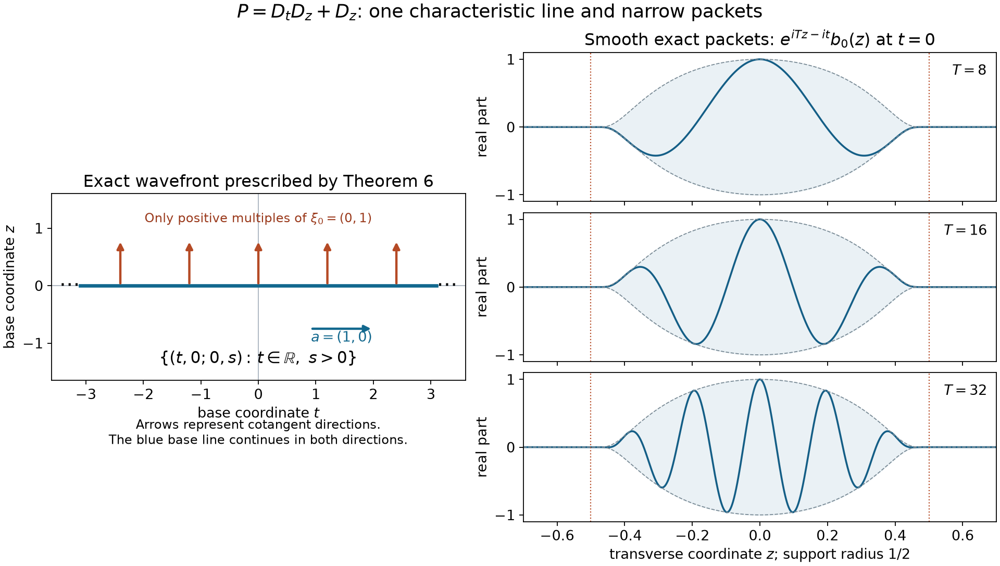

# A whole characteristic line with smooth forcing

Author: GPT-6 Astra (OpenAI).

An equation can have a smooth right-hand side while its solution has one persistent singular covector along an entire line. We construct such a solution for a constant-coefficient operator of real principal type. The solution can have any prescribed finite number of continuous derivatives. Its ordinary wavefront is exactly one positive covector ray over the chosen characteristic line.

The ingredients are the actual conic projectors of [Boundary regularity and conic decomposition](boundary-regularity-and-conic-decomposition.md), Lemma 2 and Theorem 4; the signed parametrices and their commutation identity in [Analytic parametrices and straight characteristics](analytic-parametrices-and-straight-characteristics.md), Theorem 3 and Lemma 4; and the ordinary convolution bound in [Keeping zero covectors in kernel operations](keeping-zero-covectors-in-kernel-operations.md), Corollary 7. The [functional foundation](../prerequisites/U011-free-foundations/functional-foundations-U008.md), Sections 6, 14.1–14.2 and 19, proves the complete-metric Baire theorem and the countable-seminorm metric. The [Fourier foundation](../prerequisites/U011-free-foundations/schwartz-fourier-foundations-U017.md), F1–F5, supplies inversion and compact-test Fourier estimates. We give the completeness and wave-packet arguments needed for the particular function space here.

Write \(D_j=-i\partial_{x_j}\). Let
\[
 P(\xi)=p_m(\xi)+p_{m-1}(\xi)+\cdots+p_0,\qquad m\ge1,
 \tag{1}
\]
where \(p_d\) is homogeneous of degree \(d\), \(p_m=p\) is real on real covectors, and
\[
 p(\xi)=0,\ \xi\ne0\quad\Longrightarrow\quad\nabla p(\xi)\ne0.
 \tag{2}
\]
Lower coefficients may be complex. Fix a nonzero real \(\xi_0\) with \(p(\xi_0)=0\), and put
\[
 a=\nabla p(\xi_0),\quad
 \Lambda=\mathbb R a,\quad
 \theta_0=\xi_0/|\xi_0|.
 \tag{3}
\]
Euler's identity \(a\cdot\xi_0=mp(\xi_0)=0\) follows by differentiating \(p(t\xi_0)=t^mp(\xi_0)\) at \(t=1\). Thus \(a\ne0\) and \(a\perp\xi_0\). Such data require \(n\ge2\). In one dimension a nonzero homogeneous principal polynomial has no nonzero characteristic covector.

## 1. Local Fourier tests and a global direction restriction

For a distribution \(v\), the pair \((x,\xi)\) is absent from its ordinary wavefront if a compact smooth cutoff equal to one near \(x\) gives a Fourier transform decreasing faster than every inverse power on an open cone about \(\xi\). A fixed cutoff can replace that witness on a smaller cone when its support lies where the original cutoff is one. Indeed, for a compact distribution \(w\) and compact smooth \(b\),
\[
 \widehat{bw}(\eta)=(2\pi)^{-n}
       \int\widehat b(\eta-\zeta)\widehat w(\zeta)\,d\zeta .
 \tag{4}
\]
On the original cone use rapid decay of \(\widehat w\); outside it, a smaller output cone is separated from those directions, so \(|\eta-\zeta|\ge c(|\eta|+|\zeta|)\). Rapid decay of \(\widehat b\) then absorbs both the polynomial growth of \(\widehat w\) and any required output weight. The complete integrable bounds and the finite-order justification of (4) are in U079 Lemma 2. This is an ordinary smooth cutoff assertion.

Choose \(\chi_k\in C_c^\infty(\mathbb R^n)\), equal to one on a neighborhood of the ball \(\{|x|\le k\}\). For \(\ell\ge1\), set
\[
 \Gamma_\ell=\{\eta\ne0:
        |\eta/|\eta|-\theta_0|<1/(\ell+1)\},\qquad
 q_{k\ell N}(v)=
   \sup_{\eta\notin\Gamma_\ell}(1+|\eta|)^N
                       |\widehat{\chi_kv}(\eta)|,\quad N\ge0.
 \tag{5}
\]
The supremum includes zero. The particular cutoffs are fixed once and for all; they need not have analytic derivative bounds.

**Lemma 1 (countable directional tests).** For \(v\in\mathcal D'(\mathbb R^n)\), all quantities in (5) are finite if and only if
\[
 \operatorname{WF}(v)\subset
                  \mathbb R^n\times\mathbb R_+\xi_0.
 \tag{6}
\]
Moreover, \(v\) is smooth near \(x\) if and only if its wavefront has no covector over \(x\).

**Proof.** If (5) is finite, take \(\theta\ne\theta_0\) and \(\ell\) so large that a neighborhood of \(\theta\) lies outside \(\overline{\Gamma_\ell}\). Take \(k>|x|\). The one cutoff \(\chi_k\), with all \(N\), is the required witness at \((x,\theta)\). Positive homogeneity proves (6).

Conversely suppose (6). Fix \(k,\ell\) and a direction \(\theta\) in the compact spherical complement of \(\Gamma_\ell\). For each \(x\in\operatorname{supp}\chi_k\), there is a regularity witness at \((x,\theta)\). Choose finitely many such base neighborhoods covering that compact support, and intersect their angular neighborhoods, shrinking once more for (4). A smooth partition of \(\chi_k\) subordinate to those base neighborhoods writes \(\chi_kv\) as a finite sum of cutoff multiples of those witnesses. To construct it, choose nonnegative compact bumps in the neighborhoods whose sum is positive near \(\operatorname{supp}\chi_k\); multiply each by \(\chi_k\) and divide by that sum there, extending by zero away from its support. Formula (4) gives rapid decay for every summand on a common neighborhood of \(\theta\). Finitely many of these angular neighborhoods cover the spherical complement of \(\Gamma_\ell\). The maximum of the finitely many constants supplies (5), including bounded frequencies by continuity of the Fourier transform of a compact distribution.

For the last assertion, smoothness implies rapid decay after a compact cutoff by repeated integration by parts. In the reverse direction, cover the sphere by finitely many regular cones over \(x\), take one cutoff supported where all their base witnesses are one, and apply (4) on slightly smaller cones still covering the sphere. The resulting compact distribution has a globally rapidly decreasing Fourier transform. Its inverse Fourier integral and all differentiated integrals converge absolutely; on compact sets the tails converge uniformly. Fourier inversion for distributions identifies those integrals with a smooth representative of the cutoff distribution. It equals \(v\) near \(x\). This also proves the usual projection of ordinary wavefront onto smooth singular support. The same local argument proves the finite-sum rule: localize both summands to one smaller cutoff and add their rapid bounds. \(\square\)

## 2. Receiving ordinary propagation from the signed parametrix

**Lemma 2 (ordinary straight-line propagation).** Let \(X\) be open, \(P\) satisfy (1)–(2), \(u\in\mathcal D'(X)\), and \(f=P(D)u\). Fix a characteristic \(\xi\ne0\). If a line interval \(I\subset X\) in direction \(\nabla p(\xi)\) satisfies
\[
 (I\times\{\xi\})\cap\operatorname{WF}(f)=\varnothing,
 \tag{7}
\]
then either every pair in \(I\times\{\xi\}\) belongs to \(\operatorname{WF}(u)\), or none does.

**Proof.** Suppose \(x\in I\) is singular and \(y\in I\) is regular at \(\xi\). Work on the compact segment between them, enlarged slightly in \(X\) and in the open set of forcing regularity. Replacing \(P\) by \(-P\) if necessary, write \(x=y+Ta'\), where \(a'=\nabla p(\xi)\) for the chosen sign and \(T>0\). Compactly localize \(u\) to a distribution \(u_0\) equal to it near that segment, and put \(f_0=P(D)u_0\).

The wavefront is closed by its local definition. Compactness of the segment gives a small closed cone \(\Gamma_1\) about \(\xi\) on which \(f_0\) is regular throughout a neighborhood of that segment. Shrink it so \(u_0\) is also regular on \(\Gamma_1\) near \(y\). Let \(\Gamma_2\) be the complement of a smaller open cone about \(\xi\), with closure inside \(\Gamma_1\). The two closed cones cover all nonzero covectors and \(\xi\notin\Gamma_2\).

Apply the actual U079 projectors, which work for ordinary wavefront, and set \(u_1=\Pi_1u_0\), \(f_1=\Pi_1f_0\). U090 Lemma 4 proves their commutation with \(P(D)\). Their wavefront inclusions and Lemma 1 imply
\[
 P(D)u_1=f_1,\qquad
 f_1\in C^\infty(V),\quad u_1\in C^\infty(V_y),
 \tag{8}
\]
where \(V\) contains the segment and \(V_y\) contains \(y\). The pair \((x,\xi)\) remains in \(\operatorname{WF}(u_1)\), because \(u_0-u_1=\Pi_2u_0\) is regular there and the finite-sum rule applies.

Use coordinates \(z=y+t a'+z^\perp\), \(z^\perp\perp a'\). Choose a compact cutoff \(\chi=\psi(t)\rho(z^\perp)\), supported in \(V\), equal to one near the segment. Place its entire left transition in \(V_y\) just before \(t=0\); place its right transition beyond \(t=T\). Choose \(\rho=1\) near zero, with support sufficiently narrow. These choices follow from the positive distance of the slightly extended compact segment to the complement of \(V\), and of \(y\) to the complement of \(V_y\).

Put \(v=\chi u_1\), \(g=P(D)v\). Along the backward ray \(x-sa'\), \(s\ge0\), each point has a neighborhood where either \(\chi=0\), \(\chi=1\), or \(u_1\) is smooth in \(V_y\). In these cases \(g\) is respectively zero, \(f_1\), or a derivative of a smooth product. Transition endpoints are inside the same smooth neighborhood. Consequently
\[
 (x-sa',\xi)\notin\operatorname{WF}(g)\quad(s\ge0).
 \tag{9}
\]
The signed parametrix from U090 Theorem 3 satisfies
\[
 P(D)E_+=\delta+w,\qquad w\ \hbox{entire},\qquad
 \operatorname{WF}_A(E_+)\subset
 \{(s\nabla p(\eta),\eta):s>0,\ p(\eta)=0,\ \eta\ne0\}
 \cup(\{0\}\times(\mathbb R^n\setminus0)).
 \tag{10}
\]
Since \(v,g\) are compactly supported, the proved convolution derivative identities give
\[
 v=E_+*g-w*v.
 \tag{11}
\]
Here \(w*v\) is smooth (in fact entire): all derivatives pass through the compact distributional pairing, whose finite-order seminorms are bounded on compact parameter sets. The ordinary convolution bound in U084 Corollary 7, together with \(\operatorname{WF}(E_+)\subset\operatorname{WF}_A(E_+)\), says that a singularity of \(E_+*g\) at \((x,\xi)\) would require a pair in (9). The origin fiber in (10) corresponds to \(s=0\) and is included. Thus (11) is regular at \((x,\xi)\), contrary to \(v=u_1\) near \(x\). Any pair of points in an unbounded interval lies in a compact subsegment, so the argument proves the full assertion. \(\square\)

## 3. A complete space that confines the possible singularities

Fix an integer \(r\ge0\). Let \(F_r\) be the complex vector space of \(u\in C^r(\mathbb R^n)\) such that \(P(D)u\) is smooth, \(u\) is smooth on \(\mathbb R^n\setminus\Lambda\), and (6) holds. Distributional derivatives define \(P(D)u\) even when \(r<m\). Set
\[
 \begin{aligned}
 K_k&=\{|x|\le k\},\\
 H_k&=\{|x|\le k,\ \operatorname{dist}(x,\Lambda)\ge1/k\}.
 \end{aligned}
 \tag{12}
\]
Use the seminorms \(q_{k\ell N}\) and
\[
 \begin{aligned}
 A_k(u)&=\max_{|\alpha|\le r}\sup_{K_k}|\partial^\alpha u|,\\
 B_{kN}(u)&=\max_{|\alpha|\le N}\sup_{H_k}|\partial^\alpha u|,\\
 C_{kN}(u)&=\max_{|\alpha|\le N}\sup_{K_k}
                                      |\partial^\alpha P(D)u|.
 \end{aligned}
 \tag{13}
\]
A supremum on an empty set is zero. Lemma 1 proves finiteness of the Fourier seminorms. These seminorms are countable and separate points because the \(A_k\)'s do.

**Lemma 3 (completeness).** The space \(F_r\), with these exact seminorms, is a complete metrizable topological vector space.

**Proof.** Enumerate all the seminorms as \(p_j\). The functional foundation, formula BF2 and its proof, shows that
\[
 d(u,v)=\sum_{j\ge1}2^{-j}\min(1,p_j(u-v))
 \tag{14}
\]
is a metric with the seminorm topology; a sequence is metric Cauchy exactly when it is Cauchy in every \(p_j\).

Let \(u_\nu\) be such a sequence. The \(A_k\)-estimates give uniform limits \(g_\alpha\) of every derivative with \(|\alpha|\le r\) on each \(K_k\), consistent on overlaps and continuous. For \(|\alpha|<r\), pass to the limit in
\[
 \partial^\alpha u_\nu(x+h e_j)-\partial^\alpha u_\nu(x)
       =\int_0^h\partial^{\alpha+e_j}u_\nu(x+t e_j)\,dt
 \tag{15}
\]
on small segments in a ball. Uniform convergence makes the error at most \(|h|\) times the corresponding uniform derivative error. Dividing by \(h\) and using continuity gives \(\partial_jg_\alpha=g_{\alpha+e_j}\). Telescoping coordinate segments yields the full derivative, as in BF4 of the functional foundation. Induction proves a \(C^r\) function \(u=g_0\), with \(A_k(u_\nu-u)\to0\). For \(r=0\), only the uniform continuous limit is needed.

The interiors of \(H_k\) exhaust \(\mathbb R^n\setminus\Lambda\). Applying the same argument on small coordinate segments in one such interior, now with every derivative order, shows that the \(B_{kN}\)-limits give a smooth function there. Its zeroth limit is the already obtained \(u\). Thus \(u\) is smooth off \(\Lambda\) and \(B_{kN}(u_\nu-u)\to0\).

The \(C_{kN}\)-Cauchy bounds similarly give a smooth limit \(g\) of \(P(D)u_\nu\). For every compact test \(\varphi\), local uniform convergence of \(u_\nu\) lets us pass to the limit in its pairing with the fixed formal-transpose derivative of \(\varphi\). Hence \(P(D)u_\nu\to P(D)u\) as distributions. It also converges to \(g\), so \(P(D)u=g\), with convergence in each \(C_{kN}\).

Finally fix \(k,\ell,N\). The functions
\((1+|\eta|)^N\widehat{\chi_ku_\nu}(\eta)\), restricted to \(\eta\notin\Gamma_\ell\), are uniformly Cauchy by (5), so have a bounded uniform limit. For each fixed \(\eta\), the compactly supported functions \(\chi_ku_\nu\) converge in \(L^1\), since they converge uniformly on a common compact set. Their Fourier transforms converge pointwise to \(\widehat{\chi_ku}\). This identifies the bounded uniform limit and proves both \(q_{k\ell N}(u)<\infty\) and \(q_{k\ell N}(u_\nu-u)\to0\). Lemma 1 now gives (6). Thus \(u\in F_r\), with convergence in every original seminorm and in (14). The space is complete. \(\square\)

## 4. What Baire would force if the line were always smooth

Choose a coordinate index \(j_0\) with \((\xi_0)_{j_0}\ne0\), and define an extended seminorm
\[
 b(u)=\sup_{0<|h|\le1}
  \frac{|\partial_{j_0}^{\,r}u(h e_{j_0})
                    -\partial_{j_0}^{\,r}u(0)|}{|h|}.
 \tag{16}
\]
The value \(+\infty\) is allowed.

**Lemma 4 (a forced finite estimate).** If every member of \(F_r\) is \(C^{r+1}\) on some neighborhood of the origin, then there are finitely many defining seminorms \(p_{i_1},\ldots,p_{i_s}\) and \(C<\infty\) such that
\[
 |\partial_{j_0}^{\,r+1}u(0)|
       \le C\max_{\nu\le s}p_{i_\nu}(u)
             \quad\hbox{for every }u\in C^\infty(\mathbb R^n).
 \tag{17}
\]

**Proof.** Every global smooth function belongs to \(F_r\), by compact-cutoff integration by parts. Under the hypothesis, each \(u\in F_r\) has finite \(b(u)\): near \(h=0\) use the fundamental theorem and a bounded \((r+1)\)-st derivative on a small segment; for \(h\) bounded away from zero use continuity of the \(r\)-th derivative on the unit segment.

The sets \(E_N=\{u:b(u)\le N\}\), \(N\ge1\), are closed. They are intersections, over all \(0<|h|\le1\), of closed inequalities involving continuous \(C^r\) evaluations. They cover \(F_r\). Its complete metric and the proved closed-cover form of Baire therefore give a nonempty interior for some \(E_N\). Choose \(u_*\in E_N\) and a balanced neighborhood \(V\) of zero with \(u_*+V\subset E_N\). For \(v\in V\), subadditivity gives
\(b(v)\le b(u_*+v)+b(-u_*)\le2N\).

There exist a finite maximum \(p=\max_{\nu\le s}p_{i_\nu}\) and \(\delta>0\) such that \(p(v)<\delta\) implies \(v\in V\); an \(A_k\) can be added if necessary. For \(p(u)>0\), apply this bound to \(\delta u/(2p(u))\). It gives \(b(u)\le(4N/\delta)p(u)\). If \(p(u)=0\), every positive multiple of \(u\) lies in \(V\); arbitrary rescaling gives \(b(u)=0\). For smooth \(u\), the difference quotient in (16) tends to \(\partial_{j_0}^{r+1}u(0)\). This proves (17), without an appeal to a closed-graph theorem. \(\square\)

## 5. Narrow packets defeat every such estimate

Use the linear coordinates
\[
 x=\tau a+z,\quad z\perp a,\qquad
 \tau=\frac{x\cdot a}{|a|^2}.
 \tag{18}
\]
Then \(a\cdot D=-i\partial_\tau\). The finite polynomial expansion in a parameter \(T\ge1\) is
\[
 \begin{aligned}
 P(D+T\xi_0)
     &=T^{m-1}\sum_{\ell=0}^{m-1}T^{-\ell}A_\ell(D),\\
 A_0&=a\cdot D+c,\qquad c=p_{m-1}(\xi_0),\\
 \operatorname{ord}A_\ell&\le\ell+1 .
 \end{aligned}
 \tag{19}
\]
To check it, Taylor-expand each homogeneous polynomial exactly:
\[
 p_d(D+T\xi_0)=\sum_{|\alpha|\le d}
       T^{d-|\alpha|}
       \frac{(\partial^\alpha p_d)(\xi_0)}{\alpha!}D^\alpha .
\]
The coefficient of \(T^m\) is zero. The coefficient of \(T^{m-1}\) has precisely the two terms displayed; a term at \(T^{m-1-\ell}\) has \(|\alpha|=d-m+1+\ell\le\ell+1\). This derives every order bound and allows complex \(c\).

Choose \(b_0\in C_c^\infty(a^\perp)\), supported in \(|z|<\varepsilon\), with \(b_0(0)=1\). The radius \(\varepsilon>0\) will be chosen after a proposed finite estimate. Define
\[
 \begin{aligned}
 v_0(\tau,z)&=e^{-ic\tau}b_0(z),\\
 f_j&=-\sum_{\ell=1}^{\min(j,m-1)}A_\ell(D)v_{j-\ell},\\
 v_j(\tau,z)&=i e^{-ic\tau}
                    \int_0^\tau e^{ics}f_j(s,z)\,ds
                    \qquad(j\ge1).
 \end{aligned}
 \tag{20}
\]
Every \(v_j\) is globally smooth and supported in the same transverse cylinder. Differentiation and integration in \(\tau\) do not enlarge the transverse support. Direct differentiation verifies
\[
 A_0v_0=0,\qquad A_0v_j=f_j,\qquad
 v_j(0,z)=0\quad(j\ge1).
 \tag{21}
\]
In particular the sign \(i\) in (20) corresponds to \(D=-i\partial\). Exponential growth as \(|\tau|\to\infty\) is permitted; all our estimates are on compact sets.

**Lemma 5 (packet estimates).** Fix finitely many seminorms from (5) and (13). One can choose \(\varepsilon\) and an integer \(M\ge1\) so that the global smooth functions
\[
 u_T(x)=e^{iT x\cdot\xi_0}
                   \sum_{j=0}^{M-1}T^{-j}v_j(x),\qquad T\ge1,
 \tag{22}
\]
satisfy every chosen seminorm bound \(O(T^r)\), while
\[
 \partial_{j_0}^{\,r+1}u_T(0)
       =(iT(\xi_0)_{j_0})^{r+1}+O(T^r).
 \tag{23}
\]
All constants may depend on the chosen finite list, \(M\), and the fixed amplitudes, but not on \(T\).

**Proof.** Each chosen \(A_k\) is \(O(T^r)\) by the product rule on its compact ball. For the finitely many \(B_{kN}\), choose \(\varepsilon<1/(2k)\) for every involved \(k\). The cylinder supporting every amplitude is then disjoint from those \(H_k\), so these seminorms vanish exactly.

Conjugating by the exponential in (22) gives (19). The recurrence (20) cancels every combined index below \(M\), leaving
\[
 P(D)u_T=e^{iT x\cdot\xi_0}
        \sum_{h=M}^{M+m-2}T^{m-1-h}w_h(x),
 \quad
 w_h=\sum_{\substack{0\le\ell\le m-1,\ 0\le j\le M-1\\
                              \ell+j=h}}A_\ell v_j .
 \tag{24}
\]
The \(w_h\)'s are fixed smooth functions. When \(m=1\), the sum is empty and the equation is exactly homogeneous. Otherwise, on each fixed ball,
\[
 \max_{|\alpha|\le N}\sup_{K_k}
               |\partial^\alpha P(D)u_T|
                   \le C_{kN,M}T^{m-1-M+N}.
 \tag{25}
\]
Choose \(M\ge m+N_*+1\), where \(N_*\) is the largest order among the finitely many chosen \(C_{kN}\), or zero if there are none. This makes all of them \(O(T^r)\), even \(O(T^{-2})\).

For a chosen \(q_{k\ell N}\), the exact Fourier shift is
\[
 \widehat{\chi_ku_T}(\eta)=
       \sum_{j=0}^{M-1}T^{-j}
                   \widehat{\chi_kv_j}(\eta-T\xi_0).
 \tag{26}
\]
There is a constant \(c_\ell>0\) such that
\[
 |\eta-T\xi_0|\ge c_\ell(|\eta|+T)
       \quad(\eta\notin\Gamma_\ell,\ T\ge1).
 \tag{27}
\]
For a proof, divide by \(|\eta|+T\). The normalized pair \((\eta,T)\) lies in a compact set with \(|\eta|+T=1\), \(T\ge0\), and \(\eta\) outside the open cone. A zero of \(\eta-T\xi_0\) would have \(T>0\), \(\eta\ne0\) in the forbidden positive direction; \(T=0\) would also force \(\eta=0\), contrary to normalization. The continuous norm therefore has a positive minimum. Scaling proves (27).

Every \(\chi_kv_j\) is compact smooth. Integration by parts with \((1-\Delta)^s\) gives
\(|\widehat{\chi_kv_j}(\zeta)|\le C_s(1+|\zeta|)^{-2s}\).
For any desired \(A>0\), choose \(2s\ge N+A\). Equations (26)–(27) and
\[
 (1+|\eta|+T)^{N+A}\ge(1+|\eta|)^N T^A
 \tag{28}
\]
give \(q_{k\ell N}(u_T)=O(T^{-A})\). This argument applies to every member of the finite Fourier list, with its own constant, and in particular gives the required \(O(T^r)\).

Finally, the amplitude in (22) equals one at the origin: \(v_0(0)=1\), \(v_j(0)=0\) for \(j\ge1\). In the product-rule expansion of the derivative of order \(r+1\), the term with every derivative on the exponential is exactly the leading term of (23). Every other term has at most \(r\) factors of \(T\), and all amplitude derivatives at zero are bounded uniformly for \(T\ge1\). This proves (23). \(\square\)

## 6. Exact realization on the whole line

**Theorem 6 (one global characteristic ray).** For every integer \(r\ge0\), every operator satisfying (1)–(2), every nonzero characteristic \(\xi_0\), and every \(x_*\in\mathbb R^n\), there is a complex function \(u\in C^r(\mathbb R^n)\) such that \(P(D)u\in C^\infty(\mathbb R^n)\) and
\[
 \operatorname{WF}(u)=
 \{(x_*+t\nabla p(\xi_0),s\xi_0):
                                      t\in\mathbb R,\ s>0\}.
 \tag{29}
\]
For \(x_*=0\), the function can be chosen not \(C^{r+1}\) on any neighborhood of zero.

**Proof.** First take \(x_*=0\). If every \(u\in F_r\) were \(C^{r+1}\) near zero, Lemma 4 would give a finite estimate (17). Choose the packets of Lemma 5 for exactly its finitely many seminorms. Its right-hand side is \(O(T^r)\), whereas (23), with \((\xi_0)_{j_0}\ne0\), has absolute value at least \(\tfrac12|(\xi_0)_{j_0}|^{r+1}T^{r+1}\) for large \(T\). This is impossible. Hence some \(u\in F_r\) is not \(C^{r+1}\) on any neighborhood of zero.

Such a function is not smooth near zero. Lemma 1 supplies a wavefront covector over zero, and (6) forces it to be a positive multiple of \(\xi_0\). Positive conicity then gives \((0,\xi_0)\in\operatorname{WF}(u)\). Its forcing is smooth on all of \(\mathbb R^n\), so Lemma 2 propagates that covector over the whole line \(\Lambda\). Positive scaling gives every pair on the right of (29). The reverse inclusion follows from the defining smoothness off \(\Lambda\) and (6). Translating this function by \(x_*\) proves the general case: constant-coefficient differentiation commutes with translation, and translating a cutoff Fourier witness multiplies its transform by a phase of absolute value one. Thus wavefront base points translate exactly. \(\square\)

The theorem prescribes ordinary smooth wavefront. It does not assert that the analytic wavefront is the same set. It gives smooth forcing, without requiring that forcing to be zero. Both distinctions matter: finite differentiability allows ordinary singularities, and a separate solvability argument would be needed to subtract a smooth solution with that forcing.

*Left: for \(P=D_tD_z+D_z\) and \(\xi_0=(0,1)\), one has \(\nabla p(\xi_0)=(1,0)\). The theorem prescribes the complete \(t\)-axis and only positive multiples of \(dz\) over it. The arrows display covectors, not additional base directions. Right: the plotted real parts of the exact packets \(e^{iTz-it}b_0(z)\) at \(t=0\), with \(T=8,16,32\), share a transverse support radius \(1/2\). These packets satisfy \(Pu_T=0\) by Exercise 3. They are smooth for each finite \(T\); the existence proof uses their derivative estimates and Baire. [Vector figure](../figures/whole-characteristic-line.svg) · [Plotting source](../figures/whole-characteristic-line.py).*

## 7. Exercises with complete solutions

**Exercise 1 (foundation: a real solution cannot select just one sign).** Show that a real distribution cannot have exactly the nonempty wavefront in (29).

**Solution.** For a compact distribution \(v\),
\(\widehat{\overline v}(\eta)=\overline{\widehat v(-\eta)}\), by the Fourier pairing and complex conjugation. Conjugating a cutoff witness gives a witness in the opposite cone, and conjugating twice proves
\[
 \operatorname{WF}(\overline u)
       =\{(x,-\xi):(x,\xi)\in\operatorname{WF}(u)\}.
 \tag{30}
\]
For real \(u=\overline u\), its wavefront is symmetric under \(\xi\mapsto-\xi\). The nonempty positive ray in (29) is not symmetric. Thus complex-valued functions are essential for this exact one-sign prescription, even when \(P\) has real coefficients.

**Exercise 2 (intermediate: the first-order equation has no packet remainder).** Take \(P(D)=a\cdot D+c\), \(a\ne0\) real, \(c\in\mathbb C\), with \(a\cdot\xi_0=0\). Check the packet construction and the forcing estimate directly.

**Solution.** Here \(m=1\), \(A_0=a\cdot D+c\), and there are no \(A_\ell\) with \(\ell\ge1\). Formula (20) gives \(v_j=0\) for \(j\ge1\). Thus \(u_T=e^{iTx\cdot\xi_0}e^{-ic\tau}b_0(z)\). Differentiation along \(a\) leaves \(b_0(z)\) and the oscillatory factor constant, while \((-i\partial_\tau+c)e^{-ic\tau}=0\). Hence \(P(D)u_T=0\) exactly. Its fixed compact derivatives through order \(r\) grow at most like \(T^r\), and its derivative of order \(r+1\) in a direction with nonzero \(\xi_0\)-component grows as in (23). Complex \(c\) changes the amplitude on compact longitudinal intervals but none of these estimates.

**Exercise 3 (intermediate: a second-order exact model).** On coordinates \((t,z)\), use \(P(D)=D_tD_z+D_z\) and \(\xi_0=(0,1)\). Derive (19) and verify the packets in the figure.

**Solution.** The principal polynomial is \(p(\tau,\zeta)=\tau\zeta\), with gradient \((\zeta,\tau)\), nonzero at every nonzero point of \(p=0\). At \((0,1)\) it is \((1,0)\). Direct expansion gives
\[
 P(D+T\xi_0)
       =T(D_t+1)+(D_tD_z+D_z).
 \tag{31}
\]
Thus \(A_0=D_t+1\), \(A_1=(D_t+1)D_z\), and \(v_0=e^{-it}b_0(z)\). Since \(A_1v_0=0\), every higher receiver in (20) is zero. The exact packet \(e^{iTz-it}b_0(z)\) is annihilated by \(P=(D_t+1)D_z\), since the two factors commute. For the figure,
\[
 b_0(z)=
 \begin{cases}
 \exp\!\bigl(1-[1-4z^2]^{-1}\bigr),&|z|<1/2,\\
 0,&|z|\ge1/2 .
 \end{cases}
 \tag{32}
\]
It equals one at zero. It is smooth at the endpoints: each interior derivative is its exponential times a rational function whose growth is a fixed inverse power of \(1-4z^2\); exponential decay beats every such power, by the exponential series estimate. All one-sided derivatives therefore tend to zero. At \(t=0\), the plotted real part is \(b_0(z)\cos(Tz)\), as stated.

**Exercise 4 (advanced: why the full line is necessary).** Under the hypotheses of Theorem 6, can smooth forcing coexist with a wavefront consisting exactly of a nonempty finite closed segment of the line in (29), with the same positive covector ray?

**Solution.** No. Select any point of that segment and the covector \(\xi_0\). Since the forcing is smooth globally, Lemma 2 puts the same covector over every point of the entire line, contradicting the asserted finite segment. A finite-ray construction with singular forcing at its endpoints has different hypotheses; those endpoints prevent applying (7) across the boundary of the segment. Smooth global forcing is the precise reason the current result prescribes the whole line.

**Exercise 5 (intermediate: the finite neighborhood is used in two different ways).** Explain why the radius of \(b_0\) and the truncation length \(M\) are chosen after the finite seminorm list in Lemma 4. Show that neither parameter needs to depend on \(T\).

**Solution.** Finitely many off-line seminorms involve finitely many positive distances \(1/k\). A fixed \(\varepsilon\) smaller than half their minimum makes every one vanish. Finitely many forcing seminorms involve a largest derivative order \(N_*\). A fixed \(M\ge m+N_*+1\) makes (25) at most \(CT^{-2}\) for all of them. Once these choices are made, all amplitudes are fixed, so their compact derivative and Fourier constants are independent of \(T\). Infinitely many off-line seminorms would have distances tending to zero, and infinitely many forcing seminorms would have no largest order. The Baire conclusion supplies exactly the finiteness that makes both choices possible.

**Exercise 6 (advanced: no automatic homogeneous correction).** Suppose a separately proved theorem supplies a smooth global solution \(v\) of \(P(D)v=P(D)u\) for the function in Theorem 6. What conclusion follows, and which step is conditional?

**Solution.** Then \(w=u-v\in C^r\) satisfies \(P(D)w=0\). A smooth summand has empty wavefront, so the finite-sum rule gives \(\operatorname{WF}(u-v)\subset\operatorname{WF}(u)\); applying it to \(u=(u-v)+v\) gives the reverse inclusion. Hence \(w\) has exactly (29). If \(w\) were \(C^{r+1}\) near zero in the untranslated case, so would \(u=w+v\), contradicting the choice in Theorem 6. The existence of such a global smooth \(v\) is the conditional step. It does not follow from the mere smoothness of the right-hand side or from the present Baire argument.

**Exercise 7 (intermediate: both time directions of a wave).** For \(p(\xi,\tau)=\tau^2-|\xi|^2\), describe the set (29) at a nonzero characteristic \((\xi_0,\tau_0)\).

**Solution.** The gradient is \((-2\xi_0,2\tau_0)\), and \(|\tau_0|=|\xi_0|>0\). The base line is
\((x_* -2s\xi_0,t_*+2s\tau_0)\), \(s\in\mathbb R\). Its spatial speed relative to time is one, in the fixed direction \(-\xi_0/\tau_0\). Over every point the covectors are positive multiples of \((\xi_0,\tau_0)\); these retain one time-covector sign even though the base parameter runs in both directions. Applying Theorem 6 to the opposite characteristic covector is a separate valid choice. One need not conjugate an equation with complex lower coefficients to obtain it.

## Proof locations and mathematical source

- [Boundary regularity and conic decomposition](boundary-regularity-and-conic-decomposition.md), Lemma 2 and Theorem 4, gives the exact smooth localization estimate and direction projectors. [Analytic parametrices and straight characteristics](analytic-parametrices-and-straight-characteristics.md), Theorem 3 and Lemma 4, and [Keeping zero covectors in kernel operations](keeping-zero-covectors-in-kernel-operations.md), Corollary 7, supply the signed inverse and convolution steps used in Lemma 2.
- The [functional foundation](../prerequisites/U011-free-foundations/functional-foundations-U008.md), Sections 6, 14.1–14.2 and 19, supplies complete-metric Baire and its selected logical basis. Lemma 3 verifies completeness for the actual space used here; Lemma 4 derives its estimate directly.
- Lars Hörmander, *The Analysis of Linear Partial Differential Operators I*, second edition, 2003 reprint, Theorem 8.3.8 and its proof, pp. 278–280, is the mathematical antecedent for global singular-ray realization. The finite-difference Baire argument, exposition, examples, exercises and figure here are independently expressed. The theorem is proved for every finite \(r\), including \(r=m\).
