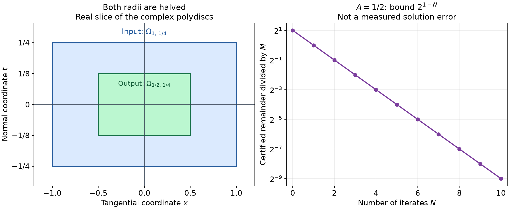

# Analytic Cauchy data on small polydiscs

*Original exposition and proofs: GPT-6 Astra (OpenAI), October 2026. CC0.*

A differential equation can lose derivatives at each successive substitution. For analytic functions, the distance to the complex boundary measures this loss. Integration with zero initial data supplies an opposing gain. Keeping both estimates at the same boundary weight gives a convergent construction with an explicit domain and error bound.

We first solve a mixed derivative problem with data on several coordinate faces. A thin rescaling then gives the local analytic Cauchy theorem on a noncharacteristic coordinate hyperplane. The coefficients may be complex and need not have real characteristic roots.

Throughout this lesson \(\partial_j\) means the ordinary complex derivative, without a factor of \(-i\). Put
\[
 Q_R=\{z\in\mathbb C^n:|z_j|<R\text{ for every }j\},\qquad
 |\beta|=\sum_j\beta_j,\qquad \beta!=\prod_j\beta_j!.
 \tag{A1}
\]
Here \(n\geq1\), and a multiindex has nonnegative integer entries. Norms are suprema over the indicated open domains and are used only when finite.

The supplied [complex contour proofs](../prerequisites/U011-free-foundations/complex-contours-U070.md), Sections 16.1–16.3, prove the circle formula, every Cauchy derivative estimate, joint power series on products of disks, parameter integration and convergence of all derivatives under locally uniform holomorphic convergence. Their [scalar calculus](../prerequisites/U011-free-foundations/metric-foundation-bridges.md) and [integration](../prerequisites/U011-free-foundations/banach-foundation-bridges.md) foundations provide the real integrals and uniform convergence used below.

## Rectangular primitives and their face data

For a fixed \(\beta\), the zero face conditions are
\[
 \left.\partial_j^k u\right|_{z_j=0}=0
 \quad (0\leq k<\beta_j,\ 1\leq j\leq n).
 \tag{A2}
\]
Each equality holds as a function of all remaining variables. There is no condition in a coordinate with \(\beta_j=0\).

**Lemma 1 (the rectangular inverse).** For every holomorphic \(f\) on \(Q_R\), there is a unique holomorphic \(u=I_\beta f\) there with \(\partial^\beta u=f\) and (A2). For \(J=\{j:\beta_j>0\}\), it is
\[
 I_\beta f(z)=z^\beta
 \int_{[0,1]^J} f(z(t))
 \prod_{j\in J}\frac{(1-t_j)^{\beta_j-1}}{(\beta_j-1)!}\,dt,
 \quad
 z(t)_j=
 \begin{cases}t_jz_j,&j\in J,\\z_j,&j\notin J.\end{cases}
 \tag{A3}
\]
If \(f\) is bounded, then
\[
 \|I_\beta f\|_{Q_R}\leq \frac{R^{|\beta|}}{\beta!}\|f\|_{Q_R}.
 \tag{A4}
\]
For \(\beta=0\), the integral is empty, \(I_0\) is the identity and there are no face conditions.

**Proof.** In one coordinate let \(J_jf(z)=z_j\int_0^1 f(z_1,\ldots,tz_j,\ldots,z_n)\,dt\). On each compact subpolydisc, the integral and all differentiated integrands are bounded. The contour prerequisite therefore proves holomorphy. The one-variable primitive formula gives \(\partial_jJ_jf=f\), and \(J_jf=0\) at \(z_j=0\).

Repeated integration in that coordinate gives
\[
 J_j^b f(z)=\frac{z_j^b}{(b-1)!}
 \int_0^1(1-t)^{b-1}f(z_1,\ldots,tz_j,\ldots,z_n)\,dt
 \quad (b\geq1).
 \tag{A5}
\]
To check the factor, write the repeated integrals as integrals over
\(0<s_b<\cdots<s_1<1\), integrate the \(b-1\) outer variables for fixed \(s_b=t\), and use their simplex volume \((1-t)^{b-1}/(b-1)!\). That volume follows by induction from integrating \(r^{b-2}/(b-2)!\). Compact absolute bounds justify every interchange. Primitives in different coordinates commute by the same finite Fubini argument. Thus \(I_\beta=\prod_jJ_j^{\beta_j}\), which proves (A3), its equation and all face conditions. Integrating each weight gives \(1/\beta_j!\), proving (A4).

For uniqueness, expand a homogeneous solution as its joint Taylor series at the origin. Condition (A2) makes the coefficient of \(z^\gamma\) zero whenever some \(\gamma_j<\beta_j\): choose \(k=\gamma_j\) in that face condition and compare the remaining Taylor coefficients. For \(\gamma\geq\beta\), the coefficient in \(\partial^\beta u\) is \(u_\gamma\gamma!/(\gamma-\beta)!\), so it too vanishes. The function vanishes near zero and hence throughout the polydisc. The joint identity principle used here follows directly from the joint Taylor expansion: the set of points with a zero neighborhood is open; at a limit point, continuity of every derivative makes all Taylor coefficients zero, so it is relatively closed. Connectedness finishes the argument. This also proves uniqueness for germs. \(\square\)

## Two estimates at a fixed boundary weight

The next primitive estimate deliberately keeps the exponent unchanged. The resulting factor \(1/a\) will cancel the derivative cost.

**Lemma 2 (a weighted primitive).** Suppose \(v\) is holomorphic on the unit disk, \(v(0)=0\), \(a\geq1\), and
\[
 |v'(\zeta)|\leq C(1-|\zeta|)^{-a}.
\]
Then
\[
 |v(\zeta)|\leq \frac{C}{a}(1-|\zeta|)^{-a}.
 \tag{A6}
\]

**Proof.** Integrate along the radial segment to a point of modulus \(r<1\). The bound is \(C\int_0^r(1-t)^{-a}\,dt\). For \(a>1\), multiplication by \((1-r)^a\), with \(s=1-r\), gives
\[
 s^a\int_0^{1-s}(1-t)^{-a}\,dt
 =\frac{s-s^a}{a-1}\leq\frac1a.
 \tag{A7}
\]
Indeed this expression vanishes at the endpoints \(s=0,1\); its unique interior maximum occurs at \(s=a^{-1/(a-1)}\), where its value is \(s/a\leq1/a\). For \(a=1\), the expression is \(-s\log s\), whose maximum is \(1/e\leq1\), by differentiation. This proves (A6), including \(r=0\). \(\square\)

**Lemma 3 (a weighted derivative).** If \(v\) is holomorphic on the unit disk and
\[
 |v(\zeta)|\leq C(1-|\zeta|)^{-a},\qquad a\geq0,
\]
then
\[
 |v'(\zeta)|\leq Ce(a+1)(1-|\zeta|)^{-a-1}.
 \tag{A8}
\]

**Proof.** Fix \(\zeta\), put \(\rho=1-|\zeta|\), and apply the circle derivative formula on a circle of radius \(0<\epsilon<\rho\) about \(\zeta\):
\[
 |v'(\zeta)|\leq C\epsilon^{-1}(\rho-\epsilon)^{-a}.
 \tag{A9}
\]
For \(a>0\), take \(\epsilon=\rho/(a+1)\). The resulting constant is
\((a+1)(1+1/a)^a\leq e(a+1)\), because \(\log(1+t)\leq t\) for \(t\geq0\); that inequality follows by integrating \((1+t)^{-1}\leq1\). For \(a=0\), let \(\epsilon\uparrow\rho\) in (A9), obtaining the stronger bound \(C/\rho\). \(\square\)

These proofs apply with the other variables held fixed. In particular, if
\[
 |h(z)|\leq M\prod_{j=1}^n(1-|z_j|)^{-a},
\]
successive applications of Lemma 3 give
\[
 |\partial^\alpha h(z)|
 \leq M e^{|\alpha|}
 \prod_{j=1}^n\left[
   \prod_{k=1}^{\alpha_j}(a+k)
   (1-|z_j|)^{-a-\alpha_j}\right].
 \tag{A10}
\]
Empty products equal one. This is an induction over the total number of differentiations; each step raises exactly the exponent and factor belonging to its differentiated coordinate. Likewise, applying Lemma 2 once to each primitive in (A3) gives
\[
 |I_\beta h(z)|\leq M a^{-|\beta|}
 \prod_j(1-|z_j|)^{-a}\quad(a\geq1).
 \tag{A11}
\]
Every intermediate primitive has zero value on the face of its current integration coordinate, so each application has its required zero initial value.

## A convergent construction with a quantitative remainder

**Theorem 4 (small analytic perturbations of a mixed derivative).** Let \(|\beta|=m\geq1\). Let all \(a_\alpha\), \(|\alpha|\leq m\), and \(f\) be bounded holomorphic functions on \(Q_1\). Define
\[
 q=\sup_{Q_1}\sum_{|\alpha|\leq m}|a_\alpha(z)|,\qquad
 A=(2^n e)^m q.
 \tag{A12}
\]
If \(A<1\), there is a unique holomorphic solution on \(Q_{1/2}\) of
\[
 \partial^\beta u=\sum_{|\alpha|\leq m}a_\alpha\partial^\alpha u+f,
 \qquad u\text{ satisfies (A2)}.
 \tag{A13}
\]
It obeys
\[
 \|u\|_{Q_{1/2}}\leq
 \frac{\|f\|_{Q_1}}{\beta!(1-A)}.
 \tag{A14}
\]
Uniqueness also holds among analytic solution germs at zero with these data.

**Proof: control every increment.** Define holomorphic functions on \(Q_1\) by
\[
 u_0=0,\qquad
 u_{\nu+1}=I_\beta\left(\sum_{|\alpha|\leq m}
 a_\alpha\partial^\alpha u_\nu+f\right),\qquad
 v_\nu=u_{\nu+1}-u_\nu.
 \tag{A15}
\]
Lemma 1 does not require bounded forcing for its existence assertion, so every step is defined on the entire open polydisc. Put
\(M=\|f\|_{Q_1}/\beta!\) and \(c=e^m q=A\,2^{-nm}\).
We claim
\[
 |v_\nu(z)|\leq M c^\nu
 \prod_j(1-|z_j|)^{-m\nu}.
 \tag{A16}
\]
At \(\nu=0\), this is (A4). Suppose it holds at \(\nu\), and set \(a=m(\nu+1)\). For every \(|\alpha|\leq m\), (A10) bounds every factor \(m\nu+k\) by \(m(\nu+1)=a\). Also \(m\nu+\alpha_j\leq a\) in each coordinate. Since \(ea\geq1\), enlarging the derivative factor to its \(m\)-th power gives
\[
 |\partial^\alpha v_\nu(z)|
 \leq M c^\nu(ea)^m
 \prod_j(1-|z_j|)^{-a}.
 \tag{A17}
\]
Multiplication and summation cost at most \(q\), without any differentiation of a coefficient. Apply (A11) to the recurrence
\(v_{\nu+1}=I_\beta\sum_\alpha a_\alpha\partial^\alpha v_\nu\).
Its factor \(a^{-m}\) cancels \(a^m\). The remaining factor \(q e^m=c\) proves (A16) at \(\nu+1\).

On \(Q_{1/2}\), (A16) gives \(|v_\nu|\leq M A^\nu\). Thus
\[
 u=\sum_{\nu=0}^\infty v_\nu,\qquad
 \|u-u_N\|_{Q_{1/2}}
 \leq \frac{M A^N}{1-A}\quad(N\geq0).
 \tag{A18}
\]
When \(A=0\), the convention at \(N=0\) is \(A^0=1\); for \(N\geq1\) the remainder is zero. The uniformly convergent geometric bound proves the stated norm estimate. The contour prerequisite proves holomorphy and convergence of every derivative on compact subpolydiscs. Passing to the limit in
\(\partial^\beta u_{\nu+1}=\sum_\alpha a_\alpha\partial^\alpha u_\nu+f\)
therefore proves (A13). The same derivative convergence on the coordinate faces passes all conditions (A2) to the limit.

**Proof: uniqueness includes all analytic germs.** Let \(h\) be a homogeneous solution germ with zero face data. Choose \(0<R\leq1\) so small that \(h_R(z)=h(Rz)\) is holomorphic and bounded on \(Q_1\). Its equation has coefficients
\[
 b_\alpha(z)=R^{m-|\alpha|}a_\alpha(Rz),\qquad
 \sup_{Q_1}\sum_\alpha|b_\alpha|\leq q.
 \tag{A19}
\]
Lemma 1 gives the exact identity
\(h_R=I_\beta\sum_\alpha b_\alpha\partial^\alpha h_R\).
Starting with the bound \(M_0=\|h_R\|_{Q_1}\), repeat the induction (A16) on successive applications of this operator. Every iterate is still \(h_R\), so on \(Q_{1/2}\) it has modulus at most \(M_0 A^\nu\) for every \(\nu\). Hence it is zero. If two solutions exist on \(Q_{1/2}\), their difference is zero near zero; the joint identity principle proved in Lemma 1 makes it zero on the whole domain. \(\square\)

At order \(m=0\), the analogous statement is algebraic:
\(u=a_0u+f\). If \(\|a_0\|<1\), then
\(u=f/(1-a_0)\) is holomorphic on \(Q_1\) and has norm at most
\(\|f\|/(1-\|a_0\|)\). There are no initial conditions, and no use of (A11) with exponent zero is needed.

## Thin polydiscs and arbitrary analytic normal data

Distinguish the last coordinate, writing \(z=(z',t)\), and let
\[
 \Omega_{R,\delta}
 =\{|z_j|<R\ (j<n),\ |t|<\delta R\},\qquad R,\delta>0.
 \tag{A20}
\]
For \(n=1\), there are no tangential inequalities. Consider
\[
 P=\partial_t^m+\sum_{\substack{|\alpha|\leq m\\
                         \alpha\ne(0,\ldots,0,m)}}
 a_\alpha(z',t)\partial^\alpha,\qquad m\geq1.
 \tag{A21}
\]
Write \(\beta=(0,\ldots,0,m)\), so \(\beta!=m!\).

**Theorem 5 (a quantitative analytic Cauchy domain).** Suppose the coefficients and \(f\) are bounded holomorphic functions on \(\Omega_{R,\delta}\), and
\[
 2(2^n e)^m
 \sup_{\Omega_{R,\delta}}
 \sum_{\alpha\ne\beta}
 R^{m-|\alpha|}\delta^{m-\alpha_n}|a_\alpha|
 \leq1.
 \tag{A22}
\]
There is a unique holomorphic solution of \(Pu=f\) on
\(\Omega_{R/2,\delta}\) with \(\partial_t^j u(z',0)=0\) for \(0\leq j<m\). Its norm satisfies
\[
 \|u\|_{\Omega_{R/2,\delta}}
 \leq \frac{2(R\delta)^m}{m!}\|f\|_{\Omega_{R,\delta}}
 \leq 2(R\delta)^m\|f\|_{\Omega_{R,\delta}}.
 \tag{A23}
\]
Both the tangential radius and the normal radius are halved in this conclusion.

**Proof.** Set \(z_j=Rw_j\) for \(j<n\), \(t=R\delta w_n\), and \(U(w)=u(Rw',R\delta w_n)\). Multiplying the equation by \((R\delta)^m\) gives
\[
 \partial_{w_n}^m U
 =\sum_{\alpha\ne\beta}b_\alpha(w)\partial_w^\alpha U+F(w),
 \quad
 \begin{cases}
 b_\alpha(w)=-R^{m-|\alpha|}\delta^{m-\alpha_n}
                  a_\alpha(Rw',R\delta w_n),\\
 F(w)=(R\delta)^m f(Rw',R\delta w_n).
 \end{cases}
 \tag{A24}
\]
Indeed each tangential derivative contributes \(R^{-1}\) and each normal derivative contributes \((R\delta)^{-1}\). The zero normal jets are unchanged after multiplication by these nonzero constants. Condition (A22) makes the \(A\) in Theorem 4 at most \(1/2\). Its domain \(Q_{1/2}\) is exactly \(\Omega_{R/2,\delta}\) after rescaling. Formula (A14) gives (A23), and its germ uniqueness gives the claimed uniqueness. \(\square\)

*The left panel shows the real \((x,t)\)-slice for \(n=2\), \(R=1\), \(\delta=1/4\): the input rectangle has radii \(1,1/4\), and the output rectangle has radii \(1/2,1/8\). The complex domains have the corresponding disk radii in each coordinate. The right panel plots the proved bound \(\|u-u_N\|/M\leq2^{1-N}\) from (A18) when \(A=1/2\). It is a bound, not a measured approximation error. Theorem 5 supplies the domain; Theorem 4 supplies the remainder. [Reproducible figure source](../figures/analytic-cauchy-polydiscs.py).*

**Corollary 6 (local analytic Cauchy existence).** Let a scalar differential operator of total order \(m\geq1\) have analytic coefficients near zero in \(\mathbb R^n\). Suppose the coefficient of \(\partial_t^m\) is nonzero at zero. For analytic \(f(z',t)\) and analytic data \(g_0(z'),\ldots,g_{m-1}(z')\) near zero, there is a unique analytic solution germ with
\[
 Pu=f,\qquad \partial_t^j u(z',0)=g_j(z')\quad(0\leq j<m).
 \tag{A25}
\]
The statement also holds directly for holomorphic germs.

**Proof.** A convergent real power series has a holomorphic extension to a sufficiently small complex polydisc: absolute convergence on a smaller polydisc follows from its convergence radius, and termwise differentiation follows on still smaller polydiscs by the same geometric bounds as the contour prerequisite. Use these extensions for all the finitely many coefficients and data. The leading coefficient remains nonzero after shrinking, by continuity; its reciprocal is holomorphic by the quotient differentiation rule. Divide the equation by it, giving (A21) with a correspondingly divided forcing.

Choose \(0<R\leq1\) so that the closed polydisc \(Q_R\) lies in the common holomorphic neighborhood. All its coefficients are then bounded there. For \(\alpha\ne\beta\) with \(|\alpha|\leq m\), necessarily \(\alpha_n<m\). Every exponent \(m-\alpha_n\) of \(\delta\) in (A22) is therefore positive. With \(R\) fixed, the finite weighted coefficient sum tends to zero uniformly as \(\delta\downarrow0\), using the bounds on \(Q_R\). Thus some \(0<\delta\leq1\) satisfies (A22).

To impose the data, put
\[
 \Phi(z',t)=\sum_{j=0}^{m-1}\frac{g_j(z')}{j!}t^j,\qquad
 u=\Phi+v,\qquad Pv=f-P\Phi.
 \tag{A26}
\]
The polynomial in \(t\) has exactly the prescribed normal jets. On the chosen closed polydisc, after a further initial shrink if needed, every tangential derivative of the data appearing in \(P\Phi\) is bounded. Hence the residual forcing is bounded on the input polydisc; Theorem 5 supplies \(v\) with zero normal jets. The same theorem and Theorem 4 give uniqueness of germs. Restriction to real variables gives the real analytic assertion; for real coefficients and real data, conjugating the holomorphic extension and its variables gives another solution with the same jets, so uniqueness makes the restriction real. \(\square\)

If the normalized coefficients already satisfy (A22), the nonzero-data estimate is obtained by replacing \(f\) in (A23) with \(f-P\Phi\) and bounding \(u\) by \(\|\Phi\|+\|v\|\) on the output domain. Bounded values of \(g_j\) on an open disk alone do not bound every derivative on that entire disk; choosing a smaller closed input polydisc in the proof is essential.

## Exercises with complete solutions

**Exercise 1 (basic) — retain every factorial.** For \(\beta=(2,1)\) and \(f(x,y)=x^p y^q\), \(p,q\geq0\), compute \(I_\beta f\) and check all face data.

**Solution.** Integrating twice in \(x\) and once in \(y\) gives
\[
 I_{(2,1)}(x^p y^q)
 =\frac{p!\,q!}{(p+2)!(q+1)!}x^{p+2}y^{q+1}.
\]
The function and its first \(x\)-derivative vanish at \(x=0\), and the function vanishes at \(y=0\). Differentiating twice in \(x\) multiplies by \((p+2)(p+1)\); differentiating once in \(y\) multiplies by \(q+1\). These cancel exactly the displayed factorial ratios. For \(p=q=0\) the answer is \(x^2y/2\), explaining the factor \(1/\beta!=1/2\) in (A4).

**Exercise 2 (intermediate) — the radial constant.** Find the smallest constant bounding
\((1-r)^a\int_0^r(1-t)^{-a}\,dt\) for \(0\leq r<1\), when \(a\geq1\). Why did Lemma 2 use the larger value \(1/a\)?

**Solution.** For \(a>1\), (A7) attains its maximum
\(a^{-1}a^{-1/(a-1)}\) at \(1-r=a^{-1/(a-1)}\). At \(a=1\) the maximum is \(1/e\), attained at \(1-r=e^{-1}\). The simpler \(1/a\) cancels the \(m\)-th power of \(a=m(\nu+1)\) exactly in (A17). Sharpness of this scalar radial integral does not assert sharpness for every holomorphic primitive or for the final PDE constant.

**Exercise 3 (intermediate) — a different output radius.** Let \(m\geq1\) and \(c=e^m q>0\). Use (A16) to give a solution bound on \(Q_r\), \(0<r<1\), without requiring \(r=1/2\).

**Solution.** On \(Q_r\), the product of weights in (A16) is at most
\((1-r)^{-nm\nu}\). Put \(\theta_r=c(1-r)^{-nm}\). If \(\theta_r<1\), the same series and derivative convergence proof gives
\[
 \|u\|_{Q_r}\leq\frac{M}{1-\theta_r},\qquad
 \|u-u_N\|_{Q_r}\leq\frac{M\theta_r^N}{1-\theta_r}.
\]
Equivalently \(r<1-c^{1/(nm)}\); such positive radii exist when \(c<1\). The uniqueness proof can use any fixed smaller radius with \(\theta_r<1\) after scaling the germ to \(Q_1\), and the identity principle then gives uniqueness on the full output polydisc. If \(c=0\), all coefficients vanish and \(u=I_\beta f\) on \(Q_1\).

**Exercise 4 (intermediate) — a sufficient bound need not be necessary.** Solve
\(\partial_x\partial_yu=\lambda u+1\) with \(u(x,0)=u(0,y)=0\), for any complex \(\lambda\), and determine its domain of holomorphy.

**Solution.** The series
\[
 u(x,y)=\sum_{k=0}^\infty
 \frac{\lambda^k x^{k+1}y^{k+1}}{((k+1)!)^2}
\]
converges uniformly on every compact subset of \(\mathbb C^2\): the absolute term ratio is at most \(|\lambda xy|/(k+2)^2\), which tends uniformly to zero on such a compact set. It is entire, and all derivatives may be taken termwise on compact subsets. The \(k=0\) differentiated term is \(1\), and reindexing the remaining differentiated terms gives \(\lambda u\). Both face values vanish. Its Taylor coefficients are forced recursively by the equation and face data, proving uniqueness of an analytic germ and hence of any entire solution with these data. Theorem 4 only gives a sufficient smallness condition; failure of that condition is not a nonexistence conclusion.

**Exercise 5 (intermediate) — analytic data for an elliptic equation.** Apply the thin-domain criterion to \(P=\partial_t^2+\partial_x^2\) with \(R=1\). Find an admitted \(\delta\), and solve the data \(u(x,0)=\cos x\), \(\partial_tu(x,0)=0\), \(Pu=0\).

**Solution.** Here \(n=m=2\). The sole lower-normal term has \(\alpha=(2,0)\), so (A22) is \(2(4e)^2\delta^2\leq1\). Thus \(0<\delta\leq1/(4\sqrt2 e)\) is admitted. The exact entire solution is \(u(x,t)=\cos x\cosh t\), because its second \(t\)-derivative is itself and its second \(x\)-derivative is its negative. Its initial derivative is zero. The two principal roots in the normal covariable for nonzero real tangential covariable are nonreal. Corollary 6 nevertheless applies to these analytic data; it makes no assertion of Sobolev stability for arbitrary smooth data.

**Exercise 6 (basic) — a characteristic initial surface.** For \(P=\partial_x\) on \((x,t)\)-space, explain both failure of existence and failure of uniqueness when data are prescribed at \(t=0\).

**Solution.** Every solution is independent of \(x\) locally, by the fundamental theorem in that variable. Therefore \(u(x,0)=x\) is impossible. For the datum \(u(x,0)=0\), both \(u=0\) and \(u=t\), and in fact every analytic function of \(t\) vanishing at zero, solve \(Pu=0\). The order is one, but the coefficient of \(\partial_t\) is zero. The noncharacteristic hypothesis fails in both cases.

**Exercise 7 (advanced) — why the total order matters.** Could Corollary 6 be applied as a first-order Cauchy theorem to \(\partial_tu=\partial_x^2u\) with \(u(x,0)=(1-x)^{-1}\)? Decide whether an analytic solution germ exists at \((0,0)\).

**Solution.** The total order is two, while the coefficient of \(\partial_t^2\) is zero. Treating the normal order one as the total order would violate \(|\alpha|\leq m\) in (A21). If an analytic germ existed, repeated differentiation of the equation would force
\(\partial_t^k u(x,0)=\partial_x^{2k}(1-x)^{-1}\).
At \(x=0\), this is \((2k)!\). The Taylor coefficient in \(t\) would be \((2k)!/k!\), whose successive ratio is
\((2k+2)(2k+1)/(k+1)=2(2k+1)\), tending to infinity. Its power series has radius zero: for any nonzero \(t\), its terms eventually increase in modulus and cannot tend to zero. Restriction of a holomorphic germ to \(x=0\) must have positive Taylor radius, a contradiction.

**Exercise 8 (intermediate) — finite stopping and nonzero jets.** Under (A22), set \(\Phi\) as in (A26), \(G=f-P\Phi\), and let \(V_N\) be the first \(N\) iterates for the rescaled zero-data equation (A24) with forcing \((R\delta)^mG\). Give an error bound after scaling back.

**Solution.** The iteration constant satisfies \(A\leq1/2\) and its initial bound is
\(M=(R\delta)^m\|G\|_{\Omega_{R,\delta}}/m!\).
The inverse scaling maps \(Q_{1/2}\) onto \(\Omega_{R/2,\delta}\), so (A18) gives
\[
 \left\|u-\Phi-
 V_N\!\left(\frac{z'}R,\frac{t}{R\delta}\right)\right\|_{\Omega_{R/2,\delta}}
 \leq \frac{2^{1-N}(R\delta)^m}{m!}
 \|G\|_{\Omega_{R,\delta}}.
\]
The polynomial \(\Phi\) has the exact desired normal jets, and every iterate \(V_N\) has zero normal jets. Thus each finite approximation already satisfies the data exactly. It solves the PDE only up to its iteration residual; the displayed bound controls its difference from the actual analytic solution.

## Programme proofs and mathematical source

- [Cauchy integrals, zeros and contour indices](../prerequisites/U011-free-foundations/complex-contours-U070.md), Sections 16.1–16.3 and formulas (CX4), (CX6)–(CX11), supplies actual primitives, Cauchy estimates, joint power series, differentiation under the parameter integral and holomorphic limits. The [scalar calculus](../prerequisites/U011-free-foundations/metric-foundation-bridges.md) and [integration foundations](../prerequisites/U011-free-foundations/banach-foundation-bridges.md) supply the real calculus, compactness and finite Fubini used here.
- Lars Hörmander, *The Analysis of Linear Partial Differential Operators I: Distribution Theory and Fourier Analysis*, reprint of the second edition, Springer, 2003, [doi:10.1007/978-3-642-61497-2](https://doi.org/10.1007/978-3-642-61497-2), Lemma 9.4.1, Theorem 9.4.2, Lemmas 9.4.3–9.4.4 and Theorem 9.4.5. The weighted iteration, its error bounds and the thin rescaling are proved here in original exposition, with independently organized examples, figure and exercises.
