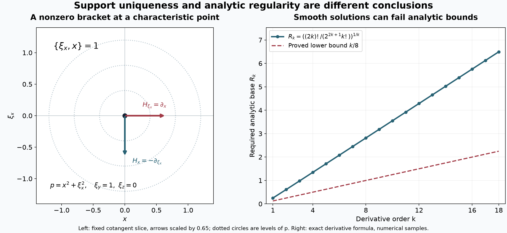

# Analytic equations and characteristic directions

An analytic differential equation determines every noncharacteristic singular direction of its solution from the corresponding direction of its right-hand side. The estimate holds for the analytic wavefront set and for every derivative-growth scale considered here. Its support consequences are stronger than ellipticity: Poisson brackets can rule out the end of a solution's support even when characteristic covectors remain.

We use [Derivative growth and finite-order localization](derivative-growth-and-finite-order-localization.md), especially its analytic derivative bounds, controlled cutoffs and bounded-distribution criterion; [Cones and derivative-growth wavefronts](cones-and-derivative-growth-wavefronts.md), Theorems 3–4 and 7; [Both analytic directions at support boundaries](both-analytic-directions-at-support-boundaries.md), Theorem 1, Corollary 2 and Proposition 3; and [Characteristic motion and closed-set barriers](characteristic-motion-and-closed-set-barriers.md), Corollary 5. Fourier inversion and finite-order pairings have their proofs in the supplied [Fourier foundation](../prerequisites/U011-free-foundations/schwartz-fourier-foundations-U017.md), F1–F5, and [convolution lesson](convolution-as-addition-of-supports.md), B0–B2. The [calculus](../prerequisites/U011-free-foundations/metric-foundation-bridges.md) and [integration](../prerequisites/U011-free-foundations/banach-foundation-bridges.md) foundations supply compactness, Leibniz' rule, convergent power series and the integrals below.

## 1. Symbols, directions and finite derivative budgets

Let \(X\subset\mathbb R^n\) be open, \(n\geq1\). Our coefficients may be complex. Write

\[
 P(x,D)=\sum_{|\alpha|\leq m}a_\alpha(x)D^\alpha,\qquad
 D_j=-i\partial_j,\qquad
 p_m(x,\xi)=\sum_{|\alpha|=m}a_\alpha(x)\xi^\alpha .
 \tag{1}
\]

The characteristic set is \(\operatorname{Char}P=\{(x,\xi):\xi\ne0,\ p_m(x,\xi)=0\}\). A noncharacteristic pair has \(p_m\ne0\). A derivative-growth sequence satisfies

\[
 L_0=1,\quad L_k\geq k,\quad L_k\leq L_{k+1}\leq QL_k.
 \tag{2}
\]

By definition, \((x_0,\xi_0)\notin\operatorname{WF}_L(u)\) when bounded compact distributions \(u_k\), equal to \(u\) on one neighborhood of \(x_0\), satisfy \(|\widehat u_k(\xi)|\leq A(BL_k/|\xi|)^k\) in one cone about \(\xi_0\). Boundedness entails one compact support, one finite distributional order, and uniform constants. We keep this requirement when changing the index of a cutoff.

Here is the estimate that prevents a repeated analytic differentiation from losing an extra factorial. Fix a compact \(K\), and a family of smooth coefficients satisfying uniformly

\[
 \sup_K|\partial^\alpha a|\leq A B_0^{|\alpha|}|\alpha|!,
 \qquad A,B_0\geq1.
 \tag{3}
\]

For \(0\leq r\leq2N\), \(h=(BN)^{-1}\), define a finite seminorm

\[
 \|v\|_{h,r}=\max_{|\alpha|\leq r}h^{|\alpha|}
                                      \sup_K|\partial^\alpha v|,
 \qquad B\geq\max(1,4B_0).
 \tag{4}
\]

**Lemma 1 (spending a derivative budget).** Multiplication by any coefficient in (3) has norm at most \(2A\) in (4). Also

\[
 \|\partial^\beta v\|_{h,r-|\beta|}
       \leq h^{-|\beta|}\|v\|_{h,r},\qquad |\beta|\leq r.
 \tag{5}
\]

Consequently a product of analytic multiplications and derivatives is bounded by multiplying these constants, provided the remaining derivative budget is reduced after each differentiation. The order of the factors is retained.

**Proof.** For \(|\alpha|=l\leq r\), the product rule, grouped by \(d=|\beta|\), gives

\[
 \begin{split}
 h^l\sup_K|\partial^\alpha(av)|
 &\leq A\|v\|_{h,r}
       \sum_{d=0}^l\binom ld d!(B_0h)^d\\
 &\leq A\|v\|_{h,r}
       \sum_{d=0}^l(2B_0/B)^d
 \leq2A\|v\|_{h,r}.
 \end{split}
 \tag{6}
\]

The identity \(\sum_{\beta\leq\alpha,\ |\beta|=d}\binom\alpha\beta=\binom ld\) is the coefficient of \(t^d\) in \(\prod_j(1+t)^{\alpha_j}\). We used \(l\leq2N\). Formula (5) follows by retaining the derivative \(\alpha+\beta\) in the original maximum. Applying these two inequalities from the rightmost factor to the left proves the last assertion. \(\square\)

Analytic coefficients satisfy (3) on compact neighborhoods, by the analytic derivative criterion in the prerequisite lesson. We also need reciprocals uniformly in a frequency direction. Suppose \(g(x,\theta)\) is a finite linear combination of analytic \(x\)-functions with bounded continuous coefficients in \(\theta\), where \(\theta\) ranges over a compact set, and \(|g|\geq c>0\) near \(K\). The Taylor coefficients about any \(x\in K\) have a common absolute majorant \(A_0\sum_{r\geq1}(B_1t)^r\), after dividing \(g(x+\cdot,\theta)-g(x,\theta)\) by \(g(x,\theta)\). Indeed (3), divided by the multi-index factorial, and \(\sum_{|\alpha|=r}r!/\alpha!=n^r\), give that majorant. Choose a common \(\rho>0\) making its value at \(\rho\) at most \(1/2\). The geometric series for the reciprocal converges absolutely there, with absolute coefficient sum at most \(2/c\). Thus

\[
 |\partial^\alpha(g^{-1})(x,\theta)|
      \leq (2/c)\rho^{-|\alpha|}\alpha!
      \leq (2/c)\rho^{-|\alpha|}|\alpha|!.
 \tag{7}
\]

The series equals the ordinary reciprocal by its finite geometric identity and convergence. It therefore supplies its actual derivatives. Products and any fixed number of derivatives of these coefficients again satisfy (3): Leibniz' rule and \((r+s)!\leq C_s^{r+1}r!\), for fixed \(s\), prove this after enlarging constants. The latter inequality follows from \((r+s)!/r!\leq(r+s)^s\), with the fixed polynomial bounded by an exponential. This proves all uniform reciprocal estimates used below.

## 2. Compact amplitudes with an exponential prefactor

The cutoffs used to construct a bounded distribution sequence have uniform fixed-order bounds. The auxiliary amplitudes used inside a transpose identity need a different estimate, permitting an exponential prefactor.

**Lemma 2 (an amplitude estimate on a smaller cone).** Suppose \(K\subset X\) is compact, \(V\) is a closed frequency cone, and
\(\operatorname{WF}_L(f)\cap(K\times(V\setminus0))=\varnothing\). Let \(f\) have order at most \(d\) on a neighborhood of \(K\). Suppose \(b_{N,\lambda}\in C_c^\infty(X)\) is supported in \(K\) and

\[
 \sup_x|\partial^\beta b_{N,\lambda}(x)|
        \leq A^{N+1}N^{|\beta|},\qquad |\beta|\leq N.
 \tag{8}
\]

All constants are independent of the auxiliary parameter \(\lambda\). For \(N>d+n\), set \(k=N-d-n\). Then, uniformly in that parameter,

\[
 |\widehat{b_{N,\lambda}f}(\xi)|
       \leq C^{N+1}(L_k/|\xi|)^k,
 \qquad \xi\in V\setminus0,\quad |\xi|>N.
 \tag{9}
\]

In particular \(\lambda\) may be the frequency \(\xi\) at which the transform is evaluated.

**Proof.** We may discard empty base or angular sets. Closedness of the wavefront set and compactness of \(K\times(V\cap S^{n-1})\) give a compact neighborhood \(K_1\subset X\) of \(K\) and a slightly larger open cone \(\Gamma\) containing \(V\cap S^{n-1}\) in its angular interior, with all pairs over \(K_1\) and the angular closure of \(\Gamma\) still regular. To justify a uniform enlargement, otherwise a sequence of nonregular pairs at distances tending to zero from that compact product would converge to a nonregular pair in the product. Shrink \(K_1\) inside the neighborhood where the order bound \(d\) holds.

Use the controlled cutoffs of the prerequisite lesson supported in \(K_1\), equal to one on a fixed neighborhood of \(K\). Compact localization from the wavefront lesson produces \(f_k\) equal to \(f\) there, with

\[
 |\widehat f_k(\eta)|\leq C_0(1+|\eta|)^d,\qquad
 |\widehat f_k(\eta)|\leq C_0(B_2L_k/|\eta|)^k
                          \quad(\eta\in\Gamma).
 \tag{10}
\]

The first bound has order \(d\), because multiplication by those cutoffs has uniformly bounded derivatives at every fixed order.

Integration by parts up to order \(N\) in a coordinate with largest frequency component, and the zero-order bound in (8), give

\[
 |\widehat b_{N,\lambda}(\zeta)|
       \leq C_1^{N+1}
             \left(\frac{N}{N+|\zeta|}\right)^N .
 \tag{11}
\]

Explicitly the two estimates are \(C^N\) and \(C^N(N/|\zeta|)^N\). Their minimum is at most \(2^N(N/(N+|\zeta|))^N\). The fixed support volume and the factor \(n^{N/2}\) are absorbed into \(C_1^{N+1}\). For \(N\geq n+1\), (11) has integral at most \(C_2^{N+1}\): scale \(\zeta=Ny\), bound the integral of \((1+|y|)^{-N}\) by that of \((1+|y|)^{-n-1}\), and absorb \(N^n\) into an exponential. The integrability follows by the dyadic annulus argument already proved in the wavefront lesson.

The exact Fourier pairing is
\[
 \widehat{b_{N,\lambda}f}(\xi)
 =(2\pi)^{-n}\int
       \widehat b_{N,\lambda}(\xi-\eta)\widehat f_k(\eta)\,d\eta.
 \tag{12}
\]

It follows from Fourier inversion of the smooth compact factor inside the finite-order pairing, with convergence in the necessary finite smooth seminorms; this is the full identity proved in the wavefront lesson, Theorem 3. For each fixed \(N,\lambda\), smooth compact support makes the integral absolutely convergent.

Put \(r=|\xi|>N\). On \(\eta\in\Gamma,\ |\eta|\geq r/2\), the second estimate in (10), together with the integral bound for (11), gives \(C^{N+1}(L_k/r)^k\). On the complement, angular separation or \(|\eta|<r/2\) gives \(|\xi-\eta|\geq c(r+|\eta|)\). The other part of (10) and (11) therefore bound the remaining integral by

\[
 C^{N+1}N^N\int(r+|\eta|)^{-N}(1+|\eta|)^d\,d\eta
       \leq C_3^{N+1}N^N r^{d+n-N}.
 \tag{13}
\]

For the last step scale \(\eta=ry\), use \(r>1\), and dominate by \((1+|y|)^{d-N}\). Its integral is uniformly bounded for the integers \(N\geq d+n+1\). Since \(N=k+d+n\), the elementary fixed-shift estimate
\(N^N\leq C_{d+n}^{N+1}k^k\leq C_{d+n}^{N+1}L_k^k\)
finishes (9). For clarity, divide the first expression by \(k^k\): \((1+(d+n)/k)^k\leq e^{d+n}\), and the remaining fixed power of \(k+d+n\) is bounded by an exponential. Every bound was uniform in \(\lambda\). \(\square\)

## 3. A finite transpose construction

Fix a compact neighborhood \(K\) and a closed cone \(V\) on which \(p_m(x,\xi)\ne0\) for \(\xi\ne0\). Assume \(m\geq1\). Their neighborhoods can be chosen slightly larger with the same property. Homogeneity and the compact unit-frequency slice give \(|p_m(x,\xi)|\geq c|\xi|^m\). Choose real controlled cutoffs \(\chi_{2N}\), supported in \(K\), equal to one on a fixed smaller neighborhood. For every fixed \(\alpha\),
\[
 |\partial^{\alpha+\beta}\chi_{2N}|
       \leq C_\alpha(C_\alpha\,2N)^{|\beta|},
                  \qquad |\beta|\leq2N.
 \tag{14}
\]

We use the bilinear distribution transpose, without complex conjugation:
\({}^tP=\sum_\alpha(-D)^\alpha(a_\alpha\,\cdot)\).
The exact product rule gives
\[
 e^{ix\cdot\xi}{}^tP(e^{-ix\cdot\xi}b)
 =\sum_{\alpha}\sum_{\beta\leq\alpha}
       \binom\alpha\beta \xi^{\alpha-\beta}
                         (-D)^\beta(a_\alpha b).
 \tag{15}
\]

Indeed \((-D_j)(e^{-ix\cdot\xi}c)=e^{-ix\cdot\xi}(\xi_j-D_j)c\). With \(b=w/p_m\), the terms \(|\alpha|=m,\beta=0\) sum to \(w\). Group the remaining terms by \(j=m-|\alpha|+|\beta|\), and define
\[
 R_jw=-\!\!\sum_{\substack{|\alpha|\leq m,\ \beta\leq\alpha\\
                         m-|\alpha|+|\beta|=j}}
    \binom\alpha\beta\,\xi^{\alpha-\beta}
                 (-D)^\beta\left(\frac{a_\alpha}{p_m}w\right),
 \qquad 1\leq j\leq m .
 \tag{16}
\]

These have differential order at most \(j\). After expansion they are \(|\xi|^{-j}\) times a finite sum of analytic coefficients depending on \(x,\theta=\xi/|\xi|\), followed by derivatives of order at most \(j\). All coefficients obey common bounds (3), by (7) applied to \(p_m(x,\theta)\). Thus the identity is
\({}^tP(e^{-ix\cdot\xi}w/p_m)=e^{-ix\cdot\xi}(I-R)w\), where \(R=\sum_{j=1}^mR_j\).

For \(N\geq m\), let \(T=N-m\). Sum every ordered word of total degree at most \(T\), including the empty word:

\[
 \begin{split}
 w_N&=\sum_{j_1+\cdots+j_l\leq T}
                  R_{j_1}\cdots R_{j_l}\chi_{2N},\\
 e_N&=\sum_{j_1+\cdots+j_l>T\ \geq\ j_2+\cdots+j_l}
                  R_{j_1}\cdots R_{j_l}\chi_{2N}.
 \end{split}
 \tag{17}
\]

Each \(j_\nu\) lies in \(\{1,\ldots,m\}\). Left multiplication by \(R\) prepends one letter. Every nonempty word of degree at most \(T\) cancels once; the remaining first-crossing words are precisely the second line. Therefore

\[
 {}^tP(e^{-ix\cdot\xi}w_N/p_m)
          =e^{-ix\cdot\xi}(\chi_{2N}-e_N).
 \tag{18}
\]

Every error word has total degree \(j\) with \(N-m<j\leq N\). The total number of words of positive degree at most \(N\) is at most \(2^N-1\): compositions of \(j\) into positive integers correspond to choices of cuts in its \(j-1\) gaps and number \(2^{j-1}\); restricting each part to at most \(m\) can only reduce the count.

Here are the uniform estimates, including the derivatives needed for distributional pairings:

\[
 \begin{gathered}
 |\partial^\beta R_{j_1}\cdots R_{j_l}\chi_{2N}|
     \leq C^{N+1}N^{j+|\beta|}|\xi|^{-j},
       \qquad j+|\beta|\leq2N,\\
 |\partial^\beta w_N|
  +\left|\partial^\beta\left(\frac{|\xi|^m}{p_m}w_N\right)\right|
     \leq C_4^{N+1}N^{|\beta|},
       \qquad |\beta|\leq N,\quad |\xi|>N,\ \xi\in V.
 \end{gathered}
 \tag{19}
\]

To prove them, choose \(B\) in (4) also large enough that (14) with \(\alpha=0\) gives \(\|\chi_{2N}\|_{h,2N}\leq C\). The finite coefficient expansion of \(R_j\), Lemma 1, and \(h\leq1\), give
\(\|R_jv\|_{h,r-j}\leq C_0h^{-j}|\xi|^{-j}\|v\|_{h,r}\).
Apply this successively, reducing the budget by each actual degree. Since \(l\leq j\), its factors \(C_0^l\), the factors \(B^{j+|\beta|}\), and \(j+|\beta|\leq2N\), give the first line. For the second line each word has \(j\leq N-m\), leaving at least \(N+m\) derivatives. Since \(N/|\xi|<1\), summing at most \(2^N\) words gives the first term there. Multiplication by \(|\xi|^m/p_m=1/p_m(x,\theta)\) has the uniform bound from Lemma 1, using the remaining budget, and gives the other term. This proof estimates ordered words; it does not commute coefficients and derivatives.

## 4. Noncharacteristic directions inherit regularity

**Theorem 3 (analytic differential regularity at every growth scale).** For analytic coefficients in (1) and every admissible \(L\),

\[
 \operatorname{WF}_L(u)\subset
        \operatorname{Char}P\ \cup\ \operatorname{WF}_L(Pu),
                    \qquad u\in\mathcal D'(X).
 \tag{20}
\]

**Proof.** Fix \((x_0,\xi_0)\) outside the right side. Compactness and closedness permit \(K,V\) as in §3, with all pairs over \(K\) in those directions also \(L\)-regular for \(f=Pu\). Choose a compact neighborhood of \(K\) on which \(u\) has order at most \(M\). The distribution \(f\) has order at most \(d=M+m\) there: its pairing is \(u({}^tP\phi)\), and the product rule bounds this by derivatives of \(\phi\) through order \(M+m\), with finitely many fixed coefficient derivatives.

Pairing (18) with \(u\) gives the exact identity

\[
 \widehat{\chi_{2N}u}(\xi)
 =\langle u,e^{-ix\cdot\xi}e_N\rangle
   +\left\langle f,e^{-ix\cdot\xi}\frac{w_N}{p_m}\right\rangle.
 \tag{21}
\]

All test factors are smooth and supported in the fixed compact \(K\). For \(N\geq\max(m,M)\) and \(r=|\xi|>N\), the finite-order estimate and the first line of (19) bound an error word of degree \(j\) by a constant times
\(C^{N+1}N^j r^{M-j}\): a derivative \(\beta\) on that word contributes \((N/r)^{|\beta|}\leq1\) after the other derivatives hit the exponential. Summing the at most \(2^N\) words, with \(N-m<j\leq N\), yields the convenient bound

\[
 |\langle u,e^{-ix\cdot\xi}e_N\rangle|
       \leq C_5^{N+1}N^N r^{M+m-N}.
 \tag{22}
\]

For example, the sharper intermediate bound is
\(C^{N+1}r^M(N/r)^{N-m+1}\); enlarging it gives (22).

Now choose \(N=k+d+n\), \(k\geq1\), and define \(u_k=\chi_{2(k+d+n)}u\). Its fixed-order derivatives of the cutoff are uniformly bounded by (14) with growing order zero. Hence \(u_k\) is a bounded compact sequence of order at most \(M\), and equals \(u\) on one fixed neighborhood.

Apply Lemma 2 to the parameter-dependent amplitudes \(b_{N,\xi}=r^m w_N/p_m\), using (19). Its index \(N-d-n\) is exactly \(k\). The second term in (21) is therefore at most \(r^{-m}C^{N+1}(L_k/r)^k\), which is at most \(C_6^{k+1}(L_k/r)^k\) for \(r>N\). The first term, by (22), is bounded by \(C^{N+1}N^N r^{-k-n}\). The fixed-shift estimate in the proof of Lemma 2 gives \(N^N\leq C^{k+1}L_k^k\), proving the same required bound for this term.

For \(0<r\leq N\), boundedness of \(u_k\) gives \(C(1+N)^M\). Since \(N=k+d+n\leq(d+n+1)L_k\), choosing \(B>2(d+n+1)\) makes \((BL_k/r)^k\geq2^k\). A fixed polynomial in \(k\) is bounded by \(A2^k\) after increasing \(A\). Thus the desired bound holds at low frequency too. The definition of \(L\)-regularity proves (20).

If \(m=0\), at a noncharacteristic point \(a_0\ne0\). The reciprocal argument (7) makes \(1/a_0\) analytic nearby. The multiplier theorem in the wavefront lesson applied to \(u=(1/a_0)f\) gives the conclusion. No division is performed at a characteristic point. Empty \(X\) gives no assertion. \(\square\)

Analytic coefficients are in \(C^L\), since \(k\leq L_k\) and the factorial derivative criterion holds. The forward differential inclusion, proved in the wavefront lesson, therefore also gives

\[
 \operatorname{WF}_L(Pu)\subset\operatorname{WF}_L(u),
 \qquad
 \operatorname{WF}_L(Pu)=\operatorname{WF}_L(u)
                    \text{ off }\operatorname{Char}P .
 \tag{23}
\]

In particular, for an elliptic analytic operator, \(Pu\in C^L\) implies \(u\in C^L\), by the proved wavefront projection theorem. The analytic case uses \(L_k=k+1\).

## 5. Where a solution's support can end

For a relatively closed \(F\), write \(N(F)=\overline{N_e(F)\cup(-N_e(F))}\), with closure in the punctured cotangent space and the minus sign changing only the covector. The support-boundary lesson proves \(N(\operatorname{supp}u)\subset\operatorname{WF}_A(u)\), including complex distributions.

**Corollary 4 (Holmgren uniqueness).** If \(P\) has analytic coefficients and \(Pu=0\), then

\[
 N(\operatorname{supp}u)\subset\operatorname{Char}P.
 \tag{24}
\]

Consequently, if \(u\) vanishes on one side of a \(C^1\) hypersurface near \(a\), and its nonzero normal \(\eta\) at \(a\) is noncharacteristic, then \(u\) vanishes on a neighborhood of \(a\). If \(P\) is elliptic and \(X\) connected, vanishing on one nonempty open subset implies \(u=0\) throughout \(X\).

**Proof.** Apply Theorem 3 with \(L_k=k+1\) and \(Pu=0\), then the support-boundary inclusion. For the surface statement, if \(a\) belonged to the support, a \(C^1\) defining function with the appropriate sign would be a supporting function for that support. The support-boundary lesson, Proposition 3, puts its nonzero differential in the closure of the actual exterior normal set. This contradicts (24). Hence \(a\) is outside the support, which is precisely neighborhood vanishing. In the elliptic case, (24) leaves no normal. Every boundary point of a closed support has a limiting nonzero normal, by that same proposition. The support thus has no relative boundary and is both open and closed. Connectedness and the nonempty open zero set force it to be empty. \(\square\)

**Theorem 5 (the bracket test for support uniqueness).** Let \(\mathcal C_P\) be the smallest collection of smooth functions on \(T^*X\setminus0\) containing every smooth function vanishing on \(\operatorname{Char}P\), and closed under the bracket
\(\{a,b\}=a_\xi\cdot b_x-a_x\cdot b_\xi\).
If \(Pu=0\), every member of \(\mathcal C_P\) vanishes on \(N(\operatorname{supp}u)\). If these functions have no common zero, a solution on connected \(X\) vanishing on a nonempty open set is identically zero. For a one-sided zero set along a \(C^1\) surface, neighborhood vanishing holds whenever at least one member is nonzero at the marked normal.

**Proof.** Put \(F=\operatorname{supp}u\). Corollary 5 of the characteristic-motion lesson says that smooth functions vanishing on \(N_e(F)\) are closed under Poisson brackets. The same holds for \(-N_e(F)\): for the antipodal map \(s(x,\xi)=(x,-\xi)\), the coordinate chain rule gives
\[
 \{a\circ s,b\circ s\}=-\{a,b\}\circ s .
 \tag{25}
\]

Apply the actual-normal result to the two pullbacks. Intersecting these two vanishing classes and then using continuity proves bracket closure of the functions vanishing on \(N(F)\). By (24), this class contains all generators defining \(\mathcal C_P\), so it contains their smallest bracket-closed collection. The last two assertions now follow from the limiting normal at any support boundary and the \(C^1\) supporting-normal argument in Corollary 4. This proves the test for the whole normal closure, not only the actual exterior normals. \(\square\)

*The operator in Exercise 6 is \(D_x^2+x^2D_y^2+D_z^2\). Left: on the slice \(\xi_y=1,\xi_z=0\), its principal symbol is \(x^2+\xi_x^2\), whose characteristic set is the marked point. The Hamilton fields of the vanishing generators \(\xi_x,x\) have bracket \(1\). Right: the exact derivative values of the exhibited solution require analytic derivative bases at least \(R_k=((2k)!/(2^{2k+1}k!))^{1/k}\). The plotted values and the proved bound \(R_k\geq k/8\) show why there is no fixed analytic bound. This is compatible with support uniqueness, as the exercise proves.*

[Vector illustration](../figures/analytic-equation-uniqueness.svg) · [Reproducible figure source](../figures/analytic-equation-uniqueness.py)

## 6. Exercises with complete solutions

**Exercise 1 (a zero-order equation).** Let \(a\) be complex-valued, real analytic, and nonzero on an open \(U\). Prove equality of the \(L\)-wavefront sets of \(u\) and \(au\) over \(U\), and explain the qualification at a zero of \(a\).

**Solution.** Both \(a\) and \(1/a\) are analytic by (7), hence in \(C^L\). Apply the multiplier inclusion to \(au\) and to \(u=(1/a)(au)\). Their two inclusions give equality. At a zero, inversion fails and equality need not hold: on the line, \(a(x)=x\) and \(u=\delta_0\) give \(au=0\), whereas the delta has every nonzero covector over zero in its analytic and \(L\)-wavefront sets by the flat-support calculation in the wavefront lesson.

**Exercise 2 (the signs in a first-order transpose).** For \(P=D+a(x)\) on the line, compute \(R_1\), its square, and the two sums (17).

**Solution.** Here \(p_1=\xi\) and \({}^tP=-D+a\). Thus \(R_1=(D-a)/\xi\), and
\[
 R_1^2v=\xi^{-2}\{D^2v-2aDv+(a^2-Da)v\}.
\]
The coefficient derivative is retained because \(D(av)=(Da)v+aDv\). With \(T=N-1\), \(w_N=\sum_{j=0}^{N-1}R_1^j\chi_{2N}\), while the only first-crossing word is \(e_N=R_1^N\chi_{2N}\). Multiplication by \(I-R_1\) verifies (18) directly. These formulas also check the absence of conjugation in the bilinear transpose.

**Exercise 3 (elliptic regularity at the analytic endpoint).** Let \(\Delta u=f\) distributionally on an open set, with real analytic \(f\). Prove that \(u\) is real analytic. State the corresponding Gevrey conclusion.

**Solution.** In convention (1) the principal symbol of \(\Delta\) is \(-|\xi|^2\), nonzero for every nonzero real covector. Theorem 3 gives \(\operatorname{WF}_A(u)\subset\operatorname{WF}_A(f)=\varnothing\). Projection of the analytic wavefront set is exactly analytic singular support, so \(u\) is analytic. For \(L_k=(k+1)^s\), \(s\geq1\), the identical argument proves local Gevrey order \(s\) when \(f\) has that order. Neither assertion requires compact support.

**Exercise 4 (a nonsmooth second derivative of the surface).** Near the origin in \(\mathbb R^2\), suppose \((D_x+D_y)u=0\) and \(u=0\) where \(x>|y|^{3/2}\). Prove neighborhood vanishing at the origin.

**Solution.** The defining function \(g(x,y)=x-|y|^{3/2}\) is \(C^1\), with \(dg(0)=(1,0)\), although its second \(y\)-derivative does not exist at zero. The principal symbol \(\xi_x+\xi_y\) equals one at this normal. Corollary 4 therefore proves the claim. Its use of limiting normals is what allows the \(C^1\) surface.

**Exercise 5 (a chain of bracket constraints).** On \(\mathbb R^n\), consider the principal polynomial
\[
 p(x,\xi)=\xi_1^2+\sum_{j=1}^{n-1}x_j^2\xi_{j+1}^2.
\]
Show that any analytic differential operator with this principal symbol has open-set uniqueness for distributional homogeneous solutions on a connected domain.

**Solution.** Since the real summands are nonnegative, \(\xi_1\) and every \(x_j\xi_{j+1}\) vanish on \(\operatorname{Char}P\). The first are therefore generators of \(\mathcal C_P\). If \(\xi_j\) has been obtained, its bracket with \(x_j\xi_{j+1}\) is \(\xi_{j+1}\). Induction gives every \(\xi_j\). They have no common zero in the punctured cotangent space, so Theorem 5 applies. For \(n=1\) the initial generator alone suffices. Analytic lower-order terms do not alter this principal-symbol test.

**Exercise 6 (uniqueness without analytic hypoellipticity).** For
\[
 P=D_x^2+x^2D_y^2+D_z^2,\qquad
 u(x,y,z)=\int_0^\infty
       e^{tz+i t^2y-t^2x^2/2-2t}\,dt,\qquad z<2,
\]
prove that \(u\) is smooth and solves \(Pu=0\), but is not analytic at zero. Prove also that this operator has the open-set uniqueness property.

**Solution.** On a compact subset of \(z<2\), each fixed derivative of the integrand is a polynomial in \(t,x\) times that integrand. For real variables its modulus is bounded by a fixed polynomial in \(t\) times \(e^{-\varepsilon t}\), with \(\varepsilon>0\). These functions are integrable, so dominated differentiation gives smoothness at every order. On the integrand, \(D_x^2\) contributes \(t^2-t^4x^2\), \(x^2D_y^2\) contributes \(x^2t^4\), and \(D_z^2\) contributes \(-t^2\). Their sum is zero.

At zero, \(|D_y^ku(0)|=\int_0^\infty t^{2k}e^{-2t}\,dt=(2k)!/2^{2k+1}\). This moment formula follows by integration by parts recursively from \(\int_0^\infty e^{-2t}dt=1/2\); all endpoint terms vanish because exponential decay dominates each fixed power. If \(u\) were analytic, these derivatives would be at most \(AB^kk!\). But \((2k)!/k!=\prod_{j=k+1}^{2k}j\geq k^k\), so their ratio to \(k!\), raised to \(1/k\), is at least \(k/(4\,2^{1/k})\geq k/8\). It cannot be bounded by \(A^{1/k}B\).

For real nonzero \(\xi\), the characteristic equations are \(\xi_x=0,\xi_z=0,x=0\), with \(\xi_y\ne0\). Thus the functions \(\xi_x\) and \(x\) vanish on the whole characteristic set and have bracket \(\{\xi_x,x\}=1\). Theorem 5 gives open-set uniqueness. The example distinguishes that property from the implication that every smooth homogeneous solution is analytic. Theorem 3 only confines its analytic wavefront set to the stated characteristic set.

**Exercise 7 (a complex first-order principal symbol).** For \(P=D_x+i xD_y\), determine its real characteristic set and the bracket test for support uniqueness.

**Solution.** The complex symbol is \(\xi_x+i x\xi_y\). Its zero requires \(\xi_x=0\) and \(x\xi_y=0\); since the covector is nonzero, this gives \(x=0,\xi_y\ne0\). Both real functions \(x,\xi_x\) vanish on this set and \(\{\xi_x,x\}=1\). Theorem 5 gives open-set uniqueness on connected domains and excludes every possible nonzero supporting normal of a solution's support. The proof of Theorem 3 permits complex coefficients throughout.

**Exercise 8 (an exact derivative-count identity).** For \(j\geq1\), expand
\[
 (X_1+\cdots+X_j)(X_2+\cdots+X_j)\cdots X_j
       =\sum C_{k_1,\ldots,k_j}X_1^{k_1}\cdots X_j^{k_j}.
\]
Prove \(\sum C_{k_1,\ldots,k_j}k_1!\cdots k_j!=(2j-1)!!\), and explain its relation to nested coefficient differentiation.

**Solution.** Integrate the polynomial times \(e^{-(X_1+\cdots+X_j)}\) over the positive orthant. Finite sums and product integration give the stated factorial sum, since \(\int_0^\infty X^ke^{-X}dX=k!\), proved by the same integration-by-parts recursion as in Exercise 6. Set \(Y_l=X_l+\cdots+X_j\). This triangular linear substitution has determinant one and gives \(0<Y_j<\cdots<Y_1\), with integrand \(Y_1\cdots Y_je^{-Y_1}\). For fixed \(Y_1=s\), the integral of \(Y_2\cdots Y_j\) over the ordered region is \(s^{2j-2}/(2^{j-1}(j-1)!)\). One proof is symmetry: the product on the cube \((0,s)^{j-1}\) is symmetric, its equal ordered pieces number \((j-1)!\), and its cube integral is \((s^2/2)^{j-1}\); diagonals have measure zero by covering them with strips of total volume tending to zero. The remaining integral is therefore \((2j-1)!/(2^{j-1}(j-1)!)=(2j-1)!!\).

In a word \(\partial_{i_1}a_1\partial_{i_2}a_2\cdots a_{j-1}\partial_{i_j}v\), the \(l\)-th derivative can fall on any factor to its right, indexed \(l,\ldots,j\). Recording only how many derivatives fall on each factor gives exactly the displayed polynomial. It retains multiplicities even when coordinate directions repeat. Analytic coefficient estimates weight a factor receiving \(k_l\) derivatives by \(k_l!\), producing this identity. For \(j\leq N\), \((2j-1)!!=\prod_{l=1}^j(2l-1)\leq(2N)^j\). Lemma 1 supplies a separate proof of the required bound directly in finite derivative seminorms.

## Mathematical sources

Lars Hörmander, *The Analysis of Linear Partial Differential Operators I*, second edition, 2003 reprint, §8.6, Theorems 8.6.1, 8.6.5 and 8.6.6, Lemmas 8.6.2–8.6.4, and the two following examples ([edition](https://doi.org/10.1007/978-3-642-61497-2)). The exposition uses a finite weighted-seminorm proof for the ordered derivative estimate and supplies the full transpose, frequency split and support arguments. The characteristic-half-space converse is a separate theorem and is not asserted here.

*AI-assisted exposition and reproducible illustration: GPT-6 Astra (OpenAI). Original programme text and figures: CC0 1.0 to the extent rights exist. Earlier programme proofs retain their stated authorship and licences. *
