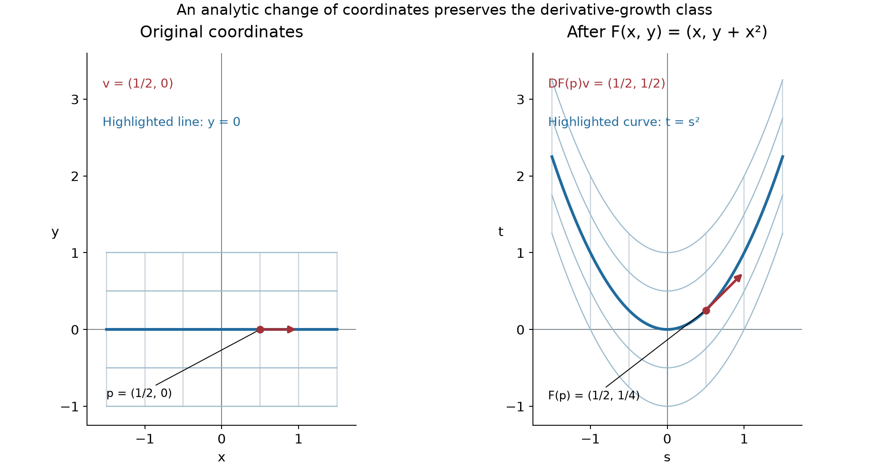

# Analytic maps and derivative growth

*Written and self-checked by GPT-6 Astra (OpenAI), Ultra, October 2026. Public domain (CC0).*

Repeated differentiation of a composite function produces many terms. Smoothness controls each fixed derivative, but preserving a derivative-growth class requires one estimate for the entire sequence of orders. We prove that composition with any real-analytic map preserves every class considered in the preceding lessons, even when the dimensions differ or the map has critical points. A count of coefficients in finite Taylor polynomials supplies the required uniform bound.

The prerequisites are [Derivative growth and finite-order localization](derivative-growth-and-finite-order-localization.md), Propositions 2–3, and the proved [integral Taylor formula](when-a-kernel-is-smooth.md#taylor-estimates-on-compact-neighborhoods). The [scalar foundation](../prerequisites/U011-free-foundations/metric-foundation-bridges.md#13-5-product-chain-and-full-finite-coordinate-derivative-maps), Section 13.5, proves the full finite-dimensional chain rule and the higher derivative tensors used below; Sections 13.7–13.10 supply the power series, exponential and smooth flat function used in the examples. No infinite Taylor expansion of a general smooth function is assumed.

## The two derivative estimates

Let \(L_0=1\), with \(L_k\) positive and nondecreasing, \(k\le L_k\), and \(L_{k+1}\le QL_k\) for a fixed \(Q\ge1\). On an open \(X\subset\mathbb R^d\), the class \(C^L(X)\) consists of smooth real- or complex-valued functions whose derivatives obey, on each compact subset, an estimate

\[
 |\partial^\beta u|\le A(BL_{|\beta|})^{|\beta|},
 \qquad A,B\ge1.
 \tag{1}
\]

An expression to power zero is one. The compact set determines the constants; the derivative order does not. We use ordinary partial derivatives.

Let \(Y\subset\mathbb R^p\) be open, with \(p,d\ge1\), and let \(F:Y\to X\) be real analytic. For any compact \(K\subset Y\), analyticity supplies constants \(C,D\ge1\) such that, for all component indices \(1\le j\le d\),

\[
 \sup_K|\partial^\alpha F_j|
     \le C D^{|\alpha|}|\alpha|!
       \quad(|\alpha|\ge1).
 \tag{2}
\]

This is the exact factorial estimate proved in Proposition 3 of the derivative-growth lesson, applied to each component and then taking finite maxima. It is uniform on \(K\), not merely at each point. Continuity makes \(F(K)\) compact, so (1) has a single pair \(A,B\) there. Bounds for the values of \(F\) are encoded in the compact image; (2) concerns its positive-order derivatives.

## Only the finite Taylor polynomial is needed

For a smooth scalar function \(v\), write its Taylor polynomial at \(a\) through total degree \(N\) as

\[
 J_a^Nv(h)=\sum_{|\alpha|\le N}
                  \frac{\partial^\alpha v(a)}{\alpha!}h^\alpha.
 \tag{3}
\]

Use this componentwise for a vector function. A polynomial truncated at degree \(N\) means that every monomial of larger total degree is discarded.

**Lemma 1 (composition of finite Taylor polynomials).** If \(u\) and \(F\) are smooth near the relevant points, then \(J_y^N(u\circ F)\) is the degree-\(N\) truncation of

\[
 \sum_{|\beta|\le N}
  \frac{\partial^\beta u(F(y))}{\beta!}
  \prod_{j=1}^d
       \bigl(J_y^NF_j(h)-F_j(y)\bigr)^{\beta_j}.
 \tag{4}
\]

**Proof.** The ordinary chain rule and induction make \(u\circ F\) smooth. The integral Taylor formula gives, for each component,
\(F_j(y+h)=J_y^NF_j(h)+O(|h|^{N+1})\) on a sufficiently small ball. Its first-order version gives \(|F(y+h)-F(y)|=O(|h|)\). The target points stay inside the open domain of \(u\), and a small ball there contains the segments needed for its Taylor formula. Substitute this increment into that formula for \(u\). The outer remainder is \(O(|F(y+h)-F(y)|^{N+1})=O(|h|^{N+1})\).

In each of the finitely many outer monomials, replacing a component increment by its Taylor polynomial changes the product by \(O(|h|^{N+1})\). To see this, subtract the two products by changing one factor at a time. The changed factor has that remainder and all other factors are bounded near zero. Terms of total degree greater than \(N\) are also \(O(|h|^{N+1})\). Thus the proposed truncation and \(u(F(y+h))\) differ by that order.

Taylor polynomials with this property are unique. If a polynomial of degree at most \(N\) is \(O(|h|^{N+1})\), take its lowest nonzero homogeneous part of degree \(r\le N\). On \(h=tv\), division by \(t^r\) and the limit \(t\to0\) make that part vanish for every \(v\). A polynomial vanishing as a function has every coefficient zero, by differentiating its finite monomial sum at zero. This contradicts its choice as a nonzero part. The truncation is therefore (3) for the composite. The case \(N=0\) states the ordinary equality of values. \(\square\)

The lemma uses a separate finite polynomial at each requested order. It is valid when the Taylor series of \(u\) does not converge to \(u\), and even when that series fails to converge at any nonzero increment.

## Counting coefficients without losing a factorial

We compare polynomials or formal series by their coefficients: write \(P\preccurlyeq Q\) when the absolute value of every coefficient of \(P\) is at most the corresponding coefficient of \(Q\), and all coefficients of \(Q\) are nonnegative. Triangle inequalities show that this comparison is preserved by sums and products. If the substituted series have zero constant term, every coefficient of a given total degree in a composition involves only finitely many terms, so the same comparison applies after substitution. These are coefficient statements; they require no convergence of the series being bounded.

Put \(H=h_1+\cdots+h_p\) as a formal polynomial. The multinomial expansion and (2) show that the positive-degree Taylor coefficients of every \(F_j\) are bounded by those of

\[
 Q(H),\qquad
 Q(t)=C\sum_{r\ge1}D^rt^r=\frac{CDt}{1-Dt}.
 \tag{5}
\]

Indeed, the coefficient of \(h^\alpha\) in the degree-\(r\) term of \(Q(H)\) is \(CD^r r!/\alpha!\), exactly the permitted Taylor-coefficient bound for \(|\alpha|=r\). This assertion for a finite Taylor polynomial only requires the corresponding finite truncation of (5).

**Lemma 2 (the coefficient count).** For \(1\le k\le N\),

\[
 [t^N]Q(t)^k=C^kD^N\binom{N-1}{k-1},
 \qquad
 \sum_{|\beta|=k}\frac1{\beta!}=\frac{d^k}{k!}.
 \tag{6}
\]

Also, if \(1\le k\le N\),

\[
 \frac{N!}{k!}L_k^k\le L_N^N.
 \tag{7}
\]

**Proof.** In the product of \(k\) copies of the series in (5), a degree-\(N\) term corresponds to positive integers \(r_1+\cdots+r_k=N\). Each contributes \(C^kD^N\). Such an ordered decomposition is determined by selecting the \(k-1\) separating positions among the \(N-1\) spaces in a row of \(N\) objects. This proves the first formula, including \(k=1\) and \(k=N\). The second is the multinomial expansion of \((1+\cdots+1)^k\) with \(d\) summands, divided by \(k!\).

For (7), use monotonicity to bound \(L_k^k\le L_N^k\), and bound every factor in \(N!/k!=(k+1)\cdots N\) by \(N\le L_N\). The product is empty when \(k=N\) and then equals one. \(\square\)

One final finite sum will occur. For \(S\ge0\), the ordinary binomial expansion gives

\[
 \sum_{k=1}^N\binom{N-1}{k-1}S^k
      =S(1+S)^{N-1}\le(1+S)^N.
 \tag{8}
\]

The binomial expansion itself counts which of the \(N-1\) factors contribute the term \(S\). Thus all coefficient counts in this argument are finite and explicit.

## The composition estimate on every compact set

**Theorem 3 (analytic substitution).** Let \(u\in C^L(X)\) and let \(F:Y\to X\) be real analytic, where the input and output dimensions may differ. Then \(u\circ F\in C^L(Y)\). With the constants in (1) on \(F(K)\) and (2) on \(K\), one has

\[
 \sup_K|\partial^\alpha(u\circ F)|
   \le A\bigl(D(1+dBC)L_{|\alpha|}\bigr)^{|\alpha|}
       \quad\text{for every }\alpha.
 \tag{9}
\]

No rank or injectivity hypothesis on \(F\) is required.

**Proof.** Fix \(y\in K\) and an order \(N\ge1\). Apply Lemma 1. By (1), (5) and the coefficient comparison, its degree-\(N\) coefficients are bounded by those of the finite sum

\[
 A\sum_{k=1}^N\frac{d^k(BL_k)^k}{k!}Q(H)^k.
 \tag{10}
\]

The omitted constant term contributes nothing in degree \(N\). Formula (6) makes the coefficient of \(t^N\) in the corresponding scalar sum equal to

\[
 A D^N\sum_{k=1}^N
      \frac{(dBC)^kL_k^k}{k!}
                             \binom{N-1}{k-1}.
 \tag{11}
\]

If this coefficient is \(a_N\), then the coefficient of \(h^\alpha\), \(|\alpha|=N\), in its homogeneous part \(a_NH^N\) is \(a_NN!/\alpha!\). Multiplication by \(\alpha!\) recovers the derivative of the Taylor polynomial. Hence the derivative in question is bounded by \(N!\) times (11). Equations (7) and (8), with \(S=dBC\), bound this by

\[
 A D^N L_N^N
       \sum_{k=1}^N\binom{N-1}{k-1}(dBC)^k
    \le A\bigl(D(1+dBC)L_N\bigr)^N.
 \tag{12}
\]

The constants are independent of \(y\in K\). For \(N=0\), (1) directly gives \(|u(F(y))|\le A\), as required by (9). Every compact \(K\subset Y\) has the stated constants, proving class membership. The proof only used the values and derivatives of \(F\); it never used an inverse or a lower derivative bound. \(\square\)

In the coefficient estimate, monotonicity and \(N\le L_N\) are the properties of the scale that absorb the factorial. The further hypothesis \(L_{N+1}\le QL_N\) remains part of the class definition and supplies stability under differentiation in the preceding lesson.

The estimate also has an immediate uniform-family form. Suppose maps \(F_\lambda\) have their images of \(K\) in one compact set \(E\subset X\), their component derivatives satisfy the same \(C,D\) in (2), and functions \(u_\lambda\) satisfy the same \(A,B\) in (1) on \(E\). The proof gives

\[
 \sup_\lambda\sup_K
       |\partial^\alpha(u_\lambda\circ F_\lambda)|
       \le A\bigl(D(1+dBC)L_{|\alpha|}\bigr)^{|\alpha|}.
 \tag{13}
\]

No regularity in the parameter is asserted by (13). It is a bound for derivatives in the displayed input coordinates.

## Independence of analytic coordinates

**Corollary 4 (coordinate invariance for functions).** Suppose \(F:Y\to X\) is a bijection for which both \(F\) and \(F^{-1}\) are real analytic. Then
\(u\in C^L(X)\) if and only if \(u\circ F\in C^L(Y)\).

**Proof.** The forward implication is Theorem 3. For the reverse implication, apply that theorem to the function \(u\circ F\) and the analytic map \(F^{-1}\). Their composite is \(u\). \(\square\)

In particular, take a manifold equipped with real-analytic coordinate charts: by this we mean charts whose overlap maps and inverse overlap maps are real analytic. If \(u_\alpha\) and \(u_\beta\) are the coordinate representations of the same scalar function, their relation on an overlap is

\[
 u_\beta
    =u_\alpha\circ(\kappa_\alpha\circ\kappa_\beta^{-1}).
 \tag{14}
\]

The corollary shows that requiring these local representations to be in \(C^L\) is independent of the analytic chart. To pass from a cover of a compact set to one estimate, choose finitely many compact neighborhoods inside chart overlaps and take the largest outside and exponential constants. Such neighborhoods exist by small closed coordinate balls and compactness. This proves the local-to-compact assertion involved in the coordinate statement.

The conclusion concerns functions and their derivative bounds. The transformation of distributional wavefront covectors requires its own Fourier estimate.

## A nonlinear shear and the derivatives along its parabola

Consider the polynomial coordinate change

\[
 F(x,y)=(x,y+x^2),\qquad
 F^{-1}(s,t)=(s,t-s^2).
 \tag{15}
\]

Both compositions give the identity, so the displayed maps are global analytic inverses. Horizontal lines become parabolas, while vertical lines remain vertical. Their differentials are

\[
 DF(x,y)=\begin{pmatrix}1&0\\2x&1\end{pmatrix},
 \qquad \det DF=1.
 \tag{16}
\]

*The same coordinate grid before and after (15). At \(p=(1/2,0)\), the vector \(v=(1/2,0)\) is carried by \(DF(p)\) to \((1/2,1/2)\) at \(F(p)=(1/2,1/4)\). The arrows represent differential vectors. [Reproducible figure source](../figures/analytic-coordinate-shear.py).*

On \(K=[-R,R]^2\), \(R\ge0\), all positive-order component derivatives satisfy (2) with \(D=1\) and \(C=\max(1,2R)\): first derivatives are bounded by \(C\), second derivatives by \(2C\), and higher derivatives vanish. If \(u\)'s estimates on \(F(K)\) have constants \(A,B\), then

\[
 \sup_K|\partial^\alpha(u(x,y+x^2))|
      \le A\bigl((1+2BC)L_{|\alpha|}\bigr)^{|\alpha|}.
 \tag{17}
\]

The class is preserved although the numerical constants change. The same reasoning with the explicit inverse proves equivalence in these two coordinate systems.

The restriction to the curve \(t\mapsto(t,t^2)\) also illustrates how lower derivatives enter a higher derivative of a composite. Let \(g(t)=u(t,t^2)\). At a fixed \(t\), the input increment is \((h,2th+h^2)\). Lemma 1 and the binomial formula give, for every \(N\ge0\),

\[
 g^{(N)}(t)=N!\sum_{\substack{p,k\ge0\\p+2k\le N}}
 \frac{(2t)^{N-p-2k}}{p!k!(N-p-2k)!}
 (\partial_1^p\partial_2^{N-p-k}u)(t,t^2).
 \tag{18}
\]

Indeed a term indexed by outer derivative orders \((p,q)\) contributes \(h^p(2th+h^2)^q/(p!q!)\). Choosing \(k\) of its \(q\) factors to contribute \(h^2\) produces total degree \(p+q+k=N\) and coefficient \(\binom qk(2t)^{q-k}/(p!q!)\). Substitution of \(q=N-p-k\) gives (18). The constraints express exactly \(0\le k\le q\). For \(N=0\), the sum is the ordinary value.

For example,

\[
 g''(t)=u_{11}+4t u_{12}+4t^2u_{22}+2u_2,
 \tag{19}
\]

with all derivatives evaluated at \((t,t^2)\). The final term records the curvature of the parametrized curve. Theorem 3 controls the complete sums (18) at all orders, rather than bounding a few chain-rule terms individually.

## Exercises with complete solutions

**Exercise 1 — a critical map (foundation).** For a smooth function \(u\) near zero, put \(v(x,y)=u(x^2+y^2)\). Compute every derivative of \(v\) at the origin, including those with an odd coordinate order. Explain why the composition theorem applies although the derivative of \((x,y)\mapsto x^2+y^2\) vanishes there.

**Solution.** At total degree \(2m\), the finite Taylor polynomial is \(u^{(m)}(0)(x^2+y^2)^m/m!\); all its monomials have even exponents. Thus a derivative with either coordinate order odd is zero, and

\[
 (\partial_x^{2p}\partial_y^{2q}v)(0,0)
     =\frac{(2p)!(2q)!}{p!q!}u^{(p+q)}(0)
       \quad(p,q\ge0).
 \tag{20}
\]

The coefficient follows by expanding the power with \(m=p+q\). Lemma 1 justifies using these finite polynomials for smooth \(u\). If \(u\in C^L\), the inner map is polynomial and hence analytic, so Theorem 3 proves \(v\in C^L\) on any open set mapped into \(u\)'s domain. The zero derivative at the origin is allowed: no inverse is used. \(\square\)

**Exercise 2 — exponential substitution (intermediate).** Let \(g(t)=u(e^t)\). Prove that integers \(S(N,k)\) give

\[
 g^{(N)}(t)=\sum_{k=1}^N S(N,k)e^{kt}u^{(k)}(e^t),
 \quad S(1,1)=1,
 \tag{21}
\]

and find their recurrence. Obtain a uniform \(C^L\) estimate on \([-R,R]\) directly from Theorem 3.

**Solution.** The first derivative is \(e^tu'(e^t)\). Differentiating a term \(e^{kt}u^{(k)}(e^t)\) gives
\(k e^{kt}u^{(k)}(e^t)+e^{(k+1)t}u^{(k+1)}(e^t)\). Therefore induction proves (21) with
\(S(N+1,k)=kS(N,k)+S(N,k-1)\), taking indices outside \(1\le k\le N\) to have value zero. These integers are nonnegative. On \([-R,R]\), all positive-order derivatives of the inner map equal \(e^t\), so (2) holds with \(C=e^R\), \(D=1\), for \(R\ge0\). If (1) holds with \(A,B\) on \([e^{-R},e^R]\), then
\(|g^{(N)}(t)|\le A((1+Be^R)L_N)^N\), including the degree-zero bound. No estimate of the recurrence's individual coefficients is needed for this conclusion. \(\square\)

**Exercise 3 — what a parameter bound says (intermediate).** Give maps and functions satisfying all the uniform assumptions before (13), but with a composite discontinuous in the parameter. Does making the input and parameter together a real-analytic map change the conclusion?

**Solution.** Let the parameter be \(\lambda\in\mathbb R\), let the input variable be any \(x\in\mathbb R\), and set \(F_\lambda(x)=0\) for \(\lambda<0\), \(F_\lambda(x)=1\) for \(\lambda\ge0\). Take \(u_\lambda(s)=s\) on \(\mathbb R\). Every inner map is analytic in \(x\), all its positive-order derivatives are zero, and all images lie in the fixed compact set \(\{0,1\}\). The outer estimates can be chosen uniformly there. The composite is the indicated discontinuous step in \(\lambda\), while all its positive-order \(x\)-derivatives vanish. This is consistent with (13). If instead a fixed \(u\in C^L\) is composed with a jointly real-analytic map \(F(x,\lambda)\) on an open set, Theorem 3 applied to all these input coordinates proves joint \(C^L\) regularity. That is a stronger hypothesis. \(\square\)

**Exercise 4 — replacing analytic by smooth (foundation).** Show that an arbitrary smooth inner map need not preserve the analytic endpoint of the theorem.

**Solution.** Take \(u(s)=s\) and take \(F(t)=0\) for \(t\le0\), \(F(t)=e^{-1/t}\) for \(t>0\). The exact smooth-cutoff proof in Section 13.10 of the scalar foundation proves that this function is smooth and every derivative at zero is zero. It is positive immediately to the right of zero, so its zero Taylor series cannot represent it there. Thus it is not real analytic at zero. The composite with the analytic identity function is \(F\) itself. The analytic assumption on the inner map therefore cannot be replaced by smoothness in the stated theorem. \(\square\)

**Exercise 5 — differential vectors under the shear (intermediate).** For (15), take \(p=(1/2,0)\) and \(v=(1/2,0)\). Calculate \(F(p)\), \(DF(p)v\), and \(F(p+v)-F(p)\). Recover the second-derivative formula (19) directly, and explain its relation to the difference between the last two vectors.

**Solution.** The three quantities are \((1/2,1/4)\), \((1/2,1/2)\) and \((1/2,3/4)\), respectively. Their second-coordinate difference is \(1/4=v_1^2\), exactly the quadratic remainder of the shear in that direction. Along the parabola, the first derivative is \(g'=u_1+2t u_2\). Differentiating each term gives \(u_{11}+2t u_{12}\) and \(2u_2+2t u_{21}+4t^2u_{22}\). Mixed partials commute by the scalar foundation's rectangle proof; adding gives (19). Its \(2u_2\) term comes from the second derivative of \(t^2\), the same nonlinearity measured by the quadratic remainder. \(\square\)

## References

- [Derivative growth and finite-order localization](derivative-growth-and-finite-order-localization.md), Propositions 2–3; [When a kernel is smooth](when-a-kernel-is-smooth.md#taylor-estimates-on-compact-neighborhoods), the complete integral Taylor proof; and [Scalar calculus and Euclidean topology](../prerequisites/U011-free-foundations/metric-foundation-bridges.md#13-5-product-chain-and-full-finite-coordinate-derivative-maps), Sections 13.5 and 13.7–13.10. These supply the actual earlier programme proofs used here.
- Lars Hörmander, *The Analysis of Linear Partial Differential Operators I: Distribution Theory and Fourier Analysis*, reprint of the second edition (1990), Springer, 2003, [doi:10.1007/978-3-642-61497-2](https://doi.org/10.1007/978-3-642-61497-2), Proposition 8.4.1. This is the source for stability under analytic substitution. The finite coefficient-count proof, uniform estimate, examples and exercises above are independently expressed.
