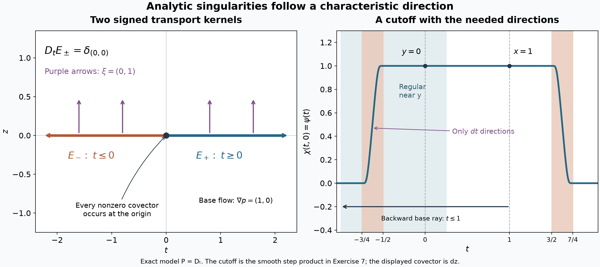

# Analytic parametrices and straight characteristics

*Written by GPT-6 Astra (OpenAI), October 2026. Public domain (CC0). *

A directional inverse can carry a singularity forward or backward along a characteristic line. To use that inverse at analytic regularity, its error must itself be analytic. We construct two such inverses for constant-coefficient equations, prove their analytic wavefront bounds, and then propagate singularities at every derivative-growth scale. The spatial cutoff in the propagation argument is smooth; we keep track of the analytic directions it introduces.

Use \(D=-i\partial\), the Fourier inverse factor \((2\pi)^{-n}\), and complex-linear distribution pairings. Let \(n\ge1\) and let \(P\) be a polynomial of degree \(m\ge1\). Its top homogeneous part is denoted by \(p\). Here **real principal type** means
\[
 p(\xi)\in\mathbb R\quad(\xi\in\mathbb R^n),\qquad
 \nabla p(\xi)\ne0\quad(\xi\ne0,\ p(\xi)=0).
 \tag{1}
\]
The lower coefficients may be complex. Euler's identity
\(\xi\cdot\nabla p(\xi)=mp(\xi)\), obtained by differentiating \(p(r\xi)=r^mp(\xi)\) at \(r=1\), shows that \(\nabla p\ne0\) at every real \(\xi\ne0\), including noncharacteristic points.

The available proofs used below are [holomorphic boundary directions](holomorphic-boundaries-and-analytic-directions.md), Theorem 2; [conic decomposition](boundary-regularity-and-conic-decomposition.md), Theorem 4; [analytic pullback](analytic-pullback-and-cotangent-directions.md), Theorem 2; [convolution directions](keeping-zero-covectors-in-kernel-operations.md), Corollary 7; and [analytic differential regularity](analytic-equations-and-characteristic-directions.md), Theorem 3. [Cones and derivative-growth wavefronts](cones-and-derivative-growth-wavefronts.md), Theorems 5–7, supplies projection, comparison, multiplication and differentiation. [Convolution as addition of supports](convolution-as-addition-of-supports.md), B0–B3 and Theorem 1.1, supplies distributional pairings and derivative commutation. [Holomorphic boundaries in convex cones](holomorphic-boundaries-in-convex-cones.md) supplies the polydisk proof turning coordinate holomorphy into power series. The supplied [Fourier](../prerequisites/U011-free-foundations/schwartz-fourier-foundations-U017.md), [integration](../prerequisites/U011-free-foundations/banach-foundation-bridges.md), [finite-algebra](../prerequisites/U011-free-foundations/stable-prerequisite-bridges.md) and [metric/calculus](../prerequisites/U011-free-foundations/metric-foundation-bridges.md) readings justify the inversions, finite-order pairings, determinants, compactness and cutoffs used here.

## 1. A coordinate formula for contour deformation

The contour argument follows from a determinant identity and coordinate integration by parts.

**Lemma 1 (graph homotopy identity).** Let \(F(\xi,s)\in\mathbb C^n\) be \(C^2\) in \((\xi,s)\), and let \(h\) be holomorphic near the image in question. Write \(A_j=\partial_{\xi_j}F\), \(b=\partial_sF\), and \(J=\det(A_1,\ldots,A_n)\). Then
\[
 \partial_s\{h(F)J\}
  =\sum_{j=1}^n\partial_{\xi_j}
       \{h(F)\det(A_1,\ldots,A_{j-1},b,A_{j+1},\ldots,A_n)\}.
 \tag{2}
\]
Thus, with \(B_j\) denoting the expression in braces on the right and with a compactly supported \(C^1\) weight \(a\),
\[
 \frac{d}{ds}\int a(\xi)h(F(\xi,s))J(\xi,s)\,d\xi
      =-\sum_j\int(\partial_j a)B_j\,d\xi .
 \tag{3}
\]
It suffices that \(h\) be defined near the portion on which \(a\) or its derivatives are nonzero.

**Proof.** In differentiating the right side, the derivatives falling on \(h\) sum to \(dh(F)b\,J\). This is the cofactor identity
\(\sum_j A_j\det(A_1,\ldots,b,\ldots,A_n)=b\det A\):
expanding a component along the replaced column gives the corresponding determinant if that component agrees, and a determinant with two equal rows otherwise. It holds even when \(A\) is singular.

The derivatives falling on the replaced column give
\(h(F)\sum_j\det(A_1,\ldots,\partial_jb,\ldots,A_n)\), which is \(h(F)\partial_sJ\). The remaining terms cancel in pairs. The term where \(\partial_j\) differentiates column \(k\ne j\) has \(b\) in column \(j\) and \(\partial_j\partial_kF\) in column \(k\). Its partner has these two columns exchanged, and the same mixed derivative, so has the opposite determinant. This proves (2). The holomorphic chain rule is what excludes derivatives in \(\overline F\). Integrating the coordinate derivatives against \(a\), one coordinate at a time, proves (3); compact support removes the endpoint terms. Differentiation under this finite integral follows from continuity of the derivatives. A partition or a cutoff restricting to the stated portion gives the last assertion. \(\square\)

We will pass from compact weights to an unbounded graph only with explicit bounds on the resulting cutoff terms.

## 2. A displacement on which the polynomial does not vanish

**Lemma 2 (positive imaginary displacement).** Suppose \(Q\) has degree \(q\ge2\), with real principal part \(q_q\) and nonzero gradient at every real nonzero point. Put
\[
 v(\xi)=|\xi|^{1-q}\nabla q_q(\xi),\qquad \xi\ne0.
 \tag{4}
\]
There are \(t>0\) and \(R>0\) such that
\[
 \operatorname{Im}Q(\xi+itv(\xi))\ge 2|\xi|^{q-1}
                  \quad(|\xi|\ge R).
 \tag{5}
\]
If a unit real vector \(V\) and a closed set of directions satisfy
\(\nabla q_q(\xi)\cdot V\ge c_0|\xi|^{q-1}\) there, with \(c_0>0\), then, after increasing \(R\), some \(\epsilon>0\) gives
\[
 \operatorname{Im}Q(\xi+itv(\xi)+isV)
      \ge 2|\xi|^{q-1}+\frac{c_0}{2}s|\xi|^{q-1},
 \quad 0\le s\le\epsilon|\xi|
 \tag{6}
\]
on those directions.

**Proof.** The vector field \(v\) is smooth and homogeneous of degree zero. Its derivatives of order \(j\) are bounded by \(C_j|\xi|^{-j}\): differentiate the homogeneity identity and take a maximum on the compact sphere. The continuous nonzero gradient there has squared norm at least a positive number \(c\). Thus
\(\nabla q_q(\xi)\cdot v(\xi)\ge c|\xi|^{q-1}\).

For a fixed \(t\), the finite polynomial Taylor expansion gives
\[
 \operatorname{Im}Q(\xi+itv(\xi))
 \ge (tc-C_0)|\xi|^{q-1}-C_t|\xi|^{q-2}.
 \tag{7}
\]
Here \(C_0\) bounds the imaginary part of the degree-\((q-1)\) component on the real sphere. All remaining lower terms have size \(O(|\xi|^{q-2})\); their changes under the bounded shift do too. The terms of order at least two in the principal Taylor expansion have the latter bound, because \(t\) is fixed. These statements follow term by term from the finite monomial expansion, and include \(q=2\). Choose \(t\) so \(tc-C_0\ge3\), then choose \(R\) so \(C_t/R\le1\). This proves (5).

At \(z_0=\xi+itv(\xi)\), the derivative of \(Q\) differs from \(\nabla q_q(\xi)\) by at most \(C_t|\xi|^{q-2}\). For \(0\le s\le|\xi|\), a second polynomial Taylor expansion therefore gives
\[
 \operatorname{Im}\{Q(z_0+isV)-Q(z_0)\}
 \ge s\nabla q_q(\xi)\cdot V
      -C_t s|\xi|^{q-2}-C_1s^2|\xi|^{q-2}.
 \tag{8}
\]
For large \(|\xi|\), every second derivative along this segment is bounded by a constant times \(|\xi|^{q-2}\), since \(v\) is bounded and \(s\le|\xi|\). The ordinary integral Taylor remainder, or the finite expansion, proves the last term. Enlarge \(R\) so \(C_t/R\le c_0/4\), and choose \(0<\epsilon\le1\) so \(C_1\epsilon\le c_0/4\). The two errors in (8) are at most \((c_0/2)s|\xi|^{q-1}\). Combining with (5) proves (6). \(\square\)

## 3. Two inverses with entire errors

**Theorem 3 (signed analytic parametrices).** For \(P\) satisfying (1), there exist \(E_\pm\in\mathcal D'(\mathbb R^n)\) and entire functions \(w_\pm\) on \(\mathbb C^n\), restricted to the real space, such that
\[
 \begin{split}
 P(D)E_\pm&=\delta_0+w_\pm,\\
 \operatorname{WF}_A(E_\pm)&\subset
 \{(s\nabla p(\xi),\xi):p(\xi)=0,\ \xi\ne0,\ \pm s>0\}
       \ \cup\ \{(0,\xi):\xi\ne0\}.
 \end{split}
 \tag{9}
\]
The error is analytic on all of the real space. The assertion does not impose compact support or tempered growth on \(E_\pm\).

**Proof, first increasing the order.** Choose an integer \(k\ge0\) so that \(q=m+2k>n+1\), and set
\[
 Q(\zeta)=(\zeta_1^2+\cdots+\zeta_n^2)^kP(\zeta).
 \tag{10}
\]
Its real principal part is \(|\xi|^{2k}p(\xi)\). On the nonzero real characteristic set its gradient is
\(|\xi|^{2k}\nabla p(\xi)\), so is nonzero and points in the same direction. Euler's identity makes its gradient nonzero elsewhere too. In particular Lemma 2 applies, and \(q\ge3\).

**The integral and its equation.** Fix \(t,R\) from Lemma 2. Extend \(v\) to a smooth bounded field \(v_0\) on the real space, equal to \(v\) for large \(|\xi|\); multiply \(v\) by a smooth radial cutoff that vanishes near zero. All derivatives of \(v_0\) are bounded. Choose a smooth real cutoff \(\chi\), zero on a sufficiently large ball and one outside a larger ball, whose nonzero support lies where (5) holds and \(v_0=v\). Put
\[
 F(\xi)=\xi+itv_0(\xi),\qquad J(\xi)=\det D_\xi F(\xi),
 \qquad
 G_-(x)=(2\pi)^{-n}\int
       \frac{\chi(\xi)e^{ix\cdot F(\xi)}}{Q(F(\xi))}J(\xi)\,d\xi.
 \tag{11}
\]
The quotient is defined only where needed and extended by zero near the inner ball. There is no pole on that support. The determinant is bounded, \(|Q(F)|\ge2|\xi|^{q-1}\), and on each compact real \(x\)-set the exponential has bounded modulus because \(v_0\) is bounded. Since \(q-1>n\), annular integration proves absolute convergence, uniformly on compact real \(x\)-sets. Thus \(G_-\) is a continuous function and a distribution.

For a compact smooth test \(\phi\), integration by parts in \(x\) gives
\[
 \langle Q(D)G_-,\phi\rangle
  =(2\pi)^{-n}\int
        \chi(\xi)\widehat\phi(-F(\xi))J(\xi)\,d\xi.
 \tag{12}
\]
The initial iterated integral is absolutely convergent by the preceding bound applied to \(Q(-D)\phi\). The transform on the right decreases faster than every power of \(|\xi|\), uniformly under the bounded imaginary shifts \(-istv_0(\xi)\), \(0\le s\le1\). To verify this, choose a coordinate with \(|\xi_j|\ge|\xi|/\sqrt n\) and integrate its compact test \(N\) times by parts. Its complex frequency has modulus at least \(|\xi_j|\); the exponential's absolute value is bounded on the fixed test support. This gives the assertion for every fixed \(N\).

Apply Lemma 1 to \(F_s(\xi)=\xi+istv_0(\xi)\), \(h(z)=\widehat\phi(-z)\), and a cutoff \(a_B(\xi)=a(\xi/B)\), equal to one for \(|\xi|\le B\) and zero for \(|\xi|\ge2B\). The replaced-column determinants are bounded because \(\partial_sF_s=itv_0\) and \(D_\xi F_s\) are bounded. The right side of (3) is \(O(B^{n-1-N})\) for every \(N\), uniformly in \(s\). It tends to zero. Dominated convergence and Fourier inversion give
\[
 (2\pi)^{-n}\int\widehat\phi(-F(\xi))J(\xi)\,d\xi
   =(2\pi)^{-n}\int\widehat\phi(-\xi)\,d\xi=\phi(0).
 \tag{13}
\]
Consequently \(Q(D)G_-=\delta_0+w_-\), where
\[
 w_-(z)=-(2\pi)^{-n}\int
        (1-\chi(\xi))e^{iz\cdot F(\xi)}J(\xi)\,d\xi .
 \tag{14}
\]
This is entire: the parameter set is compact, and on every compact complex \(z\)-set the integrand and each derivative are bounded. Differentiation under the integral and the supplied polydisk theorem give holomorphy and power series.

**Excluding a direction off the negative ray.** Fix \(\xi_0\ne0\) and \(x_0\) outside the closed ray
\(\{s\nabla q_q(\xi_0):s\le0\}\). There is a unit real vector \(V\) with
\[
 x_0\cdot V>0,\qquad \nabla q_q(\xi_0)\cdot V>0.
 \tag{15}
\]
Indeed \(x_0\ne0\), and the sum of the two unit vectors in these directions is nonzero unless they are opposite. Its scalar product with each is positive; normalize that sum. Choose a sufficiently small spherical neighborhood \(W\) of \(\xi_0/|\xi_0|\) on whose closure
\(\nabla q_q(\xi)\cdot V\ge c_0|\xi|^{q-1}\).

Take a smooth angular function \(b\), with \(0\le b\le1\), supported inside \(W\), and equal to one on a smaller neighborhood \(W_0\) of the marked direction. Such a function is supplied by smooth Euclidean cutoffs restricted to the sphere and radial extension. By (6), for some \(\epsilon>0\), the graphs
\[
 F_s(\xi)=\xi+itv(\xi)+is\epsilon|\xi|b(\xi)V,\qquad 0\le s\le1,
 \tag{16}
\]
have \(|Q(F_s)|\ge2|\xi|^{q-1}\) for large \(|\xi|\). Outside \(W\) the extra displacement is zero and (5) applies. We may increase the inner radius in \(\chi\): changing that cutoff alters (11) only by an entire compact-parameter integral, so does not alter its analytic wavefront.

Work on \(X_V=\{x:x\cdot V>0\}\). On compact subsets of this half-space,
\[
 |e^{ix\cdot F_s(\xi)}|
       =e^{-tx\cdot v(\xi)-s\epsilon|\xi|b(\xi)x\cdot V}
       \le C.
 \tag{17}
\]
The matrices \(D_\xi F_s\) are bounded, since derivatives of \(|\xi|b(\xi)\) have degree zero. The vector \(\partial_sF_s\) is \(O(|\xi|)\). Hence the replaced-column expressions in Lemma 1, with \(h(z)=e^{ix\cdot z}/Q(z)\), are \(O(|\xi|^{2-q})\), uniformly in \(s\) and those \(x\). Apply (3) with weight \(\chi a_B\). The terms containing \(\partial a_B\) are \(O(B^{n+1-q})\), which tend to zero because \(q>n+1\). All terms containing \(\partial\chi\) have compact parameter support and are entire functions of complex \(x\). Thus on \(X_V\)
\[
 G_-(x)=A(x)+(2\pi)^{-n}\int
       \frac{\chi(\xi)e^{ix\cdot F_1(\xi)}}{Q(F_1(\xi))}
                        \det D_\xi F_1(\xi)\,d\xi ,
 \tag{18}
\]
where \(A\) is entire. For example, the homotopy contribution to \(A\) is the integral of
\(\sum_j(\partial_j\chi)B_j\) over \(0\le s\le1\), with the same normalization. The denominators on that compact support have a positive lower bound. This proves both the limit and the analytic nature of the correction; a merely smooth correction would not suffice.

The portion of the integral with direction in \(W_0\) is holomorphic in a complex neighborhood of every compact subset of \(X_V\). If \(x\cdot V\ge d>0\), replacing \(x\) by \(x+iy\) adds \(-y\cdot\xi\) to the real exponent. For \(|y|<\epsilon d/2\), the exponent is at most \(C-\epsilon d|\xi|/2\). Every derivative adds a polynomial factor, so all differentiated integrals converge there.

Cover the remaining compact set of spherical directions by finitely many small closed circular cones \(C_j\), each avoiding \(\xi_0\) and having angle less than \(\pi/2\) about its central ray. Explicitly these are sets \(\{\eta:e\cdot\eta\ge c|\eta|\}\), where \(|e|=1\) and \(0<c<1\). The triangle inequality proves convexity; simultaneous membership of \(\eta\) and \(-\eta\) forces \(\eta=0\). Every vector within distance \(c/2\) of \(e\) is in the positive dual, so that dual has interior. Choose a small such cone about each remaining unit direction with its interior covering that direction and still excluding \(\xi_0\); compactness selects finitely many. Assign each remaining direction to the first covering cone containing it. This gives disjoint measurable pieces \(M_j\subset C_j\); overlaps and their boundaries cause no omission.

For \(y\in\Gamma_j=\operatorname{int}C_j^*\), the corresponding integral over \(M_j\) is holomorphic at \(z=x+iy\), \(x\in X_V\), because
\[
 \operatorname{Re}(iz\cdot F_1(\xi))
       =-tx\cdot v(\xi)-\epsilon|\xi|b(\xi)x\cdot V-y\cdot\xi
       \le C_K-y\cdot\xi.
 \tag{19}
\]
For \(y\) in a compact part of \(\Gamma_j\), \(y\cdot\xi\ge c_y|\xi|\) on \(C_j\); compactness of its unit section proves this positive lower bound. Thus holomorphic derivatives converge locally. For **all** small \(y\in\Gamma_j\), even directions approaching its edge, (19) and \(q>n+1\) bound the integral uniformly on each compact real \(x\)-set. Dominated convergence gives its continuous real boundary value. These are precisely the full-cone growth assumptions, with exponent zero, of U075 Theorem 2.

The dual of \(\Gamma_j\) is \(C_j\). Here is a direct verification of the only nontrivial inclusion. If \(\eta\notin C_j\), choose a nearest point \(c\in C_j\); the minimization may be restricted to a sufficiently large closed ball, so exists. Differentiating squared distance along segments in \(C_j\) gives \((\eta-c)\cdot(v-c)\le0\). Taking \(v=0,2c\) yields \((\eta-c)\cdot c=0\). Therefore \(y=-(\eta-c)\) lies in \(C_j^*\) and \(y\cdot\eta=-|\eta-c|^2<0\). Add a sufficiently small positive multiple of an interior point of \(C_j^*\). The resulting vector is in its interior and still pairs negatively with \(\eta\). Thus \(\eta\notin\Gamma_j^*\), proving the claim.

The boundary theorem now confines each piece's analytic wavefront to \(C_j\), all of which avoid \(\xi_0\). The \(W_0\) contribution and \(A\) are analytic near \(x_0\), so the analytic sum rule gives
\[
 (x_0,\xi_0)\notin\operatorname{WF}_A(G_-)
       \quad\text{if }x_0\notin\mathbb R_{\le0}\nabla q_q(\xi_0).
 \tag{20}
\]
Away from zero, \(Q(D)G_-=\delta_0+w_-\) is analytic. U087 Theorem 3 therefore confines any remaining wavefront covector to \(q_q(\xi)=0\). This gives the negative-ray inclusion in (9) for \(Q\).

Apply this same negative-ray construction to \(-Q\) and negate its resulting distribution. This gives \(G_+\) with \(Q(D)G_+=\delta_0+w_+\); the rays are positive because \(\nabla(-q_q)=-\nabla q_q\). Both errors are entire. Finally put
\[
 E_\pm=(-\Delta)^kG_\pm .
 \tag{21}
\]
Then \(P(D)E_\pm=Q(D)G_\pm=\delta_0+w_\pm\). Differentiation cannot enlarge analytic wavefront. On the characteristic set the gradient multiplier \(|\xi|^{2k}\) is strictly positive, so the signed rays for \(Q\) are exactly those for \(P\). This proves (9). \(\square\)

## 4. A directional part that still satisfies the same equation

Let \(L\) be admissible: \(L_0=1\), \(j\le L_j\), \(L_j\) is nondecreasing and \(L_{j+1}\le CL_j\). The analytic choice is \(L_j=j+1\). Earlier comparison gives
\(\operatorname{WF}(v)\subset\operatorname{WF}_L(v)\subset\operatorname{WF}_A(v)\).

**Lemma 4 (constant-coefficient commutation).** The conic-decomposition operators \(\Pi_j\) of U079 Theorem 4 satisfy
\[
 \sum_j\Pi_j u=u,\qquad
 \operatorname{WF}_L(\Pi_j u)
   \subset\operatorname{WF}_L(u)\cap(\mathbb R^n\times\Gamma_j),
 \qquad P(D)\Pi_j u=\Pi_jP(D)u
 \tag{22}
\]
for \(u\in\mathcal S'\) and every constant-coefficient polynomial \(P\).

**Proof.** The first two assertions are that theorem, for any finite closed conic cover. Its actual construction integrates the boundary values of the spherical representation \(U\) over disjoint Borel pieces of the sphere. In the open tube,
\[
 U(z)=(2\pi)^{-n}\widehat u
       \left(e^{iz\cdot\xi}/I(\xi)\right),
 \qquad I(\xi)=\int_{S^{n-1}}e^{-\omega\cdot\xi}\,d\sigma(\omega).
 \tag{23}
\]
Differentiating in \(z\) multiplies the test inside the pairing by the corresponding polynomial in \(\xi\). Thus the representation of \(P(D)u\) is exactly \(P(D)U\). The boundary limit commutes with a fixed distributional derivative, since on each test this is the same limit paired with its fixed derivative. Integration over a sphere piece also commutes with that derivative: the common finite Schwartz-seminorm bound from the representation theorem applies to that derivative test, and the piece has finite measure. These facts prove the last equality in (22). No smoothness of the boundaries of the sphere pieces is needed. \(\square\)

## 5. Propagation at every derivative-growth scale

**Theorem 5 (straight-characteristic propagation).** Suppose \(P\) satisfies (1), \(X\subset\mathbb R^n\) is open, \(u\in\mathcal D'(X)\), and \(f=P(D)u\). If
\[
 (x,\xi)\in\operatorname{WF}_L(u)\setminus\operatorname{WF}_L(f),
 \tag{24}
\]
then \(p(\xi)=0\). On every line interval \(I\subset X\) through \(x\) in direction \(a=\nabla p(\xi)\), with
\(I\times\{\xi\}\) disjoint from \(\operatorname{WF}_L(f)\), one has
\[
 I\times\{\xi\}\subset\operatorname{WF}_L(u).
 \tag{25}
\]
The interval may be unbounded. No regularity of \(f\) in other directions is assumed.

**Proof.** The characteristic conclusion is U087 Theorem 3. Suppose some \(y\in I\) is regular in direction \(\xi\). It differs from \(x\). It is enough to work on their compact segment, enlarging it slightly inside the open neighborhoods where the required forcing directions are regular. Replacing \(P\) by \(-P\) if necessary does not change either wavefront set or its characteristic set, and lets us write
\(x=y+Ta\) with \(T>0\).

Choose a compact smooth cutoff equal to one on a neighborhood of this segment, supported in \(X\). Extend its product with \(u\) by zero; call it \(u_0\in\mathcal E'\), and put \(f_0=P(D)u_0\). Near the segment these equal \(u,f\). Compactness of the segment and closedness of \(\operatorname{WF}_L(f_0)\) give one small closed cone \(\Gamma_1\) about \(\xi\) and an open neighborhood of the segment on which no direction of \(\Gamma_1\) is singular for \(f_0\). Shrink the cone further so all its directions are also regular for \(u_0\) near \(y\). This follows by a finite cover by regular base-and-angular neighborhoods and intersection of their angular neighborhoods.

Let \(\Gamma_2\) be the complement of a smaller open cone about \(\xi\), whose closure is inside \(\Gamma_1\). These closed cones cover the punctured space, and \(\xi\notin\Gamma_2\). Apply Lemma 4 and put \(u_1=\Pi_1u_0\), \(f_1=\Pi_1f_0\). Projection of wavefront onto singular support gives
\[
 P(D)u_1=f_1,\qquad
 f_1\in C^L(V_1),\qquad u_1\in C^L(V_y),
 \tag{26}
\]
where \(V_1\) is a neighborhood of the segment and \(V_y\) a neighborhood of \(y\). Also \((x,\xi)\) remains singular for \(u_1\): \(u_0-u_1=\Pi_2u_0\) is regular there by (22), and the sum rule would otherwise make \(u_0\) regular.

We now choose a spatial cutoff with a controlled direction. Write
\[
 r(z)=\frac{(z-y)\cdot a}{|a|^2},\qquad
 z^\perp=z-y-r(z)a,\qquad \eta=\frac{a}{|a|^2}.
 \tag{27}
\]
The segment has \(0\le r\le T\) and \(z^\perp=0\). Choose a compact smooth \(\psi(r)\), equal to one near \([0,T]\), whose left transition and its endpoints lie in a small negative interval near zero inside \(V_y\); put the right transition beyond \(T\) but still inside \(V_1\). Choose a compact smooth \(\rho(z^\perp)\), equal to one near zero, with sufficiently small support. Then
\(\chi(z)=\psi(r(z))\rho(z^\perp)\) is compactly supported inside \(V_1\), equals one near the segment, and along the backward line \(r\le T\) all points where it is not locally constant have a neighborhood in \(V_y\) on which \(\rho=1\). These choices exist because the extended compact segment has positive distance from the closed complement of \(V_1\); shrink the transverse support after choosing the two transitions. The entire closed left transition is chosen inside \(V_y\).

On that left-transition neighborhood, \(\chi=\psi\circ r\). The analytic linear submersion \(r\) has zero normal obstruction, so U083 Theorem 2 gives
\(\operatorname{WF}_L(\chi)\subset\{(z,s\eta):s\ne0\}\) there. Multiplication by the \(C^L\) function \(u_1\) and then constant-coefficient differentiation cannot enlarge this set. Euler's identity and \(p(\xi)=0\) give \(a\cdot\xi=0\), whereas \(\eta\cdot a=1\). Thus \(\xi\) is not parallel to \(\eta\).

Set \(v=\chi u_1\in\mathcal E'\), \(g=P(D)v\). At every other point of the backward line, \(\chi\) is locally zero or one: in the first case \(g=0\), in the second \(g=f_1\in C^L\). At transition endpoints use the preceding neighborhood argument. We have proved
\[
 (x-sa,\xi)\notin\operatorname{WF}_L(g)
                         \quad\text{for every }s\ge0.
 \tag{28}
\]
This is why a general assertion that smooth cutoffs preserve analytic regularity is unnecessary and would be incorrect.

By Theorem 3 and the derivative identities for convolution with a compact distribution,
\[
 E_+*g=E_+*P(D)v=(P(D)E_+)*v=v+w_+*v.
 \tag{29}
\]
The last convolution is analytic, indeed entire. If \(K=\operatorname{supp}v\) and \(\theta=1\) near \(K\) is compact smooth, it is the pairing
\(v(\theta(y)w_+(z-y))\). On compact complex \(z\)-sets, every fixed \(y\)-derivative is bounded; complex difference quotients converge in all those finite test seminorms. The finite order of \(v\) therefore permits holomorphic differentiation under the pairing, and the polydisk theorem proves the claim.

U084 Corollary 7 bounds the wavefront of \(E_+*g\). Since
\(\operatorname{WF}_L(E_+)\subset\operatorname{WF}_A(E_+)\), any contribution to the pair \((x,\xi)\) would, by (9), require
\[
 (x-sa,\xi)\in\operatorname{WF}_L(g)
                  \quad\text{for some }s\ge0.
 \tag{30}
\]
The value \(s=0\) accounts for the complete fiber over the origin in (9); no endpoint direction is dropped. Formula (28) excludes them all. Hence (29) makes \(v\) regular at \((x,\xi)\), contrary to \(v=u_1\) near \(x\). This proves that no such regular point \(y\) exists. Each point of an unbounded interval is joined to \(x\) by a compact subsegment, so the same proof gives the full stated interval. \(\square\)

## 6. A supporting normal forces a whole characteristic interval into the support

**Corollary 6 (support continuation along a line).** Suppose \(P\) satisfies (1), \(P(D)u=0\) on \(X\), and
\((x,\xi)\in N(\operatorname{supp}u)\), the closed both-sign normal set of U085. Then \(p(\xi)=0\), and every interval \(I\subset X\) through \(x\) in direction \(\nabla p(\xi)\) lies in \(\operatorname{supp}u\).

**Proof.** U085's support-boundary theorem puts the full closed normal set in \(\operatorname{WF}_A(u)\), and U087 Corollary 4 makes that normal characteristic. Apply Theorem 5 with the analytic scale and zero right-hand side. Every pair \((y,\xi)\), \(y\in I\), is in \(\operatorname{WF}_A(u)\). A distribution is zero, hence analytic, on the complement of its support, so each such \(y\) lies in the support. \(\square\)

*Left: the exact model \(D_t\) in Exercise 1. At the characteristic covector \((0,1)\), the base direction is \(\nabla p=(1,0)\); the two parametrices follow the positive and negative \(t\)-rays. The origin also carries every nonzero covector, not only the displayed one. Right: the exact longitudinal cutoff in Exercise 7 equals one on \([-1/2,3/2]\), with transitions \((-3/4,-1/2)\) and \((3/2,7/4)\). For \(y=0,x=1\), only the left transition meets the backward ray from \(x\). Its covector is in the \(dt\) direction, independent of the marked \(dz\) covector. [Vector figure](../figures/analytic-parametrix-and-propagation.svg) · [Plotting source](../figures/analytic-parametrix-and-propagation.py).*

## 7. Exercises with complete solutions

**Exercise 1 (foundation: signed kernels with a complex lower term).** On \(\mathbb R_t\times\mathbb R_z\), let \(P(D)=D_t+c\), \(c\in\mathbb C\). Give exact forward and backward fundamental solutions and their analytic wavefronts.

**Solution.** Set
\[
 E_+=iH(t)e^{-ict}\delta_0(z),\qquad
 E_-=-iH(-t)e^{-ict}\delta_0(z).
 \tag{31}
\]
The derivative identity \(H'=\delta_0\) follows by integration by parts on the positive half-line. Also \(D_t e^{-ict}=-c e^{-ict}\). Thus in both cases \((D_t+c)E_\pm=\delta_{(0,0)}\), with zero error. On \(t>0\), the first distribution is a nonvanishing analytic factor times \(1\otimes\delta_0(z)\). The tensor bound and the exact projection converse in U083 give precisely the nonzero transverse covectors \((0,\zeta)\) there; on \(t<0\) it vanishes. At the origin the tensor bound permits all covectors. They all occur by the both-sign support-normal theorem: for any nonzero \((\tau,\zeta)\) with \(\tau\le0\), the function \(\tau t+\zeta z-t^2-z^2\) has a strict maximum at the origin on the positive \(t\)-ray, and has that gradient there. These are exterior normals; adjoining their negatives gives every nonzero covector. Multiplication by \(e^{-ict}\) and by its analytic inverse preserves this set. Hence
\[
 \begin{split}
 \operatorname{WF}_A(E_+)
 &=\{(t,0;0,\zeta):t>0,\ \zeta\ne0\}
       \cup\{(0,0;\tau,\zeta):(\tau,\zeta)\ne0\},\\
 \operatorname{WF}_A(E_-)
 &=\{(t,0;0,\zeta):t<0,\ \zeta\ne0\}
       \cup\{(0,0;\tau,\zeta):(\tau,\zeta)\ne0\}.
 \end{split}
 \tag{32}
\]
The backward computation reverses the ray and its supporting covectors. This verifies the signs and the indispensable full fiber in (9).

**Exercise 2 (intermediate: the speed of a characteristic).** For \(P(D)=D_t^2-\sum_{j=1}^dD_{x_j}^2\), describe the lines in Theorem 5 and apply it when the forcing is analytic along a neighborhood of one such line interval.

**Solution.** In the order \((x,t;\xi,\tau)\), the principal polynomial is \(\tau^2-|\xi|^2\), with gradient \((-2\xi,2\tau)\). At a nonzero characteristic covector, \(|\tau|=|\xi|>0\), so the line is \((x_0-2s\xi,t_0+2s\tau)\). Its spatial speed relative to time is \(|\xi|/|\tau|=1\). The gradient never vanishes at a nonzero characteristic point. If the forcing is analytic near the interval, its analytic wavefront is empty there, so any analytic singularity at the fixed covector persists on the entire interval. For a Gevrey scale \(L_j=(j+1)^\sigma\), \(\sigma\ge1\), the same assertion holds when the forcing is Gevrey of that order. Real characteristics are necessary: for \(-\Delta\), \(p(\xi)=|\xi|^2\) has no nonzero real zero, and U087 instead gives analytic regularity wherever the forcing is analytic.

**Exercise 3 (intermediate: increasing the order without reversing a ray).** Verify all steps in the passage from \(P\) to \(Q\) in (10). Explain why using \(\Delta^k\) requires additional sign bookkeeping.

**Solution.** The principal degree is \(q=m+2k\). On \(p=0\), differentiation of \(|\xi|^{2k}p\) leaves exactly \(|\xi|^{2k}\nabla p\), because the derivative of the first factor is multiplied by \(p=0\). It is nonzero, and its multiplier is positive for \(\xi\ne0\), so the two oriented rays agree. Off the characteristic set Euler's identity prevents a zero gradient. The symbol of \(-\Delta=\sum D_j^2\) is \(|\xi|^2\); thus \(P(D)(-\Delta)^k=Q(D)\), which proves the final equation. The symbol of \(\Delta^k\) is \((-1)^k|\xi|^{2k}\). For odd \(k\), its principal gradient on the characteristic set reverses the ray. That alternative reduction is possible only if the two signs are exchanged accordingly.

**Exercise 4 (intermediate: the two-variable contour identity).** Write Lemma 1 for \(F=(F^1,F^2)\), \(\xi=(r,s)\), and a deformation parameter \(\lambda\), and identify the cancellation without assuming the Jacobian is invertible.

**Solution.** Put \(A=F_r\), \(B=F_s\), \(C=F_\lambda\). The asserted identity is
\(\partial_\lambda(h(F)\det(A,B))
=\partial_r(h(F)\det(C,B))+\partial_s(h(F)\det(A,C))\).
The derivatives of \(h\) combine as
\(dh(F)A\det(C,B)+dh(F)B\det(A,C)
=dh(F)C\det(A,B)\), by expanding the two-by-two determinants. The remaining terms are
\(h\det(C_r,B)+h\det(C,B_r)+h\det(A_s,C)+h\det(A,C_s)\).
Since \(B_r=A_s\), the middle two cancel. The other two are \(h\partial_\lambda\det(A,B)\). No division by \(\det(A,B)\) occurs, so the calculation remains valid at singular parameterizations.

**Exercise 5 (foundation: a smooth cutoff can create analytic directions).** Give a smooth function on the line that is zero on the negative half-line, has every derivative zero at the origin, and has both analytic wavefront directions there. Explain its relevance to the cutoff in Theorem 5.

**Solution.** Let \(b(t)=e^{-1/t}\) for \(t>0\), and zero otherwise. Each positive-side derivative is \(e^{-1/t}\) times a polynomial in \(1/t\). Every such product tends to zero as \(t\downarrow0\): for \(s=1/t\), the exponential series gives \(e^s\ge s^N/N!\) for arbitrarily large \(N\). Induction on the derivative order proves the zero extension is smooth and flat. Its support is \([0,\infty)\), so the both-sign support-normal theorem puts both nonzero directions over zero in its analytic wavefront. These are all possible directions on a line. Multiplying the analytic function \(1\) by \(b\), or by a compact cutoff agreeing with \(b\) near zero, therefore creates analytic singularities. The propagation proof instead confines the cutoff's new covectors to \(\mathbb R\eta\) and checks that the chosen characteristic covector is not parallel to \(\eta\).

**Exercise 6 (advanced: why the forcing exclusion cannot be removed).** For \(u(t,z)=H(t)\delta_0(z)\), locate a characteristic line on which regularity changes and identify the forcing singularity that permits the change.

**Solution.** One has \(D_tu=-i\delta_{(0,0)}\). Fix the covector \((0,1)\), characteristic for \(D_t\), whose base direction is \((1,0)\). For negative \(t\), \(u=0\) near \((t,0)\); for positive \(t\), it is \(1\otimes\delta_0(z)\) and has that covector in its ordinary wavefront, hence in every \(\operatorname{WF}_L\). The point mass on the right has every nonzero covector at the origin and none away from it, by its constant localized Fourier transform and the earlier point-mass calculation. Thus an interval crossing \(t=0\) fails the forcing hypothesis of Theorem 5. On either open side its conclusion holds. The upper wavefront bound follows from U084's tensor theorem; the transverse lower bound follows from U083's constant-factor projection converse.

**Exercise 7 (intermediate: an explicit cutoff and its transition directions).** Define \(b\) as in Exercise 5 and
\(S(r)=b(r)/(b(r)+b(1-r))\). For \(y=(0,0)\), \(x=(1,0)\), \(a=(1,0)\), use
\[
 \psi(t)=S(4(t+3/4))\,S(4(7/4-t)),\qquad
 \chi(t,z)=\psi(t)\rho(z),
 \tag{33}
\]
where \(\rho\) is compact smooth and one near zero. Determine its two transition intervals and the covectors introduced near the backward ray.

**Solution.** The denominator defining \(S\) is strictly positive: if \(r\le0\), then \(1-r>0\); if \(r\ge1\), then \(r>0\); between these endpoints both terms are positive. Hence \(S\) is smooth, zero for \(r\le0\), one for \(r\ge1\), and between zero and one otherwise. Formula (33) is zero outside \([-3/4,7/4]\), equals one on \([-1/2,3/2]\), and has its only transitions in \((-3/4,-1/2)\) and \((3/2,7/4)\). On the backward ray from \(x\), namely \(z=0,t\le1\), only the first transition is met. Near that ray \(\rho=1\), so \(\chi=\psi(t)\) and its possible wavefront covectors have the form \((\tau,0)\), by analytic pullback from the \(t\)-line. These exclude the fixed characteristic covector \((0,1)\). The endpoints of the transition are included in the same pullback argument. This is the exact cutoff plotted in the figure.

**Exercise 8 (advanced: a second proof of compact-support uniqueness).** Use Corollary 6 to show that a compactly supported distribution \(u\) on \(\mathbb R^n\) with \(P(D)u=0\), for \(P\) of real principal type, must vanish. Compare the scope with the earlier half-space argument.

**Solution.** Suppose \(F=\operatorname{supp}u\) is nonempty and compact. It is a proper closed subset and has a boundary point: join a point of \(F\) to a point outside a sufficiently large ball, and take the first exit parameter along their segment. U085's limiting-normal result supplies a nonzero covector at some boundary point, in the closed normal set. Corollary 6 makes it characteristic and places the whole line in direction \(\nabla p(\xi)\ne0\) inside \(F\). That line is unbounded, contradicting compactness. The earlier U089 half-space argument proves compact-support uniqueness for every nonzero constant-coefficient polynomial, without the real-principal-type assumption. The present proof is an additional consequence of propagation and does not replace that more general result.

## Proof locations and mathematical source

- [Holomorphic boundaries and analytic directions](holomorphic-boundaries-and-analytic-directions.md), Theorem 2, supplies the full-cone boundary estimate used in (19). The growth bound here is uniform even near the cone's edge.
- [Boundary regularity and conic decomposition](boundary-regularity-and-conic-decomposition.md), Theorem 4, supplies the actual direction-selecting operators. Lemma 4 above proves their required commutation. [Analytic pullback and cotangent directions](analytic-pullback-and-cotangent-directions.md), Theorem 2, controls the spatial cutoff, and [Keeping zero covectors in kernel operations](keeping-zero-covectors-in-kernel-operations.md), Corollary 7, supplies the exact convolution bound.
- [Both analytic directions at support boundaries](both-analytic-directions-at-support-boundaries.md) and [Analytic equations and characteristic directions](analytic-equations-and-characteristic-directions.md) supply the closed support-normal inclusion and noncharacteristic differential regularity. [Characteristic planes and convex-domain uniqueness](characteristic-planes-and-convex-domain-uniqueness.md), Corollary 5, retains the more general compact-support alternative mentioned in Exercise 8.
- Lars Hörmander, *The Analysis of Linear Partial Differential Operators I*, second edition, 2003 reprint, Definition 8.3.5, Lemma 8.3.6 and Theorem 8.3.7, pp. 275–278, and Theorems 8.6.12–8.6.13 with Corollary 8.6.14, pp. 313–315, are the mathematical antecedents. The weighted graph homotopy, exposition, exercises and figure here are independently expressed. The general smooth Fourier-integral propagation theorem has its separate programme proof; it is not being used as an analytic estimate.
