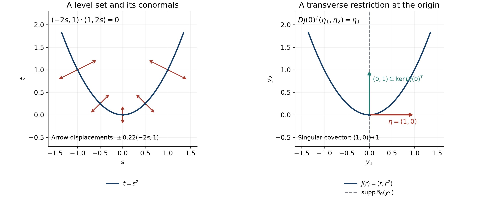

# Analytic pullback and cotangent directions

*Written and self-checked by GPT-6 Astra (OpenAI), Ultra, October 2026. Public domain (CC0).*

Composing a distribution with a map requires a condition on directions, not merely on its support. A covector normal to the map can prevent restriction from existing. When those directions are absent, a real analytic map transports every derivative-growth wavefront by its transposed derivative. We prove the estimate for arbitrary maps, obtain equality for changes of coordinates and submersions, and distinguish this sufficient restriction criterion from a necessary condition for every individual example.

We use the Fourier convention \(\widehat f(\xi)=\int e^{-ix\cdot\xi}f(x)\,dx\), inverse factor \((2\pi)^{-n}\), and complex-linear pairings. The supplied [Smooth pullback and the Fourier normal condition](../prerequisites/U011-free-foundations/smooth-pullback-and-fourier-normal-condition.md), Sections 18.1–18.5, contains the existing programme construction, including absolute convergence, Gaussian regularization, cutoff independence, gluing and the smooth wavefront bound. Its source is the AN-03 reading *Detecting regularity without choosing coordinates*; its complete used sections and prerequisite proofs are available in this reader.

[Derivative growth and finite-order localization](derivative-growth-and-finite-order-localization.md), Lemma 1 and Theorem 4, gives fixed index shifts and controlled cutoffs. [Cones and derivative-growth wavefronts](cones-and-derivative-growth-wavefronts.md), Theorems 3–7, gives compact conic localization, comparison, singular support and multiplication. [Analytic maps and derivative growth](analytic-maps-and-derivative-growth.md), Theorem 3, proves composition for \(C^L\) functions. The polydisk Cauchy formula and power-series proof are in [Holomorphic boundaries in convex cones](holomorphic-boundaries-in-convex-cones.md), Section 3. [Regular level sets and transverse convolution](regular-level-sets-and-transverse-convolution.md), Lemmas 0.1–0.2 and Theorem 1.1, gives the smooth inverse, coordinate completion and normal Jacobian; [Zero hypersurfaces as curvature measures](zero-hypersurfaces-as-curvature-measures.md), Lemma 3.0, gives the full measure substitution. These are actual earlier proofs, not external citations in their place.

## The normal condition and the question to be estimated

Let \(X\subset\mathbb R^n\), \(Y\subset\mathbb R^m\) be open, and \(F:X\to Y\). Initially \(n,m\ge1\). Write

\[
 N_F=\{(F(x),\eta):x\in X,\ \eta\ne0,\ DF(x)^T\eta=0\}.
 \tag{1}
\]

This set lies in the nonzero cotangent variables of the target. For a conic set \(S\subset Y\times(\mathbb R^m\setminus0)\), use

\[
 F^\sharp S=\{(x,DF(x)^T\eta):
       (F(x),\eta)\in S,\ DF(x)^T\eta\ne0\}.
 \tag{2}
\]

Fix any nondecreasing sequence with \(L_0=1\), \(k\le L_k\), and \(L_{k+1}\le QL_k\), \(Q\ge1\). These are exactly the earlier admissible growth sequences. Analytic wavefront is the case \(L_k=k+1\). A direction is \(L\)-regular when a bounded compact sequence, equal to the distribution on a fixed base neighborhood, has Fourier bounds \(A(BL_N/|\xi|)^N\) on a fixed cone for every \(N\ge1\).

If \(F\) is smooth and \(N_F\cap\operatorname{WF}(u)=\varnothing\), the supplied construction defines \(F^*u\). Locally, let \(\chi\) be a target cutoff equal to one near the image of a sufficiently small source neighborhood. For a test \(f\) there, its formula is

\[
 \langle F^*u,f\rangle=(2\pi)^{-m}\int
       \widehat{\chi u}(\eta)
       \left(\int f(x)e^{iF(x)\cdot\eta}\,dx\right)d\eta .
 \tag{3}
\]

The cutoff is chosen in a common neighborhood where the normal directions are regular. Section 18.5 proves absolute convergence by rapid input decrease near those directions and nonstationary integration elsewhere. It proves that (3) is the limit of the smooth pullbacks of the Gaussian regularizations of \(\chi u\). Changing the cutoff, while retaining these properties and its value one near the relevant compact image, has zero limit: the difference is supported a positive distance from that image, and every differentiated Gaussian is bounded there by \(C\varepsilon^{-M}e^{-d^2/(8\varepsilon)}\). Thus the formula defines one distribution, independent of these choices. We will use a different controlled cutoff at each index without changing that distribution.

The remaining issue is the dependence of the Fourier bound on its order. Constants denoted \(C_N\) in a smooth estimate do not supply an \(L_N^N\) bound.

## An integration estimate with its order visible

**Lemma 1 (analytic nonstationary estimate).** Suppose \(F\) is real analytic near a fixed compact set \(K\subset X\). Let \(a_M\in C_c^\infty(X)\), with support in \(K\), satisfy

\[
 \|\partial^\alpha a_M\|_\infty
       \le A(BL_M)^{|\alpha|}
       \quad(|\alpha|\le M,\ M\ge1).
 \tag{4}
\]

On any frequency region with \(\lambda=|\eta|+|\xi|\ge1\) and

\[
 |DF(x)^T\eta-\xi|\ge c\lambda
       \quad(x\in K),\qquad c>0,
 \tag{5}
\]

there are constants \(C,D\), independent of \(M,\xi,\eta\), such that

\[
 \left|\int a_M(x)e^{i(F(x)\cdot\eta-x\cdot\xi)}\,dx\right|
       \le C(DL_M)^M\lambda^{-M}.
 \tag{6}
\]

**Proof.** Normalize \(p=\eta/\lambda\), \(q=\xi/\lambda\). The closure of the allowed parameters in \(\{|p|+|q|=1\}\) is compact and retains (5). Put \(g(x;p,q)=DF(x)^Tp-q\). Each analytic coordinate of \(F\) has a holomorphic extension around every point of \(K\), by its convergent real power series. A finite cover and smaller polydisks give uniform bounds on those extensions and their derivatives. On overlapping small neighborhoods they agree where needed: their power series agree on a real open set, and successive one-variable uniqueness gives equality. Alternatively each estimate below may be taken on the finite individual polydisks and their maximum.

For real \(x,p,q\), \(\sum_jg_j(x;p,q)^2\ge c^2\). Its holomorphic extension uses the sum of squares, without complex conjugation. Uniform continuity of the extensions, uniformly over the compact parameter set, gives smaller polydisks about \(K\) on which its modulus is at least \(c^2/2\). The coefficients

\[
 b_j(x;p,q)=\frac{g_j(x;p,q)}
                    {i\sum_l g_l(x;p,q)^2},
 \qquad
 P a=-\sum_j\partial_j(b_j a)
       =\sum_j c_j\partial_j a+c_0a
 \tag{7}
\]

are consequently holomorphic there and uniformly bounded, including the derivative used in \(c_0\), after one more shrinking. The polydisk Cauchy formula gives constants \(C_0,B_0\ge1\) such that, for every multi-index,

\[
 |\partial^\beta c_j|
       \le C_0 B_0^{|\beta|}|\beta|!
       \quad(j=0,\ldots,n,\ x\in K).
 \tag{8}
\]

These constants are uniform in the parameters. Only analyticity in \(x\), not analyticity of the parameter region, is used.

Increase \(B\) in (4) so that \(B\ge2B_0\) and \(B\ge1\). Choose a fixed \(D_0\ge2(n+1)C_0\). We claim the triangular estimate

\[
 |\partial^\alpha P^j a_M|
 \le A D_0^j B^{j+|\alpha|}L_M^{j+|\alpha|}
       \quad(j+|\alpha|\le M).
 \tag{9}
\]

The case \(j=0\) is (4). Suppose it holds at \(j\), and write \(k=|\alpha|\le M-j-1\). For the term \(c_l\partial_lP^ja_M\), Leibniz' rule and (8) give, relative to the proposed right side at \(j+1\), a bound

\[
 \frac{C_0}{D_0}\sum_{r=0}^k
      \binom{k}{r}r!
      \left(\frac{B_0}{B L_M}\right)^r
 \le \frac{C_0}{D_0}\sum_{r=0}^k(B_0/B)^r
 \le \frac{2C_0}{D_0}.
 \tag{10}
\]

Indeed \(\sum_{|\beta|=r,\ \beta\le\alpha}\binom{\alpha}{\beta}=\binom{k}{r}\), by comparing the coefficient of \(t^r\) in \(\prod_j(1+t)^{\alpha_j}\), and \(\binom{k}{r}r!\le k^r\le L_M^r\). The induction applies to every differentiated amplitude since \(j+k-r+1\le M\). The term \(c_0P^ja_M\) has the same bound with the additional factor \((BL_M)^{-1}\le1\). Summing its contribution and the \(n\) first-order contributions proves (9). This explicitly accounts for derivatives falling on coefficients; there is no additional factorial outside \(L_M^M\).

For \(\Phi=F(x)\cdot\eta-x\cdot\xi\), the operator \(\lambda^{-1}\sum b_j\partial_j\) sends \(e^{i\Phi}\) to itself. Its bilinear transpose is \(\lambda^{-1}P\). Integrating by parts \(M\) times, with no boundary terms because of the compact support, gives \(\lambda^{-M}\int P^Ma_M e^{i\Phi}\). Equation (9) at \(j=M,\alpha=0\), times the volume of a fixed box containing \(K\), proves (6). All operators are defined on a neighborhood of \(K\) by the preceding positive margin; no extension across a zero denominator is used. \(\square\)

## Arbitrary analytic maps

**Theorem 2 (noncharacteristic pullback).** Let \(F:X\to Y\) be real analytic, and \(u\in\mathcal D'(Y)\). If

\[
 N_F\cap\operatorname{WF}_L(u)=\varnothing,
 \tag{11}
\]

then \(F^*u\) is defined by the smooth construction, and

\[
 \operatorname{WF}_L(F^*u)\subset F^\sharp\operatorname{WF}_L(u).
 \tag{12}
\]

There is no rank assumption on \(F\).

**Proof.** The earlier comparison \(\operatorname{WF}(u)\subset\operatorname{WF}_L(u)\) makes the smooth normal condition hold. Thus existence, locality and the finite-order distribution estimates are already supplied.

Fix \(x_0\in X\), \(\xi_0\ne0\), outside the right side of (12), and put \(y_0=F(x_0)\). Let
\(S=\{\eta\in S^{m-1}:(y_0,\eta)\in\operatorname{WF}_L(u)\}\).
It is compact. If empty, the earlier singular-support theorem makes \(u\) a \(C^L\) function near \(y_0\). Composition from the preceding analytic-maps lesson gives \(u\circ F\in C^L\) locally; (3) is that function, so the conclusion follows.

Otherwise (11) gives \(|DF(x_0)^T\eta|>0\) on \(S\), with a positive minimum. No resulting unit direction equals \(\xi_0/|\xi_0|\), by the chosen pair. Compactness gives positive margins for both assertions. Choose a closed spherical neighborhood \(\Gamma\) of \(S\), with \(S\) in its interior, small enough to retain these margins. Shrink a source neighborhood and an output cone \(\Omega\) about \(\xi_0\) so that, on their closures,

\[
 |DF(x)^T\eta-\xi|\ge c(|\eta|+|\xi|)
       \quad(\eta/|\eta|\in\Gamma,\ \xi\in\Omega).
 \tag{13}
\]

To verify the full lengths in this bound, normalize their sum to one. At a zero minimum, either a nonzero target direction would be in the kernel, or a nonzero target image would have an excluded output direction. Both contradict the retained margins. The normalized compact set includes the zero endpoints, so the bound is uniform. Continuity gives the same bound on a fixed compact neighborhood of the source supports.

Every direction in the compact set \(E=S^{m-1}\setminus\operatorname{int}\Gamma\) is \(L\)-regular at \(y_0\). Finitely many regular base-and-cone neighborhoods give one target neighborhood \(V\) where all of \(E\) remains regular. Choose a compact neighborhood \(K_y\subset V\), and then a smaller source neighborhood whose compact closure \(K_x\) maps into \(\operatorname{int}K_y\). The choices can be made with room for a fixed target cutoff equal to one near \(F(K_x)\).

Take the earlier controlled cutoffs \(\chi_M\), supported in \(K_y\), equal to one on that fixed neighborhood of \(F(K_x)\), and controlled source cutoffs \(b_M\), supported in \(K_x\), equal to one on a fixed neighborhood of \(x_0\). Every fixed derivative of either sequence is uniformly bounded. Compact localization and the common finite-order estimate give

\[
 \begin{aligned}
 |\widehat{\chi_Mu}(\eta)|
     &\le C(1+|\eta|)^d &&(\eta\in\mathbb R^m),\\
 |\widehat{\chi_Mu}(\eta)|
     &\le C(BL_M/|\eta|)^M
       &&(\eta/|\eta|\in E),
 \end{aligned}
 \tag{14}
\]

for one fixed integer \(d\ge0\). The ordinary normal directions are contained in the regular target region used here; each fixed \(M\) therefore gives the absolutely convergent formula (3). Cutoff independence shows that all these formulas represent the same \(F^*u\).

Choose one integer \(s>d+m+1\), put \(M=N+s\), and use the witnesses \(w_N=b_{N+s}F^*u\). They have fixed compact support and equal \(F^*u\) on a fixed neighborhood. Their fixed-order distribution bounds are uniform: apply a finite-order estimate for \(F^*u\) to \(b_{N+s}\phi\), and use the uniform fixed derivatives of the cutoffs.

For \(r=|\xi|\ge1\), \(\xi\in\Omega\), formula (3) becomes

\[
 \widehat w_N(\xi)=(2\pi)^{-m}\int
       \widehat{\chi_Mu}(\eta)\,I_M(\xi,\eta)\,d\eta,
 \quad
 I_M=\int b_M(x)e^{i(F(x)\cdot\eta-x\cdot\xi)}\,dx .
 \tag{15}
\]

Let \(c_0>0\) satisfy \(c_0\sup_{K_x}\|DF^T\|\le1/2\), and \(c_0\le1/2\). On \(|\eta|\le c_0r\), the phase gradient has norm at least \(r/2\), hence at least a fixed multiple of \(r+|\eta|\). On directions in \(\Gamma\), use (13). On the union of these two regions Lemma 1 and the first bound in (14) give

\[
 \begin{aligned}
 \int |\widehat{\chi_Mu}(\eta) I_M(\xi,\eta)|\,d\eta
 &\le C(DL_M)^M
          \int(r+|\eta|)^{-N-s}(1+|\eta|)^d\,d\eta\\
 &\le C'(DL_M)^M r^{-N}.
 \end{aligned}
 \tag{16}
\]

The second inequality uses \(r\ge1\), so \(r+|\eta|\ge1+|\eta|\), and the integrability of \((1+|\eta|)^{d-s}\). The integral on the first line may be extended to all \(\eta\). Integrability follows by annuli since \(s>d+m\).

On the remaining region, \(|\eta|>c_0r\) and its direction lies in \(E\). Use only the second bound of (14) and \(|I_M|\le\|b_M\|_1\le C\). The dyadic annuli starting at \(c_0r\) give, for \(M>m\),

\[
 \int_{|\eta|>c_0r}|\eta|^{-M}\,d\eta
       \le C\,2^M(c_0r)^{m-M}.
 \tag{17}
\]

For example, on the annulus with radii \(2^jc_0r\) and \(2^{j+1}c_0r\), use the containing ball's volume and its inner radius; the geometric ratio is \(2^{m-M}\le1/2\). The harmless \(2^M\) also covers any choice of the first annulus. Since \(s>m\) and \(r\ge1\), this region contributes at most \(C(D'L_M)^Mr^{-N}\).

The fixed-shift lemma gives \(L_{N+s}^{N+s}\le C_sD_s^NL_N^N\). Absorbing also \(D^{N+s}\), (16)–(17) yield

\[
 |\widehat w_N(\xi)|\le A(B'L_N/|\xi|)^N
       \quad(\xi\in\Omega,\ |\xi|\ge1).
 \tag{18}
\]

For \(0<|\xi|<1\), the uniform distribution order bounds the transform, and the right side is at least its constant after enlargement. Thus \(w_N\) is an \(L\)-regular witness. Notice that (16) spends the growing-order estimate on the oscillatory integral, while (17) spends it on the input transform; the costs are never multiplied together. This proves (12). \(\square\)

## Analytic coordinates and their inverses

**Lemma 3 (analytic local inverse).** If a real analytic square map \(P\) has an invertible derivative at a point, its local inverse is real analytic.

**Proof.** Translations and an invertible real linear output change reduce the map to \(P(0)=0\), \(DP(0)=I\). Extend its convergent series holomorphically to a complex ball. Choose a smaller closed ball \(\overline B_R\) on which \(\|DP(z)-I\|\le1/2\). For \(|w|<R/4\), the map \(T_w(z)=w+z-P(z)\) sends that closed ball into its interior and contracts distances by at most \(1/2\). The segment integral proves both estimates in complex coordinates. Starting with \(z_0=0\), the iterates satisfy \(|z_{j+1}-z_j|\le2^{-j}|w|\), hence converge uniformly in \(w\) on the smaller ball to a unique fixed point \(h(w)\). Completeness and the sum of this geometric series prove convergence directly.

Each iterate is holomorphic in \(w\), by the chain rule and the convergent-series definition. On every closed polydisk inside the \(w\)-ball, the iterates satisfy the polydisk Cauchy formula. Uniform convergence lets the limit pass through its finite contour integrals. Expanding the Cauchy denominators gives a convergent power series for the limit on smaller polydisks, exactly as in the earlier proof. Therefore \(h\) is holomorphic. For real \(w\) every iterate is real, so its restriction is real analytic. The fixed-point equation is \(P(h(w))=w\). Uniqueness implies that \(P\) maps \(B_R\cap P^{-1}(B_{R/4})\) bijectively onto \(B_{R/4}\); these are open neighborhoods, and the displayed \(h\) is its inverse. Undo the affine changes. \(\square\)

**Theorem 4 (coordinate equality).** If \(\kappa:X\to Y\) is a real analytic diffeomorphism, then

\[
 \operatorname{WF}_L(\kappa^*u)
       =\{(x,D\kappa(x)^T\eta):
                    (\kappa(x),\eta)\in\operatorname{WF}_L(u)\}.
 \tag{19}
\]

Here a smooth diffeomorphism which is real analytic automatically has real analytic inverse by Lemma 3.

**Proof.** The normal set is empty because its transpose derivative is invertible. Theorem 2 gives one inclusion. The supplied construction agrees with

\[
 \langle\kappa^*u,f\rangle
       =\left\langle u,(f\circ\kappa^{-1})
                         |\det D\kappa^{-1}|\right\rangle.
 \tag{20}
\]

The earlier measure-substitution proof identifies this for smooth regularizations; continuity of the test map passes to distributions. The determinant chain rule in (20) gives \((\kappa^{-1})^*\kappa^*u=u\). Apply Theorem 2 to \(\kappa^{-1}\), and use \(D\kappa^TD\kappa^{-T}=I\), to obtain the reverse inclusion. No determinant has been removed from the distributional definition. \(\square\)

Equation (19) makes \(\operatorname{WF}_L\) a subset of the nonzero cotangent bundle on a real analytic manifold: on every overlap, the representatives of a scalar distribution and their covectors have exactly the transformation in (20) and (19). The chain rule on triple overlaps gives consistency. This assertion uses an analytic atlas, including its analytic overlap maps.

## Equality for a submersion

**Lemma 5 (projection converse).** For \(\pi(x,z)=x\), \(x\in\mathbb R^m\), \(z\in\mathbb R^r\), on product open sets,

\[
 \operatorname{WF}_L(\pi^*u)
       =\{(x,z;\eta,0):(x,\eta)\in\operatorname{WF}_L(u)\}.
 \tag{21}
\]

**Proof.** The distribution is \(u\otimes1\), with test formula
\(\langle\pi^*u,f\rangle=\langle u,\int f(x,z)\,dz\rangle\).
The integrated test is smooth, has compact support, and its derivatives are the integrated derivatives; the earlier parameter-pairing proof supplies continuity. The Gaussian construction gives this same formula. The normal set is empty, so Theorem 2 gives the inclusion from left to right.

Suppose \((x_0,z_0;\eta_0,0)\) is \(L\)-regular. Choose compact product neighborhoods and a smaller cone \(V\) about \(\eta_0\), so all pairs over that product with covector \((\eta,0)\), \(\eta\in\overline V\setminus0\), are regular. This follows from openness of the regular set, taking smaller closures. Let \(\alpha_N(x)\), \(\beta_N(z)\) be controlled cutoffs supported in the respective compact neighborhoods and equal to one near the marked points. Choose \(\beta_N\) by convolving one nonnegative bump \(\beta\), equal to one on a slightly larger neighborhood, with the \(N\) normalized small bumps in the earlier cutoff construction. They have total displacement inside that larger neighborhood, and
\(\int\beta_N=\int\beta=:b>0\), by Fubini and normalization. Their products are controlled cutoffs.

Compact localization applied to \((\alpha_N\otimes\beta_N)\pi^*u\), on the closed cone \(\{(\eta,0):\eta\in\overline V\}\), gives the \(L_N\) Fourier estimate. The exact tensor pairing at that frequency is

\[
 \widehat{(\alpha_N\otimes\beta_N)\pi^*u}(\eta,0)
       =b\,\widehat{\alpha_Nu}(\eta).
 \tag{22}
\]

Division by the same positive \(b\) at every index gives \(L\)-regular witnesses for \(u\) at \((x_0,\eta_0)\). Boundedness follows from its finite order and uniform fixed cutoff derivatives. This proves the converse. For \(r=0\), the identity projection gives (21) directly, with the empty integral equal to one. \(\square\)

**Theorem 6 (submersion equality).** If \(F:X\subset\mathbb R^n\to Y\subset\mathbb R^m\) is real analytic and has rank \(m\) everywhere, then its pullback exists for every \(u\in\mathcal D'(Y)\), and

\[
 \operatorname{WF}_L(F^*u)=F^\sharp\operatorname{WF}_L(u).
 \tag{23}
\]

**Proof.** The transpose is injective, so \(N_F\) is empty. At each point choose a nonzero \(m\)-column minor of \(DF\). Complete \(F\) by the remaining original coordinates \(x_J\). The analytic square map \(\kappa(x)=(F(x),x_J)\) has determinant equal up to a coordinate-permutation sign to that minor. Lemma 3 makes it a local analytic diffeomorphism. Restrict its image to a product neighborhood, so \(F=\pi\circ\kappa\).

For a common target compact cutoff, the Gaussian approximations \(u_\varepsilon\) have \(u_\varepsilon\circ F=\kappa^*(\pi^*u_\varepsilon)\). The projection test map and (20) are continuous on distributions: their fixed compact test seminorms are bounded by finitely many original seminorms, by differentiation under the integral and the chain rule. Passing to the Gaussian limit therefore gives \(F^*u=\kappa^*\pi^*u\) locally. Lemma 5 and Theorem 4 give equality, with exact covector map \(D\kappa^T(\eta,0)=DF^T\eta\). Locality proves (23) on \(X\). \(\square\)

If a target has dimension zero, its distributions are constants, the pullback is smooth, and all wavefront sets are empty. If the source has dimension zero and the target has positive dimension, condition (11) excludes every nonzero covector at the image point; the singular-support theorem makes \(u\) locally \(C^L\), so the pullback is its well-defined value. Again there is no nonzero source covector. These conventions also cover the square zero-dimensional identity.

## Curved level sets and transverse restrictions

For \(F(s,t)=t-s^2\), the derivative is \((-2s,1)\), everywhere surjective. The earlier flat delta computation gives \(\operatorname{WF}_L(\delta_0)=\{(0,\eta):\eta\ne0\}\) for every \(L\). Theorem 6 gives the exact answer

\[
 \operatorname{WF}_L\bigl(\delta_0(t-s^2)\bigr)
       =\{(s,s^2;\eta(-2s,1)):s\in\mathbb R,\ \eta\ne0\}.
 \tag{24}
\]

Its actual scalar-distribution pairing is \(\int f(s,s^2)\,ds\): in the coordinates \((s,v)=(s,t-s^2)\) the inverse has absolute determinant one. Arclength on the parabola is \(\sqrt{1+4s^2}\,ds\), so its density relative to arclength is \(1/\sqrt{1+4s^2}\). The covectors in (24) annihilate the tangent \((1,2s)\) exactly. A drawing of a normal direction does not encode this measure density; both formulas are needed.

[Open the figure at full size](../figures/analytic-pullback-covectors.svg) · [Reproducible figure source](../figures/analytic-pullback-covectors.py).

The left panel shows the level set \(t-s^2=0\) and arrows proportional to \((-2s,1)\); their common display scale is stated in the figure. The right panel uses \(j(r)=(r,r^2)\) and the target distribution \(\delta_0(y_1)\). At \(r=0\), its covector \((1,0)\) pulls back to \(1\), since \(Dj(0)^T=(1,0)\). A vertical target covector would be normal to the map there. These are different geometric roles, as the following exercises check.

## Exercises with complete solutions

**Exercise 1 (foundation: linear coordinates and the density).** Let \(A:\mathbb R^n\to\mathbb R^m\) have rank \(m\), \(F(x)=Ax-b\), and \(u=\delta_0\). Find the normal set, the exact wavefront, and the distributional measure. For square invertible \(A\), identify the coefficient of the point delta.

**Solution.** \(A^T\) is injective, so \(N_F=\varnothing\). Theorem 6 gives all \((x,A^T\eta)\) with \(Ax=b\) and \(\eta\ne0\), and no others. The earlier normal-Jacobian theorem gives
\(\langle F^*\delta_0,f\rangle=\int_{Ax=b}f/\sqrt{\det(AA^T)}\,dS_{n-m}\).
All its hypotheses hold: the rank is constant, the fiber is a closed affine plane, and its normal Gram matrix is \(AA^T\). For square \(A\), \(\sqrt{\det(AA^T)}=|\det A|\), and zero-dimensional surface measure is counting measure. Thus \(F^*\delta_0=|\det A|^{-1}\delta_{A^{-1}b}\). This agrees with (20). \(\square\)

**Exercise 2 (intermediate: a weighted curved delta).** Determine the exact wavefront and pairing of \(v(s,t)=e^s\delta_0(t-s^2)\). Verify the tangent-normal relation and the displayed density at \(s=1\).

**Solution.** Multiplication by the analytic nonvanishing function \(e^s\) preserves the wavefront exactly: use the earlier multiplication inclusion in both directions, the second time with \(e^{-s}\). Thus the set is (24). The pairing is \(\int e^sf(s,s^2)\,ds\), and its density relative to arclength is \(e^s/\sqrt{1+4s^2}\). At \(s=1\), the tangent is \((1,2)\), a conormal is \((-2,1)\), their pairing is zero, and the density is \(e/\sqrt5\). A covector may be multiplied by any nonzero real number here, whereas the measure density is the specific positive scalar just computed. \(\square\)

**Exercise 3 (intermediate: an embedding that crosses the singularity).** Let \(j(r)=(r,r^2)\) and \(u(y_1,y_2)=\delta_0(y_1)\). Verify the full normal exclusion and compute \(j^*u\).

**Solution.** Lemma 5, with the two coordinates named as displayed, gives the exact target wavefront \(\{(0,y_2;\eta,0):\eta\ne0\}\). The image of \(j\) meets its base only at \(r=0\). The transpose derivative is \(Dj(r)^T(\eta_1,\eta_2)=\eta_1+2r\eta_2\); at that intersection it sends every singular \((\eta,0)\) to the nonzero scalar \(\eta\). Hence (11) holds everywhere, although \(j\) is not a submersion onto \(\mathbb R^2\).

Gaussian smoothing of the global distribution gives \((4\pi\varepsilon)^{-1/2}e^{-y_1^2/(4\varepsilon)}\), independent of \(y_2\). On composing with \(j\), this is the one-dimensional Gaussian approximate identity, so its limit is \(\delta_0(r)\). The compact-cutoff construction has the same limit: the omitted part is supported away from the compact image being tested, and the Gaussian distance estimate after (3) applies there, with polynomial tail bounds if a further cutoff is inserted. Equivalently insert a compact target cutoff equal to one on a larger compact image before taking the limit. Thus \(j^*u=\delta_0\), with every nonzero covector at \(r=0\), as predicted. \(\square\)

**Exercise 4 (advanced: what a failed normal condition does and does not say).** For \(F(r)=r^2\), show why the usual Gaussian pullback of \(\delta_0\) diverges at zero. Contrast this with the ordinary composition of \(|y|\) with \(F\).

**Solution.** At zero \(DF=0\), so every nonzero target covector is normal. Those are all singular directions of \(\delta_0\). For a nonnegative compact test \(\phi=1\) near zero, the regularized pairing is

\[
 (4\pi)^{-1/2}\varepsilon^{-1/4}
       \int e^{-z^4/4}\phi(\varepsilon^{1/4}z)\,dz.
 \tag{25}
\]

This is the substitution \(r=\varepsilon^{1/4}z\). The integral tends to a finite positive constant by dominated convergence; its tail is bounded by a Gaussian once \(|z|\ge1\). The prefactor diverges, so there is no distributional limit along these Gaussian approximations.

In contrast, \(|F(r)|=r^2\) is analytic. The target \(|y|\) has every nonzero wavefront covector at zero: its second distributional derivative is \(2\delta_0\), by two integrations by parts on the half-lines, and the earlier differential inclusion forces both directions into its smooth and every \(L\)-wavefront. Away from zero it is analytic. The normal condition therefore fails for this target too. Nevertheless its continuous-function composition exists and is analytic. Gaussian convolutions converge uniformly on compact sets to \(|y|\), as follows by splitting the normalized Gaussian integral into a small displacement and a uniformly small first-moment tail; composing with \(F\) preserves that convergence on compact sets. Thus failure of (11) is not a claim that every particular composition is impossible. It means that this sufficient distributional theorem does not provide it. \(\square\)

**Exercise 5 (advanced: strictness for a noncharacteristic restriction).** Set \(u(y_1,y_2)=y_2|y_1|\) and \(j(r)=(r,0)\). Prove that the pullback is defined, but the inclusion (12) is strict.

**Solution.** Lemma 5 and the previous exercise give
\(\operatorname{WF}_L(|y_1|)=\{(0,y_2;\eta,0):\eta\ne0\}\)
on the plane. Multiplication by \(y_2\) gives this set as an upper bound for \(u\). On \(y_2\ne0\), multiplication by the analytic reciprocal \(1/y_2\) gives equality. Closedness includes the limiting pairs over \(y_2=0\), so equality holds on the whole displayed set.

The normal set of \(j\) consists of \((r,0;0,\eta_2)\), \(\eta_2\ne0\). It misses that wavefront, and \(j^*u\) exists. The function \(u\) is continuous, and its Gaussian regularizations tend to it uniformly on compact sets; for this polynomially growing function, the Gaussian tails are bounded by its finite moments, proving the same convergence after localization. Consequently \(j^*u(r)=u(r,0)=0\). Its wavefront is empty, while \(j^\sharp\operatorname{WF}_L(u)=\{(0,\eta):\eta\ne0\}\). Theorem 6's equality uses submersion, and cannot be asserted for an arbitrary embedding. \(\square\)

**Exercise 6 (advanced: a moving point source).** For \(v(x,t)=\delta_0(x-t^2)\), determine its complete wavefront, show that every fixed-\(t\) restriction exists, and compute \(\partial_tv\) as a distribution.

**Solution.** The map \(F(x,t)=x-t^2\) is a submersion, so Theorem 6 gives
\(\operatorname{WF}_L(v)=\{(t^2,t;\eta,-2t\eta):\eta\ne0\}\).
For the slice \(j_\tau(x)=(x,\tau)\), normal covectors have zero \(x\)-component. Every singular covector above has nonzero \(x\)-component, so the normal condition holds at every \(\tau\), including zero. The Gaussian limit or the original level-set pairing gives \(j_\tau^*v=\delta_{\tau^2}\).

For a compact test \(\phi(x,t)\), the pairing of \(v\) is \(\int\phi(t^2,t)\,dt\). The ordinary chain rule and integration of a compact derivative give
\(-\int\partial_t\phi(t^2,t)\,dt=\int2t\,\partial_x\phi(t^2,t)\,dt\).
This is the pairing of \(-2t\,\delta_0'(x-t^2)\), where the prime is the derivative in the first, normal coordinate. Therefore \(\partial_tv=-2t\,\delta_0'(x-t^2)\), retaining the sign and variable density. \(\square\)

## References

- Lars Hörmander, *The Analysis of Linear Partial Differential Operators I*, second edition (1990), 2003 reprint, Section 8.5, Theorem 8.5.1 and its coordinate-invariance remark. The present proof uses direct growing-order nonstationary estimates; all used programme arguments are supplied above or in the linked readings.
- *Detecting regularity without choosing coordinates*, programme AN-03, Sections 18.1–18.5: the complete used smooth construction is supplied in [Smooth pullback and the Fourier normal condition](../prerequisites/U011-free-foundations/smooth-pullback-and-fourier-normal-condition.md), with its original CC0 authorship and the earlier foundation routes.
