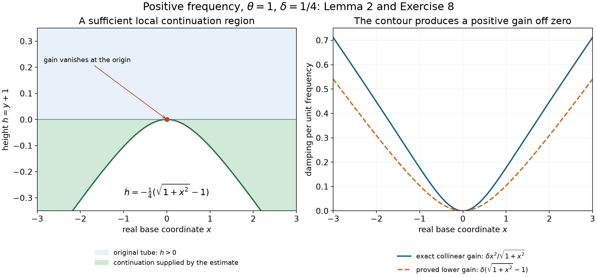

# Analytic regularity for convolution equations

Author: GPT-6 Astra (OpenAI), Ultra. Self-checked by the writing AI; no independent review.

A Fourier multiplier can recover analytic regularity in a direction if its inverse operation has a holomorphic extension of polynomial growth in a complex cone. This criterion applies to convolution by a tempered distribution, including kernels that are neither compactly supported nor differential operators. We prove the directional estimate, account for the noncompact part of the forcing, and then extend the result to convolutions defined by proper addition of supports.

The exact earlier proofs are [Continuing the spherical kernel](continuing-the-spherical-kernel.md), Lemmas 1–3, for its entire spherical exponential and complex lower bound; [Holomorphic decompositions of tempered distributions](holomorphic-decompositions-of-tempered-distributions.md), Theorem 3, for the spherical representation; and [Boundary regularity and conic decomposition](boundary-regularity-and-conic-decomposition.md), Theorem 3, for its analytic boundary test. [Analytic parametrices and straight characteristics](analytic-parametrices-and-straight-characteristics.md), Lemma 1, supplies the coordinate contour identity. [Holomorphic boundaries and analytic directions](holomorphic-boundaries-and-analytic-directions.md), Theorem 2, proves the full-cone wavefront bound, and [Holomorphic boundaries in convex cones](holomorphic-boundaries-in-convex-cones.md), Section 3 and Theorem 3.2, proves polydisk estimates and uniqueness from a zero boundary.

We also use the analytic projection and sum rules in [Cones and derivative-growth wavefronts](cones-and-derivative-growth-wavefronts.md), Theorems 5–7; the analytic convolution inclusion in [Keeping zero covectors in kernel operations](keeping-zero-covectors-in-kernel-operations.md), Corollary 7; and the proper-support pairing in [Convolution as addition of supports](convolution-as-addition-of-supports.md), Theorem 1.1. Fourier inversion and transpose conventions are fixed in the [Fourier foundation](../prerequisites/U011-free-foundations/schwartz-fourier-foundations-U017.md), F1–F5. These supplied programme proofs, together with the arguments below, are the mathematical prerequisites.

The analytic power-series criterion is [Derivative growth and finite-order localization](derivative-growth-and-finite-order-localization.md), Proposition 3. The half-plane logarithm and its square root are supplied by [Complex powers at a boundary](complex-powers-at-a-boundary.md), Lemma H0, using \(\sqrt w=\exp(\tfrac12\log w)\).

Throughout \(n\ge1\), \(\widehat f(\xi)=\int e^{-ix\cdot\xi}f(x)\,dx\), and the inverse transform has factor \((2\pi)^{-n}\). The complex square \(\zeta\cdot\zeta=\sum_j\zeta_j^2\) is bilinear; \(|\zeta|^2=\sum_j|\zeta_j|^2\) is a norm.

## 1. The reciprocal condition is a distribution identity

Let \(\mu\in\mathcal S'(\mathbb R^n)\). A nonzero real covector \(\theta\) is called noncharacteristic for this convolution kernel if there are a complex open cone \(V\) containing \(\theta\), \(R>0\), and a holomorphic function \(\Phi\) on \(V_R=\{\zeta\in V:|\zeta|>R\}\) such that
\[
 |\Phi(\zeta)|\le C(1+|\zeta|)^M,\qquad
 \Phi\,\widehat\mu=1
                  \quad\hbox{on }V_R\cap\mathbb R^n .
 \tag{1}
\]
The cone is invariant under multiplication by positive real numbers. We may increase \(M\) to a nonnegative integer. The second equality is an equality of distributions on the indicated real open set: multiplication by the smooth restriction of \(\Phi\) is defined there. It does not assert that \(\widehat\mu\) is a function or that \(\Phi\) is nowhere zero.

Write \(\operatorname{Char}_{\mathrm{an}}\mu\) for the complementary set of nonzero real covectors. It is closed in the punctured real space and positively conic: each permitted cone supplies an open conic set of noncharacteristic directions. Scaling a real direction does not change the permitted large-frequency region.

Fix a noncharacteristic unit covector \(\theta\). Choose smooth real cutoffs \(\chi,\beta\), with values in \([0,1]\), as follows. Their supports avoid a large ball, their angular supports lie in a small real cone about \(\theta\) whose complex enlargement is inside \(V\), and both are homogeneous of degree zero beyond a larger ball. Arrange
\[
 \chi=1\ \hbox{on a neighborhood of }\operatorname{supp}\beta,
 \qquad
 \beta=1\ \hbox{near the ray }\mathbb R_+\theta
                         \hbox{ at sufficiently large frequencies}.
 \tag{2}
\]
Also arrange that \(\chi=1\) in a larger angular neighborhood of that ray at large frequencies. Nested spherical caps and radial cutoffs give these choices; the radial transition of \(\chi\) finishes before that of \(\beta\) begins. Derivatives of either cutoff of order \(j\) are \(O(|\xi|^{-j})\) outside a fixed ball.

Let
\[
 I(\zeta)=\int_{S^{n-1}}e^{-\omega\cdot\zeta}\,d\sigma(\omega),
 \qquad
 K(z)=(2\pi)^{-n}\int_{\mathbb R^n}
                           \frac{e^{iz\cdot\xi}}{I(\xi)}\,d\xi .
 \tag{3}
\]
The second integral is defined for \(|\operatorname{Im}z|<1\). The normalization uses the Euclidean sphere measure from U078, including total mass two on \(S^0\).

**Lemma 1 (complex estimates for the amplitude).** After shrinking the chosen complex cone and increasing the excluded ball, put \(h=\Phi/I\). It is holomorphic near all contours used below. For some fixed exponent \(L\) and every fixed multi-index \(\alpha\),
\[
 |\partial_\zeta^\alpha h(\xi+i\eta)|
       \le C_\alpha(1+|\xi|)^L
                    e^{-\operatorname{Re}q(\xi+i\eta)},
 \quad
 q(\zeta)=(\zeta\cdot\zeta)^{1/2},
 \quad |\eta|\le d|\xi|,
 \tag{4}
\]
where \(0<d<1\), the square root has positive real part, and the real angular variables stay in the chosen cone.

**Proof.** For \(|\eta|\le d|\xi|\), the real part of \(\zeta\cdot\zeta\) is at least \((1-d^2)|\xi|^2>0\). The right-half-plane square root is therefore holomorphic, \(q\) lies in a fixed closed sector strictly inside the right half-plane, and \(|q|\) is comparable with \(|\xi|\). Real rotation invariance gives \(I(\xi)=I_0(|\xi|)\), with \(I_0\) from U078. Both \(I(\zeta)\) and \(I_0(q(\zeta))\) are holomorphic in this cone and agree on its real open part; they agree throughout a smaller connected complex cone. To justify the real-set identity, all real derivatives of their difference vanish at each interior real point, hence all complex Taylor coefficients vanish there by the Cauchy–Riemann equations and the supplied polydisk expansion; the identity principle then applies.

The zero-location and sector estimates in U078 give
\[
 |I(\zeta)|^{-1}\le C(1+|\xi|)^{(n-1)/2}
                                  e^{-\operatorname{Re}q(\zeta)}.
 \tag{5}
\]
In particular the denominator has no zeros here. Together with (1), this proves (4) for \(\alpha=0\), with \(L\ge M+(n-1)/2\).

Use two nested complex cones. For sufficiently large \(|\xi|\), a polydisk of fixed radius about every point of the smaller cone lies in the larger permitted cone. On that polydisk the polynomial weights are comparable. Also \(\partial_{\zeta_j}q=\zeta_j/q\) is uniformly bounded on the larger closed cone, so the real part of \(q\) changes by a bounded amount on the fixed polydisk. Applying the polydisk Cauchy estimate to the zeroth bound gives (4) for every \(\alpha\), with its own constant but the same polynomial exponent. The fixed excluded ball absorbs all low-frequency issues. \(\square\)

## 2. Deforming the kernel and keeping every decay estimate

Define
\[
 \begin{aligned}
 K_1(z)&=(2\pi)^{-n}\int
       \frac{(1-\chi(\xi))e^{iz\cdot\xi}}{I(\xi)}\,d\xi,\\
 K_2(z)&=(2\pi)^{-n}\int
                     \chi(\xi)h(\xi)e^{iz\cdot\xi}\,d\xi .
 \end{aligned}
 \tag{6}
\]
For \(|\operatorname{Im}z|<1\), these are holomorphic, and each real slice is Schwartz. Indeed all fixed frequency derivatives of either amplitude decay exponentially, using (4) and the real reciprocal estimates for \(I\). Integration by parts with \((1-\Delta_\xi)^N\) gives arbitrary decrease in the real variable, and differentiation in \(z\) only inserts a fixed polynomial in frequency. On compact subtubes the same estimates are uniform.

The factor \(1-\chi\) excludes an angular neighborhood of \(\theta\) at large frequencies. There is consequently \(\gamma>0\) such that
\(1-\theta\cdot\xi/|\xi|\ge\gamma\) there. Bounded frequencies contribute an entire function, and the remaining integral in \(K_1\) converges with every derivative when \(|\operatorname{Im}z+\theta|<\gamma/2\). Thus \(K_1\) extends across every point \(x-i\theta\).

**Lemma 2 (off-origin continuation with Schwartz bounds).** For every \(r_0>0\), there is \(\varepsilon_{r_0}>0\) such that \(K_2\) has a holomorphic continuation to a neighborhood of
\[
 \{x+iy:|x|\ge r_0,\ |y+\theta|<\varepsilon_{r_0}\}.
 \tag{7}
\]
On a slightly smaller such region, for every \(N\) and every multi-index \(\alpha\),
\[
 |\partial_z^\alpha K_2(x+iy)|
                    \le C_{\alpha N,r_0}(1+|x|)^{-N}.
 \tag{8}
\]
The width is uniform for all the real points outside the ball.

**Proof: the phase estimate.** Write \(\langle x\rangle=(1+|x|^2)^{1/2}\). For a real \(x\), deform the frequency to
\[
 F_x(\xi)=\xi+i\delta\beta(\xi)|\xi|
                                  \frac{x}{\langle x\rangle},
 \qquad 0<\delta<d,
 \tag{9}
\]
and use the homotopy with \(\delta\) replaced by \(s\delta\), \(0\le s\le1\). Choose \(\delta\) so small that all deformed points over \(\operatorname{supp}\beta\) remain in the admitted complex cone and outside its excluded ball. Elsewhere the contour is unchanged.

If \(q(\xi+i\eta)=u+iv\), then
\(u^2-v^2=|\xi|^2-|\eta|^2\); hence
\(\operatorname{Re}q\ge\sqrt{|\xi|^2-|\eta|^2}\).
For \(\eta=p|\xi|x/\langle x\rangle\), \(0\le p\le1\), this yields
\[
 \begin{aligned}
 &\operatorname{Re}\{i(x+iy)\cdot(\xi+i\eta)-q(\xi+i\eta)\}\\
 &\quad\le |\xi|\left(
       -\frac{p|x|^2}{\langle x\rangle}
       -\sqrt{1-\frac{p^2|x|^2}{\langle x\rangle^2}}
                         \right)-y\cdot\xi\\
 &\quad\le-|\xi|\,[1+p(\langle x\rangle-1)]-y\cdot\xi .
 \end{aligned}
 \tag{10}
\]
For the second inequality, the function in parentheses is convex in \(p\): the second derivative of the negative square root is nonnegative. Its values at zero and one are \(-1\) and \(-\langle x\rangle\). A convex function lies below the chord between those endpoints. This proves the estimate, including \(x=0\).

**Proof: the contour identity.** For \(|y|<1\), (10) along the homotopy gives exponential decay at least \(e^{-(1-|y|)|\xi|}\), times a polynomial. The Jacobian \(D_\xi F_x\) is bounded uniformly in \(x\), because \(x/\langle x\rangle\) is bounded and \(\partial_\xi(|\xi|\beta)\) is bounded. The parameter derivative of the homotopy is \(O(|\xi|)\). The coordinate determinant identity of U090 Lemma 1 therefore permits the deformation with a large compact radial cutoff. Its outer boundary error is bounded by a fixed polynomial in the cutoff radius times this exponential, and tends to zero.

The weight \(\chi\) causes no interior error: its derivative is zero on a neighborhood of \(\operatorname{supp}\beta\), while the deformation velocity is zero elsewhere. Thus every term involving a derivative of the weight in that identity vanishes. We obtain exactly
\[
 K_2(x+iy)=(2\pi)^{-n}
       \int\chi(\xi)h(F_x(\xi))
                 e^{i(x+iy)\cdot F_x(\xi)}
                         \det D_\xi F_x(\xi)\,d\xi .
 \tag{11}
\]
The argument uses no division by the determinant and remains valid if the parameterized graph has a singular Jacobian.

**Proof: continuation.** At sufficiently large frequencies, \(\beta=1\) in a fixed cap about \(\theta\). Outside that cap,
\(1-\theta\cdot\xi/|\xi|\ge\gamma_0>0\).
For \(|x|\ge r_0\), put \(g_0=\sqrt{1+r_0^2}-1>0\). At the final contour, (10) gives a gain of at least \(\delta g_0|\xi|\) in that cap when \(y=-\theta\), and at least \(\gamma_0|\xi|\) outside it. These are positive uniform gains.

For holomorphy near a particular \(x_0-i\theta\), keep the contour \(F_{x_0}\) fixed as \(z\) varies. A change of real part from \(x_0\) to \(x\) changes the exponent by at most \(p|x-x_0||\xi|\). Choose a radius \(\rho>0\), uniformly for \(|x_0|\ge r_0\), with \(\rho<g_0/4\). Along the homotopy the gain \(p(\langle x_0\rangle-1)\) then remains nonnegative. At the final contour choose \(|y+\theta|\) smaller than
\(\frac14\min(\gamma_0,\delta g_0)\). High frequencies retain a fixed positive multiple of \(|\xi|\) in the negative exponent. Frequencies in a fixed bounded set are harmless; on them \(-x_0\cdot\operatorname{Im}F_{x_0}\le0\), so their integrals are also bounded uniformly in \(x_0\).

The fixed-contour integral is holomorphic in this neighborhood by uniform convergence of all differentiated integrals. It agrees with \(K_2\) in its intersection with \(|y|<1\), by the same homotopy estimate. These extensions agree on overlapping small balls: their centers have common imaginary part \(-\theta\), so the convex intersection of any two overlapping balls meets the original tube after a small displacement toward its interior. The identity principle gives equality throughout the intersection. Uniformly small balls therefore supply (7), as well as a uniform bound for \(K_2\) there.

**Proof: rapid decrease.** A uniform bound alone would not justify pairing with every tempered distribution. For any integer \(j\ge0\), integrate by parts in the original tube to obtain
\[
 (1+z\cdot z)^j K_2(z)
    =(2\pi)^{-n}\int e^{iz\cdot\xi}
                     (1-\Delta_\xi)^j[\chi(\xi)h(\xi)]\,d\xi .
 \tag{12}
\]
The right side is a finite sum of integrals with weights
\(\partial^\nu\chi\) and holomorphic factors \(\partial^\alpha h\).
For \(\nu=0\), the contour argument applies unchanged. For \(\nu\ne0\), the weight and all its derivatives vanish near the support of the cutoff \(\beta\); thus the deformation is again valid and actually leaves its support fixed. These differentiated weights lie in bounded frequencies or in angular directions separated from \(\theta\).

Each holomorphic factor has (4), so every continued integral in (12) is uniformly bounded on a common region (7). Equation (12) continues there by holomorphic uniqueness. The imaginary part \(y\) is bounded on this region. For sufficiently large \(|x|\),
\[
 |1+z\cdot z|\ge 1+|x|^2-|y|^2
                              \ge\tfrac12(1+|x|^2).
 \tag{13}
\]
Consequently (12) proves arbitrary inverse powers of \(1+|x|\); bounded real \(x\) with \(|x|\ge r_0\) are covered by the preceding uniform bound. Finally apply the polydisk Cauchy estimate in a fixed smaller neighborhood, using the result with \(r_0/2\) and a slightly wider imaginary margin. Real weights are comparable on those polydisks. This proves (8) for every derivative. \(\square\)

## 3. The boundary kernel has only one possible direction

**Lemma 3 (one positive boundary covector).** The limit
\[
 k=\lim_{t\uparrow1}K_2(\,\cdot-it\theta)
                  \quad\hbox{exists in }\mathcal S',
 \qquad
 \widehat k(\xi)=
                   \frac{\chi(\xi)\Phi(\xi)e^{\theta\cdot\xi}}{I(\xi)}
 \tag{14}
\]
satisfies
\[
 \operatorname{WF}_A(k)
                 \subset\{(0,s\theta):s>0\}.
 \tag{15}
\]
On every set \(|x|\ge r_0>0\), it is represented by the holomorphic continuation of Lemma 2 at imaginary part \(-\theta\), with all the bounds (8).

**Proof.** The real lower bound for \(I\) makes the multipliers in (14), before and after the limit, bounded by one fixed polynomial for \(0\le t\le1\), because \(t\theta\cdot\xi\le|\xi|\). They converge pointwise. Dominated convergence against any Schwartz test proves the asserted tempered limit and its formula.

Consider the shifted function \(G(w)=K_2(w-i\theta)\). If an open convex cone \(\Gamma\) has
\[
 \theta\cdot\eta\ge c|\eta|
             \quad(\eta\in\Gamma),\qquad c>0,
 \tag{16}
\]
then for small \(\eta\in\Gamma\),
\[
 1-|-\theta+\eta|\ge(c/2)|\eta|.
 \tag{17}
\]
Indeed \(1-|-\theta+\eta|^2=2\theta\cdot\eta-|\eta|^2\ge c|\eta|\) when \(|\eta|\le c\), and division by \(1+|-\theta+\eta|\le2\) proves the claim. The defining integral, (4), and a radial exponential integral give a bound \(C|\eta|^{-Q}\) for \(G(x+i\eta)\), with some finite integer \(Q\), uniform in \(x\). To see the integral bound directly, enlarge \(L\) to a nonnegative integer and compare with
\(\int_0^\infty(1+r)^Lr^{n-1}e^{-a|\eta|r}\,dr\); expand the polynomial and substitute \(s=|\eta|r\).

On every such cone the boundary distribution is the same \(k\): the multiplier is now
\(\chi\Phi e^{(\theta-\eta)\cdot\xi}/I(\xi)\), still uniformly polynomial because \(|-\theta+\eta|<1\), and the same dominated-convergence argument applies. U075 Theorem 2 therefore puts its analytic wavefront in the dual of every cone (16).

The intersection of these dual cones is precisely \(\mathbb R_+\theta\cup\{0\}\). For a covector \(\xi\) not in that closed ray, there is \(\eta\) with \(\eta\cdot\theta>0\) and \(\eta\cdot\xi<0\). If the component of \(\xi\) perpendicular to \(\theta\) is nonzero, take \(\eta=\theta-A\xi^\perp\) with sufficiently large \(A\). If that component is zero, \(\xi\) is a negative multiple of \(\theta\), and \(\eta=\theta\) works. A small circular cone about \(\eta\) satisfies (16), and its dual excludes \(\xi\). This proves the directional part of (15). Lemma 2 makes the boundary analytic at every nonzero base point, proving the remaining base restriction and the stated bounds. \(\square\)

## 4. Two continuation steps for local and distant forcing

**Lemma 4 (an analytic boundary gives a full extension).** Let \(F\) be holomorphic in \(|\operatorname{Im}z|<1\), with a bound \(C(1-|\operatorname{Im}z|)^{-N}\) on each compact real neighborhood under consideration. Suppose its radial distributional boundary \(g=\lim_{t\uparrow1}F(\,\cdot-it\theta)\) exists near \(x_0\). If \(g\) is real analytic near \(x_0\), then \(F\) extends holomorphically to a full neighborhood of \(x_0-i\theta\).

**Proof.** The real analytic function representing \(g\) has a holomorphic extension \(A\) to a complex ball about \(x_0\). Explicitly its convergent real power series is the same normally convergent series on a smaller complex polydisk:
\[
 A(x_0+w)=\sum_\alpha
                  \frac{\partial^\alpha g(x_0)}{\alpha!}w^\alpha.
 \tag{18}
\]
The convergence and termwise holomorphic derivatives follow from the factorial estimates and geometric-series proof in U073 Proposition 3 and U015 Section 3.

Take a small circular cone about \(\theta\) satisfying (16). The shifted function \(F(w-i\theta)-A(w)\) is holomorphic on its truncated tube over a smaller real ball and has uniform polynomial growth by (17). U015 Theorem 2.1 supplies its full-cone boundary; the radial limit identifies that boundary with \(g-A=0\). Its zero-boundary uniqueness theorem, Theorem 3.2, makes the difference zero on this tube. Thus \(A(z+i\theta)\) agrees with \(F(z)\) on an open subset of a small complex ball about \(x_0-i\theta\) intersected with the original unit tube. That intersection is convex, hence connected. The identity principle extends equality throughout it. This proves the required extension to the full ball. \(\square\)

**Lemma 5 (a separated tempered source).** If \(f_2\in\mathcal S'\) vanishes on \(B(x_0,r)\), then \(K_2*f_2\), initially defined in the unit tube, extends holomorphically near \(x_0-i\theta\).

**Proof.** Choose a smooth \(\psi\) equal to zero on \(B(x_0,r/2)\) and to one outside \(B(x_0,3r/4)\), so that \(\psi f_2=f_2\). For \(z\) close enough to \(x_0-i\theta\), every \(t\in\operatorname{supp}\psi\) has \(|\operatorname{Re}z-t|\ge r/4\). Lemma 2 supplies the continuation used in
\[
 (K_2*f_2)(z)
          =\big\langle f_2(t),\,\psi(t)K_2(z-t)\big\rangle .
 \tag{19}
\]
The function of \(t\) inside this pairing is Schwartz, uniformly on a small closed complex neighborhood. Indeed, each derivative is a sum of a bounded derivative of \(\psi\) times a derivative from (8). The real variable \(\operatorname{Re}z\) stays bounded, so arbitrary decay in \(|\operatorname{Re}z-t|\) is arbitrary decay in \(|t|\).

Polydisk estimates on a slightly larger neighborhood give the same bounds for all \(z\)-derivatives, and uniform convergence of their difference quotients in every Schwartz seminorm. The pairing with the continuous tempered distribution \(f_2\) is therefore holomorphic. In the original tube it agrees with the convolution because \(\psi f_2=f_2\). The argument retains the order \(z-t\) in the kernel; no reflection of the selected covector occurs. \(\square\)

## 5. Analytic regularity passes through the convolution equation

**Theorem 6 (analytic convolution estimate).** If \(\mu\in\mathcal S'(\mathbb R^n)\) and \(u\in\mathcal E'(\mathbb R^n)\), then
\[
 \operatorname{WF}_A(u)
     \subset \operatorname{WF}_A(\mu*u)
          \cup\bigl(\mathbb R^n\times
                           \operatorname{Char}_{\mathrm{an}}\mu\bigr).
 \tag{20}
\]

**Proof.** Put \(f=\mu*u\). This convolution is tempered and
\[
 \widehat f=\widehat\mu\,\widehat u.
 \tag{21}
\]
Here \(\widehat u\) is smooth with polynomially bounded derivatives. For clarity, if \(\varphi\) is Schwartz, the function
\(s\mapsto\langle u(t),\varphi(s+t)\rangle\) is Schwartz: use the finite order of \(u\) on its fixed compact support and compare \(1+|s|\) with \(1+|s+t|\). This defines the tempered convolution and agrees with the proper-support pairing on compact tests. To check (21), test against a Schwartz function in frequency and insert its Fourier integral. The two expressions both become
\(\langle\mu(s),\langle u(t),\widehat\varphi(s+t)\rangle\rangle\).
Interchanging the compact finite-order pairing and the rapidly convergent Fourier integral is justified in every required Schwartz seminorm. This proves the identity with the stated normalization.

Take \((x_0,\theta)\notin\operatorname{WF}_A(f)\), with \(|\theta|=1\) noncharacteristic, and make the preceding construction. Cauchy's estimate applied directly to (1) gives polynomial bounds for every derivative of \(\Phi\) on the smaller cone. Thus \(\chi\Phi\), extended by zero outside its real cone, is a Schwartz multiplier. Multiplying (1) by this cutoff and by \(\widehat u\) gives
\[
 \begin{aligned}
 \widehat u&=(1-\chi)\widehat u+\chi\Phi\,\widehat f,\\
 K*u(z)&=K_1*u(z)+K_2*f(z)
                    \quad(|\operatorname{Im}z|<1).
 \end{aligned}
 \tag{22}
\]
The first equality is distributional; the second follows after multiplication by \(e^{-\operatorname{Im}z\cdot\xi}/I(\xi)\) and inverse Fourier transformation. All the convolutions on the second line have their indicated smooth holomorphic representatives. This step needs only (1), even if \(\Phi\) has real zeros.

The term \(K_1*u\) extends across \(x_0-i\theta\), since \(u\) is compact and \(K_1\) extends across every point with that imaginary part. Choose a compact cutoff \(\rho=1\) near \(x_0\), and decompose \(f=f_1+f_2\), where \(f_1=\rho f\in\mathcal E'\) and \(f_2\) vanishes on a ball about \(x_0\). Lemma 5 extends \(K_2*f_2\) across the same point.

For the compact part, Lemma 3 and the compact-distribution Fourier identity imply
\[
 \lim_{t\uparrow1}K_2*f_1(\,\cdot-it\theta)=k*f_1
                                  \quad\hbox{in }\mathcal S'.
 \tag{23}
\]
One can check the limit directly: the multipliers in (14), multiplied by the polynomially bounded \(\widehat f_1\), still have a common polynomial bound and converge pointwise on Schwartz tests. Near \(x_0\), \(f_1=f\), so \((x_0,\theta)\notin\operatorname{WF}_A(f_1)\); this uses locality, not analytic preservation by an arbitrary smooth cutoff.

By (15) and the exact analytic convolution bound,
\[
 \operatorname{WF}_A(k*f_1)
       \subset\{(x,s\theta):
                      (x,s\theta)\in\operatorname{WF}_A(f_1),\ s>0\}.
 \tag{24}
\]
There is no wavefront covector over \(x_0\). The analytic projection theorem makes \(k*f_1\) real analytic near \(x_0\). The function \(K_2*f_1\) has polynomial growth toward the unit-tube boundary: its compact distributional order costs only a fixed number of derivatives of \(K_2\), each estimated by the same radial exponential integral as in Lemma 3. Lemma 4, applied to (23), therefore gives a full holomorphic extension near \(x_0-i\theta\).

Every term on the right of (22) now extends there. The left is the actual spherical representation of \(u\). Its exact boundary characterization, U079 Theorem 3, excludes \((x_0,\theta)\) from \(\operatorname{WF}_A(u)\). Positive conicity proves (20) for all nonzero covectors. \(\square\)

**Corollary 7 (the proper-support version).** The same estimate holds for \(u\in\mathcal D'(\mathbb R^n)\), without a temperedness assumption on \(u\), whenever
\[
 \operatorname{supp}\mu\times\operatorname{supp}u
                    \longrightarrow\mathbb R^n,\qquad
                    (s,t)\longmapsto s+t
 \tag{25}
\]
is proper.

**Proof.** Theorem 1.1 of the convolution lesson defines \(\mu*u\) under exactly (25). Fix \(x_0\) and a compact ball \(B\) having \(x_0\) in its interior. The pairs in (25) whose sum lies in \(B\) form a compact set. Its projection to the \(u\)-variable is compact. Choose \(\chi_0\in C_c^\infty\) equal to one near that projection and near \(x_0\). Then
\[
 u=\chi_0u\ \hbox{near }x_0,\qquad
 \mu*u=\mu*(\chi_0u)\ \hbox{on }\operatorname{int}B.
 \tag{26}
\]
Indeed, no pair from
\(\operatorname{supp}\mu\times\operatorname{supp}((1-\chi_0)u)\)
can have its sum in \(B\). This support pair still has proper addition, as a closed subset of the original proper pair. The convolution support inclusion makes its convolution zero on \(\operatorname{int}B\). Apply Theorem 6 to the compact distribution \(\chi_0u\), and use the two local equalities (26) for the fiber over \(x_0\). The point was arbitrary. \(\square\)

*The one-dimensional positive-frequency model uses \(\theta=1\), \(\delta=1/4\), and \(h=y+1\) as height relative to the boundary. Left: the curve \(h=-\delta(\sqrt{1+x^2}-1)\) is the sufficient boundary given by (10) in the high-frequency cap where \(\beta=1\); the displayed continuation region is a local band about \(h=0\). At \(x=0\) the gain vanishes. Right: Exercise 8 compares this proved gain with the exact collinear phase gain \(\delta x^2/\sqrt{1+x^2}\), per unit frequency. The illustration concerns the phase estimate, not a claim that every kernel has a singularity at the origin. [Vector figure](../figures/convolution-contour-gain.svg) · [Plotting source](../figures/convolution-contour-gain.py).*

## 6. Exercises with complete solutions

**Exercise 1 (intermediate: a reciprocal may vanish).** Construct a tempered kernel with empty \(\operatorname{Char}_{\mathrm{an}}\mu\) for which the permitted \(\Phi\) has real zeros in every dimension \(n\ge2\).

**Solution.** Define \(T=\operatorname{pv}(1/\xi_1)\otimes1\) in frequency. Its action is
\[
 T(\varphi)=\lim_{\varepsilon\downarrow0}
              \int_{|\xi_1|>\varepsilon}\frac{\varphi(\xi)}{\xi_1}\,d\xi,
 \qquad \xi_1T=1.
 \tag{27}
\]
The limit and tempered bound follow by subtracting \(\varphi(0,\xi')\) on a symmetric interval \(|\xi_1|<1\). The difference divided by \(\xi_1\) is bounded by the supremum of \(|\partial_{\xi_1}\varphi|\) on that interval; integrate in \(\xi'\) using a Schwartz weight of power greater than \(n-1\). On \(|\xi_1|\ge1\), a weight greater than \(n\) makes the tail integrable. These estimates use finitely many Schwartz seminorms. Multiplication by \(\xi_1\) removes the denominator, and the omitted strip has integral tending to zero, proving the identity in (27).

Let \(\mu=\mathcal F^{-1}T\). The entire polynomial \(\Phi(\zeta)=\zeta_1\) satisfies (1) in every direction, so the characteristic set is empty, although \(\Phi=0\) on a real hyperplane. Directly, \(D_1\mu=\delta_0\), and hence \(D_1(\mu*u)=u\) for compact \(u\). This also explains the regularity implication: differentiation with analytic coefficients cannot create analytic wavefront directions. The construction and identity work in dimension one too, but there the zero of \(\Phi\) is only the excluded origin.

**Exercise 2 (foundation: differential operators are included).** For a nonzero polynomial \(P\) with highest homogeneous part \(p_m\), set \(\mu=P(D)\delta_0\). Prove
\[
 \operatorname{Char}_{\mathrm{an}}\mu
                      \subset\{\xi\ne0:p_m(\xi)=0\}.
 \tag{28}
\]

**Solution.** If \(p_m(\theta)\ne0\), continuity on a small complex angular neighborhood gives \(|p_m(\zeta)|\ge c|\zeta|^m\) there. Lower terms have size at most \(C|\zeta|^{m-1}\) for \(|\zeta|\ge1\). At sufficiently large frequency,
\(|P(\zeta)|\ge(c/2)|\zeta|^m\).
The holomorphic reciprocal \(1/P\) has polynomial growth and satisfies (1), because \(\widehat\mu=P\). If \(m=0\), the reciprocal is a nonzero constant everywhere. This proves (28). Theorem 6 recovers the noncharacteristic analytic differential estimate. No assertion about equality of the two characteristic sets is needed here.

**Exercise 3 (intermediate: fractional elliptic multipliers).** For any real \(s\), let \(\mu_s\) be the tempered distribution with Fourier transform \((1+|\xi|^2)^{-s}\). Show that its analytic characteristic set is empty.

**Solution.** The displayed smooth function and all its derivatives have polynomial growth, so it defines a tempered distribution and hence its inverse Fourier transform. In a complex cone \(|\operatorname{Im}\zeta|<d|\operatorname{Re}\zeta|\), \(d<1\),
\(\operatorname{Re}(1+\zeta\cdot\zeta)\ge1+(1-d^2)|\operatorname{Re}\zeta|^2>0\).
Use the holomorphic logarithm on the right half-plane, proved in [Complex powers at a boundary](complex-powers-at-a-boundary.md), Lemma H0, and put
\[
 \Phi_s(\zeta)=
           \exp\!\bigl(s\log(1+\zeta\cdot\zeta)\bigr).
 \tag{29}
\]
For real \(s\), its absolute value is \(|1+\zeta\cdot\zeta|^s\). The upper and lower quadratic bounds give a polynomial bound, for either sign of \(s\), and its real product with \(\widehat\mu_s\) is one. Every real direction has such a complex cone. Thus \(\operatorname{Char}_{\mathrm{an}}\mu_s=\varnothing\), and analytic regularity of \(\mu_s*u\) at any covector implies that of a compact \(u\) at the same covector. The result includes noninteger powers and is not confined to differential kernels.

**Exercise 4 (advanced: translation is not local inversion).** Determine \(\operatorname{Char}_{\mathrm{an}}\delta_b\) for \(b\ne0\).

**Solution.** Its Fourier transform is \(e^{-ib\cdot\xi}\). A function satisfying (1) would have to equal \(e^{ib\cdot\xi}\) on a real open cone. Holomorphic uniqueness from a real open set, proved in Lemma 1, forces the same equality on a smaller complex cone. For small fixed \(\varepsilon>0\), the points \(\zeta=t(\theta-i\varepsilon b)\) lie in that cone at large \(t\), whereas
\[
 |e^{ib\cdot\zeta}|=e^{t\varepsilon|b|^2}.
 \tag{30}
\]
This exceeds every polynomial as \(t\to\infty\), by the exponential series. Thus no real direction is noncharacteristic. This is consistent with \(\delta_b*u(x)=u(x-b)\): the equation connects different base points, whereas (20) concerns the same base point. For \(b=0\), \(\Phi=1\) gives the empty characteristic set.

**Exercise 5 (intermediate: composition of compact convolution kernels).** For compact distributions \(\mu,\nu\), prove
\[
 \operatorname{Char}_{\mathrm{an}}(\mu*\nu)
     \subset \operatorname{Char}_{\mathrm{an}}\mu
                      \cup\operatorname{Char}_{\mathrm{an}}\nu .
 \tag{31}
\]

**Solution.** Outside the union choose a common smaller complex cone and a common sufficiently large excluded ball for the two functions \(\Phi_\mu,\Phi_\nu\). Their product is holomorphic and has polynomial growth. The compact-convolution Fourier identity is
\(\widehat{\mu*\nu}=\widehat\mu\,\widehat\nu\), with both factors smooth. Hence
\((\Phi_\mu\Phi_\nu)\widehat{\mu*\nu}=1\) on the real cone. The product supplies (1), proving (31). Compactness ensures that both the convolution and every displayed Fourier product are defined; the argument does not multiply two arbitrary distributions.

**Exercise 6 (foundation: why growth is part of the hypothesis).** Give a convolution that makes every compact input analytic but whose formal reciprocal fails (1).

**Solution.** Take
\[
 \mu(x)=(4\pi)^{-n/2}e^{-|x|^2/4},\qquad
 \widehat\mu(\xi)=e^{-|\xi|^2}.
 \tag{32}
\]
The Gaussian Fourier identity and normalization are proved in the Fourier foundation. The Gaussian is entire in the complex variable \(x\), and pairing its translates with a compact distribution gives an entire function: finite test-order bounds justify all complex derivatives on compact parameter sets. Thus \(\mu*u\) is analytic for every compact \(u\). But (1) would force \(\Phi(\xi)=e^{|\xi|^2}\) on its real cone, already violating polynomial growth there. In particular \(u=\delta_0\) is singular while \(\mu*u=\mu\) is analytic. Nonvanishing on real frequencies alone cannot replace the full condition.

**Exercise 7 (advanced: a proper convolution with a non-tempered input).** On the line let \(\mu=H\), the Heaviside function, and \(u(t)=H(t)e^{t^2}\). Verify that Corollary 7 applies and identify the convolution and a permitted \(\Phi\).

**Solution.** Both supports are \([0,\infty)\). A bound on \(s+t\) bounds both nonnegative variables, so their addition is proper. The distribution \(u\) is not tempered: pair it with translates by positive integers of one fixed nonnegative bump supported in \((0,1)\). Those pairings grow at least like a positive constant times \(e^{j^2}\), whereas every fixed Schwartz seminorm of the translated bump grows only polynomially in \(j\). This contradicts any tempered continuity bound.

Direct proper integration gives
\[
 (\mu*u)(t)=
 \begin{cases}\displaystyle\int_0^t e^{s^2}\,ds,&t\ge0,\\
 0,&t<0.
 \end{cases}
 \tag{33}
\]
Since \(\partial_tH=\delta_0\), Fourier transformation gives
\(i\xi\,\widehat H=1\) as distributions. Thus \(\Phi(\zeta)=i\zeta\) satisfies (1) in both directions and the analytic characteristic set is empty. Differentiating (33) distributionally gives \(u\), as also follows from the proper convolution derivative identity. The non-tempered growth of \(u\) does not obstruct this local regularity conclusion.

**Exercise 8 (intermediate: the continuation gain closes quadratically).** In the one-dimensional positive-frequency cap, take \(\xi=r>0\), \(y=-1\), and \(\eta=\delta r x/\sqrt{1+x^2}\). Compare the exact phase damping with (10).

**Solution.** The positive-real-part square root of \((r+i\eta)^2\) is \(r+i\eta\). Therefore the exact real part of the phase is \(-x\eta=-\delta r x^2/\sqrt{1+x^2}\). The magnitude per unit frequency dominates the bound in (10):
\[
 \frac{\delta x^2}{\sqrt{1+x^2}}
   \ge \delta(\sqrt{1+x^2}-1)
   =\frac{\delta x^2}{\sqrt{1+x^2}+1}.
 \tag{34}
\]
For \(x\ne0\), the ratio of the first expression to the second is
\(1+1/\sqrt{1+x^2}\), between one and two. The displayed lower gain divided by \(x^2\) tends to \(\delta/2\) at zero. Thus the uniform extension width outside \(|x|\ge r_0\) shrinks quadratically as \(r_0\downarrow0\). It gives no continuation at the base origin itself. This is the quantitative distinction shown in the figure.

## Proof locations and mathematical source

- U078 Lemmas 1–3 supply the spherical exponential and its zero-free sector estimate. U090 Lemma 1 supplies the coordinate contour identity. Lemma 2 above checks its weights, boundary errors, complex neighborhoods and all Schwartz decay bounds for the present amplitude.
- U015 Theorems 2.1 and 3.2 and U075 Theorem 2 supply full-cone traces, zero-boundary uniqueness and analytic covector bounds. U074's analytic projection and U084 Corollary 7 give the compact forcing step; Lemmas 4–5 explicitly supply the continuation and noncompact pairing steps.
- U079 Theorem 3 identifies holomorphic extension of the spherical representation with absence from analytic wavefront. U021 Theorem 1.1 supplies the proper-support definition and exact localization in Corollary 7. The half-plane logarithm used in Exercise 3 is U017 Lemma H0.
- Lars Hörmander, *The Analysis of Linear Partial Differential Operators I*, second edition, 2003 reprint, Theorem 8.6.15 and its proper-support remark, pp. 315–317, is the mathematical antecedent. The detailed contour estimates, explicit continuation steps, exposition, examples, exercises and figure here are independently expressed.
