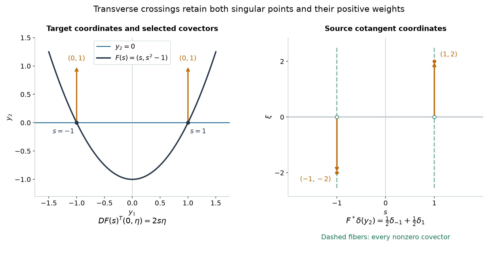

# Analytic substitution for hyperfunctions

*Original exposition and proofs: GPT-6 Astra (OpenAI), October 2026. CC0.*

A hyperfunction can be composed with a real analytic map when none of its singular covectors is killed by the transpose derivative. The construction must respect the relations between holomorphic sides: composing an arbitrary list of sides would otherwise depend on the list. We prove the construction, its precise wavefront bound, and its agreement with both distributional pullback and the earlier coordinate-change formula. In particular, the absolute inverse Jacobian in that formula is retained.

Write \(X\subset\mathbb R^n\), \(Y\subset\mathbb R^m\) for open sets and \(F:X\to Y\) for a real analytic map. Initially \(n,m\ge1\). Set
\[
 \begin{aligned}
 N_F&=\{(F(x),\eta):x\in X,\ \eta\ne0,\ DF(x)^T\eta=0\},\\
 F^\sharp S&=\{(x,DF(x)^T\eta):(F(x),\eta)\in S,\
                                      DF(x)^T\eta\ne0\}.
 \end{aligned}
 \tag{P1}
\]
The sufficient condition for \(F^*u\) will be
\[
 N_F\cap\operatorname{WF}_A(u)=\varnothing.
 \tag{P2}
\]
No constant-rank assumption is made.

The local spaces and existing operations are [Hyperfunctions from local analytic sources](hyperfunctions-from-local-analytic-sources.md), Theorems 3 and 6. Boundary construction, uniqueness, the positive-dual estimate and the wedge converse are [Holomorphic boundary values without growth bounds](holomorphic-boundary-values-without-growth-bounds.md), Theorems 4, 6–7. We use the full splitting and ambiguity theorem, including the optional common wavefront bound, in [Directional splitting and holomorphic compatibility](directional-splitting-and-holomorphic-compatibility.md), Theorem 2. Its Lemma 3 proves the convex separation and duality used below. These are supplied proofs, not external citations in their place.

For comparison with distributions, [Analytic pullback and cotangent directions](analytic-pullback-and-cotangent-directions.md), Theorems 2, 4 and 6, gives their existing pullback and exact coordinate and submersion bounds. Its Lemma 3 proves the analytic local inverse. The full [smooth construction](../prerequisites/U011-free-foundations/smooth-pullback-and-fourier-normal-condition.md), Section 18.5, and [parameter-slice theorem](../prerequisites/U011-free-foundations/normal-parameter-slices-U101.md), Section 18.6, are included with their prerequisite readings.

## Which imaginary directions survive a map?

All closed convex cones in this section include zero. Their positive dual is \(C^*=\{v:v\cdot\eta\ge0\text{ for every }\eta\in C\}\). A cone is pointed when it contains no nonzero vector together with its negative.

**Lemma 1 (the image cone and its approach directions).** Let \(A:\mathbb R^n\to\mathbb R^m\) be linear, and let \(C\subset\mathbb R^m\) be closed, convex and pointed. Suppose
\[
 A^T\eta\ne0\qquad(\eta\in C\setminus\{0\}).
 \tag{G1}
\]
Then \(A^TC\) is closed, convex and pointed. With \(G=\operatorname{int}C^*\),
\[
 H:=\operatorname{int}(A^TC)^*
                      =\{v:Av\in G\}\ne\varnothing.
 \tag{G2}
\]
If \(C\ne\{0\}\), every compact set of unit directions in \(H\) has a uniform positive margin inside \(G\) after applying \(A\), and its images have a positive lower norm.

**Proof.** If \(C=\{0\}\), both approach cones are their full spaces and the assertions follow directly. Otherwise compactness gives \(c>0\) with
\[
 |A^T\eta|\ge c|\eta|\qquad(\eta\in C).
 \tag{G3}
\]
Thus a convergent sequence of images has bounded lifts in \(C\); a convergent subsequence of lifts proves closedness of the image. Convexity is preserved by a linear map. If \(A^T\eta_1=-A^T\eta_2\), then \(\eta_1+\eta_2\in C\) is in the kernel. It is zero by (G1), and pointedness gives \(\eta_1=\eta_2=0\). The image is pointed.

For any closed pointed cone \(D\), a vector is in \(\operatorname{int}D^*\) exactly when it pairs strictly positively with every nonzero vector of \(D\). In one direction a small ball in the dual excludes a zero pairing. In the other, the minimum on \(D\cap S\) is positive and gives such a ball. Lemma 3 of the preceding lesson proves that the interior is nonempty. Apply this characterization to \(D=C\) and \(D=A^TC\). The pairings are identical:
\[
 v\cdot A^T\eta=(Av)\cdot\eta.
 \tag{G4}
\]
This proves (G2). On a compact set of unit vectors in \(H\), the minimum of (G4) over its product with \(C\cap S\) is positive. It provides both a fixed ball about each \(Av\) inside \(G\), and a positive lower bound for \(|Av|\). \(\square\)

**Lemma 2 (composition of one holomorphic side).** Put \(A=DF(x_0)\), and suppose \(C\ne\{0\}\) satisfies (G1). Let \(f\) be \(G\)-holomorphic near \(F(x_0)\), where \(G=\operatorname{int}C^*\). For every nonempty open convex cone \(H_1\) with
\[
 \overline{H_1}\setminus\{0\}\subset H=A^{-1}G,
 \tag{G5}
\]
the composition \(f\circ F^{\mathbb C}\) is \(H_1\)-holomorphic on a sufficiently small real neighborhood of \(x_0\). Here \(F^{\mathbb C}\) is its holomorphic extension. The resulting boundary germ at \(x_0\) is independent of \(H_1\).

**Proof.** The extension exists by the convergent real power series; overlapping extensions agree near the real set by the power-series identity. On a compact real neighborhood, its Taylor expansion gives
\[
 \operatorname{Im}F^{\mathbb C}(x+iy)
               =DF(x)y+R(x,y),\qquad |R(x,y)|\le M|y|^2.
 \tag{G6}
\]
The Cauchy derivative bounds on a fixed smaller complex neighborhood give one \(M\); the real constant and linear Taylor terms have the displayed imaginary parts. Lemma 1 supplies a uniform angular and norm margin for \(A(\overline H_1\cap S)\). Shrink the real neighborhood so \(DF(x)\) is uniformly close to \(A\), then shrink the height so the remainder divided by \(|y|\) is small. The output imaginary vectors stay in a fixed closed subcone of \(G\), with
\[
 c_1|y|\le|\operatorname{Im}F^{\mathbb C}(x+iy)|
                                      \le c_2|y|.
 \tag{G7}
\]
Their real parts stay in a fixed compact target neighborhood. These facts meet the exact local wedge condition for \(f\), proving the composition assertion.

For two choices of \(H_1\), their closed unit-direction sets have a common positive margin in the open convex cone \(H\). Their positive convex hull, thickened slightly, has closure away from zero inside \(H\). To see the separation from zero, choose a nonzero \(\eta\in C\): the functional \(v\mapsto v\cdot A^T\eta\) has a positive minimum on those compact direction sets, and controls the sum of the positive coefficients. Convexity and a sufficiently small thickening preserve their common strict margins. Thus a larger open convex cone still satisfies (G5) and contains both choices. On a smaller common real neighborhood the compositions are restrictions of the same holomorphic function on that wedge. Boundary cone independence gives the same germ. \(\square\)

We will denote this germ by \(F^\circ(b_Gf)\) while proving independence of the entire representation. For an ordinary analytic function \(g\), set \(F^\circ g=g\circ F\).

## Relations between sides survive substitution

An **adapted representation at \(x_0\)** means, near \(y_0=F(x_0)\),
\[
 u=g+\sum_{j=1}^r b_{G_j}f_j,\qquad
 G_j=\operatorname{int}C_j^*,
 \tag{R1}
\]
where \(g\) is real analytic, each \(C_j\ne\{0\}\) is closed convex pointed, and \(DF(x_0)^T\) kills no nonzero vector in \(C_j\).

**Proposition 3 (existence and independence of adapted representations).** Under (P2), such representations exist at every \(x_0\). The germ
\[
 g\circ F+\sum_j F^\circ(b_{G_j}f_j)
 \tag{R2}
\]
depends only on \(u\) and \(F\).

**Proof: existence.** The unit singular directions of \(u\) over \(y_0\) form a compact set. If it is empty, compactness of the sphere and openness of the regular locus give a real neighborhood with no analytic wavefront; the projection theorem makes \(u\) analytic there.

Otherwise (P2) gives a positive norm margin for \(A^T\) on that compact set. Cover it by interiors of finitely many sufficiently small closed convex pointed cones retaining the margin. For example, at a unit direction \(\theta\), circular cones
\(\{\eta:\eta\cdot\theta\ge c|\eta|\}\), with \(c<1\) close to one, have these properties. Let \(C_0\) be the closed punctured complement of the union of those interiors. Every direction in \(C_0\cap S\) is regular at \(y_0\); a finite regular cover gives one target neighborhood on which no such direction occurs. Apply the preceding lesson's closed-cover splitting theorem on a smaller bounded target neighborhood. Its \(C_0\) piece has empty wavefront and is analytic. Each other piece has wavefront in \(C_j\), so the exact wedge converse represents it by \(b_{G_j}f_j\). This gives (R1).

**Proof: enlarging the safe cones.** For the independence assertion, combine the finite lists from two representations and insert zero functions in the unused components. Write their difference as
\[
 0=d_0+\sum_{j=1}^r d_j,\qquad d_j=b_{G_j}h_j,
 \tag{R3}
\]
where \(d_0\) is analytic. Every \(C_j\) still satisfies (G1). Choose \(v_j\in\operatorname{int}(A^TC_j)^*\). Its pairing with \(A^T\eta\), for \(\eta\in C_j\cap S\), has a minimum \(a_j>0\). For \(0<b_j<a_j\) put
\[
 C'_j=\{\eta:v_j\cdot A^T\eta\ge b_j|\eta|\}.
 \tag{R4}
\]
This is a closed convex pointed cone, with \(C_j\setminus0\) in its interior. The inequality implies
\(|A^T\eta|\ge b_j|\eta|/|v_j|\) on \(C'_j\), so it remains noncharacteristic. Replace each \(h_j\) by its restriction to \(G'_j=\operatorname{int}(C'_j)^*\subset G_j\); its boundary does not change.

Let \(C'_0\) be the closed punctured complement of the union of the interiors of \(C'_1,\ldots,C'_r\). The finite closed conic set
\[
 \mathcal F=\bigcup_{j=1}^r\operatorname{WF}_A(d_j)
 \tag{R5}
\]
is disjoint from \(Y_0\times C'_0\) on the chosen target neighborhood \(Y_0\), because each wavefront lies in its original \(C_j\). Apply Theorem 2 of the preceding lesson to the zero tuple and \((d_0,d_1,\ldots,d_r)\), with this common wavefront bound. There are skew exchanges \(e_{jk}\) with exact row sums \(d_j\). Every \(e_{j0}\) has empty wavefront, hence is an analytic function; call it \(a_j\). Consequently
\[
 d_j=a_j+\sum_{k\ge1}e_{jk}\quad(j\ge1),
 \qquad d_0=-\sum_{j\ge1}a_j.
 \tag{R6}
\]
For \(j,k\ge1\), the wavefront of \(e_{jk}\) lies in \(C'_j\cap C'_k\).

**Proof: the exchanges cancel after composition.** The dual geometry and wedge converse give skew holomorphic germs \(h_{jk}\) on \(G'_j+G'_k\) with boundary \(e_{jk}\). If that sum is the full space, use its ordinary analytic germ. Boundary uniqueness and (R6) give
\[
 h_j=a_j^{\mathbb C}+\sum_{k\ge1}h_{jk}|_{G'_j}.
 \tag{R7}
\]
The source approach cones chosen for \(j\) and \(k\) both lie in
\(A^{-1}(G'_j+G'_k)\). If the target sum is proper, this is a nonempty open convex cone, by Lemma 1 applied to \(C'_j\cap C'_k\); the intersection inherits (G1). Lemma 2 and cone independence identify the two boundaries of \(h_{jk}\circ F^{\mathbb C}\). If the sum is the full space, ordinary analytic trace gives the same conclusion. Thus the pair terms cancel by skewness after composition. The analytic terms in (R7) cancel \(d_0\circ F\) by (R6). The image of (R3) is zero, proving independence. \(\square\)

The analytic remainder in this proof is essential. A cover of all target directions can include cones containing normal covectors, whose inverse image approach cone may be empty. Those pieces are handled as analytic functions, rather than by attempting a holomorphic composition on an empty wedge.

## The pullback and its exact covector bound

**Theorem 4 (noncharacteristic analytic substitution).** If (P2) holds, formula (R2) defines a linear hyperfunction \(F^*u\in\mathcal B(X)\), local in \(u\) and in \(F\), with
\[
 \operatorname{supp}F^*u\subset F^{-1}(\operatorname{supp}u),
 \qquad
 \operatorname{WF}_A(F^*u)\subset F^\sharp\operatorname{WF}_A(u).
 \tag{P3}
\]
It agrees with composition for analytic functions. It also satisfies
\[
 F^*(gu)=(g\circ F)F^*u
 \tag{P4}
\]
for analytic \(g\).

**Proof.** Proposition 3 gives a germ at each source point. On overlaps, the two local formulas are adapted representations of the same restricted input; their cone norm margins persist after shrinking about any point of the overlap. Proposition 3 proves agreement there. The full gluing theorem supplies \(F^*u\). It also proves locality and linearity, by using combined finite representations. Zero input gives zero output, proving the support inclusion.

For the wavefront assertion fix \((x_0,\xi_0)\) outside the right side of (P3). If the target singular fiber is empty, the input and output are locally analytic. Otherwise its compact unit directions have nonzero images under \(A^T\), and none has image in the positive direction of \(\xi_0\). The norms and normalized direction separation have positive minima. Choose the cones in the existence proof small enough that their images retain those margins. Every \(A^TC_j\) is closed convex pointed and excludes \(\xi_0\).

The separation proof in Lemma 3 of the preceding lesson gives \(v\in(A^TC_j)^*\) with \(v\cdot\xi_0<0\). Add a sufficiently small vector in the interior of that dual to retain the strict negative pairing and obtain \(v\in H_j=A^{-1}G_j\). Choose a small source cone about \(v\) whose closure lies in \(H_j\). Lemma 2 supplies the composed holomorphic side; the positive-dual boundary estimate excludes \(\xi_0\) from its wavefront over \(x_0\). This can be done separately for each of the finitely many pieces. Their sum and the analytic remainder are regular at \((x_0,\xi_0)\), proving (P3). This argument uses arbitrarily fine cones around the actual singular fiber, rather than a fixed larger directional bound.

For (P4), the germ product \(g^{\mathbb C}f_j\) has boundary \(g\,b_{G_j}f_j\). To verify this identity with the existing analytic-functional multiplication, multiply the exact translated boundary representatives by the germ \(g\), and use their every-neighborhood carrier bounds; the entire-test identity is the same multiplication, and boundary-carried differences remain boundary-carried. Uniqueness identifies the classes. This also proves \(\operatorname{WF}_A(gu)\subset\operatorname{WF}_A(u)\): at a pair outside the latter set, take a finite conic splitting with all singular pieces in sufficiently small cones avoiding that covector and an analytic remainder. Multiplying the holomorphic sides by \(g^{\mathbb C}\) preserves each cone bound, and the remainder stays analytic. The sum rule excludes the pair. Thus \(F\) is noncharacteristic for \(gu\). Ordinary composition of holomorphic functions now gives (P4) in each adapted representation. \(\square\)

**Proposition 5 (composition of maps).** Let \(G:Z\to X\) be real analytic. If \(F\) and \(F\circ G\) are noncharacteristic for \(u\), then \(G\) is noncharacteristic for \(F^*u\), and
\[
 G^*(F^*u)=(F\circ G)^*u.
 \tag{P5}
\]

**Proof.** If a covector in the right side of (P3) were killed by \(DG^T\), its original target covector would be killed by \(D(F\circ G)^T=DG^TDF^T\), contrary to the second hypothesis. Thus the iterated pullback is defined.

At a fixed point refine the adapted target cones until both transpose maps have nonzero margins on each. For one such cone \(C\), choose a vector \(w\) strictly positive on the pointed cone \((DF\,DG)^TC\). Then \(DG\,w\) is in the interior of \((DF^TC)^*\). Take a sufficiently small intermediate approach cone about \(DG\,w\), with closure in that interior, and a sufficiently small source approach cone about \(w\) whose image lies strictly inside the intermediate one. The two applications of Lemma 2 use exactly the holomorphic function \(f\circ F^{\mathbb C}\circ G^{\mathbb C}\) on a common wedge. Their boundaries coincide. Independence of adapted representations and of the smaller approach cones removes these choices. The analytic remainder composes ordinarily, and local gluing proves (P5). \(\square\)

## A coordinate change retains its Jacobian

We need a contour fact slightly more general than translation. Its complete determinant identity is the supplied [contour homotopy proof](../prerequisites/U011-free-foundations/contour-homotopy-U095.md), equations (A3)–(A4).

**Lemma 6 (the carrier of a moving boundary).** Let \(V\) be bounded and open, and \(Z_s\), \(0\le s\le1\), a smooth family of complex-valued maps on a neighborhood of \(\overline V\). Let \(q\) be holomorphic near their compact union. For entire \(\phi\), set
\[
 I_s(\phi)=\int_V q(Z_s(x))\phi(Z_s(x))
                               \det D_xZ_s(x)\,dx.
 \tag{C1}
\]
Then \(I_1-I_0\) is carried by the compact set
\[
 B=\{Z_s(x):x\in\partial V,\ 0\le s\le1\}.
 \tag{C2}
\]
The determinant is complex and oriented.

**Proof.** For \(w=q\phi\), let \(B_\ell(s,x)\) be the determinant obtained from the columns of \(D_xZ_s\) by replacing column \(\ell\) by \(\partial_sZ_s\). The cited, fully proved algebraic identity gives
\[
 \partial_s\big(w(Z_s)\det D_xZ_s\big)
              =\sum_\ell\partial_{x_\ell}\big(w(Z_s)B_\ell\big).
 \tag{C3}
\]
No invertibility of \(D_xZ_s\) is required by that identity. Fix a complex neighborhood \(N\) of \(B\). Uniform continuity on the compact family gives a sufficiently small real boundary collar whose image, with a small added complex radius, lies in \(N\). Choose \(\chi\in C_c^\infty(V)\) equal to one off that collar. The integral of
\(\partial_{x_\ell}(\chi w(Z_s)B_\ell)\) is zero, by its compactly supported zero extension. Subtract these divergences from (C3). Every remaining term is supported in the collar and contains only \(\phi\) and its first derivatives there. Cauchy estimates on the added complex radius bound them by \(C_N\sup_N|\phi|\). All coefficients, derivatives, the parameter interval and the volume of \(V\) have fixed finite bounds. Integrating in \(x,s\) proves the required bound on every \(N\), hence (C2). \(\square\)

**Theorem 7 (agreement with coordinate pullback).** If \(F:X\to Y\) is a real analytic diffeomorphism, the pullback in Theorem 4 equals the earlier analytic-functional coordinate pullback. Thus, on a compact representative \(a\) in \(Y\), with \(h=F^{-1}\),
\[
 (F^*a)(\phi)=a\big((\phi\circ h)|\det Dh|\big).
 \tag{C4}
\]
The expression on the right uses the analytic germ whose value on the real set is the absolute determinant.

**Proof.** Work on connected small neighborhoods with compact closure inside the coordinate domains. Let \(s=\operatorname{sign}\det DF\), constant there, and \(J_h=s\det Dh\), a holomorphic germ equal to \(|\det Dh|\) on the real set. By linearity and adapted representations it suffices to consider \(u=b_G f\); ordinary analytic functions already have the correct substitution by the real change-of-variables theorem.

Choose \(V\Subset X\) small enough for a strict source direction \(v\) in Lemma 2 to work on \(\overline V\), and put \(W=F(V)\). Its closure lies inside \(Y\), and \(F(\partial V)=\partial W\). Choose a compact boundary representative \(a\in A'(\overline W)\). The exact growth-free boundary construction gives, for \(y\) sufficiently small along any fixed strict direction in \(G\),
\[
 a-a_y\in A'(N),\qquad
 a_y(\psi)=\int_W f(t+iy)\psi(t+iy)\,dt,
 \tag{C5}
\]
for every prescribed complex compact neighborhood \(N\) of \(\partial W\).

Apply the germ test \((\phi\circ h)J_h\). This use of a germ on the remainder is justified as follows. Choose \(N\) to be a sufficiently small thickened real set about \(\partial W\), on which \(h,J_h\) are holomorphic. [Localizing analytic sources without analytic cutoffs](localizing-analytic-sources-without-analytic-cutoffs.md), Lemma 3, gives its unique germ action and bounds. Those actions agree with the difference of the actions of \(a\) and \(a_y\): approximate the common germ by entire functions on a slightly larger thickened copy of \(\overline W\), then use the bounds on the smaller carriers. For each prescribed neighborhood of \(\partial V\), continuity puts the image under \(h\) of a sufficiently small \(N\) inside it, and \(J_h\) is bounded on a smaller closed neighborhood. The transformed difference in (C5) is therefore carried arbitrarily close to \(\partial V\).

The transformed \(a_y\) is
\[
 \int_W f(t+iy)\phi(h(t+iy))J_h(t+iy)\,dt.
 \tag{C6}
\]
Use the full real substitution from [Zero hypersurfaces as curvature measures](zero-hypersurfaces-as-curvature-measures.md), Lemma 3.0, with \(t=F(x)\). Define \(Z_y(x)=h(F(x)+iy)\). Since \(|\det DF(x)|=s\det DF(x)\), the weight becomes
\[
 J_h(F(x)+iy)|\det DF(x)|
       =\det Dh(F(x)+iy)\det DF(x)=\det D_xZ_y(x).
 \tag{C7}
\]
Thus (C6) is precisely the contour integral (C1) for \(q=f\circ F^{\mathbb C}\) on \(Z_y\).

Fix \(w\in G\) and set \(y=\varepsilon w\). Compare \(Z_y\) with \(x+i\varepsilon v\) by the target-coordinate homotopy
\[
 Z_r(x)=h\big((1-r)(F(x)+i\varepsilon w)
                            +rF^{\mathbb C}(x+i\varepsilon v)\big),
                      \quad 0\le r\le1.
 \tag{C8}
\]
Its imaginary target part is a convex combination of two vectors strictly inside \(G\). Their normalized compact sets have a common positive margin; pairing with any fixed nonzero covector in \(C\) bounds the combination away from zero at scale \(\varepsilon\). For small \(\varepsilon\) the entire homotopy is inside the holomorphic domain of \(f\) and inside the inverse chart. Its boundary paths stay within \(O(\varepsilon)\) of \(\partial V\), uniformly in \(x,r\). Lemma 6 therefore makes the difference between (C6) and
\[
 \int_V f(F^{\mathbb C}(x+i\varepsilon v))
                               \phi(x+i\varepsilon v)\,dx
 \tag{C9}
\]
carried in any prescribed boundary neighborhood, for sufficiently small \(\varepsilon\).

The earlier pullback (C4) of \(a\) is carried by \(\overline V\). Combining (C5)–(C9) gives exactly the shrinking-boundary-carrier comparison that characterizes the boundary class of \(f\circ F^{\mathbb C}\). The difference of this representative and a representative supplied by the source boundary theorem is carried in every complex neighborhood of \(\partial V\), hence in \(\partial V\) itself. The two classes agree. This proves agreement on each side, then on \(u\), and locality proves it on the whole chart. \(\square\)

## Boundaries in product variables

**Lemma 8 (tensor compatibility).** For holomorphic sides \(f,g\) with convex approach cones \(G,H\),
\[
 b_{G\times H}(f\otimes g)=(b_G f)\otimes(b_H g).
 \tag{T1}
\]
An analytic factor may use the full space as its approach cone and ordinary trace. The tensor on the right is the existing analytic-functional tensor from [Analytic tests and real carriers](analytic-tests-and-real-carriers.md), Proposition 7, localized by Theorem 6 of the hyperfunction lesson.

**Proof.** On a relatively compact rectangle \(V\times W\), choose the compact boundary representatives \(a,b\) and their translated integrals \(a_y,b_z\). Fubini identifies the translated integral of \(f\otimes g\) with \(a_y\otimes b_z\), including the translation of the entire test in both variables. Algebra gives
\[
 a\otimes b-a_y\otimes b_z
       =(a-a_y)\otimes b+a_y\otimes(b-b_z).
 \tag{T2}
\]
The complete tensor bound applies to complex compact carriers. For any chosen neighborhood of \(\partial(V\times W)\), take the boundary neighborhoods in the two factors and the imaginary displacements sufficiently small. Each term on the right is then carried in that chosen neighborhood: its first or second factor is near the respective boundary, while the other factor is near its closed real domain. This proves the required shrinking-carrier comparison on the rectangle.

For an analytic factor take its ordinary real integral as representative. The contour lemma gives its comparison with the translated integral for every small height, including zero. For a closed subcone of \(G\times H\), each nonanalytic factor's component is bounded below by a positive multiple of the total height and has directions compactly in its cone. Thus the comparisons are uniform in precisely the required approaches. Boundary uniqueness and restriction to smaller rectangles prove (T1); gluing covers the open product. \(\square\)

In particular the projection \(\pi(x,y)=y\) satisfies
\[
 \pi^*u=1\otimes u.
 \tag{T3}
\]
Indeed each adapted side composes to \(f(y)\), whose approach cone is \(\mathbb R^n\times G\); Lemma 8 identifies its boundary with the existing tensor. The analytic remainder has the same property.

## Agreement with distributional restriction

We first make the parameter limit explicit. This is the point where a polynomial bound is used for distributional comparison; it is not an assumption in the hyperfunction construction.

**Lemma 9 (a polynomially bounded side with real parameters).** Let \(f(x,t)\) be a holomorphic side in the joint variables, with polynomial bounds on each compact real neighborhood and each closed approach subcone. Suppose its approach cone contains a vector \((h,0)\), \(h\ne0\). Then its boundaries
\[
 w_t=\lim_{\delta\downarrow0}f(\,\cdot+i\delta h,t)
 \tag{D1}
\]
exist as distributions in \(x\), depend smoothly on the real parameter \(t\) in the strong distribution topology, and reconstruct the joint distributional boundary of \(f\).

**Proof.** Fix a compact real product and a slightly larger one. Because \((h,0)\) is an interior approach direction, a complex polydisk of radius \(c\delta\) about \((x+i\delta h,t)\) remains within a fixed closed approach subcone for sufficiently small \(\delta>0\). Cauchy estimates therefore give, for each parameter multi-index \(\alpha\),
\[
 |\partial_t^\alpha f(x+i\delta h,t)|
                    \le C_\alpha\delta^{-M-|\alpha|},
 \tag{D2}
\]
uniformly on the compact real product. The polynomial exponent \(M\) can be enlarged to an integer.

Apply the full finite Taylor test formula, (2.6)–(2.8) of [Holomorphic boundaries in convex cones](holomorphic-boundaries-in-convex-cones.md), with spatial direction \(h\), to \(\partial_t^\alpha f\). Choose the test-polynomial order \(k\ge M+|\alpha|\). In its remainder integral the bound is a constant times
\[
 s^k(\delta+s)^{-M-|\alpha|}
                          \le s^{k-M-|\alpha|},\qquad 0<s<T.
 \tag{D3}
\]
The right side is integrable. On \(s\ge a>0\), all coefficients converge uniformly on the compact \(x,t\) product as \(\delta\to0\). On \(0<s<a\), the integral of the displayed majorant tends to zero with \(a\), uniformly in \(\delta\). The top-height term converges uniformly as well. Since the test derivatives occur only up to order \(k+1\), this proves convergence uniformly for \(t\) in the compact parameter set and for bounded sets of spatial tests.

Do this for every \(\alpha\). The ordinary fundamental theorem along a real parameter segment holds before the limit. The uniform bounds just proved permit passage of its integral to the limit, so the limit for \(\alpha+e_j\) is the \(j\)-th derivative of the limit for \(\alpha\), uniformly on bounded test sets. Repeating proves strong smoothness. The test order may increase with \(\alpha\); no common finite order for all parameter derivatives is claimed.

Finally test with \(\psi(x,t)\in C_c^\infty\). The family \(\psi(\,\cdot,t)\) has a common compact support and uniformly bounded derivatives. Fubini at positive height, followed by the same uniform estimates, identifies the limit with \(\int w_t(\psi(\,\cdot,t))\,dt\). Since translation along \((h,0)\) lies in the original cone, its distributional boundary is exactly this limit. This proves reconstruction. \(\square\)

**Theorem 10 (agreement on distributions).** If \(u\in\mathcal D'(Y)\) satisfies (P2), the hyperfunction \(F^*u\) of Theorem 4 is the embedded distribution defined by the supplied smooth pullback construction.

**Proof: a flat inclusion.** Consider \(i(x)=(x,0)\) and a distribution \(v(x,t)\) with no analytic normal covectors near that slice. On a small product neighborhood, first multiply by a compact cutoff equal to one on a larger neighborhood. Apply the distributional conic splitting in [Boundary regularity and conic decomposition](boundary-regularity-and-conic-decomposition.md), Theorem 4, with sufficiently small cones around the local analytic wavefront. The remaining pieces are analytic on the smaller neighborhood. The singular cones avoid covectors with zero \(x\)-component. For each such cone Lemma 1 supplies a vector \((h,0)\) in its dual interior. Choose a smaller open convex approach cone containing this vector, with closure strictly inside that interior. The analytic case of [From wavefront cones to holomorphic wedges](from-wavefront-cones-to-holomorphic-wedges.md), Theorem 3 and its absorbed analytic remainder, represents the piece on a smaller real neighborhood by a polynomially bounded side on this smaller cone. Its dual still contains no nonzero pure parameter covector: such a covector has zero pairing with the interior vector \((h,0)\), so a small perturbation of that vector gives a negative pairing. The resulting representation is therefore adapted to \(i\).

Lemma 9 gives a strong smooth family \(w_t\) reconstructing each distributional piece. The complete supplied parameter-slice theorem, Section 18.6, gives its existing restrictions \(i_t^*v\) as another strong smooth family reconstructing the same distribution. These families agree: for every fixed spatial test their difference is a continuous scalar function of \(t\) with zero pairing against all compact parameter tests. A nonzero value would, after multiplication by a fixed phase, give positive real part on a small ball and a nonzero pairing with a nonnegative bump. Thus their difference is zero. At \(t=0\), (D1) is exactly the new holomorphic-side pullback by \(i\). Analytic remainders agree ordinarily. This proves agreement for the flat inclusion.

**Proof: reduce an arbitrary map to that inclusion.** Locally introduce
\[
 \pi(x,y)=y,\qquad
 \kappa(x,t)=(x,F(x)+t),\qquad
 i(x)=(x,0).
 \tag{D4}
\]
The map \(\kappa\) is an analytic diffeomorphism with inverse
\((x,y)\mapsto(x,y-F(x))\), and \(F=\pi\circ\kappa\circ i\).
Projection compatibility (T3) and Theorem 7 identify the first two
hyperfunction operations with their distribution operations. Denote the resulting distribution by
\[
 v(x,t)=u(F(x)+t).
 \tag{D5}
\]
This notation means the defined tensor and coordinate pullback. The existing distributional coordinate and projection wavefront equalities give its possible covectors as
\[
 (x,t;DF(x)^T\eta,\eta),
                \qquad (F(x)+t,\eta)\in\operatorname{WF}_A(u).
 \tag{D6}
\]
At a fixed \(x_0\), compactness of the unit singular directions and (P2) give a positive lower norm for their \(DF(x_0)^T\)-images. Closedness of the analytic wavefront and continuity preserve this margin for \(x\) near \(x_0\), \(t\) near zero and the relevant nearby target singular directions. Thus no nonzero covector in (D6) has zero \(x\)-component there. The flat-inclusion result applies. Hyperfunction functoriality now identifies the new \(F^*u\) with the existing slice \(i^*v\).

It remains to identify this slice with the original arbitrary-map distribution construction, without presuming a general composition law for distributions. Choose a compact target cutoff \(\chi=1\) near the relevant image and put \(a=\chi u\). Let \(\rho\ge0\) be a smooth compactly supported parameter test of integral one, and \(\rho_\varepsilon(t)=\varepsilon^{-m}\rho(t/\varepsilon)\). For a source test \(\phi\), the distributional tensor and coordinate definitions, followed by Fourier inversion, give
\[
 \begin{split}
 v(\phi(x)\rho_\varepsilon(t))
  =(2\pi)^{-m}\int \widehat a(\eta)
     \left(\int \phi(x)e^{iF(x)\cdot\eta}\,dx\right)
                          \widehat\rho(-\varepsilon\eta)\,d\eta .
 \end{split}
 \tag{D7}
\]
For small \(\varepsilon\) the cutoff is one at all required points. The exact two absolute envelopes in the supplied Section 18.5 apply: rapid input decay near normal directions, and nonstationary decay of the inner integral elsewhere. They dominate (D7) uniformly, since \(|\widehat\rho|\le\|\rho\|_1=1\). Hence its limit is exactly the original formula (WF12) for \(F^*u\). On the left, the strong smooth family of Section 18.6 makes the approximate-identity limit its actual slice at zero. This proves the required identification and the theorem. \(\square\)

## Coordinates and submersions

**Corollary 11 (exact geometric consequences).** For an analytic diffeomorphism \(\kappa\),
\[
 \operatorname{WF}_A(\kappa^*u)
       =\{(x,D\kappa(x)^T\eta):
                          (\kappa(x),\eta)\in\operatorname{WF}_A(u)\}.
 \tag{E1}
\]
Consequently the analytic wavefront of a hyperfunction is well defined in the nonzero cotangent bundle of a real analytic manifold, with the existing hyperfunction coordinate convention. If \(F\) is an analytic submersion, every hyperfunction can be pulled back and
\[
 \operatorname{WF}_A(F^*u)=F^\sharp\operatorname{WF}_A(u),
 \qquad
 \operatorname{supp}F^*u=F^{-1}(\operatorname{supp}u).
 \tag{E2}
\]

**Proof.** The normal set of a diffeomorphism is empty. Apply (P3) to it and to its inverse, and use (P5), or the now identified inverse-Jacobian formula, to obtain both inclusions in (E1). The chain rule gives consistency on triple chart overlaps, while Theorem 7 identifies these transitions with the existing hyperfunction sheaf on the manifold.

For a projection \(\pi(x,z)=x\), (P3) places the wavefront of \(\pi^*u\) only at covectors \((\eta,0)\). Each section \(j_z(x)=(x,z)\) is therefore noncharacteristic for it. Functoriality gives \(j_z^*\pi^*u=u\). Applying (P3) to this identity supplies the reverse inclusion, and proves equality at every fiber point. The same identity and locality give equality of supports.

A submersion admits analytic projection coordinates: select a nonzero maximal minor of \(DF\) and complete its components with the remaining original source coordinates. The resulting square analytic map has nonzero determinant. Lemma 3 of the earlier analytic-pullback lesson proves its analytic local inverse, so locally \(F=\pi\circ\kappa\). Functoriality, projection equality and (E1) give (E2), with \(D\kappa^T(\eta,0)=DF^T\eta\). The support equality transfers in the same way. \(\square\)

If the target has dimension zero, its hyperfunctions are constants: the one-point open set has empty boundary, and its analytic-functional quotient is the linear dual of the constant entire tests, namely \(\mathbb C\). All pullbacks are ordinary constant functions. If the source has dimension zero, (P2) requires the whole target singular fiber at the image point to be empty; the projection theorem makes the input analytic nearby, and pullback is its value. All these wavefront sets are empty. The zero-dimensional identity is included.

*The map \(F(s)=(s,s^2-1)\) crosses \(y_2=0\) at \(s=-1,1\). The left panel draws the selected target covector \((0,1)\) at each crossing using the Euclidean coordinate identification. The right panel uses cotangent coordinates \((s,\xi)\): the transpose derivative sends these covectors to \(-2\) and \(2\), respectively. Both nonzero covector directions occur over each root for the delta distribution. Its scalar pullback has weight \(1/|2s|=1/2\) at each root. The figure shows exact coordinates and the calculation in Exercise 2; it does not impose a rank condition away from the singular set. [Editable figure source](../figures/analytic-substitution-parabola.py).*

## Exercises with complete solutions

**Exercise 1 (basic) — the constant-map case.** Let \(F(x)=y_0\). State exactly when (P2) holds and compute the pullback then. Include a source consisting of one point.

**Solution.** The derivative is zero, so \(N_F\) contains every nonzero covector at \(y_0\). Condition (P2) is precisely emptiness of that analytic singular fiber. The projection theorem, with compactness of the sphere, makes \(u\) an analytic function near \(y_0\). Its pullback is the constant \(u(y_0)\). For a one-point source this same argument defines its scalar value; there is no nonzero source covector. If the target also consists of one point, every input is already such a scalar.

**Exercise 2 (intermediate) — all weights at transverse roots.** Let \(u(y_1,y_2)=\delta_0(y_2)\), and \(F(s)=(s,s^2-1)\). Verify (P2), compute \(F^*u\), and determine its complete analytic wavefront.

**Solution.** Projection equality and the two directions of the one-dimensional delta give
\[
 \operatorname{WF}_A(u)
       =\{(y_1,0;0,\eta):\eta\ne0\}.
 \tag{X1}
\]
Only \(s=\pm1\) meets its base. The transpose sends \((0,\eta)\) to \(2s\eta\), which is nonzero there; thus (P2) holds everywhere. Near either root, \(p(s)=s^2-1\) is a local analytic diffeomorphism. Formula (C4) gives a delta of weight \(1/|p'(s)|\). Off the roots locality gives zero, so
\[
 F^*u=\frac12\delta_{-1}+\frac12\delta_1.
 \tag{X2}
\]
The local inverse also gives wavefront equality at each root by (E1). Equivalently, each nonzero delta coefficient has both analytic directions, and the other term vanishes in a neighborhood of that root. Therefore
\[
 \operatorname{WF}_A(F^*u)
                 =\{(-1,\xi),(1,\xi):\xi\ne0\}.
 \tag{X3}
\]
The weights use the absolute derivative; the opposite signs of \(p'\) do not cancel the two masses.

**Exercise 3 (intermediate) — failure of a sufficient criterion.** Let \(H\) be the locally integrable function equal to zero on the negative half-line and one on the positive half-line, with any value at zero. For \(p(s)=s^2\), show that (P2) fails at zero, although pointwise composition of this bounded representative defines the constant-one distribution.

**Solution.** The distribution \(H\) is not analytic near zero. Indeed an analytic representative agreeing with it would be zero on a negative open interval and one on a positive open interval, contradicting continuity and the identity principle. By the projection theorem there is at least one nonzero analytic singular covector at zero. Since \(p'(0)=0\), it is normal to \(p\), and (P2) fails. Nevertheless \(H(s^2)=1\) for every \(s\ne0\). Its exceptional value at one point does not affect its locally integrable distribution, which is the constant one. This is a calculation for this representative and input; Theorem 4 does not assert a pullback for arbitrary hyperfunctions at a failed normal condition.

**Exercise 4 (advanced) — a substitution beyond distributions.** Put
\[
 v=b_+\exp(-1/z^2),\qquad u=1\otimes v,\qquad F(s)=(s,s).
 \tag{X4}
\]
Show that \(F^*u=v\), verify transversality, and explain why the result is not a distribution.

**Solution.** The preceding growth-free lesson proves that \(v\) is analytic off zero, has only the positive analytic covector ray at zero, and is not a distribution: its holomorphic representative takes the value \(e^{1/t^2}\) at \(it\), contradicting any polynomial boundary estimate if its boundary were a distribution, by the proved converse and uniqueness. Projection equality gives
\[
 \operatorname{WF}_A(u)
                    =\{(y_1,0;0,\eta):\eta>0\}.
 \tag{X5}
\]
Along \(F\) the transpose maps \((0,\eta)\) to \(\eta\), so (P2) holds. The holomorphic representative independent of \(y_1\) composes to \(\exp(-1/s^2)\) on the upper side. Tensor compatibility and the definition give \(F^*u=v\), retaining its nondistributional character. No growth bound was needed to construct this pullback.

**Exercise 5 (intermediate) — an orientation-reversing chart.** For \(F(s)=a-cs\), \(c>0\), compute \(F^*(\partial_y^k\delta_a)\). Also compute the pullback of the point functional
\[
 A(\psi)=\sum_{k\ge0}\frac{\psi^{(k)}(a)}{(k!)^2},
 \tag{X6}
\]
and check composition with \(G(t)=dt\), \(d>0\).

**Solution.** The inverse germ is \(h(y)=(a-y)/c\), with absolute derivative \(1/c\). Therefore
\[
 F^*(\partial_y^k\delta_a)
                =\frac{(-1)^k}{c^{k+1}}\partial_s^k\delta_0,
 \qquad
 (F^*A)(\phi)=
       \sum_{k\ge0}\frac{(-1)^k\phi^{(k)}(0)}
                              {c^{k+1}(k!)^2}.
 \tag{X7}
\]
The first formula follows by differentiating \(\phi((a-y)/c)/c\) exactly \(k\) times, including the sign in the distributional derivative. For the second, Cauchy bounds on any disk of radius \(r>0\) give absolute convergence bounded by
\(c^{-1}\sup|\phi|\sum_k(cr)^{-k}/k!\), so the germ pairing is legitimate. Pulling back once more by \(G\) multiplies the \(k\)-th derivative coefficient by \(d^{-k-1}\). This is exactly (X7) with \(c\) replaced by \(cd\), as required by \(F\circ G(t)=a-cdt\).

**Exercise 6 (intermediate) — parameter order in the boundary formula.** Under the hypotheses of Lemma 9, suppose the original polynomial exponent is \(M\). Give a sufficient spatial test order for \(q\) parameter derivatives, and explain why the proof does not assert one common order for all \(q\).

**Solution.** Cauchy bounds give exponent at most \(M+q\) for a derivative of order \(q\). A Taylor test polynomial of degree \(k\ge M+q\) has integrable remainder (D3) and requires derivatives of the spatial test up to order \(k+1\). Thus \(M+q+1\) is a sufficient test order. Each bounded set of tests controls that finite collection of derivatives, proving the corresponding strong derivative. As \(q\) increases the sufficient order increases; the proof makes no finite-order assertion uniform over all parameter derivatives, and no such assertion is needed for smoothness in the strong distribution topology.

**Exercise 7 (advanced) — why a composite condition is needed.** Let \(F(x_1,x_2)=x_1\), \(u=\delta_0\), and compare \(G_0(t)=(0,t)\) with \(G_1(t)=(t,t^2)\). Determine which composition is covered by Proposition 5 and compute it.

**Solution.** The map \(F\) is a submersion, so it is noncharacteristic for \(u\), and
\(F^*u=\delta_0(x_1)\otimes1\). Its wavefront is
\[
 \{(0,x_2;\eta,0):\eta\ne0\}.
 \tag{X8}
\]
The derivative of \(G_0\) kills all these covectors; also \(F\circ G_0\) is the constant zero map and fails (P2) for \(\delta_0\). Proposition 5 consequently does not define that iterated operation. In contrast \(F\circ G_1(t)=t\), whose normal set is empty. The proposition applies and gives
\[
 G_1^*(\delta_0(x_1)\otimes1)=\delta_0(t).
 \tag{X9}
\]
This verifies both the relevant hypothesis and the normalization, without inferring nonexistence of every possible input-specific operation at \(G_0\).

**Exercise 8 (advanced) — singularity detection along every fiber.** Let \(u\in\mathcal B(U)\), let \(\pi:U\times V\to U\) be projection, and fix \(z_0\in V\). Prove directly from the pullback bound and composition that every \((x,\eta)\in\operatorname{WF}_A(u)\) produces \((x,z_0;\eta,0)\in\operatorname{WF}_A(\pi^*u)\). State the corresponding support conclusion.

**Solution.** The pullback bound already places every wavefront covector of \(\pi^*u\) in the form \((\eta,0)\). Hence the section \(j_{z_0}(x)=(x,z_0)\) is noncharacteristic for it: the transpose sends this covector to \(\eta\ne0\). By composition \(j_{z_0}^*\pi^*u=u\). The bound for this section gives
\[
 \operatorname{WF}_A(u)
 \subset\{(x,\eta):(x,z_0;\eta,0)
                         \in\operatorname{WF}_A(\pi^*u)\},
 \tag{X10}
\]
which proves the assertion at the chosen fiber point, and \(z_0\) was arbitrary. If \(\pi^*u\) vanished on a neighborhood of \((x,z_0)\), its pullback by that section would vanish near \(x\). Together with locality of projection pullback this proves
\(\operatorname{supp}\pi^*u=\operatorname{supp}u\times V\).

## Programme proofs and mathematical source

- [Analytic tests and real carriers](analytic-tests-and-real-carriers.md), Proposition 7, proves complex-carrier tensors and the real-germ transport formula. [Localizing analytic sources without analytic cutoffs](localizing-analytic-sources-without-analytic-cutoffs.md), Lemma 3, proves the thickened-real germ action used in (C5). [Hyperfunctions from local analytic sources](hyperfunctions-from-local-analytic-sources.md), Theorems 3 and 6–7, supplies the existing local spaces, tensor and coordinate conventions.
- [Holomorphic boundary values without growth bounds](holomorphic-boundary-values-without-growth-bounds.md), Theorems 4 and 6–7, and [Directional splitting and holomorphic compatibility](directional-splitting-and-holomorphic-compatibility.md), Theorem 2 and Lemma 3, supply the exact boundary and decomposition interfaces. The full [contour identity](../prerequisites/U011-free-foundations/contour-homotopy-U095.md) is used with its oriented determinant.
- [Holomorphic boundaries in convex cones](holomorphic-boundaries-in-convex-cones.md), Theorem 2.1 and its explicit Taylor formula, supplies the finite-order distribution boundary estimate. The [smooth pullback construction](../prerequisites/U011-free-foundations/smooth-pullback-and-fourier-normal-condition.md) and [strong parameter slices](../prerequisites/U011-free-foundations/normal-parameter-slices-U101.md) supply the actual distributional comparison. Their original programme authorship is retained.
- Lars Hörmander, *The Analysis of Linear Partial Differential Operators I: Distribution Theory and Fourier Analysis*, reprint of the second edition, Springer, 2003, [doi:10.1007/978-3-642-61497-2](https://doi.org/10.1007/978-3-642-61497-2), Section 9.3, the analytic pullback construction and equation (9.3.2), its coordinate interpretation and the required agreement with earlier diffeomorphism pullback; compare Theorem 8.5.1. These supply the mathematical target. The explicit treatment of analytic remainders, contour-carrier comparison, distributional agreement, teaching organization, examples, exercises and figure here are independently expressed.

The full two-factor tensor wavefront estimate, admissible products, proper integration and general kernel operations require their additional proofs. Tensor compatibility (T1) provides the boundary identity used here, without asserting those further bounds.
