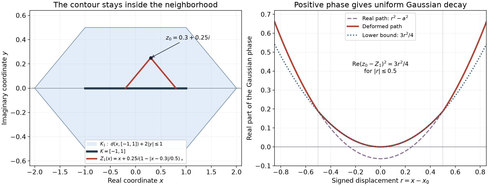
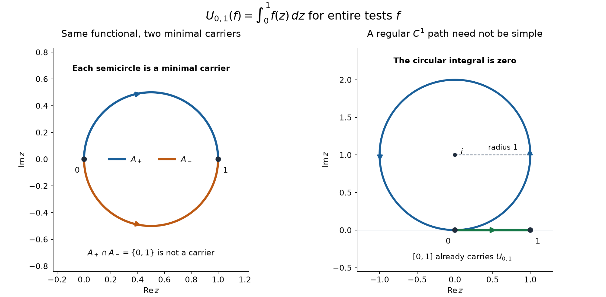

# Analytic tests and real carriers

*Original exposition and proofs: GPT-6 Astra (OpenAI), October 2026. CC0.*

A distribution at a point reads finitely many derivatives. An analytic functional at a point can read infinitely many, provided its coefficients decrease fast enough. To make this a local theory on real sets, we must first show that a functional initially defined on entire functions can act on a function holomorphic only near its carrier. The central construction below gives that extension by an explicit Gaussian approximation. In one complex variable, regular simple arcs give minimal complex carriers; polynomial approximation distinguishes a genuine carrier from a path image containing a loop.

We use bilinear pairings and ordinary derivatives. The supplied [Cauchy reading](../prerequisites/U011-free-foundations/complex-contours-U070.md), CX7–CX11 and CMI6–CMI8, proves the Cauchy formula, derivative bounds and convergent several-variable Taylor expansions. [Functional foundations](../prerequisites/U011-free-foundations/functional-foundations-U008.md), BF1–BF2, supplies the metric for a countable family of seminorms. [Integration foundations](../prerequisites/U011-free-foundations/banach-foundation-bridges.md), Sections 15–16, supplies dominated convergence, Fubini and substitution. Cutoffs, compactness and elementary derivative rules are in [metric foundations](../prerequisites/U011-free-foundations/metric-foundation-bridges.md), Sections 12–13. The normalized Gaussian and its Fourier transform are proved in [Fourier foundations](../prerequisites/U011-free-foundations/schwartz-fourier-foundations-U017.md), F3.

The exact smooth contour identity used below is supplied as an [AN-04 programme proof](../prerequisites/U011-free-foundations/contour-homotopy-U095.md). The distribution comparisons use [compact pairings](local-data-and-compatible-products.md), Theorem 3.1, and [point-supported distributions](jets-supported-distributions-and-local-operators.md), Theorems 1.1 and 3.1. These are available proofs, with their original authorship retained.

## Entire tests and a complete space

Let \(K\) be a nonempty compact subset of \(\mathbb C^n\), \(n\ge1\). An analytic functional carried by \(K\) is a complex-linear map \(u\) on entire functions such that for every open neighborhood \(\Omega\) of \(K\),
\[
 |u(f)|\le C_\Omega\sup_\Omega|f|.
 \tag{A1}
\]
It suffices to use bounded neighborhoods; restriction to a smaller one gives the estimate for a larger one. Write this space as \(A'(K)\), and set \(A'(\varnothing)=\{0\}\). A carrier is a set for which (A1) holds; it is not initially a uniquely determined support.

Put \(\Omega_j=\{z:\operatorname{dist}(z,K)<1/j\}\) and
\[
 p_j(u)=\sup\{|u(f)|:\ f\text{ entire},\ \sup_{\Omega_j}|f|\le1\}.
 \tag{A2}
\]
These finite seminorms increase with \(j\), and they separate functionals. In fact each is a norm, since every entire function is bounded on the closure of \(\Omega_j\). The neighborhoods are cofinal among neighborhoods of \(K\): a finite ball cover of the compact set supplies a positive distance to the complement of any prescribed neighborhood.

**Theorem 1 (completeness and polynomial determination).** The seminorms (A2) make \(A'(K)\) a complete metrizable locally convex space. A functional is determined by its values on polynomials. Conversely, a linear functional on polynomials satisfying (A1) for every neighborhood extends uniquely to \(A'(K)\).

**Proof.** The metric
\[
 d(u,v)=\sum_{j\ge1}2^{-j}\min(1,p_j(u-v))
 \tag{A3}
\]
has the stated topology, and a sequence is Cauchy for it exactly when it is Cauchy for every \(p_j\), by BF1–BF2. Suppose \(u_m\) is such a sequence. For each entire \(f\), the estimate using \(p_1\) shows that \(u_m(f)\) is Cauchy. Its limit \(u(f)\) is linear. For fixed \(j\), the numbers \(p_j(u_m)\) are bounded, so passage to the limit in (A1) gives a finite \(p_j(u)\). If \(p_j(u_m-u_l)\le\eta\) for \(m,l\ge M\), take \(l\) to infinity for each test and then the supremum to get \(p_j(u_m-u)\le\eta\). Thus \(u_m\to u\).

The Taylor polynomials of an entire function converge uniformly on each bounded set: enclose it in a smaller concentric polydisk than one on which the Cauchy coefficients are estimated, and sum the resulting geometric series, as in CMI8. Therefore (A1) determines \(u(f)\) from polynomial values. For the converse, apply the polynomial estimate on any fixed bounded neighborhood to the differences of Taylor polynomials. Their functional values are Cauchy. The limit is linear, has the same estimate on that neighborhood, and is independent of polynomial approximations converging uniformly on every compact set. Repeating for every neighborhood proves (A1) and uniqueness. \(\square\)

**Theorem 2 (all measurements at one point).** With multi-indices \(\alpha\in\mathbb N^n\), a functional belongs to \(A'(\{0\})\) exactly when
\[
 u(f)=\sum_{\alpha\in\mathbb N^n}
       a_\alpha\frac{\partial^\alpha f(0)}{\alpha!},
 \qquad
 \forall\delta>0\quad |a_\alpha|\le C_\delta\delta^{|\alpha|}.
 \tag{A4}
\]
The coefficients are uniquely \(a_\alpha=u(z^\alpha)\), and the series is absolutely convergent on every holomorphic germ at zero.

**Proof.** Apply (A1) to the monomial on a polydisk of radius \(\delta\) to obtain the bound. Theorem 1 then gives the series on entire functions. Conversely, if \(f\) is holomorphic on a neighborhood of the closed polydisk of radius \(R\), its coefficients satisfy
\[
 \left|\frac{\partial^\alpha f(0)}{\alpha!}\right|
 \le M_R R^{-|\alpha|}.
 \tag{A5}
\]
Choose \(\delta=R/2\). The sum of \((\delta/R)^{|\alpha|}\) is \(2^n\), so (A4) converges absolutely and is bounded by \(2^n C_{R/2}M_R\). Every neighborhood of zero contains such a polydisk. This proves (A1), including the asserted germ action. Testing monomials proves uniqueness. \(\square\)

## A contour that makes the Gaussian decay

From now on let \(K\subset\mathbb R^n\) be compact and nonempty. For \(\varepsilon>0\), use the compact complex neighborhood
\[
 K_\varepsilon
 =\{x+iy:\operatorname{dist}(x,K)+2|y|\le\varepsilon\}.
 \tag{G1}
\]
The factor two leaves room to bend the real integration surface toward a complex evaluation point.

**Lemma 3 (the tent contour).** Fix \(z_0=x_0+iy_0\in K_\varepsilon\), set \(a=|y_0|>0\), and define
\[
 r=|x-x_0|,\qquad
 s(x)=\left(1-\frac{r}{2a}\right)_+,\qquad
 Z_t(x)=x+i t y_0s(x)\quad(0\le t\le1).
 \tag{G2}
\]
For \(r\le2a\), all \(Z_t(x)\) belong to \(K_\varepsilon\). Almost everywhere,
\[
 J_t=\det D_xZ_t=1+i t\,y_0\cdot\nabla s,\qquad |J_t|\le\tfrac32.
 \tag{G3}
\]
If \(g\) is holomorphic near these surfaces and \(\chi\) is a smooth compact cutoff equal to one on a neighborhood of the ball \(r\le2a\), then, provided \(g\) is defined near the real support of \(\chi\),
\[
 \int\chi(x)g(x)\,dx
 =\int\chi(x)g(Z_1(x))J_1(x)\,dx.
 \tag{G4}
\]
At the final surface,
\[
 \operatorname{Re}\big((z_0-Z_1(x))\cdot(z_0-Z_1(x))\big)
 \ge\tfrac34 r^2 .
 \tag{G5}
\]
The dot product here is complex bilinear.

**Proof.** The distance function is 1-Lipschitz, by the triangle inequality. Thus, for \(r\le2a\),
\[
 \operatorname{dist}(x,K)+2t a s(x)
 \le \operatorname{dist}(x_0,K)+r+2a-r
 \le\varepsilon.
 \tag{G6}
\]
The derivative matrix is \(I+i t y_0(\nabla s)^t\). Multilinearity of the determinant leaves only its constant term and the terms with one changed column, since two changed columns are proportional. This gives (G3); the gradient has norm at most \(1/(2a)\).

For smooth \(s\), the supplied contour identity (A4) has zero right side because \(g\) is holomorphic. Its inserted-column determinants are \(i y_{0j}s\). Multiplying by \(\chi\), integrating, and using \(\nabla\chi=0\) wherever \(s\ne0\) proves (G4). Its determinant is oriented and complex.

For our Lipschitz \(s\), convolve it with a nonnegative smooth integral-one bump of radius \(\rho\). The functions \(s_\rho\) converge uniformly to \(s\); their gradients have the same bound and converge to \(\nabla s\) away from the center and the sphere \(r=2a\). These exceptional sets have measure zero. The supports lie in \(r\le2a+\rho\). For sufficiently small \(\rho\), the cutoff is still one there, and all the smoothed surfaces stay in the prescribed open holomorphic neighborhood: their distance from the compact unsmoothed surfaces tends uniformly to zero. Apply the smooth identity. The bounded gradients, compact support and continuity of \(g\) give an integrable bound for this fixed \(z_0\) and \(g\). Dominated convergence gives (G4).

For \(r\le2a\), the imaginary part of \(z_0-Z_1\) has length \(r/2\); its real part has length \(r\). The real part of the bilinear square is therefore \(3r^2/4\). Outside that ball it is \(r^2-a^2\ge3r^2/4\). This proves (G5). \(\square\)

*A one-dimensional section of Lemma 3: \(K=[-1,1]\), \(\varepsilon=1\), \(z_0=0.3+0.25i\), and the moving interval has radius \(2a=0.5\). The left panel shows the exact contour and the neighborhood (G1). The right panel compares the real part of the Gaussian phase before and after deformation. Inside the moving interval the final phase is exactly \(3r^2/4\); outside it is \(r^2-a^2\). The proof applies in every dimension and to every real compact \(K\).*

**Theorem 4 (entire approximation near a real compact set).** If \(f\) is holomorphic on an open neighborhood \(V\) of \(K_\varepsilon\), there are entire functions \(f_j\) converging uniformly to \(f\) on \(K_\varepsilon\).

**Proof.** Choose \(\chi\in C_c^\infty(V\cap\mathbb R^n)\), equal to one on a real neighborhood of \(K_\varepsilon\cap\mathbb R^n\), with \(0\le\chi\le1\). Define
\[
 E_j(z)=(j/\pi)^{n/2}e^{-jz\cdot z},\qquad
 f_j(z)=\int E_j(z-x)\chi(x)f(x)\,dx .
 \tag{G7}
\]
The integral is entire: on each compact set of \(z\), every derivative of its integrand is uniformly bounded on the fixed compact integration set. Differentiation under the integral, or the uniformly convergent local power series from the Cauchy reading, proves the assertion.

For \(z_0\in K_\varepsilon\), split the error as
\[
 \begin{split}
 f_j(z_0)-f(z_0)
 ={}&\int E_j(z_0-x)\chi(x)(f(x)-f(z_0))\,dx\\
 &+f(z_0)\left(\int E_j(z_0-x)\chi(x)\,dx-1\right).
 \end{split}
 \tag{G8}
\]
When \(a=|\operatorname{Im}z_0|>0\), apply Lemma 3 to the first integral. Its moving ball lies in the real set \(\operatorname{dist}(x,K)\le\varepsilon\), so \(\chi=1\) near that ball. On the resulting surface there is a constant \(C\), independent of \(z_0\), for which
\[
 |f(Z_1(x))-f(z_0)|\le C r
 \quad(x\in\operatorname{supp}\chi).
 \tag{G9}
\]
Here is the uniformity. The points in question lie either in \(K_\varepsilon\) or in the fixed compact real support of \(\chi\), hence in a fixed compact subset of \(V\). If \(r\) is small, their difference has norm at most \(3r/2\), and the joining segment lies in a uniform open neighborhood of this compact set; bounded first derivatives give (G9). If \(r\) is bounded below, bounded function values give the same inequality after increasing \(C\).

Equations (G3) and (G5) bound the first term in (G8) by
\[
 C j^{n/2}\int_{\mathbb R^n}|x-x_0|
                  e^{-3j|x-x_0|^2/4}\,dx
 \le C'j^{-1/2}.
 \tag{G10}
\]
Substitution \(v=\sqrt j(x-x_0)\) proves the power. The remaining Gaussian moment is finite, since a polynomial times a Gaussian is bounded by a constant times a slower Gaussian, and the product one-variable Gaussian integrals are finite. For \(a=0\), use the real integral directly; the same estimate holds.

The normalized integral of \(E_j(z_0-x)\) over all real \(x\) is one. Indeed, writing \(z_0=x_0+iy_0\), the real Gaussian Fourier formula F3 cancels the factor \(e^{j|y_0|^2}\). To estimate the omitted tail, choose \(\delta>0\) so that \(\chi=1\) whenever a real point has distance less than \(\delta\) from the compact real set \(K_\varepsilon\cap\mathbb R^n\). The ball \(\overline B(x_0,2a)\) is contained in that set. Thus \(1-\chi(x)\ne0\) implies
\[
 r\ge2a+\delta,\qquad
 r^2-a^2\ge\tfrac34r^2,\qquad r\ge\delta .
 \tag{G11}
\]
For \(a=0\) the same conclusions hold with the stronger phase \(r^2\). The tail is consequently bounded by \(C e^{-c j}\), uniformly in \(z_0\), by splitting \(e^{-3jr^2/4}\) into two Gaussian factors and using \(r\ge\delta\) in one of them. The values \(f(z_0)\) are uniformly bounded. Equations (G8)–(G11) prove uniform convergence, with bound \(Cj^{-1/2}+C e^{-cj}\). \(\square\)

## Local holomorphic tests

A holomorphic germ near \(K\) is represented by a function holomorphic on some neighborhood of \(K\); two representatives agree if they agree on a possibly smaller neighborhood.

**Theorem 5 (extension and holomorphic parameters).** Every \(u\in A'(K)\), for real compact \(K\), has a unique linear extension to holomorphic germs near \(K\) such that for every neighborhood \(\Omega\) of \(K\),
\[
 |u(f)|\le C_\Omega\sup_\Omega|f|
 \quad(f\text{ holomorphic on }\Omega).
 \tag{L1}
\]
If \(F(z,w)\) is jointly holomorphic near \(\{z_*\}\times K\), then \(z\mapsto u_w(F(z,w))\) is holomorphic near \(z_*\), and its derivatives are obtained by differentiating \(F\).

**Proof.** Choose \(\varepsilon>0\) with \(K_\varepsilon\subset\Omega\). Theorem 4 gives entire \(f_j\to f\) uniformly there. A bound (A1) on a smaller open neighborhood inside \(K_\varepsilon\) makes \(u(f_j)\) Cauchy. Define \(u(f)\) as its limit. For two choices, use a smaller \(K_\eta\) contained in both neighborhoods and in the region where the representatives agree. The difference of their approximants tends uniformly to zero there, proving independence. This also proves linearity. Applying the bound on a fixed smaller neighborhood and passing to the limit yields (L1), with a constant depending only on the chosen neighborhood, not on \(f\).

Any extension with (L1) has the same limit on these approximants, so it is unique. More precisely, take a smaller open neighborhood whose closure is contained in \(K_\varepsilon\); convergence there makes (L1) applicable to the difference.

For the parameter assertion, compactness of \(K\) gives a parameter polydisk and a fixed complex neighborhood of \(K\) on whose product \(F\) is holomorphic. The parameter Taylor series, and each derivative series on a smaller polydisk, converge uniformly in \(w\) on a smaller closed neighborhood of \(K\), by CMI8. Apply the bound for \(u\) term by term. The resulting convergent power series proves both assertions. \(\square\)

The same parameter conclusion holds for a complex compact carrier when the functions in the carrier variable are entire and the parameter series converges uniformly on every fixed bounded neighborhood used in (A1). No assertion about local germs at arbitrary complex compact sets is needed.

## Which analytic functionals are distributions?

**Theorem 6 (faithful distribution inclusion and real carriers).** A compactly supported distribution \(T\) defines an analytic functional \(u_T(f)=T(f)\). For a real compact set \(K\),
\[
 u_T\in A'(K)\quad\Longleftrightarrow\quad
 \operatorname{supp}T\subset K.
 \tag{D1}
\]
The map \(T\mapsto u_T\) is injective. In particular, (A4) represents a compactly supported distribution exactly when only finitely many \(a_\alpha\) are nonzero.

**Proof.** Suppose \(\operatorname{supp}T\subset K\). On a fixed real compact neighborhood of \(K\), the compact pairing theorem bounds \(T\) by finitely many derivatives after a cutoff. Given a complex neighborhood \(\Omega\) of \(K\), choose the real cutoff with support sufficiently close to \(K\), and a uniform polydisk radius about its support contained in \(\Omega\). The Cauchy derivative estimates and the finite Leibniz rule bound \(T(f)\) by \(C_\Omega\sup_\Omega|f|\). This proves the forward implication. The extension in Theorem 5 agrees with the ordinary compact distribution pairing on holomorphic germs: uniform holomorphic approximation on a larger neighborhood gives convergence of all finitely many needed derivatives on a smaller one, by the Cauchy estimates.

For the reverse implication, take \(\phi\in C_c^\infty(\mathbb R^n\setminus K)\), and put
\[
 \Psi_j(z)=\int E_j(z-x)\phi(x)\,dx .
 \tag{D2}
\]
These functions are entire. On the real domain, integration by parts moves each derivative to \(\phi\). The normalized real Gaussians form an approximate identity: split the integral into \(|x|<\eta\), where uniform continuity bounds the translated difference, and \(|x|\ge\eta\), whose Gaussian mass tends to zero. Apply this to each derivative of \(\phi\). Hence \(\Psi_j\to\phi\) in every finite derivative norm, and \(T(\Psi_j)\to T(\phi)\).

Let \(\delta=\operatorname{dist}(K,\operatorname{supp}\phi)>0\), and choose \(0<\rho<\delta/4\). If \(\operatorname{dist}(z,K)<\rho\), then for \(x\in\operatorname{supp}\phi\),
\[
 \operatorname{Re}((z-x)\cdot(z-x))
 \ge(\delta-\rho)^2-\rho^2
 \ge\tfrac12\delta^2 .
 \tag{D3}
\]
Consequently \(\sup_{\Omega_\rho}|\Psi_j|
\le C j^{n/2}e^{-j\delta^2/2}\to0\), where \(\Omega_\rho\) is this fixed neighborhood of \(K\). Applying (A1) gives \(T(\phi)=0\). This proves the reverse implication in (D1). If \(u_T=0\), the same real approximate-identity argument for arbitrary compact smooth \(\phi\) gives \(T(\phi)=0\), proving injectivity.

If (A4) comes from a compact distribution, (D1) puts its support at zero. The point specialization of the earlier jet theorem says it is a finite linear combination of derivatives of \(\delta_0\), so its monomial values eventually vanish. Conversely, finitely many coefficients give the distribution
\[
 T=\sum_\alpha
       \frac{(-1)^{|\alpha|}a_\alpha}{\alpha!}\,\partial^\alpha\delta_0 .
 \tag{D4}
\]
Its pairing is precisely (A4). \(\square\)

For example, in one variable,
\[
 u(f)=\sum_{k\ge0}\frac{f^{(k)}(0)}{(k!)^2}
 \tag{D5}
\]
is an analytic functional carried by zero and is not a distribution. Indeed \(a_k=1/k!\) satisfies (A4), since \(1/k!\le e^{1/\delta}\delta^k\) by the exponential series, and infinitely many coefficients are nonzero.

## Operations on carriers

**Proposition 7 (local operations and transport).** The following constructions are well defined.

1. For any compact complex carrier \(K\), differentiation is
   \((\partial_j u)(f)=-u(\partial_j f)\) and preserves \(A'(K)\).
2. For real compact \(K\) and an analytic germ \(g\) near \(K\), multiplication is \((gu)(f)=u(gf)\) and preserves the carrier.
3. If \(u\in A'(K)\), \(v\in A'(L)\), with complex compact carriers, there is a tensor \(u\otimes v\in A'(K\times L)\). Both orders of iterated pairing agree. For real carriers the same holds for holomorphic germs near \(K\times L\).
4. For real compact \(K\) and a real analytic map \(F\) near \(K\), \(F_*u(f)=u(f\circ F)\) belongs to \(A'(F(K))\). If \(F:X\to Y\) is a real analytic diffeomorphism, \(h=F^{-1}\), and \(K\subset Y\), its distribution-convention pullback is
   \[
    (F^*u)(f)=u\big((f\circ h)|\det Dh|\big)
    \in A'(h(K)).
    \tag{O1}
   \]
5. For real carriers, convolution \(u*v\) is the pushforward of \(u\otimes v\) under \((x,y)\mapsto x+y\), and is carried by \(K+L\). If \(w\in A'(M)\), \(M\subset\mathbb R^{n+m}\) compact, and \(v\) is analytic near the second projection of \(M\), then
   \[
    (K_wv)(f)=w\big(f(x)v(y)\big)
    \tag{O2}
   \]
   is carried by the first projection of \(M\).

These operations agree with the corresponding operations on compact distributions.

**Proof.** For differentiation, given \(\Omega\supset K\), choose a smaller bounded neighborhood \(\Omega'\) and a fixed polydisk radius with the polydisks about its points contained in \(\Omega\). The Cauchy estimate bounds \(\sup_{\Omega'}|\partial_j f|\) by \(C\sup_\Omega|f|\). Apply the bound for \(u\) on \(\Omega'\). For local germs the same formula follows by Theorem 5 and derivative convergence on smaller neighborhoods. Multiplication follows from that theorem and the bound for \(g\) on a smaller closed neighborhood of \(K\). The product rule therefore also gives \(\partial_j(gu)=(\partial_jg)u+g\partial_ju\).

Define the tensor first on a polynomial \(P(x,y)\). Finite sums show that the two orders of pairing agree. On bounded neighborhoods \(A\supset K\), \(B\supset L\), successive application of (A1) gives
\[
 |(u\otimes v)(P)|\le C_A C_B\sup_{A\times B}|P|.
 \tag{O3}
\]
Every neighborhood of \(K\times L\) contains such a product of sufficiently small neighborhoods: a positive distance from the compact product to its complement supplies them. Theorem 1 extends the tensor to entire functions. Uniform polynomial approximation on the chosen product, together with the parameter conclusion of Theorem 5 in its entire-variable form, identifies both iterated pairings. For real carriers, Theorem 4 applied in \(n+m\) variables approximates a local germ uniformly on a complex neighborhood of \(K\times L\); on a smaller product neighborhood the same bounds identify both iterated extensions. This also proves associativity of tensors by first checking polynomials.

A real analytic map has a holomorphic extension as a germ near each real compact subset of its domain. Its local power series give the extensions; on overlaps they agree near the real set because their difference has all real Taylor coefficients zero there. Shrinking and using a finite cover gives a common germ. Given a neighborhood of \(F(K)\), continuity puts the image of a sufficiently small neighborhood of \(K\) inside it. Theorem 5 then proves the bound for \(F_*u\).

For (O1), the nonvanishing real determinant has locally constant sign, so its absolute value is a real analytic germ. Apply multiplication followed by the pushforward under \(h\). This proves the asserted carrier and normalization. The sum map gives convolution. In (O2), choose a small neighborhood of \(M\) on which \(v\) is bounded and the first projection lies in a prescribed neighborhood of its compact image; Theorem 5 supplies the required bound.

For distributions, the germ pairing agrees with their compact pairing by Theorem 6. Each displayed definition is then the usual one. Tensor agreement follows first on entire tests, using polynomial approximation and finite derivative bounds, and then injectivity in Theorem 6; compact distribution tensors and convolution were proved in the earlier [tensor](tensor-products-and-parameters.md) and [convolution](convolution-as-addition-of-supports.md) lessons. The ordinary change-of-variables formula supplies exactly the absolute Jacobian in (O1). \(\square\)

## Entire transforms remember the functional

For real compact \(K\), let \(H_K(\eta)=\sup_{x\in K}x\cdot\eta\).

**Theorem 8 (Fourier–Laplace transform).** For \(u\in A'(K)\), the function
\[
 \mathcal Fu(\zeta)=u_z(e^{-iz\cdot\zeta}),\qquad \zeta\in\mathbb C^n,
 \tag{F1}
\]
is entire, determines \(u\), and for every \(\varepsilon>0\) satisfies
\[
 |\mathcal Fu(\zeta)|
 \le C_\varepsilon
       \exp\big(H_K(\operatorname{Im}\zeta)+\varepsilon|\zeta|\big).
 \tag{F2}
\]
Here the norms are Euclidean, also for complex vectors.

**Proof.** The parameter statement of Theorem 5 gives holomorphy and
\[
 \partial_\zeta^\alpha\mathcal Fu(0)=(-i)^{|\alpha|}u(z^\alpha).
 \tag{F3}
\]
For \(\operatorname{dist}(z,K)<\varepsilon\), choose \(x\in K\) with \(|z-x|<\varepsilon\). The real part of \(-iz\cdot\zeta\) is at most \(x\cdot\operatorname{Im}\zeta+\varepsilon|\zeta|\), by the complex Cauchy–Schwarz inequality (the real coordinate square inequality proves it). Apply (A1) on this neighborhood to obtain (F2). If two transforms agree, (F3) gives identical monomial values, so Theorem 1 gives identical functionals. \(\square\)

The theorem proves a necessary growth estimate and uniqueness. A characterization of which entire functions satisfying (F2) arise as transforms requires a further existence argument. Likewise, completeness for a fixed carrier in Theorem 1 does not yet assert completeness modulo functionals carried by a smaller set.

## Paths, polynomial approximation and minimal complex carriers

We now work in one complex variable. A carrier \(K\) of a nonzero functional is **minimal** if none of its proper compact subsets is a carrier. This differs from a smallest carrier, which must be contained in every carrier. Complex carriers can have several incomparable minimal members.

We need polynomial approximation on planar compact sets, including disconnected ones. The proof uses the contour integral and triangle theorem CX1–CX4, the Cauchy estimates CX6–CX9, and the rectangle index calculation in Section 6 of the [Cauchy reading](../prerequisites/U011-free-foundations/complex-contours-U070.md).

**Lemma 9 (polynomial approximation on a neighborhood).** Let \(E\subset\mathbb C\) be compact, with connected complement, and let \(V\) be an open neighborhood of \(E\). There is a compact \(L\) such that
\[
 E\subset\operatorname{int}L,\qquad L\subset V,\qquad
                     \mathbb C\setminus L\ \text{is connected}.
 \tag{P1}
\]
If \(f\) is holomorphic on \(V\), polynomials \(p_j\) can be chosen with
\[
                     \sup_L|p_j-f|\longrightarrow0.
 \tag{P2}
\]
On every compact subset of \(\operatorname{int}L\), every fixed derivative converges uniformly as well. The empty set causes no restriction.

**Proof: compact neighborhoods without holes.** Assume \(E\ne\varnothing\), and choose \(R\) with \(E\subset B(0,R-1)\). An open connected subset of the plane is polygonally connected: the points reachable from a fixed point by a finite polygonal path in the open set form a nonempty relatively open set, and their complement is relatively open too, since a small ball can be joined by straight segments. Connectedness makes the reachable set the whole open set.

Put \(C=\overline{B(0,R)}\setminus V\). This is a compact subset of \(\mathbb C\setminus E\). From each \(c\in C\), choose a polygonal path in that complement to a point outside \(\overline{B(0,R)}\), and continue radially to infinity. The radial continuation avoids \(E\). The compact initial path has positive distance from \(E\); a sufficiently small ball about \(c\) joins to that same path by straight segments with a positive distance from \(E\). A finite collection of these balls covers \(C\). Consequently, for some \(\delta>0\), every point of \(C\) lies in the unbounded component of
\(\mathbb C\setminus E_\delta\), where
\[
                  E_\delta=\{z:\operatorname{dist}(z,E)\le\delta\}.
 \tag{P3}
\]
Decrease \(\delta\) so that \(E_\delta\subset B(0,R)\). If \(C\) is empty, only this last condition is needed. The exterior of \(\overline{B(0,R)}\) is connected, so the complement of \(E_\delta\) has exactly one unbounded component \(O_\infty\). Components of an open set are open, by the same small-ball argument. Thus \(L=\mathbb C\setminus O_\infty\) is closed and bounded. It contains \(E_\delta\), and misses \(C\) and the exterior of the large disk. Therefore \(L\subset V\), proving (P1).

**Proof: Cauchy sums with finitely many poles.** For any compact \(L\subset V\), choose a square grid of sufficiently small mesh and take the finite union \(Q\) of all its closed cells meeting a small closed neighborhood of \(L\). The mesh and neighborhood can be chosen so that \(Q\subset V\) and \(L\subset\operatorname{int}Q\). The exterior edges, with their inherited orientations, form a finite chain \(\Gamma_Q\) at positive distance from \(L\). Each shared edge cancels with its oppositely oriented copy.

For \(z\in\operatorname{int}Q\) off the grid lines, apply the Cauchy formula in each cell and add. The cell containing \(z\) contributes \(f(z)\); the others contribute zero. To obtain that rectangular formula directly, subtract \(f(z)\), divide by \(\zeta-z\), use the point-removal triangle argument CX3–CX5, and apply the inside/outside rectangle index calculation. Continuity on \(\operatorname{int}Q\) includes its grid-line points, and therefore every point of \(L\), even if \(L\) has no off-grid points nearby. Hence
\[
 f(z)=\frac1{2\pi i}\int_{\Gamma_Q}
                  \frac{f(\zeta)}{\zeta-z}\,d\zeta,\qquad z\in L.
 \tag{P4}
\]
The kernel is jointly continuous on the finite edge chain times \(L\). Its Riemann sums converge uniformly on \(L\), because uniform continuity bounds every summand's error by its edge length times a common modulus of continuity. These sums are rational functions with finitely many poles in \(\mathbb C\setminus L\).

**Proof: moving every pole to polynomial approximation.** Let \(\mathcal P_L\) be the uniform closure on \(L\) of polynomials. It is a closed algebra: uniform convergence preserves sums, and the uniformly bounded factors make products converge uniformly. Let
\[
 T=\{a\in\mathbb C\setminus L:
                         (z-a)^{-1}\in\mathcal P_L\}.
 \tag{P5}
\]
It contains every sufficiently large \(a\), by the uniformly convergent expansion
\((z-a)^{-1}=-\sum_{m\ge0}z^m a^{-m-1}\).
If \(a\in T\) and \(|b-a|<\operatorname{dist}(a,L)\), then
\[
 \frac1{z-b}
   =\sum_{m\ge0}\frac{(b-a)^m}{(z-a)^{m+1}}
 \tag{P6}
\]
converges uniformly on \(L\); every finite sum belongs to \(\mathcal P_L\). Thus \(T\) is relatively open. If \(a_j\in T\) tends to \(a\notin L\), their kernels converge uniformly on \(L\), so \(a\in T\). Thus \(T\) is relatively closed. The connectedness in (P1) gives \(T=\mathbb C\setminus L\). Every rational Cauchy sum in (P4) therefore belongs to \(\mathcal P_L\), and so does \(f|_L\). This proves (P2).

Finally, if \(H\Subset\operatorname{int}L\), choose \(\rho>0\) so that every closed disk of radius \(\rho\) centered in \(H\) lies in \(\operatorname{int}L\). CX9 gives
\[
 \sup_H|p_j^{(k)}-f^{(k)}|
       \le k!\rho^{-k}\sup_L|p_j-f|,\qquad k\ge0.
 \tag{P7}
\]
The same sequence works for every fixed \(k\). \(\square\)

**Lemma 10 (the complement of a regular simple arc).** Suppose
\(\gamma:[0,1]\to\mathbb C\) is injective and \(C^1\), with
\(\gamma'(t)\ne0\) for every \(t\), using one-sided derivatives at the endpoints. Then \(\mathbb C\setminus A\), \(A=\gamma([0,1])\), is path connected. Every compact subset of \(A\) also has connected complement.

**Proof.** Regard complex multiplication by \(i\) as a counterclockwise right-angle rotation, and put
\[
 \tau(t)=\frac{\gamma'(t)}{|\gamma'(t)|},\qquad
 \nu(t)=i\tau(t),\qquad m=\min_{[0,1]}|\gamma'|>0.
 \tag{P8}
\]
Uniform continuity gives \(0<\eta<1\) such that, when \(|s-t|\le\eta\), the tangent projection satisfies
\[
 \begin{cases}
 \operatorname{Re}((\gamma(s)-\gamma(t))\overline{\tau(t)})
                       \ge (m/2)(s-t),&s\ge t,\\
 \operatorname{Re}((\gamma(s)-\gamma(t))\overline{\tau(t)})
                       \le (m/2)(s-t),&s\le t.
 \end{cases}
 \tag{P9}
\]
Indeed integrate \(\gamma'\) from \(t\) to \(s\), using
\(\operatorname{Re}(\gamma'(r)\overline{\tau(t)})\ge m/2\) on that interval.
Injectivity and compactness give
\[
             c=\min_{|s-t|\ge\eta}|\gamma(s)-\gamma(t)|>0.
 \tag{P10}
\]
For \(0<\varepsilon<c\), both continuous side paths
\(\gamma(t)\pm\varepsilon\nu(t)\) avoid \(A\). A point of \(A\) at parameter distance at least \(\eta\) is too far away by (P10); a nearer point has a nonzero tangent projection by (P9), whereas the normal displacement has zero projection.

Connect the two side paths at \(\gamma(0)\) by the semicircle of radius \(\varepsilon\) in the half-plane
\(\operatorname{Re}((z-\gamma(0))\overline{\tau(0)})\le0\).
Connect them at \(\gamma(1)\) by the semicircle in the opposite outward half-plane,
\(\operatorname{Re}((z-\gamma(1))\overline{\tau(1)})\ge0\).
The same near/far argument shows that both caps avoid \(A\). Their union with the two side paths is a path-connected set \(B_\varepsilon\subset\mathbb C\setminus A\). The side paths need not be differentiable or injective; neither property is used.

For \(z\notin A\), choose a nearest point \(q=\gamma(t_0)\), and let \(d=|z-q|>0\). If \(0<t_0<1\), differentiating the squared distance gives
\(\operatorname{Re}((z-q)\overline{\gamma'(t_0)})=0\).
If \(t_0=0\), the right derivative gives that expression \(\le0\); if \(t_0=1\), the left derivative gives it \(\ge0\). Thus, for \(0<\varepsilon<\min(c,d)\), the point
\[
                         q+\varepsilon\frac{z-q}{d}
 \tag{P11}
\]
lies on a side path or its appropriate outward cap. The segment from \(z\) to (P11) avoids \(A\): every point of that segment is at distance strictly less than \(d\) from \(z\), whereas \(d\) was its distance to \(A\). Given two points outside \(A\), choose one \(\varepsilon\) smaller than both distances. Their two segments and a path in \(B_\varepsilon\) connect them in the complement.

For completeness, \(A\) has empty interior. Near each parameter, (P9) makes its tangent projection strictly monotone, so that part of the arc is a graph in rotated coordinates. Injectivity and compactness separate a smaller parameter neighborhood from the remaining distant parameters. A sufficiently small disk about its central arc point therefore meets only this graph; moving slightly in its normal direction leaves it. Thus every neighborhood of an arc point meets \(\mathbb C\setminus A\).

If \(E\subset A\) is compact, every point of \(A\setminus E\) has a small disk disjoint from \(E\), and that disk contains a point outside \(A\). Join them within the disk, then use the path connectedness already proved outside \(A\). This proves the assertion for every compact subset \(E\), including disconnected ones. \(\square\)

**Theorem 11 (a path functional and all simple-arc minimal carriers).** Let \(a\ne b\) be complex numbers. For an entire \(f\), define
\[
                U_{a,b}(f)=\int_a^b f(z)\,dz
 \tag{P12}
\]
along the straight segment. Every \(C^1\) path from \(a\) to \(b\) gives the same value and has its compact image as a carrier. If the path is injective with nonvanishing derivative, its image is a minimal carrier.

**Proof: independence and a carrier estimate.** The Taylor series \(f(z)=\sum_{k\ge0}c_kz^k\) has the entire primitive
\(\Phi(z)=\sum_{k\ge0}c_kz^{k+1}/(k+1)\), by uniform convergence and differentiation on compact disks. The real chain rule and fundamental theorem give the integral along any \(C^1\) path \(\gamma\) as \(\Phi(b)-\Phi(a)\). If its image is \(A\), then for every neighborhood \(\Omega\supset A\),
\[
 |U_{a,b}(f)|
       \le\left(\int_0^1|\gamma'(t)|\,dt\right)\sup_\Omega|f|.
 \tag{P13}
\]
This is exactly the carrier condition. Also \(U_{a,b}(1)=b-a\ne0\).

**Proof: no proper compact subset of a simple arc carries it.** Let \(K\) be a proper compact subset of an injective regular arc \(A\). Since \(\gamma^{-1}(K)\) is closed and proper, its complement contains an interior parameter \(t_0\in(0,1)\). This remains true if an initially missing point was an endpoint, by continuity and closedness. Choose
\[
 0<s<t<1,\qquad [s,t]\cap\gamma^{-1}(K)=\varnothing,
 \quad A_0=\gamma([0,s]),\quad A_1=\gamma([t,1]).
 \tag{P14}
\]
The two compact subarcs are disjoint, \(a\in A_0\), \(b\in A_1\), and \(K\subset E=A_0\cup A_1\). Choose disjoint open neighborhoods \(V_0,V_1\) of them, and define \(h=0\) on \(V_0\), \(h=1\) on \(V_1\). This is a holomorphic function on \(V=V_0\cup V_1\).

Lemma 10 gives connected complement for \(E\). Lemma 9 supplies a compact \(L\), \(E\subset\operatorname{int}L\subset L\subset V\), and polynomials \(p_j\to h\) uniformly on \(L\). Choose a bounded open neighborhood \(\Omega\) of \(K\) with \(\overline\Omega\subset\operatorname{int}L\). Formula (P7), applied on \(\overline\Omega\), gives
\[
 \sup_\Omega|p_j'|\longrightarrow0,\qquad
                         p_j(b)-p_j(a)\longrightarrow1.
 \tag{P15}
\]
If \(K\) were a carrier, its estimate for this one fixed \(\Omega\) would imply
\[
 |p_j(b)-p_j(a)|=|U_{a,b}(p_j')|
                       \le C_\Omega\sup_\Omega|p_j'|\longrightarrow0,
 \tag{P16}
\]
contradicting (P15). If \(K=\varnothing\), the nonzero value on \(1\) already rules it out. Every proper compact subset is excluded, proving minimality. \(\square\)

**Corollary 12 (two minimal carriers and a nonminimal path image).** The upper and lower semicircles
\[
 A_\pm=\left\{\frac{1-\cos(\pi t)}2
                  \ \pm\ \frac{i\sin(\pi t)}2:0\le t\le1\right\}
 \tag{P17}
\]
are incomparable minimal carriers of \(U_{0,1}\). Their intersection \(\{0,1\}\) is not a carrier, so this functional has no smallest complex carrier. Regularity of a parametrized path alone does not imply minimality of its image.

**Proof.** Both parametrizations in (P17) are injective and have derivative of constant modulus \(\pi/2\). Their imaginary parts have opposite strict signs in the interior, so their intersection is exactly the two endpoints. Theorem 11 proves minimality; either arc's proper subset \(\{0,1\}\) therefore cannot be a carrier. A smallest carrier would be contained in this intersection, and enlarging a carrier preserves the carrier estimate, a contradiction.

For the last assertion, use the path on \([0,2\pi+1]\)
\[
 \lambda(s)=
 \begin{cases}
 i(1-e^{is}),&0\le s\le2\pi,\\
 s-2\pi,&2\pi\le s\le2\pi+1.
 \end{cases}
 \tag{P18}
\]
Both values at the join are zero and both derivatives are \(1\); on the circle \(\lambda'(s)=e^{is}\), while on the segment it is \(1\). Thus \(\lambda\) is \(C^1\) with nonvanishing derivative. It traverses the circle of center \(i\) and radius \(1\), then the segment \([0,1]\). The circle contributes zero by the entire primitive, and the segment alone is already a carrier. Its image is therefore not minimal. An affine increasing reparametrization places the example on \([0,1]\) without changing these conclusions. \(\square\)

*Left: the two exact arcs (P17), each oriented from \(0\) to \(1\). Their common endpoints cannot carry \(U_{0,1}\), by Theorem 11. Right: (P18), with a unit circle centered at \(i\), followed by the real segment from \(0\) to \(1\). Its entire-test integral equals that along the segment. The circle changes the path image but does not change the functional. [Vector figure](../figures/simple-arcs-and-complex-carriers.svg) · [Reproducible figure source](../figures/simple-arcs-and-complex-carriers.py).*

## Exercises with full solutions

**Exercise 1 — an infinite point measurement.** Evaluate (D5) on \(e^{tz}\), and show directly that its value is entire in \(t\).

**Solution.** The value is \(\sum_{k\ge0}t^k/(k!)^2\). On \(|t|\le R\), its absolute sum is at most \(\sum R^k/k!=e^R\), and each derivative series is uniformly convergent on smaller disks by the same factorial estimate. Thus it is entire. Its infinitely many nonzero moments show, by Theorem 6, that it is not a distribution.

**Exercise 2 — differentiating and multiplying moments.** For (A4), find the moments of \(\partial_j u\) and \(z_j u\), and verify their rapid bounds.

**Solution.** Testing \(z^\alpha\) gives \(b_\alpha=-\alpha_j a_{\alpha-e_j}\) for differentiation, with value zero when \(\alpha_j=0\), and \(c_\alpha=a_{\alpha+e_j}\) for multiplication. For a prescribed \(\delta>0\), use the bound for \(a\) at \(\delta/2\). The factor \(\alpha_j2^{-|\alpha|}\) is uniformly bounded, so \(b_\alpha\) is bounded by a constant times \(\delta^{|\alpha|}\). The shifted bound for \(c_\alpha\) is immediate, absorbing the extra factor \(\delta/2\) into the constant.

**Exercise 3 — why complex carriers need care.** In one complex variable show that evaluation at zero has both \(\{0\}\) and the unit circle as carriers. Explain the failure of intersection here.

**Solution.** The point carrier is immediate. The Cauchy formula on the unit circle gives \(f(0)=(2\pi)^{-1}\int_0^{2\pi}f(e^{it})\,dt\), so \(|f(0)|\le\sup_{|z|=1}|f(z)|\), which is bounded by the supremum on every neighborhood of the circle. The two compact carriers are disjoint, while evaluation at zero is nonzero. It is therefore not carried by their empty intersection. Both sets are complex carriers; the real-carrier approximation theorem does not assert this example has a second disjoint real carrier.

**Exercise 4 — the critical coefficient in the tent.** Replace the height \(a\) at the center of a radial tent of radius \(R\) by the same height \(a\), with linear decrease to zero. Compute the inner Gaussian phase and decide when it is positive away from the center.

**Solution.** For \(r\le R\), the remaining imaginary displacement has length \(ar/R\), so the real part of the square is \((1-a^2/R^2)r^2\). It is strictly positive for \(r>0\) exactly when \(R>a\). At \(R=a\) it is zero, and at \(R<a\) negative. The choice \(R=2a\) gives \(3/4\), while (G6) guarantees that this whole tent stays in the specified neighborhood.

**Exercise 5 — a carrier can be tested by Gaussians.** Let \(T\) be a compact distribution with \(u_T\in A'(K)\), \(K\) real compact. Show that if a compact smooth \(\phi\) has support at distance \(\delta>0\) from \(K\), then its pairing with \(T\) is zero, retaining the exponential estimate.

**Solution.** Use (D2) and the fixed neighborhood \(\operatorname{dist}(z,K)<\delta/8\). The phase lower bound is \(\delta^2-2\delta(\delta/8)=3\delta^2/4\). Thus \(|T(\Psi_j)|\le C j^{n/2}e^{-3j\delta^2/4}\), by the carrier bound. Real Gaussian approximation in the finite derivative norm controlling \(T\) gives \(T(\Psi_j)\to T(\phi)\). The exponential tends to zero, proving the assertion with a quantitative separating family.

**Exercise 6 — an affine change of coordinates.** Let \(F(x)=Ax+b\) with real invertible \(A\), and let \(u=\delta_{y_0}\). Compute \(F^*u\) and its Fourier–Laplace transform.

**Solution.** The inverse is \(h(y)=A^{-1}(y-b)\), so (O1) gives \(F^*u=|\det A|^{-1}\delta_{A^{-1}(y_0-b)}\). Its transform is \(|\det A|^{-1}\exp(-iA^{-1}(y_0-b)\cdot\zeta)\). This is a pullback of a distribution, and the absolute determinant is required by the change-of-variables convention. The pushforward \(F_*\delta_{x_0}=\delta_{Ax_0+b}\) has no determinant factor.

**Exercise 7 — convolution of point measurements.** If \(u,v\in A'(\{0\})\) have moments \(a_\alpha,b_\alpha\), find the moments of \(u*v\) and prove their rapid bound directly.

**Solution.** The multinomial expansion in each coordinate yields
\[
 c_\alpha=\sum_{\beta\le\alpha}
             \binom{\alpha}{\beta}a_\beta b_{\alpha-\beta}.
 \tag{E1}
\]
Use the bounds for both sequences at \(\delta/2\). Each product is at most \(C(\delta/2)^{|\alpha|}\), while \(\sum_{\beta\le\alpha}\binom{\alpha}{\beta}=2^{|\alpha|}\). Hence \(|c_\alpha|\le C\delta^{|\alpha|}\). Theorem 2 also proves directly that this sequence defines the resulting point-carried functional.

**Exercise 8 — transform identities.** Derive the transforms of \(\partial_j u\), \(x_j u\), and \(u*v\), including all signs.

**Solution.** Differentiating the test exponential gives
\[
 \mathcal F(\partial_j u)=i\zeta_j\mathcal Fu,\qquad
 \mathcal F(x_j u)=i\partial_{\zeta_j}\mathcal Fu,\qquad
 \mathcal F(u*v)=(\mathcal Fu)(\mathcal Fv).
 \tag{E2}
\]
The first identity uses the minus sign in the definition of a distributional derivative. The second follows from \(\partial_{\zeta_j}e^{-ix\cdot\zeta}=-ix_j e^{-ix\cdot\zeta}\). For the third, factor \(e^{-i(x+y)\cdot\zeta}\) and use the tensor pairing. Theorem 8 makes these identities injective descriptions of the respective operations.

**Exercise 9 (basic) — endpoints, moments and the derivative sign.** For \(U=U_{0,1}\), find \(U(z^k)\), its Fourier–Laplace transform \(U(e^{-iz\zeta})\), and its derivative \(U'(f)=-U(f')\).

**Solution.** The primitive on the real segment gives
\[
 U(z^k)=\frac1{k+1},\qquad
 U(e^{-iz\zeta})=\frac{1-e^{-i\zeta}}{i\zeta},\qquad
                         U'=\delta_0-\delta_1.
 \tag{P19}
\]
The quotient has its removable value \(1\) at \(\zeta=0\), as follows from the exponential power series. The derivative identity is
\(-[f(1)-f(0)]=f(0)-f(1)\). The same values arise from either semicircle, even though neither semicircle is a real carrier.

**Exercise 10 (intermediate) — an explicit gap test.** Show directly, without invoking Lemma 9, that
\(K=[0,1/3]\cup[2/3,1]\) is not a carrier of \(U_{0,1}\). Use
\(\Omega=\{z:\operatorname{dist}(z,K)<1/200\}\) and the entire polynomials
\(q_N(z)=[4z(1-z)]^N\).

**Solution.** For \(x\in K\), \(0\le4x(1-x)\le8/9\). If \(|z-x|<1/200\), then
\[
 |4z(1-z)-4x(1-x)|
       \le4|z-x|(1+|z-x|)
       \le\frac{201}{10000}.
 \tag{P20}
\]
Here \(|1-2x|\le1\) was used in the expansion
\[
 z(1-z)-x(1-x)=(z-x)(1-2x)-(z-x)^2.
\]
Thus \(\sup_\Omega|q_N|\le(11/12)^N\), since \(8/9+201/10000<11/12\). On the real subinterval \([5/12,7/12]\), of length \(1/6\), one has \(4x(1-x)\ge35/36\). Positivity on the whole unit interval gives
\[
 U(q_N)\ge\frac16(35/36)^N,\qquad
 \frac{U(q_N)}{(11/12)^N}\ge\frac16(35/33)^N\longrightarrow\infty.
 \tag{P21}
\]
No fixed carrier constant for \(\Omega\) can satisfy (A1). A gap in this real arc is detected by one explicit entire-test sequence.

**Exercise 11 (advanced) — a nonvanishing holomorphic weight.** Let \(A\) be a regular simple \(C^1\) arc from \(a\ne b\), and let \(g\) be holomorphic on a neighborhood of \(A\), with no zero on \(A\). Prove that
\[
                       V_g(f)=\int_A g(z)f(z)\,dz
 \tag{P22}
\]
has \(A\) as a minimal complex carrier, even when \(g\) has no entire extension. For the arcs (P17), the choice \(g(z)=1/(z-2)\) is allowed.

**Solution.** The length bound times \(\sup_A|g|\) proves that \(A\) is a carrier. Shrink its neighborhood \(W\) so that \(g\) is holomorphic and nonzero there. Suppose a proper compact \(K\subset A\) were a carrier of \(V_g\). We show that it would also carry \(U_{a,b}\).

Let \(O\) be any open neighborhood of \(K\). By Lemmas 9–10 choose a compact \(L\) with \(A\subset\operatorname{int}L\subset L\subset W\) and connected complement. For each entire \(f\), approximate the holomorphic function \(f/g\) uniformly on \(L\) by polynomials \(p_j\). Choose one bounded open \(\Omega\) with
\(K\subset\Omega\), \(\overline\Omega\subset O\cap\operatorname{int}L\).
This choice depends on \(O,K,L\), not on \(f\) or \(j\). Then
\[
 \begin{split}
 V_g(p_j)&\longrightarrow U_{a,b}(f),\\
 |V_g(p_j)|&\le C_\Omega\sup_\Omega|p_j|
       \longrightarrow C_\Omega\sup_\Omega|f/g|
       \le C_\Omega\sup_{\overline\Omega}|1/g|\,\sup_O|f|.
 \end{split}
 \tag{P23}
\]
The convergence of the supremum follows from uniform convergence on \(L\); convergence of the path integral follows from its length bound. Formula (P23) is a carrier estimate for \(U_{a,b}\) on every \(O\), contradicting Theorem 11. The empty-carrier case follows by the same argument, or because uniform polynomial approximation to \(1/g\) on \(L\) makes the values tend to \(b-a\ne0\). Thus \(A\) is minimal. The point \(2\) lies off both compact arcs, so the stated example is holomorphic and nonzero on a neighborhood of each.

## Mathematical source

Lars Hörmander, *The Analysis of Linear Partial Differential Operators I*, second edition, 2003 reprint, Section 9.1: Definition 9.1.1, Proposition 9.1.2 and the operations and Fourier–Laplace discussion following Theorem 9.1.8.

- Lars Hörmander, *The Analysis of Linear Partial Differential Operators I: Distribution Theory and Fourier Analysis*, second-edition reprint, Springer, 2003, [doi:10.1007/978-3-642-61497-2](https://doi.org/10.1007/978-3-642-61497-2), Section 9.1, the complex-carrier example preceding Proposition 9.1.2. Lemmas 9–10 and Theorem 11 give polynomial approximation and the exact regular-simple-arc minimality statement; Corollary 12 distinguishes a regular path with a loop.
