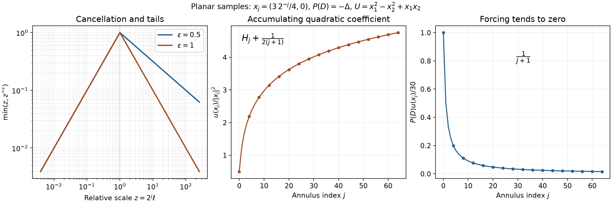
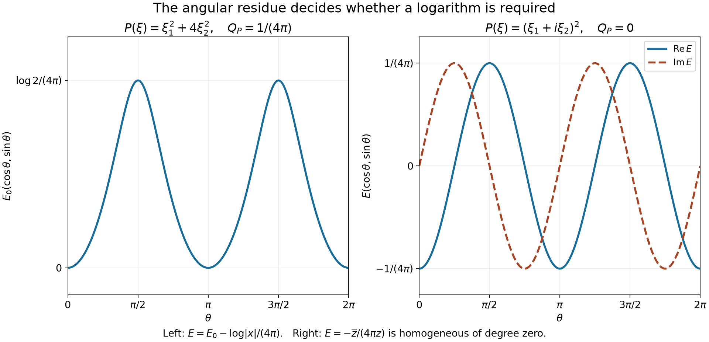
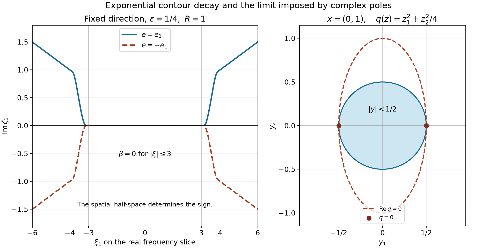
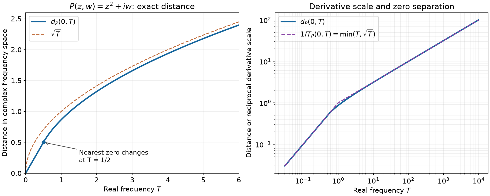

# Annular multipliers and elliptic endpoints

*Exposition and original illustrations by GPT-6 Astra (OpenAI). Public domain (CC0 1.0).*

A multiplier can be controlled by averaged derivatives on each frequency annulus. Its inverse kernels need not satisfy a pointwise gradient estimate away from the origin: integrable translation differences and integrable tails are enough. Cancellation inside cubes then gives the weak first endpoint, all finite intermediate exponents and Hölder continuity. Applied to a reciprocal elliptic polynomial, these bounds recover the derivatives of a distributional solution. At the continuous endpoint an explicit sum of shrinking annuli shows why the conclusion changes.

Use \(Ff(\xi)=\int e^{-ix\cdot\xi}f(x)\,dx\), \(G=F^{-1}\) with coefficient \((2\pi)^{-n}\), \(D_j=-i\partial_j\), and \(n\ge1\). The complete \(L^2\) Fourier maps and their distributional agreement are proved in [*Fourier–Laplace slices and boundary poles*](fourier-laplace-slices-and-boundary-poles.md), Lemma 0.1. [*Fractional energy and sharp Fourier embeddings*](fractional-energy-and-sharp-fourier-embeddings.md), Lemma 1 and Corollary 6, gives the integer Sobolev norm, reciprocal pairing and continuous embedding. The [Schwartz Fourier foundation](../prerequisites/U011-free-foundations/schwartz-fourier-foundations-U017.md), F1–F5, supplies inversion and all test-space identities.

The cube decomposition used below is the complete proof of Lemma 6.1 in [*Convolution estimates and weak-gradient embeddings*](convolution-estimates-and-weak-gradient-embeddings.md). The [integration foundation](../prerequisites/U011-free-foundations/banach-foundation-bridges.md), §§15–16, proves Hölder, Young, Tonelli, dominated convergence, completeness and smooth approximation. [*Convolution as addition of supports*](convolution-as-addition-of-supports.md), B0–B3 and Theorem 1.1, gives compact-factor convolution, finite-order parameter pairings and derivative transfer. [*Tempered growth and spectral cutoffs*](tempered-growth-and-spectral-cutoffs.md), Lemma 2.1, proves convolution with a Schwartz factor and its Fourier identity. Scalar differentiation, compact cutoffs and finite Taylor formulas are in the [scalar foundation](../prerequisites/U011-free-foundations/metric-foundation-bridges.md), §13. The [angular foundation](../prerequisites/U011-free-foundations/angular-foundations-U018.md), A4, supplies polar integration.

## Averaged frequency derivatives give integrable kernels

Let \(s\) be an integer with \(s>n/2\). Suppose \(b\in L^2_{\mathrm{loc}}(\mathbb R^n)\), its weak derivatives through order \(s\) exist locally away from zero, and
\[
 A^2=\sup_{R>0}\sum_{|\alpha|\le s}
 R^{2|\alpha|-n}
 \int_{R/2<|\xi|<2R}|\partial^\alpha b(\xi)|^2\,d\xi<\infty.
 \tag{M1}
\]
The value of a representative at zero is immaterial. Constants below may depend on \(n,s\) and the fixed smooth cutoffs. Put \(\varepsilon=s-n/2>0\).

Choose a radial \(0\le\chi\le1\) which equals one for \(|\eta|\le1\) and zero for \(|\eta|\ge2\), and set
\[
 \phi(\eta)=\chi(\eta)-\chi(2\eta),\qquad
 a_R(\eta)=\phi(\eta)b(R\eta),\qquad K_R=Ga_R.
 \tag{M2}
\]
Thus \(\phi\) is supported in \(1/2\le|\eta|\le2\) and equals one on the unit sphere.

**Lemma 1 (uniform annular kernels).** The symbol has a bounded representative away from zero, with \(\|b\|_\infty\le C A\). Every \(K_R\) is smooth, and
\[
 \begin{gathered}
 \|\langle x\rangle^s K_R\|_2+
       \|\langle x\rangle^s\nabla K_R\|_2\le C A,\\
 \|K_R\|_1+\|\nabla K_R\|_1+\|K_R\|_\infty\le C A,\\
 \int_{|x|>t}|K_R(x)|\,dx
          \le C A\min(1,t^{-\varepsilon}),\qquad t>0,\\
 \|K_R(\,\cdot-h)-K_R\|_1\le C A|h|.
 \end{gathered}
 \tag{M3}
\]
The same estimates hold for \(G(\zeta(\eta)b(R\eta))\), where \(\zeta\) is any fixed smooth function compactly supported away from zero, with a constant also depending on \(\zeta\).

**Proof.** The weak product and dilation rules follow directly by substitution and integration by parts against compact smooth tests. Leibniz's rule gives
\[
 \partial^\alpha a_R
 =\sum_{\beta\le\alpha}\binom{\alpha}{\beta}
       (\partial^{\alpha-\beta}\phi)
                R^{|\beta|}(\partial^\beta b)(R\,\cdot).
 \tag{M4}
\]
After \(\xi=R\eta\), each squared \(L^2\) norm on this fixed annulus is bounded by a cutoff constant times \(A^2\). These are global weak derivatives: the cutoff is compactly supported in the open set where the local weak derivatives exist. The same reasoning applies to \(\eta_j a_R\), and more generally to every fixed polynomial times \(a_R\). The integer Sobolev identity therefore bounds \(a_R\) and \(\eta_j a_R\) in \(H^s\).

The continuous Sobolev embedding gives \(\|a_R\|_\infty\le C A\). On a neighborhood of the unit sphere, \(\phi\ne0\), so \(a_R/\phi\) is a continuous representative of \(b(R\,\cdot)\). These representatives agree on overlaps: two continuous functions equal almost everywhere on an open set agree everywhere there. On \(|\eta|=1\), \(\phi=1\). Varying \(R\) proves the uniform bound on \(b\).

The functions \(a_R\) and all their frequency monomials are in \(L^1\), by compact support and Cauchy–Schwarz. Differentiation of their inverse integrals shows \(K_R\in C^\infty\). Fourier derivative identities and Parseval turn the \(H^s\) bounds just obtained into the first line of (M3), with the fixed Fourier constants absorbed into \(C\). Weighted Cauchy–Schwarz and
\[
 \int_{|x|>t}\langle x\rangle^{-2s}\,dx
              \le C t^{n-2s}\quad(t\ge1)
 \tag{M5}
\]
give the \(L^1\) and tail bounds. Polar integration proves (M5); the full integral is finite since \(2s>n\). The direct inverse integral gives the supremum bound. Finally,
\[
 K_R(x-h)-K_R(x)
       =-\int_0^1 h\cdot\nabla K_R(x-\theta h)\,d\theta.
 \tag{M6}
\]
Integrate the absolute value, use Tonelli and translation invariance, and apply the gradient \(L^1\) bound.

For a general fixed \(\zeta\), cover its compact radial range by finitely many annuli comparable to the one in (M1). A finite subordinate smooth partition reduces its derivative bounds to (M4), with radii \(c_\nu R\) and fixed positive \(c_\nu\). All the subsequent estimates are unchanged. \(\square\)

Define on \(L^2\)
\[
 T_bf=G(bFf),\qquad \|T_bf\|_2\le B\|f\|_2,\quad
 B=\|b\|_\infty\le C A.
 \tag{M7}
\]
The \(L^2\) adjoint is \(T_{\overline b}\), by Parseval. The tempered kernel is \(k=Gb\). On Schwartz functions \(T_bf=k*f\), with the full distributional kernel, by the Fourier convolution identity cited above. In particular, a constant symbol gives a multiple of \(\delta_0\), not a zero operator.

## A zero mean makes the annular sum converge off a cube

Put
\[
 L_j(x)=2^{jn}K_{2^j}(2^jx),\qquad j\in\mathbb Z.
 \tag{M8}
\]
Its Fourier transform is \(\phi(2^{-j}\xi)b(\xi)\). The telescoping identity is
\[
 \sum_{j=-N}^{N}\phi(2^{-j}\xi)
       =\chi(2^{-N}\xi)-\chi(2^{N+1}\xi)
             \longrightarrow1\quad(\xi\ne0).
 \tag{M9}
\]
The partial sums are uniformly bounded. Consequently the finite operators
\(\sum_{j=-N}^N L_j*f\) tend to \(T_bf\) in \(L^2\), by dominated convergence in Fourier variables. Also \(\sum L_j\to k\) on every Schwartz test, since \(b\) is bounded and the Fourier transform of that test is integrable.

**Lemma 2 (cancellation outside a doubled cube).** Let \(Q\) be a cube of side \(\ell>0\), let \(2Q\) be its concentric double, and let \(w\in L^1\cap L^2\) be supported in \(Q\), with \(\int w=0\). Then
\[
 \int_{(2Q)^c}|T_bw|\,dx\le C A\|w\|_1.
 \tag{M10}
\]

**Proof.** Write \(c\) for the center. If \(x\notin2Q\) and \(y\in Q\), then \(|x-y|\ge\ell/2\). Scaling the tail bound in (M3) gives, when \(2^j\ell\ge1\),
\[
 \|L_j*w\|_{L^1((2Q)^c)}
       \le C A(2^j\ell)^{-\varepsilon}\|w\|_1.
 \tag{M11}
\]
For every \(j\), the zero mean gives
\[
 L_j*w(x)=\int_Q[L_j(x-y)-L_j(x-c)]w(y)\,dy.
 \tag{M12}
\]
The translation bound in (M3), after scaling, and
\(|y-c|\le\sqrt n\,\ell/2\), give the full-space bound
\[
 \|L_j*w\|_1\le C A\,2^j\ell\|w\|_1.
 \tag{M13}
\]
All integrals here are legitimate \(L^1\) convolutions. Choose the integer \(J\) with \(1\le2^J\ell<2\). The low and high sums satisfy
\[
 \sum_{j<J}2^j\ell<2,\qquad
 \sum_{j\ge J}(2^j\ell)^{-\varepsilon}
                 \le(1-2^{-\varepsilon})^{-1}.
 \tag{M14}
\]
Thus \(\sum L_j*w\) converges absolutely in \(L^1((2Q)^c)\) and obeys (M10). Its symmetric partial sums also converge in \(L^2\) to \(T_bw\). Subsequences converging almost everywhere in these two norms identify the limits on \((2Q)^c\). Such subsequences follow, for example, by choosing summable norm differences and applying Tonelli to those differences. This proves (M10) for the original multiplier. No pointwise sum for \(k\) at its singular point was used. \(\square\)

## Weak first endpoint and every finite exponent

**Theorem 3 (annular Sobolev multiplier theorem).** Under (M1),
\[
 |\{x:|T_bf(x)|>\lambda\}|
       \le C A\,\lambda^{-1}\|f\|_1
       \quad(f\in L^1\cap L^2,\ \lambda>0),
 \tag{M15}
\]
and for every \(1<p<\infty\),
\[
 \|T_bf\|_p\le C_{n,s,p}A\|f\|_p.
 \tag{M16}
\]
The latter gives a unique bounded extension to all \(L^p\), agreeing with the \(L^2\) realization on the intersection. Estimate (M15) also defines a unique extension from \(L^1\) by convergence in measure. For Schwartz input, all these realizations are the convolution by \(k=Gb\).

**Proof of the weak estimate.** If \(A=0\), then \(b=0\) almost everywhere and every assertion is immediate. Otherwise apply the earlier dyadic decomposition to \(f\) at height \(a=\lambda/A\):
\[
 f=g+\sum_Qw_Q,\quad
 \|g\|_\infty\le2^na,\quad \|g\|_1\le\|f\|_1,\quad
 \sum_Q\|w_Q\|_1\le2\|f\|_1,\quad
 \sum_Q|Q|\le a^{-1}\|f\|_1.
 \tag{M17}
\]
Each \(w_Q\) has zero integral. Because \(f\in L^2\), the good part is also in \(L^2\), with
\(\|g\|_2^2\le2^na\|f\|_1\). The functions \(w_Q\) are the disjoint pieces of \(f-g\in L^2\); hence their sum converges in \(L^2\), as well as in \(L^1\).

Set \(\Omega=\bigcup_Q2Q\). Its measure is at most \(2^na^{-1}\|f\|_1\). Lemma 2 gives absolute \(L^1(\Omega^c)\) convergence of \(\sum T_bw_Q\), with norm at most \(C A\|f\|_1\). Its \(L^2\) partial sums converge to \(T_b(f-g)\); the same subsequence argument as before identifies the two limits. Chebyshev's inequality, which follows by integrating \(|h|^r\ge t^r1_{\{|h|>t\}}\), now gives
\[
 \begin{aligned}
 |\{|T_bf|>\lambda\}|
 &\le|\Omega|+
       4\lambda^{-2}\|T_bg\|_2^2
       +2\lambda^{-1}\|T_b(f-g)\|_{L^1(\Omega^c)}\\
 &\le C A\,\lambda^{-1}\|f\|_1.
 \end{aligned}
 \tag{M18}
\]
Here \(B\le C A\) in (M7) and \(a=\lambda/A\) retain the correct linear dependence on \(A\).

**Proof for \(1<p<2\).** Initially take \(f\in L^p\cap L^2\). Split it at \(|f|=\lambda/A\) into \(f_{\rm high}\) and \(f_{\rm low}\). The high part is in \(L^1\cap L^2\), since
\(|f|1_{\{|f|>\lambda/A\}}\le(\lambda/A)^{1-p}|f|^p\). The low part is in \(L^2\). From (M15), (M7) and the triangle inequality for level sets,
\[
 |\{|T_bf|>\lambda\}|
 \le \frac{C A}{\lambda}
                \int_{|f|>\lambda/A}|f|
       +\frac{C A^2}{\lambda^2}
                \int_{|f|\le\lambda/A}|f|^2.
 \tag{M19}
\]
The layer formula follows directly from
\(|h(x)|^p=\int_0^{|h(x)|}p\lambda^{p-1}\,d\lambda\)
and Tonelli. Apply it to (M19), then interchange the nonnegative integrals:
\[
 \begin{aligned}
 \|T_bf\|_p^p
 &\le C p A\int|f(x)|
             \int_0^{A|f(x)|}\lambda^{p-2}\,d\lambda\,dx\\
 &\quad+C p A^2\int_{\{f\ne0\}}|f(x)|^2
             \int_{A|f(x)|}^\infty\lambda^{p-3}\,d\lambda\,dx\\
 &\le C p\left(\frac1{p-1}+\frac1{2-p}\right)
                           A^p\|f\|_p^p .
 \end{aligned}
 \tag{M20}
\]
Zero values contribute zero separately. The two strict conditions on \(p\) are exactly those needed by the two scalar integrals. Compact smooth density and \(L^p\) completeness extend the operator to all \(L^p\). On \(L^p\cap L^2\), simultaneous approximation by truncation and mollification gives both limits; testing locally, or taking subsequences, shows they agree. At \(p=2\) use (M7).

**Proof for \(2<p<\infty\).** The conjugate symbol satisfies (M1) with the same \(A\). Its multiplier is the \(L^2\) adjoint of \(T_b\), and the proved bound applies to it at \(r=p/(p-1)\in(1,2)\). For Schwartz \(f\), put \(u=T_bf\in L^2\). On
\[
 E_{R,N}=\{|x|_\infty\le R,\ |u(x)|\le N\},\qquad
 h_{R,N}=1_{E_{R,N}}|u|^{p-2}u,
 \tag{M21}
\]
with value zero when \(u=0\), the function \(h_{R,N}\) is in \(L^2\cap L^r\). Parseval's adjoint identity and Hölder give
\[
 \int_{E_{R,N}}|u|^p
   = (u,h_{R,N})_{L^2}
   = (f,T_{\overline b}h_{R,N})_{L^2}
   \le C A\|f\|_p
             \left(\int_{E_{R,N}}|u|^p\right)^{1/r}.
 \tag{M22}
\]
The inner products are linear in the first variable. Divide only if the finite integral is positive. Let \(R,N\) increase to infinity and use monotone convergence. This proves (M16) on Schwartz input; density and completeness extend it and give the same agreement on intersections. No representation theorem for an \(L^p\) dual is needed.

**The \(L^1\) realization.** Approximate \(f\in L^1\) by \(f_j\in L^1\cap L^2\) in \(L^1\). Estimate (M15) on differences makes \(T_bf_j\) Cauchy in measure, on the whole space. Choose a subsequence with
\[
 |\{|T_bf_{j+1}-T_bf_j|>2^{-j}\}|\le2^{-j}.
 \tag{M23}
\]
Outside the limsup of these exceptional sets, whose measure is zero since the sum of their measures is finite, the values form a Cauchy sequence. Its measurable finite limit is the limit in measure of the original sequence, by the Cauchy estimate. That estimate also proves independence of approximation and linearity. For \(\lambda'<\lambda\), convergence in measure and
\(\{|u|>\lambda\}\subset\{|u_j|>\lambda'\}\cup\{|u-u_j|>\lambda-\lambda'\}\)
pass (M15) to the limit; then let \(\lambda'\uparrow\lambda\). Agreement with the \(L^2\) map on \(L^1\cap L^2\) follows from simultaneous approximation. The same truncation and mollification argument gives agreement with every finite \(L^p\) map on \(L^1\cap L^p\). The weak estimate concerns a measurable function and does not assert that it is locally integrable. \(\square\)

## Hölder continuity from smooth frequency pieces

For \(0<\gamma<1\), write
\([f]_\gamma=\sup_{x\ne y}|f(x)-f(y)|/|x-y|^\gamma\).

**Theorem 4 (the full Hölder seminorm).** If \(f\) is compactly supported and \(\gamma\)-Hölder continuous, then the \(L^2\) output \(T_bf\) has a bounded continuous representative and
\[
 [T_bf]_\gamma\le C_{n,s,\gamma} A[f]_\gamma.
 \tag{M24}
\]
No smooth approximation in the same Hölder norm is assumed.

**Proof.** The inverse transform \(q=G\phi\) is Schwartz, and
\(\int q=\phi(0)=0\). Put
\[
 f_j(x)=\int 2^{jn}q(2^jy)f(x-y)\,dy
       =\int q(y)[f(x-2^{-j}y)-f(x)]\,dy.
 \tag{M25}
\]
The second identity is absolutely convergent and gives
\[
 \|f_j\|_\infty\le C_\gamma2^{-j\gamma}[f]_\gamma,\qquad
 \|\nabla f_j\|_\infty
        \le C_\gamma2^{j(1-\gamma)}[f]_\gamma.
 \tag{M26}
\]
For the derivative, differentiate the Schwartz convolution kernel; its derivative has integral zero, and integrate its absolute value against \(|y|^\gamma\). Those moments are finite by Schwartz decay.

Choose a fixed smooth \(\zeta\), compactly supported away from zero, equal to one on \(\operatorname{supp}\phi\), and let
\(\widetilde K_R=G(\zeta(\eta)b(R\eta))\).
Lemma 1 gives \(\|\widetilde K_R\|_1\le C A\). The frequency identity \(\zeta\phi=\phi\) shows
\[
 T_bf_j=2^{jn}\widetilde K_{2^j}(2^j\,\cdot)*f_j.
 \tag{M27}
\]
This identity follows first in \(L^2\); the convolutions with bounded smooth \(f_j\) and its bounded derivatives give its continuous representative. Thus
\[
 \|T_bf_j\|_\infty\le C_\gamma A\,2^{-j\gamma}[f]_\gamma,\qquad
 \|\nabla T_bf_j\|_\infty
       \le C_\gamma A\,2^{j(1-\gamma)}[f]_\gamma.
 \tag{M28}
\]

There is also a low-frequency value bound, needed to identify an actual function rather than only its differences. Since \(T_bf_j=L_j*f\) and
\(\|L_j\|_\infty\le C A\,2^{jn}\),
\[
 \|T_bf_j\|_\infty\le C A\,2^{jn}\|f\|_1.
 \tag{M29}
\]
For \(j<0\), (M29) is summable because \(n\ge1\); for \(j\ge0\), the first bound in (M28) is summable. The series therefore converges uniformly to a bounded continuous function. Its symmetric partial sums converge in \(L^2\) to \(T_bf\) by (M9), so the function represents that same output.

For \(d=|x-y|>0\), use the derivative estimate in (M28) when \(2^jd\le1\), and twice the supremum estimate otherwise:
\[
 \begin{aligned}
 |T_bf(x)-T_bf(y)|
 &\le C_\gamma A[f]_\gamma
 \left(d\sum_{2^jd\le1}2^{j(1-\gamma)}
                +2\sum_{2^jd>1}2^{-j\gamma}\right)\\
 &\le C_\gamma A[f]_\gamma d^\gamma
 \left(\frac1{1-2^{-(1-\gamma)}}
                +\frac2{1-2^{-\gamma}}\right).
 \end{aligned}
 \tag{M30}
\]
The last two geometric sums include all integer scales. Their denominators are positive exactly for \(0<\gamma<1\). This proves (M24). \(\square\)

## Elliptic equations with arbitrary distributional input

A constant-coefficient polynomial \(P(\xi)\) of degree \(m\ge1\) is elliptic if its principal homogeneous part \(P_m\) has no zero on the real unit sphere. Complex coefficients are allowed.

**Lemma 5 (a smooth inverse away from the origin).** There is a smooth symbol \(a\) such that \(E=Ga\) satisfies
\[
 P(D)E=\delta_0-h,\qquad h\in\mathcal S,
 \tag{M31}
\]
and \(E\) is smooth off zero. For every multiindex \(\beta\),
\[
 |\partial^\beta a(\xi)|\le C_\beta\langle\xi\rangle^{-m-|\beta|}.
 \tag{M32}
\]
For every \(|\alpha|\le m\), the symbol \(b_\alpha(\xi)=\xi^\alpha a(\xi)\) satisfies (M1).

**Proof.** Compactness of the sphere gives \(|P_m(\xi)|\ge c|\xi|^m\). The lower terms are \(O(|\xi|^{m-1})\), so
\(|P(\xi)|\ge(c/2)|\xi|^m\) for \(|\xi|\ge R_0\), after increasing \(R_0\ge1\). Choose a compact smooth \(\theta=1\) on a neighborhood of \(\{|\xi|\le R_0\}\), and set \(a=(1-\theta)/P\), with value zero where the numerator vanishes. Choose its transition inside the region where the denominator is nonzero. Then \(Pa=1-\theta\), so (M31) follows with \(h=G\theta\).

For large \(|\xi|\), differentiation of \(Pa=1\) gives
\[
 P\,\partial^\beta a
   =-\sum_{0<\nu\le\beta}\binom{\beta}{\nu}
            (\partial^\nu P)(\partial^{\beta-\nu}a).
 \tag{M33}
\]
Induction, \(|\partial^\nu P|\le C_\nu|\xi|^{m-|\nu|}\) when \(|\nu|\le m\), and the lower bound on \(P\), prove (M32) there. The compact transition region supplies the remaining constants.

For completeness, smoothness of the inverse distribution away from zero follows from a convergent differentiated annular series. Localize \(a\) by \(\phi(2^{-j}\xi)\). Since \(a=0\) near zero, only \(j\) above a fixed lower bound occur. Rescaling its inverse transform and integrating repeatedly in a frequency coordinate whose paired spatial coordinate is largest gives, for every \(\mu\) and every integer \(N\ge0\),
\[
 |\partial_x^\mu G(\phi(2^{-j}\,\cdot)a)(x)|
 \le C_{\mu,N}\,2^{j(n-m+|\mu|)}
                         (1+2^j|x|)^{-N}.
 \tag{M34}
\]
Here the rescaled amplitude and each of its derivatives are bounded by \(C2^{-jm}\) on a fixed compact annulus, by (M32). Its compact inverse integral gives the bound when \(2^j|x|\le1\); repeated integration by parts gives the other bound. Choosing \(N>n-m+|\mu|\) makes the series uniformly convergent on each compact set away from zero, for every derivative. The finite fundamental theorem of calculus identifies the derivatives of the limit. The telescoping formula and Schwartz decay show that the same series tends to \(Ga\) as a tempered distribution, so the smooth function is its restriction off zero.

Finally the product rule gives
\(|\partial^\nu b_\alpha(\xi)|\le C_\nu\langle\xi\rangle^{|\alpha|-m-|\nu|}\).
It vanishes near zero. On large annuli,
\[
 R^{2|\nu|-n}\int_{R/2<|\xi|<2R}
              |\partial^\nu b_\alpha|^2
                    \le C_\nu R^{2(|\alpha|-m)}\le C_\nu.
 \tag{M35}
\]
Annuli in a fixed bounded range have uniformly bounded contributions; sufficiently small annuli contribute zero. Summing through any fixed integer \(s>n/2\) proves (M1). \(\square\)

**Theorem 6 (interior \(L^p\) and Hölder regularity).** Let \(X\subset\mathbb R^n\) be open and \(u\in\mathcal D'(X)\). For an elliptic constant-coefficient \(P(D)\) of order \(m\ge1\),
\[
 \begin{aligned}
 P(D)u\in L^p_{\mathrm{loc}}(X),\ 1<p<\infty
       &\ \Longrightarrow\
          D^\alpha u\in L^p_{\mathrm{loc}}(X)\quad(|\alpha|\le m),\\
 P(D)u\in C^\gamma_{\mathrm{loc}}(X),\ 0<\gamma<1
       &\ \Longrightarrow\
          D^\alpha u\in C^\gamma_{\mathrm{loc}}(X)\quad(|\alpha|\le m).
 \end{aligned}
 \tag{M36}
\]
No regularity of \(u\) beyond being a distribution is assumed. A nonzero operator of order zero has the same conclusions immediately by division by its constant.

**Proof.** Fix a relatively compact neighborhood \(Y\) of any chosen point, and a compact cutoff \(\eta\) in \(X\) equal to one near \(\overline Y\). Write
\[
 v=\eta u,\qquad
 P(D)v=f+q,\qquad f=\eta P(D)u,\quad q=[P(D),\eta]u.
 \tag{M37}
\]
Extend these compactly supported distributions to the whole space. Every coefficient of the commutator contains a derivative of \(\eta\), so \(q\) has compact support separated from \(\overline Y\). Compact-factor convolution and derivative transfer, applied to (M31), give
\[
 v=E*f+E*q+h*v.
 \tag{M38}
\]
The last term is smooth by finite-order parameter pairing. The term \(E*q\) is smooth near \(\overline Y\): every relevant \(x-y\) stays away from zero, where Lemma 5 supplies all derivatives of \(E\), and the compact support of \(q\) permits the same parameter argument.

It remains to identify \(D^\alpha E*f\) with the multiplier \(T_{b_\alpha}f\) in the appropriate function space. For compact smooth \(f\), this is the exact Fourier convolution identity. For compactly supported \(L^p\) input, mollification with one common bounded support converges in \(L^p\) and \(L^1\). The multiplier outputs converge in \(L^p\) by Theorem 3. The distributional convolutions converge on tests, because the inner smooth function paired with \(f\) is uniformly bounded on that fixed support; the \(L^1\) difference therefore controls the pairing. Uniqueness of the distributional limit identifies the two outputs. If \(f\) is compact Hölder, it is also in \(L^2\), and Theorem 4 gives the Hölder representative of the same multiplier. Multiplication by the smooth compact cutoff makes the local Hölder datum into a global compact Hölder function, by the product difference formula and a finite compact cover.

Differentiate (M38), apply Theorem 3 or 4 to \(b_\alpha\), and retain the smooth remainder on \(Y\). This gives (M36) there, for all \(|\alpha|\le m\). Such neighborhoods cover \(X\). \(\square\)

## Continuous forcing can leave every top derivative discontinuous

**Theorem 7 (an explicit continuous endpoint obstruction).** Let \(n>1\), let \(X\) be a nonempty open set, and let \(P(D)\) be any constant-coefficient operator of order \(m>0\). There is a compactly supported
\[
 u\in C^{m-1}(X)\setminus C^m(X),\qquad P(D)u\in C_c(X).
 \tag{M39}
\]
One can choose the same \(u\) so that every \(D^\alpha u\), \(|\alpha|=m\), for which the monomial \(\xi^\alpha\) is not proportional to \(P_m(\xi)\), has no continuous representative. In fact each such derivative is unbounded in every neighborhood of one point. The assertion includes elliptic operators.

**Proof: choose one polynomial.** Translate a point of \(X\) to zero. Let \(V_m\) be the complex vector space of homogeneous polynomials of degree \(m\). The map
\[
 L:V_m\to\mathbb C,\qquad L(U)=P_m(D)U
 \tag{M40}
\]
is a nonzero linear functional: on a monomial \(x^\beta\), it extracts its corresponding coefficient in \(P_m\), multiplied by \((-i)^m\beta!\). Since \(n>1,m>0\), \(V_m\) contains at least two distinct monomials, so \(\ker L\ne\{0\}\).

For \(|\alpha|=m\), put \(L_\alpha(U)=D^\alpha U\), another scalar functional. Its restriction to \(\ker L\) is zero exactly when it is proportional to \(L\). Indeed, choose \(e\) with \(L(e)=1\); then \(v-L(v)e\in\ker L\) shows \(L_\alpha(v)=L(v)L_\alpha(e)\) in that case. In the monomial basis this proportionality is precisely that of \(\xi^\alpha\) and \(P_m\).

There are only finitely many multiindices. Choose \(U\in\ker L\) for which every nonzero restricted \(L_\alpha\) is nonzero. Here is a direct finite-dimensional construction. If \(v_1,\ldots,v_d\) is a basis of \(\ker L\), the vector
\(\sum_{\nu=1}^d z^{\nu-1}v_\nu\) has, under each such functional, a nonzero polynomial in \(z\). A nonzero polynomial has at most its degree many roots, by repeated division by \(z-z_0\). Choose a complex \(z\) outside their finite union of roots. At least one restricted functional is nonzero, since the coordinate coefficient functionals separate nonzero polynomials. Thus this \(U\) is nonzero and
\[
 P_m(D)U=0,\qquad
 d_\alpha:=D^\alpha U\ne0
       \quad\hbox{whenever }\xi^\alpha\notin\mathbb C P_m.
 \tag{M41}
\]

**Proof: put the forcing on disjoint annuli.** Choose a radius \(r_0>0\) whose closed ball lies in \(X\), and a smooth radial cutoff \(\rho\) equal to one on \(|x|\le1/2\), zero on \(|x|\ge1\). Put
\[
 u_j(x)=\rho(2^jx/r_0)U(x),\qquad
 a_j=\frac1{j+1},\qquad
 u=\sum_{j=0}^\infty a_j u_j.
 \tag{M42}
\]
Homogeneity gives \(u_j(x)=(r_0\,2^{-j})^m(\rho U)(2^jx/r_0)\). Therefore, for every \(\beta\),
\[
 \|D^\beta u_j\|_\infty
       \le C_\beta(r_0\,2^{-j})^{m-|\beta|}.
 \tag{M43}
\]
For \(|\beta|\le m-1\) the weighted series is uniformly absolutely convergent. Repeatedly applying the fundamental theorem of calculus to the finite partial sums and passing to the uniform limits proves \(u\in C^{m-1}\), with precisely these derivatives. Its support lies in the closed \(r_0\)-ball. Every derivative of order below \(m\) vanishes at zero.

On the inner half-ball \(u_j=U\), and \(P_m(D)U=0\); outside its ball \(u_j=0\). Thus
\[
 \operatorname{supp}P_m(D)u_j
   \subset\{r_0\,2^{-j-1}\le|x|\le r_0\,2^{-j}\},\qquad
 \|P_m(D)u_j\|_\infty\le C.
 \tag{M44}
\]
The interiors of these annuli are disjoint. At their boundary spheres the terms vanish, by smoothness and the constant values of the cutoff on either side. Hence every tail satisfies
\[
 \left\|\sum_{j\ge N}a_jP_m(D)u_j\right\|_\infty
                    \le C\sup_{j\ge N}a_j\longrightarrow0.
 \tag{M45}
\]
The sum is continuous and zero at the origin. The lower-order part of \(P(D)u\) is continuous by the already established \(C^{m-1}\) convergence. Distributional differentiation of the uniform limit of the partial sums identifies their continuous output limit with \(P(D)u\). This proves the forcing assertion in (M39).

**Proof: the top derivatives accumulate.** Away from zero, only finitely many terms in (M42) can be nonzero locally, so \(u\) is smooth there. If
\(r_0\,2^{-J-1}<|x|\le r_0\,2^{-J}\), then all terms with \(j<J\) have at \(x\) the derivatives of \(U\), all terms with \(j>J\) vanish, and at most the \(J\)-th term is in transition. Boundary values obey the same identities by smoothness. For \(|\alpha|=m\),
\[
 D^\alpha u(x)
   =d_\alpha\sum_{j=0}^{J-1}\frac1{j+1}
           +\frac{D^\alpha u_J(x)}{J+1},\qquad
 \left|\frac{D^\alpha u_J(x)}{J+1}\right|\le\frac{C_\alpha}{J+1}.
 \tag{M46}
\]
The harmonic partial sums tend to infinity: every block from \(2^k\) to \(2^{k+1}-1\) contributes at least \(1/2\). If \(d_\alpha\ne0\), (M46) consequently tends to infinity in modulus as \(x\to0\), \(x\ne0\). A continuous representative of the distributional derivative would agree with this smooth function off zero and be bounded near zero, which is impossible. At least one such derivative exists, so \(u\notin C^m\). This proves every assertion. \(\square\)

*Left: the bound \(\min(z,z^{-\varepsilon})\), \(z=2^j\ell\), which is summable across dyadic scales in Lemma 2. Middle and right: the explicit planar example in Exercise 4, at \(x_j=(3\,2^{-j}/4,0)\). Its normalized value is \(u(x_j)/|x_j|^2=H_j+1/[2(j+1)]\), while \(P(D)u(x_j)=30/(j+1)\to0\). Here \(H_j=\sum_{k=1}^j1/k\), including \(H_0=0\). The formulas and their limits are proved below; the plots are finite samples. [Reproducible figure source](../figures/annular-cancellation-and-continuous-endpoint.py).*

## Polynomial logarithms from radial residues

Write \(D_tu(x)=u(tx)\), with its distributional meaning
\(\langle D_tu,\phi\rangle=t^{-n}\langle u,\phi(\cdot/t)\rangle\), \(t>0\). A homogeneous distribution of degree \(a\) satisfies \(D_tu=t^a u\). Let \(\mathcal R\) denote reflection \(x\mapsto-x\).

We use the exact radial construction in [*Homogeneous extensions and angular moments*](homogeneous-extensions-and-angular-moments.md), Theorems 2.1, 3.1 and 4.1. For a smooth angular density \(g\) on \(S=\mathbb S^{n-1}\), its meromorphic distribution is initially
\[
 W_z(g)(\phi)=\int_S g(\omega)
               \int_0^\infty r^{z+n-1}\phi(r\omega)\,dr\,d\sigma(\omega),
                   \qquad \operatorname{Re}z>-n.
 \tag{E1}
\]
At \(z=-n-k\), \(k\ge0\), its residue and constant Laurent coefficient are
\[
 \begin{aligned}
 R_k(g)&=(-1)^k\sum_{|\alpha|=k}
      \frac{\int_S\omega^\alpha g(\omega)\,d\sigma(\omega)}{\alpha!}
                          \partial^\alpha\delta_0,\\
 W_{-n-k+w}(g)&=\frac{R_k(g)}w+U+O(w).
 \end{aligned}
 \tag{E2}
\]
The cited proofs provide these distributions, their exact normalization and the full scaling identity
\[
 D_tU=t^{-n-k}\bigl(U+(\log t)R_k(g)\bigr).
 \tag{E3}
\]
The Fourier and punctured-smoothness results used below are [*Compact factors and homogeneous equations*](compact-factors-and-homogeneous-equations.md), Propositions 0.2 and 3.1 and Theorem 3.2. The [angular foundation](../prerequisites/U011-free-foundations/angular-foundations-U018.md), A3–A5, proves point-jet classification, polar integration and the sphere constants.

**Theorem 8 (a radial residue becomes a polynomial logarithm).** For the constant coefficient \(U\) in (E2), its inverse transform is a regular tempered distribution
\[
 GU(x)=H(x)-Q_g(x)\log|x|,
 \qquad
 Q_g(x)=\frac{1}{(2\pi)^n k!}
          \int_S (ix\cdot\omega)^k g(\omega)\,d\sigma(\omega).
 \tag{E4}
\]
Here \(H\) is smooth off zero and homogeneous of degree \(k\). It has a bounded representative near zero, with \(|H(x)|\le C|x|^k\) there. If the extension \(U\) is changed without changing (E3), \(H\) changes by a homogeneous polynomial of degree \(k\), and every such change is possible.

**Proof.** The restriction of \(U\) off zero is the smooth homogeneous function \(|x|^{-n-k}g(x/|x|)\). Theorem 3.2 of the compact-factor lesson makes \(U\) tempered and makes \(GU=(2\pi)^{-n}\mathcal RFU\) smooth off zero. Its coordinate law gives
\[
 G(D_tU)=t^{-n}D_{1/t}(GU).
 \tag{E5}
\]
Apply it to (E3), then replace \(t\) by \(1/t\). With \(V=GU\),
\[
 D_tV=t^k\bigl(V-(\log t)GR_k(g)\bigr).
 \tag{E6}
\]
The inverse of \(\partial^\alpha\delta_0\) is the polynomial
\((2\pi)^{-n}(-ix)^\alpha\), by the test Fourier rules. Thus (E2) gives
\[
 \begin{aligned}
 GR_k(g)
 &=\frac{i^k}{(2\pi)^n}\sum_{|\alpha|=k}
       \frac{x^\alpha}{\alpha!}
                 \int_S\omega^\alpha g(\omega)\,d\sigma(\omega)\\
 &=Q_g .
 \end{aligned}
 \tag{E7}
\]
The second equality is the multinomial formula. In particular this polynomial has degree \(k\), or is zero. The function \(Q_g(x)\log|x|\) is locally integrable: its absolute integral over a small ball is bounded by a constant times \(\int_0^1 r^{n+k-1}|\log r|\,dr<\infty\). Its growth at infinity is at most polynomial times a logarithm, so it is tempered. Ordinary substitution in its integral gives
\[
 D_t(Q_g\log|x|)
   =t^k\bigl(Q_g\log|x|+(\log t)Q_g\bigr).
 \tag{E8}
\]
Consequently \(H=V+Q_g\log|x|\), initially as a distribution, is homogeneous of degree \(k\) on the whole space and smooth off zero.

Its smooth punctured representative obeys \(H(r\omega)=r^kH(\omega)\). Boundedness on the compact sphere gives \(|H(x)|\le C|x|^k\); because \(k\ge0\), this representative extends as a locally bounded function through zero (its value there is immaterial). The corresponding regular distribution is also homogeneous of degree \(k\), by polar integration or ordinary dilation substitution. Its difference from the original distribution \(H\) is supported at zero and has degree \(k\). A3 writes that difference as finitely many independent \(\partial^\alpha\delta_0\), of degrees \(-n-|\alpha|\). None of those equals \(k\). Applying the Euler equation and independence therefore forces every coefficient to vanish. This proves (E4) globally, with no extra point term.

Finally, the ambiguity assertion in the angular-extension lesson, Theorem 4.1, says that precisely the order-\(k\) point jets may be added while preserving (E3). Equation (E7) sends their arbitrary coefficients bijectively to the homogeneous polynomials of degree \(k\). This changes \(H\) by exactly such a polynomial and leaves \(Q_g\) fixed. \(\square\)

The residue test involves all degree-\(k\) moments, not only the angular mean when \(k>0\).

## Exact point sources for every homogeneous elliptic polynomial

A nonzero homogeneous polynomial \(P\) of degree \(m\ge0\), with complex coefficients, is elliptic when \(P(\xi)\ne0\) for every real \(\xi\ne0\). For a polynomial with several degrees, ellipticity means that its highest homogeneous part has this property. A fundamental solution satisfies \(P(D)E=\delta_0\), with \(D=-i\partial\).

**Theorem 9 (the homogeneous elliptic point source).** Let \(P\) be homogeneous and elliptic on \(\mathbb R^n\), \(n\ge1\). There is a tempered fundamental solution of the form
\[
 E=E_0-Q_P(x)\log|x|,
 \qquad \deg E_0=m-n ,
 \tag{E9}
\]
where \(E_0\) is homogeneous as a distribution and smooth off zero. If \(m<n\), then \(Q_P=0\). If \(m\ge n\), put \(k=m-n\); then
\[
 Q_P(x)=\frac{1}{(2\pi)^n k!}
          \int_S\frac{(ix\cdot\omega)^k}{P(\omega)}\,d\sigma(\omega).
 \tag{E10}
\]
For \(m\ge1\), both \(E_0\) and \(E\) are locally integrable functions. For \(m=0\), one can take \(E=E_0=P^{-1}\delta_0\).

**Proof.** On the sphere \(g=1/P\) is smooth, since the continuous denominator is bounded away from zero. Away from the origin, \(1/P(\xi)=|\xi|^{-m}g(\xi/|\xi|)\).

If \(m<n\), the degree \(-m>-n\) is nonresonant. Let \(U=W_{-m}(g)\), the homogeneous extension from the angular-extension lesson, Theorem 3.1. If \(m\ge n\), let \(U\) be the constant Laurent coefficient at \(z=-m\), with residue \(R_{m-n}(g)\). In both cases its polynomial multiplication identity proves
\[
 PU=1.
 \tag{E11}
\]
Here is the exact application of that identity. Since \(P(\omega)g(\omega)=1\), equation (4.6) of that lesson reads \(P W_z(g)=W_{z+m}(1)\). Take the constant Laurent coefficient at \(z=-m\). The right side is regular at zero and its value is the ordinary constant distribution \(1\), by (E1) and polar integration. The left side is \(PU\), irrespective of the presence of a pole. Thus (E11) holds on every compact test, with no term at the origin left unspecified.

By the punctured homogeneity theorem, \(U\) is tempered. Define \(E=GU\). Fourier differentiation and \(G1=\delta_0\) give
\[
 P(D)E=G(PU)=G1=\delta_0.
 \tag{E12}
\]
Its restriction off zero is smooth. For \(m<n\), the global homogeneity of \(U\) and the Fourier coordinate law give degree \(m-n\) for \(E\), so take \(E_0=E\). For \(m\ge n\), apply Theorem 8; it gives exactly (E9)–(E10) and a locally bounded homogeneous \(E_0\).

When \(1\le m<n\), a smooth punctured function of degree \(m-n>-n\) is locally integrable, by \(\int_0^1r^{m-1}\,dr<\infty\). Its regular extension has the same homogeneity. As in Theorem 8, its difference from \(E\) is a point jet of degree \(m-n\); since \(m>0\), that degree exceeds every point-jet degree \(-n-|\alpha|\), so the difference is zero. If \(m\ge n\), Theorem 8 already gives local integrability of both terms. Finally, for \(m=0\), \(P\) is a nonzero constant, \(U=P^{-1}\), and \(GU=P^{-1}\delta_0\). This also has the required degree \(-n\) and is zero off the origin. \(\square\)

**Corollary 10 (logarithmic obstruction and polynomial freedom).** For \(m\ge1\), the fundamental solutions of the form (E9) with this \(Q_P\) differ precisely by homogeneous polynomials of degree \(m-n\) when \(m\ge n\). When \(m<n\), the homogeneous fundamental solution is unique. A globally homogeneous fundamental solution exists exactly when \(Q_P=0\). In particular \(Q_P=0\) in every odd dimension. For \(\rho>0\), changing the logarithmic length scale gives
\[
 E_\rho=E_0-Q_P\log(|x|/\rho)=E+Q_P\log\rho,
 \qquad P(D)E_\rho=\delta_0 .
 \tag{E13}
\]

**Proof.** If \(E_1,E_2\) have the stated form, \(H=E_1-E_2\) is homogeneous of degree \(m-n\), smooth off zero, and satisfies \(P(D)H=0\). It is tempered by the punctured theorem. Its transform is homogeneous of degree \(-m\) and satisfies \(P\,FH=0\). Division by the nonvanishing smooth \(P\) on the punctured frequency space shows that \(FH\) is supported at zero. The point-jet theorem and its Euler degrees then leave only derivatives of order \(m-n\). If \(m<n\), none exist and \(H=0\). Otherwise their inverse transforms are precisely homogeneous polynomials of degree \(m-n\). Conversely \(P(D)\) annihilates all of these polynomials, because every derivative in the homogeneous order-\(m\) operator has order strictly larger than their degree \(m-n\). Adding them gives all the asserted possibilities.

If \(Q_P=0\), Theorem 9 supplies a homogeneous solution. Conversely, a homogeneous fundamental solution of degree \(a\) would satisfy \(D_t(P(D)E)=t^{a-m}\delta_0=t^{-n}\delta_0\) for every \(t>0\); hence \(a=m-n\). Its transform would therefore be a homogeneous extension of \(1/P\), by (E11) off zero and the degree rule. At a resonant degree, Theorem 4.1 of the angular-extension lesson permits this precisely when every residue moment vanishes. By (E7), this is equivalent to \(Q_P=0\). The nonresonant case already has \(Q_P=0\).

For \(m\ge n\), the integrand in (E10) changes under \(\omega\mapsto-\omega\) by
\[
 (-1)^{k-m}=(-1)^n .
 \tag{E14}
\]
Sphere measure is invariant under this reflection, by the polar construction. If \(n\) is odd, the integral equals its negative and is zero. For \(m<n\) it is already zero. Finally (E13) is the ordinary logarithm identity, and \(P(D)Q_P=0\) by the degree comparison above; hence the equation is unchanged. \(\square\)

*Figure 2. On the unit circle \(x=(\cos\theta,\sin\theta)\), the left curve is \(E_0(x)=-(8\pi)^{-1}\log(\cos^2\theta+\sin^2\theta/4)\) for the chosen fundamental solution of \(D_1^2+4D_2^2\); its logarithmic coefficient is \(Q_P=1/(4\pi)\). The right curves are the real and imaginary parts of \(-e^{-2i\theta}/(4\pi)\), a homogeneous fundamental solution of \((D_1+iD_2)^2\), for which \(Q_P=0\). Exercises 5–6 prove both formulas. These exact angular functions distinguish a required logarithm from a vanishing residue at the same dimension and order. Reproducible [figure source](../figures/elliptic-logarithms-and-angular-kernels.py) and [vector drawing](../figures/elliptic-logarithms-and-angular-kernels.svg).*

## Smooth parametrices have an entire error term

A parametrix for \(P(D)\) is a distribution \(K\) with \(P(D)K=\delta_0+w\), where \(w\) is smooth. It is an inverse up to this stated error, rather than necessarily a fundamental solution.

**Corollary 11 (elliptic parametrices and local smoothness).** Every elliptic constant-coefficient polynomial has a tempered parametrix smooth off zero. It can be chosen with \(w\in\mathcal S\) whose real restriction extends to an entire function on \(\mathbb C^n\). On every open set \(X\),
\[
 \operatorname{singsupp}u=\operatorname{singsupp}P(D)u,
                        \qquad u\in\mathcal D'(X).
 \tag{E15}
\]

**Proof.** For positive degree, use the full construction and estimates of Lemma 5: choose its compact smooth \(\theta\), let \(a=(1-\theta)/P\) on the nonzero region and zero near the remaining real zeros, and set \(K=Ga\). That proof gives every derivative estimate (M32), the convergent differentiated kernel series (M34), smoothness off zero, and
\[
 P(D)K=\delta_0-G\theta.
 \tag{E16}
\]
Thus \(w=-G\theta\in\mathcal S\), by Fourier inversion on Schwartz functions. Its entire extension is
\[
 w(z)=-(2\pi)^{-n}\int e^{iz\cdot\xi}\theta(\xi)\,d\xi .
 \tag{E17}
\]
This is the compact-distribution entire construction in Proposition 0.2 of the compact-factor lesson, with the inverse sign and normalization; equivalently the exponential series converges with all derivatives on compact complex sets because \(\theta\) has fixed compact support.

To prove (E15), differential operators take smooth functions to smooth functions, giving one inclusion. Where \(P(D)u\) is smooth, fix any multi-index \(\beta\). Constant coefficients give \(P(D)D^\beta u=D^\beta P(D)u\), which is locally Hölder continuous of every exponent \(0<\gamma<1\): on a compact ball its first derivatives are bounded, and the line-segment fundamental theorem gives a Lipschitz bound. Apply Theorem 6 to the distribution \(D^\beta u\), with \(\alpha=0\) in (M36). It has a continuous representative. Hence \(u\) and every distributional derivative are continuous on this open region. The local mollifier and fundamental-theorem argument in the earlier [smooth-limit proof](fundamental-solutions-continuation-and-approximation.md#cutoffs-smooth-limits-and-compact-duality), B1, then identifies these as the classical derivatives: mollify on a smaller ball, pass the coordinate-segment integral identity through the uniform limits of each continuous derivative, and induct on the derivative order. Thus \(u\) is smooth there. This proves the other inclusion.

If \(P=p_0\ne0\) is constant, take \(K=p_0^{-1}\delta_0\) and \(w=0\); the singular-support equality follows directly by division by \(p_0\). The zero polynomial is excluded by ellipticity. \(\square\)

## Complex cones and analytic kernels

The real inverse integral of a reciprocal polynomial need not converge absolutely. A displacement in complex frequency makes it converge away from the spatial origin. The displacement depends on a fixed real direction, and overlapping directions give one holomorphic function.

The coordinate determinant identity used here is proved in [*Analytic parametrices and straight characteristics*](analytic-parametrices-and-straight-characteristics.md), Lemma 1. [*Holomorphic boundaries in convex cones*](holomorphic-boundaries-in-convex-cones.md), Section 3, proves the polydisk Cauchy formula, its derivative estimates and the identity principle. A function holomorphic near a real open set and zero on that set is zero near it: all real derivatives vanish there, the Cauchy–Riemann equations identify the complex derivatives, and the polydisk series is zero. We will then use the identity principle on connected overlaps.

**Lemma 12 (a complex region without frequency zeros).** Let \(P\) be elliptic of degree \(m\ge1\). There are \(R\ge1\), \(c>0\) and \(0<\varepsilon<1/4\) such that
\[
 |P(\xi+i\eta)|\ge c|\xi|^m
 \quad\text{if}\quad |\xi|\ge R,\quad |\eta|\le2\varepsilon|\xi|.
 \tag{A1}
\]
Consequently \(1/P\) is holomorphic near the narrower closed region with \(|\eta|\le\varepsilon|\xi|\).

**Proof.** Write \(P=P_m+\cdots+P_0\) by homogeneous degrees, and let \(a=\min_{|\omega|=1}|P_m(\omega)|>0\). The finite polynomial expansion, or uniform continuity on a compact set of \((\omega,v)\), makes
\(|P_m(\omega+iv)-P_m(\omega)|\le a/4\) when \(|v|\le2\varepsilon\), for one sufficiently small \(\varepsilon\). For \(r=|\xi|\ge1\), homogeneity gives \(|P_m(\xi+i\eta)|\ge3ar^m/4\). Each lower part has bound \(C_jr^j\) on the same region, by the maximum of its finitely many monomials for \(|\omega+iv|\le1+2\varepsilon\). Choose \(R\) so their sum is at most \(ar^m/4\). This proves (A1) with \(c=a/2\). The reciprocal is locally the convergent geometric series about each nonzero value, so it is holomorphic. The strict margin between the two regions supplies its neighborhood. \(\square\)

Choose real smooth radial cutoffs \(\theta,\beta\), with values in \([0,1]\), so that
\[
 \begin{array}{c|cc}
 &\text{value on the inner ball}&\text{value outside the outer ball}\\
 \theta&1\ (|\xi|\le2R)&0\ (|\xi|\ge5R/2)\\
 \beta&0\ (|\xi|\le3R)&1\ (|\xi|\ge4R).
 \end{array}
 \tag{A2}
\]
The elementary smooth cutoff construction supplies these functions. In particular the deformation below is stationary wherever a derivative of \(1-\theta\) occurs. Let \(a=(1-\theta)/P\), smoothly defined as zero on the inner region, and \(K=Ga\), as in Lemma 5.

**Theorem 13 (one holomorphic continuation on a conic neighborhood).** The restriction of this \(K\) off zero extends to a holomorphic function \(\mathcal K\) on
\[
 \mathcal T_\delta
   =\{z=x+iy\in\mathbb C^n:x\ne0,\ |y|<\delta|x|\},
 \qquad \delta=\varepsilon/2.
 \tag{A3}
\]
For any other admissible cutoff in Lemma 5 the kernel also extends to this domain; the difference extends to an entire function. No homogeneity of \(P\), beyond that of its principal part, is required.

**Proof: a fixed direction and an absolutely convergent integral.** For a real unit vector \(e\), set
\[
 \begin{aligned}
 F_{e,s}(\xi)&=\xi+is\varepsilon\beta(\xi)|\xi|e,\quad 0\le s\le1,\\
 J_{e,s}(\xi)&=\det D_\xi F_{e,s}(\xi),\\
 \Omega_e&=\{x+iy:x\cdot e>0,\ |y|<(\varepsilon/2)x\cdot e\}.
 \end{aligned}
 \tag{A4}
\]
The product \(\beta(\xi)|\xi|\) is smooth, including at zero, and its first derivatives are bounded. Thus all columns of \(D_\xi F_{e,s}\), and hence \(J_{e,s}\), are bounded uniformly in \(s,e,\xi\). A determinant with one column replaced by \(\partial_sF_{e,s}\) is \(O(|\xi|)\). These estimates follow directly by expanding the finitely many determinant terms. Lemma 12 controls the reciprocal wherever \(1-\theta\) is nonzero. Define
\[
 \mathcal K_e(z)=(2\pi)^{-n}
  \int (1-\theta(\xi))\,
       \frac{e^{iz\cdot F_{e,1}(\xi)}}{P(F_{e,1}(\xi))}
                           J_{e,1}(\xi)\,d\xi .
 \tag{A5}
\]
The integrand is assigned zero on the inner ball. For \(r=|\xi|\ge4R\),
\[
 \operatorname{Re}\{iz\cdot F_{e,1}(\xi)\}
       =-\varepsilon r\,x\cdot e-y\cdot\xi
       \le-\tfrac{\varepsilon}{2}r\,x\cdot e
                   \quad(z\in\Omega_e).
 \tag{A6}
\]
On compact subsets of \(\Omega_e\), the last coefficient of \(r\) has a fixed positive lower bound. Every fixed \(z\)-derivative inserts a polynomial in \(F_{e,1}\), bounded by a fixed power of \(1+r\). Such powers times the exponential are integrable, by polar integration and the elementary exponential integral. The bounded frequency region is harmless and depends holomorphically on \(z\). Dominated differentiation proves joint continuity and coordinate holomorphy of (A5), hence the polydisk criterion proves holomorphy.

**Proof: identifying the actual distribution.** Fix \(\phi\in C_c^\infty(\{x:x\cdot e>0\})\), and put
\[
 \Phi(\zeta)=\int\phi(x)e^{ix\cdot\zeta}\,dx,\qquad
 b=\min_{\operatorname{supp}\phi}x\cdot e>0
 \tag{A7}
\]
when \(\phi\ne0\). This is entire by the compact Fourier proof, or by the uniformly convergent exponential series on compact sets. For every integer \(N\ge0\), coordinate integration by parts gives, uniformly in \(s\),
\[
 |\Phi(F_{e,s}(\xi))|
   \le C_{\phi,N}r^{-N}e^{-s\varepsilon\beta(\xi)rb},
                         \qquad r\ge R.
 \tag{A8}
\]
Indeed choose \(j\) with \(|\xi_j|\ge r/\sqrt n\). Then
\(|(F_{e,s})_j|\ge|\xi_j|\), and \(N\) integrations in \(x_j\) transfer derivatives onto \(\phi\) and divide by \((i(F_{e,s})_j)^N\). The remaining exponential has modulus at most the factor displayed in (A8). The maximum of the finitely many norms \(\|\partial_j^N\phi\|_1\) supplies one constant. The case \(\phi=0\) is immediate.

Apply the graph homotopy identity to the holomorphic function \(h=\Phi/P\), with weight \((1-\theta(\xi))\rho(\xi/T)\), where \(\rho\) is a fixed smooth compact cutoff equal to one on the unit ball and zero outside the ball of radius two. A derivative of \(1-\theta\) contributes zero, since the velocity \(\partial_sF_{e,s}\) vanishes on its support. For sufficiently large \(T\), the other error is on \(T\le r\le2T\). The derivative of \(\rho(\xi/T)\) is \(O(T^{-1})\), its replacement determinant is \(O(T)\), and (A1), (A8) bound \(h(F_{e,s})\) by \(C_NT^{-m-N}\). The annulus volume is \(O(T^n)\). Hence the homotopy error, integrated in \(s\in[0,1]\), is at most
\[
                         C_NT^{\,n-m-N}\longrightarrow0
                             \quad(N>n).
 \tag{A9}
\]
Both endpoint integrals converge absolutely with the same estimate. Taking \(T\to\infty\) proves equality of their untruncated integrals. At \(s=0\) the integral is exactly \(\langle K,\phi\rangle\), by the inverse Fourier transpose and the factor \((2\pi)^{-n}\). At \(s=1\), Fubini with (A6) on the compact real support of \(\phi\) identifies it with \(\int\mathcal K_e(x)\phi(x)\,dx\). Thus \(\mathcal K_e\) represents \(K\) on the real half-space \(x\cdot e>0\). This argument never assumes that the undeformed pointwise inverse integral converges.

**Proof: gluing directions.** Each \(\Omega_e\) is convex: both inequalities in (A4) are preserved by convex combinations, using the triangle inequality for \(|y|\). If \(\Omega_e\cap\Omega_f\) is nonempty, every \(x+iy\) in it can be joined to its real part \(x\) by the segment \(x+ity\), \(0\le t\le1\), within the intersection. In particular the intersection is connected and meets an open real set. The two functions agree on that real set as representatives of the same distribution. Their difference is zero there pointwise, since a continuous nonzero function has a nonzero compact-test pairing after a constant phase rotation. The real-set uniqueness argument preceding Lemma 12 and the identity principle prove agreement on the entire intersection.

Finally \(\bigcup_{|e|=1}\Omega_e=\mathcal T_{\varepsilon/2}\): one inclusion uses \(x\cdot e\le|x|\); for the other choose \(e=x/|x|\). The functions therefore glue to (A3). This also covers \(n=1\), where there are two disjoint components. Exercise 10 shows that changing \(\theta\) changes \(K\) by the inverse transform of a smooth compact function, which is entire. It proves the assertion for every admissible cutoff, even one not arranged as (A2). \(\square\)

## Analytic remainders and derivative bounds at every radius

**Corollary 14 (the homogeneous remainder is analytic).** For a homogeneous elliptic \(P\) of positive degree \(m\), the fundamental solution \(E=E_0-Q_P\log|x|\) in Theorem 9 and its homogeneous remainder extend holomorphically from \(\mathbb R^n\setminus\{0\}\) to some \(\mathcal T_\delta\), with \(0<\delta<1\). The continuation \(\mathcal E_0\) satisfies
\[
 \begin{aligned}
 \mathcal E_0(tz)&=t^{m-n}\mathcal E_0(z),\qquad t>0,\\
 |\partial^\alpha E_0(x)|
     &\le C A^{|\alpha|}\alpha!|x|^{m-n-|\alpha|}
                   \quad(x\ne0).
 \end{aligned}
 \tag{A10}
\]
Here \(C,A\) are fixed, independent of \(x,\alpha\). Every permitted polynomial change in Corollary 10 has the same conclusions, with its own constants.

**Proof.** Write \(U=FE\), the exact extension of \(1/P\) from Theorem 9. Off zero it equals the ordinary reciprocal. For the cutoff of (A2),
\[
 U-\frac{1-\theta}{P}=\theta U,\qquad
 E-K=G(\theta U).
 \tag{A11}
\]
The first equality holds globally: the factor \(1-\theta\) vanishes near zero, so its product with \(U\) is the ordinary smooth quotient everywhere. The right side has compact support, and Proposition 0.2 of the compact-factor lesson gives an entire inverse transform, with its exact distributional normalization. Adding that entire function to Theorem 13 extends \(E\).

For \(z=x+iy\in\mathcal T_\delta\), \(\delta<1\), the bilinear square has
\[
 \operatorname{Re}(z\cdot z)=|x|^2-|y|^2>0.
 \tag{A12}
\]
The right-half-plane logarithm of the complex-power lesson, Lemma H0, therefore defines the holomorphic function \(\ell(z)=\tfrac12\operatorname{Log}(z\cdot z)\). On real nonzero points it is \(\log|x|\). Consequently
\[
                 \mathcal E_0(z)=\mathcal E(z)+Q_P(z)\ell(z)
 \tag{A13}
\]
is the required continuation. On each convex \(\Omega_e\) in Theorem 13, the difference between \(\mathcal E_0(tz)\) and \(t^{m-n}\mathcal E_0(z)\) is holomorphic and zero on the real part by Theorem 9. Real-set uniqueness and the identity principle prove the first identity (A10) on every such cone.

Choose \(0<q<1/4\) with \(q/(1-q)<\delta\). If \(|\omega|=1\) and the complex Euclidean norm satisfies \(|w|\le q\), then
\[
 |\operatorname{Re}(\omega+w)|\ge1-q,\qquad
 |\operatorname{Im}(\omega+w)|\le q.
 \tag{A14}
\]
The resulting compact set lies inside \(\mathcal T_\delta\); continuity bounds \(|\mathcal E_0|\) there by \(M\). For a real \(x=r\omega\), the closed coordinate polydisk with radius \(qr/\sqrt n\) is obtained by scaling a subset of that compact set. Its maximum is at most \(Mr^{m-n}\), by positive homogeneity. The polydisk Cauchy estimate gives (A10) with \(C=M\) and \(A=\sqrt n/q\). Adding a homogeneous polynomial of degree \(m-n\) preserves the same argument; no polynomial term exists when \(m<n\). For order zero, the restriction of \(E_0=P^{-1}\delta_0\) off zero is simply zero and has the zero continuation; the global distribution is still the one stated in Theorem 9. \(\square\)

**Corollary 15 (analytic regularity for any fundamental solution).** For an elliptic constant-coefficient polynomial on an open set \(X\),
\[
 \operatorname{singsupp}_A u=\operatorname{singsupp}_A P(D)u,
                              \qquad u\in\mathcal D'(X).
 \tag{A15}
\]
Here \(\operatorname{singsupp}_A\) is the complement of the open set where the distribution is represented by a real analytic function. Every fundamental solution is therefore analytic off its source, even without a temperedness assumption. Any two fundamental solutions on the whole space differ by an everywhere real analytic function.

**Proof.** The complete analytic differential estimate is [*Analytic equations and characteristic directions*](analytic-equations-and-characteristic-directions.md), Theorem 3, with its forward inclusion (23) and wavefront projection conclusion. Constant coefficients are analytic, and ellipticity makes its characteristic set empty. With \(L_k=k+1\), the two inclusions give equality of the analytic wavefront sets and then (A15) by their proved projection theorem. In order zero, direct multiplication by the nonzero constant gives the same statement. Off the source, a fundamental solution has analytic right side zero. The difference of two has right side zero everywhere. Applying (A15) proves both assertions. These local analytic conclusions do not assert that every such difference extends to an entire function on \(\mathbb C^n\). \(\square\)

*Figure 3. Left: on the slice \(\xi_2=\cdots=\xi_n=0\), the displacement \(\operatorname{Im}\zeta_1=\varepsilon\beta(|\xi_1|)|\xi_1|\) uses \(\varepsilon=1/4\), \(R=1\), \(\beta=0\) through radius \(3\) and \(\beta=1\) from radius \(4\). Its sign is positive for \(e=e_1\) and negative for \(e=-e_1\); (A6) gives decay on the corresponding spatial half-space. These are contour parameters, with the zero-free requirement supplied separately by (A1). Right: at real base \(x=(0,1)\), the polynomial \(q(z)=z_1^2+z_2^2/4\) has \(\operatorname{Re}q(x+iy)=1/4-y_1^2-y_2^2/4\). The shaded disk \(|y|<1/2\) stays in the positive-real-part region. Its two boundary points \((\pm1/2,0)\) are actual zeros of \(q(x+iy)\). Exercise 12 proves the sharp uniform conic width. Reproducible [figure source](../figures/elliptic-contours-and-complex-poles.py) and [vector drawing](../figures/elliptic-contours-and-complex-poles.svg).*

## Exercises with complete solutions

**Exercise 1 (foundation: a kernel concentrated on the diagonal).** Let \(b=c\) be constant. Check (M1), identify \(k\) and \(T_b\), and explain why Lemma 2 does not discard this operator.

**Solution.** Only the zeroth derivative contributes:
\[
 A^2=|c|^2\,|\{\eta:1/2<|\eta|<2\}|.
 \tag{M47}
\]
Fourier inversion gives \(k=c\delta_0\) and \(T_bf=cf\). For a mean-zero \(w\) supported in \(Q\), \(T_bw=cw\) vanishes off \(2Q\), so (M10) holds with zero left side. The full multiplier still acts inside the cube and in its \(L^2\) estimate. A kernel description valid only off the origin would not determine this diagonal contribution.

**Exercise 2 (intermediate: how many annular derivatives are needed).** In dimension three take \(s=2\). Evaluate the geometric high-scale constant in (M14), and show that pointwise derivative bounds
\(|\partial^\alpha b(\xi)|\le M|\xi|^{-|\alpha|}\), \(|\alpha|\le2\), imply (M1).

**Solution.** Here \(\varepsilon=1/2\), so the constant is
\((1-2^{-1/2})^{-1}\). On the annulus, substitute \(\xi=R\eta\):
\[
 R^{2|\alpha|-3}\int_{R/2<|\xi|<2R}
           |\partial^\alpha b(\xi)|^2\,d\xi
 \le M^2\int_{1/2<|\eta|<2}|\eta|^{-2|\alpha|}\,d\eta.
 \tag{M48}
\]
Each integral is finite because the domain is compact and avoids zero. Sum over the finitely many \(\alpha\). Thus pointwise control is a sufficient special case; the theorem itself requires only the averaged condition.

**Exercise 3 (advanced: both strong endpoints fail).** On the line let \(b(\xi)=-i\,\operatorname{sgn}\xi\) for \(\xi\ne0\). Prove (M1), and show that \(T_b\) sends \(1_{(0,1)}\) to neither \(L^1\) nor \(L^\infty\).

**Solution.** Away from zero all positive derivatives vanish, and the zeroth annular average is constant. The locally square-integrable symbol therefore satisfies (M1) for every integer \(s\ge1\). For \(\delta>0\), regularize it by \(b_\delta=b e^{-\delta|\xi|}\). Direct integration of the two half-line exponentials gives
\[
 Gb_\delta(x)=\frac{x}{\pi(x^2+\delta^2)},\qquad
 T_{b_\delta}1_{(0,1)}(x)
 =\frac1{2\pi}\log
       \frac{x^2+\delta^2}{(x-1)^2+\delta^2}.
 \tag{M49}
\]
The convolution integral is justified by the compact integrable input and the bounded inverse integral of \(b_\delta\in L^1\). Since \(|b_\delta|\le1\) and \(b_\delta\to b\) almost everywhere, Plancherel and dominated convergence give convergence of the outputs in \(L^2\). Their pointwise limit away from \(0,1\) identifies
\[
 T_b1_{(0,1)}(x)=\frac1\pi\log\left|\frac{x}{x-1}\right|
                       \quad\hbox{almost everywhere}.
 \tag{M50}
\]
This is unbounded near both endpoints. For \(x\ge2\),
\(\log(x/(x-1))=\log(1+1/(x-1))\ge1/x\), by integrating
\((1+t)^{-1}\) from \(0\) to \(1/(x-1)\). Its positive tail has infinite integral. The input belongs to both \(L^1\) and \(L^\infty\), proving failure of both strong endpoint conclusions.

**Exercise 4 (advanced: a planar continuous-forcing example).** For \(P(D)=D_1^2+D_2^2=-\Delta\), make Theorem 7 explicit with
\(U(x)=x_1^2-x_2^2+x_1x_2\), \(r_0=1\). Compute the two formulas in the figure.

**Solution.** The polynomial is harmonic. Its three top derivatives are
\[
 D_1^2U=-2,\qquad D_1D_2U=-1,\qquad D_2^2U=2.
 \tag{M51}
\]
Thus the single construction makes every second coordinate derivative unbounded near zero, while \(-\Delta u\) is continuous. Write \(\rho(x)=\vartheta(|x|)\), where
\[
 E(t)=
 \begin{cases}e^{-1/t},&t>0,\\0,&t\le0,\end{cases}
 \qquad
 \vartheta(r)=\frac{E(1-r)}{E(1-r)+E(r-1/2)}
               \quad(1/2<r<1),
 \tag{M52}
\]
extended by one below \(1/2\) and zero above \(1\). Every derivative of \(E\) on \(t>0\) is a polynomial in \(1/t\) times \(e^{-1/t}\), which tends to zero at \(0\) by the exponential series bound; hence the stated extension is smooth. At \(r=3/4\), symmetry gives
\(\vartheta=1/2\), \(\vartheta'=-8\), \(\vartheta''=0\).
For example write \(\vartheta=(1+e^h)^{-1}\), with
\(h=(1-r)^{-1}-(r-1/2)^{-1}\); at this point \(h=0,h'=32,h''=0\), giving all three values by differentiation.

Euler's identity \(x\cdot\nabla U=2U\) follows by differentiating its monomials. Since \(\Delta U=0\), the product rule in dimension two gives
\[
 -\Delta\bigl(\vartheta(|x|)U(x)\bigr)
      =-U(x)\left(\vartheta''(|x|)
                              +\frac5{|x|}\vartheta'(|x|)\right).
 \tag{M53}
\]
At \(x_j=(3\,2^{-j}/4,0)\), the terms with index less than \(j\) are in their polynomial cores, the term with index \(j\) has cutoff \(1/2\), and later terms vanish. Since \(U(x_j)=|x_j|^2\),
\[
 \frac{u(x_j)}{|x_j|^2}=H_j+\frac1{2(j+1)},\qquad
 -\Delta u(x_j)=\frac{30}{j+1}.
 \tag{M54}
\]
The second identity uses (M53), scaling and
\(-5(3/4)(-8)=30\). These exact values display the accumulating polynomial coefficient and the vanishing forcing on successively smaller annuli. The continuity at zero and divergence of the top derivatives follow from the full estimates (M43)–(M46), not from the finite plotted samples.

**Exercise 5 (intermediate: an anisotropic logarithm).** For \(P(\xi)=\xi_1^2+4\xi_2^2\), calculate (E10) and exhibit a fundamental solution. Give its decomposition (E9) using the Euclidean radius, and find the exact range of \(E_0\) on the unit circle.

**Solution.** Here \(m=n=2\) and \(k=0\). By fourfold symmetry and \(t=\tan\theta\) on the first quadrant,
\[
 \int_0^{2\pi}\frac{d\theta}{\cos^2\theta+4\sin^2\theta}
       =4\int_0^\infty\frac{dt}{1+4t^2}=\pi .
 \tag{E18}
\]
The last integral is the arctangent antiderivative. Hence \(Q_P=1/(4\pi)\). Put \(r=|x|\) and \(\varrho=(x_1^2+x_2^2/4)^{1/2}\). A fundamental solution is
\[
 E=-\frac{\log\varrho}{4\pi},\qquad
 E_0=\frac{1}{4\pi}\log\frac r\varrho .
 \tag{E19}
\]
To check the point normalization rather than only the punctured equation, apply [*Radial sources and quadratic logarithms*](radial-sources-and-quadratic-logarithms.md), Theorem 1.1, to \(A=\operatorname{diag}(4,1)\). It gives the exact fundamental solution \(\log(4x_1^2+x_2^2)/(8\pi)\) of \(\partial_1^2+4\partial_2^2\). Negating it changes the operator to \(P(D)\). Since \(\log(4x_1^2+x_2^2)=2\log2+2\log\varrho\), adding the harmless constant \(\log2/(4\pi)\) yields (E19). On the unit circle, \(1/2\le\varrho\le1\), so
\[
 0\le E_0\le\frac{\log2}{4\pi}.
 \tag{E20}
\]
The bounds occur on the first and second coordinate axes, respectively. The nonzero \(Q_P\) rules out a globally homogeneous fundamental solution of degree zero.

**Exercise 6 (intermediate: ellipticity with a zero logarithmic residue).** On the plane take \(P(\xi)=(\xi_1+i\xi_2)^2\). Prove that it is elliptic, that \(Q_P=0\), and that, with \(z=x_1+ix_2\),
\[
 E(x)=-\frac{\overline z}{4\pi z}\quad(z\ne0)
 \tag{E21}
\]
defines a bounded homogeneous fundamental solution. Describe the freedom in its homogeneous normalization.

**Solution.** A real pair satisfies \(\xi_1+i\xi_2=0\) only at the origin, so \(P\) is elliptic. On the unit circle \(P(\omega)=e^{2i\theta}\); since \(k=0\), its residue integral is \((2\pi)^{-2}\int_0^{2\pi}e^{-2i\theta}\,d\theta=0\). The value assigned to (E21) at zero has no effect on its regular distribution. Its absolute value off zero is \(1/(4\pi)\), and it is invariant under positive dilation.

For the global source, use [*Cauchy kernels and distributional boundary limits*](cauchy-kernels-and-boundary-limits.md), Corollary 1.2:
\(\partial_{\bar z}(1/z)=\pi\delta_0\). Multiplication by the smooth \(\bar z\) and the distributional product rule give
\[
 \partial_{\bar z}(\bar z/z)=1/z+\pi\bar z\delta_0=1/z.
 \tag{E22}
\]
Here \(\bar z\delta_0=0\) by evaluation on tests. Differentiating once more gives \(\partial_{\bar z}^2(\bar z/z)=\pi\delta_0\). Since \(D_1+iD_2=-2i\partial_{\bar z}\), equation (E21) satisfies \(P(D)E=\delta_0\). On the circle it is \(-e^{-2i\theta}/(4\pi)\), with the real and imaginary parts drawn in Figure 2. Corollary 10 says that precisely arbitrary constants may be added within the degree-zero homogeneous class. Thus \(m=n\) alone does not force a logarithm; the angular residue decides.

**Exercise 7 (intermediate: the fourth-order logarithmic dimension).** For \(P(\xi)=|\xi|^4\) on \(\mathbb R^4\), calculate \(Q_P\), verify an explicit fundamental solution, and describe every solution of form (E9).

**Solution.** Here \(k=0\), \(P=1\) on the sphere, and the angular foundation, A5, gives \(|S^3|=2\pi^2\). Therefore
\[
 Q_P=\frac{2\pi^2}{(2\pi)^4}=\frac1{8\pi^2},
 \qquad E(x)=-\frac{\log|x|}{8\pi^2}.
 \tag{E23}
\]
The complete flux proof in the radial-source lesson, Theorem 2.1, proves \(\Delta^2E=\delta_0\); and \(P(D)=(-\Delta)^2=\Delta^2\). Corollary 10 makes all degree-zero remainders differ by constants. Thus every solution of (E9) is this \(E\) plus a constant, and no exactly homogeneous fundamental solution exists.

**Exercise 8 (intermediate: odd dimension and polynomial freedom).** For \(P(\xi)=|\xi|^4\) on \(\mathbb R^3\), determine the logarithmic coefficient and all homogeneous fundamental solutions. Which one is invariant under every rotation?

**Solution.** Here \(k=1\). The sphere integrand in (E10) is odd, so \(Q_P=0\). The radial-source lesson, Example 2.2 and Theorem 2.1, proves
\[
 E(x)=-\frac{|x|}{8\pi},\qquad \Delta^2E=\delta_0.
 \tag{E24}
\]
The degree is \(m-n=1\). All homogeneous fundamental solutions are consequently \(E+\ell(x)\), where \(\ell\) is an arbitrary complex linear form, by Corollary 10. If such a solution is rotation invariant, so is \(\ell\), since \(E\) is radial. For any nonzero \(x\), a rotation by \(\pi\) around an axis perpendicular to \(x\) sends \(x\) to \(-x\). Hence \(\ell(x)=\ell(-x)=-\ell(x)\), forcing \(\ell=0\). The radial solution is the unique rotation-invariant member of this homogeneous class.

**Exercise 9 (advanced: dilation and length-scale signs).** For the fundamental solution in (E9), compare \(E_\rho\) from (E13) with the normalized spatial dilation \(\lambda^{n-m}E(\lambda\,\cdot)\). Prove the composition law for two dilations, and explain why changing one length scale need not exhaust all polynomial freedom.

**Solution.** Homogeneity of \(E_0\) and \(Q_P\), together with the logarithm identity, gives
\[
 \lambda^{n-m}E(\lambda x)=E(x)-Q_P(x)\log\lambda,
 \qquad E_\rho=E+Q_P\log\rho .
 \tag{E25}
\]
Thus normalized spatial dilation corresponds to the length scale \(\rho=\lambda^{-1}\), with the opposite logarithmic sign. Applying normalized dilations \(\lambda\) and \(\mu\) successively subtracts \(Q_P(\log\lambda+\log\mu)=Q_P\log(\lambda\mu)\), since the normalized dilation fixes the degree-\(m-n\) polynomial \(Q_P\). This proves the composition law on the full distributions. If \(Q_P\ne0\), positive length scales move only along its real scalar multiples; even allowing a complex additive normalization gives at most its complex one-dimensional span. Corollary 10 allows every homogeneous polynomial of degree \(m-n\). For example, the odd-dimensional case of Exercise 8 has \(Q_P=0\), so length-scale changes do nothing while three independent linear coefficients remain free.

**Exercise 10 (advanced: changing a parametrix cutoff).** Let \(P\) be elliptic and let \(\theta_1,\theta_2\) be admissible compact cutoffs as in Lemma 5, each equal to one on a neighborhood of every real zero of \(P\). Compare \(K_j=G((1-\theta_j)/P)\) and their error terms. Apply the conclusion to \(P(\xi)=|\xi|^2-1\).

**Solution.** Each quotient is defined smoothly by zero on the inner region. Their difference is
\[
 K_1-K_2=G b,\qquad
 b=\frac{\theta_2-\theta_1}{P}\in C_c^\infty,\qquad
 w_j=-G\theta_j .
 \tag{E26}
\]
The numerator vanishes on a neighborhood of the real zero set, where both cutoffs are one. On its remaining compact support \(P\ne0\), so the quotient is smooth there; these definitions agree on their overlap. Thus \(Gb\) is Schwartz and has an entire extension by (E17). Moreover
\[
 P(D)(K_1-K_2)=G(\theta_2-\theta_1)=w_1-w_2 .
 \tag{E27}
\]
For \(P=|\xi|^2-1\), the principal part is elliptic but the real unit sphere is a zero set. Choose both cutoffs equal to one on a larger ball. The preceding construction and comparison remain valid, whereas an unqualified ordinary reciprocal across that sphere is undefined. The smooth entire difference describes precisely how these two parametrices vary without changing their singular behavior at the source.

**Exercise 11 (intermediate: the determinant and the decay sign).** For \(b(\xi)=\beta(\xi)|\xi|\), compute \(J_{e,s}\) in (A4) exactly. Explain why the same sign of imaginary displacement works at both positive and negative frequencies when the spatial point lies in \(x\cdot e>0\). Determine the change needed on the opposite spatial half-space.

**Solution.** The derivative matrix is \(I+is\varepsilon e(\nabla b)^T\). Expand its determinant by multilinearity in columns. The term choosing only identity columns is one. Every term choosing at least two replacement columns vanishes, since those columns are multiples of \(e\). Choosing just column \(j\) contributes \(is\varepsilon e_j\partial_jb\). Thus
\[
               J_{e,s}=1+is\varepsilon e\cdot\nabla b,\qquad
                         |J_{e,s}|\ge1.
 \tag{A16}
\]
The derivative \(e\cdot\nabla b\) is real, giving the last inequality. On real spatial points the exponential modulus is \(e^{-s\varepsilon b(\xi)x\cdot e}\). Its decay depends on \(|\xi|\) and the spatial sign, not on the sign of a frequency coordinate. For \(x\cdot e<0\), replace \(e\) by \(-e\); keeping the original direction would cause exponential growth at high frequency. In the complex case the additional term \(-y\cdot\xi\) is bounded by \(|y||\xi|\), exactly as in (A6).

**Exercise 12 (advanced: a sharp anisotropic continuation cone).** For \(P(\xi)=\xi_1^2+4\xi_2^2\), continue the particular \(E,E_0\) in Exercise 5 holomorphically to \(\mathcal T_{1/2}\). Show that no \(\mathcal T_\delta\) with \(\delta>1/2\) supports a holomorphic continuation of this \(E\).

**Solution.** Put \(q(z)=z_1^2+z_2^2/4\). For \(|y|<|x|/2\),
\[
 \operatorname{Re}q(x+iy)=x_1^2+x_2^2/4-y_1^2-y_2^2/4
                      \ge |x|^2/4-|y|^2>0.
\]
Also (A12) holds. With the right-half-plane logarithms,
\[
 \mathcal E(z)=-\frac{\operatorname{Log}q(z)}{8\pi},\qquad
 \mathcal E_0(z)=
       \frac{\operatorname{Log}(z\cdot z)-\operatorname{Log}q(z)}{8\pi}.
 \tag{A17}
\]
Their real restrictions are precisely (E19). The complex point \(z_*=(i/2,1)\) has \(q(z_*)=0\) and \(|\operatorname{Im}z_*|/|\operatorname{Re}z_*|=1/2\). Along \(z(t)=(it,1)\), \(0\le t<1/2\), one has \(q(z(t))=1/4-t^2>0\), and \(\mathcal E(z(t))\to+\infty\). Any extension to a larger \(\mathcal T_\delta\) must agree along this path by uniqueness from the real set and continuation within the cone. It would be continuous at the interior point \(z_*\), a contradiction. This proves the sharp width for this particular kernel. On the imaginary slice at \(x=(0,1)\), the zero equations are \(y_2=0\) and \(y_1^2=1/4\), yielding exactly the two marked zeros in Figure 3.

**Exercise 13 (intermediate: a rational homogeneous continuation).** Continue the complex-square fundamental solution in Exercise 6 and find its sharp uniform cone width.

**Solution.** Its continuation is
\[
                  \mathcal E(z)=
               -\frac{z_1-iz_2}{4\pi(z_1+iz_2)}
                          \quad\text{on }\mathcal T_1.
 \tag{A18}
\]
For \(z=x+iy\), a zero of the denominator means \(y_2=x_1\) and \(y_1=-x_2\). Thus \(|y|=|x|\), so the denominator never vanishes in \(\mathcal T_1\). The expression has degree zero under positive dilation and agrees with (E21) on real points. At \(z_*=(-i,1)\), the numerator is \(-2i\ne0\) and the denominator is zero. Along \(z(t)=(-it,1)\), \(0\le t<1\), the quotient diverges as \(t\uparrow1\). The uniqueness and continuity argument of Exercise 12 excludes every width greater than one. On real points the function is bounded but has different limits along the two coordinate axes at the origin, so analytic continuation off zero does not remove the source singularity.

**Exercise 14 (intermediate: the radial fourth-order source in a complex cone).** Give a holomorphic continuation of \(E=-|x|/(8\pi)\) on \(\mathbb R^3\setminus0\), prove the bound (A10), and compute its first two coordinate derivatives on the real punctured space.

**Solution.** Use
\[
 \mathcal E(z)=-\frac1{8\pi}
       \exp\!\left(\tfrac12\operatorname{Log}(z\cdot z)\right),
                              \qquad z\in\mathcal T_1.
 \tag{A19}
\]
Equation (A12) makes this well defined. The square-root factor is positive on the real punctured space, so the restriction is the exact fundamental solution from Exercise 8. Positive dilation multiplies it by \(t\), using \(\operatorname{Log}(t^2w)=2\log t+\operatorname{Log}w\) in the right half-plane. For example take \(q=1/8\) in the polydisk proof of Corollary 14: \(q/(1-q)=1/7<1\), so it gives fixed \(C,A\) and the bound \(CA^{|\alpha|}\alpha!|x|^{1-|\alpha|}\). Direct differentiation gives
\[
 \partial_jE=-\frac{x_j}{8\pi|x|},\qquad
 \partial_k\partial_jE
    =-\frac1{8\pi}\left(\frac{\delta_{jk}}{|x|}
                         -\frac{x_jx_k}{|x|^3}\right).
 \tag{A20}
\]
Their degrees are zero and minus one, in agreement with the general bound. The complete point-source identity remains the flux proof used in Exercise 8; these punctured derivatives alone would not prove it.

**Exercise 15 (intermediate: two components and an inhomogeneous equation).** Prove that \(E(x)=\tfrac12e^{-|x|}\) is a tempered fundamental solution of \(D^2+1\) on the line. Continue it on \(\mathcal T_\delta\) for every finite \(\delta>0\), and explain why no single holomorphic neighborhood of the origin can represent this distribution there.

**Solution.** The function is bounded and integrable, hence tempered. Away from zero \(E''=E\), while its one-sided first derivatives are \(E'(0+)=-1/2\) and \(E'(0-)=1/2\). Integrating \(\int E\phi''\) twice by parts on the two half-lines gives \(E''=E-\delta_0\): the function-value boundary terms cancel because \(E\) is continuous, and the first-derivative jump contributes \(-\phi(0)\). Exponential decay and compact support of \(\phi\) remove the outer endpoint terms. Therefore \((D^2+1)E=(-\partial^2+1)E=\delta_0\).

In one complex variable \(\mathcal T_\delta\) has a right and a left component. Set \(\mathcal E(z)=e^{-z}/2\) on the former and \(e^z/2\) on the latter. These are holomorphic and have the required restrictions, for every finite \(\delta\). They cannot be one analytic germ at zero: their real derivatives approach \(-1/2\) and \(1/2\). Equivalently an analytic function has an analytic image under \(D^2+1\), whereas the delta has no continuous representative. For the latter fact, a continuous function supported at one point is zero, while \(\delta_0(\phi)=1\) for a test with \(\phi(0)=1\). The example also shows why lower-order terms prevent homogeneity even when conic continuation holds.

**Exercise 16 (advanced: a compact source away from its support).** Let \(f\) be a compactly supported distribution and \(K\) the parametrix of Theorem 13. Prove that \(K*f\) is real analytic outside \(\operatorname{supp}f\), using the actual holomorphic kernel rather than an analytic cutoff. Identify its differential equation and the regularity of its error.

**Solution.** The assertion is immediate for \(f=0\). Otherwise fix \(x_0\) at distance \(d>0\) from its support. Choose a smooth compact \(\psi=1\) near that support, with \(|x_0-t|\ge3d/4\) on \(\operatorname{supp}\psi\). Such a cutoff follows from the ordinary compact separation construction. For \(|\operatorname{Re}z-x_0|<d/4\) and \(|\operatorname{Im}z|<\delta d/4\), all \(z-t\) with \(t\) in that support belong to \(\mathcal T_\delta\), since their real norms exceed \(d/2\). Define
\[
                    V(z)=
                \langle f(t),\psi(t)\mathcal K(z-t)\rangle.
 \tag{A21}
\]
On a smaller complex neighborhood and the fixed compact \(t\)-support, the kernel and all its needed derivatives are bounded, with some margin inside their holomorphic domain. If \(f\) has finite order \(M\), this controls the test seminorms through order \(M\). The polydisk Cauchy formula on a slightly larger neighborhood gives uniform convergence, in those same seminorms, of the coordinate complex difference quotients to their derivatives. Applying the continuous pairing proves continuity and coordinate holomorphy of \(V\); the polydisk criterion makes it holomorphic. On real points the exact compact-factor convolution pairing identifies it with \(K*f\).

Distributional derivatives commute with this convolution by the compact-factor lesson, Proposition 0.3, and the earlier proper convolution theorem. Thus
\[
             P(D)(K*f)=f+w*f,\qquad w=-G\theta.
 \tag{A22}
\]
The entire extension of \(w\), paired with the compact \(f\) by the same finite-order argument, makes \(w*f\) entire. The cutoff \(\psi\) is only smooth; it is fixed in the source variable and never differentiated as an analytic function of \(z\). This proves analytic regularity of the separated response without requiring a nonexistent compact analytic cutoff.

## Polynomial zeros and smooth regularity

Ellipticity places the complex zeros a distance comparable to the real frequency radius. Smooth hypoellipticity requires only that their distance tend to infinity. Polynomial algebra turns this qualitative separation into a positive power bound, which is enough to differentiate the inverse kernel away from its source.

The polynomial zero-distance theorem, §§10.1–10.6 and (HC1)–(HC8), proves the following facts for every nonconstant complex polynomial, with the same convention \(D=-i\partial\). The distance \(d_P(\xi)\) from real \(\xi\) to its full complex zero set tends to infinity if and only if \(P(D)\) is hypoelliptic. In that case all polynomial derivative ratios have one common power estimate. Its proof includes polynomial sign counting and elimination of real quantifiers, the power-growth argument (HP18)–(HP22), complex-zero separation (HP23)–(HP35), all reciprocal derivatives (HP36)–(HP41), and the localization and commutator argument (HC3)–(HC8). These are full earlier programme proofs. We use their exact statements below, including complex coefficients, all lower-order terms and arbitrary local distributions.

Here hypoelliptic means that, on every open set \(X\), \(P(D)u\in C^\infty(X)\) implies \(u\in C^\infty(X)\) for every \(u\in\mathcal D'(X)\). The following comparison connects that criterion to quantities evaluated only at real frequencies.

**Lemma 16 (derivatives measure distance to complex zeros).** Let \(P\) be a polynomial in \(n\ge1\) variables of degree \(m\ge1\), with arbitrary complex coefficients. Put
\[
 \begin{gathered}
 Z_P=\{z\in\mathbb C^n:P(z)=0\},\qquad
 d_P(\xi)=\inf_{z\in Z_P}|\xi-z|,\\
 T_P(\xi)=\max_{1\le|\alpha|\le m}
 \left|\frac{\partial^\alpha P(\xi)}{\alpha!P(\xi)}\right|^{1/|\alpha|}
       \quad\text{when }P(\xi)\ne0,\\
 N=\#\{\alpha\in\mathbb N_0^n:1\le|\alpha|\le m\}.
 \end{gathered}
 \tag{H1}
\]
Both \(d_P\) and \(T_P\) are positive and finite at such a real point, and
\[
 \frac1{2N}\le d_P(\xi)T_P(\xi)
               \le 2\sqrt n\,(3/2)^m.
 \tag{H2}
\]

**Proof.** The complex zero set is nonempty: the highest homogeneous part has a nonzero value at some real vector, and restriction to that line is a nonconstant one-variable polynomial. Its complex root theorem and the nonvanishing assertion for a nonzero real-variable polynomial are proved in the earlier zero-distance theorem, immediately before (HP24). The set is closed. A nearest zero exists by restricting a minimizing sequence to a bounded ball, using any fixed zero as a competitor. Since \(P(\xi)\ne0\), continuity gives a neighborhood without zeros, so \(0<d_P(\xi)<\infty\). At least one derivative of total degree \(m\) is a nonzero constant; hence \(0<T_P(\xi)<\infty\).

Write \(T=T_P(\xi)\). The exact finite complex Taylor formula gives, whenever \(|w|\le1/(2NT)\),
\[
 \left|\frac{P(\xi+w)}{P(\xi)}-1\right|
 \le \sum_{1\le|\alpha|\le m} T^{|\alpha|}|w^\alpha|
 \le \sum_{1\le|\alpha|\le m}(T|w|)^{|\alpha|}
 \le N(T|w|)\le\tfrac12.
 \tag{H3}
\]
Here each \(|w_j|\le|w|\), and \(T|w|\le1/(2N)\le1\). There is no zero in this closed ball, proving the lower bound in (H2).

For the other bound, (HP31)–(HP33) of the same polynomial proof apply at this single nonzero point, without any hypothesis at infinity. Factoring each complex line restriction gives
\(|P(\xi+w)|\le |P(\xi)|(1+|w|/d_P(\xi))^m\). The coefficient integral on coordinate circles of radius \(d_P(\xi)/(2\sqrt n)\), also proved directly for polynomials in (HC2), therefore gives
\[
 \left|\frac{\partial^\alpha P(\xi)}{\alpha!P(\xi)}\right|
 \le (3/2)^m
       \left(\frac{2\sqrt n}{d_P(\xi)}\right)^{|\alpha|}.
 \tag{H4}
\]
Taking the \(|\alpha|\)-th root and then the finite maximum bounds \(T\) by \(2\sqrt n(3/2)^m/d_P(\xi)\). This proves (H2). \(\square\)

**Theorem 17 (qualitative derivative criterion).** For a nonconstant complex polynomial \(P\), the following are equivalent:

1. \(P(\xi)\ne0\) for all sufficiently large real \(|\xi|\), and \(\partial^\alpha P(\xi)/P(\xi)\to0\) as real \(|\xi|\to\infty\) for every nonzero multiindex \(\alpha\).
2. \(d_P(\xi)\to\infty\) as real \(|\xi|\to\infty\).
3. \(P(D)\) is hypoelliptic.

In this situation there are \(R\ge1\), \(C>0\) and \(0<c\le1\), independent of \(\alpha\), for which
\[
 \begin{gathered}
 P(\xi)\ne0,\qquad
 |\partial^\alpha P(\xi)|
 \le C|P(\xi)|\,|\xi|^{-c|\alpha|}
       \quad(\alpha\ne0,\ |\xi|>R),\\
 |\partial^\alpha(P^{-1})(\xi)|
 \le C_\alpha |\xi|^{-c(m+|\alpha|)}
       \quad(\alpha\in\mathbb N_0^n,\ |\xi|>R).
 \end{gathered}
 \tag{H5}
\]
Choose a smooth \(\theta\) equal to one on a neighborhood of \(\{|\xi|\le R\}\) and zero outside a larger ball. Define \(q=(1-\theta)/P\) where \(P\ne0\) and extend it by zero on the inner neighborhood. Then
\[
 \begin{gathered}
 |\partial^\alpha q(\xi)|
       \le B_\alpha\langle\xi\rangle^{-c(m+|\alpha|)},\qquad
 K=Gq\in C^\infty(\mathbb R^n\setminus\{0\}),\\
 P(D)K=\delta_0-G\theta,\qquad
 \operatorname{sing\,supp}u
       =\operatorname{sing\,supp}P(D)u\quad(u\in\mathcal D'(X)).
 \end{gathered}
 \tag{H6}
\]
The error \(G\theta\) has an entire extension. A nonzero constant polynomial is separately hypoelliptic, with inverse multiplication by its reciprocal; no zero-distance assertion is needed for it.

**Proof.** There are only finitely many derivatives through degree \(m\); higher ones vanish. Thus statement 1 is precisely eventual nonvanishing and \(T_P(\xi)\to0\). The lower bound in (H2) gives 2. Conversely 2 excludes real zeros outside a sufficiently large ball, and the upper bound in (H2) gives \(T_P\to0\), hence 1.

Equivalence of 2 and 3 is (HC1) of the earlier polynomial theorem. To specify the quantitative implication being used, (HP28)–(HP30) form the attained minimum of \(d_P(\xi)^2\) on \(|\xi|=r\). Its graph is semialgebraic by the proved polynomial projection theorem. The full graph-growth argument (HP18)–(HP22) makes this minimum exceed \(r^\varepsilon\) eventually for some \(\varepsilon>0\). Inserting that bound in (H4) gives the first line of (H5), with \(c=\min(\varepsilon/2,1)\); a maximum over the finitely many nonzero derivatives supplies one \(C\). This uses the proved algebraic growth statement, not an assumption that every function tending to infinity grows like a power.

For the second line of (H5), a nonzero constant derivative of degree \(m\) first yields \(|P|^{-1}\le C_0|\xi|^{-cm}\). The exact reciprocal identity (HP37) expresses each derivative as a finite sum of
\[
 (-1)^k\frac{\alpha!}{\alpha_1!\cdots\alpha_k!}
 P^{-1}\prod_{j=1}^k\frac{\partial^{\alpha_j}P}{P},
 \qquad \alpha_1+\cdots+\alpha_k=\alpha,\quad |\alpha_j|\ge1.
 \tag{H7}
\]
The tuples are ordered; the empty tuple contributes \(P^{-1}\) only for \(\alpha=0\). Their total derivative order is \(|\alpha|\), giving exactly the second line of (H5). Cutoff derivatives are supported in a compact region where \(P\ne0\). The full Leibniz formula and equivalence of \(|\xi|\) and \(\langle\xi\rangle\) at large radius give the bound on \(q\).

For smoothness of \(K\) and the receiving map on local distributions we use (HC3)–(HC8), which apply to precisely this bound, with the cutoff there equal to \(1-\theta\). In particular, differentiating \((i\xi)^\beta q\) \(2M\) times gives an integrable amplitude when \(2Mc>n-cm+|\beta|\). The Fourier distribution identity for multiplication by \(|x|^{2M}\) proves smoothness off zero. The compact localization, separated-support pairing and all commutator terms in (HC6)–(HC8) prove the local conclusion for every \(u\in\mathcal D'(X)\). The reverse singular-support inclusion follows because finite differentiation and multiplication by constants preserve smoothness on an open set. Finally \(Pq=1-\theta\) gives the displayed equation. The inverse Fourier integral of compactly supported \(\theta\) is entire by the compact-Fourier proof used in Corollary 11. \(\square\)

**Corollary 18 (products and fixed frequency translations).** Multiplication by a nonzero scalar and translation \(P(\zeta)\mapsto P(\zeta+a)\), for any fixed \(a\in\mathbb C^n\), preserve hypoellipticity in both directions. A product of nonzero polynomials is hypoelliptic if and only if every factor is hypoelliptic. In particular this holds for every positive integer power of one polynomial.

**Proof.** A nonzero scalar does not change the zero set. For a translation, extend the distance notation to all \(w\in\mathbb C^n\). The triangle inequality gives
\[
 |d_P(w+a)-d_P(w)|\le |a|,
 \qquad d_{P(\,\cdot+a)}(\xi)=d_P(\xi+a).
 \tag{H8}
\]
Indeed every zero gives one upper distance bound; take infima in each direction. Thus divergence along real frequencies is unchanged. For two nonconstant factors, the complex zero set of their product is their union, and
\[
                  d_{PQ}(\xi)=\min(d_P(\xi),d_Q(\xi)).
 \tag{H9}
\]
The minimum tends to infinity exactly when both distances do. Theorem 17 proves the assertions. Nonzero constant factors are handled by scalar multiplication; finitely many factors follow by induction. Repeated roots do not change the zero set. \(\square\)

*Figure. For \(P(z,w)=z^2+iw\), the distance from \((0,T)\) to its complex zero set is \(T\) for \(0\le T\le1/2\) and \(\sqrt{T-1/4}\) for \(T\ge1/2\). The left panel shows the exact distance and its square-root asymptote. The right panel compares that distance with the reciprocal derivative scale from Lemma 16. Both formulas, including the transition of the nearest zero at \(T=1/2\), are proved in Exercise 19.*

## Exercises on complex zeros and hypoellipticity

**Exercise 17 (basic: one variable and multiplicities).** Prove that every nonzero constant-coefficient ordinary differential operator is hypoelliptic. For \(P(\zeta)=(\zeta-a-ib)^m\), \(a,b\in\mathbb R\), compute \(d_P(\xi)T_P(\xi)\) at every real point where \(P\ne0\).

**Solution.** A nonconstant polynomial in one variable has finitely many distinct complex roots. If their maximum modulus is \(M\), then \(d_P(\xi)\ge |\xi|-M\), which tends to infinity. Theorem 17 applies; constants have their direct inverse. For the displayed polynomial,
\[
 d_P(\xi)=\sqrt{(\xi-a)^2+b^2},\qquad
 \left|\frac{P^{(j)}(\xi)}{j!P(\xi)}\right|^{1/j}
       =\frac{\binom mj^{1/j}}{d_P(\xi)}\quad(1\le j\le m).
 \tag{H10}
\]
Since \(\binom mj\le m^j\) and equality in the required bound occurs at \(j=1\), the maximum is \(m/d_P(\xi)\). Thus the product in (H2) is exactly \(m\). Distance sees the position of the zero, while the normalized derivatives also see its multiplicity.

**Exercise 18 (intermediate: higher-order heat operators).** For \(k\ge1\) consider \(P_k(\xi,\tau)=\xi^{2k}+i\tau\) on \(\mathbb R^2\). Prove the derivative estimate in (H5) with \(c=1/(2k)\), and show that no larger common \(c\) is possible. Identify the operator for \(k=1\).

**Solution.** Put \(S=|\xi|^{2k}+|\tau|\) and \(r=(\xi^2+\tau^2)^{1/2}\). Then
\[
 |P_k|=(|\xi|^{4k}+\tau^2)^{1/2}\ge S/\sqrt2,
 \qquad S\ge r/2\quad(r\ge2).
 \tag{H11}
\]
For the second inequality, \(|\xi|\le1+|\xi|^{2k}\) gives \(r\le|\xi|+|\tau|\le1+S\); when \(r\ge2\), \(S\ge r-1\ge r/2\). For \(1\le j\le2k\),
\[
 \frac{|\partial_\xi^jP_k|}{|P_k|}
 \le \frac{\sqrt2(2k)!}{(2k-j)!}\,S^{-j/(2k)}.
 \tag{H12}
\]
The only nonzero derivative involving \(\tau\) is \(\partial_\tau P_k=i\), whose ratio is at most \(\sqrt2/S\). All other mixed and higher derivatives vanish. Taking the largest of these finitely many constants proves (H5) with \(c=1/(2k)\), and hence hypoellipticity. Along \((\xi,\tau)=(T^{1/(2k)},T)\), \(T\to\infty\),
\[
 \frac{|\partial_\xi P_k|}{|P_k|}
      =\sqrt2\,k\,T^{-1/(2k)},\qquad r\asymp T.
 \tag{H13}
\]
An estimate with \(c>1/(2k)\) would make \(T^{c-1/(2k)}\) bounded, which it is not. For \(k=1\), \(P_1(D_x,D_t)=-\partial_x^2+\partial_t\). The positive time derivative follows from \(iD_t=\partial_t\).

**Exercise 19 (advanced: exact distance for the heat polynomial).** For \(P(z,w)=z^2+iw\), determine the distance from the real point \((0,T)\), \(T\ge0\), to \(Z_P\), including its nearest zeros. Compare it with \(T_P(0,T)\) for \(T>0\).

**Solution.** Every zero has \(z=a+ib\), \(w=iz^2=-2ab+i(a^2-b^2)\). Its squared distance from \((0,T)\) is
\[
 a^2+b^2+(T+2ab)^2+(a^2-b^2)^2
       =s^2+s+T^2+4Tab,\qquad s=a^2+b^2.
 \tag{H14}
\]
At fixed \(s\ge0\), \(ab\ge-s/2\), with equality when \(a=-b\). Thus the minimum equals the minimum of \(s^2+(1-2T)s+T^2\) on \(s\ge0\). Its minimizer is \(s=0\) for \(0\le T\le1/2\) and \(s=T-1/2\) for \(T>1/2\). Therefore
\[
 d_P(0,T)=
 \begin{cases}T,&0\le T\le1/2,\\
               \sqrt{T-1/4},&T\ge1/2.
 \end{cases}
 \tag{H15}
\]
For the first interval the nearest zero is \((z,w)=(0,0)\). For \(T>1/2\) there are precisely two nearest zeros:
\[
 z=\pm\sqrt{(T-1/2)/2}\,(1-i),\qquad w=T-1/2.
 \tag{H16}
\]
These achieve both inequalities and so are actual minimizers, not merely distance bounds. At \((0,T)\), \(\partial_zP=0\), \(\partial_wP=i\), and \(\partial_z^2P=2\); dividing the latter by \(2!\) in (H1) gives
\[
 T_P(0,T)=\max(T^{-1},T^{-1/2}),\qquad
 d_P(0,T)T_P(0,T)=\sqrt{1-1/(4T)}\quad(T\ge1).
 \tag{H17}
\]
In particular the product tends to one. The square-root growth of the distance is consistent with the optimal exponent \(c=1/2\), and is weaker than linear elliptic separation.

**Exercise 20 (basic: a positive symbol need not be hypoelliptic).** Consider \(P(\xi,\tau)=\xi^2+1\). Show that it has no real zero but fails Theorem 17. Give an explicit nonsmooth local solution of its homogeneous equation.

**Solution.** Along \((0,T)\), \(P=1\) and \(\partial_\xi^2P/P=2\). Thus the derivative ratio does not tend to zero. The complex zero \((i,T)\) is at distance one, so separation also fails. Let \(H(t)\) be the locally integrable step function, zero for \(t<0\) and one for \(t>0\). The distribution \(u(x,t)=e^xH(t)\) satisfies
\[
                 (-\partial_x^2+1)u=0.
 \tag{H18}
\]
Indeed integration by parts in \(x\) differentiates only \(e^x\); no \(t\)-derivative occurs. It is not smooth across \(t=0\). For example, pairing in \(x\) with a compact smooth function whose integral against \(e^x\) is nonzero would give a nonzero multiple of \(H\), which has no continuous representative. If a continuous function equaled \(H\) as a distribution, it would equal zero and one respectively on the two open half-lines, contradicting continuity at zero.

**Exercise 21 (advanced: smooth does not imply analytic).** On \(1/2<x<3/2\), define
\[
 v(x,t)=\begin{cases}
       (4\pi t)^{-1/2}\exp(-x^2/(4t)),&t>0,\\
       0,&t\le0.
       \end{cases}
 \tag{H19}
\]
Prove that \(v\) is a smooth solution of \((\partial_t-\partial_x^2)v=0\), but is not analytic at any \((x,0)\) in that strip. Explain why this does not contradict Corollary 15.

**Solution.** For \(t>0\), direct differentiation gives
\[
 \partial_t v=\left(-\frac1{2t}+\frac{x^2}{4t^2}\right)v,
 \qquad
 \partial_x^2 v=\left(-\frac1{2t}+\frac{x^2}{4t^2}\right)v.
 \tag{H20}
\]
Repeated differentiation shows by induction that every mixed derivative is a finite sum of constants times \(x^a t^{-b-1/2}e^{-x^2/(4t)}\), with nonnegative integers \(a,b\). Differentiating a monomial, the power of \(t\), or the exponential preserves this form. On every compact subinterval of the strip, \(x^2/4\ge a_0>0\). Each such term, even after multiplication by any prescribed negative power of \(t\), tends uniformly to zero as \(t\downarrow0\). To verify this last limit, set \(s=a_0/(2t)\) and use \(e^s\ge s^L/L!\) with an integer \(L\) larger than the required power; the remaining factor \(e^{-s}\) tends to zero.

Extend every derivative by zero to \(t\le0\). These extensions are continuous. They are the classical derivatives across \(t=0\): tangential difference quotients there vanish, while the normal quotient of each extension tends to zero because its positive-side value is \(o(t)\). Inducting on derivative order proves smoothness and that every derivative at \(t=0\) is zero. Equation (H20) then holds also at and below zero. But \(v>0\) for \(t>0\). If it were analytic at \((x,0)\), its convergent power series, all of whose coefficients vanish, would make it identically zero nearby. This is impossible. The principal part of the degree-two polynomial \(\xi^2+i\tau\) is \(\xi^2\), which vanishes in nonzero temporal directions; it is not elliptic. Corollary 15 assumes ellipticity.

**Exercise 22 (intermediate: a lower-order perturbation can destroy regularity).** Prove that \(P(\xi,\tau)=\xi^4+\tau^2\) is hypoelliptic. Show that adding the polynomial \(-2\xi^2\tau\), of strictly lower total degree, destroys hypoellipticity. Contrast this with the stability operations of Corollary 18.

**Solution.** Put \(S=\xi^2+|\tau|\). Then \(P\ge S^2/2\), and \(S\ge r/2\) for \(r=(\xi^2+\tau^2)^{1/2}\ge2\), as in (H11). For \(1\le j\le4\), the ratio \(|\partial_\xi^jP|/P\) is bounded by a constant times \(S^{-j/2}\), because \(|\xi|^{4-j}\le S^{(4-j)/2}\). For \(1\le l\le2\), \(|\partial_\tau^lP|/P\le C_lS^{-l}\). All mixed and higher derivatives vanish. Thus (H5) holds with \(c=1/2\), and \(P(D)\) is hypoelliptic. The perturbed polynomial is
\[
                 Q(\xi,\tau)=(\xi^2-\tau)^2.
 \tag{H21}
\]
Its real zero set contains \((s,s^2)\) for every real \(s\), so its complex-zero distance is zero at an unbounded sequence of real points. Theorem 17 proves failure of hypoellipticity. Although \(-2\xi^2\tau\) has total degree three and \(P\) has degree four, this perturbation creates unbounded real zeros. It is neither multiplication by a nonzero scalar nor a fixed frequency translation; the zero-set arguments in Corollary 18 do not apply to arbitrary lower-order additions.

## References

Lars Hörmander, *The Analysis of Linear Partial Differential Operators I: Distribution Theory and Fourier Analysis*, second edition, Springer, 2003, §7.9, Theorems 7.9.5–7.9.8 and the remark following Theorem 7.9.8. The exact programme proofs for Fourier transformation, integration, cube decomposition and distributional convolution are linked at the beginning of the lesson.

Lars Hörmander, *The Analysis of Linear Partial Differential Operators I: Distribution Theory and Fourier Analysis*, reprint of the second edition (1990), §7.1, equations (7.1.18)–(7.1.20), Definitions 7.1.19 and 7.1.21, and Theorems 7.1.20 and 7.1.22, printed pages 169–170. The radial extension, compact Fourier, point-jet, Cauchy and flux proofs used for these results have exact programme links at their points of use.

Lars Hörmander, *The Analysis of Linear Partial Differential Operators I: Distribution Theory and Fourier Analysis*, second edition, 2003 reprint, §7.1, remarks following Theorems 7.1.20 and 7.1.22, printed pages 169–171. The contour construction, distributional cutoff limit, overlap argument and analytic derivative bounds are supplied above; the local analytic equation theorem is linked to its full programme proof.

Lars Hörmander, *The Analysis of Linear Partial Differential Operators I: Distribution Theory and Fourier Analysis*, second edition, 2003 reprint, §7.1, the hypoelliptic derivative-ratio remark on printed page 171.
