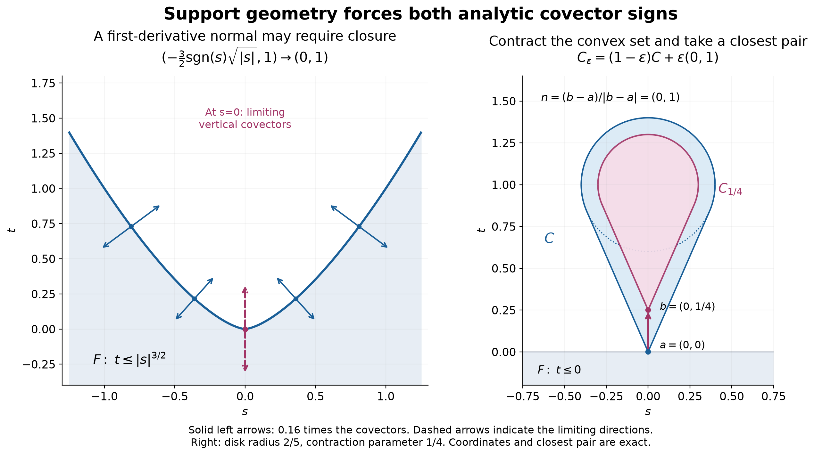

# Both analytic directions at support boundaries

*Written and self-checked by GPT-6 Astra (OpenAI), Ultra, October 2026. Public domain (CC0).*

A distribution may have an analytic singularity in only one direction. A boundary of its support is more restrictive: a supporting surface forces both signs of its normal covector into the analytic wavefront. This applies to complex distributions, including smooth functions which become flat at the boundary. We prove the support theorem, extend it to limiting normals and contacts with convex open sets, and deduce uniqueness from the absence of paired directions.

Our distributions act complex-linearly, and \(\widehat f(\xi)=\int e^{-ix\cdot\xi}f(x)\,dx\). Write \(W_A(u)=\operatorname{WF}_A(u)\), the growth sequence \(L_k=k+1\) of [Cones and derivative-growth wavefronts](cones-and-derivative-growth-wavefronts.md). Its regular set is open; its singular set is closed in the nonzero cotangent space and conic under positive scaling. These properties and its localization and multiplication rules are proved there.

The substantive analytic input is [From wavefront cones to holomorphic wedges](from-wavefront-cones-to-holomorphic-wedges.md), Theorem 7 and Corollary 8: a support boundary on the line has both analytic directions, and absence of such a pair on an interval gives uniqueness from an open zero set. Its proof uses the exact earlier holomorphic boundary and gluing theorems. [Analytic pullback and cotangent directions](analytic-pullback-and-cotangent-directions.md), Lemma 3 and Theorems 4 and 6, gives analytic coordinate completion, exact cotangent covariance and the projection formula. [Keeping zero covectors in kernel operations](keeping-zero-covectors-in-kernel-operations.md), Theorems 2 and 5, gives proper integration and analytic-weighted integration.

Two existing programme arguments are supplied as [Supporting quadratics and nearest-point normals](../prerequisites/U011-free-foundations/supporting-quadratics-and-nearest-point-normals.md). They are the complete geometric reductions from Sections 1 and 7 of the AN-03 lesson *Curved weights and the directions in which support can end*. We reuse them rather than its separate elliptic differential-equation theorem. Their calculus proofs are the [metric foundation](../prerequisites/U011-free-foundations/metric-foundation-bridges.md), Sections 12–13, the integral Taylor remainder in [When a kernel is smooth](when-a-kernel-is-smooth.md), Section “Taylor estimates on compact neighborhoods,” and [Regular level sets and transverse convolution](regular-level-sets-and-transverse-convolution.md), Lemmas 0.1–0.2. Tensor-test density and locality are [Convolution as addition of supports](convolution-as-addition-of-supports.md), B0–B2. Fourier inversion is the [Schwartz prerequisite](../prerequisites/U011-free-foundations/schwartz-fourier-foundations-U017.md), F1–F5; compact finite order is [Order, positivity and distributional limits](order-positivity-and-limits.md), Proposition 1.2. No external citation below replaces these available proofs.

## Supporting functions and their covectors

Let \(F\) be relatively closed in an open \(X\subset\mathbb R^n\). A pair \((x_0,\xi_0)\), with \(x_0\in F\) and \(\xi_0\ne0\), is an **exterior normal** if a real \(C^2\) function \(f\) on a neighborhood of \(x_0\) satisfies

\[
 df(x_0)=\xi_0,\qquad f(x)\le f(x_0)
                  \quad(x\in F\text{ sufficiently near }x_0).
 \tag{1}
\]

Write \(N_e(F)\) for these pairs, \(N_i(F)=-N_e(F)\) for reversal in the covector fiber, and

\[
 N(F)=N_e(F)\cup N_i(F),\qquad
 \overline N(F)=\overline{N(F)}^{\,T^*X\setminus0}.
 \tag{2}
\]

The zero section is excluded from this closure. Positive multiples of a supporting function show that each normal set is positively conic. A normal's base point is on \(\partial_XF\): at an interior point, differentiating a local maximum in each coordinate direction would give \(df=0\).

The definition is local. If a global \(C^2\) witness is desired, choose a smooth cutoff \(0\le\chi\le1\) supported where (1) holds and equal to one near \(x_0\). The function \(\chi f+(1-\chi)f(x_0)\), extended by the constant outside that neighborhood, has the same differential and inequality. Under a \(C^2\) change of coordinates, composition of the witness and the chain rule give precisely the transposed derivative on covectors. Applying the inverse change gives equality of normal sets; continuity of the cotangent homeomorphism gives equality of their closures. Thus the geometric definitions also make sense on a \(C^2\) manifold. The wavefront assertions below use analytic coordinates, as required by analytic cotangent covariance.

The supplied quadratic-contact proof is useful even when the witness in (1) is not analytic. After translating \(x_0\) to zero, let \(f_2\) be its quadratic Taylor polynomial. For any \(\kappa>0\), that proof gives, on a sufficiently small neighborhood,

\[
 g(x)=f_2(x)-f(0)-\kappa|x|^2,
 \quad dg(0)=df(0),\quad
 g(x)<0\quad(x\in F\setminus\{0\}),\quad g(0)=0.
 \tag{3}
\]

The complete remainder argument is (S6) of the supplied reading. Because \(g\) is a polynomial and \(dg(0)\ne0\), adjoining \(n-1\) of the original coordinate functions gives an analytic map \(\Phi\) with invertible derivative and last coordinate \(g\). The analytic inverse proved in U083 gives an analytic coordinate neighborhood, not merely a smooth one. In these coordinates the transformed support satisfies

\[
 F\cap\{t\ge0\}=\{0\},\qquad x=(y,t)\in\mathbb R^{n-1}\times\mathbb R.
 \tag{4}
\]

Here and below an equality of supports is restricted to the chosen coordinate neighborhood.

## The analytic support theorem

**Theorem 1 (both normal signs).** Let \(u\in\mathcal D'(X)\) and \(F=\operatorname{supp}u\). If \(f\) satisfies (1), then

\[
              (x_0,\xi_0),\ (x_0,-\xi_0)\in W_A(u).
 \tag{5}
\]

In particular this holds for every real analytic supporting function with nonzero differential. The distribution need not be real-valued or satisfy a differential equation.

**Proof.** Use (3) and its analytic coordinate completion. Pullback by the inverse coordinate map transports support exactly by locality and its inverse, and transports analytic wavefront exactly by U083. The covectors \(\pm dt\) pull back to \(\pm dg(0)=\pm\xi_0\). Thus it suffices to prove (5) in (4). For \(n=1\), zero is a support boundary, and U081 Theorem 7 already proves both directions. Suppose \(n\ge2\).

Assume that one of \((0,+dt)\), \((0,-dt)\) is absent. Write its sign as \(\sigma\in\{1,-1\}\). Openness of the regular set gives a neighborhood \(V\) of zero on which the direction \(\sigma dt\) is absent at every base point. Choose a small transverse open ball \(Y\) centered at zero with \(\overline Y\times\{0\}\subset V\). By (4) the compact side \(\partial Y\times\{0\}\) misses \(F\). Shrinking an interval \(I=(-\delta,\delta)\), we can arrange

\[
 \overline Y\times\overline I\subset V,
 \qquad F\cap(\partial Y\times\overline I)=\varnothing.
 \tag{6}
\]

Indeed the side at height zero is compact and disjoint from a relatively closed set; a finite neighborhood cover gives a common height. Shrink once more if necessary. Compactness of the side in (6) then supplies a collar disjoint from \(F\). The support of \(w=u|_{Y\times I}\) is consequently contained in \(K\times I\) for one compact \(K\Subset Y\), and projection to \(I\) is proper on that support.

For every real \(\eta\in\mathbb R^{n-1}\), use the entire transverse weight \(a_\eta(y)=e^{-iy\cdot\eta}\), and form

\[
 w_\eta(t)=\int_Y a_\eta(y)w(y,t)\,dy.
 \tag{7}
\]

This is the distributional proper integral proved in U084. Multiplication by the analytic weight and the integration bound give

\[
 W_A(w_\eta)\subset
 \{(t,\tau):\exists y\in Y,\ (y,t;0,\tau)\in W_A(w)\}.
 \tag{8}
\]

There is no \(\sigma\)-direction anywhere on \(I\) on the right side. Also \(w_\eta=0\) on \((0,\delta)\), because (4) leaves no support there. U081 Corollary 8 therefore gives \(w_\eta=0\) on all of \(I\), for every \(\eta\). The interval is common to all weights; only their harmless estimate constants may vary with \(\eta\).

We prove that these weighted integrals detect the full distribution. Fix \(\phi\in C_c^\infty(I)\) and choose \(\chi\in C_c^\infty(Y)\), equal to one near \(K\). Define the compactly supported transverse distribution

\[
 T_\phi(b)=\langle w,\chi(y)b(y)\phi(t)\rangle,
                   \qquad b\in C^\infty(\mathbb R^{n-1}).
 \tag{9}
\]

Finite order on the common compact test support proves continuity; its support lies in \(K\). Equations (7)–(9) give \(\widehat T_\phi(\eta)=0\) for every real \(\eta\). For completeness, compact-distribution Fourier injectivity here is a direct consequence of the available inversion proof. If \(b\) is a smooth compact test, its inverse Fourier integral and every derivative through the finite order of \(T_\phi\) converge absolutely, since \(\widehat b\) decreases to every order. After inserting one compact cutoff equal to one near \(K\), truncate the integral and approximate it in those finite derivative seminorms by Riemann sums. Continuity of \(T_\phi\) gives

\[
 T_\phi(b)=(2\pi)^{-(n-1)}\int
          \widehat b(\eta)\,T_\phi(e^{iy\cdot\eta})\,d\eta=0.
 \tag{10}
\]

Thus \(w\) vanishes on every product test \(b(y)\phi(t)\); the cutoff in (9) can be removed on such a pairing by locality. Finite sums of these tests are dense in the full test space with common compact supports by U021 B2. Distributional continuity gives \(w=0\). This contradicts \(0\in\operatorname{supp}u\). Either sign could have been chosen for \(\sigma\), so both must be present. \(\square\)

**Corollary 2 (closed normal set).** For every distribution on \(X\),

\[
                   \overline N(\operatorname{supp}u)\subset W_A(u).
 \tag{11}
\]

**Proof.** Theorem 1 includes every exterior normal and its negative. Analytic wavefront is closed off the zero section, so it includes their closure there. On a real analytic manifold apply the coordinate statement in each analytic chart; the proved coordinate transformations for both sides agree. \(\square\)

## Normals at rough boundary points

**Proposition 3 (density and first derivatives).** For every relatively closed \(F\subset X\):

1. The base projection of \(N_e(F)\) is dense in \(\partial_XF\).
2. If a real \(C^1\) function \(f\) supports \(F\) at \(x_0\), with \(df(x_0)=\xi_0\ne0\), then \((x_0,\xi_0)\in\overline{N_e(F)}\).
3. Every \(x_0\in\partial_XF\) is the base of a unit covector in \(\overline{N_e(F)}\).

The closure is in the punctured cotangent space. These geometric assertions are invariant under \(C^2\) changes of coordinates.

**Proof.** Fix a boundary point \(x_0\). The supplied nearest-point construction chooses \(y_j\notin F\), tending to \(x_0\), and a nearest \(z_j\in F\) in a fixed compact ball inside \(X\). Its proof gives

\[
 |y_j-z_j|\le|y_j-x_0|,\qquad
 |z_j-x_0|\le2|y_j-x_0|,
 \qquad (z_j,y_j-z_j)\in N_e(F).
 \tag{12}
\]

The last assertion is the supplied squared-distance witness, rescaled by a positive constant. Thus \(z_j\to x_0\), proving density; every normal base lies on the boundary by the observation after (2). Normalize the nonzero covectors in (12) to length one and choose a convergent subsequence on the unit sphere. Its limit proves part 3.

For part 2 translate \(x_0\) to zero and identify the covector \(\xi_0\) with its Euclidean coordinate vector \(p\). Set \(y_t=tp\), \(t>0\). Differentiability gives \(f(tp)=f(0)+t|p|^2+o(t)>f(0)\) for all small \(t\); hence \(y_t\notin F\). In one fixed small compact ball choose a nearest point \(z_t\in F\), using zero as a competitor. Then \(|z_t|\le2t|p|\), so the minimizer is in the interior of that ball for small \(t\). The same local squared-distance witness as in (12) makes \((z_t,y_t-z_t)\) an exterior normal.

The nearest-point inequality and the supporting inequality yield

\[
 |tp-z_t|^2\le t^2|p|^2,
 \qquad \frac{|z_t|^2}{2t}\le p\cdot z_t\le o(|z_t|).
 \tag{13}
\]

The last bound is the first-order remainder in \(f(z_t)-f(0)\le0\). If \(z_t\ne0\), divide by \(|z_t|\), which proves \(|z_t|/t\to0\). If \(z_t=0\), that conclusion holds directly. Positive conic scaling of the exterior normal now gives

\[
 \left(z_t,\frac{y_t-z_t}{t}\right)\in N_e(F),\qquad
 \left(z_t,\frac{y_t-z_t}{t}\right)\longrightarrow(0,p).
 \tag{14}
\]

The limiting covector is nonzero, proving the required closure assertion. Coordinate invariance follows from the previously proved transformation of normals and its continuous inverse. \(\square\)

Consequently every boundary point of the support of a distribution has *some* pair of opposite analytic singular directions, even when there is no smooth supporting hypersurface at that particular point. Parts 3 and (11) prove this assertion; they do not assert that every covector at the point is singular.

## Contact with an arbitrary convex open set

**Theorem 4 (convex exterior contact).** Suppose \(Y\subset X\setminus F\) is nonempty, open and convex, and \(x_0\in F\cap\partial Y\). There exists a unit covector \(\xi_0\) such that

\[
 (x_0,\xi_0)\in\overline{N_e(F)},\qquad
          (y-x_0)\cdot\xi_0>0\quad\text{for every }y\in Y.
 \tag{15}
\]

No boundedness of \(Y\), regularity of its boundary, or convexity of \(F\) is required. For \(F=\operatorname{supp}u\), both \((x_0,\xi_0)\) and \((x_0,-\xi_0)\) therefore belong to \(W_A(u)\).

**Proof.** We first treat a compact convex set \(C\Subset X\) with nonempty interior, \(x_0\in\partial C\), and \(C\cap F=\{x_0\}\). Pick \(c\in\operatorname{int}C\) and \(r>0\) with \(B(c,r)\subset C\). For \(0<\varepsilon<1\) put

\[
 C_\varepsilon=c+(1-\varepsilon)(C-c).
 \tag{16}
\]

Convexity shows that every point of \(C_\varepsilon\) has a ball of radius \(\varepsilon r\) in \(C\): write it as \((1-\varepsilon)q+\varepsilon c\), and add \(\varepsilon h\) with \(|h|<r\). Hence \(C_\varepsilon\subset\operatorname{int}C\), and it is disjoint from \(F\). Choose a compact neighborhood \(H\Subset X\) of \(C\), with \(C\subset\operatorname{int}H\). Minimize distance between the nonempty compact sets \(F\cap H\) and \(C_\varepsilon\). Let the minimizing pair be \((a_\varepsilon,b_\varepsilon)\). Their distance \(d_\varepsilon\) is positive, and the competitor \(x_0\in F\) and its contracted image in \(C_\varepsilon\) give

\[
 0<d_\varepsilon\le\varepsilon|c-x_0|.
 \tag{17}
\]

Every accumulation pair as \(\varepsilon\downarrow0\) has equal components in \(F\cap C=\{x_0\}\). Compactness therefore implies \(a_\varepsilon,b_\varepsilon\to x_0\). In particular \(a_\varepsilon\) is in the interior of \(H\) for small \(\varepsilon\). It is a local nearest point of \(F\) to \(b_\varepsilon\), so the supplied squared-distance construction gives the exterior normal

\[
 (a_\varepsilon,n_\varepsilon)\in N_e(F),\qquad
 n_\varepsilon=\frac{b_\varepsilon-a_\varepsilon}{d_\varepsilon},
                 \qquad |n_\varepsilon|=1.
 \tag{18}
\]

Also \(b_\varepsilon\) minimizes distance to \(a_\varepsilon\) on the convex set \(C_\varepsilon\). For any \(q\in C_\varepsilon\), differentiate \(|b_\varepsilon+s(q-b_\varepsilon)-a_\varepsilon|^2\) at \(s=0+\). Nonnegativity of that derivative gives

\[
                 n_\varepsilon\cdot(q-b_\varepsilon)\ge0.
 \tag{19}
\]

Choose a convergent subsequence \(n_\varepsilon\to n\) on the unit sphere. In (19) take \(q=c+(1-\varepsilon)(y-c)\) for any fixed \(y\in C\). The limit gives \(n\cdot(y-x_0)\ge0\) for every \(y\in C\), and (18) gives \((x_0,n)\in\overline{N_e(F)}\). The inequality is strict for \(y\in\operatorname{int}C\): if equality held, \(y-sn\) would still be in \(C\) for small \(s>0\) and would violate the nonnegative inequality.

We now construct enough such compact sets inside an arbitrary \(Y\). A segment from a boundary point \(x_0\in\overline Y\) to an interior point \(y\in Y\), excluding \(x_0\), lies in \(Y\). Here is a proof including a margin. Choose \(B(y,r)\subset Y\) and \(x_j\in Y\) tending to \(x_0\). For \(0<t\le1\), convexity puts the ball of radius \(tr\) centered at \((1-t)x_j+ty\) in \(Y\). For large \(j\) it contains the ball of radius \(tr/2\) centered at \((1-t)x_0+ty\). Thus that segment point is interior to \(Y\).

Exhaust \(Y\) by the increasing compact convex sets

\[
 K_j=\{y:|y|\le j,\ \operatorname{dist}(y,\mathbb R^n\setminus Y)\ge1/j\}.
 \tag{20}
\]

They lie in \(Y\), have nonempty interior for all sufficiently large \(j\), and their union is \(Y\). Closedness and boundedness give compactness. For convexity, if \(y,z\) satisfy the distance condition, then \(y+h,z+h\in Y\) whenever \(|h|<1/j\); convexity of \(Y\) puts every convex combination plus \(h\) in \(Y\), proving the same distance condition. The ball condition is also convex. Any fixed small ball compactly contained in \(Y\) lies in \(K_j\) for large \(j\), proving the interior assertion. Every point of \(Y\) has positive distance from its complement, proving exhaustion. The complement is nonempty here because it contains \(x_0\).

Let
\(C_j=\{(1-t)x_0+ty:0\le t\le1,\ y\in K_j\}\).
It is compact by the displayed continuous parametrization of a compact set; convexity of \(K_j\) shows it is the convex hull of \(K_j\cup\{x_0\}\). It has nonempty interior. The segment argument puts \(C_j\setminus\{x_0\}\) in \(Y\). The point \(x_0\) cannot be interior to \(C_j\): two nearby points \(x_0\pm v\) would then lie in \(Y\), and convexity would put their midpoint \(x_0\) in \(Y\), a contradiction. Thus \(x_0\in\partial C_j\), \(C_j\Subset X\), and \(C_j\cap F=\{x_0\}\). Apply the compact result to get a unit \(n_j\) with \((x_0,n_j)\in\overline{N_e(F)}\) and \(n_j\cdot(y-x_0)\ge0\) for all \(y\in C_j\).

Take a convergent subsequence \(n_j\to\xi_0\). Its limit remains unit and in the closed normal set over \(x_0\). Every fixed \(y\in Y\) eventually belongs to \(K_j\), so \(\xi_0\cdot(y-x_0)\ge0\) for every \(y\in Y\). Since \(Y\) is open, replacing a hypothetical equality point by \(y-s\xi_0\) gives a contradiction. This proves (15). The final distributional assertion follows from (11). \(\square\)

*Left: \(F=\{(s,t):t\le|s|^{3/2}\}\). The displayed covectors at nonzero \(s\) are positive and negative multiples of \((-\tfrac32\operatorname{sgn}(s)\sqrt{|s|},1)\); the vertical covector at zero is obtained by closure and has no \(C^2\) supporting witness. Right: \(C\) is the convex hull of the origin and the closed disk centered at \((0,1)\) of radius \(2/5\). Its contraction toward \((0,1)\) by \(1-\varepsilon\), with \(\varepsilon=1/4\), has nearest pair \(a=(0,0)\), \(b=(0,1/4)\) with the lower half-plane. Exercises 2 and 8 prove these statements. [Full-size vector figure](../figures/support-normals-and-convex-contact.svg) · [Reproducible figure source](../figures/support-normals-and-convex-contact.py).*

## Uniqueness from the absence of a paired direction

**Corollary 5 (open-set uniqueness).** Let \(X\) be connected and open. Suppose that for no \(x\in X\) and nonzero \(\xi\) do both \((x,\xi)\) and \((x,-\xi)\) belong to \(W_A(u)\). If \(u\) vanishes on a nonempty open subset of \(X\), then \(u=0\) on \(X\).

In particular the conclusion holds when \(W_A(u)\subset X\times C\) for a cone with \(C\cap(-C)=\{0\}\). It applies to the boundary distribution of a polynomially bounded holomorphic function on a tube with a nonempty open convex imaginary cone, whenever that boundary satisfies the forward dual-cone theorem of U075.

**Proof.** If \(F=\operatorname{supp}u\) were nonempty, it would be a proper relatively closed subset of \(X\). It has a relative boundary point: otherwise it would be both open and closed, disconnecting \(X\) from its nonempty complement. Proposition 3 and (11) give opposite singular directions at that point, a contradiction. Thus \(F\) is empty and locality gives \(u=0\).

For the cone statement a pair would put a nonzero vector in \(C\cap(-C)\). For the tube application U075 places wavefront in the positive dual \(\Gamma^*\) of its imaginary cone \(\Gamma\). If both \(\xi\) and \(-\xi\) lie in \(\Gamma^*\), then \(\xi\cdot y=0\) for every \(y\in\Gamma\). A small ball inside the nonempty open cone then gives \(\xi\cdot e_j=0\) in every coordinate direction, so \(\xi=0\). The dual is therefore pointed and the boundary-distribution conclusion follows. \(\square\)

## Exercises with complete solutions

**Exercise 1 — smoothness does not remove the analytic normals.** Put \(h(t)=e^{-1/t^2}\) for \(t<0\), \(h(t)=0\) for \(t\ge0\), and \(u(y,t)=h(t)\). Determine its ordinary and analytic wavefront sets.

**Solution.** On \(t<0\), successive derivatives of \(h\) are finite sums of powers of \(t^{-1}\) times \(e^{-1/t^2}\), by the product and chain rules. Every such term tends to zero as \(t\uparrow0\): putting \(s=1/t^2\), any fixed power of \(s\) is dominated by \(e^{s/2}\) for large \(s\), as follows from the exponential series. Extending each derivative by zero therefore gives a smooth function, with every derivative zero at zero. Hence the ordinary wavefront is empty. The function is analytic off zero and has support \(( -\infty,0]\) on the line. Theorem 1 forces both analytic rays at zero, and there are no other one-dimensional nonzero directions. Exact projection covariance in U083 gives

\[
 W_A(u)=\{(y,0;0,\tau):\tau\ne0\},\qquad W_\infty(u)=\varnothing.
 \tag{21}
\]

Thus the analytic support theorem cannot be replaced by the same assertion for ordinary smooth wavefront. \(\square\)

**Exercise 2 — why the closure is necessary.** For \(F=\{(s,t):t\le|s|^{3/2}\}\), show that the upward covector at the origin is a \(C^1\) supporting differential but not an exterior normal as defined by (1). Show that it is in the closure, and deduce analytic wavefront directions for the indicator distribution of \(F\).

**Solution.** The function \(f(s,t)=t-|s|^{3/2}\) is \(C^1\), is nonpositive on \(F\), and has differential \((0,1)\) at zero. If a \(C^2\) witness \(g\) had that differential, Taylor's formula on the boundary points \((s,|s|^{3/2})\) would give

\[
 g(s,|s|^{3/2})-g(0,0)=|s|^{3/2}+O(s^2)>0
                          \quad(0<|s|\text{ small}),
 \tag{22}
\]

contradicting support from above. Away from \(s=0\), the same defining function is smooth and gives exterior normal
\((-\tfrac32\operatorname{sgn}(s)\sqrt{|s|},1)\) at \((s,|s|^{3/2})\). These pairs tend to the upward covector at zero, proving the closure assertion directly. The locally integrable indicator defines a distribution of order zero. Its support is exactly \(F\): it vanishes outside, while every neighborhood of a point of \(F\) meets its interior in an open set of positive measure. A nonnegative bump there has positive integral. Equation (11) now puts both vertical covectors over the origin in its analytic wavefront. \(\square\)

**Exercise 3 — an exact curved support boundary.** Compute the analytic wavefront of the indicator of \(t\le s^2\) on the plane.

**Solution.** On the line the indicator \(H_-(r)\) of \(r\le0\) is analytic off zero. Its support boundary at zero forces both analytic directions by Theorem 1. The polynomial map \(q(s,t)=t-s^2\) is a submersion with differential \((-2s,1)\). Exact analytic submersion covariance gives

\[
 W_A(\boldsymbol1_{\{t\le s^2\}})
     =\{(s,s^2;\lambda(-2s,1)):\lambda\ne0\}.
 \tag{23}
\]

The distributional pullback agrees with this bounded function: in the analytic coordinates \((s,r)=(s,t-s^2)\), the coordinate determinant is one, so the exact distributional change-of-variables formula gives the same test integral. Equality here uses the submersion theorem as well as the lower bound from support geometry. \(\square\)

**Exercise 4 — an isolated support point.** If \(x_0\) is isolated in \(\operatorname{supp}u\), determine its analytic wavefront fiber without using a representation by derivatives of a point mass.

**Solution.** In a neighborhood of \(x_0\) the support consists of that point alone. For every nonzero \(\xi\), the linear function \(f(x)=\xi\cdot(x-x_0)\) is zero on that local support and has differential \(\xi\). Theorem 1 puts every nonzero \(\xi\) in the analytic wavefront fiber over \(x_0\). This argument requires that \(x_0\) be in the support; it does not assign singularities to a neighborhood on which the distribution is zero. \(\square\)

**Exercise 5 — every frequency direction occurs for compact support.** Let \(u\ne0\) have compact support in \(\mathbb R^n\), \(n\ge1\). Show that for every nonzero \(\xi\) there is a support point carrying both \(\xi\) and \(-\xi\) in analytic wavefront. Explain the restriction this puts on a global conic wavefront bound.

**Solution.** The continuous linear function \(x\mapsto\xi\cdot x\) attains its maximum on the nonempty compact support. At a maximizer it satisfies (1), with differential \(\xi\). Theorem 1 gives both signs there. In particular the projection of \(W_A(u)\) to nonzero frequency directions is the whole sphere. No proper set of frequency directions, and especially no pointed cone, can contain that projection. The support point may depend on \(\xi\); the statement does not put every covector over one fixed point. \(\square\)

**Exercise 6 — why one transverse integral is insufficient.** Let \(w(y,t)=\partial_y\delta_0(y)\otimes\delta_0(t)\). Compute its unweighted transverse integral and its exponential-weighted integrals, and relate them to the proof of Theorem 1.

**Solution.** The derivative convention gives \(\partial_y\delta_0(a)=-a'(0)\). For \(a=1\) the result is zero, so \(\int w(y,t)\,dy=0\), although \(w\ne0\); for example a product test with nonzero first derivative at zero in \(y\) and nonzero value in \(t\) has nonzero pairing. For \(a=e^{-iy\eta}\) the derivative is \(-i\eta\), and

\[
                    w_\eta=i\eta\,\delta_0(t).
 \tag{24}
\]

Every \(\eta\ne0\) detects the distribution. The full family of weights in Theorem 1 excludes cancellations that a single unweighted pushforward cannot see. \(\square\)

**Exercise 7 — a quantitative version of the \(C^1\) limit.** In the proof of Proposition 3 let \(\omega(r)=\sup_{|x|\le r}|df(x)-df(0)|\) on a small ball. Bound the error in the covector limit (14).

**Solution.** The fundamental theorem on the segment from zero to \(z_t\) bounds the first-order remainder by \(|z_t|\omega(|z_t|)\). Therefore (13) gives \(|z_t|/(2t)\le\omega(|z_t|)\) when \(z_t\ne0\). Use \(|z_t|\le2t|p|\) from the nearest-point bound and monotonicity of \(\omega\). The zero case satisfies the same conclusion. Thus

\[
 \left|\frac{y_t-z_t}{t}-p\right|
      =\frac{|z_t|}{t}\le2\omega(2t|p|)\longrightarrow0.
 \tag{25}
\]

If \(df\) is Hölder continuous of exponent \(\alpha\), this gives an \(O(t^\alpha)\) covector error. No uniqueness of the nearest point was used, so the bound applies to every minimizing choice. \(\square\)

**Exercise 8 — the closest-pair geometry in the figure.** Let \(F=\{(s,t):t\le0\}\), let \(C\) be the convex hull of the origin and the closed disk of radius \(2/5\) centered at \(c=(0,1)\), and set \(C_\varepsilon=c+(1-\varepsilon)(C-c)\). Identify a nearest pair and the covector in (18).

**Solution.** Every point of \(C\) has \(t\ge0\), and the only point with \(t=0\) is the origin, since the disk has \(t\ge3/5\). Thus every point of \(C_\varepsilon\) has \(t\ge\varepsilon\), with equality only at \(b=(0,\varepsilon)\). Its distance to the lower half-plane is its height, minimized there. The unique nearest point of the half-plane is \(a=(0,0)\). Hence \(d_\varepsilon=\varepsilon\), \(n_\varepsilon=(0,1)\), and (19) says exactly that every point of \(C_\varepsilon\) has height at least \(\varepsilon\). The witness \(-|(s,t)-(0,\varepsilon)|^2\) has differential \((0,2\varepsilon)\) at the origin; positive normalization gives the same unit covector. The strict limiting inequality holds for every point of the upper half-plane. \(\square\)

## Sources

Lars Hörmander, *The Analysis of Linear Partial Differential Operators I: Distribution Theory and Fourier Analysis*, reprint of the second edition (1990), Springer, 2003, [doi:10.1007/978-3-642-61497-2](https://doi.org/10.1007/978-3-642-61497-2), Theorems 8.5.6 and 8.5.6′, Definition 8.5.7 and Proposition 8.5.8. These give the support-boundary and closed-normal-set targets. The transverse Fourier-testing proof, compact closest-pair proof of convex contact, exposition, exercises and illustration above are independently expressed. The earlier programme proofs reused in the argument are supplied and linked at the beginning.
