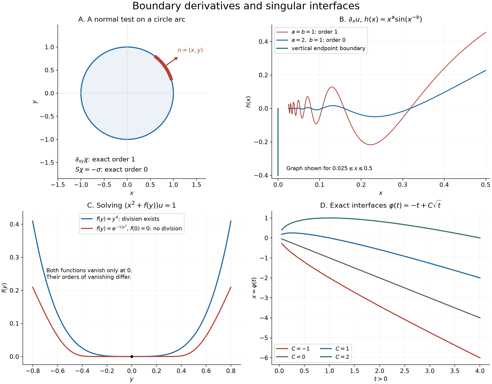

# Boundary derivatives, division and moving jumps

A boundary derivative measures the way a region meets a coordinate direction. Repeated differentiation can create a normal derivative of surface measure, but tangential combinations can cancel it. We use these distinctions to study oscillating graphs, then examine two other manifestations of a singular boundary: division by a nonnegative smooth function of two variables and jumps across moving or complex interfaces.

The main division theorem includes smooth functions whose zeros accumulate. Its necessity rests on a quantitative lower bound on every interval of positivity and an interpolation argument through consecutive zeros.

## Conventions and earlier proofs

Distributions act linearly on compactly supported smooth tests. The derivative convention is \(\langle\partial_j u,\phi\rangle=-\langle u,\partial_j\phi\rangle\). Order at most \(k\) on a fixed compact set means a bound by the maximum of the test derivatives through order \(k\).

The following earlier arguments supply the prerequisites:

- [Local data and compatible products](local-data-and-compatible-products.md), Sections 1–4, gives restriction, smooth multiplication, derivatives and locality.
- [Order, positivity and limits](order-positivity-and-limits.md), Section 1, supplies the finite-order estimates and locally integrable distributions.
- [Boundary flux and weak identities](boundary-flux-and-weak-identities.md), the graph and partition lemmas and Theorem 2.1, proves graph differentiation, locally finite smooth partitions and boundary flux.
- [Tensor products and parameters](tensor-products-and-parameters.md), Sections 1–2, constructs tensor products; [Jets, supported distributions and local operators](jets-supported-distributions-and-local-operators.md), Theorems 3.1, 3.3–3.4, proves the finite point-jet structure used below.
- [Jumps, jets and smooth division](jumps-jets-and-smooth-division.md), Theorem 3 and Lemma 4, gives division by a coordinate power and the full smooth factorization at a finite-order zero.
- [Complex powers at a boundary](complex-powers-at-a-boundary.md), Lemma H2, Proposition 1.2 and Theorem 2.1, proves both boundary values of negative integer powers and their delta-derivative jump.
- [Scalar foundations](../prerequisites/U011-free-foundations/metric-foundation-bridges.md), Sections 12–13, supplies compactness, Taylor's integral remainder, Rolle's theorem and scalar substitution. [Integration foundations](../prerequisites/U011-free-foundations/banach-foundation-bridges.md), Sections 15–16, supplies convergence theorems and Fubini.

Write \(\delta_a^{(j)}=\partial_x^j\delta_a\) on the line. In the plane, \(\delta_p\) is a point mass; coordinate derivatives act on it with the convention above. The value assigned to an indicator on its boundary does not affect its distribution.

*The upper-left panel marks the circle arc used to detect first order. The upper-right panel plots two exact oscillatory graphs only on the stated truncated interval; the order assertions are proved below. The lower-left panel compares a finite-order zero with a flat zero. The lower-right curves are the exact weak-solution interfaces of Theorem 6 with \(c=-1\). The plotting source accompanies the figure.*

## Tangential cancellation on a circle

**Proposition 1 (three derivative orders).** Let \(\chi\) be the indicator of the open unit disk and let \(\sigma\) be its boundary arclength measure. The distributions
\[
 \partial_x\chi,\qquad \partial_x\partial_y\chi,\qquad
 S\chi,\quad
 S=x^2\partial_y^2+y^2\partial_x^2-2xy\partial_x\partial_y
 \tag{B1}
\]
have exact orders \(0,1,0\), respectively. In the last expression the coefficients multiply after differentiation. More precisely,
\[
 \partial_x\chi=-x\sigma,\qquad
 \partial_y\chi=-y\sigma,\qquad S\chi=-\sigma.
 \tag{B2}
\]

**Proof.** The outward normal on the unit circle is \((x,y)\), so the earlier flux theorem gives the first two identities. They are nonzero measures and therefore have exact order zero.

The mixed derivative is the derivative of a finite measure, hence has order at most one. To exclude order zero, choose a nonnegative smooth function \(a\), supported in a thin annulus over an arc in the first quadrant, with positive restriction somewhere on the circle. Choose \(\rho\in\mathcal D(\mathbb R)\) with \(\rho(0)=0\) and \(\rho'(0)=1\). For sufficiently small \(h>0\), put
\[
 \phi_h(x,y)=a(x,y)\rho\bigl((r-1)/h\bigr),
 \qquad r=(x^2+y^2)^{1/2}.
 \tag{B3}
\]
This is smooth, extended by zero away from the annulus, and its supports and suprema are uniformly bounded. On the circle, \(\partial_y\phi_h=a y/h\). Consequently
\[
 \langle\partial_y\partial_x\chi,\phi_h\rangle
   =\int x\,\partial_y\phi_h\,d\sigma
   =h^{-1}\int xy\,a\,d\sigma\longrightarrow+\infty.
 \tag{B4}
\]
No order-zero estimate can hold on this common compact support.

Let \(A=x\partial_y-y\partial_x\) and \(E=x\partial_x+y\partial_y\). The flux identities give \(A\chi=0\). The product rule, including the derivatives of the coefficients, gives
\[
 A^2=S-E.
 \tag{B5}
\]
It follows that \(S\chi=E\chi=-(x^2+y^2)\sigma=-\sigma\). This nonzero measure has exact order zero. \(\square\)

## Variation of an oscillating graph

**Theorem 2 (the vertical endpoint and graph variation).** Let \(h\in C^\infty((0,\infty))\) have a finite limit \(h_0\) at zero. Define
\[
 u(x,y)=\mathbf1_{\{x>0,\ y<h(x)\}}.
 \tag{B6}
\]
Then \(\partial_yu\) is always the order-zero distribution
\[
 \langle\partial_yu,\phi\rangle
       =-\int_0^\infty\phi(x,h(x))\,dx.
 \tag{B7}
\]
The derivative \(\partial_xu\) has order zero near \((0,h_0)\) if and only if \(h'\in L^1((0,r))\) for some \(r>0\). In that case it is a locally finite signed measure on the whole plane, with
\[
 \langle\partial_xu,\phi\rangle
 =\int_0^\infty h'(x)\phi(x,h(x))\,dx
       +\int_{-\infty}^{h_0}\phi(0,y)\,dy.
 \tag{B8}
\]
If this integrability fails, its exact local order at \((0,h_0)\) is one.

**Proof.** Fubini and the fundamental theorem of calculus in \(y\) prove (B7). The graph measure is locally finite: a compactly supported test sees only a bounded interval of \(x\), and the measure is bounded by that interval's length times its supremum. It is nonzero.

For \(\delta>0\), define
\[
 H_\phi(x)=\int_{-\infty}^{h(x)}\phi(x,y)\,dy.
\]
Differentiation on \(x>0\) gives
\[
 -\int_\delta^\infty\int_{-\infty}^{h(x)}
           \partial_x\phi(x,y)\,dy\,dx
 =H_\phi(\delta)+\int_\delta^\infty h'(x)\phi(x,h(x))\,dx.
 \tag{B9}
\]
If \(h'\) is integrable at zero, the second term has an absolutely convergent limit. The first tends to the vertical integral in (B8). The omitted strip \(0<x<\delta\) in the left side tends to zero, since its integrand is bounded on a fixed compact rectangle. This proves (B8) and local finiteness.

For necessity, suppose an order-zero bound holds on a compact rectangle about \((0,h_0)\). Decrease \(r\) so that the graph for \(0<x<r\) lies in its interior and a fixed \(y\)-cutoff equals one on this graph. For tests supported in \(x>0\), (B9) has no vertical term. Fix \(0<\delta<r'<r\). Multiply that cutoff by an \(x\)-cutoff in \((0,r)\), equal to one on \([\delta,r']\), and by
\[
 \frac{h'(x)}{\sqrt{h'(x)^2+\eta^2}},\qquad \eta>0.
 \tag{B10}
\]
These smooth tests have supremum at most one and supports in the same rectangle. Their pairings are nonnegative and bounded by the same order-zero constant. Letting \(\eta\downarrow0\) proves \(\int_\delta^{r'}|h'|\le C\). Monotone convergence as \(\delta\downarrow0\) gives the required integrability. Finally every derivative of the bounded function \(u\) has local order at most one. If the order-zero bound fails in every such neighborhood, the exact local order is one. \(\square\)

**Corollary 3 (the sharp oscillation threshold).** For \(a,b>0\), take
\[
 h(x)=x^a\sin(x^{-b}),\qquad x>0.
 \tag{B11}
\]
Then \(\partial_yu\) has exact order zero for all \(a,b\). The derivative \(\partial_xu\) has exact order zero if \(a>b\), and exact order one near \((0,0)\) if \(a\le b\). In the order-zero case its vertical contribution is \(\delta_{x=0}H(-y)\,dy\).

**Proof.** The limit of \(h\) is zero and
\[
 h'(x)=a x^{a-1}\sin(x^{-b})
          -b x^{a-b-1}\cos(x^{-b}).
 \tag{B12}
\]
The first summand is absolutely integrable at zero. Substitution \(t=x^{-b}\) gives
\[
 \int_0^r x^{a-b-1}|\cos(x^{-b})|\,dx
       =\frac1b\int_{r^{-b}}^\infty t^{-a/b}|\cos t|\,dt.
 \tag{B13}
\]
The last integral is finite when \(a/b>1\), by \(|\cos t|\le1\). Conversely, each sufficiently large period contains an interval of a fixed positive length on which \(|\cos t|\ge1/2\). The integrals there bound from below a positive constant times \(\sum_{n\ge n_0}n^{-a/b}\). Integral comparison proves divergence when \(a/b\le1\). Adding an integrable function cannot change absolute integrability of the other summand, by the triangle inequality in both directions. Apply Theorem 2. Nonvanishing of the derivative, for example on the vertical ray \(y<0\), makes the zero order exact. \(\square\)

## Division and intervals of positivity

Let \(I\subset\mathbb R\) be a nonempty connected open interval and \(f\in C^\infty(I)\) be nonnegative. We ask whether
\[
 F(x,y)u=1\quad\hbox{in }\mathcal D'(\mathbb R\times I),
 \qquad F(x,y)=x^2+f(y).
 \tag{B14}
\]
The equation concerns multiplication, not differentiation.

**Lemma 4 (a necessary interval bound).** Suppose (B14) has a solution. On a fixed compact \(y\)-interval in the interior of \(I\), there exist \(k\ge0\), \(c_0>0\) and \(M_0>0\) such that every interval \(J=(b,b+\ell)\) contained there, with \(0<\ell\le1\), \(f>0\) on \(J\) and
\[
 0<M=\max_{\overline J}f\le M_0,
\]
satisfies
\[
 M\ge c_0\ell^{2k+2}.
 \tag{B15}
\]

**Proof.** Choose a fixed nonnegative compactly supported function \(\psi(x)\), equal to one on \([-r_0,r_0]\), and a nonnegative nonzero \(\eta\in\mathcal D((0,1))\). All functions
\[
 \Phi_J(x,y)=\psi(x)\eta((y-b)/\ell)
 \tag{B16}
\]
have supports in a common compact rectangle. A finite-order bound for \(u\) there gives \(|u(\Phi_J)|\le C\ell^{-k}\); the constant is independent of \(J\).

Where \(f>0\), the smooth reciprocal \(1/F\) exists, so (B14) implies \(u=1/F\) on that open strip. Set \(M_0=r_0^2\). For \(|x|\le\sqrt M\) one has \(\psi(x)=1\) and \(F(x,y)\le2M\) on \(J\). Thus
\[
 u(\Phi_J)
 =\iint\frac{\Phi_J}{F}\,dx\,dy
 \ge\frac{\ell}{\sqrt M}\int_0^1\eta(s)\,ds.
 \tag{B17}
\]
Comparing these two inequalities and squaring proves (B15). \(\square\)

**Theorem 5 (complete quadratic division criterion).** Equation (B14) has a solution if and only if either \(f\equiv0\) on \(I\), or every zero of \(f\) in \(I\) has finite order. No prior isolation assumption on the zeros is needed.

**Proof of necessity: an endpoint of the finite-order region.** Let \(Y\) consist of the points where \(f>0\) together with its finite-order zeros. Taylor factorization at a finite-order zero of a nonnegative function has even degree and a positive leading factor. Such a zero is isolated and has \(f>0\) on both sides. Hence \(Y\) is open.

If \(f\not\equiv0\), then \(Y\ne\varnothing\). Suppose \(Y\ne I\). A component of \(Y\) has an endpoint \(a\) in \(I\). This point is a flat zero: it is not in \(Y\), and all derivatives of \(f\) vanish there. Reflect the variable if necessary so that the component lies to the right of \(a\). Work in a fixed compact interval about \(a\), with the constants of Lemma 4.

If zeros do not accumulate at \(a\) from this component, \(f>0\) on some interval immediately to its right. For small \(\ell\), use \(J=(a+\ell,a+2\ell)\). Taylor's remainder at the flat zero gives, for every integer \(N\),
\[
 \max_{\overline J}f\le C_N\ell^N.
 \tag{B18}
\]
For \(N>2k+2\), this contradicts (B15).

**Proof of necessity: accumulating zeros.** In the other case, enumerate consecutive zeros in the component as
\[
 z_1>z_2>\cdots\downarrow a,\qquad
 \ell_j=z_j-z_{j+1}>0.
 \tag{B19}
\]
Such enumeration is possible because finite-order zeros are locally finite inside the component. No other zero lies between two consecutive ones, so \(f>0\) on each intervening interval. Also \(\ell_j\to0\).

There are arbitrarily large indices \(m\) for which
\[
 \ell_{m+r}\le\ell_m\quad(r\ge0).
 \tag{B20}
\]
Indeed a positive sequence tending to zero attains its maximum on every tail; an index attaining that maximum has this property and can be chosen beyond any prescribed index.

Fix an integer \(N>2k+2\). Interpolate through the \(N\) distinct zeros \(z_m,\ldots,z_{m+N-1}\). For \(y\) in the gap \([z_{m+1},z_m]\) and not one of these nodes, repeated Rolle's theorem gives
\[
 f(y)=\frac{f^{(N)}(\xi)}{N!}
                  \prod_{j=0}^{N-1}(y-z_{m+j})
 \tag{B21}
\]
for some \(\xi\) between the extreme nodes and \(y\). To see this directly, subtract from \(f(s)\) the polynomial
\(f(y)\prod_j(s-z_{m+j})/\prod_j(y-z_{m+j})\).
It has \(N+1\) distinct zeros; after \(N\) applications of Rolle's theorem its \(N\)-th derivative vanishes somewhere, giving (B21). At a node the asserted bound follows from \(f=0\).

By (B20), every factor in (B21) has magnitude at most \((N-1)\ell_m\). The derivative \(f^{(N)}\) is bounded on the same fixed compact interval. Therefore
\[
 M_m:=\max_{[z_{m+1},z_m]}f\le C_N'\ell_m^N.
 \tag{B22}
\]
For large \(m\), Lemma 4 applies to this positive gap and gives \(M_m\ge c_0\ell_m^{2k+2}\). Since \(\ell_m\to0\), the two inequalities contradict \(N>2k+2\). Thus \(Y=I\), proving necessity even in the presence of possible accumulating zeros.

**Proof of sufficiency: extension across one zero.** At a finite-order zero \(a\),
\[
 f(y)=(y-a)^{2m}g(y),\qquad m\ge1,\quad g>0
 \tag{B23}
\]
on a small interval, by the earlier smooth factorization proof. For \(p=(0,a)\) and sufficiently small \(r=|(x,y)-p|\), this yields
\[
 F(x,y)\ge c\bigl(x^2+|y-a|^{2m}\bigr)
                   \ge c' r^{2m}.
 \tag{B24}
\]
For the second inequality, restrict to \(|x|\le1\), use \(x^2\ge |x|^{2m}\), and use
\[
 (x^2+|y-a|^2)^m\le2^{m-1}(|x|^{2m}+|y-a|^{2m}).
\]

Choose a small neighborhood \(V\) of \(p\) containing no other zero of \(F\), and \(\chi\in\mathcal D(V)\) equal to one near \(p\). For a test \(\phi\) let \(T_{2m}\phi\) be its full Taylor polynomial at \(p\) of degree \(2m\). Define
\[
 v(\phi)=\int_V
       \frac{\phi-\chi T_{2m}\phi}{F}\,dx\,dy.
 \tag{B25}
\]
Near \(p\) the numerator is bounded by \(C r^{2m+1}\) times the maximum of the derivatives of \(\phi\) through order \(2m+1\). Formula (B24) makes the quotient integrable. Away from a fixed smaller neighborhood, \(1/F\) is bounded on each relevant compact set. These same estimates prove continuity on each fixed test support, so \(v\) is a distribution. It equals \(1/F\) away from \(p\).

**Proof of sufficiency: the finite jet correction.** Set \(w=1-Fv\). It is supported at \(p\), hence is a finite linear combination of \(\partial_x^\alpha\partial_y^\beta\delta_p\), by the earlier point-support structure theorem. On this space define
\[
 R(\partial_x^\alpha\partial_y^\beta\delta_p)
  =\frac{\partial_x^{\alpha+2}\partial_y^\beta\delta_p}
                {(\alpha+1)(\alpha+2)},\qquad N=f(y)R .
 \tag{B26}
\]
The test product rule proves \(x^2R=\mathrm{id}\), including the positive sign. Multiplication by \(f\), which vanishes to order \(2m\) at \(a\), lowers the \(y\)-derivative degree by at least \(2m\), or kills the term. The operator \(R\) leaves that degree unchanged. Thus \(N\) is nilpotent on every finite family of jets with bounded \(y\)-degree.

Choose \(L\) so that \(N^{L+1}w=0\), and put
\[
 q=R\sum_{j=0}^L(-N)^jw.
 \tag{B27}
\]
Since \(FR=\mathrm{id}+N\), a finite telescoping sum gives \(Fq=w\). Therefore \(v+q\) is a local solution.

If \(f\equiv0\), the earlier one-dimensional division by \(x^2\), tensored with the constant distribution in \(y\), gives a solution. If all zeros of \(f\) have finite order, they are locally finite. The local solutions just constructed, together with the ordinary reciprocal where \(F>0\), form an open cover of \(\mathbb R\times I\). Use the earlier locally finite smooth partition of unity \(\{\theta_j\}\) subordinate to this cover. Extend each \(\theta_j u_j\) by zero from its domain and sum. Each compact test sees only finitely many terms, and
\[
 F\sum_j\theta_j u_j=\sum_j\theta_j=1.
 \tag{B28}
\]
This proves sufficiency globally on the stated open set. \(\square\)

The theorem distinguishes \(x^2\), which permits distributional division, from \(x^2+f(y)\) with a nontrivial flat zero of \(f\). A pointwise failure of \(1/F\) to be integrable is not itself the criterion: the Taylor subtraction in (B25) can extend reciprocals with finite-order singularities.

## Moving interfaces for a conservation law

**Theorem 6 (all interfaces in a two-piece family).** Fix \(c\in\mathbb R\) and \(\varphi\in C^1((0,\infty))\). Define
\[
 u(t,x)=
 \begin{cases}
 x/t,&x\le\varphi(t),\\
 c,&x>\varphi(t).
 \end{cases}
 \tag{B29}
\]
It solves
\(\partial_tu+\partial_x(u^2/2)=0\) in
\(\mathcal D'((0,\infty)\times\mathbb R)\) if and only if
\[
 \varphi(t)=ct+C\sqrt t\qquad(t>0)
 \tag{B30}
\]
for a real constant \(C\). This is a weak-solution assertion without an entropy condition or initial trace at \(t=0\).

**Proof.** Both smooth pieces satisfy the equation: on the left,
\(\partial_t(x/t)=-x/t^2\) and \(\partial_x(x^2/(2t^2))=x/t^2\); on the right both derivatives vanish. Set \(s(t)=\varphi(t)/t\). Differentiating the two graph indicators by integration in \(x\) and then integration in \(t\), as in the earlier graph lemma, gives the remaining distribution
\[
 \left[\frac{c^2-s^2}{2}-\varphi'(c-s)\right]
                         \delta_{x=\varphi(t)}\,dt.
 \tag{B31}
\]
Here the graph distribution acts by \(\int\phi(t,\varphi(t))\,dt\); it is not arclength measure. The sign in the time term comes from
\(\partial_tH(x-\varphi(t))=-\varphi'(t)\delta_{x=\varphi(t)}\).
These formulas require only the stated \(C^1\) regularity.

A continuous coefficient of this graph distribution is zero as a distribution exactly when it vanishes everywhere. On any compact \(t\)-interval, choose a smooth \(x\)-cutoff equal to one on the bounded image of the graph and use tests \(\zeta(t)\) times that cutoff. The fundamental test characterization for continuous functions proves the assertion.

Writing \(w(t)=\varphi(t)-ct\), vanishing of (B31) is equivalent to
\[
 w(t)\left(w'(t)-\frac{w(t)}{2t}\right)=0.
 \tag{B32}
\]
This equation is valid also where \(w=0\). It implies
\[
 \frac{d}{dt}\frac{w(t)^2}{t}
      =\frac{2w(t)}{t}\left(w'(t)-\frac{w(t)}{2t}\right)=0.
 \tag{B33}
\]
Thus \(w^2/t\) is a nonnegative constant on the connected interval \((0,\infty)\). If it is zero, \(w=0\). If positive, \(w\) never vanishes, so continuity fixes its sign and \(w=C\sqrt t\). Conversely every such function satisfies (B32), and hence the weak equation. This also excludes switching between zero and nonzero branches at an interior time. \(\square\)

For \(c=-1\), the complete family is \(\varphi(t)=C\sqrt t-t\).

## A branch cut and a positive real pole

Use the logarithm with arguments in \((-\pi,\pi)\) off the negative real axis. For \(a>0\) and an integer \(m\ge1\), write
\[
 G(z)=\frac{\operatorname{Log}z}{(z-a)^m},\qquad
 c_0=\log a,\quad
 c_j=\frac{(-1)^{j+1}}{j a^j}\ (j\ge1).
 \tag{B34}
\]

**Theorem 7 (the full boundary jump).** Both limits \(G(x\pm i0)\) exist in \(\mathcal D'(\mathbb R)\). Their upper-minus-lower difference is
\[
 G(x+i0)-G(x-i0)
  =\frac{2\pi i\,H(-x)}{(x-a)^m}
   -2\pi i\sum_{j=0}^{m-1}
       c_j\frac{(-1)^{m-j-1}}{(m-j-1)!}
                      \delta_a^{(m-j-1)}.
 \tag{B35}
\]
In particular, when \(a=1\) and \(m=3\),
\[
 G(x+i0)-G(x-i0)
    =2\pi i\left(\frac{H(-x)}{(x-1)^3}
                         +\delta_1'+\frac12\delta_1\right).
 \tag{B36}
\]

**Proof.** Near \(a>0\), the logarithm is holomorphic and Taylor expansion gives
\[
 G(z)=\sum_{j=0}^{m-1}c_j(z-a)^{-(m-j)}+R(z)
 \tag{B37}
\]
with \(R\) holomorphic near \(a\). The earlier complex-power theorem proves, for every \(k\ge1\),
\[
 (x-a+i0)^{-k}-(x-a-i0)^{-k}
   =-2\pi i\frac{(-1)^{k-1}}{(k-1)!}
                              \delta_a^{(k-1)}.
 \tag{B38}
\]
Apply this to each Laurent term. The holomorphic remainder has equal smooth traces.

Near zero, the denominator is smooth and uniformly separated from zero for sufficiently small imaginary displacement. The logarithms converge locally in \(L^1\):
\[
 \operatorname{Log}(x\pm i0)
       =\log|x|\ \pm i\pi H(-x).
 \tag{B39}
\]
Indeed their arguments are bounded by \(\pi\). On a sufficiently small interval and for small displacement, the absolute value of the real part is bounded by \(|\log|x||\), up to a fixed constant, since \(|x\pm i\varepsilon|\ge|x|\). This is integrable, and pointwise convergence holds for \(x\ne0\); dominated convergence proves the claim. Multiplication by the smoothly convergent reciprocal denominator preserves the local \(L^1\) limit.

Away from \(0\) and \(a\), ordinary smooth convergence gives the same branch jump on the negative axis and zero on the positive axis. A finite smooth partition on any compact test support combines these local statements into existence of both distributional limits and (B35). The ordinary function \(H(-x)/(x-a)^m\) is locally integrable and has no pole on its support. No product of singular distributions is required. Finally \(c_0=0,c_1=1,c_2=-1/2\) when \(a=1,m=3\); substitution proves (B36). \(\square\)

## Exercises with complete solutions

**Exercise 1 (basic).** Let \(\chi_R\) be the indicator of the disk of radius \(R>0\), and let \(\sigma_R\) be its arclength measure. Find \(\partial_x\chi_R\) and \(S\chi_R\), with \(S\) as in (B1), and determine the order of \(\partial_x\partial_y\chi_R\).

**Solution.** The unit normal is \((x/R,y/R)\), so \(\partial_x\chi_R=-(x/R)\sigma_R\). As before \(A\chi_R=0\), hence \(S\chi_R=E\chi_R=-R\sigma_R\). Both have exact order zero. For the mixed derivative use \(a(x,y)\rho((r-R)/h)\) on a first-quadrant arc. Its pairing is
\[
 \frac1{R^2h}\int xy\,a\,d\sigma_R,
 \tag{B40}
\]
which diverges, while its suprema and supports stay bounded. A derivative of the measure has order at most one, so the exact order is one.

**Exercise 2 (intermediate).** For \(b>0\), compare the two domains with upper graphs \(x^b\sin(x^{-b})\) and \(x^{2b}\sin(x^{-b})\), both restricted to \(x>0\). State both derivative orders and the endpoint contribution when it is a measure.

**Solution.** In both cases \(\partial_yu\) is the negative graph measure (B7). For exponent \(a=b\), (B13) contains \(t^{-1}|\cos t|\), whose integral diverges by the period comparison; \(\partial_xu\) has exact order one at the origin. For \(a=2b\), it contains \(t^{-2}|\cos t|\), which is integrable. Then (B8) gives the graph density \(h'(x)\,dx\) together with \(\delta_{x=0}H(-y)\,dy\), and the exact order is zero. The oscillatory formula restricted to \(x>0\) alone would omit this vertical contribution.

**Exercise 3 (intermediate).** Construct a distributional solution of \(x^2u=1\) on \(\mathbb R^2\) using a principal value.

**Solution.** The symmetric principal value \(p=\operatorname{pv}(1/x)\) exists because near zero
\(\bigl(\phi(x)-\phi(-x)\bigr)/x\) is bounded by twice the supremum of \(\phi'\). It obeys \(xp=1\), directly on tests. Differentiating gives \(p+xp'=0\), and multiplying by \(x\) gives \(x^2p'=-1\). Hence
\[
 u=-p'\otimes1
 \tag{B41}
\]
has \(x^2u=1\). The tensor construction and its continuity are supplied by the earlier tensor theorem.

**Exercise 4 (intermediate).** Set \(f(0)=0\) and \(f(y)=e^{-1/y^2}\) for \(y\ne0\). Does \((x^2+f(y))u=1\) have a distributional solution near the origin?

**Solution.** Every derivative away from zero is a polynomial in \(1/y\) times \(e^{-1/y^2}\). For every \(N\), \(|y|^{-N}e^{-1/y^2}\to0\): after \(t=1/y^2\), the exponential series bounds \(e^t\) below by \(t^q/q!\) for any integer \(q>N/2\). Inductively the zero extensions of all derivatives are continuous and differentiable at zero with derivative zero. Thus \(f\) is smooth, flat at zero and positive elsewhere. Theorem 5 rules out division, even locally. Equivalently, on \((\ell,2\ell)\) its maximum \(e^{-1/(4\ell^2)}\) violates every lower bound (B15). Exercise 3 shows why simply setting this flat positive function to zero changes the answer.

**Exercise 5 (advanced).** Let \(f(0)=0\) and
\[
 f(y)=e^{-1/y^2}\sin^2(1/y)\quad(y\ne0).
 \tag{B42}
\]
Describe its zero orders and decide whether \(x^2+f(y)\) admits distributional division of \(1\).

**Solution.** Repeated differentiation produces finite sums of powers of \(1/y\), bounded trigonometric factors and the same exponential. The estimates in Exercise 4 show that the extension is smooth and flat at zero. The nonzero zeros are \(y=1/(n\pi)\), \(n\in\mathbb Z\setminus\{0\}\). At each such point \(\sin(1/y)\) has a simple zero, because its derivative is \(-\cos(1/y)/y^2\ne0\). Squaring and multiplying by the positive exponential makes each zero have order two. Nevertheless zero is a flat accumulation point, so Theorem 5 excludes division on every neighborhood of the origin. Finite order at every isolated nonzero zero is insufficient.

**Exercise 6 (advanced).** With \(\delta=\delta_{(0,0)}\), find a point-supported \(q\) satisfying \((x^2+y^2)q=\partial_y^2\delta\).

**Solution.** The finite correction of (B26)–(B27) gives
\[
 q=\frac12\partial_x^2\partial_y^2\delta
                         -\frac1{12}\partial_x^4\delta.
 \tag{B43}
\]
For verification, \(x^2\partial_x^2\delta=2\delta\) and \(x^2\partial_x^4\delta=12\partial_x^2\delta\). Also \(y^2\partial_y^2\delta=2\delta\) and \(y^2\delta=0\). Therefore the first term contributes \(\partial_y^2\delta+\partial_x^2\delta\), while the second contributes \(-\partial_x^2\delta\). The required equality follows.

**Exercise 7 (intermediate).** In Theorem 6, prescribe \(\varphi(t_0)=x_0\) with \(t_0>0\). Determine the unique interface within this two-piece family and explain why it cannot follow \(ct\) for an interval and then separate.

**Solution.** The constant is \(C=(x_0-ct_0)/\sqrt{t_0}\), so
\[
 \varphi(t)=ct+(x_0-ct_0)\sqrt{t/t_0}.
 \tag{B44}
\]
If the interface ever meets \(ct\) at a positive time, the constant \(w^2/t\) in (B33) is zero and \(w=0\) everywhere. In particular a switch after a time interval is impossible. This uniqueness concerns the displayed ansatz; it asserts no uniqueness for arbitrary weak solutions of the conservation law.

**Exercise 8 (intermediate).** Compute the upper-minus-lower jumps of \(\operatorname{Log}z/(z-1)\) and \(\operatorname{Log}z/(z-1)^2\).

**Solution.** Since \(\log1=0\), the first quotient is holomorphic at \(1\), with value one. Its jump is \(2\pi i H(-x)/(x-1)\), with no point term. For the second quotient, the local principal part at \(1\) is \((z-1)^{-1}\). Formula (B38) adds \(-2\pi i\delta_1\). Thus its jump is
\[
 2\pi i\left(\frac{H(-x)}{(x-1)^2}-\delta_1\right).
 \tag{B45}
\]
The branch term and the pole term have different supports and are determined by separate local limits.

## References and attribution

Lars Hörmander, *The Analysis of Linear Partial Differential Operators I: Distribution Theory and Fourier Analysis*, second edition, Springer, 2003, Section 3.1, Exercises 3.1.29–3.1.33, p. 377; answers, p. 400.

The exposition, proofs, original exercises, solutions and reproducible figure were written by GPT-6 Astra (OpenAI). Original expression is dedicated under CC0-1.0; the cited work and prerequisite components retain their respective rights and notices.
