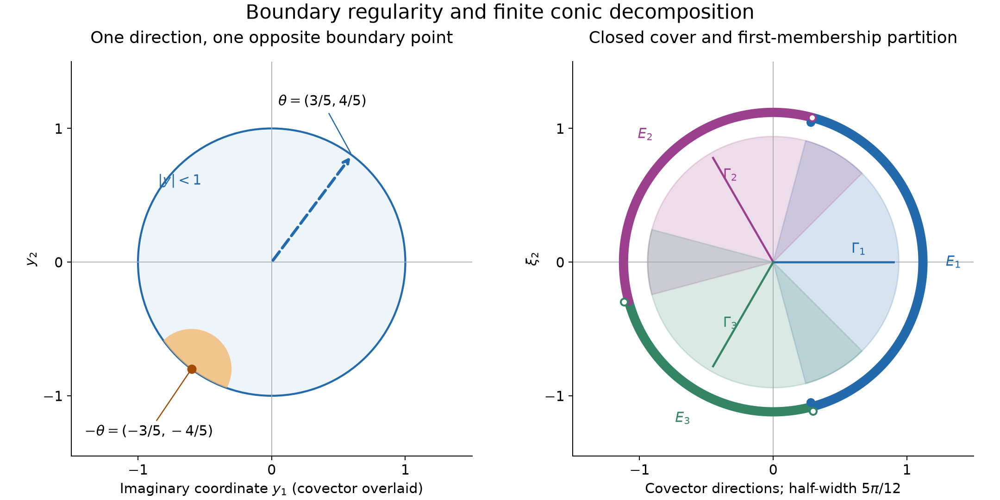

# Boundary regularity and conic decomposition

*Written by GPT-6 Astra (OpenAI), October 2026. Public domain (CC0).*

A singular covector can be read at one point on the boundary of a complex tube. This lesson proves the exact correspondence: Fourier regularity in the direction \(\theta\) is equivalent to derivative bounds near the boundary point \(x-i\theta\). The correspondence works for smooth, analytic and all the derivative-growth classes considered here. It then gives a decomposition subordinate to any finite closed conic cover, together with the precise ambiguity on cone intersections.

The main inputs are [Derivative growth and finite-order localization](derivative-growth-and-finite-order-localization.md), Lemmas 1 and 5 and Proposition 3; [Cones and derivative-growth wavefronts](cones-and-derivative-growth-wavefronts.md), the definition and Theorems 3, 5–7; [Holomorphic decompositions of tempered distributions](holomorphic-decompositions-of-tempered-distributions.md), Lemma 1, Theorems 3–5 and Proposition 6; and [Continuing the spherical kernel](continuing-the-spherical-kernel.md), Corollary 8 and its uniform analytic remainder. The [Schwartz and Fourier foundation](../prerequisites/U011-free-foundations/schwartz-fourier-foundations-U017.md), F1–F5, supplies Fourier inversion and pairings. Integral Taylor remainders are proved in [When a kernel is smooth](when-a-kernel-is-smooth.md#taylor-estimates-on-compact-neighborhoods), and polydisk Cauchy bounds in [Holomorphic boundaries in convex cones](holomorphic-boundaries-in-convex-cones.md). The integration foundation, [Sections 15–16](../prerequisites/U011-free-foundations/banach-foundation-bridges.md), supplies the finite measures and limiting operations below.

## The tube and its two notions of boundary regularity

Use \(\widehat f(\xi)=\int e^{-ix\cdot\xi}f(x)\,dx\), with inverse factor \((2\pi)^{-n}\), and complex-linear distribution pairings. Let \(n\ge1\), let \(S^{n-1}\) have its ordinary surface measure \(\sigma\) (two unit masses for \(n=1\)), and put

\[
 T=\{x+iy:|y|<1\},\qquad
 I(\xi)=\int_{S^{n-1}}e^{-\omega\cdot\xi}\,d\sigma(\omega),
 \qquad a=\frac{n-1}{2}.
 \tag{1}
\]

For \(u\in\mathcal S'(\mathbb R^n)\) its spherical representation is

\[
 U(z)=(2\pi)^{-n}\widehat u\left(\frac{e^{iz\cdot\xi}}{I(\xi)}\right),
 \qquad z\in T.
 \tag{2}
\]

The earlier representation theorem proves holomorphy, polynomial growth in \(x\) and \((1-|y|)^{-1}\), continuous distributional boundary values \(B_\omega=U(\,\cdot+i\omega)\), and

\[
 u=\int_{S^{n-1}}B_\omega\,d\sigma(\omega).
 \tag{3}
\]

These integrals are pairings against each Schwartz test; the boundary family has a common finite Schwartz-seminorm bound.

Fix an admissible scale \(L\): \(L_0=1\), \(k\le L_k\), \(L_k\) is nondecreasing and \(L_{k+1}\le QL_k\). Say that \(U\) is **\(L\)-regular at \(p\in\partial T\)** if a complex ball \(D(p,r)\) and constants \(A,B\ge1\) satisfy

\[
 |\partial_x^\alpha U(z)|\le A(BL_k)^k,
 \qquad k=|\alpha|,\quad z\in D(p,r)\cap T.
 \tag{4}
\]

Degree zero means a bound by \(A\). Say that it is **smooth at \(p\)** if one ball works for bounds \(|\partial_x^\alpha U|\le C_\alpha\) for every \(\alpha\). The constants may depend arbitrarily on \(\alpha\), but the ball must not shrink with \(\alpha\). Holomorphy makes these also bounds for all real and imaginary derivatives, since \(\partial_{y_j}U=i\partial_{x_j}U\).

## Fourier bounds become boundary bounds

**Theorem 1.** For \(u\in\mathcal S'\), \(x_0\in\mathbb R^n\), \(\theta\in S^{n-1}\), and every admissible \(L\),

\[
 (x_0,\theta)\notin\operatorname{WF}_L(u)
 \quad\Longrightarrow\quad
 U\text{ is }L\text{-regular at }x_0-i\theta.
 \tag{5}
\]

The analogous implication holds for the ordinary smooth wavefront and smooth boundary regularity.

**Proof for \(L\).** The definition gives compact distributions \(u_N\), all equal to \(u\) on a ball \(B(x_0,r)\), with one compact support and one finite-order bound. There are an open cone \(\Gamma\) about \(\theta\), constants \(C,B\ge1\), and an integer \(M\ge0\), such that

\[
 |\widehat u_N(\xi)|\le C(1+|\xi|)^M\quad(\xi\in\mathbb R^n),
 \qquad
 |\widehat u_N(\xi)|\le C(BL_N/|\xi|)^N\quad(\xi\in\Gamma).
 \tag{6}
\]

Set \(v_N=u-u_N\). The finite-order bound and compact support imply a common finite Schwartz-seminorm bound for \(u_N\); adding the fixed bound for \(u\) gives one for \(v_N\). Every \(v_N\) vanishes on \(B(x_0,r)\). The uniform off-support theorem, Corollary 8 of the preceding lesson, therefore extends the representations \(V_N\) of \(v_N\) holomorphically to one full neighborhood of \(p=x_0-i\theta\), with common bounds on smaller compact sets. Polydisk Cauchy on a fixed smaller ball gives

\[
 |\partial_x^\alpha V_N(z)|\le C_0 H^k k!
                 \le C_0H^k L_k^k
 \quad(k=|\alpha|),
 \tag{7}
\]

uniformly in \(N\); for \(k=0\) read both rightmost factors as one. The last inequality uses \(k!\le k^k\le L_k^k\).

The representation of \(u_N\) is the ordinary absolutely convergent integral

\[
 U_N(x+iy)=(2\pi)^{-n}\int
       e^{ix\cdot\xi-y\cdot\xi}\frac{\widehat u_N(\xi)}{I(\xi)}\,d\xi.
 \tag{8}
\]

Indeed the Fourier transform of a compact distribution is its smooth polynomially bounded transform, by F5. On compact subsets of \(T\), the reciprocal estimate \(I(\xi)^{-1}\le C(1+|\xi|)^a e^{-|\xi|}\) makes every differentiated integrand integrable. Thus differentiation and (2) give \(U=U_N+V_N\) and

\[
 |\partial_x^\alpha U_N(x+iy)|
 \le C\int e^{-|\xi|-y\cdot\xi}
        |\xi|^k(1+|\xi|)^a|\widehat u_N(\xi)|\,d\xi.
 \tag{9}
\]

Because \(\theta\) is an interior direction of \(\Gamma\), compactness of the complementary unit directions gives \(\delta>0\) such that \(\theta\cdot\xi\le(1-2\delta)|\xi|\) outside \(\Gamma\). For \(|y+\theta|<\delta\),

\[
 -|\xi|-y\cdot\xi\le-\delta|\xi|
                  \quad(\xi\notin\Gamma).
 \tag{10}
\]

If the complementary directions are empty there is no such integral. Otherwise choose an integer \(b\ge M+a\). Polar integration bounds the complementary part of (9) by
\(C\int_0^\infty e^{-\delta t}t^{k+n-1}(1+t)^b\,dt\).
Expanding the integer power and integrating by parts gives a sum of
\((k+n+j-1)!\delta^{-k-n-j}\), \(0\le j\le b\). Each is at most \(C_1D^k L_k^k\): for a fixed integer \(h\ge n+b\), use
\((k+h)!\le(k+h)^{k+h}\le L_{k+h}^{k+h}\), then the fixed-shift Lemma 1 of the growth lesson. All constants are independent of \(N,k,x,y\).

Inside \(\Gamma\), \(|y|<1\) gives \(e^{-|\xi|-y\cdot\xi}\le1\). Choose once and for all an integer

\[
 d>M+a+n+1,\qquad N=k+d.
 \tag{11}
\]

On \(|\xi|\le L_N\), the first bound in (6), polar integration and \(L_N\ge1\) give

\[
 C\int_0^{L_N}t^{k+n-1}(1+t)^{M+a}\,dt
       \le C_2 L_N^{k+M+a+n}\le C_2 L_N^N.
 \tag{12}
\]

On \(|\xi|>L_N\), the second bound in (6) gives

\[
 \begin{aligned}
 C_3 B^N L_N^N\int_{L_N}^\infty t^{k+a+n-1-N}\,dt
 &=\frac{C_3 B^N}{d-a-n}L_N^{k+a+n}\\
 &\le C_4 B^N L_N^N.
 \end{aligned}
 \tag{13}
\]

The denominator is positive and fixed. The fixed-shift lemma gives
\(B^{k+d}L_{k+d}^{k+d}\le C_5D_1^kL_k^k\), including \(k=0\). Combining (7), (9)–(13) proves (4) on one sufficiently small ball about \(p\). Although the auxiliary \(U_N\) depends on \(k\), their sum with \(V_N\) is always the same function \(U\). This is why choosing \(N=k+d\) is legitimate. \(\square\)

**Proof for smooth regularity.** Take one compact smooth cutoff \(\chi=1\) near \(x_0\) such that \(\widehat{\chi u}\) decreases faster than every inverse power on a fixed \(\Gamma\). Write \(u=\chi u+(u-\chi u)\). The second representation is holomorphic on a full neighborhood of \(p\), by the same off-support theorem. In (9) use the polynomial bound of the one compact distribution outside \(\Gamma\), where (10) applies. For a derivative of order \(k\), choose a decay power \(q>k+a+n\) inside \(\Gamma\); the integral of \(t^{k+n-1}(1+t)^{a-q}\) is finite. The real and angular neighborhoods used here are independent of \(k\). This gives all the fixed-order bounds required for smooth boundary regularity. No estimate uniform in \(k\) is asserted in this case. \(\square\)

## Reading a singularity from one boundary point

For a finite complex Borel measure \(\mu\) on the sphere, let

\[
 u_\mu=\int B_\omega\,d\mu(\omega),\qquad E=\operatorname{supp}\mu.
 \tag{14}
\]

This is a tempered distribution by the common boundary seminorm bound. The earlier angular theorem and Proposition 6 already prove

\[
 \operatorname{WF}_L(u_\mu)\subset
 \{(x,\xi): -\xi/|\xi|\in E,
       \ U\text{ is not }L\text{-regular at }x-i\xi/|\xi|\}.
 \tag{15}
\]

**Lemma 2 (smooth angular bound).** Replacing \(L\)-regular by smooth in (15) gives the same inclusion for \(\operatorname{WF}(u_\mu)\).

**Proof.** If \(-\xi/|\xi|\notin E\), the earlier analytic angular bound excludes \((x,\xi)\) from \(\operatorname{WF}_A(u_\mu)\), hence from \(\operatorname{WF}(u_\mu)\) by the proved class comparison.

Suppose instead that \(U\) is smooth at \(x_0+i\omega_0\), where \(\omega_0=-\xi/|\xi|\). Take a smaller ball inside the ball of all-order bounds. Its intersection with \(T\) is convex. The bound on derivatives of order \(|\alpha|+1\), together with the Cauchy–Riemann equations, makes \(\partial_x^\alpha U\) Lipschitz there. Its values therefore extend uniquely and continuously to the closure: interior approximations are Cauchy by that bound, and any two approximations have the same limit. Each derivative retains its original bound. For real \(x\) near \(x_0\) and \(\omega\) in a small closed spherical cap about \(\omega_0\), denote the extended value of \(U(x+i\omega)\) by \(b_\omega(x)\).

At height \(r\omega\), \(r<1\), apply the fundamental theorem along a small real coordinate segment. Passing to \(r\uparrow1\) uniformly on that segment gives the same identity with the extended first derivative. Repeating for every \(\alpha\) proves that \(b_\omega\) is smooth with these derivatives and their common bounds. Uniform convergence on compact real sets identifies this function with the distributional boundary \(B_\omega\) there. Choose an open cap \(O\) about \(\omega_0\) whose closure is such a cap. Split \(\mu=1_O\mu+1_{S^{n-1}\setminus O}\mu\). Dominated convergence against the finite total variation measure makes the first contribution smooth near \(x_0\). The second measure's support avoids \(\omega_0\), so its contribution is analytically regular in the direction \(\xi\).

For completeness, the smooth sum rule needed in this last step follows directly from the Fourier cutoff argument already used in the conic lesson. If \(v,w\) are both smooth-wavefront regular at \((x_0,\xi)\), select their two compact cutoff witnesses and a new cutoff supported where both original cutoffs are one. Multiplication preserves rapid decay on a smaller cone by the convolution estimate: for compact \(f\),

\[
 \widehat{bf}(\zeta)=(2\pi)^{-n}
       \int\widehat b(\zeta-\eta)\widehat f(\eta)\,d\eta.
 \tag{16}
\]

On the cone of rapid decay, distribute any output weight using
\(1+|\zeta|\le(1+|\zeta-\eta|)(1+|\eta|)\) and take both decay exponents greater than the output exponent plus \(n+1\). Off that cone, separated unit directions give \(|\zeta-\eta|\ge c(|\zeta|+|\eta|)\); a cutoff decay exponent greater than the output exponent plus the polynomial order of \(\widehat f\) plus \(n+1\) is integrable. Formula (16) follows by Fourier inversion of the test in the compact distribution's finite-order norm. This proves the claimed preservation and makes the sum of the two new transforms rapidly decreasing. A smooth function has no smooth wavefront because its compact cutoff has rapidly decreasing transform. The analytic-to-smooth inclusion proved in the conic lesson applies to the other summand. Thus the two contributions above have no smooth wavefront at \((x_0,\xi)\), proving the lemma. \(\square\)

**Theorem 3 (exact boundary characterization).** For all \(u\in\mathcal S'(\mathbb R^n)\) and admissible \(L\),

\[
 \begin{aligned}
 \operatorname{WF}_L(u)\cap(\mathbb R^n\times S^{n-1})
   &=\{(x,\theta):U\text{ is not }L\text{-regular at }x-i\theta\},\\
 \operatorname{WF}(u)\cap(\mathbb R^n\times S^{n-1})
   &=\{(x,\theta):U\text{ is not smooth at }x-i\theta\}.
 \end{aligned}
 \tag{17}
\]

For \(\operatorname{WF}_A\), absence of the covector is equivalent to holomorphic continuation of \(U\) to a full complex neighborhood of \(x-i\theta\).

**Proof.** Theorem 1 proves the forward regularity implications. In (15) take \(\mu=\sigma\) and use the exact average (3); this proves the reverse implication for every \(L\). Lemma 2 with the same average proves the reverse implication for smooth regularity.

It remains to justify the analytic continuation statement. For \(L_k=k+1\), the factorial comparison in Proposition 3 of the growth lesson converts (4) to

\[
 |\partial_x^\alpha U(z)|\le A H^k k!,\qquad k=|\alpha|,
 \tag{18}
\]

on one ball intersected with \(T\). The preceding Lipschitz argument extends every derivative continuously to the boundary point \(p\). Form the series

\[
 F(p+h)=\sum_{\alpha\ge0}
       \frac{\partial_x^\alpha U(p)}{\alpha!}h^\alpha.
 \tag{19}
\]

The sum of absolute values at degree \(k\) is at most \(A(H|h|_1)^k\), by the multinomial identity. Consequently (19) converges normally when \(H|h|_1<1\), defines a holomorphic function there, and may be differentiated termwise on smaller polydisks. To see the last assertion without a convergence shortcut, a derivative of fixed multi-order introduces at most a fixed power of the degree and a fixed power of the inverse smaller radius; a geometric series times that degree power converges.

Choose interior points \(p_j\to p\). For any fixed \(z\in T\) sufficiently close to \(p\), the segment from \(p_j\) to \(z\) lies in the original ball intersected with \(T\) for all large \(j\), by convexity. Apply the integral Taylor formula along this complex segment, using holomorphy to identify its derivatives. The remainder after degrees below \(m\) is bounded by
\(A(H|z-p_j|_1)^m\), exactly as in the real Taylor estimate. Shrink the neighborhood of \(p\) so that this ratio is less than a fixed number below one for all large \(j\). First let \(j\to\infty\) in the finite Taylor polynomial and its remainder bound, and then let \(m\to\infty\). This proves \(F(z)=U(z)\) throughout the intersection with a smaller neighborhood. Thus (19) is the required extension. Conversely a holomorphic extension is bounded on a compact polydisk about \(p\); the proved Cauchy derivative estimate on a smaller polydisk gives \(C H^k\alpha!\le C H^k k!\le C H^k(k+1)^k\). This is (4) and completes both directions. \(\square\)

## Splitting directions with closed cones

Write \(\mathcal W\) for any one of \(\operatorname{WF}\) or \(\operatorname{WF}_L\), including \(\operatorname{WF}_A\). The same operators below work simultaneously for all these choices.

**Theorem 4 (finite conic decomposition).** Suppose \(\Gamma_1,\ldots,\Gamma_m\) are closed cones in \(\mathbb R^n\setminus\{0\}\) whose union is the whole punctured space. There are linear maps \(P_j:\mathcal S'\to\mathcal S'\), depending only on the ordered cover, such that

\[
 \sum_{j=1}^m P_j u=u,\qquad
 \mathcal W(P_j u)\subset
       \mathcal W(u)\cap(\mathbb R^n\times\Gamma_j).
 \tag{20}
\]

**Proof.** Put \(F_j=\Gamma_j\cap S^{n-1}\). Define the disjoint Borel pieces

\[
 E_1=F_1,\qquad E_j=F_j\setminus\bigcup_{\ell<j}F_\ell,
 \qquad
 P_j u=\int_{E_j}U(\,\cdot-i\omega)\,d\sigma(\omega).
 \tag{21}
\]

They partition the sphere, and \(\overline E_j\subset F_j\) because \(F_j\) is closed. Reflection preserves surface measure, so (3) proves the sum in (20) with no extra normalization. Common boundary seminorm bounds prove that each term is tempered; linearity follows from (2) and pairingwise integration.

Apply (15), or Lemma 2, to the pushforward of \(1_{E_j}\sigma\) under reflection \(\omega\mapsto-\omega\). Its support is contained in \(-F_j\), so every possible wavefront covector of \(P_j u\) lies in \(\Gamma_j\). If \((x,\xi)\notin\mathcal W(u)\), Theorem 3 says that the original common \(U\) has the appropriate boundary regularity at \(x-i\xi/|\xi|\). The same angular bound excludes that pair from \(\mathcal W(P_j u)\). These are the two inclusions in (20). The proof never discards partition boundaries or supposes they have measure zero. \(\square\)

**Theorem 5 (ambiguity lives on intersections).** Suppose \(u=\sum_j u_j=\sum_j\widetilde u_j\), with all terms tempered and
\(\mathcal W(u_j),\mathcal W(\widetilde u_j)\subset\mathcal W(u)\cap(\mathbb R^n\times\Gamma_j)\).
Then there are tempered \(e_{jk}\) such that

\[
 \begin{gathered}
 e_{jk}=-e_{kj},\qquad
 \widetilde u_j=u_j+\sum_k e_{jk},\\
 \mathcal W(e_{jk})\subset\mathcal W(u)\cap
             (\mathbb R^n\times(\Gamma_j\cap\Gamma_k)).
 \end{gathered}
 \tag{22}
\]

**Proof.** Let \(d_j=\widetilde u_j-u_j\), so \(\sum_jd_j=0\). The finite-sum wavefront rule (Theorem 7 of the conic lesson for \(L\), and the proof of Lemma 2 for smooth wavefront) gives \(\mathcal W(d_j)\subset\mathcal W(u)\cap(\mathbb R^n\times\Gamma_j)\). Set

\[
 e_{jk}=P_kd_j-P_jd_k.
 \tag{23}
\]

This is antisymmetric, and linearity together with (20) gives
\(\sum_ke_{jk}=d_j-P_j(\sum_kd_k)=d_j\).
Both terms of (23) have wavefront in the intersection in (22), by (20) applied separately to \(d_j\) and \(d_k\). Their difference has the same bound by the finite-sum rule. \(\square\)

*Left: in two dimensions \(\theta=(3/5,4/5)\) is a unit covector and the corresponding imaginary boundary point is \(-\theta\). The orange cap is a schematic neighborhood of that boundary point, intersected with the open imaginary unit disk; actual regularity also requires a real neighborhood and all the bounds in (4). Right: the three closed sectors are centered at angles \(0,2\pi/3,4\pi/3\), each with angular half-width \(5\pi/12\). Their union covers the circle. The outer ring colors each direction by its first containing sector, exactly the rule (21); filled and hollow endpoint markers indicate assigned and excluded endpoints. The center ray of each sector is shown. The decomposition acts on covectors through these sets and uses the reflected imaginary boundary. Theorems 3–5 give the mathematical conclusions. [Editable figure source](../figures/boundary-cone-partition.py).*

## Examples and exercises with complete solutions

**Exercise 1 — the sign and the normalization (foundation).** In dimension one take \(\Gamma_1=(0,\infty)\), \(\Gamma_2=(-\infty,0)\). Compute the two Fourier multipliers in (21). Apply them to the constant function.

**Solution.** Here \(I(\xi)=2\cosh\xi\), and each sphere point has mass one. Positive covectors use the bottom boundary. Consequently

\[
 \widehat{P_1u}=\frac{1}{1+e^{-2\xi}}\widehat u,
 \qquad
 \widehat{P_2u}=\frac{1}{1+e^{2\xi}}\widehat u.
 \tag{24}
\]

These multipliers are smooth with polynomially bounded derivatives, as already proved for the boundary multipliers. Their sum is one. The transform of \(1\) is \(2\pi\delta_0\), so each gives the constant \(1/2\). The total is one, even though the zero frequency belongs to neither cone: the cones constrain singular directions, not the support of these multipliers. \(\square\)

**Exercise 2 — conic pieces are not projections (intermediate).** For the preceding one-dimensional splitting, prove that \(P_1^2\ne P_1\). Show nevertheless that every \(P_j^2u-P_ju\) has wavefront in \(\Gamma_1\cap\Gamma_2\), for every regularity choice \(\mathcal W\), and interpret the conclusion.

**Solution.** Apply \(P_1\) twice to \(1\): the answers are \(1/4\) and \(1/2\). Thus idempotence fails. Since \(P_1+P_2=\mathrm{Id}\),
\(P_1^2-P_1=-P_1P_2\) and \(P_2^2-P_2=-P_2P_1\). Theorem 4 twice places each output wavefront in both cones. Their intersection is empty, so the outputs have empty analytic wavefront. The projection theorem for \(\operatorname{WF}_A\) in the conic lesson makes them real analytic everywhere. This assertion does not say that they vanish or are entire functions. \(\square\)

**Exercise 3 — changing the ordering (intermediate).** Order the same finite closed cover in two different ways and form the decompositions of Theorem 4. Prove that the resulting difference in each term is accounted for by intersections, even if the cone boundaries have positive surface measure. If all intersections involving \(\Gamma_j\) are empty, what can change in its component?

**Solution.** Relabel the second decomposition by the original cone names. Both decompositions satisfy (20). Theorem 5 supplies antisymmetric differences \(e_{jk}\) obeying (22); its proof uses Borel restrictions and support inclusions, with no null-boundary assumption. If every \(\Gamma_j\cap\Gamma_k\) for \(k\ne j\) is empty, apply the theorem for \(\mathcal W=\operatorname{WF}_A\). Every \(e_{jk}\) is real analytic by the projection theorem, and \(e_{jj}=0\); hence the component changes at most by a real analytic function. For this particular first-membership construction an entirely disjoint cone actually has the same assigned sphere piece in either ordering, so its component does not change at all. The analytic conclusion also holds for arbitrary decompositions satisfying the same analytic wavefront bounds. \(\square\)

**Exercise 4 — a point source has every direction (advanced).** Prove directly that \(\operatorname{WF}(\delta_0)=\{0\}\times(\mathbb R^n\setminus\{0\})\), and deduce the corresponding statement for every \(\operatorname{WF}_L\). Describe what this says about the boundary regularity of \(K\), the tube function of \(\delta_0\).

**Solution.** At a nonzero base point choose a cutoff supported away from the origin; its product with \(\delta_0\) is zero, giving witnesses in every class. At the origin any cutoff equal to one nearby leaves \(\delta_0\) unchanged. Its Fourier transform is the constant one, which is not rapidly decreasing along any nonempty frequency cone. This proves the smooth assertion. The class sandwich \(\operatorname{WF}\subset\operatorname{WF}_L\subset\operatorname{WF}_A\), together with the zero witnesses away from the origin, gives the same exact set for every \(L\). By Theorem 3 the kernel is not smooth at any \(-i\theta\), and is not \(L\)-regular there for any admissible \(L\). At \(x-i\theta\) with \(x\ne0\), it extends holomorphically to a full neighborhood. This latter statement also follows from the off-support theorem applied to \(\delta_0\) and a small ball about \(x\). \(\square\)

**Exercise 5 — local distributions and a canonical regularity test (advanced).** Let \(u\in\mathcal D'(X)\), where \(X\) is any open subset of \(\mathbb R^n\), and let \(x_0\in X\). Choose \(\chi\in C_c^\infty(X)\) equal to one near \(x_0\), extend \(\chi u\) by zero, and form its tube function. Show that Theorem 3 tests the wavefront of \(u\) at \(x_0\), independently of \(\chi\).

**Solution.** The compact distribution \(\chi u\) is tempered by its finite-order bound. Near \(x_0\) it agrees with \(u\). The definition of \(L\)-regularity is unchanged on restricting to a smaller neighborhood: a witness equal to one distribution there is a witness for the other. Compact supports can be placed inside that neighborhood using the controlled localization Theorem 3 of the conic lesson. This proves the local equality of their \(L\)-wavefront sets. The smooth version follows from the cutoff transfer (16). Thus Theorem 3 applies to the original local wavefront. If \(\chi_1,\chi_2\) are two choices, their compactly supported difference \((\chi_1-\chi_2)u\) vanishes on a fixed neighborhood of \(x_0\). Its tube function extends holomorphically near every \(x_0-i\theta\), by the off-support theorem. Adding this function preserves (4), smooth bounds, and existence of holomorphic extension in both directions, after shrinking the neighborhood. This also proves independence directly at the boundary. No global extension of \(u\) and no identification of \(X\) with Euclidean space is required. \(\square\)

## References

- The earlier programme proofs linked above supply the exact Fourier conventions, controlled cutoffs, class comparisons, spherical representation, uniform off-support continuation and Cauchy estimates. The frequency split, smooth endpoint, boundary Taylor extension, decomposition and ambiguity are proved in this lesson.
- Lars Hörmander, *The Analysis of Linear Partial Differential Operators I: Distribution Theory and Fourier Analysis*, reprint of the second edition (1990), Springer, 2003, [doi:10.1007/978-3-642-61497-2](https://doi.org/10.1007/978-3-642-61497-2), Section 8.4, Theorem 8.4.11, Lemma 8.4.12 and Corollary 8.4.13. These give the boundary characterization and conic decomposition targets. The exposition, detailed estimates, figure and exercises here are independently organized and expressed.
