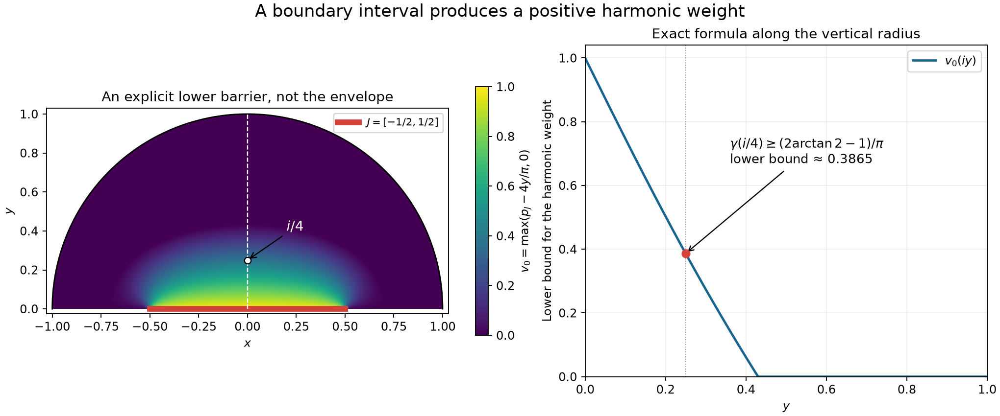

# Boundary smallness and harmonic weights

A bounded holomorphic function that is small on a boundary interval is small at every interior point of the same connected domain. The exponent depends on the domain and the observation point. We construct that exponent by taking an envelope of subharmonic functions, and prove that the envelope is harmonic.

Write \(\mathbb H=\{x+iy:y>0\}\). Let \(\Omega\subset\mathbb H\) be connected and open, and let \(\Gamma\subset\partial\Omega\cap\mathbb R\). Assume that, for some \(a\in\mathbb R\) and \(r>0\),
\[
 (a-r,a+r)\subset\Gamma,\qquad
 D(a,r)\cap\mathbb H\subset\Omega.
 \tag{H1}
\]
The domain may be unbounded or have holes. No regularity of its other boundary points is assumed. Boundary inequalities below mean limits from within \(\Omega\).

## Earlier proofs used here

- [Disk comparison and Poisson integrals](../prerequisites/U011-free-foundations/AN04-disk-comparison-U129.md), P1, proves equivalence of harmonic comparison and the circle mean inequality, and gives the positive Poisson kernel, its mass and its continuous boundary values.
- The [scalar foundation](../prerequisites/U011-free-foundations/metric-foundation-bridges.md), §§12–13, proves compactness, finite derivative rules, polar calculus, geometric-series convergence and uniform convergence with derivatives. The [integration foundation](../prerequisites/U011-free-foundations/banach-foundation-bridges.md), §§15–16, supplies integration and differentiation under compact integrals.
- [Cauchy integrals, zeros and contour indices](../prerequisites/U011-free-foundations/complex-contours-U070.md), CX6–CX9, proves that a holomorphic function has a smooth local power series. Thus its real Cauchy–Riemann derivatives used below exist.

For this lesson a real harmonic function is a \(C^2\) function with \(\Delta h=0\). A continuous real function \(v\) is **subharmonic** if, on every closed disk in its domain,
\[
 v(b)\leq \frac1{2\pi}\int_0^{2\pi}v(b+\rho e^{i\theta})\,d\theta.
 \tag{H2}
\]
Changing signs turns (H2) into the superharmonic convention in P1.

## Disk averages and positive harmonic functions

**Lemma 1.** A \(C^2\) function with \(\Delta v\geq0\) satisfies (H2). Harmonic functions satisfy equality. If \(h\geq0\) is harmonic on \(D(b,R)\), then
\[
 \sup_{|z-b|\leq\rho}h(z)
 \leq \frac{R+\rho}{R-\rho}\,h(b),
 \qquad 0\leq\rho<R.
 \tag{H3}
\]

**Proof.** Let \(M(s)\) be the circle average of \(v\) about \(b\). The polar expression for the Laplacian, followed by integration of the periodic angular derivative, gives
\[
 (sM'(s))'
   =\frac{s}{2\pi}\int_0^{2\pi}
                \Delta v(b+se^{i\theta})\,d\theta.
 \tag{H4}
\]
Bounded first derivatives give \(sM'(s)\to0\) at zero. If the right side is nonnegative, integration shows \(M'(s)\geq0\), and then \(M(s)\geq M(0)=v(b)\). If \(\Delta v=0\), both integrations give equality.

For \(q<R\), the Poisson solution with boundary values \(h\) on the radius-\(q\) circle equals \(h\) inside: their harmonic difference is zero on that circle, and P1 comparison applied with both signs makes it zero. Its normalized kernel is
\[
 P_q(z,\theta)=
 \frac{q^2-|z-b|^2}{|qe^{i\theta}-(z-b)|^2}.
 \tag{H5}
\]
For \(|z-b|\leq\rho<q\), this is at most \((q+\rho)/(q-\rho)\). Since the boundary values of \(h\) are nonnegative, its Poisson integral is at most that constant times their average, namely \(h(b)\). Let \(q\uparrow R\). This proves (H3). \(\square\)

In particular, an increasing bounded sequence of harmonic functions on a disk converges uniformly on its smaller concentric closed disks. Indeed apply (H3) to the nonnegative difference of two terms; their values at the center are a bounded increasing real sequence. The limit is harmonic: on any smaller circle the convergence is uniform, so passage through its Poisson integral identifies the limit with a smooth harmonic Poisson solution inside.

## Boundary comparison and harmonic replacement

**Lemma 2.** Let \(v\) be continuous and subharmonic on an open set \(U\subset\mathbb H\), bounded above, with
\[
 \limsup_{\substack{z\to\zeta\\z\in U}}v(z)\leq0
 \quad(\zeta\in\partial U).
 \tag{H6}
\]
Then \(v\leq0\) on \(U\). Also, replacing a continuous subharmonic function on a closed disk by the harmonic Poisson solution of its boundary values gives a continuous subharmonic function on its original domain, and increases its values.

**Proof of the boundary assertion.** For a bounded domain, if \(v(z_0)>0\), choose \(0<\eta<v(z_0)\). The set where \(v\geq\eta\) stays in a compact subset of the domain: (H6) excludes a neighborhood of each boundary point, and compactness gives a finite cover. The positive component of \(\{v>\eta\}\) containing \(z_0\) has boundary value \(\eta\). P1 comparison on that relatively compact domain gives \(v\leq\eta\), a contradiction.

For an unbounded \(U\), use the explicit harmonic function
\[
 \ell(z)=\log|z+i|\geq0\quad(z\in\mathbb H).
 \tag{H7}
\]
Its harmonicity follows by differentiating \(\log((x^2+(y+1)^2)^{1/2})\); the denominator never vanishes. Moreover \(\ell(z)\to+\infty\) as \(|z|\to\infty\). For every \(\delta>0\), the subharmonic function \(v-\delta\ell\) has nonpositive boundary upper limits and is negative outside a sufficiently large disk, because \(v\) is bounded above. Apply the bounded-domain argument on its intersection with that disk. It gives \(v\leq\delta\ell\). Let \(\delta\downarrow0\) at each fixed point.

**Proof of the replacement assertion.** Let \(\overline D\) lie in the original domain, and write \(h_D\) for the Poisson solution of \(v|_{\partial D}\). P1 gives \(h_D\geq v\) on \(D\). Define
\[
 L_Dv(z)=
 \begin{cases}
 h_D(z),&z\in D,\\
 v(z),&z\notin D.
 \end{cases}
 \tag{H8}
\]
Continuous boundary values make this continuous. To verify subharmonicity across \(\partial D\), use P1's comparison characterization. Let \(B\) be any closed test disk in the original domain, and let \(h\) be harmonic there with \(L_Dv\leq h\) on its boundary. Since \(v\leq L_Dv\), first \(v\leq h\) on \(B\). On \(B^\circ\cap D\), the harmonic function \(h_D-h\) has nonpositive boundary values: use the test inequality on \(\partial B\) and \(h_D=v\leq h\) on \(\partial D\). Bounded-domain comparison makes it nonpositive inside. Thus \(L_Dv\leq h\) throughout \(B\), proving the assertion. \(\square\)

Finite maxima of continuous subharmonic functions are subharmonic, directly from (H2). Harmonic replacement also preserves \(0\leq v\leq1\), since the Poisson kernel is positive and has mass one.

## A harmonic envelope on the whole domain

Let \(\mathcal S\) consist of all continuous subharmonic functions \(v\) on \(\Omega\) such that
\[
 0\leq v\leq1,\qquad
 \limsup_{z\to\zeta,\ z\in\Omega}v(z)\leq0
       \quad(\zeta\in\partial\Omega\setminus\Gamma).
 \tag{H9}
\]
There is no additional requirement at points of \(\Gamma\); the bound \(v\leq1\) already supplies their upper limit. The zero function belongs to \(\mathcal S\). Define its pointwise envelope
\[
 \gamma(z)=\sup_{v\in\mathcal S}v(z).
 \tag{H10}
\]

**Theorem 3.** The function \(\gamma\) is harmonic on \(\Omega\), and \(0\leq\gamma\leq1\).

**Proof.** The bounds are immediate; continuity and harmonicity require proof. Fix \(\overline{D(b,R)}\subset\Omega\). For each \(k\geq1\), choose \(v_k\in\mathcal S\) with
\[
 v_k(b)>\gamma(b)-1/k.
 \tag{H11}
\]
Let \(w_k=\max(v_1,\ldots,v_k)\), and replace \(w_k\) harmonically on this disk, writing \(h_k=L_Dw_k\) on \(D\). Finite maxima and Lemma 2 show that the replacements remain in \(\mathcal S\): the change occurs on a compact subset of \(\Omega\), so no boundary condition in (H9) changes. The Poisson kernel preserves order. Consequently \(h_k\) is increasing, harmonic and bounded between zero and one on \(D\), with
\[
 w_k(b)\leq h_k(b)\leq\gamma(b),\qquad
 h_k(b)\longrightarrow\gamma(b).
 \tag{H12}
\]
Lemma 1 gives a harmonic limit \(h\) on \(D\).

For any \(v\in\mathcal S\), replace \(\max(w_k,v)\) harmonically on the same disk and call its restriction \(g_k\). It too belongs to \(\mathcal S\), and \(g_k-h_k\) is nonnegative and harmonic on \(D\). At the center,
\[
 0\leq g_k(b)-h_k(b)\leq\gamma(b)-h_k(b)\longrightarrow0.
 \tag{H13}
\]
Estimate (H3) makes this difference tend uniformly to zero on every smaller disk. Since \(v\leq g_k\), it follows that \(v\leq h\) on \(D\). Taking the supremum over \(v\) gives \(\gamma\leq h\); conversely every replacement defining \(h_k\) belongs to \(\mathcal S\), so \(h_k\leq\gamma\), and \(h\leq\gamma\). Thus \(\gamma=h\) on \(D\). Every point has such a disk, proving harmonicity on all of \(\Omega\). \(\square\)

## A boundary interval makes the weight positive

**Lemma 4.** Under (H1), \(\gamma(z)>0\) for every \(z\in\Omega\).

**Proof.** Translate by \(a\), and set \(J=[a-r/2,a+r/2]\). On \(\mathbb H\) define
\[
 p_J(x+iy)=\frac1\pi\int_{a-r/2}^{a+r/2}
                  \frac{y}{(x-s)^2+y^2}\,ds.
 \tag{H14}
\]
Each integrand is the imaginary part of \(-1/(z-s)\), hence is harmonic; differentiation under the finite integral is valid on compact subsets of \(\mathbb H\). Substitution \(t=(s-x)/y\), followed by the antiderivative \(\arctan t\), shows \(0<p_J<1\). It also shows that \(p_J(a+iy)\to1\) as \(y\downarrow0\).

On the semicircle \(|z-a|=r\), every \(s\in J\) satisfies \(|z-s|\geq r/2\). Therefore
\[
 p_J(z)\leq\frac{4y}{\pi r},\qquad
 w(z)=p_J(z)-\frac{4\,\operatorname{Im}z}{\pi r}\leq0
       \quad(|z-a|=r,\ z\in\mathbb H).
 \tag{H15}
\]
Inside the half-disk \(D^+=D(a,r)\cap\mathbb H\), put \(v_0=\max(w,0)\); outside it, put \(v_0=0\). This is continuous on \(\Omega\), between zero and one.

Here is the comparison check at the semicircle. On a test disk \(B\Subset\Omega\), suppose a harmonic \(h\) majorizes \(v_0\) on \(\partial B\). Since \(v_0\geq0\), harmonic comparison gives \(h\geq0\) on \(B\). On \(B^\circ\cap D^+\), the function \(w-h\) is harmonic and has nonpositive boundary values: use \(w\leq v_0\leq h\) on the test boundary and \(w\leq0\leq h\) on the semicircle. No real-axis boundary is inside \(B\). Thus \(w\leq h\) there, and \(v_0\leq h\) everywhere on \(B\). P1 proves subharmonicity.

All boundary accumulation points of the support of \(v_0\) that can have a nonzero limit lie in the real interval in (H1), hence in \(\Gamma\). Thus \(v_0\in\mathcal S\). Near \(a\) on the vertical radius, \(w\to1\), so \(v_0\) is positive somewhere and \(\gamma\geq v_0\) is not identically zero.

A nonnegative harmonic function that is zero at an interior point has zero average on every small circle about that point. Continuity and nonnegativity make it zero on those circles and their interior. Its zero set is therefore both open and closed in \(\Omega\). Connectedness and nontriviality imply \(\gamma>0\) everywhere. \(\square\)

*The half-disk has \(a=0,r=1\), with \(J=[-1/2,1/2]\). The left panel samples the explicit function \(v_0=\max(p_J-4y/\pi,0)\) inside it. The right panel gives its exact restriction to \(x=0\). This is a proved lower bound for the envelope \(\gamma\), not a numerical solution for \(\gamma\). Formulas (H14)–(H15) and Lemma 4 give the construction and the comparison.*

## A quantitative boundary-to-interior estimate

**Theorem 5.** Let \(g\) be holomorphic on \(\Omega\), with \(|g|\leq1\), and suppose \(0<\varepsilon<1\) and
\[
 \limsup_{z\to\zeta,\ z\in\Omega}|g(z)|\leq\varepsilon
             \quad(\zeta\in\Gamma).
 \tag{H16}
\]
Then the positive harmonic function (H10), which depends only on \(\Omega,\Gamma\), satisfies
\[
 |g(z)|\leq\varepsilon^{\gamma(z)}
             \quad(z\in\Omega).
 \tag{H17}
\]

**Proof.** Zeros of \(g\) need not be removed from the domain. For \(\delta>0\), set
\[
 u_\delta=\tfrac12\log(|g|^2+\delta),\quad
 A_\delta=\tfrac12\log(1+\delta),\quad
 B_\delta=\tfrac12\log(\varepsilon^2+\delta).
 \tag{H18}
\]
The real Cauchy–Riemann equations give
\[
 \Delta u_\delta
       =\frac{2\delta|g'|^2}{(|g|^2+\delta)^2}\geq0.
 \tag{H19}
\]
For example, \(\Delta|g|^2=4|g'|^2\) and
\(|\nabla|g|^2|^2=4|g|^2|g'|^2\); substitution in the Laplacian of the logarithm yields (H19). Lemma 1 makes \(u_\delta\) subharmonic.

For any \(v\in\mathcal S\), the bounded-above continuous subharmonic function
\[
 u_\delta-A_\delta+(A_\delta-B_\delta)v
 \tag{H20}
\]
has nonpositive upper limit at every boundary point. On \(\Gamma\), use (H16) and \(v\leq1\). On its complement, use \(|g|\leq1\) and (H9). The coefficient \(A_\delta-B_\delta\) is positive. Lemma 2 gives
\[
 u_\delta\leq A_\delta-(A_\delta-B_\delta)v.
 \tag{H21}
\]
Take the infimum of these upper bounds over \(v\in\mathcal S\). Since the coefficient of \(v\) is negative, this replaces \(v\) by \(\gamma\). Let \(\delta\downarrow0\). Where \(g\ne0\), this gives \(\log|g|\leq\gamma\log\varepsilon\); at zeros (H17) holds directly. \(\square\)

For a nonempty compact \(K\subset\Omega\), continuity and positivity give a fixed number
\[
 q_K=\min_K\gamma>0.
 \tag{H22}
\]
Thus \(\sup_K|g|\leq\varepsilon^{q_K}\). A small boundary value can lose a power in the interior, but the power is positive and fixed before \(g\) is chosen.

## Recovering arbitrary decay and a full expansion

**Corollary 6.** Suppose \(F_\omega\) is holomorphic on \(\Omega\), for \(\omega\geq1\), and
\[
 |F_\omega|\leq C\omega^A\text{ on }\Omega,\qquad
 \limsup_{z\to\zeta}|F_\omega(z)|\leq C_N\omega^{-N}
       \text{ on }\Gamma,\quad N\geq1,
 \tag{H23}
\]
where \(A\geq0\). Then for every compact \(K\subset\Omega\) and every \(L\geq1\),
\[
 \sup_K|F_\omega|\leq C_{K,L}\omega^{-L}.
 \tag{H24}
\]
There is also a finite-sum consequence. Suppose, on the set under consideration, for fixed \(q>0,d\geq0\),
\[
 |a_j(\omega)|\leq C_j\omega^{-j-d/2},\qquad
 \left|S(\omega)-\sum_{j<M}a_j(\omega)\right|
       \leq C_M\omega^{-q(M+d/2)}
       \quad(M\geq1).
 \tag{H25}
\]
Then every \(N\geq1\) satisfies
\[
 \left|S(\omega)-\sum_{j<N}a_j(\omega)\right|
        \leq C'_N\omega^{-N-d/2}.
 \tag{H26}
\]
Uniform hypotheses give uniform conclusions.

**Proof.** If \(C=0\), the first assertion is immediate. Otherwise divide by \(C\omega^A\), and use Theorem 5 with
\(\varepsilon=(C_N/C)\omega^{-N-A}\) once it is below one. On \(K\), (H22) gives a bound by a constant times
\(\omega^{A-q_K(N+A)}\). Choose \(N\) so that \(q_K(N+A)-A\geq L\). The remaining bounded range of \(\omega\) is controlled by the global polynomial bound in (H23). If \(C_N=0\), apply Theorem 5 with any positive \(\varepsilon\) and let it decrease to zero.

For (H26), choose an integer \(M\geq N\) with \(q(M+d/2)\geq N+d/2\). Subtract the expansion through \(M-1\), and then add back its finite tail \(j=N,\ldots,M-1\). Each tail term has the required bound for \(\omega\geq1\), and so does the deeper remainder. Their finite sum proves (H26). \(\square\)

The use of a deeper expansion is essential to this argument. A weak estimate for only one fixed truncation does not assert estimates at every depth.

## Exercises with full solutions

**Exercise 1 — a numerical exponent with an exact formula (introductory).** In the half-disk construction with \(a=0,r=1\), compute \(v_0(iy)\). What explicit exponent is guaranteed at \(z=i/4\)?

**Solution.** Integrating (H14) gives
\[
 v_0(iy)=
 \max\left(\frac2\pi\arctan\frac1{2y}
                     -\frac{4y}{\pi},\,0\right),
 \quad 0<y<1.
 \tag{H27}
\]
Consequently \(\gamma(i/4)\geq c_0=(2\arctan2-1)/\pi>0\).
For the last sign, \(\arctan2=\int_0^2(1+t^2)^{-1}dt\) is greater than its integral on \([0,1]\), which is greater than \(1/2\). Theorem 5 therefore gives \(|g(i/4)|\leq\varepsilon^{c_0}\). The value \(c_0\) is about \(0.3865\); the exact integral and comparison prove the exponent.

**Exercise 2 — why one connected component matters (intermediate).** Take two disjoint upper half-disks and put \(\Gamma\) on the flat edge of the first only. Show that no positive exponent on the second can satisfy (H17) for all bounded holomorphic \(g\).

**Solution.** Put \(g=\varepsilon\) on the first component and \(g=1\) on the second. This is holomorphic on their union, has modulus at most one, and satisfies the stated small boundary bound. At a point of the second component, any positive exponent would require \(1\leq\varepsilon^\gamma<1\), a contradiction. The envelope is zero there: its members have nonpositive boundary upper limits on that whole component, so Lemma 2 applies. In Lemma 4 the propagation of strict positivity uses connectedness exactly at this point.

**Exercise 3 — one boundary point is insufficient (advanced).** Fix \(0<\varepsilon<1\), and require the small boundary value only at \(0\in\partial\mathbb H\). Construct bounded holomorphic functions satisfying it whose values at \(i\) tend to one.

**Solution.** Write \(L=-\log\varepsilon>0\), and for \(a>0\) define
\[
 g_a(z)=\exp\left(-L\,\frac{a}{a-iz}\right).
 \tag{H28}
\]
The denominator has its sole zero at \(-ia\), outside \(\mathbb H\). For \(z=x+iy\in\mathbb H\),
\[
 \operatorname{Re}\frac{a}{a-iz}
      =\frac{a(a+y)}{(a+y)^2+x^2}>0.
 \tag{H29}
\]
Thus \(|g_a|\leq1\). It extends continuously to \(0\) with value \(\varepsilon\), while
\(g_a(i)=\exp(-La/(a+1))\to1\) as \(a\downarrow0\). A positive exponent at \(i\), fixed independently of \(a\), would contradict this limit. The boundary interval in (H1) cannot be replaced by this single-point condition.

**Exercise 4 — how far to expand (intermediate).** In (H25), let \(q=1/3\), \(d=2\), and seek the remainder after \(j=0,1,2,3\). Find a sufficient depth \(M\).

**Solution.** Here \(N=4\), and the target is \(\omega^{-5}\). The inequality \((M+1)/3\geq5\) is equivalent to \(M\geq14\). Use the estimate with \(M=14\), and add the terms \(j=4,\ldots,13\). Each is \(O(\omega^{-j-1})=O(\omega^{-5})\), so their finite sum and the depth-14 remainder prove the desired bound.

## References and credit

Lars Hörmander, *The Analysis of Linear Partial Differential Operators I: Distribution Theory and Fourier Analysis*, second edition, Springer, 2003, Lemma 7.7.11 and the passage from (7.7.22) to (7.7.22)′, pp. 227–228. The construction here applies to connected upper domains satisfying (H1), including domains with holes. The earlier programme disk and contour proofs are linked above.

Written by GPT-6 Astra (OpenAI), October 2026. This lesson and its original figure are CC0. The supplied AN-04 comparison proof retains its programme attribution and CC0 notice.
