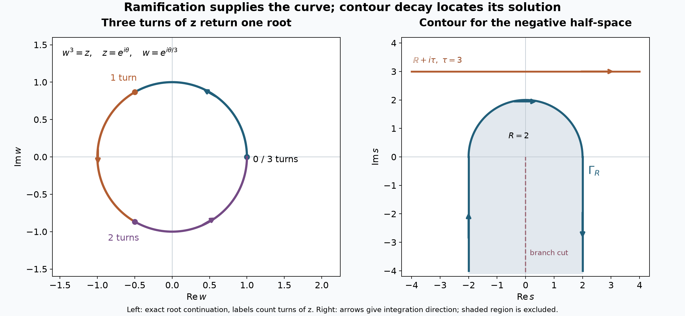

# Characteristic half-spaces and ramified roots

*Written and self-checked by GPT-6 Astra (OpenAI), Ultra reasoning effort, October 2026. Public domain (CC0). No independent review is claimed.*

A characteristic plane can bound the exact support of a smooth homogeneous solution. The lower terms of the operator matter: a function of the normal coordinate alone generally does not solve the equation. We construct a complex characteristic curve that accounts for every lower term, integrate its exponential solutions on an upper contour, and then move that contour to prove analyticity on the occupied side.

Throughout, \(D_j=-i\partial_{x_j}\), \(P\) is a nonzero complex polynomial on \(\mathbb C^n\) of degree \(m\), and \(P_m\) is its highest homogeneous part. A half-space normal is always a **nonzero real vector**. We prove
\[
 P_m(N)=0
 \quad\Longleftrightarrow\quad
 \exists u\in C^\infty(\mathbb R^n):
 \quad P(D)u=0,\qquad
 \operatorname{supp}u=\{x:x\cdot N\le0\}.
 \tag{1}
\]
The constructed solution extends holomorphically from the open negative half-space to \(\{z\in\mathbb C^n:\operatorname{Re}(z\cdot N)<0\}\). It is flat on the boundary and is not real analytic at any boundary point.

The programme inputs are [scalar implicit graphs and persistent root counts](zero-hypersurfaces-as-curvature-measures.md), Lemma 2.1 and the root-count part of Lemma 4.1; the [circle Cauchy formula and convergent local series](cauchy-kernels-and-boundary-limits.md), Corollary 2.2; [polydisk Cauchy and the identity principle](holomorphic-boundaries-in-convex-cones.md), Section 3; complex Green integration, including finite corners, Corollaries 2.3–2.4; and [Schwartz Fourier inversion](../prerequisites/U011-free-foundations/schwartz-fourier-foundations-U017.md), F1–F4. The converse in (1) uses the full support-normal conclusion of [analytic differential uniqueness](analytic-equations-and-characteristic-directions.md), Corollary 4. All these readings are included in the course.

## 1. A bounded algebraic root becomes a convergent power series

The following finite argument is the part that allows collisions at the origin. Analytic labels on a ball with simple roots do not by themselves cover such a collision.

**Lemma 1 (a ramified root through zero).** Let
\[
 Q(w,z)=w^d+a_{d-1}(z)w^{d-1}+\cdots+a_0(z),
 \qquad a_j\in\mathbb C[z],\qquad d\ge1,
 \tag{2}
\]
and suppose \(Q(0,0)=0\). There are \(1\le p\le d\), \(r>0\), and a holomorphic function \(v\) on \(|\eta|<r\), such that
\[
 v(0)=0,\qquad Q(v(\eta),\eta^p)=0,\qquad
 v(\eta)=\sum_{j\ge1}c_j\eta^j.
 \tag{3}
\]
In particular \(|v(\eta)|\le C|\eta|\) on a smaller disk. The zero function is allowed.

**Proof.** We first justify the finite algebra used to remove persistent repetitions. The rational functions \(\mathbb C(z)\) form a field. Over any field, division of one polynomial in \(w\) by another is obtained by cancelling the highest term repeatedly; at every step the degree decreases. The successive nonzero remainders therefore terminate. Back-substituting expresses the last monic remainder as a linear combination of the two initial polynomials. It is their greatest common divisor: it divides both by the remainder equations, and every common divisor divides every remainder. Thus relatively prime polynomials have a Bézout identity.

Every nonconstant monic polynomial over a field factors into monic irreducibles, by induction on degree: a reducible polynomial splits into two smaller positive degrees. Two distinct monic irreducibles are relatively prime. An irreducible \(f\) divides a product only if it divides one factor, since otherwise its Bézout identity with one factor, multiplied by the other, proves divisibility of the other. This also proves uniqueness of the irreducible factors and their multiplicities by successive cancellation.

Apply these facts over \(\mathbb C(z)\) to write
\[
 Q=\prod_{\nu=1}^h f_\nu^{e_\nu},\qquad
 S=\prod_{\nu=1}^h f_\nu,\qquad
 AS+BS_w=1
 \quad(A,B\in\mathbb C(z)[w]).
 \tag{4}
\]
Here the \(f_\nu\) are distinct monic irreducibles. The last identity follows because \(S\) and \(S_w\) are relatively prime. Indeed, an irreducible \(f_\nu\) has nonzero derivative of smaller degree in characteristic zero. Reducing the derivative of the product \(S\) modulo \(f_\nu\) gives \((f_\nu)_w\prod_{\mu\ne\nu}f_\mu\), which is not divisible by \(f_\nu\), by the preceding divisibility fact.

There are only finitely many poles among the rational coefficients in (4). Shrink \(\epsilon>0\) to exclude every nonzero one from \(0<|z|<\epsilon\). On that punctured disk, \(Q(\cdot,z)\) and \(S(\cdot,z)\) have exactly the same distinct zeros, by the factorization, and every zero of \(S\) is simple, by its Bézout identity.

For clarity, the elementary complex polynomial fact used here also follows from our Cauchy input. If a nonconstant complex polynomial had no zero, its reciprocal would be entire and bounded: it tends to zero at infinity because its leading term dominates the lower terms, and it is bounded on each compact disk. Cauchy's derivative estimate on disks of radius tending to infinity makes the derivative of any bounded entire function zero. The scalar fundamental theorem of calculus along segments then makes it constant, a contradiction for that reciprocal. Removing a linear factor at each zero by polynomial division proves factorization into precisely the degree many roots with multiplicity.

Choose \(\delta>0\) so that zero is the only root of \(Q(w,0)\) in \(|w|\le2\delta\). On the compact annulus \(\delta\le|w|\le2\delta\), its modulus has a positive minimum. After a further reduction of \(\epsilon\), \(Q(w,z)\) has no zero on that annulus for \(|z|<\epsilon\). The proved root-count part of U025 Lemma 4.1 shows that the disk \(|w|<\delta\) contains the same positive number of roots with multiplicity as at \(z=0\). For \(z\ne0\), these roots are among the simple roots of \(S\).

We spell out continuation because no assertion about a single-valued root on the punctured disk is being assumed. At each \(z\ne0\), U025 Lemma 2.1 gives a holomorphic graph for each simple root of \(S\). Shrink a common neighborhood until these graphs stay distinct. They exhaust the roots of the monic polynomial \(S\), by its fixed degree and factorization. The graphs inside \(|w|<\delta\) cannot leave that disk because of the zero-free annulus. Their number \(q\) is consequently locally constant and hence constant on the punctured disk, which is path connected by radial segments and circular arcs. We have \(1\le q\le d\).

A path in the punctured disk continues each root uniquely. To check existence along the whole path, cover its compact image by finitely many of the preceding graph neighborhoods and subdivide the path so each subpath lies in one of them. The subdivision exists by uniform continuity and the following finite-cover fact: a finite open cover of a compact metric set has a positive number such that every subset of smaller diameter lies in a cover member. Otherwise choose successively smaller failing subsets and one point in each; a convergent subsequence of these points eventually places each entire subset in a fixed open neighborhood of its limit. Within each graph neighborhood continuation is forced; uniqueness of the local implicit graph makes successive choices agree.

The final root does not change under a homotopy of paths fixing their endpoints. Cover the compact homotopy image by graph neighborhoods and subdivide its parameter square into sufficiently small rectangles. The image of each rectangle lies in one graph neighborhood by the same finite-cover fact. Continuing around its four edges returns to the same graph. Compare the routes across successive rows of rectangles; the intervening edges are traversed in opposite directions and their continuation maps cancel. The two outside paths therefore give the same endpoint. This is a finite proof of the required homotopy assertion.

Use the logarithmic parameter
\[
 z=e^\lambda,\qquad \operatorname{Re}\lambda<\log\epsilon.
 \tag{5}
\]
The preceding local graphs pull back to this half-plane. It is convex, so any two paths with the same endpoints are homotopic there by straight interpolation. Continuing the \(q\) initial roots therefore gives \(q\) single-valued holomorphic functions \(b_1,\ldots,b_q\) on the whole half-plane. They remain distinct: a meeting would, by reverse continuation, identify two different initial roots. Their holomorphy follows because near each point they coincide with its implicit graphs.

Translation \(\lambda\mapsto\lambda+2\pi i\) permutes these \(q\) labels. The permutation is constant on the half-plane: at any point its matching labels are separated, so continuity fixes the matching on a neighborhood, and connectedness then fixes it everywhere. Choose one label \(b\) and let \(p\le q\) be the length of its permutation cycle. Then
\[
 b(\lambda+2\pi i p)=b(\lambda).
 \tag{6}
\]
For \(0<|\eta|<\epsilon^{1/p}\), define \(v(\eta)=b(p\log\eta)\) using any local logarithm. These logarithms exist, for example by the convergent series for \(\log(1+\zeta)\) near each nonzero point; their possible values differ by \(2\pi i\) times an integer, as follows from the real exponential and trigonometric parametrization of the circle. Equation (6) makes \(v\) independent of the choice. It is holomorphic, bounded by \(\delta\), and satisfies \(Q(v(\eta),\eta^p)=0\).

Here is a direct removal of the missing point. Define \(g(\eta)=\eta^2v(\eta)\) off zero and \(g(0)=0\). Boundedness gives continuity at zero and \(g'(0)=\lim_{\eta\to0}\eta v(\eta)=0\). Thus \(g\) is complex differentiable everywhere in the disk. U013 Corollary 2.2 gives its convergent power series, whose constant and linear coefficients vanish. Dividing that series by \(\eta^2\) extends \(v\) holomorphically. Its value satisfies \(Q(v(0),0)=0\) by continuity and \(|v(0)|\le\delta\), hence equals zero by the choice of the annulus. Its power series is (3), and its quotient by \(\eta\) is bounded on every smaller closed disk. This proves the lemma. \(\square\)

The continuation and rectangular-grid mechanism is also proved for simple polynomial roots on a ball in AN-02, *Regular balls, moving roots and complex gauges*, Lemma 4. Here its finite argument is extended explicitly to the logarithmic half-plane, and the collision and removal at zero are proved above.

## 2. A sublinear correction to a characteristic ray

**Lemma 2 (an exact characteristic curve).** Suppose \(m\ge1\) and \(P_m(N)=0\). There is a real vector \(Z\), linearly independent of \(N\), an integer \(1\le p\le m\), a radius \(R_0>0\), and a function \(T\) holomorphic on
\[
 \Omega=\{s:|s|>R_0,\ -\pi/2<\arg s<3\pi/2\},
 \tag{7}
\]
such that
\[
 P(sN+T(s)Z)=0,\qquad
 |T(s)|\le C|s|^\alpha,\qquad \alpha=1-\frac1p<1.
 \tag{8}
\]
The argument in (7) specifies a cut down the negative imaginary axis.

**Proof.** Choose real \(Z\) with \(P_m(Z)\ne0\). Such a vector exists: a polynomial vanishing at every real point is zero, by induction on the number of variables and the fact that a nonzero one-variable polynomial has at most its degree many roots. The latter fact follows by successive linear division. Homogeneity and \(P_m(N)=0\) show that \(Z\) is not a real multiple of \(N\).

Write \(P=\sum_{j=0}^m P_j\) in homogeneous parts and form
\[
 Q(w,z)=\frac1{P_m(Z)}
       \sum_{j=0}^m z^{m-j}P_j(N+wZ).
 \tag{9}
\]
This is monic of degree \(m\) in \(w\): only \(P_m(N+wZ)\) contributes to the coefficient of \(w^m\). Also \(Q(0,0)=0\). Lemma 1 provides \(p\) and \(v\). On (7), choose \(R_0\) so large that \(s^{-1/p}\) lies in a smaller disk of convergence, and set
\[
 T(s)=s\,v\!\left(\exp\left(-\frac{\log|s|+i\arg s}{p}\right)\right)
     =s\sum_{j\ge1}c_j s^{-j/p}.
 \tag{10}
\]
The specified logarithm is holomorphic: locally it is a usual logarithm, with derivative \(1/s\), and the continuous argument fixes the choices on overlaps. Equations (3) and (9), multiplied by \(P_m(Z)s^m\), give the first assertion of (8). The bound \(|v(\eta)|\le C|\eta|\) gives the second. \(\square\)

We use a damping exponent satisfying
\[
 \alpha<\rho<1.
 \tag{11}
\]
For example \(\rho=1-1/(2m)\) works for every \(p\le m\). Define
\[
 E(s)=\exp[-(s/i)^\rho],\qquad
 (s/i)^\rho=\exp\{\rho(\log|s|+i(\arg s-\pi/2))\}
 \tag{12}
\]
on \(\Omega\). In the closed upper half-plane,
\[
 \operatorname{Re}(s/i)^\rho
 \ge c_\rho |s|^\rho,\qquad
 c_\rho=\cos(\pi\rho/2)>0.
 \tag{13}
\]
Both strict inequalities in (11) have a role: the first dominates the sublinear correction, and the second supplies the positive constant in (13).

## 3. An upper contour gives smoothness and the equation

Choose \(R>R_0\), and for any \(\tau>R\) put
\[
 u_\tau(x)=\int_{\mathbb R+i\tau}
       \exp\{i(x\cdot N)s+i(x\cdot Z)T(s)\}\,E(s)\,ds,
 \tag{14}
\]
oriented from left to right. We write \(a=x\cdot N\) and \(b=x\cdot Z\) when \(x\) is real.

**Lemma 3 (upper contour estimates).** Formula (14) defines the same \(C^\infty\) function \(u\) for every \(\tau>R\). It satisfies \(P(D)u=0\) on \(\mathbb R^n\), and it vanishes when \(x\cdot N>0\).

**Proof.** On a compact real set \(K\), (8) and (13) give, for \(s=\sigma+i\tau\),
\[
 \operatorname{Re}\{ias+ibT(s)-(s/i)^\rho\}
 \le -\tau a+C_K|s|^\alpha-c_\rho|s|^\rho
 \le -\tau a-\tfrac12c_\rho|s|^\rho
 \tag{15}
\]
once \(|s|\ge L_K\). The last threshold is independent of \(\tau\), since \(\alpha<\rho\). Every fixed derivative in \(x\) multiplies the integrand by components of \(i(sN+T(s)Z)\), bounded by a constant times \((1+|s|)\). A polynomial times \(\exp(-c|s|^\rho)\) is integrable on every horizontal line, uniformly for its tails in a fixed compact interval of heights. For example \(e^{ct^\rho/2}\) dominates any power of \(t\) by its exponential series, leaving an integrable factor after the substitution \(v=t^\rho\). Dominated difference quotients, iterated at every fixed order, prove smoothness.

For two fixed heights \(\tau_1,\tau_2>R\), apply U011 Corollary 2.4 to the holomorphic integrand on their rectangle with vertical sides at \(\sigma=\pm A\), multiplied by a compact smooth cutoff equal to one near that rectangle. Its contour integral is zero. That corollary proves the finite-corner extension of complex Green integration, including the endpoint estimates. On the two vertical sides, (15) is uniform in the bounded height interval, so their integrals tend to zero as \(A\to\infty\). The horizontal integrals are equal. Thus \(u_\tau=u\) is independent of \(\tau\).

Applying the finite polynomial \(P(D)\) under the integral is justified by the derivative bounds just proved. It multiplies each exponential by \(P(sN+T(s)Z)\), which is zero by (8). This gives the equation.

Finally fix \(x\) with \(a>0\) and choose \(\tau\ge\max(R+1,L_{\{x\}})\). Then every point of the line satisfies the last bound in (15), and
\[
 |u(x)|\le e^{-\tau a}
       \int_{\mathbb R}e^{-c_\rho|\sigma|^\rho/2}\,d\sigma
       \longrightarrow0\qquad(\tau\to\infty).
 \tag{16}
\]
Height independence proves \(u(x)=0\). \(\square\)

## 4. A lower contour gives analyticity on the occupied side

Let \(\Gamma_R\) consist, in order, of the left downward ray traversed upward, the upper semicircle traversed clockwise, and the right downward ray traversed downward:
\[
 -R-i\infty\longrightarrow -R
 \longrightarrow R\quad\text{along }Re^{i\theta},\ \pi\ge\theta\ge0,
 \qquad R\longrightarrow R-i\infty.
 \tag{17}
\]
It is the negatively oriented boundary of the disk \(|s|<R\) together with the downward strip \(\operatorname{Im}s<0,\ |\operatorname{Re}s|<R\). The branch cut and the disk \(|s|\le R_0\) lie inside the excluded region.

**Lemma 4 (lower contour and holomorphic extension).** For real \(x\cdot N<0\),
\[
 u(x)=\int_{\Gamma_R}
        \exp\{i(x\cdot N)s+i(x\cdot Z)T(s)-(s/i)^\rho\}\,ds.
 \tag{18}
\]
The right side is holomorphic for all complex \(x\) with \(\operatorname{Re}(x\cdot N)<0\).

**Proof.** First fix real \(x\) and write \(a=-\delta<0\). On a vertical lower ray \(s=\pm R-it\), \(t\ge0\), the real part of \(ias\) is \(-\delta t\). The other terms have absolute real part bounded by
\[
 C_x(R+t)^\alpha+(R+t)^\rho.
 \tag{19}
\]
Both exponents are less than one, so the integrand and any polynomial multiple decay at least like \(C_xe^{-\delta t/2}\) after increasing the constant to cover a bounded interval. Thus the integral in (18) converges.

For a fully bounded deformation, choose \(A>\max(R,\tau)\). Take the rectangle \([-A,A]\times[-A,\tau]\) in the \(s\)-plane and remove the portion inside the excluded disk and strip. Its boundary includes the upper segment, the truncated \(\Gamma_R\), the outer vertical sides, and two bottom segments from \(\pm R-iA\) to \(\pm A-iA\). This finite-arc region is compactly contained in \(\Omega\). Its holomorphic integrand, with a compact cutoff equal to one near its closure, has zero boundary integral by U011 Corollary 2.4. With the orientations in (14) and (17), this equates the upper segment to the truncated \(\Gamma_R\) plus the outer-side and bottom terms with their appropriate orientations. Only the vanishing of those latter terms is needed.

On the bottom segments, \(\operatorname{Im}s=-A\) and \(A\le|s|\le\sqrt2 A\), so their modulus is at most
\[
 \exp\{-\delta A+C_x' A^\alpha+C'A^\rho\}.
 \tag{20}
\]
Their total length is at most \(2A\), and this contribution tends to zero.

For the outer vertical sides \(\operatorname{Re}s=\pm A\), choose a small fixed \(\kappa>0\) with
\[
 \rho\bigl(\pi/2+\arctan\kappa\bigr)<\pi/2.
 \tag{21}
\]
On the portion \(-\kappa A\le\operatorname{Im}s\le\tau\), the absolute argument of \(s/i\) is at most \(\pi/2+\arctan\kappa\). Thus the damping has real part at least \(c|s|^\rho\) for some \(c>0\), and the real part of the full exponent is bounded by
\[
 \delta\tau+C_x' A^\alpha-cA^\rho .
 \tag{22}
\]
On the remaining portion \(-A\le\operatorname{Im}s\le-\kappa A\), use instead the bound
\[
 -\delta\kappa A+C_x' A^\alpha+C'A^\rho .
 \tag{23}
\]
Each bound tends to minus infinity fast enough to absorb the total side length \(O(A)\). This proves that the side terms vanish. Taking \(A\to\infty\), with absolute convergence on both limiting contours, establishes (18). The angular split is needed: the damping need not decrease throughout the lower half-plane.

Now let \(x\) vary in a compact subset \(K\) of the complex half-space in the statement. There are \(\delta_K>0\) and \(M_K<\infty\) with \(\operatorname{Re}(x\cdot N)\le-\delta_K\) and \(|x|\le M_K\). On \(s=\pm R-it\),
\[
 \operatorname{Re}\{i(x\cdot N)s\}
 =t\,\operatorname{Re}(x\cdot N)
       \mp R\,\operatorname{Im}(x\cdot N)
 \le-\delta_Kt+R M_K|N|.
 \tag{24}
\]
The remaining real parts satisfy (19) with a uniform constant. Every fixed complex derivative adds only a polynomial in \(s,T(s)\). The integrals of those derivatives therefore converge uniformly on \(K\); the finite semicircle has no difficulty. Parameter difference quotients can be passed through the integral by these same bounds. The resulting continuous function is holomorphic in each coordinate, and U015's polydisk argument proves holomorphy and convergent local power series. This proves the full claimed extension. \(\square\)

*Left: for \(w^3=z\) on \(|z|=1\), continuation \(w=e^{i\theta/3}\) reaches the labelled roots after one and two turns of \(z\), and returns after three. Right: \(\Gamma_R\) has the exact orientation (17); the upper line has the orientation (14). The shaded disk and downward strip contain the branch cut. The displayed choice \(R=2,\tau=3\) illustrates the geometry and does not prescribe constants for a particular operator. Lemma 1 proves the return mechanism; Lemma 4 proves the contour deformation.*

## 5. Nonvanishing and exact support

**Theorem 5 (a solution with prescribed characteristic half-space support).** Under \(P_m(N)=0\), the function in Lemma 3 is nonzero and has exactly the support in (1).

**Proof.** Since \(N,Z\) are real and independent, put
\[
 W=N-\frac{N\cdot Z}{|Z|^2}Z,\qquad
 V=\frac{W}{|W|^2}.
 \tag{25}
\]
Then \(W\ne0\), \(V\cdot Z=0\), and \(V\cdot N=1\). At \(x=hV\), (14) gives
\[
 u(hV)=e^{-\tau h}\int_{\mathbb R}e^{ih\sigma}g_\tau(\sigma)\,d\sigma,
 \qquad g_\tau(\sigma)=e^{-(\tau-i\sigma)^\rho}.
 \tag{26}
\]
The function \(g_\tau\) is Schwartz and is nowhere zero. Indeed, \(\tau>0\) keeps \(\tau-i\sigma\) away from zero, and (13) gives stretched-exponential decay. Repeated differentiation gives a finite sum of products of powers \((\tau-i\sigma)^{\rho-j}\) times that exponential; induction by the product and chain rules proves this description at every fixed order. Those factors have at most polynomial growth, and the decay absorbs every polynomial, as in Lemma 3.

If \(u\) were identically zero, (26) would make the inverse Fourier transform of \(g_\tau\) identically zero. The two inverse identities in U017 F4 would imply \(g_\tau=0\), a contradiction. Thus \(u\ne0\).

By Lemma 3, \(u=0\) on the positive half-space and, by continuity, on its boundary. Therefore some point of the negative half-space has \(u\ne0\). Lemma 4 makes \(u\) real analytic throughout that connected half-space. A real analytic function on a connected open set that vanishes on a nonempty open subset vanishes everywhere. To verify the form used here, the set of points with a zero neighborhood is open. At any limit point within the domain, every derivative vanishes by continuity of the derivatives, so the convergent Taylor series gives a zero neighborhood there; the set is also closed. Connectedness proves the assertion. Consequently \(u\) cannot vanish on any open subset of the negative half-space. Every such point lies in its support. The support is closed and is contained in the closed negative half-space, so it is exactly that half-space. \(\square\)

**Corollary 6 (the equivalence and zero Cauchy data).** Equation (1) holds, including degree zero. In the characteristic case, all derivatives of the constructed \(u\) vanish on the boundary, but \(u\) fails to be real analytic at every boundary point.

**Proof.** If \(m=0\), the equation is multiplication by a nonzero constant, so only the zero solution exists and \(P_m(N)\ne0\). For \(m\ge1\), Theorem 5 proves sufficiency. Conversely, suppose a distributional solution has the stated exact support. At any point \(x_0\) of its boundary, the real linear function \(x\mapsto(x-x_0)\cdot N\) supports the support from above. Thus \((x_0,N)\) is an exterior support normal in the definition used in U085. Corollary 4 of U087 places it in the characteristic set of \(P\), which gives \(P_m(N)=0\).

For the smooth constructed solution, every derivative is zero in the positive half-space. Continuity of that derivative makes it zero on the boundary as well. Real analyticity at a boundary point would give a convergent Taylor series with every coefficient zero, hence a zero neighborhood crossing into the negative half-space, contradicting exact support. This proves both remaining claims. \(\square\)

## 6. Exercises with complete solutions

**Exercise 1 (foundation: a direct transport solution).** For \(P(D)=D_2+a\), \(a\in\mathbb C\), construct a smooth solution with exact support \(\{x_1\le0\}\), without a contour integral.

**Solution.** Set \(f(t)=e^{1/t}\) for \(t<0\) and \(f(t)=0\) for \(t\ge0\), and put \(u(x)=f(x_1)e^{-iax_2}\), independent of the remaining coordinates. Induction shows that each derivative of \(e^{1/t}\) is a polynomial in \(1/t\) times \(e^{1/t}\): differentiating such a polynomial multiplies its derivative by \(-t^{-2}\), and differentiating the exponential contributes another \(-t^{-2}\). Every such expression tends to zero as \(t\uparrow0\), since \(y^k e^{-y}\to0\) for \(y\to\infty\), by the exponential-series bound. Extending all these derivatives by zero and using the one-sided fundamental theorem proves successively that \(f\in C^\infty\), with all derivatives zero at zero. Since \(D_2e^{-iax_2}=-ae^{-iax_2}\), \(P(D)u=0\). The exponential never vanishes and \(f>0\) on \(t<0\), so the support is exactly the asserted half-space.

**Exercise 2 (intermediate: the least ramification).** For \(Q(w,z)=w^r-z^q\), \(r,q\ge1\), determine the smallest positive \(p\) for which a nonzero holomorphic \(v\) satisfies \(v(\eta)^r=\eta^{pq}\) near zero.

**Solution.** A nonzero holomorphic \(v\) vanishing at zero has an integer order \(k\ge1\), and equality forces \(rk=pq\). Write \(r=gr_0,q=gq_0\), where \(g\) is their greatest common divisor and \(r_0,q_0\) are relatively prime. The integer Euclidean algorithm gives integers \(A,B\) with \(Ar_0+Bq_0=1\). If \(r_0\) divides \(pq_0\), multiplying this identity by \(p\) shows that \(r_0\) divides \(p\). Thus the least possible \(p\) is \(r_0=r/g\). It is attained by \(v(\eta)=\omega\eta^{q/g}\) with \(\omega^r=1\). This also shows why the number of loops is determined by a cycle of roots, not by their multiplicities in a repeated polynomial.

**Exercise 3 (intermediate: a perturbed collision).** Construct a convergent ramified root of \(w^2+zw-z=0\) through zero and identify its first two nonzero terms.

**Solution.** The implicit graph lemma applied to \(h^2-(4+\eta^2)=0\) at \(h=2,\eta=0\) supplies a holomorphic \(h(\eta)\) with \(h(0)=2\), because the derivative in \(h\) is \(4\). Then
\[
 v(\eta)=\frac{-\eta^2+\eta h(\eta)}2,\qquad z=\eta^2,
 \tag{27}
\]
solves the quadratic by direct substitution. Differentiating \(h^2=4+\eta^2\) at zero gives \(h'(0)=0\), hence \(h(\eta)=2+O(\eta^2)\). Therefore \(v(\eta)=\eta-\eta^2/2+O(\eta^3)\). No ordinary holomorphic root \(w(z)\) through zero exists: if it has order \(k\ge1\), both \(w^2\) and \(zw\) have order at least two, whereas \(z\) has order one. The choice \(p=2\) is necessary.

**Exercise 4 (intermediate: a dispersive equation).** Apply the construction to \(P(\xi)=\xi_2^2-\xi_1\). Give the curve, its ramification, an allowed damping exponent, and the differential equation with its signs.

**Solution.** Here \(m=2\), \(N=e_1\), \(Z=e_2\), and (9) is \(Q(w,z)=w^2-z\). Take \(p=2\), \(v(\eta)=\eta\), and \(T(s)=s^{1/2}\) with the cut in (7). Then \(P(sN+T(s)Z)=T(s)^2-s=0\). We may choose \(\rho=3/4\). The equation is
\[
 -\partial_{x_2}^2u+i\partial_{x_1}u=0.
 \tag{28}
\]
Theorem 5 supplies a global smooth solution with exact support \(x_1\le0\), although all its derivatives on \(x_1=0\) vanish. There is no single-valued holomorphic square root on a punctured disk or a full annulus around zero: following \(e^{i\theta/2}\) for one turn changes its sign; the finite continuation uniqueness in Lemma 1 makes that change unavoidable.

**Exercise 5 (advanced: why strict damping dominance is useful).** For \(P(\xi)=\xi_2^m-\xi_1^{m-1}\), \(m\ge2\), show that choosing \(\rho\le1-1/m\) in the same integral can destroy absolute convergence for real \(x\).

**Solution.** With \(N=e_1,Z=e_2\), take \(T(s)=s^\alpha\), \(\alpha=1-1/m\), on (7). This solves \(T(s)^m=s^{m-1}\). Along \(s=-A+i\tau\), as \(A\to\infty\),
\[
 \operatorname{Im}T(s)=A^\alpha\sin(\pi\alpha)+o(A^\alpha),
 \qquad
 \operatorname{Re}(s/i)^\rho
   =A^\rho\cos(\pi\rho/2)+o(A^\rho).
 \tag{29}
\]
These follow directly from the modulus and argument formulas and continuity of the fixed power. Since \(0<\alpha<1\), its sine is positive. Choose \(x_1=0\), \(x_2=-B<0\). The real part of the exponent is
\[
 B\sin(\pi\alpha)A^\alpha
       -\cos(\pi\rho/2)A^\rho
       +o(A^\alpha+A^\rho).
 \tag{30}
\]
If \(0<\rho<\alpha\), this is positive and tends to infinity for every \(B>0\); if \(\rho=\alpha\), choose \(B>\cos(\pi\alpha/2)/\sin(\pi\alpha)\). In each case the modulus grows on the whole sufficiently long negative tail, so the integral is not absolutely convergent. The strict choice (11) supplies one construction valid on every real compact set, regardless of its size.

**Exercise 6 (foundation: shifted planes and coordinates).** Extend (1) to support \(\{x:x\cdot N\le c\}\). Check the transformed polynomial under an invertible real linear map \(y=Lx\).

**Solution.** Let \(x_0=cN/|N|^2\). Constant coefficients commute with translation by direct differentiation, so \(u_c(x)=u(x-x_0)\) satisfies the same equation and has the stated support. If \(u(x)=v(Lx)\), the coordinate chain rule gives \(D_xu=L^TD_yv\), and repeated differentiation gives \(P(D_x)u=[P(L^TD_y)v](Lx)\). Thus the transformed polynomial is \(P(L^T\eta)\), with principal part \(P_m(L^T\eta)\). When the first row of \(L\) is \(N^T\), the normal \(e_1\) in \(y\)-coordinates satisfies \(L^Te_1=N\), so its characteristic condition is exactly \(P_m(N)=0\).

**Exercise 7 (advanced: infinitely many zero data).** Explain why knowing every normal and tangential derivative on the characteristic plane does not determine a smooth solution, and why no boundary point of the constructed solution can have an analytic neighborhood.

**Solution.** The zero solution and the solution of Theorem 5 have all coordinate derivatives zero at every boundary point by Corollary 6. Each fixed normal or tangential derivative is a constant linear combination of coordinate derivatives, so their iterates agree as well. These are two different smooth solutions with identical data of every finite order, simultaneously. If the nonzero solution were analytic near any boundary point, its Taylor series there would be identically zero. It would vanish on a neighborhood containing negative-half-space points, which contradicts its exact support. This concerns smooth solutions; it makes no assertion that an analytic nonzero solution can have such data.

**Exercise 8 (advanced: what changes for a system).** Suppose several constant-coefficient polynomials \(P_j\) vanish on the same curve \(sN+T(s)Z\) satisfying (8), with \(N,Z\) real and independent. Prove the common half-space construction. Then show that a common principal characteristic normal alone is insufficient for a system.

**Solution.** Choose \(\alpha<\rho<1\) and use (14). Its convergence, independence of height, analyticity, nonvanishing and exact-support arguments involve only the curve estimate and the independence of \(N,Z\). Applying each \(P_j(D)\) under the integral gives zero by its exact vanishing on the curve. Thus the same function solves the whole system. In contrast, the two equations \(D_2u=0\) and \((D_2-1)u=0\) have the common principal symbol \(\xi_2\), which vanishes at \(N=e_1\). Subtracting the equations forces \(u=0\). Their full polynomials have no common zero, so there is no common curve of the required kind. The principal condition suffices for the single equation of Theorem 5, not for arbitrary systems.

## Proof locations and mathematical sources

- U025, [Zero hypersurfaces as curvature measures](zero-hypersurfaces-as-curvature-measures.md), Lemma 2.1 and the root-count part of Lemma 4.1: the full scalar holomorphic implicit construction and persistence of an isolated cluster. Lemma 1 above supplies finite algebra, continuation through the logarithmic parameter, removal of the puncture and the convergent ramified series.
- U013, [Cauchy kernels and distributional boundary limits](cauchy-kernels-and-boundary-limits.md), Corollary 2.2; U015, [Holomorphic boundaries in convex cones](holomorphic-boundaries-in-convex-cones.md), Section 3; and U011, Boundary flux and weak identities, Corollaries 2.3–2.4: series, parameter holomorphy and the finite contour identities used above.
- [Schwartz functions and Fourier inversion](../prerequisites/U011-free-foundations/schwartz-fourier-foundations-U017.md), F1–F4: both inverse identities in (26). U087, [Analytic equations and characteristic directions](analytic-equations-and-characteristic-directions.md), Corollary 4: necessity of a characteristic support normal.
- Lars Hörmander, *The Analysis of Linear Partial Differential Operators I*, second edition, 2003 reprint, Theorem 8.6.7, pp. 310–311; and *The Analysis of Linear Partial Differential Operators II*, 2005 reprint, Appendix A.1, Lemma A.1.3, pp. 362–364. These are the mathematical sources for the characteristic-half-space construction and convergent ramification. The arguments, teaching organization, exercises and figure here are independently expressed; no book pages or figures are included.
