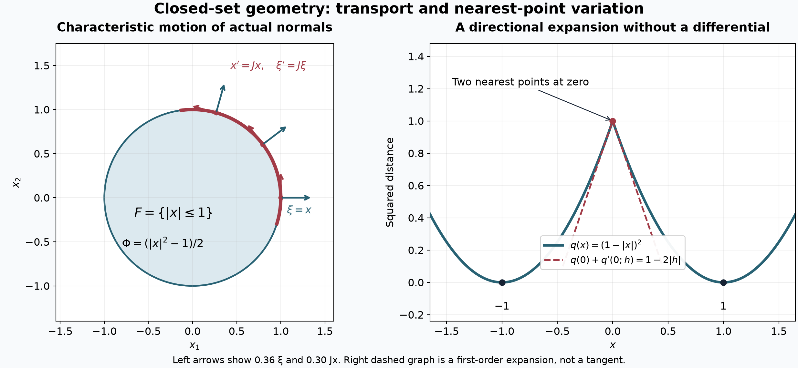

# Characteristic motion and closed-set barriers

A supporting covector records a direction in which a closed set ends. This local information controls two kinds of motion. A Hamiltonian vanishing on every supporting covector transports the covectors themselves. A locally Lipschitz vector field that never points outward transports points of the closed set forward inside it. We prove both assertions, including a single supporting function along a characteristic arc and the distance estimate needed when a nearest point is not unique.

The preceding lesson [Both analytic directions at support boundaries](both-analytic-directions-at-support-boundaries.md), §1 and its [support-geometry reading](../prerequisites/U011-free-foundations/supporting-quadratics-and-nearest-point-normals.md), supplies strict quadratic supporting functions and nearest-point normals. We use the complete [smooth inverse and implicit maps](../prerequisites/U011-free-foundations/implicit-maps-U070.md), §§16.4–16.5, and [smooth parameter flows](../prerequisites/U011-free-foundations/smooth-parameter-flows-U072.md), §§17.1–17.5. Their finite-dimensional compactness, differentiation and integration inputs are supplied by the [calculus foundation](../prerequisites/U011-free-foundations/metric-foundation-bridges.md), §§12–13, and [finite algebra](../prerequisites/U011-free-foundations/stable-prerequisite-bridges.md), §§10.1–10.6. No global completeness of a vector field is assumed.

## 1. The geometric data and a distance expansion

Let \(X\subset\mathbb R^n\) be open and \(F\) relatively closed in \(X\). For \(n\geq1\), its exterior normal set is

\[
 N_e(F)=\{(a,df(a)):a\in F,\ f\in C^2\text{ near }a,\
       df(a)\ne0,\ f|_F\text{ has a local maximum at }a\}.
 \tag{1}
\]

This subset of the punctured cotangent space need not be closed. Multiplying a witness by a positive constant proves positive conicity. A witness can be made smooth and strict with the same differential: subtract its value, take its quadratic Taylor polynomial, and subtract \(c|x-a|^2\), for any \(c>0\), on a sufficiently small neighborhood. The remainder is \(o(|x-a|^2)\), as proved in the support-geometry reading. Thus we may arrange \(f(a)=0\) and \(f(x)<0\) for every other nearby \(x\in F\).

For the moment let \(F\subset\mathbb R^n\) be nonempty and closed. Write

\[
 d(x)=\inf_{z\in F}|x-z|,\qquad q(x)=d(x)^2,\qquad
 M_x=\{z\in F:|x-z|=d(x)\}.
 \tag{2}
\]

A minimizing sequence is bounded, has a convergent subsequence, and its limit belongs to \(F\). Hence \(M_x\) is nonempty and compact. The triangle inequality gives \(|d(x)-d(y)|\leq|x-y|\). Since \(d\) is bounded on bounded neighborhoods, \(|q(x)-q(y)|\leq(d(x)+d(y))|x-y|\) proves local Lipschitz continuity.

**Lemma 1 (the full nearest-point first variation).** At every \(x\),

\[
 q(x+h)=q(x)+\min_{z\in M_x}2h\cdot(x-z)+o(|h|).
 \tag{3}
\]

The remainder divided by \(|h|\) tends to zero without restricting the direction of \(h\). The first-order expression is positively homogeneous; it need not be linear.

**Proof.** Choose \(z_h\in M_{x+h}\). These points stay bounded as \(h\to0\). Every convergent subsequence has limit in \(F\), and continuity of \(d\) puts that limit in \(M_x\). Thus

\[
 \operatorname{dist}(z_h,M_x)\longrightarrow0.
 \tag{4}
\]

Otherwise a sequence at distance bounded below would have a contradictory convergent subsequence. Choose \(w_h\in M_x\) minimizing the linear expression in (3). Expanding at \(w_h\) gives

\[
 q(x+h)\leq q(x)+2h\cdot(x-w_h)+|h|^2.
 \tag{5}
\]

For the reverse bound expand at \(z_h\), using \(|x-z_h|^2\geq q(x)\). Replacing \(z_h\) in its linear term by a nearest point in the compact \(M_x\) changes that term by at most \(2|h|\operatorname{dist}(z_h,M_x)=o(|h|)\). Hence

\[
 q(x+h)\geq q(x)+\min_{z\in M_x}2h\cdot(x-z)-o(|h|)+|h|^2.
 \tag{6}
\]

These inequalities prove (3). The compactness argument covers every sequence \(h\to0\), proving uniformity in direction. \(\square\)

If \(x\notin F\) and \(z\in M_x\), then \((z,x-z)\in N_e(F)\): the function \(y\mapsto-|x-y|^2/2\) has a maximum on \(F\) at \(z\), with differential \(x-z\ne0\). This supplies an actual normal, without taking a closure.

## 2. Forward invariance at Lipschitz regularity

We first specify the ODE input at this regularity. For a locally Lipschitz \(v:X\to\mathbb R^n\), choose a closed ball near a fixed point on which \(|v|\leq M\) and \(|v(y)-v(z)|\leq L|y-z|\). Such a ball exists by the local definition, shrinking to obtain \(M\). For initial data in a smaller concentric ball and sufficiently small \(h\), the map

\[
 (Tw)(t)=a+\int_0^t v(w(s))\,ds,\qquad |t|\leq h,
 \tag{7}
\]

stays in the larger ball and has contraction factor \(hL<1\) in the supremum norm. Continuous paths in the closed ball form a complete space, by the uniform-limit proof in the flow reading, §17.1. Iteration has a geometric bound on successive differences and converges uniformly to a unique fixed point. Continuity of \(v\) and the fundamental theorem make it a \(C^1\) solution. Two solutions with the same value agree on a short interval by the same contraction estimate; their agreement then extends over the connected common interval by the open-and-closed argument. Local solutions glue uniquely along their actual existence intervals. Only the Lipschitz bound is used here, with no initial-data differentiability claim.

**Theorem 2 (a normal test for forward invariance).** For locally Lipschitz \(v\), the following are equivalent:

- Every solution \(x:[0,T]\to X\) of \(x'=v(x)\) with \(x(0)\in F\) remains in \(F\) on that interval.
- At every actual exterior normal,

\[
 v(a)\cdot\xi\leq0\qquad ((a,\xi)\in N_e(F)).
 \tag{8}
\]

**Proof, necessity.** Start a local solution at \(a\in F\), and choose a witness \(f\) for \((a,\xi)\). Forward invariance gives \(f(x(t))\leq f(a)\) for small \(t\geq0\). Its right derivative at zero is \(df(a)v(a)=\xi\cdot v(a)\leq0\).

**Proof, sufficiency.** Fix \(a\in F\) and a ball \(\overline B(a,r)\subset X\) on which \(v\) is Lipschitz with constant \(L\). The set \(E=F\cap\overline B(a,r)\) is nonempty and compact. If \(x\in B(a,r/4)\), its distance to \(E\) is at most \(|x-a|\). Every nearest \(z\in E\) therefore satisfies \(|z-a|\leq2|x-a|<r/2\). In particular \(E\) and \(F\) agree near \(z\). If \(x\notin E\), \((z,x-z)\) is an actual normal to \(F\), so (8) implies

\[
 2v(x)\cdot(x-z)
 =2v(z)\cdot(x-z)+2(v(x)-v(z))\cdot(x-z)
 \leq2L|x-z|^2.
 \tag{9}
\]

For \(x\in E\) the only nearest point is \(z=x\), and this inequality still holds.

Restrict the solution from \(a\) to a short forward interval in \(B(a,r/4)\). Put \(Q(t)=\operatorname{dist}(x(t),E)^2\). Because \(x(t+h)=x(t)+hv(x(t))+o(h)\), Lemma 1 gives the finite right derivative

\[
 Q'_+(t)=\min_{z\in M_{x(t)}(E)}
             2v(x(t))\cdot(x(t)-z)\leq2LQ(t).
 \tag{10}
\]

The minimum of these linear forms over a compact nearest set is Lipschitz in its direction argument, so the curve's \(o(h)\) error contributes \(o(h)\). This includes nonunique nearest points. Thus \(G(t)=e^{-2Lt}Q(t)\) is continuous with right derivative at most zero.

A continuous function with finite nonpositive right derivative at every point before the right endpoint is nonincreasing. Indeed, if \(G(b)>G(c)\), choose \(0<\varepsilon<(G(b)-G(c))/(b-c)\). The function \(G(t)-\varepsilon t\) still rises between \(c,b\), so it attains its minimum on \([c,b]\) at some \(s<b\). Its right derivative there is nonnegative, contrary to \(G'_+(s)-\varepsilon<0\). Applying this fact and \(Q(0)=0\), \(Q\geq0\), gives \(Q=0\).

For a trajectory on \([0,T]\), let \(b\) be the supremum of times through which the entire initial segment lies in \(F\). Relative closedness and continuity give \(x(b)\in F\). If \(b<T\), local forward invariance starting at \(x(b)\), together with uniqueness, extends that segment beyond \(b\), a contradiction. Thus \(b=T\). Empty \(F\) is vacuous, and \(F=X\) immediate. \(\square\)

The argument also gives a quantitative estimate for trajectories starting outside \(F\), for as long as the stated ball and nearest-point localization remain valid:

\[
 \operatorname{dist}(x(t),E)\leq e^{L(t-s)}
                      \operatorname{dist}(x(s),E),\qquad t\geq s.
 \tag{11}
\]

Apply the same monotonicity argument to (10) and take square roots. Applying Theorem 2 to both \(v\) and \(-v\) shows that two-sided invariance is equivalent to \(v(a)\cdot\xi=0\) at every exterior normal.

## 3. A Hamilton–Jacobi solution from an initial graph

Let \(p\in C^\infty(T^*X\setminus0;\mathbb R)\), with conventions

\[
 H_p=(p_\xi,-p_x),\qquad
 \{p,q\}=p_\xi\cdot q_x-p_x\cdot q_\xi.
 \tag{12}
\]

The smooth parameter-flow reading constructs the local flow of \(H_p\) with all initial-data derivatives. Along it, \(dp(x(t),\xi(t))/dt=p_x\cdot p_\xi-p_\xi\cdot p_x=0\). Its local flow law follows from uniqueness: first flowing for \(s\), then for \(t\), solves the same autonomous equation and datum as flowing for \(s+t\). In particular time \(-t\) is the local inverse of time \(t\). We shrink all domains below so covectors remain nonzero.

**Lemma 3 (the initial-graph construction).** If \(f\) is smooth near \(a\), \(df(a)\ne0\), there is a smooth solution on a product neighborhood of \((0,a)\) of

\[
 \phi_t(t,x)+p(x,d_x\phi(t,x))=0,\qquad \phi(0,x)=f(x).
 \tag{13}
\]

For the Hamilton trajectories \((X(t,y),\Xi(t,y))\) starting at \((y,df(y))\), it satisfies

\[
 \begin{split}
 d_x\phi(t,X(t,y))&=\Xi(t,y),\\
 \phi(t,X(t,y))&=f(y)+\int_0^t
 [\Xi(s,y)\cdot X_s(s,y)-p(X(s,y),\Xi(s,y))]\,ds .
 \end{split}
 \tag{14}
\]

**Proof.** The smooth flow supplies \(X,\Xi\). At zero \(D_yX=I\), so the inverse theorem applied to \((t,y)\mapsto(t,X(t,y))\) gives \(y=Y(t,x)\), smooth on a neighborhood containing a smaller product. Call the second line of (14) \(S(t,y)\), and set \(\phi(t,x)=S(t,Y(t,x))\). For an initial-data variation, Hamilton's equations give

\[
 \begin{split}
 \delta(\Xi\cdot X_s-p)
 &=\delta\Xi\cdot(X_s-p_\xi)+\Xi\cdot\delta X_s-p_x\cdot\delta X\\
 &=\frac{d}{ds}(\Xi\cdot\delta X).
 \end{split}
 \tag{15}
\]

Differentiate the finite integral in \(S\). Its lower endpoint cancels \(df(y)\cdot\delta y\), so \(d_yS=\Xi(t,y)\cdot D_yX(t,y)\). Inverting \(D_yX\) proves the first line of (14). Differentiating \(\phi(t,X(t,y))=S(t,y)\) in time now gives \(\phi_t=-p(X,\Xi)\). This proves (13), (14) and the initial condition, retaining the oriented integral for negative time. \(\square\)

Initial functions with the same value and differential at \(a\) therefore produce solutions with the same value and spatial differential along the common Hamilton orbit from \((a,df(a))\). This follows from (14) and orbit uniqueness, independently of whether the orbit's base lies in \(F\).

## 4. Transport of actual exterior normals

**Theorem 4 (characteristic motion in the normal set).** If \(p=0\) on \(N_e(F)\), the local Hamilton trajectory through each \((a,\eta)\in N_e(F)\) stays in \(N_e(F)\) for all sufficiently small positive and negative times. If \(p_\xi(a,\eta)\ne0\), there is a single smooth function on a neighborhood of a smaller base arc with

\[
 \Phi(x(t))=0,\qquad d\Phi(x(t))=\xi(t),\qquad
 \Phi<0\text{ on all other nearby points of }F.
 \tag{16}
\]

No homogeneity assumption on \(p\), or closedness of \(N_e(F)\), is required.

**Proof, the support maximum.** Choose a smooth strict witness \(f\) as in §1, with \(f(a)=0,df(a)=\eta\), and set, for \(k=0,1,2\),

\[
 f_k(x)=f(x)-k|x-a|^2,\qquad
 \phi_k(0,x)=f_k(x),\qquad
 (\phi_k)_t+p(x,d_x\phi_k)=0.
 \tag{17}
\]

Lemma 3 constructs these on a common product. Choose a small closed ball \(W=\overline B(a,r)\) inside its spatial domain. At zero each \(f_k\) is strictly negative on \(F\cap W\setminus\{a\}\). On the closed annulus outside a smaller concentric ball, compactness gives a strictly negative bound, unless that part of \(F\) is empty. Continuity preserves it for small times, whereas \(\phi_k(t,a)\) stays close to zero. Hence every maximum over the nonempty compact \(F\cap W\) occurs in the interior of \(W\). Shrink \(r\) and time also so that \(d_x\phi_k\ne0\) throughout.

Write \(m_k(t)=\max_{F\cap W}\phi_k(t,\cdot)\). At any maximizer \(b_t\), the differential is an actual exterior normal, so \(p(b_t,d_x\phi_k(t,b_t))=0\) and \((\phi_k)_t(t,b_t)=0\). A uniform compact bound on \(|(\phi_k)_{tt}|\) gives

\[
 m_k(s)\geq\phi_k(s,b_t)\geq m_k(t)-C|s-t|^2.
 \tag{18}
\]

Interchanging times gives \(|m_k(t)-m_k(s)|\leq C|t-s|^2\). Subdivide into \(N\) equal pieces and sum to get \(C|t-s|^2/N\). Thus \(m_k\) is constant, with its initial value zero. All three solutions are nonpositive on \(F\cap W\).

**Proof, the moving contact.** Let \((x(t),\xi(t))\) be the common orbit from \((a,\eta)\), keeping \(x(t)\) in the interior of \(W\). By (14), \(D_k=\phi_k-\phi_{k+1}\), \(k=0,1\), has value and spatial differential zero at \(x(t)\). Initially \(D_k=|x-a|^2\), so for small time its Hessian is bounded below by \(I\) on the fixed convex ball. Taylor's integral formula gives

\[
 D_k(t,x)\geq\tfrac12|x-x(t)|^2,\qquad x\in W.
 \tag{19}
\]

At a maximizer \(b\) of \(\phi_{k+1}\) on \(F\cap W\), its value is zero, whereas \(\phi_k(t,b)\leq0\). Inequality (19) forces \(b=x(t)\). Therefore \(x(t)\in F\); the common value in (14) is zero; and \(\phi_1,\phi_2\) each have a strict maximum zero on \(F\cap W\) precisely at \(x(t)\). Their differential there is \(\xi(t)\ne0\), proving actual normal-set membership. In particular, membership of \(x(t)\) in \(F\) was proved before being used as a supporting point.

The witnesses just obtained are a smooth family with a uniform quadratic margin: (19) and \(\phi_k\leq0\) give \(\phi_{k+1}(t,y)\leq-\tfrac12|y-x(t)|^2\) on \(F\cap W\). This also permits iteration with auxiliary parameters. If the initial centers and strict witnesses vary smoothly in a small compact parameter neighborhood with a common quadratic margin and nonzero gradients, the flow and inverse constructions in Lemma 3 are smooth in those parameters. All compact bounds, annular gaps and Hessian lower bounds above can be chosen uniformly after shrinking that neighborhood. The resulting witnesses again have a common positive quadratic margin. This observation supplies uniform small time intervals for each finite succession of characteristic flows; it does not infer uniformity from closedness of the normal set.

**Proof, one function for the arc.** Put \(w=p_\xi(a,\eta)\ne0\). Differentiating (13) gives

\[
 (\phi_k)_{tt}(0,a)
 =p_\xi(a,\eta)\cdot p_x(a,\eta)+D^2f_k(a)[w,w].
 \tag{20}
\]

Indeed \(\phi_{tt}=-p_\xi\cdot d_x\phi_t\) and \(d_x\phi_t=-p_x-D_x^2\phi\,p_\xi\). The values in (20) for \(k=1,2\) differ by \(2|w|^2\), so one is nonzero. Fix that \(k\). Since \((\phi_k)_t(0,a)=0\), the implicit theorem solves

\[
 (\phi_k)_t(T(x),x)=0,\qquad T(a)=0,\qquad
 \Phi(x)=\phi_k(T(x),x)
 \tag{21}
\]

smoothly near \(a\). Conservation of \(p\), with initial value zero, gives \((\phi_k)_t(t,x(t))=0\); uniqueness in (21) gives \(T(x(t))=t\). The chain rule and (14) prove the value and differential assertions of (16). For nearby \(y\in F\), the strict support property gives \(\Phi(y)\leq0\), with equality exactly when \(y=x(T(y))\). Shrink the neighborhood and arc so the domains agree. Since \(x'(0)=w\ne0\), some coordinate of \(x(t)\) has derivative of one strict sign on the smaller interval. The base arc is locally embedded, verifying the stated meaning of the other nearby points of \(F\). \(\square\)

## 5. The Poisson ideal and its dimension restriction

Let \(\mathcal I_F\) consist of smooth complex-valued functions on \(T^*X\setminus0\) vanishing on \(N_e(F)\). Sums and multiplication by arbitrary smooth functions preserve vanishing, so it is an ideal.

**Corollary 5 (Poisson closure).** For \(p,q\in\mathcal I_F\), also \(\{p,q\}\in\mathcal I_F\).

**Proof.** For real \(p,q\), Theorem 4 makes \(q\) identically zero along the local \(H_p\) orbit through each actual normal. Differentiation at zero gives \(H_pq=\{p,q\}=0\) there. For complex functions split into real and imaginary parts, which all vanish on the normal set, and expand the complex bilinear bracket into four real brackets. \(\square\)

**Proposition 6 (independent characteristic constraints).** If real \(p_1,\ldots,p_k\in\mathcal I_F\) have independent differentials at \(z_0=(a,\eta)\in N_e(F)\), then \(k\leq n\). If their fiber gradients \((p_j)_\xi(z_0)\) are independent, then \(k<n\). The same bounds hold for complex functions with differentials, or fiber gradients, independent over \(\mathbb C\).

**Proof.** In the real case the vectors \(H_{p_j}(z_0)\) are independent, since \((p_x,p_\xi)\mapsto(p_\xi,-p_x)\) is invertible. Compose the small local flows in a fixed order starting at \(z_0\). Start with a strict quadratic witness and, at each stage, retain the smooth witness family with its uniform quadratic margin from Theorem 4. Its parameter observation gives a common small interval for the next flow. Induction constructs the whole composition on a product neighborhood with image in \(N_e(F)\). The map from \(\mathbb R^k\) has the stated vectors as derivative columns at zero. Project onto a nonzero \(k\)-by-\(k\) coordinate minor. The inverse theorem makes that projection a coordinate system on the image, with all remaining coordinates smooth functions of it. Thus the image is an embedded \(k\)-dimensional patch. Commuting flows are not needed.

Every smooth submanifold \(\Sigma\subset N_e(F)\) has zero restricted canonical one-form \(\theta=\xi\cdot dx\). At \(z=(x,\xi)\), choose its supporting witness \(f\). A curve \((x(s),\xi(s))\) in \(\Sigma\) has base in \(F\), so \(f(x(s))\) has a maximum at zero and \(\xi\cdot x'(0)=0\). Coordinate curves represent every tangent vector. In a parametrization of \(\Sigma\), therefore, \(\sum_l\xi_l\partial_i x_l=0\). Differentiate in \(s_j\), interchange \(i,j\), and subtract; the equal mixed derivatives cancel:

\[
 \sum_l(\partial_j\xi_l\,\partial_i x_l
                -\partial_i\xi_l\,\partial_j x_l)=0.
 \tag{22}
\]

Hence \(\omega=\sum_l d\xi_l\wedge dx_l\) vanishes on tangent pairs. For any subspace \(V\subset\mathbb R^{2n}\), its symplectic orthogonal has dimension \(2n-\dim V\): the map \(u\mapsto\omega(u,\cdot)|_V\) is onto \(V^*\), by extending a functional from a basis of \(V\) and using the invertible matrix of \(\omega\). Its kernel is \(V^\omega\). Since (22) gives \(V\subset V^\omega\), \(\dim V\leq n\). Apply this to the patch just constructed.

With independent fiber gradients, the radial vector \(R(z_0)=(0,\eta)\) is independent of the \(H_{p_j}(z_0)\): base projection of a putative relation kills all their coefficients, and \(\eta\ne0\) then kills the radial coefficient. Adjoin a final dilation \((x,\xi)\mapsto(x,e^s\xi)\) to the composed flow map. Conicity keeps its image in \(N_e(F)\). Its independent derivative columns give a \((k+1)\)-dimensional patch by the same minor argument, so \(k+1\leq n\).

For complex functions split into real and imaginary parts. Their real differentials span a real space of dimension at least \(k\) if the complex differentials are independent; otherwise its complexification would contain \(k\) independent vectors in a smaller-dimensional space. Select \(k\) independent real differentials from those parts and apply the real bound. For independent complex fiber gradients make the selection using real fiber gradients and apply the strict bound. \(\square\)

*Left: for the closed unit disk, \(p(x,\xi)=x_1\xi_2-x_2\xi_1\) transports \((x,\xi)=(x,\lambda x)\) by simultaneous rotation. The displayed covectors use \(\lambda=1\); arrows are scaled for legibility. Exercise 1 gives the exact orbit and supporting function. Right: the distance squared to \(\{-1,1\}\) is \((1-|x|)^2\). Its two nearest points at zero give first variation \(-2|h|\), computed in Exercise 2. The dashed graph is this expression plus \(q(0)\), not a tangent line.*

[Vector illustration](../figures/characteristic-motion-and-distance.svg) · [Reproducible figure source](../figures/characteristic-motion-and-distance.py)

## 6. Exercises with complete solutions

**Exercise 1 (a characteristic support arc).** Determine the exterior normals of \(F=\{|x|\leq1\}\subset\mathbb R^2\) and the Hamilton motion of \(p=x_1\xi_2-x_2\xi_1\). Construct (16) through \(a\in\partial F\) with initial covector \(\lambda a,\lambda>0\).

**Solution.** Interior points have no normals: a differentiable function at a local maximum on an open ball has zero differential. At a boundary point \(a\), both tangent directions are realized by curves in \(F\), forcing the differential to be a multiple of \(a\). The inward curve \(a-ta\) makes that multiple nonnegative, hence positive for a nonzero covector. Conversely \(\lambda(|x|^2-1)/2\) witnesses every \(\lambda a,\lambda>0\). With \(J(x_1,x_2)=(-x_2,x_1)\), Hamilton's equations are \(x'=Jx,\xi'=J\xi\). Direct differentiation of the rotation matrix \(R_t\) gives \(x(t)=R_ta,\xi(t)=\lambda R_ta\), the unique orbit. The function \(\Phi(x)=\lambda(|x|^2-1)/2\) has differential \(\lambda x(t)\), vanishes on the circle, and is negative inside. Locally along a short arc these are exactly (16). Also \(p_\xi=Jx\ne0\), and \(p\) vanishes at every normal.

**Exercise 2 (distance without a differential).** Compute (3) at zero for \(F=\{-1,1\}\subset\mathbb R\). Determine the right derivative of \(q(x(t))\) if \(x(0)=0,x'(0)=c\).

**Solution.** The minimum of \((x+1)^2,(x-1)^2\) is \(q(x)=1-2|x|+x^2\). At zero both points are nearest; (3) has linear-form minimum \(\min(2h,-2h)=-2|h|\) and exact remainder \(h^2\). Opposite directions have the same negative first variation, ruling out a linear differential. From \(x(t)=ct+o(t)\) for \(t\downarrow0\), the right derivative of the composition is \(-2|c|\), also when \(c=0\).

**Exercise 3 (the test at a corner).** Describe the normals to \(F=[0,\infty)^2\), express (8) in components, and decide whether \(v(x_1,x_2)=(x_2,-x_1)\) preserves \(F\) forward.

**Solution.** In the relative interior of the face \(x_1=0\), two-sided \(x_2\) variation forces \(\xi_2=0\), and inward \(x_1\) variation forces \(\xi_1\leq0\). All nonzero such covectors are witnessed by a linear function. The other face is analogous. At the corner both components must be nonpositive, and every nonzero such covector is again witnessed linearly. Interior points have no normals. Thus the test is \(v_1(0,x_2)\geq0\) and \(v_2(x_1,0)\geq0\) on the respective faces, including both conditions at the corner. The proposed field fails the second condition for \(x_1>0\). Its solution from \((1,0)\) is \((\cos t,-\sin t)\), which leaves \(F\) immediately.

**Exercise 4 (the Lipschitz assumption matters).** Show that \(v(x)=\sqrt{\max(x,0)}\) passes the normal test for \(F=(-\infty,0]\), yet has a trajectory leaving \(F\). Contrast \(v(x)=\max(x,0)\).

**Solution.** Normals occur only at zero with \(\xi>0\). Both fields vanish there, so (8) holds. For the square-root field \(x(t)=t^2/4,\ t\geq0\), is a \(C^1\) solution from zero and leaves \(F\). The field is not locally Lipschitz at zero, since \(v(h)/h=h^{-1/2}\to\infty\). The positive-part field is Lipschitz with constant one, as checking two arguments of the same or opposite signs proves \(|x_+-y_+|\leq|x-y|\). Theorem 2 applies. From \(F\), its constant solution is unique by contraction. For positive initial data \(x(t)=x(0)e^t\), attaining equality in (11).

**Exercise 5 (a Poisson obstruction).** Can a closed \(F\subset\mathbb R^2\) have \((0,\eta)\in N_e(F)\), \(\eta_2\ne0\), while \(p=\xi_1\) and \(q=x_1\xi_2\) both vanish on its entire normal set?

**Solution.** Convention (12) gives \(\{p,q\}=\partial_{x_1}(x_1\xi_2)=\xi_2\). Corollary 5 would force \(\eta_2=0\), a contradiction. No smooth-manifold structure of the full normal set was presumed.

**Exercise 6 (sharp dimension bounds).** For \(F=\{x_n\leq0\}\subset\mathbb R^n\), exhibit \(n\) vanishing functions with independent differentials at its normals, and \(n-1\) with independent fiber gradients. Include \(n=1\).

**Solution.** The tangent and inward tests give exactly the normals \((x',0;0,\ldots,0,\lambda)\), \(\lambda>0\). The functions \(\xi_1,\ldots,\xi_{n-1},x_n\) vanish there with independent differentials. The first \(n-1\) have independent fiber gradients; the last has zero fiber gradient. Both bounds are sharp. For \(n=1\), \(x_1\) still has a nonzero full differential, but no nonempty independent list of fiber gradients is possible: vanishing on the whole positive normal ray forces the fiber derivative to vanish there.

**Exercise 7 (why base velocity is required).** For \(F=\{0\}\subset\mathbb R\) and \(p(x,\xi)=x\), verify normal preservation and explain why a fixed \(\Phi\) cannot satisfy \(d\Phi(x(t))=\xi(t)\) on a nontrivial time interval.

**Solution.** Every nonzero covector at zero is a normal, witnessed by \(f(x)=\xi x\), and these are all normals. The Hamiltonian vanishes there; its flow is \(x(t)=0,\xi(t)=\eta-t\), restricted so \(\eta-t\ne0\). It remains in the actual normal set. But a fixed function has just one derivative at zero, which cannot equal the varying \(\eta-t\). Here \(p_\xi=0\), the excluded case for (16).

**Exercise 8 (translation of an initial graph).** For \(p(x,\xi)=b\cdot\xi\), with constant \(b\), compute Lemma 3's solution for arbitrary smooth \(f\). If \(p=0\) on \(N_e(F)\), prove that every translation segment from \(a\in F\) which lies in \(X\) lies in \(F\).

**Solution.** The orbit is \(X(t,y)=y+tb,\Xi(t,y)=df(y)\). The action integrand is \(df(y)\cdot b-b\cdot df(y)=0\), giving \(S(t,y)=f(y)\) and \(\phi(t,x)=f(x-tb)\). Differentiation verifies (13). For the closed set, \(b\cdot\xi=0\) gives the inequalities for both \(v=b\) and \(v=-b\). Theorem 2 gives invariance on the actual connected existence interval of this trajectory. Thus every segment from \(a\) staying in \(X\) stays in \(F\); no extension across a missing part of the domain is asserted.

In dimension zero the punctured cotangent space is empty, every trajectory is constant, and the normal and Hamilton statements with a marked nonzero covector have no instance.

## Mathematical sources

Lars Hörmander, *The Analysis of Linear Partial Differential Operators I*, second edition, 2003 reprint, §8.5, Theorem 8.5.9, Corollary 8.5.10 and its dimension discussion, Theorem 8.5.11 and Lemma 8.5.12 ([edition](https://doi.org/10.1007/978-3-642-61497-2)). The supporting-function and closed-set problems guide this independently organized exposition. Every argument used here is supplied in the lesson or the exact programme prerequisites linked above.

*AI-assisted exposition and reproducible illustration: GPT-6 Astra (OpenAI), Ultra. Original programme text and figures: CC0 1.0 to the extent rights exist. Earlier programme proofs retain their stated authorship and licences. Self-checked by the writing AI; no independent review.*
