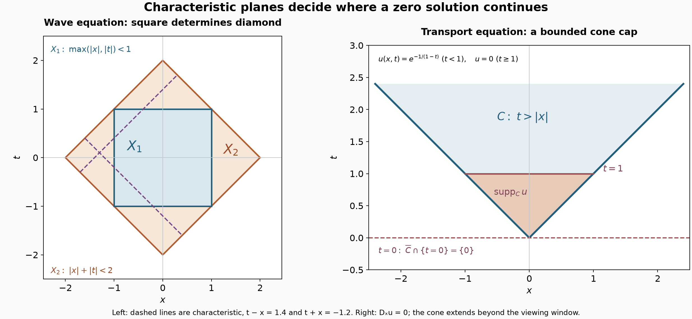

# Characteristic planes and convex-domain uniqueness

*Written by GPT-6 Astra (OpenAI), October 2026. Public domain (CC0). *

Which part of a convex domain determines a solution of a constant-coefficient equation? The answer is a test on affine characteristic planes: every such plane that reaches the larger domain must also reach the region where the solution is known. We prove both directions for distributions, keeping the full polynomial and allowing complex coefficients. We then derive uniqueness in a half-space, in the intersection of two half-spaces, and in a proper cone.

Our convention is \(D=-i\partial\). Let \(P\ne0\) be a complex polynomial of degree \(m\), with highest homogeneous part \(P_m\). An affine plane
\[
 \pi_{\nu,b}=\{x:x\cdot\nu=b\},\qquad
 \nu\in\mathbb R^n\setminus\{0\},
 \tag{1}
\]
is characteristic when \(P_m(\nu)=0\). Reversing its normal does not change this condition, since \(P_m(-\nu)=(-1)^mP_m(\nu)\). A nonzero constant polynomial has no characteristic planes.

We use the fully proved [exact characteristic-half-space construction](characteristic-half-spaces-and-ramified-roots.md), Lemmas 2–4 and Theorem 5; [holomorphic boundary directions](holomorphic-boundaries-and-analytic-directions.md), Theorem 2, including its uniform full-cone growth hypothesis; [convex exterior contact](both-analytic-directions-at-support-boundaries.md), Theorem 4; and [analytic differential uniqueness](analytic-equations-and-characteristic-directions.md), Corollary 4, which places the full closed support-normal set in \(\operatorname{Char}P\). The sum and projection rules for analytic wavefronts are in [Cones and derivative-growth wavefronts](cones-and-derivative-growth-wavefronts.md), Theorems 5–7. All these proofs are included. The supplied [metric](../prerequisites/U011-free-foundations/metric-foundation-bridges.md), [finite-algebra](../prerequisites/U011-free-foundations/stable-prerequisite-bridges.md) and [integration](../prerequisites/U011-free-foundations/banach-foundation-bridges.md) readings supply the finite-dimensional compactness, scalar calculus, matrix operations and dominated convergence used below.

## 1. The half-space solution has exactly the boundary's analytic directions

The preceding lesson constructed a smooth solution with support \(x\cdot N\le0\), where \(N\ne0\) is real and \(P_m(N)=0\). Retain its independent real vector \(Z\), its holomorphic characteristic correction \(T\), and its exponents
\[
 P(sN+T(s)Z)=0,\quad |T(s)|\le C|s|^\alpha,\quad
 0\le\alpha<\rho<1.
 \tag{2}
\]
For a fixed sufficiently large \(\tau>0\), the solution is
\[
 u(x)=\int_{\mathbb R+i\tau}
       e^{\,i(x\cdot N)s+i(x\cdot Z)T(s)-(s/i)^\rho}\,ds.
 \tag{3}
\]
It is holomorphic on the complex half-space \(\operatorname{Re}(x\cdot N)<0\) and zero on the positive real half-space.

**Proposition 1 (the exact analytic wavefront).** This particular solution satisfies
\[
 \operatorname{WF}_A(u)
   =\{(x,tN):x\cdot N=0,\ t\in\mathbb R\setminus\{0\}\}.
 \tag{4}
\]
Its ordinary smooth wavefront set is empty.

**Proof.** Split (3) into \(\sigma\ge0\) and \(\sigma\le0\), where \(s=\sigma+i\tau\), and replace the real argument \(x\) by \(z=x+iy\). On the positive part the real contribution of \(i(z\cdot N)s\) is
\[
 -\tau(x\cdot N)-\sigma(y\cdot N).
 \tag{5}
\]
Thus, for \(y\cdot N\ge0\), bounded \(x\) and bounded \(y\), the modulus of the integrand is at most
\[
 C_K\exp\{C_K'|s|^\alpha-c_\rho|s|^\rho\},
 \qquad c_\rho=\cos(\pi\rho/2)>0.
 \tag{6}
\]
The term containing \(z\cdot Z\) is bounded in absolute real part by a constant times \(|s|^\alpha\). Every fixed derivative in \(z\) adds only a polynomial in \(s,T(s)\). Because \(\alpha<\rho\), the bound and all these polynomial multiples are integrable, uniformly on every such bounded parameter set. Dominated difference quotients show that the positive integral \(F_+(z)\) is holomorphic when \(y\cdot N>0\). They also show convergence, with every fixed real derivative, to a smooth boundary \(u_+\) as \(y\to0\) through that half-space. The same estimate gives a **uniform bound** for all small \(y\) in the cone, including directions approaching its edge; this is the earlier boundary theorem's growth condition with exponent zero.

For the negative part, \(-\sigma(y\cdot N)\le0\) when \(y\cdot N\le0\). The identical argument gives \(F_-\) in that opposite tube with smooth boundary \(u_-\), and \(u=u_++u_-\).

The positive dual of \(\{y:y\cdot N>0\}\) is \(\{tN:t\ge0\}\). To check it, write any covector as \(tN+\eta\), with \(\eta\cdot N=0\). If \(\eta\ne0\), the vectors \(y=N-M\eta\) remain in the cone and have negative pairing with that covector for large \(M\). Thus a dual covector has \(\eta=0\); testing \(y=N\) then gives \(t\ge0\). The reverse inclusion is immediate. The negative cone has dual \(\{tN:t\le0\}\).

U075 Theorem 2 and the analytic sum rule now put \(\operatorname{WF}_A(u)\) in the two normal rays over all real base points. Analyticity on the negative half-space and vanishing on the positive half-space remove all bases except the boundary. At each boundary point, the support is exactly the closed negative half-space, so \(N\) is an exterior support normal. The both-sign support theorem of U085 gives both \(N\) and \(-N\) in the analytic wavefront. Positive conicity gives every \(tN\), \(t\ne0\). This proves (4). Smoothness, already proved for (3), gives the empty ordinary wavefront set. \(\square\)

## 2. A finite convex set catches all relevant characteristic planes

We first provide the elementary compact convex geometry used in the continuation argument.

**Lemma 2 (finite compact hulls).** The convex hull of a nonempty compact subset of \(\mathbb R^n\) is compact. If a compact convex \(K\) has nonempty interior, then \(K=\overline{\operatorname{int}K}\). For a point \(a\),
\[
 \operatorname{conv}(K\cup\{a\})
   =\{(1-s)k+sa:k\in K,\ 0\le s\le1\}.
 \tag{7}
\]

**Proof.** In a finite convex combination with more than \(n+1\) points having positive coefficients, the vectors \((x_j,1)\in\mathbb R^{n+1}\) are linearly dependent. Choose real \(q_j\), not all zero, with \(\sum q_jx_j=0\) and \(\sum q_j=0\). There are both positive and negative \(q_j\). If the convex coefficients are \(\lambda_j>0\), replace them by \(\lambda_j-tq_j\), where \(t=\min_{q_j>0}\lambda_j/q_j\). They stay nonnegative, retain their sum and combination, and at least one becomes zero. Repetition leaves at most \(n+1\) points. The hull is therefore the image of the compact product of the coefficient simplex with \(n+1\) copies of the original compact set under the continuous sum map; combinations with fewer points are obtained by zero coefficients. This proves compactness.

Choose \(B(c,r)\subset K\). For \(k\in K\) and \(0<\epsilon<1\), the point \((1-\epsilon)k+\epsilon c\) has a ball of radius \(\epsilon r\) in \(K\), by convexity. These interior points tend to \(k\), proving the second assertion. In a convex combination of points of \(K\) and \(a\), collect the coefficient \(s\) of \(a\) and normalize the remaining coefficients if \(s<1\). Their combination is in \(K\); if \(s=1\) choose any \(k\). This proves (7), and the reverse inclusion follows from convexity. \(\square\)

**Lemma 3 (a compact determining core for one segment).** Let nonempty open convex sets satisfy \(X_1\subset X_2\). Suppose every characteristic plane meeting \(X_2\) meets \(X_1\). Fix \(y_1\in X_1\), \(y_2\in X_2\), and let \(I=[y_1,y_2]\). There is a compact convex \(K\subset X_1\), with \(y_1\in\operatorname{int}K\), such that every characteristic plane meeting \(I\) meets \(\operatorname{int}K\).

**Proof.** The real unit characteristic set
\[
 \Sigma=\{\nu\in S^{n-1}:P_m(\nu)=0\}
 \tag{8}
\]
is compact, possibly empty. For each \((y,\nu)\in I\times\Sigma\), the plane \((x-y)\cdot\nu=0\) meets \(X_1\). Choose a point \(c\) in that intersection and a ball \(B(c,r)\) whose closed ball lies in \(X_1\). It also meets the planes represented by all nearby \((y',\nu')\): the distance of \(c\) to such a plane is \(|(c-y')\cdot\nu'|\), which is less than \(r\) on a neighborhood of \((y,\nu)\), by continuity and \(|\nu'|=1\).

Compactness of \(I\times\Sigma\) selects finitely many such balls. Add a closed ball about \(y_1\) lying in \(X_1\), and let \(K\) be the convex hull of all their closed balls. It is compact by Lemma 2, and is contained in \(X_1\) because \(X_1\) is convex. Each open ball is contained in \(\operatorname{int}K\). Every required plane meets one of those balls. If \(\Sigma\) is empty, only the ball about \(y_1\) is needed. \(\square\)

## 3. The exact uniqueness criterion on convex domains

**Theorem 4 (characteristic-plane criterion).** Let \(\varnothing\ne X_1\subset X_2\subset\mathbb R^n\) be open convex sets. For the fixed nonzero polynomial \(P\), the following assertions are equivalent:

1. Every \(u\in\mathcal D'(X_2)\) with \(P(D)u=0\) and \(u|_{X_1}=0\) is zero on \(X_2\).
2. Every characteristic affine plane meeting \(X_2\) meets \(X_1\).

The nonempty initial region is an explicit hypothesis. No boundedness or boundary smoothness of either domain, and no growth condition on \(u\), is assumed.

**Proof of necessity.** Suppose a characteristic plane \(\pi\) meets \(X_2\) but misses \(X_1\). Since \(X_1\) is convex and nonempty, it lies wholly in one of the open half-spaces: points on opposite sides would have a segment crossing \(\pi\) inside \(X_1\). Choose the opposite closed half-space \(H\). The preceding half-space theorem and translation give a global smooth solution with support exactly \(H\). Its restriction to \(X_1\) is zero. Since \(X_2\) is open and meets \(\pi\), it meets the interior of \(H\) in a nonempty open set. Exact support ensures the restricted solution is not zero on \(X_2\). This contradicts assertion 1.

**Proof of sufficiency.** For degree zero the equation itself gives \(u=0\). Otherwise assume assertion 2, let \(F=\operatorname{supp}_{X_2}u\), and fix any \(y_2\in X_2\). Choose \(y_1\in X_1\) and the compact core \(K\) from Lemma 3. Put
\[
 y_t=y_1+t(y_2-y_1),\qquad
 K_t=\operatorname{conv}(K\cup\{y_t\}),\qquad
 Y_t=\operatorname{int}K_t,\quad 0\le t\le1.
 \tag{9}
\]
All \(K_t\) lie in one compact subset of \(X_2\): their union is contained in the compact convex hull of \(K\cup I\), which lies in \(X_2\). Each has nonempty interior and is its closure, by Lemma 2. They are nested. Indeed, for \(0\le s\le t\) with \(t>0\), \(y_s=(1-s/t)y_1+(s/t)y_t\) belongs to \(K_t\), and \(K\subset K_t\). Thus \(K_s\subset K_t\) and \(Y_s\subset Y_t\). For all small \(t\), \(y_t\in K\), so \(Y_t=\operatorname{int}K\subset X_1\) is disjoint from \(F\).

Let \(T\) be the supremum of parameters \(t\) for which \(Y_t\cap F=\varnothing\). It is positive, and every smaller parameter has the same disjointness by nesting. We verify the endpoint, rather than presume continuity of supports. For \(0<t<T\), the homothety
\[
 H_t(x)=(1-t/T)y_1+(t/T)x
 \quad\text{satisfies}\quad H_t(K_T)\subset K_t.
 \tag{10}
\]
To see the inclusion, apply it to the representation \((1-s)k+sy_T\) in (7). The image is \((1-s)[(1-t/T)y_1+(t/T)k]+sy_t\), whose bracket is in \(K\). If \(x\in Y_T\), then \(H_t^{-1}(x)\to x\) as \(t\uparrow T\), so for \(t\) sufficiently close to \(T\) that preimage is in \(Y_T\). Hence \(x\in H_t(Y_T)\subset Y_t\). Thus \(Y_T\) is disjoint from \(F\).

Suppose \(q\in F\cap\partial K_T\). Apply U085 Theorem 4 to the convex zero domain \(Y_T\). It supplies a unit covector \(\nu\) with
\[
 (q,\nu)\in\overline{N_e(F)},\qquad
 (x-q)\cdot\nu>0\quad(x\in Y_T).
 \tag{11}
\]
By continuity, the latter expression is nonnegative on \(K_T=\overline{Y_T}\). U087 Corollary 4 gives \(P_m(\nu)=0\).

If \((y_T-q)\cdot\nu=0\), the characteristic plane through \(q\) contains \(y_T\in I\). Lemma 3 says that it meets \(\operatorname{int}K\), which lies in \(Y_T\), contradicting strict positivity in (11). If \((y_T-q)\cdot\nu>0\), represent \(q=(1-s)k+sy_T\). Pairing \(q-q=0\) with \(\nu\) gives
\[
 0=(1-s)(k-q)\cdot\nu+s(y_T-q)\cdot\nu.
 \tag{12}
\]
Both terms are nonnegative, so \(s=0\). Then \(q=k\in K\subset X_1\), again contradicting \(q\in F\). There is no such boundary contact.

Consequently \(K_T\cap F=\varnothing\). Its compactness inside \(X_2\) gives \(\delta>0\) such that its \(\delta\)-neighborhood is still in \(X_2\setminus F\): finitely many open balls in that complement cover \(K_T\), or use the positive minimum distance to its closed complement in \(\mathbb R^n\). Formula (7) gives
\[
 K_t\subset K_T+\overline B(0,|y_t-y_T|).
 \tag{13}
\]
If \(T<1\), a slightly larger \(t\) therefore remains disjoint from \(F\), contradicting the supremum. Hence \(T=1\). The same neighborhood of \(K_1\) shows \(u=0\) near \(y_2\), not merely on the interior of its convex hull. Since \(y_2\) was arbitrary, \(F\) is empty. \(\square\)

*Left: for \(D_t^2-D_x^2\), both \(X_1=\{\max(|x|,|t|)<1\}\) and \(X_2=\{|x|+|t|<2\}\) have the same ranges \((-2,2)\) of \(t+x\) and \(t-x\). Every characteristic line reaching \(X_2\) reaches \(X_1\); Theorem 4 proves uniqueness between them. Right: in \(C=\{t>|x|\}\), the function in Exercise 7 solves \(D_xu=0\) and has bounded relative support \(0<t\le1\). The characteristic plane \(t=0\) meets \(\overline C\) only at its vertex, so the cone hypothesis below fails. The cone is drawn only up to the top of the viewing window. [Vector figure](../figures/characteristic-planes-and-cone-support.svg) · [Plotting source](../figures/characteristic-planes-and-cone-support.py).*

## 4. A noncharacteristic half-space cannot contain a whole support

**Corollary 5.** Suppose \(P_m(N)\ne0\) for a real \(N\ne0\). A distribution \(u\in\mathcal D'(\mathbb R^n)\) with
\[
 P(D)u=0,\qquad \operatorname{supp}u\subset\{x:x\cdot N\le c\}
 \tag{14}
\]
must be zero.

**Proof.** Apply Theorem 4 with \(X_1=\{x:x\cdot N>c\}\) and \(X_2=\mathbb R^n\). A characteristic normal \(\nu\) cannot be parallel to \(N\). The orthogonal projection
\[
 v=N-\frac{N\cdot\nu}{|\nu|^2}\nu
 \tag{15}
\]
then satisfies \(v\cdot\nu=0\) and \(v\cdot N=|v|^2>0\). Every plane normal to \(\nu\) contains a ray in direction \(v\), so meets \(X_1\). The criterion applies. Degree zero is again immediate. \(\square\)

In particular a compactly supported homogeneous solution is zero: a nonzero homogeneous polynomial \(P_m\) is nonzero at some real \(N\), as proved in U088 Lemma 2, and a compact set lies in a half-space of that normal. The general compact-convolution route in the earlier course remains another proof.

## 5. Continuing one of two linear inequalities

For \(a_1,a_2\in\mathbb R\cup\{+\infty\}\), define
\[
 X_{a_1,a_2}=\{x:x\cdot N_1<a_1,\ x\cdot N_2<a_2\},
 \tag{16}
\]
where an inequality with bound \(+\infty\) imposes no restriction.

**Corollary 6.** Suppose \(m\ge1\) and
\[
 P_m(r_1N_1+r_2N_2)\ne0
       \quad\text{whenever }r_1>0,\ r_2\ge0.
 \tag{17}
\]
If \(u\in\mathcal D'(X_{a_1,a_2})\) solves \(P(D)u=0\) and vanishes on \(X_{c,a_2}\) for a real \(c<a_1\), then it is zero everywhere on \(X_{a_1,a_2}\).

**Proof.** If the larger domain is empty there is nothing to prove. Condition (17) gives \(N_1\ne0\) and \(P_m(N_1)\ne0\). It also excludes \(N_2=-qN_1\) with \(q>0\), since \(r_1=q,r_2=1\) would give the zero vector.

If \(a_2=+\infty\), the smaller domain is the nonempty half-space \(x\cdot N_1<c\). A plane disjoint from it has normal parallel to \(N_1\): translation in every direction perpendicular to \(N_1\) stays in the half-space, so a nonparallel plane necessarily meets it. Such a plane is noncharacteristic. Theorem 4 applies.

Now let \(a_2\) be finite. If \(N_2=0\), nonemptiness gives \(a_2>0\), and the second inequality is vacuous. If \(N_2=qN_1\) with \(q>0\), the smaller domain is the nonempty half-space \(x\cdot N_1<\min(c,a_2/q)\); again every plane missing it is noncharacteristic. The only remaining case is that \(N_1,N_2\) are independent.

In that case the map \(x\mapsto(x\cdot N_1,x\cdot N_2)\) is onto \(\mathbb R^2\). Indeed its Gram matrix on their span is positive definite: the associated quadratic form is \(|t_1N_1+t_2N_2|^2>0\) for nonzero \((t_1,t_2)\). An invertible Gram matrix solves for any two prescribed coordinates. Thus \(X_{c,a_2}\) is nonempty, and its two coordinates independently range over \((-\infty,c)\) and \((-\infty,a_2)\).

Let a plane miss \(X_{c,a_2}\). Because the latter is convex and nonempty, orient its normal \(\nu\ne0\) so that \(x\cdot\nu<b\) throughout that domain. The functional is bounded above there. Translation by either sign of every vector in
\[
 L=\{v:v\cdot N_1=v\cdot N_2=0\}
 \tag{18}
\]
preserves the domain, so \(\nu\) annihilates \(L\). It follows that \(\nu=\lambda_1N_1+\lambda_2N_2\): use the Gram matrix to subtract a vector in their span with the same pairings with \(N_1,N_2\); the remaining vector is in \(L\) and is perpendicular to \(L\), hence zero. Independent unbounded decrease of the two coordinates forces \(\lambda_1,\lambda_2\ge0\), since a negative coefficient would make the functional unbounded above.

If this plane is characteristic, (17) forces \(\lambda_1=0\), so \(\lambda_2>0\). Both the smaller and larger domains have exactly the same range \((-\infty,a_2)\) of \(x\cdot N_2\), by the independent-coordinate argument. Hence a plane of this normal missing the smaller domain also misses the larger one. Every characteristic plane meeting the larger therefore meets the smaller. Theorem 4 proves the result. The degree-zero equation, excluded only to simplify the geometric case split, has just the zero solution on every domain. \(\square\)

## 6. A proper cone and solutions that vanish beyond a bounded region

Here an open proper convex cone with vertex \(y\) means \(y+C\), where \(C\subset\mathbb R^n\) is a nonempty open convex cone and
\[
 K=\overline C,\qquad K\cap(-K)=\{0\}.
 \tag{19}
\]
Thus the closed cone is pointed; it contains no complete nonzero line. The closure is essential in this definition and in the following plane condition.

**Lemma 7 (a strictly positive height).** Under (19), there is a linear functional \(\ell\) and a number \(\delta>0\) such that
\[
 \ell(v)\ge\delta|v|\quad(v\in K).
 \tag{20}
\]
Also, \(x+tv\in C\) whenever \(x\in C\), \(v\in K\), and \(t\ge0\).

**Proof.** The set \(S=K\cap S^{n-1}\) is nonempty and compact. Lemma 2 makes \(H=\operatorname{conv}S\) compact. It does not contain zero. Otherwise a finite combination \(\sum\lambda_js_j=0\) with \(\lambda_j>0\) would give \(s_1=-\sum_{j>1}(\lambda_j/\lambda_1)s_j\in-K\), while \(s_1\in K\setminus\{0\}\), contradicting (19). A single positive coefficient cannot give zero either.

Choose a point \(b\in H\) nearest to zero. Then \(|b|>0\). For \(s\in H\), differentiating \(|b+t(s-b)|^2\) at its minimum endpoint \(t=0+\) gives \(b\cdot(s-b)\ge0\). Hence \(b\cdot s\ge|b|^2\). Apply this to \(v/|v|\in S\) for \(v\ne0\); taking \(\ell(v)=b\cdot v\), \(\delta=|b|^2\), proves (20), with the zero case immediate.

For the addition claim, choose \(B(x,r)\subset C\). If \(t>0\), approximate \(v\) by \(v_j\in C\). A convex cone is closed under addition of its elements: their midpoint is in the cone and positive dilation by two stays there. Thus \(B(x+tv_j,r)\subset C\). For large \(j\), this ball contains \(B(x+tv,r/2)\), proving \(x+tv\in C\). The case \(t=0\) is immediate. \(\square\)

**Corollary 8 (uniqueness in a proper cone).** Let \(X=y+C\) satisfy (19). Suppose
\[
 K\cap\ker\nu\ne\{0\}
 \quad\text{for every real }\nu\ne0
               \text{ with }P_m(\nu)=0.
 \tag{21}
\]
Every \(u\in\mathcal D'(X)\) satisfying \(P(D)u=0\) and vanishing outside a bounded subset of \(X\) is zero on \(X\).

**Proof.** Translate to \(y=0\), which preserves the constant-coefficient equation. Choose \(M\) so large that the bounded subset outside which \(u\) vanishes lies in \(\ell(x)<M\), using Lemma 7. The nonempty open convex set
\[
 X_1=C\cap\{x:\ell(x)>M\}
 \tag{22}
\]
is a zero region. It is nonempty because \(C\) contains nonzero points with positive \(\ell\), and their positive dilations remain in \(C\).

Take a characteristic plane meeting \(C\) at \(x_0\), with normal \(\nu\). By (21) choose \(v\in K\setminus\{0\}\) with \(v\cdot\nu=0\). Its ray \(x_0+tv\) lies in the plane and, by Lemma 7, in \(C\). Its height is \(\ell(x_0)+t\ell(v)\), tending to infinity by (20). Thus the plane meets \(X_1\). Theorem 4 applied to \(X_1\subset C\) gives \(u=0\). \(\square\)

Condition (21) says that no characteristic plane through the vertex meets the **closed** cone only at the vertex. It does not require such a plane to contain an interior ray of the cone: the vector \(v\) may be on its boundary, and adding it to \(x_0\in C\) still produces the needed interior ray.

## 7. Exercises with complete solutions

**Exercise 1 (foundation: two characteristic coordinate ranges).** For \(P(D)=D_t^2-D_x^2\) on \(\mathbb R^2\), express Theorem 4 using two real linear images of the domains. Verify the square and diamond in the figure.

**Solution.** The principal symbol is \(\tau^2-\xi^2\). Its nonzero real zeros have \(\tau=\xi\) or \(\tau=-\xi\), so its characteristic lines are precisely \(t+x=c\) and \(t-x=c\). Each linear image of a nonempty open convex domain is a nonempty open interval: convexity gives the interval property, and moving a point a little in a direction where the linear map is nonzero proves openness. For \(X_1\subset X_2\), the plane criterion is exactly equality of their ranges of both \(t+x\) and \(t-x\). The square \(\max(|x|,|t|)<1\) gives \((-2,2)\) for each, as does the diamond \(|x|+|t|<2\). The square is contained in the diamond, so vanishing in the square forces vanishing throughout the diamond.

**Exercise 2 (intermediate: a smaller interval of transport levels).** For \(D_xu=0\), let \(X_1\) and \(X_2\) be concentric open disks of radii one and two in \(\mathbb R^2_{x,t}\). Construct a nonzero smooth solution on \(X_2\) that vanishes on \(X_1\).

**Solution.** The characteristic planes are the horizontal lines, since the symbol is \(\xi\) and its characteristic normals are \((0,\tau)\), \(\tau\ne0\). Their \(t\)-ranges differ. Define \(f(t)=0\) for \(t\le3/2\) and \(f(t)=e^{-1/(t-3/2)}\) for \(t>3/2\), and set \(u(x,t)=f(t)\). The flat-exponential derivative proof in U088 Exercise 1, after translating and reversing its coordinate, proves smoothness at \(3/2\). The function is independent of \(x\), so \(D_xu=0\), and it vanishes on \(X_1\) but is positive at \((0,7/4)\in X_2\).

**Exercise 3 (advanced: convexity cannot simply be dropped).** Give connected open \(X_2\) and convex open \(X_1\subset X_2\) such that every characteristic line for \(D_x\) meeting \(X_2\) meets \(X_1\), yet uniqueness fails.

**Solution.** Take the union of the three open rectangles
\[
 X_2=((-2,-1)\times(-2,2))
       \cup((1,2)\times(-2,2))
       \cup((-2,2)\times(-2,-1)),
 \qquad X_1=(-2,-1)\times(-2,2).
 \tag{23}
\]
The bottom rectangle overlaps both vertical rectangles, so the union is connected. It is not convex. Both domains have the same \(t\)-range \((-2,2)\), so every horizontal characteristic line meeting \(X_2\) meets \(X_1\). Let \(f(t)=0\) for \(t\le0\) and \(f(t)=e^{-1/t}\) for \(t>0\). Define \(u=f(t)\) on the right rectangle and \(u=0\) on the left and bottom rectangles. The definitions agree on every overlap, since all overlaps with the bottom have \(t<-1\). They give a smooth function on the union, with \(D_xu=0\). It vanishes on \(X_1\) and is nonzero on the upper right rectangle. A horizontal level can have disconnected pieces in \(X_2\); the convex-domain proof does not identify them.

**Exercise 4 (intermediate: smoothness and analytic singularity).** Explain how Proposition 1 can hold when all derivatives vanish on the boundary. What happens under translation to \(x\cdot N=c\)?

**Solution.** Ordinary smoothness only says the smooth wavefront is empty; it does not impose analytic derivative bounds. The constructed solution has all boundary derivatives zero by U088 Corollary 6, yet it cannot be analytic at any boundary point, since its zero Taylor series would contradict its exact support on the negative side. Proposition 1 identifies the precise analytic directions as both normal rays. Translation by \(x_0=cN/|N|^2\) replaces the base point \(x\) by \(x-x_0\) in all the local Fourier cutoffs; its Fourier transform gains the factor \(e^{-ix_0\cdot\xi}\), of modulus one for real \(\xi\). Thus the same witness estimates and exclusions apply at translated bases, and the analytic wavefront is \(\{(x,tN):x\cdot N=c,\ t\ne0\}\).

**Exercise 5 (intermediate: dependent constraints).** Let \(N_2=3N_1\), \(N_1\ne0\), and \(P_m(N_1)\ne0\). Verify (17) and identify both domains in Corollary 6. Explain why a negative proportionality is different.

**Solution.** For \(r_1>0,r_2\ge0\),
\[
 P_m(r_1N_1+r_2N_2)
   =(r_1+3r_2)^mP_m(N_1)\ne0.
 \tag{24}
\]
If \(a_2\) is finite, the larger domain is \(x\cdot N_1<\min(a_1,a_2/3)\), and the smaller is \(x\cdot N_1<\min(c,a_2/3)\). If \(a_2=+\infty\), only their first bounds remain. Both are nonempty half-spaces, possibly equal, and Corollary 6 applies. If \(N_2=-3N_1\), the permitted coefficients \(r_1=3,r_2=1\) give zero, where every positive-degree homogeneous polynomial vanishes. Thus (17) fails; the proof must not treat opposite normals as though their coefficients still defined a strictly positive ray.

**Exercise 6 (advanced: the forward wave cone).** For \(d\ge1\), let \(C=\{(x,t)\in\mathbb R^d\times\mathbb R:t>|x|\}\) and \(P_m(\xi,\tau)=\tau^2-|\xi|^2\). Check all hypotheses of Corollary 8 and give an explicit height bound.

**Solution.** The closure is \(K=\{t\ge|x|\}\), which is convex by the triangle inequality and pointed because simultaneous membership of \((x,t)\) and \((-x,-t)\) forces \(t=x=0\). The cone is open, convex and nonempty. With \(\ell(x,t)=t\),
\[
 t\ge\frac{|(x,t)|}{\sqrt2}\quad\text{on }K,
 \tag{25}
\]
because \(|x|^2+t^2\le2t^2\). This constant is attained on a nonzero boundary vector. For a nonzero characteristic normal \((\xi,\tau)\), \(|\tau|=|\xi|>0\). The vector \(v=(-\tau\xi/|\xi|^2,1)\) belongs to \(K\setminus\{0\}\), has spatial norm one, and satisfies \(v\cdot(\xi,\tau)=-\tau+\tau=0\). Thus (21) holds even though this chosen direction lies on the cone boundary. Every homogeneous distributional solution of the wave equation on \(C\) that vanishes outside a bounded subset of \(C\) is zero.

**Exercise 7 (advanced: a missing cone direction permits bounded support).** In \(C=\{(x,t):t>|x|\}\), construct a nonzero solution of \(D_xu=0\) vanishing outside a bounded subset of \(C\). Identify the failed condition and distinguish bounded relative support from compact support in \(C\).

**Solution.** Define \(g(t)=e^{-1/(1-t)}\) for \(t<1\), and \(g(t)=0\) for \(t\ge1\). The flat-exponential proof gives \(g\in C^\infty(\mathbb R)\). On \(C\), put \(u(x,t)=g(t)\). It is independent of \(x\), solves \(D_xu=0\), and is positive for \(0<t<1\). Its relative support is \(\{(x,t)\in C:t\le1\}\), a bounded set since \(|x|<t\le1\). It is not compact in \(C\): the sequence \((0,1/j)\) tends to the vertex, which is not in \(C\). The normal \((0,1)\) is characteristic for \(D_x\), but its kernel \(t=0\) meets \(\overline C\) only at zero. Thus (21) fails exactly as the figure indicates.

**Exercise 8 (advanced: lineality can invalidate the cone conclusion).** Show that retaining (21) while dropping the pointedness in (19) need not give uniqueness for bounded support.

**Solution.** Use coordinates \((z,x,t)\in\mathbb R^3\) and
\[
 C=\mathbb R_z\times\{(x,t):t>|x|\},\qquad P(D)=D_x.
 \tag{26}
\]
Its closure contains the complete \(z\)-axis, so it is not pointed. A characteristic normal is \(\nu=(\zeta,0,\tau)\ne0\). If \(\zeta\ne0\), \(v=(-\tau/\zeta,0,1)\) is a nonzero vector of \(K\cap\ker\nu\). If \(\zeta=0\), the vector \((1,0,0)\) is such a vector. Therefore (21) holds for every characteristic normal. Choose a nonzero \(f\in C_c^\infty((-1,1))\), supplied by the cutoff foundation, and take \(g\) from Exercise 7. Then \(u(z,x,t)=f(z)g(t)\) solves \(D_xu=0\) on \(C\), is nonzero, and vanishes outside \(\{|z|\le1,\ 0<t\le1,\ |x|<t\}\), which is bounded. There is no height functional strictly positive on both directions of the \(z\)-axis, so the ray argument based on Lemma 7 is unavailable. This is a counterexample to omitting properness from the stated cone criterion.

## Proof locations and mathematical source

- [Characteristic half-spaces and ramified roots](characteristic-half-spaces-and-ramified-roots.md), Lemmas 2–4, Theorem 5 and Corollary 6: the exact global solution, its two contour estimates, holomorphic negative-side extension and flat boundary data. Proposition 1 proves the additional exact analytic-wavefront statement.
- [Holomorphic boundaries and analytic directions](holomorphic-boundaries-and-analytic-directions.md), Theorem 2: the positive dual-cone convention and the full uniform boundary-growth theorem. [Both analytic directions at support boundaries](both-analytic-directions-at-support-boundaries.md), Theorem 4, and [Analytic equations and characteristic directions](analytic-equations-and-characteristic-directions.md), Corollary 4: the precise limiting support normal and its characteristic constraint used at convex contact.
- [Cones and derivative-growth wavefronts](cones-and-derivative-growth-wavefronts.md), Theorems 5–7, supplies the projection and sum rules. The convex hull, moving-hull endpoint, two-inequality dual calculation and strictly positive cone height required in this lesson are proved above.
- Lars Hörmander, *The Analysis of Linear Partial Differential Operators I*, second edition, 2003 reprint, §8.6, the remark following Theorem 8.6.7, Theorem 8.6.8 and Corollaries 8.6.9–8.6.11, pp. 312–313. These are the mathematical antecedents. The exposition, proofs, examples, exercises and figure here are independently expressed.
