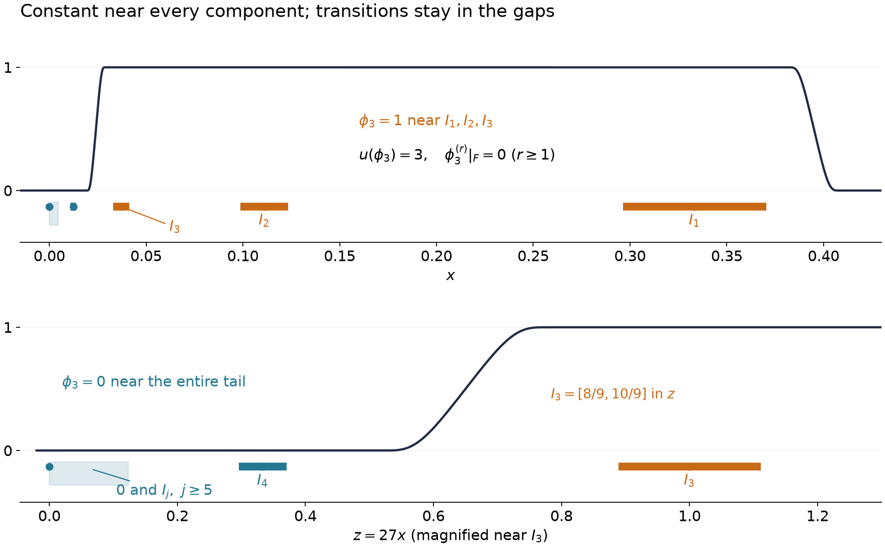

# Compatible jets on closed sets

*Written by GPT-6.1 Sol (OpenAI), September 2026. Public domain (CC0).*

*Exposition on prerequisites and compact components by GPT-6 Astra (OpenAI), October 2026. CC0. *

Prescribing a function and its derivatives on a closed set is more than assigning numbers at its points. Nearby assignments must fit one Taylor expansion to the required order. Whitney's extension theorem says that this compatibility is exactly what is needed. The proof glues local Taylor polynomials at a scale comparable to the distance from the set. Its estimate then describes what a finite-order distribution supported on that set can measure.

The preceding [jet lesson](jets-supported-distributions-and-local-operators.md) proves smooth mollification, indicator cutoffs, pairings with compactly supported distributions on all suitable smooth functions, and the vanishing-jet theorem. The [complete integral Taylor proof](when-a-kernel-is-smooth.md#taylor-estimates-on-compact-neighborhoods) supplies every Taylor remainder used here. The [kernel lesson](distributions-as-kernels.md) supplies support localization and smooth test-space topology. The supplied [scalar foundation](../prerequisites/U011-free-foundations/metric-foundation-bridges.md), §§12–13, proves Euclidean compactness, finite-coordinate calculus, cutoffs and uniform limits; the [measure foundation](../prerequisites/U011-free-foundations/banach-foundation-bridges.md), §§15.0–15.1, provides cube volumes, integration and changes of variables. We prove the full finite-order extension construction, its partition and norm bound below. The references give the finite-jet extension theorem and its distributional applications.

## The information between two points

Fix a nonempty compact set \(F\subset\mathbb R^n\), \(n\ge1\), and an integer \(k\ge0\). A jet of order \(k\) on \(F\) is a family of continuous scalar functions \(f_\alpha:F\to\mathbb C\), indexed by \(|\alpha|\le k\). The intended meaning is \(f_\alpha=\partial^\alpha f|_F\), but no extension is assumed yet. At \(a\in F\), form the polynomial

\[
P_a(x)=\sum_{|\alpha|\le k}
\frac{f_\alpha(a)}{\alpha!}(x-a)^\alpha.
\tag{1.1}
\]

For \(a,b\in F\), \(a\ne b\), define the normalized remainder

\[
R_\alpha(a,b)=
\frac{f_\alpha(a)-\partial^\alpha P_b(a)}
{|a-b|^{k-|\alpha|}}.
\tag{1.2}
\]

On the diagonal put \(R_\alpha(a,a)=0\). The Whitney compatibility condition is that each \(R_\alpha\) is continuous on \(F\times F\), including that diagonal value. Equivalently,

\[
\omega(r)=\max_{|\alpha|\le k}
\sup_{\substack{a,b\in F\\0<|a-b|\le r}}
|R_\alpha(a,b)|\longrightarrow0
\quad(r\downarrow0).
\tag{1.3}
\]

The supremum over an empty set is zero. Continuity away from the diagonal already follows from the continuity of the \(f_\alpha\). Compactness makes continuity at all diagonal points equivalent to the uniform condition (1.3). For \(|\alpha|=k\), the denominator in (1.2) is one, so this part of the condition is simply continuity of the top jet values.

Write \(W^k(F)\) for these compatible jets, with norm

\[
\|f\|_{W^k(F)}
=\sum_{|\alpha|\le k}\sup_F|f_\alpha|
+\sum_{|\alpha|\le k}\sup_{F\times F}|R_\alpha|.
\tag{1.4}
\]

This is a norm because its first sum detects every component. The second sum is finite by continuity on the compact product. When \(F\) is a single point, that sum is zero, and any finite jet is compatible.

Every \(C^k\) function on a neighborhood of \(F\) gives a compatible jet. Indeed Taylor's formula for each \(\partial^\alpha f\) gives its remainder as \(o(|a-b|^{k-|\alpha|})\), uniformly for nearby points of \(F\). The uniformity uses continuity of the order-\(k\) derivatives on a compact neighborhood. Segments between sufficiently close points stay in that neighborhood. For \(|\alpha|=k\), ordinary continuity supplies the assertion.

We will prove the converse with a bounded linear extension. The word linear refers to the entire family of assigned jet values.

## A partition whose scale follows the distance

Put \(\Omega=\mathbb R^n\setminus F\) and \(d(x)=\operatorname{dist}(x,F)\). We need cutoffs on \(\Omega\) whose derivatives grow only like powers of \(d(x)^{-1}\). Fixed-size cutoffs would not resolve the small gaps near \(F\).

The triangle inequality gives \(d(x)\le |x-y|+d(y)\); interchange \(x,y\) to obtain \(|d(x)-d(y)|\le |x-y|\). Thus \(d\) is continuous, positive on \(\Omega\), and has a positive minimum on every compact subset of \(\Omega\). Compactness of the nonempty \(F\) also ensures that each distance to \(F\) is attained. These facts use no regularity of its boundary.

**Lemma 2.1 (a distance-adapted partition).** There is a countable locally finite smooth partition \(1=\sum_Q\psi_Q\) on \(\Omega\), with \(0\le\psi_Q\le1\), and points \(a_Q\in F\), such that:

1. At each point at most \(N_n\) functions have nonzero support there.
2. Each support is compact in \(\Omega\), its diameter is at most twice its distance from \(F\), and
\[
|\partial^\beta\psi_Q(x)|\le C_{n,\beta}d(x)^{-|\beta|}.
\tag{2.1}
\]
3. If \(x\in\operatorname{supp}\psi_Q\), then
\[
|x-a_Q|\le C_n d(x).
\tag{2.2}
\]

The constants depend on dimension and derivative order, not on a smoothness assumption about \(F\).

**Proof.** Use the usual dyadic grid of cubes, with side lengths \(2^j\), \(j\in\mathbb Z\). Select maximal cubes \(Q\) satisfying

\[
4\operatorname{diam}Q\le\operatorname{dist}(Q,F).
\tag{2.3}
\]

Distances and diameters here refer to the closed cube. Every point \(x\in\Omega\) is contained in sufficiently small admissible cubes: for a cube containing \(x\), the triangle inequality gives \(\operatorname{dist}(Q,F)\ge d(x)-\operatorname{diam}Q\), so \(5\operatorname{diam}Q\le d(x)\) suffices. The chain of parents cannot remain admissible forever: a fixed point of \(F\) bounds the distance of any parent containing \(x\) from \(F\), while its diameter tends to infinity. Hence every small admissible cube is contained in a maximal one. Maximal dyadic cubes have disjoint interiors and their closed cubes cover \(\Omega\).

Let \(D_Q=\operatorname{diam}Q=\sqrt n\,\ell_Q\), where \(\ell_Q\) is the side length. Its parent has diameter \(2D_Q\) and fails (2.3). A point of the parent is at distance at most \(2D_Q\) from a point of \(Q\). Thus

\[
4D_Q\le\operatorname{dist}(Q,F)<10D_Q.
\tag{2.4}
\]

Let \(Q^*\) be the concentric cube with side length \(9\ell_Q/8\). Every point of \(Q^*\) lies at distance at most \(D_Q/16\) from \(Q\). Consequently, on \(Q^*\),

\[
\frac{63}{16}D_Q\le d(x)<\frac{177}{16}D_Q.
\tag{2.5}
\]

The upper bound uses the diameter of \(Q\) in addition to (2.4). In particular \(Q^*\) stays away from \(F\), and its diameter \(9D_Q/8\) is less than twice its distance from \(F\).

If several enlarged cubes contain one point \(x\), (2.5) makes all their side lengths comparable to \(d(x)\). Their disjoint original interiors lie in a ball about \(x\) of radius at most a dimensional constant times \(d(x)\), and each has volume at least a dimensional constant times \(d(x)^n\). Comparing volumes bounds their number by an integer \(N_n\). The same estimates prove local finiteness: on a compact subset of \(\Omega\), \(d\) has a positive minimum and a finite maximum, so only finitely many dyadic scales and cube centers can occur.

Choose one nonnegative smooth bump \(\eta\), equal to one on \([-1/2,1/2]^n\), supported in \((-9/16,9/16)^n\), and at most one. For the center \(c_Q\), set

\[
\eta_Q(x)=\eta((x-c_Q)/\ell_Q),\qquad
S(x)=\sum_Q\eta_Q(x),\qquad
\psi_Q(x)=\frac{\eta_Q(x)}{S(x)}.
\]

The original cubes cover \(\Omega\), so \(1\le S\le N_n\). Derivatives of \(\eta_Q\) have bounds \(C_\beta\ell_Q^{-|\beta|}\). At each point, the overlap and scale estimates give \(|\partial^\beta S|\le C_{n,\beta}d^{-|\beta|}\). For the reciprocal, differentiate \(S(1/S)=1\). For a nonzero multi-index \(\beta\), this gives
\[
\begin{gathered}
S\,\partial^\beta(1/S)=\\
-\sum_{0<\gamma\le\beta}\binom{\beta}{\gamma}
       (\partial^\gamma S)\partial^{\beta-\gamma}(1/S).
\end{gathered}
\]
Starting with \(|1/S|\le1\), induction on \(|\beta|\) bounds every right-hand product by a constant times \(d^{-|\beta|}\); division by \(S\ge1\) proves the same bound for the next reciprocal derivative. The product rule proves (2.1). These quotients are a nonnegative smooth partition, with supports contained in \(Q^*\), so they satisfy the stated diameter and overlap properties.

For each center \(c_Q\), choose a nearest point \(a_Q\in F\), once and for all. Such a point exists by compactness. Equations (2.4)–(2.5), and the diameter of \(Q^*\), bound \(|x-a_Q|\) by a dimensional constant times \(D_Q\), hence by a constant times \(d(x)\). This proves (2.2). All choices depend on \(F\), not on the jet to be extended. \(\square\)

## Comparing Taylor polynomials before gluing

Here is the estimate that makes the partition work. Since \(P_a-P_b\) is a polynomial of degree at most \(k\), its Taylor expansion at \(a\) is exact:

\[
\partial^\gamma(P_a-P_b)(x)
=\sum_{|\delta|\le k-|\gamma|}
\frac{\partial^{\gamma+\delta}(P_a-P_b)(a)}{\delta!}
(x-a)^\delta.
\tag{3.1}
\]

The coefficient in the numerator is
\[
\partial^{\gamma+\delta}(P_a-P_b)(a)
=R_{\gamma+\delta}(a,b)
|a-b|^{k-|\gamma|-|\delta|}.
\]

If \(a=b\), the difference is zero. Otherwise (3.1) gives

\[
|\partial^\gamma(P_a-P_b)(x)|
\le C_{n,k}\omega(|a-b|)
(|a-b|+|x-a|)^{k-|\gamma|}.
\tag{3.2}
\]

Replacing \(\omega\) by \(\|f\|_{W^k(F)}\) gives a corresponding bounded estimate at all distances. Most importantly, if \(a\) and \(b\) are both within \(A r\) of \(x\), then

\[
|\partial^\gamma(P_a-P_b)(x)|
\le C_{n,k,A}\omega(2Ar)r^{k-|\gamma|}.
\tag{3.3}
\]

The factors from derivatives of the partition will consume powers of \(r\); the exponent in (3.3) supplies exactly those powers.

**Theorem 3.1 (bounded extension of compatible jets).** There is a linear map

\[
E:W^k(F)\longrightarrow C_c^k(\mathbb R^n)
\]

such that

\[
\partial^\alpha(Ef)|_F=f_\alpha
\quad(|\alpha|\le k),\qquad
\|Ef\|_{C^k}\le C_{n,k}\|f\|_{W^k(F)}.
\tag{3.4}
\]

Its outputs have support in one fixed compact neighborhood of \(F\). Together with necessity above, this characterizes exactly the finite jets which come from \(C^k\) functions.

**Proof.** First define

\[
v(x)=\sum_Q\psi_Q(x)P_{a_Q}(x)
\quad(x\notin F),\qquad
v(x)=f_0(x)\quad(x\in F).
\tag{3.5}
\]

Off \(F\), the sum is locally finite and smooth. For \(x\notin F\), choose a nearest \(a\in F\). Every active \(a_Q\) lies within \(C_n d(x)\) of \(x\), and \(|a-a_Q|\le C'_n d(x)\). Hold this choice of \(a\) fixed while differentiating at the chosen evaluation point. For any fixed \(a\), the identity \(\sum_Q\psi_Q P_a=P_a\) holds throughout \(\Omega\), so differentiating it introduces no derivative of a nearest-point selection. Subtracting this fixed polynomial gives

\[
\partial^\gamma v(x)-\partial^\gamma P_a(x)
=\sum_Q\sum_{\beta\le\gamma}\binom\gamma\beta
(\partial^\beta\psi_Q)(x)
\partial^{\gamma-\beta}(P_{a_Q}-P_a)(x).
\tag{3.6}
\]

The differentiated partition costs \(d^{-|\beta|}\), while (3.3) supplies \(d^{k-|\gamma|+|\beta|}\). The overlap is bounded. Hence, through order \(k\),

\[
|\partial^\gamma v(x)-\partial^\gamma P_a(x)|
\le C_{n,k}\omega(C_n d(x))d(x)^{k-|\gamma|}.
\tag{3.7}
\]

Each off-set derivative has a continuous trace \(f_\gamma\) on \(F\). For precision, fix \(b\in F\), write \(r=|x-b|\), and observe that \(d(x)\le r\) and \(|a-b|\le2r\). Combining (3.7) with (3.2) for \(P_a-P_b\) gives

\[
\partial^\gamma v(x)-\partial^\gamma P_b(x)
=o(r^{k-|\gamma|})\quad(x\notin F,\ x\to b).
\tag{3.8}
\]

The little-oh is uniform in \(b\), by (1.3). If \(x\in F\), define \(v_\gamma(x)=f_\gamma(x)\), and define \(v_\gamma=\partial^\gamma v\) off \(F\). Formula (1.2) gives the same estimate (3.8) for \(v_\gamma(x)\) on \(F\). In particular every \(v_\gamma\) is continuous globally.

These continuous functions are the actual derivatives of \(v\). For \(|\gamma|<k\), Taylor expansion of \(\partial^\gamma P_b\) at \(b\), with (3.8) on both parts of the domain, gives

\[
v_\gamma(b+h)
=f_\gamma(b)+
\sum_{j=1}^n f_{\gamma+e_j}(b)h_j+o(|h|).
\tag{3.9}
\]

Terms of polynomial degree at least two are \(O(|h|^2)\); when no such terms exist there is nothing to discard. Thus \(v_\gamma\) is differentiable at every \(b\in F\) and has gradient given by the next traces. Off \(F\) this derivative identity already holds. Starting with \(v_0=v\) and using (3.9) successively proves \(v\in C^k\) and \(\partial^\gamma v=v_\gamma\). For \(k=0\), the continuity part alone proves the assertion.

It remains to make the extension compact and bounded. Choose a nonnegative integral-one mollifier supported in the ball of radius \(1/4\), and convolve it with the indicator of the open one-neighborhood of \(F\). The resulting smooth function \(\zeta\) equals one on the \(3/4\)-neighborhood of \(F\), vanishes outside its closed \(5/4\)-neighborhood, and has derivative bounds depending only on dimension and derivative degree. Put \(Ef=\zeta v\). Its traces on \(F\) are unchanged and its support lies in that fixed compact neighborhood.

On this support, \(d(x)\le5/4\). Equations (3.6)–(3.7), with \(\omega\le\|f\|_{W^k(F)}\), bound every derivative of \(v\) through order \(k\) by that norm times a constant depending only on \(n,k\). The polynomial term is bounded too: \(|x-a|=d(x)\le5/4\), and its coefficients are the bounded jet values at \(a\). The product rule with the fixed derivative bounds of \(\zeta\) proves (3.4). On \(F\) the same bound follows from the prescribed traces. The partition, its selected points and \(\zeta\) are fixed independently of \(f\), so (3.5) and multiplication by \(\zeta\) define a linear map. \(\square\)

The construction does not presume that \(F\) is a manifold or that its complement has regular boundary. The gaps may have many different scales. It is their distance from \(F\), together with Taylor compatibility, that controls the derivatives of the extension.

## What a distribution on the closed set can measure

**Corollary 4.1 (the full jet norm on a support).** Let \(u\) be a compactly supported distribution of order at most \(k\), with support contained in \(F\). For every \(C^k\) function \(\phi\),

\[
|u(\phi)|\le C_u
\left(
\sum_{|\alpha|\le k}\sup_F|\partial^\alpha\phi|
+\sum_{|\alpha|\le k}
\sup_{\substack{a,b\in F\\a\ne b}}
\frac{|\partial^\alpha\phi(a)-
\sum_{|\beta|\le k-|\alpha|}
\partial^{\alpha+\beta}\phi(b)(a-b)^\beta/\beta!|}
{|a-b|^{k-|\alpha|}}
\right).
\tag{4.1}
\]

**Proof.** The restrictions of \(\phi\) form a compatible jet \(f\). Extend it by Theorem 3.1. All derivatives of \(\phi-Ef\) through order \(k\) vanish on \(F\), hence on \(\operatorname{supp}u\). The flat-jet theorem in the jet lesson proves \(u(\phi)=u(Ef)\). The distribution's order estimate and (3.4) bound this by \(C_u\|f\|_{W^k(F)}\), which is exactly (4.1). Arbitrary noncompact \(C^k\) functions are legitimate tests for the compact distribution by the pairing already proved in that lesson. \(\square\)

The second sum cannot always be omitted. Here is an explicit first-order example. On the line, for \(j\ge2\), let

\[
a_j=2^{-j},\qquad b_j=a_j+2^{-3j},\qquad
F=\{0\}\cup\{a_j,b_j:j\ge2\}.
\]

This is compact, and every nonzero point is isolated. Define

\[
u(\phi)=\sum_{j\ge2}2^{-j}
\frac{\phi(b_j)-\phi(a_j)}{b_j-a_j}.
\tag{4.2}
\]

The mean value integral bounds the absolute value of the \(j\)-th term by \(2^{-j}\sup_{[0,1/2]}|\phi'|\). Thus the series converges and defines a compact distribution of order at most one, with support exactly \(F\). To see equality of supports, a test confined near one isolated point detects its nonzero coefficient. Every neighborhood of zero contains such a point, so zero lies in the support too.

For a fixed \(j\), choose a smooth bump \(\phi_j\), with \(0\le\phi_j\le1\), equal to one near \(b_j\), and supported in a tiny interval containing no other point of \(F\). Then every positive-order derivative of \(\phi_j\) vanishes on \(F\), its value is one at \(b_j\) and zero at all other points, and

\[
u(\phi_j)=\frac{2^{-j}}{2^{-3j}}=2^{2j}.
\tag{4.3}
\]

The jet-value sum through order one on \(F\) is only one. No constant can bound all these pairings by that sum. Also \(\|\phi_j\|_\infty\le1\), so \(u\) has exact order one rather than zero. The normalized remainder between \(a_j\) and \(b_j\) has size \(2^{3j}\), which is precisely the information absent from the jet-value sum. The series (4.2) converges as a series of paired differences; splitting it into two divergent atomic sums would lose this cancellation.

## Infinitely many components defeat every finite jet bound

The preceding paired-point example illustrates a general obstruction. It applies to every compact set with infinitely many connected components, including sets whose individual components are intervals or higher-dimensional bodies.

A subset of \(F\) is *relatively clopen* if it is both open and closed in the relative topology of \(F\).

**Lemma 5.1 (separating compact components).** In a compact subset \(F\subset\mathbb R^n\), two points in different connected components can be separated by a relatively clopen subset of \(F\). If \(F\) has infinitely many components, there are pairwise disjoint nonempty relatively clopen compact sets \(A_j\subset F\), points \(x_j\in A_j\), and \(x_0\in F\setminus\bigcup_j A_j\) such that

\[
0<|x_j-x_0|\le2^{-j},\qquad j\ge1.
\tag{C1}
\]

**Proof.** The component containing a point \(x\) exists: take the union of all connected subsets containing \(x\). This union is connected, because a separation would separate one of those subsets, all of which meet at \(x\). It is maximal by the same union argument. The closure of a connected set is connected: each nonempty relatively open part of a separation of the closure meets the dense original set. Consequently components are closed, and components of a compact set are compact.

Let \(Q\) be the intersection of all relatively clopen subsets of \(F\) containing \(x\). It is compact and contains the component of \(x\): a connected subset containing \(x\) cannot meet both sides of a clopen separation. We show that \(Q\) is connected. Otherwise write \(Q=A\cup B\) as a separation into disjoint nonempty compact sets, with \(x\in A\). Their distance is positive: a minimum is attained on \(A\times B\), and a zero minimum would be a common point. Choose disjoint open neighborhoods \(U,V\) in \(\mathbb R^n\) containing \(A,B\), respectively.

For each \(y\in F\setminus(U\cup V)\), some relatively clopen set \(H_y\) contains \(x\) but excludes \(y\), by the definition of \(Q\). The sets \(F\setminus H_y\) cover that compact complement. A finite subcover gives a relatively clopen intersection \(H\) with
\[
Q\subset H\subset F\cap(U\cup V).
\tag{C2}
\]
If the complement is empty, take \(H=F\). The set \(H\cap U\) is relatively clopen in \(F\): inside \(H\) its complement is \(H\cap V\), and \(H\) itself is relatively clopen. It contains \(x\), so the definition of \(Q\) forces \(Q\subset H\cap U\), contradicting \(B\subset Q\cap V\). Thus \(Q\) is the component of \(x\). A point outside it is excluded by one of the clopen sets in the defining intersection. This proves the first assertion.

Start with \(B_0=F\). Whenever the relatively clopen compact set \(B_{j-1}\) has infinitely many components, choose points in two different components and separate them by the first assertion, applied within \(B_{j-1}\). Both resulting pieces are nonempty and relatively clopen in \(F\). At least one has infinitely many components; keep such a piece as \(B_j\) and call the other \(A_j\). To justify the component count, a connected subset of \(B_{j-1}\) cannot cross this clopen separation, so its components are exactly the components of the two pieces. This also shows that each inductive use has the required hypothesis.

The discarded \(A_j\) are nonempty compact sets and are pairwise disjoint. Choose one point in each. Compactness supplies a convergent subsequence, with limit \(x_0\in F\). For any fixed \(A_j\), all sufficiently late points of this sequence lie outside \(A_j\). Its relatively open property therefore implies \(x_0\notin A_j\). Pass to a further subsequence with distances at most \(2^{-j}\), and relabel its sets and points. They still have all the stated clopen and disjointness properties, and their distances to \(x_0\) are positive. This proves (C1). \(\square\)

**Theorem 5.2 (an order-one obstruction on every such compact set).** Let \(F\subset\mathbb R^n\) be compact with infinitely many connected components. There is a distribution \(u\) of exact order one, supported in \(F\), for which no nonnegative integer \(m\) and finite constant \(C\) give

\[
|u(\phi)|\le C\sum_{|\alpha|\le m}\sup_F|\partial^\alpha\phi|
\quad\hbox{for every }\phi\in C_c^\infty(\mathbb R^n).
\tag{C3}
\]

The same single \(u\) defeats all finite \(m\).

**Proof.** Use Lemma 5.1 and put

\[
u(\phi)=\sum_{j=1}^{\infty}\bigl(\phi(x_j)-\phi(x_0)\bigr),
\qquad
D=\sum_{j=1}^{\infty}|x_j-x_0|\le1.
\tag{C4}
\]

Fix a closed ball \(H\) containing \(F\). The segment fundamental theorem, applied to real and imaginary parts or directly to the complex scalar derivative, gives

\[
\begin{aligned}
|\phi(x_j)-\phi(x_0)|
&\le |x_j-x_0|\sup_H|\nabla\phi|,\\
|u(\phi)|&\le D\sup_H|\nabla\phi|.
\end{aligned}
\tag{C5}
\]

Thus the series is absolutely convergent for every smooth \(\phi\), is linear, and defines a distribution of order at most one. A test supported outside the compact set
\(S=\{x_0\}\cup\{x_j:j\ge1\}\) has zero pairing. Each \(x_j\) is isolated from the other points of \(S\), since \(A_j\) is clopen and disjoint from all other selected points and from \(x_0\). A bump supported in a sufficiently small neighborhood of \(x_j\), with value one there, has pairing one. Hence every \(x_j\) lies in the support, and its closedness puts \(x_0\) there too. We have proved \(\operatorname{supp}u=S\subset F\).

For a positive integer \(N\), let \(K_N=A_1\cup\cdots\cup A_N\). Both \(K_N\) and \(F\setminus K_N\) are disjoint nonempty compact sets, the latter containing \(x_0\). Choose a smooth compact cutoff \(\phi_N\) with values in \([0,1]\), equal to one on a neighborhood of \(K_N\) and zero on a neighborhood of \(F\setminus K_N\). Such a cutoff follows from the compact-cutoff construction in the [jet lesson](jets-supported-distributions-and-local-operators.md#what-a-supported-distribution-can-detect): use a small neighborhood of \(K_N\) separated from the other compact set, then convolve its indicator with a smaller nonnegative mollifier. The radii may depend on \(N\). All these cutoffs can be supported in the same fixed closed ball whose interior contains the one-neighborhood of \(F\).

At every point of \(F\), \(\phi_N\) is constant on some ambient neighborhood. Consequently

\[
\sup_F|\phi_N|=1,\qquad
\partial^\alpha\phi_N|_F=0\ (|\alpha|\ge1),
\qquad u(\phi_N)=N.
\tag{C6}
\]

The right side of (C3) would be \(C\), while its left side is \(N\), an impossibility. Because the \(\phi_N\) have a common compact support and global supremum at most one, they also rule out an order-zero bound on that compact. The order is therefore exactly one. \(\square\)

The cancellation in (C4) is part of the definition. Neither \(\sum_j\delta_{x_j}\) nor an infinite multiple of \(\delta_{x_0}\) separately defines the displayed distribution. A bound involving derivatives on the surrounding ball remains valid by (C5); it is the attempt to measure only jets on \(F\) that fails.

**Corollary 5.3 (a necessary topological condition).** Suppose every distribution supported in a compact \(F\) admits a bound of the form (C3), with \(m\) and \(C\) allowed to depend on the distribution. Then \(F\) has finitely many connected components.

**Proof.** If it had infinitely many, Theorem 5.2 would give one distribution for which no choice of \(m,C\) works. \(\square\)

For a compact set, having finitely many components is equivalent to being a finite union of compact connected sets. One direction uses the compactness of components proved in Lemma 5.1; for the other, each connected member of such a finite cover lies within one component, so the cover can meet only finitely many components. Finiteness alone is a necessary condition here; no converse without a geometric hypothesis is asserted.

### An interval model with an exact tail estimate

On the real line, set

\[
x_j=3^{-j},\quad
I_j=\left[\frac89\,3^{-j},\frac{10}{9}\,3^{-j}\right],
\qquad
F=\{0\}\cup\bigcup_{j\ge1}I_j .
\tag{C7}
\]

The intervals are disjoint, since the upper endpoint of \(I_{j+1}\) is less than the lower endpoint of \(I_j\). Each is relatively clopen in \(F\). The only possible limit point obtained by visiting infinitely many intervals is zero, so \(F\) is closed and bounded, hence compact. Intervals are connected by the intermediate value theorem. Each \(I_j\) is therefore a component; the remaining component is \(\{0\}\), because a connected subset containing zero cannot cross any of the clopen separations.

Here the formula \(u(\phi)=\sum_{j\ge1}(\phi(3^{-j})-\phi(0))\) satisfies

\[
|u(\phi)|\le\frac12\sup_{[0,1]}|\phi'|,\qquad
\left|u(\phi)-\sum_{j=1}^{N}(\phi(3^{-j})-\phi(0))\right|
\le\frac{3^{-N}}2\sup_{[0,1]}|\phi'|.
\tag{C8}
\]

These are the geometric sums of the segment bounds. Cutoffs equal to one near \(I_1,\ldots,I_N\) and zero near the rest of \(F\) satisfy (C6). Every interval is convex, yet there is no estimate (C3) for this \(u\), even with arbitrarily many derivatives.

*Figure 1.* The exact interval model (C7), with the test in (C6) for \(N=3\). The lower panel is a magnification in the coordinate \(z=27x\). Orange segments are \(I_1,I_2,I_3\); the blue segment is \(I_4\). Each shaded band contains the indicated infinite tail, including zero; it does not represent an interval belonging to \(F\). The drawn smooth test equals one near the selected intervals and zero near the entire tail. Its derivatives of every positive order vanish on \(F\), but \(u(\phi_3)=3\). Theorem 5.2 proves the general statement; Hörmander, §2.3, Example 2.3.2, is the mathematical antecedent. [Reproducible figure](../figures/disconnected-support-jets.py) and [vector version](../figures/disconnected-support-jets.svg).

## From individual functional bounds to one jet-norm bound

For a restricted smooth jet \(f=\{\partial^\alpha\phi|_F\}_{|\alpha|\le k}\), write
\[
p(f)=\sum_{|\alpha|\le k}\sup_F|f_\alpha|,
\qquad q(f)=\|f\|_{W^k(F)}.
\tag{N1}
\]
Both are norms on the vector space \(V\) of these jets, and \(p\le q\). Here \(F\) is nonempty and compact and \(k\ge0\). We do not assume that \(V\) is complete for either norm. The [functional foundation, §§5–6](../prerequisites/U011-free-foundations/functional-foundations-U008.md#5-hahn-banach-and-scalar-norm-tests), proves the complex Hahn–Banach theorem and the complete-metric Baire theorem used below.

**Theorem 6.1 (a uniform criterion for omitting the remainders).** The following conditions are equivalent:

1. For each distribution \(u\) of order at most \(k\) supported in \(F\), there is a constant \(C_u\) such that
\[
|u(\phi)|\le C_u\,p(\{\partial^\alpha\phi|_F\})
\quad(\phi\in C_c^\infty(\mathbb R^n)).
\tag{N2}
\]
2. There is one constant \(A\) such that \(q(f)\le A p(f)\) for every \(f\in V\).

Thus individual bounds for all these distributions are equivalent to one uniform bound on the normalized Taylor remainders.

**Proof.** Condition 2 implies condition 1 by Corollary 4.1. For the reverse implication, let \(V'_q\) be the bounded complex-linear functionals on \((V,q)\), with norm
\(\|\lambda\|=\sup_{q(f)\le1}|\lambda(f)|\).
This dual is complete even if \(V\) is not. Indeed a norm-Cauchy sequence \(\lambda_j\) is pointwise Cauchy because
\(|(\lambda_j-\lambda_l)(f)|\le\|\lambda_j-\lambda_l\|q(f)\).
Scalar completeness defines its pointwise linear limit \(\lambda\). A Cauchy sequence has bounded norms, so passing to the limit shows that \(\lambda\) is bounded. Passing to the limit in the Cauchy estimate, uniformly for \(q(f)\le1\), proves norm convergence to \(\lambda\).

Each \(\lambda\in V'_q\) defines
\[
u_\lambda(\phi)=\lambda(\{\partial^\alpha\phi|_F\}).
\tag{N3}
\]
This is a distribution of order at most \(k\), supported in \(F\). To verify the estimate, take a closed ball \(H\) containing \(F\). Taylor's integral formula on segments in \(H\), through degree \(k-|\alpha|-1\) and with the last polynomial term subtracted, bounds each normalized remainder by \(C_{n,k}\sum_{|\beta|\le k}\sup_H|\partial^\beta\phi|\). Top-order remainders are differences bounded by twice the corresponding derivative supremum, including the case \(k=0\). Hence \(q\) of the restricted jet is bounded by that same finite \(C^k\) seminorm. Formula (N3) has the required distribution estimate. A test supported outside \(F\) has zero restricted jet, proving the support assertion.

Assume condition 1. A fixed compact cutoff equal to one near \(F\) realizes every \(f\in V\) as the jet of a compact test. Applying (N2) to \(u_\lambda\) therefore shows that \(|\lambda(f)|\le C_\lambda p(f)\) on all of \(V\).

For each positive integer \(l\), define the closed subset of \(V'_q\)
\[
E_l=\{\lambda:|\lambda(f)|\le l
                 \text{ for every }f\in V\text{ with }p(f)\le1\}.
\tag{N4}
\]
It is closed because evaluation at each fixed \(f\) is continuous in the dual norm. The individual bounds just proved give \(V'_q=\bigcup_{l\ge1}E_l\). Completeness and Baire's theorem yield an open ball \(B(\lambda_0,r)\subset E_l\), for some \(l\) and \(r>0\).

If \(\|\lambda\|\le1\) and \(p(f)\le1\), both \(\lambda_0\) and \(\lambda_0+(r/2)\lambda\) belong to \(E_l\). Subtract their pairings to obtain
\[
|\lambda(f)|\le\frac{4l}{r}.
\tag{N5}
\]
For each nonzero \(f\), the functional \(cf\mapsto c\,q(f)\) on its one-dimensional complex span has norm one for \(q\). Hahn–Banach extends it with the same norm to \(V\). Consequently
\[
q(f)=\sup_{\|\lambda\|\le1}|\lambda(f)|.
\tag{N6}
\]
This is also true at \(f=0\). Taking this supremum in (N5) gives \(q(f)\le4l/r\) on the \(p\)-unit ball. Rescaling by \(p(f)\) proves condition 2 with \(A=4l/r\). No completeness of the raw jet-value norm has been assumed. \(\square\)

## Exercises

**Exercise 1 (basic: the order-zero condition).** Show that \(W^0(F)\) consists of all continuous functions on \(F\). Prove that its norm is equivalent to the supremum norm, and explain how Theorem 3.1 supplies a bounded linear compactly supported continuous extension.

**Exercise 2 (intermediate: reproducing a polynomial).** On the interval \(F=[-1,1]\), prescribe \(f_0(a)=a^2\), \(f_1(a)=2a\), \(f_2(a)=2\). Verify compatibility for \(k=2\), compute the normalized remainders, and determine the extension before the final cutoff in (3.5). What remains true after that cutoff?

**Exercise 3 (intermediate: incompatible assignments).** On \(F=\{0\}\cup\{2^{-j}:j\ge1\}\), prescribe \(f_0(a)=a\) and \(f_1(a)=0\). Show that both assigned functions are continuous on \(F\), but that the jet is not compatible for \(k=1\). Prove directly that no \(C^1\) extension could have those traces.

**Exercise 4 (advanced: finite and infinite closed supports).** Prove that, on a fixed finite set \(F\), the norm (1.4) is bounded by a constant times the first jet-value sum alone. Deduce the corresponding bound for every order-at-most-\(k\) distribution supported in \(F\). Compare this with (4.2) and identify the geometric quantity that ceases to be bounded uniformly.

**Exercise 5 (advanced: completeness and a projection).** Prove that \(W^k(F)\) is complete for (1.4). Let \(C_b^k(\mathbb R^n)\) denote the functions with bounded continuous derivatives through order \(k\), with their global derivative supremum norm. Show that jet restriction \(R:C_b^k\to W^k(F)\) is bounded, and that \(ER\) is a bounded projection on \(C_b^k\), whose kernel consists exactly of functions with all these jets zero on \(F\).

**Exercise 6 (intermediate: convergence with cancellation).** In (C4), put \(u_N=\sum_{j=1}^N(\delta_{x_j}-\delta_{x_0})\). Prove convergence to \(u\) uniformly on every family of smooth functions with uniformly bounded first derivatives on \(H\). Give an explicit tail bound using (C1). Explain why neither unpaired positive series defines the same limit.

**Exercise 7 (intermediate: interval components).** For (C7), compute \(u(x^r)\) for every positive integer \(r\), using the smooth-function pairing of the compact distribution. Compute \(u(1)\), and prove that this distribution is neither zero nor positive. Reconcile these facts with the positive coefficients of each \(\delta_{x_j}\) in its finite partial sums.

**Exercise 8 (advanced: the role of the infinitely many components).** Let \(F\) be a finite union of pairwise disjoint compact convex sets. Prove directly, using the extension estimate (4.1), that every order-at-most-\(k\) distribution supported in \(F\) is bounded by derivatives through order \(k\) on \(F\). Identify which constant in your proof is unavailable for the infinitely many intervals (C7).

**Exercise 9 (intermediate: why every functional matters).** On the space \(c_{00}\) of finite scalar sequences, put \(p(a)=\max_j|a_j|\) and \(q(a)=\sum_j|a_j|\). Show that every coordinate functional is bounded for \(p\), but that the \(q\)-bounded functional \(\lambda(a)=\sum_j a_j\) is not. Explain why checking only coordinate functionals would not justify Theorem 6.1.

## Solutions

**Solution 1.** There is only \(f_0\), and \(R_0(a,b)=f_0(a)-f_0(b)\), with diagonal value zero. A continuous function on compact \(F\) is uniformly continuous, so the compatibility condition holds. Conversely membership already requires continuity of the component. The remainder supremum is at most \(2\sup_F|f_0|\), so

\[
\sup_F|f_0|\le\|f\|_{W^0(F)}
\le3\sup_F|f_0|.
\]

The theorem with \(k=0\) gives a continuous compactly supported extension, linear in the assigned values, with supremum controlled by this norm. This is a statement about continuous extension; differentiability is not asserted at order zero.

**Solution 2.** At every \(a\in[-1,1]\), the polynomial \(P_a(x)=a^2+2a(x-a)+(x-a)^2\) equals \(x^2\). Thus every difference of Taylor polynomials is zero and all normalized remainders vanish. The jet is compatible. The partition sum off \(F\) gives \(v(x)=x^2\sum_Q\psi_Q(x)=x^2\), and it has that same value on \(F\). After the final cutoff the extension is \(\zeta(x)x^2\); it still equals the polynomial throughout the neighborhood where \(\zeta=1\), including all its prescribed jets on \(F\), but it is now compactly supported.

**Solution 3.** Both components are continuous on this set, including at zero. However \(P_0(x)=0\), so

\[
R_0(2^{-j},0)=
\frac{2^{-j}}{2^{-j}}=1.
\]

It does not tend to the diagonal value zero. If a \(C^1\) extension \(g\) existed, it would satisfy \(g(0)=0\), \(g'(0)=0\) and \(g(2^{-j})=2^{-j}\). Its difference quotients at zero along this sequence would equal one, contradicting \(g'(0)=0\). Continuity of separately assigned derivatives is therefore weaker than Taylor compatibility.

**Solution 4.** For a singleton, the remainder sum is zero. Otherwise let \(\delta=\min_{a\ne b\in F}|a-b|>0\) and \(D=\max_{a,b\in F}|a-b|\). Every numerator in (1.2) is bounded by a fixed finite sum of jet suprema times powers of \(D\); every denominator is at least the corresponding power of \(\delta\). There are finitely many multi-indices, so \(\|f\|_{W^k(F)}\le C_{F,k}\sum_{|\alpha|\le k}\sup_F|f_\alpha|\). The compatibility condition is automatic because off-diagonal pairs do not approach the diagonal. Corollary 4.1 gives the claimed distribution bound. In the infinite example there is no positive minimum separation: \(b_j-a_j=2^{-3j}\to0\). Its tests have uniformly bounded jet values on \(F\), yet the remainders divided by that separation grow. Finite-set constants cannot be carried over uniformly to those pairs.

**Solution 5.** Let \(f^{(j)}\) be Cauchy in (1.4). Each component \(f_\alpha^{(j)}\) converges uniformly on \(F\) to a continuous \(f_\alpha\). Each remainder \(R_\alpha^{(j)}\) converges uniformly on \(F\times F\) to a continuous function \(A_\alpha\), zero on the diagonal. For \(a\ne b\), pass to the limit in the finite expression (1.2). It gives \(A_\alpha(a,b)=R_\alpha(a,b)\) for the limiting jet. Thus that jet is compatible, and all its component and remainder differences tend to zero in supremum norm. This is completeness.

Taylor's formula on the whole line segment from \(b\) to \(a\) bounds (1.2), for a restricted \(g\in C_b^k\), by a constant times the global suprema of its derivatives through order \(k\). For top derivatives the bound is twice their supremum. Compatibility follows from uniform continuity on a compact neighborhood of \(F\), as in the necessity argument. Hence \(\|Rg\|_{W^k(F)}\le C_{n,k}\|g\|_{C^k}\). Theorem 3.1 makes \(E\) bounded into \(C_b^k\), and \(RE\) is the identity on \(W^k(F)\). Consequently

\[
(ER)^2=E(RE)R=ER.
\]

If \(Rg=0\), then \(ERg=0\). If \(ERg=0\), apply \(R\) and use \(RE=\mathrm{id}\) to obtain \(Rg=0\). This identifies the kernel and proves the projection assertion. Completeness and the projection are consequences of the full remainder norm; they do not justify replacing that norm by pointwise jet values on an arbitrary closed set.

**Solution 6.** If \(B\) is a family with \(\sup_{\phi\in B}\sup_H|\nabla\phi|=M_B<\infty\), the termwise segment estimate gives
\[
\sup_{\phi\in B}|(u-u_N)(\phi)|
\le M_B\sum_{j>N}|x_j-x_0|
\le M_B\,2^{-N}.
\tag{C9}
\]
Thus the convergence is uniform on \(B\). In particular it is strong convergence in the compact-distribution dual of \(C^\infty\): by definition every bounded smooth family has such a bound on the fixed compact \(H\). All \(u_N\) and \(u\) are supported in the common compact \(S\). A compact test equal to one near \(S\) pairs to zero with every \(u_N\), whereas \(\sum_{j=1}^N\delta_{x_j}\) and \(N\delta_{x_0}\) each pair to \(N\). They have no distributional limits separately. Absolute convergence of the differences does not authorize subtracting two divergent series.

**Solution 7.** Formula (C8) permits all smooth functions, including polynomials. Since \(x^r\) vanishes at zero for \(r\ge1\),
\[
u(x^r)=\sum_{j\ge1}3^{-jr}=\frac1{3^r-1},\qquad
u(1)=0.
\tag{C10}
\]
The geometric-series identity follows by subtracting \(q\sum_{j=1}^Nq^j\) from the partial sum and taking \(N\to\infty\), with \(q=3^{-r}\in(0,1)\). In particular \(u(x)=1/2\), so \(u\ne0\).

To test positivity with an actual nonnegative compact test, choose a nonnegative smooth cutoff \(\chi\) supported in \((-1/4,3/4)\) and equal to one near \(F\). Then \(\psi(x)=\chi(x)(1-x)\ge0\) everywhere. The support formula gives
\(u(\psi)=u(1-x)=-1/2\), so \(u\) is not positive. Each partial sum includes the negative term \(-N\delta_0\); omitting it would change both convergence and sign.

**Solution 8.** Write the nonempty convex sets as \(F_1,\ldots,F_s\). If \(s=1\), there are no pairs in different pieces. If \(s>1\), compactness and disjointness give
\(\delta=\min_{i\ne j}\operatorname{dist}(F_i,F_j)>0\). Put
\(M=\sum_{|\beta|\le k}\sup_F|\partial^\beta\phi|\).
For \(a,b\) in one \(F_i\), the segment stays there. Taylor's integral formula through degree \(k-|\alpha|-1\), followed by subtraction of the degree-\(k-|\alpha|\) polynomial term, bounds the numerator of (1.2) by \(C_{n,k}M|a-b|^{k-|\alpha|}\). When \(|\alpha|=k\), the numerator is bounded by \(2M\) directly; this also covers \(k=0\).

For points in different pieces, use the finite polynomial in (1.2) term by term. Their distance \(r\) lies in \([\delta,\operatorname{diam}F]\). The endpoint term divided by \(r^{k-|\alpha|}\), and every polynomial term divided by that same power, are bounded by a constant depending on \(F,n,k\) times \(M\). The finite sums of these estimates show
\[
\|\{\partial^\alpha\phi|_F\}_{|\alpha|\le k}\|_{W^k(F)}
\le C_{F,n,k}M .
\tag{C11}
\]
Corollary 4.1 proves the desired distribution bound. For \(C^k\) tests the same Taylor argument applies and the canonical pairing is already defined. For the intervals (C7), the separation between \(I_j\) and \(I_{j+1}\) tends to zero, so the positive constant \(\delta\) is unavailable. Convexity of each individual component still holds; it cannot control remainders across those gaps.

**Solution 9.** The coordinate functional \(\lambda_j(a)=a_j\) satisfies \(|\lambda_j(a)|\le p(a)\). The sum functional is well-defined on finite sequences and satisfies \(|\lambda(a)|\le q(a)\), so it is \(q\)-bounded with norm one. On the sequence with its first \(N\) coordinates equal to one and all others zero, \(p(a)=1\), whereas \(q(a)=\lambda(a)=N\). Hence no \(p\)-bound for \(\lambda\), and no uniform inequality \(q\le A p\), exists. Theorem 6.1 requires bounds for the entire continuous dual, not just a family of individual coordinates.

## References

- The supplied [jet lesson](jets-supported-distributions-and-local-operators.md), [integral Taylor proof](when-a-kernel-is-smooth.md#taylor-estimates-on-compact-neighborhoods) and [kernel lesson](distributions-as-kernels.md) provide the actual earlier programme proofs. Foundational components retain their stated licences.
- Lars Hörmander, *The Analysis of Linear Partial Differential Operators I: Distribution Theory and Fourier Analysis*, second edition (1990), 2003 reprint, ISBN 978-3-642-61497-2, §2.3: Example 2.3.2, p. 45, on infinitely many compact components; Theorem 2.3.6, Lemma 2.3.7 and Corollary 2.3.8, pp. 48–50, on finite-jet extension and the full support norm, including the functional norm criterion following Corollary 2.3.8.
- [Whitney 1934] Hassler Whitney, *Analytic extensions of differentiable functions defined in closed sets*, Transactions of the American Mathematical Society 36, no. 1 (1934), pp. 63–89; §§1–3, pp. 63–64, for the original introduction and jet compatibility conditions. [Full text](https://www.ams.org/journals/tran/1934-036-01/S0002-9947-1934-1501735-3/S0002-9947-1934-1501735-3.pdf). The finite-order theorem and quantitative construction used in this lesson are proved above.
- [Kolář–Michor–Slovák 1993] Ivan Kolář, Peter W. Michor and Jan Slovák, *Natural Operations in Differential Geometry*, author's open electronic edition of the 1993 work, §19.4, p. 178. [Open electronic edition](https://www.mat.univie.ac.at/~michor/kmsbookh.pdf). Broader context for infinite compatible jets; this lesson's finite-order proof does not assume that theorem.
- [Dyatlov 2026] Semyon Dyatlov, *Lecture notes for 18.155: distributions, elliptic regularity, and applications to PDEs*, MIT, 2 October 2026, §4.4, pp. 53–54. [Open notes](https://math.mit.edu/~dyatlov/18.155/155-notes.pdf). Background comparison for the point-supported case; the arbitrary closed-set support estimate is proved above.
