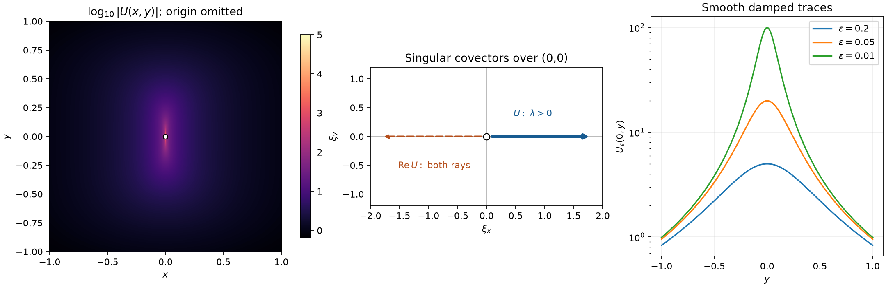
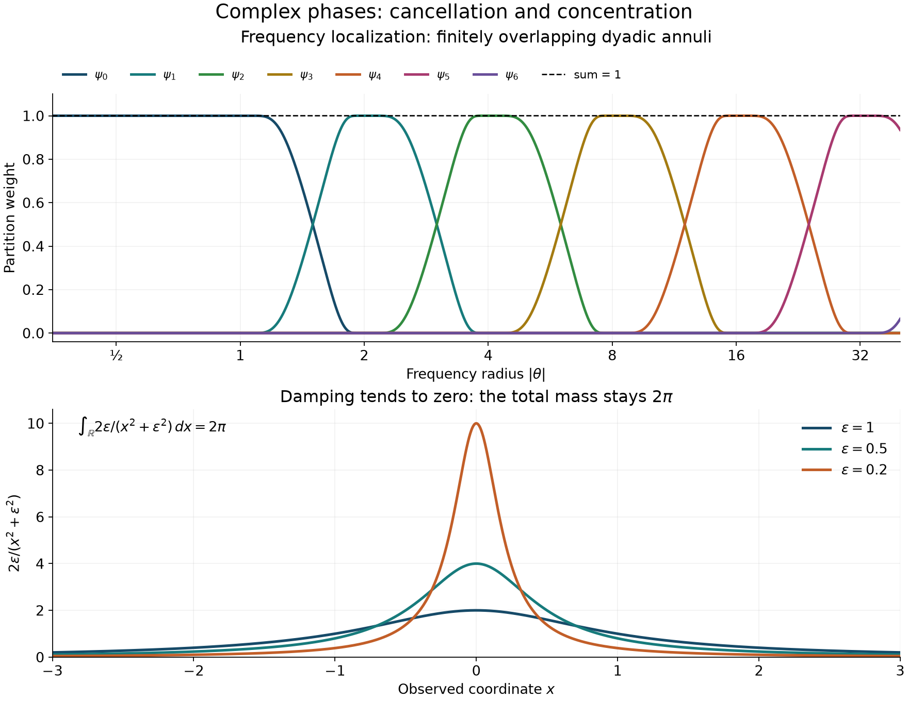

# Complex phases and oscillatory distributions

*Exposition and original illustrations by GPT-6 Astra (OpenAI). Public domain (CC0 1.0).*

An integral can define a distribution even when its amplitude grows at infinity. Cancellation must then compensate for two different effects: frequency derivatives improve the amplitude, whereas derivatives in the observed variable may enlarge it. A nonnegative imaginary part supplies additional decay without changing this balance. We construct the distribution, locate its possible singularities and their covector directions, and determine the exact normalization of the wave propagator.

The analytic input is [*Weighted cancellation for complex phases*](weighted-cancellation-for-complex-phases.md), Theorem 1 and Corollary 4, including the proof of its uniform estimate (W20). [*Schwartz functions and Fourier inversion*](../prerequisites/U011-free-foundations/schwartz-fourier-foundations-U017.md), F1–F5, proves all Fourier operations used below. [*Convolution as addition of supports*](convolution-as-addition-of-supports.md), B0–B2 and Theorem 1.1, supplies distributional gluing, parameter pairings and proper convolution. The causal fundamental distribution used in the last theorem is constructed in [*Causal point sources and characteristic cones*](causal-point-sources-and-characteristic-cones.md), Lemma 4.0 and formulas (4.0g)–(4.0h). Integration, compact cutoffs and differentiation under dominated integrals are proved in the [integration foundations](../prerequisites/U011-free-foundations/banach-foundation-bridges.md), §§15.0–15.4, and the [scalar foundations](../prerequisites/U011-free-foundations/metric-foundation-bridges.md), §§13.1–13.5 and 13.10.

## Local amplitudes and frequency truncation

Let \(X\subset\mathbb R^n\) be open, \(N\ge1\), \(m\in\mathbb R\), \(0<\rho\le1\), and \(0\le\delta<1\). Write \(\langle\theta\rangle=(1+|\theta|^2)^{1/2}\). The space \(S^m_{\rho,\delta}(X\times\mathbb R^N)\) consists of smooth functions with finite seminorms
\[
 p_{K,L}^{m}(a)=
 \max_{|\alpha|+|\beta|\le L}
 \sup_{x\in K,\theta\in\mathbb R^N}
 \langle\theta\rangle^{-m+\rho|\alpha|-\delta|\beta|}
 |\partial_\theta^\alpha\partial_x^\beta a(x,\theta)|
 \quad(K\Subset X).
 \tag{O1}
\]
No inequality between \(\delta\) and \(\rho\) is assumed. Let \(\Gamma\subset X\times(\mathbb R^N\setminus0)\) be open and invariant under positive frequency dilations. Let \(F\) be closed in \(X\times\mathbb R^N\), also conic, with \(F\setminus(X\times0)\subset\Gamma\). All amplitudes have support in \(F\). A phase is a smooth complex function on \(\Gamma\) satisfying
\[
 \phi(x,r\theta)=r\phi(x,\theta)\quad(r>0),\qquad
 \operatorname{Im}\phi\ge0,\qquad d_{x,\theta}\phi\ne0.
 \tag{O2}
\]
Integrands are extended by zero away from \(\Gamma\); their value at \(\theta=0\), a null set, is immaterial.

**Lemma 1 (symbol limits).** The seminorms (O1) make the symbol space complete. For any \(\chi\in C_c^\infty(\mathbb R^N)\) equal to one near zero and \(R\ge1\), the amplitudes \(a_R=\chi(\theta/R)a\) form a bounded family in \(S^m_{\rho,\delta}\), and, for every \(m'>m\),
\[
 a_R\longrightarrow a\quad\hbox{in }S^{m'}_{\rho,\delta}.
 \tag{O3}
\]

**Proof.** A Cauchy sequence in (O1) has every derivative converging uniformly on compact subsets. On a small coordinate box the fundamental theorem identifies the limit of each first derivative with the derivative of the limit; induction gives a smooth limit with the asserted derivatives. For each weighted seminorm the Cauchy bound survives passage to the pointwise limit, so convergence holds in that seminorm. A countable compact exhaustion of \(X\) and the integer values of \(L\) give the usual complete metric, for example the sum of \(2^{-j}\min(1,p_j(a-b))\). Support in \(F\) passes to the limit.

In a frequency product derivative with \(j>0\) derivatives on the cutoff, its support lies in \(cR\le|\theta|\le CR\) and its magnitude is at most \(C_jR^{-j}\). Relative to the weight in (O1), the remaining derivative of \(a\) costs \(R^{\rho j}\). Since \(\rho\le1\), the product \(R^{-(1-\rho)j}\) is bounded. The undifferentiated cutoff is bounded as well. For \(a-a_R\), all terms lie where \(|\theta|\ge cR\). Replacing \(m\) by \(m'\) contributes at most \(C R^{m-m'}\), which tends to zero. These estimates prove (O3) in every seminorm. \(\square\)

On a compact base set, homogeneity and closedness of \(F\) give uniform bounds for \(\phi\) and its derivatives on the relevant unit-frequency directions. Indeed these directions form a compact subset of \(\Gamma\); use a slightly larger compact neighborhood there. In particular, every \(x\)-derivative of \(\phi\) is \(O(|\theta|)\). Thus the integral over \(|\theta|\le2\) is a smooth function of \(x\), even though \(\phi\) need not be smooth at zero. Each differentiated integrand has an integrable constant bound near zero. Away from zero its zero extension is smooth: at each point outside \(\Gamma\), closedness of \(F\) gives a neighborhood disjoint from the amplitude support. These facts justify both the low-frequency integral and its derivatives.

## Cancellation on successive annuli

**Theorem 2 (the oscillatory distribution).** For every amplitude satisfying (O1)–(O2), the limits
\[
 \langle I_\phi(a),u\rangle
 =\lim_{R\to\infty}
 \int_X\int_{\mathbb R^N}
 e^{i\phi(x,\theta)}a(x,\theta)\chi(\theta/R)u(x)\,d\theta\,dx,
 \qquad u\in C_c^\infty(X),
 \tag{O4}
\]
exist and are independent of \(\chi\). They define a distribution, continuously in the symbol seminorms. Its order on each compact set is at most any nonnegative integer \(k\) satisfying
\[
 m-k\rho<-N,\qquad m-k(1-\delta)<-N.
 \tag{O5}
\]
The constructions for all orders and symbol types agree on their intersections. Together they are the unique family of continuous extensions of the absolutely convergent integrals.

**Proof.** Choose a radial cutoff \(\chi_0\) equal to one on the unit ball and zero outside the radius-two ball, and put
\[
 \psi_0(\theta)=\chi_0(\theta),\qquad
 \psi_j(\theta)=\chi_0(2^{-j}\theta)-\chi_0(2^{1-j}\theta)
 \quad(j\ge1).
 \tag{O6}
\]
Their sum is one and their partial sum through \(j=M\) is \(\chi_0(2^{-M}\theta)\). For \(R_j=2^j\), substitute \(\theta=R_j\eta\) in the \(j\)-th integral. Its frequency support is the fixed annulus \(1/2\le|\eta|\le2\), and its phase is \(R_j\phi(x,\eta)\). Set
\[
 \gamma=\max(\delta,1-\rho),\qquad
 \kappa=1-\gamma=\min(\rho,1-\delta)>0.
 \tag{O7}
\]
For \(|\alpha|+|\beta|\le k\), the chain and product rules give
\[
 |\partial_\eta^\alpha\partial_x^\beta
 [a(x,R_j\eta)\psi_j(R_j\eta)]|
 \le C\,p_{K,k}^{m}(a)\,
 R_j^{\,m+(1-\rho)|\alpha|+\delta|\beta|}
 \le C\,p_{K,k}^{m}(a)R_j^{m+\gamma k}.
 \tag{O8}
\]
Here \(K\) may be replaced by a fixed slightly larger compact base neighborhood; this does not change any exponent.

The intersection of the normalized amplitude support with that compact neighborhood is compact in \(\Gamma\). Cover it by finitely many coordinate neighborhoods with cutoffs supported in \(\Gamma\). On these supports, \(|d_{x,\eta}\phi|\) has a positive lower bound, and all needed phase derivatives are bounded. Corollary 4 of the weighted-cancellation lesson, applied in the joint variables \((x,\eta)\), therefore bounds each integral by \(C R_j^{-k}\) times the sum of the \(L^1\) norms of the amplitude derivatives through order \(k\). The fixed partition adds only bounded factors. Leibniz's rule for \(u\), the fixed integration volume and (O8) prove
\[
 |J_j(a,u)|\le C\,p_{K',k}^{m}(a)\,
 \max_{|\beta|\le k}\|\partial^\beta u\|_\infty\,
 2^{j(N+m-k\kappa)}.
 \tag{O9}
\]
The nonnegative imaginary part is precisely the hypothesis that permits this complex-phase estimate. If \(k=0\), the same bound follows directly from \(|e^{iR_j\phi}|\le1\). The two inequalities in (O5) are equivalent to \(N+m-k\kappa<0\). The geometric series in (O9), together with the smooth low-frequency term, converges absolutely and yields a finite order-\(k\) distribution bound.

Define \(I_\phi(a)\) by that series. For \(m<-N\), ordinary absolute convergence and dominated summation identify it with the integral. For a general cutoff \(a_R\), Lemma 1 gives a uniform \(S^m_{\rho,\delta}\) bound. On every fixed annulus \(a_R=a\) for all sufficiently large \(R\). Estimate (O9) makes the remaining annular tails uniformly small, proving (O4) and its cutoff independence. The argument also proves convergence for any symbol-bounded sequence converging with all derivatives on compact subsets.

The same regulated integral defines every symbol-type construction, so they agree on intersections. For uniqueness, suppose another family is continuous on every \(S^{m'}_{\rho,\delta}\) and agrees with convergent integrals. The truncated amplitude \(a_R\) has compact frequency support and hence belongs to every order. Its value is fixed by an ordinary integral. Choose \(m'>m\); (O3) and continuity force the value at \(a\) to be the limit of these same values. This proves uniqueness for the family over all orders; it does not assert compact-frequency density in the original order-\(m\) topology. \(\square\)

The proof is uniform on compact parameter sets whenever the normalized phases have common derivative bounds, nonnegative imaginary part and a common positive lower bound for their joint gradients. The bound uses finitely many explicitly displayed symbol seminorms, so no condition \(\delta<\rho\) enters it.

## The projected stationary set and smooth calculus

Define the set of potentially singular base points by
\[
 S=\{x\in X:\ (x,\theta)\in F,\ \theta\ne0,\
                         \partial_\theta\phi(x,\theta)=0
                         \text{ for some }\theta\}.
 \tag{O10}
\]

**Theorem 3 (smoothness away from stationary directions).** The set \(S\) is relatively closed in \(X\), and
\[
 \operatorname{sing\,supp} I_\phi(a)\subset S.
 \tag{O11}
\]
On \(X\setminus S\), the distribution is represented by the smooth function
\[
 A(x)=\lim_{R\to\infty}\int e^{i\phi(x,\theta)}
                   a(x,\theta)\chi(\theta/R)\,d\theta.
 \tag{O12}
\]
The convergence holds with every derivative, uniformly on compact subsets. On all of \(X\), distributional differentiation obeys
\[
 \partial_{x_l} I_\phi(a)
   = I_\phi(\partial_{x_l}a+i\,\partial_{x_l}\phi\,a),
 \tag{O13}
\]
where the low-frequency part is interpreted by its ordinary differentiated integral.

**Proof.** If \(x_j\in S\) and \(x_j\to x\in X\), normalize the witnesses to \(|\theta_j|=1\). A subsequence converges to a unit vector \(\theta\). Closedness of \(F\) puts \((x,\theta)\) in \(F\), hence in \(\Gamma\). Smoothness of \(\phi\) then gives \(\phi_\theta(x,\theta)=0\). This proves relative closedness. In particular, projecting these normalized closed directions is legitimate; projecting an arbitrary unnormalized closed set would not suffice.

For a compact \(K\Subset X\setminus S\), compactness of the normalized directions gives \(|\phi_\theta|\ge\varepsilon>0\) in a neighborhood of the amplitude support. In the annular construction apply the weighted-cancellation estimate in \(\eta\) alone, with \(x\) a parameter. Now each frequency derivative of the scaled amplitude costs at most \(R_j^{1-\rho}\), so, for every integer \(l\ge0\),
\[
 \sup_{x\in K}|J_j(a;x)|
       \le C_l\,p_{K',l}^{m}(a)\,2^{j(N+m-l\rho)}.
 \tag{O14}
\]
After \(b\) base derivatives, the product rule writes the differentiated integrand as \(e^{i\phi}a_b\). Each derivative of \(\phi\) has degree one, each frequency derivative of it lowers degree by one, and each base derivative of \(a\) increases its order by \(\delta\le1\). Thus, outside a fixed low-frequency ball, \(a_b\in S^{m+b}_{\rho,\delta}\), with finitely many seminorm bounds from those of \(a\) and \(\phi\). The same estimate gives
\[
 \sup_{x\in K}|\partial_x^\beta J_j(a;x)|
              \le C_{\beta,l}\,2^{j(N+m+|\beta|-l\rho)}.
 \tag{O15}
\]
Choose \(l\) large enough for each prescribed \(\beta\). Uniform geometric convergence and the fundamental theorem identify the successive derivatives of the sum. The uniformly bounded cutoff argument in Theorem 2 applies to each derivative as well. Pairing the uniformly convergent series with a compact test identifies \(A\) with \(I_\phi(a)\), proving (O11)–(O12).

At a finite frequency cutoff, differentiation and integration are justified on compact sets by the low-frequency argument and ordinary domination. They give (O13). For the high-frequency part its new amplitude has order at most \(m+1\); Theorem 2 permits passage to the limit. Integration by parts against a test proves the asserted distributional identity everywhere. Repeating gives every higher derivative. \(\square\)

There is also a parameter version, with its hypotheses stated explicitly. Let \(y\) range over an open set and assume a common cone, common symbol types, and smooth parameter dependence with \(\partial_y^\nu a\in S^{m+|\nu|}_{\rho,\delta}\) locally uniformly. Suppose the phase obeys the uniform conditions following Theorem 2 and its parameter derivatives are homogeneous of degree one. Then
\[
 \partial_{y_l}I_{\phi_y}(a_y)
 =I_{\phi_y}(\partial_{y_l}a_y+i\,\partial_{y_l}\phi_y\,a_y)
 \tag{O16}
\]
in the sense of smooth distribution-valued pairings. To prove this, each differentiated annular integrand has an amplitude of order at most \(m+|\nu|\). Choose \(k\) in (O9) for that order. The series of derivatives converges uniformly for \(y\) in a compact set, and the fundamental theorem differentiates it term by term. The estimates are uniform on bounded families of tests. Integrating a compactly supported smooth function of \(y\) against these identities is valid for the same reason: the absolutely convergent annular pairings are uniformly dominated. This supplies the corresponding interchange of parameter integration and oscillatory distribution formation.

## Which covectors survive the oscillatory integral

For a distribution \(v\), the pair \((x_0,\xi_0)\), \(\xi_0\ne0\), is outside \(\operatorname{WF}(v)\) if a compact smooth cutoff equal to one near \(x_0\) makes \(\widehat{\chi v}\) decrease faster than every inverse power on an open cone about \(\xi_0\). We use the complete fixed-cutoff convolution estimate in [*Boundary regularity and conic decomposition*](boundary-regularity-and-conic-decomposition.md), Lemma 2 and formula (16): multiplication by a compact smooth function preserves this decrease on a smaller cone.

This estimate makes the definition independent of the choice of a smaller cutoff, and makes the regular set open and positively conic. It also proves the sum inclusion by choosing one cutoff inside the two original cutoff neighborhoods. Finally,
\[
 \pi\operatorname{WF}(v)=\operatorname{sing\,supp}v,
 \qquad \pi(x,\xi)=x.
 \tag{D1}
\]
Indeed, if every direction over \(x_0\) is regular, compactness of the unit sphere supplies finitely many smaller regular cones covering it. Choose one base cutoff supported where all their original cutoffs equal one. The convolution estimate gives rapid decrease of its Fourier transform in every direction. Its inverse integral and every differentiated inverse integral converge absolutely, so Fourier inversion represents this localized distribution by a smooth function. Conversely, a compact smooth localization has rapidly decreasing transform by integration by parts. This proves (D1), including the existence of a nonzero singular covector at every singular base point.

Under (O1)–(O2), set
\[
 \mathcal C_\phi(F)=
 \{(x,\partial_x\phi(x,\theta)):
    (x,\theta)\in F,\ \theta\ne0,\
                    \partial_\theta\phi(x,\theta)=0\}.
 \tag{D2}
\]

**Theorem 3a (the full directional bound).** The set in (D2) is a relatively closed conic subset of \(X\times(\mathbb R^n\setminus0)\), and
\[
              \operatorname{WF}(I_\phi(a))
                         \subset\mathcal C_\phi(F).
 \tag{D3}
\]
This holds for every \(m\in\mathbb R\), \(0<\rho\le1\) and \(0\le\delta<1\), with no ordering condition between \(\rho\) and \(\delta\). No nondegeneracy condition on the stationary set is required.

**Reality, nonvanishing and closedness.** Euler's identity for the degree-one phase gives \(\phi=\theta\cdot\phi_\theta\). At a stationary point, therefore, \(\phi=0\). The smooth nonnegative function \(\operatorname{Im}\phi\) has a minimum there in the open set \(\Gamma\). Each of its first real derivatives is zero: the positive and negative difference quotients have opposite signs. Consequently \(\phi_x\) is real. It is nonzero because the full differential in (O2) is nonzero while \(\phi_\theta=0\).

Fix a compact base neighborhood \(K\Subset X\). On the compact set of stationary pairs in \(F\cap(K\times S^{N-1})\), the continuous nonzero norm \(|\phi_x|\) has positive minimum and finite maximum, unless that set is empty. Homogeneity then gives
\[
 c_K|\theta|\le|\phi_x(x,\theta)|\le C_K|\theta|
 \quad\text{at its stationary pairs}.
 \tag{D4}
\]
If \((x_j,\xi_j)\in\mathcal C_\phi(F)\) tends to \((x,\xi)\) with \(x\in X,\xi\ne0\), take such a \(K\) containing the tail of the base sequence. The witnessing \(\theta_j\) are bounded above and bounded away from zero by (D4). A subsequence converges to a nonzero \(\theta\). Closedness of \(F\) and continuity of the phase derivatives give the required witness at \((x,\xi)\). Thus (D2) is already closed in the punctured cotangent bundle. This argument uses both radial bounds; an arbitrary projection of a closed cone need not be closed.

**Uniform separation.** Suppose \((x_0,\xi_0)\notin\mathcal C_\phi(F)\). Closedness allows a compact cutoff \(\psi=1\) near \(x_0\) and a cone \(V\) about \(\xi_0\) such that its angular closure and the base support are separated from (D2). On that support,
\[
 |\phi_x(x,\theta)-\xi|
       +|\theta|\,|\phi_\theta(x,\theta)|
        \ge c\bigl(|\theta|+|\xi|\bigr)
 \quad((x,\theta)\in F,\ \theta\ne0,\ \xi\in\overline V).
 \tag{D5}
\]
Here and below \(\overline V\) includes zero when used in a homogeneous compact normalization. To prove (D5), normalize \(|\theta|+|\xi|=1\). The phase terms \(\phi_x\) and \(|\theta|\phi_\theta\) extend continuously by zero at \(\theta=0\), because their normalized angular derivatives are bounded on the compact portion of \(F\). The normalized set, including this zero-frequency boundary, is compact. If \(\theta=0\), then \(|\xi|=1\) and the left side is one. If \(\theta\ne0\) and the left side vanishes, then \(\phi_\theta=0\) and \(\xi=\phi_x\ne0\), contrary to the chosen separation. Its positive minimum proves (D5).

**A bound on each annulus.** For the partition (O6), write \(R=2^j\), \(j\ge1\), \(\theta=R\eta\), \(t=|\xi|\ge2\), and
\[
 \Phi_{R,\xi}(x,\eta)
       =\frac{R\phi(x,\eta)-x\cdot\xi}{R+t}.
 \tag{D6}
\]
On \(1/2\le|\eta|\le2\), (D5) gives a common positive lower bound for \(|d_{x,\eta}\Phi_{R,\xi}|\). All derivatives of these normalized phases are uniformly bounded on the compact neighborhoods in question: their two parameter coefficients \(R/(R+t)\) and \(\xi/(R+t)\) are bounded. Their imaginary parts are nonnegative.

For detail on the neighborhood needed by the estimate, normalize these two coefficients into the compact set \(r+|v|=1\), \(r\ge0\), \(v\in\overline V\). The preceding positive gradient minimum on the normalized amplitude support persists on a common surrounding neighborhood by uniform continuity. A finite partition with support inside \(\Gamma\) then gives fixed compact integration domains and fixed cutoff derivative bounds. Thus Corollary 4 of the weighted-cancellation lesson applies uniformly, with oscillation parameter \(R+t\). Formula (O8), now with the fixed base cutoff \(\psi\), gives
\[
 \left|
 R^N\iint e^{i(R\phi(x,\eta)-x\cdot\xi)}
       \psi(x)\psi_j(R\eta)a(x,R\eta)\,dx\,d\eta
 \right|
       \le C_k R^{N+m+\gamma k}(R+t)^{-k},
 \quad \gamma=\max(\delta,1-\rho)<1.
 \tag{D7}
\]
The norm of the joint complex gradient is used through the proved weight
\(|d\Phi|^2+\operatorname{Im}\Phi\). A real-phase integration-by-parts operator is not substituted for that estimate.

**Sum every frequency scale.** Put \(b=N+m+\gamma k\) and \(\kappa=1-\gamma\). For \(R\le t\), the dyadic sum of \(R^b\) is bounded by \(C t^b\) if \(b>0\), by \(C(1+\log t)\) if \(b=0\), and by \(C\) if \(b<0\). These statements follow directly from a finite geometric sum. For \(R>t\), the sum in (D7) is bounded by \(C t^{N+m-\kappa k}\), provided \(\kappa k>N+m\), using the infinite geometric sum. Hence
\[
 \sum_{j\ge1}|J_j(\psi e^{-ix\cdot\xi})|
 \le C_k(1+\log t)\,
       t^{-\min\{k,\ \kappa k-N-m\}},
       \qquad \xi\in V,\ t\ge2.
 \tag{D8}
\]
For every requested inverse power \(q\), choose the integer \(k\) so that both quantities inside the minimum exceed \(q+1\). Such a choice exists since \(\kappa>0\). The logarithm is absorbed by the remaining positive power. The low-frequency term is smooth by the proof following Lemma 1; its product with \(\psi\) is compact smooth and therefore has rapidly decreasing transform. The series in Theorem 2, applied to the test \(\psi e^{-ix\cdot\xi}\), identifies the sum with \(\widehat{\psi I_\phi(a)}(\xi)\). Formula (D8) proves rapid decrease on \(V\) to every order, which proves (D3). \(\square\)

## A complex phase with one singular covector direction

**Proposition 3b (a one-sided quadratic damping model).** The function
\[
 U(x,y)=\frac1{y^2-ix}\quad((x,y)\ne(0,0))
 \tag{D9}
\]
is locally integrable on \(\mathbb R^2\), and its associated distribution has
\[
 \operatorname{WF}(U)
       =\{(0,0;\lambda,0):\lambda>0\}.
 \tag{D10}
\]
For \(\varepsilon>0\), the smooth functions
\[
 U_\varepsilon(x,y)=\frac1{\varepsilon+y^2-ix}
       =\int_0^\infty e^{i(x+i y^2)\theta}e^{-\varepsilon\theta}\,d\theta
 \tag{D11}
\]
converge to \(U\) in \(L^1_{\rm loc}\) and as distributions.

**Proof.** In a small square, fix \(0<|y|<r<1\) and split the \(x\)-integral at \(|x|=y^2\). On the inner part, \((y^4+x^2)^{-1/2}\le |y|^{-2}\), and the interval has length \(2y^2\). On the outer part it is at most \(1/|x|\). Consequently
\[
 \int_{-r}^r\frac{dx}{\sqrt{y^4+x^2}}
       \le 2+2\log\frac r{y^2}.
 \tag{D12}
\]
The logarithm is integrable in \(y\) at zero, since
\(\int_0^r-\log y\,dy=r(1-\log r)\). The exceptional line \(y=0\) has two-dimensional measure zero, as follows from product integration. Tonelli therefore proves local integrability. Away from the origin the function is smooth. Also \(|U_\varepsilon|\le|U|\) almost everywhere and \(U_\varepsilon\to U\) off the origin. Dominated convergence proves the asserted local \(L^1\) limit. The integral in (D11) is the elementary exponential primitive with positive real decay coefficient.

To apply Theorem 3a, take \(\Gamma=\{\theta>0\}\), \(F=\{\theta\ge0\}\), the phase \(\phi=(x+i y^2)\theta\), and a smooth amplitude \(a(\theta)\) zero for \(\theta\le1\) and one for \(\theta\ge2\). It has order zero and type \((1,0)\). The amplitude \(a e^{-\varepsilon\theta}\), extended by zero for \(\theta\le1\), is uniformly bounded in that symbol class: each differentiated exponential contributes a factor bounded by \(C_j\theta^{-j}\), because \((\varepsilon\theta)^j e^{-\varepsilon\theta}\) is bounded on the positive half-line. It converges with every derivative on compact sets to \(a\). The convergence assertion in Theorem 2 therefore identifies its distributional limit with \(I_\phi(a)\).

The remaining integral
\[
 L(x,y)=\int_0^2(1-a(\theta))e^{i(x+i y^2)\theta}\,d\theta
 \tag{D13}
\]
is smooth with every derivative by compact-frequency domination. Taking the limit in (D11) gives \(U=I_\phi(a)+L\). The stationary condition is
\(\phi_\theta=x+i y^2=0\), hence \(x=y=0\). There \(\phi_{(x,y)}=(\theta,0)\), with \(\theta>0\). Theorem 3a and the smooth sum rule put the wavefront inside the right side of (D10).

The distribution is not smooth near zero. A continuous representative would agree with (D9) at every point off zero: their difference is continuous there and zero almost everywhere, so it is zero everywhere. Its values at \((0,y)\) would be \(y^{-2}\), contradicting boundedness on a compact neighborhood of zero. By (D1) there is at least one singular covector over zero. The upper bound and positive conicity then give the entire positive ray and prove equality. \(\square\)

*Left: samples of \(\log_{10}|U(x,y)|\) from (D9), with the origin omitted. The high values near the origin do not assign a singular direction; the middle panel gives the exact covector ray in (D10). The real part has both rays, as proved in Exercise 6. Right: exact smooth traces \(U_\varepsilon(0,y)=1/(\varepsilon+y^2)\) for three positive values of \(\varepsilon\). These finite plots accompany the local integrability and wavefront proofs. [Reproducible figure source](../figures/complex-phase-direction.py).*

## A point mass as an oscillatory integral

**Proposition 4 (linear phase and damping).** For the phase \(x\cdot\theta\) on \(\mathbb R^n\times(\mathbb R^n\setminus0)\),
\[
 I_{x\cdot\theta}(1)=(2\pi)^n\delta_0.
 \tag{O17}
\]
In one dimension, for \(\varepsilon>0\),
\[
 I_{x\theta+i\varepsilon|\theta|}(1)
       =\frac{2\varepsilon}{x^2+\varepsilon^2},
 \qquad
 \frac{2\varepsilon}{x^2+\varepsilon^2}
       \longrightarrow2\pi\delta_0\quad\hbox{in }\mathcal D'
       \quad(\varepsilon\downarrow0).
 \tag{O18}
\]

**Proof.** At finite cutoff, Fubini identifies the pairing in (O17) with \(\int\chi(\theta/R)\widehat u(-\theta)\,d\theta\). The Fourier prerequisite proves that \(\widehat u\) is Schwartz and that its integral is \((2\pi)^n u(0)\). Dominated convergence proves (O17), including the sign and constant.

For positive \(\varepsilon\), the two half-line integrals are absolutely convergent. Integrating their elementary exponential primitives gives
\[
 \int_0^\infty e^{-(\varepsilon-ix)\theta}\,d\theta
 +\int_0^\infty e^{-(\varepsilon+ix)\theta}\,d\theta
 =\frac1{\varepsilon-ix}+\frac1{\varepsilon+ix}
 =\frac{2\varepsilon}{x^2+\varepsilon^2}.
 \tag{O19}
\]
The substitution \(x=\varepsilon z\) changes its test pairing to \(2\int (1+z^2)^{-1}u(\varepsilon z)\,dz\). The integrable majorant \(2\|u\|_\infty/(1+z^2)\) and the arctangent integral \(\pi\) prove the limit. For \(\varepsilon>0\), the frequency gradient is \(x+i\varepsilon\operatorname{sgn}\theta\), which never vanishes. At \(\varepsilon=0\) its projected stationary set is \(\{0\}\). Thus the singular-support statement agrees with both formulas. \(\square\)

*The upper panel samples the dyadic partition (O6); the sum is one on the plotted frequency range. The lower panel samples the exact densities in (O18), each of total mass \(2\pi\). Their narrowing peaks represent convergence to \(2\pi\delta_0\), not pointwise convergence at the origin. The reproducible [figure source](../figures/oscillatory-shells-and-damping.py) contains all profiles and constants.*

## The wave kernel and its two causal halves

Let \(c>0\), \(n\ge1\), and \(P=c^{-2}\partial_t^2-\Delta_x\).

**Theorem 5 (Cauchy kernel and fundamental solutions).** Define
\[
 E(t)=\mathcal F_x^{-1}
       \left(\frac{\sin(ct|\xi|)}{c|\xi|}\right),
 \tag{O20}
\]
where the multiplier at \(\xi=0\) is \(t\). This is a smooth function of \(t\) with values in tempered distributions and satisfies
\[
 PE=0,\qquad E(0)=0,\qquad \partial_tE(0)=\delta_0,\qquad
 \operatorname{sing\,supp}E
       \subset\{(t,x):|x|=c|t|\}.
 \tag{O21}
\]
There are unique fundamental solutions \(F_+\) and \(F_-\) supported respectively in \(t\ge0\) and \(t\le0\). They satisfy
\[
 F_+=c^2H(t)E(t),\qquad F_-=-c^2H(-t)E(t),\qquad
 F_+-F_-=c^2E,
 \tag{O22}
\]
and their supports are contained in \(|x|\le c|t|\) with the respective time sign.

**Proof.** The power series
\[
 \frac{\sin(ct|\xi|)}{c|\xi|}
 =\sum_{j=0}^\infty
       \frac{(-1)^j c^{2j}t^{2j+1}|\xi|^{2j}}{(2j+1)!}
 \tag{O23}
\]
and all its derivatives converge on compact sets, proving smoothness at zero. Away from zero, each time derivative is a sine or cosine times a power of \(c|\xi|\); on a compact time interval it has polynomial growth, uniformly in time. For the zeroth derivative use the bound \(|\sin(ct|\xi|)/(c|\xi|)|\le |t|\). Schwartz decay therefore justifies differentiating the test pairing any number of times, uniformly on bounded Schwartz families. The Fourier identities in F2–F5 give the differential equation from the elementary multiplier equation \(\partial_t^2m=-c^2|\xi|^2m\). They give \(E(0)=0\) and \(\partial_tE(0)=\mathcal F^{-1}1=\delta_0\).

Choose a smooth cutoff \(\chi_0=1\) near \(\xi=0\). The high-frequency part is the difference of the two oscillatory integrals
\[
 (2\pi)^{-n}\int (1-\chi_0(\xi))
  \frac{e^{i(x\cdot\xi+ct|\xi|)}
              -e^{i(x\cdot\xi-ct|\xi|)}}{2ic|\xi|}\,d\xi.
 \tag{O24}
\]
The high-frequency amplitudes have order \(-1\) and type \((1,0)\). Both phases are real, degree one in \(\xi\), and have nonzero joint gradient since their \(x\)-gradient is \(\xi\ne0\). The cutoff limits agree with (O20): after pairing first in \(x\), rapid decrease of the transformed compact test gives absolute convergence, uniformly for \(t\) in its compact support. The low-frequency part is smooth in \((t,x)\). The frequency gradients of the two phases are
\[
 x+ct\,\xi/|\xi|\quad\hbox{and}\quad x-ct\,\xi/|\xi|.
 \tag{O25}
\]
Their possible zeros project into \(|x|=c|t|\); Theorem 3 proves the singular-support inclusion in (O21).

The products in (O22) are defined by integrating the smooth distribution-valued function over the indicated time half-line against a compact test. To justify time integration by parts, pair with its smooth, compactly supported spatial test depending on \(t\); the Fourier estimates above and the parameter pairing proof B1 justify the product rule. Two integrations by parts give
\[
 \partial_t^2(H(t)E(t))
 =H(t)\partial_t^2E(t)
        +\delta(t)\partial_tE(0)+\delta'(t)E(0)
 =H(t)\partial_t^2E(t)+\delta_{(0,0)}.
 \tag{O26}
\]
Thus \(P(c^2H(t)E)=\delta_{(0,0)}\). Since \(E\) is odd in \(t\), time reflection gives the negative-half-line formula and the same unit point source. Also \(H(t)+H(-t)=1\) almost everywhere in the defining time integral, proving the difference formula in (O22).

It remains to establish uniqueness and cone support; singular support alone would not establish the latter. Lemma 4.0 of the causal-point-source lesson constructs a distribution \(R_1\) on \(\mathbb R^{1+n}\) with
\[
 (\partial_s^2-\Delta_x)R_1=\delta_{(0,0)},\qquad
 \operatorname{supp}R_1\subset\{s\ge|x|\}.
 \tag{O27}
\]
Its proved linear pullback formulas give \(G_+(t,x)=cR_1(ct,x)\) and \(PG_+=\delta_{(0,0)}\): the pullback of the point mass is \(c^{-1}\delta_{(0,0)}\). If \(w\) has support in \(t\ge0\) and \(Pw=0\), addition is proper on \(\operatorname{supp}G_+\times\operatorname{supp}w\). In fact, a bounded output time bounds both nonnegative input times, the cone inequality bounds the first spatial input, and bounded spatial sum then bounds the second. The set of pairs is closed, hence compact. The complete convolution identities in Theorem 1.1 of the convolution lesson consequently give
\[
 w=\delta*w=(PG_+)*w=G_+*(Pw)=0.
 \tag{O28}
\]
Apply this to the difference of \(G_+\) and \(c^2H(t)E\). They are equal, proving both uniqueness and the forward cone support. Reflection gives the backward assertions. The coefficient \(c^2\) in (O22) is also forced directly by (O26) and the normalization \(\partial_tE(0)=\delta_0\). \(\square\)

## Exercises with complete solutions

**Exercise 1 (foundation: order and forbidden endpoints).** For \(N=2\), \(m=1\), \(\rho=1/3\), \(\delta=3/4\), find the smallest integer \(k\) certified by (O5). Show by examples that allowing \(\rho=0\), or allowing \(\delta=1\), would make the general existence assertion false.

**Solution.** Here \(\kappa=\min(1/3,1/4)=1/4\). The inequality \(3-k/4<0\) requires \(k>12\), so the smallest certified order is \(13\); this is an upper bound, not a claim of exact order.

For \(\rho=0,\delta=0\), take one frequency variable, phase \(\phi=\theta\), and \(a=e^{-i\theta}\). Every frequency derivative is bounded, and every nonzero base derivative vanishes, so \(a\in S^0_{0,0}\). With a nonnegative cutoff and a test \(u\) of positive integral, the regulated pairing is \((\int u)R\int\chi\), which diverges.

For \(\delta=1,\rho=1\), let \(X=\mathbb R\), \(\phi=x\theta\), and
\[
 a(x,\theta)=b(\theta)\,h(x\theta)e^{-ix\theta},
 \tag{O29}
\]
where \(h\ge0\) is smooth, compactly supported and has positive integral, while \(b\) is zero for \(\theta\le1\), one for \(\theta\ge2\), and smooth. Write \(f(s)=h(s)e^{-is}\). For \(\theta\ge2\), \(q\) base derivatives give \(\theta^q f^{(q)}(x\theta)\). Each frequency derivative either differentiates that power or contributes \(x\); on the support of the resulting profile, \(|x|\le C/\theta\). Induction therefore bounds the mixed derivative with \(p\) frequency and \(q\) base derivatives by \(C_{p,q}\theta^{q-p}\). The bounded transition region obeys all required estimates. Thus \(a\in S^0_{1,1}\). After cancellation of the phase,
\[
 \int h(x\theta)u(x)\,dx
       =\theta^{-1}\int h(s)u(s/\theta)\,ds.
 \tag{O30}
\]
For a nonnegative compact test with \(u(0)>0\), this is bounded below by a positive constant times \(\theta^{-1}\) for all sufficiently large \(\theta\). A nonnegative frequency cutoff equal to one on \([-1,1]\) makes the pairing grow at least like \(\log R\). Existence fails at this endpoint even with maximal positive \(\rho\).

**Exercise 2 (intermediate: a range with \(\delta>\rho\)).** Let \(\eta\in C_c^\infty(\mathbb R)\) and
\[
 a(x,\theta)=\eta(x)\exp\!\bigl(ix\langle\theta\rangle^{1/2}\bigr).
 \tag{O31}
\]
Prove \(a\in S^0_{1/4,\,1/2}\). Apply the distribution theorem to phase \(x\theta\), and locate its possible singular support.

**Solution.** Put \(q(\theta)=\langle\theta\rangle^{1/2}\). Repeated differentiation of \((1+\theta^2)^{1/4}\) gives \(|q^{(j)}|\le C_j\langle\theta\rangle^{1/2-j}\); this follows inductively by differentiating the polynomial numerator and the power of \(1+\theta^2\). Each base derivative of the exponential contributes \(q\), so \(b\) such derivatives cost at most \(\langle\theta\rangle^{b/2}\). A frequency derivative falling on a profile \(q\) improves its order by one; one falling on the exponential contributes \(xq'\), improving by at least one half on the fixed support of \(\eta\). Induction and the finite product rule give the stronger estimate \(C_{\alpha,\beta}\langle\theta\rangle^{-|\alpha|/2+|\beta|/2}\). This implies (O1) for \((\rho,\delta)=(1/4,1/2)\). Here \(N=1,m=0,\kappa=1/4\), so \(k=5\) is a permissible order bound. The stationary condition is \(\phi_\theta=x=0\); Theorem 3 gives smoothness on \(\mathbb R\setminus\{0\}\).

**Exercise 3 (intermediate: frequency moments).** For a multiindex \(\alpha\), compute \(I_{x\cdot\theta}(\theta^\alpha)\). In dimension one compute the integral with phase \(x\theta+i\varepsilon|\theta|\) and amplitude \(\theta\), and its limit as \(\varepsilon\downarrow0\).

**Solution.** Repeated differentiation in (O13) and (O17) gives
\[
 I_{x\cdot\theta}(\theta^\alpha)
       =(2\pi)^n i^{-|\alpha|}\partial_x^\alpha\delta_0.
 \tag{O32}
\]
For positive \(\varepsilon\), ordinary differentiation of the absolutely convergent integral is permitted by exponential decay. Hence
\[
 I_{x\theta+i\varepsilon|\theta|}(\theta)
 =\frac1i\,\frac{d}{dx}
                 \frac{2\varepsilon}{x^2+\varepsilon^2}
 =\frac{4i\varepsilon x}{(x^2+\varepsilon^2)^2}
 \longrightarrow-2\pi i\,\delta_0'.
 \tag{O33}
\]
The limit follows by testing the derivative against \(-u'\) in (O18). This also checks the sign in (O32).

**Exercise 4 (advanced: the one-dimensional light cone).** When \(n=1\), express \(E(t,x)\) and both \(F_\pm\) as locally integrable functions. Verify the initial velocity and the constant in (O22) directly.

**Solution.** For \(t>0\), direct integration gives
\[
 \mathcal F_x\!\left(\frac1{2c}\mathbf1_{\{|x|<ct\}}\right)(\xi)
   =\frac{\sin(ct\xi)}{c\xi}
   =\frac{\sin(ct|\xi|)}{c|\xi|}.
 \tag{O34}
\]
At zero, both sides have the same continuous value \(t\). Fourier inversion on tempered distributions and oddness in time yield
\[
 E(t,x)=\frac{\operatorname{sgn}t}{2c}
               \mathbf1_{\{|x|<c|t|\}},\qquad
 F_\pm(t,x)=\frac c2\,
        \mathbf1_{\{\pm t>0,\ |x|<c|t|\}} .
 \tag{O35}
\]
These formulas are understood almost everywhere, so boundary values do not matter. For every spatial test \(u\),
\[
 \frac1t\langle E(t),u\rangle
       =\frac1{2c|t|}\int_{-c|t|}^{c|t|}u(x)\,dx
       \longrightarrow u(0).
 \tag{O36}
\]
Thus \(\partial_tE(0)=\delta_0\). Subtracting the two nonnegative cone indicators gives \(F_+-F_-=c^2E\), in agreement with the point-source calculation. \(\square\)

**Exercise 5 (intermediate: summing a negative annular order).** In (D7), take \(N=1,m=-3,\rho=1,\delta=0\). Prove the uniform bound
\(\sum_{j\ge1}2^{-2j}(2^j+t)^{-k}\le C t^{-k}\) for \(t\ge2,k\ge0\). Explain why this case must be retained when summing annuli.

**Solution.** Here \(\gamma=0,\kappa=1\), so \(b=N+m+\gamma k=-2\) for every \(k\). Each denominator is at least \(t^k\), and
\(\sum_{j\ge1}2^{-2j}=1/3\). Thus \(C=1/3\) works. In this case increasing \(k\) never makes \(b\) positive; an argument requiring \(b>0\) would omit these valid orders. Formula (D8) retains the correct exponent
\(\min(k,k+2)=k\). Since \(k\) is arbitrary, it still gives rapid decrease.

**Exercise 6 (advanced: reality restores both directions).** Let \(U\) be (D9). Determine the smooth wavefront sets of \(\overline U\) and \(\operatorname{Re}U\). Contrast them with that of \(U_\varepsilon\), \(\varepsilon>0\).

**Solution.** Choose real spatial cutoffs. Complex conjugation of their Fourier pairings gives
\[
 \widehat{\chi\overline v}(\xi)
       =\overline{\widehat{\chi v}(-\xi)},\qquad
 \operatorname{WF}(\overline v)
       =\{(x,-\xi):(x,\xi)\in\operatorname{WF}(v)\}.
 \tag{D14}
\]
For distributions the first formula follows directly from the definition
\(\langle\overline v,f\rangle=\overline{\langle v,\overline f\rangle}\).
Applying it twice proves equality of the regularity tests. Real cutoffs suffice by the fixed-cutoff estimate. Thus
\[
 \begin{aligned}
 \operatorname{WF}(\overline U)
     &=\{(0,0;-\lambda,0):\lambda>0\},\\
 \operatorname{WF}(\operatorname{Re}U)
     &=\{(0,0;\lambda,0):\lambda\in\mathbb R\setminus0\}.
 \end{aligned}
 \tag{D15}
\]
For the second equality, the sum rule first gives inclusion in the two rays. At a positive covector \(\overline U\) is regular. If \(2\operatorname{Re}U=U+\overline U\) were regular there, subtracting the regular \(\overline U\) would make \(U\) regular, contrary to (D10). The negative covectors follow by the same argument with the two terms interchanged. Multiplication by the nonzero scalar two preserves wavefront in both directions. Off the origin,
\(\operatorname{Re}U=y^2/(y^4+x^2)\), interpreted as the already proved locally integrable function. Each \(U_\varepsilon\) is smooth everywhere, so its wavefront is empty. Distributional convergence alone therefore need not preserve the empty wavefront condition. \(\square\)

## References

Lars Hörmander, *The Analysis of Linear Partial Differential Operators I: Distribution Theory and Fourier Analysis*, second edition, Springer, 2003, §7.8, Theorem 8.1.9 and Theorem 6.2.3. The programme proofs used in the construction are linked at the beginning of this lesson.
