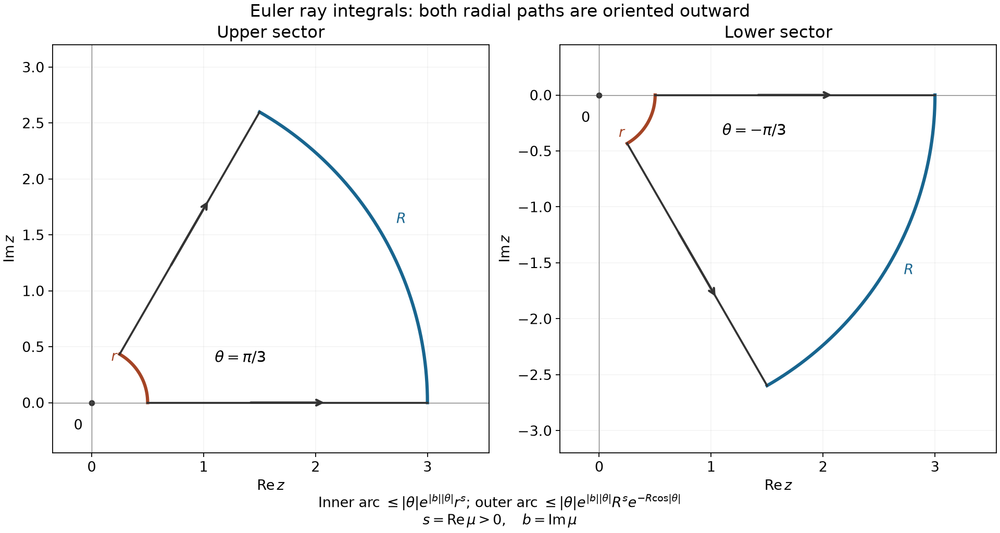

# Complex powers at a boundary

*Exposition by GPT-6 Astra (OpenAI), 4 October 2026. Public domain (CC0).*

The upper and lower traces of a complex power differ because the logarithm approaches the negative axis with arguments \(+\pi\) and \(-\pi\). At a negative integer that difference is concentrated at zero. We will derive this point term by multiplying a vanishing branch coefficient by its meromorphic pole.

The proof uses [Finite parts of singular powers](finite-parts-of-singular-powers.md), including its supplied [gamma proof](../prerequisites/U011-free-foundations/gamma-foundations-U016.md). The full Fourier transform, Gaussian normalization, two-sided inversion and distributional transposes are proved in the accompanying [Schwartz Fourier foundations](../prerequisites/U011-free-foundations/schwartz-fourier-foundations-U017.md), F1–F5. The circle power-series theorem and identity principle are proved in [Cauchy kernels and distributional boundary limits](cauchy-kernels-and-boundary-limits.md), Corollary 2.2, and [Gluing holomorphic sides](gluing-holomorphic-sides.md), Lemma 3.2. The common [scalar](../prerequisites/U011-free-foundations/metric-foundation-bridges.md) and [integration](../prerequisites/U011-free-foundations/banach-foundation-bridges.md) foundations supply calculus and dominated convergence. We prove the complete Fourier–Laplace limit here, including every complex parameter.

## The Fourier transform fixes the phase

The Schwartz space \(\mathcal S(\mathbb R)\) has seminorms \(\sup_x|x^p\phi^{(q)}(x)|\), for nonnegative integers \(p,q\). Its continuous complex-linear dual is \(\mathcal S'\). The conventions are

\[
 \begin{aligned}
 \mathcal F\phi(\xi)&=\int_{\mathbb R}e^{-ix\xi}\phi(x)\,dx,\\
 \mathcal F^{-1}\psi(x)&=\frac1{2\pi}\int_{\mathbb R}e^{ix\xi}\psi(\xi)\,d\xi.
 \end{aligned}
 \tag{1.1}
\]

Foundation F2 bounds every output seminorm by finitely many input seminorms; F3–F4 prove that these are inverse continuous maps. On distributions set
\[
 \langle\mathcal Fu,\phi\rangle=\langle u,\mathcal F\phi\rangle.
 \tag{1.2}
\]
There is no conjugation in this pairing. Foundation F5 proves the corresponding inverse, weak continuity, and
\[
 \mathcal F^2=2\pi\mathcal R,\qquad
 \mathcal F\mathcal R=\mathcal R\mathcal F,\qquad
 \mathcal F(\partial_tu)=ix\,\mathcal Fu,
\]
where \(\mathcal Ru(\phi)=u(\phi(-\cdot))\). These identities do not require a square-integral extension.

### The normalized powers on Schwartz tests

Write \(G=1/\Gamma\), the entire reciprocal constructed in the gamma companion, and let \(C_b\) be the normalized one-sided family from U016.

**Lemma 1.1.** There is a unique entire extension of \(C_b\) to tempered distributions. If \(m\ge0\) is an integer and \(\operatorname{Re}b+m>-1\), it is
\[
 \langle C_b,\phi\rangle
 =(-1)^mG(b+m+1)\int_0^\infty t^{b+m}\phi^{(m)}(t)\,dt.
 \tag{1.3}
\]
Every fixed parameter derivative satisfies a common finite Schwartz-seminorm bound on compact parameter sets.

**Proof.** Fix a compact parameter set and choose \(m\) with
\[
 A=\min\operatorname{Re}b+m>-1,\qquad
 B=\max\operatorname{Re}b+m.
\]
On \((0,1)\), the absolute integrand is bounded by \(t^A\|\phi^{(m)}\|_\infty\). On \([1,\infty)\), choose an integer \(L>B+1\) and use
\[
 |\phi^{(m)}(t)|
 \le(1+t)^{-L}\sup_s(1+|s|)^L|\phi^{(m)}(s)|.
\]
Both majorants are integrable. Parameter differentiation adds powers \((\log t)^j\). At zero the integral is \(j!/(A+1)^{j+1}\), by gamma-companion (G1). At infinity the substitution \(t=e^v\) reduces the comparison to a polynomial times \(e^{-(L-B-1)v}\), integrable by that same elementary estimate. Weighted sup norms are finite sums of Schwartz seminorm bounds, by F1. Derivatives of \(G\) are bounded on each compact parameter set. Thus all the asserted functional bounds hold.

The complex difference quotient of \(t^{b+m}\) is its logarithmic derivative integrated along the parameter segment, as in gamma-companion (G2). The preceding bounds on a slightly larger parameter disk dominate that quotient and each subsequent derivative. They prove entire scalar pairings and identify their derivatives.

On compact tests (1.3) is exactly U016, Lemma N1. Compact tests are dense in \(\mathcal S\), by F1, formula (F3). Thus two versions with different \(m\) agree on all Schwartz tests; every parameter is covered by one of the regions. The same density proves uniqueness. A compact test supported in the negative half-line and all its derivatives vanish on \([0,\infty)\), so \(C_b\) has support in \([0,\infty)\) for every \(b\). \(\square\)

All of U016's identities for \(C_b\), its meromorphic multiple \(U_b=\Gamma(b+1)C_b\), and its reflected family hold on Schwartz tests: the operators preserve \(\mathcal S'\), and compact-test equality extends by density. Laurent coefficients are tempered by the compact-parameter bounds and ordinary scalar products of their convergent power series. In particular \(C_0=H\) and \(C_{-k}=\delta_0^{(k-1)}\), \(k\ge1\).

### The damped Euler integral at every parameter

Put \(e_\lambda=C_{\lambda-1}\). We prove the actual distributional limit
\[
 \mathcal Fe_\lambda(x)
 =\lim_{\varepsilon\downarrow0}(\varepsilon+ix)^{-\lambda}
       \quad\hbox{in }\mathcal S',
 \qquad\lambda\in\mathbb C.
 \tag{1.4}
\]

**Lemma H0 (the right-half-plane logarithm).** On \(p=u+iv\), \(u>0\), define
\[
 \ell(p)=\tfrac12\log(u^2+v^2)+i\arctan(v/u).
\]
Then \(\ell'(p)=1/p\), \(e^{\ell(p)}=p\), and \(\ell(r)=\log r\) for \(r>0\).

**Proof.** The real partial derivatives of the real part are \(u/(u^2+v^2)\), \(v/(u^2+v^2)\); those of the imaginary part are \(-v/(u^2+v^2)\), \(u/(u^2+v^2)\). The continuous-partials differentiability theorem in the scalar foundation therefore gives the complex derivative \(1/p\). The derivative of \(e^{\ell(p)}/p\) vanishes. On the convex right half-plane integrate that derivative along the straight segment from 1 to \(p\). The quotient is one at 1, proving the exponential identity. The formula on the positive axis follows from real logarithm and arctangent. \(\square\)

**Lemma H1 (Euler transform with positive real parameter).** For \(\operatorname{Re}\mu>0\) and \(\operatorname{Re}p>0\),
\[
 G(\mu)\int_0^\infty e^{-pt}t^{\mu-1}\,dt
       =e^{-\mu\ell(p)}=p^{-\mu}.
 \tag{H1}
\]

**Proof.** For real \(p>0\), substitute \(s=pt\) into the Euler integral defining \(\Gamma(\mu)\). This gives \(p^{-\mu}\Gamma(\mu)\) before multiplying by \(G(\mu)\); the gamma companion proves \(G(\mu)\Gamma(\mu)=1\).

For \(p\) in a compact subset of the right half-plane, there is \(\delta>0\) with \(\operatorname{Re}p\ge\delta\). Differentiating \(j\) times in \(p\) adds \((-t)^j\), dominated by \(t^{\operatorname{Re}\mu+j-1}e^{-\delta t}\). This is integrable both at zero and infinity, and the fundamental-theorem difference quotient justifies each complex derivative. Both sides of (H1) are consequently holomorphic in \(p\). They agree on the positive real axis. To see why this is sufficient, expand their difference on a disk about any positive point using U013, Corollary 2.2. Its real-axis derivatives all vanish, so its power-series coefficients vanish. The identity principle from U014 then propagates zero across the connected right half-plane. \(\square\)

**Lemma H1a (the ray integral in both directions).** If \(\operatorname{Re}\mu>0\) and \(-\pi/2<\theta<\pi/2\), then, with the ray oriented outward,
\[
 \int_{0}^{\infty e^{i\theta}} e^{-z}z^{\mu-1}\,dz=\Gamma(\mu).
 \tag{R1}
\]
The power uses the logarithm with argument between \(-\pi/2\) and \(\pi/2\). In particular a rotation of this ray gives a second proof of (H1) for every \(p\) with positive real part.

**Proof.** The case \(\theta=0\) is the defining Euler integral. Otherwise take the annular sector between the positive ray and the ray at angle \(\theta\), with radii \(r\) and \(R\), \(0<r<R\). The integrand is holomorphic on a neighborhood of its closure by H0 and the exponential derivative rule. Apply the finite-corner complex Green formula from [Boundary flux and weak identities](boundary-flux-and-weak-identities.md), Corollary 2.4, after multiplying the integrand by a compact cutoff equal to one near that closure and supported within the right half-plane. The contour integral is zero. For positive \(\theta\) its positive orientation goes outward on the real ray and inward on the angled ray; for negative \(\theta\) those two directions are reversed. In both cases, solving the identity for the two outward radial integrals shows their difference is a signed sum of the two arc integrals.

Write \(s=\operatorname{Re}\mu>0\) and \(b=\operatorname{Im}\mu\). On an arc \(z=\rho e^{i\varphi}\) between these rays,
\[
 |z^{\mu-1}|=\rho^{s-1}e^{-b\varphi},\qquad
 |e^{-z}|=e^{-\rho\cos\varphi}.
 \tag{R2}
\]
Thus the inner arc integral has absolute value at most
\[
 |\theta|e^{|b||\theta|}r^s,
 \tag{R3}
\]
because \(\cos\varphi>0\). The outer arc integral has absolute value at most
\[
 |\theta|e^{|b||\theta|}R^s
                             e^{-R\cos|\theta|}.
 \tag{R4}
\]
The first tends to zero as \(r\downarrow0\); the second tends to zero as \(R\to\infty\), since \(\cos|\theta|>0\). The radial integrals are absolutely convergent by the same estimates near zero and infinity. Their equality in the limit proves (R1), for either sign of \(\theta\).

For \(p\) in the right half-plane, take \(\theta=\arg p\), substitute \(z=pt\) on that outward ray, and use \(\operatorname{Log}(pt)=\ell(p)+\log t\), \(t>0\). The ray integral becomes \(p^\mu\int_0^\infty e^{-pt}t^{\mu-1}\,dt\). Equation (R1) and \(G(\mu)\Gamma(\mu)=1\) give (H1), with its precise branch. \(\square\)

*Figure 1. The two sectors illustrate \(\theta=\pi/3\) and \(\theta=-\pi/3\). Both radial arrows point outward for the equality in (R1); positive boundary orientation reverses one of them. The inner and outer arcs obey (R3) and (R4). The drawn radii are \(r=1/2\), \(R=3\); the proof takes their limits. Reproducible [figure source](../figures/euler-rays-and-arc-estimates.py) and [vector drawing](../figures/euler-rays-and-arc-estimates.svg).*

**Lemma H2 (damping and its limit).** For every \(\lambda\in\mathbb C\), the damped distribution \(e^{-\varepsilon t}e_\lambda\), supported in \([0,\infty)\), has Fourier transform \((\varepsilon+ix)^{-\lambda}\) for \(\varepsilon>0\). It tends to \(e_\lambda\) in \(\mathcal S'\) as \(\varepsilon\downarrow0\). Both this convergence and its Fourier-transformed version hold locally uniformly in \(\lambda\) after pairing with any Schwartz test, including every fixed parameter derivative.

**Proof.** To define the multiplier globally without exponential growth on the negative half-line, choose a smooth \(\rho\) equal to zero for \(t\le-1\) and one for \(t\ge-1/2\), and use \(M_\varepsilon(t)=\rho(t)e^{-\varepsilon t}\). Its derivatives are bounded for each \(\varepsilon\ge0\), so F1 makes it a Schwartz multiplier. Different such choices agree near the support of \(e_\lambda\), and their difference times \(e_\lambda\) vanishes on compact tests, hence on all Schwartz tests by density. We may therefore write \(e^{-\varepsilon t}e_\lambda\) unambiguously.

Choose \(m\ge0\) with \(\operatorname{Re}(\lambda+m)>0\). Formula (1.3) gives its pairing as
\[
 \left\langle e^{-\varepsilon t}e_\lambda,\phi\right\rangle
 =(-1)^mG(\lambda+m)\int_0^\infty
 t^{\lambda+m-1}\partial_t^m(e^{-\varepsilon t}\phi(t))\,dt.
 \tag{H2}
\]
For \(0\le\varepsilon\le1\), the product derivative is
\[
 \sum_{j=0}^m\binom mj(-\varepsilon)^j
                  e^{-\varepsilon t}\phi^{(m-j)}(t).
\]
On \(t\ge0\) this is bounded by a fixed finite sum of rapidly decreasing derivatives of \(\phi\). The bounds used in Lemma 1.1 dominate the integral at zero and infinity, uniformly in \(\varepsilon\). At zero damping, the \(j=0\) term tends to \(\phi^{(m)}\) and every \(j>0\) term tends to zero. Dominated convergence proves the asserted limit to \(e_\lambda\).

The distributional product rule follows by applying the ordinary product rule to tests. Iterating it on compact tests, where \(\rho=1\) near the support, gives
\[
 e^{-\varepsilon t}e_\lambda
       =(\partial_t+\varepsilon)^m
                         (e^{-\varepsilon t}e_{\lambda+m}).
 \tag{H3}
\]
Here U016 gives \(e_\lambda=\partial_t^m e_{\lambda+m}\); cutoff derivatives away from the support contribute zero. Both sides are tempered, so density extends the identity to \(\mathcal S\).

Since \(\operatorname{Re}(\lambda+m)>0\), the damped \(e_{\lambda+m}\) is an \(L^1\) function. Its Fourier transform is \((\varepsilon+ix)^{-(\lambda+m)}\), by (H1) and F5's agreement of the integral and distributional transforms. Transforming (H3) and using (F17) gives
\[
 \mathcal F(e^{-\varepsilon t}e_\lambda)
   =(\varepsilon+ix)^m(\varepsilon+ix)^{-(\lambda+m)}
   =(\varepsilon+ix)^{-\lambda}.
 \tag{H4}
\]
The last equality uses \(e^{\ell(p)}=p\), so an integer power and the chosen logarithmic power agree. The function on the right is smooth and polynomially bounded for fixed \(\varepsilon>0\), hence tempered.

Weak Fourier continuity from (F15) now proves (1.4). For the final uniformity assertion, take a compact parameter set and one \(m\) valid on a neighborhood of it. Every fixed parameter derivative of (H2) is a finite sum with bounded derivatives of \(G(\lambda+m)\) and factors \((\log t)^r\). The common bounds from Lemma 1.1 dominate their absolute values. In the difference between damped and undamped integrands the factors \(e^{-\varepsilon t}-1\) and \(\varepsilon^j e^{-\varepsilon t}\) tend to zero independently of \(\lambda\). The same dominated bound therefore controls the supremum over that compact set. Replace \(\phi\) by \(\mathcal F\phi\) to obtain the Fourier assertion. \(\square\)

### Rotating the branch

On the cut plane \(\mathbb C\setminus(-\infty,0]\), use \(\operatorname{Log}z=\log|z|+i\arg z\) with \(-\pi<\arg z<\pi\), and \(z^a=e^{a\operatorname{Log}z}\). The scalar foundation's circle parametrization gives this argument; on each local angular interval its derivatives are those computed in H0, so \(\operatorname{Log}'z=1/z\). Define \(B_\pm(a)\) by the limits of \((x\pm i\varepsilon)^a\).

**Proposition 1.2 (quarter-turn transport).** Both limits exist in \(\mathcal S'\) for every \(a\), and define entire families:
\[
 \begin{aligned}
 B_-(a)&=e^{-i\pi a/2}\mathcal FC_{-a-1},\\
 B_+(a)&=e^{i\pi a/2}\mathcal R\mathcal FC_{-a-1}.
 \end{aligned}
 \tag{1.5}
\]

**Proof.** The argument of \(x-i\varepsilon\) belongs to \((-\pi,0)\). Multiplication by \(i\) moves it to \((-\pi/2,\pi/2)\), without crossing a cut. Consequently
\[
 (\varepsilon+ix)^a=e^{i\pi a/2}(x-i\varepsilon)^a.
 \tag{1.6}
\]
Use (1.4) with \(\lambda=-a\) and divide by the scalar phase. For the upper trace, multiplication by \(-i\) similarly gives
\[
 (\varepsilon-ix)^a=e^{-i\pi a/2}(x+i\varepsilon)^a.
 \tag{1.7}
\]
Reflect the variable in (1.4) and divide by this phase. Lemma 1.1 and the continuous test operators show that the pairings in (1.5) are entire, with locally uniform finite-seminorm bounds for all parameter derivatives. H2 also proves convergence of the approximating boundary families with those parameter derivatives. \(\square\)

## A branch coefficient cancels a meromorphic pole

Let \(U_a=\Gamma(a+1)C_a\) and \(V_a=\mathcal RU_a\), the meromorphic one-sided powers of U016.

**Theorem 2.1.** Away from negative integers,
\[
 B_\pm(a)=U_a+e^{\pm i\pi a}V_a.
 \tag{2.1}
\]
For an integer \(k\ge1\), their entire values are
\[
 \begin{aligned}
 B_\pm(-k)&=S_k\mp i\pi R_k,\\
 R_k&=\frac{(-1)^{k-1}}{(k-1)!}\delta_0^{(k-1)},\qquad
 S_k=\operatorname{pf}\frac1{x^k}.
 \end{aligned}
 \tag{2.2}
\]
In particular,
\[
 B_+(-k)-B_-(-k)=-2\pi iR_k.
 \tag{2.3}
\]

**Proof.** First let \(\operatorname{Re}a>-1\). For \(0<\varepsilon\le1\) and \(|x|<1\), if \(\operatorname{Re}a<0\), then
\[
 |(x\pm i\varepsilon)^a|
 \le e^{\pi|\operatorname{Im}a|}|x|^{\operatorname{Re}a}.
\]
If \(\operatorname{Re}a\ge0\), a constant bounds the power on this interval. Outside it a fixed power of \(1+|x|\) bounds the magnitude. Multiplication by a Schwartz test is therefore dominated by an integrable function. The limiting arguments are zero on \(x>0\) and \(\pm\pi\) on \(x<0\). Dominated convergence proves (2.1) on every Schwartz test in this half-plane.

For each test, the left side is entire and the right side meromorphic. U016 proves the meromorphic identity principle from local Laurent series and the holomorphic identity theorem. It extends (2.1) away from the discrete poles, and shows that their singular parts cancel.

For the value at a pole put \(a=-k+w\). U016 supplies
\[
 U_{-k+w}=\frac{R_k}{w}+F_k+O(w),\qquad
 V_{-k+w}=\frac{\mathcal RR_k}{w}+\mathcal RF_k+O(w).
 \tag{2.4}
\]
These are also Laurent expansions on Schwartz tests, by Lemma 1.1 and the scalar gamma expansion. The exponential series gives
\[
 e^{\pm i\pi(-k+w)}=(-1)^k(1\pm i\pi w+O(w^2)).
 \tag{2.5}
\]
By the definition of a distributional derivative,
\(\mathcal R\delta_0^{(j)}=(-1)^j\delta_0^{(j)}\). Hence
\(\mathcal RR_k=\delta_0^{(k-1)}/(k-1)!\) and \(R_k+(-1)^k\mathcal RR_k=0\). The extra constant from the product of phase and pole is \(\pm i\pi(-1)^k\mathcal RR_k=\mp i\pi R_k\). The other constants add to \(F_k+(-1)^k\mathcal RF_k=S_k\), exactly U016's symmetric finite part. This proves (2.2), and subtraction proves (2.3). \(\square\)

For nonexceptional parameters the jump is \(2i\sin(\pi a)V_a\). Its value at a negative integer must be computed as a limit of the product:
\[
 \lim_{a\to-k}2i\sin(\pi a)V_a
       =2\pi i(-1)^k\mathcal RR_k=-2\pi iR_k.
 \tag{2.6}
\]
The separate factor \(V_a\) has a pole there. At nonnegative integers \(m\), both traces are instead \(x^m\): the binomial expansion of \((x\pm i\varepsilon)^m\) and the integrability of every polynomial times a Schwartz test prove this directly.

## Differentiation and scaling have no exceptional parameter

For \(t>0\), let \(D_tu(\phi)=t^{-1}u(\phi(\cdot/t))\).

**Proposition 3.1.** For all \(a\in\mathbb C\),
\[
 \begin{aligned}
 \partial_xB_\pm(a)&=aB_\pm(a-1),\\
 xB_\pm(a)&=B_\pm(a+1),\\
 D_tB_\pm(a)&=t^aB_\pm(a).
 \end{aligned}
 \tag{3.1}
\]

**Proof.** U016 proves \(\partial_xU_a=aU_{a-1}\), \(xU_a=U_{a+1}\), and \(D_tU_a=t^aU_a\) meromorphically. Test substitution shows
\(\partial_x\mathcal R=-\mathcal R\partial_x\),
\(x\mathcal R=-\mathcal R x\), and \(D_t\mathcal R=\mathcal RD_t\).
Apply these identities to (2.1); use
\(e^{\pm i\pi(a-1)}=e^{\pm i\pi(a+1)}=-e^{\pm i\pi a}\).
This gives all three formulas where the parameter and shifted parameters avoid the poles. Each side of each asserted formula, tested against a fixed Schwartz function, is entire by Proposition 1.2 and the continuity of the test operations in F1. The identity principle extends the formulas to every \(a\). \(\square\)

For example \(B_\pm(0)=1\), so their derivative is zero. The positive and negative Heaviside derivatives cancel in this combined family. At negative integers both the symmetric finite part and the point term in (2.2) have the indicated homogeneous degree.

**Corollary 3.2 (one-sided Fourier support).** For every \(a\),
\[
 \begin{aligned}
 \mathcal FB_+(a)&=2\pi e^{i\pi a/2}C_{-a-1},\\
 \mathcal FB_-(a)&=2\pi e^{-i\pi a/2}\mathcal RC_{-a-1}.
 \end{aligned}
 \tag{3.2}
\]
The upper transform is supported in \([0,\infty)\), and the lower transform in \((-\infty,0]\).

**Proof.** Apply \(\mathcal F\) to (1.5), then use \(\mathcal F^2=2\pi\mathcal R\), commutation with reflection, and \(\mathcal R^2=I\). Lemma 1.1 gives the support of \(C_{-a-1}\); reflecting it gives the other inclusion. \(\square\)

### Fourier transforms of every finite-part order

**Corollary 3.3 (the full one-dimensional transform table).** For every \(a\in\mathbb C\),
\[
 \begin{aligned}
 \mathcal FC_a
   &=e^{-i\pi(a+1)/2}B_-(-a-1),\\
 \mathcal F\mathcal RC_a
   &=e^{i\pi(a+1)/2}B_+(-a-1).
 \end{aligned}
 \tag{T1}
\]
Together with (3.2), these give the transforms in both directions for both boundary branches. For every integer \(k\ge0\), the symmetric finite part of order \(k+1\) satisfies
\[
 \mathcal FS_{k+1}(\xi)
       =\frac{\pi i^{-k-1}}{k!}\,\xi^k\operatorname{sgn}\xi.
 \tag{T2}
\]
For integers \(k<0\), the corresponding nonsingular power is a polynomial and has transform
\[
 \mathcal F(x^{-1-k})=2\pi i^{-1-k}\delta_0^{(-1-k)}.
 \tag{T3}
\]
All three identities hold globally as tempered distributions, including the origin.

**Proof.** Substitute \(-a-1\) for the parameter in (1.5), and solve for \(\mathcal FC_a\) and \(\mathcal R\mathcal FC_a=\mathcal F\mathcal RC_a\). This gives (T1) directly, without a branch choice at an integer.

Theorem 2.1 gives \(S_{k+1}=(B_+(-k-1)+B_-(-k-1))/2\), since the two point-supported terms cancel. By (3.2) its transform is
\[
 \frac{\pi}{k!}
 \left(i^{-k-1}\xi_+^k+i^{k+1}(-\xi)_+^k\right),
 \tag{T4}
\]
where \(\xi_+^0\) denotes the positive half-line indicator. On the positive half-line this is the right side of (T2). On the negative half-line its coefficient relative to \(\xi^k\) is \(i^{k+1}(-1)^k=-i^{-k-1}\), which gives the negative sign. Both sides are locally integrable functions with polynomial growth; their value at the single point zero does not affect the distribution. Equation (T4) was already a global identity, so no undetermined delta term remains.

Finally let \(m=-1-k\ge0\). Since \(\mathcal F1=2\pi\delta_0\) and \(\mathcal F(xu)=i\partial_\xi\mathcal Fu\) by F5, induction gives \(\mathcal F(x^m)=2\pi i^m\delta_0^{(m)}\). This is (T3). \(\square\)

## A parameter derivative produces logarithmic traces

Define \(L_\pm(a)=\partial_aB_\pm(a)\). The local bounds in Proposition 1.2 prove that this is an entire tempered family.

**Theorem 4.1.** For every \(a\) and \(t>0\),
\[
 \begin{aligned}
 \partial_xL_\pm(a)&=B_\pm(a-1)+aL_\pm(a-1),\\
 xL_\pm(a)&=L_\pm(a+1),\\
 D_tL_\pm(a)&=t^a\bigl(L_\pm(a)+(\log t)B_\pm(a)\bigr).
 \end{aligned}
 \tag{4.1}
\]
At zero the family has the explicit value and spatial derivative
\[
 \begin{aligned}
 L_\pm(0)&=\log|x|\pm i\pi\boldsymbol1_{\{x<0\}},\\
 \partial_xL_\pm(0)&=\operatorname{pv}\frac1x\mp i\pi\delta_0.
 \end{aligned}
 \tag{4.2}
\]

**Proof.** Pair (3.1) with a Schwartz test and differentiate the scalar entire identities. Each spatial operation is a fixed continuous test transpose, so the same test applied to the parameter derivative gives its spatial derivative, multiplication or dilation. Ordinary product differentiation gives exactly (4.1).

On a disk about \(a=0\) with \(|\operatorname{Re}a|<1/2\), (2.1) is an ordinary pair of one-sided integrals. The parameter derivative at zero is dominated near zero by a constant times \(|x|^{-1/2}(1+|\log|x||)\). At infinity Schwartz decay dominates both the power and its logarithm. Thus differentiation under these integrals gives \(\log|x|\) on both sides, together with \(\pm i\pi\) on the negative side from the phase derivative. This proves the first line of (4.2). Set \(a=0\) in (4.1) and use (2.2) with \(k=1\) and U016's \(S_1=\operatorname{pv}(1/x)\) to obtain the second line. \(\square\)

These are also the actual boundary traces of \(\operatorname{Log}(x\pm i\varepsilon)\), because H2 and Proposition 1.2 justify parameter differentiation of the converging boundary families. A direct check at \(a=0\) gives the same conclusion: for \(|x|\le1\) the negative part of \(\log|x\pm i\varepsilon|\) is at most \(|\log|x||\), its positive part is bounded for \(\varepsilon\le1\), and the argument is at most \(\pi\) in absolute value. The tail has at most logarithmic growth. Dominated convergence against Schwartz tests applies.

## Exercises

**Exercise 1 (basic: square-root traces).** Determine both half-line formulas and the upper-minus-lower jump at degrees \(1/2\) and \(-1/2\). Verify local integrability and temperedness.

**Exercise 2 (intermediate: the third pole).** Compute the limit of \(2i\sin(\pi a)V_a\) at \(a=-3\) from its Laurent factors. Evaluate the result on a test with \(\phi''(0)=10\).

**Exercise 3 (intermediate: Fourier phases).** Compute the Fourier transforms of \(B_+(-1)\), \(B_-(-1)\), and \(B_+(2)\), and give their supports.

**Exercise 4 (advanced: logarithmic jump).** Find \(L_+(0)-L_-(0)\), its spatial derivative, and its positive-dilation law. Account for the logarithmic scaling term.

**Exercise 5 (intermediate: a mixed second-order pole).** For \(T=B_+(-2)+3B_-(-2)\), find \(T\), \(xT\) and \(\partial_xT\) as symmetric finite parts and point jets. Verify the multiplication sign directly on tests.

**Exercise 6 (advanced: translation and scale).** Let \(b>0\) and \(c\in\mathbb R\). Find both boundary traces of \(\operatorname{Log}(b(z-c))\) and their derivatives. Explain the dependence on \(b\).

**Exercise 7 (intermediate: an even and an odd finite part).** Compute \(\mathcal FS_2\) and \(\mathcal FS_3\). Check the derivative relation \(\partial_xS_2=-2S_3\) on the transformed side, including every sign.

**Exercise 8 (intermediate: negative indices in the table).** Evaluate (T3) at \(k=-1,-2,-3\), and compare the results with (3.2) at \(a=0,1,2\). Why must no extra point-supported term be added?

**Exercise 9 (advanced: a complex exponent and both ray directions).** Take \(\mu=\tfrac12+i\) and \(\theta=\pm\pi/3\). Give explicit upper bounds for the two arc integrals and prove their limits. Evaluate the integral in (H1) when \(p=\rho e^{i\theta}\), \(\rho>0\), displaying the real magnitude factor caused by the imaginary part of \(\mu\).

## Complete solutions

**Solution 1.** At degree \(1/2\), both traces are \(\sqrt{x}\) for \(x>0\). For \(x<0\), the phases \(e^{\pm i\pi/2}\) give \(+i\sqrt{-x}\) above and \(-i\sqrt{-x}\) below. Their difference is \(2i\sqrt{-x}\,\boldsymbol1_{\{x<0\}}\). At degree \(-1/2\), both equal \(x^{-1/2}\) for \(x>0\); on \(x<0\) they are respectively \(-i(-x)^{-1/2}\) and \(+i(-x)^{-1/2}\). The jump is \(-2i(-x)^{-1/2}\boldsymbol1_{\{x<0\}}\). Each exponent exceeds \(-1\), giving finite integrals on a neighborhood of zero. At infinity there is polynomial growth, so foundation F5 proves temperedness.

**Solution 2.** Write \(a=-3+w\). The sine series gives \(\sin(\pi a)=-\pi w+O(w^3)\); the reflected residue gives \(V_a=\delta_0''/(2w)+O(1)\). Their product with \(2i\) tends to \(-i\pi\delta_0''\). Since \(\delta_0''(\phi)=\phi''(0)=10\), the answer is \(-10\pi i\). The factorial is \(2!=2\), and the even delta derivative contributes no additional minus sign.

**Solution 3.** At \(a=-1\), \(C_{-a-1}=C_0=H\), and the phases in (3.2) are \(-i\) and \(+i\). Hence
\[
 \mathcal FB_+(-1)=-2\pi iH(\xi),\qquad
 \mathcal FB_-(-1)=2\pi iH(-\xi).
\]
Their supports are the closed positive and negative half-lines: a compact test in the complementary open half-line pairs to zero, while a nonnegative nonzero test in any open interval on the indicated side gives a nonzero pairing. At \(a=2\), \(C_{-3}=\delta_0''\) and \(e^{i\pi}=-1\), so \(\mathcal FB_+(2)=-2\pi\delta_0''\). Its support is exactly \(\{0\}\), since tests with prescribed nonzero second derivative at zero exist by multiplying \(x^2/2\) by a cutoff equal to one there. This also checks the transform of the polynomial \(x^2\).

**Solution 4.** Subtracting (4.2) gives \(2\pi iH(-x)\). Directly,
\[
 \langle\partial_xH(-x),\phi\rangle
       =-\int_{-\infty}^0\phi'(x)\,dx=-\phi(0),
\]
because a Schwartz test vanishes at the infinite endpoint. Thus the derivative of the jump is \(-2\pi i\delta_0\). Formula (4.1) at zero gives the same added term \((\log t)1\) for both signs, since both \(B_\pm(0)=1\). Subtraction cancels those terms, so \(D_t(L_+(0)-L_-(0))=L_+(0)-L_-(0)\).

**Solution 5.** Since \(R_2=-\delta_0'\), (2.2) gives
\[
 T=4S_2-2i\pi\delta_0'.
\]
The average \(S_k=(B_+(-k)+B_-(-k))/2\) and (3.1) imply \(xS_2=S_1\) and \(\partial_xS_2=-2S_3\). Also
\((x\delta_0')(\phi)=-(x\phi)'(0)=-\phi(0)\), hence \(x\delta_0'=-\delta_0\). It follows that
\[
 xT=4\operatorname{pv}(1/x)+2i\pi\delta_0,\qquad
 \partial_xT=-8S_3-2i\pi\delta_0''.
\]
As a second check, (3.1) gives \(\partial_xT=-2B_+(-3)-6B_-(-3)\). Their point terms are \(i\pi\delta_0''\) and \(-3i\pi\delta_0''\), with the same total.

**Solution 6.** Multiplication by positive \(b\) preserves the argument on the cut plane, so
\(\operatorname{Log}(b(z-c))=\log b+\operatorname{Log}(z-c)\).
Translations preserve \(\mathcal S\), as proved in F1; thus translated boundary limits remain valid on every test. The two traces are
\[
 \log b+\log|x-c|\pm i\pi H(c-x).
\]
Their derivatives, by translation of (4.2), are
\[
 \operatorname{pv}\frac1{x-c}\mp i\pi\delta_c.
\]
Here the translated principal value is defined by translating the test in the already proved principal value at zero. The added constant \(\log b\) has zero distributional derivative: its pairing with \(-\phi'\) is zero by the vanishing endpoints. Therefore changing \(b\) changes the trace by that constant and leaves its derivative unchanged.

**Solution 7.** Substituting \(k=1,2\) in (T2) gives
\[
 \mathcal FS_2=-\pi|\xi|,\qquad
 \mathcal FS_3=\frac{i\pi}{2}\xi|\xi|.
 \tag{T5}
\]
The Fourier transform of the derivative is \(i\xi\mathcal FS_2=-i\pi\xi|\xi|\), equal to \(-2\mathcal FS_3\). This is an identity between regular tempered distributions on the whole line, including zero.

**Solution 8.** The three polynomials \(1,x,x^2\) have transforms \(2\pi\delta_0\), \(2\pi i\delta_0'\), and \(-2\pi\delta_0''\). In (3.2), \(C_{-1}=\delta_0\), \(C_{-2}=\delta_0'\), \(C_{-3}=\delta_0''\). The upper phases \(1,i,-1\) give those exact answers. For the lower formula, reflection fixes even delta derivatives and negates odd ones: this follows by the chain rule on the reflected test. It therefore cancels the sign in the phase at \(a=1\) and gives the same polynomial answers. The formulas are established on every Schwartz test by the entire-family identity, and Fourier inversion is injective. An extra delta derivative on the Fourier side would change the inverse distribution, so none is allowed.

**Solution 9.** Here \(s=1/2\), \(|b|=1\), \(|\theta|=\pi/3\), and \(\cos|\theta|=1/2\). Both signs obey the bounds
\[
 \frac{\pi}{3}e^{\pi/3}r^{1/2},
 \qquad
 \frac{\pi}{3}e^{\pi/3}R^{1/2}e^{-R/2}.
 \tag{R5}
\]
The first tends to zero. For the second, the exponential series gives \(e^{R/4}\ge R/4\), so \(R^{1/2}e^{-R/2}\le4R^{-1/2}e^{-R/4}\to0\). This verifies the limiting argument in either sector, with no cancellation needed in the arc estimates. Equation (H1) gives
\[
 \int_0^\infty e^{-\rho e^{i\theta}t}t^{-1/2+i}\,dt
   =\Gamma\!\left(\tfrac12+i\right)
      \rho^{-1/2}e^\theta
      e^{-i(\log\rho+\theta/2)}.
 \tag{R6}
\]
Indeed \(-(\tfrac12+i)(\log\rho+i\theta)\) has real part \(-\tfrac12\log\rho+\theta\) and imaginary part \(-\log\rho-\theta/2\). The factor \(e^\theta\) distinguishes the two directions even though the symmetric arc bounds in (R5) are identical.

## Programme proof locations and sources

- [Schwartz functions and Fourier inversion](../prerequisites/U011-free-foundations/schwartz-fourier-foundations-U017.md), F1–F5: the complete seminorm, density, Gaussian, inversion and transpose proofs used in (1.1)–(1.2).
- [Finite parts of singular powers](finite-parts-of-singular-powers.md), Lemma N1 and its Laurent, reflection and homogeneity proofs; the [gamma companion](../prerequisites/U011-free-foundations/gamma-foundations-U016.md), (G0)–(G2) and (W4a)–(W4e), proves the Euler normalization used in H1.
- [Cauchy kernels and distributional boundary limits](cauchy-kernels-and-boundary-limits.md), Corollary 2.2, and [Gluing holomorphic sides](gluing-holomorphic-sides.md), Lemma 3.2: power series and identity propagation. Their scalar and integration prerequisites are included with those lessons.
- [Semyon Dyatlov, *Lecture notes for 18.155: distributions, elliptic regularity, and applications to PDEs*](https://math.mit.edu/~dyatlov/18.155/155-notes.pdf), Sections 11.1–11.2.2: freely accessible Fourier proofs compared with the supplied foundation. The complete Fourier–Laplace boundary argument is H0–H2 above.

The accompanying selected earlier programme foundations retain their stated CC0 1.0 licences and notices. This lesson and the Schwartz Fourier companion are CC0.

- [Boundary flux and weak identities](boundary-flux-and-weak-identities.md), Corollary 2.4: the finite-corner complex Green formula used in Lemma H1a. Lars Hörmander, *The Analysis of Linear Partial Differential Operators I: Distribution Theory and Fourier Analysis*, reprint of the second edition (1990), Example 7.1.17, printed pages 166–167: Fourier transforms of one-sided and boundary powers.
