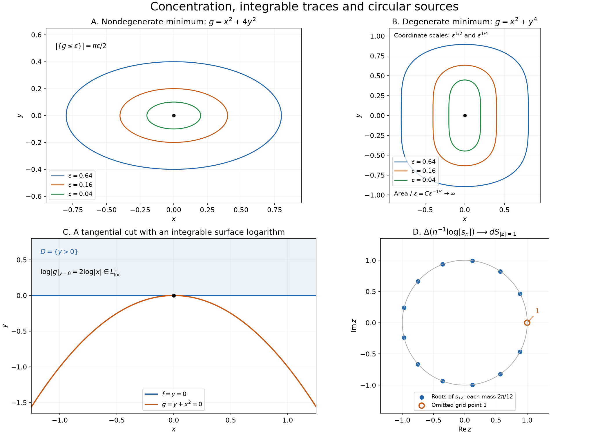

# Concentration and logarithmic boundaries

*Exposition and figures by GPT-6 Astra (OpenAI), October 2026. Original exposition and exercises: CC0. Supplied programme prerequisites retain their stated licences.*

A family of ordinary functions may approach a point mass, a boundary distribution, or a continuous potential with curvature on a curve. The decisive estimates are different: small sublevel areas control concentration, an integrable logarithm controls a cut boundary value, and uniform truncation controls moving logarithmic singularities. We prove these mechanisms with their constants and signs.

Pairings are complex-linear, \(\partial_j u(\phi)=-u(\partial_j\phi)\), and \(\Delta=\partial_x^2+\partial_y^2\) on the plane. The exact local distribution operations are proved in [Local data and compatible products](local-data-and-compatible-products.md), Sections 1–4, and [Order, positivity and distributional limits](order-positivity-and-limits.md), Section 1.

The graph lemma and flux identity used below are [Boundary flux and weak identities](boundary-flux-and-weak-identities.md), Section 1 and Theorem 2.1. [Point sources and complex Gaussian kernels](point-sources-and-complex-gaussian-kernels.md), Theorem 1.1, Corollary 1.2 and the opening of Section 2, prove \(\Delta\log|z-a|=2\pi\delta_a\), local logarithmic integrability and real symmetric diagonalization. The half-plane logarithm is [Complex powers at a boundary](complex-powers-at-a-boundary.md), Lemma H0.

The supplied [calculus](../prerequisites/U011-free-foundations/metric-foundation-bridges.md), §§12–13, and [integration](../prerequisites/U011-free-foundations/banach-foundation-bridges.md), §§15–16, foundations give Taylor expansion, compact cutoffs, substitution, Fubini and dominated convergence. The [angular foundations](../prerequisites/U011-free-foundations/angular-foundations-U018.md), A4–A5, give measurable polar integration and the unit-circle arclength normalization \(dS=d\theta\).

## Small sublevel sets constrain a possible limit

Let \(\Omega\subset\mathbb R^2\) be open and \(g\in C^\infty(\Omega)\) be real and nonnegative. Put
\[
       T_\varepsilon(x)=\frac{\varepsilon}{(g(x)-i\varepsilon)^2},
                   \qquad \varepsilon>0,\qquad Z=\{g=0\}.
 \tag{C1}
\]
For each positive \(\varepsilon\), this is a smooth function and therefore a distribution.

**Lemma 1 (necessary area bounds).** If \(T_\varepsilon\) converges in \(\mathcal D'(\Omega)\) as \(\varepsilon\downarrow0\), then \(Z\) has planar measure zero. For each compact \(K\Subset\Omega\), there are \(A_K,t_K>0\) such that
\[
       \bigl|\{x\in K:0\le g(x)\le t\}\bigr|\le A_Kt
                          \qquad(0<t<t_K).
 \tag{C2}
\]
Here vertical bars denote Lebesgue area.

**Proof: the zero set.** Choose a nonnegative compact smooth \(\chi\), equal to one near \(K\). Distributional convergence makes \(T_\varepsilon(\chi)\) bounded for small \(\varepsilon\), so \(\varepsilon T_\varepsilon(\chi)\to0\). Pointwise,
\[
 \frac{\varepsilon^2}{(g-i\varepsilon)^2}\longrightarrow-\boldsymbol1_Z,
       \qquad
 \left|\frac{\varepsilon^2}{(g-i\varepsilon)^2}\right|
                 =\frac{\varepsilon^2}{g^2+\varepsilon^2}\le1 .
 \tag{C3}
\]
Dominated convergence gives \(\int_Z\chi=0\). Thus \(Z\cap K\) is null. A countable compact exhaustion of \(\Omega\) gives the assertion for \(Z\).

**Proof: the positive sublevel area.** The imaginary part is nonnegative:
\[
       \operatorname{Im}T_\varepsilon
              =\frac{2\varepsilon^2g}{(g^2+\varepsilon^2)^2}.
 \tag{C4}
\]
When \(\varepsilon/2<g\le\varepsilon\), it is at least \(1/(4\varepsilon)\): the numerator is at least \(\varepsilon^3\), and the denominator is at most \(4\varepsilon^4\). The bounded pairings against \(\chi\) therefore imply, with one constant \(B_K\),
\[
       \bigl|\{x\in K:\varepsilon/2<g(x)\le\varepsilon\}\bigr|
                              \le B_K\varepsilon .
 \tag{C5}
\]
Use (C5) at \(\varepsilon=t2^{-j}\), \(j\ge0\), and sum the disjoint bands. They cover \(0<g\le t\), and their bounds sum to \(2B_Kt\). The zero set is null by (C3), so (C2) follows. \(\square\)

The zero-set argument is needed: the imaginary part vanishes identically at \(g=0\), whereas the real part there is \(-1/\varepsilon\).

## The Hessian determines every concentration mass

**Theorem 2 (the complete planar concentration criterion).** The family (C1) converges in \(\mathcal D'(\Omega)\) if and only if
\[
                    g(p)=0\quad\Longrightarrow\quad
                                \det D^2g(p)>0.
 \tag{C6}
\]
When this condition holds, the zeros are locally finite and the limit is
\[
             \lim_{\varepsilon\downarrow0}T_\varepsilon
                    =\sum_{p\in Z}
                        \frac{2\pi i}{\sqrt{\det D^2g(p)}}\,\delta_p.
 \tag{C7}
\]
An empty sum is zero. No bound on the number or locations of the zeros at infinity is assumed.

**Proof: why a degenerate zero is impossible.** At a zero \(p\), nonnegativity gives \(\nabla g(p)=0\): each directional one-variable function has a local minimum. Its second derivative is nonnegative, so \(H=D^2g(p)\) is positive semidefinite. Taylor's formula gives
\[
              g(p+h)=Q(h)+R(h),\qquad
                 Q(h)=\tfrac12h^THh,\qquad R(h)=o(|h|^2).
 \tag{C8}
\]
Suppose \(H\) is singular. By the proved real symmetric diagonalization, there are orthonormal coordinates \((s,t)\) in which \(Q(s,t)=a s^2\), \(a\ge0\). Fix \(c>0\) with \(ac^2\le1/4\). For any fixed \(L>0\), consider the rectangle
\[
                          B_L=\{|s|\le c,\ |t|\le L\}.
 \tag{C9}
\]
On this fixed rectangle, (C8) gives uniform convergence
\(g(p+\sqrt\varepsilon(s,t))/\varepsilon\to Q(s,t)\).
Indeed the absolute Taylor error divided by \(\varepsilon\) is bounded by
\(\sup_{0<|h|\le\sqrt\varepsilon\sqrt{c^2+L^2}}|R(h)|/|h|^2\)
times \(c^2+L^2\), which tends to zero. Consequently \(g\le\varepsilon\) throughout \(p+\sqrt\varepsilon B_L\) for sufficiently small \(\varepsilon\).

Choose one compact neighborhood \(K\Subset\Omega\) of \(p\). For each fixed \(L\), the scaled rectangle lies in \(K\) when \(\varepsilon\) is small. Its area is \(4cL\varepsilon\). Lemma 1 would give \(4cL\le A_K\) for every \(L>0\), which is impossible. Thus \(H\) is positive definite. In two dimensions, positive semidefiniteness and nonsingularity are exactly (C6). This proves necessity, including degenerate zeros that are not isolated.

**Proof: a single nondegenerate zero.** Assume (C6), and fix \(p\in Z\). Positive definiteness and (C8) give \(r,c_0>0\) such that
\[
              g(p+h)\ge c_0|h|^2
                             \qquad(|h|<r).
 \tag{C10}
\]
In particular \(p\) is the only zero in this ball. For a test \(\phi\) supported in the ball, the affine substitution \(x=p+\sqrt\varepsilon\,y\) yields
\[
 T_\varepsilon(\phi)=
     \int
       \frac{\phi(p+\sqrt\varepsilon\,y)}
            {(g(p+\sqrt\varepsilon\,y)/\varepsilon-i)^2}\,dy .
 \tag{C11}
\]
The integrand is set to zero outside the scaled ball. On its support its modulus is at most
\[
                    \frac{\|\phi\|_\infty}{1+c_0^2|y|^4},
 \tag{C12}
\]
an integrable function on \(\mathbb R^2\), by polar integration. Taylor expansion and dominated convergence therefore give
\[
       T_\varepsilon(\phi)\longrightarrow
                  \phi(p)\int_{\mathbb R^2}(Q(y)-i)^{-2}\,dy .
 \tag{C13}
\]

Diagonalize \(H\) orthogonally, with positive eigenvalues \(\lambda_1,\lambda_2\), and then set \(z_j=\sqrt{\lambda_j/2}\,y_j\) in those coordinates. The absolute Jacobian is \(2/\sqrt{\det H}\). Polar integration and the substitution \(s=r^2\) give
\[
 \begin{aligned}
 \int_{\mathbb R^2}(Q(y)-i)^{-2}\,dy
    &=\frac{2}{\sqrt{\det H}}\,
                         \pi\int_0^\infty(s-i)^{-2}\,ds\\
    &=\frac{2\pi i}{\sqrt{\det H}} .
 \end{aligned}
 \tag{C14}
\]
The last integral is absolutely convergent and equals \(i\), by the primitive \(-(s-i)^{-1}\). Thus its complex sign is fixed by the denominator in (C1).

**Proof: all zeros and all tests.** Every zero is isolated by (C10). An infinite set of zeros in a compact subset of \(\Omega\) would have an accumulation point there. Continuity would make that point a zero, contradicting its isolating neighborhood. Hence \(Z\) is locally finite.

The support of a test has a compact neighborhood in \(\Omega\) meeting only finitely many zeros. Use smooth cutoffs near those zeros to split the test into finitely many terms of the form treated in (C11) and a remainder supported away from \(Z\). On that remainder's support, \(g\ge b>0\), and
\(|T_\varepsilon|\le\varepsilon/b^2\to0\).
Summing (C13) proves (C7) on every test. The locally finite sum of point masses is a distribution, so this proves the full sufficiency and identifies the limit. \(\square\)

For instance \(g(x,y)=ax^2+by^2\), with \(a,b>0\), gives mass
\(\pi i/\sqrt{ab}\) at the origin. The coefficient at a given zero depends only on its Hessian.

## Cutting a boundary value with a smooth surface

Let \(H(f)=\boldsymbol1_{\{f>0\}}\). Surface integrability below uses the graph surface measure already constructed in the flux lesson.

**Theorem 3 (an integrable logarithmic trace).** Let \(f,g\) be real smooth functions on an open \(\Omega\subset\mathbb R^n\), \(n\ge2\), with \(\nabla f\ne0\) and \(\nabla g\ne0\) everywhere. Suppose \(\log|g|\) is locally integrable on
\(\Sigma=\{f=0\}\). Then
\[
                  B=\lim_{\varepsilon\downarrow0}
                              \frac{H(f)}{g+i\varepsilon}
                         \quad\text{exists in }\mathcal D'(\Omega).
 \tag{C15}
\]
It has order at most one on each compact test-support set. Define, almost everywhere in the volume and on \(\Sigma\),
\[
                 L=\log|g|+i\pi H(-g),\qquad
                 V=\frac{\nabla g}{|\nabla g|^2},
                 \qquad Vg=1.
 \tag{C16}
\]
Its exact pairing is
\[
 \begin{aligned}
 B(\phi)=&
    -\int_{\{f>0\}}L\,\operatorname{div}(\phi V)\,dx\\
    &-\int_\Sigma L\,\phi\,\frac{Vf}{|\nabla f|}\,dS .
 \end{aligned}
 \tag{C17}
\]
The formula remains valid with any real smooth vector field \(V\) satisfying \(Vg=1\). There is no requirement that \(df\) and \(dg\) be independent on their common zero set.

**Proof: volume integrability.** Near any point, some coordinate derivative of \(g\) is bounded away from zero on a small closed box. After reversing that coordinate, call it \(t\), assume \(\partial_tg\ge c>0\). For fixed remaining coordinates \(x'\), the map \(t\mapsto g(x',t)\) is strictly increasing. The one-dimensional substitution formula, first for bounded truncations and then by monotone convergence, gives
\[
       \int_a^b |\log|g(x',t)||\,dt
          \le c^{-1}\int_{-M}^{M}|\log|s||\,ds<\infty ,
 \tag{C18}
\]
where \(M\ge1\) bounds \(|g|\) on the box. Each vertical fiber contains at most one zero. Fubini proves both that \(g=0\) is volume-null and that \(\log|g|\) is locally integrable in volume. A finite cover handles any compact set. The assumed surface integrability similarly makes \(\{g=0\}\cap\Sigma\) surface-null.

**Proof: logarithms and flux.** On the upper half-plane choose
\(\operatorname{Log}z=\ell(-iz)+i\pi/2\), where \(\ell\) is the proved right-half-plane logarithm. It has derivative \(1/z\) and argument in \((0,\pi)\). Set
\(L_\varepsilon=\operatorname{Log}(g+i\varepsilon)\).
It tends pointwise to \(L\) whenever \(g\ne0\).

On a fixed compact set and for \(0<\varepsilon\le1\),
\[
                       |L_\varepsilon|\le C+|\log|g||.
 \tag{C19}
\]
Indeed \(|g+i\varepsilon|\ge|g|\), so the negative part of its real logarithm is at most that of \(\log|g|\); its positive part is bounded by the compact bound for \(|g|+1\). The argument is bounded by \(\pi\). Thus dominated convergence gives \(L_\varepsilon\to L\) in local volume \(L^1\) and in local surface \(L^1(\Sigma)\).

The domain \(D=\{f>0\}\) has smooth boundary \(\Sigma\) and outward unit normal
\(\nu=-\nabla f/|\nabla f|\), by the graph lemma. Since \(Vg=1\),
\[
                     V L_\varepsilon=\frac1{g+i\varepsilon}.
 \tag{C20}
\]
Apply the complete flux theorem to the compactly supported smooth vector field \(\phi V L_\varepsilon\). Expanding its divergence gives
\[
       \int_D\frac{\phi}{g+i\varepsilon}\,dx
          =-\int_D L_\varepsilon\operatorname{div}(\phi V)\,dx
             -\int_\Sigma L_\varepsilon\phi
                                     \frac{Vf}{|\nabla f|}\,dS.
 \tag{C21}
\]
Both terms converge by the just-proved \(L^1\) convergence. Their limits are (C17). On a fixed compact support, bounded coefficients and the two integrable logarithms bound (C17) by a constant times \(\|\phi\|_\infty+\|\nabla\phi\|_\infty\). Thus it is a distribution of order at most one, and (C21) proves convergence to it.

The argument used only \(Vg=1\), so any such \(V\) gives the same pairing: for each \(\varepsilon\) it equals the same left side of (C21), and the limits agree. This proves the last assertion and the formula's independence of this choice. \(\square\)

The hypothesis concerns the logarithm on the cutting surface. At a tangency it can hold even though a product rule for arbitrary singular distributions would not define \(H(f)/(g+i0)\). Formula (C17) defines the actual limit directly.

## Moving logarithmic point sources become a circular source

For an integer \(n\ge1\), put
\[
             s_n(z)=1+z+\cdots+z^n,\qquad
             v_n(z)=\frac1n\log|s_n(z)|,
                         \quad z\in\mathbb C=\mathbb R^2.
 \tag{C22}
\]
Values at the finitely many zeros are immaterial to the locally integrable distribution.

**Theorem 4 (polygonal logarithmic potentials).** The functions \(v_n\) converge in \(L^1_{\mathrm{loc}}(\mathbb R^2)\), hence in distributions, to
\[
          v(z)=\log^+|z|
            =\begin{cases}0,&|z|\le1,\\ \log|z|,&|z|>1.\end{cases}
               \qquad \Delta v=dS_{|z|=1}.
 \tag{C23}
\]
In particular the limit's Laplacian is arclength measure, with total mass \(2\pi\).

**Proof: finite factorization.** Let
\(\zeta_{k,n}=\exp(2\pi i k/(n+1))\), \(1\le k\le n\).
The identity \((z-1)s_n(z)=z^{n+1}-1\) shows that these are precisely its \(n\) distinct roots. The exponential circle parametrization makes them distinct and different from \(1\); \(s_n(1)=n+1\). Repeated polynomial division by these linear factors and comparison of the leading coefficient give
\[
                s_n(z)=\prod_{k=1}^n(z-\zeta_{k,n}),
           \qquad
                v_n(z)=\frac1n\sum_{k=1}^n
                                      \log|z-\zeta_{k,n}|.
 \tag{C24}
\]
Each logarithm is locally integrable by the point-source lesson.

**Proof: uniform control of all moving singularities.** For \(M\ge0\) and \(|w|=1\), define the continuous truncation
\[
             \lambda_M(z,w)=\max\{\log|z-w|,-M\},
                 \qquad\lambda_M(w,w)=-M.
 \tag{C25}
\]
For every compact planar \(K\), the loss under this truncation satisfies the uniform bound
\[
 \begin{aligned}
 \int_K\bigl(\lambda_M(z,w)-\log|z-w|\bigr)\,dz
   &\le2\pi\int_0^{e^{-M}}(-\log r-M)r\,dr\\
   &=\frac{\pi}{2}e^{-2M}.
 \end{aligned}
 \tag{C26}
\]
The integrand is nonnegative and supported in \(|z-w|<e^{-M}\); translation followed by polar integration proves the first line. An integration by parts gives the second.

For fixed \(M\), \((z,\theta)\mapsto\lambda_M(z,e^{i\theta})\) is uniformly continuous and bounded on \(K\times[0,2\pi]\). Uniform Riemann-sum convergence consequently gives
\[
  \frac1n\sum_{k=1}^n\lambda_M(z,\zeta_{k,n})
     \longrightarrow
       \frac1{2\pi}\int_0^{2\pi}\lambda_M(z,e^{i\theta})\,d\theta
                       \quad\text{uniformly for }z\in K.
 \tag{C27}
\]
To account for the missing root \(1\) and the normalization, first take all \(n+1\) grid points with weight \(1/(n+1)\). Uniform continuity bounds the error on each angular interval by a common modulus tending to zero. Deleting the point \(1\) and changing the weight to \(1/n\) changes the average by at most \(2C_{K,M}/n\), which also tends to zero.

The logarithmic kernel has a uniformly bounded absolute integral on \(K\): its positive part is bounded by a compact distance bound, and its negative part is controlled by the disk integral in (C26), with \(M=0\). Fubini therefore defines
\[
                    W(z)=\frac1{2\pi}\int_0^{2\pi}
                                          \log|z-e^{i\theta}|\,d\theta
                         \quad\text{as an }L^1(K)\text{ function}.
 \tag{C28}
\]
Using (C26) for the finite average and for the circle average, then (C27), gives
\[
                   \limsup_{n\to\infty}\|v_n-W\|_{L^1(K)}
                                      \le\pi e^{-2M}.
 \tag{C29}
\]
Let \(M\to\infty\). This proves local \(L^1\) convergence, including neighborhoods crossing the unit circle.

**Proof: identifying the potential.** For \(|z|<1\), the uniformly convergent series
\[
        \log|1-ze^{-i\theta}|
             =\operatorname{Re}\!\left(
                         -\sum_{m=1}^\infty\frac{z^me^{-im\theta}}m\right)
 \tag{C30}
\]
has angular average zero. To verify the series identity, differentiate its holomorphic sum to obtain \(-1/(1-w)\); differentiating the exponential of the sum divided by \(1-w\) makes that quotient constant, equal to one at zero. Taking real parts gives (C30). Uniform convergence on \(|w|\le r<1\) follows from the geometric bound, and the nonconstant circular exponentials integrate to zero.

Since \(|z-e^{i\theta}|=|1-ze^{-i\theta}|\), (C28) is zero inside the unit disk. For \(|z|>1\), factor out \(|z|\) and apply the same argument to \(e^{i\theta}/z\); the average is \(\log|z|\). The unit circle has planar measure zero by the graph/Fubini argument in the angular foundations. Thus \(W=v\) almost everywhere, proving the asserted \(L^1\) limit. The displayed value on the circle is the continuous extension.

**Proof: its full Laplacian.** The earlier exact point-source identity and (C24) give
\[
                    \Delta v_n=\frac{2\pi}{n}
                                          \sum_{k=1}^n\delta_{\zeta_{k,n}}.
 \tag{C31}
\]
On a fixed smooth test \(\phi\), these pairings converge by the same elementary Riemann sums to
\(\int_0^{2\pi}\phi(e^{i\theta})\,d\theta\).
Meanwhile local \(L^1\) convergence gives
\(\Delta v_n(\phi)=\int v_n\Delta\phi\to\int v\Delta\phi=\Delta v(\phi)\).
The angular foundation identifies the limiting integral with arclength. Hence (C23) holds on the whole plane, with no omitted term at the origin or on the circle. \(\square\)

## The same circle with the opposite orientation

**Corollary 5 (radial differentiation of a disk).** Let \(\chi=\boldsymbol1_{\{x^2+y^2<1\}}\), let \(\sigma=dS_{x^2+y^2=1}\), and put \(E=x\partial_x+y\partial_y\). Then
\[
          \partial_x\chi=-x\sigma,\qquad
          \partial_y\chi=-y\sigma,\qquad
          E\chi=-\sigma,\qquad
          \operatorname{div}((x,y)\chi)=2\chi-\sigma .
 \tag{C32}
\]
The distribution \(E\chi\) has exact order zero, support the unit circle, and singular support the unit circle.

**Proof.** The disk's outward unit normal at a boundary point is \((x,y)\). The complete earlier boundary-derivative theorem therefore gives the first two formulas, with their minus signs. Multiplying and adding uses \(x^2+y^2=1\) on the measure's support and gives the third. The distributional product rule gives the fourth.

Arclength is nonzero and locally finite, so it has exact order zero. Every boundary arc has positive arclength, and every open set off the circle has zero arclength, proving its support. If its distribution were smooth near a point on the circle, its smooth density would vanish off that circle and hence everywhere nearby by continuity, since the circle has empty interior. That would contradict the positive mass of a small arc. This proves the singular-support assertion. \(\square\)

Thus \(\Delta\log^+|z|\) and \(-E\chi\) are the same positive measure. One arises from averaging logarithmic point sources, the other from outward flux.

*Top left: exact level curves of \(x^2+4y^2\); the area enclosed by level \(\varepsilon\) is \(\pi\varepsilon/2\). Top right: exact level curves of \(x^2+y^4\), whose enclosed area is a positive constant times \(\varepsilon^{3/4}\), violating (C2). Bottom left: \(f=y\), \(g=y+x^2\); their zero curves are tangent, while the surface logarithm \(\log(x^2)\) is locally integrable. Bottom right: the twelve roots of \(s_{12}\), with the omitted grid point \(1\) marked separately; their logarithmic point-source measures converge to arclength as in (C31).*

## Exercises with complete solutions

**Exercise 1 (intermediate) — infinitely many concentration points.** Find the distributional limit (C1) for \(g(x,y)=\sin^2x+\sin^2y\).

**Solution.** The zeros are exactly \((j\pi,k\pi)\), \(j,k\in\mathbb Z\). At each zero the Hessian is \(2I\), with determinant four. Theorem 2 gives
\[
                   T_\varepsilon\longrightarrow
                         \pi i\sum_{j,k\in\mathbb Z}\delta_{(j\pi,k\pi)}.
 \tag{C33}
\]
The lattice is locally finite, so every test meets only finitely many terms. An infinite total number of zeros presents no obstruction.

**Exercise 2 (advanced) — a degenerate zero forces an explicit divergence.** Let \(g=x^2+y^4\), and take a nonnegative compact test \(\phi\) equal to one near the origin. Prove that \(\operatorname{Im}T_\varepsilon(\phi)\ge c\varepsilon^{-1/4}\) for all sufficiently small \(\varepsilon>0\).

**Solution.** Put \(x=\varepsilon^{1/2}s\), \(y=\varepsilon^{1/4}t\), so \(g/\varepsilon=Q=s^2+t^4\) and \(dx\,dy=\varepsilon^{3/4}\,ds\,dt\). Formula (C4) becomes
\[
 \operatorname{Im}T_\varepsilon(\phi)
   =\varepsilon^{-1/4}\int
        \frac{2Q}{(Q^2+1)^2}
           \phi(\varepsilon^{1/2}s,\varepsilon^{1/4}t)\,ds\,dt.
 \tag{C34}
\]
Choose a small fixed rectangle about \((1,0)\). On it \(Q>0\), and the positive continuous factor has positive integral \(c\). For sufficiently small \(\varepsilon\), the test equals one on its scaled image. The rest of the integral is nonnegative, proving the lower bound. In particular the pairings cannot converge.

**Exercise 3 (foundation) — the other sign and a smooth amplitude.** Under (C6), determine the limits of \(\varepsilon(g+i\varepsilon)^{-2}\) and \(a(x)T_\varepsilon(x)\), for any complex smooth \(a\).

**Solution.** The first family is the complex conjugate of (C1). For complex tests, conjugation of a distribution is defined by \(\overline T(\phi)=\overline{T(\overline\phi)}\); it preserves distributional convergence. Its limit is
\(-\sum_{p\in Z}2\pi i\,\delta_p/\sqrt{\det D^2g(p)}\).
Smooth multiplication is continuous, and \(a\delta_p=a(p)\delta_p\). Thus the second limit is
\[
                   \sum_{p\in Z}
                      \frac{2\pi i\,a(p)}{\sqrt{\det D^2g(p)}}\delta_p.
 \tag{C35}
\]
The sign change comes from conjugating \(i\); no orientation change is involved.

**Exercise 4 (intermediate) — a tangency with an ordinary integrable limit.** For a positive integer \(q\), take \(f(x,y)=y\), \(g(x,y)=y+x^{2q}\). Show that (C15) is the regular distribution \(H(y)/(y+x^{2q})\).

**Solution.** Both gradients are nonzero, and on \(y=0\) the logarithm is \(2q\log|x|\), locally integrable. More directly, in \(0<y<r\), \(0<|x|<r<1\),
\[
       \int_0^r\frac{dy}{y+x^{2q}}
                 =\log(r+x^{2q})-2q\log|x|.
 \tag{C36}
\]
This is integrable in \(x\) near zero; elsewhere the denominator on \(y>0\) is harmless locally. Moreover
\(|y+x^{2q}+i\varepsilon|^{-1}\le(y+x^{2q})^{-1}\)
there. Dominated convergence proves the claimed regular limit. The zero curves are tangent at the origin, so independence of their gradients would be an unnecessary hypothesis.

**Exercise 5 (intermediate) — coinciding surfaces can destroy the limit.** Show that \(H(y)/(y+i\varepsilon)\) has no distributional limit on \(\mathbb R^2\).

**Solution.** Choose nonnegative compact smooth \(a(x)\), \(b(y)\), with \(\int a=1\) and \(b=1\) on \([-r,r]\), \(r>0\). Its real pairing against \(a(x)b(y)\) is at least
\[
       \int_0^r\frac{y}{y^2+\varepsilon^2}\,dy
                =\frac12\log\frac{r^2+\varepsilon^2}{\varepsilon^2}
                    \longrightarrow+\infty.
 \tag{C37}
\]
All other contributions to that real pairing are nonnegative. Here \(g=y\) vanishes on the entire cutting surface, and the surface logarithm is not integrable.

**Exercise 6 (advanced) — independence of the direction used in the flux formula.** Let \(V_1g=V_2g=1\) under Theorem 3. Prove directly that their right sides in (C17) agree.

**Solution.** Put \(W=V_1-V_2\), so \(Wg=0\), and hence \(W L_\varepsilon=0\). The flux identity applied to \(\phi W L_\varepsilon\) gives
\[
       \int_D L_\varepsilon\operatorname{div}(\phi W)\,dx
          =-\int_\Sigma L_\varepsilon\phi
                                  \frac{Wf}{|\nabla f|}\,dS .
 \tag{C38}
\]
The established volume and surface \(L^1\) convergence permits passage to the limit. Moving the boundary term to the left gives exactly the negative of the difference of the two formulas (C17), so that difference is zero.

**Exercise 7 (advanced) — a circle of arbitrary radius.** For \(R>0\), let
\(P_n(z)=\sum_{j=0}^n R^{n-j}z^j\).
Find the local \(L^1\) limit of \(n^{-1}\log|P_n|\) and its Laplacian.

**Solution.** Since \(P_n(z)=R^n s_n(z/R)\), affine substitution and Theorem 4 give the limit
\[
                \log R+\log^+(|z|/R)=\log\max\{R,|z|\}.
 \tag{C39}
\]
Its point-source Laplacians are \(2\pi/n\) times the sum of masses at \(R\zeta_{k,n}\). Their limit on \(\phi\) is \(\int_0^{2\pi}\phi(Re^{i\theta})\,d\theta\). Arclength on this circle is \(R\,d\theta\), so the Laplacian is \(R^{-1}dS_{|z|=R}\), still with total mass \(2\pi\).

**Exercise 8 (foundation) — the radius factor in disk flux.** Let \(\chi_R=\boldsymbol1_{\{|x|<R\}}\) on \(\mathbb R^2\), and let \(\sigma_R=dS_{|x|=R}\). Calculate \(E\chi_R\) and \(\operatorname{div}(x\chi_R)\).

**Solution.** The outward unit normal is \(x/R\), so the earlier boundary theorem gives \(\partial_j\chi_R=-(x_j/R)\sigma_R\). Summing \(x_j\partial_j\) and using \(|x|^2=R^2\) on the circle yields
\[
                       E\chi_R=-R\sigma_R,\qquad
                \operatorname{div}(x\chi_R)=2\chi_R-R\sigma_R .
 \tag{C40}
\]
The factor \(R\) is essential: testing the divergence against a cutoff equal to one on the closed disk gives zero, consistently with \(2\pi R^2-R(2\pi R)=0\).

## References

- Lars Hörmander, *The Analysis of Linear Partial Differential Operators I: Distribution Theory and Fourier Analysis*, second edition, 2003 reprint, Section 3.1, Exercises 3.1.25–3.1.28, p. 376; answers and hints, pp. 399–400.
- [Boundary flux and weak identities](boundary-flux-and-weak-identities.md), graph and partition lemmas, Theorem 2.1 and Corollary 2.2: complete surface measure, flux and boundary derivatives.
- [Point sources and complex Gaussian kernels](point-sources-and-complex-gaussian-kernels.md), Theorem 1.1, Corollary 1.2 and Section 2: the logarithmic point-source normalization and real symmetric diagonalization.
- [Complex powers at a boundary](complex-powers-at-a-boundary.md), Lemma H0: the half-plane logarithm and its derivative.
- [Local data and compatible products](local-data-and-compatible-products.md), Sections 1–4; [Order, positivity and distributional limits](order-positivity-and-limits.md), Section 1: the local distribution operations and finite-order convention.
- The supplied [calculus](../prerequisites/U011-free-foundations/metric-foundation-bridges.md), §§12–13, [integration](../prerequisites/U011-free-foundations/banach-foundation-bridges.md), §§15–16, and [angular](../prerequisites/U011-free-foundations/angular-foundations-U018.md), A4–A5, foundations: Taylor estimates, convergence, affine substitution, polar integration and arclength.
