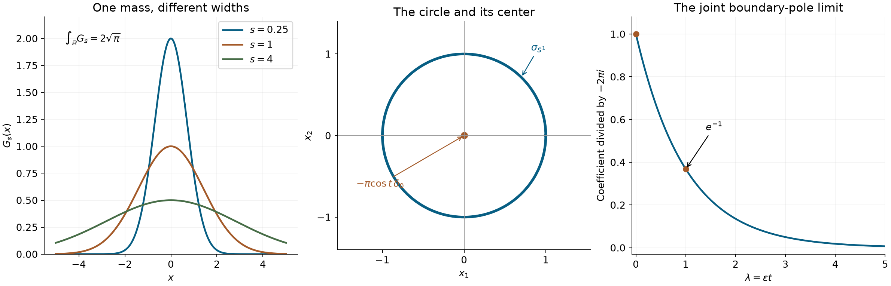
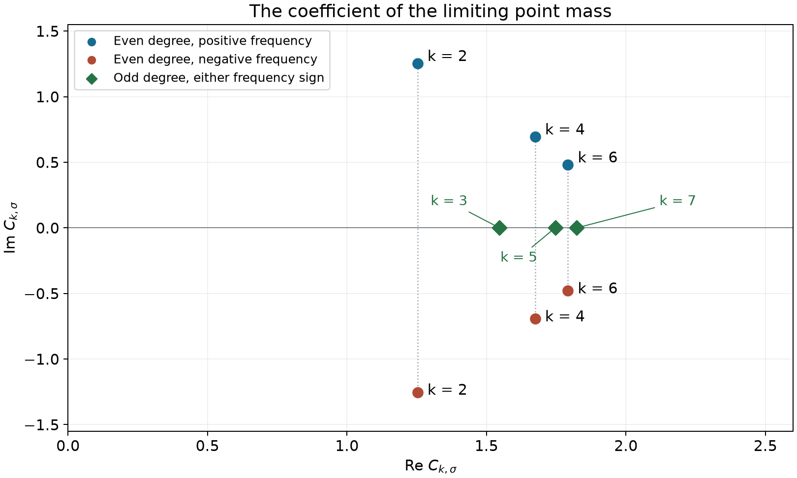

# Concentration and oscillatory limits

*Exposition and figures by GPT-6 Astra (OpenAI), October 2026. Original exposition and exercises: CC0. Supplied programme prerequisites retain their stated licences.*

A distributional limit records what remains after averaging against a smooth test. A narrow positive kernel can leave a point mass. A rapidly oscillating smooth function can disappear, while a corner or a logarithm leaves a nonzero contribution. Two parameters can select different limits, and a family converging away from one point can still fail to converge on the whole space.

All pairings are complex-linear. Unless another space is specified, convergence means convergence against every \(\phi\in C_c^\infty\). Our Fourier convention is
\[
 \widehat\phi(\xi)=\int_{\mathbb R}e^{-ix\xi}\phi(x)\,dx,
 \qquad
 \phi(0)=\frac1{2\pi}\int_{\mathbb R}\widehat\phi(\xi)\,d\xi.
 \tag{L1}
\]
The full proofs of rapid Fourier decrease, the inverse identity and the Gaussian mass are in the supplied [Fourier foundations](../prerequisites/U011-free-foundations/schwartz-fourier-foundations-U017.md), F2–F4. [Order, positivity and distributional limits](order-positivity-and-limits.md), Section 1, supplies the test topology. We use [Cauchy kernels and distributional boundary limits](cauchy-kernels-and-boundary-limits.md), Theorem 4.1, for the existing pole boundary distribution; [Finite parts of singular powers](finite-parts-of-singular-powers.md), Proposition 5.1, for \(\partial_x\log|x|=\operatorname{pv}(1/x)\); and the general even-function argument in [Odd powers and collapsing hyperbolas](odd-powers-and-collapsing-hyperbolas.md), Lemma 2.1, for smooth square-variable descent. Their exact uses appear below.

The supplied [scalar calculus](../prerequisites/U011-free-foundations/metric-foundation-bridges.md), §§12–13, proves compactness, cutoffs and the fundamental theorem of calculus. The supplied [integration foundations](../prerequisites/U011-free-foundations/banach-foundation-bridges.md), §§15.0–15.4, 15.6 and 16, prove convergence, smooth \(L^1\) approximation, Fubini and planar sector areas. The polar integral formula needed below follows from those areas by uniform approximation in the proof of Theorem 6.

## What rapid oscillation removes

**Lemma 1 (cancellation against an integrable amplitude).** If \(h\in L^1(\mathbb R)\), then
\[
                  \int_{\mathbb R}e^{itx}h(x)\,dx\longrightarrow0
                  \qquad(|t|\to\infty).
 \tag{L2}
\]
For \(h\in C_c^\infty(\mathbb R)\) and every integer \(N\ge0\),
\[
 \left|\int e^{itx}h(x)\,dx\right|
                   \le |t|^{-N}\|h^{(N)}\|_1\qquad(t\ne0).
 \tag{L3}
\]

**Proof.** Integrate by parts \(N\) times; every boundary term vanishes by compact support. This proves (L3). For arbitrary \(h\in L^1\), the smooth-density theorem in §15.3 of the integration foundation gives \(h_0\in C_c^\infty\) with \(\|h-h_0\|_1<\eta\). The difference of the oscillatory integrals is at most \(\eta\), uniformly in \(t\). The integral of \(h_0\) tends to zero by (L3) with \(N=1\). Take the upper limit and then let \(\eta\downarrow0\). The same proof applies at both frequency ends and to real and imaginary parts. \(\square\)

**Proposition 2 (smooth oscillation in two topologies).** For real \(a\) and a nonnegative integer \(k\), as \(t\to+\infty\),
\[
 t^a\sin(tx)\longrightarrow0\text{ in }C^k_{\mathrm{loc}}(\mathbb R)
                \quad\Longleftrightarrow\quad a+k<0.
 \tag{L4}
\]
For every real \(a\), the same family converges to zero in \(\mathcal D'(\mathbb R)\). In particular \(t^2x\cos(tx)\to0\).

**Proof.** Its derivative of degree \(j\) is
\(t^{a+j}\sin(tx+j\pi/2)\). When \(a+k<0\), all these derivatives through degree \(k\) tend uniformly to zero, even on the whole line. Conversely, on \([-1,1]\), for every sufficiently large \(t\) the sine factor in the \(k\)-th derivative attains absolute value one. Its supremum is therefore \(t^{a+k}\), which does not tend to zero when \(a+k\ge0\).

For a compact smooth test, apply (L3) with an integer \(N>a\), and take the difference of the two exponential signs. This bounds the pairing by \(t^{a-N}\|\phi^{(N)}\|_1\), tending to zero. Finally \(x\phi(x)\) is again a compact smooth test; the same bound with \(N>2\) proves the cosine example. \(\square\)

## Positive kernels and the direction of scaling

**Proposition 3 (concentration and spreading).** With \(t>0\) and \(s>0\),
\[
 \begin{gathered}
 \frac{t}{1+t^2x^2}\longrightarrow\pi\delta_0
                         \qquad(t\to\infty),\\
 G_s(x):=s^{-1/2}e^{-x^2/(4s)}
       \longrightarrow2\sqrt\pi\,\delta_0
                         \qquad(s\downarrow0),\\
 G_s\longrightarrow0\qquad(s\to\infty).
 \end{gathered}
 \tag{L5}
\]
Equivalently, \(\sqrt t\,e^{-tx^2/4}\to2\sqrt\pi\,\delta_0\) as \(t\to\infty\).

**Proof.** For the first limit use \(y=tx\):
\[
 \int\frac{t\phi(x)}{1+t^2x^2}\,dx
                =\int\frac{\phi(y/t)}{1+y^2}\,dy
                \longrightarrow\pi\phi(0).
 \tag{L6}
\]
The absolute majorant is \(\|\phi\|_\infty/(1+y^2)\). Its integral is \(\pi\), as proved by the arctangent calculation in the scalar foundation and in U013, (4.4).

For the Gaussian use \(x=\sqrt s\,y\):
\[
                    \int G_s(x)\phi(x)\,dx
                       =\int e^{-y^2/4}\phi(\sqrt s\,y)\,dy.
 \tag{L7}
\]
Dominated convergence and the proved Gaussian integral give \(2\sqrt\pi\,\phi(0)\) when \(s\downarrow0\). In the opposite direction \(0<G_s(x)\le s^{-1/2}\); hence \(|\langle G_s,\phi\rangle|\le s^{-1/2}\|\phi\|_1\to0\). Substitution \(s=1/t\) gives the last formulation. The parameter direction and prefactor are both part of each assertion. \(\square\)

## A corner and a logarithm retain a point mass

**Theorem 4 (three singular oscillatory amplitudes).** As \(t\to+\infty\),
\[
 \begin{gathered}
 \frac{\sin(tx)}x\longrightarrow\pi\delta_0,\qquad
 t^2|x|\cos(tx)\longrightarrow-2\delta_0,\\
 t e^{itx}\log|x|\longrightarrow-\pi\delta_0.
 \end{gathered}
 \tag{L8}
\]
The sine quotient has its continuous value \(t\) at zero. In addition,
\[
             e^{\pm itx}\operatorname{pv}(1/x)
                         \longrightarrow\pm i\pi\delta_0.
 \tag{L9}
\]

**Proof: the sine quotient and principal value.** The elementary exponential integral gives
\[
 \frac{\sin(tx)}x=\frac12\int_{-t}^t e^{ix\xi}\,d\xi.
 \tag{L10}
\]
Both sides have value \(t\) at zero. Fubini on the finite frequency interval gives
\[
 \left\langle\frac{\sin(tx)}x,\phi\right\rangle
          =\frac12\int_{-t}^t\widehat\phi(-\xi)\,d\xi
          \longrightarrow\pi\phi(0)
 \tag{L11}
\]
by (L1), since \(\widehat\phi\) is integrable. This proof also supplies rapid error decay, by integrating the proved rapid Fourier tail.

For the cosine part of the principal value, symmetric deletion gives
\[
 \left\langle\operatorname{pv}(1/x),\cos(tx)\phi(x)\right\rangle
  =\int_{\mathbb R}\cos(tx)
                  \frac{\phi(x)-\phi(-x)}{2x}\,dx\longrightarrow0.
 \tag{L12}
\]
The quotient is smooth and compactly supported, including at zero, by the integral division formula (2.3) of U026. Lemma 1 applies. The sine part is precisely (L11), since its integrand is continuous at zero. Combining these two identities proves (L9), for either sign.

**Proof: the corner.** Integration by parts separately on the two half-lines proves \(\partial_x|x|=\operatorname{sgn}x\) and \(\partial_x\operatorname{sgn}x=2\delta_0\). The first boundary term is zero because \(|x|\) vanishes at zero; the second is the jump from \(-1\) to \(1\). The product rule thus gives
\[
 \partial_x^2(|x|\phi)
    =2\phi(0)\delta_0+2\operatorname{sgn}(x)\phi'
                                      +|x|\phi''.
 \tag{L13}
\]
The last two terms are integrable and compactly supported. Pair with \(\cos(tx)\), using a cutoff equal to one near the support to make this a compact test. Since \(\partial_x^2\cos(tx)=-t^2\cos(tx)\),
\[
 t^2\int |x|\cos(tx)\phi(x)\,dx
   =-2\phi(0)-\int\cos(tx)
                  \bigl(2\operatorname{sgn}(x)\phi'+|x|\phi''\bigr)\,dx.
 \tag{L14}
\]
The final integral tends to zero by Lemma 1, proving the middle limit of (L8).

**Proof: the logarithm.** The complete finite-part proof in U016, Proposition 5.1, gives
\(\partial_x\log|x|=\operatorname{pv}(1/x)\).
The weak derivative of the compactly supported distribution
\(e^{itx}\log|x|\phi\) pairs to zero with a cutoff equal to one near its support. Expanding that derivative yields the exact identity
\[
 \begin{split}
 t\int e^{itx}\log|x|\phi(x)\,dx
   &=i\left\langle\operatorname{pv}(1/x),e^{itx}\phi\right\rangle\\
   &\quad+i\int e^{itx}\log|x|\phi'(x)\,dx.
 \end{split}
 \tag{L15}
\]
The last amplitude is integrable, since \(\log|x|\) is integrable at zero. Lemma 1 makes that term tend to zero. The first term tends to \(i(i\pi\phi(0))=-\pi\phi(0)\) by (L9). All original logarithmic pairings are ordinary absolutely convergent integrals. \(\square\)

## Periodic mass at minima and maxima

For real \(\alpha\), consider \(u_\alpha(x)=(1-\cos x)^\alpha\) away from \(2\pi\mathbb Z\). Values assigned at the isolated zeros do not affect local integrability or a regular distribution.

**Theorem 5 (two periodic concentration limits).** The function \(u_\alpha\) is locally integrable exactly when \(\alpha>-1/2\). At the integrability endpoint,
\[
 \left(\alpha+\frac12\right)u_\alpha
                 \longrightarrow\sqrt2\sum_{j\in\mathbb Z}\delta_{2\pi j}
                  \qquad(\alpha\downarrow-1/2).
 \tag{L16}
\]
At large positive exponents,
\[
 2^{-\alpha}\sqrt\alpha\,u_\alpha
                 \longrightarrow2\sqrt\pi
                       \sum_{j\in\mathbb Z}\delta_{(2j+1)\pi}
                  \qquad(\alpha\to\infty).
 \tag{L17}
\]
Both sums are locally finite distributions.

**Proof: the quadratic minima.** Near zero write
\[
 1-\cos x=x^2q(x),\qquad
 q(x)=\int_0^1(1-v)\cos(vx)\,dv,\qquad q(0)=\frac12.
 \tag{L18}
\]
The integral Taylor formula gives the identity. The function \(q\) is smooth, even and positive on a sufficiently small interval. Thus \(u_\alpha\) is comparable there to \(|x|^{2\alpha}\), which is integrable exactly when \(2\alpha>-1\). The same calculation applies at every \(2\pi j\); away from these points the function is smooth.

Put \(\varepsilon=\alpha+1/2>0\), and localize a test near one zero, translated to zero. Its pairing in (L16) is
\[
 \varepsilon\int_{-r}^r |x|^{-1+2\varepsilon}
              q(x)^{-1/2+\varepsilon}\phi(x)\,dx.
 \tag{L19}
\]
For \(0<\varepsilon\le1/4\), the last two factors are uniformly bounded and converge uniformly on the interval to \(q(x)^{-1/2}\phi(x)\). The positive weights have total mass
\(\varepsilon\int_{-r}^r|x|^{-1+2\varepsilon}dx=r^{2\varepsilon}\to1\).
For every \(0<d<r\), their mass on \(d\le|x|\le r\) is \(r^{2\varepsilon}-d^{2\varepsilon}\to0\). Splitting at \(d\), using uniform continuity near zero, and then letting \(d\downarrow0\) proves that (L19) tends to \(q(0)^{-1/2}\phi(0)=\sqrt2\,\phi(0)\). On a compact set separated from the zeros, multiplication by \(\varepsilon\) makes the pairing tend to zero. A finite smooth partition around the finitely many zeros meeting the test support proves (L16).

**Proof: the quadratic maxima.** Divide the line into cells centered at \((2j+1)\pi\), and write \(x=(2j+1)\pi+s\), \(|s|<\pi\). The normalized factor is
\[
             2^{-\alpha}(1-\cos x)^\alpha
                          =\cos^{2\alpha}(s/2).
 \tag{L20}
\]
For \(|z|<\pi/2\), \(\log\cos z\le-z^2/2\). For \(z\ge0\), differentiate: \((\tan z)'=1/\cos^2z\ge1\), so \(\tan z\ge z\); integrating \((\log\cos z)'=-\tan z\) proves the inequality. Evenness proves the negative case. Taylor's formula at zero also gives \(\log\cos z=-z^2/2+o(z^2)\).

Use \(y=\sqrt\alpha\,s\) in one cell. Its pairing becomes
\[
 \int_{|y|<\pi\sqrt\alpha}
       \cos^{2\alpha}\!\left(\frac{y}{2\sqrt\alpha}\right)
       \phi\!\left((2j+1)\pi+\frac{y}{\sqrt\alpha}\right)\,dy.
 \tag{L21}
\]
The integrand, extended by zero outside this interval, is bounded in absolute value by \(\|\phi\|_\infty e^{-y^2/4}\). It tends pointwise to \(e^{-y^2/4}\phi((2j+1)\pi)\). Dominated convergence and the Gaussian mass give \(2\sqrt\pi\) times that value. Only finitely many cells meet a fixed compact test support, so summing proves (L17). \(\square\)

## A circle limit with an oscillating term at its center

Let \(\sigma_{S^1}\) be arc length on the unit circle, so
\(\sigma_{S^1}(\phi)=\int_0^{2\pi}\phi(\cos\theta,\sin\theta)\,d\theta\).

**Theorem 6 (the full radial limit formula).** On \(\mathbb R^2\), put
\[
                         f_t(x)=t\sin\!\bigl(t\,\bigl||x|^2-1\bigr|\bigr).
 \tag{L22}
\]
As \(t\to+\infty\),
\[
               f_t=\sigma_{S^1}-\pi\cos t\,\delta_0+o_{\mathcal D'}(1).
 \tag{L23}
\]
For tests in a fixed compact set, the error is bounded by
\(C t^{-1}\max_{|\gamma|\le4}\|\partial^\gamma\phi\|_\infty\).
Thus \(f_t\to\sigma_{S^1}\) on \(\mathbb R^2\setminus\{0\}\), but there is no limit on all of \(\mathbb R^2\).

**Proof.** Choose \(R\ge2\) containing the support radius and define
\[
 b(r)=\frac12\int_0^{2\pi}
               \phi(r\cos\theta,r\sin\theta)\,d\theta,\qquad
 A(q)=b(\sqrt q)\quad(q\ge0).
 \tag{L24}
\]
The function \(b\) is smooth, even and compactly supported in \([-R,R]\). Evenness follows by shifting the angular variable by \(\pi\). The even-function proof (2.4)–(2.5) in U026 shows that \(A\) is smooth up to \(q=0\), with its \(j\)-th derivative bounded by \(2^{-j}\|b^{(2j)}\|_\infty\). Differentiating the compact angular integral bounds the latter by a constant times the derivatives of \(\phi\) through order \(2j\). In particular \(A,A',A''\) have the asserted finite test bounds, and \(A\) vanishes for \(q>R^2\).

Here is the polar integral formula for the continuous compactly supported integrand at hand. Partition \([0,R]\times[0,2\pi]\) into radial and angular intervals. Their images partition the disk, except for finitely many rays and circles of area zero. Formula (PC5) in §15.6 of the integration foundation gives the area of each annular sector as the integral of \(r\,dr\,d\theta\) over its parameter rectangle. Choose one sample point per rectangle. The sums of its sampled integrand times these areas are therefore identical in the two coordinates. The image diameter of a rectangle is at most \(\Delta r+R\Delta\theta\), by the fundamental theorem for sine and cosine. Uniform continuity on the disk makes both approximation errors at most \(\pi R^2\) times a modulus of continuity tending to zero with the mesh. This applies to complex integrands using absolute errors, and proves equality of the two integrals. The origin and the repeated angular endpoint have area zero and contribute nothing.

Apply this identity to \(t\sin(t\,||x|^2-1|)\phi(x)\), for each fixed \(t\), and then substitute \(q=r^2\) in the scalar integral. This gives
\[
 \langle f_t,\phi\rangle
       =t\int_0^\infty\sin(t|q-1|)A(q)\,dq.
 \tag{L25}
\]
Integrate by parts separately on \([0,1]\) and \([1,\infty)\). On the first interval
\(\partial_q\cos(t(1-q))=t\sin(t(1-q))\), whereas on the second
\(\partial_q\cos(t(q-1))=-t\sin(t(q-1))\). Consequently
\[
 \begin{split}
 \langle f_t,\phi\rangle
    &=2A(1)-A(0)\cos t\\
    &\quad-\int_0^1\cos(t(1-q))A'(q)\,dq
             +\int_1^\infty\cos(t(q-1))A'(q)\,dq.
 \end{split}
 \tag{L26}
\]
Here \(2A(1)=\sigma_{S^1}(\phi)\) and \(A(0)=\pi\phi(0)\). One further integration by parts bounds the two remaining integrals by
\[
           \frac{C}{t}\left(\|A'\|_\infty
                                +(1+R^2)\|A''\|_\infty\right).
 \tag{L27}
\]
The endpoints are finite, the upper endpoint is zero by compact support, and each sine factor has absolute value at most one. The bounds following (L24) prove (L23) with its stated error.

For a test supported away from zero the point term vanishes. To exclude a global limit, take a test supported in the disk of radius \(1/2\), with \(\phi(0)=1\). Its circle pairing is zero. Along \(t=2\pi n\) its pairings tend to \(-\pi\); along \(t=(2n+1)\pi\) they tend to \(\pi\). \(\square\)

## Two parameters at a boundary pole

**Theorem 7 (joint behavior and iterated limits).** For \(t,\varepsilon>0\), let
\[
                   P_{t,\varepsilon}(x)=\frac{e^{-itx}}{x+i\varepsilon}.
 \tag{L28}
\]
Along every path with \(t\to+\infty\) and \(\varepsilon\downarrow0\),
\[
       P_{t,\varepsilon}
           =-2\pi i\,e^{-\varepsilon t}\delta_0+o_{\mathcal D'}(1).
 \tag{L29}
\]
For each fixed \(\varepsilon>0\), \(P_{t,\varepsilon}\to0\) as \(t\to\infty\). The two iterated limits are therefore
\[
 \begin{split}
 \lim_{\varepsilon\downarrow0}\lim_{t\to\infty}P_{t,\varepsilon}
       &=0,\\
 \lim_{t\to\infty}\lim_{\varepsilon\downarrow0}P_{t,\varepsilon}
       &=-2\pi i\,\delta_0.
 \end{split}
 \tag{L30}
\]

**Proof.** The elementary exponential integral gives, for \(\varepsilon>0\),
\[
             \frac1{x+i\varepsilon}
                    =-i\int_0^\infty e^{ixs-\varepsilon s}\,ds.
 \tag{L31}
\]
Indeed the integral is \(1/(\varepsilon-ix)\), and multiplication by \(-i\) gives the stated reciprocal. Fubini is absolute after pairing with a compact smooth test: the double absolute integral is at most \(\|\phi\|_1/\varepsilon\). Thus
\[
 \begin{split}
 \langle P_{t,\varepsilon},\phi\rangle
    &=-i\int_0^\infty e^{-\varepsilon s}\widehat\phi(t-s)\,ds\\
    &=-i\int_{r\le t} e^{-\varepsilon(t-r)}\widehat\phi(r)\,dr.
 \end{split}
 \tag{L32}
\]
The weight in the last integrand is between zero and one. Subtract
\(-i e^{-\varepsilon t}\int_{\mathbb R}\widehat\phi(r)\,dr\).
For each fixed \(r\), when \(t\to\infty\) and \(\varepsilon\downarrow0\), the difference of weights is eventually
\(e^{-\varepsilon t}(e^{\varepsilon r}-1)\to0\).
For every \(r,t,\varepsilon\) its absolute value is at most two. Since \(\widehat\phi\in L^1\), dominated convergence proves (L29) by (L1), with no assumption that \(\varepsilon t\) itself converges.

For fixed \(\varepsilon>0\), the weight
\(\boldsymbol1_{\{r\le t\}}e^{-\varepsilon(t-r)}\) tends to zero at every \(r\) as \(t\to\infty\), so (L32) tends to zero by dominated convergence. For fixed \(t>0\), letting \(\varepsilon\downarrow0\) instead gives
\[
             -i\int_{-\infty}^t\widehat\phi(r)\,dr.
 \tag{L33}
\]
This is the pairing of \(e^{-itx}(x+i0)^{-1}\); existence and its ordinary principal-value expression also follow from U013, Theorem 4.1. Finally let \(t\to\infty\) in (L33) and apply (L1). This proves both limits in (L30), including their signs. \(\square\)

If \(\varepsilon t\to\lambda\in[0,\infty)\), the joint limit is
\(-2\pi i e^{-\lambda}\delta_0\). If \(\varepsilon t\to+\infty\), it is zero. The oscillatory factor in \(P_{t,\varepsilon}\) is part of this conclusion; its sign is tied to the side \(+i\varepsilon\).

*Left: the exact profiles \(G_s\) of Proposition 3, each with total mass \(2\sqrt\pi\), for three positive values of \(s\). Middle: the two terms of (L23): unit arc-length density on the unit circle and the point coefficient \(-\pi\cos t\) at its center. This panel marks supports and coefficients, not values of a distribution as a function. Right: the scalar coefficient \(e^{-\lambda}\) in (L29), after dividing the point-mass coefficient by \(-2\pi i\). The axis is \(\lambda=\varepsilon t\).*

## When a distributional limit is locally uniform

**Theorem 8 (uniform gradient control).** Let \(X\subset\mathbb R^n\) be open and \(u_j\in C^1(X;\mathbb C)\). Suppose that for every compact \(K\subset X\) there is \(M_K<\infty\) with
\[
                      |\nabla u_j(x)|\le M_K
                  \quad(x\in K,\ j\ge1).
 \tag{L34}
\]
If \(u_j\to u\) in \(\mathcal D'(X)\), then \(u\) is represented by a locally Lipschitz function and \(u_j\) converge to it uniformly on every compact subset of \(X\).

**Proof.** Fix a closed ball \(\overline{B(x_0,2r)}\subset X\), and let \(M\) be its common gradient bound. The fundamental theorem along segments gives
\[
                     |u_j(x)-u_j(y)|\le M|x-y|
                         \quad(x,y\in\overline{B(x_0,2r)}).
 \tag{L35}
\]
This holds for complex values as well, using the Euclidean norm of the complex gradient and the ordinary Cauchy–Schwarz inequality.

We prove uniform Cauchy convergence on \(\overline{B(x_0,r)}\). Given \(\eta>0\), choose \(0<d<r/4\) so small that \(4Md<\eta/2\); using \(M+1\) in the denominator makes such a choice also valid when \(M=0\). A finite \(d\)-net \(x_1,\ldots,x_m\) covers this compact ball. For each center choose a nonnegative smooth test \(\rho_l\), supported in \(B(x_l,d)\), with integral one. These supports lie inside \(B(x_0,2r)\).

Whenever \(|x-x_l|<d\), every \(y\) in the support of \(\rho_l\) satisfies \(|x-y|<2d\). From (L35),
\[
 \left|u_j(x)-\int u_j(y)\rho_l(y)\,dy\right|\le2Md.
 \tag{L36}
\]
For each of the finitely many tests, the integrals converge by the given distributional convergence. They are therefore simultaneously Cauchy: for all large \(j,k\), their differences have absolute value less than \(\eta/2\). Two applications of (L36) give
\(\sup_{\overline{B(x_0,r)}}|u_j-u_k|<\eta\).
Completeness of the complex numbers defines a pointwise limit, and this same uniform Cauchy bound proves uniform convergence to it. A uniform limit of continuous functions is continuous; passing to the limit in (L35) makes it \(M\)-Lipschitz on the smaller ball.

Every compact subset of \(X\) has a finite cover by such smaller balls. The local limits agree on overlaps, since they are limits of the same pointwise sequence. Thus they define a locally Lipschitz function \(v\) on \(X\), with uniform convergence on each compact. For every test \(\phi\), uniform convergence on its support gives
\(\int u_j\phi\to\int v\phi\). The original distributional convergence gives the same limit \(u(\phi)\), so \(u=v\) as distributions. \(\square\)

## Compact profiles and their surviving moments

A complex profile can have zero mass while retaining a higher moment. The [integral Taylor formula](when-a-kernel-is-smooth.md#taylor-estimates-on-compact-neighborhoods) supplies the exact multivariable remainder used here; no positivity or symmetry of the profile is assumed.

**Theorem 9 (compact-profile expansion).** Let \(v\in C_c^\infty(\mathbb R^n;\mathbb C)\), \(a\in\mathbb R^n\), and \(0<|\varepsilon|\le1\). Put
\[
 V_\varepsilon(x)=|\varepsilon|^{-n}
                    v((x-a)/\varepsilon),\qquad
 m_\alpha=\int y^\alpha v(y)\,dy .
 \tag{M1}
\]
For every integer \(N\ge0\),
\[
 V_\varepsilon
 =\sum_{|\alpha|\le N}
       \frac{(-1)^{|\alpha|}\varepsilon^{|\alpha|}m_\alpha}
            {\alpha!}\,\partial^\alpha\delta_a
       +R_{\varepsilon,N}.
 \tag{M2}
\]
There is one compact \(K\), independent of \(\varepsilon\), on which
\[
 \begin{gathered}
 |R_{\varepsilon,N}(\phi)|
 \le |\varepsilon|^{N+1}C_{v,N}
                   \max_{|\beta|=N+1}\sup_K|\partial^\beta\phi|,\\
 C_{v,N}=\sum_{|\beta|=N+1}\frac1{\beta!}
                         \int |y^\beta v(y)|\,dy .
 \end{gathered}
 \tag{M3}
\]
This estimate holds for every smooth \(\phi\), not only compact tests. In particular, for an integer \(r\ge0\), if \(m_\alpha=0\) for \(|\alpha|<r\), then
\[
 \varepsilon^{-r}V_\varepsilon\longrightarrow
       (-1)^r\sum_{|\alpha|=r}\frac{m_\alpha}{\alpha!}
                          \partial^\alpha\delta_a
 \tag{M4}
\]
strongly in \(\mathcal E'\) and in \(\mathcal D'\), through either sign of \(\varepsilon\). The limit is nonzero precisely when at least one degree-\(r\) moment is nonzero. For \(r=0\) it is \(m_0\delta_a\).

**Proof.** The absolute Jacobian in \(x=a+\varepsilon y\) is \(|\varepsilon|^n\), so
\[
                    V_\varepsilon(\phi)=\int v(y)\phi(a+\varepsilon y)\,dy .
 \tag{M5}
\]
Take \(K=a+[-1,1]\operatorname{supp}v\), including \(a\) if the profile is zero. It is compact and contains every segment from \(a\) to \(a+\varepsilon y\) that is used in the integral. Taylor's integral formula gives the degree-\(N\) polynomial, with remainder
\[
 (N+1)\sum_{|\beta|=N+1}
 \frac{\varepsilon^{N+1}y^\beta}{\beta!}
 \int_0^1(1-s)^N\partial^\beta\phi(a+s\varepsilon y)\,ds .
 \tag{M6}
\]
Since \((N+1)\int_0^1(1-s)^Nds=1\), integrating its absolute value proves (M3). The polynomial integrates to
\(\sum_{|\alpha|\le N}\varepsilon^{|\alpha|}m_\alpha\partial^\alpha\phi(a)/\alpha!\).
The identity
\(\partial^\alpha\delta_a(\phi)=(-1)^{|\alpha|}\partial^\alpha\phi(a)\)
gives exactly (M2), including its signs.

Use \(N=r\) and divide by \(\varepsilon^r\). All lower coefficients vanish, and the error is at most \(|\varepsilon|C_{v,r}\) times the displayed derivative seminorm. Bounded subsets of \(C^\infty\) have that seminorm uniformly bounded; bounded compact-test families do as well, by U008, (T1)–(T2). The common compact support also makes the pairings valid in \(\mathcal E'\), as proved in the linked Taylor lesson. This proves both strong limits. If \(m_\alpha\ne0\) at degree \(r\), choose a compact smooth test equal to \((x-a)^\alpha\) near \(a\). Its degree-\(r\) derivatives isolate this coefficient, and the limiting pairing is \(m_\alpha\ne0\). The converse is immediate. \(\square\)

## A boundary preserves an oscillatory jet

On the whole line, Lemma 1 gives
\[
 \left|\left\langle t^q e^{i\sigma tx},\phi\right\rangle\right|
 \le t^{q-L}\|\phi^{(L)}\|_1
       \longrightarrow0
 \quad(L>q,\ \sigma\in\{-1,1\}).
 \tag{M7}
\]
Thus every fixed power disappears on compact tests. Cutting the oscillation at one endpoint changes the conclusion.

**Theorem 10 (one-sided endpoint expansion).** Fix \(a\in\mathbb R\), \(\sigma\in\{-1,1\}\) and \(t\ge1\), and set
\[
 T_{t,\sigma,a}(x)=t\,\boldsymbol1_{\{x>a\}}
                           e^{i\sigma t(x-a)} .
 \tag{M8}
\]
For every integer \(N\ge1\) and every compact smooth test,
\[
 \begin{aligned}
 T_{t,\sigma,a}(\phi)
  &=\sum_{j=0}^{N-1}(i\sigma)^{j+1}t^{-j}\phi^{(j)}(a)
        +E_{t,N}(\phi),\\
 |E_{t,N}(\phi)|
  &\le t^{-N}\left(
          |\phi^{(N)}(a)|+
          \int_a^\infty|\phi^{(N+1)}(x)|\,dx\right).
 \end{aligned}
 \tag{M9}
\]
Consequently \(T_{t,\sigma,a}\to i\sigma\delta_a\) strongly in \(\mathcal D'\). In distribution notation the \(j\)-th term of the expansion is
\((-1)^j(i\sigma)^{j+1}t^{-j}\partial^j\delta_a\).

**Proof.** Write \(h(y)=\phi(a+y)\) for \(y\ge0\) and
\(J_t(h)=\int_0^\infty e^{i\sigma ty}h(y)\,dy\).
Integration by parts gives
\[
               J_t(h)=\frac{i\sigma}{t}h(0)
                         +\frac{i\sigma}{t}J_t(h').
 \tag{M10}
\]
The endpoint at infinity is zero by compact support. In particular its sign at zero is retained. Iterate (M10) \(N+1\) times and multiply by \(t\). The first \(N\) terms are those in (M9); the remaining two are
\((i\sigma)^{N+1}t^{-N}h^{(N)}(0)\) and
\((i\sigma)^{N+1}t^{-N}J_t(h^{(N+1)})\).
Their absolute values give the asserted bound. On a bounded compact-test family, the integral norm is bounded by the length of one common support interval times a derivative supremum. Taking \(N=1\) proves strong convergence. Distributional differentiation supplies the stated coefficient signs. \(\square\)

The jump, rather than rapid oscillation alone, accounts for the point mass. In particular the positive and negative frequency signs give opposite imaginary masses.

## The mass selected by a monomial phase

**Corollary 11 (every degree and both frequency signs).** For \(k\ge2\) and \(\sigma\in\{-1,1\}\),
\[
 t^{1/k}e^{i\sigma tx^k}
                   \longrightarrow C_{k,\sigma}\delta_0
             \quad\hbox{strongly in }\mathcal S'\hbox{ and }\mathcal D',
 \qquad t\to\infty,
 \tag{M11}
\]
where
\[
 C_{k,\sigma}=\frac{2}{k}\Gamma(1/k)
 \begin{cases}
 e^{i\sigma\pi/(2k)},&k\text{ even},\\
 \cos(\pi/(2k)),&k\text{ odd}.
 \end{cases}
 \tag{M12}
\]
Every one of these constants is nonzero.

**Proof.** [Finite-order phases and missing powers](finite-order-phases-and-missing-powers.md), Lemma 1 and Theorem 2, proves the full expansion (P9), including its finite Fourier-moment remainder. Its formulas (P7)–(P8), at \(j=0\), are exactly (M12). Set \(N=1\) in (P9) and multiply by \(t^{1/k}\). The error is bounded by
\[
           C_k t^{-1/k}\int|\xi|\,|\widehat\phi(\xi)|\,d\xi .
 \tag{M13}
\]
The estimate after (P5) bounds this moment by finitely many Schwartz seminorms. It is uniform on bounded Schwartz families and on bounded compact-test families, proving both strong conclusions.

For clarity, the coefficients here come from actual convergent integrals: [Polynomial phases and Fourier tails](polynomial-phases-and-fourier-tails.md), Theorem B and Solutions 8 and 10, proves the entire Fourier profile and its two oriented-ray formulas. Its positive-Gamma integral calculation gives
\(\int_0^\infty e^{-y^k}dy=\Gamma(1/k)/k>0\).
For even \(k\) the two rays contribute the same phase; for odd \(k\) they contribute conjugate phases. The resulting cosine is positive since \(0<\pi/(2k)<\pi/2\). No convergence of a high undamped real moment is assumed. \(\square\)

*The points are the constants \(C_{k,\sigma}\) in (M12), for \(2\le k\le7\). Even degrees give conjugate coefficients when the frequency sign changes; odd degrees give the same positive real coefficient for both signs. The plotted coordinates are numerical evaluations of the exact formula. Corollary 11 supplies the proof. [Figure source](../figures/monomial-concentration-coefficients.py).*

## Exercises with complete solutions

**Exercise 1 (foundation) — the mass of a narrow Gaussian.** Fix \(c\in\mathbb R\) and \(\gamma>0\). Determine the real \(\beta\) for which \(t^\beta e^{-t^\gamma(x-c)^2/4}\) has a finite nonzero distributional limit as \(t\to\infty\). Give the limit and classify all other \(\beta\).

**Solution.** Put \(y=t^{\gamma/2}(x-c)\). The pairing is
\[
 t^{\beta-\gamma/2}
          \int e^{-y^2/4}\phi(c+t^{-\gamma/2}y)\,dy.
 \tag{L37}
\]
The integral tends to \(2\sqrt\pi\,\phi(c)\) by dominated convergence and is uniformly bounded for each test. Hence \(\beta=\gamma/2\) gives \(2\sqrt\pi\,\delta_c\); \(\beta<\gamma/2\) gives zero. If \(\beta>\gamma/2\), a nonnegative test equal to one near \(c\) makes the pairing diverge to \(+\infty\). Thus there is no distributional limit in that case.

**Exercise 2 (intermediate) — a translated corner with a phase offset.** For real \(c,\theta\) and smooth \(a\), find the limit of \(t^2a(x)|x-c|\cos(t(x-c)+\theta)\).

**Solution.** Translate \(y=x-c\) and use the test \(a(c+y)\phi(c+y)\). The cosine part has limit \(-2a(c)\phi(c)\) by (L14). The same identity paired with \(\sin(ty)\) has no delta term, since \(\sin0=0\), and its integrable remainder tends to zero by Lemma 1. Expanding the phase offset therefore gives
\[
                 -2\cos\theta\,a(c)\delta_c.
 \tag{L38}
\]
Only values and derivatives of \(a\) on the compact test support are used; no global bound on \(a\) is required.

**Exercise 3 (intermediate) — a shifted logarithm and either frequency sign.** For \(c\in\mathbb R\), smooth \(a\) and \(\epsilon\in\{-1,1\}\), find the limit of \(t\,a(x)e^{i\epsilon t(x-c)}\log|x-c|\).

**Solution.** Translation reduces the problem to \(c=0\) with test \(a(c+y)\phi(c+y)\). For positive sign Theorem 4 gives \(-\pi a(c)\phi(c)\). For negative sign, the derivative identity (L15) has coefficient \(-i\) instead of \(i\), and the principal-value limit is \(-i\pi\delta_0\). Their product is again \(-\pi\delta_0\). The logarithmic remainder tends to zero at either frequency end by Lemma 1. Thus both signs give \(-\pi a(c)\delta_c\).

**Exercise 4 (intermediate) — changing the period and origin.** Let \(q\ne0\) and \(c\) be real. State both limits of Theorem 5 for \(v_\alpha(x)=(1-\cos(qx-c))^\alpha\), including the normalization of every point mass.

**Solution.** Substitute \(y=qx-c\), with absolute Jacobian \(dx=|q|^{-1}dy\) in the integral over the line. The transformed test is \(\phi((y+c)/q)\). Hence the endpoint limit is
\[
 \frac{\sqrt2}{|q|}\sum_{j\in\mathbb Z}
                         \delta_{(2\pi j+c)/q},
 \tag{L39}
\]
and the large-exponent limit is
\[
 \frac{2\sqrt\pi}{|q|}\sum_{j\in\mathbb Z}
                         \delta_{((2j+1)\pi+c)/q}.
 \tag{L40}
\]
The normalizing factors multiplying \(v_\alpha\) remain \(\alpha+1/2\) and \(2^{-\alpha}\sqrt\alpha\), respectively. The absolute value in the Jacobian includes negative \(q\).

**Exercise 5 (advanced) — all limits along sequences of the radial family.** For \(t_j\to+\infty\), characterize exactly when \(f_{t_j}\) in Theorem 6 converges in \(\mathcal D'(\mathbb R^2)\), and list all possible limits.

**Solution.** Formula (L23) proves convergence whenever \(\cos t_j\to c\), with limit \(\sigma_{S^1}-\pi c\delta_0\). Conversely, test with a smooth function supported in the disk of radius \(1/2\), equal to one at zero. Its pairing is \(-\pi\cos t_j+o(1)\), so convergence forces \(\cos t_j\) to converge. Every \(c\in[-1,1]\) occurs: choose \(s\in[0,\pi]\) with \(\cos s=c\), and \(t_j=2\pi j+s\). Thus the full list is \(\sigma_{S^1}-\pi c\delta_0\), \(-1\le c\le1\).

**Exercise 6 (advanced) — paths through a two-parameter limit.** In Theorem 7 put \(t=\varepsilon^{-p}\), \(p>0\). Determine the limit for every \(p\). Then choose a path with no distributional limit.

**Solution.** The product is \(\varepsilon t=\varepsilon^{1-p}\). For \(0<p<1\), (L29) gives \(-2\pi i\delta_0\). For \(p=1\), it gives \(-2\pi i e^{-1}\delta_0\). For \(p>1\), it gives zero. For a path without a limit, take \(t_j=j\), and \(\varepsilon_j=1/j\) for even \(j\), \(2/j\) for odd \(j\). Both required parameter limits hold, but the point coefficients alternate between \(-2\pi i e^{-1}\) and \(-2\pi i e^{-2}\). A test equal to one at zero distinguishes the two limits.

**Exercise 7 (intermediate) — the regularity supplied by a gradient bound.** Show that \(u_j(x)=\sqrt{x^2+j^{-2}}\) satisfies Theorem 8 on \(\mathbb R\), and that its limit need not be \(C^1\). Give a distributionally convergent smooth sequence for which the gradient hypothesis fails and locally uniform convergence fails.

**Solution.** Its derivative is \(x/\sqrt{x^2+j^{-2}}\), with absolute value at most one. Also
\[
              0\le\sqrt{x^2+j^{-2}}-|x|\le j^{-1},
 \tag{L41}
\]
since squaring \(|x|+j^{-1}\) bounds \(x^2+j^{-2}\) above. Thus the sequence converges uniformly to \(|x|\), which has one-sided derivatives \(-1\) and \(1\) at zero and is not \(C^1\). For the second request use \(\sin(jx)\). Proposition 2 gives distributional convergence to zero, while its supremum on \([-1,1]\) is one for large \(j\), so convergence is not uniform there. The derivatives \(j\cos(jx)\) have no common bound.

**Exercise 8 (foundation) — constant total mass and a zero distributional limit.** Prove that every \(G_s\) in Proposition 3 has integral \(2\sqrt\pi\), although \(G_s\to0\) distributionally as \(s\to\infty\). Quantify how much mass remains in a fixed interval.

**Solution.** Substitution \(x=\sqrt s\,y\) gives \(\int G_s=2\sqrt\pi\) for every \(s\). On \([-R,R]\),
\[
                  0\le\int_{-R}^R G_s(x)\,dx
                              \le 2R\,s^{-1/2}\longrightarrow0.
 \tag{L42}
\]
Therefore the integral outside this interval tends to \(2\sqrt\pi\). The constant function one is not a compactly supported test on \(\mathbb R\), so its total-mass integral is not a pairing whose convergence is required by \(\mathcal D'\) convergence. The support restriction on the tests accounts for both statements.

**Exercise 9 (foundation) — a signed scale and a dipole.** Let \(\rho\in C_c^\infty(\mathbb R)\) have integral one. With \(v=\rho'\), determine the limit of \(\varepsilon^{-1}|\varepsilon|^{-1}v((x-a)/\varepsilon)\) through both signs of \(\varepsilon\).

**Solution.** Integration by parts gives \(m_0=\int\rho'=0\) and \(m_1=\int y\rho'(y)dy=-1\). Formula (M4) with \(r=1\) therefore gives \(\delta'_a\), for both signs. Its pairing is \(-\phi'(a)\). The normalization is \(\varepsilon^{-1}\), retaining its sign; replacing this factor by \(|\varepsilon|^{-1}\) would reverse the negative-scale limit. The error is \(O(|\varepsilon|)\) on each bounded smooth-test family.

**Exercise 10 (intermediate) — two cancellations select a mixed derivative.** Let \(\rho\in C_c^\infty(\mathbb R)\) have integral one and put \(v(y_1,y_2)=\rho'(y_1)\rho'(y_2)\). Find the limit of \(\varepsilon^{-2}|\varepsilon|^{-2}v(x/\varepsilon)\).

**Solution.** Fubini factors every moment. All moments of degrees zero and one vanish, because one factor is \(\int\rho'=0\). At degree two, the pure moments still have this zero factor, whereas
\[
 m_{(1,1)}=
        \left(\int y\rho'(y)\,dy\right)^2=1.
 \tag{M14}
\]
Thus (M4) gives \(\partial_1\partial_2\delta_0\). It pairs to \(\partial_1\partial_2\phi(0)\), with positive sign. A test equal to \(x_1x_2\) near zero proves it is nonzero. Both signs of \(\varepsilon\) give this same limit.

**Exercise 11 (advanced) — two endpoints and every subsequential limit.** Fix \(a<b\), \(\sigma\in\{-1,1\}\), and put \(B_t=t\boldsymbol1_{(a,b)}e^{i\sigma t(x-a)}\). Determine exactly when \(B_{t_j}\) converges for \(t_j\to\infty\), and describe all possible limits.

**Solution.** One integration by parts, followed by another for the remaining integral, gives
\[
 B_t(\phi)=i\sigma\phi(a)
       -i\sigma e^{i\sigma t(b-a)}\phi(b)+O_\phi(t^{-1}).
 \tag{M15}
\]
Indeed the first boundary term is
\([e^{i\sigma t(x-a)}\phi(x)/(i\sigma)]_a^b\).
The remainder is \(i\sigma\int_a^b e^{i\sigma t(x-a)}\phi'(x)dx\); integrating it once more bounds it by
\(t^{-1}(|\phi'(a)|+|\phi'(b)|+\int_a^b|\phi''|)\).
These bounds are uniform on bounded compact-test sets.

If \(e^{i\sigma t_j(b-a)}\to z\), (M15) gives the strong limit \(i\sigma(\delta_a-z\delta_b)\). Conversely, a compact test equal to one at \(b\) and zero near \(a\) shows that distributional convergence forces this scalar phase to converge. Its limit has \(|z|=1\). Every such \(z=e^{i\theta}\) occurs by choosing positive \(t_j\to\infty\) with \(\sigma t_j(b-a)=\theta+2\pi n_j\). In particular phases \(1\) and \(-1\) give distinct limits, so the full family has no limit.

**Exercise 12 (intermediate) — a translated odd phase and its only nonzero scale.** For \(c\in\mathbb R\), a smooth complex function \(b\) with \(b(c)\ne0\), and real \(\beta\), classify the limits of \(t^\beta b(x)e^{-it(x-c)^5}\).

**Solution.** Translate \(y=x-c\) and use the compact smooth test \(b(c+y)\phi(c+y)\). Corollary 11 gives the nonzero limit
\[
 \frac25\Gamma(1/5)\cos(\pi/10)\,b(c)\delta_c
                    \qquad(\beta=1/5).
 \tag{M16}
\]
The odd degree makes this coefficient independent of the frequency sign. For \(\beta<1/5\), multiply the bounded normalized pairings by \(t^{\beta-1/5}\) to obtain zero, uniformly on bounded compact-test families. For \(\beta>1/5\), choose a test equal to one near \(c\). Its normalized pairing tends to a nonzero complex number, so the modulus after the additional power tends to infinity. There is no distributional limit. Multiplication by the fixed smooth \(b\) preserves each bounded compact-test family by the finite Leibniz rule, justifying the uniform claims without a global bound on \(b\).

## References

- Lars Hörmander, *The Analysis of Linear Partial Differential Operators I: Distribution Theory and Fourier Analysis*, second edition, 2003 reprint, Section 2.1, Examples 2.1.10–2.1.14; Chapter II, Exercises 2.5–2.10 and 2.15–2.16, pp. 373–374; answers, pp. 395–397.
- [Fourier foundations](../prerequisites/U011-free-foundations/schwartz-fourier-foundations-U017.md), F2–F4: exact Gaussian mass, rapid Fourier decrease and both inverse identities.
- [Cauchy kernels and distributional boundary limits](cauchy-kernels-and-boundary-limits.md), Theorem 4.1, and [Finite parts of singular powers](finite-parts-of-singular-powers.md), Proposition 5.1: principal values, pole boundary signs and the weak derivative of the logarithm.
- [Odd powers and collapsing hyperbolas](odd-powers-and-collapsing-hyperbolas.md), Lemma 2.1, (2.4)–(2.5): smooth descent of an arbitrary even function through the square coordinate, used in (L24).
- [Order, positivity and distributional limits](order-positivity-and-limits.md), Section 1; [scalar calculus](../prerequisites/U011-free-foundations/metric-foundation-bridges.md), §§12–13; [integration foundations](../prerequisites/U011-free-foundations/banach-foundation-bridges.md), §§15–16: the complete test, compactness, calculus and integration inputs.

- [Finite-order phases and missing powers](finite-order-phases-and-missing-powers.md), Lemma 1 and Theorem 2; [Polynomial phases and Fourier tails](polynomial-phases-and-fourier-tails.md), Theorem B and Solutions 8 and 10: entire profiles, oriented-ray coefficients and the complete finite-order remainder.
- [When a kernel is smooth](when-a-kernel-is-smooth.md#taylor-estimates-on-compact-neighborhoods): compact distributions, strong smooth-test topology and the full integral Taylor formula.
