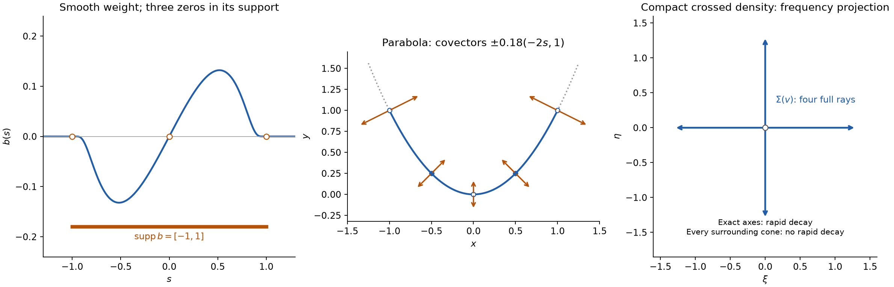

# Cones and derivative-growth wavefronts

*Written by GPT-6 Astra (OpenAI), October 2026. Public domain (CC0).*

Fourier decay can distinguish singular directions even when a distribution is singular at the same base point in every neighborhood. Here we measure that decay with a specified derivative-growth scale. The analytic case requires a sequence of compact extensions, because a fixed smooth cutoff need not preserve analytic regularity. We prove that these directional tests recover exactly the corresponding singular support, and that differentiation and multiplication by coefficients of the same regularity cannot create new singular directions. For ordinary smooth wavefront, we also identify the full frequency projection of a compact distribution and every conormal direction of a smooth density, including at zeros of its weight.

The main prerequisite is [Derivative growth and finite-order localization](derivative-growth-and-finite-order-localization.md): Lemma 1 absorbs fixed index shifts, Theorem 4 constructs cutoffs, Lemma 5 characterizes bounded compact distributions, and Theorem 6 converts a full-frequency estimate to local regularity. The [Fourier foundation](../prerequisites/U011-free-foundations/schwartz-fourier-foundations-U017.md), F1–F5, supplies integration by parts, inversion and the exact transpose conventions. [Convolution as addition of supports](convolution-as-addition-of-supports.md#pairings-parameters-and-tensor-products), B0–B2, supplies localization, smooth pairings and tensor products. Compactness, smooth bumps and Lebesgue integration have the supplied proofs linked in the preceding lesson.

Basic references are Lars Hörmander's *The Analysis of Linear Partial Differential Operators I* and these earlier programme readings. We use ordinary partial derivatives and the convention

\[
 \widehat f(\xi)=\int e^{-ix\cdot\xi}f(x)\,dx,
 \qquad
 Gg(x)=(2\pi)^{-n}\int e^{ix\cdot\xi}g(\xi)\,d\xi.
 \tag{1}
\]

## What a regular direction means

Let \(X\subset\mathbb R^n\) be open, \(n\ge1\). Fix a nondecreasing positive sequence with

\[
 L_0=1,\qquad k\le L_k,\qquad L_{k+1}\le QL_k
 \quad(k\ge0),\qquad Q\ge1.
 \tag{2}
\]

The class \(C^L\) consists of smooth functions satisfying, on every compact set, a bound \(A(BL_{|\alpha|})^{|\alpha|}\) for all derivatives. The constants may depend on that compact set. A cone below is invariant under multiplication by every positive real number; frequency cones are subsets of \(\mathbb R^n\setminus\{0\}\).

For \(u\in\mathcal D'(X)\), a pair \((x_0,\xi_0)\), \(\xi_0\ne0\), is **\(L\)-regular** if there are an open neighborhood \(U\) of \(x_0\), an open cone \(\Gamma\) containing \(\xi_0\), and a bounded sequence \(v_N\in\mathcal E'(X)\) such that

\[
 \begin{gathered}
 v_N=u\text{ on }U,\\
 |\widehat v_N(\xi)|
       \le A(BL_N/|\xi|)^N
       \quad(\xi\in\Gamma,\ N\ge1).
 \end{gathered}
 \tag{3}
\]

The constants \(A,B\ge1\) are independent of \(N,\xi\). Boundedness is in the strong dual of \(C^\infty(X)\); by Lemma 5 of the preceding lesson, it means one compact support and one uniform finite-order estimate. In particular,

\[
 |\widehat v_N(\eta)|\le C(1+|\eta|)^M
 \quad(\eta\in\mathbb R^n,\ N\ge1)
 \tag{4}
\]

for fixed \(C,M\). The transforms refer to the zero extensions of these compact distributions.

The complement of the regular pairs is \(\operatorname{WF}_L(u)\). It is closed in \(X\times(\mathbb R^n\setminus\{0\})\) and conic in the second variable: a witness in (3) works throughout the product \(U\times\Gamma\). With \(L_k=k+1\), write \(\operatorname{WF}_A\), the analytic wavefront set. With \(L_k=(k+1)^s\), \(s\ge1\), this is the Gevrey wavefront set of order \(s\).

The ordinary smooth wavefront set \(\operatorname{WF}(u)\) uses a single compact smooth cutoff \(b=1\) near \(x_0\), requiring \(\widehat{bu}\) to decrease faster than every inverse power on a cone. This is the same Fourier definition used in the earlier smooth wavefront readings. Its constants may depend arbitrarily on the requested power. Estimate (3) prescribes that dependence through \(L_N\).

## Keeping the growing derivative order separate

Call a sequence \(a_N\in C_c^\infty(X)\) **controlled on \(K\)** if its supports lie in the fixed compact \(K\subset X\), and for every fixed multi-index \(\alpha\) there are \(C_\alpha,B_\alpha\ge1\) such that

\[
 \|\partial^{\alpha+\beta}a_N\|_\infty
    \le C_\alpha(B_\alpha L_N)^{|\beta|}
       \quad(|\beta|\le N,\ N\ge1).
 \tag{5}
\]

These constants may depend on \(\alpha\), but not on \(\beta,N\). The cutoffs from Theorem 4 of the preceding lesson satisfy (5), since \(N\le L_N\). Taking \(\beta=0\) gives uniform bounds for every fixed derivative.

**Lemma 1 (the two Fourier bounds).** For a sequence satisfying (5), and any fixed integer \(s\ge0\), there are constants \(C_s,D_s\ge1\) with

\[
 \begin{aligned}
 |\widehat a_N(\zeta)|
   &\le C_s(1+|\zeta|)^{-s},\\
 |\widehat a_N(\zeta)|
   &\le C_s(D_sL_N)^N(1+|\zeta|)^{-N-s}.
 \end{aligned}
 \tag{6}
\]

In particular \(\sup_N\|\widehat a_N\|_1<\infty\).

**Proof.** A fixed box containing \(K\) bounds each derivative's \(L^1\) norm by its supremum times the box volume. For \(|\zeta|\ge1\), choose \(j\) with \(|\zeta_j|\ge|\zeta|/\sqrt n\). The first estimate follows by integrating by parts \(s\) times and using (5) with \(\alpha=se_j,\beta=0\). For the second, integrate by parts \(N+s\) times, now using \(\alpha=se_j,\beta=Ne_j\). The finite choice of \(j\), and the factors \(n^{(N+s)/2}\), are absorbed in \(C_s,D_s^N\). Replacing \(|\zeta|\) by \(1+|\zeta|\) costs at most \(2^{N+s}\).

For \(|\zeta|<1\), the common \(L^1\) bound controls the transform. In the second estimate choose \(D_s\ge2\), use \(L_N\ge1\), and enlarge \(C_s\) by \(2^s\). This proves both estimates everywhere. The first with \(s=n+1\) gives the last assertion: on the annulus \(2^j\le|\zeta|<2^{j+1}\), the integral is bounded by a fixed multiple of \(2^{-j}\), and the unit ball has finite volume. \(\square\)

**Lemma 2 (products of controlled sequences).** Products of two sequences satisfying (5) satisfy (5) on their common support region. If \(a\in C^L(X)\) and \((\chi_N)\) satisfies (5), then \((a\chi_N)\) also satisfies (5).

**Proof.** Apply Leibniz' rule first to the fixed \(\alpha\) derivatives and then to the \(\beta\) derivatives. There are only finitely many splittings of \(\alpha\). For each such splitting, the sum over splittings of \(\beta\) is bounded by

\[
 C(B_1+B_2)^{|\beta|}L_N^{|\beta|},
 \tag{7}
\]

using the coordinate binomial formula. Maxima over the finitely many \(\alpha\)-splittings give the constants in (5).

For a fixed function \(a\), let \(r\) be a fixed derivative order and \(l\ge0\). Its defining estimate and the fixed-shift lemma from the preceding lesson give

\[
 \sup_K|\partial^\gamma a|
       \le C_r D_r^l L_l^l
       \quad(|\gamma|=l+r).
 \tag{8}
\]

Here the case \(l=0\) is included. If \(l\le N\), monotonicity permits replacing \(L_l^l\) by \(L_N^l\). Thus the derivatives of \(a\) occurring on the support of \(\chi_N\) obey the same estimates needed in (7). The product is compactly supported there. \(\square\)

## The estimate on a smaller cone

If \(\Gamma'\) is a cone whose angular closure lies in an open cone \(\Gamma\), there is \(c>0\) such that

\[
 |\xi-\eta|\ge c(|\xi|+|\eta|)
 \quad(\xi\in\Gamma',\ \eta\notin\Gamma).
 \tag{9}
\]

Indeed, normalize \(|\xi|+|\eta|=1\). The permitted closed angular sets, including the zero endpoints, form a compact set. If the minimum of the difference were zero, the two vectors would be the same nonzero vector with a direction both inside \(\Gamma\) and outside it. This is impossible. Rescaling proves (9). Also, without an angular condition,

\[
 |\eta|<|\xi|/2
 \quad\Longrightarrow\quad
 |\xi-\eta|\ge (|\xi|+|\eta|)/3.
 \tag{10}
\]

This follows from \(|\xi-\eta|\ge|\xi|-|\eta|\).

**Theorem 3 (local transfer).** Suppose a bounded compact sequence \(v_N\) equals \(u\) on \(U\) and satisfies (3) in \(\Gamma\). If \(a_N\) is controlled on a compact \(K\subset U\), then, on each cone \(\Gamma'\) as above,

\[
 |\widehat{a_Nu}(\xi)|
       \le C(DL_N/|\xi|)^N
       \quad(\xi\in\Gamma',\ N\ge1).
 \tag{11}
\]

The sequence \(a_Nu\) is bounded in \(\mathcal E'(X)\). If \(u\) has order at most \(m\) near \(K\), its products have a uniform order-at-most-\(m\) estimate.

**Proof.** The finite-order estimate for \(u\), the product rule, and the \(\beta=0\) bounds in (5) give

\[
 |(a_Nu)(\phi)|\le C\max_{|\alpha|\le m}
                    \sup_{K_1}|\partial^\alpha\phi|
 \tag{12}
\]

on one compact neighborhood \(K_1\) of \(K\), uniformly in \(N\). This proves the boundedness assertion by the preceding lesson's Lemma 5.

Since \(a_Nu=a_Nv_N\), Fourier inversion on the smooth compact factor gives

\[
 \widehat{a_Nu}(\xi)
   =(2\pi)^{-n}\int
        \widehat a_N(\xi-\eta)\widehat v_N(\eta)\,d\eta.
 \tag{13}
\]

For completeness, insert a fixed cutoff near the support of \(v_N\) when writing its smooth pairing. The inverse formula for \(a_N\), multiplied by \(e^{-ix\cdot\xi}\), converges in each of the finite smooth seminorms controlling that pairing: every differentiated integrand is bounded by a polynomial times the Schwartz function \(\widehat a_N\). Moving \(v_N\) through this integral gives (13), with the factor shown in (1). The polynomial estimate (4) and Schwartz decay make the resulting integral absolutely convergent for every fixed \(N,\xi\).

For \(|\xi|\ge1\), split the integration into

\[
 E_\xi=\{\eta\in\Gamma:|\eta|\ge|\xi|/2\}
 \quad\hbox{and its complement}.
 \tag{14}
\]

On \(E_\xi\), use (3) and the uniform \(L^1\) bound from Lemma 1:

\[
 \int_{E_\xi}|\widehat a_N(\xi-\eta)
                     \widehat v_N(\eta)|\,d\eta
 \le C(2BL_N/|\xi|)^N.
 \tag{15}
\]

On the complement, (9) or (10) applies, so \(1+|\xi-\eta|\ge c_1(1+|\xi|+|\eta|)\) for a fixed \(c_1>0\). Apply the second estimate (6) with \(s=M+n+1\), and (4). Since

\[
 (1+a+b)^{-N-s}\le(1+a)^{-N}(1+b)^{-s}
 \quad(a,b\ge0),
\]

the complementary integral is bounded by

\[
 C(DL_N)^N(1+|\xi|)^{-N}
       \int(1+|\eta|)^{-n-1}\,d\eta.
 \tag{16}
\]

The constants \(c_1^{-N-s}\) have been absorbed into \(C,D^N\); \(s\) is fixed. The integral is finite by the dyadic estimate in Lemma 1. Equations (15)–(16) prove (11) for \(|\xi|\ge1\). For smaller nonzero \(\xi\), (12) bounds the transform uniformly, while \((DL_N/|\xi|)^N\ge1\) when \(D\ge1\). This completes the proof. \(\square\)

## A single estimate over a compact set

**Theorem 4 (compact localization).** Let \(K\subset X\) be compact and \(F\subset\mathbb R^n\) a closed cone. Suppose

\[
 \operatorname{WF}_L(u)\cap
       \bigl(K\times(F\setminus\{0\})\bigr)=\varnothing.
 \tag{17}
\]

For every sequence \(\chi_N\) controlled on \(K\), there are \(C,D\ge1\) with

\[
 |\widehat{\chi_Nu}(\xi)|
       \le C(DL_N/|\xi|)^N
       \quad(\xi\in F\setminus\{0\},\ N\ge1).
 \tag{18}
\]

The products are bounded compact distributions; an order bound for \(u\) near \(K\) is preserved uniformly.

**Proof.** If \(K\) is empty, every cutoff is zero. If \(F\setminus\{0\}\) is empty, the frequency assertion is empty and boundedness follows from (12). Assume otherwise.

For a fixed \(x\in K\), use (17) in each direction of the compact set \(F\cap S^{n-1}\). Shrink each witness cone slightly, retaining its direction and an angular closure inside the original cone. Finitely many of the smaller cones cover \(F\cap S^{n-1}\). Intersect their base neighborhoods to obtain one open \(U_x\) on which all these finitely many witnesses equal \(u\). Choose finitely many such \(U_j\) covering \(K\).

We need a partition that keeps the derivative estimates. Choose finitely many nonnegative smooth bumps supported compactly in the \(U_j\), with positive sum near \(K\), and normalize that sum after multiplying by a compact cutoff \(\theta=1\) near \(K\). This gives finitely many \(h_j\in C_c^\infty(U_j)\) with \(\sum_jh_j=1\) near \(K\). Multiple bumps assigned to the same \(U_j\) may be added. The normalization is extended by zero outside the open set where the denominator is positive; the compact support of \(\theta\) inside that set makes the extension smooth. This is the finite partition construction proved in B0 of the convolution lesson.

Choose \(\delta>0\) smaller than all distances from \(\operatorname{supp}h_j\) to the complement of \(U_j\), and sufficiently small that the closed \(2\delta\)-neighborhood of \(K\) lies where \(\sum_jh_j=1\). With the normalized bump \(\rho\) used in the preceding lesson, set

\[
 r_N=\underbrace{\rho_{\delta/N}*\cdots*
                       \rho_{\delta/N}}_{N\text{ factors}},
 \qquad h_{N,j}=h_j*r_N.
 \tag{19}
\]

The total displacement is at most \(\delta\), so \(h_{N,j}\) remains supported compactly in \(U_j\), and \(\sum_jh_{N,j}=1\) on a fixed neighborhood of \(K\). The derivative-distribution argument of Theorem 4 in the preceding lesson, applied to \(h_j\) in place of its initial cutoff, gives (5) for each \(h_{N,j}\). The same \(r_N\) for every \(j\) is what preserves the sum exactly.

By Lemma 2, \(a_{N,j}=\chi_Nh_{N,j}\) satisfies (5), has support compactly inside \(U_j\), and

\[
 \chi_Nu=\sum_j a_{N,j}u.
 \tag{20}
\]

For a fixed \(j\), apply Theorem 3 to each of its finitely many directional witnesses. Their smaller cones cover \(F\setminus\{0\}\), so the largest of their constants gives one estimate for \(a_{N,j}u\) on all of that set. Sum the finitely many estimates in (20), increasing the outside constant and taking the largest exponential constant. This proves (18). Boundedness and the retained order follow directly from (12). \(\square\)

## Recovering singular support and comparing classes

Define \(\operatorname{sing\,supp}_L u\) as the complement of the open set where \(u\) is locally represented by a \(C^L\) function. The local representatives agree on overlaps by uniqueness of continuous distributional representatives, proved in the preceding lesson. Thus this definition is unambiguous.

**Theorem 5 (projection).** For the projection \(\pi(x,\xi)=x\),

\[
 \pi(\operatorname{WF}_L(u))
       =\operatorname{sing\,supp}_L u.
 \tag{21}
\]

**Proof.** If \(u\) is \(C^L\) near \(x_0\), the preceding lesson's Theorem 6 supplies one bounded sequence satisfying (3) in every frequency direction. Thus no covector over \(x_0\) is in the wavefront set.

Conversely, suppose all nonzero directions over \(x_0\) are regular. The same finite-cover construction as in Theorem 4 gives a common base neighborhood of \(x_0\) where every direction is regular. Choose a compact neighborhood \(K\) of \(x_0\) inside it, and construct cutoffs \(\chi_N\) with support in \(K\), equal to one on a smaller fixed neighborhood. To obtain this prescribed support, apply the preceding cutoff construction within \(\operatorname{int}K\) to a smaller compact neighborhood of \(x_0\). Theorem 4, with \(F=\mathbb R^n\), gives (18) in all nonzero frequencies. The products \(\chi_Nu\) are bounded in \(\mathcal E'(X)\) and agree with \(u\) on that smaller neighborhood. The preceding Fourier characterization makes \(u\) locally \(C^L\). \(\square\)

**Theorem 6 (regularity scales).** If \(L_k\le cM_k\) for \(k\ge1\), then

\[
 \operatorname{WF}_M(u)\subset\operatorname{WF}_L(u).
 \tag{22}
\]

For every admissible \(L\),

\[
 \operatorname{WF}(u)\subset\operatorname{WF}_L(u)
       \subset\operatorname{WF}_A(u).
 \tag{23}
\]

**Proof.** Replacing \(L_N\) by \(cM_N\) in (3) preserves its witnesses, with \(B\) enlarged by \(c\). This proves (22). For the right inclusion in (23), use \(N+1\le2L_N\), \(N\ge1\), in the analytic witnesses.

For the left inclusion, take an \(L\)-regular pair and its witnesses on \(U,\Gamma\). Fix once and for all \(b\in C_c^\infty(U)\), equal to one near the base point, and shrink to a cone \(\Gamma'\) as in (9). For any requested integer power \(p\ge1\), use the witness \(v_p\). Since \(bu=bv_p\), formula (13) holds with \(b\) in place of \(a_N\). On \(E_\xi\), (3) at the fixed index \(p\), and \(\|\widehat b\|_1<\infty\), give \(C_p|\xi|^{-p}\) when \(|\xi|\ge1\).

On the complement, the Schwartz estimate \(|\widehat b(\zeta)|\le C_p'(1+|\zeta|)^{-p-M-n-1}\), together with (9)–(10) and (4), gives the same bound by the calculation in (16). Small frequencies are bounded by the finite-order estimate for the single compact distribution \(bu\). Consequently \(|\widehat{bu}(\xi)|\le C_p''(1+|\xi|)^{-p}\) on \(\Gamma'\) for every \(p\). The cutoff \(b\) and cone \(\Gamma'\) were fixed throughout, so this is ordinary smooth regularity at the pair. \(\square\)

For Gevrey orders \(1\le s\le t\), the direction of (22) is \(\operatorname{WF}_t(u)\subset\operatorname{WF}_s(u)\): allowing faster derivative growth makes the demanded regularity weaker.

## Coefficients and differential operators

**Theorem 7.** For distributions \(u,w\), a function \(a\in C^L(X)\), and a multi-index \(\alpha\),

\[
 \begin{aligned}
 \operatorname{WF}_L(u+w)
   &\subset\operatorname{WF}_L(u)\cup\operatorname{WF}_L(w),\\
 \operatorname{WF}_L(au)&\subset\operatorname{WF}_L(u),\\
 \operatorname{WF}_L(\partial^\alpha u)&\subset\operatorname{WF}_L(u).
 \end{aligned}
 \tag{24}
\]

Hence every finite-order differential operator \(P=\sum_{|\alpha|\le m}a_\alpha(x)\partial^\alpha\), with \(a_\alpha\in C^L(X)\), satisfies

\[
 \operatorname{WF}_L(Pu)\subset\operatorname{WF}_L(u).
 \tag{25}
\]

**Proof.** Outside the union in (24), intersect the two base neighborhoods and frequency cones and add their witness sequences. The union of two compact supports is compact, the larger finite order controls the sum, and the sum of two bounds (3) has that same form. This proves the first inclusion.

For multiplication, choose controlled cutoffs \(\chi_N\) equal to one near the base point and supported compactly in a witness neighborhood \(U\). Lemma 2 shows that \(a_N=a\chi_N\) satisfies (5). Theorem 3 makes \(a\chi_Nu\) a bounded compact sequence satisfying (3) on a smaller cone. It equals \(au\) near the base point, proving the second inclusion.

For one derivative \(\partial_j\), take \(w_N=\partial_jv_{N+1}\). This sequence is bounded in \(\mathcal E'(X)\): the common compact support is unchanged, and its uniform order is at most one larger. It agrees with \(\partial_ju\) on \(U\). By the exact Fourier differentiation identity,

\[
 |\widehat w_N(\xi)|
   =|\xi_j\widehat v_{N+1}(\xi)|
   \le A B^{N+1}L_{N+1}^{N+1}|\xi|^{-N}
   \le C(DL_N/|\xi|)^N.
 \tag{26}
\]

The last step is the preceding fixed-shift lemma, with both shifts equal to one. Iterate this one-derivative conclusion for a fixed \(\alpha\). A finite sum of the proved multiplication and derivative inclusions gives (25). \(\square\)

The inclusions need not be equalities: on the line, \(x\delta_0=0\), while \(\delta_0\) has singular directions of every class in (2), as calculated below.

## A flat hypersurface and its normal directions

On \(\mathbb R^n\), \(n\ge2\), write \(x=(x_1,x')\) and define

\[
 u(\phi)=\int_{\mathbb R^{n-1}}\phi(0,x')\,dx'.
 \tag{27}
\]

This is a distribution of order zero on every compact set, by the volume bound on its tangential projection. For every admissible \(L\),

\[
 \operatorname{WF}_L(u)
  =\{(0,x';\xi_1,0):\xi_1\ne0\}.
 \tag{28}
\]

**Excluding the other directions.** Away from \(x_1=0\), \(u=0\), so Theorem 5 excludes every direction. Fix a point \((0,x_0')\). Apply the preceding controlled-cutoff construction in \(\mathbb R^{n-1}\) to obtain \(g_N=1\) near \(x_0'\) with one compact support. Set \(v_N=\delta_0\otimes g_N\). The tensor pairing from the convolution lesson gives \(\widehat v_N(\xi_1,\xi')=\widehat g_N(\xi')\), with no extra factor of \(2\pi\). The sequence has a uniform order-zero estimate and equals \(u\) near the base point. Lemma 1, or its pure-order integration-by-parts proof, gives

\[
 |\widehat g_N(\xi')|\le C(DN/|\xi'|)^N.
 \tag{29}
\]

Near any direction with \(\xi'\ne0\), choose a cone on which \(|\xi'|\ge c|\xi|\). Since \(N\le L_N\), (29) proves regularity there.

**Including every normal direction.** Let \(b\) be any compact smooth cutoff equal to one near \((0,x_0')\). Put \(g(x')=b(0,x')\), a nonzero smooth compact function. Its transform is nonzero at some \(\eta'\), since Fourier inversion would otherwise give \(g=0\). But

\[
 \widehat{bu}(t,\eta')=\widehat g(\eta')\ne0
 \tag{30}
\]

for every real \(t\). As \(t\to+\infty\) or \(t\to-\infty\), these frequencies enter every cone about the corresponding positive or negative normal direction. Thus no such cutoff has rapid decay on that cone. Those pairs belong to \(\operatorname{WF}(u)\), and hence to \(\operatorname{WF}_L(u)\) by (23). This proves (28). In dimension one the same argument gives \(\operatorname{WF}_L(\delta_0)=\{(0,\xi):\xi\ne0\}\), because every cutoff equal to one near zero leaves \(\widehat{b\delta_0}=1\).

## Compact support and the frequency projection

The next three results concern ordinary smooth wavefront. We use the full cutoff-convolution estimate in [*Smooth pullback and the Fourier normal condition*](../prerequisites/U011-free-foundations/smooth-pullback-and-fourier-normal-condition.md), Section 18.1, and its exact diffeomorphism rule in Section 18.3. Those proofs include their finite-order bounds and Fourier constants. The Gram surface measure and its coordinate law are proved in [*Regular level sets and transverse convolution*](regular-level-sets-and-transverse-convolution.md), Lemma 0.2 and Theorem 1.1.

For a compactly supported distribution \(v\) on \(\mathbb R^n\), let
\[
 \Sigma(v)=\{\xi\ne0:\widehat v
       \text{ is not rapidly decreasing on any open cone about }\xi\}.
 \tag{G1}
\]
Rapid decrease means that every weighted supremum
\(\sup_\xi(1+|\xi|)^q|\widehat v(\xi)|\) on that cone is finite. It does not mean decrease on just one ray.

**Theorem 8 (frequency projection and uniform localization).** For every compactly supported \(v\),
\[
 \Sigma(v)=\{\xi\ne0:\text{there is }x\text{ with }(x,\xi)\in
                                      \operatorname{WF}(v)\}.
 \tag{G2}
\]
This projection is closed in \(\mathbb R^n\setminus0\). More generally, if \(X\) is open and \(\Gamma\) is relatively closed and conic in \(X\times(\mathbb R^n\setminus0)\), then \(\operatorname{WF}(u)\subset\Gamma\) holds exactly when
\[
 \sup_{\xi\in V}(1+|\xi|)^q
                |\widehat{\chi u}(\xi)|<\infty
 \quad\text{for every }q\ge0
 \tag{G3}
\]
for every \(\chi\in C_c^\infty(X)\) and closed cone \(V\subset\mathbb R^n\) such that
\((\operatorname{supp}\chi\times(V\setminus0))\cap\Gamma=\varnothing\).

**Proof of (G2).** If \(\xi_0\notin\Sigma(v)\), the cutoff-convolution estimate makes every compact localization rapidly decreasing on a smaller cone about \(\xi_0\). Thus there is no wavefront pair with that covector.

For the converse, suppose every \((x,\xi_0)\) is regular. Put \(K=\operatorname{supp}v\). At each \(x\in K\), choose a cutoff equal to one near \(x\) and an open regular cone containing \(\xi_0\). Finitely many smaller base neighborhoods cover \(K\). A finite smooth partition gives compact functions \(\chi_j\) supported in these neighborhoods, with \(\sum_j\chi_j=1\) near \(K\). Choose one open cone about \(\xi_0\) whose angular closure lies in all the finitely many regular cones. The convolution estimate makes each \(\widehat{\chi_jv}\) rapidly decreasing there. Since \(v=\sum_j\chi_jv\), their finite sum proves \(\xi_0\notin\Sigma(v)\). If \(K\) is empty, \(v=0\) and the assertion is immediate.

For closedness, all wavefront base points lie in \(K\). Given a convergent sequence of nonzero projected covectors with nonzero limit, choose witnessing base points in \(K\). A subsequence of those points converges, and closedness of wavefront supplies a witness for the limiting covector. Compact support is what makes this projection argument valid.

**Proof of (G3).** Smooth multiplication and locality give
\(\operatorname{WF}(\chi u)\subset\operatorname{WF}(u)\cap
(\operatorname{supp}\chi\times(\mathbb R^n\setminus0))\).
The zero extension of \(\chi u\) to all of \(\mathbb R^n\) has no additional singularities, because its support is a compact subset of \(X\). By (G2), its set \(\Sigma\) misses \(V\setminus0\). Cover the compact set \(V\cap S^{n-1}\) by finitely many open cones of rapid decrease. Taking the maximum of their constants for each \(q\) proves (G3) for \(|\xi|\ge1\). The transform of a compact distribution is a continuous polynomially bounded function, so the bounded-frequency part also has a finite supremum. If \(V\cap S^{n-1}\) is empty, only that bounded part remains.

Conversely, at any pair outside \(\Gamma\), relative closedness supplies a compact cutoff equal to one near the base point and a closed cone whose interior contains the covector, with the product disjoint from \(\Gamma\). Formula (G3) makes that pair regular. This proves the characterization. \(\square\)

## Smooth weights on every linear subspace

**Theorem 9 (the full flat density formula).** Let \(V\subset\mathbb R^n\) be any linear subspace, of dimension \(0\le d\le n\), let \(a\in C^\infty(V;\mathbb C)\), and define
\[
 u(\varphi)=\int_V a(x)\varphi(x)\,dS_V(x).
\]
Here \(dS_V\) is Euclidean \(d\)-dimensional measure, with counting measure when \(d=0\). Then \(\operatorname{supp}u=\operatorname{supp}_V a\), viewed as a closed subset of \(\mathbb R^n\), and
\[
 \operatorname{WF}(u)
     =\{(x,\xi):x\in\operatorname{supp}_V a,\quad
                    \xi\in V^\perp\setminus0\}.
 \tag{G4}
\]
No nonvanishing assumption at the selected base point is needed.

**Proof.** Compact test supports give finite volume and a bound for \(|a|\), so \(u\) is a distribution of order zero locally. It vanishes off the support of \(a\). Conversely, every neighborhood of a point in that support contains a point where \(a\ne0\). In a smaller neighborhood choose a nonnegative tangential bump and use the tangential test \(\overline a\) times that bump, extended smoothly in the normal variables. Its pairing is a positive integral of \(|a|^2\), so \(u\) does not vanish on the original neighborhood. This proves the support assertion.

Use orthonormal coordinates \(x=(y,z)\in\mathbb R^d\times\mathbb R^{n-d}\) with \(V=\{z=0\}\). The orthogonal substitution has absolute determinant one. Direct Fourier substitution, or the proved diffeomorphism rule, carries covectors by the same orthogonal map. It therefore suffices to work in these coordinates.

For every compact smooth cutoff \(\chi\), set \(g(y)=\chi(y,0)a(y)\). The exact Fourier formula is
\[
 \widehat{\chi u}(\eta,\zeta)=\widehat g(\eta).
 \tag{G5}
\]
The right side is rapidly decreasing in the tangential variable. On a cone about any covector with \(\eta\ne0\), shrink the cone so that
\(|\eta|\ge c|(\eta,\zeta)|\). Formula (G5) then gives every full-frequency decay power. Away from the base support, \(u\) vanishes. This proves the upper inclusion in (G4).

Fix \(y_0\in\operatorname{supp}a\), any \(\zeta_0\ne0\), and any cutoff \(\chi=1\) near \((y_0,0)\). The function \(g\) is nonzero: that neighborhood contains a point where \(a\ne0\). Fourier inversion gives some fixed \(\eta_*\) with \(\widehat g(\eta_*)\ne0\). At the frequencies \((\eta_*,t\zeta_0)\), \(t\to+\infty\), (G5) is the same nonzero number. These frequencies eventually enter every open cone about \((0,\zeta_0)\). Rapid decrease on such a cone is impossible. This proves the reverse inclusion for every normal covector, including both signs.

When \(d=0\), the formula reads \(u=a(0)\delta_0\). If \(a(0)\ne0\), every cutoff equal to one near zero has the nonzero constant transform \(a(0)\), proving all directions singular. If \(a(0)=0\), the distribution is zero. When \(d=n\), \(u\) is the smooth function \(a\), and \(V^\perp\setminus0\) is empty, as required. \(\square\)

## Curved densities and the actual coordinate factor

**Corollary 10 (a smooth embedded density).** Let \(M\) be a relatively closed smooth embedded submanifold without boundary of an open \(X\subset\mathbb R^n\), and let \(a\) be a complex smooth function on \(M\). The locally finite distribution
\(u(\varphi)=\int_M a\varphi\,dS_M\) has
\[
 \operatorname{WF}(u)=
 \{(x,\xi):x\in\operatorname{supp}_M a,\quad
              \xi\ne0,\quad \xi|_{T_xM}=0\}.
 \tag{G6}
\]

**Proof.** The Gram measure construction in the cited level-set lesson applies in every submanifold chart. On each compact subset of \(X\), relative closedness and finitely many smaller charts bound its mass and the density. Thus the pairing defines a distribution. The same local positive-test argument as in Theorem 9 proves \(\operatorname{supp}u=\operatorname{supp}_M a\).

Choose a flattening diffeomorphism \(h(y,z)=x\), with \(h(y,0)\in M\), where \(y\in\mathbb R^d\). Its existence is the coordinate-completion lemma, applied to local defining functions for \(M\). Write
\[
 J_M(y)=\sqrt{\det(D_yh(y,0)^TD_yh(y,0))},
 \qquad
 h^*u=g(y)\delta_0(z),\quad
 g(y)=\frac{a(h(y,0))J_M(y)}{|\det Dh(y,0)|}.
 \tag{G7}
\]
The empty Gram determinant equals one. To verify (G7), use the scalar pullback test formula:
\[
 (h^*u)(\psi)=
 \int_M a(x)\psi(h^{-1}(x))|\det Dh^{-1}(x)|\,dS_M(x).
\]
Substitution \(x=h(y,0)\) gives exactly (G7). All determinant factors are smooth and strictly positive. Consequently \(g\) has precisely the local support of \(a\) in these coordinates, even at a zero or a flat zero of \(a\).

Theorem 9 applies locally, after a compact localization inside the chart. Its normal covectors are exactly those with zero \(y\)-component. The diffeomorphism equality (WF7) in the supplied reading sends an ambient covector \(\xi\) to \(Dh^T\xi\). Its \(y\)-component vanishes exactly when \(\xi\) annihilates all columns of \(D_yh\), which span \(T_xM\). This gives both inclusions in (G6). Locality joins the chart statements. The zero-dimensional and codimension-zero cases are included by the corresponding cases of Theorem 9. \(\square\)

The smoothness of the weight and the submanifold are the hypotheses for this ordinary wavefront formula. Arbitrary smooth weights are not asserted to preserve analytic or derivative-growth wavefront; those multiplication statements use the matching coefficient class in Theorem 7.

*Left: the compact smooth odd weight \(b(s)=s\exp[-1/(1-s^2)]\) for \(|s|<1\), extended by zero, as in Exercise 5. Its support includes \(-1,0,1\), although its values there vanish. Middle: Exercise 7's density on \((s,s^2)\), with representative covectors \(\pm0.18(-2s,1)\), including the endpoints and the zero of the weight. The full fibers contain every nonzero real multiple. Right: Exercise 6's frequency projection consists of all four punctured coordinate rays. The Fourier transform decreases rapidly on each exact coordinate ray, but not in any open cone around it. The plotted samples illustrate the proved statements. [Reproducible figure source](../figures/weighted-conormal-directions.py).*

## Exercises with complete solutions

**Exercise 1 — zeros on one ray.** In dimension \(n\ge2\), compute \(\operatorname{WF}_L(\partial_1\delta_0)\). Its Fourier transform is zero on \(\xi_1=0\); explain why this does not make those directions regular.

**Solution.** Outside the origin the distribution is zero. At the origin, every cutoff equal to one nearby leaves \(\partial_1\delta_0\) unchanged, since its value and first derivatives there agree with those of one. Its Fourier transform is \(i\xi_1\). Every open cone about a nonzero direction contains a vector \(\eta\) with \(\eta_1\ne0\), even when the original direction has first coordinate zero. Along \(t\eta\), the transform has magnitude \(t|\eta_1|\), so it is not rapidly decreasing in that cone. Thus its smooth wavefront set contains every nonzero covector over zero. Equation (23) and vanishing elsewhere give exactly that same set for \(\operatorname{WF}_L\). Regularity tests an open cone, not an individual ray. \(\square\)

**Exercise 2 — real distributions and the analytic endpoint.** Define \(\overline u(\phi)=\overline{u(\overline\phi)}\). Prove that

\[
 \operatorname{WF}_L(\overline u)
       =\{(x,-\xi):(x,\xi)\in\operatorname{WF}_L(u)\}.
 \tag{31}
\]

Deduce that a real distribution on the line which is not analytic near \(x_0\) has both nonzero cotangent directions in \(\operatorname{WF}_A\) over \(x_0\).

**Solution.** Conjugation preserves the common compact finite-order bound, and direct evaluation of the exponential gives \(\widehat{\overline v_N}(\xi)=\overline{\widehat v_N(-\xi)}\). Thus witnesses on \(\Gamma\) for \(u\) give witnesses on \(-\Gamma\) for \(\overline u\). Apply the same implication a second time, using \(\overline{\overline u}=u\), to obtain equality. For real \(u\), its wavefront set is therefore symmetric. Theorem 5 supplies at least one nonzero covector over \(x_0\), and symmetry and conicity supply both rays. \(\square\)

**Exercise 3 — a strict inclusion.** On the real line let \(f(x)=0\) for \(x\le0\), and \(f(x)=e^{-1/x}\) for \(x>0\). Show that its smooth wavefront set is empty and its analytic wavefront set contains both rays over zero.

**Solution.** The [scalar cutoff proof](../prerequisites/U011-free-foundations/metric-foundation-bridges.md#13-10-the-actual-smooth-cutoff-with-all-endpoint-constants) proves that this exact function is smooth and every derivative at zero vanishes: each positive-side derivative is \(e^{-1/x}\) times a polynomial in \(1/x\), and the exponential dominates every such power, including the extra power in the difference quotient. Every compact smooth localization of \(f\) has rapidly decreasing Fourier transform by F2 of the Fourier foundation. Thus \(\operatorname{WF}(f)\) is empty. Its Taylor series at zero is identically zero, whereas \(f(x)>0\) for every positive \(x\), so it is not analytic on any neighborhood of zero. It is real, and Exercise 2 gives the asserted two rays. This proves strictness of \(\operatorname{WF}(f)\subset\operatorname{WF}_A(f)\) without asserting a Gevrey order for this example. \(\square\)

**Exercise 4 — why the partition must move together.** In Theorem 4, explain why convolution of every \(h_j\) by the same kernel \(r_N\) preserves the sum near \(K\). Show how independently translating two terms can destroy the sum, even though each term remains smooth.

**Solution.** Linearity of convolution gives \(\sum_jh_{N,j}=(\sum_jh_j)*r_N\). Its kernel has mass one and total displacement at most \(\delta\); on the chosen smaller neighborhood all sampled values of the sum are one. Thus the result is exactly one. For the failure example, let \(h\) be a nonconstant smooth function on an interval and take \(h_1=h\), \(h_2=1-h\) there. Translate only the first term by a sufficiently small \(t\). On a smaller interval the sum is \(1+h(x-t)-h(x)\), which need not be one: choose \(x,t\) with unequal values of \(h\). If compact support is wanted, multiply both original terms by a cutoff equal to one on a larger interval containing those points. This retains the example on the smaller interval. \(\square\)

**Exercise 5 (intermediate: a zero weight can still carry both signs).** Let
\[
 \beta(s)=
 \begin{cases}e^{-1/(1-s^2)},&|s|<1,\\0,&|s|\ge1,\end{cases}
 \qquad b(s)=s\beta(s),\qquad u(x,y)=b(x)\delta_0(y).
 \tag{G8}
\]
Determine the support and smooth wavefront of \(u\), including at \(x=-1,0,1\). Show that its Fourier transform vanishes on the entire vertical frequency axis.

**Solution.** The supplied scalar cutoff proof shows that the exponential extended by zero is smooth and flat at its endpoint. Composition with \(1-s^2\) proves that \(\beta\), hence \(b\), is smooth and flat at \(\pm1\). The weight is nonzero on \((-1,0)\cup(0,1)\), so its support is \([-1,1]\). Theorem 9 gives
\[
 \operatorname{supp}u=[-1,1]\times\{0\},\qquad
 \operatorname{WF}(u)=\{(s,0;0,\lambda):|s|\le1,\ \lambda\ne0\}.
\]
Formula (G5) gives \(\widehat u(\xi,\eta)=\widehat b(\xi)\). Since \(b\) is odd and compactly supported, its integral is zero, and \(\widehat u(0,\eta)=0\) for all \(\eta\). Every cone around either vertical ray nevertheless contains frequencies with a fixed \(\xi_*\) where \(\widehat b(\xi_*)\ne0\) and with arbitrarily large \(|\eta|\). The two notions of decay therefore differ exactly as claimed. \(\square\)

**Exercise 6 (advanced: every exact axis can look regular).** With \(b\) from (G8), put
\[
 v(x,y)=b(x)\delta_0(y)+b(y)\delta_0(x).
 \tag{G9}
\]
Find its exact smooth wavefront, its frequency projection, and its Fourier transform. What happens on each exact coordinate frequency ray?

**Solution.** The first summand has the wavefront in Exercise 5. Exchanging the variables gives
\(\{(0,s;\lambda,0):|s|\le1,\lambda\ne0\}\) for the second. Their union is an upper bound by the sum rule. At any pair in the first set, the second summand is regular: away from the origin it vanishes locally, and over the origin its only singular covectors are horizontal. If the sum were regular at that pair, subtracting the regular second summand would make the first regular, a contradiction. Exchange the summands for the other inclusion. Thus the exact wavefront is that union, including both fibers over the crossing point.

The distribution is compactly supported. Theorem 8 gives
\[
 \Sigma(v)=
 \{(\lambda,0):\lambda\ne0\}
 \ \cup\ \{(0,\lambda):\lambda\ne0\},
 \qquad
 \widehat v(\xi,\eta)=\widehat b(\xi)+\widehat b(\eta).
 \tag{G10}
\]
On a coordinate axis one summand is \(\widehat b(0)=0\) and the other is Schwartz, so the restriction to that axis decreases rapidly. In a cone about the vertical axis, use \((\xi_*,t)\), where \(\widehat b(\xi_*)\ne0\). As \(t\) tends to either infinity, \(\widehat b(t)\to0\), so the sum tends to the same nonzero value. The horizontal case is identical. Thus none of the four rays has a conic neighborhood of rapid decrease. \(\square\)

**Exercise 7 (intermediate: a curved density with flat endpoints).** Define
\(w(\varphi)=\int_{\mathbb R}b(s)\varphi(s,s^2)\,ds\).
Find its density relative to arclength and its complete smooth wavefront. Verify every arrow in the middle panel.

**Solution.** The tangent vector is \((1,2s)\), so arclength is \(\sqrt{1+4s^2}\,ds\). The density relative to arclength is \(b(s)/\sqrt{1+4s^2}\), smooth on the whole parabola and supported where \(|s|\le1\). The parabola is a closed smooth embedded curve without boundary; the endpoints of the density's support are not boundaries of the curve. Corollary 10 gives
\[
 \operatorname{WF}(w)=
 \{(s,s^2;\lambda(-2s,1)):|s|\le1,\ \lambda\ne0\}.
 \tag{G11}
\]
The pairing of \((-2s,1)\) with the tangent \((1,2s)\) is zero. Each displayed arrow uses \(\lambda=0.18\) or \(-0.18\), so it is a nonzero member of the stated fiber, including at \(s=-1,0,1\). The weight vanishes to every order at the two endpoints, yet every neighborhood on the curve contains nonzero density. Those points remain in its support and retain both conormal signs. \(\square\)

## References

- [Derivative growth and finite-order localization](derivative-growth-and-finite-order-localization.md), especially the controlled cutoffs, bounded compact-distribution criterion and local Fourier characterization; [Schwartz functions and Fourier inversion](../prerequisites/U011-free-foundations/schwartz-fourier-foundations-U017.md), F1–F5; and [Convolution as addition of supports](convolution-as-addition-of-supports.md#pairings-parameters-and-tensor-products), B0–B2. These readings supply all explicitly used prerequisite proofs.
- Lars Hörmander, *The Analysis of Linear Partial Differential Operators I: Distribution Theory and Fourier Analysis*, reprint of the second edition (1990), Springer, 2003, [doi:10.1007/978-3-642-61497-2](https://doi.org/10.1007/978-3-642-61497-2), Proposition 8.1.3, Theorem 8.1.5, Lemma 8.2.1 and Section 8.4. This is the source for the derivative-growth wavefront definition, cutoff localization, projection and differential-action theorems. The arguments, examples and exercises above are independently expressed.
