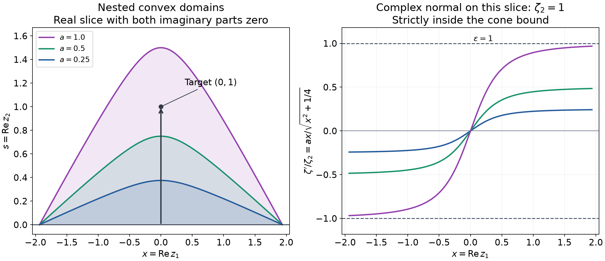

# Continuing analytic Cauchy solutions through convex domains

*Original exposition and proofs: GPT-6 Astra (OpenAI), October 2026. CC0.*

Local analytic existence gives a solution near its initial surface. To reach a larger domain, we need to control the surfaces across which that solution continues, and to ensure that extensions constructed in different places agree. Convexity will serve both purposes: it keeps certain complex normal covectors away from the characteristic set and makes local extensions compatible.

We prove analytic Cauchy existence along a noncharacteristic complex hypersurface, continuation through a real \(C^1\) boundary, a global theorem on convex domains, and a cone theorem whose existence neighborhood does not depend on the forcing.

Use ordinary complex derivatives \(\partial_j\). On an open \(Z\subset\mathbb C^n\), \(n\geq1\), let
\[
 P=\sum_{|\alpha|\leq m}a_\alpha(z)\partial^\alpha,\qquad
 p_m(z,\zeta)=\sum_{|\alpha|=m}a_\alpha(z)\zeta^\alpha,\qquad m\geq1,
 \tag{G1}
\]
with holomorphic coefficients. Covectors \(\zeta\) are complex, and all norms in this lesson are Euclidean unless individual coordinate inequalities are written.

The full quantitative flat Cauchy proof is [Analytic Cauchy data on small polydiscs](analytic-cauchy-data-on-small-polydiscs.md), Theorems 4–5 and Corollary 6. Its germ uniqueness and its arbitrary-data polynomial will be used with their exact domains. [Analytic pullback and cotangent directions](analytic-pullback-and-cotangent-directions.md), Lemma 3, proves the holomorphic inverse construction by uniformly convergent complex contraction iterates; its last step takes a real restriction. The same proof before that last step supplies the holomorphic inverse for a holomorphic map with invertible complex derivative. The supplied [complex contour proofs](../prerequisites/U011-free-foundations/complex-contours-U070.md), Sections 16.1–16.3, supply joint power series, the identity principle and holomorphic limits.

## Making local solutions agree

A germ along a subset specifies an ordinary function germ at each of its points, with local representatives which give those same germs at neighboring points of the subset. Uniqueness of a germ along a hypersurface means equality after restricting to a sufficiently small common neighborhood of the entire hypersurface.

**Lemma 1 (three gluing facts).**

1. Compatible holomorphic germs along a locally closed subset of an open Euclidean set have one holomorphic representative on an open neighborhood of that subset.
2. Let \(D\) be open and convex. Suppose a holomorphic function on \(D\) extends to balls centered on \(\partial D\), with agreement on each ball's intersection with \(D\). Those extensions agree on all their mutual intersections.
3. Analytic continuation of a specified holomorphic germ along a fixed path is unique. If a continuous family of paths all starts in an open set carrying the specified initial function, and each path has a continuation represented on a neighborhood of its complete image, their endpoint germs form a locally holomorphic function of the endpoint whenever the paths vary continuously with that endpoint.

**Proof of 1.** Write the subset as \(S\). Local closedness makes \(S\) open in its closure: each point has an ambient neighborhood in which \(S\) is closed, and that neighborhood meets the closure only in \(S\). Thus \(V=Z\setminus(\overline S\setminus S)\) is open and \(S\) is closed in \(V\). All closures in this paragraph are relative to the original ambient open set.

Choose a compact exhaustion \(K_j\) of \(V\) with \(K_j\subset\operatorname{int}K_{j+1}\). For example, in ambient real coordinates take
\[
 K_j=\{x\in V:|x|\leq j,\quad
              \operatorname{dist}(x,\mathbb R^{2n}\setminus V)\geq1/j\}.
 \tag{G2}
\]
When \(V\) is the whole space, omit the distance inequality. Empty initial sets cause no problem. The closed shell \(S\cap(K_j\setminus\operatorname{int}K_{j-1})\) is compact. Cover it by finitely many open balls \(V_i\) whose closures lie in a domain \(U_i\) of a representative \(h_i\), and in \(\operatorname{int}K_{j+1}\setminus K_{j-2}\). Use empty \(K_j\) for nonpositive indices. This is possible because \(K_{j-2}\subset\operatorname{int}K_{j-1}\). All the ball closures form a locally finite family in \(V\): near a point in the interior of some \(K_l\), only finitely many shell indices can meet.

In \(U_i\cap U_j\), let \(E_{ij}\) be the set where the germs of \(h_i\) and \(h_j\) differ. The identity principle makes both agreement and disagreement unions of connected components of this open intersection. Consequently \(E_{ij}\) is closed relative to it. Therefore
\[
 F_{ij}=\overline V_i\cap\overline V_j\cap E_{ij}
 \tag{G3}
\]
is closed in \(V\). It is disjoint from \(S\), by compatibility of the initial germs. The family of these sets is locally finite, so its union \(F\) is closed: a neighborhood of any point meets only finitely many of them, and a finite union of closed sets is closed. On
\(N=(\bigcup_iV_i)\setminus F\), the representatives agree on every overlap and define one holomorphic function. This open \(N\) contains \(S\). The same construction for agreement neighborhoods proves uniqueness as a neighborhood germ when the point germs are unique.

**Proof of 2.** If balls \(B(p,r)\) and \(B(q,s)\), with \(p,q\in\partial D\), intersect, then \(|p-q|<r+s\). A point of the segment from \(p\) to \(q\) lies strictly inside both balls: choose its distances from the endpoints smaller than \(r,s\). The coincident-center case is immediate. The segment belongs to \(\overline D\), by convexity. Approximating this point by points of \(D\) shows that the intersection of the balls meets \(D\). The ball intersection is convex and connected. Its two holomorphic functions agree on a nonempty open subset in \(D\), and hence everywhere by the identity principle. In particular, extensions at every point of a compact boundary glue to a neighborhood of the closure, using a finite ball cover and the original function.

**Proof of 3.** A continuation along a compact path can be described by finitely many holomorphic representatives on balls and a finite subdivision of the path, with each subarc in its ball and successive germs agreeing at their transition point. Such a subdivision follows from compactness: each path point has a parameter interval mapped into its germ domain, and a finite refinement has the required overlaps. Comparing two chains along the same path and refining both subdivisions propagates their initial germ equality through every transition by the identity principle on a smaller ball. This proves uniqueness.

For the last assertion, fix one endpoint and its path. Its complete compact image has a neighborhood on which one representative is available, by the stated hypothesis. All sufficiently nearby paths lie in that neighborhood: a finite subcover of the path image gives a positive distance margin, and uniform closeness follows from continuity on the compact parameter interval. Their starting points lie in a neighborhood where that representative agrees with the initial function. Uniqueness along each nearby path identifies its endpoint germ with this single representative. Thus the endpoint germs are locally represented by holomorphic functions, and their unique values glue on overlaps. \(\square\)

## Analytic initial hypersurfaces

An analytic hypersurface is locally given by \(\phi=0\), where \(\phi\) is holomorphic and \(d\phi\neq0\). It is noncharacteristic for \(P\) if
\[
 p_m(z,\partial\phi(z))\neq0\quad\text{on the hypersurface}.
 \tag{G4}
\]
This does not depend on its local defining function. Indeed another defining function is a nonvanishing holomorphic multiple of \(\phi\), by its first-order transverse Taylor expansion, and \(p_m\) is homogeneous of degree \(m\).

**Theorem 2 (Cauchy germs along a hypersurface).** Let \(S\subset Z\) be an analytic noncharacteristic hypersurface, and let \(f,\Phi\) be holomorphic on \(Z\). There is a unique holomorphic solution germ along \(S\) satisfying
\[
 Pu=f,\qquad
 \partial^\alpha(u-\Phi)|_S=0\quad(|\alpha|<m).
 \tag{G5}
\]
This germ has a representative on an actual open neighborhood of all of \(S\).

**Proof.** Near a point of \(S\), reorder coordinates so that \(\partial_n\phi\neq0\). The map \(\kappa(z)=(z_1,\ldots,z_{n-1},\phi(z))\) has an invertible complex derivative. The supplied complex inverse proof gives holomorphic coordinates \(w=\kappa(z)\), with \(S=\{w_n=0\}\).

The full chain rule gives \(\partial_{z_j}=\sum_k(\partial_{z_j}\kappa_k)\partial_{w_k}\). Repeating this rule \(m\) times, the terms in which no derivative hits a coefficient give the principal symbol
\[
 \widetilde p_m(w,\eta)
 =p_m\!\left(\kappa^{-1}(w),
             D\kappa(\kappa^{-1}(w))^T\eta\right).
 \tag{G6}
\]
Every term differentiating a coefficient has fewer than \(m\) derivatives on the unknown. In particular, the coefficient of \(\partial_{w_n}^m\) is \(p_m(z,\partial\phi(z))\), which is nonzero near the point after shrinking.

For a holomorphic function \(h\), its first \(m\) normal Taylor coefficients at \(w_n=0\) vanish exactly when \(h=w_n^m b(w)\) with \(b\) holomorphic. This follows by factoring the convergent Taylor series in \(w_n\), whose coefficients are holomorphic in \(w'\) by the circle formula. Such divisibility makes all derivatives of total order less than \(m\) vanish on that plane. Conversely, those derivatives include its normal derivatives. The full chain rule makes vanishing of all these jets invariant under holomorphic coordinates.

Apply the flat analytic Cauchy theorem to \(u-\Phi\), with forcing \(f-P\Phi\), after division by the nonzero leading coefficient. It gives a unique local germ with the zero normal jets. Local germs agree at every point of their common portion of \(S\), by the same flat uniqueness. An embedded analytic hypersurface is locally closed by its local defining equation, so Lemma 1(1) supplies the asserted neighborhood representative and uniqueness along \(S\). \(\square\)

## Crossing a real boundary with only one derivative

For a real \(C^1\) defining function \(\rho\) with \(d\rho\neq0\), write
\[
 \partial\rho=\sum_j\frac12
       \left(\frac{\partial\rho}{\partial x_j}
             -i\frac{\partial\rho}{\partial y_j}\right)dz_j.
 \tag{G7}
\]
The maximal complex hyperplane in the real tangent hyperplane is
\(\partial\rho=0\). Call the boundary noncharacteristic when
\(p_m(z,\partial\rho(z))\neq0\). Multiplying \(\rho\) by a nonzero real function scales this covector on the boundary and does not change the condition.

**Theorem 3 (continuation through a \(C^1\) noncharacteristic boundary).** Let \(u\) be holomorphic on an open \(Z_0\subset Z\), with \(Pu=f\), where \(f\) is holomorphic on \(Z\). If \(Z_0\) has a \(C^1\) noncharacteristic boundary at \(z_0\in Z\cap\partial Z_0\), then \(u\) continues as a holomorphic solution to a neighborhood of \(z_0\).

**Proof.** Translate \(z_0\) to zero. A complex linear coordinate change makes the nonzero real normal a multiple of \(d\operatorname{Re}t\), where \(t=z_n\). The local domain then has the form
\[
 \operatorname{Re}t<\psi(z',\operatorname{Im}t),\qquad
 \psi(0)=0,\quad d\psi(0)=0,\quad\psi\in C^1.
 \tag{G8}
\]
For clarity, the real graph assertion follows directly from a defining function whose derivative in \(\operatorname{Re}t\) is nonzero. In a sufficiently small box that derivative keeps a strict sign; the intermediate value theorem gives a unique root for each nearby remaining coordinate, continuity follows from the strict monotonicity, and difference quotients in the defining equation give the continuous derivatives of that root. The tangent hyperplane already chosen by the complex linear change makes the graph's derivative zero at the origin.

By (G6) and noncharacteristicity, the pure normal coefficient is nonzero near zero. Divide by it. All the remaining coefficients are uniformly bounded on one fixed small complex neighborhood. In the criterion (A22) of the preceding lesson, each term different from the pure normal derivative has a positive power \(\delta^{m-\alpha_n}\), while \(R^{m-|\alpha|}\leq1\) for \(R\leq1\). We may therefore fix a small \(0<\delta\leq1\) such that this criterion holds for every sufficiently small input polydisc of tangential radius \(R\) and normal radius \(\delta R\) in that neighborhood.

Now take \(\epsilon>0\) small and set
\[
 R=\frac{3\epsilon}{\delta},\qquad
 \text{input center }(0,-\epsilon).
 \tag{G9}
\]
Because \(\psi=o(|z'|+|\operatorname{Im}t|)\), for sufficiently small \(\epsilon\) we have
\(\psi>-\epsilon/2\) both on the closed input slice
\(\{|z'_j|\leq R,\ t=-\epsilon\}\) and on the entire tangential/imaginary projection of the output polydisc. To see the uniform choice, on these sets \(|z'|+|\operatorname{Im}t|\leq C_\delta\epsilon\) for a fixed finite \(C_\delta\); take the derivative bound for \(\psi\) smaller than \(1/(2C_\delta)\).

The actual normal jets of \(u\) at \(t=-\epsilon\) are holomorphic on a neighborhood of that closed tangential polydisc. Their required derivatives are bounded there for this fixed \(\epsilon\), since the slice is a compact subset of \(Z_0\). Apply the arbitrary-data form of the preceding lesson's Theorem 5. It gives a holomorphic \(v\) with the same equation and jets on
\[
 |z'_j|<R/2,\qquad |t+\epsilon|<\delta R/2=3\epsilon/2.
 \tag{G10}
\]
This domain contains a neighborhood of zero. By flat germ uniqueness, \(v=u\) near the initial slice.

Their common domain inside (G10) is connected. At a point \(t=s+iy\), move \(s\) along its horizontal interval to \(-\epsilon\): the normal disk is convex on that horizontal line, and both endpoints lie below \(\psi\), since \(\psi>-\epsilon/2\). Next move \(y\) to zero at \(s=-\epsilon\), and then move \(z'\) to zero on its polydisc. The same inequality keeps each segment in \(Z_0\) and (G10). The identity principle now gives equality everywhere in this common domain. Thus \(v\) is an actual continuation of \(u\), not a new solution unrelated to it. No boundary bound on \(u\) was assumed. \(\square\)

## Expanding a convex domain without crossing characteristics

Write \(z=(z',s+iy)\). The following construction makes the continuation parameter precise, including its limiting value.

**Lemma 4 (convex expanding domains).** Suppose \(Z\) is convex, contains
\(\{(z',0):|z'|<R\}\) and \(\{(0,s):0\leq s<\epsilon R\}\), and satisfies
\[
 p_m(z,\zeta)\neq0
 \quad\text{if }z\in Z,\quad
 |\zeta'|\leq\epsilon|\zeta_n|,\quad \zeta\neq0.
 \tag{G11}
\]
Let \(f\) be holomorphic on all of \(Z\), and suppose a holomorphic solution of \(Pu=f\) is given on a neighborhood of the initial tangential ball. It continues along the vertical segment to every \((0,s_0)\) with \(0<s_0<\epsilon R\), as one holomorphic solution on a neighborhood of the complete segment from zero to that point.

**Proof: compact domains and a fixed bottom neighborhood.** Choose \(c>0\) so small that
\[
 \sqrt c<R-s_0/\epsilon.
 \tag{G12}
\]
For a sufficiently large \(M>0\), define
\[
 d(z',y)=\sqrt{|z'|^2+M^2y^2+c},\qquad
 D_a=\{s>0,\ s<a(R-d(z',y))\},\quad 0<a\leq\epsilon .
 \tag{G13}
\]
The function \(d\) is convex: it is the Euclidean norm of the affine vector \((\operatorname{Re}z',\operatorname{Im}z',My,\sqrt c)\), so the triangle inequality proves its convexity. Hence \(D_a\) is open and convex. It is bounded, since \(d<R\) and \(0<s<aR\).

Convexity of \(Z\) shows that it contains every \((z',s)\) with
\[
 s\geq0,\qquad s/\epsilon+|z'|<R.
 \tag{G14}
\]
For \(s>0\), choose \(0<\theta<1\) with
\(|z'|/R<\theta<1-s/(\epsilon R)\). Then this point is the convex combination with weights \(\theta,1-\theta\) of
\((z'/\theta,0)\) and \((0,s/(1-\theta))\), both in \(Z\). The case \(s=0\) is already known.

The compact set
\[
 K=\{(z',s):s\geq0,\quad
       s\leq\epsilon(R-\sqrt{|z'|^2+c})\}
 \tag{G15}
\]
lies strictly inside (G14), because \(c>0\), and is therefore a compact subset of \(Z\). Every point of \(\overline D_\epsilon\) is within distance \(R/M\) of \(K\), by deleting its imaginary normal coordinate. Thus, for large \(M\), \(\overline D_\epsilon\subset Z\).

The compact bottom
\[
 B=\{s=0,\ |z'|^2+M^2y^2+c\leq R^2\}
 \tag{G16}
\]
lies in the given initial solution neighborhood when \(M\) is sufficiently large: \(|z'|\leq\sqrt{R^2-c}<R\), and \(y\) is uniformly small. Fix a small \(\eta>0\) so that the convex thickening \(B+B_\eta(0)\) lies in that neighborhood and in \(Z\). Denote it by \(V\), and use the same solution on \(V\) for every \(a\). Every point of \(D_a\) is within distance \(aR\) of \(B\), so \(D_a\subset V\) for all small positive \(a\).

**Proof: the upper normals.** The upper boundary has defining function
\(\rho_a=s+ad-aR\), with \(\partial_s\rho_a=1\). Twice its complex normal is
\[
 \zeta'=\frac{a\overline {z'}}d,\qquad
 \zeta_n=1-\frac{iaM^2y}{d},\qquad
 |\zeta'|<a\leq\epsilon|\zeta_n|.
 \tag{G17}
\]
The strict inequality follows from \(c>0\), and \(|\zeta_n|\geq1\). Thus this smooth part of the boundary is noncharacteristic by (G11). The bottom and its meeting edge with the upper boundary already lie in \(V\); no boundary regularity assertion is needed at that edge.

**Proof: continue through every parameter.** Call \(a\) admissible when there is a holomorphic solution on \(D_a\) agreeing with the fixed solution on \(D_a\cap V\). Such a solution is unique by the identity principle, since \(D_a\) is connected and \(D_a\cap V\) is a nonempty open convex set. Solutions at different admissible parameters consequently agree on their nested common domains. Every smaller parameter is admissible, and an initial positive interval is admissible.

At an admissible \(a\), Theorem 3 extends the solution across every point of the upper boundary outside \(V\). Within \(V\), use the fixed initial solution. Choose small balls centered on the boundary in these continuation domains. Their restrictions agree with the solution on all their intersections with \(D_a\), by connectedness and the identity principle. Lemma 1(2) glues them, and compactness yields an extension to an open neighborhood of \(\overline D_a\).

For \(h>0\), the map
\[
 (z',s+iy)\longmapsto
       \left(z',\frac{a}{a+h}s+iy\right)
 \tag{G18}
\]
takes \(D_{a+h}\) into \(D_a\) and moves each point a distance less than \(hR\). Hence sufficiently small \(h\) makes \(D_{a+h}\) lie in that extension neighborhood. Its restriction agrees with the fixed solution on the convex intersection \(D_{a+h}\cap V\): it already agrees on the nonempty open subset \(D_a\cap V\). Thus admissibility is open to the right.

Let \(a_*\leq\epsilon\) be the supremum of the admissible parameters. For every \(a<a_*\), admissibility follows by restriction from a larger admissible parameter. Moreover
\[
 D_{a_*}=\bigcup_{0<a<a_*}D_a .
 \tag{G19}
\]
For a point in the left side, \(d<R\) and \(s/(R-d)<a_*\), so it lies in one of the domains on the right. Uniqueness on nested domains glues their functions to a holomorphic solution on \(D_{a_*}\). Each of its points in \(V\) belongs to some earlier domain and has the fixed initial value there. Thus \(a_*\) itself is admissible. Right openness forces \(a_*=\epsilon\).

By (G12), \((0,s_0)\in D_\epsilon\). The solution on \(D_\epsilon\), joined to the fixed solution on \(V\), is defined on a neighborhood of the complete segment, including its initial endpoint. This proves the claim. \(\square\)

*An exact real slice of (G13) with \(n=2\), \(R=2\), \(\epsilon=1\), \(c=1/4\), \(M=4\), and \(y=0\). The three upper boundaries are \(s=a(2-\sqrt{x^2+1/4})\), for \(a=1/4,1/2,1\). The marked point \((0,1)\) is reached by the largest domain and its initial endpoint is supplied by the bottom neighborhood. On this slice, (G17) has \(\zeta_n=1\) and \(\zeta'=ax/\sqrt{x^2+1/4}\). The right panel shows these exact ratios strictly between the cone bounds \(-1,1\). These are a real domain slice and its covectors, not a picture of the whole complex domain. Lemma 4 proves the inequalities. [Reproducible figure source](../figures/analytic-cauchy-continuation.py).*

## A global solution from its canonical vertical paths

**Theorem 5 (global analytic Cauchy existence on a convex domain).** Let \(Z\subset\mathbb C^n\) be open and convex, and suppose
\[
 \{(z',0):|z'|<R\}\subset Z
 \subset\{z:|z_n|/\epsilon+|z'|<R\},
 \qquad R,\epsilon>0.
 \tag{G20}
\]
Assume (G11) throughout \(Z\). For every holomorphic \(f\) on \(Z\), there is a unique holomorphic \(u\) on \(Z\) with
\[
 Pu=f,\qquad
 \partial_n^j u(z',0)=0\quad(0\leq j<m).
 \tag{G21}
\]

**Proof.** Theorem 2, or the flat Cauchy theorem and Lemma 1(1), gives a solution on a neighborhood of the whole initial tangential ball. Its germs are unique.

Fix \(w\in Z\) with \(w_n\neq0\), and write \(w_n=s_0e^{i\theta}\), \(s_0>0\). By (G20),
\(s_0/\epsilon+|w'|<R\). Choose \(r>s_0/\epsilon\) sufficiently close to \(s_0/\epsilon\) that
\[
 r+|w'|<R,\qquad
 (w',\epsilon r e^{i\theta})\in Z.
 \tag{G22}
\]
The second condition follows from openness at \(w\). Translate the tangential coordinates by \(w'\) and rotate the normal coordinate by \(e^{-i\theta}\). Intersect the transformed \(Z\) with
\(\{|z_n|/\epsilon+|z'|<r\}\). This is convex and contains its initial tangential ball. It also contains the vertical segment \(0\leq s<\epsilon r\), by convexity and (G22). Translation and a unit complex normal rotation preserve the covector norm condition (G11), as follows directly from (G6).

Lemma 4 therefore continues the initial solution along
\[
 \gamma_w(\tau)=(w',\tau w_n),\qquad0\leq\tau\leq1,
 \tag{G23}
\]
to \(w\). It supplies one holomorphic function on a neighborhood of this entire path. At \(w_n=0\), the initial solution already supplies such a neighborhood.

It remains to prove that these endpoint germs fit together. The path \(\gamma_w\) lies in \(Z\) by convexity, and depends continuously, uniformly for \(0\leq\tau\leq1\), on \(w\). For one fixed \(w\), its constructed solution neighborhood therefore contains every sufficiently nearby canonical path. At their starting points it agrees with the initial solution, after shrinking the endpoint neighborhood if needed. The uniqueness and stability statement of Lemma 1(3) identifies their endpoint germs with this one holomorphic function. The endpoint germs hence give a single holomorphic \(u\) on \(Z\). The equation holds locally everywhere, and the initial jets remain those of the initial solution.

Any two such solutions agree near the initial ball by the flat germ uniqueness, and hence on the connected set \(Z\) by the identity principle. This proves uniqueness. \(\square\)

Nonzero normal data holomorphic on the tangential ball are also allowed. Their polynomial
\(\Phi(z)=\sum_{j<m}g_j(z')z_n^j/j!\) is holomorphic on the rightmost domain in (G20). Apply Theorem 5 to \(f-P\Phi\), and then add \(\Phi\). No boundedness of \(f\) or the data on all of \(Z\) is required.

## Solving in a cone and continuing across its vertex

A cone below is invariant under multiplication by positive real numbers; it need not be invariant under multiplication by complex numbers.

**Corollary 6 (complex-cone solvability and continuation).** Let \(\Gamma\subset\mathbb C^n\) be an open convex cone with
\[
 \{\operatorname{Re}z_n=0,\quad
             \operatorname{Im}z_n>a|z'|\}\subset\Gamma,
 \qquad a>0.
 \tag{G24}
\]
Suppose \(P\) has holomorphic coefficients in a neighborhood \(W\) of zero, and
\[
 p_m(0,\zeta)\neq0
 \quad\text{for }|\zeta'|\leq a|\zeta_n|,\quad\zeta\neq0.
 \tag{G25}
\]
There is a neighborhood \(W'\) of zero, independent of \(f\), such that every holomorphic \(f\) on \(W\cap\Gamma\) admits a holomorphic solution of \(Pu=f\) on \(W'\cap\Gamma\). If a holomorphic solution in a cone neighborhood of zero has forcing which extends holomorphically to a full neighborhood of zero, that solution also extends holomorphically to a full neighborhood of zero.

**Proof of existence.** Normalize \(\zeta_n=1\) in (G25), using homogeneity and division by the nonzero complex number \(\zeta_n\). The resulting closed ball \(\{|\zeta'|\leq a\}\) is compact and the polynomial is nonzero on it. Continuity and a finite compact cover give \(\epsilon>a\) and a smaller neighborhood \(W_0\) of zero such that
\[
 p_m(z,\zeta)\neq0
 \quad(z\in W_0,\ |\zeta'|\leq\epsilon|\zeta_n|,\ \zeta\neq0).
 \tag{G26}
\]
In detail, the modulus has a positive minimum on the original compact ball; continuity preserves a positive lower bound on a slightly larger ball and for all \(z\) sufficiently near zero.

For small \(R>0\), put \(T=(0,\ldots,0,aR)\) and
\[
 D=\{z:|z_n|/\epsilon+|z'|<R\},\qquad
 Z_R=D\cap(\Gamma-iT).
 \tag{G27}
\]
This convex open set contains \(\{(z',0):|z'|<R\}\), by (G24). Choose \(R\) so small that \(D+iT\subset W_0\cap W\). Theorem 5 applied to the translated operator and forcing gives
\[
 P(z+iT,\partial)v(z)=f(z+iT)\quad(z\in Z_R)
 \tag{G28}
\]
with zero normal data. Undoing the shift gives a solution on
\(\Gamma\cap(D+iT)\). Since \(a/\epsilon<1\), zero is an interior point of \(D+iT\): its defining left side at zero is \(aR/\epsilon<R\). Thus some neighborhood \(W'\) of zero lies in \(D+iT\). All these choices depend only on the coefficient and domain hypotheses, not on \(f\).

**Proof of continuation.** Suppose \(u\) is given on \(\Gamma\) intersected with a neighborhood of zero, and \(Pu=f\) with \(f\) holomorphic across zero. Choose \(R\) still smaller so that \(D+iT\) lies in the common full coefficient and forcing neighborhood and in the neighborhood used to define the domain of \(u\). On the slice \((z',iaR)\), \(|z'|<R\), the normal jets of \(u\) are defined and holomorphic, by (G24). They define a polynomial in the shifted normal variable, holomorphic on all of \(D\).

The nonzero-data version of Theorem 5 now solves (G28) on the entire \(D\), with these jets. Its shifted solution agrees with \(u\) near the initial slice by Cauchy uniqueness. The intersection \(\Gamma\cap(D+iT)\) is convex, connected and contains that slice, so the identity principle gives equality throughout the intersection. The shifted solution is holomorphic on \(D+iT\), which contains a full neighborhood of zero. \(\square\)

## Exercises with complete solutions

**Exercise 1 (basic) — all jets or normal jets.** In coordinates with \(S=\{t=0\}\), prove directly that \(\partial_t^j h|_S=0\) for \(j<m\) is equivalent to \(h=t^m b\) with \(b\) holomorphic. Explain why this implies every derivative of total order less than \(m\) vanishes on \(S\).

**Solution.** Expand \(h(z',t)=\sum_{j\geq0}h_j(z')t^j\) on a small product of disks. The circle coefficient formula makes each \(h_j\) holomorphic. The normal derivative equals \(j!h_j\) at \(t=0\), so precisely the first \(m\) coefficients vanish. Factoring \(t^m\) leaves a convergent holomorphic series for \(b\). Differentiating \(t^m b\) fewer than \(m\) times leaves a positive power of \(t\) in every Leibniz term, even when some derivatives are tangential. The conclusion is local at every point of \(S\) and therefore holds along all of it.

**Exercise 2 (intermediate) — check the complex normal.** Compute \(2\partial\rho_a\) for \(\rho_a=s+a\sqrt{|z'|^2+M^2y^2+c}-aR\), and identify exactly where \(c>0\) is used.

**Solution.** For \(j<n\), \(\partial_{z_j}|z'|^2=\overline z_j\), so twice the derivative of the square root gives \(\overline z_j/d\). In the last variable, \(2\partial_{z_n}=\partial_s-i\partial_y\). Hence (G17) follows. Since \(d^2-|z'|^2=M^2y^2+c>0\), one has \(|\zeta'|=a|z'|/d<a\). Also \(\operatorname{Re}\zeta_n=1\). The positive \(c\) ensures smoothness even at \(z'=y=0\), strict normal-cone inequality, and compact inclusion away from the outer boundary in (G15).

**Exercise 3 (intermediate) — the limiting parameter.** Explain why an admissibility set which is open to the right need not reach its endpoint without the construction (G19). Prove (G19) directly.

**Solution.** The interval \((0,\epsilon)\) is open to the right at every one of its points but omits its supremum. In the present construction, a point of \(D_{a_*}\) satisfies \(s>0\), \(d<R\), and \(s/(R-d)<a_*\). Choose \(a\) strictly between that ratio and \(a_*\); the point belongs to \(D_a\). The reverse inclusion follows from monotonicity. The solution functions on these domains agree by the identity principle, so their union defines a holomorphic solution without any limiting norm estimate. Its equality with the fixed solution on \(V\) holds pointwise, since each point is already in an earlier domain. This is the missing endpoint assertion.

**Exercise 4 (basic) — why the shifted domain contains the vertex.** For (G27), show that the Euclidean ball of radius
\[
 r_0=\frac{R(1-a/\epsilon)}{2(1+1/\epsilon)}
\]
about zero is contained in \(D+iT\).

**Solution.** For \(|w|<r_0\), the triangle inequality gives
\[
 |w_n-iaR|/\epsilon+|w'|
 \leq aR/\epsilon+(1+1/\epsilon)|w|
 <aR/\epsilon+\tfrac12R(1-a/\epsilon)<R.
\]
Thus \(w-iT\in D\). The radius is positive precisely because \(\epsilon>a\). It depends only on the geometric choices, so it is one explicit forcing-independent neighborhood radius in Corollary 6.

**Exercise 5 (intermediate) — a characteristic boundary really can obstruct continuation.** On \(\{z_1\neq0\}\subset\mathbb C^2\), take \(P=\partial_{z_2}\) and \(u=1/z_1\). Restrict to \(Z_0=\{\operatorname{Re}z_1>0\}\). Why does Theorem 3 not force continuation at the origin?

**Solution.** One has \(Pu=0\), so the forcing extends everywhere. A defining function for this real boundary is \(\rho=\operatorname{Re}z_1\), whose complex normal is \((1/2,0)\). The principal symbol is \(p_1(\zeta)=\zeta_2\), which vanishes on that normal. The boundary is characteristic. If a holomorphic extension at zero existed, restricting to \(z_2=0\) would extend \(1/z_1\) across zero. Multiplying by \(z_1\) and using the identity principle would give \(z_1u=1\) at zero, an impossibility.

**Exercise 6 (intermediate) — a first-order cone threshold.** Let \(P=\partial_{z_n}+b\partial_{z_1}\), \(n\geq2\), with \(b\in\mathbb C\). Determine when (G11) holds for all nonzero covectors with \(|\zeta'|\leq\epsilon|\zeta_n|\).

**Solution.** If \(|b|\epsilon<1\), then
\[
 |\zeta_n+b\zeta_1|
 \geq|\zeta_n|-|b||\zeta_1|
 \geq(1-|b|\epsilon)|\zeta_n|>0,
\]
because such a nonzero covector has \(\zeta_n\neq0\). Conversely, if \(b\neq0\) and \(|b|\epsilon\geq1\), take \(\zeta_n=1\), \(\zeta_1=-1/b\), and the other tangential components zero. It is an admitted nonzero covector and its symbol vanishes. For \(b=0\), the condition holds for every finite \(\epsilon>0\). Thus the exact condition is \(|b|\epsilon<1\).

**Exercise 7 (advanced) — uniqueness along a path is not arbitrary-path independence.** Give a holomorphic germ which can continue along loops to a different germ, and explain which additional argument in Theorem 5 prevents such ambiguity.

**Solution.** Start with the logarithm germ at \(1\), normalized to zero. Along the unit circle, its derivative is \(1/z\). The change in its value after one positive turn is \(\int_0^{2\pi}(ie^{it}/e^{it})dt=2\pi i\). Local logarithm germs exist by integrating \(1/z\) on disks avoiding zero, using the supplied primitive theorem, and their adjusted constants give the continuation along the circle. Thus fixed-path uniqueness alone does not identify endpoints of different paths. Theorem 5 specifies one path \(\gamma_w(\tau)=(w',\tau w_n)\) for each endpoint. Each path has a complete solution neighborhood; nearby paths stay there and begin in the same initial solution. The resulting local endpoint identification, proved in Lemma 1(3), is what yields one holomorphic function on the convex domain.

**Exercise 8 (intermediate) — the zero-dimensional tangential case.** Describe the assertions of Theorem 5 and Corollary 6 when \(n=1\).

**Solution.** There is no \(z'\); its norm is zero and the initial tangential ball is the point \(0\). Condition (G11) says that the leading coefficient of the scalar ordinary differential operator never vanishes on \(Z\), since \(p_m(z,\zeta)=a_m(z)\zeta^m\). Theorem 5 gives the unique holomorphic solution on the convex domain \(Z\subset\{|z|<\epsilon R\}\) with its first \(m\) derivatives prescribed at zero. The dome construction still uses \(d(y)=\sqrt{M^2y^2+c}\); its complex normal has real part one. In Corollary 6, the cone contains the positive imaginary ray, and the condition at zero is \(a_m(0)\neq0\). A solution in that cone continues through its vertex whenever the forcing does. The preceding proofs apply with empty tangential coordinates and unchanged normal estimates.

## Programme proofs and mathematical source

- [Analytic Cauchy data on small polydiscs](analytic-cauchy-data-on-small-polydiscs.md), Theorems 4–5 and Corollary 6, supplies full quantitative flat existence, arbitrary-germ uniqueness and the polynomial for nonzero jets. [Analytic pullback and cotangent directions](analytic-pullback-and-cotangent-directions.md), Lemma 3, supplies the actual complex contraction inverse and its holomorphic limit. [Complex contour foundations](../prerequisites/U011-free-foundations/complex-contours-U070.md), Sections 16.1–16.3, supplies the primitives, joint Taylor series and identity arguments, with its [scalar calculus](../prerequisites/U011-free-foundations/metric-foundation-bridges.md) and [integration](../prerequisites/U011-free-foundations/banach-foundation-bridges.md) prerequisites.
- Lars Hörmander, *The Analysis of Linear Partial Differential Operators I: Distribution Theory and Fourier Analysis*, reprint of the second edition, Springer, 2003, [doi:10.1007/978-3-642-61497-2](https://doi.org/10.1007/978-3-642-61497-2), Theorems 9.4.6–9.4.8 and Corollary 9.4.9. The neighborhood gluing, fixed bottom neighborhood, continuation at the limiting parameter, endpoint compatibility and exercises are developed here in original exposition.
