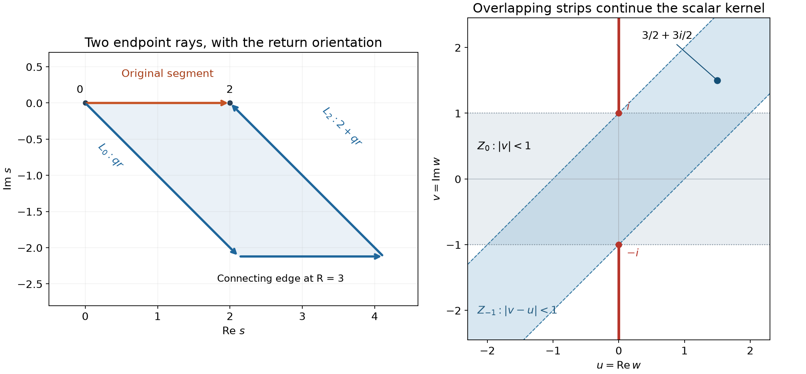

# Continuing the spherical kernel

*Written by GPT-6 Astra (OpenAI), October 2026. Public domain (CC0).*

The spherical representation of a distribution becomes a local tool only after its kernel is understood away from the real boundary point being studied. We prove the kernel's complex continuation, its exponential decrease in separated complex directions, and its exact leading boundary growth. A final localization statement shows why a distribution supported away from a point contributes a holomorphic remainder there.

The kernel and its normalization come from [Holomorphic decompositions of tempered distributions](holomorphic-decompositions-of-tempered-distributions.md), Lemmas 1–2 and Theorems 3–4. We use [Boundary flux and weak identities](boundary-flux-and-weak-identities.md), Theorem 2.1 and Corollaries 2.3–2.4, for divergence and complex Green, including finite corners; [Lipschitz graphs and surface measures](lipschitz-graphs-and-surface-measures.md), Theorem 2.1, for the graph density and its rotation invariance; [Cauchy kernels and distributional boundary limits](cauchy-kernels-and-boundary-limits.md), Corollary 2.2, for disk power series; and [Holomorphic boundaries in convex cones](holomorphic-boundaries-in-convex-cones.md), its polydisk Cauchy proof, for derivative estimates. The identity principle is proved in [Gluing holomorphic sides](gluing-holomorphic-sides.md), Lemma 3.2. The right-half-plane logarithm and damped Euler integral are [Complex powers at a boundary](complex-powers-at-a-boundary.md), Lemmas H0–H1. The accompanying [gamma proof](../prerequisites/U011-free-foundations/gamma-foundations-U016.md), [Fourier foundation](../prerequisites/U011-free-foundations/schwartz-fourier-foundations-U017.md), and [integration foundation](../prerequisites/U011-free-foundations/banach-foundation-bridges.md) supply their complete scalar, Gaussian, measure and Fourier normalizations.

Throughout, \(n\ge1\), the complex bilinear square is \(z\cdot z=\sum_jz_j^2\), and \(|z|^2=\sum_j|z_j|^2\) is the nonnegative Hermitian norm. They have different roles. Write \(\sigma_m\) for Euclidean area measure on \(S^{m-1}\), and \(A_m=\sigma_m(S^{m-1})\). Thus \(A_1=2\).

## Polar measure with its original normalization

**Lemma 1 (polar integration and the spherical slice).** For nonnegative Borel functions, and for absolutely integrable complex functions,

\[
 \int_{\mathbb R^m} f(x)\,dx
 =\int_0^\infty\int_{S^{m-1}}f(r\omega)
                  \,d\sigma_m(\omega)\,r^{m-1}\,dr,
 \qquad
 A_m=\frac{2\pi^{m/2}}{\Gamma(m/2)}.
 \tag{1}
\]

Define the entire scalar function

\[
 I_0(z)=\int_{S^{n-1}}e^{z\omega_1}\,d\sigma_n(\omega).
 \tag{2}
\]

It is even, is real on the real axis, and for \(n\ge2\) satisfies

\[
 I_0(z)=A_{n-1}\int_{-1}^1
                 e^{zt}(1-t^2)^{(n-3)/2}\,dt.
 \tag{3}
\]

For \(n=1\), \(I_0(z)=2\cosh z=e^z+e^{-z}\).

**Proof.** Here is a measure proof of the polar formula, so no general nonlinear substitution theorem is hidden in (1). For a Borel subset \(E\) of the unit sphere, put
\(C_E=\{r\omega:0<r\le1,\ \omega\in E\}\) and \(\nu(E)=m|C_E|\). The polar map away from zero and its inverse \(x\mapsto(|x|,x/|x|)\) are continuous. Thus the cone sets are Borel; their disjointness and countable additivity of volume make \(\nu\) a finite measure. Scaling volume by the proved linear Jacobian gives

\[
 |\{r\omega:a<r\le b,\ \omega\in E\}|
       =\frac{b^m-a^m}{m}\nu(E).
 \tag{4}
\]

The rectangle generating-class argument in the integration foundation identifies the pushforward of volume with \(r^{m-1}dr\,d\nu\): first on bounded radial intervals, where both measures are finite, and then by exhaustion. Equality on rectangles (4), followed by simple functions and monotone convergence, proves this assertion for all nonnegative Borel functions. The origin has volume zero.

To identify \(\nu\), let \(h\) be a smooth function on the sphere, meaning a restriction of a smooth function from a neighborhood. Choose a smooth radial \(\chi\) that vanishes near zero, is one at radius one, and is compactly supported. The field
\(F(x)=x\chi(|x|)h(x/|x|)\), extended by zero near zero, is smooth. Homogeneity of the angular factor gives
\(\operatorname{div}F=(m\chi+r\chi')h\). On the unit sphere, \(F\cdot\omega=h\). The divergence theorem on the unit ball, and the already proved polar formula with \(\nu\), therefore yield

\[
 \int h\,d\sigma_m
   =\left(\int_0^1(m\chi+r\chi')r^{m-1}\,dr\right)\int h\,d\nu
   =\int h\,d\nu.
 \tag{5}
\]

The radial integral is \([r^m\chi(r)]_0^1=1\). Continuous functions on the sphere can be approximated uniformly by such smooth restrictions: extend a continuous angular function to a compact annulus by the continuous radial projection and a cutoff, then mollify; uniform continuity on a larger compact annulus controls the mollification error. Equality passes to continuous functions. The compact cutoff approximation of open sets and the generating-class argument, already used in the surface-measure proof, then give \(\nu=\sigma_m\). For \(m=1\), the same formula also follows directly by splitting the line into its positive and negative halves.

The Fourier foundation proves \(\int_{\mathbb R^m}e^{-|x|^2}dx=\pi^{m/2}\). Apply the polar formula to this Gaussian. The positive one-variable substitution \(s=r^2\), first on compact intervals and then by monotone convergence, gives radial integral \(\Gamma(m/2)/2\). This proves the area constant in (1).

For (3), split the sphere into the two graphs
\(\omega_1=\pm\sqrt{1-|x'|^2}\), \(|x'|<1\). Their graph density is \((1-|x'|^2)^{-1/2}\). The omitted equator has zero area: on finitely many of the other graph charts it corresponds to a parameter coordinate hyperplane, which has measure zero. Apply (1) in dimension \(n-1\) to each graph integral. The substitution \(t=\sqrt{1-r^2}\), on truncated intervals, changes
\(r^{n-2}(1-r^2)^{-1/2}dr\) into \(-(1-t^2)^{(n-3)/2}dt\). The exponent is greater than \(-1\), so the endpoint limits are absolutely integrable. This gives (3). The exponential series is uniformly absolutely convergent on compact \(z\)-sets and the sphere is finite, so (2) is entire. Reflection of the sphere gives evenness and real coefficients. \(\square\)

## Why there are no zeros in a half-plane

**Lemma 2 (the zero-location argument).** Every zero of \(I_0\) is a nonzero purely imaginary number. In particular \(I_0\) has no zeros in \(\operatorname{Re}z>0\).

**Proof.** For real \(\xi\), rotation invariance gives
\(I(\xi)=\int e^{-\omega\cdot\xi}d\sigma_n=I_0(|\xi|)\).
Differentiation under this compact integral gives \(\Delta_\xi I=I\), since \(|\omega|^2=1\). For \(r=|\xi|>0\), direct differentiation of a radial function gives
\(\Delta f(r)=f''(r)+(n-1)f'(r)/r\): use \(\partial_jr=\xi_j/r\) and sum the second derivatives. Hence, by the one-variable identity principle,

\[
 zI_0''(z)+(n-1)I_0'(z)=zI_0(z)
 \quad(z\in\mathbb C).
 \tag{6}
\]

Both sides here are entire, including at zero. Suppose \(I_0(z_0)=0\), and set \(f(r)=I_0(rz_0)\) for \(0\le r\le1\). Equation (6) implies
\((r^{n-1}f')'=z_0^2r^{n-1}f\) for \(r>0\). Multiply by \(\overline f\), integrate from \(\varepsilon\) to one, and integrate by parts. The endpoint at one vanishes because \(f(1)=0\). Evenness gives \(f'(r)=O(r)\) at zero, so the other boundary term tends to zero, including when \(n=1\). Thus

\[
 -\int_0^1r^{n-1}|f'(r)|^2\,dr
     =z_0^2\int_0^1r^{n-1}|f(r)|^2\,dr.
 \tag{7}
\]

The second integral is positive because \(f(0)=A_n>0\). The first is strictly negative: otherwise continuity would make \(f'=0\) on \((0,1)\), contradicting its different values at zero and one. Therefore \(z_0^2\) is a strictly negative real number. Writing \(z_0=a+ib\) shows \(2ab=0\) and \(a^2-b^2<0\), which force \(a=0\), \(b\ne0\). \(\square\)

## Endpoint contours give uniform complex estimates

Put \(a=(n-1)/2\). For a power \(z^{-a}\) in the right half-plane, use the logarithm from Lemma H0 of the complex-powers lesson.

**Lemma 3 (global bound and sector asymptotic).** There is a dimensional constant \(C\) such that

\[
 |I_0(z)|\le C(1+|z|)^{-a}e^{|\operatorname{Re}z|}
 \quad(z\in\mathbb C).
 \tag{8}
\]

For every \(\varepsilon>0\), uniformly as \(|z|\to\infty\) with
\(|\arg z|\le\pi/2-\varepsilon\),

\[
 I_0(z)=(2\pi)^a e^z z^{-a}
                    \bigl(1+O_\varepsilon(|z|^{-1})\bigr).
 \tag{9}
\]

**Proof.** Dimension one follows from \(e^z+e^{-z}\); in the stated sector the second exponential divided by the first decreases faster than \(|z|^{-1}\). Assume \(n\ge2\), so \(a>0\). With \(s=1-t\), equation (3) is

\[
 I_0(z)=A_{n-1}e^z
       \int_0^2 e^{-zs}s^{a-1}(2-s)^{a-1}\,ds.
 \tag{10}
\]

We first take \(\operatorname{Re}z,\operatorname{Im}z\ge0\), \(|z|\ge1\), and put \(q=e^{-i\pi/4}\). Use analytic powers in the lower half-plane of \(s\), with boundary values positive on \(0<s<2\). Explicitly the logarithms there are
\(\log s=\ell(is)-i\pi/2\) and
\(\log(2-s)=\ell(-i(2-s))+i\pi/2\), where \(\ell\) is the proved right-half-plane logarithm. These formulas give their derivatives and chosen boundary values directly.

Deform the segment from zero to two to the two parallel rays
\(L_0=\{qr:r\ge0\}\), \(L_2=\{2+qr:r\ge0\}\). Both rays are oriented toward infinity. Complex Green on the finite parallelogram between these paths, with small endpoint neighborhoods removed, gives

\[
 \int_0^2 e^{-zs}s^{a-1}(2-s)^{a-1}\,ds
 =\int_{L_0} e^{-zs}s^{a-1}(2-s)^{a-1}\,ds
  -\int_{L_2} e^{-zs}s^{a-1}(2-s)^{a-1}\,ds.
 \tag{11}
\]

Here are the limiting estimates. The small endpoint arcs have length \(O(h)\) and integrand \(O(h^{a-1})\), so their integrals tend to zero as \(h^a\). The far connecting segment is \(s=qR+t\), \(0\le t\le2\); on it \(\operatorname{Re}(zs)\ge R|z|/\sqrt2\). Its remaining factors have at most polynomial growth in \(R\), so that integral tends to zero. The retained boundaries are piecewise smooth with finite corners, exactly the scope of the earlier Green formula. Thus (11) is justified also for the square-root endpoint singularity when \(n=2\).

On either ray \(\operatorname{Re}(zqr)\ge|z|r/\sqrt2\). On \(L_0\), the factor \(|2-qr|\) is bounded below by \(\sqrt2\); on \(L_2\), \(|2+qr|\ge2\). Each ray integral is consequently bounded by
\(C\int_0^\infty e^{-|z|r/\sqrt2}r^{a-1}(1+r)^Mdr\le C'|z|^{-a}\), for some fixed integer \(M\). Expand the integer power and use the positive gamma integrals after scaling. The second ray also carries the factor \(e^{-2z}\). This proves (8) in the first quadrant. Boundedness on \(|z|\le1\), conjugation and evenness prove it on the whole plane.

For the leading term on \(L_0\), write
\((2-s)^{a-1}=2^{a-1}+R(s)\).
Its bounded derivative near zero gives \(|R(s)|\le C|s|\) for \(|s|\le1\). Along the remainder of this ray, the preceding lower bound and polynomial growth give \(|R(s)|\le C|s|(1+|s|)^M\), enlarging \(M\) if necessary. The remainder integral is therefore \(O(|z|^{-a-1})\). The leading integral is

\[
 \int_{L_0} e^{-zs}s^{a-1}\,ds
       =q^a\Gamma(a)(zq)^{-a}=\Gamma(a)z^{-a}.
 \tag{12}
\]

The Euler-transform formula applies because \(\operatorname{Re}(zq)>0\). The logarithmic phases cancel: \(\arg(zq)=\arg z-\pi/4\) is between \(-\pi/4\) and \(\pi/4\). The other ray contributes \(e^{-2\operatorname{Re}z}O(|z|^{-a})\) before the factor \(e^z\) in (10). In a closed sector \(\operatorname{Re}z\ge |z|\sin\varepsilon\), that error is \(O_\varepsilon(|z|^{-a-1})\). Finally,
\(A_{n-1}2^{a-1}\Gamma(a)=(2\pi)^a\) by (1). This proves (9), first in the upper half-sector and then in the lower by conjugation. \(\square\)

Combining Lemmas 2–3 with a minimum on a compact sector gives, for each \(\theta<\pi/2\), a constant \(c_\theta>0\) such that

\[
 |I_0(z)|\ge c_\theta(1+|z|)^{-a}e^{\operatorname{Re}z}
 \quad(|\arg z|\le\theta).
 \tag{13}
\]

At zero the value is \(A_n>0\); the compact minimum includes it. This is a bound on a fixed closed sector, not a uniform lower bound up to the imaginary axis where zeros occur.

## Rotated rays continue the kernel

On the unit tube, the preceding lesson constructed

\[
 K(z)=(2\pi)^{-n}\int_{\mathbb R^n}
                    e^{iz\cdot\xi}I_0(|\xi|)^{-1}\,d\xi.
 \tag{14}
\]

**Theorem 4 (the continuation domain).** This function extends holomorphically to the connected open set

\[
 Q=\{z\in\mathbb C^n:z\cdot z\notin(-\infty,-1]\}.
 \tag{15}
\]

**Proof.** Polar integration and rotation invariance, first for real \(z\), identify the scalar radial function

\[
 K_0(w)=(2\pi)^{-n}\int_0^\infty
               \frac{I_0(i\rho w)}{I_0(\rho)}\rho^{n-1}\,d\rho,
 \qquad |\operatorname{Im}w|<1.
 \tag{16}
\]

Estimates (8) and (13) imply local uniform integrability and the same for each fixed derivative, using Cauchy estimates on a slightly larger compact set of \(w\)'s. Thus (16) is holomorphic and even in its strip.

For real \(s\), rotate the radial contour to \(\zeta=(1+is)\rho\). This gives a holomorphic function

\[
 \begin{aligned}
 K_s(w)&=(2\pi)^{-n}(1+is)^n
    \int_0^\infty
      \frac{I_0(i(1+is)\rho w)}{I_0((1+is)\rho)}\rho^{n-1}\,d\rho,\\
 Z_s&=\{w:|\operatorname{Im}w+s\operatorname{Re}w|<1\}.
 \end{aligned}
 \tag{17}
\]

The denominator is nonzero by Lemma 2. On each compact subset of \(Z_s\), (8) and (13) give an exponential \(e^{-c\rho}\) times a fixed polynomial; near zero the integrand is \(O(\rho^{n-1})\). These bounds justify the integral, its parameter derivatives and holomorphy.

To verify equality with (16), first take \(w=it\), \(|t|<1\). On the sector between the positive ray and the rotated ray, the integrand
\(I_0(i\zeta w)\zeta^{n-1}/I_0(\zeta)\) is holomorphic away from zero and bounded by a polynomial times \(e^{-(1-|t|)\operatorname{Re}\zeta}\). The sector has angle strictly less than \(\pi/2\), so its large circular arc tends to zero. The small arc tends to zero as its radius to the power \(n\). Complex Green on the intervening annular sector proves the rotation, including its Jacobian \((1+is)^n\). Thus all the functions in (17) agree with (16) on the interval \(w=it\), \(|t|<1\). Any intersection \(Z_s\cap Z_{s'}\) is convex and contains that interval. The identity principle makes the functions agree throughout each intersection.

The union of the strips is

\[
 D=\mathbb C\setminus\{it:t\in\mathbb R,\ |t|\ge1\}.
 \tag{18}
\]

Indeed, for \(\operatorname{Re}w\ne0\), choose \(s=-\operatorname{Im}w/\operatorname{Re}w\); on the imaginary axis the condition in (17) is exactly \(|\operatorname{Im}w|<1\). We have therefore continued the even function \(K_0\) to \(D\).

An even holomorphic function on this symmetric domain gives a holomorphic function \(H(q)=K_0(\sqrt q)\) on \(\mathbb C\setminus(-\infty,-1]\). At \(q\ne0\), either local square root works because \(K_0\) is even. Such local roots follow from the convergent local logarithm at a nonzero point, proved in the gamma foundation. At zero, the even Taylor series \(K_0(w)=\sum c_jw^{2j}\) becomes \(H(q)=\sum c_jq^j\). Consequently \(H(z\cdot z)\) is holomorphic on (15).

On real \(z\), the polar calculation gives \(K(z)=H(z\cdot z)\). Both functions are holomorphic on the unit tube: if \(|\operatorname{Im}z|<1\), then \(\operatorname{Re}(z\cdot z)>-1\), so the tube lies in \(Q\). Equality on real neighborhoods implies equality on complex polydisks, by iterating the one-variable power-series identity in each coordinate; connectedness of the tube then propagates it. Thus this is an extension of the original kernel. Finally \(Q\) is star-shaped about zero: \((tz)\cdot(tz)=t^2(z\cdot z)\) avoids the removed ray for \(0\le t\le1\). In particular it is connected. \(\square\)

*Left: the finite deformation in (11), with \(q=e^{-i\pi/4}\) and length parameter \(R=3\). The blue path has the same endpoints and orientation as the orange segment. The connecting edge disappears only in the proved limit \(R\to\infty\). Right: the original strip \(Z_0\) and the rotated strip \(Z_{-1}\); their union illustrates how the integral continues beyond the first strip. The point \(w=3/2+3i/2\) belongs to \(Z_{-1}\). Red rays, including \(\pm i\), are excluded from \(D\). The union over every real \(s\), not just these two strips, is the domain in (18). [Editable figure source](../figures/spherical-kernel-contours.py).*

## Exponential decrease in complex directions

**Lemma 5 (real decrease and boundedness on sectors).** There are \(c,C>0\) such that \(|K(x)|\le Ce^{-c|x|}\) for real \(x\). For each \(\theta<\pi/2\), \(K_0\) is bounded on \(\{w:|\arg w|\le\theta\}\).

**Proof of the real estimate.** The entire spherical exponential in several variables is
\(I(\zeta)=\int e^{-\omega\cdot\zeta}d\sigma_n\). Evenness gives an entire scalar function \(J\) with \(I_0(w)=J(w^2)\). Rotation invariance proves \(I(\xi)=J(\xi\cdot\xi)\) for real \(\xi\); the iterated one-variable identity argument extends this to all complex \(\zeta\).

Choose \(\delta>0\) so that \(I_0\) has no zero on \(|w|\le2\delta\), possible since \(I_0(0)>0\). If \(\zeta=\xi+i\eta\) and \(|\eta|\le\delta\), a zero of \(I(\zeta)\) would, by Lemma 2, require
\(\zeta\cdot\zeta=|\xi|^2-|\eta|^2+2i\xi\cdot\eta\) to be strictly negative real. A square root would then have modulus at most \(|\eta|\le\delta\), contradicting the choice. Thus there are no zeros in this closed frequency tube.

For large \(\rho=|\xi|\), choose the root \(w=\sqrt{\zeta\cdot\zeta}\) with positive real part. The elementary difference-of-squares identity gives
\(|w-\rho|\le2\delta+\delta^2/\rho\), since \(|w+\rho|\ge\rho\). Hence \(w\) stays in a fixed narrow sector and \(\operatorname{Re}w\ge\rho-3\delta\), after increasing the lower cutoff on \(\rho\). The asymptotic (9), followed by a minimum on the remaining compact set, gives

\[
 |I(\xi+i\eta)^{-1}|\le C(1+|\xi|)^a e^{-|\xi|}
 \quad(|\eta|\le\delta).
 \tag{19}
\]

Shift each real integration coordinate in (14) to height \(\eta_j\). At every intermediate step the imaginary vector has length at most \(\delta\). On the vertical faces at real coordinate \(\pm R\), (19) is exponentially integrable in the remaining real coordinates, with integral tending to zero as \(R\to\infty\); polynomial factors are dominated by half the exponential. The phase for a fixed real \(x\) has modulus at most \(e^{\delta|x|}\). Thus complex Green on rectangles and successive absolutely convergent integrations justify the shift. It yields

\[
 K(x)e^{x\cdot\eta}
    =(2\pi)^{-n}\int_{\mathbb R^n}
                  \frac{e^{ix\cdot\xi}}{I(\xi+i\eta)}\,d\xi.
 \tag{20}
\]

The right side is bounded by a constant independent of real \(x\) and \(|\eta|\le\delta\), by (19) and (1). For \(x\ne0\), choose \(\eta=\delta x/|x|\); at zero use the same bound. This proves the exponential estimate.

**Proof of the sector bound.** Fix \(|\arg w|\le\theta<\pi/2\), \(|w|\ge1\). Use the permitted ray with argument \(-\arg w\) in (17), and rescale it to \(\zeta=\overline w\,r\). Pointwise this gives

\[
 K_0(w)=(2\pi)^{-n}\overline w^{,n}
        \int_0^\infty
        \frac{I_0(ir|w|^2)}{I_0(r\overline w)}r^{n-1}\,dr.
 \tag{21}
\]

This pointwise representation is used only for estimates; the conjugate parameter is not a claim of holomorphic dependence of its individual factors. Equations (8) and (13) give

\[
 |K_0(w)|\le C_\theta |w|^n\int_0^\infty
 e^{-r\operatorname{Re}w}
 \left(\frac{1+r|w|}{1+r|w|^2}\right)^a r^{n-1}\,dr
 \le C_\theta\frac{|w|^n}{(\operatorname{Re}w)^n}.
 \tag{22}
\]

The last integral is \((n-1)!(\operatorname{Re}w)^{-n}\), with its constant absorbed. The quotient is at most \((\cos\theta)^{-n}\). The remaining compact sector portion, including zero, lies in \(D\) and has a finite maximum. This proves the boundedness claim. \(\square\)

**Theorem 6 (complex conic decrease).** Let \(\Lambda\) be a closed cone in \(\mathbb C^n\) such that
\(z\cdot z\notin(-\infty,0]\) for every \(z\in\Lambda\setminus\{0\}\). Then there are \(c,C>0\) with

\[
 |K(z)|\le Ce^{-c|z|}\quad(z\in\Lambda).
 \tag{23}
\]

For every fixed multiindex, its holomorphic derivative has an exponential bound too. More quantitatively, for some \(b,c,C>0\),

\[
 |\partial_z^\alpha K(z)|
       \le C\alpha!(b|z|)^{-|\alpha|}e^{-c|z|}
 \quad(z\in\Lambda,\ |z|\ge1).
 \tag{24}
\]

**Proof.** We give the sector argument explicitly. Let \(f=K_0\), choose
\(0\le\theta_0<\theta_1<\pi/2\), and use Lemma 5 to bound \(f\) on the sector \(0\le\arg w\le\theta_1\). On the positive axis it has a bound \(Ce^{-cw}\). Set
\(\alpha_0=c(1+i\cot\theta_1)\) and \(g(w)=f(w)e^{\alpha_0w}\). On both boundary rays \(|g|\le M\): the real part of \(\alpha_0w\) equals \(cw\) on the positive axis and equals zero on the other ray. Inside the sector \(|g(w)|\le M'e^{C'|w|}\).

For \(\epsilon>0\), multiply by
\(\exp(-\epsilon e^{-i\theta_1}w^2)\). Throughout the sector,
\(\operatorname{Re}(e^{-i\theta_1}w^2)\ge |w|^2\cos\theta_1>0\), so the multiplier has modulus at most one on the boundary rays and dominates the preceding growth on a sufficiently large circular arc. The maximum-modulus principle on the truncated sector bounds the product by \(M\), after letting its radius increase. The vertex is harmless: one may remove a small circle, where continuity bounds its values by \(|g(0)|+o(1)\le M+o(1)\), and let that radius decrease.

For completeness, the maximum principle used here follows from the disk power series already supplied: at an interior modulus maximum, a first nonzero positive-degree Taylor term can be given the phase of the nonzero constant term by choosing the direction of a small increment, and then increases the modulus, a contradiction. If the constant term is zero, a maximum of modulus zero forces local zero; if every positive-degree term vanishes, the function is locally constant. The identity principle gives the constant case on the connected domain. Applying this to the maximum on the compact truncated region proves the boundary maximum assertion.

Letting \(\epsilon\downarrow0\) now gives

\[
 |K_0(re^{it})|
  \le M\exp\left(-cr\frac{\sin(\theta_1-t)}{\sin\theta_1}\right)
  \le M e^{-c_0r}
 \quad(0\le t\le\theta_0),
 \tag{25}
\]

where \(c_0=c\sin(\theta_1-\theta_0)/\sin\theta_1>0\). Conjugation gives the lower sector: (16) is real on the real axis, so its power series and analytic continuation satisfy \(K_0(\overline w)=\overline{K_0(w)}\).

On the compact set \(\Lambda\cap\{|z|=1\}\), the continuous quantity \(z\cdot z\) stays a positive distance from \((-\infty,0]\). If this set is empty there is nothing to prove. Otherwise its square root with positive real part lies in some sector \(|\arg w|\le\theta_0<\pi/2\), and its modulus has a positive minimum. Homogeneity therefore gives \(|w|\ge d|z|\) for the roots at all nonzero points of the cone. Theorem 4 and (25) imply (23).

Enlarge this compact set of directions slightly while retaining a positive separation from the same ray. A complex ball of radius \(b_0|z|\) about any nonzero point of \(\Lambda\), for a sufficiently small fixed \(b_0\), stays in those enlarged directions and has norm at least \(|z|/2\). The bound (23) holds there with fixed constants. A polydisk of coordinate radius \(b_0|z|/\sqrt n\) fits in that ball. The polydisk Cauchy estimate gives (24), after renaming constants. Each fixed derivative then has exponential decrease for \(|z|\ge1\); continuity handles the compact part of the cone. \(\square\)

## Exact growth at the imaginary boundary

**Theorem 7 (the leading boundary coefficient).** For \(x,y\in\mathbb R^n\), \(|y|<1\),

\[
 |K(x+iy)|\le K(iy),\qquad
 K(iy)=\frac{(n-1)!}{(2\pi)^n}
            (1-|y|)^{-n}\bigl(1+O(1-|y|)\bigr)
 \quad(|y|\uparrow1).
 \tag{26}
\]

**Proof.** The first inequality follows by taking absolute values in (14): \(I_0(|\xi|)>0\) and \(e^{-y\cdot\xi}>0\). Set \(t=|y|\). Polar integration gives

\[
 K(iy)=(2\pi)^{-n}\int_0^\infty
                       \frac{I_0(t\rho)}{I_0(\rho)}\rho^{n-1}\,d\rho.
 \tag{27}
\]

For \(1/2\le t<1\), (9) on the positive axis, together with the compact lower bound in (13), yields
\(I_0(t\rho)/I_0(\rho)=t^{-a}e^{-(1-t)\rho}(1+O((1+\rho)^{-1}))\), uniformly in \(t,\rho\ge0\). On bounded \(\rho\) this notation means a bounded error, which is enough for the integral. If \(n\ge2\) and \(\delta=1-t\), its error integral is bounded by
\(C\int_0^\infty e^{-\delta\rho}\rho^{n-2}d\rho=C(n-2)!\delta^{-(n-1)}\).
The main integral is \((n-1)!\delta^{-n}\). Since \(t^{-a}=1+O(\delta)\), this proves (26).

For \(n=1\), use the exact formula
\(I_0(t\rho)/I_0(\rho)=e^{-\delta\rho}(1+e^{-2t\rho})/(1+e^{-2\rho})\).
Its difference from \(e^{-\delta\rho}\) is bounded by \(2e^{-\delta\rho}e^{-\rho}\) for \(t\ge1/2\), with a bounded integral. The main integral is \(\delta^{-1}\), so the relative error is \(O(\delta)\), as required. This separate calculation avoids an unjustified logarithmic error estimate at the dimension-one endpoint. \(\square\)

## A source separated from the point gives a holomorphic remainder

**Corollary 8 (uniform off-support continuation).** Fix \(x_0\in\mathbb R^n\), \(r>0\), and \(\omega_0\in S^{n-1}\). Suppose a family \(v_j\in\mathcal S'\) vanishes on \(B(x_0,r)\) and satisfies one common finite Schwartz-seminorm bound. The functions constructed from \(v_j\) by the preceding spherical representation extend holomorphically to one complex neighborhood of \(x_0-i\omega_0\), with a common bound there. On a smaller neighborhood, their derivatives have a common estimate \(C\alpha!h^{-|\alpha|}\).

**Proof.** Choose a smooth \(\chi\) that is zero on \(|t-x_0|\le r/2\) and one on \(|t-x_0|\ge3r/4\). If
\(|x-x_0|<r/4\), \(|y|^2<1+r^2/32\), and \(\chi(t)\ne0\), then

\[
 \operatorname{Re}((x+iy-t)\cdot(x+iy-t))
       >-1+r^2/32.
 \tag{28}
\]

Thus \(K(z-t)\) is holomorphic there by (15). Take a small complex ball about \(x_0-i\omega_0\) whose closure satisfies these strict inequalities, and a slightly larger ball satisfying them too. For large real \(|t|\), the vectors \(z-t\), uniformly for \(z\) in the larger ball, lie in a closed cone close to the real directions, separated from the forbidden square ray. Theorems 6 and the polydisk Cauchy estimate give exponential decay in \(|t|\) for every fixed derivative, uniformly in \(z\). On bounded \(t\) with \(\chi\ne0\), compactness inside \(Q\) gives the corresponding finite derivative bounds. Consequently

\[
 F_j(z)=v_j\bigl(\chi(t)K(z-t)\bigr)
 \tag{29}
\]

is well defined and uniformly bounded. The test in (29) is defined to be zero where \(\chi\) vanishes near the inner ball; on the transition region (28) applies. It is Schwartz in \(t\), with all needed seminorms locally uniform in \(z\). Taylor remainders in a complex parameter, bounded by the next derivative in these seminorms, justify holomorphic differentiation under the continuous pairing, as in Theorem 3 of the preceding lesson.

On the original tube, Fourier inversion gives the exact identity
\(\mathcal F_\xi[e^{ix\cdot\xi}m_y(\xi)](t)=(2\pi)^nK(x+iy-t)\).
The transpose convention therefore identifies the original represented function with \(v_j(K(z-\,·))\). Its difference from (29) tests \(v_j\) against \((1-\chi)K(z-\,·)\), a smooth compact function supported inside \(B(x_0,r)\), so it vanishes. Thus (29) is the asserted continuation. The common finite seminorm bound for \(v_j\) gives its common supremum bound; applying the polydisk Cauchy estimate on two nested neighborhoods gives \(C\alpha!h^{-|\alpha|}\). \(\square\)

## Exercises with complete solutions

**Exercise 1 — multiplicity of a spherical zero (intermediate).** Strengthen Lemma 2 by proving that every zero of \(I_0\) is simple.

**Solution.** Lemma 2 makes any zero \(z_0\) nonzero. Near it, (6) can be divided by \(z\), giving an ordinary differential identity with analytic coefficients. If also \(I_0'(z_0)=0\), that identity gives \(I_0''(z_0)=0\). Differentiating it repeatedly and using induction gives every higher derivative zero: the highest new derivative occurs with coefficient one and all other terms involve earlier derivatives and derivatives of the analytic coefficient \((n-1)/z\). The power series is zero near \(z_0\); the identity principle would then give \(I_0(0)=0\), a contradiction. Thus \(I_0'(z_0)\ne0\). \(\square\)

**Exercise 2 — a three-dimensional normalization (foundation).** Compute \(I_0\) when \(n=3\), including its value at zero and the coefficient in (9). Compare the leading boundary coefficient in (26).

**Solution.** Formula (1) gives \(A_2=2\pi\), and the weight in (3) is one. For \(z\ne0\), ordinary integration gives
\(I_0(z)=2\pi(e^z-e^{-z})/z=4\pi\sinh z/z\).
The power series removes the apparent singularity at zero and gives \(I_0(0)=4\pi=A_3\). In a closed right-half-plane sector its leading term is \(2\pi e^z/z\), exactly \((2\pi)^a e^z z^{-a}\) with \(a=1\). The kernel boundary coefficient is \(2!/(2\pi)^3=1/(4\pi^3)\); the different constants concern the spherical exponential and its inverse-Fourier kernel respectively. \(\square\)

**Exercise 3 — which rotated strip reaches a point (foundation).** For \(w=u+iv\), \(u\ne0\), find a strip in (17) containing it. Decide whether \(3i/2\), \(i\), and \(i/2\) belong to any such strip. Explain what the assertion says about maximal continuation.

**Solution.** Choose \(s=-v/u\); then \(v+su=0\), so the point is strictly inside \(Z_s\). On the imaginary axis the expression is \(v\), independently of \(s\). Thus \(3i/2\) and \(i\) belong to none of these strips, while \(i/2\) belongs to all of them. This determines their union \(D\). It does not assert that \(D\), or its corresponding domain \(Q\), is the largest possible domain of continuation in every dimension. \(\square\)

**Exercise 4 — the entire one-dimensional kernel calculation (advanced).** Prove, with the Fourier normalization in (14), that

\[
 K_0(w)=\frac{1}{4\cosh(\pi w/2)}\quad(w\in D)
 \tag{30}
\]

when \(n=1\). Verify both the real exponential rate and the leading boundary coefficient.

**Solution.** For real \(x\), integrate \(e^{ix\zeta}/\cosh\zeta\) around the rectangle with vertices \(-R,R,R+i\pi,-R+i\pi\). Its only pole in the interior is \(i\pi/2\), with coefficient \(e^{-\pi x/2}/i\) in front of \((\zeta-i\pi/2)^{-1}\). This follows by differentiating \(\cosh\) at that point; its zero is simple. The zeros in this strip follow directly from \(e^{2\zeta}=-1\), the modulus of the exponential, and the sine/cosine parameterization proved in the scalar foundation. Remove a small disk around the pole and apply complex Green. The small counterclockwise circle integral tends to \(2\pi e^{-\pi x/2}\), because the holomorphic remainder is bounded and its circle length tends to zero.

The vertical sides tend to zero as \(R\to\infty\): \(|\cosh(\pm R+it)|\ge(e^R-e^{-R})/2\), whereas the numerator is bounded by \(e^{\pi|x|}\). The top integrand is \(-e^{-\pi x}\) times the bottom integrand, and its orientation is reversed. Therefore, with \(J(x)=\int_{\mathbb R}e^{ix\xi}/\cosh\xi\,d\xi\),
\((1+e^{-\pi x})J(x)=2\pi e^{-\pi x/2}\), so \(J(x)=\pi/\cosh(\pi x/2)\). Since \(I_0(\xi)=2\cosh\xi\), (14) gives \(K_0(x)=J(x)/(4\pi)\), proving (30) on the real axis. Both sides are holomorphic on the connected domain \(D\); the poles of the displayed expression lie at the excluded odd imaginary integers. The identity principle proves (30) throughout \(D\).

On the real axis its asymptotic is \(\tfrac12 e^{-\pi|x|/2}(1+O(e^{-\pi|x|}))\). At \(w=it\), \(t\uparrow1\), it is \(1/(4\cos(\pi t/2))\). The sine power series at zero gives \(\cos(\pi t/2)=\tfrac\pi2(1-t)(1+O((1-t)^2))\), so the leading term is \(1/[2\pi(1-t)]\), exactly (26) for \(n=1\). This example also continues across portions of the removed rays between its isolated poles, confirming the distinction in Exercise 3. \(\square\)

**Exercise 5 — a separated point source (intermediate).** Take \(v=\delta_{t_0}\), with \(t_0\ne x_0\). Prove directly that its represented function continues near \(x_0-i\omega_0\), for every unit \(\omega_0\), and explain why the family hypothesis in Corollary 8 matters for uniformity.

**Solution.** The transpose computation in Corollary 8 gives the function \(K(z-t_0)\). At \(z=x_0-i\omega_0\), the real part of its bilinear square is \(|x_0-t_0|^2-1>-1\). It is therefore in \(Q\), and openness gives a complex continuation neighborhood. For a family of separated point masses \(a_j\delta_{t_j}\), a common support gap controls this geometric neighborhood, but does not by itself bound the pairings: arbitrarily growing coefficients \(a_j\) at one fixed point violate a common finite-seminorm bound. Corollary 8 includes that bound precisely to obtain a uniform holomorphic estimate, rather than just individual continuations. \(\square\)

## References

- The exact earlier programme proofs linked at the beginning provide graph area, divergence, finite-corner complex Green, disk and polydisk Cauchy formulas, the identity principle, gamma integrals and Fourier normalization. Polar integration, zero location, contour estimates and the sector maximum argument used here are proved above.
- Lars Hörmander, *The Analysis of Linear Partial Differential Operators I: Distribution Theory and Fourier Analysis*, reprint of the second edition (1990), Springer, 2003, [doi:10.1007/978-3-642-61497-2](https://doi.org/10.1007/978-3-642-61497-2), Lemmas 8.4.9–8.4.10 and the off-support kernel argument in Theorem 8.4.11. These supply the spherical-kernel continuation, asymptotic and localization targets. The energy proof of zero location, measure-based polar derivation, explicit endpoint contours, sector damping argument and exercises here are independently organized and expressed, with all required assertions supplied in the programme.
