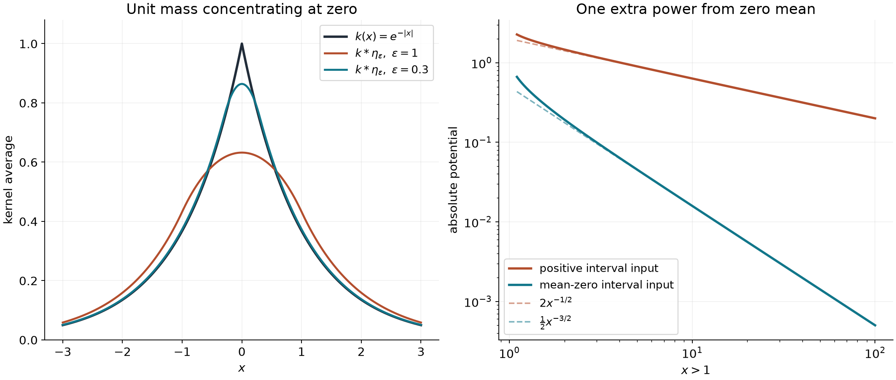
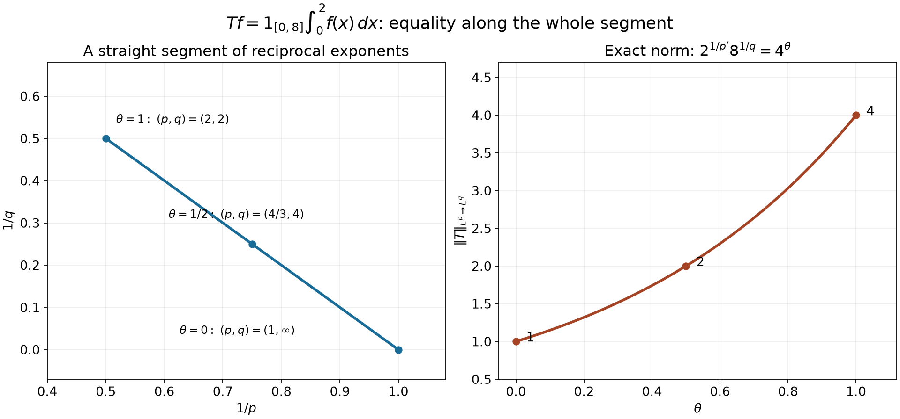

# Convolution estimates and weak-gradient embeddings

*Exposition by GPT-6 Astra (OpenAI), 4 October 2026. Public domain (CC0).*

Kernel estimates recover functions from their weak derivatives. Near a kernel's singularity, local averages control the input; far away, integrability or cancellation supplies decay. We prove the needed maximal and fractional estimates before applying the Newtonian gradient identity. The resulting global estimates determine a function only modulo the constants or polynomials invisible to its prescribed derivatives.

We use complex-valued functions, completed Lebesgue measure on \(\mathbb R^n\), \(n\ge1\), and \(1/\infty=0\). Supremum norms are essential suprema unless continuity has been proved. Write
\[
 [v]_{\gamma;A}=\sup_{\substack{x,z\in A\\x\ne z}}
                    \frac{|v(x)-v(z)|}{|x-z|^\gamma},
 \qquad0<\gamma\le1,
\]
with value zero if there are no distinct pairs.

The [integration foundations](../prerequisites/U011-free-foundations/banach-foundation-bridges.md), Sections 15.0–15.4 and 16, prove the measure, convergence, Fubini, Hölder, Minkowski, two-factor Young, density and mollification facts used below. Section 15.6 proves the planar polar formula. [U011](boundary-flux-and-weak-identities.md), Theorem 2.1 and Corollary 2.2, supplies boundary integration by parts; [U020](point-sources-and-complex-gaussian-kernels.md), Theorem 1.1, supplies the complete Newtonian normalization; [U021](convolution-as-addition-of-supports.md), B0–B3 and Theorems 1.1, 2.1, 4.1, supplies distributional convolution and its local smoothness. [U032](regularity-across-a-distinguished-variable.md), Lemma 1.3, proves the zero-coordinate-derivative result on joint tests. The [Fourier foundations](../prerequisites/U011-free-foundations/schwartz-fourier-foundations-U017.md), F3, proves the Gaussian integral used in Solution 7. Additional maximal, fractional and dyadic facts are proved here.

## Every finite number of Young factors

**Theorem 1.1 (finite-factor Young, including endpoints).** If \(k\ge1\), \(1\le p_i,q\le\infty\), and
\(\sum_{i=1}^k1/p_i=k-1+1/q\), the successive convolution of \(f_i\in L^{p_i}\) belongs to \(L^q\), with
\[
                  \|f_1*\cdots*f_k\|_q\le\prod_i\|f_i\|_{p_i}.
\]
For compact continuous inputs the \(L^\infty\) estimate holds at every point.

**Proof.** Put \(1/r_j=\sum_{i\le j}1/p_i-(j-1)\). Since the omitted \(k-j\) reciprocals are at most one,
\[
 \frac1{r_j}
 =k-1+\frac1q-\sum_{i>j}\frac1{p_i}-(j-1)\ge\frac1q\ge0.
\]
The included reciprocals give \(1/r_j\le1\). Thus every intermediate exponent is allowed, \(r_1=p_1\), \(r_k=q\), and
\(1+1/r_j=1/r_{j-1}+1/p_j\). Apply the full two-factor Young proof in the integration foundations, Section 15.2, at each step. It includes zero norms and every infinite endpoint, and constructs the successive almost-everywhere convolutions. When \(k=1\) this is just equality. Convolution of two compact continuous functions is compactly supported and continuous by dominated convergence on a fixed integration set; induction gives the same for \(k\) factors. A continuous function satisfying an essential bound satisfies it everywhere, since a strict violation persists on a ball of positive measure. \(\square\)

## Endpoint norms and the reflected kernel

**Lemma 1.2 (smooth tests determine every integral norm).** For \(g\in L^1_{\mathrm{loc}}(\mathbb R^n)\) and \(1\le r\le\infty\),
\[
 \|g\|_r=\sup_{\substack{\varphi\in C_c^\infty\\\|\varphi\|_{r'}\le1}}
                  \left|\int g\varphi\right|.
 \tag{E1}
\]
Either side may be infinite. The pairing is bilinear; its maximizing phase is the conjugate of the phase of \(g\).

**Proof.** Hölder gives the upper bound whenever the left side is finite. To prove the reverse bound, suppose the supremum on the right is a finite number \(A\). Its defining inequality extends to every bounded measurable compactly supported \(h\). Indeed choose a nonnegative compact smooth \(\rho\) of integral one. The integration foundations, Sections 15.2–15.4, give
\(\|\rho_\varepsilon*h\|_{r'}\le\|h\|_{r'}\), including \(r'=\infty\), and convergence to \(h\) in \(L^1\). Choose a sequence with \(L^1\) errors at most \(2^{-j}\). Tonelli shows that the sum of the absolute errors is finite almost everywhere, so this sequence converges almost everywhere. The smoothed functions have modulus at most \(\|h\|_\infty\) and supports in one compact set. Dominated convergence against the locally integrable \(|g|\) therefore yields
\[
                         \left|\int gh\right|\le A\|h\|_{r'}.
 \tag{E2}
\]
This argument uses no density assertion in the \(L^\infty\) norm.

Put \(\sigma=\overline g/|g|\) where \(g\ne0\), and zero elsewhere. For \(1<r<\infty\), take
\[
B_j=\{|x|\le j,\ |g(x)|\le j\},\qquad
 h_j=\sigma |g|^{r-1}1_{B_j}.
\]
With \(J_j=\int_{B_j}|g|^r\), (E2) gives \(J_j\le A J_j^{1/r'}\). The integral is finite. Division when it is positive gives \(J_j^{1/r}\le A\); when it is zero this is immediate. Monotone convergence proves \(\|g\|_r\le A\). For \(r=1\), use \(h_j=\sigma1_{\{|x|\le j\}}\), whose supremum norm is at most one, and then monotone convergence. For \(r=\infty\) and \(c>0\), if \(\{|g|>c\}\) has positive measure, it has an intersection \(E\) of positive finite measure with some bounded ball. The function \(h=\sigma1_E/|E|\) has integral norm one, and (E2) gives \(c\le A\). Thus \(|g|\le A\) almost everywhere. These arguments also show that a finite supremum forces a finite norm, settling the infinite case. \(\square\)

**Proposition 1.3 (exact endpoint criteria and dual bounds).** Let \(k\in L^1_{\mathrm{loc}}(\mathbb R^n)\), and write \(\check k(x)=k(-x)\). A bound
\[
            \|k*\varphi\|_q\le C\|\varphi\|_p,
                      \qquad\varphi\in C_c^\infty,
 \tag{E3}
\]
holds if and only if
\[
            \|\check k*\psi\|_{p'}\le C\|\psi\|_{q'},
                      \qquad\psi\in C_c^\infty.
 \tag{E4}
\]
The best constants agree, for all \(1\le p,q\le\infty\). In particular,
\[
 \begin{array}{lll}
 q=\infty:&\text{(E3) holds exactly when }k\in L^{p'},&
                  C_{\mathrm{best}}=\|k\|_{p'},\\
 p=1:&\text{(E3) holds exactly when }k\in L^q,&
                  C_{\mathrm{best}}=\|k\|_q.
 \end{array}
 \tag{E5}
\]
When either criterion holds, the ordinary almost-everywhere convolution on all of the stated input space has this same operator norm.

**Proof.** Convolution of a locally integrable \(k\) with a compact smooth test is smooth: on every compact output neighborhood, all kernel values used in
\(\int k(z)\varphi(x-z)\,dz\) lie in a fixed compact set; derivatives of the test are uniformly bounded there, so dominated difference quotients apply. Fubini, with both test supports compact, gives
\[
 \int(k*\varphi)(x)\psi(x)\,dx
       =\int\varphi(y)(\check k*\psi)(y)\,dy.
 \tag{E6}
\]
Absolute integrability follows by bounding the tests and integrating \(|k|\) over the bounded set of their differences, with one additional finite support-volume factor. Assuming (E3), Hölder bounds the left side by \(C\|\varphi\|_p\|\psi\|_{q'}\). Lemma 1.2 applied to \(\check k*\psi\), with \(r=p'\), proves (E4). Reflection twice and the same argument prove the converse, with the identical constant.

If \(q=\infty\), continuity makes the essential bound in (E3) valid at zero. Hence
\[
             \left|\int k(-y)\varphi(y)\,dy\right|
                         \le C\|\varphi\|_p.
\]
Lemma 1.2 gives \(\|k\|_{p'}\le C\). Conversely Hölder gives the convolution bound with exactly \(\|k\|_{p'}\). For \(p=1\), use (E4), whose output exponent is infinity; the criterion just proved gives \(\|\check k\|_q\le C\), and Young supplies sufficiency. Reflection preserves every norm. Young and Hölder define the convolution on the whole input space with the stated upper bound; the smooth tests already force the same lower bound. At input exponent infinity, this is a direct integral construction, with no assertion that compact smooth functions are norm dense. \(\square\)

The locally integrable function hypothesis matters. The distribution \(\delta_0\) acts by the identity on \(L^1\), but it is not an \(L^1\) kernel function. For \(k_a(x)=|x|^{-n/a}\), \(1<a<\infty\), the \(L^a\) integral diverges both at zero and at infinity. To see both divergences without a polar formula, integrate on the disjoint shells \(2^j<|x|<2^{j+1}\). Scaling gives the same positive finite integral on every shell, for all integers \(j\). The endpoint criteria therefore rule out both strong \(L^1\to L^a\) and \(L^{a'}\to L^\infty\) bounds. The intermediate estimates below have a different mechanism.

## A kernel difference is a Hölder estimate

**Theorem 2.1 (every \(C^1\) homogeneous kernel).** Let \(K\in C^1(\mathbb R^n\setminus\{0\})\) be homogeneous of real degree \(\beta\). If \(1\le p\le\infty\) and
\[
                    0<\gamma=\beta+n-n/p<1,
\]
then for compactly supported \(f\in L^p\), every convolution value is absolutely defined, \(K*f\) is continuous, and
\([K*f]_{\gamma;\mathbb R^n}\le C_{K,n,p}\|f\|_p\).
For \(\beta=-n/a\), the exponent is \(n(1-1/a-1/p)\).

**Proof.** Homogeneity and the chain rule give
\(|K(z)|\le C_0|z|^\beta\) and
\(|\nabla K(z)|\le C_1|z|^{\beta-1}\), using maxima on the compact unit sphere. Fix \(h\ne0\), \(R=|h|\). On
\(B(0,2R)\cup B(h,2R)\), each argument of either kernel is within \(3R\) of its own singularity. If \(1<p\le\infty\), put \(p'=p/(p-1)\), with \(p'=1\) for \(p=\infty\). Inner dyadic shells of radius \(r=3R\,2^{-j}\) bound the integral of \(|z|^{\beta p'}\) by a constant times \(\sum_jr^{\beta p'+n}\). To see the bound for either sign of \(\beta\), use the larger of \(r^{\beta p'}\) and \((r/2)^{\beta p'}\) on the shell and its containing cube of volume \((2r)^n\). The sum converges because \(\beta p'+n=p'\gamma>0\).

Outside those two balls, \(|z|\ge2R\) and the segment \(z-\theta h\) has length from the origin at least \(|z|/2\). The fundamental theorem gives
\[
                |K(z-h)-K(z)|\le C R|z|^{\beta-1}.
\]
The outward-shell integral converges because
\((\beta-1)p'+n=p'(\gamma-1)<0\). Taking \(p'\)-th roots of both estimates yields
\[
                    \|K(\cdot-h)-K\|_{p'}\le C|h|^\gamma .
\]
At \(p=1\), one has \(\beta=\gamma\in(0,1)\) and extends \(K(0)=0\). On the near region the supremum is \(O(R^\beta)\); on the far region it is \(O(R(2R)^{\beta-1})\). Thus the same inequality holds with \(p'=\infty\).

The local \(L^{p'}\) estimate makes the convolution with compact \(L^p\) input absolutely finite at every \(x\); away from the possible singularity the kernel is bounded on the fixed integration set. Hölder applied to the difference of the two kernels gives the claimed modulus and continuity. Fubini on a compact output test identifies this function with the compact-factor distributional convolution. No positivity, radiality, or derivatives beyond \(C^1\) were used. \(\square\)

**Example 2.2 (a complex asymmetric kernel).** On \(\mathbb R\), take
\[
 K(x)=(1+i\operatorname{sgn}x)|x|^{-1/2},\qquad f=1_{[0,1]}.
\]
For \(0\le x\le1\), splitting the integral at \(y=x\) gives
\[
                     K*f(x)=2(1+i)\sqrt x+2(1-i)\sqrt{1-x}.
\]
The endpoint values are \(2(1-i)\) and \(2(1+i)\). Theorem 2.1 gives exponent \(1/4\) using \(p=4\), and \(1/2\) using \(p=\infty\). Dividing the change at zero by \(\sqrt x\) and rationalizing \(\sqrt{1-x}-1\) gives limit \(2(1+i)\). Thus no exponent greater than \(1/2\) holds at that endpoint.

## The fractional kernel has a finite strong range

We first prove the maximal estimate needed for fractional integration. Using cubes makes their measure and every dilation factor explicit. Set
\[
 Q(x,r)=x+(-r,r)^n,\qquad
 Mh(x)=\sup_{r>0}\frac1{(2r)^n}\int_{Q(x,r)}|h(y)|\,dy.
\]
For locally integrable \(h\), the average at fixed \(r\) is continuous in \(x\): on any bounded region localize \(h\) to an \(L^1\) function, and bound the change by its \(L^1\) translation difference, proved in the integration foundations. A supremum of continuous functions is lower semicontinuous, so \(Mh\) is measurable.

**Lemma 3.0 (complete maximal estimates).** For \(h\in L^1\) and \(\lambda>0\),
\[
                |\{Mh>\lambda\}|\le3^n\lambda^{-1}\|h\|_1.
\]
For \(1<p<\infty\),
\[
       \|Mh\|_p^p\le\frac{3^n p\,2^p}{p-1}\|h\|_p^p,
\]
and \(M\) is a contraction on \(L^\infty\).

**Proof.** Take any compact subset \(K\) of \(\{Mh>\lambda\}\). For every \(x\in K\), choose a witnessing cube centred at \(x\) with integral greater than \(\lambda\) times its volume. A finite subfamily covers \(K\). Sort it by decreasing side length, retaining a cube exactly when it is disjoint from all retained cubes. Every discarded cube intersects a retained cube of at least its side length and is contained in that retained cube dilated by three about its centre, by the coordinate triangle inequality. Thus
\[
 |K|\le3^n\sum_{\text{retained }Q}|Q|
       \le\frac{3^n}{\lambda}\sum_{\text{retained }Q}\int_Q|h|
       \le\frac{3^n}{\lambda}\|h\|_1.
\]
Inner regularity of Lebesgue measure, already proved in the integration foundations, gives the weak bound for the open level set, including when its measure was initially allowed to be infinite.

For \(h\in L^p\), split \(|h|=a+b\), where
\(a=|h|1_{\{|h|>\lambda/2\}}\) and \(0\le b\le\lambda/2\). The function \(a\) is in \(L^1\), since \(a\le(\lambda/2)^{1-p}|h|^p\). Sublinearity and \(Mb\le\lambda/2\) imply
\[
 |\{Mh>\lambda\}|
 \le\frac{2\,3^n}{\lambda}
                  \int_{\{|h|>\lambda/2\}}|h|.
\]
For any nonnegative measurable \(H\), the scalar identity
\(H^p=\int_0^\infty p\lambda^{p-1}1_{\{H>\lambda\}}\,d\lambda\)
and Tonelli give its integral identity, even with infinite values. Apply it to \(H=Mh\), insert the preceding estimate, and use Tonelli again:
\[
 \begin{aligned}
 \int(Mh)^p
 &\le 2\,3^n p\int |h(x)|
                  \int_0^{2|h(x)|}\lambda^{p-2}\,d\lambda\,dx\\
 &=\frac{3^n p\,2^p}{p-1}\int|h|^p.
 \end{aligned}
\]
This proves finiteness and the strong estimate without an interpolation theorem. The \(L^\infty\) assertion follows from the bound on each average. \(\square\)

**Theorem 3.1 (strong and weak fractional integration).** Put
\[
 \alpha=n(1-1/a),\qquad k_a(x)=|x|^{-n/a}=|x|^{\alpha-n},
                       \qquad 1<a<\infty.
\]
If \(1<p<q<\infty\) and \(1/p+1/a=1+1/q\), then
\(\|k_a*f\|_q\le C_{n,a,p}\|f\|_p\).
For \(f\in L^1\), its potential is absolutely finite almost everywhere and
\[
              |\{|k_a*f|>\lambda\}|
                    \le C_{n,a}\lambda^{-a}\|f\|_1^a.
\]
Neither strong \(L^1\to L^a\) nor strong \(L^{a'}\to L^\infty\) holds.

**Proof.** Work with \(|f|\), so every preliminary integral is nonnegative and Tonelli applies before finiteness is established. Let \(F=\|f\|_p\), \(1\le p<n/\alpha=a'\), and put \(m=Mf(x)\). On the inner shells \(2^{-j-1}R<|z|\le2^{-j}R\), the kernel and the centred-cube bound give
\[
 \int_{|z|\le R}|z|^{\alpha-n}|f(x-z)|\,dz
 \le A_{n,\alpha}mR^\alpha,\qquad
 A_{n,\alpha}=\frac{2^{2n-\alpha}}{1-2^{-\alpha}}.
\]
Indeed the \(j\)-th bound is
\(2^{2n-\alpha}m(2^{-j}R)^\alpha\). If \(p>1\), Hölder and outward shells give
\[
 \int_{|z|>R}|z|^{\alpha-n}|f(x-z)|\,dz
                     \le B_{n,\alpha,p}FR^{\alpha-n/p}.
\]
Here the kernel power has exponent
\((\alpha-n)p'+n<0\); summing its shell integrals proves the bound. At \(p=1\), the far kernel is at most \(R^{\alpha-n}\), giving the same estimate with \(B=1\).

If \(F=0\), the potential is zero. Otherwise \(m>0\) at every point, since some large cube about any point contains positive input mass; Lemma 3.0 makes \(m\) finite almost everywhere. At such a point choose \(R=(F/m)^{p/n}\). With \(\theta=\alpha p/n\), the two bounds become
\[
        (k_a*|f|)(x)\le C F^\theta m^{1-\theta},
                           \qquad0<\theta<1.
\]
For \(p>1\), let \(q=np/(n-\alpha p)\), so \(q(1-\theta)=p\). Taking the \(q\)-th power, integrating, and applying Lemma 3.0 gives the claimed \(L^q\) estimate and absolute finiteness. For \(p=1\), \(a=n/(n-\alpha)\) and a level set of the potential is contained, up to the null set where \(Mf=\infty\), in
\[
           \{Mf>(\lambda/(C F^{\alpha/n}))^a\}.
\]
The weak maximal bound gives
\(3^n C^a\lambda^{-a}F^{1+\alpha a/n}
 =3^n C^a\lambda^{-a}F^a\), as required. The relation of exponents in the theorem is exactly \(1/q=1/p-\alpha/n\).

For the first excluded endpoint choose \(f=1_{[-1,1]^n}\). On the outer cube shell \(2^j<|x|_\infty<2^{j+1}\), \(j\ge1\), the potential is bounded below by \(c\,2^{-j(n-\alpha)}\), since \(|x-y|\le C_n2^j\) on the input cube. The shell has volume \(c_n2^{jn}\). Its contribution to the \(a\)-th power integral is bounded below by a fixed positive number, because \(a(n-\alpha)=n\). Disjoint shells force divergence.

For the other endpoint put \(p=a'=n/\alpha>1\), choose \(1/p<b<1\), and define
\[
 A_j=\{2^{-j-1}<|y|_\infty\le2^{-j}\},\qquad
 f(y)=\sum_{j=2}^\infty 2^{j\alpha}j^{-b}1_{A_j}(y).
\]
Since \(|A_j|=2^n(1-2^{-n})2^{-jn}\), its \(L^p\) power norm is a constant times \(\sum j^{-bp}<\infty\), while its \(L^1\) norm is a constant times
\(\sum 2^{-j(n-\alpha)}j^{-b}<\infty\).
For \(|x|_\infty\le2^{-N-3}\), \(2\le j\le N\), and \(y\in A_j\), one has \(|x-y|\le C_n2^{-j}\). The contribution from \(A_j\) is therefore at least \(c j^{-b}\). Hence \(k_a*f(x)\ge c\sum_{j=2}^Nj^{-b}\) on a cube of positive measure. These sums tend to infinity, proving infinite essential supremum. The weak endpoint just proved still gives almost-everywhere finiteness for this \(L^1\) input. \(\square\)

**Proposition 3.2 (the sup-norm interpolation estimate).** For \(1\le p<a'\) and \(f\in L^p\cap L^\infty\),
\[
 \|k_a*f\|_\infty
       \le C_{n,a,p}\|f\|_p^{p/a'}\|f\|_\infty^{1-p/a'}.
\]
The integral is absolutely defined at every point.

**Proof.** Set \(F=\|f\|_p\) and \(G=\|f\|_\infty\). The same inner-shell argument, using \(|f|\le G\) almost everywhere, gives \(CGR^\alpha\). The far estimate above gives \(CFR^{\alpha-n/p}\), including \(p=1\). For positive norms choose \(R=(F/G)^{p/n}\); both terms have the form
\(C F^{\alpha p/n}G^{1-\alpha p/n}\), and \(\alpha p/n=p/a'\). These estimates hold at every \(x\), since translating a null exceptional set does not affect an integral. If either norm is zero, \(f=0\) almost everywhere and the conclusion follows directly. \(\square\)

**Example 3.3 (one kernel, three bounds).** For \(n=3\), \(a=3/2\), the same unnormalized kernel \(|x|^{-2}\) maps \(L^{6/5}\) to \(L^2\), since \(5/6+2/3=1+1/2\). It maps \(L^1\) to weak \(L^{3/2}\), in the level-set sense of Theorem 3.1. For \(f\in L^2\cap L^\infty\), Proposition 3.2 gives
\(\|k_a*f\|_\infty\le C\|f\|_2^{2/3}\|f\|_\infty^{1/3}\).

## A distribution with an integrable gradient is a function

We will use two uniqueness facts explicitly. A locally integrable function defining the zero distribution is zero almost everywhere: localize it, convolve with a compact smooth mollifier, and test the zero distribution on its translates on a smaller region. The convolutions vanish there and converge in local \(L^1\) to the function, by the integration foundations, Section 15.4. A distribution whose every coordinate derivative is zero is a scalar on each product box: apply U032, Lemma 1.3, one coordinate at a time. Each remaining derivative of the reduced distribution is zero, as seen by testing with a normalized bump in the removed coordinate. After the last coordinate only a scalar remains. On overlapping boxes the scalars agree. On \(\mathbb R^n\), a segment between two points has a finite chain of such overlapping boxes, so the scalar is global.

**Lemma 4.0 (recover the local representative first).** If \(u\in\mathcal D'(X)\) on an arbitrary open \(X\), and \(g_j=\partial_ju\in L^p_{\rm loc}(X)\) for all \(j\), \(1\le p\le\infty\), then \(u\in L^p_{\rm loc}(X)\).

**Theorem 4.1 (the local Sobolev exponent).** Under the same hypotheses with \(1<p<n\), one has
\(u\in L^{np/(n-p)}_{\rm loc}(X)\).

**Proof of both assertions.** For \(n\ge2\), the Newtonian proof in U020, Theorem 1.1, gives the locally integrable kernels
\[
 E_j(x)=\partial_j\Phi_n(x)
       =\frac{x_j}{\sigma_{n-1}|x|^n},
                       \qquad \sum_j\partial_jE_j=\delta_0.
\]
Here \(\sigma_{n-1}\) is the area of the unit sphere with the normalization used in that proved theorem. At \(n=1\), take \(E_1=\tfrac12\operatorname{sgn}x\); its derivative is \(\delta_0\) by integration by parts on the half-lines.

Choose a cutoff \(\chi\) compactly supported in \(X\), equal to one near a relatively compact region \(V\). The distribution \(\chi u\) extends compactly by zero. Differentiation of proper convolutions, proved in U021, gives
\[
 \chi u=\sum_j E_j*\partial_j(\chi u)
       =\sum_j E_j*(\chi g_j)
                   +\sum_jE_j*((\partial_j\chi)u).
\]
The inputs of the second sum have compact support separated from \(V\). Their convolution is smooth on \(V\), by U021's localized kernel proof in Theorem 4.1. For \(x\in V\), the first sum only uses \(E_j\) on a bounded region. These truncated kernels are \(L^1\), including \(n=1\); Young's \(L^1*L^p\to L^p\) bound puts this sum in \(L^p(V)\). This proves the local representative assertion before any multiplication of a function representative was presumed. Such representatives agree almost everywhere on overlaps by the uniqueness fact just proved.

For \(1<p<n\), necessarily \(n\ge2\), and
\(|E_j(x)|\le\sigma_{n-1}^{-1}|x|^{1-n}\).
Apply Theorem 3.1 with \(\alpha=1\) to each compact input \(\chi g_j\). The first sum is locally \(L^{np/(n-p)}\), and the smooth second sum belongs to that space on every compact subset of \(V\). This proves Theorem 4.1. \(\square\)

**Theorem 4.2 (global Sobolev, modulo one constant).** For \(1<p<n\), if \(u\in\mathcal D'(\mathbb R^n)\) and \(\partial_ju=g_j\in L^p(\mathbb R^n)\), there is a unique scalar \(C\) with
\[
 \|u-C\|_q\le C_{n,p}\sum_j\|g_j\|_p,\qquad q=\frac{np}{n-p}.
\]

**Proof.** Define \(v=\sum_jE_j*g_j\), using the absolutely almost-everywhere integrals of Theorem 3.1. Then \(v\in L^q\) with the required bound. We must prove all its gradient identities; equality of Laplacians alone would not suffice.

Choose \(\rho\in\mathcal D(\mathbb R^n)\) equal to one near zero, and put
\(E_{j,\varepsilon}(x)=\rho(\varepsilon x)E_j(x)\).
These kernels are compact distributions and can be convolved with the original \(u\). Commuting distributional derivatives and using \(g_j=\partial_ju\) gives
\[
 \begin{aligned}
 \partial_k\sum_j E_{j,\varepsilon}*g_j
 &=\sum_j E_{j,\varepsilon}*\partial_k\partial_ju\\
 &=\left(\sum_j\partial_jE_{j,\varepsilon}\right)*g_k
   =g_k+A_\varepsilon*g_k,\\
 A_\varepsilon(x)
 &=\varepsilon\sum_j(\partial_j\rho)(\varepsilon x)E_j(x)
   =\varepsilon^n A(\varepsilon x).
 \end{aligned}
\]
The function \(A\) is smooth and compactly supported away from zero. The last equality uses the degree \(1-n\) of \(E_j\). Therefore
\[
 \|A_\varepsilon*g_k\|_\infty
       \le\varepsilon^{n/p}\|A\|_{p'}\|g_k\|_p\longrightarrow0.
\]
For almost every \(x\), the integrable majorant
\(C|x-y|^{1-n}|g_j(y)|\) permits dominated convergence as \(\varepsilon\downarrow0\) in the defining integral. The differences are bounded by
\(C(1+\|\rho\|_\infty)I_1|g_j|\in L^q\), where \(I_1\) uses the unnormalized kernel \(|x|^{1-n}\). Dominated convergence for their \(q\)-th powers thus proves
\(\sum_jE_{j,\varepsilon}*g_j\to v\) in \(L^q\).
Passing the derivative identity to distributions gives \(\partial_kv=g_k\).

Every derivative of \(u-v\) is zero, so the preceding box argument gives \(u-v=C\) globally. A nonzero constant is not in finite \(L^q(\mathbb R^n)\), since the space contains infinitely many disjoint unit cubes. Thus this scalar is unique. \(\square\)

**Theorem 4.3 (global and local Morrey, with the Lipschitz endpoint).** If \(n<p\le\infty\) and all \(\partial_ju\in L^p(\mathbb R^n)\), then \(u\) has a unique continuous representative and
\[
           [u]_{1-n/p;\mathbb R^n}
                         \le C_{n,p}\sum_j\|\partial_ju\|_p.
\]
On any open \(X\), local \(L^p\) gradients give a continuous representative with finite seminorm of that exponent on every compact \(K\Subset X\).

**Proof.** For \(n\ge2\) and finite \(p>n\), the difference estimate in Theorem 2.1 applies to each \(E_j\) with degree \(1-n\) and \(\gamma=1-n/p\). Define
\[
 v(x)=\sum_j\int_{\mathbb R^n}
                       [E_j(x-y)-E_j(-y)]g_j(y)\,dy.
\]
Hölder and that full difference norm prove absolute convergence at every \(x\), \(v(0)=0\), and
\[
             |v(x)-v(z)|\le C|x-z|^{1-n/p}\sum_j\|g_j\|_p.
\]
It remains to identify its derivatives. Use \(E_{j,\varepsilon}\) as above and subtract the resulting potential's value at zero. These values are finite: the compact kernel is in \(L^{p'}\), since \(p>n\) makes \((1-n)p'+n>0\). Let
\(R_{j,\varepsilon}=(\rho(\varepsilon\cdot)-1)E_j\).
It vanishes near zero. The product rule and homogeneity give
\[
 |\nabla R_{j,\varepsilon}(z)|
       \le C|z|^{-n}1_{\{|z|\ge c/\varepsilon\}}.
\]
For the cutoff-derivative term this uses \(|z|\asymp\varepsilon^{-1}\) on its annular support; for the other term it uses \(|\nabla E_j(z)|\le C|z|^{-n}\).
Fix \(|x|\le R\) and take \(\varepsilon\) small enough that \(c/\varepsilon>4R\). The segment from \(-y\) to \(x-y\) then yields
\[
 |R_{j,\varepsilon}(x-y)-R_{j,\varepsilon}(-y)|
 \le C_R |y|^{-n}1_{\{|y|\ge c/(2\varepsilon)\}}.
\]
The \(L^{p'}\) norm of this right side is \(O_R(\varepsilon^{n/p})\), by outward shells or dilation, since \(p'>1\). Thus the renormalized truncated potentials converge to \(v\) uniformly on every bounded set. Their derivatives equal \(g_k+A_\varepsilon*g_k\) by the identity proved above, and their errors tend uniformly to zero. Hence \(\partial_kv=g_k\) in distributions. The zero-gradient argument gives \(u=v+C\) and the desired representative and seminorm.

For \(n=1\) and \(1<p<\infty\), put \(v(x)=\int_0^xg_1(t)\,dt\). Hölder on the oriented interval gives
\[
                 |v(x)-v(z)|\le\|g_1\|_p|x-z|^{1-1/p}.
\]
Fubini against compact tests gives \(v'=g_1\), and U032, Lemma 1.3, in dimension zero gives \(u-v=C\).

For \(p=\infty\), Lemma 4.0 first supplies \(u\in L^\infty_{\rm loc}\). With a nonnegative smooth compact mass-one mollifier, let \(u_\varepsilon=u*\rho_\varepsilon\). U021 proves smoothness and
\(\partial_ju_\varepsilon=g_j*\rho_\varepsilon\), so the segment integral gives
\[
 |u_\varepsilon(x)-u_\varepsilon(z)|
                 \le L|x-z|,\qquad L=\sum_j\|g_j\|_\infty.
\]
The approximate-identity proof gives \(u_\varepsilon\to u\) in local \(L^1\). This convergence is locally uniform: for two parameters the difference \(w=u_\varepsilon-u_\delta\) has Lipschitz constant at most \(2L\). Average
\(|w(x)|\le|w(y)|+2L|x-y|\) over a cube of fixed small radius about \(x\). On a compact set of centres, all cubes lie in one enlarged compact set. Choose their diameter to make the second term small and then use the \(L^1\)-Cauchy property to make the first averaged term small uniformly in \(x\). Thus \(u_\varepsilon\) converges locally uniformly to a continuous representative with the same Lipschitz bound. Continuous representatives are unique, since their difference is zero almost everywhere and a nonzero continuous value persists on a ball.

Finally, for \(K\Subset X\) use Lemma 4.0 and a cutoff \(\chi=1\) near \(K\). The compact function \(\chi u\), extended by zero, has gradient
\(\chi g_j+(\partial_j\chi)u\in L^p(\mathbb R^n)\). Apply the global conclusion to this function. It yields the asserted local modulus on \(K\), including every cutoff term. Local representatives agree by uniqueness, so they define a continuous representative throughout \(X\), without assumptions on its boundary or connectedness. \(\square\)

**Example 4.4 (the infinite-exponent endpoint is exact).** On the line, integration by parts on the half-lines gives
\((|x|)'=\operatorname{sgn}x\) and \((|x|)''=2\delta_0\).
The gradient has \(L^\infty\) norm one and the function has Lipschitz seminorm one. It is not classically differentiable at its corner.

## Every lower derivative and the polynomial ambiguity

**Theorem 5.1 (the full local higher-derivative range).** Suppose \(m\ge1\), \(1<p<\infty\), and all order-\(m\) derivatives of \(u\in\mathcal D'(X)\) are locally \(L^p\). For \(|\alpha|<m\), one has \(\partial^\alpha u\in L^q_{\rm loc}\) for every finite \(q\ge1\) satisfying
\[
                      \frac1p\le\frac1q+\frac{m-|\alpha|}{n}.
\]
It has a locally Hölder representative of every \(0<\gamma<1\) satisfying
\[
                       \frac1p\le\frac{m-|\alpha|-\gamma}{n}.
\]

**Proof.** Apply Lemma 4.0 to each derivative of order \(m-1\), whose gradient is the known order-\(m\) array. Repeat downward to obtain local \(L^p\) for every derivative through order \(m\), before seeking a gain.

Fix \(r=|\alpha|<m\) and \(k=m-r\). If \(1/p-k/n>0\), descend through the full derivative arrays using
\[
                       1/p_\ell=1/p-\ell/n,\qquad 0\le\ell\le k.
\]
At the \(\ell\)-th step, \(p_{\ell-1}<n\), because
\(1/p-(\ell-1)/n>1/n\). Theorem 4.1 thus gives the next array in \(L^{p_\ell}_{\rm loc}\). Bounded-region Hölder inclusion supplies every smaller finite \(q\), proving the stated range in this case.

If an intermediate exponent is \(n\), then \(n>1\), since the original \(p>1\). On a fixed larger compact region, its gradients in \(L^n\) lie in every \(L^s\), \(1<s<n\). The subcritical theorem gives exponent \(ns/(n-s)\), arbitrarily large as \(s\uparrow n\); bounded-region inclusion gives every finite exponent. If instead an intermediate exponent exceeds \(n\), local Morrey gives a bounded continuous representative, hence again all finite local exponents. For every remaining descent choose one sufficiently large finite exponent and apply the first-order assertions. This proves all finite \(q\) when \(1/p-k/n\le0\), without asserting boundedness at the critical equality.

For the Hölder claim choose a finite \(s>n\) with
\[
 \max\{0,1/p-(k-1)/n\}\le1/s
             \le\min\{1/p,(1-\gamma)/n\}.
\]
Such a positive reciprocal exists by the claimed hypothesis; if the lower bound is zero choose any sufficiently small positive value below the positive upper bound. The finite-integrability result for the order-\((r+1)\) array gives its local \(L^s\) membership. If \(k=1\), these are the given order-\(m\) derivatives and the inequalities force \(s=p>n\), so no higher-order gain is assumed. Morrey applied to \(\partial^\alpha u\) gives exponent \(1-n/s\ge\gamma\). On a compact set a bound at a larger exponent implies the smaller one by the factor \(\operatorname{diam}(K)^{1-n/s-\gamma}\); singleton or empty sets have zero seminorm. The initial local \(L^p\) membership also covers \(1\le q\le p\). At order \(m\) itself there is only this latter inclusion, not an extra gain. \(\square\)

**Theorem 5.2 (the global equality ranges, modulo polynomials).** Suppose all order-\(m\) derivatives of \(u\in\mathcal D'(\mathbb R^n)\) belong to \(L^p\), \(m\ge1\), \(1<p<\infty\). For \(0\le r<m\), put \(k=m-r\). If \(1/q=1/p-k/n>0\), there is a polynomial \(P\) of degree at most \(m-1\) such that
\[
 \sum_{|\alpha|=r}\|\partial^\alpha(u-P)\|_q
       \le C_{n,m,p}\sum_{|\beta|=m}\|\partial^\beta u\|_p.
\]
If \(0<\gamma=k-n/p<1\), a polynomial subtraction instead gives
\[
 \sum_{|\alpha|=r}[\partial^\alpha(u-P)]_{\gamma;\mathbb R^n}
       \le C_{n,m,p}\sum_{|\beta|=m}\|\partial^\beta u\|_p.
\]
In the first case \(P\) is unique modulo polynomials of degree less than \(r\). In the second it is unique modulo degree at most \(r\), reduced to degree less than \(r\) by normalizing all the order-\(r\) representatives to zero at the origin.

**Proof.** Write \(S=n/p\). In the finite-\(q\) case \(k<S\). Start with \(P=0\). At step \(\ell=1,\ldots,k\), set \(j=m-\ell\). The preceding order-\((j+1)\) array lies in \(L^{p_{\ell-1}}\), with \(1/p_{\ell-1}=1/p-(\ell-1)/n>1/n\). Theorem 4.2 gives a scalar \(c_\alpha\) for each \(|\alpha|=j\), such that
\(\partial^\alpha(u-P)-c_\alpha\in L^{p_\ell}\).
Subtract
\[
                         P_j(x)=\sum_{|\alpha|=j}
                                           c_\alpha x^\alpha/\alpha!
\]
in addition to \(P\). For \(|\beta|=j\), \(\partial^\beta P_j=c_\beta\): a different same-degree monomial has a coordinate exponent smaller than the differentiating exponent and vanishes. All higher derivatives of \(P_j\) vanish, so every preceding estimate is preserved. Iterating the finite array bounds proves the claimed norm estimate. The descent can continue through all orders for which \(m-r<S\), giving one compatible polynomial for all those conclusions.

For the Hölder case \(k-1<S<k\). Perform only the first \(k-1\) Sobolev steps. The order-\((r+1)\) array then belongs to \(L^t\), where
\[
                          t=\frac{n}{1-\gamma}>n.
\]
Apply Theorem 4.3 to every order-\(r\) derivative to obtain the bound. For \(k=1\) there are no preliminary steps and \(t=p\). Subtracting
\(\sum_{|\alpha|=r}\partial^\alpha(u-P)(0)x^\alpha/\alpha!\)
sets those values to zero without changing their seminorms or any higher derivative.

We prove the two polynomial facts behind uniqueness. If a nonzero polynomial has degree \(d\), its highest homogeneous part \(H_d\) is nonzero at some nonzero real point. Here is the elementary algebra needed for that assertion. A one-variable polynomial vanishing at \(r\) factors by \(x-r\), by applying \(x^j-r^j=(x-r)\sum_{h=0}^{j-1}x^{j-1-h}r^h\) to each term. Induction on its degree therefore bounds its distinct real roots by its degree. For several variables, write a nonzero polynomial as a polynomial in the last variable; one coefficient is a nonzero polynomial in fewer variables. By induction choose the other coordinates making that coefficient nonzero, and then choose the last coordinate outside the finite root set. Continuity permits the resulting nonzero value to be attained away from the origin. Scale such a point into \(1<|x|_\infty<3/2\), and choose a small closed box \(B\) of positive volume in that annulus on which \(|H_d|\ge c>0\). On \(2^\ell B\), homogeneity and the uniformly smaller lower-degree terms give \(|P|\ge(c/2)2^{\ell d}\) for all large \(\ell\). These boxes are disjoint and have volumes \(2^{\ell n}|B|\). Their finite-\(q\) integrals therefore have lower bounds
\((c/2)^q2^{\ell(dq+n)}|B|\), whose sum diverges even when \(d=0\). Thus no nonzero polynomial belongs to finite global \(L^q\).
For \(d\ge1\), along a ray where \(H_d\ne0\) the difference from \(P(0)\) grows like \(R^d\); division by \(R^\gamma\), \(0<\gamma<1\), is unbounded. Thus a polynomial with finite global \(\gamma\)-seminorm is constant.

The order-\(r\) derivative differences of two admissible subtractions are polynomials in \(L^q\) in the first case, hence zero, and are polynomials with finite \(\gamma\)-seminorm in the second, hence constant. The monomial derivative calculation then says that the original difference has degree less than \(r\), or at most \(r\), respectively. The normalization removes the degree-\(r\) part. Degree less than zero means the zero polynomial. No finite-\(q\) or \(L^\infty\) conclusion is asserted here at \(k=S\), and \(\gamma\ge1\) lies outside this global Hölder statement. \(\square\)

## Decompose the input and use its zero means

**Lemma 6.1 (dyadic decomposition on the full \(L^1\) domain).** For \(f\in L^1\) and \(s>0\), there exist disjoint half-open dyadic cubes \(Q_i\) and
\[
 f=v+\sum_iw_i\quad\hbox{in }L^1,\qquad
 |v|\le2^ns,\qquad
 \|v\|_1+\sum_i\|w_i\|_1\le3\|f\|_1.
\]
Each \(w_i\) is supported in \(\overline Q_i\), has integral zero, and
\(s\sum_i|Q_i|\le\|f\|_1\).
For compactly supported \(f\), all these functions have one common compact support.

**Proof.** Use cubes \(2^j(\nu+[0,1)^n)\), \(j\in\mathbb Z\), \(\nu\in\mathbb Z^n\). At each scale they partition the space, and any two cubes from the lattice are disjoint or nested, by the one-dimensional dyadic interval property in each coordinate. Define
\[
                M_df(x)=\sup_{Q\ni x}|Q|^{-1}\int_Q|f|.
\]
The lattice is countable, making \(M_df\) measurable. Any cube of average greater than \(\lambda>0\) has a maximal such ancestor, because sufficiently large ancestors have average at most \(\|f\|_1/|Q|\le\lambda\). The maximal high cubes are disjoint and cover the level set, so
\[
                       |\{M_df>\lambda\}|
                              \le\lambda^{-1}\|f\|_1.
\]

Here is the needed differentiation theorem on this exact lattice. Let \(Q_j(x)\) be the unique cube containing \(x\) with side \(2^{-j}\). For a continuous compactly supported \(g\), its averages on \(Q_j(x)\) tend to \(g(x)\), by continuity and the diameter tending to zero. For \(f\in L^1\), define the measurable function
\[
 L_f(x)=\limsup_{j\to\infty}
       \left||Q_j(x)|^{-1}\int_{Q_j(x)}f-f(x)\right|.
\]
For any such \(g\), the triangle inequality gives
\(L_f\le M_d(f-g)+|f-g|\).
Consequently
\[
             |\{L_f>2\eta\}|\le2\eta^{-1}\|f-g\|_1.
\]
The first term uses the dyadic weak bound; the second uses
\(\eta|\{|f-g|>\eta\}|\le\|f-g\|_1\).
Compact smooth density makes the right side arbitrarily small for every \(\eta>0\). Taking the union over positive reciprocal integers proves \(L_f=0\) almost everywhere. Applying this to \(|f|\) proves its average differentiation as well.

Now choose all maximal cubes whose average of \(|f|\) exceeds \(s\). Their parents have average at most \(s\), so
\[
            s<|Q_i|^{-1}\int_{Q_i}|f|\le2^ns,\qquad
                          s\sum_i|Q_i|\le\|f\|_1.
\]
Outside their union every dyadic average is at most \(s\); the proved differentiation gives \(|f|\le s\) almost everywhere there. Put
\[
 m_i=|Q_i|^{-1}\int_{Q_i}f,\quad
 v=m_i\text{ on }Q_i,\quad v=f\text{ elsewhere},\quad
 w_i=(f-m_i)1_{Q_i}.
\]
Then \(|m_i||Q_i|\le\int_{Q_i}|f|\), also for complex \(f\). Hence \(|v|\le2^ns\), \(\|v\|_1\le\|f\|_1\), and
\(\sum_i\|w_i\|_1\le2\sum_i\int_{Q_i}|f|\le2\|f\|_1\).
Each integral of \(w_i\) is zero. Absolute convergence in \(L^1\) follows from completeness or directly from the summable integrals; the pointwise decomposition off cube faces proves the stated \(L^1\) identity.

If \(f\) is supported in a compact set \(K\), a selected cube has side at most
\((\|f\|_1/s)^{1/n}\), and its positive input integral forces its closure to meet \(K\). All selected cubes lie in one bounded enlargement of \(K\), giving a common compact support with \(v\). For \(f=0\), take \(v=0\) and no cubes. \(\square\)

**Lemma 6.2 (cancellation outside a doubled cube).** Let \(Q\) have centre \(c\), side \(L>0\), and let \(Q^*\) be its concentric double. If \(w\in L^1\) is supported in \(Q\) and \(\int w=0\), then
\[
              \|k_a*w\|_{L^a((Q^*)^c)}\le C_{n,a}\|w\|_1,
\]
with a constant independent of \(c,L\).

**Proof.** Write \(X=x-c\), \(Y=y-c\). Off the doubled cube,
\(|X|_\infty>L\), whereas \(|Y|_\infty\le L/2\). On the entire segment,
\[
             |X-\theta Y|\ge |X|_\infty/2\ge |X|/(2\sqrt n).
\]
Since \(|\nabla k_a(z)|=(n/a)|z|^{-n/a-1}\), the fundamental theorem and the zero integral give
\[
 \begin{aligned}
 k_a*w(x)&=\int_Q[k_a(x-y)-k_a(x-c)]w(y)\,dy,\\
 |k_a*w(x)|&\le C_{n,a}L\|w\|_1|x-c|^{-n/a-1}.
 \end{aligned}
\]
Each integral is absolutely finite there. On outward shells,
\[
 \int_{|X|_\infty>L}|X|^{-n-a}\,dX
 \le\sum_{j=0}^\infty(2^jL)^{-n-a}(2^{j+2}L)^n
 =\frac{2^{2n}}{1-2^{-a}}L^{-a}.
\]
Raising the preceding pointwise estimate to the \(a\)-th power and integrating cancels \(L^a\). Taking its \(a\)-th root proves the assertion. Faces have measure zero by the supplied coordinate measure construction. \(\square\)

## From cancellation to strong fractional estimates

The decomposition and tail estimate give a second proof of the fractional inequalities. The integral defining the operator, including the infinite sum of bad pieces, can be handled before using any weak bound.

**Proposition 6.3 (the cancellation route to the weak endpoint).** For \(1<a<\infty\), \(k_a(x)=|x|^{-n/a}\), and \(f\in L^1\), the convolution is absolutely finite almost everywhere and
\[
             |\{x:|k_a*f(x)|>t\}|
                     \le A_{n,a}t^{-a}\|f\|_1^a,\qquad t>0.
 \tag{C1}
\]
This follows from Proposition 3.2 and Lemmas 6.1–6.2 alone.

**Proof.** The inner-shell computation in Proposition 3.2 gives \(J=\int_{|z|\le1}k_a(z)\,dz<\infty\), since \(n-n/a>0\). For any bounded measurable \(B\),
\[
 \sup_y\int_B k_a(x-y)\,dx\le J+|B|,
 \qquad
 \int_B(k_a*|h|)(x)\,dx\le(J+|B|)\|h\|_1.
 \tag{C2}
\]
For the first inequality split at \(|x-y|=1\); on the outer part \(k_a\le1\). Tonelli gives the second. Exhausting space by bounded balls proves almost-everywhere absolute finiteness and continuity of this convolution map from \(L^1\) into \(L^1_{\mathrm{loc}}\).

It suffices to take \(\|f\|_1=1\); the zero function is immediate, and scalar multiplication will restore its norm. Decompose at height \(s>0\) by Lemma 6.1:
\(f=v+\sum_i w_i\), with disjoint cubes \(Q_i\). Its proof gives
\[
 \|v\|_1\le1,\quad\|v\|_\infty\le2^ns,\quad
 \sum_i\|w_i\|_1\le2,\quad\sum_i|Q_i|\le s^{-1}.
\]
Proposition 3.2 at \(p=1\) therefore gives
\(\|k_a*v\|_\infty\le B_{n,a}s^{1/a}\). Choose
\(s=(t/(2B_{n,a}))^a\). If \(\Omega=\bigcup_i Q_i^*\), then
\[
 |\Omega|\le 2^n s^{-1},\qquad
 \left\|\sum_i |k_a*w_i|\right\|_{L^a(\Omega^c)}
                    \le C_{n,a}\sum_i\|w_i\|_1\le2C_{n,a}.
 \tag{C3}
\]
Indeed \(\Omega^c\subset(Q_i^*)^c\); Lemma 6.2 and finite Minkowski give the bound for finite sums, and monotone convergence of their \(a\)-th powers gives it for the full nonnegative sum. On every bounded \(B\), (C2) also shows
\(\sum_i\|k_a*w_i\|_{L^1(B)}<\infty\). Thus the series converges absolutely almost everywhere locally and in \(L^1(B)\), and its sum is \(k_a*(f-v)\): apply (C2) to the \(L^1\) remainders of Lemma 6.1. This identifies the series used in (C3) with the actual convolution.

Outside \(\Omega\), exceeding \(t\) requires the bad sum to exceed \(t/2\). For any nonnegative \(H\), the pointwise inequality \(1_{\{H>t/2\}}\le(2H/t)^a\) bounds its level-set measure. Equations (C3) and the chosen \(s\) give
\[
 |\{|k_a*f|>t\}|
 \le 2^n(2B_{n,a}/t)^a+(4C_{n,a}/t)^a.
\]
For general nonzero \(f\), apply this to \(f/\|f\|_1\) at level \(t/\|f\|_1\). This proves (C1). \(\square\)

**Proposition 6.4 (a level-set interpolation proof).** If \(1<p<a'\) and \(1/q=1/p-1/a'\), then
\[
                           \|k_a*f\|_q\le C_{n,a,p}\|f\|_p.
 \tag{C4}
\]
Proposition 6.3 and the supremum estimate of Proposition 3.2 suffice; no maximal-function estimate is needed in this proof.

**Proof.** First \(q>a\), since \(1/q=1/p-1+1/a<1/a\). The zero input is immediate; normalize a nonzero input to \(\|f\|_p=1\). For each \(s>0\), split
\[
                  v_s=f1_{\{|f|\le s\}},\qquad
                  w_s=f1_{\{|f|>s\}}.
\]
The high part is integrable:
\(\|w_s\|_1\le s^{1-p}\int|f|^p=s^{1-p}\).
The low part belongs to \(L^p\cap L^\infty\). Thus its convolution is absolutely defined everywhere by Proposition 3.2, and the high part's is absolutely defined almost everywhere by (C2). Taking, for example, \(s=1\) first proves that the absolute convolution of \(f\) exists almost everywhere independently of subsequent choices of level.

Put \(D=2C_{n,a,p}^{\,*}>0\), where \(C_{n,a,p}^{\,*}\) is a positive constant valid in Proposition 3.2. Because \(1-p/a'=p/q\), that proposition gives \(\|k_a*v_s\|_\infty\le(D/2)s^{p/q}\). For level \(t>0\) choose \(s=(t/D)^{q/p}\). The weak bound for \(w_s\) then implies
\[
 m(t):=|\{|k_a*f|>t\}|
 \le A\,2^a t^{-a}
        \left(\int |f(x)|1_{\{t<D|f(x)|^{p/q}\}}\,dx\right)^a.
 \tag{C5}
\]
The level-set identity follows directly from
\(z^q=\int_0^z qt^{q-1}\,dt\) and Tonelli. Hence
\[
 \|k_a*f\|_q^q
 \le qA\,2^a\int_0^\infty t^{q-1-a}
           \left(\int |f(x)|1_{\{t<D|f(x)|^{p/q}\}}\,dx\right)^a dt.
 \tag{C6}
\]

Here is the integral triangle estimate with the weight actually required. For a nonnegative measurable \(H(x,t)\) and \(d\mu(t)=t^{q-1-a}dt\),
\[
 \left\|\int H(x,\cdot)\,dx\right\|_{L^a(\mu)}
              \le\int\|H(x,\cdot)\|_{L^a(\mu)}\,dx.
 \tag{C7}
\]
To prove it, replace \(H\) by
\(\min(H,j)1_{\{|x|\le j,\ 1/j\le t\le j\}}\).
Its integral \(M_j(t)\) is bounded and supported on a set of finite \(\mu\)-measure. Tonelli and Hölder give
\[
 \int M_j^a\,d\mu
 =\int\!\int H_j(x,t)M_j(t)^{a-1}\,d\mu(t)\,dx
 \le\|M_j\|_{L^a(\mu)}^{a-1}
                           \int\|H_j(x,\cdot)\|_{L^a(\mu)}dx.
\]
Divide when the norm is positive, and treat its zero value directly. These truncations increase to \(H\); monotone convergence, first in \(t\) and then in \(x\), proves (C7), including infinite values. Hölder for this measure is the same scalar normalization proof as in Section 15.2 of the integration foundations.

Apply (C7) to \(H(x,t)=|f(x)|1_{\{0<t<D|f(x)|^{p/q}\}}\). Since \(q>a\),
\[
 \begin{aligned}
 \|H(x,\cdot)\|_{L^a(\mu)}
 &=\frac{D^{(q-a)/a}}{(q-a)^{1/a}}\,
          |f(x)|^{\,1+p(q-a)/(aq)},\\
 1+\frac{p(q-a)}{aq}
 &=1+\frac pa-\frac pq=p.
 \end{aligned}
 \tag{C8}
\]
At \(f(x)=0\), both sides are zero. The right side of (C6) is therefore at most
\[
        qA\,2^a\,\frac{D^{q-a}}{q-a}
                               \left(\int |f|^p\right)^a,
\]
which is a constant under our normalization. Taking the \(q\)-th root and rescaling proves (C4) for every \(L^p\) input. The proof includes absolute convergence and requires neither a prior strong fractional bound nor a limiting passage from compact inputs. \(\square\)

*Figure. Left: averages \(k*\eta_\varepsilon\) of \(k(x)=e^{-|x|}\), with \(\eta_\varepsilon=(2\varepsilon)^{-1}1_{[-\varepsilon,\varepsilon]}\), approach the kernel as the unit-mass input concentrates. Solution 11 gives the exact formulas and endpoint norms. Right: for \(x>1\), the positive input \(1_{[-1,1]}\) has potential \(2(\sqrt{x+1}-\sqrt{x-1})\), whereas the mean-zero input \(1_{[-1,0]}-1_{[0,1]}\) has potential \(2(\sqrt{x+1}-2\sqrt x+\sqrt{x-1})\). Their absolute values have respective asymptotics \(2x^{-1/2}\) and \(\tfrac12x^{-3/2}\), proved in Solution 5. The logarithmic axes display the extra power supplied by cancellation. [Editable figure script](../figures/convolution-endpoints-and-cancellation.py).*

## Interpolating two strong operator bounds

This section permits arbitrary measure spaces \((X,\mu)\) and \((Y,\nu)\); no sigma-finiteness or semifiniteness is assumed. Functions and operators are complex-valued and complex-linear. Each \(L^r\) consists of equivalence classes modulo null sets, with its usual integral norm or essential supremum. The scalar Hölder and completeness proofs in [integration §§15.2–15.3](../prerequisites/U011-free-foundations/banach-foundation-bridges.md) work on these spaces. The analytic input is precisely the finite-exponential-sum strip lemma proved in [HA-LCA-08, Lemma 7.0](../prerequisites/HA-LCA-724d1a8/src/the-plancherel-theorem.md#ha-lca-08-lemma-7-0).

**Lemma 7.1 (convexity of reciprocal exponents).** If \(h\in L^{r_0}\cap L^{r_1}\), \(1\le r_j\le\infty\), \(0<\theta<1\), and
\[
 \frac1r=\frac{1-\theta}{r_0}+\frac{\theta}{r_1},
\]
then
\[
                 \|h\|_r\le\|h\|_{r_0}^{1-\theta}\|h\|_{r_1}^{\theta}.
 \tag{S1}
\]

**Proof.** If either endpoint norm is zero, then \(h=0\) almost everywhere. Suppose both are positive. When both exponents are finite, set \(a=r(1-\theta)/r_0\), \(b=r\theta/r_1\). They are positive and sum to one. Hölder applied to \((|h|^{r_0})^a(|h|^{r_1})^b\) gives
\[
 \int|h|^r\le
       \left(\int|h|^{r_0}\right)^a
       \left(\int|h|^{r_1}\right)^b .
\]
Taking the \(r\)-th root proves (S1). If \(r_0=\infty\) and \(r_1<\infty\), then \(r=r_1/\theta\). Bound the factor \(|h|^{r(1-\theta)}\) by \(\|h\|_\infty^{r(1-\theta)}\) and integrate the remaining \(|h|^{r\theta}=|h|^{r_1}\). This gives the same conclusion. Interchange the indices for the other mixed endpoint. If both are infinite, (S1) is equality. \(\square\)

**Lemma 7.2 (simultaneous simple approximation).** Suppose \(h\) belongs to a finite list of spaces \(L^{r_j}(X,\mu)\), \(1\le r_j\le\infty\), and at least one \(r_j\) is finite. There are simple functions \(h_k\), each supported on a measurable set of finite measure, converging to \(h\) in every listed norm, including any \(L^\infty\) norm in the list.

**Proof.** Choose a representative finite outside a null set and set it to zero there. Put \(E_k=\{1/k\le|h|\le k\}\). A finite exponent \(r_j\) gives \(\mu(E_k)\le k^{r_j}\|h\|_{r_j}^{r_j}<\infty\). For every finite exponent, dominated convergence gives \(h1_{E_k}\to h\) in its norm. If an infinity norm is present, take an essentially bounded representative. For \(k>\|h\|_\infty\), only values of modulus less than \(1/k\) are removed; hence the supremum-norm error is at most \(1/k\).

Quantize the bounded complex values on \(E_k\) with a finite square grid of mesh \(\delta_k\), and set the approximation to zero off \(E_k\). The pointwise error is at most \(\sqrt2\delta_k\); each finite-norm error is at most \(\sqrt2\delta_k\mu(E_k)^{1/r_j}\), and the infinity-norm error is at most \(\sqrt2\delta_k\). Choose \(\delta_k\) so all these finitely many errors are at most \(1/k\). If \(\mu(E_k)=0\), choose the zero approximation. The triangle inequality proves every asserted convergence. This is approximation by measurable simple functions; it does not assert smooth or continuous density in \(L^\infty\). \(\square\)

**Theorem 7.3 (Riesz–Thorin, with all endpoints).** Let
\[
 T:L^{p_0}(X)\cap L^{p_1}(X)
             \longrightarrow L^{q_0}(Y)\cap L^{q_1}(Y)
\]
be linear, where all four exponents lie in \([1,\infty]\), and suppose
\[
                   \|Tf\|_{q_j}\le M_j\|f\|_{p_j}
                   \quad(j=0,1)
 \tag{S2}
\]
on the entire stated intersection, with finite \(M_j\ge0\). For \(0<\theta<1\), set
\[
 \frac1p=\frac{1-\theta}{p_0}+\frac{\theta}{p_1},
 \qquad
 \frac1q=\frac{1-\theta}{q_0}+\frac{\theta}{q_1}.
 \tag{S3}
\]
Then
\[
              \|Tf\|_q\le M_0^{1-\theta}M_1^\theta\|f\|_p .
 \tag{S4}
\]
If \(p<\infty\), \(T\) extends uniquely to a bounded map \(L^p(X)\to L^q(Y)\) with this bound and agrees with its original values on the intersection. If \(p=\infty\), the original domain already is all of \(L^\infty(X)\).

**Proof: zero constants and an infinite input exponent.** If either \(M_j=0\), (S2) makes every original output zero as a function class, so the result follows, including its zero extension when required. Assume \(M_0,M_1>0\). If \(p=\infty\), (S3) forces \(p_0=p_1=\infty\). Apply Lemma 7.1 to \(Tf\) in the two output norms, then (S2). This proves (S4) on the entire domain without any density argument.

**Proof: simple inputs and finite output exponent.** Now let \(p<\infty\). Begin with a nonzero simple \(f\) of finite-measure support and normalize \(\|f\|_p=1\). On its nonzero set write \(\sigma_f=f/|f|\), and set
\[
 f_z=\sigma_f\,|f|^{\,p((1-z)/p_0+z/p_1)},\qquad z\in\mathbb C,
 \tag{S5}
\]
with value zero on its zero set. Powers of a positive number use its real logarithm. At \(\operatorname{Re}z=j\), one has \(\|f_z\|_{p_j}=1\): for finite \(p_j\) this is \(\int|f|^p=1\); for \(p_j=\infty\) its modulus is one on its support.

Suppose first \(q<\infty\). Take a nonzero simple \(g\) of finite-measure support in \(Y\) and normalize \(\|g\|_{q'}=1\). If \(q>1\), define
\[
 g_z=\sigma_g\,|g|^{\,q'((1-z)/q_0'+z/q_1')}.
 \tag{S6}
\]
Again it is zero on the zero set. Since \(1/q'=(1-\theta)/q_0'+\theta/q_1'\), this gives \(g_\theta=g\) and boundary norms \(\|g_{j+it}\|_{q_j'}=1\), including infinite endpoint conjugates. If \(q=1\), (S3) forces \(q_0=q_1=1\); use \(g_z=g\) instead, retaining its infinity norm one.

Consider the bilinear scalar expression
\[
 H(z)=M_0^{z-1}M_1^{-z}\int_Y (Tf_z)g_z\,d\nu.
 \tag{S7}
\]
This is a finite sum of exponentials with real exponents. Indeed write \(f,g\) as finite disjoint simple sums. Linearity expands (S7) into constants \(\int_{B_\ell}T1_{A_k}\,d\nu\) times fixed phases and exponentials of real multiples of \(z\). Each constant is finite by an endpoint Hölder bound: \(T1_{A_k}\in L^{q_j}\), and \(1_{B_\ell}\in L^{q_j'}\) for either endpoint. Thus there is no unproved parameter differentiation under an infinite integral.

Hölder and (S2) give \(|H(j+it)|\le1\) on both vertical lines. The proved strip lemma gives \(|H(\theta)|\le1\). Since \(f_\theta=f\) and \(g_\theta=g\), rescaling both inputs yields
\[
       \left|\int_Y (Tf)g\,d\nu\right|
       \le M_0^{1-\theta}M_1^\theta\|f\|_p\|g\|_{q'}
 \tag{S8}
\]
for every such simple pair.

To obtain the output norm without assuming a representation of the dual space, write \(u=Tf\). At least one \(q_j\) is finite because \(q<\infty\); hence
\(B_k=\{1/k\le|u|\le k\}\) has finite measure. On \(B_k\), \(u\) is bounded. Uniform finite-grid approximation there extends (S8) to any bounded measurable \(g\) supported there, in both the pairing and its \(q'\) norm, including \(q'=\infty\). For \(1<q<\infty\), use \(g=1_{B_k}\overline{\sigma_u}|u|^{q-1}\). With \(A_k=\int_{B_k}|u|^q\), (S8) gives
\[
 A_k\le M_0^{1-\theta}M_1^\theta\|f\|_p A_k^{1/q'}.
\]
If \(A_k=0\) the required bound is immediate; otherwise divide. For \(q=1\), use \(g=1_{B_k}\overline{\sigma_u}\), with norm at most one. Monotone convergence as \(k\to\infty\) proves (S4) for these simple \(f\).

**Proof: the output infinity endpoint.** If \(q=\infty\), then \(q_0=q_1=\infty\). Keep the simple normalized \(f=\sum_{k=1}^N a_k1_{A_k}\) and choose representatives \(v_k\) of the finitely many \(T1_{A_k}\), finite everywhere after null modifications. Formula (S5) expresses \(Tf_z\) as a finite combination of these same \(v_k\); denote that representative by \(V_z(y)\).

For \(j=0,1\) and each rational \(t\), the endpoint bound gives \(|V_{j+it}(y)|\le M_j\) outside a null set. Remove their countable union. For every remaining \(y\), the finite exponential formula is continuous in \(t\); density of the rationals extends both bounds to every real \(t\). Apply the strip lemma to
\[
                  M_0^{z-1}M_1^{-z}V_z(y).
 \tag{S9}
\]
It gives \(|V_\theta(y)|\le M_0^{1-\theta}M_1^\theta\) on this one full-measure set. Since \(V_\theta\) represents \(Tf\), (S4) follows. This argument does not require finite-measure tests to determine the infinity norm on \(Y\).

**Proof: the full original domain and the extension.** Given an original \(f\), Lemma 7.1 first places it in \(L^p\). At least one input endpoint exponent is finite. Lemma 7.2 gives simple \(f_k\) of finite-measure support converging in both endpoint input norms and in \(L^p\). The endpoint estimates imply \(Tf_k\to Tf\) in both endpoint output norms.

When \(q<\infty\), choose a finite output endpoint exponent. Norm convergence in that finite exponent has an almost-everywhere convergent subsequence: select errors with summable norms and apply the summable-tail proof in [HA-LCA-08, Lemma 0.1](../prerequisites/HA-LCA-724d1a8/src/the-plancherel-theorem.md#ha-lca-08-lemma-0-1). Fatou applied to \(|Tf_k|^q\) along that subsequence proves (S4) for \(Tf\). When \(q=\infty\), both endpoint output convergences are in the infinity norm, so the bound passes directly to that norm limit.

Finally simple finite-measure-support functions are dense in all of \(L^p(X)\), by Lemma 7.2 applied just to this finite exponent. For an arbitrary \(L^p\) Cauchy approximation, (S4) makes its images Cauchy in \(L^q\). Completeness, including \(q=\infty\), gives a limit independent of the approximants and a linear extension with the same bound. The preceding full-domain bound applied to \(f_k-f\) shows agreement on the original intersection. Density proves uniqueness. \(\square\)

*Figure 1. The left panel gives \(1/p=1-\theta/2\), \(1/q=\theta/2\); an infinity exponent is represented by reciprocal zero. The right panel gives the exact norm \(4^\theta\) of \(Tf=1_{[0,8]}\int_0^2f\), not merely an upper estimate. The same straight exponent segment has endpoint constants 1 and 4. See Theorem 7.3 and Solution 14.*

## Exercises

**Exercise 1 (basic).** Put \(f=1_{[0,1]}\) on the line. Find \(f*f*f\), its maximum, and its squared \(L^2\) norm. Check the Young estimates using exponent triples \((1,2,2)\) and \((1,1,2)\).

**Exercise 2 (basic).** Suppose all third derivatives of a distribution on \(\mathbb R^5\) belong to \(L^2\). State the global conclusions for derivatives of orders two, one and zero, including the polynomial ambiguity. Give the corresponding local finite-integrability and Hölder ranges on an arbitrary open set.

**Exercise 3 (intermediate).** For \(k(x)=|x|^{-1/2}\) and \(f=A1_{[-R,R]}\), \(A,R>0\), compute \((k*f)(0)\), \(\|f\|_1\) and \(\|f\|_\infty\). Determine the exponent \(\theta\) for which \((k*f)(0)\le C\|f\|_1^\theta\|f\|_\infty^{1-\theta}\) can hold uniformly in \(A,R\).

**Exercise 4 (intermediate).** At level \(s=1\), perform the full dyadic decomposition of
\[
                     f=4i\,1_{[0,1/4)}-2\,1_{[1/4,1/2)}.
\]
Find the maximal selected cubes, the good and zero-mean functions, and all \(L^1\) norms. Check every decomposition bound.

**Exercise 5 (intermediate).** Let \(w=1_{[-1,0]}-1_{[0,1]}\) and \(k(x)=|x|^{-1/2}\). Compute \(k*w\) for \(x>1\). Prove its \(L^2\) norm outside \([-2,2]\) is at most \(1/2\). Compare its tail with that of \(k*1_{[-1,1]}\).

**Exercise 6 (intermediate).** On \(X=\{|x|<e^{-1}\}\subset\mathbb R^2\), put \(u(x)=\log\log(e/|x|)\) for \(x\ne0\). Prove its weak gradient belongs to \(L^2(X)\), while \(u\) has no bounded or continuous representative near zero. Check every finite local \(L^q\) conclusion.

**Exercise 7 (advanced).** For \(u=C+e^{-|x|^2}\) on \(\mathbb R^3\), recover the scalar in Theorem 4.2 at \(p=2\), compute the resulting \(L^6\) norm and each gradient \(L^2\) norm, and derive a necessary lower bound on the theorem's constant.

**Exercise 8 (advanced).** On \(\mathbb R^5\), let \(u=P+e^{-|x|^2}\), with \(P\) an arbitrary affine polynomial. Identify the polynomial in the order-two, \(p=2\), global embedding and its uniqueness. Using \(e^{-|\lambda x|^2}\), prove a uniform estimate by the full Hessian \(L^2\) array controls a finite global \(L^q\) norm only at \(q=10\).

**Exercise 9 (advanced).** Put \(g_\varepsilon=\varepsilon^{-1/4}1_{(0,\varepsilon)}\) on the line and \(v_\varepsilon(x)=\int_0^xg_\varepsilon(t)\,dt\). Find \(\|g_\varepsilon\|_4\) and the exact global \(3/4\)-Hölder seminorm. Rule out a uniform bound with a larger exponent from this gradient norm alone.

**Exercise 10 (advanced).** For \(k(x)=|x|^{-1/2}\), put
\[
 f(y)=1_{(0,e^{-2})}(y)y^{-1/2}(\log(1/y))^{-3/4}.
\]
Prove \(f\in L^2\cap L^1\), but \(k*f\) has infinite essential supremum. Establish divergence on sets of positive measure. Explain its almost-everywhere existence and compare the other strong endpoint using \(1_{[-1,1]}\).

**Exercise 11 (introductory: exact endpoint norms).** On \(\mathbb R\), let \(k(x)=e^{-|x|}\). Find the norms of convolution by \(k\) from \(L^1\) to every \(L^q\), and from \(L^p\) to \(L^\infty\), including both infinite endpoints. For \(\eta_\varepsilon=(2\varepsilon)^{-1}1_{[-\varepsilon,\varepsilon]}\), compute \(k*\eta_\varepsilon\) and show that these unit-\(L^1\) inputs approach the first family of norms. Find an \(L^2\) input attaining the \(L^2\to L^\infty\) norm.

**Exercise 12 (intermediate: a weighted integral triangle calculation).** Take \(a=2,p=4/3,q=4\), \(D>0\), and \(f(x)=c1_E(x)\), where \(0<|E|<\infty\) and \(c\ne0\). Evaluate both sides of (C7) for the function \(H\) used in (C8), with \(d\mu=t\,dt\). Explain why equality holds and verify the exponent identity in (C8).

**Exercise 13 (advanced: countably many cancellation pieces).** Suppose \(\int w_j=0\), each \(w_j\in L^1\) is supported in a cube \(Q_j\), \(\sum_j\|w_j\|_1=M<\infty\), and \(\sum_j|Q_j|=V<\infty\). The cubes need not be disjoint. Show that \(w=\sum_jw_j\) is an \(L^1\) function and that
\[
 |\{|k_a*w|>t\}|\le 2^nV+(C_{n,a}M/t)^a.
 \tag{C9}
\]
Identify the convolution with the full sum, and explain why cancellation is needed for the bound outside the doubled cubes.

**Exercise 14 (foundation: an exact interpolation segment).** On the real line let \(Tf=1_{[0,8]}\int_0^2f(x)\,dx\). Find its exact \(L^p\to L^q\) norm for all \(1\le p,q\le\infty\). Evaluate it on the segment \(1/p=1-\theta/2,\ 1/q=\theta/2\), including its endpoints, and compare with (S4).

**Exercise 15 (intermediate: the kind of approximation matters).** Prove that finite-measure-support simple functions are dense in \(L^2(\mathbb R)\cap L^\infty(\mathbb R)\) for the maximum of the two norms. Show that compact continuous functions are not dense there, by proving their infinity-norm distance from \(1_{[0,1]}\) is at least \(1/2\).

**Exercise 16 (advanced: a nonsemifinite output space).** Give a one-point measure space \(Y\) on which every nonzero set has infinite measure. Identify \(L^\infty(Y)\), its finite-measure-support simple functions and every \(L^q(Y)\) for finite \(q\). Construct a nonzero operator satisfying Theorem 7.3 with \(q_0=q_1=\infty\), and explain why testing only against finite-measure-support functions would miss its output.

## Complete solutions

**Solution 1.** The overlap length gives
\[
               (f*f)(x)=x_+-2(x-1)_++(x-2)_+.
\]
Indeed the intersection of \([0,1]\) and \([x-1,x]\) has length \(x\) on \([0,1]\), \(2-x\) on \([1,2]\), and zero elsewhere. Integrate this expression at \(x-y\) over \(0\le y\le1\). The identity
\[
 \int_0^1(x-y-j)_+\,dy
        =\frac{(x-j)_+^2-(x-j-1)_+^2}{2}
\]
then gives
\[
 (f*f*f)(x)=\frac12\sum_{j=0}^3(-1)^j\binom3j(x-j)_+^2.
\]
It vanishes outside \([0,3]\), by the support of the defining integral, and on that interval equals
\[
 \begin{cases}
 x^2/2,&0\le x\le1,\\
 -x^2+3x-3/2,&1\le x\le2,\\
 (3-x)^2/2,&2\le x\le3.
 \end{cases}
\]
The middle expression is \(3/4-(x-3/2)^2\), with maximum \(3/4\) at \(3/2\); the end pieces are at most \(1/2\). Their squared integrals contribute \(1/10\). The middle square integral is
\[
 \int_{-1/2}^{1/2}(3/4-t^2)^2\,dt
             =\frac9{16}-\frac18+\frac1{80}=\frac9{20}.
\]
Thus \(\|f*f*f\|_2^2=11/20\). Every finite \(L^p\) norm of \(f\), and its supremum norm, is one. The triple \((1,2,2)\) has reciprocal sum \(2\) and gives the bound \(3/4\le1\) in \(L^\infty\). The triple \((1,1,2)\) has sum \(5/2\) and gives \(\sqrt{11/20}\le1\) in \(L^2\).

**Solution 2.** Here \(n/p=5/2\). For order two, \(k=1\), so \(q=10/3\); for order one, \(k=2\), so \(q=10\). Subtract the quadratic polynomial given by the constants at order two, and then the linear polynomial given at order one. The proof of Theorem 5.2 supplies one polynomial \(P\), of degree at most two, with
\[
 \sum_{|\alpha|=2}\|\partial^\alpha(u-P)\|_{10/3}
 +\sum_{|\alpha|=1}\|\partial^\alpha(u-P)\|_{10}
 +[u-P]_{1/2;\mathbb R^5}
 \le C\sum_{|\beta|=3}\|\partial^\beta u\|_2.
\]
The last step is Morrey, since the first derivatives now lie in \(L^{10}\), and \(1-5/10=1/2\). The order-two conclusion alone fixes \(P\) modulo affine polynomials. The order-one conclusion also fixes its linear part, leaving only a constant; the Hölder conclusion leaves that same freedom. Requiring \((u-P)(0)=0\) fixes the constant as well.

On an arbitrary open set, every order-two derivative is locally \(L^q\) for \(1\le q\le10/3\); every first derivative is locally \(L^q\) for \(1\le q\le10\); and the function is locally \(L^q\) for every finite \(q\ge1\). It is locally Hölder for every \(0<\gamma\le1/2\). Theorem 5.1 gives no positive Hölder exponent for orders one or two, since \(k-5/2<0\) at those orders. The given third derivatives have the bounded-region inclusion \(1\le q\le2\).

**Solution 3.** Direct integration gives
\[
              (k*f)(0)=4A\sqrt R,\qquad
                    \|f\|_1=2AR,\qquad \|f\|_\infty=A.
\]
The quotient in the proposed estimate is \(4\,2^{-\theta}R^{1/2-\theta}\). If \(\theta<1/2\), it diverges as \(R\to\infty\); if \(\theta>1/2\), it diverges as \(R\downarrow0\). Thus only \(\theta=1/2\) is possible, and any constant must be at least \(2\sqrt2\). Proposition 3.2 with \(n=1,a=2,p=1\) proves that this exponent does give a uniform estimate, without a claim that its constant is optimal.

**Solution 4.** The absolute input integral is
\(4/4+2/4=3/2\). The cube \([0,1)\) has average \(3/2>1\), whereas its parent \([0,2)\) has average \(3/4\), and all further ancestors have smaller averages. Every high-average smaller dyadic interval lies in \([0,1)\); every disjoint interval has zero input integral. Thus there is exactly one maximal selected cube, \(Q=[0,1)\). Its complex mean is
\[
                    m=i-\tfrac12,\qquad v=m1_Q.
\]
The single bad function, zero outside \(Q\), is
\[
 w(x)=
 \begin{cases}
 \tfrac12+3i,&0\le x<1/4,\\
 -\tfrac32-i,&1/4\le x<1/2,\\
 \tfrac12-i,&1/2\le x<1.
 \end{cases}
\]
Its integral is
\((1/8+3i/4)+(-3/8-i/4)+(1/4-i/2)=0\).
Moreover,
\[
 \|v\|_1=\|v\|_\infty=\frac{\sqrt5}{2},\qquad
 \|w\|_1=\frac{\sqrt{37}+\sqrt{13}}8+\frac{\sqrt5}4.
\]
These follow by multiplying each displayed modulus by its interval length. The measure bound is \(s|Q|=1\le3/2\), and the selected average satisfies \(1<3/2\le2\). Since \(\sqrt5/2\le3/2\), one has \(\|v\|_1\le\|f\|_1\) and \(\|v\|_\infty<2s\). Pointwise \(|w|\le|f|+|m|1_Q\), so the exact norm also satisfies \(\|w\|_1\le3/2+\sqrt5/2\le3=2\|f\|_1\). Hence \(\|v\|_1+\|w\|_1\le9/2\), the stated combined bound. Both functions have support in the compact set \([0,1]\), and \(f=v+w\) almost everywhere.

**Solution 5.** For \(x>1\), both integration intervals lie to its left. Integrating the two square-root kernels gives
\[
          (k*w)(x)=2\bigl(\sqrt{x+1}-2\sqrt x+\sqrt{x-1}\bigr).
\]
Since \(\int w=0\), subtract \(x^{-1/2}\) inside its integral. For \(x\ge2\), the fundamental theorem yields
\[
 |k*w(x)|
 \le\frac12(x-1)^{-3/2}\int_{-1}^1|y||w(y)|\,dy
 =\frac12(x-1)^{-3/2}.
\]
The kernel is even and \(w\) is odd, so their convolution is odd, by \(y\mapsto-y\). Therefore
\[
 \int_{|x|>2}|k*w(x)|^2\,dx
       \le\frac12\int_2^\infty(x-1)^{-3}\,dx=\frac14,
\]
giving the required norm bound.

For an exact tail comparison, twice the scalar fundamental theorem gives, for any \(C^2\) function on \([x-1,x+1]\),
\[
 F(x+1)-2F(x)+F(x-1)
        =\int_{-1}^1(1-|s|)F''(x+s)\,ds.
\]
Indeed write the left side as
\(\int_0^1[F'(x+t)-F'(x-t)]\,dt\), integrate \(F''\) over \([-t,t]\), and interchange the integrals. With \(F(t)=\sqrt t\), its second derivative is \(-\tfrac14t^{-3/2}\). Since the weight integrates to one and \((1+s/x)^{-3/2}\to1\) uniformly on \([-1,1]\),
\[
                       x^{3/2}(k*w)(x)\longrightarrow-\tfrac12.
\]
In contrast,
\[
 k*1_{[-1,1]}(x)=2(\sqrt{x+1}-\sqrt{x-1})
               =\frac4{\sqrt{x+1}+\sqrt{x-1}},
 \qquad x>1.
\]
Multiplication by \(\sqrt x\) gives limit \(2\). For all sufficiently large \(x\), its square is bounded below by \(1/x\), whose integral diverges. The zero mean is precisely what removed this nonintegrable \(L^2\) tail.

**Solution 6.** For \(r=|x|>0\),
\[
              \nabla u(x)=-\frac{x}{r^2\log(e/r)}.
\]
These are also its distributional derivatives. To check this before using any embedding, note that \(u\) and the displayed gradient are locally integrable by the planar polar formula: the latter's radial \(L^1\) integrand is \(1/\log(e/r)\), and the former is \(r\log\log(e/r)\). Integrate by parts on a punctured disk containing the support of a test \(\phi\), using U011, Theorem 2.1 and Corollary 2.2. The outer boundary term is zero; the inner boundary term is bounded in modulus by
\[
                2\pi\varepsilon\log\log(e/\varepsilon)\|\phi\|_\infty
                         \longrightarrow0.
\]
To verify the displayed boundary limit explicitly, write \(t=\log(e/\varepsilon)\); then \(\varepsilon\log t=e^{1-t}\log t\le e^{1-t}t\le2e^{1-t/2}\to0\), using \(e^{t/2}\ge t/2\). Local integrability permits passage to the limit in both volume terms, proving the weak derivative identity.

The vector gradient has the exact squared norm
\[
 \int_X|\nabla u|^2
   =2\pi\int_0^{e^{-1}}\frac{dr}{r\log^2(e/r)}
   =2\pi\int_2^\infty t^{-2}\,dt=\pi.
\]
For every finite \(q\ge1\), the same substitution \(t=\log(e/r)\) gives
\[
               \int_X|u|^q
                  =2\pi e^2\int_2^\infty e^{-2t}(\log t)^q\,dt<\infty.
\]
For completeness, choose an integer \(N>q\). On \(t\ge2\), \((\log t)^q\le t^q\le t^N\), and the positive exponential series gives \(t^N\le N!e^t\); the remaining bound is an integrable multiple of \(e^{-t}\). This also justifies the local integrability above and the vanishing boundary term, since logarithmic powers are dominated by these exponential bounds after substitution.

For any \(M\), all sufficiently small nonzero \(x\) satisfy \(u(x)>M\). Each such punctured disk has positive measure. Thus no almost-everywhere alteration can make \(u\) bounded near zero. A continuous representative would be bounded on a sufficiently small closed disk by compactness, a contradiction. Here \(p=n=2\): the finite local \(L^q\) conclusions hold for every finite \(q\), but the theorem gives no positive Hölder exponent at this equality.

**Solution 7.** The scalar is exactly the given \(C\). Indeed the Gaussian belongs to \(L^6\), and adding a nonzero constant makes its absolute value bounded below outside a sufficiently large ball, so it is no longer in finite \(L^6\).

The Gaussian integral from the Fourier foundations, F3, and the linear change of scale give
\(\int_{\mathbb R}e^{-a t^2}\,dt=\sqrt{\pi/a}\) for \(a>0\). Tonelli in three coordinates yields
\[
                \|u-C\|_6
                   =\bigl((\pi/6)^{3/2}\bigr)^{1/6}
                   =(\pi/6)^{1/4}.
\]
Each derivative is \(-2x_je^{-|x|^2}\). Integrating
\((t e^{-2t^2})'=e^{-2t^2}-4t^2e^{-2t^2}\) over \([-R,R]\) and letting \(R\to\infty\) gives
\[
                    4\int_{\mathbb R}t^2e^{-2t^2}\,dt
                           =\int_{\mathbb R}e^{-2t^2}\,dt.
\]
The boundary values tend to zero and both integrals converge, since polynomial powers times a Gaussian are integrable by the exponential-series bound used in Solution 6. Thus
\[
 \|\partial_ju\|_2^2
       =\bigl(\pi/2\bigr)^{3/2},\qquad
 \|\partial_ju\|_2=\bigl(\pi/2\bigr)^{3/4}.
\]
The constant in the sum-of-coordinate-norms version of Theorem 4.2 must therefore satisfy
\[
                  C_{3,2}\ge
               \frac{(\pi/6)^{1/4}}{3(\pi/2)^{3/4}}.
\]
This is a necessary lower bound, not a sharpness assertion.

**Solution 8.** For \(n=5,m=2,p=2,r=0\), the equality is \(1/q=1/2-2/5=1/10\). The polynomial is precisely the specified affine \(P\): the Gaussian is in \(L^{10}\), whereas its difference from any distinct affine subtraction has a nonzero polynomial part and is not in \(L^{10}\). For the last assertion, use the disjoint boxes in Theorem 5.2: the Gaussian tends to zero uniformly on those boxes at infinity, so it cannot cancel the polynomial's lower bound. Equivalently, two admissible subtractions differ by a polynomial in \(L^{10}\), necessarily zero. The first-derivative conclusion, obtained in the first step, is \(L^{10/3}\).

Put \(v_\lambda(x)=e^{-|\lambda x|^2}\), \(\lambda>0\). Every second derivative is a polynomial times that Gaussian, so its \(L^2\) norm is finite by the preceding scalar exponential bounds and Tonelli. At least one such derivative is nonzero on a ball, making the sum of norms positive. Linear change of variables and the chain rule give
\[
 \|v_\lambda\|_q=\lambda^{-5/q}\|v_1\|_q,\qquad
 \sum_{|\alpha|=2}\|\partial^\alpha v_\lambda\|_2
     =\lambda^{-1/2}\sum_{|\alpha|=2}\|\partial^\alpha v_1\|_2.
\]
A uniform estimate for any finite \(q\ge1\) would bound a positive constant times \(\lambda^{1/2-5/q}\) for all \(\lambda>0\). If \(q<10\), this diverges as \(\lambda\downarrow0\); if \(q>10\), it diverges as \(\lambda\to\infty\). Thus \(q=10\) is necessary, and Theorem 5.2 proves it sufficient. Allowing other affine subtractions cannot change this argument: every nonzero affine remainder has infinite finite-\(q\) norm, as just proved.

Even \(q=\infty\) is impossible uniformly: any nonconstant affine subtraction is unbounded, and subtracting a constant from \(v_\lambda\), whose range has infimum zero and supremum one, leaves supremum norm at least \(1/2\) by the triangle inequality. The Hessian bound tends to zero as \(\lambda\to\infty\).

**Solution 9.** One has \(\|g_\varepsilon\|_4^4=\varepsilon^{-1}\varepsilon=1\), and
\[
 v_\varepsilon(x)=
 \begin{cases}
 0,&x\le0,\\
 \varepsilon^{-1/4}x,&0\le x\le\varepsilon,\\
 \varepsilon^{3/4},&x\ge\varepsilon.
 \end{cases}
\]
The pieces agree at both endpoints. Integration by parts on the three intervals therefore leaves no point masses and proves \(v_\varepsilon'=g_\varepsilon\) weakly. For a separation \(h=|x-z|\), its increment is at most
\(\min\{\varepsilon^{-1/4}h,\varepsilon^{3/4}\}\).
For \(h\le\varepsilon\), division by \(h^{3/4}\) gives at most \((h/\varepsilon)^{1/4}\le1\); for \(h\ge\varepsilon\), it gives at most \((\varepsilon/h)^{3/4}\le1\). The pair \(0,\varepsilon\) attains one. Hence
\[
                          [v_\varepsilon]_{3/4;\mathbb R}=1.
\]
For every larger exponent \(\beta>3/4\), that same pair gives the quotient \(\varepsilon^{3/4-\beta}\), which diverges as \(\varepsilon\downarrow0\). Thus the gradient \(L^4\) norm alone gives no uniform larger-exponent bound. Additive constants have no effect on any of these quotients.

**Solution 10.** With \(t=\log(1/y)\), direct integration gives
\[
        \|f\|_2^2
         =\int_0^{e^{-2}}\frac{dy}{y(\log(1/y))^{3/2}}
         =\int_2^\infty t^{-3/2}\,dt=\sqrt2.
\]
Hölder on the interval of length \(e^{-2}\) gives
\(\|f\|_1\le e^{-1}\|f\|_2<\infty\).
For \(0<x<e^{-2}/2\), restrict the positive potential to \(2x<y<e^{-2}\). Since \(0<y-x\le y\),
\[
 \begin{aligned}
 (k*f)(x)
 &\ge \int_{2x}^{e^{-2}}\frac{dy}{y(\log(1/y))^{3/4}}\\
 &=4\left((\log(1/(2x)))^{1/4}-2^{1/4}\right).
 \end{aligned}
\]
For every prescribed level, this lower bound exceeds the level on an entire sufficiently short interval \(0<x<\delta\) of positive measure. Thus the essential supremum is infinite; this is stronger than divergence at a single point. Theorem 3.1 at its weak \(L^1\to L^{2,\infty}\) endpoint guarantees absolute finiteness almost everywhere and the weak level-set estimate, since \(f\in L^1\). Here \(L^{2,\infty}\) denotes exactly that level-set conclusion.

For the other endpoint, \(1_{[-1,1]}\in L^1\). Solution 5 computed its potential and proved that the squared tail has divergent integral. Thus strong \(L^1\to L^2\) fails as well, despite the valid weak estimate.

**Solution 11.** For finite \(r\ge1\), direct integration gives
\(\|k\|_r=(2/r)^{1/r}\); \(\|k\|_\infty=1\).
Proposition 1.3 therefore gives
\[
 \|T_k\|_{1\to q}=
 \begin{cases}(2/q)^{1/q},&q<\infty,\\1,&q=\infty,\end{cases}
 \qquad
 \|T_k\|_{p\to\infty}=
 \begin{cases}(2/p')^{1/p'},&p>1,\\1,&p=1.\end{cases}
 \tag{E7}
\]
At \(p=\infty\) the first formula in the second brace is \(2\), since \(p'=1\).
Integrating the exponential on either side of zero yields
\[
 (k*\eta_\varepsilon)(x)=
 \begin{cases}
 e^{-|x|}\sinh(\varepsilon)/\varepsilon,& |x|\ge\varepsilon,\\
 [1-e^{-\varepsilon}\cosh(x)]/\varepsilon,& |x|\le\varepsilon.
 \end{cases}
 \tag{E8}
\]
The two expressions agree at the endpoints. They converge pointwise to \(k\); at zero, use \((1-e^{-\varepsilon})/\varepsilon\to1\). For \(0<\varepsilon\le1\) and \(|x|\ge1\), the first expression is bounded by a fixed constant times \(e^{-|x|}\), while on \([-1,1]\) every average is at most one. Dominated convergence of the \(q\)-th power of the difference proves convergence in each finite \(L^q\). Also \(|e^{-|x-h|}-e^{-|x|}|\le|h|\): the absolute-value function is Lipschitz and the derivative of \(e^{-t}\) has modulus at most one for \(t\ge0\). Averaging gives uniform error at most \(\varepsilon/2\). Thus the output norms converge to all the first-family values with input norms exactly one.

For \(p=2\), take \(f=k\), whose \(L^2\) norm is one. Splitting the convolution integral at \(0\) and \(x\) for \(x\ge0\) gives
\[
                         (k*k)(x)=(1+|x|)e^{-|x|}.
\]
Its maximum is one, attained at zero, and continuity makes the essential supremum one as well. This attains the \(L^2\to L^\infty\) norm in (E7).

**Solution 12.** Put \(b=D|c|^{1/3}\). Then
\[
 H(x,t)=|c|1_E(x)1_{(0,b)}(t),\qquad
 \left\|\int H\,dx\right\|_{L^2(t\,dt)}
        =|c||E|\left(\frac{b^2}{2}\right)^{1/2}
        =\frac D{\sqrt2}|E||c|^{4/3}.
\]
For each \(x\in E\), \(\|H(x,\cdot)\|_{L^2(t\,dt)}=D|c|^{4/3}/\sqrt2\); it vanishes elsewhere. Integration gives exactly the same answer. All nonzero sections are the same nonnegative function of \(t\), so the triangle estimate loses nothing. The exponent is
\(1+(4/3)(4-2)/(2\cdot4)=4/3=p\), and \(q-a=2>0\) ensures integrability at \(t=0\). This checks the weighted calculation for actual sections, not just a formal exponent relation.

**Solution 13.** Tonelli gives \(\int\sum_j|w_j|=M\). The series thus converges absolutely almost everywhere to \(w\), and its \(L^1\) remainders have norms at most the tails of the convergent sum of norms. By (C2), the convolved series is absolutely convergent in \(L^1(B)\) for every bounded \(B\), and its sum equals \(k_a*w\) there. Taking a countable exhaustion makes this an almost-everywhere identity on the whole space.

For \(\Omega=\bigcup_jQ_j^*\), countable subadditivity gives \(|\Omega|\le2^nV\), without disjointness. Lemma 6.2 and the finite triangle inequality give
\(\|\sum_{j\le N}|k_a*w_j|\|_{L^a(\Omega^c)}
\le C_{n,a}\sum_{j\le N}\|w_j\|_1\).
Monotone convergence gives the same bound with \(C_{n,a}M\) for the whole sum. Apply \(1_{\{H>t\}}\le(H/t)^a\) outside \(\Omega\), and include its measure, to obtain (C9). Cancellation is the hypothesis of Lemma 6.2 that supplies its integrable \(L^a\) tail. Solution 5's positive interval input has a nonintegrable \(L^2\) tail for \(a=2\), so this step cannot simply omit the zero-mean condition.

**Solution 14.** Hölder gives \(|\int_0^2 f|\le2^{1/p'}\|f\|_p\), including \(p=1\) and \(p=\infty\). Also \(\|1_{[0,8]}\|_q=8^{1/q}\), with \(8^{1/\infty}=1\). Thus
\[
                    \|T\|_{p\to q}=2^{1/p'}8^{1/q}.
 \tag{S10}
\]
The upper bound is attained by \(f=1_{[0,2]}\): its norm is \(2^{1/p}\), and its output is \(2\,1_{[0,8]}\). The same calculation includes both infinite endpoints. On the indicated segment \(1/p'=\theta/2\) and \(1/q=\theta/2\), so (S10) is \(16^{\theta/2}=4^\theta\). Its endpoint norms are 1 and 4, giving equality in (S4) at every parameter.

**Solution 15.** Lemma 7.2 gives simultaneous convergence for the list \(2,\infty\), which is precisely convergence in the maximum norm. Suppose a continuous \(g\) had \(\|g-1_{[0,1]}\|_\infty=d<1/2\). On the open negative half-line, continuity upgrades the almost-everywhere bound to \(|g|\le d\) everywhere; a strict violation would persist on an interval of positive measure. Taking limits to zero gives \(|g(0)|\le d\). On \((0,1)\), the same argument gives \(|g-1|\le d\), hence \(|g(0)-1|\le d\). The triangle inequality would imply \(1\le2d<1\). Therefore the distance is at least \(1/2\), even without requiring compact support. Measurable simple approximation and continuous approximation have different endpoint behavior.

**Solution 16.** Let \(Y=\{y_0\}\), with measure zero on the empty set and infinity on \(Y\). There are no nonempty null sets. Every scalar value is an \(L^\infty\) function, and its norm is its absolute value. For finite \(q\), a nonzero scalar has infinite \(q\)-th power integral, so \(L^q(Y)=\{0\}\). The only finite-measure-support simple function is zero.

Take \(X=\{x_0\}\) with mass one, and \(Tf(y_0)=f(x_0)\). All input \(L^p(X)\) norms are the absolute value. Thus for any \(p_0,p_1\) and \(q_0=q_1=\infty\), both endpoint constants are one and the interpolated norm is one. Every pairing against a finite-measure-support simple output test is zero, even when \(Tf\ne0\). The countable-boundary-values argument (S9) instead controls the actual output representative and proves its infinity norm directly.

## Sources and exact proof dependencies

- Lars Hörmander, *The Analysis of Linear Partial Differential Operators I*, second edition, Springer, §7.1, Theorem 7.1.12: interpolation between strong operator bounds.
- [HA-LCA-08](../prerequisites/HA-LCA-724d1a8/src/the-plancherel-theorem.md), Lemmas 0.1 and 7.0: summable tails and the complete strip estimate for finite exponential sums. Theorem 7.3 uses these supplied arguments on arbitrary measure spaces and treats both infinite input and output exponents explicitly.

Terence Tao's freely available [UCLA 247A Notes 3](https://www.math.ucla.edu/~tao/247a.1.06f/notes3.pdf), pages 1–4, 13–14 and 23–24, provides the finite covering, maximal-function, density/differentiation and dyadic-decomposition mechanisms. Lemmas 3.0 and 6.1 above supply the full estimates and differentiation proof, including the strong maximal bound directly from level sets. No interpolation theorem is left as an external prerequisite.

The freely available MIT OpenCourseWare [18.S997 lecture 30, “Hardy–Littlewood–Sobolev inequality”](https://ocw.mit.edu/courses/18-s997-the-polynomial-method-fall-2012/214a7e215cfb9c3bdd3507e528b8db3c_MIT18_S997F12_lec30.pdf), Sections 2–3, pages 1–4, develops the maximal-function and near/far balancing method. Theorem 3.1 above proves each shell estimate, balances the powers explicitly and proves both strong-endpoint failures for the precise unnormalized kernel used in this lesson.

Tao's [UCLA 247A Notes 4](https://www.math.ucla.edu/~tao/247a.1.06f/notes4.pdf), Lemma 2.7, pages 7–8, supplies the mean-zero kernel-subtraction mechanism. Lemma 6.2 gives the full argument for this lesson's fractional kernel, with its actual doubled cube and scale-independent tail integral. The gradient conclusions use the supplied Newtonian and distributional programme proofs identified before Section 1, and are derived fully in Sections 4–5. Every exercise has its complete solution here.

Lars Hörmander, *The Analysis of Linear Partial Differential Operators I*, second edition, Section 4.5, pages 116–124, treats Young bounds, fractional integration and weak-gradient embeddings. Lemma 1.2 and Proposition 1.3 give the endpoint norm and reflected-kernel arguments; Propositions 6.3–6.4 give the cancellation and level-set route to the fractional estimates, including the countable sums and weighted integral triangle inequality.
