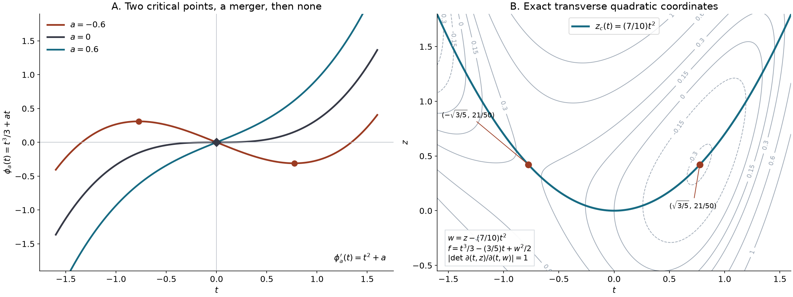

# Cubic collisions and uniform amplitudes

Two real critical points can merge and disappear. Expanding separately at each point then introduces coefficients that become singular at the merger. A smooth cubic coordinate instead gives two Airy profiles, with smooth amplitude coefficients on both sides of the collision. The same construction applies when one direction of a higher-dimensional Hessian degenerates and the remaining directions stay nondegenerate.

Throughout, phases are real and smooth, amplitudes may be complex, and \(\lambda\ge1\). Parameter estimates refer to compact subsets of a specified small parameter neighborhood. All supports in the integration variables lie in fixed compact subsets of their coordinate domains. A zero-dimensional integral is evaluation.

## Earlier proofs and the density convention

- [Classical finite-order preparation and division](classical-finite-order-preparation-and-division.md), S1–S42, F1–F42 and P1–P43, proves smooth division by a generic polynomial and by an original smooth divisor, including reality and linearity in the dividend. The remainder is polynomial in the original distinguished variable.
- [Smooth parameter flows](../prerequisites/U011-free-foundations/smooth-parameter-flows-U072.md), NF1–NF15, and [flow inverses and continuation](../prerequisites/U011-free-foundations/flow-inverses-and-continuation-U134.md), NF16–NF21, prove the local solutions, all parameter derivatives, continuation and inverse maps used below.
- [Regular level sets and transverse convolution](regular-level-sets-and-transverse-convolution.md), Lemmas 0.1–0.2, proves real inverse and implicit maps. [Zero hypersurfaces as curvature measures](zero-hypersurfaces-as-curvature-measures.md), Lemma 3.0, proves nonlinear substitution.
- [Finite-order phases and missing powers](finite-order-phases-and-missing-powers.md), Theorems 3 and 5 and Proposition 6, proves the scalar normalization, the entire Airy function and its two canonical integrals. [Polynomial phases and Fourier tails](polynomial-phases-and-fourier-tails.md), Theorem B and Solution 8, proves their Gaussian regularization with every frequency derivative.
- [Smooth quadratic coordinates](../prerequisites/U011-free-foundations/AN04-parameter-morse-U134.md), M1–M2 and P4–P5, proves the parameter Morse lemma and its Jacobian. [Finite stationary jets and quadratic exchange](finite-stationary-jets-and-quadratic-exchange.md), Theorem 1, proves the exact quadratic expansion and its differentiated-amplitude remainder.
- The [scalar](../prerequisites/U011-free-foundations/metric-foundation-bridges.md), §§12–13, [integration](../prerequisites/U011-free-foundations/banach-foundation-bridges.md), §§15–16, and [finite algebra](../prerequisites/U011-free-foundations/stable-prerequisite-bridges.md), §10, foundations supply the derivative, compactness, partition, integration and matrix rules.

Changing an integration coordinate always changes the amplitude by the absolute Jacobian. In particular, a decreasing scalar coordinate contributes a positive density factor.

## Division along a compact deformation

**Lemma 1.** Let \(m\ge1\), let \(s\) range in a neighborhood of \([0,1]\), and suppose a real smooth divisor \(d(z,s,y,A)\) satisfies
\[
 d(z,s,0,0)=\epsilon z^m,\qquad \epsilon\in\{-1,1\}.
 \tag{C1}
\]
Let \(h(z,y)\) be real smooth and identically zero for \(y=0\). On one neighborhood of
\(\{0\}\times[0,1]\times\{0\}\times\{0\}\), there are real smooth functions \(q\) and \(r_j\) such that
\[
 h(z,y)=d(z,s,y,A)q(z,s,y,A)
             +\sum_{j=0}^{m-1}r_j(s,y,A)z^j.
 \tag{C2}
\]
All these functions vanish when \(y=0\), including for nearby \(z,s,A\).

**Proof.** At each \((z,s,y,A)=(0,s_0,0,0)\), the distinguished \(z\)-order of \(d\) is \(m\). Apply the earlier original-divisor division theorem with auxiliary parameters \((s,y,A)\). Fix one actual common dividend neighborhood and one cutoff in \(z\) for this application. Its quotient and remainder depend linearly on the dividend. They are real for real data and smooth in all the auxiliary parameters.

The polynomial remainder here follows from P40–P43: divide the cutoff dividend by the prepared monic polynomial, and divide its quotient by the nonvanishing unit. Multiplying a polynomial remainder by that unit is not this division.

Finitely many parameter neighborhoods cover \([0,1]\). Shrink the \(z,y,A\) neighborhoods to common neighborhoods contained in every selected product and choose a smooth partition in \(s\), with each factor compactly supported inside its selected \(s\)-interval. Multiply each local identity by its factor and add. The factors sum to one on a neighborhood of \([0,1]\); extension by zero is smooth because their supports lie inside their intervals. This proves (C2) on the common product. For \(y=0\) the cutoff dividend is the zero function, for every \(s,A\). Linearity makes every local output zero there, and hence makes the sum zero. \(\square\)

## A polynomial phase without a multiplying unit

**Theorem 2.** Suppose \(f(t,y)\) is real smooth near \((0,0)\) and
\[
 \partial_t^j f(0,0)=0\ (1\le j<k),\qquad
 c=\partial_t^k f(0,0)\ne0,\qquad k\ge2.
 \tag{C3}
\]
Put \(\epsilon=\operatorname{sgn}c\). There is an increasing smooth coordinate \(T(t,y)\), and smooth real functions \(a_1,\ldots,a_{k-2},b\), such that
\[
 \begin{gathered}
 f(t,y)=b(y)+\epsilon T(t,y)^k/k
                    +\sum_{j=1}^{k-2}a_j(y)T(t,y)^j,\\
 T(0,0)=0,\qquad a_j(0)=0,\qquad b(0)=f(0,0).
 \end{gathered}
 \tag{C4}
\]
The empty sum for \(k=2\) is zero. There is no hypothesis that the distinguished order remains \(k\) for nearby \(y\). For odd \(k\), replacing \(T\) by \(\epsilon T\) makes the leading term positive and changes its orientation to \(\epsilon\).

**Proof.** Taylor's integral formula factors
\(f(t,0)-f(0,0)=t^k c_0(t)\), where \(c_0(0)=c/k!\).
On a smaller interval \(c_0\) has sign \(\epsilon\). The increasing coordinate
\(z=t(k|c_0(t)|)^{1/k}\) has a smooth inverse \(t=\tau_0(z)\), by the earlier scalar normalization. Thus
\[
 f(\tau_0(z),y)-f(0,0)=\epsilon z^k/k+h(z,y),
 \qquad h(z,0)=0.
 \tag{C5}
\]
Introduce independent real coordinates \(A=(A_1,\ldots,A_{k-2})\), with none when \(k=2\), and set
\[
 F_s(z,y,A)=\epsilon z^k/k+\sum_{j=1}^{k-2}A_jz^j+s h(z,y).
 \tag{C6}
\]
Its \(z\)-derivative has distinguished order \(k-1\) at \(y=A=0\), uniformly in \(s\). Lemma 1 gives
\[
 h=q\,\partial_zF_s+r_0+\sum_{j=1}^{k-2}r_jz^j.
 \tag{C7}
\]
Solve the following system, with \(y\) fixed and initial data \((z_0,A_0)\) at \(s=0\):
\[
 z'=-q(z,s,y,A),\qquad
 A_j'=-r_j(s,y,A).
 \tag{C8}
\]
These are actual smooth vector fields on an open product containing the compact \(s\)-interval. At \(y=0\) they vanish identically, so the constant trajectory \((z,A)=(0,0)\) exists throughout a neighborhood of \([0,1]\). The proved local flow and continuation theorem gives an open neighborhood of its initial data on which the solutions exist through \(s=1\), jointly smoothly in the initial data and \(y\). Concretely, cover the constant trajectory by finitely many local solution rectangles, subdivide \([0,1]\) subordinate to them, and shrink the initial-data neighborhood so the finite successive images stay in the next rectangles. Uniqueness identifies the successive solutions. This proves existence for the whole required interval rather than only for a small initial time.

The \(A\)-equation is independent of \(z\). Write its endpoint as \(A_1(y,A_0)\). At \(y=0\) it equals \(A_0\), so the real implicit theorem gives a smooth \(A_0=a(y)\) with
\[
 A_1(y,a(y))=0,\qquad a(0)=0.
 \tag{C9}
\]
In zero \(A\)-dimension this is the unique empty map. Denote this selected \(A\)-trajectory by \(A(s,y)\). The scalar \(z\)-flow has positive derivative in its initial coordinate:
\[
 \partial_{z_0}z(1;z_0,y)
   =\exp\!\left(-\int_0^1q_z(z(s),s,y,A(s,y))\,ds\right)>0.
 \tag{C10}
\]
Indeed its differentiated equation is the scalar homogeneous linear equation with coefficient \(-q_z\) and initial value one; the earlier flow theorem and scalar exponential solution give (C10). It therefore has a smooth local inverse in \(z_0\).

Along this trajectory, (C7)–(C8) give exactly
\[
 \frac{d}{ds}F_s(z(s),y,A(s,y))=r_0(s,y,A(s,y)).
 \tag{C11}
\]
The right side is independent of \(z_0\). Integrate from zero to one, use (C9), and invert the scalar endpoint map. Combining that inverse with the original increasing \(t\mapsto z\) gives \(T(t,y)\), and
\[
 b(y)=f(0,0)+\int_0^1r_0(s,y,A(s,y))\,ds.
 \tag{C12}
\]
The finite integral is smooth. At \(y=0\) all the division outputs vanish, the flow is the identity, and (C4) has its asserted mark values. The coordinate remains increasing by (C10). This proves the theorem. For \(k=1\) with nonzero first derivative, the direct coordinate \(T=f(t,y)-f(0,0)\) gives the corresponding linear conclusion by the inverse theorem. \(\square\)

For \(k=3\), use the positive leading term, with either orientation. The formula becomes
\[
 f(t,y)=b(y)+T(t,y)^3/3+a(y)T(t,y),\qquad
 |\partial_tT(0,0)|=(|f_{ttt}(0,0)|/2)^{1/3}.
 \tag{C13}
\]
Thus critical points satisfy \(T^2+a=0\). For small \(a<0\) there are two, for \(a=0\) one double critical point, and for \(a>0\) none in the chart. At the two points,
\[
 T_\pm=\pm\sqrt{-a},\qquad
 f_\pm=b\mp\tfrac23(-a)^{3/2},\qquad
 f_{tt}=2T_\pm T_t^2.
 \tag{C14}
\]
These identities follow by differentiating (C13); the last one is evaluated at a critical point.

## A cubic estimate uniform through the collision

**Lemma 3.** For every real \(a\), every \(v\in C_c^1(\mathbb R)\), and \(\lambda\ge1\),
\[
 \left|\int e^{i\lambda(t^3/3+at)}v(t)\,dt\right|
 \le C\lambda^{-1/3}\bigl(\|v\|_\infty+\|v'\|_1\bigr),
 \tag{C15}
\]
with an absolute constant.

**Proof.** For \(\eta>0\), the set
\(E=\{t:|t^2+a|\le\eta^2\}\) has length at most \(2\sqrt2\,\eta\).
If \(a\ge-\eta^2\), it lies in \(|t|\le\sqrt2\,\eta\).
If \(a<-\eta^2\), put \(b=-a>\eta^2\). Its length is
\[
 2\bigl(\sqrt{b+\eta^2}-\sqrt{b-\eta^2}\bigr)
 \le2\sqrt2\,\eta,
 \tag{C16}
\]
because this difference decreases in \(b\) and has its largest limiting value at \(b=\eta^2\). Thus the integral on \(E\) has the first term \(2\sqrt2\,\eta\|v\|_\infty\).

Split the complement further at zero. There are at most four intervals; on each, \(p(t)=t^2+a\) has constant sign, \(|p|\ge\eta^2\), and is monotone. Integrating by parts with \(\partial_t e^{i\lambda(t^3/3+at)}=i\lambda p e^{i\lambda(t^3/3+at)}\) gives boundary terms bounded by \(2\lambda^{-1}\eta^{-2}\|v\|_\infty\), a derivative-amplitude term bounded by \(\lambda^{-1}\eta^{-2}\|v'\|_1\), and a term with
\(\int|p'|/|p|^2\le2\eta^{-2}\), since it is the total variation of \(1/p\) on a monotone interval. Infinite endpoints contribute zero because \(v\) is compactly supported. Add the intervals and choose \(\eta=\lambda^{-1/3}\). Both resulting scales are \(\lambda^{-1/3}\), proving (C15). \(\square\)

## Two smooth amplitude sequences

Fix a compact smooth cutoff \(\chi\), equal to one on \([-\delta,\delta]\), and restrict \(|a|\le a_0<\min(\delta^2,1)\). Use the earlier Airy convention
\[
 \begin{aligned}
 K_0(\lambda,a)&=2\pi\lambda^{-1/3}\operatorname{Ai}(a\lambda^{2/3}),\\
 K_1(\lambda,a)&=\frac{2\pi}{i}\lambda^{-2/3}
                         \operatorname{Ai}'(a\lambda^{2/3}).
 \end{aligned}
 \tag{C17}
\]

**Theorem 4.** Let \(a=a(y)\) be real smooth with \(|a(y)|<a_0\), and let \(v(t,y)\) be smooth with fixed compact \(t\)-support. There are smooth complex functions \(\alpha_j(y),\beta_j(y)\), independent of \(\lambda\), such that for every \(N\ge1\),
\[
 \begin{aligned}
 \int e^{i\lambda(t^3/3+a(y)t)}v(t,y)\,dt
 &=K_0(\lambda,a(y))\sum_{j=0}^{N-1}\lambda^{-j}\alpha_j(y)\\
 &\quad+K_1(\lambda,a(y))\sum_{j=0}^{N-1}\lambda^{-j}\beta_j(y)
       +E_N(\lambda,y),\\
 |\partial_y^\gamma E_N(\lambda,y)|
 &\le C_{N,\gamma}\lambda^{|\gamma|-N-1/3}.
 \end{aligned}
 \tag{C18}
\]
The constants are uniform on compact parameter sets and depend on finite amplitude and phase seminorms. One choice of division operators and cutoff supplies the sequences for every \(N\). If \(v\) has compact support also in \(y\), both coefficient sequences have support in the projection of that support. Uniqueness of these sequences is not asserted.

**Proof: the cutoff profiles and their derivatives.** Proposition 6 of the earlier finite-order lesson gives
\(\int \chi e^{i\lambda(t^3/3+at)}=K_0+O(\lambda^{-M})\) and
\(\int t\chi e^{i\lambda(t^3/3+at)}=K_1+O(\lambda^{-M})\), for every \(M\), uniformly on this \(a\)-interval.
These errors are rapidly decreasing with every fixed \(a\)-derivative as well. Here is the additional justification needed for that statement.

For \(\ell=0,1\), insert \(e^{-\varepsilon t^2}\) in the full profile. The earlier Gaussian-regularization theorem identifies its limit and every \(a\)-derivative with those of \(K_\ell\). The \(r\)-th derivative of the difference from the cutoff integral is, in this limit, the tail with amplitude
\((i\lambda)^r t^{r+\ell}(1-\chi)e^{-\varepsilon t^2}\).
On its support \(|t^2+a|\) has a uniform positive lower bound. The transpose without its \(\lambda^{-1}\) factor is
\[
 {\cal T}_a b=i\,\partial_t\!\left(\frac{b}{t^2+a}\right).
 \tag{C19}
\]
On \(|t|\ge1\) it lowers a polynomial growth order by three. Uniformly for \(\varepsilon>0\),
\(|\partial_t^h e^{-\varepsilon t^2}|\le C_h|t|^{-h}\) there: put \(u=\sqrt\varepsilon\,t\) in the differentiated Gaussian and bound the resulting polynomial times \(e^{-u^2}\).
After \(L\) integrations by parts the integrand is therefore bounded, on the tails, by \(C|t|^{r+\ell-3L}\), independently of \(\varepsilon,a\); on the remaining compact set it is uniformly bounded. Choose \(3L>r+\ell+1\).
Dominated convergence passes to \(\varepsilon=0\), including all terms where a Gaussian derivative falls: those derivatives tend pointwise to zero. Boundary terms vanish for each \(\varepsilon>0\). The result is bounded by \(C\lambda^{r-L}\). Since \(L\) can be arbitrarily large, this proves the asserted rapid errors for every fixed \(r\), and hence after composition with \(a(y)\). This argument uses regularized higher moments, rather than claiming that all high real improper moments converge.

**Proof: a fixed recursion.** Set \(v_0=v\). Apply the earlier global real-variable generic division, F4, with degree two, coefficients \((a(y),0)\), and auxiliary parameter \(y\):
\[
 v_j(t,y)=(t^2+a(y))q_j(t,y)+A_j(y)+tB_j(y).
 \tag{C20}
\]
Its operators are fixed, complex-linear and smooth with all finite differentiated estimates. Define
\[
 v_{j+1}=\partial_t(\chi q_j),\qquad
 e_j=(1-\chi)v_j,\qquad
 \alpha_j=i^j A_j,\quad\beta_j=i^j B_j.
 \tag{C21}
\]
All \(v_j\) for \(j\ge1\) have support inside \(\operatorname{supp}\chi\); together with the fixed support of \(v_0\), this is one common compact set. Smooth division followed by differentiation gives finite seminorm bounds at each finite stage. The amplitudes \(e_j\) vanish for \(|t|\le\delta\), where both possible critical points lie.

Write \(J(w)=\int e^{i\lambda(t^3/3+a t)}w(t)\,dt\). Multiplication of (C20) by \(\chi\), followed by one integration by parts, gives the exact recurrence
\[
 J(v_j)=A_jJ(\chi)+B_jJ(t\chi)
                    +\frac i\lambda J(v_{j+1})+J(e_j).
 \tag{C22}
\]
The term \(J(e_j)\) is retained: later \(v_j\) need not have support where \(\chi=1\).
Every \(J(e_j)\) is rapidly decreasing, with fixed parameter derivatives, by repeated use of (C19) on a compact nonstationary support. Each parameter differentiation costs at most one power of \(\lambda\), absorbed by increasing the number of integrations.

Iterate (C22) exactly \(N\) times and insert the cutoff profiles. This yields the two finite sums in (C18), plus rapid errors and \((i/\lambda)^NJ(v_N)\). Lemma 3 bounds the last term by \(C\lambda^{-N-1/3}\).
After \(\gamma\) parameter derivatives, the integral is a finite sum of at most \(|\gamma|\) powers of \(\lambda\), with compact smooth amplitudes made from derivatives of \(a,v_N\) and powers of \(t\). Apply Lemma 3 to each. This proves the last line of (C18).

The same fixed recursion defines all coefficients, independently of the requested stopping order. For any \(y\) at which the input is identically zero in \(t\), linearity makes every later input and coefficient zero there. Smoothness then proves the compact-support assertion. \(\square\)

At a parameter where \(a=0\), the earlier division normalization gives
\[
 A_j=v_j(0,y),\qquad B_j=\partial_t v_j(0,y),\qquad
 q_j(t,y)=\frac{v_j(t,y)-A_j-tB_j}{t^2},
 \tag{C23}
\]
with the quotient's smooth Taylor value at zero. For \(a<0\), put \(r=\sqrt{-a}\). Evaluation at the two roots gives the exact interpolation formulas
\[
 A_j=\frac{v_j(r,y)+v_j(-r,y)}2,\qquad
 B_j=\frac{v_j(r,y)-v_j(-r,y)}{2r}.
 \tag{C24}
\]
The smooth division construction supplies their extension through \(a=0\) and onto \(a>0\).

## General one-dimensional cubic phases

**Corollary 5.** Suppose \(f_t(0,0)=f_{tt}(0,0)=0\) and \(f_{ttt}(0,0)\ne0\). For a compact smooth amplitude \(u\) supported sufficiently near the origin, there are smooth \(a,b,\alpha_j,\beta_j\), with \(a(0)=0\) and \(b(0)=f(0,0)\), such that
\[
 \begin{aligned}
 \int e^{i\lambda f(t,y)}u(t,y)\,dt
 &=e^{i\lambda b(y)}\\
 &\quad{}\times\Bigl[
 K_0(\lambda,a(y))\sum_{j<N}\lambda^{-j}\alpha_j(y)\\
 &\qquad{}+K_1(\lambda,a(y))\sum_{j<N}\lambda^{-j}\beta_j(y)
 +E_N(\lambda,y)\Bigr].
 \end{aligned}
 \tag{C25}
\]
The normalized error has the bounds in (C18). The coefficients are compactly supported in the amplitude's parameter projection. In particular,
\[
 \alpha_0(0)=u(0,0)\left(\frac2{|f_{ttt}(0,0)|}\right)^{1/3}.
 \tag{C26}
\]

**Proof.** Theorem 2 gives (C13), including when the coordinate decreases. Choose smaller coordinate and parameter products whose closures stay inside its inverse domain, and take the amplitude support inside their image. With \(t=\tau(T,y)\), substitution gives the compact smooth transformed amplitude
\[
 v(T,y)=u(\tau(T,y),y)|\partial_T\tau(T,y)|.
 \tag{C27}
\]
Its zero extension is smooth because its support lies strictly inside that inverse domain. Shrink the parameter neighborhood so that \(|a(y)|<a_0\), choose the cutoff of Theorem 4, and apply it to (C27). This proves (C25) and every stated bound. At \(y=0\), (C23) gives \(\alpha_0=v(0,0)\), and (C13) gives (C26). Derivatives of the unnormalized factor \(e^{i\lambda b}\) may cost further powers of \(\lambda\); the stated estimate explicitly removes that factor. \(\square\)

## One cubic direction and nondegenerate transverse directions

**Theorem 6.** Let \(f(x,y)\) be real smooth near zero, with \(x\in\mathbb R^n\), \(n\ge1\), and suppose
\[
 \begin{gathered}
 f_x(0,0)=0,\qquad \operatorname{rank} f_{xx}(0,0)=n-1,\\
 D_x^3f(0,0)[X,X,X]\ne0
       \quad\text{for a nonzero }X\in\ker f_{xx}(0,0).
 \end{gathered}
 \tag{C28}
\]
The last condition then holds for every nonzero vector in this one-dimensional kernel. Put \(d=n-1\). There are smooth real \(a,b\), with \(a(0)=0\), \(b(0)=f(0,0)\), an integer \(\sigma\), and smooth compactly supported amplitude coefficients \({\cal A}_j,{\cal B}_j\) such that
\[
 \begin{aligned}
 \int e^{i\lambda f(x,y)}u(x,y)\,dx
 &=e^{i\lambda b(y)}(2\pi)^{d/2}e^{i\pi\sigma/4}\lambda^{-d/2}\\
 &\quad{}\times\Bigl[
 K_0(\lambda,a(y))\sum_{j<N}\lambda^{-j}{\cal A}_j(y)\\
 &\qquad{}+K_1(\lambda,a(y))\sum_{j<N}\lambda^{-j}{\cal B}_j(y)
 +{\cal E}_N(\lambda,y)\Bigr],\\
 |\partial_y^\gamma{\cal E}_N(\lambda,y)|
 &\le C_{N,\gamma}\lambda^{|\gamma|-N-1/3}.
 \end{aligned}
 \tag{C29}
\]
Here \(u\) is smooth with compact support sufficiently close to zero. The integer \(\sigma\) is the signature of the transverse Hessian in the construction below.

**Proof: the intrinsic cubic condition.** For any smooth curve \(x(s)\) with \(x(0)=0\) and \(x'(0)=X\), the full third derivative is
\[
 \left.\frac{d^3}{ds^3}f(x(s),0)\right|_{s=0}
 =D^3f[X,X,X]+3f_{xx}[X,x''(0)]+f_x\,x'''(0).
 \tag{C30}
\]
The last two terms vanish under (C28). Thus the nonzero condition is unchanged by smooth coordinate changes and by the chosen curve with that initial tangent. Scaling a nonzero kernel vector multiplies the cubic value by its nonzero scalar cube.

Choose an orthogonal linear coordinate system \(x=(t,z)\) with unit kernel vector in the \(t\)-direction. The restriction \(H_\perp=f_{zz}(0,0)\) is invertible: a vector in its kernel pairs to zero with the complement and also with the full Hessian kernel, so it lies in the full kernel and in its orthogonal complement, hence is zero. The implicit theorem gives a smooth \(z=z_c(t,y)\) solving \(f_z=0\). Put
\[
 h(t,y)=f(t,z_c(t,y),y).
 \tag{C31}
\]
At the origin, \(\partial_tz_c=-H_\perp^{-1}f_{zt}=0\), since the \(t\)-direction is a kernel vector. The chain rule gives \(h_t=h_{tt}=0\); applying (C30) to the graph curve gives \(h_{ttt}=f_{ttt}\ne0\).

**Proof: an exact transverse quadratic.** Apply the supplied parameter Morse lemma in \(z\), with \((t,y)\) as its parameters. After shrinking,
\[
 \begin{gathered}
 z=Z(w,t,y),\qquad
 f(t,Z(w,t,y),y)=h(t,y)+\tfrac12 w^TJw,\\
 J=\operatorname{diag}(\sigma_1,\ldots,\sigma_d),\quad
 \sigma_j\in\{-1,1\},\quad \sigma=\sum_j\sigma_j,\\
 |\det Z_w(0,t,y)|
   =|\det f_{zz}(t,z_c(t,y),y)|^{-1/2}.
 \end{gathered}
 \tag{C32}
\]
The full substitution \((t,w)\mapsto(t,Z(w,t,y))\) has block triangular derivative, with this transverse determinant. The preceding orthogonal map has absolute determinant one. Choose the amplitude inside a precompact chart image. Its transformed density
\(B(w,t,y)=u(t,Z(w,t,y),y)|\det Z_w(w,t,y)|\)
then extends smoothly by zero, with common compact support in \((w,t)\).

The earlier quadratic expansion, with fixed matrix \(J\), gives
\[
 \begin{aligned}
 \int e^{i\lambda w^TJw/2}B(w,t,y)\,dw
 &=(2\pi)^{d/2}e^{i\pi\sigma/4}\lambda^{-d/2}\\
 &\quad{}\times\left[\sum_{j<N}\lambda^{-j}b_j(t,y)+R_N(t,y,\lambda)\right],\\
 b_j&=\frac{(i/2)^j}{j!}\Delta_J^j B(0,t,y),\qquad
 \Delta_J=\sum_{\ell=1}^d\sigma_\ell\partial_{w_\ell}^2.
 \end{aligned}
 \tag{C33}
\]
Every fixed \((t,y)\)-derivative of \(R_N\) is bounded by \(C\lambda^{-N}\), uniformly on the fixed compact support. This follows by applying the quadratic theorem to that derivative of \(B\): the phase \(J\) is parameter independent, so differentiation acts only on the amplitude. The remainder is supported in the same compact \(t,y\)-projection, since it is the difference of the actual integral and its local coefficients.

**Proof: combine the two expansions with their errors.** Apply Corollary 5 to the reduced phase \(h\). Its change \(t=\tau(T,y)\) turns each \(b_j\) into a compact amplitude \(v_j(T,y)\), with the absolute derivative factor. Apply the fixed recursion of Theorem 4 to each \(v_j\). If its sequences are \(\alpha_\nu[v_j],\beta_\nu[v_j]\), define
\[
 {\cal A}_l=\sum_{j+\nu=l}\alpha_\nu[v_j],\qquad
 {\cal B}_l=\sum_{j+\nu=l}\beta_\nu[v_j].
 \tag{C34}
\]
For each \(j<N\), stop its expansion at depth \(N-j\). After multiplication by \(\lambda^{-j}\), its error is \(O(\lambda^{-N-1/3})\), with differentiated error \(O(\lambda^{|\gamma|-N-1/3})\).
The transformed \(R_N\), and every fixed \(T,y\)-derivative of it, are \(O(\lambda^{-N})\). Lemma 3 applied to it gives the same value error. After parameter differentiation, each phase derivative supplies at most one additional factor of \(\lambda\), and Lemma 3 again gives the stated differentiated order. Compact Fubini justifies performing the transverse integral first. Summing the finite collection of errors proves (C29).

For \(d=0\), the transverse integral is evaluation, \(b_0=B\), all \(b_j\) for \(j>0\) vanish, and the transverse remainder is zero. This gives exactly Corollary 5 and includes \(n=1\) without an empty-matrix norm estimate. \(\square\)

For a unit kernel vector \(X\), put \(c=D^3f[X,X,X]\). At the central parameter the leading coefficient is
\[
 {\cal A}_0(0)
   =\frac{u(0,0)}{|\det H_\perp|^{1/2}}
                   \left(\frac2{|c|}\right)^{1/3}.
 \tag{C35}
\]
This is (C26) applied to \(b_0\), followed by the Jacobian in (C32). Reversing the unit kernel vector leaves it unchanged.

*Left: the exact curves \(t^3/3+at\) for \(a=-3/5,0,3/5\), with their critical points. Right: contours of \(f(t,z)=t^3/3-(3/5)t+(z-(7/10)t^2)^2/2\). The curve \(z=(7/10)t^2\) is the transverse critical graph. The exact coordinate \(w=z-(7/10)t^2\) has Jacobian one and reduces the phase to a cubic plus \(w^2/2\). Its two full critical points are \((\pm\sqrt{3/5},21/50)\). Curves and contours are numerical samples of these stated polynomials; (C14) and (C31)–(C32) give the exact mechanism.*

## Exercises with complete solutions

**Exercise 1 (first calculation).** Find the cubic coordinate, \(a\), and \(b\) for
\[
 f(t)=t^3/3+\alpha t^2/2+\beta t+\gamma.
 \tag{C36}
\]
Locate its merger set and both critical values.

**Solution.** Substitution of \(T=t+\alpha/2\) and expansion of its cube gives
\[
 a=\beta-\alpha^2/4,\qquad
 b=\gamma-\alpha\beta/2+\alpha^3/12.
 \tag{C37}
\]
There is a merger when \(a=0\), or \(\beta=\alpha^2/4\). For \(a<0\), the points are \(t_\pm=-\alpha/2\pm\sqrt{-a}\) and their values are \(b\mp2(-a)^{3/2}/3\), by (C14). For \(a>0\) the derivative \((t+\alpha/2)^2+a\) is strictly positive.

**Exercise 2 (orientation and first coefficients).** Let \(c>0\) and \(f(t)=-ct^3/3\). For compact smooth \(u\), determine \(\alpha_0,\beta_0\) at this merger using the positive cubic coordinate. Explain the density sign.

**Solution.** Take \(T=-c^{1/3}t\), with inverse \(\tau(T)=-c^{-1/3}T\). The transformed amplitude is \(v(T)=c^{-1/3}u(-c^{-1/3}T)\), so
\[
 \alpha_0=c^{-1/3}u(0),\qquad
 \beta_0=-c^{-2/3}u'(0).
 \tag{C38}
\]
The density is \(c^{-1/3}>0\). The minus sign in \(\beta_0\) comes from differentiating \(u\), not from an oriented volume element. With \(N=1\), (C18) has error \(O(\lambda^{-4/3})\). The absence of a \(\lambda^{-1}\) term agrees with the missing cubic jet of degree two.

**Exercise 3 (a surviving cutoff error).** In the recursion (C21), explain why \(\operatorname{supp}v_j\subset\operatorname{supp}\chi\) does not imply \(\chi v_j=v_j\). Prove that the retained error remains rapidly decreasing with every fixed parameter derivative.

**Solution.** On the transition region \(0<\chi<1\), the derivative \(\partial_t(\chi q_{j-1})\) can be nonzero, so \((1-\chi)v_j\) need not vanish. Its support is compact and lies in \(|t|\ge\delta\). There \(t^2+a\ge\delta^2-a_0>0\). Applying (C19) \(L\) times to a compact amplitude gives a factor \(\lambda^{-L}\), with no endpoint terms; every resulting differentiated amplitude has a uniform finite integral norm. A fixed \(r\)-th parameter derivative produces only finitely many terms with powers at most \(\lambda^r\). Taking \(L\ge M+r\) bounds their sum by \(C_{M,r}\lambda^{-M}\). Thus the exact error in (C22) has the required size at every finite stage.

**Exercise 4 (a curved corank-one model).** For
\[
 f(t,z,a)=t^3/3+at+\tfrac12(z-\kappa t^2)^2,\qquad \kappa\in\mathbb R,
 \tag{C39}
\]
verify (C28) at \((t,z,a)=0\), find an exact transverse reduction, and compute the leading term at \(a=0\) for a compact smooth amplitude \(u(t,z,a)\).

**Solution.** The transverse derivative is \(f_z=z-\kappa t^2\). Its zero graph is \(z_c=\kappa t^2\); on this graph the reduced phase is \(t^3/3+at\). At zero the full gradient vanishes, the Hessian is \(\operatorname{diag}(0,1)\), and the third derivative in the unit kernel direction is \(2\). The substitution \(w=z-\kappa t^2\) has determinant one, so \(J=(1)\), \(\sigma=1\), and the transformed amplitude is \(B(w,t,a)=u(t,w+\kappa t^2,a)\). Consequently \({\cal A}_0(0)=u(0,0,0)\). Equations (C17) and (C29) give
\[
 \int e^{i\lambda f(t,z,0)}u(t,z,0)\,dt\,dz
 =(2\pi)^{3/2}e^{i\pi/4}\operatorname{Ai}(0)u(0,0,0)
                  \lambda^{-5/6}+O(\lambda^{-7/6}).
 \tag{C40}
\]
The error includes the next Airy-derivative term of order \(\lambda^{-1/2-2/3}\); with \(N=1\), the error after both profiles is smaller, \(O(\lambda^{-11/6})\). The value \(\operatorname{Ai}(0)>0\) and its exact gamma expression are proved in the earlier finite-order lesson. For \(a<0\), the full critical points are \(t_\pm=\pm\sqrt{-a}\), \(z_\pm=-\kappa a\), and their critical values are \(\mp2(-a)^{3/2}/3\). These formulas also verify the figure.

## References and credit

Lars Hörmander, *The Analysis of Linear Partial Differential Operators I: Distribution Theory and Fourier Analysis*, second edition, Springer, 2003, Theorem 7.5.13 and Theorems 7.7.18–7.7.19, pp. 204–205 and 234–236. The earlier programme proofs used here are linked in the first section.

Original exposition, proofs, examples, exercises, solutions and illustration: GPT-6 Astra (OpenAI), October 2026. CC0 1.0 Universal to the extent rights exist. Earlier programme components retain their stated authorship and terms.
