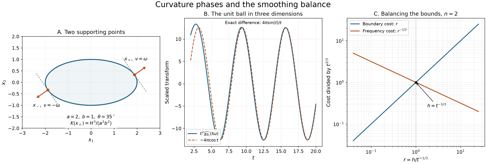

# Curvature, two boundary points and lattice counts

The Fourier transform of a curved surface receives its leading contributions where the frequency is normal to the surface. For a smooth convex body of positive curvature, there are exactly two such boundary points in each direction. Their phases and curvature factors yield a decay estimate. After smoothing the indicator, that estimate controls the error in counting lattice points in large dilates.

We use
\[
 \widehat v(\xi)=\int e^{-ix\cdot\xi}v(x)\,dx,\qquad
 d=n-1,\qquad n\ge2.
 \tag{C1}
\]
Surface transforms use the same kernel and Euclidean surface measure. All constants below are independent of the unit frequency direction.

## Earlier proofs

- [Paired variables and stationary parameters](paired-variables-and-stationary-parameters.md), Proposition 1, proves stationary phase uniformly near a moving nondegenerate real critical point, including its signature and leading coefficient. Its remainder is \(O(t^{-k})\); we take \(k>1+d/2\) before keeping only the leading term.
- [Regular level sets and transverse convolution](regular-level-sets-and-transverse-convolution.md), Lemmas 0.1–0.2 and Theorem 1.1, proves smooth inverse maps, implicit coordinates and the Gram density of surface measure. The complete earlier AN-03 inverse proof is also supplied as [Smooth inverse and implicit maps](../prerequisites/U011-free-foundations/implicit-maps-U070.md), §§16.4–16.5.
- [Boundary flux and weak identities](boundary-flux-and-weak-identities.md), Theorem 2.1, proves \(\nabla\chi_X=-\nu\,dS\) for the outward normal \(\nu\), including the compatibility of surface measures. [Zero hypersurfaces as curvature measures](zero-hypersurfaces-as-curvature-measures.md), Lemma 3.0, supplies nonlinear change of variables.
- [Resolvent sampling and positive periodization](resolvent-sampling-and-positive-periodization.md), Lemma 0.1, proves smooth periodic Fourier expansion and uniqueness in every dimension. [Schwartz Fourier foundations](../prerequisites/U011-free-foundations/schwartz-fourier-foundations-U017.md), F1–F4, supplies Fourier differentiation and rapid decrease. [Convolution as addition of supports](convolution-as-addition-of-supports.md), B0–B2 and Theorem 1.1, supplies compact partitions, smoothing and convolution.
- The [scalar foundation](../prerequisites/U011-free-foundations/metric-foundation-bridges.md), §§12–13, and [integration foundation](../prerequisites/U011-free-foundations/banach-foundation-bridges.md), §§15–16, prove compactness, Taylor estimates, cutoffs, Fubini and dominated convergence. The [real symmetric diagonalization](point-sources-and-complex-gaussian-kernels.md), Section 2, and [finite algebra foundation](../prerequisites/U011-free-foundations/stable-prerequisite-bridges.md), §10, supply the matrix arguments.

## Normal directions and the phase Hessian

Let \(\Sigma\subset\mathbb R^n\) be a smooth embedded hypersurface without boundary near the compact set under consideration. A local parametrization \(q:V\subset\mathbb R^d\to\Sigma\) has linearly independent tangent vectors \(q_j\). A local smooth unit normal \(\nu\) exists: on a graph chart, normalize \((-\nabla g,1)\), and use the appropriate orthogonal coordinate map.

Define the Gram matrix and the normal derivative by
\[
 g_{jk}=q_j\cdot q_k,\qquad
 S_\nu(v)=D_v\nu\quad(v\in T_x\Sigma).
 \tag{C2}
\]
This sign convention makes \(S_\nu=R^{-1}I\) on a sphere of radius \(R\) with its outward normal. Set
\[
 \kappa(x)=|\det S_\nu(x)|.
 \tag{C3}
\]
Changing the normal changes \(S_\nu\) to \(-S_\nu\), so \(\kappa\) does not depend on that choice.

**Lemma 1.** The map \(S_\nu\) is tangent-valued and self-adjoint for the Euclidean tangent metric. If \(\kappa(x)\ne0\), the normal map is a local diffeomorphism onto the unit sphere. For a unit vector \(\omega\), the phase
\[
 \phi(s,\omega)=-q(s)\cdot\omega
 \tag{C4}
\]
is critical in \(s\) exactly when \(\omega\) is normal to the surface. At such a point, choose the local normal with \(\nu(x)=\omega\). Then
\[
 H_{jk}=\partial_j\partial_k\phi
      =-\omega\cdot q_{jk}
      =\partial_j\nu\cdot q_k,\qquad
 |\det H|=\det(g)\,\kappa(x).
 \tag{C5}
\]
The signature of \(H\) is the signature of \(S_\omega\), denoted \(\sigma_\omega(x)\).

**Proof.** Differentiating \(\nu\cdot\nu=1\) gives \(D_v\nu\perp\nu\), so \(D_v\nu\) is tangent. Differentiate \(\nu\cdot q_k=0\) in \(s_j\):
\[
 \partial_j\nu\cdot q_k=-\nu\cdot q_{jk}.
 \tag{C6}
\]
The right side is symmetric in \(j,k\), proving self-adjointness. The derivative of the normal map is exactly \(S_\nu\), now regarded as a map between the two tangent spaces \(\nu^\perp\). If its determinant is nonzero, apply the earlier inverse theorem in a surface chart and a sphere chart. Sphere charts are, for example, graphs of one coordinate as either square root of \(1-\sum_{j<n}\omega_j^2\), where that coordinate is nonzero.

The first derivatives of (C4) are \(-q_j\cdot\omega\). Their simultaneous vanishing says that \(\omega\) is perpendicular to the tangent space. At a critical point, (C6) proves the Hessian identity. In coordinates it is the matrix of the self-adjoint operator \(S_\omega\) paired with the metric \(g\); taking determinants gives \(\det H=\det(g)\det S_\omega\).

Choose an orthonormal tangent basis by the finite Gram procedure. The resulting change of basis changes \(H\) by a real congruence into the matrix of \(S_\omega\). Congruence preserves the positive and negative indices: maximal dimensions of subspaces on which a form is strictly positive or strictly negative are unchanged by an invertible map. Diagonalization identifies those dimensions with the numbers of positive and negative eigenvalues. This proves the signature assertion. \(\square\)

## A surface transform and all its normal contributions

**Theorem 2.** Let \(a\) be a smooth compactly supported function on \(\Sigma\), and suppose \(\kappa>0\) on a neighborhood of its support. Define
\[
 U(\xi)=\int_\Sigma a(x)e^{-ix\cdot\xi}\,dS(x).
 \tag{C7}
\]
For every unit \(\omega\) there are only finitely many points in \(\operatorname{supp}a\) where \(\omega\perp T_x\Sigma\). Uniformly in \(\omega\) and \(t\ge1\),
\[
 \left|
 t^{d/2}U(t\omega)
 -(2\pi)^{d/2}
   \sum_{\substack{x\in\operatorname{supp}a\\
                    \omega\perp T_x\Sigma}}
    a(x)\kappa(x)^{-1/2}
       e^{-itx\cdot\omega+i\pi\sigma_\omega(x)/4}
 \right|\le \frac{C}{t}.
 \tag{C8}
\]
A zero value of \(a\) contributes zero, including when a normal point lies on the boundary of its support. No global orientation of \(\Sigma\) is assumed.

**Proof: local stationary points.** In a chart the amplitude is
\[
 b(s)=a(q(s))\sqrt{\det g(s)}.
 \tag{C9}
\]
By Lemma 1, a normal point is a nondegenerate critical point, and the inverse normal map follows it smoothly as \(\omega\) varies near its given direction. The earlier real stationary theorem applies on a sufficiently small fixed chart. Its leading factor is
\[
 (2\pi/t)^{d/2}
 \frac{b(s_\omega)}{|\det H(s_\omega)|^{1/2}}
 e^{-itq(s_\omega)\cdot\omega+i\pi\sigma_\omega/4}.
 \tag{C10}
\]
The ratio in this expression equals \(a(x)\kappa(x)^{-1/2}\), by (C5).

Take its expansion at an integer depth \(k>1+d/2\). Every retained term of index \(j\ge1\) is \(O(t^{-1-d/2})\), since its coefficient is uniformly bounded on the smaller compact parameter patch. The remainder \(O(t^{-k})\) has that bound too. Thus the local leading expansion has the asserted absolute error. This argument uses the actual remainder of the earlier theorem.

**Proof: compactness gives a uniform sum.** Write \(K=\operatorname{supp}a\). The normal incidence set
\[
 \mathcal N=\{(x,\omega)\in K\times S^{n-1}:
                         \omega\perp T_x\Sigma\}
 \tag{C11}
\]
is compact. To see closedness, work in any chart about a limit point and pass to the limit in \(q_j\cdot\omega=0\). Every fiber over \(\omega\) is discrete by the inverse normal map. It is a closed subset of compact \(K\), so it is finite: an infinite such subset would have an accumulation point in \(K\), contradicting local injectivity of either choice of normal.

Cover \(\mathcal N\) by finitely many smaller product neighborhoods where the local stationary argument just given applies. Complete these to a finite cover of \(K\times S^{n-1}\) by adding coordinate neighborhoods away from \(\mathcal N\), and choose a smooth partition on a neighborhood of this compact set. Compact chart cutoffs from the earlier partition construction give this partition after dividing by their positive sum. Each stationary piece has its critical branch on a common parameter neighborhood; its amplitude can be extended by zero where that branch meets no support.

For each remaining piece the coordinate gradient of \(\phi\) has a positive lower bound. Indeed it is nonzero on a compact set. The operator
\[
 L=\frac{\nabla_s\phi\cdot\nabla_s}
          {it|\nabla_s\phi|^2},\qquad Le^{it\phi}=e^{it\phi},
 \tag{C12}
\]
integrates by parts without boundary terms. Every derivative of its coefficients is \(O(t^{-1})\) on that piece; the product rule gives \(O(t^{-M})\) after \(M\) iterations, uniformly in direction. There are finitely many pieces, so choose \(M>1+d/2\).

Sum their expansions. At each normal point the partition weights add to one. This gives exactly (C8), even where individual cutoffs vanish. Taking the maximum of finitely many constants proves uniformity on the full unit sphere. \(\square\)

The phase sign in (C8) can also be read from centers of curvature. With our convention \(S_\omega=D\omega\), a principal eigenvalue \(s\ne0\) has signed center displacement \(-\omega/s\). Thus \(\sigma_\omega\) counts centers toward \(-\omega\) minus centers toward \(\omega\). This explains the sign when the opposite center-count convention is used.

In dimension \(n=1\), a smooth hypersurface is locally discrete. Its compactly supported density has finite support, and surface measure is counting measure. The empty curvature determinant is one and the empty Hessian has signature zero. The transform is exactly \(\sum_{x\in\operatorname{supp}a}a(x)e^{-itx\omega}\), so the corresponding zero-dimensional form of (C8) has zero remainder.

## A convex boundary has exactly two relevant points

Let \(X\) be a bounded nonempty open convex subset of \(\mathbb R^n\) with smooth boundary. Suppose the outward normal derivative has nonzero determinant everywhere on \(\partial X\). For a convex set this condition is equivalent to positive principal curvatures with our convention, as the next proof shows. Write
\[
 K(x)=\det S_\nu(x)>0,\qquad x\in\partial X,
 \tag{C13}
\]
once positivity has been established.

**Lemma 3.** For every unit \(\omega\), there is exactly one boundary point \(x_+(\omega)\) with outward normal \(\omega\), and exactly one \(x_-(\omega)\) with outward normal \(-\omega\). They depend smoothly on \(\omega\). At these points the Hessian signatures in (C8) are \(d\) and \(-d\), respectively. The curvatures have a positive lower bound on the whole boundary.

**Proof: supporting planes and positivity.** At a boundary point translate and rotate so the point is zero, the outward normal is \(e_n\), and locally \(X\) is below a graph \(x_n=g(x')\), with \(g(0)=0\) and \(\nabla g(0)=0\). Every \(z\in X\) satisfies \(z_n\le0\). Otherwise the points \(sz\), for small \(s>0\), belong to \(X\) and have height \(sz_n>g(sz')=O(s^2)\), a contradiction.

Here is the segment fact used in that argument. If \(x\in\overline X\), \(z+B_r\subset X\) and \(0<s\le1\), convexity gives balls of radius \(sr\) about \((1-s)x_j+sz\) for any \(x_j\in X\) tending to \(x\). Every point strictly within the limiting ball belongs to one of those balls for large \(j\). Thus \((1-s)x+sz\in X\). The supporting inequality extends from \(X\) to \(\overline X\) by continuity.

Consequently the local graph satisfies \(g\le0\), so \(D^2g(0)\) is nonpositive. Formula (C6) gives \(S_\nu=-D^2g(0)\) in these orthonormal tangent coordinates. It is nonnegative and nonsingular, hence positive definite by real diagonalization. The same holds at every boundary point.

**Proof: existence and uniqueness.** The linear functional \(x\mapsto x\cdot\omega\) has a maximum and a minimum on compact \(\overline X\). Neither extremum is interior, since a small movement in the \(\omega\) direction remains in \(X\) at any interior point. At a maximum the tangent derivatives vanish, and the supporting side determines the outward normal as \(\omega\); at a minimum it is \(-\omega\).

Two distinct maximizers would have their entire joining segment in \(\overline X\) and in the same supporting plane. This segment lies in \(\partial X\), since an interior point cannot maximize a nonconstant linear functional. At an interior point of the segment, take its nonzero constant tangent velocity \(v\). Differentiating \(\nu\cdot v=0\) along the segment gives
\[
 (D_v\nu)\cdot v=0,
 \tag{C14}
\]
contradicting positive definiteness. The minimum is unique by the same argument. Conversely any point with outward normal \(\omega\) maximizes that functional by the supporting inequality already proved. Hence these are the only two normal points.

The normal map is locally invertible by Lemma 1. Its locally smooth inverses agree with the unique global choices, so \(x_\pm\) are smooth on sphere charts. Positivity and compactness give \(\min_{\partial X}K>0\). Finally \(S_\omega=S_\nu\) at \(x_+\) and \(S_\omega=-S_\nu\) at \(x_-\), giving the two signatures. \(\square\)

## The indicator transform and its signs

**Corollary 4.** Under the hypotheses of Lemma 3, uniformly for \(|\omega|=1\) and \(t\ge1\),
\[
 \begin{split}
 \widehat{\chi_X}(t\omega)
 &=(2\pi)^{d/2}t^{-(n+1)/2}
 \bigl[
 K(x_+)^{-1/2}e^{-itx_+\cdot\omega+i\pi(n+1)/4}\\
 &\hspace{44mm}
 +K(x_-)^{-1/2}e^{-itx_-\cdot\omega-i\pi(n+1)/4}
 \bigr]+O(t^{-(n+3)/2}).
 \end{split}
 \tag{C15}
\]
In particular
\[
 |\widehat{\chi_X}(\xi)|\le C(1+|\xi|)^{-(n+1)/2}.
 \tag{C16}
\]

**Proof.** The earlier boundary derivative, with outward normal, is \(\partial_j\chi_X=-\nu_jdS\). Fourier differentiation and the sum against \(\omega_j\) give
\[
 it\,\widehat{\chi_X}(t\omega)
   =-\int_{\partial X}(\omega\cdot\nu(x))
                          e^{-it\omega\cdot x}\,dS(x).
 \tag{C17}
\]
These Fourier operations are valid for compactly supported distributions; one may equivalently insert a smooth cutoff equal to one near \(\overline X\) when testing the boundary identity.

Apply Theorem 2 to the bounded smooth amplitude family \(a_\omega(x)=\omega\cdot\nu(x)\). The proof of that theorem includes such smooth parameter amplitudes: its finite chart derivatives are bounded on the compact direction set. At \(x_+\) this amplitude is \(1\), and at \(x_-\) it is \(-1\). Division of (C17) by \(it\) multiplies the surface transform by \(i/t\). Therefore
\[
 i e^{i\pi d/4}=e^{i\pi(n+1)/4},\qquad
 -i e^{-i\pi d/4}=e^{-i\pi(n+1)/4}.
 \tag{C18}
\]
The surface error \(O(t^{-1-d/2})\) becomes \(O(t^{-2-d/2})\), proving (C15). The curvature factors are uniformly bounded by Lemma 3. For bounded \(\xi\), use \(|\widehat{\chi_X}(\xi)|\le |X|\); this completes (C16). \(\square\)

For \(n=1\) and \(X=(\alpha,\beta)\), direct integration gives \(\widehat{\chi_X}(t)=(e^{-it\alpha}-e^{-it\beta})/(it)\). The two endpoint contributions in (C15), with empty curvature determinant one and phase shifts \(\pm\pi/2\), give this exact identity; reflection gives the other unit direction.

## Smooth summation and the two smoothing errors

**Lemma 5.** For \(v\in C_c^\infty(\mathbb R^n)\),
\[
 \sum_{m\in\mathbb Z^n}v(m)
     =\sum_{k\in\mathbb Z^n}\widehat v(2\pi k),
 \tag{C19}
\]
and the frequency sum is absolute. Let \(X\) additionally contain zero. Choose a nonnegative \(\rho\in C_c^\infty(\mathbb R^n)\), with integral one and support in a ball \(B_r\subset X\), and define
\[
 \rho_h(x)=h^{-n}\rho(x/h),\quad
 v_{s,h}=\chi_{sX}*\rho_h,\quad
 Q(s,h)=\sum_{m\in\mathbb Z^n}v_{s,h}(m).
 \tag{C20}
\]
For \(s\ge1\) and \(0<h\le1\),
\[
 |Q(s,h)-s^n|X||
     \le C s^{(n-1)/2}h^{-(n-1)/2}.
 \tag{C21}
\]
For \(t>h>0\), the exact pointwise bounds are
\[
 v_{t-h,h}\le\chi_{tX}\le v_{t+h,h}.
 \tag{C22}
\]
Here \(tX=\{tx:x\in X\}\); the indicator uses the open set, even at lattice points on its boundary.

**Proof: smooth summation.** The periodization \(P(x)=\sum_m v(x+m)\) is smooth and one-periodic in every coordinate; on a fixed unit cube only finitely many translated supports occur. Unfolding its Fourier coefficient over that cube gives \(\widehat v(2\pi k)\). Its complete smooth Fourier expansion and absolute convergence are the earlier multidimensional periodic lemma. Evaluate that expansion at zero to obtain (C19).

The convolution \(v_{s,h}\) is smooth and compactly supported. Differentiation acts on \(\rho_h\), justified by compact domination. Fubini and the linear substitution \(x=sz\) give
\[
 \widehat v_{s,h}(\xi)
    =s^n\widehat{\chi_X}(s\xi)\widehat\rho(h\xi).
 \tag{C23}
\]
For every \(M\), integration by parts in \(\rho\), or the earlier Schwartz theorem, gives \(|\widehat\rho(\eta)|\le C_M(1+|\eta|)^{-M}\). The zero term in (C19) is \(s^n|X|\). For the other terms, (C16) bounds their absolute sum by
\[
 C_M s^{(n-1)/2}
 \sum_{k\ne0}|k|^{-(n+1)/2}(1+h|k|)^{-M}.
 \tag{C24}
\]
The fixed factors \(2\pi\) have been included in the constant.

For clarity, the required lattice sum has an elementary bound. A shell \(2^j\le|k|<2^{j+1}\), \(j\ge0\), contains at most \(C_n2^{jn}\) integer points, by enclosing it in a coordinate cube. Put \(a=(n-1)/2>0\), and choose \(J\ge0\) with \(2^J\le h^{-1}<2^{J+1}\). The shells \(j\le J\) have total bound
\[
 C\sum_{j=0}^{J}2^{ja}\le C'h^{-a}.
 \tag{C25}
\]
For \(j>J\), choose \(M>a\). Their bound is
\[
 C h^{-M}\sum_{j>J}2^{j(a-M)}
       \le C'h^{-M}2^{J(a-M)}
       \le C''h^{-a}.
 \tag{C26}
\]
Both are finite geometric sums or convergent geometric tails. This proves (C21), with no continuum comparison of an unproved lattice remainder.

**Proof: the pointwise sandwich.** For a convex set and positive \(\alpha,\beta\),
\[
 \alpha X+\beta X=(\alpha+\beta)X.
 \tag{C27}
\]
One inclusion follows by taking the weighted average of two points of \(X\); the reverse follows by taking the two points equal. Since \(\operatorname{supp}\rho\subset B_r\subset X\) and the ball is symmetric, both \(\operatorname{supp}\rho_h\) and its negative lie in \(hX\).

If \(v_{t-h,h}(x)>0\), there is a point \(y\) in that support with \(x-y\in(t-h)X\); (C27) gives \(x\in tX\). The convolution is at most one, so it is bounded by \(\chi_{tX}\), including at boundary points. If \(x\in tX\), then \(x-y\in(t+h)X\) for every \(y\) in the mollifier support, again by (C27). Hence \(v_{t+h,h}(x)=\int\rho_h=1\). If \(x\notin tX\), the upper inequality just uses nonnegativity. This proves (C22) everywhere. \(\square\)

## Counting lattice points in dilates

**Theorem 6.** Let \(X\) have the hypotheses of Corollary 4 and contain zero. For
\[
 N_X(t)=\#(\mathbb Z^n\cap tX),\qquad t\ge1,
 \tag{C28}
\]
there is a constant depending on \(X\) such that
\[
 |N_X(t)-t^n|X||
     \le C t^{\,n-2n/(n+1)}.
 \tag{C29}
\]
For \(n=1\), a bounded open interval containing zero satisfies the corresponding bound with exponent zero.

**Proof.** First take \(n\ge2\) and \(t\ge2\). Set
\[
 h=t^{-(n-1)/(n+1)}.
 \tag{C30}
\]
Then \(0<h\le1\), \(t-h\ge1\), and \(t-h,t+h\) are comparable to \(t\). Sum (C22) over the lattice and apply (C21) to the two smooth sums. The volume terms differ from \(t^n|X|\) by at most \(C t^{n-1}h\): the one-variable segment formula applied to \(s^n\) proves this for both signs. Thus
\[
 |N_X(t)-t^n|X||
 \le C\bigl(t^{n-1}h+
             t^{(n-1)/2}h^{-(n-1)/2}\bigr).
 \tag{C31}
\]
The first term is the boundary displacement cost. The second is the summed nonzero-frequency cost. Substitution of (C30) makes both powers equal:
\[
 n-1-\frac{n-1}{n+1}
 =\frac{n-1}{2}+\frac{(n-1)^2}{2(n+1)}
 =\frac{n(n-1)}{n+1}
 =n-\frac{2n}{n+1}.
 \tag{C32}
\]
For \(1\le t\le2\), boundedness of \(X\) places every \(tX\) in a fixed coordinate cube containing finitely many lattice points. Enlarging the constant covers this compact range.

If \(n=1\), write \(X=(\alpha,\beta)\). The number of integers in \((t\alpha,t\beta)\) differs from its length \(t(\beta-\alpha)\) by at most two: partition the line into unit intervals, and only the two intervals meeting the endpoints can contribute an incomplete unit length. This proves the exponent-zero case directly. \(\square\)

*The ellipse has semiaxes \(2\) and \(1\); the marked unit normal has angle \(35^\circ\). The two supporting points and their curvature factors are calculated in Exercise 2. The middle panel compares the exact transform of the unit ball in three dimensions with the leading term in (C15), after multiplication by \(t^2\); Exercise 1 gives the exact difference. The last panel shows the two terms in (C31) for \(n=2\), divided by their common value at \(h=t^{-1/3}\), as functions of \(h/t^{-1/3}\). It depicts the proved bounds, not an observed lattice-error law.*

## Exercises with full solutions

**Exercise 1 — check both phases on a sphere (intermediate).** Let \(B_R\subset\mathbb R^3\) be the ball of radius \(R>0\). Compute the surface and volume Fourier transforms at \(|\xi|=t>0\), and compare their leading terms with (C8) and (C15).

**Solution.** Here \(d=2\), \(x_\pm=\pm R\omega\), and \(K=R^{-2}\). The two signatures in the surface formula are \(2\) and \(-2\), so its leading sum is
\[
 \frac{2\pi R}{t}
       \bigl(i e^{-iRt}-i e^{iRt}\bigr)
       =\frac{4\pi R\sin(Rt)}{t}.
 \tag{C33}
\]
It is exact. In spherical coordinates with polar cosine \(s\), the surface integral is \(2\pi R^2\int_{-1}^1e^{-iRts}\,ds\), which evaluates to (C33). The area element and this sphere integral are proved in [Radial decay and spherical Fourier spectra](radial-decay-and-spherical-fourier-spectra.md), Lemma 1.1 and Theorem 2.1.

Integrate the spherical transform in the radius, using its radial volume formula, to obtain
\[
 \widehat{\chi_{B_R}}(t\omega)
  =\frac{4\pi}{t}\int_0^R r\sin(tr)\,dr
  =-\frac{4\pi R\cos(Rt)}{t^2}
       +\frac{4\pi\sin(Rt)}{t^3}.
 \tag{C34}
\]
In (C15), the two phase shifts are \(\pi\) and \(-\pi\). Their sum gives the first term of (C34); the remaining term has exactly the asserted \(O(t^{-3})\) bound. At \(t=0\), the integral gives the ordinary volume \(4\pi R^3/3\).

**Exercise 2 — the two points of an ellipse (intermediate).** For \(X=\{x_1^2/a^2+x_2^2/b^2<1\}\), \(a,b>0\), and unit \(\omega=(\cos\theta,\sin\theta)\), find \(x_\pm\), their support values and curvature factors.

**Solution.** Put
\[
 H(\omega)=\sqrt{a^2\omega_1^2+b^2\omega_2^2}.
 \tag{C35}
\]
The change \(x=(au_1,bu_2)\), \(|u|=1\), makes \(x\cdot\omega=(a\omega_1,b\omega_2)\cdot u\). The elementary identity
\(|w|^2|u|^2-(w\cdot u)^2\ge0\), obtained by decomposing \(u\) along \(w\), shows that its maximum is \(H\), attained only at \(u=(a\omega_1,b\omega_2)/H\). Thus
\[
 x_\pm=\pm\frac{(a^2\omega_1,b^2\omega_2)}{H},\qquad
 x_\pm\cdot\omega=\pm H.
 \tag{C36}
\]
For the parametrization \(q(s)=(a\cos s,b\sin s)\), the Gram factor is \(|q'|^2=a^2\sin^2s+b^2\cos^2s\). Its outward normal is the clockwise quarter-turn of \(q'/|q'|\); differentiating this formula gives curvature
\[
 K(s)=\frac{ab}{(a^2\sin^2s+b^2\cos^2s)^{3/2}}.
 \tag{C37}
\]
Indeed \(\det(q',q'')=ab\), and differentiating a unit tangent removes its tangential derivative, leaving the normal component \(\det(q',q'')/|q'|^3\). At the two points (C36), the denominator before its \(3/2\) power is \(a^2b^2/H^2\). Therefore
\[
 K(x_\pm)=\frac{H^3}{a^2b^2},\qquad
 K(x_\pm)^{-1/2}=\frac{ab}{H^{3/2}}.
 \tag{C38}
\]
Formula (C15) becomes the sum of phases \(-tH+3\pi/4\) and \(tH-3\pi/4\), with common factor \((2\pi)^{1/2}t^{-3/2}ab/H^{3/2}\).

**Exercise 3 — optimize a physical smoothing width (introductory).** In dimension two, choose \(h=t^{-\beta}\), \(\beta\ge0\), in (C31). Which choice minimizes the larger of the two powers of \(t\)? Relate this width to a smoothing scale \(\epsilon\) before the dilation \(x\mapsto tx\).

**Solution.** The exponents are \(1-\beta\) and \(1/2+\beta/2\). The first decreases and the second increases, so their maximum is minimized at their unique intersection, \(\beta=1/3\). Both exponents then equal \(2/3\). The physical width is \(h=t^{-1/3}\). If smoothing is done before dilation, its width is \(\epsilon=h/t=t^{-4/3}\). In dimension \(n\ge2\), the same calculation gives \(h=t^{-(n-1)/(n+1)}\) and \(\epsilon=t^{-2n/(n+1)}\); these are different scales for the same smoothing.

**Exercise 4 — why a flat patch is different (introductory).** On the hyperplane \(\Sigma=\mathbb R^{n-1}\times\{0\}\), take \(a\ge0\), smooth and compactly supported, with \(\int_\Sigma a\,dS>0\). What is \(U(te_n)\)? Can the surface decay in (C8) hold?

**Solution.** Every point has \(x\cdot e_n=0\), so
\[
 U(te_n)=\int_\Sigma a\,dS>0
 \tag{C39}
\]
for all \(t\). The entire patch is stationary, its normal derivative is zero, and its curvature determinant vanishes. Since \(d=n-1>0\), this constant does not satisfy \(O(t^{-d/2})\). The nonzero-curvature hypothesis supplies both isolated normal points and a nonsingular phase Hessian; neither holds here.

## References and credit

Lars Hörmander, *The Analysis of Linear Partial Differential Operators I: Distribution Theory and Fourier Analysis*, second edition, Springer, 2003, Theorem 7.7.14, Corollary 7.7.15 and Theorem 7.7.16, pp. 228–230. The earlier programme readings above contain the stationary-phase, surface-measure, Fourier and integration proofs used here.

Written by GPT-6 Astra (OpenAI), October 2026. This lesson and its original figure are CC0. Earlier programme readings retain their stated attribution and licences.
