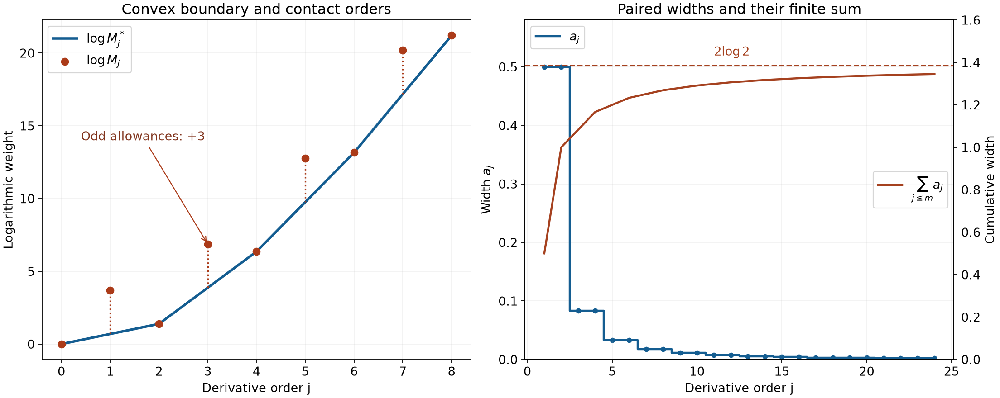
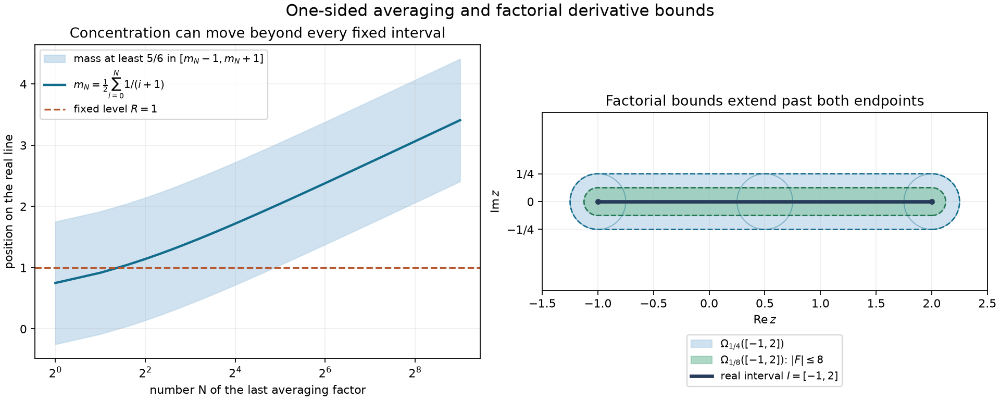

# Derivative budgets and unique jets

*Written by GPT-6 Astra (OpenAI), October 2026. Public domain (CC0).*

A smooth function can have every derivative zero at one point and still be nonzero elsewhere. A sufficiently restrictive derivative budget prevents this. The decisive numerical test uses the lower convex boundary of the logarithms of that budget. Large allowances at isolated orders may have no effect: bounds at the intervening orders can already force uniqueness.

We prove the criterion for every positive sequence, without assuming monotonicity or logarithmic convexity. Its converse constructs compact smooth functions with the prescribed bounds. For the derivative-growth scales used in wavefront analysis, the criterion determines exactly when compact cutoffs exist. These cutoffs give one compact Fourier witness valid at every order.

The fundamental theorem, uniform limits and compact extrema have the proofs in the [scalar foundation](../prerequisites/U011-free-foundations/metric-foundation-bridges.md), Sections 12–13, especially 13.4, 13.5 and 13.7. The integral Taylor formula is proved in [When a kernel is smooth](when-a-kernel-is-smooth.md#taylor-estimates-on-compact-neighborhoods). Product integration, domination and affine substitution are proved in the [integration foundation](../prerequisites/U011-free-foundations/banach-foundation-bridges.md), Sections 15–16. [Summable smoothing and fixed Fourier tests](summable-smoothing-and-fixed-fourier-tests.md), Lemma 1 and Theorems 4 and 6, supplies the full infinite-convolution construction, the compact-cutoff equivalence and the fixed Fourier-witness theorem. The scales and their localization estimates are those of [Derivative growth and finite-order localization](derivative-growth-and-finite-order-localization.md) and [Cones and derivative-growth wavefronts](cones-and-derivative-growth-wavefronts.md).

## The convex boundary of a derivative budget

Fix a nondegenerate compact interval \(I=[\alpha,\beta]\) and positive numbers \(M_j\), \(j\ge0\), with \(M_0=1\). A real or complex smooth function belongs to \(C^M(I)\) if, for some \(K\ge1\),

\[
 \sup_I|f^{(j)}|\le K^{j+1}M_j\qquad(j\ge0).
 \tag{J1}
\]

Smoothness on the interval means continuous one-sided derivatives at its endpoints. The class is **quasianalytic** if a member with \(f^{(j)}(x_0)=0\) for all \(j\), at any \(x_0\in I\), is zero on \(I\). Put

\[
 r_j=M_j^{1/j},\qquad L_j=\inf_{k\ge j}r_k\quad(j\ge1),
 \qquad b_j=\log M_j.
 \tag{J2}
\]

Define the lower convex boundary at a real \(x\ge0\) by

\[
 c(x)=\inf\left\{\sum_{\nu=1}^N\lambda_\nu b_{k_\nu}:
 \lambda_\nu\ge0,\ \sum_\nu\lambda_\nu=1,\
 \sum_\nu\lambda_\nu k_\nu=x,\ k_\nu\in\mathbb N_0\right\},
 \qquad M_j^*=e^{c(j)}.
 \tag{J3}
\]

Finite combinations suffice in this definition; \(e^{-\infty}=0\).

**Lemma 1 (the effective weights).** We have \(M_0^*=1\). Either \(M_j^*=0\) for every \(j>0\), or all \(M_j^*>0\) and this is the greatest logarithmically convex sequence below \(M_j\). In the positive case set
\(a_j=M_{j-1}^*/M_j^*\). These numbers are nonincreasing. In the zero case set every \(a_j=+\infty\).

If \(r_j\to\infty\), the boundary is a polygon with unbounded integer contact indices
\(0=q_0<q_1<\cdots\), strictly increasing slopes, and

\[
 M_{q_\nu}^*=M_{q_\nu},\qquad
 a_j=a_{q_\nu}\ \ (q_{\nu-1}<j\le q_\nu),\qquad
 a_j\downarrow0.
 \tag{J4}
\]

The strict corners are exactly \(J=\{j\ge1:a_{j+1}<a_j\}=\{q_\nu:\nu\ge1\}\). For every \(j\ge1\),

\[
 a_j\le L_j^{-1}\le(M_j^*)^{-1/j}
                 =(a_1\cdots a_j)^{1/j}.
 \tag{J5}
\]

**Proof.** Only the index zero can occur with positive weight when the barycenter is zero, so \(c(0)=b_0=0\). Mixing two finite combinations proves convexity of \(c\) whenever it is finite; the same argument uses arbitrarily low finite bounds if an infimum is \(-\infty\). Every convex function below the points \((j,b_j)\) is below \(c\), by the finite convexity inequality. That inequality follows by induction from the two-point definition.

It is enough in (J3), at an integer \(j\), to use either the point \(j\) or a chord with endpoints \(k<j<l\). To see this, combine repeated indices and remove zero coefficients. If three positive coefficients have indices \(k<l<m\), perturb them in the direction
\((m-l,k-m,l-k)\). This changes neither total mass nor barycenter. Choose the sign which does not increase the weighted value of \(b\), and increase the perturbation until one coefficient becomes zero. All coefficients remain nonnegative. Repeating removes every support of size greater than two. Thus

\[
 M_j^*=\inf\left(\{M_j\}\cup
 \{M_k^{(l-j)/(l-k)}M_l^{(j-k)/(l-k)}:0\le k<j<l\}\right).
 \tag{J6}
\]

If \(\liminf r_k=0\), the chords from zero to a sequence with \(r_k\to0\) give \(c(j)\le j\log r_k\to-\infty\), for every fixed positive \(j\). Otherwise the roots have a positive global lower bound \(\delta\): use a positive eventual lower bound and the minimum of the finitely many earlier positive roots. Hence \(b_k\ge k\log\delta\), and (J3) is bounded below by \(x\log\delta\). It is bounded above by an adjacent chord, so is finite. Convexity gives
\(2c(j)\le c(j-1)+c(j+1)\). Conversely the linear interpolation of any discrete convex sequence is convex, so maximality of \(c\) proves the asserted greatest-minorant property. Its successive slopes are nondecreasing, making their negative exponentials \(a_j\) nonincreasing.

Suppose now that \(b_k/k\to\infty\). Starting at an integer contact \(q\), minimize
\((b_l-b_q)/(l-q)\) over integers \(l>q\), and choose the largest minimizer as the next contact. The slopes tend to infinity as \(l\to\infty\), so a minimum exists and only finitely many indices attain it. Every intermediate point lies above the chosen segment. The next chosen slope is strictly larger: a smaller slope would make the longer chord from \(q\) smaller than the chosen minimum, and an equal slope would give a larger minimizer from \(q\).

The contacts are strictly increasing integers and therefore tend to infinity. The resulting polygon is convex and lies below every data point. Every other convex minorant lies below each chord joining consecutive contacts. Consequently this polygon is \(c\). Its slopes tend to infinity: if bounded above, \(b_{q_\nu}/q_\nu=c(q_\nu)/q_\nu\) would be bounded, contrary to the root assumption. This proves (J4) and the description of its corners.

For \(q_{\nu-1}<j\le q_\nu=q\), monotonicity of the \(a\)'s gives
\[
 L_j\le r_q=(M_q^*)^{1/q}
          =(a_1\cdots a_q)^{-1/q}\le a_q^{-1}=a_j^{-1}.
\]
Also convexity with \(c(0)=0\) makes \(c(j)/j\) nondecreasing. For \(k\ge j\),
\((M_j^*)^{1/j}\le(M_k^*)^{1/k}\le r_k\).
Taking the infimum proves the other inequality in (J5); the product identity telescopes. \(\square\)

## Comparing the three numerical tests

**Lemma 2 (Carleman's inequality).** For every positive sequence \(a_j\),

\[
 \sum_{n=1}^\infty(a_1\cdots a_n)^{1/n}
       \le e\sum_{j=1}^\infty a_j .
 \tag{J7}
\]

Both sides are interpreted as nonnegative extended sums.

**Proof.** The inequality between arithmetic and geometric means follows directly from \(\log t\le t-1\): divide positive numbers by their arithmetic mean, sum this logarithmic inequality and exponentiate. The logarithmic inequality itself follows by integrating \(1-1/t\) from one to \(t\), with its appropriate orientation.

Set \(d_j=(j+1)^j/j^{j-1}\), including \(d_1=2\). The product telescopes to \(\prod_{j=1}^n d_j=(n+1)^n\), and hence
\[
 (a_1\cdots a_n)^{1/n}
 \le \frac1{n(n+1)}\sum_{j=1}^n d_ja_j.
 \tag{J8}
\]
Sum to \(N\) and interchange this finite sum. Since
\(\sum_{n=j}^N1/[n(n+1)]\le1/j\) and
\(d_j/j=(1+1/j)^j\le e\), (J8) gives the partial-sum bound \(e\sum_{j=1}^N a_j\). The last estimate follows from \(\log(1+t)\le t\). Taking increasing limits proves (J7). \(\square\)

The next estimate explains why only the contact orders in Lemma 1 are needed for uniqueness. It uses one-sided averages, so every value on the right is at an earlier point.

## A function cannot cross a divergent width budget

**Lemma 3 (an estimate using corner orders).** Let
\(a_1\ge\cdots\ge a_m>0\), \(A_m=\sum_{j=1}^m a_j\), and
\[
 J_m=\{j<m:a_{j+1}<a_j\}\cup\{m\}.
\]
If \(f\in C^m((-\infty,T])\), \(f=0\) on \((-\infty,0]\), and \(0<T\le A_m\), then, for \(x\le T\),
\[
 |f(x)|\le
 \sum_{j\in J_m}4^j a_1\cdots a_j
                 \sup_{y\le x}|f^{(j)}(y)|.
 \tag{J9}
\]
For arbitrary \(T>0\), the same inequality holds with \(4^j\) replaced by
\((4T/A_m)^j\).

**Proof.** Write
\[
 B_af(x)=a^{-1}\int_0^a f(x-t)\,dt,\qquad
 \tau_af(x)=f(x-a).
\]
The fundamental theorem gives the exact decomposition
\[
 f=aB_af'+\tau_af.
 \tag{J10}
\]
All these averages and translations commute; this follows by writing the two finite integrals and using Fubini. They never use a point larger than \(x\).

Starting from \(f\), expand (J10) with the following stopping rule. A term has a derivative count \(j\) and a translation count \(i\), and has the form
\[
 (a_1\cdots a_j)\,
 \tau_{s_1}\cdots\tau_{s_i}B_{a_1}\cdots B_{a_j}f^{(j)},
 \qquad s_v\ge a_v\quad(1\le v\le i).
 \tag{J11}
\]
The empty term has \(i=j=0\). Expand a term precisely when \(i,j<m\) and \(a_{j+1}\ge a_{i+1}\), using (J10) on \(f^{(j)}\) with width \(a_{j+1}\). One child adds that derivative and its averaging factor; the other adds a translation by \(a_{j+1}\). The latter is legitimate because its new shift is at least \(a_{i+1}\).

A translation child can stop only at \(i=m\): otherwise
\(a_{j+1}\ge a_{i+1}\ge a_{i+2}\), so it remains expandable. For a derivative child with new derivative count \(j<m\), stopping requires
\(a_{j+1}<a_{i+1}\le a_j\). Thus \(j\) is a strict corner, and \(i+1\le j\); the latter follows because \(i+1\ge j+1\) would give the opposite inequality by monotonicity. A child with \(j=m\) is also a corner in \(J_m\) and has \(i<m=j\).

Every step increases \(i+j\), and both counts are at most \(m\), so the expansion is finite. Terms ending at \(i=m\) vanish: their total translation is at least \(A_m\ge T\), and their remaining averages evaluate \(f^{(j)}\) only on \((-\infty,0]\). All the surviving terms have \(j\in J_m\) and \(i<j\). For a fixed pair \((i,j)\), there are at most \(2^{i+j}\) terms, since each of the \(i+j\) choices has two possibilities. Their averaging operators have supremum norm at most one. Summing over \(0\le i<j\) gives fewer than \(4^j\) terms at derivative count \(j\), proving (J9).

For arbitrary \(T\), apply the proved estimate with widths
\(\widetilde a_j=(T/A_m)a_j\), whose sum is \(T\). Their strict corners are unchanged and their first \(j\) factors acquire exactly \((T/A_m)^j\). \(\square\)

## Unique jets and compact functions

**Theorem 4 (the numerical quasianalyticity criterion).** For every sequence \(M\) above, the following are equivalent:

1. \(C^M(I)\) is quasianalytic.
2. \(\sum_{j\ge1}L_j^{-1}=\infty\).
3. \(\sum_{j\ge1}(M_j^*)^{-1/j}=\infty\).
4. \(\sum_{j\ge1}a_j=\infty\).

Reciprocals of zero are infinity. The criterion is independent of the chosen nondegenerate compact interval. When these conditions fail, every open interval contains the support of a nonzero smooth compact function satisfying a bound of the form (J1) on the entire line.

**Proof: bounded roots along a subsequence.** First suppose \(\liminf r_j<\infty\). Choose \(C>0\) and unbounded integers \(k_\nu\) with \(r_{k_\nu}\le C\). Then \(L_j\le C\) for every \(j\), so condition 2 holds. Chords from zero give \(M_j^*\le C^j\), and condition 3 holds. If the minorant vanishes, condition 4 holds by definition. Otherwise put \(\mu_i=1/a_i\), a nondecreasing sequence. For \(N\ge i\),
\[
 M_N^*\ge M_{i-1}^*\mu_i^{N-i+1},\qquad M_N^*\le C^N.
\]
Taking \(N\)-th roots and letting \(N\to\infty\) gives \(\mu_i\le C\). Thus \(a_i\ge1/C\), proving condition 4 in this case also.

If \(f\) is flat at \(x_0\), Taylor's remainder and (J1) give
\[
 |f(x)|\le
 K\,\frac{(KC|x-x_0|)^{k_\nu}}{k_\nu!}\longrightarrow0.
 \tag{J12}
\]
For completeness, for any fixed \(D\), the ratio of consecutive terms in \(D^k/k!\) is \(D/(k+1)\le1/2\) eventually, so that sequence tends to zero. This proves condition 1 throughout \(I\), for both directions from \(x_0\), and settles this case.

**Proof: the numerical conditions when \(r_j\to\infty\).** Lemma 1 applies. The pointwise inequalities (J5) give \(4\Rightarrow2\Rightarrow3\). Lemma 2 and the product formula in (J5) give \(3\Rightarrow4\). Thus the three numerical conditions are equivalent.

**Proof: a divergent sum forces uniqueness.** Suppose condition 4 holds and \(f\) is flat at \(x_0\). On the right of \(x_0\), translate \(x_0\) to zero and divide \(f\) by its constant \(K\). Extend this function by zero to the negative half-line. It is smooth at zero because all its one-sided derivatives there vanish. On the resulting interval \((-\infty,T]\) its derivatives are bounded by \(K^jM_j\).

Take \(m\) through the strict corners \(J\) of Lemma 1. Then the finite corner set \(J_m\) is exactly \(J\cap[1,m]\), and at each of these indices
\(M_j=M_j^*=(a_1\cdots a_j)^{-1}\).
Lemma 3 therefore implies
\[
 |f(x+x_0)|/K
 \le\sum_{j\in J_m}(4TK/A_m)^j
 \le 8TK/A_m
 \quad\text{when }4TK/A_m\le\tfrac12.
 \tag{J13}
\]
The last inequality bounds the sum by the full geometric series starting at one. The partial sums \(A_m\) tend to infinity, also along the unbounded corner indices. Hence \(f\) is zero on the right. Reflection gives the left side with the same derivative bounds. An endpoint requires just its available side. This proves quasianalyticity.

**Proof: a finite sum constructs a flat nonzero function.** Suppose \(\sum a_j<\infty\). By Lemma 1 we are in the positive-minorant case. Lemma 1 of the summable-smoothing lesson supplies a nonnegative compact smooth density \(\rho\), of mass one, with
\[
 \|\rho^{(j)}\|_1\le 2^j/(a_1\cdots a_j)=2^jM_j^*.
\]
Convolve it with one more interval density
\(H_d=d^{-1}1_{[-d/2,d/2]}\), where \(d>0\). The smooth compact function \(g=H_d*\rho\) has mass one and
\[
 \|g^{(j)}\|_\infty
 \le d^{-1}2^jM_j^*\le d^{-1}2^jM_j.
 \tag{J14}
\]
Differentiation under the finite convolution is justified by the continuous compact derivatives; the displayed bound follows directly by integrating their absolute values. A translation and positive dilation place the support strictly inside any prescribed open interval. Dilation multiplies the order-\(j\) bound by a fixed number to the power \(j\); choose \(K\) large enough to absorb this and the order-zero constant. The resulting function is nonzero, but all its derivatives vanish at every point outside its compact support. It contradicts quasianalyticity on any compact interval containing that support in its interior. The same construction works inside the interior of the specified \(I\). This proves the converse and all the assertions. \(\square\)

## The numerical test for derivative-growth wavefronts

**Corollary 5.** Let \(L_0=1\), \(j\le L_j\le L_{j+1}\le QL_j\). For the class with local bounds
\(|\partial^\gamma f|\le A(BL_{|\gamma|})^{|\gamma|}\),
the following alternatives hold.

- If \(\sum_{j\ge1}1/L_j=\infty\), a zero infinite jet at one point of a connected open set forces the function to be zero everywhere on that set. There is no nonzero compact function in this class on \(\mathbb R^n\).
- If \(\sum_{j\ge1}1/L_j<\infty\), compact cutoffs in the class exist around every compact set inside every open set. At any nonzero covector, absence from \(\operatorname{WF}_L(u)\) is equivalent to the existence of one \(v\in\mathcal E'\), equal to \(u\) near the base point, and an open cone containing the covector, on which

\[
 |\widehat v(\xi)|\le C(DL_N)^N(1+|\xi|)^{-N}
 \qquad(N\ge1).
 \tag{J15}
\]

**Proof.** In one dimension set \(M_j=L_j^j\), with \(M_0=1\). The constants \(A,B\) and \(K\) define the same class: enlarge \(K\) to dominate \(1,A,B\); conversely take \(A=K,B=K\). Since \(L_j\) is nondecreasing, the sequence called \(L_j\) in (J2) is precisely this given sequence. Theorem 4 gives its exact criterion.

In several dimensions restrict a function to a line segment in a compact ball inside its domain. The repeated directional derivative has the multinomial expansion
\[
 (v\cdot\nabla)^j f
   =\sum_{|\gamma|=j}\frac{j!}{\gamma!}v^\gamma\partial^\gamma f,
 \qquad |(v\cdot\nabla)^jf|\le A(B\|v\|_1L_j)^j.
\]
The expansion follows by induction using commuting smooth partial derivatives, and its absolute coefficient sum is the finite multinomial formula. A flat jet therefore makes the restriction zero along every segment from that point in the ball. Thus the zero-jet set is open; it is closed relative to the domain by continuity of every derivative. Connectedness makes a nonempty such set the whole domain. A compact function has an open zero set outside a ball, proving the first alternative.

In the convergent case (J14) gives a nonquasianalytic one-dimensional witness. The full compact-cutoff equivalence in Theorem 4 of the summable-smoothing lesson gives the cutoffs in every dimension, with all algebra estimates proved there. Its Theorem 6 then gives (J15) and its converse with the same bounded-distribution and cone quantifiers. Its denominator \(|\xi|^N\) can be replaced by \((1+|\xi|)^N\): on \(|\xi|\ge1\) double the exponential constant, while on \(|\xi|\le1\) use the bounded Fourier transform on that compact set and \(L_N\ge1\), enlarging \(D\) to at least two. The reverse replacement only weakens the bound. The numerical hypothesis needed for the earlier theorem is supplied by Theorem 4 here. \(\square\)

## The smallest possible support width

**Corollary 6.** Let \(a_j>0\) be nonincreasing. Suppose a smooth compact function \(\rho\) has integral one, support in an interval of length \(T\), and
\(\|\rho^{(j)}\|_1\le2^j/(a_1\cdots a_j)\) for every \(j\ge1\). Then
\[
 T\ge\frac1{16}\sum_{j=1}^\infty a_j.
 \tag{J16}
\]
In particular no such function exists for a divergent width sum. For a finite sum, the summable-smoothing construction has support width at most \(\sum a_j\).

**Proof.** Translate the containing interval to \([0,T]\), and set
\(F(x)=\int_{-\infty}^x\rho(t)\,dt\). Thus \(F=0\) on the negative half-line and \(F(T)=1\). For \(j\ge1\), the fundamental theorem and compact support give
\[
 |F^{(j)}(x)|=|\rho^{(j-1)}(x)|
 =\left|\int_{-\infty}^x\rho^{(j)}(t)\,dt\right|
 \le \frac{2^j}{a_1\cdots a_j}.
\]
For any \(m\), let \(A_m=\sum_{j=1}^m a_j\). If \(T<A_m/16\), Lemma 3 at \(x=T\) gives
\[
 1\le\sum_{j\in J_m}(8T/A_m)^j
 \le\frac{8T/A_m}{1-8T/A_m}<1,
\]
a contradiction. Therefore \(T\ge A_m/16\) for every \(m\), and taking increasing limits gives (J16). Lemma 1 of the summable-smoothing lesson proves the stated upper width with the same \(L^1\) derivative bounds. No sign condition on \(\rho\) was needed for the lower bound. \(\square\)

*For \(M_{2r}=((2r)!)^2\) and \(M_{2r+1}=e^3(2r)!(2r+2)!\), the odd logarithmic weights lie three units above their neighboring chord. The left panel shows this convex boundary through index eight; the mathematical definition continues for every index. The right panel shows its exact paired widths \(a_{2r+1}=a_{2r+2}=1/[(2r+1)(2r+2)]\) and their cumulative sum, tending to \(2\log2\). Lemma 1 and Exercise 3 prove the minorant and the infinite sum. The finite sum permits the compact function in (J14). [Editable figure source](../figures/convex-weights-and-widths.py).*

## Factorial bounds and complex neighborhoods

We use the supplied [complex contour proofs](../prerequisites/U011-free-foundations/complex-contours-U070.md), Sections 16.1–16.3: the triangle argument, circle formula, all derivative estimates, identity principle and joint power series on polydiscs. In particular these results follow from complex differentiability, rather than being assumed in its definition. [Derivative growth and finite-order localization, Proposition 3](derivative-growth-and-finite-order-localization.md#growth-scales-and-a-useful-shift-estimate) proves the real Taylor remainder and factorial bounds used below.

**Theorem 7 (a common complex neighborhood of an interval).** Let \(I=[a,b]\), \(a<b\), and let \(f\in C^\infty(I)\): all real derivatives exist on the interior and extend continuously to the one-sided endpoint derivatives. Suppose
\[
 \sup_I|f^{(j)}|\le K^{j+1}j!\quad(j\ge0),\qquad K\ge1.
                                                               \tag{A1}
\]
There is a unique holomorphic extension of \(f\) to
\[
 \Omega_{1/K}(I)=\bigcup_{y\in I}\{z\in\mathbb C:|z-y|<1/K\}.
                                                               \tag{A2}
\]
For every \(y\in I\), on its indicated disk this extension is
\[
 \begin{aligned}
 F(z)&=\sum_{j=0}^\infty\frac{f^{(j)}(y)}{j!}(z-y)^j,\\
 |F(z)|&\le\frac{K}{1-K|z-y|}.
 \end{aligned}                                               \tag{A3}
\]
Conversely, the restriction of any holomorphic function on an open complex neighborhood of \(I\) satisfies (A1) for some \(K\). Thus the factorial class on the whole compact interval is exactly the class of these restrictions, including extension past both endpoints.

**Proof.** At any \(y\in I\), (A1) bounds the \(j\)-th series term by \(K(K|z-y|)^j\). On every smaller closed disk the series and every fixed differentiated series converge uniformly: their bounds are geometric terms times a polynomial in \(j\), whose successive ratio tends to a number below one. The uniform differentiation theorem gives a holomorphic sum. Summing the undifferentiated geometric series gives (A3).

For a real \(x\in I\) with \(|x-y|<1/K\), the integral Taylor remainder after degree \(m-1\) is at most \(K(K|x-y|)^m\). It tends to zero, so this local sum equals \(f(x)\). The same argument holds at the endpoints with one-sided derivatives and the segment contained in \(I\).

If two of the disks overlap, their real centers have distance less than \(2/K\). Their intersection is convex, hence connected, and contains a nonempty real interval inside \(I\): use their midpoint when the centers differ, and a small interval on the available side when they coincide at an endpoint. Both sums equal \(f\) on that interval. The one-variable identity principle makes them equal throughout the overlap. They therefore define one holomorphic function on (A2). That domain is connected, since every disk meets the interval of centers. The identity principle also proves uniqueness.

For the converse, compactness gives \(r>0\) such that all closed radius-\(r\) disks centered on \(I\) lie in the given open neighborhood. Their union is compact, so \(F\) has a finite bound \(M\) there. The proved Cauchy estimate gives
\[
 |F^{(j)}(x)|\le M r^{-j}j!\quad(x\in I).
                                                               \tag{A4}
\]
Take \(K\ge\max(1,M,r^{-1})\). Restriction of the power series shows that these complex derivatives restrict to all real derivatives, including the one-sided endpoint values. This proves (A1). \(\square\)

**Corollary 8 (the several-variable statement with compatible extensions).** Let \(X\subset\mathbb R^n\) be open and \(f\in C^\infty(X)\). The following are equivalent:

1. For every compact \(K_0\subset X\), there are \(A,B\ge1\) such that
\[
 \sup_{K_0}|\partial^\alpha f|
       \le A B^{|\alpha|}|\alpha|!\quad\hbox{for all }\alpha.
                                                               \tag{A5}
\]
2. There is an open \(\Omega\subset\mathbb C^n\) containing \(X\) and a holomorphic \(F\) on \(\Omega\) whose restriction is \(f\).

The holomorphic germ at every point of \(X\) is unique. The condition with \(\alpha!\) instead of \(|\alpha|!\) defines the same local class, after changing \(B\).

**Proof.** Fix a real center \(y\) and a closed real \(\ell^1\) ball about it compactly contained in \(X\). On that ball choose the constants in (A5). For a sufficiently small \(r<1/B\), the series
\[
 F_y(z)=\sum_{\alpha\in\mathbb N_0^n}
                  \frac{\partial^\alpha f(y)}{\alpha!}(z-y)^\alpha
                                                               \tag{A6}
\]
converges absolutely on the complex ball \(|z-y|_1<r\). Indeed the sum of the absolute terms of total degree \(m\) is at most
\[
 A B^m\sum_{|\alpha|=m}\frac{m!}{\alpha!}|(z-y)^\alpha|
       =A(B|z-y|_1)^m.                                       \tag{A7}
\]
Its differentiated series converge uniformly on smaller neighborhoods, by the same geometric bounds with polynomial factors, or the explicit coefficient calculation in Proposition 3 cited above, with complex absolute values. This gives holomorphy. The real integral Taylor formula on the ball has the same remainder bound as (A7), so \(F_y=f\) on its real part.

Choose each radius so that its real ball lies in \(X\). Two such complex balls have a convex intersection. If that intersection is nonempty, taking real parts of one of its points shows that their real balls intersect in a nonempty real open set. The two holomorphic functions coincide there. To pass from that real set to a complex neighborhood, put a small complex polydisc about one of its real points inside the intersection. Fix all but the first coordinate real and apply the one-variable identity principle; then fix all but the second coordinate, allowing the first to be complex, and continue through every coordinate. The difference is zero on the polydisc.

For any other point of the convex intersection, restrict the difference to the complex line joining it to a point of this zero polydisc. The line parameter has an open domain containing the real segment from zero to one, all in one connected component. It is zero for parameters near zero, hence zero at one by the one-variable identity principle. Thus the local functions agree on the entire intersection. Their union defines the required \(F\) on an open neighborhood of \(X\). The same local argument proves uniqueness of its germ along \(X\).

Conversely, for a compact \(K_0\subset X\), choose one positive coordinate radius \(r\) whose closed complex polydiscs centered on \(K_0\) all lie in \(\Omega\). Their union is compact; let \(M\) bound \(F\) there. The iterated Cauchy formula gives
\[
 |\partial^\alpha F(x)|\le M\alpha!r^{-|\alpha|}
       \le M|\alpha|!r^{-|\alpha|}\quad(x\in K_0).             \tag{A8}
\]
This is (A5). Finally \(\alpha!\le|\alpha|!\le n^{|\alpha|}\alpha!\), because the multinomial coefficient \(|\alpha|!/\alpha!\) is one of the nonnegative terms summing to \(n^{|\alpha|}\). These inequalities absorb the choice of factorial into the constant \(B\). \(\square\)

*Right: for \(I=[-1,2]\), \(K=4\), (A2) is the open tube of radius \(1/4\). Its rounded ends express continuation beyond both real endpoints. The smaller tube of radius \(1/8\) has \(|F|\le8\) by (A3). The left panel is the one-sided convolution example in [Summable smoothing and fixed Fourier tests, Solution 7](summable-smoothing-and-fixed-fourier-tests.md#exercises-with-full-solutions). The geometry represents exact domains and bounds; it does not portray values of an unspecified holomorphic function. [Figure source](../figures/escaping-averages-and-analytic-tubes.py).*

## Exercises with complete solutions

**Exercise 1 — the Gevrey threshold (foundation).** For \(s>0\), set \(M_j=(j!)^s\). Determine exactly when the class is quasianalytic.

**Solution.** The successive weight ratios are \(M_j/M_{j-1}=j^s\), which increase. Hence \(M^*=M\) and \(a_j=j^{-s}\). Comparing the decreasing function \(t^{-s}\) on each interval \([j,j+1]\) with its endpoint values makes its sum converge exactly when its improper integral does. Direct integration gives convergence for \(s>1\) and divergence for \(0<s\le1\), including the logarithm at \(s=1\). Theorem 4 therefore gives quasianalyticity exactly for \(s\le1\). For \(s>1\), (J14) constructs a nonzero compact member; it does not merely assert failure of a uniqueness proof. \(\square\)

**Exercise 2 — a logarithmic borderline (intermediate).** For \(\theta\ge0\), put
\[
 M_j=j!\prod_{\ell=1}^j[\log(\ell+e)]^\theta,\qquad M_0=1.
 \tag{J17}
\]
Find its quasianalytic range.

**Solution.** Its successive ratios \(j[\log(j+e)]^\theta\) increase, so the sequence is logarithmically convex. The relevant sum is
\(\sum_{j\ge1}1/[j(\log(j+e))^\theta]\).
For \(j\ge3\), \(\log j\le\log(j+e)\le\log(2j)\le2\log j\). Multiplicative constants therefore reduce the test to
\(\sum1/[j(\log j)^\theta]\).
The summand decreases on \([3,\infty)\). The same integral comparison as in Exercise 1, followed by \(t=\log x\), gives \(\int_{\log3}^\infty t^{-\theta}\,dt\). It diverges precisely for \(0\le\theta\le1\). Theorem 4 gives that exact quasianalytic range; all \(\theta>1\) permit compact nonzero members. \(\square\)

**Exercise 3 — large allowances at odd orders (intermediate).** Prove the minorant and width formula in the figure, and calculate the entire width budget.

**Solution.** On the block from \(2r\) to \(2r+2\), the slope between the even data points is
\[
 \log\!\big((2r+1)(2r+2)\big).
 \tag{J18}
\]
These slopes strictly increase. Their polygon is convex and lies below the odd data by exactly three. Any convex minorant is below each chord between even data points, so this polygon is the greatest minorant. Its negative exponential slopes give the paired widths stated in the caption.

Their sum is
\[
 2\sum_{r=0}^\infty\frac1{(2r+1)(2r+2)}
 =2\int_0^1\frac1{1+t}\,dt=2\log2.
 \tag{J19}
\]
Indeed each summand is \(\int_0^1t^{2r}(1-t)\,dt\). The nonnegative partial sums increase, so monotone convergence from the integration foundation passes the sum inside the integral. Their geometric sum is \((1-t)/(1-t^2)=1/(1+t)\) for \(t<1\); a single endpoint has measure zero. This proves (J19). Thus the odd excesses do not change the test, and the class is nonquasianalytic. \(\square\)

**Exercise 4 — uniqueness from even orders alone (intermediate).** Let \(M_{2r}=1\) and \(M_{2r+1}=\exp((2r+1)^2)\). Compute \(L_j,M_j^*,a_j\), and prove uniqueness directly.

**Solution.** All roots are at least one and unbounded even indices have root one, so \(L_j=1\). The zero function is a convex minorant of \(b_j\); every chord between consecutive even indices is zero and bounds every convex minorant from above there. Thus \(c(j)=0\), \(M_j^*=1\) and \(a_j=1\) for every \(j\). The test diverges. If \(f\) is flat at \(x_0\), Taylor remainder at order \(2r\) bounds
\(|f(x)|\le K(K|x-x_0|)^{2r}/(2r)!\to0\).
The very large odd-order permissions do not affect this direct argument. \(\square\)

**Exercise 5 — the constant in Carleman's inequality (advanced).** Show that no universal constant smaller than \(e\) can replace \(e\) in (J7), even when the sequence is positive and summable.

**Solution.** For each integer \(N\ge2\), take \(a_j=1/j\) for \(1\le j\le N\), and \(a_j=N^{-2}2^{-(j-N)}\) for \(j>N\). Its sum is \(H_N+N^{-2}\), where \(H_N=\sum_{j=1}^N1/j\). The first \(N\) terms on the left of (J7) sum to \(\sum_{n=1}^N(n!)^{-1/n}\).

Integrating the increasing function \(\log t\) on unit intervals gives
\[
 \int_1^n\log t\,dt\le\log(n!)\le\int_1^n\log t\,dt+\log n.
 \tag{J20}
\]
For the upper bound, apply the lower endpoint estimate to the sum through \(n-1\) and then add \(\log n\). Since the integral is \(n\log n-n+1\), (J20) implies \(n(n!)^{-1/n}\to e\). For any \(\varepsilon>0\), all sufficiently large terms lie between \((e-\varepsilon)/n\) and \((e+\varepsilon)/n\). Summing and dividing by \(H_N\to\infty\) shows
\(\sum_{n\le N}(n!)^{-1/n}/H_N\to e\); the finitely many initial terms disappear in the quotient. The ratio of the full left side to the full right sum is at least this partial numerator divided by \(H_N+N^{-2}\), whose limit is \(e\). Any smaller proposed universal constant fails for a sufficiently large \(N\). \(\square\)

**Exercise 6 — a quantitative interval extension (foundation).** Suppose \(I=[-1,2]\) and \(\sup_I|f^{(j)}|\le4^{j+1}j!\). Give a common complex domain and a uniform bound on its radius-\(1/8\) subdomain. If every derivative at the left endpoint vanishes, prove that the extension is zero.

**Solution.** Theorem 7 gives \(\Omega_{1/4}(I)\). Every point of \(\Omega_{1/8}(I)\) lies at distance less than \(1/8\) from some \(y\in I\), so (A3) bounds its value by \(4/(1-4/8)=8\). A zero jet at \(-1\) makes its Taylor series identically zero in the disk centered there. The full tube is connected, so the identity principle gives zero throughout. The endpoint is a real boundary point of the original interval but an interior point of the complex extension domain.

**Exercise 7 — a smaller factorial budget gives an entire function (intermediate).** If \(\sup_I|f^{(j)}|\le K^{j+1}(j!)^{1/2}\), prove that \(f\) is the restriction of an entire function, rather than merely a function on a small tube.

**Solution.** At any \(y\in I\), the absolute Taylor terms are bounded by \(K(K|z-y|)^j/(j!)^{1/2}\). The ratio of consecutive bounds is \(K|z-y|/\sqrt{j+1}\), tending to zero uniformly on each bounded disk. Every fixed differentiated series has the same ratio limit, since its extra factors are polynomial in \(j\). Thus the series defines an entire function. For real \(x\in I\), Taylor remainder is bounded by \(K(K|x-y|)^m/(m!)^{1/2}\), which tends to zero by the same ratio argument. It therefore restricts to \(f\) on the whole interval. The identity principle makes the entire extension independent of the chosen center.

**Exercise 8 — a joint estimate for a coupled function (intermediate).** For \(f(x_1,x_2)=\exp(x_1x_2)\), obtain explicit constants in (A5) on \([-R,R]^2\), \(R\ge0\), using its complex extension.

**Solution.** The exponential series composed with the polynomial \(z_1z_2\) is entire: the series and every differentiated series converge uniformly on compact sets by their factorial denominators. On the closed coordinate-radius-one polydisc about any real point in \([-R,R]^2\), one has \(|z_1z_2|\le(R+1)^2\), so \(|e^{z_1z_2}|\le e^{(R+1)^2}\). Formula (A8) gives
\[
 |\partial^\alpha f|\le e^{(R+1)^2}\alpha!
                      \le e^{(R+1)^2}|\alpha|!.
\]
Thus \(A=e^{(R+1)^2}\), \(B=1\) work. The dependence between the two coordinates is retained; a product of independent one-variable functions was not assumed.

## Sources

Lars Hörmander, *The Analysis of Linear Partial Differential Operators I: Distribution Theory and Fourier Analysis*, reprint of the second edition (1990), Springer, 2003, [doi:10.1007/978-3-642-61497-2](https://doi.org/10.1007/978-3-642-61497-2), Section 1.3, Lemma 1.3.6, Theorem 1.3.8, Lemma 1.3.9 and the factorial-weight discussion on p. 24. The numerical criterion and averaging method are presented here with their full arguments. The convex-boundary construction, organization, figure and exercises use original exposition. The earlier programme proofs linked above supply the summable smoothing and microlocal localization used in Corollary 5.
