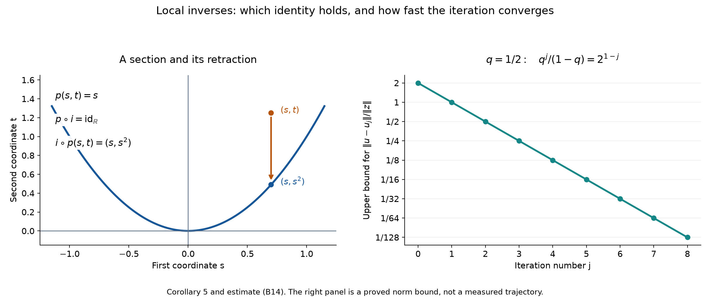

# Differentiation and local inverses in Banach spaces

*Written by GPT-6 Astra (OpenAI), October 2026. Public domain (CC0).*

An equation between spaces of functions has the same local shape as an equation between coordinate vectors when its derivative has a bounded inverse. A one-sided inverse has a different geometric meaning: it gives either a local section of a surjection or a local retraction of an embedding. We prove these statements with their actual neighborhoods and estimates. We also explain how derivatives along a dense collection of directions determine a full derivative, and how higher derivatives produce Taylor formulas in a Banach target.

The [functional foundation](../prerequisites/U011-free-foundations/functional-foundations-U008.md), Section 5, proves real and complex Hahn–Banach. The [operator foundation](../prerequisites/U011-free-foundations/operator-completeness-and-open-mapping.md), Sections 3 and 8, proves completeness of operator spaces, convergence of absolutely summable vector series and the bounded inverse theorem. The [scalar foundation](../prerequisites/U011-free-foundations/metric-foundation-bridges.md), Sections 12–13, proves real completeness, compact-interval calculus, geometric series and smooth scalar bumps. Those are the earlier inputs used below.

Let \(E,F,G\) be real Banach spaces. Complex Banach spaces may be regarded as real spaces throughout. All derivatives below are real Fréchet derivatives unless complex linearity is explicitly imposed. The norm on \(\mathcal L(E,F)\) is the operator norm. An open subset \(O\subset E\) carries the given norm topology. Differentiability at \(x\in O\) means that a bounded linear map \(Df(x)\) satisfies

\[
 f(x+h)=f(x)+Df(x)h+r_x(h),\qquad
 \frac{\|r_x(h)\|}{\|h\|}\longrightarrow0.
 \tag{B1}
\]

The derivative is unique: insert \(h=tv\) in the difference of two such formulas and let nonzero real \(t\) tend to zero, for each fixed \(v\). Formula (B1) also proves continuity of \(f\) at \(x\). The notation \(C^1\) requires continuity of \(x\mapsto Df(x)\) in operator norm.

## Segment estimates and vector integrals

**Lemma 1 (the norm estimate along a segment).** If \(v:[a,b]\to F\) is continuous and differentiable in the interior, then

\[
 \|v(b)-v(a)\|\le (b-a)\sup_{a<t<b}\|v'(t)\|.
 \tag{B2}
\]

For a differentiable map on a neighborhood of \([x,x+h]\), and any \(A\in\mathcal L(E,F)\), this gives

\[
 \|f(x+h)-f(x)-Ah\|
 \le \|h\|\sup_{0<t<1}\|Df(x+th)-A\|.
 \tag{B3}
\]

**Proof.** If the supremum is infinite there is nothing to prove. Otherwise, put \(w=v(b)-v(a)\). For \(w\ne0\), the functional \(tw\mapsto t\|w\|\) on its real span has norm one; real Hahn–Banach extends it to \(F\) with the same norm. For \(w=0\) use the zero functional. In either case this gives \(\ell\) of norm at most one with \(\ell(w)=\|w\|\). Apply the scalar mean value theorem to \(\ell\circ v\). Its derivative is \(\ell(v')\), directly by the difference quotient, which proves (B2). Apply (B2) to \(t\mapsto f(x+th)-tAh\) to obtain (B3). Substitution in (B1) proves the derivative of this curve without an assumed chain rule. \(\square\)

Continuous Banach-valued functions on compact real intervals have Riemann integrals. Here is the construction used in this lesson. For a continuous \(v:[a,b]\to F\), finite tagged sums are Cauchy as the mesh tends to zero. Indeed, compare two sums through their common partition refinement. Each original tag and each new tag in the same original interval are at distance at most the original mesh. If \(\omega(\delta)\) is the uniform modulus of continuity of \(v\), the difference of the two sums has norm at most

\[
 (b-a)\bigl(\omega(\delta_1)+\omega(\delta_2)\bigr).
 \tag{B4}
\]

For uniform continuity, choose at every parameter \(t\) a radius \(2\delta_t\) on which the values differ from \(v(t)\) by less than \(\varepsilon/2\). Finitely many intervals of radii \(\delta_t\) cover \([a,b]\). Two parameters at distance less than the minimum of these finitely many radii both lie in one of the corresponding doubled intervals, so their values differ by less than \(\varepsilon\). Completeness of \(F\) now gives the integral as the common limit, independent of partitions and tags. Passing finite-sum identities and the triangle inequality to the limit proves additivity, linearity, and commutation with bounded linear maps, as well as

\[
 \left\|\int_a^b v(t)\,dt\right\|
 \le\int_a^b\|v(t)\|\,dt
 \le (b-a)\sup_{[a,b]}\|v(t)\|.
 \tag{B5}
\]

For reversed endpoints define the integral with a minus sign. The primitive \(V(t)=\int_a^t v(s)\,ds\) has derivative \(v(t)\): the difference quotient error is at most the oscillation of \(v\) between its endpoints. Thus, if \(w\) is \(C^1\), the derivative of \(w-V\), with \(v=w'\), is zero. Lemma 1 makes that difference constant. In particular,

\[
 f(x+h)-f(x)=\int_0^1 Df(x+th)h\,dt
 \quad(f\in C^1).
 \tag{B6}
\]

Uniform convergence of continuous integrands passes through the integral by (B5). Integration by parts for a scalar \(C^1\) weight and a Banach-valued \(C^1\) function follows by expanding the product difference quotient and then applying the primitive identity. These facts use no infinite-dimensional volume measure.

## Products, composition and operator inversion

**Lemma 2 (bounded multilinear operations).** The space \(\mathcal L(E_1,\ldots,E_k;F)\) of bounded multilinear maps, with norm

\[
 \|T\|=\sup_{\|v_i\|\le1}\|T(v_1,\ldots,v_k)\|,
 \tag{B7}
\]

is Banach. Currying identifies it isometrically with
\(\mathcal L(E_1,\mathcal L(E_2,\ldots,E_k;F))\).
A fixed bounded multilinear operation is a smooth map on the product space. The chain rule is

\[
 D(g\circ f)(x)=Dg(f(x))Df(x).
 \tag{B8}
\]

**Proof.** Successive evaluation and currying are inverse linear maps; the suprema over all unit arguments in (B7) agree in either order. Completeness follows inductively from Section 3 of the operator foundation. For \(k=0\), the space is \(F\). For \(k\ge1\), boundedness is equivalent to continuity: continuity at zero supplies a product neighborhood where the value is bounded; rescale each nonzero argument into that neighborhood and use multilinearity. A zero argument makes the value zero.

Expand \(T(v_1+h_1,\ldots,v_k+h_k)\) by multilinearity. The terms with exactly one increment give the derivative. All remaining nonconstant terms have at least two increments, and are \(O(\max_i\|h_i\|^2)\) on a bounded neighborhood of the given point. Repeating this finite expansion gives every higher derivative; those above order \(k\) vanish. This proves smoothness, including bounded bilinear operator composition with its original multiplication order.

For (B8), put \(q=f(x+h)-f(x)=Df(x)h+o(\|h\|)\); in particular \(\|q\|=O(\|h\|)\). In the outer differentiability formula,
\(g(f(x)+q)=g(f(x))+Dg(f(x))q+o(\|q\|)\),
both remainders are \(o(\|h\|)\). This proves (B8), including increments with \(q=0\). Continuity of operator composition proves the \(C^1\) composition statement. Repeated use of this argument and the multilinear product rule proves preservation of \(C^k\) for every finite \(k\), and of smoothness. \(\square\)

**Theorem 3 (smooth inversion of bounded isomorphisms).** The bounded linear isomorphisms \(T:E\to F\) form an open subset of \(\mathcal L(E,F)\). If \(B=T^{-1}\), then

\[
 D^k\operatorname{Inv}(T)[S_1,\ldots,S_k]
   =(-1)^k\sum_{\sigma\in\mathfrak S_k}
     B S_{\sigma(1)}B\cdots S_{\sigma(k)}B.
 \tag{B9}
\]

All factors retain their displayed order.

**Proof.** If \(\|BS\|<1\), the series \(\sum_{j\ge0}(-BS)^j\) converges in \(\mathcal L(E,E)\). Multiply its finite partial sums on both sides by \(I+BS\); the remainders have norm at most \(\|BS\|^{N+1}\). Hence

\[
 (T+S)^{-1}=\left(\sum_{j\ge0}(-BS)^j\right)B,
 \qquad
 \|(T+S)^{-1}\|\le\frac{\|B\|}{1-\|B\|\|S\|}.
 \tag{B10}
\]

Here the last estimate assumes \(\|B\|\|S\|<1\), a sufficient condition. The exact inverse identities verify both domain and codomain. Isolating the terms of degrees zero and one gives

\[
 \|(T+S)^{-1}-B+BSB\|
 \le\frac{\|B\|^3\|S\|^2}{1-\|B\|\|S\|}.
 \tag{B11}
\]

Thus inversion is differentiable with derivative \(S\mapsto-BSB\), continuous in \(T\). Inductively differentiate the ordered products. Differentiating any occurrence of \(B\) inserts \(-BS_{k+1}B\) in that position. Each permutation of \(k+1\) labels occurs exactly once, since deleting the new label determines its predecessor and its position. This proves (B9) and continuity at every order. \(\square\)

## Solving a nonlinear equation near one point

**Theorem 4 (local inverse with a quantitative iteration).** Let \(f:O\to F\) be \(C^1\), let \(x_0\in O\), and suppose \(T=Df(x_0):E\to F\) is bijective. There are open neighborhoods \(U\) of \(x_0\) and \(V\) of \(y_0=f(x_0)\) on which \(f:U\to V\) is a \(C^1\) bijection. Its inverse \(g\) satisfies

\[
 Dg(y)=[Df(g(y))]^{-1}.
 \tag{B12}
\]

If \(f\in C^k\), then \(g\in C^k\), for \(1\le k\le\infty\).

**Proof.** The bounded inverse theorem in the operator foundation makes \(B=T^{-1}\) bounded. Define
\(H(u)=B(f(x_0+u)-y_0)\). Then \(H(0)=0\) and \(DH(0)=I\). Choose \(r>0\) with the closed radius-\(r\) ball in its domain and
\(\|DH(u)-I\|\le q<1\) there; continuity at zero permits, for example, \(q=1/2\). Put \(R(u)=H(u)-u\). Formula (B3) gives

\[
 \|R(u)-R(v)\|\le q\|u-v\|\quad(\|u\|,\|v\|\le r).
 \tag{B13}
\]

For \(z=B(y-y_0)\) with \(\|z\|<(1-q)r\), the map \(\Phi_z(u)=z-R(u)\) sends that closed ball into itself. Starting at \(u_0=0\), set \(u_{j+1}=\Phi_z(u_j)\). Induction gives

\[
 \|u_{j+1}-u_j\|\le q^j\|z\|,
 \qquad
 \|u-u_j\|\le\frac{q^j}{1-q}\|z\|.
 \tag{B14}
\]

The series of increments converges by completeness. Its limit lies in the ball and satisfies \(\Phi_z(u)=u\) by continuity. Two fixed points have distance at most \(q\) times that distance and hence coincide. Moreover \(\|u\|\le\|z\|/(1-q)<r\). The same calculation at two parameters gives

\[
 \|u(z)-u(w)\|\le\frac{\|z-w\|}{1-q}.
 \tag{B15}
\]

Let \(V=\{y:\|B(y-y_0)\|<(1-q)r\}\) and
\(U=\{x_0+u:\|u\|<r,\ f(x_0+u)\in V\}\).
These are open neighborhoods. The construction proves surjectivity onto \(V\), and (B13) proves injectivity on the whole radius-\(r\) ball. Thus \(g(y)=x_0+u(B(y-y_0))\) is the continuous inverse on these neighborhoods.

For \(x=g(y)\) and \(h=g(y+k)-g(y)\), (B15) gives \(\|h\|\le\|B\|\|k\|/(1-q)\). Also
\(k=Df(x)h+o(\|h\|)\).
The operator \(B Df(x)=DH(x-x_0)\) is within \(q\) of \(I\), so (B10) supplies its inverse. Multiplication by \(Df(x)^{-1}\) proves (B12) with a remainder \(o(\|k\|)\). Theorem 3 and continuity of \(Df\) and \(g\) prove continuity of \(Dg\). If \(f\in C^k\) and \(g\in C^j\) with \(1\le j<k\), then \(Df\circ g\) and its inverse are \(C^j\), so (B12) gives \(g\in C^{j+1}\). Induction proves every asserted order. Zero Banach spaces satisfy the same formulas with their unique maps. \(\square\)

**Corollary 5 (sections and retractions).** Keep \(f,x_0,y_0\), but let \(T=Df(x_0)\) be arbitrary. A local \(C^k\) map \(s\), with \(s(y_0)=x_0\), satisfying \(f\circ s=\mathrm{id}\) exists if and only if \(T\) has a bounded linear right inverse. A local \(C^k\) map \(r\), with \(r(y_0)=x_0\), satisfying \(r\circ f=\mathrm{id}\) exists if and only if \(T\) has a bounded linear left inverse. Here \(f\in C^k\) and \(k\ge1\), including infinity.

**Proof.** Differentiating the respective identity proves necessity. If \(A:F\to E\) obeys \(TA=I_F\), apply Theorem 4 at zero to
\(h(v)=f(x_0+Av)-y_0\), whose derivative is \(I_F\). If \(k_0\) is its local inverse, then
\(s(y)=x_0+A k_0(y-y_0)\) has \(f(s(y))=y\).
If instead \(AT=I_E\), apply Theorem 4 to
\(h(u)=A(f(x_0+u)-y_0)\).
Its inverse \(k_0\) gives
\(r(y)=x_0+k_0(A(y-y_0))\), defined on the open preimage of the domain of \(k_0\). For \(u\) sufficiently small this yields \(r(f(x_0+u))=x_0+u\). These formulas also give all claimed regularity. If both sides exist, shrink neighborhoods so that compositions are defined; then \(s=r\circ f\circ s=r\), proving uniqueness of the two-sided inverse germ. One-sided inverses alone need not be unique. \(\square\)

When \(F\) is finite dimensional, surjectivity of \(T\) supplies a bounded right inverse: choose preimages of a finite basis and extend linearly. The finite-dimensional norm comparison in the scalar foundation bounds that map. When \(E\) is finite dimensional, injectivity supplies a bounded left inverse: the coordinate functionals of \(T(E)\) are bounded by the same norm comparison; extend each to \(F\) by Hahn–Banach and combine them with the basis of \(E\). Thus these finite-dimensional rank criteria are consequences of the bounded one-sided conditions, with no such rank-only assertion made for arbitrary Banach spaces.

The left diagram uses the exact maps \(p(s,t)=s\) and \(i(s)=(s,s^2)\): \(p\circ i=\mathrm{id}_{\mathbb R}\), while \(i\circ p\) sends \((s,t)\) to the parabola. These illustrate the different domains of the identities in Corollary 5. The right diagram plots the bound in (B14), divided by \(\|z\|\), at \(q=1/2\). It is an error bound valid in any Banach norm, not a claim that every iteration attains it. Reproducible [figure source](../figures/banach-inverse-directions.py).

## Recovering a derivative from directional information

**Theorem 6 (a dense set of directions suffices).** Let \(f:O\to F\) and \(A:O\to\mathcal L(E,F)\) be continuous. Suppose \(Y\subset E\) has dense real linear span and, for each \(v\in Y\), every curve \(t\mapsto f(x+tv)\) has derivative \(A(x+tv)v\) wherever it is defined. Then \(f\in C^1\) and \(Df=A\).

**Proof.** Call a direction admissible when that derivative identity holds at every point. For such a direction the vector fundamental theorem gives

\[
 f(x+tv)-f(x)=\int_0^t A(x+sv)v\,ds
 \tag{B16}
\]

on every contained segment. Admissible directions include zero and are stable under real scalar multiples, by rescaling the parameter. For admissible \(v,w\), split the increment in direction \(v+w\) into a \(v\)-segment from \(x\) and a \(w\)-segment from \(x+tv\). For sufficiently small \(t\) both lie in a ball in \(O\). Subtract \(tA(x)(v+w)\) from their integrals (B16). Its norm divided by \(|t|\) is bounded by

\[
 (\|v\|+\|w\|)
 \sup_{\|a-x\|\le |t|(\|v\|+\|w\|)}\|A(a)-A(x)\|,
 \tag{B17}
\]

which tends to zero by continuity at \(x\). Hence \(v+w\) is admissible.

If admissible \(v_j\to v\), fix a sufficiently short segment in direction \(v\). The nearby segments lie in \(O\). The integrands in (B16) converge uniformly: continuity of \(A\), a finite cover of the compact limiting segment, and boundedness of \(v_j\) give uniform convergence of \(A(x+sv_j)v_j\) to \(A(x+sv)v\). The endpoints converge by continuity of \(f\). Pass to the limit in (B16) and differentiate its continuous integral. Thus \(v\) is admissible. The admissible directions therefore form a closed real linear subspace containing \(Y\), and so equal \(E\).

For every sufficiently small \(h\), (B16) with \(v=h,t=1\) now gives
\[
 \|f(x+h)-f(x)-A(x)h\|
 \le\|h\|\sup_{0\le s\le1}\|A(x+sh)-A(x)\|=o(\|h\|).
 \tag{B18}
\]
This is the full Fréchet derivative, and its continuity was assumed for \(A\). \(\square\)

**Corollary 7 (uniform passage to the derivative).** Suppose \(f_j\in C^1(O,F)\) and \(f_j\to f\), \(Df_j\to A\) uniformly on every compact subset of \(O\). Then \(f\in C^1\) and \(Df=A\).

**Proof.** The limits are continuous. To check this in the possibly infinite-dimensional domain, a convergent sequence together with its limit is compact. Uniform convergence there and continuity of one sufficiently late \(f_j\) prove sequential continuity of \(f\); the same argument applies to \(A\). In metric spaces sequential continuity implies continuity: failure at a point would give a sequence with distance less than \(1/j\) whose image stays a fixed positive distance away. On each compact segment, (B6) passes to the limit by (B5), yielding (B16) for every direction. Theorem 6 applies. Repeating the argument on the Banach spaces of multilinear maps proves the analogous assertion through any prescribed finite order. \(\square\)

## Symmetric derivatives and Taylor remainders

Define \(C^k\) recursively by requiring \(Df\in C^{k-1}\). Lemma 2 identifies its iterated derivative \(D^kf(x)\) with a bounded \(k\)-linear map. No symmetry is built into this definition.

**Theorem 8 (symmetry).** For \(f\in C^k\), the map \(D^kf(x)\) is symmetric in all its arguments.

**Proof.** For fixed vectors \(v_1,\ldots,v_k\) and sufficiently small real \(t\ne0\), write \(\Delta_h f(x)=f(x+h)-f(x)\). Applying (B6) successively gives

\[
 t^{-k}\Delta_{tv_k}\cdots\Delta_{tv_1}f(x)
 =\int_0^1\cdots\int_0^1
 D^kf\left(x+t\sum_{j=1}^k s_jv_j\right)
       [v_k,\ldots,v_1],ds_1\cdots ds_k .
 \tag{B19}
\]

This uses iterated one-dimensional integrals: differentiating each previous segment identity is justified by the continuous derivative and its uniformly small remainder on the compact parameter box, using (B3) and (B5). Equivalently, apply the segment identity to the successive derivatives before performing the finite list of integrals. The right side tends to \(D^kf(x)[v_k,\ldots,v_1]\), since all its arguments approach \(x\) uniformly. The finite difference operators commute, by direct expansion of the translated values. Hence every permutation yields the same limit, proving symmetry. No interchange of an unproved pair of derivatives is used. \(\square\)

**Theorem 9 (Taylor's formula).** If \(f\in C^k\) on a neighborhood of \([x,x+h]\), with \(k\ge1\), then

\[
 f(x+h)=\sum_{j=0}^{k-1}\frac{D^jf(x)[h^j]}{j!}
 +\frac1{(k-1)!}\int_0^1(1-t)^{k-1}D^kf(x+th)[h^k],dt.
 \tag{B20}
\]

Here \(D^0f=f\) and \([h^j]\) means \(j\) repeated arguments. Consequently

\[
 \left\|f(x+h)-\sum_{j=0}^k\frac{D^jf(x)[h^j]}{j!}\right\|
 \le\frac{\|h\|^k}{k!}
       \sup_{0\le t\le1}\|D^kf(x+th)-D^kf(x)\|
       =o(\|h\|^k).
 \tag{B21}
\]

**Proof.** Apply the vector fundamental theorem to \(t\mapsto f(x+th)\). Integrating by parts against \((1-t)^{k-1}/(k-1)!\) lowers the derivative order in the integral and adds the term \(-D^{k-1}f(x)[h^{k-1}]/(k-1)!\). Repeating until the first derivative gives exactly (B20), with the endpoint at \(t=1\) vanishing until the final step. Subtract the constant \(D^kf(x)[h^k]\) inside the remainder; the integral of the weight is \(1/k!\). Estimate (B5), first for the weighted norm bound and then by its supremum, gives (B21). Continuity at \(x\) makes the supremum tend to zero. \(\square\)

For domains in \(\mathbb R^n\), Theorem 6 with the coordinate basis shows that continuous first partial derivatives are equivalent to \(C^1\). Induct on the order and apply Lemma 2 to the finite coordinate list of the derivative to obtain the corresponding \(C^k\) criterion. Symmetry then identifies the iterated partials by their multi-index. Multilinearity and counting the \(k!/\alpha!\) orderings of each repeated index give

\[
 D^kf(x)[h^k]=\sum_{|\alpha|=k}\frac{k!}{\alpha!}
                    \partial^\alpha f(x)h^\alpha.
 \tag{B22}
\]

Thus (B20) includes the complete multi-index Taylor formula, for any Banach target.

**Corollary 10 (division by the coordinate ideal).** Let \(B\) be an open ball about zero in \(\mathbb R^n\), let \(f\in C^k(B,F)\), and let \(k\ge1\). There are \(f_i\in C^{k-1}(B,F)\) such that

\[
 f(x)-f(0)=\sum_{i=1}^n x_i f_i(x),\qquad
 f_i(x)=\int_0^1\partial_i f(tx)\,dt,
 \qquad
 \partial^\alpha f_i(0)=\frac{\partial^{\alpha+e_i}f(0)}{1+|\alpha|}.
 \tag{B23}
\]

For \(|\alpha|<k\),
\(\sup_B\|\partial^\alpha f_i\|
 \le (1+|\alpha|)^{-1}\sup_B\|\partial^{\alpha+e_i}f\|\),
with an infinite right side permitted.

**Proof.** Formula (B6) on the radial segment gives the sum. Differentiation of the integral gives
\(\partial^\alpha f_i(x)=\int_0^1t^{|\alpha|}\partial^{\alpha+e_i}f(tx)\,dt\).
To justify it near each \(x\), take a compact coordinate neighborhood whose radial hull lies in the ball. The next derivative is uniformly continuous on that hull; (B3) bounds the difference-quotient remainder uniformly in \(t\), and (B5) passes it through the integral. Finite induction proves all orders less than \(k\). Evaluation at zero and integration of \(t^{|\alpha|}\) give both conclusions. \(\square\)

For scalar functions the multilinear product rule also gives, by induction on \(|\alpha|\),
\(\partial^\alpha(uv)=\sum_{\beta\le\alpha}\binom\alpha\beta\partial^\beta u\,\partial^{\alpha-\beta}v\): at the next step the two neighboring coefficients add by Pascal's identity in the differentiated coordinate. Hence, with coefficients to the left and \(P(x,\xi)=\sum_\alpha a_\alpha(x)\xi^\alpha\),

\[
 P(x,\partial)(uv)=\sum_\gamma\frac1{\gamma!}
       [\partial_\xi^\gamma P(x,\partial)u],\partial^\gamma v.
 \tag{B24}
\]

Indeed the contribution of \(a_\alpha\xi^\alpha\) on the right has coefficient \(a_\alpha\binom\alpha\gamma\), exactly as in the product formula. The sum is finite, and no derivative is applied to \(a_\alpha\) in this convention. The chain rule likewise gives the coordinate differential \(df=\sum_i\partial_i f\,dx_i\), invariant under a smooth change of coordinates by (B8).

## Exercises with complete solutions

**Exercise 1 (vanishing on a closed set).** Let \(v:I\to F\) be continuous, zero on a relatively closed set \(Z\subset I\), and differentiable on \(I\setminus Z\). Suppose \(v'(y)\to0\) as \(y\in I\setminus Z\) tends to \(x\in Z\). Prove \(v'(x)=0\).

**Solution.** If \(y\in Z\) the increment is zero. Otherwise the compact segment joining \(x\) to nearby \(y\) contains a point \(z\in Z\) closest to \(y\). The open segment from \(z\) to \(y\) misses \(Z\). Lemma 1 gives \(\|v(y)\|\le |y-z|\sup_{(z,y)}\|v'\|\). Since \(|y-z|\le|y-x|\) and every point of that segment tends to \(x\), the quotient by \(|y-x|\) tends to zero. This proves the derivative. Applied repeatedly to a polynomial in \(1/t\) times \(e^{-1/t}\), zero for \(t\le0\), it proves smooth flatness at zero: \(s^m e^{-s}\to0\) follows from \(e^s\ge s^{m+1}/(m+1)!\), including the extra power introduced by each difference quotient.

**Exercise 2 (ordered second derivative).** Compute \(D^2\operatorname{Inv}(T)[S,R]\). Explain why replacing it by \(2T^{-3}SR\) is generally false.

**Solution.** Theorem 3 gives \(BSBRB+BRBSB\), where \(B=T^{-1}\). Even with \(T=I\), this is \(SR+RS\). In two dimensions take \(S=\left(\begin{smallmatrix}0&1\\0&0\end{smallmatrix}\right)\) and \(R=\left(\begin{smallmatrix}0&0\\1&0\end{smallmatrix}\right)\). Then \(SR+RS=I\), whereas \(2SR=\operatorname{diag}(2,0)\). Thus the order in (B9) matters.

**Exercise 3 (an explicit section).** For \(f(s,t)=s+t^2\), construct two different smooth right inverses through \((0,0)\), and show that no local left inverse exists there.

**Solution.** The maps \(y\mapsto(y,0)\) and \(y\mapsto(y-y^2,y)\) both have composition with \(f\) equal to \(y\), and both take zero to \((0,0)\). They differ for every small nonzero \(y\). The derivative \(Df(0,0)(a,b)=a\) has a nonzero kernel, so it cannot have a left inverse. Necessity in Corollary 5 excludes a local differentiable left inverse. Directly, each small point \((-t^2,t)\) maps to zero.

**Exercise 4 (an explicit retraction).** For \(i(s)=(s,s^2)\), give two local left inverses and show that it has no local right inverse at zero onto an open subset of \(\mathbb R^2\).

**Solution.** Take \(r_1(a,b)=a\) and \(r_2(a,b)=a+b-a^2\). Both obey \(r_j(i(s))=s\), though they differ off the parabola. The derivative \(Di(0)c=(c,0)\) is not onto \(\mathbb R^2\), so Corollary 5 forbids a differentiable right inverse. Every neighborhood of \((0,0)\) also contains points outside the parabola, proving the obstruction directly.

**Exercise 5 (iteration and residual).** In Theorem 4, prove \(\|u-u_j\|\le(1-q)^{-1}\|H(u_j)-z\|\), and identify when this bound is sharp in one dimension.

**Solution.** Since \(H(u)-H(u_j)=(u-u_j)+(R(u)-R(u_j))\), the reverse triangle inequality and (B13) give \(\|H(u)-H(u_j)\|\ge(1-q)\|u-u_j\|\). Substitute \(H(u)=z\). For \(H(a)=(1-q)a\), equality holds at every pair of points. The iteration is \(u_{j+1}=z+qu_j\), so \(u_j=z(1-q^j)/(1-q)\) and the error is exactly \(q^j|z|/(1-q)\).

**Exercise 6 (dense finite sequences).** Let \(E=\ell^2(\mathbb N;\mathbb R)\). Under the continuity hypotheses of Theorem 6, assume the derivative identity only for each coordinate vector. Prove the full conclusion.

**Solution.** The finite truncations \(x^{(N)}\) satisfy \(\|x-x^{(N)}\|_2^2=\sum_{j>N}|x_j|^2\to0\), by convergence of the defining nonnegative series. Thus the linear span of the coordinate vectors is dense. Theorem 6 first supplies identities for their finite linear combinations, then for limits, and finally the uniform remainder (B18). Merely knowing the individual coordinate derivatives without the continuous operator-valued map \(A\) would not be this theorem's hypothesis.

For completeness of this example, a norm-Cauchy sequence \(x_m\) has coordinate limits \(x_j\), by real completeness. Boundedness \(\|x_m\|_2\le C\) gives \(\sum_{j=1}^N|x_j|^2\le C^2\) by passage to the limit in each finite sum, so \(x\in\ell^2\). If \(\|x_m-x_l\|_2\le\varepsilon\) for \(m,l\ge M\), first let \(l\to\infty\) in the first \(N\) coordinates and then let \(N\to\infty\). This gives \(\|x_m-x\|_2\le\varepsilon\) for \(m\ge M\). The finite-dimensional Cauchy–Schwarz inequality gives the triangle inequality for finite sums, and its limit gives the \(\ell^2\) triangle inequality. Thus this particular space satisfies the Banach hypothesis used above.

**Exercise 7 (a second derivative of the nonlinear inverse).** If \(f\in C^2\) in Theorem 4, express \(D^2g(y)[a,b]\) in terms of derivatives of \(f\) at \(x=g(y)\).

**Solution.** Put \(C=Df(x)^{-1}\). Differentiate (B12) in direction \(b\), using Theorem 3 and the chain rule: \(D(Dg)(y)[b]a=-C\,D^2f(x)[Cb,Ca]\). The symmetry from Theorem 8 gives the equivalent expression \(-C\,D^2f(x)[Ca,Cb]\). Its factors have the required types: \(Ca,Cb\in E\), the middle value is in \(F\), and \(C\) returns it to \(E\).

**Exercise 8 (a quadratic Banach equation).** Let \(Q:E\times E\to E\) be bounded bilinear with norm \(M>0\), and put \(f(x)=x+Q(x,x)\). On a radius-\(r\) ball with \(2Mr<1\), give a target neighborhood and convergence estimate for solving \(f(x)=y\).

**Solution.** Lemma 2 gives \(Df(x)h=h+Q(x,h)+Q(h,x)\), so \(\|Df(x)-I\|\le2M\|x\|\). Take \(q=2Mr\). Every \(\|y\|<(1-q)r\) has one solution in the ball, constructed by \(x_0=0\), \(x_{j+1}=y-Q(x_j,x_j)\). Formula (B14) gives \(\|x-x_j\|\le q^j\|y\|/(1-q)\). The inverse is smooth, since the bilinear map is smooth. At zero, Exercise 7 gives \(D^2g(0)[a,b]=-Q(a,b)-Q(b,a)\), without assuming symmetry of \(Q\). If \(M=0\), the equation is simply \(x=y\) and one iteration is exact.

## References

- Lars Hörmander, *The Analysis of Linear Partial Differential Operators I: Distribution Theory and Fourier Analysis*, second edition, Springer, 2003, §1.1, Theorems 1.1.1, 1.1.5–1.1.9 and the intervening calculus statements.
- [Functional extension and complete test spaces](../prerequisites/U011-free-foundations/functional-foundations-U008.md), Section 5: norm-preserving extension and scalar norm tests.
- [Operator completeness and open mapping](../prerequisites/U011-free-foundations/operator-completeness-and-open-mapping.md), Sections 3 and 8: Banach operator spaces and bounded inverses.
- [Scalar calculus and Euclidean topology](../prerequisites/U011-free-foundations/metric-foundation-bridges.md), Sections 12–13: finite-dimensional norms, scalar calculus and compact-interval limits.
