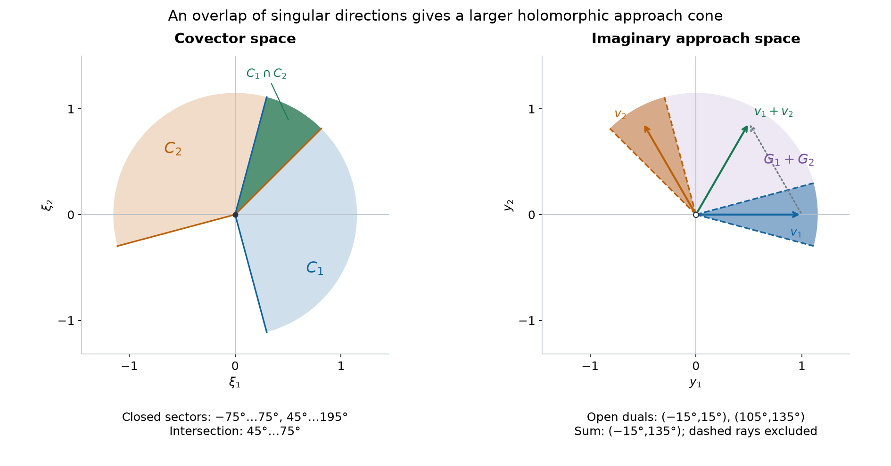

# Directional splitting and holomorphic compatibility

*Written and self-checked by GPT-6 Astra (OpenAI), Ultra, October 2026. Public domain (CC0).*

Suppose several closed sets of covector directions cover all directions. A hyperfunction can be separated into pieces whose singular directions lie in those sets, without introducing a new singular direction. The pieces are not unique. Their exact ambiguity consists of antisymmetric exchanges on pairwise intersections. When the directional sets are convex, these exchanges become holomorphic functions on sums of imaginary approach cones. This gives a concrete description of which collections of holomorphic sides represent the same hyperfunction.

The proof uses the complete carrier topology and spherical recovery in [Holomorphic boundary values without growth bounds](holomorphic-boundary-values-without-growth-bounds.md), Proposition 2; its Theorems 3–7 supply analytic wavefronts, boundary values, uniqueness and the converse wedge representation. The bounded quotient and closure-supported extension are proved in [Hyperfunctions from local analytic sources](hyperfunctions-from-local-analytic-sources.md), in the sections on bounded domains, compact sections and extension. The earlier distribution arguments in [Holomorphic decompositions of tempered distributions](holomorphic-decompositions-of-tempered-distributions.md), Theorem 5, and [Boundary regularity and conic decomposition](boundary-regularity-and-conic-decomposition.md), Theorems 4–5, explain the angular geometry and algebra. Here their limits are taken in analytic-functional carrier seminorms; no finite distributional order or polynomial boundary bound is assumed. Finite-measure integration, compactness and continuous limits use the supplied [integration foundation, Sections 15–16](../prerequisites/U011-free-foundations/banach-foundation-bridges.md) and [metric foundation, Sections 12–13](../prerequisites/U011-free-foundations/metric-foundation-bridges.md).

## A measure selects directions

Write \(S=S^{n-1}\), \(n\ge1\), with ordinary surface measure \(\sigma\); in dimension one this means two unit masses. Let \(U\) be holomorphic on the tube \(T=\{z:|\operatorname{Im}z|<1\}\). For a bounded open \(V\), put
\[
 A_y^V(\phi)=\int_V U(x+iy)\phi(x)\,dx,\qquad |y|<1,
 \tag{A1}
\]
where \(\phi\) is entire. Let \(\Lambda(U,V)\) be the set of unit vectors \(\omega\) such that \(U\) extends holomorphically near \(\partial V+i\omega\). The earlier angular continuity theorem supplies \(A_\omega^V\in A'(\overline V)\) for \(\omega\in\Lambda(U,V)\). For every complex neighborhood \(N\) of \(\overline V\), continuity is measured by bounds on tests with \(\sup_N|\phi|\le1\). Thus, for a finite complex Borel measure \(\mu\) with compact support \(E\subset\Lambda(U,V)\),
\[
 A_\mu^V=\int_E A_\omega^V\,d\mu(\omega)
                  \ \in A'(\overline V).
 \tag{A2}
\]
The integral means evaluation on each entire test. Compactness gives a uniform bound in every carrier seminorm, which proves the stated membership.

**Lemma 1 (the full angular bound).** Regard (A2) as a compactly supported hyperfunction on \(\mathbb R^n\). Then
\[
 \begin{split}
 \operatorname{WF}_A(A_\mu^V)\subset
 &\{(x,\xi):x\in V,\ \xi\ne0,\ -\xi/|\xi|\in E,\\
 &\hspace{43mm} U\text{ does not extend at }x-i\xi/|\xi|\}\\
 &{}\cup\bigl(\partial V\times(\mathbb R^n\setminus\{0\})\bigr).
 \end{split}
 \tag{A3}
\]
The boundary term records the chosen real integration domain.

**Proof: a common inward cone.** First suppose a nonempty open convex cone \(G\) and \(0<c<1\) satisfy
\[
 \omega\cdot y<-c|y|\qquad(\omega\in E,\ y\in G).
 \tag{A4}
\]
For \(y\in G\), \(0<|y|<c\),
\[
 |\omega+y|^2
 =1+2\omega\cdot y+|y|^2<1-c|y|<1.
 \tag{A5}
\]
Consequently
\[
 F(z)=\int_E U(z+i\omega)\,d\mu(\omega)
 \tag{A6}
\]
is holomorphic on this wedge. On each compact subset, its arguments stay in a compact subset of \(T\); Cauchy bounds and the finite total variation of \(\mu\) justify parameter differentiation. The continuations of \(U\) at the compact set \(\partial V+iE\) also continue \(F\) to a neighborhood of \(\partial V\).

For \(y\to0\) within a closed subcone of \(G\), the unshifted integral of \(F\) on \(V\) equals
\[
 L_y(\phi):=\int_V F(x+iy)\phi(x)\,dx
                =\int_E A_{\omega+y}^V(\phi)\,d\mu(\omega).
 \tag{A7}
\]
Fubini is valid at each such \(y\), since the integrand is bounded on the compact real and angular variables. Fix a carrier neighborhood \(N\). The continuity in Proposition 2 of the preceding lesson, covered by finitely many angular neighborhoods of \(E\), gives
\[
 \sup_{\omega\in E}\;
 \sup_{\sup_N|\phi|\le1}
 |(A_{\omega+y}^V-A_\omega^V)(\phi)|\longrightarrow0.
 \tag{A8}
\]
Indeed each of the finitely many inward contour graphs gives uniform convergence on its compact parameter set; take the maximum of the resulting errors. Multiplication by \(|\mu|(E)\) bounds the seminorm of \(L_y-A_\mu^V\). The boundary-regular comparison, Proposition 5(ii) of that lesson, now identifies the restriction of \(A_\mu^V\) to \(V\) with \(b_G F\). Its Theorem 6 gives
\[
 \operatorname{WF}_A(A_\mu^V|_V)
            \subset V\times(G^*\setminus\{0\}),\qquad
 G^*=\{\xi:y\cdot\xi\ge0\text{ for all }y\in G\}.
 \tag{A9}
\]

**Proof: excluding the wrong direction.** Fix a unit covector \(\nu\) with \(-\nu\notin E\). For each \(\omega\in E\) take \(v_\omega=-(\omega+\nu)\). Then
\[
 \omega\cdot v_\omega=\nu\cdot v_\omega
                         =-(1+\omega\cdot\nu)<0.
 \tag{A10}
\]
Choose finitely many small angular neighborhoods covering \(E\), each with compact closure preserving the first strict inequality for its selected \(v_j\). Assign each point of \(E\) to the first neighborhood containing it. This gives a finite Borel partition and restricted measures \(\mu_j\), whose supports lie in those closures. If a restricted measure is zero, omit it. Choose \(c_j>0\), smaller than one, such that
\[
 G_j=\{y:\ \omega\cdot y<-c_j|y|
                     \text{ for every }\omega\in\operatorname{supp}\mu_j\}
 \tag{A11}
\]
contains \(v_j\). This set is open by compactness, convex by the triangle inequality, and conic. Since \(\nu\cdot v_j<0\), \(\nu\notin G_j^*\). Formula (A9) excludes \((x,\nu)\) from each angular contribution at every \(x\in V\). The finite-sum wavefront rule excludes it from their sum.

**Proof: preserving an analytic direction.** Suppose \(x_0\in V\) and \(U\) extends at \(x_0+i\omega_0\), where \(\omega_0=-\nu\). Choose a small open cap \(O\) about \(\omega_0\) and a real ball \(B\) about \(x_0\), with \(\overline B\subset V\), such that \(U\) extends near \(\overline B+i\overline O\). Split \(\mu\) into its restrictions to \(O\) and \(S\setminus O\). The second contribution has support avoiding \(\omega_0\) and is regular at \((x_0,\nu)\) by the preceding argument.

The first contribution on \(B\) is the real analytic function
\[
 g(x)=\int_O U(x+i\omega)\,d\mu(\omega).
 \tag{A12}
\]
Compactness and Cauchy bounds give one complex neighborhood of \(\overline B\) on which this integral is holomorphic. To identify it with the restriction of \(A_{1_O\mu}^V\), split the real integral into \(B\) and \(V\setminus\overline B\). The sphere \(\partial B\) has Lebesgue measure zero, so the split is exact at interior heights. Both domains have the required angular continuation along their boundaries. Passing to the limit in their carrier seminorms leaves a remainder carried by \(\overline V\setminus B\). Thus (A12) is indeed the restriction near \(x_0\). The finite-sum rule proves regularity at \((x_0,\nu)\).

Finally \(A_\mu^V\) is carried by \(\overline V\), so its hyperfunction vanishes off that set. The two exclusions just proved settle every point of \(V\); no assertion is needed at its boundary. This proves (A3). \(\square\)

## Splitting an arbitrary closed cover

Let \(X\subset\mathbb R^n\) be bounded and open. No regularity of \(\partial X\) is required. Let \(C_1,\ldots,C_m\) be closed cones in \(\mathbb R^n\setminus\{0\}\), possibly empty or nonconvex, with union the punctured space. Write
\[
 F_j=C_j\cap S,\qquad
 E_1=F_1,\qquad E_j=F_j\setminus\bigcup_{\ell<j}F_\ell.
 \tag{S1}
\]
These are disjoint Borel sets with union \(S\), and \(\overline E_j\subset F_j\). A set boundary may have positive surface measure; the definition assigns every point to one piece.

**Theorem 2 (splitting and its exact ambiguity).** Every \(u\in\mathcal B(X)\) admits
\[
 u=\sum_{j=1}^m u_j,\qquad
 \operatorname{WF}_A(u_j)\subset
       \operatorname{WF}_A(u)\cap(X\times C_j).
 \tag{S2}
\]
More generally, suppose
\[
 \sum_j u_j=\sum_j\widetilde u_j,\qquad
 \operatorname{WF}_A(u_j),\operatorname{WF}_A(\widetilde u_j)
                                        \subset X\times C_j.
 \tag{S3}
\]
Then there are \(e_{jk}\in\mathcal B(X)\) such that
\[
 e_{jk}=-e_{kj},\qquad
 \widetilde u_j-u_j=\sum_k e_{jk},\qquad
 \operatorname{WF}_A(e_{jk})\subset X\times(C_j\cap C_k).
 \tag{S4}
\]
If all the wavefronts in (S3) lie in one closed conic set \(F\), the last bound can be intersected with \(F\). In particular this applies with \(F=\operatorname{WF}_A(u)\) to two splittings satisfying (S2).

**Proof: constructing the pieces.** Closure-supported extension and compact-section identification give a representative \(a\in A'(\overline X)\) of \(u\). Choose a bounded open \(Y\) with \(\overline X\subset Y\), and let \(U=K*a\) be its spherical holomorphic representative. The off-carrier domain
\[
 |\operatorname{Im}z|^2<
       1+\operatorname{dist}(\operatorname{Re}z,\overline X)^2
 \tag{S5}
\]
puts every direction in \(\Lambda(U,Y)\). Define linear maps on the space of compact representatives by
\[
 P_j^Y a(\phi)=\int_{E_j} A_{-\theta}^Y(\phi)\,d\sigma(\theta).
 \tag{S6}
\]
They take values in \(A'(\overline Y)\). Spherical recovery and reflection invariance of \(\sigma\) give the exact equality of analytic functionals
\[
 \sum_j P_j^Y a=a.
 \tag{S7}
\]
Restrict \(P_j^Y a\) to \(X\), calling the result \(u_j\). Apply Lemma 1 with the reflected measure \(1_{E_j}\sigma\). Its support is contained in \(-F_j\), so the selected covectors lie in \(C_j\). At \(x\in X\), absence from \(\operatorname{WF}_A(u)\) means precisely that \(K*a\) extends at the corresponding spherical point. The other exclusion in Lemma 1 therefore preserves that absence. The boundary of \(Y\) is outside \(X\). This proves (S2).

**Proof: correcting the sum of the representatives.** Put \(d_j=\widetilde u_j-u_j\). Choose representatives \(w_j\in A'(\overline X)\). Their sum represents zero on \(X\), hence, by the exact bounded quotient,
\[
 w:=\sum_j w_j\in A'(\partial X).
 \tag{S8}
\]
Replace \(w_1\) by \(w_1-w\). It still represents \(d_1\), and now
\[
 \sum_j w_j=0\quad\hbox{in }A'(\overline X).
 \tag{S9}
\]
Use the same \(Y\), ordered partition and linear maps (S6) for every \(w_j\). Set
\[
 e_{jk}=\left(P_k^Y w_j-P_j^Y w_k\right)\big|_X.
 \tag{S10}
\]
Antisymmetry is immediate, including \(e_{jj}=0\). Summing a row and using (S7), (S9) gives
\[
 \sum_k e_{jk}
   =\left(w_j-P_j^Y\sum_k w_k\right)\big|_X=d_j.
 \tag{S11}
\]
Lemma 1 and the wavefront definition give
\[
 \operatorname{WF}_A((P_k^Y w_j)|_X)
          \subset\operatorname{WF}_A(d_j)\cap(X\times C_k).
 \tag{S12}
\]
The finite-sum rule puts \(\operatorname{WF}_A(d_j)\) in \(X\times C_j\), and in \(F\) when it is specified. Apply (S12) to both terms of (S10), then use the sum rule once more. This proves all of (S4). \(\square\)

The construction selects representatives before splitting them. It does not assert that \(P_j^Y\) descends to an operator on the quotient \(A'(\overline X)/A'(\partial X)\). A change of representative can change the individual pieces by nonzero analytic functions. Exercise 7 exhibits this effect.

## Why intersections become sums

Here closed convex cones include zero. Their duals use nonnegative pairing. A cone is pointed if it contains no nonzero vector together with its negative.

**Lemma 3 (dual geometry, including the full-space case).** If \(C\) is closed, convex and pointed, then \(G=\operatorname{int}(C^*)\) is nonempty, \(\overline G=C^*\), and \(G^*=C\). For two such cones,
\[
 G_j+G_k=\operatorname{int}\bigl((C_j\cap C_k)^*\bigr),
 \qquad
 (G_j+G_k)^*=C_j\cap C_k.
 \tag{D1}
\]
Each \(G_j\) and \(G_k\) is contained in their sum. If \(C_j\cap C_k=\{0\}\), the sum is all of \(\mathbb R^n\).

**Proof: separation and double duals.** For any closed convex cone \(C\) and \(x\notin C\), choose \(p\in C\) minimizing \(|x-p|\). Existence follows by restricting to a closed bounded ball large enough to contain every improving point. Differentiating squared distance along \(p+t(c-p)\), \(0\le t\le1\), gives
\[
 (x-p)\cdot(c-p)\le0\quad(c\in C).
 \tag{D2}
\]
Taking \(c=0,2p\) shows \((x-p)\cdot p=0\). Thus \(\eta=p-x\) satisfies
\[
 \eta\in C^*,\qquad \eta\cdot x=-|x-p|^2<0.
 \tag{D3}
\]
Every point outside \(C\) is excluded from \(C^{**}\), while inclusion of \(C\) is immediate. Hence \(C^{**}=C\).

If \(C=\{0\}\), its dual is the full space and the assertions about \(G\) follow. Otherwise, for each \(\theta\in C\cap S\), pointedness gives \(-\theta\notin C\). Formula (D3) supplies \(\eta_\theta\in C^*\) with \(\eta_\theta\cdot\theta>0\). Choose finitely many of these positive neighborhoods covering \(C\cap S\), and sum their \(\eta_\theta\)'s. Every summand pairs nonnegatively with \(C\); at least one pairs positively at each unit point. Compactness gives a uniform positive minimum for the sum. A small ball about it is therefore in \(C^*\), proving \(G\ne\varnothing\).

Choose \(\eta_0\in G\) with a ball of radius \(r>0\) in \(C^*\). For \(\eta\in C^*\) and \(\varepsilon>0\), the ball of radius \(\varepsilon r\) about \(\eta+\varepsilon\eta_0\) lies in \(C^*\). Thus \(G\) is dense in \(C^*\), and \(G^*=C^{**}=C\).

We also need an elementary fact about open convex sets:
\[
 O\ne\varnothing,\ O\text{ open and convex}
                  \quad\Longrightarrow\quad O=\operatorname{int}\overline O.
 \tag{D4}
\]
For the nontrivial inclusion choose \(x\in\operatorname{int}\overline O\). A small simplex with vertices \(x+\delta e_1,\ldots,x+\delta e_n,x-\delta\sum e_i\) lies there and has \(x\) as its barycenter with all coefficients positive. Approximate its vertices by points of \(O\). For close approximations the vertex matrix stays invertible and the barycentric coefficients of \(x\) stay positive, by continuity of matrix inversion. Thus \(x\) is a convex combination of points of \(O\), proving (D4).

Now \(H=G_j+G_k\) is a nonempty open convex cone. Nonnegative pairing with the two summands implies nonnegative pairing with their sum. Conversely, fixing \(a\in G_j\), \(b\in G_k\) and letting \(t\downarrow0\) in \(a+tb\) shows that a vector in \(H^*\) pairs nonnegatively with \(a\); interchange the roles for \(b\). Hence \(H^*=C_j\cap C_k\). Apply the double-dual identity to \(\overline H\), and (D4), to obtain (D1).

For \(y\in G_j\), choose any \(v\in G_k\). Openness gives \(y-\varepsilon v\in G_j\) for small positive \(\varepsilon\), so \(y=(y-\varepsilon v)+\varepsilon v\in H\). The other inclusion is identical. If the intersection is zero, its dual is the full space, so (D1) proves the final assertion. \(\square\)

*Two exact planar cones illustrate (D1). On the left the closed covector sectors have angles \([-75^\circ,75^\circ]\) and \([45^\circ,195^\circ]\); their intersection is \([45^\circ,75^\circ]\). On the right their open dual interiors have angles \((-15^\circ,15^\circ)\) and \((105^\circ,135^\circ)\), whose sum has angles \((-15^\circ,135^\circ)\). The arrows give \(v_1=(1,0)\), \(v_2=(-1/2,\sqrt3/2)\), and \(v_1+v_2=(1/2,\sqrt3/2)\). The two panels use different spaces. Solid and dashed boundary rays distinguish closed and open cones. Theorem 4 places the exchange function on the full sum cone. [Editable figure source](../figures/overlap-and-sum-cones.py).*

## The exact relation among holomorphic sides

Fix a finite cover of \(\mathbb R^n\) by closed convex pointed cones \(C_1,\ldots,C_m\). Let \(G_j=\operatorname{int}(C_j^*)\). Empty directional cones cause no difficulty: \(C_j=\{0\}\) gives \(G_j=\mathbb R^n\).

For an open convex cone \(G\ne\mathbb R^n\), write \(\mathcal H_G(X)\) for the vector space of holomorphic germs at \(X\) from \(G\), in the precise local wedge sense of Theorem 4 of the preceding lesson. A representative is holomorphic on an open set containing all sufficiently short imaginary displacements in each closed subcone, locally uniformly over compact real subsets. Two representatives are equal when they agree on such smaller wedges. Let \(\mathcal H_{\mathbb R^n}(X)\) mean ordinary holomorphic germs on a complex neighborhood of \(X\); their restrictions are real analytic functions. Use ordinary trace as their boundary map.

These conventions cover cone sums that contain zero. For the other cones use the growth-free boundary map. Its cone independence, uniqueness and linearity make
\[
 \Phi:\bigoplus_{j=1}^m\mathcal H_{G_j}(X)\longrightarrow\mathcal B(X),
 \qquad
 \Phi(f_1,\ldots,f_m)=\sum_j b_{G_j}f_j
 \tag{H1}
\]
well defined. The finite direct sum is simply a finite tuple.

**Theorem 4 (holomorphic compatibility).** The map \(\Phi\) is onto. Its kernel consists exactly of tuples of the form
\[
 f_j=\sum_k f_{jk}|_{G_j},\qquad
 f_{jk}\in\mathcal H_{G_j+G_k}(X),\qquad
 f_{jk}=-f_{kj},\quad f_{jj}=0.
 \tag{H2}
\]
The restriction symbol means restriction of a holomorphic germ to the indicated approach cone. In particular,
\[
 \mathcal B(X)\ \simeq\
 \left(\bigoplus_j\mathcal H_{G_j}(X)\right)\big/\mathcal R,
 \tag{H3}
\]
where \(\mathcal R\) is the linear space in (H2). This is an equality of the described vector spaces, with no topology on the quotient being asserted.

**Proof: every hyperfunction has such sides.** Theorem 2 gives \(u=\sum_j u_j\), with \(\operatorname{WF}_A(u_j)\subset X\times(C_j\setminus\{0\})\). By Lemma 3, \(G_j^*=C_j\). If \(C_j\ne\{0\}\), \(G_j\) excludes zero and the full convex-wedge converse gives \(u_j=b_{G_j}f_j\). If \(C_j=\{0\}\), the wavefront projection theorem says \(u_j\) is real analytic, and its local power series glue to a holomorphic germ near \(X\). This proves surjectivity.

**Proof: every displayed exchange is zero.** Put \(H=G_j+G_k\). Lemma 3 gives \(G_j,G_k\subset H\). If \(H\ne\mathbb R^n\), the cone independence of the growth-free boundary identifies
\[
 b_{G_j}(f_{jk}|_{G_j})=b_H f_{jk}
                     =b_{G_k}(f_{jk}|_{G_k}).
 \tag{H4}
\]
Indeed every closed subcone of \(G_j\) or \(G_k\) lies compactly in \(H\), and the exact boundary class is independent of its approach direction. If \(H=\mathbb R^n\), the analytic-trace comparison gives the same identities. Antisymmetry cancels the two contributions from each unordered pair. Thus (H2) lies in \(\ker\Phi\).

**Proof: no other relation is needed.** Suppose \(\sum_j b_{G_j}f_j=0\), and set \(u_j=b_{G_j}f_j\). Their wavefronts are in \(X\times(C_j\setminus\{0\})\). Apply the ambiguity assertion of Theorem 2 to the zero tuple and the tuple \((u_j)\). It gives
\[
 u_j=\sum_k e_{jk},\qquad e_{jk}=-e_{kj},\qquad
 \operatorname{WF}_A(e_{jk})
              \subset X\times((C_j\cap C_k)\setminus\{0\}).
 \tag{H5}
\]
For \(j<k\), let \(H=G_j+G_k\). If \(C_j\cap C_k\ne\{0\}\), Lemma 3 gives \(H^*=C_j\cap C_k\), and the wedge converse provides \(f_{jk}\in\mathcal H_H(X)\) with boundary \(e_{jk}\). If the intersection is zero, \(e_{jk}\) is real analytic; choose its ordinary holomorphic germ, which is exactly the full-space case. Set \(f_{kj}=-f_{jk}\) and \(f_{jj}=0\).

By (H4), the \(G_j\)-boundary of \(f_j-\sum_k f_{jk}|_{G_j}\) is zero. Zero-boundary uniqueness gives equality of these germs. In the full-space case ordinary analytic trace is injective, giving the same conclusion. Thus (H2) holds. The kernel description and surjectivity prove (H3). \(\square\)

Two choices of cone cover give the same intrinsic hyperfunction space through (H3). One can compare them using their combined finite cover: insert zero components for the additional cones and apply the proved kernel description. No assertion that individual angular pieces are canonical is involved.

## Exercises with full solutions

**Exercise 1 (basic) — a finite angular atom.** Let \(U\) and \(V\) be as in Lemma 1, and let \(\mu=c\delta_{\omega_0}\) with \(\omega_0\in\Lambda(U,V)\). Give the interior wavefront bound and explain why it need not be an equality.

**Solution.** Formula (A3) permits only covectors \(-t\omega_0\), \(t>0\), and only where \(U\) fails to extend at \(x+i\omega_0\). If \(U=1\), the functional is integration of \(c\phi\) on \(V\), whose restriction to \(V\) is the analytic constant \(c\). It has no interior analytic wavefront, even for \(c\ne0\). The boundary term in (A3) is not an interior singularity.

**Exercise 2 (basic) — two disjoint directional sets.** In dimension one take \(C_+=\{\xi>0\}\), \(C_-=\{\xi<0\}\). Show that two subordinate decompositions of the same hyperfunction differ by transferring a real analytic function between the two pieces.

**Solution.** Their cone intersection is empty in the punctured line. Theorem 2 gives \(e_{+-}=-e_{-+}\) with empty wavefront. The projection theorem makes \(a=e_{+-}\) real analytic. Thus \(\widetilde u_+=u_++a\) and \(\widetilde u_-=u_--a\). Conversely every such transfer preserves both directional bounds, since adding an analytic function does not enlarge wavefront. On the holomorphic side the approach cones are the positive and negative half-lines, whose sum is all of \(\mathbb R\); their exchange is therefore a holomorphic germ across the real base.

**Exercise 3 (intermediate) — exact planar duals.** Compute the dual interiors and their sum for the two closed sectors in the figure, and verify the displayed vector addition.

**Solution.** A unit direction at angle \(\alpha\) pairs nonnegatively with every direction in a closed sector of center \(\beta\) and half-width \(a<90^\circ\) exactly when its angular distance from \(\beta\) is at most \(90^\circ-a\). This follows from the sign of \(\cos(\alpha-\theta)\) at the two extreme angles; throughout the intervening interval the difference stays between \(-90^\circ\) and \(90^\circ\). Here \(a=75^\circ\), giving the two open intervals \((-15^\circ,15^\circ)\), \((105^\circ,135^\circ)\). The covector intersection has center \(60^\circ\) and half-width \(15^\circ\), so its dual interior is \((-15^\circ,135^\circ)\), as Lemma 3 requires. Finally
\[
 (1,0)+(-1/2,\sqrt3/2)=(1/2,\sqrt3/2),
 \tag{X1}
\]
whose direction is \(60^\circ\), inside that sum and outside each of the two narrow original cones.

**Exercise 4 (intermediate) — a closed cover with thick boundaries.** Suppose the closed directional sets in (S1) have overlaps of positive surface measure. Show that the construction still recovers the whole hyperfunction and that permuting the order changes a resulting decomposition only by the exchanges in (S4).

**Solution.** Each point has a unique first containing set. Hence \(\sum_j1_{E_j}=1\) pointwise on the sphere, including every boundary. Finite additivity and spherical recovery give (S7) without discarding a set. The support of \(1_{E_j}\sigma\) is contained in the closed \(F_j\), which suffices for the wavefront estimate. A new order produces another splitting satisfying (S2). After labeling its pieces by the original cones, Theorem 2 gives antisymmetric exchanges with wavefront in both cone directions and in \(\operatorname{WF}_A(u)\).

**Exercise 5 (intermediate) — the correcting boundary term.** Suppose three chosen lifts of \(d_1+d_2+d_3=0\) have sum \(w\in A'(\partial X)\). Write corrected lifts and prove their skew exchange formula has row sums \(d_j\).

**Solution.** Set \(v_1=w_1-w\), \(v_2=w_2\), \(v_3=w_3\). They represent the same \(d_j\), since \(w\) vanishes on \(X\), and \(\sum v_j=0\) as analytic functionals. Define
\[
 e_{jk}=(P_k^Yv_j-P_j^Yv_k)|_X.
 \tag{X2}
\]
Then
\[
 \sum_k e_{jk}
   =\left(\sum_kP_k^Yv_j-P_j^Y\sum_kv_k\right)|_X
   =v_j|_X=d_j.
 \tag{X3}
\]
Using the uncorrected lifts instead would leave the extra term \(-(P_j^Yw)|_X\), which need not vanish. This is why equality of hyperfunction sums is converted to exact equality of compact representatives first.

**Exercise 6 (advanced) — a genuine three-way cancellation.** For three cones as in Theorem 4, choose germs \(a_{12},a_{13},a_{23}\) on the respective sum cones. Form a tuple whose total boundary is zero, and verify the signs without imposing a common domain on all three germs.

**Solution.** On the individual approach cones set
\[
 \begin{aligned}
 f_1&=a_{12}|_{G_1}+a_{13}|_{G_1},\\
 f_2&=-a_{12}|_{G_2}+a_{23}|_{G_2},\\
 f_3&=-a_{13}|_{G_3}-a_{23}|_{G_3}.
 \end{aligned}
 \tag{X4}
\]
Each restriction is defined by Lemma 3. For each pair, (H4) identifies its two boundary values on \(X\), so the opposite signs cancel. Only the finitely many germs entering one component must be restricted to a common smaller \(G_j\)-wedge; their intersection still has the required local heights. There is no need to evaluate all three pair germs on one common complex domain.

**Exercise 7 (advanced) — an angular piece of a zero class.** Let \(n=1\), \(X=(0,1)\), \(Y=(-1,2)\), and \(a=\delta_0\in A'(\overline X)\). Show that \(a|_X=0\), but both individual angular restrictions \((P_\pm^Ya)|_X\) are nonzero analytic functions.

**Solution.** The compact functional is carried at a boundary point of \(X\), so its quotient class is zero. The two one-point angular pieces are, on \(X\),
\[
 (P_+^Ya)(x)=K(x-i),\qquad
 (P_-^Ya)(x)=K(x+i).
 \tag{X5}
\]
Indeed the off-carrier domain of \(K\) contains both displaced copies of every compact subinterval of \(X\); local restriction of the angular functional therefore equals its ordinary analytic trace, as in the last part of Lemma 1. Neither function is identically zero. If, for example, \(K(x-i)\) vanished for every \(0<x<1\), the one-variable identity principle would make \(K\) vanish on its connected continuation domain
\[
 \{x+iy:y^2<1+x^2\}.
 \tag{X6}
\]
This domain is connected: shrink the imaginary coordinate to zero and then move on the real axis. But
\[
 K(0)=(2\pi)^{-1}\int_{\mathbb R}\frac{d\xi}{2\cosh\xi}>0;
 \tag{X7}
\]
the defining spherical integral has \(I(\xi)=e^\xi+e^{-\xi}\), and this positive integral is finite. The other sign is identical. Spherical recovery gives \(K(x-i)+K(x+i)=0\) on \(X\). Thus the two pieces cancel but do not individually vanish. This explicitly disproves descent of these particular angular maps through the boundary quotient.

**Exercise 8 (advanced) — an essential singularity split into two sides.** For \(f(z)=e^{-1/z^2}\) on a real interval containing zero, let
\[
 J=b_+f-b_-f.
 \tag{X8}
\]
Describe a directional splitting, prove that at least one piece is not a distribution, and determine the ambiguity among all splittings with the same two half-line bounds.

**Solution.** Take \(u_+=b_+f\) and \(u_-=-b_-f\). The positive-dual bound puts their wavefronts in the positive and negative covector rays, respectively. Off zero both sides have the ordinary analytic trace, so the only possible singular base point is zero. The preceding lesson, Exercises 2 and 8, proves that the upper boundary and the full jump are not distributions, using the super-polynomial value \(f(it)=e^{1/t^2}\) and the infinite nonzero point moments, respectively. In particular the exhibited upper piece is not a distribution. Also no decomposition of \(J\) can have both pieces distributions, since their sum would be a distribution. Exercise 2 shows that every other subordinate splitting differs by an analytic transfer \(a,-a\); the analytic functions are distributions, so each piece's distributional or nondistributional character is preserved by this ambiguity. This calculation requires no polynomial growth estimate for defining either boundary.

## Programme proofs and mathematical source

The carrier and hyperfunction arguments used here are fully available in Analytic tests and real carriers, [Localizing analytic sources without analytic cutoffs](localizing-analytic-sources-without-analytic-cutoffs.md), [Hyperfunctions from local analytic sources](hyperfunctions-from-local-analytic-sources.md), and [Holomorphic boundary values without growth bounds](holomorphic-boundary-values-without-growth-bounds.md). The first two are the proved foundations of the last two; the particular interfaces used above are identified at their points of use.

- Lars Hörmander, *The Analysis of Linear Partial Differential Operators I: Distribution Theory and Fourier Analysis*, reprint of the second edition, Springer, 2003, [doi:10.1007/978-3-642-61497-2](https://doi.org/10.1007/978-3-642-61497-2), Section 9.3, Lemma 9.3.6, Theorem 9.3.7 and the ensuing interpretation by holomorphic sides. These supply the mathematical angular and conic decomposition results and Martineau compatibility relation. The carrier-limit proof, explicit representative correction, convex geometry, organization, examples, exercises and figure here are independently expressed.

General analytic pullback and the further tensor, product, integration and kernel operations require their own proofs. They are not conclusions of this lesson.
