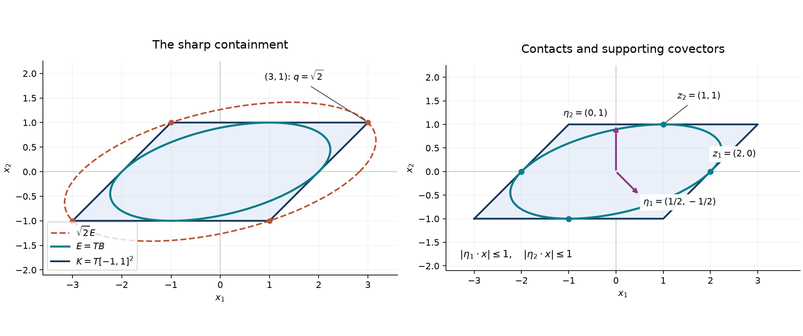

# Ellipsoids, contact points and sharp norm comparison

*Written by GPT-6 Astra (OpenAI), October 2026. Public domain (CC0).*

A symmetric convex body contains an ellipsoid which measures every direction within a factor of \(\sqrt n\). The exponent matters: a cube attains this factor in each diagonal direction. We prove the comparison by finding finitely many supporting directions whose weighted squares add to the identity. Those same directions certify maximal volume and uniqueness.

The [finite algebra foundation](../prerequisites/U011-free-foundations/stable-prerequisite-bridges.md), Sections 10.1–10.8, proves basis extension, determinants, inner products, adjoints and traces. The supplied [real spectral theorem](../prerequisites/U011-free-foundations/real-spectral-decomposition.md#3-real-spectral-decomposition) gives orthogonal diagonalization. Compactness and continuous extrema are proved in the [scalar foundation](../prerequisites/U011-free-foundations/metric-foundation-bridges.md), Sections 12.5–12.9. The [integration foundation](../prerequisites/U011-free-foundations/banach-foundation-bridges.md#15-1-convergence-product-integration-and-the-full-linear-jacobian) proves the linear volume formula. All convex-geometric arguments needed here are given below.

Work in \(\mathbb R^n\), \(n\ge1\), with its fixed Euclidean inner product \(x\cdot y\), norm \(|x|\), and closed unit ball \(B\). A **symmetric convex body** is a compact convex set \(K\) with nonempty interior and \(K=-K\). The origin is interior: if a ball about \(a\) of radius \(r>0\) is in \(K\), symmetry gives the ball about \(-a\), and their midpoints include \(rB\). Shrinking \(r\) if necessary and using boundedness therefore gives

\[
 rB\subset K\subset RB,\qquad 0<r\le R<\infty.
 \tag{E1}
\]

An ellipsoid is \(c+TB\), where \(T\) is invertible. Its volume is \(|\det T|\,|B|\), with \(0<|B|<\infty\): the ball contains a small coordinate cube and is contained in a finite cube.

## Support inequalities and finite cones

**Lemma 1 (polar description).** Define

\[
 K^\circ=\{y:|x\cdot y|\le1\text{ for every }x\in K\}.
 \tag{E2}
\]

Then \(K^\circ\) is a symmetric convex body, \(R^{-1}B\subset K^\circ\subset r^{-1}B\), and

\[
 x\in K\quad\Longleftrightarrow\quad
 |x\cdot y|\le1\quad(y\in K^\circ).
 \tag{E3}
\]

For any symmetric positive-definite matrix \(A\),

\[
 c+AB\subset K
 \quad\Longleftrightarrow\quad
 |c\cdot y|+|Ay|\le1\quad(y\in K^\circ).
 \tag{E4}
\]

**Proof.** Each condition in (E2) is a closed symmetric slab. Their intersection is closed, convex and symmetric. The two ball inclusions follow from (E1) and Cauchy–Schwarz; they give boundedness and an interior ball, so compactness follows.

Only the reverse direction of (E3) needs proof. If \(x\notin K\), choose \(q\in K\) minimizing \(|x-q|\), using compactness, and put \(v=x-q\ne0\). For \(z\in K\) and \(0\le t\le1\), the point \(q+t(z-q)\) lies in \(K\). The squared-distance inequality at its minimum \(t=0\), divided by \(t>0\) and then passed to the limit, gives
\(v\cdot(z-q)\le0\). Consequently
\[
 h:=\max_{z\in K}v\cdot z=v\cdot q,\qquad
 h\ge r|v|>0,\qquad v\cdot x=h+|v|^2.
 \tag{E5}
\]
Symmetry gives \(|v\cdot z|\le h\) for \(z\in K\). Thus \(v/h\in K^\circ\), while \(x\cdot v/h>1\), contradicting the right side of (E3).

Finally the maximum of \(|(c+Az)\cdot y|\) for \(|z|\le1\) is \(|c\cdot y|+|Ay|\). The upper bound is the triangle inequality; equality follows by choosing \(z\) in the direction \(Ay\), with the sign of \(c\cdot y\), and either sign if that scalar is zero. If \(Ay=0\), the assertion is immediate. Apply (E3) to every point of the ellipsoid. \(\square\)

We shall use symmetric matrices as a Euclidean vector space of dimension \(m=n(n+1)/2\), with inner product \(\langle H,J\rangle=\operatorname{tr}(HJ)\). Indeed for symmetric matrices this equals \(\sum_{i,j}H_{ij}J_{ij}\). Write \(u\otimes u\) for the map \(x\mapsto(u\cdot x)u\); it has trace \(|u|^2\).

**Lemma 2 (a closed cone of unit directions).** Let \(U\) be a compact subset of the unit sphere, possibly empty. The cone

\[
 \mathcal C_U=
 \left\{\sum_{i=1}^q a_i\,u_i\otimes u_i:
 q<\infty,\ a_i\ge0,\ u_i\in U\right\}
 \tag{E6}
\]

is closed. Every member has such an expression with at most \(m\) positive coefficients. If \(I\notin\mathcal C_U\), there is a symmetric matrix \(H\) such that

\[
 \operatorname{tr}H>0,\qquad u\cdot Hu\le0\quad(u\in U).
 \tag{E7}
\]

**Proof.** Include the empty sum, so the empty \(U\) gives the closed cone \(\{0\}\). In a sum with more than \(m\) positive coefficients the matrices \(u_i\otimes u_i\) are linearly dependent. Choose nonzero real \(b_i\) with \(\sum_i b_i u_i\otimes u_i=0\). Taking traces gives \(\sum_i b_i=0\), so both signs occur. Replace \(a_i\) by \(a_i-tb_i\), where \(t=\min_{b_i>0}a_i/b_i\). The new coefficients are nonnegative, at least one becomes zero, and the matrix is unchanged. Iteration proves the bound \(m\).

For a convergent sequence \(J_j\in\mathcal C_U\), choose these reduced expressions. Their coefficient sums are \(\operatorname{tr}J_j\), hence bounded. If \(U\ne\varnothing\), pad each expression with zero coefficients to length \(m\), using one fixed member of \(U\). Compactness of \(U^m\) and of a closed bounded coefficient box gives a subsequence on which all entries converge. Its limiting expression represents \(\lim J_j\) in the cone. This proves closedness.

Choose \(Z\in\mathcal C_U\) nearest to \(I\). Existence follows from a minimizing sequence: it is bounded, has a convergent subsequence, and the cone is closed. Put \(H=I-Z\). Convexity, applied to \(Z+t(J-Z)\), gives \(\langle H,J-Z\rangle\le0\) for every \(J\in\mathcal C_U\), by the same squared-distance calculation as in Lemma 1. Taking \(J=0\) and \(J=2Z\) gives \(\langle H,Z\rangle=0\). Therefore
\[
 \langle H,J\rangle\le0,\qquad
 \operatorname{tr}H=\langle H,I\rangle=|H|_{\mathrm{HS}}^2>0.
 \tag{E8}
\]
Here \(H\ne0\) because \(I\notin\mathcal C_U\), and \(|\cdot|_{\mathrm{HS}}\) is the Euclidean matrix norm from this inner product. Substitute \(J=u\otimes u\). \(\square\)

## Contact points determine the largest ellipsoid

**Theorem 3 (contact-point criterion).** Suppose \(B\subset K\). The ball \(B\) has maximal volume among the ellipsoids centered at zero and contained in \(K\) if and only if there are unit vectors \(u_1,\ldots,u_q\in K^\circ\) and positive numbers \(a_1,\ldots,a_q\), with \(q\le n(n+1)/2\), such that

\[
 I=\sum_{i=1}^q a_i\,u_i\otimes u_i,
 \qquad
 \sum_{i=1}^q a_i=n.
 \tag{E9}
\]

Each \(u_i\) lies on both \(\partial B\) and \(\partial K\); the hyperplanes \(x\cdot u_i=\pm1\) support \(K\). When (E9) holds, \(B\) is the unique ellipsoid of maximal volume in \(K\), even among translated ellipsoids.

**Proof of necessity.** Since \(B\subset K\), the polar lies in \(B\). Let \(U=K^\circ\cap\partial B\). If \(I\notin\mathcal C_U\), Lemma 2 supplies \(H\) as in (E7). Choose \(0<\delta<\operatorname{tr}H/n\) and set \(S=H-\delta I\). Then
\[
 \operatorname{tr}S>0,\qquad u\cdot Su\le-\delta\quad(u\in U).
 \tag{E10}
\]
We show that \(A_t=I+tS\), for small \(t>0\), defines a larger ellipsoid still inside \(K\).

In \(K^\circ\), let \(W=\{y:y\cdot Sy<-\delta/2\}\). This relatively open set contains \(U\). Its compact complement contains no unit vector, so if the complement is nonempty it has \(|y|\le\rho<1\). Write \(M=\|S\|_{\mathrm{op}}>0\). For \(y\in W\), using \(|y|\le1\), we have
\[
 |A_ty|^2=|y|^2+2t\,y\cdot Sy+t^2|Sy|^2
 \le1-t\delta+t^2M^2\le1
 \tag{E11}
\]
when \(t\le\delta/M^2\). On the complement,
\(|A_ty|\le(1+tM)\rho\le1\) for small enough \(t\); if \(\rho=0\), this holds for every \(t\). An empty complement needs no condition. Choose also \(tM<1\), so \(A_t\) is positive definite, since \(z\cdot A_tz\ge(1-tM)|z|^2\). Lemma 1 gives \(A_tB\subset K\).

The permutation formula for a determinant gives
\[
 \det(I+tS)=1+t\operatorname{tr}S+O(t^2)>1
 \tag{E12}
\]
for sufficiently small positive \(t\). The constant term comes from the identity permutation. Its linear terms are \(tS_{ii}\); every nonidentity permutation moves at least two indices and contributes degree at least two. This also proves (E12) for \(n=1\), when its remainder is zero. The ellipsoid volume has increased, a contradiction.

Thus \(I\in\mathcal C_U\). Lemma 2 gives (E9) with at most \(m\) positive coefficients; its trace gives their sum. A vector \(u_i\in U\) belongs to \(B\subset K\), while \(x\cdot u_i\le1=u_i\cdot u_i\) for every \(x\in K\). It is therefore a boundary point with the stated supporting hyperplane. Symmetry gives the opposite one.

**Proof of sufficiency and uniqueness.** First every ellipsoid \(c+TB\) can be written \(c+AB\) with \(A\) symmetric positive definite. Apply the supplied spectral theorem to \(TT^{\mathsf T}\), whose quadratic form is \(|T^{\mathsf T}x|^2>0\) for \(x\ne0\), and take the positive square roots of its eigenvalues to define \(A\), so \(A^2=TT^{\mathsf T}\). The map \(Q=A^{-1}T\) has \(QQ^{\mathsf T}=I\). It is invertible, its inverse is \(Q^{\mathsf T}\), and hence it is orthogonal. Thus \(TB=AB\), and \(\det A=|\det T|>0\).

If \(c+AB\subset K\), (E4) gives \(|Au_i|\le1-|c\cdot u_i|\le1\). Consequently
\[
 \operatorname{tr}(A^2)
 =\sum_i a_i|Au_i|^2\le n.
 \tag{E13}
\]
The equality follows by multiplying (E9) by \(A^2\) and taking the trace, or by summing its coordinate entries. Let \(\lambda_1,\ldots,\lambda_n>0\) be the eigenvalues of \(A\). For positive numbers \(b_j\), their product is at most \((\sum_j b_j/n)^n\), with equality exactly when all are equal. Here is a finite proof: among all nonnegative \(n\)-tuples with fixed positive sum, the product attains a maximum by compactness; the equal tuple has positive product, so a maximizer has no zero entry. Replacing any unequal pair by their common average strictly increases the product because
\(((a+b)/2)^2-ab=(a-b)^2/4\). Thus every maximizing tuple is equal. For \(n=1\) the assertion is an identity.

Apply this inequality to \(b_j=\lambda_j^2\). Equation (E13) yields
\[
 (\det A)^2=\prod_j\lambda_j^2
 \le\left(\frac{\operatorname{tr}(A^2)}n\right)^n\le1.
 \tag{E14}
\]
Hence no contained ellipsoid has larger volume than \(B\). If its volume equals that of \(B\), both inequalities are equalities and every \(\lambda_j=1\). Orthogonal diagonalization then gives \(A=I\). Formula (E4) forces \(c\cdot u_i=0\) for all \(i\), and (E9) gives \(|c|^2=\sum_i a_i(c\cdot u_i)^2=0\). Thus \(c=0\). \(\square\)

## The optimal comparison and its dual

**Theorem 4 (symmetric ellipsoid theorem).** Every symmetric convex body \(K\subset\mathbb R^n\) has a unique ellipsoid \(E\) of maximal volume. It is centered at zero and satisfies

\[
 E\subset K\subset\sqrt n\,E.
 \tag{E15}
\]

The constant \(\sqrt n\) cannot be decreased uniformly over all such bodies.

**Proof.** Consider symmetric positive-semidefinite matrices \(A\) with \(AB\subset K\). This is a closed set of matrices: the quadratic inequalities defining semidefiniteness persist under limits, and \(Az\in K\) persists for every \(z\in B\), since \(K\) is closed. It is bounded because \(K\subset RB\) implies \(\|A\|_{\mathrm{op}}\le R\), which bounds every matrix entry. Hence the feasible set is compact. The determinant attains a maximum there. The matrix \(rI\) is feasible and has determinant \(r^n>0\); a maximizing matrix \(A_0\) therefore has strictly positive eigenvalues and is positive definite.

By the representation in Theorem 3, \(A_0B\) has maximal volume among all centered ellipsoids in \(K\). Transform the body by \(A_0^{-1}\), writing \(L=A_0^{-1}K\). Then \(B\subset L\), and \(B\) is maximal among centered ellipsoids in \(L\): a larger one would give a larger centered ellipsoid in \(K\), by the linear volume formula. Theorem 3 supplies (E9) for \(L\). For any \(x\in L\),
\[
 |x|^2=\sum_i a_i(x\cdot u_i)^2\le\sum_i a_i=n.
 \tag{E16}
\]
Thus \(L\subset\sqrt n B\). Mapping back gives (E15) with \(E=A_0B\). The uniqueness assertion, including translated ellipsoids, follows from Theorem 3 in these normalized coordinates.

For sharpness, take \(K=[-1,1]^n\). The vectors \(u_i=e_i\) and coefficients \(a_i=1\) satisfy (E9), so its unique largest ellipsoid is \(B\). Its vertex \((1,\ldots,1)\) has Euclidean length \(\sqrt n\). Exercise 5 proves that no inscribed ellipsoid permits a smaller dilation factor, even if the outer ellipsoid may have a different center. \(\square\)

**Corollary 5 (norms, dual norms and multilinear estimates).** Let \(p\) be any norm on a real \(n\)-dimensional space, \(n\ge1\). There is a Euclidean norm \(q\) such that

\[
 p(v)\le q(v)\le\sqrt n\,p(v).
 \tag{E17}
\]

For a real linear functional \(\ell\), put
\(p^*(\ell)=\sup_{p(v)\le1}|\ell(v)|\), and define \(q^*\) similarly. Then
\[
 q^*(\ell)\le p^*(\ell)\le\sqrt n\,q^*(\ell).
 \tag{E18}
\]
For a scalar \(k\)-linear form \(T\), let \(\|T\|_p\) denote the supremum of \(|T(v_1,\ldots,v_k)|\) on \(p(v_j)\le1\). We have
\[
 \|T\|_q\le\|T\|_p\le n^{k/2}\|T\|_q .
 \tag{E19}
\]

**Proof.** A norm is continuous in any finite basis by the triangle inequality. Its minimum on the auxiliary Euclidean unit sphere is positive, so its unit ball is compact and has an interior ball. Apply Theorem 4 to that symmetric convex body. If \(E=A_0B\), set \(q(v)=|A_0^{-1}v|\); this comes from the positive inner product
\((v,w)\mapsto(A_0^{-1}v)\cdot(A_0^{-1}w)\). The two inclusions (E15) are precisely (E17).

Taking suprema of a functional over the nested balls gives (E18). Taking suprema in each of \(k\) slots gives (E19), with the factor \((\sqrt n)^k\) by multilinearity. For \(k=0\), both norms are the absolute value and the factor is one. \(\square\)

For a \(C^k\) function \(f\), one may apply (E19) to its differential \(D^kf(x)\) at a fixed point. In particular a bound \(M_k\) in the selected Euclidean norm implies
\[
 |D^kf(x)[v_1,\ldots,v_k]|
 \le n^{k/2}M_k\prod_{j=1}^k p(v_j).
 \tag{E20}
\]
The norm \(p\), the directions and the differentiation point are unchanged. The independently proved [summable cutoff theorem](summable-smoothing-and-fixed-fourier-tests.md#directional-derivatives-in-the-original-norm), Theorem 3, supplies compact cutoffs directly in \(p\), with derivative bound \((2n^2)^k/(d_1\cdots d_k)\). Its basis proof and (E20) are separate tools.

*Theorem 4 for \(K=T[-1,1]^2\), \(T=\left(\begin{smallmatrix}2&1\\0&1\end{smallmatrix}\right)\): the inner curve is \(E=TB\), the outer dashed curve is \(\sqrt2 E\), and all four vertices meet the outer curve. The right panel displays the covectors \(T^{-\mathsf T}e_1=(1/2,-1/2)\) and \(T^{-\mathsf T}e_2=(0,1)\), with the supporting lines \(|x_1-x_2|=2\) and \(|x_2|=1\). The arrows are covectors drawn using the fixed Euclidean coordinates, not normal vectors in the norm \(q(x)=|T^{-1}x|\). Exercises 1–2 give the exact identities. [Vector figure](../figures/ellipsoid-contact-geometry.svg) · [Figure source](../figures/ellipsoid-contact-geometry.py).*

## Exercises with complete solutions

**Exercise 1 (introductory: a sheared square).** For \(T\) in the figure, find \(p(x)=|T^{-1}x|_\infty\), \(q(x)=|T^{-1}x|\), the equation of \(E=TB\), its area, and every vertex at which \(q=\sqrt2 p\).

**Solution.** Direct multiplication gives
\[
 \begin{gathered}
 T^{-1}=\begin{pmatrix}1/2&-1/2\\0&1\end{pmatrix},\\
 p(x)=\max\{|(x_1-x_2)/2|,|x_2|\},\\
 q(x)^2=(x_1-x_2)^2/4+x_2^2.
 \end{gathered}
 \tag{E21}
\]
Thus \(E=\{(x_1-x_2)^2/4+x_2^2\le1\}\), of area \(2\pi\) by the determinant formula and the disk-area formula in the integration foundation, Section 15.6. The four vertices are \((3,1),(1,-1),(-1,1),(-3,-1)\). Each has \(p=1\) and \(q=\sqrt2\). More generally equality in \(q\le\sqrt2 p\) occurs when \(|(x_1-x_2)/2|=|x_2|\), including zero. \(\square\)

**Exercise 2 (intermediate: coordinates of the contact identity).** If \(I=\sum_i a_i u_i u_i^{\mathsf T}\) holds for \(L\), and \(K=TL\) with invertible \(T\), find the contact points and supporting covectors for \(K\). State the identity in these original coordinates.

**Solution.** The points are \(z_i=Tu_i\), and the covectors, represented as column vectors in the fixed Euclidean coordinates, are \(\eta_i=T^{-\mathsf T}u_i\). Then \(\eta_i\cdot z_i=1\) and \(|\eta_i\cdot x|\le1\) for \(x\in K\). Their two identities are
\[
 TT^{\mathsf T}=\sum_i a_i z_i z_i^{\mathsf T},
 \qquad
 T^{-\mathsf T}T^{-1}=\sum_i a_i\eta_i\eta_i^{\mathsf T}.
 \tag{E22}
\]
They follow by multiplying (E9) on the indicated left and right. In particular \(q(x)^2=\sum_i a_i(\eta_i\cdot x)^2\). For the sheared square \(u_i=e_i\), \(a_i=1\), the contact points are \((2,0)\) and \((1,1)\), together with their negatives. The covectors are \((1/2,-1/2)\) and \((0,1)\), yielding exactly the four supporting lines in the caption. \(\square\)

**Exercise 3 (intermediate: an \(\ell^1\) ball).** Find the largest ellipsoid in \(K=\{x:\sum_j|x_j|\le1\}\), and give an explicit contact identity.

**Solution.** Set \(L=\sqrt n K\). Cauchy–Schwarz gives \(B\subset L\). For each sign vector \(\sigma\in\{-1,1\}^n\), let \(u_\sigma=\sigma/\sqrt n\) and \(a_\sigma=n/2^n\). For \(x\in L\),
\(|x\cdot u_\sigma|\le \sum_j|x_j|/\sqrt n\le1\). Also \(|u_\sigma|=1\). The sum of \(a_\sigma u_\sigma u_\sigma^{\mathsf T}\) has diagonal entries one. Each off-diagonal entry is zero because flipping one of its two sign coordinates pairs equal opposite contributions. It therefore equals \(I\). Theorem 3 makes \(B\) the largest ellipsoid in \(L\), hence \(n^{-1/2}B\) the largest one in \(K\). For \(n=1\) the two signs give the same rank-one matrix and the formula still holds. Lemma 2 can reduce this explicit certificate to at most \(n(n+1)/2\) terms. The selected norm is \(q(x)=\sqrt n\,|x|\), and its upper bound in (E17) is attained on a coordinate axis. \(\square\)

**Exercise 4 (intermediate: duality of the two examples).** Compute the dual norms of \(p_\infty(x)=\max_j|x_j|\) and \(p_1(x)=\sum_j|x_j|\), and identify equality cases in (E18).

**Solution.** Represent a functional by \(\ell(x)=b\cdot x\). On the cube the triangle inequality gives \(|b\cdot x|\le\sum_j|b_j|\), attained by choosing \(x_j\) to be the sign of \(b_j\) (and any value in \([-1,1]\) when \(b_j=0\)). Thus \(p_\infty^*(b)=|b|_1\). On the \(\ell^1\) ball the bound is \(|b|_\infty\), attained at a signed coordinate vector for a largest \(|b_j|\); hence \(p_1^*(b)=|b|_\infty\). The cube has \(q=|\cdot|\), \(q^*=|\cdot|\): the first inequality in (E18) is attained on coordinate axes and the second when all \(|b_j|\) are equal. The \(\ell^1\) ball has \(q=\sqrt n\,|\cdot|\), so \(q^*=|\cdot|/\sqrt n\); its first inequality is attained when all \(|b_j|\) are equal and its second on coordinate axes. The zero vector is an equality case throughout. \(\square\)

**Exercise 5 (advanced: sharpness for every inscribed ellipsoid).** Prove that if an ellipsoid \(F=c+AB\) lies in the cube and the cube lies in \(b+\lambda AB\), then \(\lambda\ge\sqrt n\). Here \(A\) is positive definite, \(\lambda>0\), and the two centers \(b,c\) may differ.

**Solution.** The containment \(F\subset[-1,1]^n\) implies \(|c_j|+|Ae_j|\le1\), so \(\operatorname{tr}(A^2)=\sum_j|Ae_j|^2\le n\). For every sign vector \(\sigma\), the outer containment gives \(|A^{-1}(\sigma-b)|^2\le\lambda^2\). Average over all signs. The averages of \(\sigma_j\) and of \(\sigma_i\sigma_j\) for \(i\ne j\) are zero, while the average of \(\sigma_j^2\) is one. Thus
\[
 \lambda^2\ge
 \operatorname{tr}(A^{-2})+|A^{-1}b|^2
 \ge\operatorname{tr}(A^{-2})\ge n.
 \tag{E23}
\]
For the last step apply Cauchy–Schwarz to the eigenvalue vectors \((\lambda_j)\) and \((\lambda_j^{-1})\):
\(n^2\le(\sum_j\lambda_j^2)(\sum_j\lambda_j^{-2})\le n\,\operatorname{tr}(A^{-2})\).
This proves the bound even with arbitrary center. In particular it proves the centered assertion used in Theorem 4. \(\square\)

**Exercise 6 (advanced: why symmetry matters).** In \(\mathbb R^2\), let \(u_1=(1,0)\), \(u_2=(-1/2,\sqrt3/2)\), \(u_3=(-1/2,-\sqrt3/2)\), and \(K=\{x:x\cdot u_i\le1,\ i=1,2,3\}\). Show that \(B\subset K\) is a maximal-area ellipse, but \(K\not\subset\sqrt2 B\).

**Solution.** Each \(u_i\) is a unit vector, so \(B\subset K\). They obey
\(\sum_i u_i=0\) and \(\frac23\sum_i u_i u_i^{\mathsf T}=I\), by multiplication of their coordinates. If \(c+AB\subset K\), then \(c\cdot u_i+|Au_i|\le1\). Summing and using \(\sum_i u_i=0\) gives \(\sum_i|Au_i|\le3\). Since \(A\) is positive definite, \(u_i\cdot Au_i\le |Au_i|\) by Cauchy–Schwarz. Hence
\[
 \operatorname{tr}A
 =\frac23\sum_i u_i\cdot Au_i\le2,\qquad
 \det A\le(\operatorname{tr}A/2)^2\le1.
 \tag{E24}
\]
The last inequality is the two-variable arithmetic–geometric mean inequality for its positive eigenvalues. The disk is therefore maximal. The point \((-2,0)\) satisfies the three half-space inequalities, with equality for \(u_2,u_3\), and has length \(2>\sqrt2\). Without symmetry, the opposite support inequalities used in (E16) are unavailable. \(\square\)

## References

- Lars Hörmander, *The Analysis of Linear Partial Differential Operators I: Distribution Theory and Fourier Analysis*, second edition, Springer, 2003, Lemma 1.4.3 and the norm formulation following it, pp. 26–27. The preceding Theorem 1.4.2 concerns norm-dependent cutoff estimates.
- The supplied programme [spectral proof](../prerequisites/U011-free-foundations/real-spectral-decomposition.md), [finite algebra](../prerequisites/U011-free-foundations/stable-prerequisite-bridges.md) and [integration proofs](../prerequisites/U011-free-foundations/banach-foundation-bridges.md) provide the exact linear-algebra and volume prerequisites.
