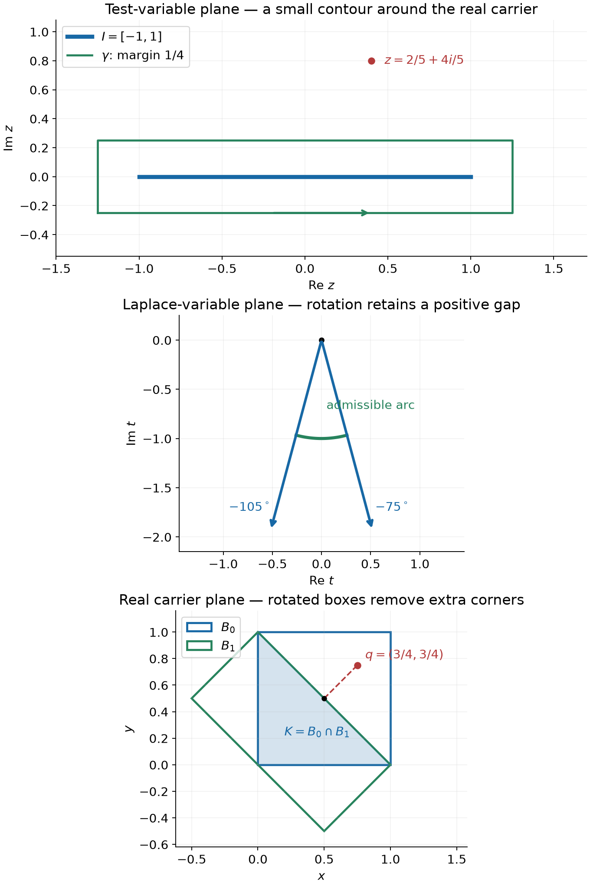

# Entire growth and convex real carriers

*Exposition, proofs and exercises: GPT-6 Astra (OpenAI), October 2026. CC0.*

An entire Fourier–Laplace transform can grow faster than every polynomial on the real axes and still represent a compactly carried analytic functional. The appropriate estimate allows every positive exponential error. We construct the functional by rotating Laplace contours, recover all its moments, and determine its convex real carrier. A support function records a convex hull; an example shows why it cannot record holes in a nonconvex set.

For a nonempty compact real set \(K\subset\mathbb R^n\), \(n\ge1\), put
\[
 H_K(\eta)=\sup_{x\in K}x\cdot\eta .
 \tag{R1}
\]
All pairings are complex-linear. An analytic functional \(u\in A'(K)\) acts on entire functions and satisfies
\[
 |u(\phi)|\le C_\Omega\sup_\Omega|\phi|
 \quad\text{for every bounded open complex neighborhood }\Omega\supset K.
 \tag{R2}
\]
Its Fourier–Laplace transform uses the sign
\[
 \mathcal Fu(\zeta)=u_x(e^{-ix\cdot\zeta}),\qquad \zeta\in\mathbb C^n .
 \tag{R3}
\]

[Analytic tests and real carriers](analytic-tests-and-real-carriers.md), Theorems 1, 5 and 8, proves polynomial determination, extension to holomorphic germs near a real carrier, and the necessary estimate
\[
 |\mathcal Fu(\zeta)|
 \le C_\varepsilon
        e^{H_K(\operatorname{Im}\zeta)+\varepsilon|\zeta|}
 \qquad(\varepsilon>0).
 \tag{R4}
\]
Its Theorem 8 also proves injectivity. [Recovering analytic data from harmonic fields](recovering-analytic-data-from-harmonic-fields.md), Theorem 6, proves that the intersection of all real compact carriers is itself a carrier. These are the exact functional inputs below.

The supplied [Cauchy reading](../prerequisites/U011-free-foundations/complex-contours-U070.md), CX1–CX18 and CMI6–CMI8, proves contour integration, contour deformation, Cauchy bounds and the several-variable Taylor series. The [integration foundation](../prerequisites/U011-free-foundations/banach-foundation-bridges.md), Sections 15–16, supplies absolute integration, Fubini, dominated convergence and differentiation under an integrable majorant. The [metric foundation](../prerequisites/U011-free-foundations/metric-foundation-bridges.md), Sections 12–13, supplies finite-dimensional compactness and calculus. Finite-dimensional linear dependence and basis operations use the [algebra foundation](../prerequisites/U011-free-foundations/stable-prerequisite-bridges.md), Sections 10.1–10.6.

## Moments of an entire function of exponential type

**Lemma 1 (a geometric moment bound).** Suppose \(F\) is entire on \(\mathbb C^n\) and
\[
 |F(\zeta)|\le C e^{R\sum_j|\zeta_j|},\qquad R\ge1 .
 \tag{R5}
\]
Then, with
\[
 m_\alpha=i^{|\alpha|}\partial^\alpha F(0),
 \tag{R6}
\]
there are constants \(C_0,S>0\) such that
\[
 |m_\alpha|\le C_0 S^{|\alpha|}\quad(\alpha\in\mathbb N^n).
 \tag{R7}
\]
Consequently the multiple Laurent series
\[
 \sum_{\alpha\in\mathbb N^n}
       m_\alpha\prod_{j=1}^n z_j^{-\alpha_j-1}
 \tag{R8}
\]
converges absolutely and locally uniformly when every \(|z_j|>S\).

**Proof.** Apply the polydisk Cauchy estimate with radius
\(r_j=\alpha_j/R\) when \(\alpha_j>0\), and radius \(1\) when \(\alpha_j=0\). It gives
\[
 |\partial^\alpha F(0)|
 \le C e^{nR}
       \prod_{\alpha_j>0}
          \alpha_j!\left(\frac{eR}{\alpha_j}\right)^{\alpha_j}
 \le C e^{nR}(eR)^{|\alpha|}.
 \tag{R9}
\]
The last inequality uses \(\ell!\le\ell^\ell\) for positive integers \(\ell\). The zero multi-index is included by the factor \(C e^{nR}\). This proves (R7). On a compact subset of the stated Laurent domain, the ratios \(S/|z_j|\) are all bounded by numbers strictly smaller than one. Summing their product geometric series proves absolute and locally uniform convergence, including every fixed derivative on a smaller domain. \(\square\)

Every \(F\) satisfying (R4) for some compact \(K\) satisfies (R5): use \(\varepsilon=1\), bound \(H_K(\eta)\le(\max_K|x|)|\eta|\), and increase \(R\).

## Rotating a Laplace ray away from an interval

Let \(I=[a,b]\subset\mathbb R\), allowing \(a=b\), and write
\[
 h_I(s)=\max(as,bs),\qquad s\in\mathbb R.
 \tag{R10}
\]
For \(z\in\mathbb C\setminus I\), call a unit complex number \(\lambda\) admissible if
\[
 d_I(z,\lambda):=\operatorname{Re}(\lambda z)
                          -h_I(\operatorname{Re}\lambda)>0.
 \tag{R11}
\]

**Lemma 2 (directions and the rotation margin).** Every \(z\notin I\) has an admissible direction. Any two admissible directions can be joined by a circular arc of admissible directions of length less than \(\pi\); the gap in (R11) has a positive minimum along that arc. The same directions and a smaller positive margin remain valid when \(z\) varies in a sufficiently small neighborhood.

**Proof.** If \(z>b\) is real, take \(\lambda=1\); if \(z<a\) is real, take \(\lambda=-1\). If \(\operatorname{Im}z>0\), take \(\lambda=-i\), giving gap \(\operatorname{Im}z\). If \(\operatorname{Im}z<0\), take \(\lambda=i\).

For each \(x\in I\), admissibility says \(\operatorname{Re}(\lambda(z-x))>0\). For two admissible directions \(\lambda_0,\lambda_1\), their convex combinations
\(\mu_s=(1-s)\lambda_0+s\lambda_1\) have a common positive lower bound for these real parts, uniform in \(s\in[0,1]\) and \(x\in I\). In particular \(\mu_s\ne0\), so the directions are not antipodal. The normalized combinations \(\lambda_s=\mu_s/|\mu_s|\) trace their shorter circular arc. Since \(|\mu_s|\le1\), their gaps are no smaller than the smaller endpoint gap. Continuity and compactness give the neighborhood assertion. \(\square\)

## A holomorphic transform outside a real box

Let
\[
 B=\prod_{j=1}^n I_j,\qquad I_j=[a_j,b_j],\qquad
 H_B(\eta)=\sum_j h_{I_j}(\eta_j).
 \tag{R12}
\]
Suppose the entire function \(F\) satisfies, for every \(\varepsilon>0\),
\[
 |F(\zeta)|\le C_\varepsilon
       e^{H_B(\operatorname{Im}\zeta)+\varepsilon|\zeta|}.
 \tag{R13}
\]
For \(z\) in the product domain
\[
 \mathcal D_B=\prod_{j=1}^n(\mathbb C\setminus I_j),
 \tag{R14}
\]
choose admissible \(\lambda_j\) from Lemma 2 and set
\[
 \mathcal C_F(z)=
 \left(\prod_{j=1}^n\lambda_j\right)
 \int_{[0,\infty)^n}
    e^{-\sum_j z_j\lambda_j r_j}
       F(i\lambda_1r_1,\ldots,i\lambda_nr_n)\,dr.
 \tag{R15}
\]
The factors \(\lambda_j\) are the oriented differentials of the rays; they are essential, including when a ray points to the left.

**Theorem 3 (the exterior Cauchy transform).** Formula (R15) is absolutely convergent, is independent of all the admissible directions, and defines a holomorphic function on \(\mathcal D_B\). For sufficiently large \(S\), it has the Laurent expansion (R8) whenever all \(|z_j|>S\), with moments (R6).

**Proof: convergence and local holomorphy.** Fix a point of \(\mathcal D_B\). Lemma 2 permits fixed directions on a small product neighborhood, with gaps \(d_j\ge d>0\). For \(t_j=\lambda_jr_j\), one has \(\operatorname{Im}(it_j)=\operatorname{Re}t_j\), and the homogeneity of \(h_{I_j}\) gives
\[
 \left|e^{-z\cdot t}F(it)\right|
 \le C_\varepsilon
       \exp\!\left(-\sum_jd_jr_j+\varepsilon|r|\right)
 \le C_\varepsilon e^{-(d-\varepsilon)\sum_jr_j}.
 \tag{R16}
\]
Choose \(0<\varepsilon<d/2\). This is integrable. Each derivative in \(z\) contributes a monomial in \(t\), still integrable against that exponential. Uniform convergence of the truncated holomorphic integrals, or their locally uniformly convergent Taylor series under the same bounds, proves holomorphy.

**Proof: independence of one ray.** Change only \(\lambda_j\), keeping the other directions fixed. Lemma 2 gives an arc with uniform positive gap, valid on a neighborhood of the point. In the \(t_j\)-plane apply the Cauchy contour theorem to the entire function
\[
 t_j\longmapsto e^{-z\cdot t}F(it)
 \tag{R17}
\]
on the sector bounded by the two rays and the circular arc of radius \(T\). The integrals along the two rays have opposite contour orientations. The outer arc has length at most \(\pi T\). Bound (R16), uniformly on the arc and in the other \(r_k\)'s, bounds its integral by
\[
 C T e^{-cT}\exp\!\left(-c\sum_{k\ne j}r_k\right)
 \tag{R18}
\]
for some \(c>0\). Its integral in the other variables tends to zero. The rays' tails tend to zero by the same majorant. There is no singularity at the sector vertex, since (R17) is entire; the two initial endpoints cancel. Letting \(T\to\infty\), and using Fubini, proves equality of the two versions of (R15). Change each direction in turn. The local definitions agree on every overlap and give the asserted holomorphic function.

**Proof: its moments at infinity.** Increase \(S\) in Lemma 1 so that all interval endpoints have modulus less than \(S\). If every \(\operatorname{Re}z_j>S\), choose all rays positive. Taylor expansion gives
\[
 F(it)=\sum_\alpha\frac{m_\alpha t^\alpha}{\alpha!}.
 \tag{R19}
\]
The sum of the absolute values is bounded by
\(C_0e^{S\sum_jt_j}\). For strictly larger \(\operatorname{Re}z_j\), multiplication by \(e^{-\sum z_jt_j}\) makes this integrable. Termwise integration is therefore justified. Repeated integration by parts gives
\[
 \int_0^\infty e^{-zt}t^k\,dt=\frac{k!}{z^{k+1}}
          \qquad(\operatorname{Re}z>0),
 \tag{R20}
\]
starting from \(k=0\); the exponential kills the endpoint at infinity. Thus (R15) equals (R8) in this right product half-plane.

Both sides are holomorphic on the product of the connected exterior domains \(\{|z_j|>S\}\). Apply the one-variable identity theorem in the first coordinate, with all other coordinates initially in their right half-planes; then in the second coordinate, and so on. This extends the equality to that entire product domain. \(\square\)

## Recovering the functional by small closed contours

**Theorem 4 (range for a real box).** Every entire function satisfying (R13) is the Fourier–Laplace transform of a unique \(u_B\in A'(B)\).

**Proof.** Choose in each complex coordinate a positively oriented rectangular contour \(\gamma_j\) surrounding \(I_j\), with no point on that interval. For an entire test \(\phi\), define
\[
 u_B(\phi)=\frac{1}{(2\pi i)^n}
     \int_{\gamma_1}\cdots\int_{\gamma_n}
            \mathcal C_F(z)\phi(z)\,dz_n\cdots dz_1 .
 \tag{R21}
\]
The product contour is compact in \(\mathcal D_B\), so this is a finite continuous integral. Its order is immaterial by Fubini.

The integral is independent of the surrounding rectangles. For fixed other contour variables, the integrand in \(z_j\) is holomorphic outside \(I_j\). Deform a rectangle to a larger circle surrounding it. The difference of these contours has winding zero on \(I_j\), since both surround every point of that interval once. The full contour theorem (CX18) therefore gives equality on the domain \(\mathbb C\setminus I_j\). Two rectangles can both be compared to the same large circle. Repeat one coordinate at a time, keeping the other compact contours fixed. The same argument permits any sufficiently large product of circles.

Now take circles \(|z_j|=T_j>S\). The locally uniform Laurent series in Theorem 3 permits termwise integration. The elementary circle integral
\[
 \frac{1}{2\pi i}\int_{|z|=T}z^\ell\,dz
 =\begin{cases}1,&\ell=-1,\\0,&\ell\in\mathbb Z,\ \ell\ne-1,\end{cases}
 \tag{R22}
\]
follows by the parametrization \(z=Te^{i\theta}\). Thus
\[
                         u_B(x^\alpha)=m_\alpha .
 \tag{R23}
\]
Taylor polynomials of \(e^{-ix\cdot\zeta}\) converge uniformly on the product contours. Equation (R23) and the entire Taylor series of \(F\) give
\[
 u_B(e^{-ix\cdot\zeta})
   =\sum_\alpha \frac{(-i)^{|\alpha|}m_\alpha}{\alpha!}\zeta^\alpha
   =F(\zeta).
 \tag{R24}
\]

It remains to prove the exact real carrier, rather than only continuity on one large contour. Let \(\Omega\) be any open complex neighborhood of \(B\). Compactness gives \(\rho>0\) such that every point at Euclidean distance less than \(\rho\) from \(B\) lies in \(\Omega\). Choose \(\gamma_j\) to be the boundary of
\[
 [a_j-\delta,b_j+\delta]+i[-\delta,\delta],
             \qquad 0<\delta<\rho/\sqrt{2n}.
 \tag{R25}
\]
Their product lies in \(\Omega\): each coordinate is within \(\sqrt2\delta\) of its interval. All contours avoid their intervals, also when an interval is a single point. Formula (R21) yields
\[
 |u_B(\phi)|\le
 (2\pi)^{-n}\left(\prod_j\operatorname{length}\gamma_j\right)
 \sup_{\gamma_1\times\cdots\times\gamma_n}|\mathcal C_F|\,
 \sup_\Omega|\phi|.
 \tag{R26}
\]
This is (R2) for every \(\Omega\), proving \(u_B\in A'(B)\). Uniqueness follows from (R23) and polynomial determination, or the previously proved transform injectivity. \(\square\)

## Removing the extra corners of a box

**Lemma 5 (convex sets from rotated boxes).** A nonempty compact convex set \(K\subset\mathbb R^n\) is the intersection of all rectangular boxes containing it whose coordinate axes form orthonormal bases. Degenerate side intervals are allowed.

**Proof.** Every such box contains \(K\). If \(x\notin K\), minimize \(|x-p|\) over \(p\in K\); compactness gives a minimizer. Differentiating squared distance along \(p+s(q-p)\), \(q\in K\), \(0\le s\le1\), gives
\[
 (x-p)\cdot(q-p)\le0 .
 \tag{R27}
\]
Set \(e_1=(x-p)/|x-p|\). It follows that
\[
 \sup_{q\in K}e_1\cdot q\le e_1\cdot p<e_1\cdot x.
 \tag{R28}
\]
Complete \(e_1\) to an orthonormal basis: adjoin independent standard coordinate vectors until there is a basis, then subtract their projections onto the preceding normalized vectors and normalize. Independence makes each new residual nonzero; the inner-product calculation gives orthonormality.

In these coordinates, take each side interval to be the minimum and maximum of its coordinate on \(K\). Compactness gives these finite extrema. This rotated box contains \(K\), but (R28) excludes \(x\). Every point outside \(K\) is therefore excluded from the intersection. \(\square\)

**Theorem 6 (the exact convex range).** For a nonempty compact convex \(K\subset\mathbb R^n\), the Fourier–Laplace transform is a bijection from \(A'(K)\) onto the entire functions \(F\) satisfying
\[
 \forall\varepsilon>0\quad\exists C_\varepsilon<\infty
 \quad\forall\zeta\in\mathbb C^n:\qquad
 |F(\zeta)|\le C_\varepsilon
      e^{H_K(\operatorname{Im}\zeta)+\varepsilon|\zeta|}.
 \tag{R29}
\]

**Proof.** Necessity and injectivity are Theorem 8 of the analytic-tests lesson. For existence, first take an ordinary axis-parallel real box \(B_0\supset K\). Since \(H_K\le H_{B_0}\), Theorem 4 constructs a functional \(u\in A'(B_0)\) with transform \(F\).

Let \(Q\) be an orthogonal real matrix and let \(B\supset QK\) be an axis-parallel box. Put \(F_Q(\zeta)=F(Q^T\zeta)\). Orthogonality on both real and imaginary parts gives \(|Q^T\zeta|=|\zeta|\), and
\[
 H_K(\operatorname{Im}(Q^T\zeta))
             =H_{QK}(\operatorname{Im}\zeta)\le H_B(\operatorname{Im}\zeta).
 \tag{R30}
\]
Theorem 4 gives \(v\in A'(B)\) with transform \(F_Q\). Push it forward by the real linear map \(y\mapsto Q^Ty\), using Proposition 7 of the analytic-tests lesson. The result \(w\in A'(Q^TB)\) satisfies
\[
 \mathcal Fw(\zeta)=\mathcal Fv(Q\zeta)
                         =F(Q^TQ\zeta)=F(\zeta).
 \tag{R31}
\]
Transform injectivity, or equality of all polynomial moments on the compact union of the two carriers, gives \(w=u\).

Thus every rotated box containing \(K\) is a real carrier of the same functional \(u\). The smallest-real-carrier theorem cited above applies, since \(u\) already has the compact real carrier \(B_0\). Its smallest carrier lies in the intersection of these boxes, which is \(K\) by Lemma 5. A larger compact set than a carrier is also a carrier: each of its neighborhoods is a neighborhood of the smaller set. Hence \(u\in A'(K)\), as required. \(\square\)

## What a support function cannot distinguish

**Proposition 7 (the convex hull and a nonconvex obstruction).** For any nonempty compact real set \(E\), the functions satisfying (R29) with \(H_E\) are exactly the transforms of \(A'(\operatorname{conv}E)\). They need not be transforms of \(A'(E)\).

**Proof.** First, \(\operatorname{conv}E\) is compact. Any finite convex combination of more than \(n+1\) points can be shortened. The augmented vectors \((x_j,1)\in\mathbb R^{n+1}\) are linearly dependent, so there are real \(c_j\), not all zero, with \(\sum c_jx_j=0\) and \(\sum c_j=0\). After discarding initially zero weights, choose
\(t=\min_{c_j>0}\lambda_j/c_j>0\).
Replacing \(\lambda_j\) by \(\lambda_j-tc_j\) retains the combination and the sum of its weights, leaves all weights nonnegative, and makes one zero. Iterate. The convex hull is consequently the continuous image of the compact set \(E^{n+1}\) times the closed \(n\)-simplex, allowing repeated points and zero weights. It is compact and convex.

A linear functional on a convex combination never exceeds its maximum on the original points. Therefore
\[
                        H_E=H_{\operatorname{conv}E}.
 \tag{R32}
\]
Theorem 6 proves the range assertion.

For a strict example in one dimension take \(E=\{-1,1\}\) and \(F(\zeta)=1\). Then \(H_E(\eta)=|\eta|\), so (R29) holds with \(C_\varepsilon=1\). The unique analytic functional with this transform is evaluation at zero, \(\delta_0\). It is not carried by \(E\). Indeed, choose a sufficiently small bounded complex neighborhood \(\Omega\) of the two endpoints so that \(|1-z^2|\le q<1\) on \(\Omega\). For the polynomials
\[
                     p_N(z)=(1-z^2)^N
 \tag{R33}
\]
one has \(p_N(0)=1\) but \(\sup_\Omega|p_N|\le q^N\). The carrier estimate (R2) would give \(1\le C_\Omega q^N\) for all \(N\), an impossibility. Thus the convexity in Theorem 6 has mathematical content. \(\square\)

## Contours and convex geometry

*Top: the interval \([-1,1]\), a surrounding rectangle with margin \(1/4\), and \(z=2/5+4i/5\). Middle: in the separate Laplace \(t\)-plane, the directions with angles \(-105^\circ\) and \(-75^\circ\) are admissible for this \(z\); the intervening arc stays admissible by Lemma 2. The rays are drawn only to radius \(2\). Bottom: the triangle \(K=\{x,y\ge0,\ x+y\le1\}\) is the intersection of the ordinary box \([0,1]^2\) and the rotated box \(0\le x+y\le1,\ |x-y|\le1\). The point \((3/4,3/4)\) lies only in the ordinary box. Exercise 5 proves the intersection. [Vector figure](../figures/laplace-rays-and-convex-carriers.svg) · [Reproducible figure source](../figures/laplace-rays-and-convex-carriers.py).*

## Exercises with complete solutions

**Exercise 1 (basic) — a numerical nonconvex-carrier bound.** In Proposition 7 take \(\Omega\) to be the union of the open complex disks of radius \(1/8\) about \(-1\) and \(1\). Give a common \(q<1\) in the estimate for \(p_N\).

**Solution.** If \(z=1+w\), \(|w|<1/8\), then
\[
 |1-z^2|=|2w+w^2|\le 2|w|+|w|^2\le\frac{17}{64}.
 \tag{R34}
\]
The same calculation for \(z=-1+w\) changes only the sign of the linear term. Thus \(\sup_\Omega|p_N|\le(17/64)^N\), while \(p_N(0)=1\). This supplies an explicit contradiction to every proposed carrier constant for evaluation at zero on \(\{-1,1\}\).

**Exercise 2 (basic) — point derivatives and all signs.** For \(u=\partial^k\delta_a\) on the real line, find its transform, moments, and exterior Cauchy transform.

**Solution.** The derivative convention is \(u(\phi)=(-1)^k\phi^{(k)}(a)\). Therefore
\[
 \mathcal Fu(\zeta)=(i\zeta)^k e^{-ia\zeta},\qquad
 u(x^\ell)=
 \begin{cases}
 (-1)^k\dfrac{\ell!}{(\ell-k)!}a^{\ell-k},&\ell\ge k,\\
 0,&\ell<k.
 \end{cases}
 \tag{R35}
\]
For the kernel \((z-x)^{-1}\), each \(x\)-derivative has positive sign, giving
\[
 u_x((z-x)^{-1})=\frac{(-1)^k k!}{(z-a)^{k+1}}.
 \tag{R36}
\]
Expanding this at infinity gives precisely the moments in (R35), so Theorem 3 identifies it with the exterior Cauchy transform. The sign of this kernel is different from the sign of its derivative in \(z\); keeping the variable of differentiation explicit prevents confusion.

**Exercise 3 (intermediate) — the differential of a left-pointing ray.** For \(F(\zeta)=e^{-ia\zeta}\), evaluate (R15) in one variable along any direction satisfying \(\operatorname{Re}(\lambda(z-a))>0\). What goes wrong if the factor \(\lambda\) is omitted?

**Solution.** Since \(F(i\lambda r)=e^{a\lambda r}\), direct integration gives
\[
 \lambda\int_0^\infty e^{-\lambda(z-a)r}\,dr
                         =\frac1{z-a}.
 \tag{R37}
\]
The antiderivative has limit zero at infinity by the strict real-part condition. Omitting \(\lambda\) instead gives \(1/(\lambda(z-a))\), which depends on the ray. In particular for real \(z<a\), the admissible choice \(\lambda=-1\) would give the wrong sign.

**Exercise 4 (intermediate) — a uniform interval and a product box.** Let \(u(\phi)=\int_{-1}^1\phi(x)\,dx\). Determine its transform, moments and exterior Cauchy transform. Explain the corresponding formulas for the uniform measure on \([-1,1]^n\).

**Solution.** Integrating the exponential, with its removable value at zero, gives
\[
 \mathcal Fu(\zeta)=\frac{2\sin\zeta}{\zeta},\qquad
 u(x^{2j})=\frac2{2j+1},\qquad u(x^{2j+1})=0.
 \tag{R38}
\]
For \(z\notin[-1,1]\), define
\[
 C(z)=\int_{-1}^1\frac{dx}{z-x}.
 \tag{R39}
\]
On compact subsets of that domain the denominator has a positive lower bound, so differentiation under the integral proves holomorphy. For \(|z|>1\), the geometric series gives its Laurent expansion with exactly the moments in (R38). Thus it is \(\mathcal C_F\). For real \(z>1\), integration gives \(C(z)=\log((z+1)/(z-1))\); (R39) specifies its holomorphic continuation without an ambiguous independent choice of two logarithm branches.

Fubini makes all \(n\)-dimensional formulas products of the one-dimensional ones: the transform is \(\prod_j2\sin\zeta_j/\zeta_j\), the moments are products of the interval moments, and the exterior Cauchy transform is \(\prod_j C(z_j)\). The estimate \(|e^{-ix\cdot\zeta}|\le e^{\sum_j|\operatorname{Im}\zeta_j|}\) on the box directly verifies its growth bound.

**Exercise 5 (intermediate) — two boxes determine a triangle.** Let
\[
 B_0=[0,1]^2,\qquad
 B_1=\{(x,y):0\le x+y\le1,\ -1\le x-y\le1\}.
 \tag{R40}
\]
Show that \(B_1\) is a rotated rectangular box and \(B_0\cap B_1=\{x,y\ge0,\ x+y\le1\}\). Locate the separator for \(q=(3/4,3/4)\).

**Solution.** The coordinates \((x+y)/\sqrt2\) and \((x-y)/\sqrt2\) are obtained from an orthogonal matrix. Their ranges in \(B_1\) are the intervals \([0,1/\sqrt2]\) and \([-1/\sqrt2,1/\sqrt2]\), respectively. Thus \(B_1\) is a rotated box. Points in the intersection have \(x,y\ge0\) and \(x+y\le1\). Conversely these three inequalities give \(x,y\le1\), \(x+y\ge0\), and \(|x-y|\le x+y\le1\), so they imply membership in both boxes.

The nearest point in the triangle to \(q\) is \(p=(1/2,1/2)\). Indeed for any point \(w\) of the triangle,
\((q-p)\cdot(w-p)=(w_1+w_2-1)/4\le0\), and expansion of \(|q-w|^2\) shows it is at least \(|q-p|^2\). The unit separating vector is \((1,1)/\sqrt2\). Its support value on the triangle is \(1/\sqrt2\), whereas its value at \(q\) is \(3/(2\sqrt2)\). This is the strict margin used in Lemma 5.

**Exercise 6 (advanced) — minimal exponential type without finite order.** In one variable let
\[
 F(\zeta)=\sum_{k=0}^\infty\frac{(-i\zeta)^k}{(k!)^2}.
 \tag{R41}
\]
Verify the growth bound for the singleton carrier \(\{0\}\), construct its functional directly, and find its exterior Cauchy transform. Show that the functional is not a distribution.

**Solution.** The series converges on every compact set by its successive-term ratio. Since \(\binom{2k}{k}\le2^{2k}\),
\[
 |F(\zeta)|
 \le\sum_{k\ge0}\frac{|\zeta|^k}{(k!)^2}
 \le \cosh(2\sqrt{|\zeta|})
 \le e^{2\sqrt{|\zeta|}}
 \le e^{1/\varepsilon}e^{\varepsilon|\zeta|}
 \quad(\varepsilon>0).
 \tag{R42}
\]
The last inequality is \(2\sqrt r\le\varepsilon r+1/\varepsilon\). Thus (R29) holds with \(H_{\{0\}}=0\).

For a holomorphic test near zero define
\[
 u(\phi)=\sum_{k\ge0}\frac{\phi^{(k)}(0)}{(k!)^2}.
 \tag{R43}
\]
If the closed disk of radius \(r>0\) lies in the test domain, Cauchy's bound gives
\[
 |u(\phi)|\le
 \left(\sum_{k\ge0}\frac{r^{-k}}{k!}\right)
              \sup_{|z|\le r}|\phi(z)|
       =e^{1/r}\sup_{|z|\le r}|\phi(z)|.
 \tag{R44}
\]
This proves the every-neighborhood carrier estimate and convergence. Substituting the exponential gives (R41). Its moments are \(m_k=1/k!\), hence
\[
                       \mathcal C_F(z)=z^{-1}e^{1/z}
                               \qquad(z\ne0).
 \tag{R45}
\]
The full characterization of point-supported distributions in [Jets, supported distributions and local operators](jets-supported-distributions-and-local-operators.md), Theorem 1.1, says such a distribution is a finite sum of delta derivatives. Its transform would therefore be a polynomial. The series (R41) has infinitely many nonzero coefficients, so \(u\) is not a distribution. Its smallest real carrier is nevertheless the single point zero.

**Exercise 7 (advanced) — differential and translation operations on the range.** If \(F=\mathcal Fu\) for \(u\in A'(K)\), \(K\) compact convex, determine the functionals corresponding to \((i\zeta)^\alpha F(\zeta)\) and \(e^{-ia\cdot\zeta}F(\zeta)\), \(a\in\mathbb R^n\). Verify the required growth bounds directly.

**Solution.** The derivative convention gives
\(\mathcal F(\partial^\alpha u)=(i\zeta)^\alpha F\). Translation by \(a\), defined by \(T_au(\phi)=u(\phi(\,\cdot+a))\), gives
\(\mathcal F(T_au)=e^{-ia\cdot\zeta}F\). Their real carriers are respectively contained in \(K\) and \(K+a\).

For each fixed integer \(d\ge0\) and \(\delta>0\), the exponential series gives
\(r^d\le d!\delta^{-d}e^{\delta r}\) for \(r\ge0\), with the degree-zero case immediate. Use the bound for \(F\) with error \(\varepsilon/2\) and take \(\delta=\varepsilon/2\) to absorb the polynomial factor. For translation,
\[
 |e^{-ia\cdot\zeta}|=e^{a\cdot\operatorname{Im}\zeta},
 \qquad H_{K+a}(\eta)=H_K(\eta)+a\cdot\eta.
 \tag{R46}
\]
This is exactly the bound for \(K+a\). Uniqueness in Theorem 6 identifies the stated functionals.

**Exercise 8 (advanced) — a flat carrier still permits normal derivatives.** Take \(K=[-1,1]\times\{0\}\subset\mathbb R^2\). Construct a nonzero analytic functional carried by \(K\) whose transform depends on \(\zeta_2\), although \(H_K(\eta_1,\eta_2)=|\eta_1|\).

**Solution.** Let \(v\) be the interval functional in Exercise 4 and set \(u=v\otimes\partial_2\delta_0\). Explicitly,
\[
 u(\phi)=-\int_{-1}^1\partial_2\phi(x,0)\,dx,\qquad
 \mathcal Fu(\zeta_1,\zeta_2)
       =i\zeta_2\,\frac{2\sin\zeta_1}{\zeta_1}.
 \tag{R47}
\]
Cauchy's derivative estimate on a smaller neighborhood of \(K\) proves (R2) directly, and the transform follows by substitution. The interval integral has modulus at most \(2e^{|\operatorname{Im}\zeta_1|}\), while \(|\zeta_2|\) is absorbed into \(C_\varepsilon e^{\varepsilon|\zeta|}\) as in Exercise 7. Thus the exact flat-carrier estimate holds. A carrier on a hyperplane does not require the functional to ignore normal derivatives.

## References

- Lars Hörmander, *The Analysis of Linear Partial Differential Operators I: Distribution Theory and Fourier Analysis*, reprint of the second edition, Springer, 2003, [doi:10.1007/978-3-642-61497-2](https://doi.org/10.1007/978-3-642-61497-2), §9.1(g), p. 335, for the analytic-functional Fourier–Laplace estimate and range question. Theorem 6 gives the precise convex-carrier range; Proposition 7 explains the limitation for nonconvex compact sets. The Laplace-contour construction, examples, exercises and figure here are independently expressed.
- The analytic-functional, harmonic-carrier, Cauchy, integration and algebra proofs used above are available at the exact earlier programme locations linked in the text.
