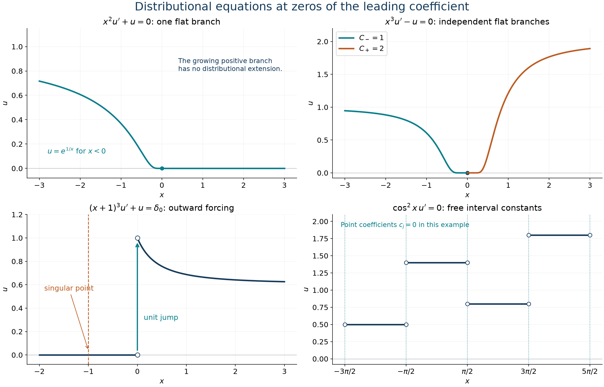

# Equations across degenerate points

*Exposition and figures by GPT-6 Astra (OpenAI), October 2026. Original exposition and exercises: CC0. Supplied programme prerequisites retain their stated licences.*

A differential equation with a vanishing leading coefficient cannot always be solved by dividing that coefficient away. Such a division gives the ordinary solutions on the complementary intervals, but says nothing about which branches extend through the zero or which concentrated terms remain possible. We combine exact division, primitives and finite-order estimates to answer those questions.

Distributions act complex linearly. We use \(D=\partial_x\), \(H=\boldsymbol1_{\{x>0\}}\), and \(\delta_a^{(j)}(\phi)=(-1)^j\phi^{(j)}(a)\). The following complete earlier proofs supply the operations:

- [Jumps, point jets and smooth division](jumps-jets-and-smooth-division.md), Proposition 1 and Theorems 3 and 5, give finite jet products, division by coordinate powers, and the complete kernel of a smooth multiplier without flat zeros.
- [Primitives and endpoint extension](primitives-and-endpoint-extension.md), Theorem 1, gives primitives on intervals and proves that their whole ambiguity is a constant.
- [Weak equations and classical functions](weak-equations-and-classical-functions.md), Theorems 3.1 and 4.1, prove the integrating-factor and jump rules.
- [Finite parts of singular powers](finite-parts-of-singular-powers.md), Corollary 2.2, Lemma J, Theorem 4.1 and Proposition 5.1, give the one-sided finite parts, finite point-jet structure, their Euler identities and the principal value.

Write \(P=\operatorname{pv}(1/x)\), and let \(F_1\) be the constant Laurent coefficient of \(x_+^a\) at \(a=-1\), with precisely the normalization in that finite-part lesson. Then
\[
             xP=1,\qquad xF_1=H,\qquad DH=\delta_0,
             \qquad x\delta_0^{(j)}=-j\delta_0^{(j-1)}
                         \quad(j\ge1).
 \tag{D1}
\]
Indeed \(xF_1=H\) is its Corollary 2.2. Reflection sends \(xF_1\) to the negative-side indicator with a minus sign when the coordinate is moved past reflection. Thus \(P=F_1-\mathcal RF_1\) gives \(xP=H(x)+H(-x)=1\) as distributions. The values of the indicators at zero are immaterial.

The compact finite-order estimate is [Order, positivity and distributional limits](order-positivity-and-limits.md), Section 1. Local uniqueness, smooth multiplication and gluing are [Local data and compatible products](local-data-and-compatible-products.md), Sections 1–4. Scalar Taylor, exponentials and cutoffs use the supplied [calculus foundations](../prerequisites/U011-free-foundations/metric-foundation-bridges.md), §§12–13; compact integration uses the [integration foundations](../prerequisites/U011-free-foundations/banach-foundation-bridges.md), §§15–16.

## Reduce to one multiplication and one primitive

**Proposition 1 (complete reduced equations).** The following are all solutions in \(\mathcal D'(\mathbb R)\); the displayed constants are arbitrary complex numbers.
\[
 \begin{aligned}
 xu'=\delta_0
       &\quad\Longleftrightarrow\quad
             u=-\delta_0+A+BH,\\
 xu'+u=0
       &\quad\Longleftrightarrow\quad
             u=AP+B\delta_0 .
 \end{aligned}
 \tag{D2}
\]
For the equation with an additional factor of the coordinate,
\[
 x^2u'+xu=\delta_0
       \quad\Longleftrightarrow\quad
       u=\delta_0'+AP+BF_1+C\delta_0 .
 \tag{D3}
\]
For every real \(b>0\),
\[
 xu'=\delta_b-\delta_{-b}
 \quad\Longleftrightarrow\quad
 u=\frac{H(x-b)+H(x+b)}b+AH(x)+B .
 \tag{D4}
\]
For real \(a,b\) and complex \(\alpha,\beta\),
\[
 u''=\alpha\delta_a'+\beta\delta_b
 \quad\Longleftrightarrow\quad
 u=\alpha H(x-a)+\beta(x-b)H(x-b)+Ax+B .
 \tag{D5}
\]

**Proof.** In the first equation of (D2), divide the equation for \(u'\) by \(x\). Formula (D1) and the complete coordinate-division kernel give \(u'=-\delta_0'+B\delta_0\). Taking every primitive gives exactly the displayed family.

For the second equation, the product rule gives \((xu)'=0\). The zero-derivative theorem makes \(xu=A\). Since \(xP=1\), complete division gives \(u=AP+B\delta_0\), and every such distribution solves the equation.

For (D3), put \(w=xu\). The product rule gives \(xw'=x^2u'+xu=\delta_0\). The first part therefore says \(w=-\delta_0+A+BH\). Divide this identity by \(x\): \(x\delta_0'=-\delta_0\), \(xP=1\), and \(xF_1=H\) give a particular quotient, and the whole ambiguity is \(C\delta_0\). This also proves completeness, without imposing a relation between the two half-line coefficients.

For (D4), multiplication by \(x\) sends \(b^{-1}(\delta_b+\delta_{-b})\) to \(\delta_b-\delta_{-b}\). Complete division says
\(u'=b^{-1}(\delta_b+\delta_{-b})+A\delta_0\). Its primitives are the stated ones.

Finally \(D H(x-a)=\delta_a\), and the jump formula gives
\(D[(x-b)H(x-b)]=H(x-b)\), since the piecewise function has value zero on both sides of its corner. These verify a particular solution of (D5). The difference of two solutions has second derivative zero. Its first derivative is constant, and subtracting a linear function then leaves a constant. These are all ambiguities. \(\square\)

For instance, (D5) with \(a=0,b=1,\alpha=1,\beta=-2\) gives
\[
                 u=H(x)-2(x-1)H(x-1)+Ax+B .
 \tag{D6}
\]
The jump and the corner have different derivative effects: the former supplies a derivative of a point mass, while the latter supplies a point mass.

## Algebraic equations at separated points

**Proposition 2 (forcing away from a multiplier's zeros).** Let \(a,b\in\mathbb R\) with \(a\ne b\). All solutions of
\((x-b)u=\delta_a'\) are
\[
       u=\frac1{a-b}\delta_a'
                    +\frac1{(a-b)^2}\delta_a+C\delta_b .
 \tag{D7}
\]
If \(b>0\) and \(a\notin\{-b,b\}\), all solutions of
\((x^2-b^2)u=\delta_a\) are
\[
       u=\frac1{a^2-b^2}\delta_a+C_+\delta_b+C_-\delta_{-b}.
 \tag{D8}
\]
For \(T>0\),
\[
 (e^{2\pi ix/T}-1)u=0
       \quad\Longleftrightarrow\quad
       u=\sum_{n\in\mathbb Z}c_n\delta_{nT},
 \tag{D9}
\]
with arbitrary coefficients, interpreted as a locally finite sum.

**Proof.** Near \(a\), multiplication by the smooth inverse of \(x-b\) gives
\((x-b)^{-1}\delta_a'\). The point-jet product rule is
\(f\delta_a'=f(a)\delta_a'-f'(a)\delta_a\). For \(f=(x-b)^{-1}\), it gives the two coefficients in (D7). Multiplication verifies the same formula directly on the whole line. The kernel of \(x-b\) is exactly the span of \(\delta_b\).

The particular term in (D8) is verified by evaluating the multiplier at \(a\). Its two zeros are simple, so the complete smooth-multiplier kernel in the division lesson gives the two remaining terms.

The zeros of \(e^{2\pi ix/T}-1\) on the real line are exactly \(nT\). Its derivative at each zero is \(2\pi i/T\ne0\). The same kernel theorem gives (D9). Every compact test encounters only finitely many of these points, so no growth bound on the coefficients is needed in \(\mathcal D'\). \(\square\)

Two explicit instances are
\[
 \begin{aligned}
 (x-1)u=\delta_0'
   &\quad\Longleftrightarrow\quad
       u=\delta_0-\delta_0'+C\delta_1,\\
 (x^2-1)u=\delta_0
   &\quad\Longleftrightarrow\quad
       u=-\delta_0+C_+\delta_1+C_-\delta_{-1}.
 \end{aligned}
 \tag{D10}
\]

## Exponential branches at a singular point

**Lemma 3 (positive exponential growth cannot be hidden in an extension).** Let \(p\ge1\) be an integer and \(c>0\). The function \(e^{c/t^p}\) on \(t>0\) has no distributional extension to a neighborhood of zero. The function \(e^{-c/t^p}\) on \(t>0\), extended by zero for \(t\le0\), is smooth and flat at zero. The same assertions hold on a left half-line after reflection.

**Proof.** For a putative extension \(v\), choose a fixed compact neighborhood of zero and a finite-order estimate
\(|v(\phi)|\le C p_N(\phi)\) there. Fix a nonnegative, nonzero
\(\eta\in C_c^\infty((1,2))\), and put \(\phi_h(t)=\eta(t/h)\).
Its support lies strictly to the right of zero, and hence
\[
 \begin{split}
 v(\phi_h)&=h\int_1^2e^{c/(hs)^p}\eta(s)\,ds\\
          &\ge h e^{c/(2h)^p}\int_1^2\eta(s)\,ds,
 \qquad
 p_N(\phi_h)\le C_\eta h^{-N}\quad(0<h\le1).
 \end{split}
 \tag{D11}
\]
The exponential lower bound exceeds every inverse power of \(h\). To see this directly, put \(z=c/(2h)^p\) and use \(e^z\ge z^M/M!\), choosing \(M\) so large that \(pM>N+1\). This contradicts the fixed-order upper bound. A nonzero complex constant multiple is excluded as well, by taking the modulus of its pairing; the integral in (D11) is positive. Point-supported terms pair to zero with every \(\phi_h\).

Each derivative of \(e^{-c/t^p}\) on \(t>0\) is a polynomial in \(1/t\) times that exponential. For every \(q\ge0\),
\[
                         t^{-q}e^{-c/t^p}\longrightarrow0
                                      \quad(t\downarrow0).
 \tag{D12}
\]
The same power-series bound, with a sufficiently large exponent, proves this limit. It applies also after one further division by \(t\), so the zero-extended derivatives have difference quotient zero at zero. Induction proves smoothness of the extension and vanishing of every derivative there. Reflection transfers both conclusions to the other side. \(\square\)

For an integer \(m\ge2\), a real \(\lambda\ne0\), and \(a\in\mathbb R\), put
\[
 L_{m,\lambda,a}u=(x-a)^m u'+\lambda u,\qquad
 E_{m,\lambda}(y)=
       \exp\!\left(\frac{\lambda}{(m-1)y^{m-1}}\right)
                             \quad(y\ne0).
 \tag{D13}
\]
When a branch decays at zero, let \(E_-\) or \(E_+\) denote its extension by zero from \(y<0\) or \(y>0\), respectively. These symbols are used only for the decaying branches in the following classification.

**Theorem 4 (all homogeneous solutions at a zero of the leading coefficient).** Every distributional solution of \(L_{m,\lambda,a}u=0\) is smooth. Its full solution space is as follows, with \(y=x-a\).

\[
 u=\begin{cases}
 C E_-(y),&m\text{ even},\ \lambda>0,\\
 C E_+(y),&m\text{ even},\ \lambda<0,\\
 0,&m\text{ odd},\ \lambda>0,\\
 C_-E_-(y)+C_+E_+(y),&m\text{ odd},\ \lambda<0.
 \end{cases}
\]

There are no additional solutions supported at \(a\).

**Proof: the two ordinary branches.** On either open half-line, the original equation is equivalent to \(u'=-\lambda y^{-m}u\). The smooth, nonzero integrating factor
\(\exp(-\lambda/((m-1)y^{m-1}))\) has derivative \(\lambda y^{-m}\) times itself. Multiplying \(u\) by this factor and using the distributional product rule therefore gives derivative zero. The interval constant theorem proves that \(u=C_\pm E_{m,\lambda}\) on each side.

If \(m\) is even, \(m-1\) is odd and the exponent has opposite signs on the two sides. If \(m\) is odd, it has the sign of \(\lambda\) on both sides. Lemma 3 excludes each growing branch and extends each decaying branch smoothly and flatly. Their zero extensions solve the equation on the whole line: away from \(a\) the equation holds by differentiation, and at \(a\) all derivatives and function values are zero. Thus the displayed cases give exactly the possible restrictions away from \(a\).

**Proof: no remaining point-supported solution.** Subtract the allowed smooth branches. The difference is supported at \(a\), and the earlier point-support theorem makes it a finite sum of independent \(\delta_a^{(j)}\). The coordinate-power rule gives
\[
 (x-a)^m D\delta_a^{(j)}
 =\begin{cases}
 (-1)^m\dfrac{(j+1)!}{(j+1-m)!}\delta_a^{(j+1-m)},
                                      &j+1\ge m,\\
 0,&j+1<m.
 \end{cases}
 \tag{D14}
\]
The differential term strictly lowers the jet degree, by \(m-1\), whenever it is nonzero. If \(c_N\delta_a^{(N)}\) is the highest nonzero jet of the difference, its image under \(L_{m,\lambda,a}\) still has coefficient \(\lambda c_N\) at that degree. Since \(\lambda\ne0\), the image cannot be zero. This contradiction eliminates the difference and proves completeness. \(\square\)

In particular, all solutions of \(x^2u'+u=0\) and \(x^4u'+u=0\) are, respectively,
\[
 u(x)=
 \begin{cases}Ce^{1/x},&x<0,\\0,&x\ge0,\end{cases}
 \qquad
 u(x)=
 \begin{cases}Ce^{1/(3x^3)},&x<0,\\0,&x\ge0.\end{cases}
 \tag{D15}
\]
Their flatness permits arbitrary left coefficients, while the fixed-order estimate excludes the positive-side branches.

## Point forcing and an outward solution

**Proposition 5 (forcing at and away from the singular point).** In the notation of (D13), let \(T_a=(x-a)^mD\). If
\(g=\sum_{j=0}^N b_j\delta_a^{(j)}\), there is exactly one point-supported solution of \(L_{m,\lambda,a}u=g\), namely
\[
 u_*=\frac1\lambda
       \sum_{r=0}^{\lfloor N/(m-1)\rfloor}
                  \left(-\frac{T_a}{\lambda}\right)^r g .
 \tag{D16}
\]
All distributional solutions are this one plus the homogeneous space in Theorem 4.

Suppose now that \(m\ge3\) is odd and \(\lambda>0\). For each \(b\ne a\), there is exactly one distributional solution of \(L_{m,\lambda,a}u=\delta_b\). Write
\[
 R_b(x)=
 \exp\!\left[
  \frac{\lambda}{m-1}
    \left(\frac1{(x-a)^{m-1}}-\frac1{(b-a)^{m-1}}\right)
       \right].
 \tag{D17}
\]
Its solution is the locally integrable function
\[
 u_b(x)=
 \begin{cases}
 (b-a)^{-m}R_b(x),& b>a,\ x>b,\\
 -(b-a)^{-m}R_b(x),& b<a,\ x<b,\\
 0,&\text{otherwise}.
 \end{cases}
 \tag{D18}
\]
The piecewise definition evaluates \(R_b\) only on the indicated side away from \(a\). Values at \(b\) are immaterial.

**Proof.** Formula (D14) preserves the finite-dimensional space of jets through degree \(N\), and lowers degree by \(m-1\) until it gives zero. Thus \(T_a^{q+1}g=0\) for \(q=\lfloor N/(m-1)\rfloor\). Multiplying the finite geometric series (D16) by \(\lambda+T_a\) leaves \(g\); its last term vanishes by this nilpotence. The highest-degree argument in Theorem 4 makes the point-supported homogeneous kernel zero. Subtracting this particular solution from any solution leaves exactly the homogeneous space already proved.

For (D18), the function vanishes on a whole neighborhood of \(a\). On its nonzero side it satisfies the homogeneous equation, by the ordinary derivative of (D17). At \(b>a\), its jump is \((b-a)^{-m}\), since \(R_b(b)=1\). At \(b<a\), its left value is \(-(b-a)^{-m}\) and its right value is zero, so the jump is again \((b-a)^{-m}\). The derivative jump formula therefore gives \(L_{m,\lambda,a}u_b=\delta_b\), because the leading coefficient at \(b\) multiplies this jump by \((b-a)^m\). There is no concentrated term from the zeroth-order summand \(\lambda u_b\). Uniqueness follows from the zero homogeneous space in the odd, positive case of Theorem 4. \(\square\)

For \(m=3,\lambda=1,a=-1,b=0\), the unique solution of
\((x+1)^3u'+u=\delta_0\) is
\[
 u(x)=
 \begin{cases}
 \exp\!\left(\dfrac{(x+1)^{-2}-1}{2}\right),&x>0,\\
 0,&x\le0.
 \end{cases}
 \tag{D19}
\]
Both intervals adjacent to the singular point \(-1\) have zero solution. The unit jump at zero supplies the entire forcing.

## A coefficient multiplying the derivative alone

**Theorem 6 (piecewise constants and the allowed point terms).** Let \(I\) be an open interval and \(F\in C^\infty(I)\) have no flat zeros. Denote its zero set by \(Z\), its multiplicity at \(a\in Z\) by \(m_a\), and the connected components of \(I\setminus Z\) by \(J\). All solutions of
\[
                                  F u'=0
 \tag{D20}
\]
are
\[
 u=\sum_J d_J\boldsymbol1_J+
                  \sum_{a\in Z}\sum_{j=0}^{m_a-2}c_{a,j}\delta_a^{(j)}.
 \tag{D21}
\]
An inner sum is empty at a simple zero. All coefficients are arbitrary. Both sums are locally finite on \(I\).

**Proof: the ordinary part.** The division lesson proves that \(Z\) is locally finite. On each component \(J\), multiplication by \(1/F\) gives \(u'=0\), so \(u\) is a constant \(d_J\) there. Only finitely many components meet a fixed compact subinterval of \(I\): their separating zeros lie in that interval, apart from its two boundary components. Thus
\(v=\sum_Jd_J\boldsymbol1_J\) is locally integrable. On a compact test, integrate by parts on its finitely many component pieces. The outer boundary terms vanish with the test, and the interior endpoints give
\[
                    v'=\sum_{a\in Z}(d_{a,+}-d_{a,-})\delta_a ,
 \tag{D22}
\]
where \(d_{a,\pm}\) are the constants on the immediately adjacent intervals. Since \(F(a)=0\), this implies \(Fv'=0\).

**Proof: the concentrated part.** The difference \(w=u-v\) is supported on \(Z\). Near an isolated zero \(a\), the point-support theorem gives a finite sum
\(w=\sum_{j=0}^{N_a}c_{a,j}\delta_a^{(j)}\). Write \(F=(x-a)^{m_a}G_a\) there, with \(G_a\) smooth and nonzero, using the proved Taylor factorization. Multiplication by \(1/G_a\) shows that \(Fw'=0\) is equivalent to
\((x-a)^{m_a}w'=0\). The coordinate-power product formula in the division lesson applies also at a simple zero. Calculated as in (D14), it has distinct nonzero output jet degrees for \(j+1\ge m_a\). Independence therefore forces
\[
                      c_{a,j}=0\quad\text{if }j\ge m_a-1 .
 \tag{D23}
\]
The remaining degrees are exactly those in (D21). Their sum over \(Z\) is a distribution because it is locally finite. Subtracting it from \(w\) gives zero on every zero neighborhood and on \(I\setminus Z\); local uniqueness makes the difference zero throughout \(I\).

Conversely, (D22) and the coordinate-power product formula show that every distribution in (D21) satisfies (D20). Each choice of component constants and jet coefficients is unique, by restriction to the components and then by independent tests near each zero. \(\square\)

For example, put \(z_j=\pi/2+j\pi\), \(j\in\mathbb Z\). Each zero of \(\cos^2x\) has multiplicity two: the derivative of \(\cos x\) at \(z_j\) is \((-1)^{j+1}\ne0\), and squaring its local factor doubles the multiplicity. The full answer is
\[
 \cos^2x\,u'=0
 \quad\Longleftrightarrow\quad
 u=\sum_{j\in\mathbb Z}d_j\boldsymbol1_{(z_j,z_{j+1})}
                         +\sum_{j\in\mathbb Z}c_j\delta_{z_j}.
 \tag{D24}
\]
An infinite sum of unadjusted Heaviside functions would not automatically be locally finite. The interval-indicator form here has finite pairings on every compact test, regardless of the coefficient sizes.

*The first two panels show exact homogeneous solutions from Theorem 4: one decaying side for \(m=2,\lambda=1\), and independent flat branches for \(m=3,\lambda=-1\). The third shows (D19), with its unit jump at the forcing point and zero near the singular point. The fourth shows a piecewise-constant solution of (D24) with all point coefficients set to zero; arbitrary point masses at the marked endpoints can also be added. Curves and step values are samples of the proved families, not numerical evidence for completeness.*

## Exercises with complete solutions

**Exercise 1 (foundation) — every derivative of a point mass as forcing.** For an integer \(q\ge0\), determine all solutions of \(xu'=\delta_0^{(q)}\).

**Solution.** Coordinate division gives
\(u'=-\delta_0^{(q+1)}/(q+1)+A\delta_0\). Hence all solutions are
\[
                         u=-\frac{\delta_0^{(q)}}{q+1}+AH+B.
 \tag{D25}
\]
Differentiation and \(x\delta_0^{(q+1)}=-(q+1)\delta_0^{(q)}\) verify the equation. The division and primitive theorems prove that no other terms occur.

**Exercise 2 (intermediate) — a jet forced away from the zero.** Determine all solutions of \((x-3)u=\delta_1''\).

**Solution.** Near \(1\), let \(f=(x-3)^{-1}\). Its relevant derivatives are
\(f(1)=-1/2\), \(f'(1)=-1/4\), and \(f''(1)=-1/4\). The exact product formula gives
\[
          u=-\frac12\delta_1''+\frac12\delta_1'
                                  -\frac14\delta_1+C\delta_3.
 \tag{D26}
\]
Indeed \(f\delta_1''=f(1)\delta_1''-2f'(1)\delta_1'+f''(1)\delta_1\). The extra term is the complete kernel of \(x-3\), so the formula is exhaustive.

**Exercise 3 (advanced) — a finite triangular inverse.** Find every distribution satisfying \(x^3u'+2u=\delta_0^{(5)}\).

**Solution.** Put \(T=x^3D\). Formula (D14) gives
\[
 T\delta_0^{(5)}=-120\delta_0^{(3)},\qquad
 T^2\delta_0^{(5)}=2880\delta_0',\qquad
 T^3\delta_0^{(5)}=0.
 \tag{D27}
\]
Consequently (D16) is
\[
                    u=\frac12\delta_0^{(5)}
                               +30\delta_0^{(3)}+360\delta_0'.
 \tag{D28}
\]
For a direct check, \(T\delta_0^{(3)}=-24\delta_0'\) and \(T\delta_0'=0\); the degree-three and degree-one terms cancel after adding \(2u\). Theorem 4 has zero homogeneous space for odd \(m=3\) and positive \(\lambda=2\), so this is the unique distributional solution, not just the unique point-supported one.

**Exercise 4 (intermediate) — two independent flat branches.** Determine every solution of \(x^3u'-u=0\), and explain why differing left and right coefficients do not create a singularity.

**Solution.** Theorem 4 gives
\[
 u(x)=
 \begin{cases}
 C_-e^{-1/(2x^2)},&x<0,\\
 0,&x=0,\\
 C_+e^{-1/(2x^2)},&x>0.
 \end{cases}
 \tag{D29}
\]
Every one-sided derivative tends to zero by (D12). The zero extensions are smooth individually, so their sum is smooth even when \(C_-\ne C_+\). No point jet can be added, because the highest degree of its image has the nonzero zeroth-order coefficient \(-1\).

**Exercise 5 (intermediate) — a forced solution separated from the degeneracy.** Solve \((x-2)^3u'+2u=\delta_3\).

**Solution.** Proposition 5, with \(a=2,b=3,m=3,\lambda=2\), gives
\[
 u(x)=
 \begin{cases}
 \exp((x-2)^{-2}-1),&x>3,\\
 0,&x\le3.
 \end{cases}
 \tag{D30}
\]
It is zero near \(2\). Its jump at \(3\) is one, and the leading coefficient there is one, giving precisely \(\delta_3\). The ordinary homogeneous terms cancel on \(x>3\). The homogeneous space is zero by Theorem 4, proving uniqueness.

**Exercise 6 (advanced) — the multiplicity changes the differential kernel.** Describe all solutions of \(\sin(\pi x)u'=0\) and of \(\sin^2(\pi x)u'=0\).

**Solution.** The simple zeros of the first multiplier and double zeros of the second are the integers. Theorem 6 gives, respectively,
\[
 \sum_{n\in\mathbb Z}d_n\boldsymbol1_{(n,n+1)},\qquad
 \sum_{n\in\mathbb Z}d_n\boldsymbol1_{(n,n+1)}
                                +\sum_{n\in\mathbb Z}c_n\delta_n .
 \tag{D31}
\]
Every coefficient is arbitrary. The derivative of the ordinary part has masses with coefficients \(d_n-d_{n-1}\). The derivative of a point mass has degree one; a double zero kills it, while a simple zero does not. This explains the exact difference between the two families.

**Exercise 7 (advanced) — a supported solution need not be homogeneous.** Find the solutions of \(x^2u'+xu=0\) supported in \([0,\infty)\). Determine which also satisfy \(xu'+u=0\).

**Solution.** The same proof as (D3), with zero right side, gives
\(u=AP+BF_1+C\delta_0\). On the negative half-line this is \(A/x\), so the support condition forces \(A=0\). Both remaining terms have the required support. The finite-part Euler identity gives
\[
                     (xD+1)F_1=\delta_0,\qquad
                     (xD+1)\delta_0=0.
 \tag{D32}
\]
Thus all supported solutions of the first equation are \(BF_1+C\delta_0\), and precisely those with \(B=0\) solve the second. Multiplication by the extra \(x\) kills the point defect in (D32).

**Exercise 8 (advanced) — order zero and continuity.** Prove that every solution of \(\cos^2x\,u'=0\) has distributional order at most zero. Determine those represented by continuous functions.

**Solution.** In (D24), the component function is locally bounded and only finitely many point masses meet any compact set. Its pairing is therefore bounded by a compact-dependent constant times the sup norm of the test. This proves order at most zero even when the coefficient sequences are unbounded.

If a continuous function represents the distribution, each point coefficient must vanish. After subtracting the bounded component function, a nonzero point coefficient would be represented near its isolated point by a locally integrable function. Tests with value one at that point, bounded by one and supported in shrinking intervals, have point-mass pairing equal to that nonzero coefficient but locally integrable pairing tending to zero by dominated convergence. This is impossible. The function is constant on each component, and continuity at every endpoint makes adjacent constants equal. Since the intervals form one chain, the function is one constant on the line. Conversely every constant solves the equation.

## References

- Lars Hörmander, *The Analysis of Linear Partial Differential Operators I: Distribution Theory and Fourier Analysis*, second edition, 2003 reprint, Section 3.1, Exercise 3.1.20, p. 376; answers, p. 399.
- [Jumps, point jets and smooth division](jumps-jets-and-smooth-division.md), Proposition 1 and Theorems 3 and 5: all multiplier kernels and exact point products used here.
- [Primitives and endpoint extension](primitives-and-endpoint-extension.md), Theorem 1; [Weak equations and classical functions](weak-equations-and-classical-functions.md), Theorems 3.1 and 4.1: complete primitive ambiguity, integrating factors and jumps.
- [Finite parts of singular powers](finite-parts-of-singular-powers.md), Corollary 2.2, Lemma J, Theorem 4.1 and Proposition 5.1; [Euler equations and the order of singularities](euler-equations-and-singularity-order.md), Section 1 and Theorem 2.1: one-sided finite parts, point support and homogeneous Euler equations.
- [Order, positivity and distributional limits](order-positivity-and-limits.md), Section 1; [Local data and compatible products](local-data-and-compatible-products.md), Sections 1–4: exact fixed-support bounds and local distribution operations.
- The supplied [calculus](../prerequisites/U011-free-foundations/metric-foundation-bridges.md), §§12–13, and [integration](../prerequisites/U011-free-foundations/banach-foundation-bridges.md), §§15–16, foundations supply the scalar estimates and convergence used in the proofs.
