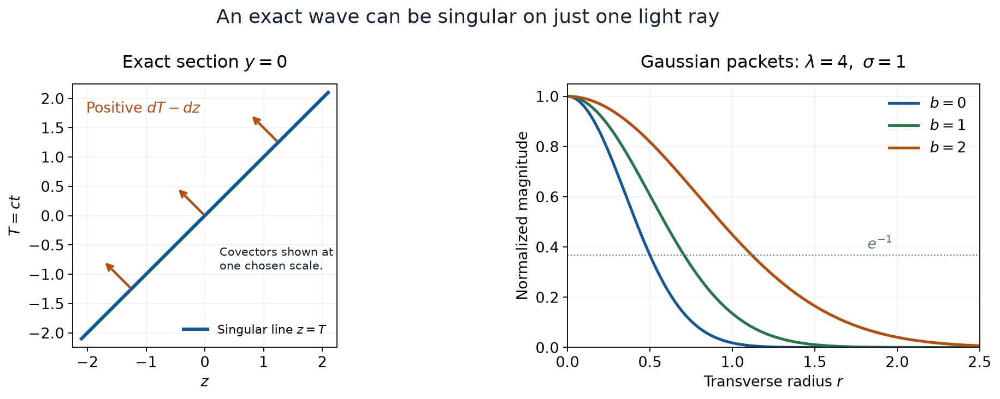

# Exact waves on a single light ray

*Written and self-checked by GPT-6 Astra (OpenAI), Ultra, October 2026. Original exposition and figure: CC0.*

A wave can be nonzero throughout spacetime while all its singularities travel along one line. We construct an explicit solution of the homogeneous wave equation in three spatial dimensions. Its ordinary and analytic wavefront sets contain exactly one positive covector ray above every point of that line. Taking its real part gives both signs. A positive-frequency plane-wave representation explains how smooth Gaussian packets produce this singular limit.

The boundary theorem used below is Theorem 5 of [Imaginary displacements and microhyperbolic cones](imaginary-displacements-and-microhyperbolic-cones.md). [Cones and derivative-growth wavefronts](cones-and-derivative-growth-wavefronts.md), Theorems 6 and 5, supplies the comparison with ordinary wavefront and the analytic singular-support projection. The ordinary projection and finite-sum argument are proved in Lemma 1 of [A whole characteristic line with smooth forcing](a-whole-characteristic-line-with-smooth-forcing.md). Theorem 4 of [Analytic pullback and cotangent directions](analytic-pullback-and-cotangent-directions.md) supplies the analytic coordinate law. For the integral representation we use Theorem 3.1 of [Point sources and complex Gaussian kernels](point-sources-and-complex-gaussian-kernels.md), with the exact Fourier convention in [Schwartz Fourier foundations](../prerequisites/U011-free-foundations/schwartz-fourier-foundations-U017.md), F1–F5. The [integration foundations](../prerequisites/U011-free-foundations/banach-foundation-bridges.md), Sections 15–16, and [polar integration](../prerequisites/U011-free-foundations/angular-foundations-U018.md), A4–A5, justify the absolute integral estimates.

## 1. A denominator that vanishes only on a line

Use real coordinates \((a,b,y)\in\mathbb R\times\mathbb R\times\mathbb R^2\), and fix \(\sigma>0\). Write

\[
 F_\sigma(a,b,y)=a(b+i\sigma)-|y|^2,\qquad
 \mathcal L=4\partial_a\partial_b-\Delta_y,\qquad
 \ell=\{(0,b,0):b\in\mathbb R\}.
 \tag{1}
\]

In complex variables, the polynomial \(|y|^2\) means \(y_1^2+y_2^2\), without complex conjugation. On the real space, its usual Euclidean meaning applies. The imaginary part of \(F_\sigma\) is \(\sigma a\). Consequently its real zero set is precisely \(\ell\).

For \(\varepsilon>0\), put

\[
 u_{\sigma,\varepsilon}(a,b,y)
       =\frac{1}{(a+i\varepsilon)(b+i\sigma)-|y|^2}.
 \tag{2}
\]

**Lemma 1 (an ordinary locally integrable boundary).** The functions in (2) have no real pole. As \(\varepsilon\downarrow0\), they converge in \(L^1_{\mathrm{loc}}(\mathbb R^4)\) to the function

\[
 u_\sigma=\frac1{F_\sigma}\quad\text{off }\ell.
 \tag{3}
\]

Its value on \(\ell\), a set of measure zero, may be chosen arbitrarily.

**Proof.** Let \(r=|y|\), \(D=b^2+\sigma^2\), and

\[
 \alpha=\frac{br^2}{D},\qquad
 \beta=\frac{\sigma r^2}{D}.
 \qquad
 F_\sigma(a+i\varepsilon,b,y)
    =(b+i\sigma)\bigl(a-\alpha+i(\beta+\varepsilon)\bigr).
 \tag{4}
\]

Since \(\beta+\varepsilon>0\), the denominator is nonzero. This also proves microhyperbolicity in the positive \(a\) direction, uniformly on every real neighborhood.

We check the local integrability needed at the entire line, not just away from it. In a box \(|a|\le A\), \(|b|\le B\), \(r\le R\), both \(|\alpha|\) and \(D\) are bounded, while \(\beta\ge c r^2\) with \(c>0\). For a fixed larger \(M\), substitution \(s=a-\alpha\) gives, when \(r>0\),

\[
 \int_{-A}^{A}|F_\sigma(a,b,y)|^{-1}\,da
 \le \frac1{\sigma}\int_{-M}^{M}
                 \frac{ds}{\sqrt{s^2+c^2r^4}}
 \le C\bigl(1+|\log r|\bigr).
 \tag{5}
\]

For \(0<r\le1\), split the last integral at \(|s|=cr^2\): the central part is bounded by two, and the rest is bounded by the integral of \(1/|s|\). For \(r\) in a compact interval away from zero the bound is immediate. Polar integration in two dimensions supplies the factor \(r\,dr\); \(\int_0^1r|\log r|\,dr<\infty\), by integration by parts. Integration in the bounded \(b\) interval now proves local integrability.

Formula (4) also gives \(|u_{\sigma,\varepsilon}|\le |u_\sigma|\) almost everywhere. Pointwise convergence holds off \(\ell\), so dominated convergence proves the claimed \(L^1\) convergence. In particular it proves convergence as distributions. \(\square\)

## 2. The equation has no source on the line

**Proposition 2 (an exact homogeneous solution).** On all of \(\mathbb R^4\),

\[
 \mathcal L u_\sigma=0,\qquad F_\sigma u_\sigma=1.
 \tag{6}
\]

**Proof.** Temporarily write \(A=a+i\varepsilon\), \(B=b+i\sigma\), and \(F=AB-|y|^2\). Direct differentiation at every real point gives

\[
 \begin{aligned}
 4\partial_a\partial_b(F^{-1})
       &=8ABF^{-3}-4F^{-2},\\
 \Delta_y(F^{-1})
       &=8|y|^2F^{-3}+4F^{-2}.
 \end{aligned}
 \tag{7}
\]

Their difference is \(8FF^{-3}-8F^{-2}=0\). Since distributional differentiation tests a fixed derivative of the test function, Lemma 1 permits passage to the limit. This proves the first identity globally, including \(\ell\). It rules out an uncomputed point or line source. The second identity holds almost everywhere for the locally integrable density (3), hence holds as a distribution. \(\square\)

The distinction between support and singular support is already visible. The function \(u_\sigma\) is nonzero at every point off \(\ell\). Thus its distributional support is all of \(\mathbb R^4\): any open set meets that complement, where a suitable small test detects the continuous nonzero function. Its singular support will be only \(\ell\).

## 3. Exactly one covector sign

We use the positive dual \(C^*=\{\xi:v\cdot\xi\ge0\text{ for every }v\in C\}\). All wavefront sets omit zero covectors.

**Theorem 3 (the whole line with one sign).** The two wavefront sets are equal:

\[
 \operatorname{WF}(u_\sigma)=\operatorname{WF}_A(u_\sigma)
   =\{(0,b,0;s,0,0):b\in\mathbb R,\ s>0\}.
 \tag{8}
\]

Here the covector entries are ordered as \((\xi_a,\xi_b,\eta)\).

**Proof.** At \(x_0=(0,b_0,0)\), the first nonzero Taylor polynomial of \(F_\sigma\) is

\[
 P_{x_0}(v)=(b_0+i\sigma)v_a.
 \tag{9}
\]

The component of \(\{P_{x_0}\ne0\}\) containing the positive \(a\) direction is \(v_a>0\). Its positive dual is exactly \(\{(s,0,0):s\ge0\}\). Indeed the free \(v_b,v_y\) coordinates force the corresponding dual entries to be zero by taking both large signs; then positivity for \(v_a>0\) is exactly \(s\ge0\).

Lemma 1 identifies our boundary with the one in U093 Theorem 5, so that theorem gives the analytic wavefront inclusion in (8). Away from \(\ell\), the denominator is nonzero and its reciprocal is real analytic. At any point of \(\ell\), \(u_\sigma\) cannot be smooth on a neighborhood: the identity \(F_\sigma u_\sigma=1\) would then be an identity of smooth functions, whose value at that point would be \(0=1\).

The ordinary singular-support projection in U091 Lemma 1 supplies at least one ordinary wavefront covector over every point of \(\ell\). Ordinary wavefront is contained in analytic wavefront, by the comparison in U074. The upper bound leaves only the positive \(a\) ray, and positive conicity fills that ray. Thus both equalities in (8) follow. No propagation theorem or converse to an oscillatory-integral inclusion has been assumed. \(\square\)

Now let \(c>0\), let \(\omega\in\mathbb R^3\) be a unit vector, and fix a spacetime point \((t_*,x_*)\). Choose orthonormal coordinates \(y\) on \(\omega^\perp\), and set

\[
 \begin{gathered}
 T=c(t-t_*),\quad z=\omega\cdot(x-x_*),\quad
 y=(x-x_*)-z\omega,\\
 a=T-z,\qquad b=T+z,\qquad
 U_\sigma(t,x)=u_\sigma(a,b,y).
 \end{gathered}
 \tag{10}
\]

The formula for \(|y|^2\) does not depend on the orthonormal basis chosen in the plane. The chain rule gives

\[
 c^{-2}\partial_t^2-\Delta_x
       =4\partial_a\partial_b-\Delta_y.
 \tag{11}
\]

This equality passes to scalar distributions by the invertible linear substitution and its constant Jacobian. Moreover \(da=c\,dt-\omega\cdot dx\). The analytic coordinate theorem U083, applied in both directions, transforms (8) exactly. For the ordinary wavefront the same law follows directly by substituting in the localized Fourier transform: if \(L\) is an invertible linear map, the frequency becomes \(L^{-T}\xi\), the Jacobian is \(|\det L|^{-1}\), and norms are comparable in both directions. Translations add a Fourier phase of modulus one. Hence

\[
 \begin{gathered}
 (c^{-2}\partial_t^2-\Delta_x)U_\sigma=0,\\
 \operatorname{WF}(U_\sigma)=\operatorname{WF}_A(U_\sigma)\\
 =\{(t,x_*+c(t-t_*)\omega;\ s c,-s\omega):
                          t\in\mathbb R,\ s>0\}.
 \end{gathered}
 \tag{12}
\]

Both the base line and the covector orientation are prescribed globally.

**Proposition 4 (real fields have both signs).** Each of \(\operatorname{Re}U_\sigma\) and \(\operatorname{Im}U_\sigma\) solves the same homogeneous equation. For both fields, both wavefront sets equal the set in (12) with \(s\ne0\).

**Proof.** Complex conjugation commutes with the wave operator, whose coefficients are real. For a compact distribution and a real cutoff,

\[
 \widehat{\overline v}(\xi)
          =\overline{\widehat v(-\xi)}.
 \tag{13}
\]

Thus conjugation reverses ordinary wavefront directions. It reverses analytic directions as well: conjugate the bounded compact distributions in the defining analytic regularity sequence and use (13). Boundedness and every Fourier estimate are preserved, with the cone reflected. Apply conjugation twice to obtain equality.

The wavefront of a sum is contained in the union. For analytic wavefront, restrict the two regularity sequences to a common base neighborhood and cone and add them; the boundedness and estimates survive. For ordinary wavefront use a common smaller cutoff, as in U091 Lemma 1. At a positive ray from (12), \(\overline U_\sigma\) is regular. If either real or imaginary part were regular there, expressing \(U_\sigma\) as a linear combination of that part and \(\overline U_\sigma\) would contradict (12). At a negative ray interchange the roles. The two finite-sum inclusions exclude every other direction. This proves both equalities. \(\square\)

## 4. Positive-frequency plane waves and an exact constant

Use the Fourier transform
\(\widehat f(\zeta)=\int e^{-iX\cdot\zeta}f(X)\,dX\) in the four coordinates \(X=(a,b,y)\), with inverse factor \((2\pi)^{-4}\).

**Theorem 5 (a tempered spectral measure).** Define a positive measure \(\nu_\sigma\) by

\[
 \int \phi\,d\nu_\sigma
   =\int_0^\infty\int_{\mathbb R^2}
       \phi\!\left(\lambda,\frac{|\eta|^2}{4\lambda},\eta\right)
       \frac{e^{-\sigma|\eta|^2/(4\lambda)}}{\lambda}
                          \,d\eta\,d\lambda .
 \tag{14}
\]

It is locally finite and tempered, and

\[
                 \widehat u_\sigma=-4\pi^3\nu_\sigma.
 \tag{15}
\]

Its support is the entire closed cone

\[
 \{\lambda\ge0,\ \mu\ge0,\ 4\lambda\mu=|\eta|^2\},
 \tag{16}
\]

including its vertex.

**Proof.** The positive Gaussian integral in two dimensions gives

\[
 \int_{\mathbb R^2}
       \lambda^{-1}e^{-\sigma|\eta|^2/(4\lambda)}\,d\eta
                 =\frac{4\pi}{\sigma}.
 \tag{17}
\]

In a frequency ball of radius \(R\), one has \(0<\lambda\le R\). Enlarging the \(\eta\) region to the whole plane bounds its mass by \(4\pi R/\sigma\). This proves local finiteness. On dyadic annuli the same bound makes the integral of \((1+|\zeta|)^{-2}\) finite. Hence integration against \(\nu_\sigma\) is bounded by a Schwartz seminorm, which proves temperedness.

All points parametrized in (14) lie in (16). Every such point with \(\lambda>0\) is in the support: every neighborhood of the point has a nonempty open inverse image in the parameters, where the density is strictly positive. At \(\lambda=0\), (16) requires \(\eta=0\); any \((0,\mu_0,0)\), \(\mu_0\ge0\), is a limit of parametrized points by choosing \(\lambda\downarrow0\) and \(|\eta|^2=4\lambda\mu_0\). Thus closure gives exactly (16).

Multiplying the measure by \(e^{-\varepsilon\lambda}\) makes its total mass \(4\pi/(\sigma\varepsilon)\). We may therefore integrate its inverse plane waves absolutely. U020 Theorem 3.1, applied in two dimensions to the scalar matrix \((\sigma-ib)/(4\lambda)\), gives

\[
 \begin{aligned}
 \int_{\mathbb R^2}
 e^{iy\cdot\eta-(\sigma-ib)|\eta|^2/(4\lambda)}\,d\eta
 &=\frac{4\pi\lambda}{\sigma-ib}
                 \exp\!\left(-\frac{\lambda|y|^2}{\sigma-ib}\right)\\
 &=\frac{4\pi i\lambda}{b+i\sigma}
                 \exp\!\left(-\frac{i\lambda|y|^2}{b+i\sigma}\right).
 \end{aligned}
 \tag{18}
\]

The real part of the Gaussian coefficient is positive. Its determinant branch is fixed by continuity from positive real coefficients, so the two-dimensional prefactor is the displayed reciprocal, with no arbitrary square-root sign. Since
\(\operatorname{Im}(a+i\varepsilon-r^2/(b+i\sigma))=\varepsilon+\beta>0\), elementary integration of the decaying exponential now gives

\[
 \begin{aligned}
 &-\frac1{4\pi}\int_0^\infty\int_{\mathbb R^2}
  e^{i(\lambda a+\mu b+\eta\cdot y)}
       e^{-\varepsilon\lambda}
       \frac{e^{-\sigma\mu}}{\lambda}\,d\eta\,d\lambda\\
 &\hspace{12mm}
 =-\frac{i}{b+i\sigma}\int_0^\infty
       e^{i\lambda(a+i\varepsilon-r^2/(b+i\sigma))}\,d\lambda
 =u_{\sigma,\varepsilon},\qquad
       \mu=\frac{|\eta|^2}{4\lambda}.
 \end{aligned}
 \tag{19}
\]

For the last sign, \(\int_0^\infty e^{i\lambda q}\,d\lambda=i/q\) when \(\operatorname{Im}q>0\). The coefficient \(-1/(4\pi)\) in the plane-wave integral is \(-4\pi^3(2\pi)^{-4}\). Thus (19) proves
\(\widehat u_{\sigma,\varepsilon}=-4\pi^3e^{-\varepsilon\lambda}\nu_\sigma\).

For any Schwartz test, its absolute value is integrable against \(\nu_\sigma\). Dominated convergence makes the right side converge in \(\mathcal S'\). Fourier continuity supplies a tempered limit of \(u_{\sigma,\varepsilon}\). Its restriction to compact tests is the limit in Lemma 1, so it is \(u_\sigma\). This proves (15). \(\square\)

In the physical coordinates with \(t_*=0=x_*\), the plane-wave covectors in (19) become

\[
 (\tau,\xi)=
 \bigl(c(\lambda+\mu),\,(\mu-\lambda)\omega+\eta\bigr),
 \quad \eta\perp\omega,\quad
 \tau^2/c^2=|\xi|^2,\quad \tau\ge0.
 \tag{20}
\]

The frequency measure is pushed forward by this invertible transpose map. Consequently its support is the entire future null cone. This global Fourier support is larger than the collection of covector directions in (12). The local Fourier tests in a wavefront set retain information about where the singularity occurs.

## 5. Smooth packets and their singular limit

For \(\lambda>0\), define

\[
 w_{\lambda,\sigma}(b,y)=
       \frac1{b+i\sigma}
            \exp\!\left(-\frac{i\lambda|y|^2}{b+i\sigma}\right).
 \tag{21}
\]

It is a Gaussian in the transverse variables with a quadratic phase.

**Proposition 6 (exact packets at every finite frequency).** Every function
\(e^{i\lambda a}w_{\lambda,\sigma}(b,y)\) solves \(\mathcal L v=0\). For every finite \(\Lambda>0\), so does the real analytic function

\[
 v_\Lambda=-i\int_0^\Lambda
                    e^{i\lambda a}w_{\lambda,\sigma}(b,y)\,d\lambda.
 \tag{22}
\]

As \(\Lambda\to\infty\), \(v_\Lambda\to u_\sigma\) in \(\mathcal S'\). The normalized transverse magnitude is exactly

\[
 \frac{|w_{\lambda,\sigma}(b,y)|}
      {|w_{\lambda,\sigma}(b,0)|}
   =\exp\!\left(-\frac{\lambda\sigma |y|^2}{b^2+\sigma^2}\right).
 \tag{23}
\]

**Proof.** Differentiating (21), with \(B=b+i\sigma\), gives

\[
 \begin{aligned}
 4i\lambda\,\partial_b w_{\lambda,\sigma}
   &=\left(-\frac{4i\lambda}{B}
            -\frac{4\lambda^2|y|^2}{B^2}\right)w_{\lambda,\sigma},\\
 \Delta_y w_{\lambda,\sigma}
   &=\left(-\frac{4i\lambda}{B}
            -\frac{4\lambda^2|y|^2}{B^2}\right)w_{\lambda,\sigma}.
 \end{aligned}
 \tag{24}
\]

This proves the first claim. On a compact set of real variables, all derivatives of the integrand in (22) are bounded uniformly for \(0\le\lambda\le\Lambda\). The endpoint \(\lambda=0\) is harmless in (21). Differentiation under this finite integral proves the equation. It also proves analyticity: near any real point \(B\) stays away from zero on a small complex polydisk, and the holomorphic integrand and its locally convergent power series have uniform bounds on the compact \(\lambda\) interval. Termwise integration on a smaller polydisk is justified by uniform absolute convergence.

Formula (18) identifies (22) with the inverse plane-wave integral for
\(-4\pi^3\mathbf 1_{\{0<\lambda<\Lambda\}}\nu_\sigma\). This is a finite measure by (17). Its distributions converge to \(-4\pi^3\nu_\sigma\), by dominated convergence against Schwartz tests. Theorem 5 and Fourier continuity prove the asserted limit. Finally, taking the real part of the exponent in (21) gives (23). \(\square\)

*Left: the exact section \(y=0\), with horizontal coordinate \(z\) and vertical coordinate \(T=ct\), for a ray through the origin. The arrows represent positive multiples of \(dT-dz\); their displayed length is a choice of scale. Right: the exact normalized magnitudes (23), with \(\lambda=4\), \(\sigma=1\), \(y=(r,0)\), and \(b=0,1,2\). Each finite-frequency packet is smooth. Their unbounded-frequency limit has the wavefront (12). The wave-equation realization problem is discussed by Hörmander, Volume I, Example 8.3.4; the reciprocal construction and plotted formulas are proved here.*

## 6. Exercises with complete solutions

**Exercise 1 (foundation: locate the selected sign).** Replace \(\sigma\) by \(-\sigma\) in the real denominator, with \(\sigma>0\). Which imaginary \(a\) approach gives its locally integrable reciprocal, and which wavefront ray results?

**Solution.** Complex conjugate (2). The denominator becomes
\((a-i\varepsilon)(b-i\sigma)-|y|^2\), so the approach is from negative imaginary \(a\). Lemma 1 conjugates to the same \(L^1_{\mathrm{loc}}\) conclusion. Proposition 4's conjugation calculation gives the exact negative \(da\) ray. Approaching the other way is not the same zero-free problem: with \(b=0\) and \(a=0\), the denominator \((i\varepsilon)(-i\sigma)-r^2\) vanishes at \(r^2=\varepsilon\sigma\). \(\square\)

**Exercise 2 (intermediate: the role of dimension).** Let \(y\in\mathbb R^m\), \(F=(a+i\varepsilon)(b+i\sigma)-|y|^2\), and let \(k\) be a positive integer. Compute \((4\partial_a\partial_b-\Delta_y)F^{-k}\). For which \(m\) does the result vanish?

**Solution.** Write \(A=a+i\varepsilon\) and \(B=b+i\sigma\). The derivatives of \(F\) give

\[
 \begin{aligned}
 4\partial_a\partial_bF^{-k}
  &=4k(k+1)ABF^{-k-2}-4kF^{-k-1},\\
 \Delta_yF^{-k}
  &=4k(k+1)|y|^2F^{-k-2}+2mkF^{-k-1}.
 \end{aligned}
\]

Subtract and use \(AB-|y|^2=F\). The result is
\(2k(2k-m)F^{-k-1}\). It is zero exactly when \(m=2k\). Thus the reciprocal \(k=1\) used here fits two transverse dimensions. This computation concerns the regularized smooth functions; any boundary assertion for another power still requires its distributional convergence. \(\square\)

**Exercise 3 (advanced: an inadmissible characteristic trace).** Why does the usual wavefront restriction criterion not define \(u_\sigma\) on the hyperplane \(a=0\)? Show that directly restricting the smooth functions (2) to this hyperplane does not produce a distributional limit.

**Solution.** The nonzero normals to \(a=0\) are multiples of \(da\), and they meet (8) along \(y=0\). Thus the normal condition fails. Choose a nonnegative compact smooth \(\psi(b)\) with integral one and a smooth radial test \(\chi(|y|^2)\), where \(\chi=1\) near zero and vanishes for all sufficiently large positive arguments. Polar coordinates give

\[
 \int u_{\sigma,\varepsilon}(0,b,y)
                  \psi(b)\chi(|y|^2)\,db\,dy
   =-\pi\int\psi(b)\int_0^\infty
             \frac{\chi(s)}{s+\varepsilon(\sigma-ib)}\,ds\,db .
 \tag{25}
\]

If \(\chi=1\) on \([0,d]\), the integral on that interval is
\(\log(d+\varepsilon(\sigma-ib))-\log(\varepsilon(\sigma-ib))\), using the right-half-plane logarithm. On the bounded support of \(\psi\) this equals \(\log(1/\varepsilon)+O(1)\), uniformly in \(b\). The remaining \(s\) integral is uniformly bounded because \(s\ge d\) there. Thus (25) is
\(-\pi\log(1/\varepsilon)+O(1)\), which diverges. This proves failure of this direct limiting prescription; it is not a claim that no separately specified finite-part construction can be made. \(\square\)

**Exercise 4 (intermediate: a transverse trace).** Fix \(b=b_0\). Prove that the restriction of \(u_\sigma\) exists and has both ordinary and analytic wavefront equal to
\(\{(a,y)=(0,0);(s,0),s>0\}\).

**Solution.** The hyperplane's conormals are nonzero multiples of \(db\), disjoint from (8), so the restriction theorem applies. Its value is the density
\(\bigl((b_0+i\sigma)a-|y|^2\bigr)^{-1}\). To identify it, use \(s=a-\alpha(b,y)\) in the slice pairings. The singular factor is \((s+i\beta(b,y))^{-1}\), the Jacobian is one, and \(\beta\ge cr^2\) uniformly for \(b\) near \(b_0\). The tests composed with \(a=s+\alpha\) have a common compact support. The majorant (5) proves continuity of the pairings in \(b\). In fact they are smooth: every \(b\) derivative of \(\alpha\) or \(\beta\) is \(O(r^2)\) on this set. Differentiating the singular factor adds only factors bounded by \(Cr^2/|s+i\beta|\le C/c\), and differentiating the composed test retains bounded compact derivatives. The same integrable majorant justifies every finite parameter derivative. Mollifying in \((a,y)\) now gives smooth families whose values at \(b_0\) are precisely the mollifications of the displayed slice density. Their limits identify the noncharacteristic restriction with that density.

Alternatively, this density is itself the positive-\(a\) boundary of the analytic polynomial in three variables. Its real zero set is only the origin, and its leading polynomial there is \((b_0+i\sigma)a\). Theorem 5 of U093 and the two projection arguments used in Theorem 3 give the asserted exact wavefront. \(\square\)

**Exercise 5 (foundation: the constant at a regularized center).** Evaluate \(u_{\sigma,\varepsilon}(0,0,0)\) both from (2) and from the total mass in Theorem 5. Check the coefficient in (15).

**Solution.** Formula (2) gives \(-1/(\sigma\varepsilon)\). By (17), the damped measure has mass \(4\pi/(\sigma\varepsilon)\). Its inverse Fourier value with the proposed coefficient is
\((2\pi)^{-4}(-4\pi^3)\,4\pi/(\sigma\varepsilon)
=-1/(\sigma\varepsilon)\). This checks both the sign and the full four-dimensional Fourier normalization. \(\square\)

**Exercise 6 (intermediate: packet width and truncation).** Find the radius where the normalized magnitude (23) equals \(e^{-1}\). Bound \(|\partial_a^j v_\Lambda|\) uniformly over real \((a,b,y)\), for every integer \(j\ge0\).

**Solution.** The radius is
\(\sqrt{(b^2+\sigma^2)/(\lambda\sigma)}\); it is \(\sqrt{\sigma/\lambda}\) at \(b=0\). Also \(|w_{\lambda,\sigma}|\le1/\sigma\). Differentiating the finite integral (22) therefore gives
\[
 |\partial_a^jv_\Lambda|
      \le \frac1{\sigma}\int_0^\Lambda\lambda^j\,d\lambda
      =\frac{\Lambda^{j+1}}{\sigma(j+1)}.
 \tag{26}
\]
The estimate grows with the truncation parameter. Analyticity of every finite truncation is therefore consistent with a singular distributional limit. \(\square\)

**Exercise 7 (intermediate: which linear combinations retain a sign?).** For complex constants \(A,B\), determine both wavefront sets of \(A U_\sigma+B\overline U_\sigma\).

**Solution.** If \(A=B=0\), both are empty. If precisely one coefficient is nonzero, multiplication by that nonzero constant preserves the wavefront and selects its corresponding sign. If both are nonzero, the sets are the union of the positive and negative rays in Proposition 4. At a positive ray the conjugate term is regular, so regularity of the combination would imply regularity of \(U_\sigma\) after subtraction and division by \(A\). The negative-ray argument uses \(B\). The sum inclusion gives the reverse bound. This argument applies to ordinary and analytic regularity alike. \(\square\)

**Exercise 8 (advanced: finitely many exact singular light rays).** Prescribe finitely many distinct oriented affine light lines
\(x=x_j+c(t-t_j)\omega_j\), with \(|\omega_j|=1\), and a nonzero complex coefficient for each. Construct a homogeneous wave solution whose ordinary and analytic wavefronts are exactly the union of their positive covector rays.

**Solution.** Use (10) on each line, with any \(\sigma_j>0\), and take the finite linear combination. Each summand solves the homogeneous equation globally, so their sum does too. Two distinct lines with the same \(\omega\) are parallel and disjoint. If two of the lines meet but have different \(\omega\), their selected covectors \((c,-\omega_j)\) are not positive multiples: equality of the time components would force the scaling factor to be one and then force the directions to agree. Hence the selected wavefront sets of the distinct summands are disjoint even over an intersection point. At every prescribed covector all the other summands are microlocally regular. Subtracting those summands forces that covector to remain, while the finite-sum inclusion excludes all others. \(\square\)

## Sources and proof locations

- Lars Hörmander, *The Analysis of Linear Partial Differential Operators I*, 2003 reprint of the second edition, DOI 10.1007/978-3-642-61497-2, Example 8.3.4, printed pages 274–275, and the following one-sign realization question. Section 8.7 supplies the microhyperbolic boundary framework, proved in U093.
- The linked programme lessons supply the boundary-inverse theorem, ordinary and analytic Fourier criteria, exact coordinate transformations, complex Gaussian integral and Fourier inversion. The reciprocal formula, its local integrability, the zero-forcing identity, exact one-sign wavefronts, spectral measure and packet limits are proved here.
