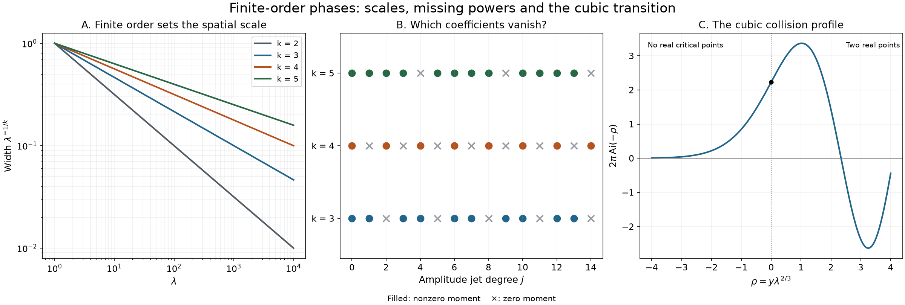

# Finite-order phases and missing powers

If the first nonzero derivative of a real phase has order \(k\), its natural spatial scale is \(\lambda^{-1/k}\). Taylor coefficients of the transformed amplitude then produce powers of \(\lambda^{-1/k}\), but some coefficients vanish for geometric reasons. An even monomial phase kills every odd amplitude jet. An odd monomial phase has a different cancellation: jets whose degree plus one is divisible by \(k\) make no contribution. The cubic case connects these cancellations with the Airy equation.

We use
\[
 \begin{gathered}
 I_{k,s}(u,\lambda)=\int_{\mathbb R}u(t)e^{is\lambda t^k}\,dt,\\
 k\ge2,\quad s\in\{-1,1\},\quad\lambda\ge1,\\
 \widehat u(\xi)=\int_{\mathbb R}e^{-it\xi}u(t)\,dt.
 \end{gathered}
 \tag{P1}
\]
The amplitude is initially a Schwartz function. Local applications use compact smooth amplitudes. Pairings are complex bilinear, and \(D=-i\,d/dt\).

## Earlier proofs and the two oriented rays

[Polynomial phases and Fourier tails](polynomial-phases-and-fourier-tails.md), Theorem B, proves that the Fourier transform of every real polynomial exponential of degree at least two has an entire representative. On the real axis its bound (B9) is \(C(1+|\xi|)^{1/(k-1)}\); in degree two the explicit Gaussian is bounded. Solution 8 proves convergence of Gaussian regularization with every complex-frequency derivative. Solution 10, (T8)–(T10), evaluates every derivative at zero by two absolutely convergent oriented rays, including both signs of the leading coefficient. These complete proofs supply the profiles and moments used below.

The [Schwartz Fourier foundation](../prerequisites/U011-free-foundations/schwartz-fourier-foundations-U017.md), F1–F5, proves the seminorm bounds, inversion and bilinear distribution identities. [Regular level sets and transverse convolution](regular-level-sets-and-transverse-convolution.md), Lemmas 0.1–0.2, proves smooth inverse maps with parameters. [Zero hypersurfaces as curvature measures](zero-hypersurfaces-as-curvature-measures.md), Lemma 3.0, proves nonlinear substitution. The [scalar](../prerequisites/U011-free-foundations/metric-foundation-bridges.md), §§12–13, and [integration](../prerequisites/U011-free-foundations/banach-foundation-bridges.md), §§15–16, foundations supply Taylor's integral formula, smooth cutoffs, convergence and integration by parts.

## A finite Fourier moment controls the error

**Lemma 1.** Let \(g\) be a bounded function whose tempered Fourier transform is represented by a function \(F\). Suppose \(F\) is smooth near zero and \(|F(\xi)|\le C(1+|\xi|)\) for real \(\xi\). For \(0<h\le1\) and \(u\in\mathcal S(\mathbb R)\),
\[
 J_h(u):=\int_{\mathbb R}u(t)g(t/h)\,dt
       =\frac h{2\pi}\int_{\mathbb R}\widehat u(\xi)F(-h\xi)\,d\xi.
 \tag{P2}
\]
For every integer \(N\ge1\), there is \(C_N\), independent of \(u,h\), such that
\[
 \left|F(x)-\sum_{j=0}^{N-1}\frac{F^{(j)}(0)}{j!}x^j\right|
       \le C_N|x|^N\qquad(x\in\mathbb R),
 \tag{P3}
\]
and consequently
\[
 \begin{aligned}
 J_h(u)&=\sum_{j=0}^{N-1}
       \frac{i^jF^{(j)}(0)}{j!}u^{(j)}(0)h^{j+1}+R_N,\\
 |R_N|&\le\frac{C_N}{2\pi}h^{N+1}
                  \int_{\mathbb R}|\xi|^N|\widehat u(\xi)|\,d\xi.
 \end{aligned}
 \tag{P4}
\]

**Proof.** Positive dilation in the distributional Fourier identity gives
\(\mathcal F[g(\,\cdot/h)](\xi)=hF(h\xi)\).
For any tempered \(v\), the proved inverse identities give
\(\langle v,u\rangle=(2\pi)^{-1}\langle\mathcal Fv,\widehat u(-\,\cdot)\rangle\).
Apply this with \(v=g(\,\cdot/h)\), then reflect the real variable of integration. The integral on the right of (P2) is absolute by polynomial growth and the Schwartz estimates. Thus (P2) does not interchange two conditional integrals.

On a fixed small interval about zero, Taylor's integral remainder proves (P3). On a compact annulus outside that interval, the growth bound bounds the left side divided by \(|x|^N\). For \(|x|\ge1\), the growth hypothesis and every polynomial term of degree less than \(N\) are bounded by a constant times \(|x|^N\). This proves (P3) globally.

Fourier inversion may be differentiated because every Fourier moment of a Schwartz function is integrable. It gives
\[
 \frac1{2\pi}\int \xi^j\widehat u(\xi)\,d\xi
       =i^{-j}u^{(j)}(0).
 \tag{P5}
\]
Substituting the polynomial from (P3) into (P2), its factor \((-1)^ji^{-j}\) is \(i^j\). The remainder is bounded by the absolute integral of (P3). This proves (P4). \(\square\)

The Fourier integral in (P4) is controlled by finitely many ordinary Schwartz seminorms. Indeed, on \(|\xi|\le1\) use \(|\widehat u|\le\|u\|_1\). On \(|\xi|>1\), integrating by parts \(N+2\) times gives \(|\widehat u(\xi)|\le|\xi|^{-N-2}\|u^{(N+2)}\|_1\). Hence it is at most \(2\|u\|_1+2\|u^{(N+2)}\|_1\). The weighted \(L^1\) bound in F1 controls these two norms.

## Every monomial coefficient, with both signs

Let \(F_{k,s}\) denote the entire Fourier transform of \(e^{is t^k}\); its notation here has leading coefficient \(s\), rather than \(s/k\). Define
\[
 m_{k,s,j}=i^jF_{k,s}^{(j)}(0),\qquad
 \nu_j=\frac{j+1}{k},\qquad
 \theta_j=\frac{s\pi(j+1)}{2k}.
 \tag{P6}
\]
The earlier ray formula, with its parameter set to \(sk\), gives
\[
 m_{k,s,j}
    =\frac{\Gamma(\nu_j)}k
        \bigl(1+(-1)^j\bigr)e^{i\theta_j}
        \qquad(k\text{ even}),
 \tag{P7}
\]
and
\[
 m_{k,s,j}
    =\frac{\Gamma(\nu_j)}k
         \left(e^{i\theta_j}+(-1)^je^{-i\theta_j}\right)
        \qquad(k\text{ odd}).
 \tag{P8}
\]
All Gamma arguments are positive. These numbers are defined by entire Fourier derivatives, or equivalently by the absolute ray integrals. No convergence of an undamped high real moment is presumed.

**Theorem 2.** For every \(N\ge1\),
\[
 \begin{aligned}
 I_{k,s}(u,\lambda)
   &=\sum_{j=0}^{N-1}\frac{m_{k,s,j}}{j!}
          u^{(j)}(0)\lambda^{-(j+1)/k}+R_{k,s,N},\\
 |R_{k,s,N}|
   &\le C_{k,N}\lambda^{-(N+1)/k}
                 \int |\xi|^N|\widehat u(\xi)|\,d\xi.
 \end{aligned}
 \tag{P9}
\]
For even \(k\), this has the more economical form
\[
 \begin{aligned}
 I_{k,s}(u,\lambda)
   &=\frac2k\sum_{j=0}^{N-1}
       \Gamma\!\left(\frac{2j+1}{k}\right)
       e^{is\pi(2j+1)/(2k)}
       \frac{u^{(2j)}(0)}{(2j)!}\lambda^{-(2j+1)/k}\\
   &\hspace{1em}+O\!\left(\lambda^{-(2N+1)/k}\right).
 \end{aligned}
 \tag{P10}
\]
For odd \(k\), the vanishing coefficients are exactly
\[
 m_{k,s,j}=0\quad\Longleftrightarrow\quad k\text{ divides }j+1.
 \tag{P11}
\]

**Proof.** Apply Lemma 1 with \(g(t)=e^{is t^k}\) and \(h=\lambda^{-1/k}\). The earlier entire profile has the required at-most-linear real growth. Formula (P4) is (P9), and (P7)–(P8) supply its coefficients. Explicitly, the positive ray has angle \(s\pi/(2k)\). The negative ray has angle \(\pi+s\pi/(2k)\) for even \(k\), and \(\pi-s\pi/(2k)\) for odd \(k\), and is oriented toward zero. Subtracting its contribution gives precisely (P7)–(P8).

Apply (P9) with depth \(2N\) for even \(k\). Every odd coefficient in (P7) is zero, leaving (P10) with the stated error. For odd \(k\), the bracket in (P8) is \(2\cos\theta_j\) when \(j\) is even, and \(2i\sin\theta_j\) when \(j\) is odd. In the even-\(j\) case it vanishes exactly when \((j+1)/k\) is an odd integer. In the odd-\(j\) case it vanishes exactly when \((j+1)/k\) is an even integer. Since \(k\) is odd, these are precisely the possibilities in (P11). The positive Gamma integral never vanishes. \(\square\)

For \(s=1\) and odd \(k\), (P8) also equals
\[
 m_{k,1,j}
   =\frac2k\Gamma\!\left(\frac{j+1}{k}\right)
       \sin\!\left(\frac{(k-1)(j+1)\pi}{2k}\right)i^j.
\]
To check this, expand the sine of \((j+1)\pi/2-(j+1)\pi/(2k)\), separating even and odd \(j\). Thus using \((-D)^j=i^j\,d^j/dt^j\) gives the same odd-degree expansion. For \(s=-1\), each coefficient in (P7)–(P8) is conjugated; the amplitude itself need not be real and is not conjugated.

## A real phase of fixed finite order

**Theorem 3.** Let \(f\) be real and smooth near zero, and suppose
\[
 f^{(j)}(0)=0\quad(1\le j<k),\qquad f^{(k)}(0)\ne0,
 \qquad k\ge2.
 \tag{P12}
\]
There is a sufficiently small interval \(U\) such that every \(u\in C_c^\infty(U)\) has a complete expansion determined by (P9), after the following explicit substitution.

Taylor's integral formula gives
\[
 \begin{aligned}
 f(t)&=f(0)+t^ka(t),\\
 a(t)&=\frac1{(k-1)!}\int_0^1(1-r)^{k-1}f^{(k)}(rt)\,dr,
 \qquad a(0)=\frac{f^{(k)}(0)}{k!}.
 \end{aligned}
 \tag{P13}
\]
Put \(s=\operatorname{sgn}a(0)\) and set
\[
 z=T(t)=t|a(t)|^{1/k},\qquad t=\tau(z).
 \tag{P14}
\]
On a small interval this is a smooth increasing diffeomorphism. Extend
\[
 v(z)=u(\tau(z))\tau'(z)
 \tag{P15}
\]
by zero outside \(T(U)\). Then
\[
 \int u(t)e^{i\lambda f(t)}\,dt
   =e^{i\lambda f(0)}
       \left[
       \sum_{j=0}^{N-1}\frac{m_{k,s,j}}{j!}
            v^{(j)}(0)\lambda^{-(j+1)/k}
       +O\!\left(\lambda^{-(N+1)/k}\right)\right].
 \tag{P16}
\]
In particular its leading term is
\[
 e^{i\lambda f(0)}m_{k,s,0}u(0)
       \left(\frac{k!}{|f^{(k)}(0)|}\right)^{1/k}
       \lambda^{-1/k}.
 \tag{P17}
\]

**Proof.** Shrink so that \(a\) has its nonzero constant sign. The positive \(k\)-th root is smooth there: apply the earlier implicit theorem to \(b^k-|a(t)|=0\) at the positive root, where the \(b\) derivative is nonzero. Existence and uniqueness of that positive root also follow from strict monotonicity and continuity of \(b\mapsto b^k\) on \(b>0\). Thus \(T\) is smooth and \(T'(0)=|a(0)|^{1/k}>0\). The earlier inverse theorem gives \(\tau\), and continuity makes \(T'>0\) on a smaller interval. Directly, \(f(t)=f(0)+sT(t)^k\).

Substitution retains the positive Jacobian \(\tau'\), giving exactly \(e^{i\lambda f(0)}I_{k,s}(v,\lambda)\). Compact support inside \(U\) makes the zero extension of \(v\) smooth and compactly supported. Theorem 2 proves (P16). Since \(v(0)=u(0)|a(0)|^{-1/k}\), it also proves (P17). \(\square\)

There is a useful parameter version, with an explicit hypothesis. If \(f(t,y)\) is smooth and real and
\[
 \partial_t^jf(0,y)=0\quad(1\le j<k),\qquad
 |\partial_t^kf(0,y)|\ge c>0
 \tag{P18}
\]
on a compact parameter patch, the construction is smooth in \(y\), on a common small interval after a finite covering if necessary. On each connected sign patch, \(s\) is constant. Assume the amplitudes have a common compact support inside that interval. Differentiating the normalized identity, with \(e^{i\lambda f(0,y)}\) removed, only differentiates \(v(z,y)\). Lemma 1 and its finite seminorm bound therefore give, for each multiindex \(\alpha\),
\[
 \partial_y^\alpha
 \left[
 e^{-i\lambda f(0,y)}\int u(t,y)e^{i\lambda f(t,y)}\,dt
 -\sum_{j<N}\frac{m_{k,s,j}}{j!}
       \partial_z^jv(0,y)\lambda^{-(j+1)/k}
 \right]
 =O\!\left(\lambda^{-(N+1)/k}\right)
 \tag{P19}
\]
uniformly on the patch. Indeed the parameter inverse theorem makes every needed derivative of \(v\) bounded on a common compact support, and the finite \(L^1\) estimate following Lemma 1 supplies the uniform constant. Derivatives of the unnormalized expression can also hit \(e^{i\lambda f(0,y)}\), producing powers of \(\lambda\). Hypothesis (P18) requires that the lower derivatives vanish on every parameter fibre; it does not cover a collision that changes the critical-point multiplicity.

## Several separated critical points

**Corollary 4.** Let \(f\) be real and smooth near the compact support of \(u\in C_c^\infty(\mathbb R)\). Suppose all critical points in a compact neighborhood of that support form a finite list \(c_1,\ldots,c_q\), each of finite order \(k_r\ge2\). Choose disjoint small neighborhoods and smooth cutoffs equal to one near the respective points. Apply (P13)–(P15) to each translated phase and cutoff amplitude, obtaining \(s_r,v_r\). For arbitrary \(N_r\ge1\) and \(M\ge1\),
\[
 \int ue^{i\lambda f}
 =\sum_{r=1}^q e^{i\lambda f(c_r)}
      \sum_{j<N_r}\frac{m_{k_r,s_r,j}}{j!}
           v_r^{(j)}(0)\lambda^{-(j+1)/k_r}
   +\sum_{r=1}^q O\!\left(\lambda^{-(N_r+1)/k_r}\right)
   +O(\lambda^{-M}).
 \tag{P20}
\]
The same assertion with an empty sum says that a nonstationary compact integral is rapidly decreasing.

**Proof.** Subtract the finitely many cutoff amplitudes from \(u\). The resulting compact amplitude \(w\) vanishes near every critical point, so \(|f'|\ge c>0\) on a neighborhood of its support. Repeated integration by parts uses
\[
 \int we^{i\lambda f}
   =\lambda^{-M}\int \mathcal T_f^M w\,e^{i\lambda f},
 \qquad
 \mathcal T_f w=i\,\frac d{dt}\left(\frac w{f'}\right).
 \tag{P21}
\]
All amplitudes are compact and every coefficient derivative is bounded. Its absolute integral is \(O(\lambda^{-M})\). Theorem 3 applies to each of the remaining finitely many pieces, proving (P20). \(\square\)

Changing a cutoff that is one near its critical point changes only a nonstationary amplitude. Formula (P21) shows that the local coefficients are independent of that choice. If all derivatives of the original amplitude vanish at every critical point, so do all transformed derivatives, and (P20) gives rapid decrease.

## The cubic expansion in Airy notation

Define the entire function
\[
 \operatorname{Ai}(z)=\frac1{2\pi}\,
   \mathcal F(e^{it^3/3})(-z).
 \tag{P22}
\]
This is the normalization proved in the earlier polynomial-profile lesson. It is a definition by the supplied entire representative, not an integral at arbitrary complex frequency over the undamped real line.

**Theorem 5.** For \(u\in\mathcal S(\mathbb R)\) and \(N\ge1\),
\[
 \int u(t)e^{i\lambda t^3}\,dt
   =2\pi\sum_{j=0}^{N-1}
        \frac{\operatorname{Ai}^{(j)}(0)}{j!}
        (3\lambda)^{-(j+1)/3}D^ju(0)
       +O\!\left(\lambda^{-(N+1)/3}\right).
 \tag{P23}
\]
The error has a finite Schwartz-seminorm bound. Moreover
\[
 \begin{aligned}
 \operatorname{Ai}''(z)&=z\operatorname{Ai}(z),\\
 \operatorname{Ai}(0)&=\frac{3^{-1/6}\Gamma(1/3)}{2\pi},&
 \operatorname{Ai}'(0)&=-\frac{3^{1/6}\Gamma(2/3)}{2\pi}.
 \end{aligned}
 \tag{P24}
\]
Every derivative with index \(3r+2\) vanishes at zero.

**Proof.** Positive dilation gives
\(F_{3,1}(\xi)=2\pi\,3^{-1/3}\operatorname{Ai}(-3^{-1/3}\xi)\)
for the leading-coefficient convention in (P6). Thus
\(i^jF_{3,1}^{(j)}(0)=2\pi\,3^{-(j+1)/3}(-i)^j\operatorname{Ai}^{(j)}(0)\).
Theorem 2 proves (P23), including its error. The earlier polynomial equation and initial values, Theorem B and Solution 5, give (P24) after reflection and division by \(2\pi\).

For an explicit check of the missing powers, let \(A_j=\operatorname{Ai}^{(j)}(0)\). Differentiating the equation \(j\) times at zero gives
\[
 A_2=0,\qquad A_{j+2}=jA_{j-1}\quad(j\ge1).
 \tag{P25}
\]
This recursion propagates \(A_{3r+2}=0\). It agrees exactly with (P11) at \(k=3\). \(\square\)

## Two exact profiles across a cubic collision

The following uniform calculation does not impose (P18). It concerns the cubic polynomial itself and the two amplitudes \(1,t\) localized near its critical points.

**Proposition 6.** Let \(\chi\in C_c^\infty(\mathbb R)\) be one for \(|t|\le\delta\), with \(\delta>0\), and let \(|a|\le a_0<\delta^2\). Uniformly for those \(a\), for every \(M\),
\[
 \begin{aligned}
 \int\chi(t)e^{i\lambda(t^3/3+at)}\,dt
   &=2\pi\lambda^{-1/3}\operatorname{Ai}(a\lambda^{2/3})
                      +O(\lambda^{-M}),\\
 \int t\chi(t)e^{i\lambda(t^3/3+at)}\,dt
   &=\frac{2\pi}{i}\lambda^{-2/3}
                \operatorname{Ai}'(a\lambda^{2/3})
                      +O(\lambda^{-M}).
 \end{aligned}
 \tag{P26}
\]
Uniformity here concerns function values, rather than all parameter derivatives.

**Proof.** Both improper real integrals with \(\chi\) replaced by one exist. On a tail, the derivative of the phase is \(t^2+a\). For the amplitudes \(1\) and \(t\), their quotients by this derivative tend to zero and their derivatives are respectively \(O(|t|^{-3})\) and \(O(|t|^{-2})\). Integration by parts proves convergence, uniformly for \(a\) in a compact interval. The same estimate for the amplitude \(t\) justifies the first real-frequency derivative of the degree-three entire profile: derivatives of the finite integrals converge locally uniformly, and the fundamental theorem of calculus passes to their limits.

The substitution \(z=\lambda^{1/3}t\) and (P22) therefore give
\[
 \begin{aligned}
 \int_{\mathbb R}^{\mathrm{imp}}e^{i\lambda(t^3/3+at)}\,dt
   &=2\pi\lambda^{-1/3}\operatorname{Ai}(a\lambda^{2/3}),\\
 \int_{\mathbb R}^{\mathrm{imp}}t e^{i\lambda(t^3/3+at)}\,dt
   &=\frac{2\pi}{i}\lambda^{-2/3}
                    \operatorname{Ai}'(a\lambda^{2/3}).
 \end{aligned}
 \tag{P27}
\]
The factor \(1/i\) in the second identity comes from differentiating the positive linear phase.

Subtract these identities from the compact integrals. The difference amplitudes are \(b_0=\chi-1\) and \(b_1=t(\chi-1)\). They vanish for \(|t|\le\delta\), and
\[
 |t^2+a|\ge\delta^2-a_0>0
       \quad\text{on their support}.
 \qquad
 \mathcal T_a b=i\,\frac d{dt}\left(\frac b{t^2+a}\right).
 \tag{P28}
\]
The first integration has zero endpoints at both infinities; there is no endpoint inside because \(b_\ell\) is smooth and zero on the central interval. At infinity, each application of \(\mathcal T_a\) lowers a symbol power by three. In detail, \(b_\ell^{(r)}=O(|t|^{\ell-r})\) for \(\ell=0,1\), and quotient differentiation gives
\((\mathcal T_a^M b_\ell)^{(r)}=O(|t|^{\ell-3M-r})\).
On the finite part of the support all derivatives are uniformly bounded by the positive denominator in (P28). Thus for \(M\ge1\), the last amplitude is absolutely integrable with a uniform bound. Repeating the integrations proves an \(O(\lambda^{-M})\) error for each profile. \(\square\)

For the phase \(t^3/3-yt\), the scaled parameter is \(\rho=y\lambda^{2/3}\), and the first identity becomes
\[
 \lambda^{1/3}\int\chi(t)e^{i\lambda(t^3/3-yt)}\,dt
        =2\pi\operatorname{Ai}(-\rho)
                      +O(\lambda^{-M+1/3}).
 \tag{P29}
\]
For \(y>0\) the two real critical points are \(\pm\sqrt y\); for \(y<0\) there are none; at \(y=0\) they merge. The transition scale is \(y\) of order \(\lambda^{-2/3}\). A general smoothly varying cubic phase additionally requires a parameter-dependent normal form, and general amplitudes require smooth division; Proposition 6 supplies the two canonical profiles themselves.

*The first panel compares the exact widths \(\lambda^{-1/k}\). The second shows the coefficient cancellations proved in (P7)–(P11): a cross denotes an identically zero coefficient. The third gives numerical samples of \(2\pi\operatorname{Ai}(-\rho)\), using the convergent Taylor recurrence (P25). It is the scaled profile in (P29), with \(\rho=y\lambda^{2/3}\); finite samples are an illustration of the proved function.*

## Exercises with full solutions

**Exercise 1 — the quartic coefficients (basic).** Let \(\chi\) be an even compact smooth cutoff equal to one near zero, and let \(u(t)=\chi(t)(1+bt+ct^2)\), where \(b,c\) may be complex. Find the expansion of \(I_{4,s}(u,\lambda)\), including the sign \(s\).

**Solution.** Every jet above degree two vanishes. Formula (P7) gives
\[
 m_{4,s,0}=\tfrac12\Gamma(1/4)e^{is\pi/8},
 \qquad
 m_{4,s,2}=\tfrac12\Gamma(3/4)e^{3is\pi/8}.
 \tag{P30}
\]
The odd term has zero integral by reflection, not just a zero asymptotic coefficient. Therefore for every \(M\),
\[
 I_{4,s}(u,\lambda)
   =\tfrac12\Gamma(1/4)e^{is\pi/8}\lambda^{-1/4}
    +\tfrac c2\Gamma(3/4)e^{3is\pi/8}\lambda^{-3/4}
    +O(\lambda^{-M}).
 \tag{P31}
\]
Indeed apply Theorem 2 at arbitrarily large depth; all further Taylor coefficients are zero. The sign reversal conjugates the displayed constants, without conjugating \(c\).

**Exercise 2 — the missing cubic term (intermediate).** Take \(u(t)=\chi(t)(A+Bt+Ct^2+Et^3)\), with a compact smooth \(\chi\) equal to one near zero. Compute the nonzero terms for \(s=1,k=3\). Explain the absence of the \(C\) term by integration by parts as well.

**Solution.** The first four moments are
\(m_0=\Gamma(1/3)/\sqrt3\),
\(m_1=i\Gamma(2/3)/\sqrt3\),
\(m_2=0\), and
\(m_3=i\Gamma(4/3)/\sqrt3\).
Formula (P9) gives, for every \(M\),
\[
 I_{3,1}(u,\lambda)
   =\frac{A\Gamma(1/3)}{\sqrt3}\lambda^{-1/3}
    +\frac{iB\Gamma(2/3)}{\sqrt3}\lambda^{-2/3}
    +\frac{iE\Gamma(4/3)}{\sqrt3}\lambda^{-4/3}
    +O(\lambda^{-M}).
 \tag{P32}
\]
There is no factorial missing: \(u^{(j)}(0)/j!\) is the corresponding polynomial coefficient. Since
\(\partial_t e^{i\lambda t^3}=3i\lambda t^2e^{i\lambda t^3}\),
\(\int t^2\chi e^{i\lambda t^3}=-(3i\lambda)^{-1}\int\chi'e^{i\lambda t^3}\).
The derivative \(\chi'\) is compactly supported away from zero, where the phase derivative is nonzero. Formula (P21) makes this contribution rapidly decreasing.

**Exercise 3 — a nonlinear coordinate changes the next coefficient (advanced).** Let \(f(t)=t^4(1+\beta t)\), with real \(\beta\), and let \(u\) equal one near zero with sufficiently small compact support. Compute the coefficients at the first two allowed orders.

**Solution.** The fourth-order sign is positive. The coordinate in (P14) is
\[
 z=t(1+\beta t)^{1/4}
   =t+\frac\beta4t^2-\frac{3\beta^2}{32}t^3+O(t^4).
 \tag{P33}
\]
Substitute an inverse series \(t=z+az^2+bz^3+O(z^4)\) and compare coefficients. The quadratic equation gives \(a=-\beta/4\), and the cubic equation gives \(b=7\beta^2/32\). Thus
\[
 t=z-\frac\beta4z^2+\frac{7\beta^2}{32}z^3+O(z^4),
 \qquad
 v(z)=1-\frac\beta2z+\frac{21\beta^2}{32}z^2+O(z^3).
 \tag{P34}
\]
These are Taylor expansions of the smooth inverse, so its derivative has the displayed Taylor coefficients; no differentiability of an arbitrary big-O expression is being assumed. Apply the even-degree expansion with depth two:
\[
 \int ue^{i\lambda f}
   =\tfrac12\Gamma(1/4)e^{i\pi/8}\lambda^{-1/4}
    +\frac{21\beta^2}{64}\Gamma(3/4)e^{3i\pi/8}
                   \lambda^{-3/4}
    +O(\lambda^{-5/4}).
 \tag{P35}
\]
The Jacobian, rather than the original amplitude jet alone, determines the second term. For \(\beta\) in a fixed compact interval choose the support so \(|\beta t|<1/2\). Both the root and \(T'(t)=(1+\beta t)^{-3/4}(1+5\beta t/4)\) are then bounded away from zero, so the same calculation is uniform.

**Exercise 4 — why a fixed-order hypothesis matters (intermediate).** Consider the cutoff integral with phase \(t^3/3-yt\) in Proposition 6. Compare \(y=0\), fixed negative \(y\), and the moving scale \(y=\rho\lambda^{-2/3}\). Can (P18) be applied uniformly through \(y=0\)?

**Solution.** At \(y=0\), (P26) has leading nonzero value \(2\pi\operatorname{Ai}(0)\lambda^{-1/3}\). For fixed \(y<0\), the derivative \(t^2+|y|\) is bounded below, so (P21) gives decay faster than every power, with constants depending on \(|y|^{-1}\). On the moving scale, (P26) gives, uniformly for bounded real \(\rho\),
\[
 \lambda^{1/3}\int\chi(t)
 e^{i\lambda(t^3/3-\rho\lambda^{-2/3}t)}\,dt
       \longrightarrow2\pi\operatorname{Ai}(-\rho).
 \tag{P36}
\]
The constants for fixed negative \(y\) cannot be used uniformly as \(y\) approaches zero. Moreover \(f_t(0,y)=-y\), so the lower-jet hypothesis (P18) already fails for every \(y\ne0\). The Airy profile describes the collision without pretending that every fibre has a cubic critical point at zero.

## References and credit

Lars Hörmander, *The Analysis of Linear Partial Differential Operators I: Distribution Theory and Fourier Analysis*, second edition, Springer, 2003, §7.7, formulas (7.7.29)–(7.7.31), p. 233, and the canonical cubic integrals in the proof of Theorem 7.7.18, pp. 234–235. The earlier polynomial-profile lesson supplies the complete entire-transform and oriented-moment proofs; its authorship and source credits are retained.

Written by GPT-6 Astra (OpenAI), October 2026. This lesson and its original figure are CC0. Earlier programme readings retain their stated attribution and licences.
