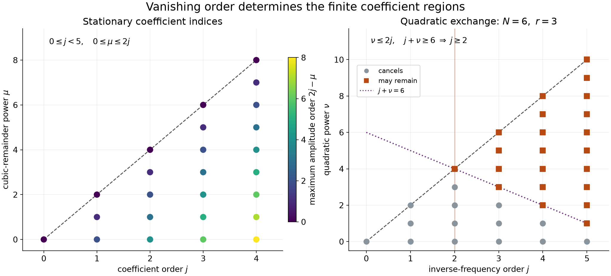

# Finite stationary jets and quadratic exchange

Near a nondegenerate stationary point, finitely many derivatives of a phase determine finitely many terms of its oscillatory integral. Two counts govern the calculation: a cubic remainder consumes three derivatives per factor, while a quadratic differential operator supplies two. A second calculation explains when a quadratic term can be moved from the phase into the amplitude without changing the determinant factor.

We retain the number of derivatives, the complex Gaussian branch and the power of the large parameter. The results apply to complex phases with nonnegative imaginary part. The quadratic exchange itself is algebraic and does not require positivity.

## Conventions and exact earlier arguments

Write \(D=-i\partial\), use \(\widehat u(\xi)=\int e^{-ix\cdot\xi}u(x)\,dx\), and use complex bilinear products in quadratic forms. Matrix norms are Euclidean operator norms on \(\mathbb C^n\). For an invertible complex symmetric matrix \(A\), define
\[
 L_A=\sum_{a,b=1}^n(A^{-1})_{ab}\partial_a\partial_b,\qquad
 c_j(A,u)=\frac{(i/2)^j}{j!}(L_A^ju)(0).
 \tag{F1}
\]
When \(\operatorname{Im}A\geq0\), let
\[
 G_A(\omega)=\frac{(2\pi/\omega)^{n/2}}{g(-iA)},\qquad \omega>0.
 \tag{F2}
\]
Here \(g(B)^2=\det B\) is the branch positive on real positive definite \(B\), continued to invertible matrices with nonnegative real part. In particular, for real symmetric invertible \(A\),
\[
 G_A(\omega)=(2\pi/\omega)^{n/2}
       |\det A|^{-1/2}e^{i\pi\operatorname{sgn}A/4}.
 \tag{F3}
\]

The proof inputs are available in these earlier lessons:

- [Point sources and complex Gaussian kernels](point-sources-and-complex-gaussian-kernels.md), Section 2 and Theorem 3.1, proves determinant differentiation, the branch \(g\), its boundary values and the full complex Gaussian transform.
- [Separated frequencies and distributional order](separated-frequencies-and-distributional-order.md), Lemma 0.1 and the following shell argument, proves Schwartz Plancherel with every integer weight and integrability of \(\langle\xi\rangle^{-2s}\) for \(s>n/2\).
- [Weighted cancellation for complex phases](weighted-cancellation-for-complex-phases.md), Theorem 1 and formulas W4–W5, gives the finite-order estimate with weight \((|\nabla f|^2+\operatorname{Im}f)^{|\alpha|/2-k}\), including its uniformity at degenerating points.
- [When a kernel is smooth](when-a-kernel-is-smooth.md#taylor-estimates-on-compact-neighborhoods) proves the complete integral Taylor formula. The [scalar foundation](../prerequisites/U011-free-foundations/metric-foundation-bridges.md), §§12–13, supplies compactness, derivative rules and smooth cutoffs; the [integration foundation](../prerequisites/U011-free-foundations/banach-foundation-bridges.md), §§15.0–15.1, supplies Fubini and dominated convergence.
- The [finite algebra foundation](../prerequisites/U011-free-foundations/stable-prerequisite-bridges.md), §§10.1–10.6, supplies determinant multiplication and the adjugate identity. The [Schwartz Fourier foundation](../prerequisites/U011-free-foundations/schwartz-fourier-foundations-U017.md), F1–F5, supplies inversion, derivative rules and their distributional transposes.

## A complex quadratic with its finite derivative bound

**Theorem 1.** Let \(A=A^T\) be invertible with \(\operatorname{Im}A\geq0\). For \(u\in\mathcal S(\mathbb R^n)\), integers \(k\geq1\), \(s>n/2\), and every \(\omega>0\),
\[
 \left|\int e^{i\omega x^TAx/2}u(x)\,dx
       -G_A(\omega)\sum_{j=0}^{k-1}\omega^{-j}c_j(A,u)\right|
 \leq C_{n,k,s}
       \left(\frac{\|A^{-1}\|}{\omega}\right)^{n/2+k}
       \sum_{|\alpha|\leq2k+s}\|\partial^\alpha u\|_2.
 \tag{F4}
\]
The constant is independent of \(A,u,\omega\). No commutation of the real and imaginary parts of \(A\) is assumed.

**Proof.** The earlier Gaussian transform with \(B=-iA\) and \(t=2/\omega\), paired by Fourier inversion, gives the exact identity
\[
 \int e^{i\omega x^TAx/2}u(x)\,dx
 =G_A(\omega)(2\pi)^{-n}
       \int e^{-i\xi^TA^{-1}\xi/(2\omega)}\widehat u(\xi)\,d\xi.
 \tag{F5}
\]
The even quadratic multiplier removes the sign reversal in the inverse transpose. Both displayed pairings are absolutely convergent against their Schwartz amplitudes.

Matrix multiplication gives
\[
 \operatorname{Im}(A^{-1})
   =-A^{-*}(\operatorname{Im}A)A^{-1}\leq0.
 \tag{F6}
\]
Consequently \(\operatorname{Re}[-i\xi^TA^{-1}\xi/(2\omega)]\leq0\) for real \(\xi\). Taylor's integral formula on the segment from zero to this complex number bounds the exponential remainder after \(k\) terms by
\[
 \frac{|\xi^TA^{-1}\xi|^k}{2^k k!\omega^k}
 \leq\frac{\|A^{-1}\|^k|\xi|^{2k}}{2^k k!\omega^k}.
 \tag{F7}
\]
Fourier inversion turns each polynomial term into \(c_j(A,u)\): two ordinary derivatives contribute a minus sign, changing \((-i/2)^j\) into \((i/2)^j\).

For the remaining integral, Cauchy–Schwarz followed by the earlier weighted Plancherel identity gives
\[
 \begin{aligned}
 \int|\xi|^{2k}|\widehat u(\xi)|\,d\xi
 &\leq
   \|\langle\xi\rangle^{-s}\|_2
   \|\langle\xi\rangle^{2k+s}\widehat u\|_2\\
 &\leq C_{n,k,s}
      \sum_{|\alpha|\leq2k+s}\|\partial^\alpha u\|_2.
 \end{aligned}
 \tag{F8}
\]
The integer power \((1+|\xi|^2)^{2k+s}\) has a finite expansion with positive coefficients; this is why precisely \(2k+s\) derivatives suffice. Finally
\[
 |G_A(\omega)|=(2\pi/\omega)^{n/2}|\det A^{-1}|^{1/2}
 \leq C_n(\|A^{-1}\|/\omega)^{n/2}.
 \tag{F9}
\]
For the last inequality, expand the determinant as its \(n!\) permutation terms and bound each entry by the operator norm. Combining (F5)–(F9) proves (F4). \(\square\)

## Vanishing jets absorb the singular weight

**Lemma 2.** Let \(p\geq1\), let \(v\in C_c^p(X)\) have support in a fixed compact set \(K\Subset X\), and let \(f\in C^{p+1}(X)\) with \(\operatorname{Im}f\geq0\). Suppose \(x_0\in X\), and on \(K\setminus\{x_0\}\),
\[
 |\nabla f(x)|\geq c|x-x_0|,\qquad
 |\partial^\alpha v(x)|\leq M|x-x_0|^{2p-|\alpha|}
       \quad(|\alpha|\leq p).
 \tag{F10}
\]
Then
\[
 \left|\int v e^{i\omega f}\right|
       \leq C M\omega^{-p},\qquad \omega>0.
 \tag{F11}
\]
The constant is uniform for fixed support, collar, \(c>0\) and bounded \(C^{p+1}\) phase norms.

**Proof.** Put \(H=|\nabla f|^2+\operatorname{Im}f\). For \(|\alpha|\leq p\), the exponent \(|\alpha|/2-p\) is negative. Thus (F10) implies
\[
 |\partial^\alpha v|H^{|\alpha|/2-p}
 \leq M c^{|\alpha|-2p}.
 \tag{F12}
\]
At \(x_0\) the derivatives of \(v\) through order \(p\) vanish by continuity and (F10), so the zero convention in W2 applies if \(H(x_0)=0\). If \(x_0\) is isolated in \(K\), every such supported continuous derivative is also zero there. Theorem 1 of the weighted-cancellation lesson, in its supremum form W4, proves (F11). \(\square\)

In particular, if \(v\in C_c^{2p}\) and all its derivatives of order less than \(2p\) vanish at \(x_0\), Taylor's formula gives the derivative bound in (F10) near \(x_0\), in terms of the derivatives through order \(2p\). Away from that point, a fixed positive distance absorbs the remaining compact derivative bounds.

## The finite expansion at one complex stationary point

**Theorem 3.** Fix \(X\subset\mathbb R^n\) open, \(K\Subset X\), \(x_0\in X\), and an integer \(k\geq1\). Suppose
\[
 \begin{gathered}
 u\in C_c^{2k}(X),\quad\operatorname{supp}u\subset K,\quad
 f\in C^{3k+1}(X),\quad\operatorname{Im}f\geq0,\\
 \operatorname{Im}f(x_0)=0,\quad \nabla f(x_0)=0,\quad
 A=f''(x_0)\ \hbox{invertible},\\
 \nabla f(x)\ne0\quad(x\in K\setminus\{x_0\}).
 \end{gathered}
 \tag{F13}
\]
Let \(z=x-x_0\) and
\[
 h(x)=f(x)-f(x_0)-\tfrac12 z^TAz.
 \tag{F14}
\]
Use \(L_A\) in the \(z\) coordinates. For \(0\leq j<k\), define the finite differential functionals
\[
 \mathcal C_j(f,u)=
 \sum_{\mu=0}^{2j}
   \frac{i^j(-1)^\mu}{2^{j+\mu}\mu!(j+\mu)!}
   \bigl[L_A^{j+\mu}(h^\mu u)\bigr](x_0).
 \tag{F15}
\]
Their meaning is the finite product-rule evaluation at \(x_0\); it uses only derivatives of \(u\) through order \(2j\) and of \(f\) through order \(2j+2\). Thus no additional differentiability is implicit in (F15).

For \(\omega\geq1\),
\[
 \left|\int_X ue^{i\omega f}\,dx
   -e^{i\omega f(x_0)}G_A(\omega)
       \sum_{j=0}^{k-1}\omega^{-j}\mathcal C_j(f,u)\right|
 \leq C\omega^{-k}
       \sum_{|\alpha|\leq2k}\|\partial^\alpha u\|_\infty.
 \tag{F16}
\]
For fixed \(X,K,x_0\), the constant is uniform on bounded \(C^{3k+1}\) phase families on a fixed compact neighborhood of \(K\cup\{x_0\}\), provided
\[
 \sup_{x\in K\setminus\{x_0\}}\frac{|x-x_0|}{|\nabla f(x)|}
 \tag{F17}
\]
has a common finite bound. The empty supremum causes no difficulty.

Each \(\mathcal C_j\) is a differential operator in \(u\) of order at most \(2j\), with \(\mathcal C_0(f,u)=u(x_0)\). Its coefficients are rational in the phase derivatives through order \(2j+2\), admit common denominator \((\det A)^{3j}\), and are homogeneous of degree \(-j\) when every phase derivative is multiplied by the same nonzero scalar. In a product-rule term, the total number of derivatives falling on \(u\) and on the factors \(f''\) is at most \(2j\).

**Proof: the geometry and the uniform constants.** Translate \(x_0\) to zero and subtract the real number \(f(x_0)\). This changes the integral only by the unit factor displayed in (F16). Since \(\operatorname{Im}f\) has a minimum at zero, its second directional derivatives are nonnegative; hence \(\operatorname{Im}A\geq0\).

For a fixed phase, \(\nabla f(z)=Az+O(|z|^2)\). Invertibility gives \(|\nabla f(z)|\geq\frac12\|A^{-1}\|^{-1}|z|\) on a small ball. Away from zero the asserted nonvanishing and compactness give a positive gradient minimum. This proves finiteness of (F17).

Here is also the uniform inverse bound needed below. If \(x_0\) is interior to \(K\), its fixed small ball lies in \(K\). Taking directional limits in (F17) gives \(|Av|\geq c|v|\) for real \(v\), uniformly. The matrices \(A=R+iS\) have bounded entries, \(S\geq0\), and satisfy this real-vector lower bound. Their closure is compact and consists of invertible matrices. Indeed, if \(Az=0\) for a complex vector, the imaginary part of \(z^*Az=0\) gives \(z^*Sz=0\). The real orthogonal diagonalization of \(S\) gives \(Sz=0\), and then \(Rz=0\). The real or imaginary part of a nonzero \(z\) would be a nonzero real vector killed by \(A\), a contradiction. Continuity of inversion on that compact set gives a common bound on \(\|A^{-1}\|\).

If \(x_0\) is not interior to \(K\), all derivatives of \(u\) through order \(2k\) vanish there: points outside \(K\), where these derivatives are zero, approach \(x_0\). Thus every coefficient in (F15) is zero, and Lemma 2 with \(p=k\), (F17) and the Taylor bound proves (F16) directly. We may therefore assume \(x_0\) is interior to \(K\). The uniform inverse bound, the phase derivative bound and a fixed ball inside \(X\) now permit a common small radius in the following constructions.

Put \(q(z)=z^TAz/2\), so \(h=f-q\) has zero derivatives through order two. On a sufficiently small ball, all phases
\[
 f_t=q+th,\qquad 0\leq t\leq1,
 \tag{F18}
\]
have \(\operatorname{Im}f_t\geq0\) and \(|\nabla f_t(z)|\geq c_1|z|\). The first assertion follows because \(f_t=(1-t)q+tf\). The second follows from \(Az+tO(|z|^2)\), with uniform constants.

**Proof: replace the amplitude by a finite jet.** Let
\(M=\sum_{|\alpha|\leq2k}\|\partial^\alpha u\|_\infty\).
Choose a smooth cutoff \(\rho\), equal to one near zero and supported in the small ball. Let \(u_1=\rho T_{2k-1}u\), where \(T_{2k-1}u\) is the Taylor polynomial at zero through degree \(2k-1\). Every fixed derivative of \(u_1\) is at most a constant times \(M\). The difference \(u-u_1\) has zero derivatives of order less than \(2k\). Lemma 2, on \(K\cup\operatorname{supp}\rho\), gives
\[
 \left|\int(u-u_1)e^{i\omega f}\right|\leq CM\omega^{-k}.
 \tag{F19}
\]
The gradient bound on this union comes from (F17) on \(K\) and the chosen small ball on the added support.

**Proof: interpolate from the quadratic phase.** Define
\[
 J(t)=\int u_1(z)e^{i\omega f_t(z)}\,dz,\qquad
 J^{(\mu)}(t)=(i\omega)^\mu
                  \int u_1h^\mu e^{i\omega f_t}\,dz.
 \tag{F20}
\]
Differentiation under this compact integral is justified by the continuous bounded integrands. For \(|\alpha|\leq3k\), the vanishing of \(h\) through order two and the product rule give
\[
 |\partial^\alpha(u_1h^{2k})(z)|
       \leq CM|z|^{6k-|\alpha|}.
 \tag{F21}
\]
To see the derivative count even when a factor receives many derivatives, use
\(|\partial^\beta h|\leq C|z|^{3-|\beta|}\) on the ball for \(|\beta|\leq3k\); when the exponent is negative this follows from boundedness and a ball of radius at most one. Derivatives falling on \(u_1\) are bounded, and can only increase the resulting vanishing power.

Lemma 2 with \(p=3k\), applied uniformly to \(f_t\), gives
\(|J^{(2k)}(t)|\leq CM\omega^{-k}\).
Taylor's formula in \(t\) therefore gives
\[
 J(1)=\sum_{\mu=0}^{2k-1}
       \frac{(i\omega)^\mu}{\mu!}
       \int u_1h^\mu e^{i\omega q}\,dz
       +O(M\omega^{-k}).
 \tag{F22}
\]
Only the assumed \(3k+1\) phase derivatives are used.

Let \(H_0=T_{3k}h\) be the degree-\(3k\) Taylor polynomial of \(h\). For \(1\leq\mu<2k\) and \(|\alpha|\leq k+\mu\), Taylor's derivative remainder and
\(h^\mu-H_0^\mu=(h-H_0)\sum_{a=0}^{\mu-1}h^{\mu-1-a}H_0^a\)
give
\[
 |\partial^\alpha[u_1(h^\mu-H_0^\mu)]|
 \leq CM|z|^{3k+3\mu-2-|\alpha|}
 \leq CM|z|^{2(k+\mu)-|\alpha|}.
 \tag{F23}
\]
The last inequality uses \(k+\mu\geq2\) and the radius at most one. The difference \(h-H_0\) has derivative remainder of order \(3k+1-|\beta|\); all derivatives used here have order at most \(k+\mu\leq3k-1\). Lemma 2 with \(p=k+\mu\) and phase \(q\) shows that replacing \(h^\mu\) by \(H_0^\mu\) in (F22) costs \(O(M\omega^{-k})\). For \(\mu=0\) there is no replacement error.

**Proof: compute the surviving coefficients.** The functions \(u_1H_0^\mu\) are smooth with fixed compact support. Every derivative required at this finite stage is bounded by \(CM\), because \(H_0\) is a polynomial with bounded coefficients. Apply Theorem 1 with expansion order \(k+\mu\) to each of them. Multiplying by \(\omega^\mu\), the remainder is \(O(M\omega^{-k-n/2})\), hence \(O(M\omega^{-k})\) for \(\omega\geq1\). The finite coefficient sum is
\[
 G_A(\omega)
 \sum_{\mu=0}^{2k-1}\ \sum_{\nu=0}^{k+\mu-1}
 \frac{i^{\mu+\nu}\omega^{\mu-\nu}}
      {2^\nu\mu!\nu!}
       [L_A^\nu(H_0^\mu u_1)](0).
 \tag{F24}
\]
Since \(H_0\) vanishes to order three, a nonzero term requires \(2\nu\geq3\mu\). Put \(j=\nu-\mu\). Then
\[
 0\leq j<k,\qquad 0\leq\mu\leq2j,\qquad \nu=j+\mu\leq3j.
 \tag{F25}
\]
Conversely every pair in this range occurs in (F24). The coefficient is
\(i^{j+2\mu}=i^j(-1)^\mu\), as in (F15).

In a nonzero differentiated product, each \(H_0\) factor receives at least three derivatives. At most \(2\nu-3\mu=2j-\mu\) derivatives fall on \(u_1\). If \(\mu\geq1\), at most
\(2\nu-3(\mu-1)=2j-\mu+3\leq2j+2\)
fall on any one \(H_0\) factor. These orders are available in the original \(u,f\), and the Taylor polynomials agree with them. Thus (F24) is exactly (F15). These observations also define (F15) when the undifferentiated product is not globally \(C^{2j+2\mu}\): it is the stated finite jet functional, evaluated using these available derivatives.

Each factor \(A^{-1}\) has denominator \(\det A\); there are \(\nu\leq3j\) such factors. The numerator contains \(\mu\) phase-derivative factors, so scaling all phase derivatives by a scalar gives degree \(\mu-\nu=-j\). Replacing each differentiated \(h\) by the corresponding derivative of \(f''\) removes two derivative positions per factor; together with the derivatives of \(u\) there are \(2\nu-2\mu=2j\) positions. This proves all coefficient assertions. Equations (F19)–(F25) prove (F16). \(\square\)

### Why the parameter range matters

The expansion in (F16) is an assertion for \(\omega\geq1\). For \(0<\omega\leq1\), the elementary bound on the integral and the finite coefficient bounds instead give
\[
 \left|\int ue^{i\omega f}
   -e^{i\omega f(x_0)}G_A(\omega)
         \sum_{j<k}\omega^{-j}\mathcal C_j(f,u)\right|
 \leq CM\left(1+\omega^{-n/2}\sum_{j<k}\omega^{-j}\right).
 \tag{F26}
\]
For example, take \(n=3\), \(k=1\), \(f(x)=|x|^2/2\), and a compact smooth \(u\) equal to one near zero. The integral stays bounded as \(\omega\downarrow0\), while the leading term has modulus \((2\pi/\omega)^{3/2}\). Their difference cannot be bounded by \(C\omega^{-1}\) for all positive \(\omega\). This does not affect Theorem 1, whose quadratic remainder has the additional factor \(\omega^{-n/2}\).

## A differential identity for exchanging quadratics

The rest of the lesson concerns arbitrary complex symmetric matrices; positivity is unnecessary. Let \(B=B^T\), set \(q_B(x)=x^TBx/2\), and put \(A_t=A+tB\) on an interval where it is invertible.

**Lemma 4.** For every smooth \(u\) near zero and \(j\geq0\),
\[
 \frac d{dt}c_j(A_t,u)
   -\tfrac12\operatorname{tr}(A_t^{-1}B)c_j(A_t,u)
       =i\,c_{j+1}(A_t,q_Bu).
 \tag{F27}
\]

**Proof.** Fix \(t\), write \(C=A_t^{-1}\), \(L=\partial^TC\partial\),
\(K_B=\partial^TCBC\partial\), \(T=\operatorname{tr}(CB)\), and
\(E=(CBx)\cdot\partial\). Direct product differentiation gives
\[
 [L,q_B]=2E+T,\qquad [L,E]=2K_B,\qquad
 \frac d{dt}L=-K_B.
 \tag{F28}
\]
Here \([P,Q]=PQ-QP\). The last equality follows by differentiating \(A_tC=I\). The constant-coefficient operators \(L,K_B\) commute. Expanding
\([L^m,q_B]=\sum_{a=0}^{m-1}L^a[L,q_B]L^{m-1-a}\)
and moving \(E\) to the left using \([L^a,E]=2aK_BL^{a-1}\), then evaluating at zero, gives
\[
 [L^m(q_Bu)](0)
 =mT(L^{m-1}u)(0)
       +2m(m-1)(K_BL^{m-2}u)(0).
 \tag{F29}
\]
The \(q_B\) and \(E\) terms vanish at zero. For \(m=1\), the second term is absent; no negative power is used.

Now differentiate \(L^j\): its derivative is \(-jK_BL^{j-1}\), with zero derivative when \(j=0\). Multiply (F29) with \(m=j+1\) by \(i(i/2)^{j+1}/(j+1)!\). The trace term is \(-T c_j/2\), and the other term is exactly the derivative of \(c_j\). This is (F27). \(\square\)

## Nilpotence controls which orders can change

**Theorem 5.** Let \(A=A^T\) be invertible and \(B=B^T\). The polynomial \(\det(A+tB)\) is constant if and only if \(A^{-1}B\) is nilpotent. If
\((A^{-1}B)^r=0\) for an integer \(r\geq1\), put
\[
 S_N(A,u;\omega)=\sum_{j=0}^{N-1}\omega^{-j}c_j(A,u),
       \qquad N\geq1.
 \tag{F30}
\]
For smooth \(u\) near zero, as \(\omega\to+\infty\),
\[
 S_N(A+B,u;\omega)
 -S_N(A,e^{i\omega q_B}u;\omega)
       =O\bigl(\omega^{-\lceil N/r\rceil}\bigr).
 \tag{F31}
\]
Only finitely many derivatives of \(u\) at zero occur. In particular (F31) implies the bound \(O(\omega^{-N/r})\).

**Proof: the determinant condition.** Set \(M=A^{-1}B\). If \(M^r=0\), then
\[
 (I+tM)^{-1}=\sum_{a=0}^{r-1}(-tM)^a.
 \tag{F32}
\]
Multiplying determinants gives two polynomials with product one. Their degrees must both be zero, and their values at zero are one. Hence \(\det(I+tM)=1\).

Conversely, if \(\det(I+tM)=1\), its inverse is its adjugate, a matrix polynomial of degree at most \(n-1\). Near zero, direct multiplication shows that its successive Taylor coefficients are \((-M)^a\): the coefficient recursion in \((I+tM)P(t)=I\) is \(P_0=I\), \(P_a=-MP_{a-1}\). The coefficient at degree \(n\) is zero and therefore \(M^n=0\). This proof uses no spectral or canonical-form theorem.

**Proof: compare the two finite sums.** In the nilpotent case,
\[
 A_t^{-1}=\sum_{a=0}^{r-1}(-tM)^a A^{-1}.
 \tag{F33}
\]
Thus \(c_j(A_t,u)\) is a polynomial in \(t\) of degree at most \(j(r-1)\). Determinant differentiation gives
\(\operatorname{tr}(A_t^{-1}B)=0\). Iterating (F27), with \(q_B\) fixed, gives
\[
 \left(\frac d{dt}\right)^\nu c_j(A_t,u)
       =i^\nu c_{j+\nu}(A_t,q_B^\nu u).
 \tag{F34}
\]
The exact Taylor polynomial at \(t=0\), evaluated at \(t=1\), therefore yields
\[
 c_j(A+B,u)=
   \sum_{\nu=0}^{j(r-1)}
        \frac{i^\nu}{\nu!}c_{j+\nu}(A,q_B^\nu u).
 \tag{F35}
\]
Moreover the expression on the right of (F34) is zero whenever \(\nu>j(r-1)\).

For the second sum in (F31), only finitely many terms of the exponential contribute to each jet:
\[
 c_\ell(A,e^{i\omega q_B}u)
   =\sum_{\nu=0}^{\ell}
       \frac{(i\omega)^\nu}{\nu!}c_\ell(A,q_B^\nu u).
 \tag{F36}
\]
Indeed \(q_B^\nu\) vanishes to order \(2\nu\), while \(c_\ell\) takes \(2\ell\) derivatives. In (F36) set \(j=\ell-\nu\). Comparing it with (F35), the first finite sum uses pairs
\[
 0\leq j<N,\quad 0\leq\nu\leq j(r-1),
\]
and the second uses precisely those pairs that also satisfy \(j+\nu<N\). Pairs with \(\nu>j(r-1)\) contribute zero by (F34). The difference is therefore exactly
\[
 \sum_{\substack{0\leq j<N,\ 0\leq\nu\leq j(r-1)\\j+\nu\geq N}}
       \omega^{-j}\frac{i^\nu}{\nu!}
                      c_{j+\nu}(A,q_B^\nu u).
 \tag{F37}
\]
Every surviving pair satisfies \(N\leq j+\nu\leq jr\), hence \(j\geq\lceil N/r\rceil\). Each coefficient is independent of \(\omega\), so this finite sum proves (F31). When \(r=1\), \(B=0\) and the difference is identically zero. \(\square\)

*Left: the pairs \(0\leq j<5,\ 0\leq\mu\leq2j\) in (F15); the color records the largest possible amplitude derivative order \(2j-\mu\). Right: (F37) for \(N=6,r=3\). The omitted triangle \(j+\nu<6\) cancels; the remaining terms have \(j\geq2\), hence order at most \(\omega^{-2}\). These finite index sets illustrate the proofs of Theorems 3 and 5.*

## Exercises with full solutions

**Exercise 1 — the first coefficient.** In one dimension, write \(a=f''(0)\ne0\), \(b=f'''(0)\), \(c=f^{(4)}(0)\). Compute \(\mathcal C_1(f,u)\).

**Solution.** The terms in (F15) have \(\mu=0,1,2\). Since \(L_A=a^{-1}\partial_x^2\), the first contributes \(iu''(0)/(2a)\). For \(\mu=1\), the coefficient is \(-i/(8a^2)\) multiplying \((hu)^{(4)}(0)=cu(0)+4bu'(0)\). For \(\mu=2\), the coefficient is \(i/(96a^3)\) multiplying \((h^2u)^{(6)}(0)=20b^2u(0)\). Thus
\[
 \mathcal C_1(f,u)
 =i\left(\frac{u''(0)}{2a}
       -\frac{bu'(0)}{2a^2}
       -\frac{cu(0)}{8a^2}
       +\frac{5b^2u(0)}{24a^3}\right).
 \tag{F38}
\]
The \(20\) is \(6!/(3!3!)\); every other product-rule term contains a derivative of \(h\) of order less than three and vanishes. If \(u\) is constant near zero, only the last two terms remain.

**Exercise 2 — a genuinely finite differentiability example.** Let
\(f(x)=x^2/2+i|x|^{7+\alpha}\), \(0<\alpha<1\), on a bounded interval about zero, and let \(u\in C_c^4\) there. Apply Theorem 3 with \(k=2\).

**Solution.** For \(x\ne0\), the derivative of order \(m\leq7\) of \(|x|^{7+\alpha}\) is a signed constant times \(|x|^{7+\alpha-m}\). Induction by difference quotients at zero makes these derivatives continuous with value zero. The eighth derivative away from zero is a nonzero multiple of \(|x|^{\alpha-1}\), so the function is \(C^7\) and is not \(C^8\) at zero. Thus \(f\) has exactly the regularity needed for \(k=2\). Its imaginary part is nonnegative, \(f''(0)=1\), and \(|f'(x)|\geq|x|\), since the real part of \(f'(x)\) is \(x\). All cubic and quartic derivatives at zero vanish. Formula (F38) gives
\[
 \int u(x)e^{i\omega f(x)}\,dx
 =e^{i\pi/4}(2\pi/\omega)^{1/2}
       \left(u(0)+\frac{i}{2\omega}u''(0)\right)
       +O\!\left(\omega^{-2}\sum_{m=0}^4\|u^{(m)}\|_\infty\right).
 \tag{F39}
\]
This is valid for \(\omega\geq1\). It uses neither a smooth extension of the phase nor an unassumed eighth derivative.

**Exercise 3 — a sharp nilpotent loss.** Take
\[
 A=\begin{pmatrix}0&1\\1&0\end{pmatrix},\qquad
 B=\begin{pmatrix}1&0\\0&0\end{pmatrix}.
 \tag{F40}
\]
For \(N=2m\), \(m\geq1\), choose \(u\) equal to \(y^{2m}\) near the origin. Compute both sides of the difference in (F31).

**Solution.** Here \(A^{-1}B=\left(\begin{smallmatrix}0&0\\1&0\end{smallmatrix}\right)\) has square zero and is nonzero. The determinant of \(A+tB\) is \(-1\), and
\[
 L_A=2\partial_x\partial_y,\qquad
 L_{A+B}=2\partial_x\partial_y-\partial_y^2.
 \tag{F41}
\]
Only the term \(j=m\) of \(S_{2m}(A+B,u;\omega)\) survives, since every \(x\) derivative kills the local polynomial and \(\partial_y^{2j}y^{2m}\) at zero is nonzero exactly at \(j=m\). It is
\[
 \frac{(-i)^m(2m)!}{2^m m!}\omega^{-m}.
 \tag{F42}
\]
In the other sum, \(L_A^\ell=2^\ell\partial_x^\ell\partial_y^\ell\), and the amplitude is \(e^{i\omega x^2/2}y^{2m}\) near zero. Every \(\ell<2m\) leaves a positive power of \(y\), so that entire truncated sum is zero. Thus the difference is exactly (F42). The exponent \(N/r=m\) is attained, and cannot in general be replaced by \(N\).

**Exercise 4 — small frequencies.** Let \(n=3,k=1\), \(f(x)=|x|^2/2\), and let \(u\in C_c^\infty\) equal one near zero. Give a lower bound that disproves a remainder \(C\omega^{-1}\) for every \(\omega>0\).

**Solution.** Since \(|e^{i\omega f}|=1\), the integral has modulus at most \(\|u\|_1\). The leading term is \((2\pi/\omega)^{3/2}e^{3\pi i/4}\), so the reverse triangle inequality gives
\[
 \left|\int ue^{i\omega f}-G_I(\omega)\right|
 \geq(2\pi)^{3/2}\omega^{-3/2}-\|u\|_1.
 \tag{F43}
\]
Multiplying by \(\omega\) gives a quantity tending to infinity as \(\omega\downarrow0\). Formula (F26) has the appropriate small-frequency power; (F16) retains the sharper large-frequency conclusion.

## References and credit

Lars Hörmander, *The Analysis of Linear Partial Differential Operators I: Distribution Theory and Fourier Analysis*, second edition, Springer, 2003, Lemmas 7.7.3–7.7.4 and Theorem 7.7.5, pp. 218–222. The exact programme proofs used here are linked in the first section.

Written by GPT-6 Astra (OpenAI), October 2026. This lesson and its original figure are CC0; supplied prerequisite components retain their stated licences.
