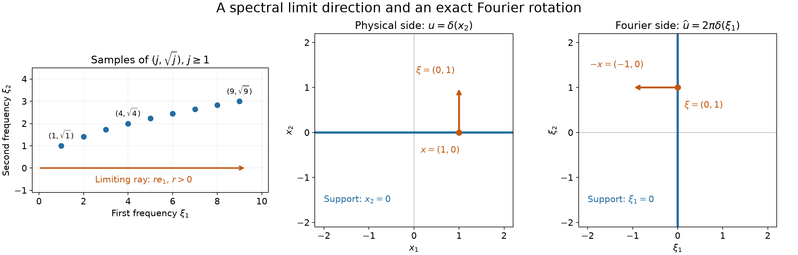

# Fourier rotation and directions at infinity

*Written and self-checked by GPT-6 Astra (OpenAI), Ultra, October 2026. Public domain (CC0).*

The directions in which a Fourier support escapes to infinity bound every analytic singular direction. Homogeneity gives a stronger conclusion: Fourier transformation exchanges a nonzero base point and a nonzero covector, reversing the sign of the former. At a zero base point, physical support replaces the missing covector information. We prove these assertions for smooth wavefront and every admissible derivative-growth class, including distributions whose scaling law holds only away from the origin.

Our Fourier transform is \(\widehat f(\xi)=\int e^{-ix\cdot\xi}f(x)\,dx\), with inverse factor \((2\pi)^{-n}\); pairings are complex linear. We use the complete [Schwartz Fourier foundation](../prerequisites/U011-free-foundations/schwartz-fourier-foundations-U017.md), F1–F5, and [Tempered growth and spectral cutoffs](tempered-growth-and-spectral-cutoffs.md), Lemma 2.1, for test seminorms, transpose identities and Schwartz convolution. [Derivative growth and finite-order localization](derivative-growth-and-finite-order-localization.md), Lemma 1 and Theorem 4, supplies fixed index shifts and controlled cutoffs. [Cones and derivative-growth wavefronts](cones-and-derivative-growth-wavefronts.md), Lemmas 1–2 and Theorems 3–7, supplies their Fourier bounds, compact localization, comparison and differential rules; its flat-hypersurface calculation is used in an exercise. The smooth localization argument is also given in [Boundary regularity and conic decomposition](boundary-regularity-and-conic-decomposition.md), Lemma 2, whose Theorem 3 proves the exact analytic boundary criterion.

The spherical representation, with all reciprocal-multiplier bounds, is [Holomorphic decompositions of tempered distributions](holomorphic-decompositions-of-tempered-distributions.md), Lemmas 1–2 and Theorem 3; the full polydisk Cauchy proof is Section 3 of [Holomorphic boundaries in convex cones](holomorphic-boundaries-in-convex-cones.md). The scaling and Euler equivalence and the resonant scaling law are [Homogeneous extensions and angular moments](homogeneous-extensions-and-angular-moments.md), Lemma 1.1 and Theorem 4.1. Its [angular foundation](../prerequisites/U011-free-foundations/angular-foundations-U018.md), A3, proves the finite point-jet theorem. The exact logarithmic transform is [Radial powers and the logarithmic endpoint](radial-powers-and-the-logarithmic-endpoint.md), Section 3, especially (3.2)–(3.7). Analytic composition is proved in [Analytic maps and derivative growth](analytic-maps-and-derivative-growth.md), Theorem 3. Compactness, bumps and convergence use the supplied [scalar foundation](../prerequisites/U011-free-foundations/metric-foundation-bridges.md), Sections 12–13, and [integration foundation](../prerequisites/U011-free-foundations/banach-foundation-bridges.md), Sections 15–16. No external citation replaces any of these proofs.

## Which spectral directions survive at infinity

For a closed set \(A\subset\mathbb R^n\), \(n\ge1\), define

\[
 D_\infty(A)=\bigcap_{R>0}
   \overline{\{\eta/|\eta|:\eta\in A,\ |\eta|\ge R\}}^{\,S^{n-1}},
 \qquad
 C_\infty(A)=\{r\theta:r>0,\ \theta\in D_\infty(A)\}.
 \tag{1}
\]

The direction set is compact and may be empty. We deliberately omit zero from \(C_\infty\), as wavefront covectors are nonzero. A direction belongs to \(D_\infty(A)\) precisely when there are \(\eta_j\in A\) with \(|\eta_j|\to\infty\) and \(\eta_j/|\eta_j|\) tending to that direction: choose a point within \(1/j\) of the direction with radius at least \(j\), using the closure in (1). The converse follows from each closed tail. Equivalently, \(C_\infty(A)\) consists of the nonzero limits of \(t_j\eta_j\), where \(t_j>0\) tends to zero. Normalizing a nonzero limit proves one implication, and choosing \(t_j=r/|\eta_j|\) proves the other. Subsequences make \(t_j\) decreasing if desired.

If \(D_\infty(A)\) is empty, \(A\) is bounded: otherwise an unbounded sequence has a convergent subsequence of unit directions. More generally, every open spherical neighborhood of \(D_\infty(A)\) contains all sufficiently distant directions of \(A\). If not, a sequence of radii tending to infinity outside that neighborhood has a spherical limit in its closed complement and in \(D_\infty(A)\), a contradiction.

**Theorem 1 (spectral limit-cone bound).** For every \(u\in\mathcal S'(\mathbb R^n)\),

\[
 \operatorname{WF}_A(u)
   \subset\mathbb R^n\times C_\infty(\operatorname{supp}\widehat u).
 \tag{2}
\]

The same inclusion holds for \(\operatorname{WF}_L\) for every admissible \(L\), and for ordinary smooth wavefront.

**Proof.** Fix a unit \(\theta_0\notin D_\infty(\operatorname{supp}\widehat u)\). If this direction set is nonempty, compactness makes the maximum of \(\theta_0\cdot\omega\) over it strictly smaller than one: equality for unit vectors would force \(\omega=\theta_0\). Choose numbers \(d<c<1\) strictly above that maximum. The observation after (1) gives \(R\) so that every support point of radius at least \(R\) has pairing \(\theta_0\cdot\eta/|\eta|<d\).

Choose a smooth spherical function \(b\), equal to one on \(\{\omega:\theta_0\cdot\omega\le d\}\), with support in \(\{\omega:\theta_0\cdot\omega<c\}\). The supplied compact bump construction gives this: apply it to the first compact set on an annulus inside the second open angular set, then restrict to the sphere. Let \(\lambda\) be a smooth radial cutoff equal to one on \(|\eta|\le2R\) and zero on \(|\eta|\ge3R\), enlarging \(R\) to be positive. Set

\[
 \rho(\eta)=\lambda(\eta)
            +(1-\lambda(\eta))b(\eta/|\eta|).
 \tag{3}
\]

This is smooth across zero and equals one on a neighborhood of the entire support of \(\widehat u\). Outside a fixed ball its support has \(\theta_0\cdot\eta\le c|\eta|\). Every fixed derivative of its angular part is bounded by a constant times \(|\eta|^{-k}\) at derivative order \(k\): differentiate the smooth degree-zero function and use its sphere maximum. On the intervening compact annulus all derivatives are bounded. If the direction set is empty, the Fourier support is compact, and a compact smooth cutoff equal to one near it serves as \(\rho\) instead.

Recall the exact spherical factor and representation

\[
 I(\eta)=\int_{S^{n-1}}e^{-\omega\cdot\eta}\,d\sigma(\omega),
 \qquad
 U(x+iy)=(2\pi)^{-n}\widehat u
       \left(\frac{e^{i(x+iy)\cdot\eta}}{I(\eta)}\right),
 \quad |y|<1.
 \tag{4}
\]

Here \(\sigma\) is ordinary sphere measure, including the two unit masses in dimension one. The earlier reciprocal estimates are
\(I(\eta)^{-1}\le C(1+|\eta|)^{(n-1)/2}e^{-|\eta|}\) and
\(|\partial^\alpha I^{-1}|\le C_\alpha I^{-1}\).
For \(|y+\theta_0|<\varepsilon\) with \(0<\varepsilon<(1-c)/2\), on the distant support of \(\rho\) we have

\[
 -|\eta|-y\cdot\eta
 \le-(1-c-\varepsilon)|\eta|.
 \tag{5}
\]

All frequency derivatives of \(\rho e^{i(x+iy)\cdot\eta}/I\) therefore decrease exponentially, up to polynomial factors, uniformly for \(x,y\) in compact subsets of this larger tube. The bounded-frequency part is compactly supported. Each fixed derivative in \(x,y\) inserts only a polynomial frequency factor. Thus

\[
 G(z)=(2\pi)^{-n}\widehat u
           \left(\rho(\eta)\frac{e^{iz\cdot\eta}}{I(\eta)}\right)
 \tag{6}
\]

is defined by a Schwartz pairing on a full complex neighborhood of every \(x-i\theta_0\). Parameter Taylor remainders tend to zero in every Schwartz seminorm by (5). Differentiating inside the pairing gives the Cauchy–Riemann equations; the proved polydisk argument makes \(G\) holomorphic. For compact Fourier support the same reasoning works for every imaginary part.

Where this neighborhood meets \(|y|<1\), (6) equals (4). Indeed the omitted Schwartz test has the factor \(1-\rho\) and vanishes near the Fourier support. Its compact-cutoff approximants do too, hence pair to zero; Schwartz cutoff density and continuity pass to the limit. We have obtained a full-neighborhood holomorphic extension of \(U\) at \(x-i\theta_0\). The exact analytic boundary criterion excludes \((x,\theta_0)\) from \(\operatorname{WF}_A(u)\), for every \(x\). Positive conicity proves (2). Finally use
\(\operatorname{WF}(u)\subset\operatorname{WF}_L(u)\subset\operatorname{WF}_A(u)\). \(\square\)

## Isolating the defect in a scaling law

Put \(E=\sum x_j\partial_j\), and use the dilation convention

\[
 (D_tu)(\phi)=t^{-n}u(\phi(\cdot/t)),\qquad t>0.
 \tag{7}
\]

For functions it is \(D_tu(x)=u(tx)\). Homogeneity of degree \(a\in\mathbb C\) means \(D_tu=t^au\), with \(t^a=e^{a\log t}\). The earlier Euler lemma proves equivalence with \((E-a)u=0\), both on the whole space and on punctured space. All distributions in what follows are tempered.

Let \(H_0\) be the radial finite part from the logarithmic-endpoint lesson, and write \(s_n=\sigma(S^{n-1})>0\). Its proved identities imply

\[
 (E+n)H_0=s_n\delta_0,\qquad
 \widehat H_0=\kappa_n-s_n\log|\xi|,\qquad
 H_0=|x|^{-n}\quad(x\ne0).
 \tag{8}
\]

The first identity follows by comparing constant Laurent coefficients in
\(|x|^{-n+z}=s_n\delta_0/z+H(z)\), exactly as in the earlier resonant Euler proof. The other two are the actual finite-part and Fourier constant-term identities; \(\kappa_n\) is the specified scalar constant, whose value will not affect wavefront.

**Lemma 2 (a homogeneous part and analytic corrections).** Suppose \(u\) is degree-\(a\) homogeneous on \(\mathbb R^n\setminus\{0\}\). There are a globally degree-\(a\) homogeneous tempered distribution \(w\), a finite point jet \(P\), and a finite linear combination \(V\) of derivatives of \(H_0\), such that

\[
 u=w+P+V.
 \tag{9}
\]

Both \(P+V\) and \(\widehat P+\widehat V\) are real analytic off zero. The term \(V\) is zero unless \(a=-n-k\) for an integer \(k\ge0\); in that case all its derivatives have order \(k\).

**Proof.** The Euler defect \(Q=(E-a)u\) is supported at zero. The full finite-jet theorem gives a finite sum \(Q=\sum q_\alpha\partial^\alpha\delta_0\). Since
\((E-a)\partial^\alpha\delta_0=(-n-|\alpha|-a)\partial^\alpha\delta_0\), set

\[
 P=\sum_{-n-|\alpha|-a\ne0}
       \frac{q_\alpha}{-n-|\alpha|-a}\partial^\alpha\delta_0,
 \qquad
 V=\begin{cases}
  \displaystyle\sum_{|\alpha|=k}\frac{q_\alpha}{s_n}
                 \partial^\alpha H_0,&a=-n-k,\ k\ge0,\\
  0,&\text{otherwise}.
 \end{cases}
 \tag{10}
\]

Unlisted coefficients are zero. The product rule gives
\(E\partial^\alpha=\partial^\alpha E-|\alpha|\partial^\alpha\), first on smooth functions and then by transpose. Applying it to (8) shows that \((E-a)(P+V)=Q\). Therefore \(w=u-P-V\) has zero Euler defect and is globally homogeneous by the proved equivalence. Every term is tempered.

Away from zero, derivatives of \(|x|^{-n}\) are analytic. For explicit analyticity, near a positive scalar value the geometric series integrates to the convergent series for \(\log\); exponentiation gives powers. Compose with \(|x|^2>0\), using the earlier analytic-composition theorem, and differentiate using the proved closure under fixed derivatives. The same reasoning makes \(\log|\xi|\) analytic off zero. Fourier transformation of (10) gives polynomials and polynomial multiples of \(\kappa_n-s_n\log|\xi|\), so the frequency correction is analytic there as well. This proves every assertion. \(\square\)

## Rotating the nonzero base point and covector

**Lemma 3 (Fourier rotation under a global scaling law).** If \(u\) is globally homogeneous, then for every admissible \(L\),

\[
 (x,\xi)\in\operatorname{WF}_L(u)
 \quad\Longleftrightarrow\quad
 (\xi,-x)\in\operatorname{WF}_L(\widehat u),
 \qquad x\ne0,\ \xi\ne0.
 \tag{11}
\]

The same equivalence holds for ordinary smooth wavefront.

**Proof.** Suppose \((x_0,\xi_0)\) is regular for \(u\). Choose compact neighborhoods \(K\) of \(x_0\) and \(J\) of \(\xi_0\), both avoiding zero, such that the product of \(K\) and the positive cone over \(J\) misses the wavefront set. This is possible by openness of the regular set and conicity; shrink both neighborhoods to closed balls inside a regular product. Choose controlled cutoffs \(\psi_N\) supported in \(K\) and equal to one when \(|x-x_0|\le2r\), for some \(r>0\), and \(\chi_N\) supported in \(J\) and equal to one on a fixed neighborhood of \(\xi_0\). Shrink \(r\) so \(\overline B(x_0,r)\) avoids zero. The earlier controlled construction gives

\[
 \sup|\partial^{\alpha+\beta}\chi_N|
 +\sup|\partial^{\alpha+\beta}\psi_N|
 \le C_\alpha(B_\alpha L_N)^{|\beta|},
 \quad |\beta|\le N,
 \tag{12}
\]

for each fixed \(\alpha\). In particular all fixed derivative orders are bounded uniformly in \(N\). Compact localization applies to \(u_{0N}=\psi_Nu\) throughout the cone over \(J\).

Put \(v_N=\chi_N\widehat u\). Fourier transposition and homogeneity give, for \(t\ge1\),

\[
 \widehat v_N(-tx)
 =u\bigl(\widehat\chi_N(\cdot-tx)\bigr)
 =t^{a+n}u\bigl(\widehat\chi_N(t(\cdot-x))\bigr),
 \qquad |x-x_0|<r.
 \tag{13}
\]

There is no inverse Fourier factor in this identity. Split the last pairing into \(I_0+I_1\), using \(u_{0N}\) and \((1-\psi_N)u\). The inverse test-pairing formula gives

\[
 \begin{aligned}
 I_0&=t^{-n}\int\widehat u_{0N}(\eta)\chi_N(\eta/t)
                              e^{ix\cdot\eta}\,d\eta\\
    &=\int\widehat u_{0N}(t\zeta)\chi_N(\zeta)
                              e^{itx\cdot\zeta}\,d\zeta.
 \end{aligned}
 \tag{14}
\]

Indeed the Fourier transform of the test \(\widehat\chi_N(t(\cdot-x))\) is
\(t^{-n}e^{-ix\cdot\eta}(2\pi)^n\chi_N(-\eta/t)\); its factor \((2\pi)^n\) cancels the inverse pairing factor. The integrals converge, since their frequency supports are compact. The minimum of \(|\zeta|\) on \(J\) is positive, and \(\|\chi_N\|_1\) is uniformly bounded. Compact localization therefore yields

\[
 |I_0|\le C(BL_N/t)^N.
 \tag{15}
\]

For clarity, the complementary estimate retains the finite tempered order. Choose \(\mu\ge0\) with
\(|u(f)|\le C\max_{|\beta|\le\mu}\sup_y(1+|y|)^\mu|\partial^\beta f(y)|\).
In every Leibniz term for
\((1-\psi_N(y))\widehat\chi_N(t(y-x))\), the factor involving \(1-\psi_N\), or any of its derivatives, is zero when \(|y-x_0|<2r\). On its support \(|y-x|\ge r\). Put \(z=t(y-x)\). With \(x\) in the fixed ball and \(t\ge1\),

\[
 |z|\ge rt,\qquad 1+|y|\le C(1+|z|),\qquad
 |I_1|\le C t^\mu\max_{|\gamma|\le\mu}
  \sup_{|z|\ge rt}(1+|z|)^\mu
                     |\partial^\gamma\widehat\chi_N(z)|.
 \tag{16}
\]

Only finitely many fixed derivatives of \(\psi_N\) were used, so their constants are uniform. Each derivative in the last supremum is the Fourier transform of \((-i\zeta)^\gamma\chi_N(\zeta)\). This is again controlled on \(J\), by the proved product lemma. The second Fourier bound for controlled sequences, with fixed extra decay \(\mu\), gives

\[
 |\partial^\gamma\widehat\chi_N(z)|
 \le C(BL_N)^N(1+|z|)^{-N-\mu},\qquad
 |I_1|\le C t^\mu(B'L_N/t)^N.
 \tag{17}
\]

The factor \(r^{-N}\) is absorbed into \((B')^N\). Multiplying (15) and (17) by \(|t^{a+n}|=t^{\operatorname{Re}a+n}\), choose a fixed nonnegative integer \(M\ge\operatorname{Re}a+n+\mu\). We obtain

\[
 |\widehat v_N(-tx)|\le C t^M(BL_N/t)^N,
 \qquad
 |\widehat v_{N+M}(-tx)|\le C(DL_N/t)^N.
 \tag{18}
\]

The second estimate is the fixed-shift bound for \(L_{N+M}^{N+M}\), with the fixed power of \(B\) also absorbed. The numbers \(|x|\) on the smaller ball have positive lower and finite upper bounds. Consequently \(t\) is comparable to the output frequency length, and (18) supplies a conic estimate near \(-x_0\) for all sufficiently large frequencies. The family \(v_{N+M}\) has common compact support and common finite order: apply the finite-order estimate of \(\widehat u\) near \(J\) and the uniform fixed derivatives of \(\chi_{N+M}\). This also bounds all remaining bounded frequencies, after increasing the constants. The family equals \(\widehat u\) near \(\xi_0\), proving regularity at \((\xi_0,-x_0)\).

Direct change of variables on Schwartz tests proves
\(\mathcal F(D_tu)=t^{-n}D_{1/t}\widehat u\). Thus \(\widehat u\) is globally homogeneous of degree \(-n-a\). Also \(\widehat{\widehat u}=(2\pi)^n\mathcal Ru\), where \(\mathcal Ru(x)=u(-x)\). Reflection sends a witness \(v_N\) to \(v_N(-\cdot)\), whose transform is \(\widehat v_N(-\xi)\); it therefore sends a wavefront pair to \((-x,-\xi)\). Applying the implication just proved to \(\widehat u\), then reflecting, proves the converse in (11).

For smooth wavefront use fixed cutoffs \(\psi,\chi\) in these same neighborhoods. The smooth compact localization needed in (14) follows from a finite cover: at each base point cover the closed angular set by finitely many regular cones, intersect their base neighborhoods, and take a finite smooth partition in those neighborhoods. Multiplication by each partition factor preserves rapid decrease on smaller cones by the earlier convolution estimate. Summing the finitely many terms gives one bound of every decay order on the cone over \(J\). Hence \(I_0=O(t^{-q})\) for every \(q\). In (16), \(\widehat\chi\) and all its fixed derivatives are Schwartz, so increasing its decay order gives \(I_1=O(t^{-q})\) for every \(q\). The fixed homogeneity factor does not change rapid decay. The same reversal proves the smooth equivalence. \(\square\)

## A scaled test detects support at a zero base point

**Lemma 4 (the origin test).** Let \(u\) be homogeneous of degree \(a\) on punctured space, and let \(\chi\in C_c^\infty(\mathbb R^n)\) equal one near zero. Set

\[
 k=\widehat\chi,\qquad
 A_t(x)=u\bigl(t^nk(t(\cdot-x))\bigr),\qquad t\ge1.
 \tag{19}
\]

Then \(A_t\to(2\pi)^nu\) in distributions. Moreover, on every compact set avoiding zero,

\[
 t^{-a}\mathcal F(\chi\widehat u)(-tx)=A_t(x)+R_t(x),
 \qquad \sup|R_t|=O(t^{-q})\quad\text{for every }q\ge0.
 \tag{20}
\]

**Proof.** We first give the approximate-identity argument, including its noncompact Schwartz tails. For \(\phi\in\mathcal S\), integration in \(x\) followed by \(z=t(y-x)\) gives the test
\(\int k(z)\phi(y-z/t)\,dz\) inside the pairing with \(u\). The interchange follows from absolute integrability in every Schwartz seminorm, as in the earlier convolution proof: if
\(p_m(f)=\max_{|\alpha|\le m}\sup_y(1+|y|)^m|\partial^\alpha f(y)|\), then translation costs at most \((1+|z|)^m\) for \(t\ge1\). The fundamental theorem along the translation segment gives the sharper estimate

\[
 p_m\bigl(\phi(\cdot-z/t)-\phi\bigr)
 \le C_m t^{-1}|z|(1+|z|)^m p_{m+1}(\phi).
 \tag{21}
\]

To see the weight, use
\(1+|y|\le(1+|y-sz/t|)(1+|z|)\), \(0\le s\le1\), in each differentiated fundamental-theorem integral. Multiply (21) by \(|k(z)|\) and integrate; its weighted moment is finite because \(k\) is Schwartz. The integrated test tends to \((\int k)\phi\) in every seminorm. Fourier inversion at zero gives \(\int k=(2\pi)^n\chi(0)=(2\pi)^n\). Continuity of \(u\) proves the asserted convergence, even on Schwartz tests. Each \(A_t\) is a smooth function of polynomial growth by the same convolution lemma.

For (20), use (9)–(10), writing \(P=\sum p_\alpha\partial^\alpha\delta_0\) and \(Q_{\rm res}=(E-a)V\). The latter is zero in the nonresonant case, and equals \(\sum_{|\alpha|=k}q_\alpha\partial^\alpha\delta_0\) when \(a=-n-k\). The earlier logarithmic scaling identity and differentiation give

\[
 D_tu=t^au+t^a\log t\,Q_{\rm res}
       +\sum p_\alpha(t^{-n-|\alpha|}-t^a)
                                      \partial^\alpha\delta_0.
 \tag{22}
\]

Fourier transposition gives
\[
 \mathcal F(\chi\widehat u)(-tx)=u(k(\cdot-tx))
                  =t^n(D_tu)(k(t(\cdot-x))).
\]
Substitution of (22) proves (20), with the exact remainder

\[
 \begin{aligned}
 R_t(x)={}&(\log t)\sum_{\rm res}q_\alpha(-1)^{|\alpha|}
               t^{n+|\alpha|}(\partial^\alpha k)(-tx)\\
 &+\sum p_\alpha(-1)^{|\alpha|}
       (t^{-a}-t^{n+|\alpha|})(\partial^\alpha k)(-tx).
 \end{aligned}
 \tag{23}
\]

These are finite sums. On a compact set with \(|x|\ge d>0\), every derivative of \(k(-tx)\) decreases faster than any power of \(t\). The other factors have fixed polynomial growth, with \(|t^{-a}|=t^{-\operatorname{Re}a}\) and \(\log t\le t\). Increasing the Schwartz decay order proves the uniform estimate in (20), for every \(q\). \(\square\)

## The complete correspondence, including both origins

**Theorem 5.** Suppose \(u\in\mathcal S'(\mathbb R^n)\) is homogeneous of some complex degree on \(\mathbb R^n\setminus\{0\}\). For every admissible \(L\),

\[
 \begin{aligned}
 (x,\xi)\in\operatorname{WF}_L(u)
 &\Longleftrightarrow(\xi,-x)\in\operatorname{WF}_L(\widehat u),
                         &&x\ne0,\ \xi\ne0,\\
 x\in\operatorname{supp}u
 &\Longleftrightarrow(0,-x)\in\operatorname{WF}_L(\widehat u),
                         &&x\ne0,\\
 \xi\in\operatorname{supp}\widehat u
 &\Longleftrightarrow(0,\xi)\in\operatorname{WF}_L(u),
                         &&\xi\ne0.
 \end{aligned}
 \tag{24}
\]

All three equivalences also hold for ordinary smooth wavefront. In particular they hold at the analytic endpoint. The support assertions concern the complete distributions, including their point terms.

**Proof: nonzero base and covector.** Lemma 2 writes \(u=w+P+V\), with \(w\) globally homogeneous. Both corrections in physical space and frequency space are analytic off zero, hence belong to every \(C^L\) there. Applying the finite-sum inclusion in both directions shows that adding them leaves wavefront unchanged on those open sets. This also holds for smooth wavefront by the fixed-cutoff definition. Apply Lemma 3 to \(w\) to obtain the first line of (24).

**Proof: physical support and the Fourier origin.** Punctured homogeneity makes the punctured support invariant under every positive dilation: the distributional change of variables carries a zero open set to its dilation, and the scalar \(t^a\) is nonzero. If \(x_0\ne0\) is outside support, a small ball about it and all its positive dilations are zero sets. Their union contains a conic neighborhood of its ray. Consequently the direction of \(x_0\) is absent from the limit cone of \(\operatorname{supp}u\). The double Fourier transform is \((2\pi)^n\mathcal Ru\); Theorem 1 applied to \(\widehat u\) therefore excludes \((0,-x_0)\) even from analytic wavefront. It excludes it from all the other classes as well.

Conversely suppose \((0,-x_0)\) is absent from ordinary \(\operatorname{WF}(\widehat u)\). By definition there is a compact smooth \(\chi=1\) near zero such that \(\mathcal F(\chi\widehat u)\) is rapidly decreasing in a conic neighborhood of \(-x_0\). Choose a small closed ball about \(x_0\), avoiding zero, whose negative directions lie in that cone. On this ball the left side of (20) tends uniformly to zero; the fixed factor \(t^{-a}\) is absorbed by taking a larger decay power. The remainder tends uniformly to zero too. Thus \(A_t\) tends to zero as a distribution on the ball's interior. Lemma 4 also makes it converge there to \((2\pi)^nu\). Uniqueness of distributional limits gives \(u=0\) on that neighborhood. Hence \(x_0\) is outside support. We have proved the support equivalence with ordinary wavefront; the analytic exclusion in the first direction and the comparisons
\(\operatorname{WF}\subset\operatorname{WF}_L\subset\operatorname{WF}_A\)
prove the middle line for every \(L\).

**Proof: Fourier support and the physical origin.** If \(Q=(E-a)u=0\) globally, then \(\widehat u\) is globally homogeneous. Apply the middle equivalence to \(\widehat u\), and use the double transform and reflection. This proves the last line.

If \(Q\ne0\), it is a nonzero finite point jet. Its Fourier transform is a nonzero polynomial. Such a polynomial cannot decrease rapidly on any open cone: its highest nonzero homogeneous part cannot vanish on an open set, since the exact finite Taylor expansion would then make that polynomial identically zero. Choose a direction in the cone where that part is nonzero; along its ray the top power dominates the lower powers. Every cutoff equal to one near zero leaves \(Q\) unchanged, so
\(\operatorname{WF}(Q)=\{0\}\times(\mathbb R^n\setminus\{0\})\).

Differential operators with smooth coefficients do not enlarge ordinary wavefront. Here is the needed local argument. If \(\chi u\) has rapid transform in a cone and \(\chi=1\) near the base point, take \(\eta=1\) on a smaller neighborhood with support where \(\chi=1\). For \(P=\sum a_\beta\partial^\beta\),
\(\eta Pu=\sum\eta a_\beta\partial^\beta(\chi u)\).
Fourier differentiation preserves rapid decay, and multiplication by the compact smooth \(\eta a_\beta\) preserves it on a smaller cone by the earlier convolution estimate. This proves the assertion. Apply it to \(E-a\). Thus \(u\) has every nonzero smooth wavefront direction at zero, and comparison gives every \(\operatorname{WF}_L\) direction there.

Finally Fourier transposition of the Euler operator gives

\[
 (-E_\xi-n-a)\widehat u=\widehat Q.
 \tag{25}
\]

For example \(\mathcal F(x_j\partial_j u)
=-\partial_{\xi_j}(\xi_j\widehat u)\), which proves the formula with all \(n\) terms. If \(\widehat u\) vanished on a nonempty open set, its differential expression on the left would vanish there. The nonzero polynomial on the right cannot do so. Hence \(\operatorname{supp}\widehat u=\mathbb R^n\). Both sides of the last equivalence in (24) now hold for every nonzero \(\xi\). This proves the nonhomogeneous case and finishes the theorem. \(\square\)

*Left: the first nine points of the unbounded sequence \((j,\sqrt j)\); its sole limiting unit direction is \(e_1\). Finite samples illustrate the limit proved in Exercise 2. Middle and right: for \(u=\delta(x_2)\) in two dimensions, \(\widehat u=2\pi\delta(\xi_1)\). The physical pair \(x=(1,0)\), \(\xi=(0,1)\) becomes the Fourier pair with base \((0,1)\) and covector \((-1,0)\). The arrows show these exact covectors based at the marked points; the blue lines are the respective supports. Exercise 5 proves the full conormal relations, beyond these displayed representatives. [Editable figure source](../figures/fourier-support-and-rotation.py).*

## Exercises with complete solutions

**Exercise 1 — bounded spectral translation (foundation).** Prove that \(C_\infty(A+h)=C_\infty(A)\) for every fixed vector \(h\). Apply this to modulation of a tempered distribution. What does Theorem 1 say for compact Fourier support?

**Solution.** If \(t_j\eta_j\to v\ne0\) and \(t_j\to0\), then \(t_j(\eta_j+h)\to v\); apply the same argument with \(-h\) for the reverse inclusion. Direct Fourier substitution shows that multiplying \(u\) by \(e^{ih\cdot x}\) translates its Fourier support by \(h\). Thus the bound (2) is unchanged. In fact every wavefront class itself is unchanged: multiplication by that analytic function cannot enlarge \(\operatorname{WF}_L\), and multiplication by its analytic inverse proves the reverse inclusion. The fixed-cutoff convolution rule gives the smooth assertion. If Fourier support is compact, (1) is empty and Theorem 1 says \(u\) is analytic everywhere by the analytic projection theorem. For an entire extension of \(u\) itself, choose a compact smooth \(\rho=1\) near its Fourier support and use \((2\pi)^{-n}\widehat u(\rho(\eta)e^{iz\cdot\eta})\). On the fixed compact frequency support, every parameter Taylor remainder tends to zero in the finite test seminorms controlling the pairing. The Cauchy–Riemann equations and polydisk argument prove holomorphy for every \(z\), and Fourier inversion identifies its real trace with \(u\). \(\square\)

**Exercise 2 — a nonempty limit cone with no singularity (intermediate).** In \(\mathbb R^2\), define the finite measure

\[
 \mu=\sum_{j=1}^\infty2^{-j}\delta_{(j,\sqrt j)},\qquad
 u=\mathcal F^{-1}\mu.
 \tag{26}
\]

Determine its spectral limit cone and prove that \(u\) is analytic on all real space. Explain what this says about equality in (2).

**Solution.** The total mass is one, so \(\mu\) is tempered by the supremum seminorm. Its support is exactly the displayed discrete closed set: each point has positive mass and a small isolating ball; every bounded set meets only finitely many points. Its normalized direction is
\((1,j^{-1/2})/(1+j^{-1})^{1/2}\to e_1\). Every escaping sequence has indices tending to infinity, so \(C_\infty(\operatorname{supp}\mu)=\{re_1:r>0\}\).

Fourier inversion as a distribution gives
\(u(x)=(2\pi)^{-2}\sum 2^{-j}e^{i(jx_1+\sqrt j\,x_2)}\); the absolute uniform convergence also identifies it as an ordinary continuous function. On a compact complex set with \(|\operatorname{Im}z_1|\le b<\log2\) and \(|\operatorname{Im}z_2|\le M\), the absolute terms are bounded by
\(\exp[-(\log2-b)j+M\sqrt j]\).
For \(\varepsilon=(\log2-b)/2\), the square inequality gives
\(M\sqrt j\le\varepsilon j+M^2/(4\varepsilon)\).
The resulting geometric series converges uniformly. On slightly larger compact sets in the same tube, the polydisk Cauchy formula justifies differentiation of the convergent sum and proves holomorphy. Every real point lies in that tube, hence \(\operatorname{WF}_A(u)=\varnothing\). The upper bound (2) can therefore be strict even with an unbounded, nonempty Fourier support. \(\square\)

**Exercise 3 — a half-line and a one-sided pole (intermediate).** Let \(H\) be the locally integrable indicator of \((0,\infty)\) on the line. Compute its Fourier transform and determine the smooth and all \(L\)-wavefronts of both \(H\) and \(\widehat H\).

**Solution.** For \(\varepsilon>0\), direct integration gives
\[
 \mathcal F(e^{-\varepsilon x}H(x))(\xi)
      =(\varepsilon+i\xi)^{-1}=-i(\xi-i\varepsilon)^{-1}.
\]
Dominated convergence on Schwartz tests makes the inputs converge to \(H\). Fourier continuity and the lower-pole boundary formula, obtained by reflecting the proved upper-pole formula in [Holomorphic boundaries and analytic directions](holomorphic-boundaries-and-analytic-directions.md), give

\[
 \widehat H=\pi\delta_0-i\operatorname{pv}(1/\xi).
 \tag{27}
\]

The transform has support the whole line: off zero it is the nonzero function \(-i/\xi\), and every neighborhood of zero meets that region. The physical support of \(H\) is \([0,\infty)\). Both distributions are analytic off zero. The two origin formulas (24) therefore give, for smooth wavefront and every admissible \(L\),
\(\operatorname{WF}_L(H)=\{(0,\eta):\eta\ne0\}\) and
\(\operatorname{WF}_L(\widehat H)=\{(0,\eta):\eta<0\}\).
This checks the negative sign in the middle line of (24). \(\square\)

**Exercise 4 — a point term changes the origin (foundation).** On \(\mathbb R^n\), let \(u=1+\delta_0\). Give its Euler defect for the punctured degree \(a=0\), its Fourier transform, and both wavefront sets in (24).

**Solution.** The point-jet identity gives \(Eu=-n\delta_0\ne0\), although \(u=1\) is degree-zero homogeneous away from zero. Fourier inversion gives
\(\widehat u=(2\pi)^n\delta_0+1\).
Both distributions have full physical support, are analytic off zero, and have every nonzero smooth direction at zero because their nonzero point terms have polynomial Fourier transforms and adding an analytic function does not change wavefront. Thus both all-\(L\) wavefronts equal \(\{0\}\times(\mathbb R^n\setminus\{0\})\). The first line of (24) is empty on both sides, while both origin formulas are nonempty. Dropping point terms would lose precisely this information. \(\square\)

**Exercise 5 — an exact conormal rotation (intermediate).** In two dimensions let \(u(\phi)=\int\phi(s,0)\,ds\), written \(u=\delta(x_2)\). Compute \(\widehat u\), its degree, and all pairs in the first line of (24). Verify the two arrows in the figure.

**Solution.** Product Fourier inversion gives \(\widehat u=2\pi\delta(\xi_1)\): the transform of the constant first factor is \(2\pi\delta_0\), and the transform of the second-factor point mass is one. This can also be checked directly by integrating the Fourier test first in the constant coordinate. Dilation in the defining integral shows degree \(-1\), and the transform has the same degree \(-2-(-1)=-1\).

The earlier flat-hypersurface proof gives, simultaneously for smooth and all \(L\),
\(\operatorname{WF}_L(u)=\{((s,0),(0,t)):s\in\mathbb R,\ t\ne0\}\).
For the transform it gives
\(\operatorname{WF}_L(\widehat u)=\{((0,t),(r,0)):t\in\mathbb R,\ r\ne0\}\).
When both bases and covectors in the first formula are nonzero, \(s,t\ne0\), and rotation takes the pair to \(((0,t),(-s,0))\), exactly as required. The displayed representative has \(s=t=1\), so its arrows are \((0,1)\) at \((1,0)\), and \((-1,0)\) at \((0,1)\). The omitted base-zero cases are supplied by the two origin formulas, not by inserting a zero covector in the rotation formula. \(\square\)

**Exercise 6 — a resonant second derivative (advanced).** For every \(n\ge1\), take \(u=\partial_1^2H_0\). Determine its punctured degree, Euler defect, Fourier transform and both physical supports. Determine its smooth and all-\(L\) wavefronts and those of its transform.

**Solution.** The degree off zero is \(-n-2\). The commutator used in Lemma 2 and (8) give
\((E+n+2)u=s_n\partial_1^2\delta_0\ne0\), and
\(\widehat u=-\xi_1^2(\kappa_n-s_n\log|\xi|)\).
The latter expression denotes the full regular logarithm multiplied by a polynomial; no unspecified point term is being discarded. It is analytic off zero. The nonzero Euler defect and (25) show its support is the whole space, even though its function can vanish on a hyperplane.

Off zero, direct differentiation gives
\(u(x)=n[(n+2)x_1^2-|x|^2]|x|^{-n-4}\).
Its numerator is a nonzero polynomial in every positive dimension, hence cannot vanish on any nonempty open set. Every open ball avoiding zero therefore contains a region where this analytic function is nonzero, and every neighborhood of zero contains such a ball. Thus \(\operatorname{supp}u=\mathbb R^n\) too. Both distributions are analytic off zero. The two origin equivalences now give exactly
\(\{0\}\times(\mathbb R^n\setminus\{0\})\) for both smooth wavefronts and every \(L\)-wavefront. A zero along an isolated ray or hypersurface is not a zero on an open frequency cone. \(\square\)

## References

- The programme proofs listed at the start provide the precise Fourier convention, controlled cutoffs, spherical boundary criterion, point-jet theorem, homogeneous extension and logarithmic finite part. The spectral extension, Fourier rotation, scaling correction and both origin arguments are proved here.
- Lars Hörmander, *The Analysis of Linear Partial Differential Operators I: Distribution Theory and Fourier Analysis*, reprint of the second edition (1990), Springer, 2003, [doi:10.1007/978-3-642-61497-2](https://doi.org/10.1007/978-3-642-61497-2), Lemma 8.1.7, Theorem 8.1.8, Lemma 8.4.17 and Theorem 8.4.18. These supply the smooth and derivative-growth Fourier targets. The exposition, displayed estimates, figure and exercises are independently organized and expressed.
