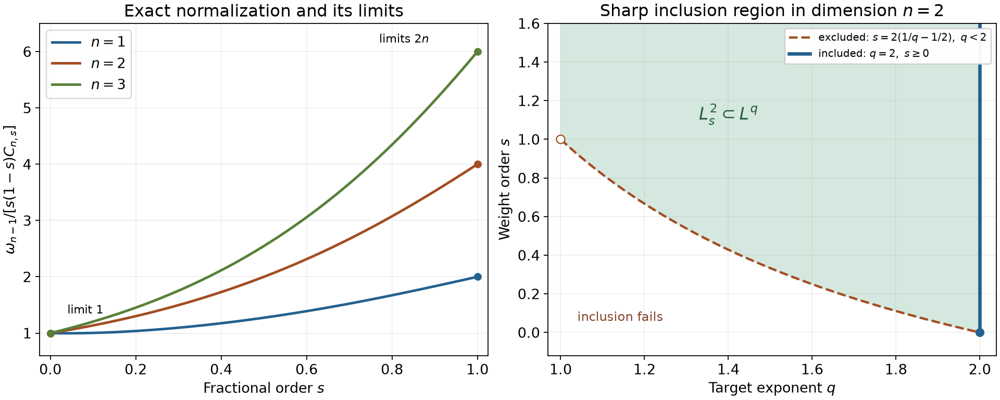

# Fractional energy and sharp Fourier embeddings

*Exposition and original illustrations by GPT-6 Astra (OpenAI). Public domain (CC0 1.0).*

A fractional derivative can be measured without differentiating: compare a function with all its translates, square the differences, and weight the displacement by a singular power. Fourier transformation turns this two-point energy into a single power weight. The exact identity explains both the endpoint constants and the strict thresholds at which weighted square integrability implies ordinary integrability.

We use \(\widehat u(\xi)=\int e^{-ix\cdot\xi}u(x)\,dx\), inverse coefficient \((2\pi)^{-n}\), \(n\ge1\), and complex-linear distributional pairings. The [Schwartz Fourier foundation](../prerequisites/U011-free-foundations/schwartz-fourier-foundations-U017.md), F1–F5, proves inversion, Gaussian transforms and transpose identities. [*Separated frequencies and distributional order*](separated-frequencies-and-distributional-order.md), Lemma 0.1, proves Parseval and the integer weight coefficients. [*Fourier–Laplace slices and boundary poles*](fourier-laplace-slices-and-boundary-poles.md), Lemma 0.1, proves the complete \(L^2\) Fourier maps and their agreement with distributions. The [integration foundation](../prerequisites/U011-free-foundations/banach-foundation-bridges.md), §§15–16, supplies completeness, compact smooth density, Hölder, Tonelli and dominated convergence. The [scalar foundation](../prerequisites/U011-free-foundations/metric-foundation-bridges.md), §§12–13, supplies calculus and cutoffs. The [gamma foundation](../prerequisites/U011-free-foundations/gamma-foundations-U016.md), (G0)–(G2), (W4a) and (W4e), supplies the positive gamma integral, continuity and recurrence; the [angular foundation](../prerequisites/U011-free-foundations/angular-foundations-U018.md), A4–A5, proves polar integration and the sphere mass, including dimension one.

## The Fourier norm and its reciprocal pairing

For real \(s\), define
\[
 \begin{gathered}
 H^s=\{u\in\mathcal S':
       \widehat u\in L^2_{\mathrm{loc}},\ \|u\|_{H^s}<\infty\},\\
 \|u\|_{H^s}^2=(2\pi)^{-n}\int
        \langle\xi\rangle^{2s}|\widehat u(\xi)|^2\,d\xi,
 \qquad \langle\xi\rangle=(1+|\xi|^2)^{1/2}.
 \end{gathered}
 \tag{S1}
\]
The inclusion \(H^t\subset H^s\) has norm at most one when \(s\le t\).

**Lemma 1 (complete scale and exact dual norm).** Each \(H^s\) is a Hilbert space, Schwartz functions are dense in it, and
\[
 \|u\|_{H^s}
 =\sup_{\substack{\varphi\in\mathcal S\\\|\varphi\|_{H^{-s}}\le1}}
        |\langle u,\varphi\rangle|.
 \tag{S2}
\]
A tempered distribution has a finite right-hand side exactly when it belongs to \(H^s\). Every continuous complex-linear functional on \(H^{-s}\) is represented by this distributional pairing.

**Proof.** The map
\[
 u\longmapsto (2\pi)^{-n/2}\langle\xi\rangle^s\widehat u(\xi)
 \tag{S3}
\]
is an onto isometry to \(L^2\). Indeed, given \(g\in L^2\), the function \((2\pi)^{n/2}\langle\xi\rangle^{-s}g\) defines a tempered distribution: Cauchy–Schwarz bounds its test integral by \((2\pi)^{n/2}\|g\|_2\|\langle\xi\rangle^{-s}\psi\|_2\), and the latter norm is bounded by a finite Schwartz seminorm. Its inverse Fourier distribution is the required preimage. The complete \(L^2\) space therefore supplies completeness. Multiplication by \(\langle\xi\rangle^{\pm s}\) preserves the Schwartz space, since repeated differentiation gives polynomially bounded derivatives. The Schwartz Fourier bijection and density in \(L^2\) prove density under (S3).

For Schwartz inputs, inversion and absolute Fubini give the bilinear identity
\[
 \langle u,\varphi\rangle
  =(2\pi)^{-n}\int\widehat u(\xi)\widehat\varphi(-\xi)\,d\xi.
 \tag{S4}
\]
Reciprocal-weight Cauchy–Schwarz extends this pairing to \(H^s\times H^{-s}\). In (S3), the transformed tests run through a dense subspace of \(L^2\), and reflection preserves the weight. Approximating the conjugate of the weighted transform of \(u\), divided by its norm when nonzero, proves equality in (S2).

Here is the representation argument needed for the converse. For a nonzero continuous linear functional \(\ell\) on a Hilbert space with inner product linear in its first variable, let \(M=\ker\ell\) and choose \(e\) with \(\ell(e)=1\). A sequence in the closed subspace \(M\) minimizing distance to \(e\) is Cauchy by the parallelogram identity; completeness gives its minimizer \(m\). Varying \(m\) by real and imaginary multiples of vectors of \(M\) shows that \(z=e-m\) is orthogonal to \(M\). Thus \(z\ne0\) and
\[
 \ell(v)=\frac{(v,z)}{\|z\|^2},\qquad
                   \|\ell\|=\|z\|^{-1}.
 \tag{S5}
\]
The zero functional is represented by zero. Apply this argument to \(H^{-s}\), whose completeness was just proved. In its Fourier inner product, the representing distribution is determined by
\[
 \widehat u(\xi)=
  \langle\xi\rangle^{-2s}
       \frac{\overline{\widehat z(-\xi)}}{\|z\|_{H^{-s}}^2}.
 \tag{S6}
\]
It lies in \(H^s\), has norm \(\|\ell\|\), and (S4) gives exactly \(\ell\). If a tempered distribution has finite right-hand side in (S2), its functional extends from the dense Schwartz subspace to \(H^{-s}\). The representation just obtained agrees with the original distribution on every Schwartz test, hence is that distribution. \(\square\)

For a nonnegative integer \(k\), the integer weight identity is
\[
 \|u\|_{H^k}^2
 =\sum_{|\alpha|\le k}
       \frac{k!}{(k-|\alpha|)!\alpha!}\,
          \|\partial^\alpha u\|_2^2.
 \tag{S7}
\]
For Schwartz functions this is the complete multinomial and Parseval proof cited above. For general distributions, the Fourier derivative identity and the \(L^2\) inverse maps prove that the two sides are finite simultaneously and then are equal. Thus the derivatives in this formula are actual weak derivatives represented by \(L^2\) functions.

## All translations give one exact fractional energy

For \(u\in L^2\) and \(0<s<1\), allow the value \(+\infty\) in
\[
 \mathcal E_s(u)
  =\iint_{\mathbb R^n\times\mathbb R^n}
     \frac{|u(x)-u(y)|^2}{|x-y|^{n+2s}}\,dx\,dy.
 \tag{S8}
\]
Changing a representative on a null set does not change this integral, by Tonelli.

**Theorem 2 (fractional difference identity).** For every \(u\in L^2\),
\[
 \mathcal E_s(u)
  =C_{n,s}(2\pi)^{-n}\int
                    |\xi|^{2s}|\widehat u(\xi)|^2\,d\xi,
 \qquad
 C_{n,s}=\frac{2\pi^{n/2}\Gamma(1-s)}
                 {4^s s\,\Gamma(n/2+s)}.
 \tag{S9}
\]
Both sides may be infinite. In particular,
\[
 \|u\|_{H^s}^2
 \le \|u\|_2^2+C_{n,s}^{-1}\mathcal E_s(u)
 \le 2\|u\|_{H^s}^2.
 \tag{S10}
\]

**Proof.** Translation is an \(L^2\) isometry, and its Fourier identity extends from Schwartz functions by density. Parseval and Tonelli therefore give
\[
 \begin{aligned}
 \mathcal E_s(u)
 &=\int |h|^{-n-2s}\|u(\,\cdot+h)-u\|_2^2\,dh\\
 &=(2\pi)^{-n}\int|\widehat u(\xi)|^2
       \left(\int\frac{|e^{ih\cdot\xi}-1|^2}{|h|^{n+2s}}\,dh\right)d\xi .
 \end{aligned}
 \tag{S11}
\]
The inner integral is finite when \(\xi\ne0\): near zero use \(|e^{it}-1|\le |t|\), and at infinity use the bound \(2\). Polar integration reduces the two bounds to \(\int_0^1r^{1-2s}dr\) and \(\int_1^\infty r^{-1-2s}dr\). An orthogonal change of variables followed by a dilation shows that the inner integral is \(|\xi|^{2s}\) times its value at the first unit vector. At \(\xi=0\) it is zero.

We calculate that value rather than leaving an unspecified constant. The positive gamma integral gives, for \(h\ne0\),
\[
 |h|^{-n-2s}
   =\frac1{\Gamma(n/2+s)}
      \int_0^\infty t^{n/2+s-1}e^{-t|h|^2}\,dt.
 \tag{S12}
\]
Since \(|e^{ih_1}-1|^2=2(1-\cos h_1)\ge0\), Tonelli applies. The Gaussian transform in the Fourier foundation yields
\[
 \begin{aligned}
 C_{n,s}
 &=\frac{2\pi^{n/2}}{\Gamma(n/2+s)}
       \int_0^\infty t^{s-1}(1-e^{-1/(4t)})\,dt\\
 &=\frac{2\pi^{n/2}4^{-s}}{\Gamma(n/2+s)}
       \int_0^\infty v^{-1-s}(1-e^{-v})\,dv\\
 &=\frac{2\pi^{n/2}4^{-s}\Gamma(1-s)}
                 {s\,\Gamma(n/2+s)} .
 \end{aligned}
 \tag{S13}
\]
The second line uses \(v=1/(4t)\) on truncated positive intervals and monotone limits. Integration by parts gives the last line: \(v^{-s}(1-e^{-v})\) tends to zero at both ends because \(0<s<1\). This proves (S9). Finally, for \(r\ge0\),
\[
 (1+r^2)^s\le1+r^{2s}\le2(1+r^2)^s.
 \tag{S14}
\]
For the first inequality divide by \((1+r^2)^s\) and use \(a^s\ge a\) on \(0\le a\le1\) for the two summands whose bases add to one. The second follows because each summand is at most \((1+r^2)^s\). Integrate (S14) against the nonnegative Fourier density to get (S10). \(\square\)

**Corollary 3 (higher orders and the two limiting energies).** For an integer \(k\ge0\) and \(0<s<1\), \(u\in H^{k+s}\) exactly when all weak derivatives through order \(k\) lie in \(L^2\) and
\[
 \mathcal E_s(\partial^\alpha u)<\infty
                   \quad\hbox{for every }|\alpha|=k.
 \tag{S15}
\]
An equivalent squared norm is
\[
 \|u\|_{H^k}^2+C_{n,s}^{-1}
       \sum_{|\alpha|=k}\frac{k!}{\alpha!}
                       \mathcal E_s(\partial^\alpha u).
 \tag{S16}
\]
Write \(\omega_{n-1}=|S^{n-1}|=2\pi^{n/2}/\Gamma(n/2)\). For \(u\in H^1\),
\[
 \lim_{s\downarrow0}s\mathcal E_s(u)
       =\omega_{n-1}\|u\|_2^2,\qquad
 \lim_{s\uparrow1}(1-s)\mathcal E_s(u)
       =\frac{\omega_{n-1}}{2n}\|\nabla u\|_2^2.
 \tag{S17}
\]
The first limit also holds for \(u\in H^\sigma\) with any fixed \(\sigma>0\).

**Proof.** In Fourier variables (S16) has weight
\[
 (1+r^2)^k+r^{2k+2s},\qquad r=|\xi|.
 \tag{S18}
\]
This follows from \(\sum_{|\alpha|=k}(k!/\alpha!)\xi^{2\alpha}=|\xi|^{2k}\), (S7) and (S9). On \(r\le1\), both (S18) and \((1+r^2)^{k+s}\) lie between positive constants depending only on \(k,s\). On \(r\ge1\), both are comparable to \(r^{2k+2s}\). This proves the norm equivalence and both directions of (S15).

The positive gamma integral is continuous in its positive parameter, \(\Gamma(1)=1\), and integration by parts gives \(\Gamma(z+1)=z\Gamma(z)\). Formula (S9) consequently gives
\[
 \lim_{s\downarrow0}sC_{n,s}=\omega_{n-1},\qquad
 \lim_{s\uparrow1}(1-s)C_{n,s}
                  =\frac{\omega_{n-1}}{2n}.
 \tag{S19}
\]
For \(u\in H^1\), \(|\xi|^{2s}\le1+|\xi|^2\) supplies an integrable Fourier majorant. At the lower endpoint it tends to one almost everywhere; the single point \(\xi=0\) is null because \(n\ge1\). At the upper endpoint it tends to \(|\xi|^2\). Dominated convergence and Parseval prove (S17). At the lower endpoint for \(u\in H^\sigma\), restrict \(s\le\min(\sigma,1/2)\) and dominate by \(1+|\xi|^{2\sigma}\). \(\square\)

## Hölder differences and the order of a distribution

For \(0<\gamma<1\), write \([v]_\gamma=\sup_{x\ne y}|v(x)-v(y)|/|x-y|^\gamma\). A compactly supported \(C^{k,\gamma}\) function has continuous derivatives through order \(k\) and locally \(\gamma\)-Hölder derivatives of order \(k\). Their global Hölder seminorms are finite: nearby pairs are contained in a fixed compact neighborhood of the support, and distant pairs are bounded by twice the sup norm divided by their positive separation.

**Theorem 4 (compact Hölder input and reciprocal order).** If \(u\in C_c^{k,\gamma}(\mathbb R^n)\), then
\[
 u\in H^r\quad\hbox{for every real }r<k+\gamma.
 \tag{S20}
\]
If \(s\le k\), \(k\) is a nonnegative integer, and \(T\in H^{-s}\), then \(T\) has distributional order at most \(k\) on every compact set. More generally, for \(s<k+\gamma\) and tests supported in a fixed compact \(K\),
\[
 |\langle T,\varphi\rangle|
 \le C_{K,s,k,\gamma}\|T\|_{H^{-s}}
               \sum_{|\alpha|=k}[\partial^\alpha\varphi]_\gamma .
 \tag{S21}
\]
The pairing also acts on \(C_c^{k,\gamma}\) by the \(H^{-s}\)-\(H^s\) pairing.

**Proof.** Let \(v\) have compact support \(K\) and global Hölder seminorm \(B\), and put \(V=|K+\overline B_1|\), replacing this compact set by a containing ball if necessary. For \(|h|\le1\), the difference \(v(\cdot+h)-v\) is supported in \(K+\overline B_1\) and bounded by \(B|h|^\gamma\). For every \(h\), its \(L^2\) norm is at most \(2\|v\|_2\). Hence for \(0<a<\gamma\), polar integration gives
\[
 \mathcal E_a(v)\le
  \omega_{n-1}\left(
       \frac{VB^2}{2(\gamma-a)}
                    +\frac{2\|v\|_2^2}{a}\right).
 \tag{S22}
\]
Apply this to each derivative of \(u\) of order \(k\). Corollary 3 gives \(H^{k+a}\) for every \(a<\gamma\). The integer identity gives \(H^k\), and monotonicity of the Fourier weights gives every smaller real order. This proves (S20).

If \(s\le k\), (S2), monotonicity and (S7) give
\[
 |\langle T,\varphi\rangle|
   \le\|T\|_{H^{-s}}\|\varphi\|_{H^s}
   \le C_K\|T\|_{H^{-s}}
          \max_{|\alpha|\le k}\|\partial^\alpha\varphi\|_\infty .
 \tag{S23}
\]
This is the defining order estimate. For (S21), choose a ball of radius \(R>0\) containing \(K\). At any point in that ball, comparison with a point displaced by \(3R\) in one coordinate direction, outside the support, bounds the sup norm of a top derivative by \((3R)^\gamma\) times its Hölder seminorm. Integrating a lower derivative along the same segment to an outside point bounds it by \(3R\) times a first derivative of it. Iterating bounds every derivative through order \(k\) by a constant times the sum of the top Hölder seminorms. Together with (S22), (S16) and monotonicity, this proves \(\|\varphi\|_{H^s}\le C\sum_{|\alpha|=k}[\partial^\alpha\varphi]_\gamma\), hence (S21).

The last assertion uses membership (S20) and the already constructed dual pairing. It is compatible with smooth approximation: convolution by a unit-mass compact smooth approximate identity multiplies the Fourier transform by a bounded function tending pointwise to one, so dominated convergence in the \(H^s\) norm proves convergence to the original compact Hölder function. This does not assert density in the stronger \(C^{k,\gamma}\) norm. \(\square\)

## The exact weighted integrability threshold

For real \(s\), put \(L^2_s=\{v:\langle\xi\rangle^s v\in L^2\}\).

**Theorem 5 (all possible \(L^q\) inclusions).** For \(1\le q\le\infty\),
\[
 L^2_s\subset L^q
 \quad\Longleftrightarrow\quad
 \begin{cases}
 q=2,\ s\ge0,\quad\text{or}\\
 1\le q<2,\ s>n(1/q-1/2).
 \end{cases}
 \tag{S24}
\]
Each inclusion in this list is continuous. For \(q<2\) its direct bound is
\[
 \|v\|_q\le
 \|\langle\xi\rangle^s v\|_2
 \left(\int\langle\xi\rangle^{-2sq/(2-q)}\,d\xi
                           \right)^{(2-q)/(2q)} .
 \tag{S25}
\]

**Proof.** When \(q<2\), apply Hölder with conjugate exponents \(2/q\) and \(2/(2-q)\) to
\[
 |v|^q=(\langle\xi\rangle^s|v|)^q\langle\xi\rangle^{-sq}.
 \tag{S26}
\]
The remaining integral is finite exactly when \(2sq/(2-q)>n\): outside the unit ball polar coordinates compare it with \(\int_1^\infty r^{n-1-2sq/(2-q)}dr\), and near zero it is bounded. This proves the asserted range and (S25). For \(q=2,s\ge0\), the weight itself gives the bound.

Necessity requires actual elements, including at equality. Let \(q<2\), \(s_*=n(1/q-1/2)\), and choose \(1/2<a<1/q\). Set
\[
 v(\xi)=\mathbf1_{\{|\xi|\ge e\}}
                |\xi|^{-n/q}(\log|\xi|)^{-a}.
 \tag{S27}
\]
At order \(s_*\), its weighted squared integral is comparable to \(\int_e^\infty r^{-1}(\log r)^{-2a}dr\), which converges after \(t=\log r\). Its \(q\)-th power integral is a positive constant times \(\int_e^\infty r^{-1}(\log r)^{-qa}dr\), which diverges. Thus \(v\in L^2_{s_*}\setminus L^q\). Since smaller weights only decrease the squared integral, the same example works for every \(s\le s_*\).

For \(q=2,s<0\), take \(v=\mathbf1_{\{|\xi|\ge1\}}|\xi|^{-n/2}\). Its unweighted squared integral diverges logarithmically, whereas its weighted integral has tail comparable to \(\int_1^\infty r^{2s-1}dr<\infty\).

For \(2<q<\infty\), choose \(n/q<a<n/2\) and take \(v=\mathbf1_{\{|\xi|<1\}}|\xi|^{-a}\). The weight is bounded above and below on its support, so \(v\in L^2_s\) for every \(s\), but \(v\notin L^q\). For \(q=\infty\) use \(a=n/4\). These local singularities prove the missing necessity for every real weight. \(\square\)

*Left: exact values of \(\omega_{n-1}/(s(1-s)C_{n,s})\), with limits \(1\) and \(2n\) from (S19). Right: the allowed region in (S24) for \(n=2\); the curved boundary is excluded for \(q<2\), whereas \(q=2\) includes every \(s\ge0\). These are sampled formulas and a diagram of the proved inequalities. [Reproducible figure source](../figures/fractional-constants-and-embedding-boundary.py).*

## Fourier consequences and continuous representatives

**Corollary 6 (Fourier integrability and continuity).** If \(1\le q<2\) and \(s>n(1/q-1/2)\), then
\[
 \mathcal F:H^s\longrightarrow L^q
                         \quad\hbox{continuously}.
 \tag{S28}
\]
If \(2<p\le\infty\) and \(s>n(1/2-1/p)\), then
\[
 \mathcal F:L^p\longrightarrow H^{-s}
                         \quad\hbox{continuously}.
 \tag{S29}
\]
For each such \(p\), the strict threshold in (S29) is necessary for an inclusion of the entire \(L^p\) space. For \(s>k+n/2\), every \(H^s\) distribution has a \(C^k\) representative whose derivatives through order \(k\) tend to zero at infinity. In particular,
\[
 H^s\subset C_0\quad(s>n/2).
 \tag{S30}
\]
For \(f\in L^p\), \(p>2\), its Fourier distribution has order at most every integer \(j>n(1/2-1/p)\).

**Proof.** The first assertion is Theorem 5 applied to \(\widehat u\), with \(\|\langle\xi\rangle^s\widehat u\|_2=(2\pi)^{n/2}\|u\|_{H^s}\). For \(f\in L^p\), Hölder against Schwartz tests makes \(f\) tempered. If \(p'\) is the conjugate exponent, then \(1\le p'<2\), and
\[
 |\langle\widehat f,\varphi\rangle|
   =|\langle f,\widehat\varphi\rangle|
   \le\|f\|_p\|\widehat\varphi\|_{p'}
   \le C\|f\|_p\|\varphi\|_{H^s}.
 \tag{S31}
\]
Lemma 1 proves (S29), including \(p=\infty\).

For necessity, \(F^2f=(2\pi)^n f(-\,\cdot\,)\) gives the exact extended-value norm formula
\[
 \|\widehat f\|_{H^{-s}}
       =(2\pi)^{n/2}\|\langle x\rangle^{-s}f(x)\|_2.
 \tag{S32}
\]
For \(2<p<\infty\), set \(s_*=n(1/2-1/p)\), choose \(1/p<a<1/2\), and take
\[
 f(x)=\mathbf1_{\{|x|\ge e\}}|x|^{-n/p}(\log|x|)^{-a}.
 \tag{S33}
\]
Its \(p\)-th power is integrable, but its weighted square at \(s_*\) has the divergent tail \(\int_e^\infty r^{-1}(\log r)^{-2a}dr\). Every \(s\le s_*\) gives an equally large weight. For \(p=\infty\), the constant function \(f=1\) has divergent weighted square whenever \(s\le n/2\). This proves the sharpness assertion.

When \(s>n/2\), Theorem 5 gives \(\widehat u\in L^1\). Its inverse integral is continuous by dominated convergence and represents \(u\) by Fourier inversion in distributions. It tends to zero at infinity: approximate \(\widehat u\) in \(L^1\) by compact smooth functions. Their inverse transforms are Schwartz; the inverse integrals converge uniformly, with error at most \((2\pi)^{-n}\) times the \(L^1\) error. A uniform limit of functions vanishing at infinity also vanishes at infinity. For \(s>k+n/2\), weighted Cauchy–Schwarz gives \(\xi^\alpha\widehat u\in L^1\) for \(|\alpha|\le k\). Differentiating the inverse integral by domination identifies all derivatives and applies the same vanishing argument to each. Finally, choose \(s\) strictly between \(n(1/2-1/p)\) and \(j\), use (S29), then apply (S23). The failure of a Sobolev inclusion at equality does not by itself determine the distributional order there. \(\square\)

## Exercises with complete solutions

**Exercise 1 (foundation: the energy of an interval).** Let \(u=\mathbf1_{(0,L)}\), \(L>0\), on the line. Determine its membership in \(H^s\) for \(0<s<1\), and compute \(\mathcal E_s(u)\) when finite.

**Solution.** The integrand is zero when both points lie inside the interval or both lie outside. By symmetry and positive integration,
\[
 \begin{aligned}
 \mathcal E_s(u)
 &=2\int_0^L\left(\int_{-\infty}^0(x-y)^{-1-2s}dy
                  +\int_L^\infty(y-x)^{-1-2s}dy\right)dx\\
 &=\frac1s\int_0^L\bigl(x^{-2s}+(L-x)^{-2s}\bigr)\,dx.
 \end{aligned}
 \tag{S34}
\]
This is finite exactly when \(s<1/2\), and then
\[
 \mathcal E_s(u)=\frac{2L^{1-2s}}{s(1-2s)}.
 \tag{S35}
\]
Since \(u\in L^2\), Theorem 2 gives exactly the same \(H^s\) range. Also \(s\mathcal E_s(u)\to2L=|S^0|\|u\|_2^2\), agreeing with Corollary 3: this \(u\) belongs to \(H^\sigma\) for every fixed \(0<\sigma<1/2\).

**Exercise 2 (intermediate: both strict logarithmic boundaries).** In dimension three, give an element of \(L^2_{3/4}\) outside \(L^{4/3}\), and an \(L^4\) function whose Fourier transform is outside \(H^{-3/4}\).

**Solution.** The first threshold is \(3(3/4-1/2)=3/4\). Formula (S27) with \(a=5/8\) gives
\[
 v(\xi)=\mathbf1_{\{|\xi|\ge e\}}
                  |\xi|^{-9/4}(\log|\xi|)^{-5/8}.
 \tag{S36}
\]
Its weighted square has logarithmic exponent \(5/4>1\), while its \(4/3\)-power has exponent \(5/6<1\). These are the convergent and divergent integrals in Theorem 5. For the second assertion use
\[
 f(x)=\mathbf1_{\{|x|\ge e\}}
                  |x|^{-3/4}(\log|x|)^{-3/8}.
 \tag{S37}
\]
Its fourth power has logarithmic exponent \(3/2>1\), whereas the weighted square at \(3/4\) has exponent \(3/4<1\). Equation (S32) proves the claimed failure.

**Exercise 3 (intermediate: Sobolev threshold versus test order).** Determine all \(s\) for which \(\delta_0\in H^s(\mathbb R^n)\). Determine its distributional order and explain why these are different measurements.

**Solution.** Since \(\widehat{\delta_0}=1\),
\[
 \|\delta_0\|_{H^s}^2=(2\pi)^{-n}
                      \int\langle\xi\rangle^{2s}\,d\xi .
 \tag{S38}
\]
Polar integration gives convergence exactly when \(2s<-n\); equality has logarithmic divergence. On every compact test support, \(|\delta_0(\varphi)|=|\varphi(0)|\le\|\varphi\|_\infty\), so its order is zero. It is nonzero, and no derivative is needed to evaluate a test at a point. Weighted square integrability measures a different property from a finite supremum bound on tests.

**Exercise 4 (advanced: failure of the continuous embedding at equality).** Construct \(u\in H^{n/2}\) which has no bounded function representative.

**Solution.** Choose \(1/2<a<1\) and prescribe the nonnegative Fourier function
\[
 \widehat u(\xi)=
  \mathbf1_{\{|\xi|\ge e\}}|\xi|^{-n}(\log|\xi|)^{-a}.
 \tag{S39}
\]
The weighted square at order \(n/2\) has the convergent tail \(\int_e^\infty r^{-1}(\log r)^{-2a}dr\), so Lemma 1 constructs \(u\in H^{n/2}\subset L^2\). Let \(g_\varepsilon(x)=(4\pi\varepsilon)^{-n/2}e^{-|x|^2/(4\varepsilon)}\), whose integral is one and whose Fourier transform is \(e^{-\varepsilon|\xi|^2}\). Parseval's bilinear pairing, or its \(L^2\) limit, gives
\[
 \int u(x)g_\varepsilon(x)\,dx
   =(2\pi)^{-n}\int\widehat u(\xi)
                          e^{-\varepsilon|\xi|^2}\,d\xi.
 \tag{S40}
\]
The right side increases to \(+\infty\) as \(\varepsilon\downarrow0\), because its radial limiting integral is a positive constant times \(\int_e^\infty r^{-1}(\log r)^{-a}dr\). Tonelli and monotone convergence justify this even though the limiting integral is infinite. If \(u\) had a bounded representative, the left side would have absolute value at most \(\|u\|_\infty\int g_\varepsilon=\|u\|_\infty\), a contradiction. Thus the strict inequality in (S30) cannot be replaced by equality. \(\square\)

## References

Lars Hörmander, *The Analysis of Linear Partial Differential Operators I: Distribution Theory and Fourier Analysis*, second edition, Springer, 2003, §7.9, Definition 7.9.1, Lemma 7.9.2, Theorem 7.9.3 and Corollary 7.9.4. Exact programme proofs for the Fourier, integration and scalar inputs are linked at the beginning of the lesson.
