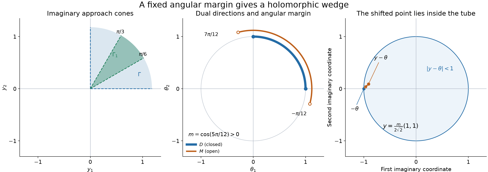

# From wavefront cones to holomorphic wedges

*Written by GPT-6 Astra (OpenAI), October 2026. Public domain (CC0).*

A holomorphic boundary has singular covectors in the positive dual of its imaginary approach cone. We prove the converse with its precise regular remainder: a distribution with this directional bound is locally the boundary of a polynomially bounded holomorphic function, modulo a function of the stated derivative-growth class. In the analytic case the remainder can be absorbed. This yields a local characterization by analytic wavefronts of regular differences and a uniqueness theorem at one-dimensional support boundaries.

The spherical representation and its closed-ball distributional continuity are [Holomorphic decompositions of tempered distributions](holomorphic-decompositions-of-tempered-distributions.md), Theorems 3–4; its angular localization and trace regularity are Theorem 5 and Proposition 6. [Boundary regularity and conic decomposition](boundary-regularity-and-conic-decomposition.md), Theorem 3 and Lemma 2, gives the exact boundary characterization and its smooth counterpart. We use the controlled localization, projection, comparison and sum rules in [Cones and derivative-growth wavefronts](cones-and-derivative-growth-wavefronts.md), Theorems 3 and 5–7; the factorial comparison in [Derivative growth and finite-order localization](derivative-growth-and-finite-order-localization.md), Proposition 3; and the polydisk Cauchy proof in Section 3 of [Holomorphic boundaries in convex cones](holomorphic-boundaries-in-convex-cones.md). The forward dual-cone theorem is [Holomorphic boundaries and analytic directions](holomorphic-boundaries-and-analytic-directions.md), Theorem 2. The final uniqueness argument uses [Gluing holomorphic sides](gluing-holomorphic-sides.md), Theorem 3.1, Lemma 3.2 and Corollary 3.3, including their full jump and zero-boundary proofs. The supplied [metric foundation](../prerequisites/U011-free-foundations/metric-foundation-bridges.md), Sections 12–13, and [integration foundation](../prerequisites/U011-free-foundations/banach-foundation-bridges.md), Sections 15–16, supply compactness, bumps, product integration and convergence.

## A uniform angular margin

Throughout \(n\ge1\). An open convex cone is nonempty and invariant under positive scaling; the full space is allowed. Its positive dual is

\[
 \Gamma^*=\{\xi\in\mathbb R^n:y\cdot\xi\ge0
                         \text{ for every }y\in\Gamma\}.
 \tag{1}
\]

We remove the zero covector when discussing wavefront. Let \(\Gamma_1\) be another nonempty open convex cone with

\[
 \overline{\Gamma_1}\setminus\{0\}\subset\Gamma.
 \tag{2}
\]

This is a strict condition on directions; neither cone is assumed bounded or pointed.

**Lemma 1.** If \(D=\Gamma^*\cap S^{n-1}\ne\varnothing\), there are an open spherical set \(M\supset D\) and \(m>0\) such that

\[
 \theta\cdot y\ge m|y|
 \quad\bigl(\theta\in\overline M,\ y\in\overline{\Gamma_1}\bigr).
 \tag{3}
\]

**Proof.** Put \(C=\overline{\Gamma_1}\cap S^{n-1}\), a nonempty compact set contained in \(\Gamma\). If \(\theta\in D\) and \(v\in C\), their pairing is nonnegative by (1). It is strictly positive: if it were zero, openness would put \(v-\varepsilon\theta\) in \(\Gamma\) for small \(\varepsilon>0\), whereas its pairing with \(\theta\) would be \(-\varepsilon\). On the compact nonempty product \(D\times C\), the minimum is therefore some \(c>0\).

Define \(h(\theta)=\min_{v\in C}\theta\cdot v\) on the sphere. It is continuous, since \(|h(\theta)-h(\theta')|\le|\theta-\theta'|\), obtained by comparing the two pairings for each unit \(v\) and then taking minima in both directions. The open set \(M=\{\theta:h(\theta)>3c/4\}\) contains \(D\), and \(h\ge3c/4\) on its closure. Take \(m=3c/4\), scale a nonzero \(y\) to unit length, and note that (3) is automatic for \(y=0\). \(\square\)

## Uniform regularity of a sphere integral

For \(v\in\mathcal S'(\mathbb R^n)\), write \(V\) for its proved spherical representation on \(T=\{z:|\operatorname{Im}z|<1\}\), and \(B_\omega=V(\,\cdot+i\omega)\) for its boundary distributions. With ordinary surface measure \(\sigma\), including two unit masses when \(n=1\),

\[
 v=\int_{S^{n-1}}B_{-\theta}\,d\sigma(\theta),\qquad
 |V(x+iy)|\le C(1+|x|)^A(1-|y|)^{-B}.
 \tag{4}
\]

The integers \(A,B\ge0\) and the constant may depend on \(v\). Reflection preserves the sphere measure, so (4) has the same normalization as the earlier positive-height average. The maps \(y\mapsto V(\,\cdot+iy)\) extend continuously on each Schwartz test to the whole closed unit ball, with one common finite seminorm bound.

Let \(L_0=1\), \(k\le L_k\), \(L_k\) nondecreasing and \(L_{k+1}\le QL_k\). These are the admissible derivative-growth scales. On compact real sets \(C^L\) means bounds \(A_0(B_0L_{|\alpha|})^{|\alpha|}\) for every derivative. Analytic regularity corresponds to \(L_k=k+1\).

**Lemma 2 (compact trace integration).** Suppose \(K\subset\mathbb R^n\) and \(E\subset S^{n-1}\) are compact, and \(V\) is \(L\)-regular at every \(x-i\theta\) with \(x\in K\), \(\theta\in E\), in the sense of the preceding boundary-characterization lesson. Then

\[
 g=\int_E B_{-\theta}\,d\sigma(\theta)
 \tag{5}
\]

is represented by a \(C^L\) function on a neighborhood of \(K\), with one pair of derivative constants there. The same statement holds for smooth regularity, with a constant for each derivative order. More generally, (5) can use any finite measure supported on \(E\).

**Proof.** Each regularity ball gives, on a smaller real neighborhood and smaller closed angular cap, smooth boundary representatives with exactly its derivative bounds. This is the proved Lipschitz trace argument in Proposition 6 of the spherical representation lesson; for smooth bounds it is Lemma 2 of the boundary-characterization lesson. These representatives agree on overlaps, because they represent the same distribution and are continuous. To check that assertion directly, a nonzero continuous difference has, after multiplication by a constant phase, positive real part on a small ball, so integration against a nonnegative bump cannot be zero.

Choose finitely many of the smaller product neighborhoods covering \(K\times E\). Their union contains \(O\times E\) for some open real neighborhood \(O\) of \(K\). For otherwise there would be points \(x_j\) tending to \(K\) and \(\theta_j\in E\) outside that union; compactness gives a subsequence tending to a point of \(K\times E\), contradicting openness. Shrink \(O\) if necessary. The maximum of the finitely many constants gives common bounds for the glued representatives and all their derivatives on \(O\times E\); in the smooth case take a maximum separately at each order. Integrating against the finite total variation measure gives those same derivative bounds times its mass. Difference quotients pass through the integral by the fundamental theorem along a short coordinate segment and the common next-derivative bound. Repeating for each order proves the claimed smoothness and bounds, while pairing with compact real tests identifies the function with (5). \(\square\)

## Recovering a holomorphic wedge

Write \(X_1\Subset X\) for an open set whose closure is compact and contained in the open set \(X\).

**Theorem 3 (converse with a regular remainder).** Suppose \(u\in\mathcal D'(X)\) and

\[
 \operatorname{WF}_L(u)\subset
                 X\times(\Gamma^*\setminus\{0\}).
 \tag{6}
\]

For every \(X_1\Subset X\) and \(\Gamma_1\) as in (2), there are \(\gamma>0\), an integer \(N\ge0\), a constant \(C_1\), and a holomorphic function on the wedge

\[
 W=\{x+iy:x\in X_1,\ y\in\Gamma_1,\ 0<|y|<\gamma\}
 \tag{7}
\]

such that

\[
 |F(x+iy)|\le C_1|y|^{-N},\qquad
 u|_{X_1}=bF+g,\quad g\in C^L(X_1).
 \tag{8}
\]

Here \(bF\) is the distributional limit as \(y\to0\) within \(\Gamma_1\), with every compact smooth real test. The remainder can be taken \(C^L\) on a neighborhood of \(\overline{X_1}\). Replacing \(\operatorname{WF}_L\) and \(C^L\) by ordinary smooth wavefront and \(C^\infty\) gives the corresponding smooth theorem.

**Proof.** Choose a compact smooth cutoff \(\chi\) in \(X\), equal to one on a neighborhood of \(\overline{X_1}\). Extend \(v=\chi u\) by zero to \(\mathbb R^n\). It is a compact distribution, hence tempered. On an open real neighborhood \(O\) of \(\overline{X_1}\) with closure still inside \(\{\chi=1\}\), its local wavefront is that of \(u\). This is the controlled localization and restriction result already proved in the conic lesson and Exercise 5 of the boundary-characterization lesson. Only this local equality is used; multiplying by a general smooth cutoff is not asserted to preserve analytic regularity everywhere.

If \(D=\Gamma^*\cap S^{n-1}\) is empty, (6) and the projection theorem make \(u\) regular in the required class on \(X\). Take \(F=0\) and \(g=u\) on the smaller set. In the smooth case, the smooth projection proof follows from a finite angular cover, the compact-cutoff convolution estimate and Fourier inversion, as in the earlier lesson. This handles the empty dual without a strict separation argument.

Otherwise use Lemma 1 to obtain \(M,m\). The compact set \(E=S^{n-1}\setminus M\) contains no allowed wavefront direction. The exact boundary characterization therefore makes \(V\) regular at every \(x-i\theta\) for \(x\in\overline O\), \(\theta\in E\). Lemma 2 proves that

\[
 g=\int_E B_{-\theta}\,d\sigma(\theta),\qquad
 h=\int_M B_{-\theta}\,d\sigma(\theta),\qquad v=g+h
 \tag{9}
\]

has the asserted regular remainder near \(\overline{X_1}\). The integrals in (9) are distributions on the whole real space; the regularity statement for \(g\) is on that neighborhood.

Set

\[
 F(z)=\int_M V(z-i\theta)\,d\sigma(\theta).
 \tag{10}
\]

For \(y\in\Gamma_1\), \(0<|y|<m\), (3) gives

\[
 \begin{aligned}
 |y-\theta|^2&=1-2y\cdot\theta+|y|^2
                      \le1-m|y|,\\
 1-|y-\theta|&=\frac{1-|y-\theta|^2}{1+|y-\theta|}
                      \ge\frac m2|y|,
                \qquad\theta\in\overline M.
 \end{aligned}
 \tag{11}
\]

Thus every integrand in (10) lies inside the unit tube. On compact subsets of this wedge it remains a common positive distance from the sphere. The polynomial bound (4) and polydisk Cauchy therefore justify differentiation under the finite sphere integral and prove holomorphy. Since \(X_1\) is bounded, (4) and (11) give (8) with \(N=B\), after enlarging the constant and choosing \(0<\gamma<\min(m,1)\).

To identify the boundary, fix \(\phi\in C_c^\infty(X_1)\). Closed-ball continuity in (4), applied to this test, is uniform on the compact closed ball. Since \((y-\theta)-(-\theta)=y\), it gives

\[
 \sup_{\theta\in\overline M}
   \left|V(\,\cdot+i(y-\theta))(\phi)-B_{-\theta}(\phi)\right|
                \longrightarrow0.
 \tag{12}
\]

The common seminorm bound permits integration over \(M\). Consequently \(bF=h\) on \(X_1\). Equation (9) and \(v=u\) there prove (8), for every approach in the stated cone. The same construction and Lemma 2 with fixed-order constants prove the smooth version. \(\square\)

## Absorbing the analytic remainder

**Lemma 4 (a uniform complex neighborhood).** If a real-analytic function \(g\) is defined near a compact set \(K\subset\mathbb R^n\), there are a real neighborhood \(O\supset K\), \(\delta>0\), and a holomorphic function \(G\) on \(O+i\{y:|y|<\delta\}\), agreeing with \(g\) on \(O\). It is bounded on a smaller such tube over \(K\).

**Proof.** The analytic factorial estimate and Taylor argument are proved in Proposition 3 of the growth lesson. On compact subsets of the given real domain, the coefficients at each real center therefore define a complex power series converging on a small polydisk, equal to \(g\) on its real part. One may shrink its radius so that the real part lies in the given domain. The same multinomial estimate makes all fixed differentiated series converge on smaller polydisks, as in the earlier polydisk proof, so these are holomorphic extensions.

Two polydisks centered at real points, if they intersect, have a nonempty real open intersection: in each coordinate their real intervals intersect precisely when the distance of their real centers is smaller than the sum of their radii, which is also the condition for their complex disks to intersect. Their complex intersection is convex. The two functions agree on the real open part; their difference vanishes on a small complex polydisk by successive one-variable power-series identities, then on the entire intersection by the holomorphic identity principle. Thus all these local extensions glue on their union.

Finitely many smaller real neighborhoods cover \(K\). The union of the corresponding complex polydisks is open and contains the compact real set \(K\), so it contains a fixed-radius complex neighborhood of \(K\): otherwise points outside it could tend to \(K\), contradicting compactness and openness. A sufficiently small real neighborhood \(O\) of \(K\), together with a sufficiently small \(\delta\), lies inside this union after adding \(i y\), \(|y|<\delta\). Shrink once more so that the closure of that tube over \(K\) is compact inside the union. Continuity gives the stated bound. \(\square\)

**Corollary 5 (exact analytic boundary).** Under (6) with \(\operatorname{WF}_A\), \(F\) in Theorem 3 can be chosen with

\[
 bF=u|_{X_1}.
 \tag{13}
\]

**Proof.** The remainder \(g\) is analytic on a neighborhood of \(\overline{X_1}\). Apply Lemma 4 to that compact set, and replace \(F\) by \(F+G\), shrinking \(\gamma\) if necessary. The boundary of \(G\) is its ordinary real trace, uniformly on each compact test support. Thus (8) becomes (13). Boundedness of \(G\) on the smaller tube preserves the polynomial estimate, also when \(N=0\), since \(\gamma\le1\). This includes the empty-dual case. \(\square\)

*A two-dimensional example of (3) and (11). Left: \(\Gamma\) is the open positive quadrant and \(\Gamma_1\) has angles between \(\pi/6\) and \(\pi/3\); finite sectors show their directions. Middle: \(D\) is the closed positive quadrant on the covector unit circle; the open arc \(M\) has angles between \(-\pi/12\) and \(7\pi/12\). The orange arc is drawn at an enlarged radius for legibility and denotes unit directions. Their extreme angular separation gives the exact margin \(m=\cos(5\pi/12)=(\sqrt6-\sqrt2)/4\). Right: with \(\theta=(1,0)\), \(y=(m/2)(1,1)/\sqrt2\), the point \(y-\theta\) lies inside the imaginary unit disk. The orange arrow is that imaginary displacement. These angles and the right-panel coordinates are exact; the two-dimensional picture illustrates the all-dimensional inequalities. [Editable figure source](../figures/wedge-dual-margin.py).*

## Removing a regular germ

For a fixed base point, a regular germ means a function in the stated class on some open neighborhood of that point; two representatives define the same germ when they agree on a smaller neighborhood. The wavefront of \(u-g\) at that point is consequently well defined by locality.

**Theorem 6 (local characterization by analytic differences).** For \(x_0\in X\) and \(\xi_0\ne0\),

\[
 (x_0,\xi_0)\notin\operatorname{WF}_L(u)
 \quad\Longleftrightarrow\quad
 \begin{gathered}
 \text{there are a neighborhood }O\text{ of }x_0
                    \text{ and }g\in C^L(O)\text{ with}\\
 (x_0,\xi_0)\notin\operatorname{WF}_A(u|_O-g).
 \end{gathered}
 \tag{14}
\]

The corresponding statement holds with smooth wavefront and a smooth germ. Equivalently, at each point the respective wavefront fiber is the intersection of the analytic wavefront fibers of all such regular germ differences. In the smooth case one may also require \(g\in C^\infty(X)\).

**Proof.** For the forward implication, localize \(u\) by a compact cutoff equal to one near \(x_0\), and use its spherical representation \(V\). The exact characterization makes \(V\) \(L\)-regular at \(x_0-i\theta_0\), \(\theta_0=\xi_0/|\xi_0|\). Choose a small open spherical cap \(A\) about \(\theta_0\) whose closure, together with a small closed real ball \(K\) about \(x_0\), lies in this regularity neighborhood. Lemma 2 makes

\[
 g=\int_A B_{-\theta}\,d\sigma(\theta)
 \tag{15}
\]

regular near \(K\): apply it to the finite measure \(1_A\sigma\), supported on \(\overline A\). The complementary sphere integral has analytic wavefront only in the directions outside \(A\), by the earlier angular localization theorem applied to the reflected measure. On a real neighborhood where the cutoff is one, this complementary integral equals \(u-g\). Thus it is analytically regular at the specified pair. For the smooth case use the smooth version of Lemma 2.

Conversely, a regular function has empty wavefront in its own class by the projection theorem. The finite-sum rule and class comparison give

\[
 \operatorname{WF}_L(u)=\operatorname{WF}_L(u-g)
                         \subset\operatorname{WF}_A(u-g)
 \tag{16}
\]

on \(O\); applying the sum rule in both directions proves the equality. The same argument works for smooth wavefront. This proves the equivalences and their intersection formulation. In the smooth case choose a compact smooth cutoff in \(O\), equal to one near \(x_0\); its product with \(g\), extended by zero to \(X\), is smooth and gives the same germ. This proves the final assertion. \(\square\)

The quantifier in (14) is explicitly local for general \(L\). No extension of an arbitrary local \(C^L\) function to all of \(X\) is used, and a smooth cutoff is not being treated as a \(C^L\) cutoff. The analytic endpoint also satisfies \(\operatorname{WF}_A(u-g)=\operatorname{WF}_A(u)\) for every analytic \(g\), directly by the sum rule.

## A support boundary has both analytic directions

The support of a distribution is the complement of the largest open set on which it is zero. A boundary point below is taken relative to the given real interval.

**Theorem 7.** If \(I\subset\mathbb R\) is an open interval, \(u\in\mathcal D'(I)\), and \(x_0\in I\) is a boundary point of \(\operatorname{supp}u\), then

\[
 (x_0,+1),\ (x_0,-1)\in\operatorname{WF}_A(u).
 \tag{17}
\]

**Proof.** Suppose first that the negative direction is absent. The regular set is open, so on an open interval \(J\) about \(x_0\) the only possible analytic directions are positive. Choose a smaller interval \(J_1\Subset J\) containing \(x_0\). The cone \(\Gamma=(0,\infty)\) has dual \([0,\infty)\), and one may take \(\Gamma_1=\Gamma\), since their nonzero closed directions coincide and lie in \(\Gamma\). Corollary 5 supplies a polynomially bounded holomorphic \(F\) on \(J_1+i(0,\gamma)\) with boundary \(u|_{J_1}\).

Because \(x_0\) is a support-boundary point, \(J_1\) meets the open complement of the support. A nonempty open subinterval \(J_0\subset J_1\) therefore has \(u=0\). The proved zero-boundary theorem, Corollary 3.3 of the gluing lesson, makes \(F\) zero on the entire connected upper strip. In detail it glues \(F\) to zero below \(J_0\), uses the identity principle on that smaller strip, then uses the resulting open zero set in the original upper strip. Hence its boundary is zero throughout \(J_1\). This contradicts \(x_0\in\operatorname{supp}u\), which follows from closedness of support and its being a boundary point.

If the positive direction is absent, take the negative half-line cone. The resulting lower-strip function is treated by \(z\mapsto-z\), which takes it to an upper strip over the reflected interval and carries the zero boundary subinterval with it. The same argument is a contradiction. Thus neither direction can be absent. \(\square\)

**Corollary 8 (uniqueness on an interval).** Suppose that over no point of a connected open interval \(I\) does \(\operatorname{WF}_A(u)\) contain both directions. If \(u\) vanishes on a nonempty open subset of \(I\), then \(u=0\) on \(I\).

**Proof.** The closed set \(S=\operatorname{supp}u\) has nonempty complement. If it were nonempty, it would have a relative boundary point in \(I\): otherwise the closed set would also be open, and it and its nonempty open complement would disconnect the interval. Connectedness of an interval follows from the intermediate-value property applied to a segment between the two proposed pieces. Theorem 7 contradicts the hypothesis at that boundary point. Thus \(S\) is empty and \(u=0\). \(\square\)

## Exercises with complete solutions

**Exercise 1 — the quantitative margin (foundation).** Verify the three panels of the figure. Prove (11) with \(m=(\sqrt6-\sqrt2)/4\) for those particular cones and arc.

**Solution.** The dual of the open positive quadrant is its closed positive quadrant, as proved in Exercise 1 of the forward dual-cone lesson. Thus the directions of \(D\) lie between \(0\) and \(\pi/2\). For \(\theta\) in the closure of the displayed \(M\) and \(v\) in the closed unit directions of \(\Gamma_1\), their angle difference is at most \(5\pi/12\). Their inner product is at least its cosine, \((\sqrt6-\sqrt2)/4>0\), by the elementary cosine subtraction formula. Scaling gives (3). For \(0<|y|<m\), expanding \(|y-\theta|^2\) then gives (11). In the third panel \(|y|=m/2\), \(\theta=(1,0)\), so \(y-\theta=(-1+m/(2\sqrt2),m/(2\sqrt2))\), and (11) places it strictly inside the disk. The argument uses closed endpoints for the bound even though \(M\) and \(\Gamma_1\) themselves are open. \(\square\)

**Exercise 2 — approaching a cone wall (intermediate).** Let \(F(z_1,z_2)=1/z_1\) where \(y_1,y_2>0\). Show that this holomorphic function has no uniform bound \(|F(x+iy)|\le C|y|^{-N}\) near \(x=0\) on the whole positive quadrant, for any fixed \(C,N\). Explain why smaller angular cones avoid this failure.

**Solution.** Put \(x=0\), \(y=(e^{-1/t^2},t)\), with \(t\downarrow0\). Then \(|F(iy)|=e^{1/t^2}\), while \(|y|\ge t\), so \(C|y|^{-N}\le Ct^{-N}\). Choose an integer \(k>N/2\); the exponential series gives \(e^{1/t^2}\ge t^{-2k}/k!\), which eventually exceeds \(Ct^{-N}\). On any closed set of unit directions strictly inside the quadrant, the first coordinate has a positive minimum \(c\), so \(|z_1|\ge y_1\ge c|y|\) and the bound holds with \(N=1\). This explains the angular margin in this example; it is not a claim that every possible boundary representation fails on a larger cone. \(\square\)

**Exercise 3 — singular support is not support (intermediate).** The upper pole \((x+i0)^{-1}\) has only the positive analytic direction at zero. Explain why this does not contradict Theorem 7.

**Solution.** The exact boundary is \(\operatorname{pv}(1/x)-i\pi\delta_0\), and its single positive analytic ray is proved in the forward dual-cone lesson. On every interval avoiding zero it is the nonzero function \(1/x\); hence it is not zero as a distribution on any such interval. Every neighborhood of zero contains a smaller interval avoiding zero, so it is not zero there either. Thus its support is the whole line, with no relative boundary point. Its singular support is \(\{0\}\), a different set. Theorem 7 applies to the boundary of support. \(\square\)

**Exercise 4 — why connectedness is required (foundation).** Give a distribution on a disconnected open subset of the line which has empty analytic wavefront and vanishes on a nonempty open set, but is not zero everywhere.

**Solution.** On \(X=(-2,-1)\cup(1,2)\), take the locally constant function zero on the first component and one on the second. It is analytic at every point, so its analytic wavefront is empty by the projection theorem. It vanishes on the first component and not on the second. Its support is the second component, which is both open and closed relative to \(X\); it has no relative boundary in \(X\). This is exactly where the interval proof of Corollary 8 would fail. \(\square\)

**Exercise 5 — local regularity and cutoff extension (advanced).** Explain why the last step of Theorem 6 works for smooth functions but cannot be used indiscriminately at the analytic endpoint. Exhibit an analytic function on a small interval with no analytic extension to the entire line.

**Solution.** A compactly supported smooth cutoff times a smooth function, with cutoff support inside the function's domain, extends smoothly by zero: it already vanishes on a neighborhood of every point outside that support. A nonzero analytic compactly supported function on the connected line cannot exist, by the one-variable identity principle applied to the open complement of its support. Thus the same cutoff step is not an analytic construction. For a concrete extension obstruction, take \(g(x)=1/(1-x)\) on \((-1/2,1/2)\). Any analytic extension to the line would, by the real power-series identity principle on \((-\infty,1)\), equal \(1/(1-x)\) there. Its values would be unbounded as \(x\uparrow1\), contradicting continuity of the proposed extension at one. Formula (14) asks for a regular germ and makes no such extension assumption. At the analytic endpoint its wavefront assertion remains valid because adding an analytic germ preserves analytic wavefront. \(\square\)

## References

- The earlier programme proofs listed at the start supply the exact spherical normalization, boundary continuity, analytic directions, trace extension, controlled localization, Cauchy estimates and zero-boundary gluing. The uniform angular separation, wedge construction, analytic absorption and local regular-difference characterization are proved above.
- Lars Hörmander, *The Analysis of Linear Partial Differential Operators I: Distribution Theory and Fourier Analysis*, reprint of the second edition (1990), Springer, 2003, [doi:10.1007/978-3-642-61497-2](https://doi.org/10.1007/978-3-642-61497-2), Section 8.4, Theorem 8.4.15, its following remark, and Corollary 8.4.16. These provide the converse-boundary and support-uniqueness targets. Theorem 6 states the regular-difference characterization with explicit neighborhood quantifiers. The exposition, uniformity arguments, figure and exercises are independently organized and expressed.
