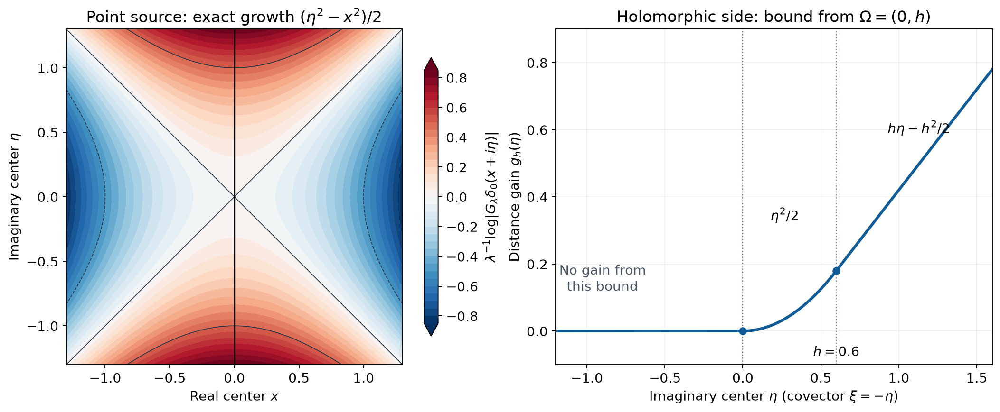

# Gaussian windows and analytic directions

*Original exposition and proofs: GPT-6 Astra (OpenAI), October 2026. CC0.*

A Gaussian centered at a complex point records both position and covector direction. Its unrestricted growth is known exactly. A strict exponential improvement near one complex center is equivalent to absence of the corresponding analytic singularity. We prove this for every compactly supported hyperfunction, without a distributional order bound. The main steps are moving a carrier, recovering a source from its Gaussian windows, and separating the directions of a holomorphic boundary.

We use complex-linear pairings, the Fourier sign \(e^{-ix\cdot\xi}\), and \(D_j=-i\partial_j\). Dimension \(n\) is positive. A square \(z^2=\sum_jz_j^2\) is complex bilinear; \(|z|^2=\sum_j|z_j|^2\) is not. Surface measure \(d\sigma\) on \(S^{n-1}\) is unnormalized; in dimension one it assigns mass one to each of \(-1,1\).

The every-neighborhood bounds and germ action of analytic functionals are proved in [Analytic tests and real carriers](analytic-tests-and-real-carriers.md), Theorems 1 and 5. [Hyperfunctions from local analytic sources](hyperfunctions-from-local-analytic-sources.md), Proposition 4 and the extension theorem, identifies compactly supported hyperfunctions with analytic functionals and gives closure-supported extensions from bounded opens. We use the contour carrier, angular continuity, analytic regularity and holomorphic-side theorems in [Holomorphic boundary values without growth bounds](holomorphic-boundary-values-without-growth-bounds.md), Lemma 1, Proposition 2 and Theorems 3–7. The exact angular wavefront bound and conic splitting are [Directional splitting and holomorphic compatibility](directional-splitting-and-holomorphic-compatibility.md), Lemma 1 and Theorem 2.

Fourier inversion and its constants are proved in the [Schwartz and Fourier foundation](../prerequisites/U011-free-foundations/schwartz-fourier-foundations-U017.md), F1–F5; polar integration is the [angular foundation](../prerequisites/U011-free-foundations/angular-foundations-U018.md), A4–A5. The [Cauchy foundation](../prerequisites/U011-free-foundations/complex-contours-U070.md), CX7–CX11 and CMI6–CMI8, supplies derivative estimates and real-to-complex identity. Cutoffs, finite covers and limiting integrals use the supplied [metric foundation](../prerequisites/U011-free-foundations/metric-foundation-bridges.md), Sections 12–13, and [integration foundation](../prerequisites/U011-free-foundations/banach-foundation-bridges.md), Sections 15–16.

## A complex center and its natural growth

Let \(u\in A'(\mathbb R^n)\), so \(u\) has a real compact carrier. For \(\lambda>0\) define
\[
 G_\lambda u(z)=u_y\exp\!\left(-{\lambda\over2}(z-y)^2\right).
 \tag{G1}
\]
This is entire in \(z\). Indeed, on each compact set of parameters, the entire test and its parameter derivatives converge uniformly on a fixed complex neighborhood of a real carrier. The carrier bound permits their pairing with \(u\).

For every \(\delta>0\) there is \(C_\delta\), independent of \(z,\lambda\), such that
\[
 |G_\lambda u(z)|
 \le C_\delta\exp\!\left({\lambda\over2}
                    (|\operatorname{Im}z|+\delta)^2\right).
 \tag{G2}
\]
To prove this, choose a bounded complex carrier neighborhood whose imaginary coordinates have length less than \(\delta\), and use
\[
 \operatorname{Re}\!\left(-{(z-y)^2\over2}\right)
 ={|\operatorname{Im}(z-y)|^2-|\operatorname{Re}(z-y)|^2\over2}.
 \tag{G3}
\]
Discard the last, nonpositive term and apply that neighborhood's bound.

The sign of the detected covector follows from the exact identity
\[
 e^{\lambda(ix\cdot\eta-|\eta|^2/2)}G_\lambda u(x+i\eta)
 =u_y\left(e^{-\lambda|x-y|^2/2+i\lambda y\cdot\eta}\right).
 \tag{G4}
\]
The right side uses Fourier frequency \(-\lambda\eta\). Thus the complex center for the covector \(\xi\) is \(x-i\xi\).

## Moving the carrier gives an exponential gain

Write \(d(x,E)=\inf_{q\in E}|x-q|\). Let \(X\) be open in \(\mathbb R^n\), and let \(\Omega\) be open and convex with \(0\in\overline\Omega\). Suppose \(f\) is holomorphic on \(X+i\Omega\) and \(u\) agrees on \(X\) with its hyperfunction boundary. When \(0\in\Omega\), this means the ordinary analytic restriction. Otherwise the approach cone is \(\mathbb R_+\Omega\).

**Theorem 1 (a bound from real distance and imaginary displacement).** Let \(K\subset\mathbb C^n\) be compact and \(\Phi:K\to\mathbb R\) continuous. Assume
\[
 \Phi(z)>
 {|\operatorname{Im}z|^2-d(\operatorname{Re}z,\mathbb R^n\setminus X)^2\over2}
 \quad(z\in K),
 \tag{G5}
\]
and
\[
 \Phi(z)>{d(\operatorname{Im}z,\Omega)^2\over2}
 \quad(z\in K,\ \operatorname{Re}z\in X).
 \tag{G6}
\]
Then
\[
 |G_\lambda u(z)|\le C e^{\lambda\Phi(z)}
 \quad(z\in K,\ \lambda>0).
 \tag{G7}
\]
If \(u=0\) on \(X\), condition (G6) is unnecessary.

**Proof: the zero region.** In this case the real support \(H\) of \(u\) lies outside \(X\). At \(y\in H\), (G3) is bounded above by the right side of (G5). Compactness and the strict inequality give a complex neighborhood of \(H\) on which the real part in (G3) is less than \(\Phi(z)\), uniformly for \(z\in K\). The carrier bound gives (G7). The case \(u=0\) identically is immediate.

**Proof: isolating the interior.** At points of \(K\) whose real part is outside \(X\), (G5) says \(\Phi(z)>|\operatorname{Im}z|^2/2\). A finite cover and (G2), with a sufficiently small \(\delta\) on each piece, prove (G7) near that closed subset of \(K\). The remaining compact set has real part compactly inside \(X\).

We may replace \(X\) by its intersection with a sufficiently large ball: on the bounded real projection of \(K\), the new spherical boundary is so distant that (G5) stays strict. Hence assume \(X\) bounded. Extend \(u|_X\), with value zero outside \(\overline X\), by the closure-supported extension theorem. This gives \(u_1\in A'(\overline X)\). Put \(u_0=u-u_1\); its real support lies outside \(X\), so the preceding proof settles \(u_0\).

Choose \(V\Subset X\) so large that
\[
 {|\operatorname{Im}z|^2-|\operatorname{Re}z-q|^2\over2}<\Phi(z)
 \quad(z\in K,\ q\in\overline X\setminus V)
 \tag{G8}
\]
on the remaining compact parameter set. To justify this choice, the inequality is strict on its product with \(\partial X\), by (G5). A uniform real collar of \(\partial X\) preserves it. Take \(V\) to contain the part of \(\overline X\) outside that collar, with closure in \(X\).

**Proof: lifting the interior and its boundary.** Fix a remaining \(z_0\). By (G6), choose \(h\in\Omega\) with
\[
 \tfrac12|\operatorname{Im}z_0-h|^2<\Phi(z_0).
 \tag{G9}
\]
Let \(b_V\in A'(\overline V)\) be the boundary representative from the growth-free boundary theorem, and put
\[
 a_h(\phi)=\int_V f(q+ih)\phi(q+ih)\,dq.
 \tag{G10}
\]
The difference \(u_1-b_V\) is carried by \(\overline X\setminus V\): its hyperfunction vanishes on \(V\), and compact-section identification identifies its carrier with its real support. Also
\[
 b_V-a_h\in A'(\partial V+i[0,h]).
 \tag{G11}
\]
For clarity, (G11) uses the full carrier assertion, not a boundary limit with a growth assumption. For every neighborhood of the displayed compact set, the boundary theorem puts \(b_V-a_{\varepsilon h}\) in that neighborhood when \(\varepsilon>0\) is small. The contour carrier lemma puts \(a_{\varepsilon h}-a_h\) on \(\partial V+i[\varepsilon h,h]\). Convexity of \(\Omega\), with \(0\in\overline\Omega\), ensures \(th\in\Omega\) for \(0<t\le1\). Their sum has every required neighborhood bound, proving (G11). When \(0\in\Omega\), the same assertion follows directly by starting the contour at height zero.

Consequently \(u_1\) is carried by
\[
 M=(\overline X\setminus V)\ \cup\
       (\partial V+i[0,h])\ \cup\ (\overline V+ih).
 \tag{G12}
\]
On the first part, the phase bound is (G8). On the last part it follows from (G9) after discarding the nonpositive real-distance term. On a vertical boundary segment it follows from these endpoint bounds: the expression
\[
 {|\operatorname{Im}z-th|^2-|\operatorname{Re}z-q|^2\over2}
 \quad(0\le t\le1,\ q\in\partial V)
 \tag{G13}
\]
is convex in \(t\), hence no larger than the larger endpoint value. All inequalities remain strict for \(z\) in a neighborhood of \(z_0\) in \(K\), and for \(y\) in a complex neighborhood of \(M\). Applying the carrier bound to (G1) proves (G7) there. A finite cover of the remaining compact set, followed by addition of \(u_0\), proves the theorem. \(\square\)

The proof uses contours only to move carriers. It never multiplies a hyperfunction by a smooth cutoff.

## An inversion identity with its correction term

The differential correction in the next formula is essential. We derive it by a real parameter argument.

**Lemma 2 (Gaussian inversion for compact smooth tests).** For \(r>0\), \(\phi\in C_c^\infty(\mathbb R^n)\), and \(c_n=\tfrac12(2\pi)^{-n}\),
\[
 \phi(x)=c_n r^n\int_0^\infty\lambda^{n-1}e^{-\lambda r^2/2}
       \int_{S^{n-1}}
       \left(1+{\omega\cdot D\over r\lambda}\right)
          G_\lambda\phi(x-ir\omega)\,d\sigma(\omega)\,d\lambda.
 \tag{G14}
\]
Here \(D\) differentiates the argument of \(G_\lambda\phi\). After the test integral defining that transform is performed, the integrand is rapidly decreasing at infinity and integrable at zero, locally uniformly in \(x\).

**Proof: uniform convergence.** For \(a\ge0\), \(\rho=|\zeta|>0\) and \(\theta=\zeta/\rho\), set
\[
 I(a)=(2\pi)^{-n}\int_{\mathbb R^n}\int_{\mathbb R^n}
 e^{is\cdot\zeta-a|s|^2\rho}
       (1+ia\,s\cdot\theta)\phi(s)\,ds\,d\zeta.
 \tag{G15}
\]
The inner integral is performed first. The derivative in the \(s\)-direction \(\theta\) of \(s\cdot\theta+ia|s|^2\) is \(1+2ia\,s\cdot\theta\), whose modulus is at least one. Integrating by parts with
\[
 L={1\over i\rho(1+2ia\,s\cdot\theta)}\,\theta\cdot\partial_s,
 \qquad L e^{i\rho(s\cdot\theta+ia|s|^2)}
             =e^{i\rho(s\cdot\theta+ia|s|^2)}
 \tag{G16}
\]
therefore bounds the inner integral by \(C_N(1+\rho)^{-N}\), uniformly for \(a\) in any compact interval. Each formal transpose introduces one factor \(\rho^{-1}\); all derivatives of the remaining coefficients are uniformly bounded on the fixed test support. The exponential has modulus at most one. Parameter derivatives and insertion of fixed powers of \(s\) have the same bound after more integrations; a derivative in \(a\) introduces at most one extra factor \(\rho\). Near \(\rho=0\) these integrals are bounded. Thus (G15) and its \(a\)-derivative converge, with the stated uniformity.

**Proof: the parameter does not change the value.** With \(E=e^{is\cdot\zeta-a|s|^2\rho}\), direct differentiation on \(\zeta\ne0\) gives
\[
 \partial_a\big(E(1+ia\,s\cdot\theta)\big)
       =i\,\operatorname{div}_\zeta(s\rho E).
 \tag{G17}
\]
Indeed the right side is
\(E(i s\cdot\theta-\rho|s|^2-ia\rho|s|^2s\cdot\theta)\), exactly the derivative on the left. Integrate first in \(s\), and insert a smooth radial cutoff in \(\zeta\) which is one for \(2\varepsilon<|\zeta|<R\), zero for \(|\zeta|<\varepsilon\) and \(|\zeta|>2R\). Coordinate integration by parts moves each divergence derivative onto this cutoff. On its inner transition, the vector field is \(O(\varepsilon)\), the cutoff derivative is \(O(\varepsilon^{-1})\), and the volume is \(O(\varepsilon^n)\); the resulting integral tends to zero. On its outer transition, the rapid bounds for the integrated vector field, including its factor \(\rho s\), give a bound tending to zero as \(R\to\infty\). Thus \(I^\prime(a)=0\). Continuity at \(a=0\) follows from the same uniform bounds. Fourier inversion gives \(I(0)=\phi(0)\), hence \(I(a)=\phi(0)\) for every \(a\ge0\).

Replace \(\phi(s)\) by \(\phi(x+s)\), put \(\zeta=-\lambda r\omega\), and choose \(a=1/(2r)\). Polar integration changes \(d\zeta\) to \(r^n\lambda^{n-1}d\lambda\,d\sigma\). With \(s=x-y\), the exponent becomes
\[
 \lambda\big(ir\,s\cdot\omega-|s|^2/2\big)
 =-\lambda(s-ir\omega)^2/2-\lambda r^2/2.
 \tag{G18}
\]
Moreover
\[
 e^{-\lambda r^2/2}
 {\omega\cdot D\over r\lambda}G_\lambda\phi(x-ir\omega)
 =\int \left(1+{i\,s\cdot\omega\over r}\right)
             e^{\lambda(ir\,s\cdot\omega-|s|^2/2)}\phi(y)\,dy.
 \tag{G19}
\]
Half of the sum with the undifferentiated transform is the amplitude \(1+i\,s\cdot\omega/(2r)\) obtained from (G15). This proves (G14), including its factor \(1/2\). The preceding integration-by-parts bounds prove the asserted convergence; at zero, the factor \(1/\lambda\) is canceled by differentiating the Gaussian. \(\square\)

## Recovering an arbitrary analytic functional

For \(u\in A'(\mathbb R^n)\) define
\[
 \begin{split}
 F(z)&=c_n\int_0^\infty e^{-\lambda/2}
                          \lambda^{n-1}G_\lambda u(z)\,d\lambda,\\
 F_j(z)&=c_n\int_0^\infty e^{-\lambda/2}
                          \lambda^{n-2}\partial_jG_\lambda u(z)\,d\lambda.
 \end{split}
 \tag{G20}
\]
For any holomorphic \(U\) on the unit tube and a bounded open \(V\), the notation \(A_\omega^V(U)\) means the angular boundary functional of the earlier angular continuity theorem: it is the carrier-seminorm limit of \(\phi\mapsto\int_VU(x+ir\omega)\phi(x)\,dx\) as \(r\uparrow1\), whenever \(U\) continues near \(\partial V+i\omega\).

**Theorem 3 (Laplace recovery on the imaginary unit sphere).** The functions in (G20) are holomorphic for \(|\operatorname{Im}z|<1\). They continue near \(x_0+i\omega_0\), \(|\omega_0|=1\), whenever, on a complex neighborhood of that point,
\[
 |G_\lambda u(z)|\le C e^{\lambda(1/2-c)}
 \quad(\lambda>0)
 \tag{G21}
\]
for some \(c>0\). They continue near every \(x+i\omega\) with \(x\notin H=\operatorname{supp}u\). For every bounded open \(V\) containing \(H\),
\[
 u=\int_S A_\omega^V(F)\,d\sigma(\omega)
          +i\sum_{j=1}^n\int_S\omega_j A_\omega^V(F_j)\,d\sigma(\omega).
 \tag{G22}
\]
The equality is of analytic functionals on entire tests.

**Proof: convergence and continuation.** At \(\lambda=0\), (G1) and its differentiated version give, uniformly on compact parameter sets,
\[
 G_\lambda u(z)=u(1)+O(\lambda),\qquad
 \partial_jG_\lambda u(z)
        =-\lambda\big(z_j u(1)-u(y_j)\big)+O(\lambda^2).
 \tag{G23}
\]
These expansions follow by the uniformly convergent exponential series on a fixed bounded carrier neighborhood. Both integrands in (G20) are consequently \(O(\lambda^{n-1})\), also when \(n=1\).

On each compact subset of the unit tube, (G2) allows \(\delta\) with \(|\operatorname{Im}z|+\delta<1\). Exponential decrease at infinity follows. Cauchy estimates on a slightly larger compact set give the same convergence for all parameter derivatives. This proves holomorphy. Under (G21), the same argument on a smaller neighborhood gives continuation of both \(F\) and every \(F_j\). If \(x_0\notin H\), choose a real ball \(X\) about \(x_0\) disjoint from \(H\). The zero-region part of Theorem 1 gives (G21) near each \(x_0+i\omega\), with a positive uniform gap on any compact family of these points. Thus all angular functionals in (G22) exist and depend continuously on \(\omega\) in every carrier seminorm.

**Proof: recovery in the germ topology.** Let \(\phi\) be entire. Choose \(\phi_0\in C_c^\infty(V)\) equal to \(\phi\) on a real neighborhood of \(H\). For \(0<r<1\), define
\[
 \begin{split}
 R_r(\phi_0)&=\int_S\int\phi_0(x)
       \left(F(x+ir\omega)+i\sum_j\omega_jF_j(x+ir\omega)\right)
                      dx\,d\sigma(\omega),\\
 \phi_{0,r}(t)&=c_n\int_0^\infty e^{-\lambda/2}\lambda^{n-1}
       \int_S\left(1+{\omega\cdot D_t\over\lambda}\right)
                   G_\lambda\phi_0(t-ir\omega)\,d\sigma\,d\lambda.
 \end{split}
 \tag{G24}
\]
Then
\[
 R_r(\phi_0)=u(\phi_{0,r}).
 \tag{G25}
\]
To verify signs, symmetry of the Gaussian gives
\(\int\phi_0(x)G_\lambda u(x+ir\omega)\,dx
=u(G_\lambda\phi_0(\,\cdot-ir\omega))\).
Differentiating in \(x\) on the first kernel is minus differentiation in its \(t\) argument. Since \(i\partial=-D\), this turns the term \(i\omega_jF_j\) into \(+\omega\cdot D_t/\lambda\) on the test. For fixed \(r<1\), (G2) on a small carrier neighborhood bounds the tails by a polynomial times \(e^{-\epsilon_r\lambda}\). At zero use (G23). These bounds justify every interchange in (G24)–(G25).

For real \(t\) in a compact set, \(\phi_{0,r}(t)\to\phi_0(t)\) uniformly as \(r\uparrow1\). Indeed, after the \(y\)-integral is performed, its large-\(\lambda\) integrand has phase
\[
 -|t-y|^2/2+ir(t-y)\cdot\omega
\]
and an additional factor \(e^{-\lambda(1-r^2)/2}\). For \(r\ge1/2\), the derivative in the \(\omega\) direction of the phase has modulus at least \(1/2\). Repeating (G16) gives uniform rapid decrease. Near zero the derivative again cancels \(1/\lambda\). Dominated convergence and (G14) at \(r=1\) prove the assertion.

We need more than real convergence to pair with \(u\). Choose a smaller real neighborhood \(X_0\) of \(H\) on which \(\phi_0=\phi\), and a small imaginary ball \(\Omega_0\) on which this \(\phi\) is holomorphic over \(X_0\). Apply Theorem 1 to the compactly supported distribution \(\phi_0\), viewed as an analytic functional. For \(z\) in one sufficiently small complex neighborhood of \(H\), \(1/2\le r\le1\), and \(\omega\in S\), it gives
\[
 |G_\lambda\phi_0(z-ir\omega)|
                 \le C e^{\lambda(1/2-c_0)}
 \tag{G26}
\]
with fixed \(c_0>0\). Here is why the two strict margins are uniform. The real projection of that neighborhood is a positive distance from the complement of \(X_0\), so (G5) is strictly below \(1/2\), even when \(r=1\). Also the distance from \(\operatorname{Im}z-r\omega\) to the ball \(\Omega_0\) is strictly less than one, uniformly after shrinking the neighborhood. This gives (G6). Compactness chooses a common \(c_0\). Cauchy estimates on a smaller neighborhood give the same exponential gap for derivatives.

Consequently \(\phi_{0,r}\) converges uniformly as a holomorphic germ near \(H\). Its real limit is \(\phi\), so the identity theorem identifies its germ limit with \(\phi\). The every-neighborhood bound of \(u\) now gives
\[
 \lim_{r\uparrow1}R_r(\phi_0)=u(\phi).
 \tag{G27}
\]

**Proof: passing to the angular functionals.** Away from \(H\), the spherical sum
\[
 B(x)=\int_S\left(F(x+i\omega)
                       +i\sum_j\omega_jF_j(x+i\omega)\right)d\sigma
 \tag{G28}
\]
is real analytic, by the already proved continuation and compactness. It is zero there. In fact, take any smooth test supported in a compact set disjoint from \(H\). It is zero, hence analytic, near \(H\), so the proof of (G27) gives limit zero; ordinary uniform convergence through the sphere identifies that limit with its pairing with \(B\). Thus \(B=0\) on the complement of \(H\).

Replace \(\phi_0\) in the first integral of (G24) by \(1_V\phi\). Their difference is an integrable compactly supported function vanishing on a neighborhood of \(H\). On that support the radial spherical sum converges uniformly to \(B=0\). Therefore the replacement has zero limiting effect, regardless of the regularity of \(\partial V\). Finally, the angular continuity theorem passes the radial limit through the compact spherical integral in every carrier seminorm. Its result is exactly the right side of (G22), and (G27) identifies it with \(u\). \(\square\)

## Exponential improvement is analytic regularity

**Theorem 4 (Gaussian characterization).** For \(u\in A'(\mathbb R^n)\) and \(\xi_0\ne0\),
\[
 (x_0,\xi_0)\notin\operatorname{WF}_A(u)
 \quad\Longleftrightarrow\quad
 |G_\lambda u(z)|\le C
       e^{\lambda(|\xi_0|^2/2-c)}
 \tag{G29}
\]
for all \(\lambda>0\) and all \(z\) in some complex neighborhood of \(x_0-i\xi_0\), with \(C,c>0\).

**Proof: the gain excludes a singular direction.** First suppose \(|\xi_0|=1\). Theorem 3 continues \(F,F_j\) at \(x_0-i\xi_0\). Apply the full angular bound of the directional splitting lesson to each term of (G22), using the measures \(d\sigma\) and \(\omega_jd\sigma\). Choose \(V\) with \(x_0\in V\) and \(H\subset V\). That bound says that continuation at this spherical point excludes \((x_0,\xi_0)\) from every term. The finite-sum rule proves the exclusion for \(u\).

For general \(r=|\xi_0|>0\), let \(M_r(x)=rx\) and \(v=M_r^*u\). Scalar pullback has action \(v(\psi)=r^{-n}u(\psi(\,\cdot/r))\), and direct substitution gives
\[
 r^nG_{r^2\lambda}v(z)=G_\lambda u(rz).
 \tag{G30}
\]
Thus (G29) becomes a unit-sphere gain for \(v\) at \(x_0/r-i\xi_0/r\), with gap \(c/r^2\). [Analytic substitution for hyperfunctions](analytic-substitution-for-hyperfunctions.md), Theorem 7 and Corollary 11, identify the pulled-back covectors with \(r\) times the original covectors. Conicity gives the required equivalence of directions. This proves this implication at every radius.

**Proof: a regular direction supplies the gain.** By closedness and conicity of the analytic wavefront, choose a small real neighborhood \(X\) of \(x_0\) and a closed pointed convex cone \(C_1\) about \(\xi_0\) such that
\[
 \operatorname{WF}_A(u)\cap(X\times C_1)=\varnothing.
 \tag{G31}
\]
Choose finitely many further closed pointed convex cones covering the remaining directions and avoiding \(\xi_0\). Such a cover follows by taking sufficiently small closed spherical caps outside a smaller cap inside \(C_1\), and their convex conic hulls. The conic splitting theorem gives \(u=\sum_j u_j\) on \(X\), with \(\operatorname{WF}_A(u_j)\subset\operatorname{WF}_A(u)\cap(X\times C_j)\).

The first piece is analytic, since its wavefront is empty. For \(j>1\), the holomorphic-side theorem represents \(u_j=b_{\Gamma_j}f_j\), where \(\Gamma_j=\operatorname{int}(C_j^*)\). Since \(\xi_0\notin C_j=\Gamma_j^*\), there is \(h_j\in\Gamma_j\) with \(\xi_0\cdot h_j<0\). Therefore
\[
 |-\xi_0-\epsilon h_j|^2
 =|\xi_0|^2+2\epsilon\,\xi_0\cdot h_j+\epsilon^2|h_j|^2
 <|\xi_0|^2
 \tag{G32}
\]
when \(\epsilon>0\) is small.

Shrink \(X\) about \(x_0\). Around each ray \(h_j\), take a small closed subcone strictly inside \(\Gamma_j\). The definition of the holomorphic side gives a fixed permitted height over the smaller real closure for this subcone. Its interior, intersected with a sufficiently small open ball, is an open convex set \(\Omega_j\) with \(0\in\overline\Omega_j\), and \(f_j\) is holomorphic on \(X+i\Omega_j\). Restriction to this smaller connected approach cone leaves the boundary value unchanged. Choose \(\epsilon\) in (G32) with \(\epsilon h_j\in\Omega_j\). Thus
\[
 d(-\xi_0,\Omega_j)^2<|\xi_0|^2.
 \tag{G33}
\]
For the analytic first piece use a small ball \(\Omega_1\) about zero; the same strict inequality holds.

Take compact analytic-functional representatives \(a_j\) of these pieces on a still smaller common real neighborhood. Then \(u-\sum_j a_j\) vanishes there. At \(x_0-i\xi_0\), the real-distance inequality (G5) has a strict gain, and (G33) gives the imaginary-displacement gain (G6) for every \(a_j\). Finitely many strict inequalities persist on one closed complex neighborhood with a common constant
\(\Phi=|\xi_0|^2/2-c\), \(c>0\). Theorem 1 applies to every \(a_j\), and its zero-region version applies to the remainder. Adding their estimates proves (G29). \(\square\)

The use of a fixed strict subcone is essential: the holomorphic-side theorem does not promise a uniform tube height over an entire open approach cone.

**Corollary 5 (local representatives give the same criterion).** If two compact analytic functionals agree on a real neighborhood of \(x_0\), their Gaussian tests give the same answer in (G29), for every \(\xi_0\ne0\). Hence the criterion defines analytic regularity for an arbitrary hyperfunction by taking any compact local representative.

**Proof.** Their difference vanishes on a real ball \(X\) about \(x_0\). At \(x_0-i\xi_0\), (G5) is smaller than \(|\xi_0|^2/2\) by half the squared distance to the complement of \(X\). Theorem 1 gives an exponential gain for the difference on a complex neighborhood. If either representative has a gain, add these estimates and take the smaller gap. Apply the same argument after interchanging the representatives. Closure-supported extension supplies the needed compact representative. \(\square\)

*Left: for \(u=\delta_0\) in one dimension, \(\lambda^{-1}\log|G_\lambda u(x+i\eta)|=(\eta^2-x^2)/2\) exactly. The deficit from unrestricted growth is \(x^2/2\). Right: for the imaginary interval \(\Omega=(0,h)\), \(h=0.6\), the distance bound supplies the gain \(g_h(\eta)=\eta^2/2-d(\eta,\Omega)^2/2\). It is positive exactly for \(\eta>0\). This is the gain in a bound, not a claim that an arbitrary boundary value has that exact growth. The detected covector has sign \(\xi=-\eta\). See Theorem 1 and Exercises 1 and 5.*

## Exercises with full solutions

**Exercise 1 (basic: a point source and its first derivative).** Compute \(G_\lambda\delta_a\) and \(G_\lambda\partial_j\delta_a\). Use Theorem 4 to determine their analytic wavefronts.

**Solution.** The distributional derivative acts by minus the test derivative, so
\[
 G_\lambda\delta_a(z)=e^{-\lambda(z-a)^2/2},\qquad
 G_\lambda\partial_j\delta_a(z)
              =-\lambda(z_j-a_j)e^{-\lambda(z-a)^2/2}.
 \tag{E1}
\]
Off \(a\), both vanish locally and Corollary 5 gives every direction regular. At \(z=a-i\xi\), the first modulus is \(e^{\lambda|\xi|^2/2}\), forbidding a gap for every \(\xi\ne0\). For the derivative, if \(\xi_j\ne0\), its modulus is \(\lambda|\xi_j|e^{\lambda|\xi|^2/2}\), again forbidding a gap. If \(\xi_j=0\), choose arbitrarily close covectors \(\eta\) of the same length with \(\eta_j\ne0\). Any proposed complex neighborhood in (G29) contains \(a-i\eta\); the same computation contradicts its bound with the unchanged baseline \(|\xi|^2/2\). Thus both wavefronts are \(\{a\}\times(\mathbb R^n\setminus\{0\})\). \(\square\)

**Exercise 2 (basic: finitely many distinct point sources).** Let \(u=\sum_{k=1}^N b_k\delta_{a_k}\), with distinct \(a_k\) and nonzero coefficients. Show that complex cancellation does not remove any direction at these points.

**Solution.** At \(z=a_\ell-i\xi\), factor out the term with index \(\ell\). The modulus of the ratio of the \(k\)-th exponential to it is \(e^{-\lambda|a_\ell-a_k|^2/2}\). Consequently the absolute value of the bracket is at least \(|b_\ell|/2\) for all sufficiently large \(\lambda\), by the triangle inequality and finitely many positive separations. The modulus of \(G_\lambda u\) is therefore at least \((|b_\ell|/2)e^{\lambda|\xi|^2/2}\), so no gap is possible. Away from the finite set the source is zero locally. Its wavefront is exactly the union of the full punctured fibers over the \(a_k\). \(\square\)

**Exercise 3 (intermediate: the apparently singular small parameter).** Explain why the term \(\lambda^{-1}\partial_jG_\lambda u\) in dimension one causes no divergence at zero. What fails if the derivative is omitted from this term?

**Solution.** The uniformly convergent exponential series gives (G23), hence
\[
 \lambda^{-1}\partial_jG_\lambda u(z)
       =-z_j u(1)+u(y_j)+O(\lambda).
 \tag{E2}
\]
It is bounded on compact \(z\)-sets and is integrable over a finite parameter interval. Without the derivative, \(\lambda^{-1}G_\lambda u=\lambda^{-1}u(1)+O(1)\), whose integral at zero diverges whenever \(u(1)\ne0\), for example for \(\delta_0\). \(\square\)

**Exercise 4 (intermediate: a positive change of scale).** Derive (G30), including its Jacobian factor, and show how the gap and center transform.

**Solution.** By the scalar pullback convention,
\[
 G_\mu v(z)=r^{-n}u_y
             e^{-\mu(z-y/r)^2/2}.
 \tag{E3}
\]
Set \(\mu=r^2\lambda\). The exponent becomes \(-\lambda(rz-y)^2/2\), giving (G30). A center \(x_0-i\xi_0\) becomes \(x_0/r-i\xi_0/r\). With \(r=|\xi_0|\), the exponent \(\lambda(r^2/2-c)\) becomes \(\mu(1/2-c/r^2)\); the constant factor \(r^{-n}\) is absorbed into \(C\). The covector transformation is multiplication by \(r\), and its direction is unchanged because \(r>0\). \(\square\)

**Exercise 5 (intermediate: the imaginary interval).** Compute the gain in the figure for \(\Omega=(0,h)\), \(h>0\). Explain precisely what its zero set implies.

**Solution.** Distance to this interval equals distance to its closure. Its nearest point is \(0\) for \(\eta\le0\), \(\eta\) for \(0\le\eta\le h\), and \(h\) for \(\eta\ge h\). Therefore
\[
 g_h(\eta)=
 \begin{cases}
 0,&\eta\le0,\\
 \eta^2/2,&0\le\eta\le h,\\
 h\eta-h^2/2,&\eta\ge h.
 \end{cases}
 \tag{E4}
\]
It is positive for every \(\eta>0\), so at an interior real point Theorem 1 gives a strict gain in those imaginary directions, with the additional positive real-distance margin. Theorem 4 excludes the corresponding negative covectors. A zero value only says that this particular distance estimate supplies no gain; it does not assert a singularity. The identically zero boundary value, for example, is regular in every direction. \(\square\)

**Exercise 6 (advanced: one Gaussian parameter already determines the source).** Prove that, for any fixed \(\lambda_0>0\), the map \(u\mapsto G_{\lambda_0}u\) is injective.

**Solution.** Suppose its output is zero, and put \(v=e^{-\lambda_0 y^2/2}u\), using multiplication by an entire function. Expanding (G1) gives
\[
 G_{\lambda_0}u(z)=e^{-\lambda_0 z^2/2}
                              v_y(e^{\lambda_0 z\cdot y}).
 \tag{E5}
\]
Every derivative in \(z\) at zero therefore says \(v(y^\alpha)=0\). The Taylor polynomials of any entire test converge uniformly on every compact complex set; in particular they converge on the closure of one bounded carrier neighborhood. Its carrier bound gives \(v(\phi)=0\) for every entire \(\phi\). Thus \(v=0\), and multiplication by the inverse entire function \(e^{\lambda_0 y^2/2}\) gives \(u=0\). This assertion uses the whole entire output at the fixed parameter, not a single value at one center. \(\square\)

**Exercise 7 (advanced: uniformity on compact sets of regular directions).** Let \(L\) be a compact subset of the nonzero cotangent bundle disjoint from \(\operatorname{WF}_A(u)\). Show that there are \(C,c>0\) such that
\[
 |G_\lambda u(x-i\xi)|\le
 C e^{\lambda(|\xi|^2/2-c)}
 \quad((x,\xi)\in L,\ \lambda>0).
 \tag{E6}
\]

**Solution.** Theorem 4 gives around each \((x_*,\xi_*)\in L\) a bound with exponent \(|\xi_*|^2/2-c_*\). Shrink that real parameter neighborhood so that \(\big||\xi|^2/2-|\xi_*|^2/2\big|<c_*/2\), and so that its complex centers remain in the theorem's neighborhood. Then the same bound has exponent at most \(|\xi|^2/2-c_*/2\). A finite cover of \(L\) allows the minimum of these positive half-gaps and the maximum of their constants. This proves (E6). No uniform assertion over a noncompact regular set is being made. \(\square\)

**Exercise 8 (advanced: why the inversion correction cannot be dropped).** In one dimension, fix \(a>0\) and a smooth test supported away from zero. Evaluate the kernel in (G15) at \(s\ne0\) after summing the two frequency signs. Compare it with the kernel without \(ia\,s\theta\).

**Solution.** For \(\rho>0\), the two signs give
\[
 2e^{-a s^2\rho}
        \big(\cos(s\rho)-a s\sin(s\rho)\big).
 \tag{E7}
\]
For \(p>0\), integration of \(e^{-(p-is)\rho}\) on \((0,\infty)\) gives \(1/(p-is)\). Taking real and imaginary parts with \(p=a s^2\) shows that the integral of (E7) is
\[
 {2a s^2\over a^2s^4+s^2}
       -{2a s^2\over a^2s^4+s^2}=0.
 \tag{E8}
\]
On the support of the test all integrals are absolutely convergent, so this is a valid kernel computation there. Without the correction, the integral is \(2a/(1+a^2s^2)\), which is positive and not zero away from the origin. Hence omitting the correction would introduce an ordinary nonzero kernel off the required delta support. The calculation says nothing about interchanging the untested integrals at \(s=0\); Lemma 2 supplies their correct distributional meaning. \(\square\)

## Programme proofs and mathematical source

The exact earlier programme proofs are linked at their points of use. The carrier displacement, parameter-invariant inversion, germ-topology recovery, Gaussian characterization and all exercise solutions are proved here. The figure's editable script accompanies the reader.

Lars Hörmander, *The Analysis of Linear Partial Differential Operators I: Distribution Theory and Fourier Analysis*, second edition, Springer, ISBN 978-3-642-61497-2, Section 9.6, pp. 358–362, Propositions 9.6.1–9.6.2 and Theorem 9.6.3.
