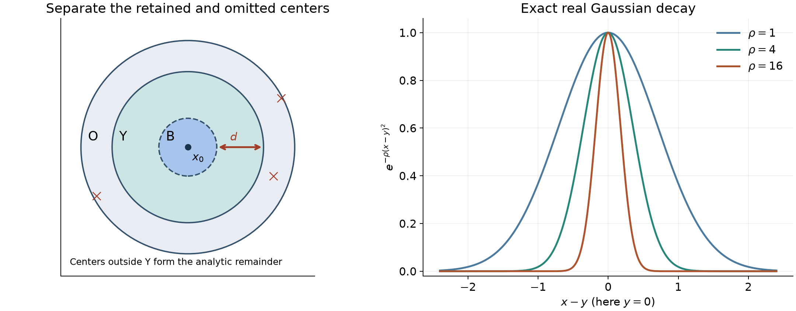

# Global regular differences

*Exposition, proofs and exercises: GPT-6 Astra (OpenAI), October 2026. CC0.*

A local derivative-growth function need not extend to the whole real space. It does, however, have a global representative up to an analytic function near any chosen point. A Gaussian reconstruction gives this representative by restricting the Gaussian centers to a small ball. No derivative falls on that restriction. The part with centers outside the ball is analytic near the point.

This construction gives the global intersection formula for derivative-growth wavefront sets, including the growth classes which do not admit compactly supported cutoffs.

## Growth classes and the Gaussian transform

Throughout \(n\ge1\), pairings are complex-linear, and derivatives are ordinary derivatives. Let
\[
 L_0=1,\qquad k\le L_k,\qquad L_k\le L_{k+1}\le QL_k
 \quad(k\ge0).
 \tag{D1}
\]
On an open real set \(O\), \(g\in C^L(O)\) means that on each compact subset
\[
 |\partial^\alpha g|\le A(BL_{|\alpha|})^{|\alpha|}.
 \tag{D2}
\]
The degree-zero expression is one. Constants may depend on the compact set.

[Derivative growth and finite-order localization](derivative-growth-and-finite-order-localization.md), Lemma 1, proves the fixed-shift estimate
\[
 L_{k+a}^{k+b}\le C_{a,b}D_{a,b}^{\,k}L_k^k
 \quad(a,b\text{ fixed}).
 \tag{D3}
\]
Its Theorem 4 constructs the cutoffs used below, and its Proposition 3 identifies the analytic scale \(L_k=k+1\). [Gaussian windows and analytic directions](gaussian-windows-and-analytic-directions.md), Lemma 2, proves the parameter-invariant inversion identity used here, including its correction factor. The [Fourier foundation](../prerequisites/U011-free-foundations/schwartz-fourier-foundations-U017.md), F1–F5, supplies the Gaussian integral and Fourier inversion. The [Cauchy foundation](../prerequisites/U011-free-foundations/complex-contours-U070.md), CMI6–CMI8, supplies holomorphic parameter integration and Cauchy estimates. Real integration, dominated convergence and Fubini are in the [integration foundation](../prerequisites/U011-free-foundations/banach-foundation-bridges.md), Sections 15–16.

For \(v\in C_c^\infty(\mathbb R^n)\), \(\xi\ne0\), write \(\rho=|\xi|\), \(\omega=\xi/\rho\), and define
\[
 Tv(y,\xi)=\int_{\mathbb R^n}
       e^{-iz\cdot\xi-\rho|y-z|^2}v(z)\,dz.
 \tag{D4}
\]
The factor \(e^{-iz\cdot\xi}\) fixes the Fourier sign. In complex Gaussian expressions a square means the bilinear square, without complex conjugation.

## Differentiating the phase instead of the Gaussian

**Lemma 1 (an explicit transport formula).** Put \(s=(z-y)\cdot\omega\), \(D=\omega\cdot\partial_z\), \(a=(-i-2s)^{-1}\), and \(P f=D(af)\). For every integer \(N\ge0\),
\[
 P^Nf=\sum_{j=0}^N
       \frac{(2N-j)!}{j!(N-j)!}\,a^{2N-j}D^jf.
 \tag{D5}
\]
In particular, for real \(z,y\),
\[
 |P^Nf|\le\sum_{j=0}^N
       \binom Nj(2N)^{N-j}|D^jf|.
 \tag{D6}
\]
When \(N=0\) these formulas mean \(P^0f=f\).

**Proof.** Direct differentiation gives \(Da=2a^2\). Applying \(P\) to \(a^mD^jf\) gives
\[
 P(a^mD^jf)=2(m+1)a^{m+2}D^jf+a^{m+1}D^{j+1}f.
 \tag{D7}
\]
For an interior coefficient at the next step the two contributions are
\[
 2(2N-j+1)\frac{(2N-j)!}{j!(N-j)!}
 +\frac{(2N-j+1)!}{(j-1)!(N-j+1)!}
 =\frac{(2N-j+2)!}{j!(N-j+1)!}.
 \tag{D8}
\]
The endpoint coefficients satisfy the same rule with the missing term zero. Induction from \(N=0\) proves (D5). On the real domain \(|a|\le1\), while
\[
 \frac{(2N-j)!}{j!(N-j)!}
 =\binom Nj\frac{(2N-j)!}{N!}
 \le\binom Nj(2N)^{N-j}.
 \tag{D9}
\]
This proves (D6). \(\square\)

**Lemma 2 (uniform window bounds from local regularity).** Suppose \(v\in C_c^\infty(\mathbb R^n)\), \(v=g\) on an open set \(O\), \(g\in C^L(O)\), and \(Y\) is bounded with \(\overline Y\subset O\). There are \(A,B\ge1\) such that
\[
 |Tv(y,\xi)|\le A(BL_N)^N\rho^{-N}
 \quad(y\in\overline Y,\ \rho\ge1,\ N\ge0).
 \tag{D10}
\]
For all real \(y\) and all \(\rho>0\), \(|Tv(y,\xi)|\le\|v\|_1\). For every fixed \(N\), with no regularity assumption on \(v\) beyond \(C_c^\infty\), there is also a bound \(C_N\rho^{-N}\) uniform over all real \(y\) when \(\rho\ge1\).

**Proof.** Choose a compact neighborhood of \(\overline Y\) inside \(O\). The earlier cutoff theorem gives \(0\le\chi_N\le1\), equal to one on a fixed open neighborhood of that compact set, with common compact support \(K\subset O\), and
\[
 \|\partial^\beta\chi_N\|_\infty\le C(B_0N)^{|\beta|}
 \quad(|\beta|\le N).
 \tag{D11}
\]
The construction may be made inside any preassigned open neighborhood of that compact set by performing the theorem there. Thus the distance from \(\overline Y\) to the region where \(\chi_N\ne1\) is bounded below by a fixed \(d>0\).

Set \(f_N=\chi_Ng=\chi_Nv\), extended by zero. Leibniz' rule, (D2), monotonicity of \(L\), and \(N\le L_N\) show that
\[
 \|D^jf_N\|_\infty\le A_0(B_1L_N)^j
 \quad(0\le j\le N).
 \tag{D12}
\]
Indeed a coordinate derivative of order \(j\) has the sum of the binomial terms \((B_0N)^\ell(B_gL_{j-\ell})^{j-\ell}\), bounded by \(((B_0+B_g)L_N)^j\). Expanding \(D^j\) costs at most \((\sum|\omega_\ell|)^j\le n^{j/2}\).

For the exponential \(E\) in (D4), \(DE=\rho(-i-2s)E\). Compact integration by parts therefore gives
\[
 T f_N(y,\xi)=(-\rho^{-1})^N\int E\,P^Nf_N\,dz.
 \tag{D13}
\]
There is no differentiation of a separately estimated Gaussian. Since \(|E|\le1\), (D6), (D12) and the fixed volume of \(K\) bound (D13) by
\[
 A_1\rho^{-N}(2N+B_1L_N)^N
 \le A_1(B_2L_N/\rho)^N.
 \tag{D14}
\]
The omitted piece has modulus at most
\[
 |T((1-\chi_N)v)(y,\xi)|
       \le\|v\|_1e^{-d^2\rho}.
 \tag{D15}
\]
For \(N\ge1\), \(t^Ne^{-t}\le N^N\), as follows by differentiation of \(N\log t-t\). Hence (D15) is bounded by \(\|v\|_1(N/(d^2\rho))^N\). This proves (D10); its \(N=0\) case is immediate. Finally use (D13) directly with \(v\) and fixed \(N\): all its derivatives are bounded on a fixed support and \(|a|\le1\) for every real center. This proves the last assertion. \(\square\)

## A resolution with freely chosen centers

Put
\[
 b(x,y,\xi)=e^{ix\cdot\xi-\rho|x-y|^2}
                   \bigl(1+i(x-y)\cdot\omega\bigr),
 \qquad c(\rho)=(2\rho/\pi)^{n/2}.
 \tag{D16}
\]
Here \(b\) extends to an entire function of \(x\in\mathbb C^n\). For a bounded measurable function \(q\), define, when the integral converges,
\[
 S_qv(x)=(2\pi)^{-n}\int_{\mathbb R^n}
        c(\rho)\int_{\mathbb R^n}
           q(y)b(x,y,\xi)Tv(y,\xi)\,dy\,d\xi.
 \tag{D17}
\]
The point \(\xi=0\) has measure zero. The transform \(Tv\) is always performed first.

**Lemma 3 (exact Gaussian resolution).** For \(v\in C_c^\infty(\mathbb R^n)\), \(S_1v=v\). The integral in (D17) with \(q=1\) is absolutely convergent after the transform has been performed, locally uniformly in real \(x\).

**Proof.** For real \(x\), the substitution \(w=\sqrt\rho(y-x)\) gives
\[
 \int |b(x,y,\xi)|\,dy
       \le C_n\rho^{-n/2}(1+\rho^{-1/2}).
 \tag{D18}
\]
At large \(\rho\) apply the last assertion of Lemma 2 with any \(N>n\). At zero use \(\|v\|_1\). After multiplication by \(c(\rho)\) and polar integration, the respective radial bounds are
\[
 C_N\rho^{n-1-N}(1+\rho^{-1/2})\quad(\rho\ge1),
 \qquad C\rho^{n-1}(1+\rho^{-1/2})\quad(0<\rho\le1).
 \tag{D19}
\]
Both are integrable for every \(n\ge1\). The constants in (D18) do not depend on \(x\).

For each fixed nonzero \(\xi\), Fubini between \(y\) and the compact \(z\)-integral is valid. Completing the square gives
\[
 |x-y|^2+|z-y|^2
   =2|y-(x+z)/2|^2+|x-z|^2/2.
 \tag{D20}
\]
The normalized Gaussian in \(y\) has mean \((x+z)/2\), so its integral against \(1+i(x-y)\cdot\omega\) is \(1+i(x-z)\cdot\omega/2\). Consequently (D17) becomes
\[
 (2\pi)^{-n}\int_\xi\int_z
 e^{i(x-z)\cdot\xi-\rho|x-z|^2/2}
       \bigl(1+i(x-z)\cdot\omega/2\bigr)v(z)\,dz\,d\xi.
 \tag{D21}
\]
The inner integral is performed first. The parameter-invariant identity (G15) in the cited Gaussian inversion proof, with parameter \(a=1/2\) and test \(\phi(t)=v(x-t)\), says exactly that (D21) is \(v(x)\). Its proof obtains this identity from Fourier inversion by differentiating in \(a\); the derivative is a frequency divergence with vanishing inner and outer boundary terms. Thus the amplitude in (D16) includes the required correction. \(\square\)

## Growth bounds for the restricted reconstruction

**Lemma 4 (synthesis preserves the full growth scale).** Let \(Y\) be bounded and measurable. Suppose \(A(y,\xi)\), measurable for \(y\in Y,\xi\ne0\), is bounded for \(0<\rho\le1\) and satisfies
\[
 |A(y,\xi)|\le A_0(B_0L_N)^N\rho^{-N}
 \quad(\rho\ge1,\ N\ge0)
 \tag{D22}
\]
uniformly in \(y\). Replace \(q(y)Tv(y,\xi)\) in (D17) by \(1_Y(y)A(y,\xi)\). The resulting function belongs to \(C^L(\mathbb R^n)\).

**Proof.** Fix a compact real set \(K\). For \(x\in K,y\in Y\), the distance \(|x-y|\) is bounded. On a complex coordinate polydisc of radius \(t\le1\) about \(x\), the exponential in (D16) has modulus at most \(e^{C_K\rho t}\); this follows by expanding the bilinear square and discarding its nonpositive real term \(-\rho|x-y|^2\). The linear factor is bounded by a constant depending only on \(K,Y,n\). Cauchy's estimate therefore gives, for \(|\alpha|=k\ge1\),
\[
 |\partial_x^\alpha b(x,y,\xi)|
       \le A_K k!t^{-k}e^{C_K\rho t}.
 \tag{D23}
\]
If \(\rho\ge k\), take \(t=k/\rho\); then \(k!k^{-k}\le1\). If \(0<\rho<k\), take \(t=1\) and use \(k!\le k^k\). Thus
\[
 |\partial_x^\alpha b(x,y,\xi)|
       \le A_K C_K^{\,k}\max(\rho,k)^k.
 \tag{D24}
\]
Constants have been enlarged to absorb \(e^{C_Kk}\).

Choose once and for all an integer \(s>3n/2\). In the region \(0<\rho\le k\), use the uniform bound on \(A\), including (D22) at \(N=0\). Polar integration and the factor \(c(\rho)\) bound its derivative contribution by
\[
 C_K^{k+1}k^k\int_0^k\rho^{3n/2-1}\,d\rho
       \le C_K^{k+1}k^{k+3n/2}
       \le C_K'^{\,k+1}L_k^k.
 \tag{D25}
\]
The last inequality uses \(k\le L_k\) and \(k^{3n/2}\le C^k\), the latter following from \(\log k\le k\). For \(\rho\ge k\), use (D22) with \(N=k+s\). Its contribution is at most
\[
 C_K^{k+1}(B_0L_{k+s})^{k+s}
       \int_k^\infty\rho^{3n/2-1-s}\,d\rho
 \le C_K'^{\,k+1}L_{k+s}^{k+s}
 \le C_K''^{\,k+1}L_k^k.
 \tag{D26}
\]
Here \(k\ge1\), the integral equals \(k^{3n/2-s}/(s-3n/2)\), and the final step is (D3). The zeroth derivative is bounded by splitting at \(\rho=1\) and taking \(N=s\). The same integrable bounds, for each fixed order on a slightly larger real compact set, justify differentiation under the integral by difference quotients and dominated convergence. This proves smoothness and (D2). \(\square\)

The fixed shift \(s\) is independent of the derivative order. No doubling of that order and no logarithmic convexity assumption on \(L\) has been used.

## A global representative modulo analytic functions

**Theorem 5 (globalization modulo analyticity).** Let \(x_0\in O\subset\mathbb R^n\), with \(O\) open, and \(g\in C^L(O)\). Let \(Y\) be any open ball containing \(x_0\) whose closure lies in \(O\). There is \(G\in C^L(\mathbb R^n)\) such that \(g-G\) is real analytic near \(x_0\). One may choose \(G\) real analytic on \(\mathbb R^n\setminus\overline Y\).

**Proof.** Choose a smooth compactly supported cutoff \(\psi\) in \(O\), equal to one on a neighborhood of \(\overline Y\), and put \(v=\psi g\), extended by zero. This is a compact smooth function. It is not asserted to belong globally to \(C^L\).

Define
\[
 G=S_{1_Y}v.
 \tag{D27}
\]
Lemma 2 applies on a neighborhood of \(\overline Y\) where \(v=g\); Lemma 4 shows that \(G\in C^L(\mathbb R^n)\). Lemma 3 gives, on the real space,
\[
 v-G=S_{1_{\mathbb R^n\setminus Y}}v.
 \tag{D28}
\]
We show that the right side is holomorphic on a complex neighborhood of \(x_0\).

Choose a small real ball \(B\) about \(x_0\) with positive distance \(d\) from \(\mathbb R^n\setminus Y\). For \(w=x+ih\), \(x\in B\), the exact modulus of the exponential in (D16) is
\[
 \exp\!\left(-h\cdot\xi-\rho|x-y|^2+\rho|h|^2\right)
 \le \exp\!\left(-\rho|x-y|^2+\rho(|h|+|h|^2)\right).
 \tag{D29}
\]
Choose \(\varepsilon>0\) with \(\varepsilon+\varepsilon^2<d^2/4\). For \(|h|<\varepsilon\) and \(y\notin Y\), this is at most
\[
 e^{-\rho d^2/4}e^{-\rho|x-y|^2/2}.
 \tag{D30}
\]
The amplitude is at most \(C(1+|x-y|)\), and \(|Tv|\le\|v\|_1\). At \(\rho\ge1\), Gaussian integration in \(y\), including its linear moment, gives a bound \(C e^{-\rho d^2/4}\rho^{-n/2}(1+\rho^{-1/2})\). At \(0<\rho\le1\), use (D29) without the separation gain and integrate over all \(y\); the same bound without the decaying exponential holds up to a constant. Multiplication by \(c(\rho)\) and polar integration give precisely the integrable small-frequency powers in (D19), and exponential decay at infinity.

Every integrand is entire in \(w\). The uniform complex domination just proved permits Cauchy integration under both real integrals; equivalently the parameter-integration theorem CMI6–CMI8 applies by truncation and locally uniform convergence. The right side of (D28) is therefore holomorphic on \(B+iB_\varepsilon(0)\). Since \(v=g\) near \(x_0\), the first assertion follows.

If \(x_1\notin\overline Y\), apply the same argument with \(y\in Y\) and a real ball about \(x_1\) separated from \(Y\). The small-frequency \(y\)-integral is now over a bounded set and is even simpler. It proves that \(G\) is analytic near \(x_1\). \(\square\)

**Corollary 6 (global regular-difference characterization).** For every open \(X\subset\mathbb R^n\), every \(u\in\mathcal D'(X)\), and every sequence (D1),
\[
 \operatorname{WF}_L(u)
   =\bigcap_{g\in C^L(X)}\operatorname{WF}_A(u-g)
   =\bigcap_{G\in C^L(\mathbb R^n)}
                  \operatorname{WF}_A(u-G|_X).
 \tag{D31}
\]
The corresponding identity with smooth wavefront and \(C^\infty\) also holds.

**Proof.** [From wavefront cones to holomorphic wedges](from-wavefront-cones-to-holomorphic-wedges.md), Theorem 6, proves that a pair \((x_0,\xi_0)\notin\operatorname{WF}_L(u)\) has a neighborhood \(O\subset X\) and \(g\in C^L(O)\) with
\[
 (x_0,\xi_0)\notin\operatorname{WF}_A(u|_O-g).
 \tag{D32}
\]
Apply Theorem 5 to this \(g\). The difference \(g-G\) is analytic near \(x_0\), so addition of that difference leaves analytic wavefront unchanged there. This follows from the finite-sum rule in both directions and the empty analytic wavefront of an analytic function, proved in [Cones and derivative-growth wavefronts](cones-and-derivative-growth-wavefronts.md). Thus the same pair is absent from \(\operatorname{WF}_A(u-G|_X)\).

Conversely, for any \(g\in C^L(X)\), the projection theorem and the finite-sum rule give
\[
 \operatorname{WF}_L(u)=\operatorname{WF}_L(u-g)
                       \subset\operatorname{WF}_A(u-g).
 \tag{D33}
\]
These are the same exact class-comparison and projection statements used in the earlier local proof. They apply in particular to restrictions of global functions. Every pair outside the left side is excluded by one global \(G\), while every pair inside it belongs to all sets on the right. This proves both equalities. For smooth functions the earlier local theorem permits multiplication by a compact smooth cutoff inside \(O\), extended by zero to \(\mathbb R^n\), so the same argument proves the smooth assertion. The empty open set is vacuous. \(\square\)

**Proposition 7 (finitely many prescribed germs).** At finitely many distinct points \(x_j\in\mathbb R^n\), prescribe \(C^L\) germs \(g_j\). There is a single \(G\in C^L(\mathbb R^n)\) such that \(G-g_j\) is analytic near each \(x_j\).

**Proof.** Choose balls \(Y_j\) with pairwise disjoint closures, each containing its point and lying in the domain of a representative \(g_j\). This is possible by taking radii smaller than one third of every pairwise distance and then shrinking into the respective domains. Theorem 5 gives \(G_j\), with \(G_j-g_j\) analytic at \(x_j\) and \(G_j\) analytic outside \(\overline Y_j\). For \(G=\sum_jG_j\), all terms with index different from \(j\) are analytic near \(x_j\). Finite sums preserve \(C^L\) by its defining bounds. This proves the assertion. \(\square\)

## Centers, decay and analytic tails

*Left: a real ball \(Y\) of Gaussian centers lies inside the domain \(O\) of the local function. The smaller neighborhood \(B\) of \(x_0\) is separated from the omitted centers by \(d>0\). The reconstruction integrates over \(Y\), and no derivative falls on its indicator. Right: the exact real factor \(e^{-\rho(x-y)^2}\), in one dimension with \(y=0\), for three positive frequencies. For a complex displacement \(h\), the possible growth is \(e^{\rho(|h|+|h|^2)}\); the separation inequality in (D29)–(D30) absorbs it. The figure illustrates that inequality, while Theorem 5 proves it in every dimension.*

## Exercises with complete solutions

**Exercise 1 (basic: the transport signs).** Compute \(Pf\) and \(P^2f\) directly, and check the coefficients and integration-by-parts sign in (D13).

**Solution.** Since \(Da=2a^2\),
\[
 Pf=aDf+2a^2f,\qquad
 P^2f=a^2D^2f+6a^3Df+12a^4f.
 \tag{D34}
\]
Also \(E=\rho^{-1}aDE\), so \(\int Ef=-\rho^{-1}\int E D(af)\). Iterating gives exactly \((-\rho^{-1})^N\), independently of the positive coefficients in (D5).

**Exercise 2 (basic: an explicit complex neighborhood).** In the proof of Theorem 5, verify that \(\varepsilon=\min(d^2/16,1/4)\) satisfies \(\varepsilon+\varepsilon^2<d^2/4\).

**Solution.** If \(d\le2\), then \(\varepsilon=d^2/16\), so \(\varepsilon+\varepsilon^2\le5d^2/64<d^2/4\). If \(d\ge2\), then \(\varepsilon=1/4\), giving \(5/16<d^2/4\). These inequalities also agree at \(d=2\).

**Exercise 3 (intermediate: the correction factor).** In one dimension, fix \(a>0,t\ne0\). Sum the positive and negative frequency integrals of
\[
 e^{it\xi-a t^2|\xi|}(1+ia\,t\,\operatorname{sgn}\xi).
 \tag{D35}
\]
Compare with the integral without the linear factor.

**Solution.** Each half-line is an elementary convergent Laplace integral. Their sum is
\[
 \frac{1+iat}{at^2-it}+\frac{1-iat}{at^2+it}=0.
 \tag{D36}
\]
The numerator after taking a common denominator is \(2at^2-2at^2\). Without the factor the sum is
\[
 \frac{2at^2}{a^2t^4+t^2}=\frac{2a}{1+a^2t^2}>0.
 \tag{D37}
\]
Thus the correction eliminates the off-diagonal kernel. The distributional mass at \(t=0\) is supplied by Lemma 3, not by substituting zero into these off-diagonal integrals.

**Exercise 4 (intermediate: different auxiliary cutoffs).** With the same \(g,x_0,Y\), use two compact smooth functions \(v_1,v_2\) agreeing with \(g\) near \(\overline Y\). Show that their global reconstructions differ by a function analytic near \(x_0\). Decide whether equality of the reconstructions follows.

**Solution.** Theorem 5 shows that each \(g-S_{1_Y}v_j\) is analytic near \(x_0\); subtraction proves the assertion. Equality need not hold. To see this, take \(g=0\), \(v_1=0\), and choose \(x_*\notin\overline Y\). For \(x,z\) near \(x_*\), inserting (D4) into (D27) gives an absolutely convergent continuous kernel \(K(x,z)\), since both points are separated from \(Y\). At \(x=z=x_*\), the oscillatory factor is one and the odd angular part of the linear amplitude integrates to zero. Hence
\[
 K(x_*,x_*)=(2\pi)^{-n}\int_\xi c(\rho)
                    \int_Y e^{-2\rho|x_*-y|^2}\,dy\,d\xi>0.
\]
The low-frequency power is \(\rho^{3n/2-1}\), and separation gives convergence at infinity. Thus \(\operatorname{Re}K(x_*,z)>0\) on a sufficiently small ball about \(x_*\). Choose a nonzero nonnegative smooth \(v_2\) supported in that ball. It agrees with \(g=0\) near \(\overline Y\), but \(\operatorname{Re}S_{1_Y}v_2(x_*)>0\). The two global reconstructions are different.

**Exercise 5 (intermediate: genuine extension versus analytic difference).** On \(O=(-1/2,1/2)\), take \(g(x)=(1-x)^{-1}\). Prove that it has no real-analytic extension to all of \(\mathbb R\), and explain why Theorem 5 is consistent with this.

**Solution.** A real-analytic extension \(F\) would make \(H(x)=(1-x)F(x)-1\) analytic on \(\mathbb R\) and zero on \(O\). The set of points where every derivative of \(H\) is zero is closed by continuity, nonempty because it contains \(O\), and open by the convergent Taylor expansion. Connectedness of the line forces that set to be all of \(\mathbb R\). Evaluation at \(x=1\) would then give \(-1=0\). On the other hand, \(G=0\) is a global analytic function and \(g-G=g\) is analytic on \(O\). The theorem requires an analytic difference near the chosen point, rather than equality there.

**Exercise 6 (advanced: no Gevrey-order loss).** Let \(L_k=(k+1)^s\), \(s\ge1\). Show that the representative in Theorem 5 has the same Gevrey order \(s\), rather than order \(2s\).

**Solution.** The inequalities (D25)–(D26) give \(C^{k+1}L_k^k=C^{k+1}(k+1)^{sk}\). The earlier factorial comparison gives \((k+1)^{sk}\le e^{2sk}(k!)^s\) for \(k\ge1\), so these are exactly order-\(s\) bounds. The transport estimate spends \(N\) derivatives to gain \(\rho^{-N}\); the synthesis uses only \(N=k+s_0\), where the integration shift \(s_0>3n/2\) is fixed and unrelated to the Gevrey order. There is no replacement of \(k\) by \(2k\).

**Exercise 7 (advanced: all directions at finitely many points).** At distinct \(x_1,\ldots,x_m\in X\), assume \(u\) is \(C^L\) on a neighborhood of each point. Produce one \(G\in C^L(\mathbb R^n)\) for which \(u-G|_X\) is analytic near every \(x_j\).

**Solution.** Use the regular local representatives of \(u\) as the germs \(g_j\) in Proposition 7. Its construction gives \(G-g_j\) analytic near each point, hence the stated distributional difference is analytic there. In particular its analytic wavefront has no nonzero covector over any \(x_j\). This conclusion uses full local regularity, not merely the absence of one chosen directional singularity.

**Exercise 8 (advanced: the analytic endpoint of the intersection).** For \(L_k=k+1\), show directly that every set in either intersection in (D31) already equals \(\operatorname{WF}_A(u)\).

**Solution.** The growth class is the analytic class by the earlier Proposition 3. Each admitted subtraction is analytic on \(X\), and thus has empty analytic wavefront. The finite-sum inclusion first applied to \(u=(u-g)+g\), then to \(u-g=u+(-g)\), gives equality of the two analytic wavefront sets. The same argument applies to restrictions of globally analytic functions.

## References

- The earlier programme proofs are linked at their points of use. The transport calculation, center-restricted synthesis estimates, globalization theorem and finite-germ construction are proved here.
- Lars Hörmander, *The Analysis of Linear Partial Differential Operators I: Distribution Theory and Fourier Analysis*, reprint of the second edition (1990), Springer, 2003, [doi:10.1007/978-3-642-61497-2](https://doi.org/10.1007/978-3-642-61497-2), Section 8.4, the remark after Theorem 8.4.15.
