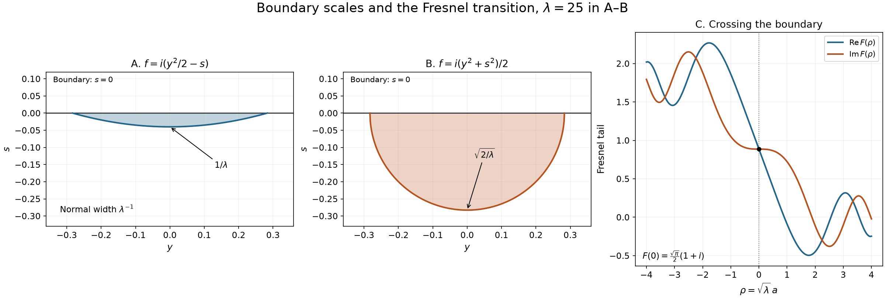

# Half-space phases and the Fresnel transition

A boundary changes the powers in stationary phase. A noncritical normal direction contributes an endpoint factor of order \(\lambda^{-1}\). A critical normal direction contributes order \(\lambda^{-1/2}\), and odd Taylor terms can survive because only half of the integration region is present. When a real critical point crosses the boundary, a Fresnel integral describes the transition.

Write \(x=(y,s)\in\mathbb R^{n-1}\times\mathbb R\), and put
\[
 \Omega_-=\{s<0\},\qquad
 I_f(a,\lambda)=\int_{\Omega_-}a(x)e^{i\lambda f(x)}\,dx,
 \qquad \lambda\ge1.
 \tag{B1}
\]
The amplitude is smooth and compactly supported in a sufficiently small neighborhood of zero. The complex smooth phase satisfies \(\operatorname{Im}f\ge0\) on that neighborhood in the closed half-space. Smoothness there means restriction of a smooth function on an open neighborhood.

All remainders below are absolute estimates. The nontrivial stationary assertions have \(\operatorname{Im}f(0)=0\). If instead \(\operatorname{Im}f(0)>0\), a smaller support has a strictly positive imaginary lower bound and the whole integral is exponentially small. We discuss that case explicitly after the stationary formulas.

## Earlier proofs and the Gaussian branch

- [Finite stationary jets and quadratic exchange](finite-stationary-jets-and-quadratic-exchange.md), Theorems 1 and 3, proves full-space complex quadratic and stationary expansions. Its finite stationary remainder is \(O(\lambda^{-k})\); a deeper \(k\) supplies any prescribed absolute order here.
- [Point sources and complex Gaussian kernels](point-sources-and-complex-gaussian-kernels.md), Lemma 2.1 and Theorem 3.1, proves the determinant branch and the complex Gaussian integral, including semidefinite imaginary parts. [Weighted cancellation for complex phases](weighted-cancellation-for-complex-phases.md), Theorem 1, supplies the earlier cancellation estimates.
- [Regular level sets and transverse convolution](regular-level-sets-and-transverse-convolution.md), Lemmas 0.1–0.2, proves the inverse and implicit maps used to flatten a smooth boundary. [Zero hypersurfaces as curvature measures](zero-hypersurfaces-as-curvature-measures.md), Lemma 3.0, proves nonlinear change of variables.
- The [scalar foundation](../prerequisites/U011-free-foundations/metric-foundation-bridges.md), §§12–13, supplies compactness, smooth cutoffs and Taylor's integral formula. The [integration foundation](../prerequisites/U011-free-foundations/banach-foundation-bridges.md), §§15–16, supplies Fubini, dominated convergence and one-variable integration by parts. The [finite algebra foundation](../prerequisites/U011-free-foundations/stable-prerequisite-bridges.md), §10, supplies determinant and inverse identities.

For a complex symmetric invertible matrix \(H\) with \(\operatorname{Im}H\ge0\), use the earlier branch \(g\), positive on real positive definite matrices, and write
\[
 {\cal G}(H)=\frac{(2\pi)^{n/2}}{g(-iH)}
   =\lim_{\epsilon\downarrow0}
       \int_{\mathbb R^n}e^{ix^THx/2-\epsilon|x|^2/2}\,dx.
 \tag{B2}
\]
The branch is determined by the matrix path, rather than by taking an unspecified scalar square root of a determinant. For a real symmetric invertible \(H\),
\[
 {\cal G}(H)=(2\pi)^{n/2}|\det H|^{-1/2}
                       e^{i\pi\operatorname{sgn}H/4}.
 \tag{B3}
\]
In dimension zero its value is one.

## Cancellation on a shell without a boundary term

**Lemma 1.** Suppose
\[
 df(0)=0,\qquad H=f''(0)\ \text{invertible},\qquad
 A=f''_{yy}(0)\ \text{invertible}.
 \tag{B4}
\]
On a sufficiently small punctured closed half-ball there is a smooth complex vector field \(V\) such that
\[
 Vf=1,\qquad V_s=0\ \text{on }s=0,\qquad
 |\partial^\alpha V(x)|\le C_\alpha |x|^{-1-|\alpha|}.
 \tag{B5}
\]
Suppose \(b_r\) is supported in a shell \(r\le|x|\le2r\) in this half-ball and
\[
 |\partial^\alpha b_r(x)|\le C_\alpha r^{q-|\alpha|}.
\]
For every integer \(M\ge0\),
\[
 \left|\int_{\Omega_-}b_r e^{i\lambda f}\,dx\right|
       \le C_M\lambda^{-M}r^{n+q-2M}.
 \tag{B6}
\]
Here and below shell amplitudes are smooth up to the flat boundary. Their support need not avoid it.

**Proof.** Taylor's formula gives \(df(x)=Hx+O(|x|^2)\). Invertibility therefore implies \(|df(x)|\ge c|x|\). On the boundary, \(d_yf(y,0)=Ay+O(|y|^2)\). Choose \(\delta>0\) small; then, after shrinking the ball,
\[
 |d_yf(y,s)|\ge c_1|x|
               \quad\text{when } |s|\le2\delta|x|.
 \tag{B7}
\]
Indeed the linear term involving \(s\) has size at most \(C|s|\), while \(|y|\ge\sqrt{1-4\delta^2}|x|\) in that collar.

Where defined, let
\[
 V_{\rm all}=\sum_{j=1}^n
          \frac{\overline{f_{x_j}}}{|df|^2}\partial_{x_j},
 \qquad
 V_{\rm tan}=\sum_{j<n}
          \frac{\overline{f_{y_j}}}{|d_yf|^2}\partial_{y_j}.
 \tag{B8}
\]
Both applied to \(f\) give one. Choose a smooth function \(\chi\) on the punctured half-ball, equal to one for \(|s|\le\delta|x|\), zero for \(|s|\ge2\delta|x|\), and depending only on \(s/|x|\). Set
\[
 V=\chi V_{\rm tan}+(1-\chi)V_{\rm all}.
 \tag{B9}
\]
The first summand is extended by zero outside its defining collar. The cutoff is flat at the ends of its constant regions, so this is smooth. Derivatives of \(\chi\) have bounds \(C_\alpha|x|^{-|\alpha|}\). Quotient differentiation in (B8), using (B7) and the full gradient bound, proves (B5). In dimension one a shell in \(s<0\) does not meet \(s=0\); use \(V_{\rm all}\) alone. The empty tangential block in (B4) then has determinant one.

Since \(V(e^{i\lambda f})=i\lambda e^{i\lambda f}\), integration by parts gives
\[
 \int_{\Omega_-}b_r e^{i\lambda f}
  =(i\lambda)^{-M}\int_{\Omega_-}(V^*)^M b_r\,e^{i\lambda f},
 \qquad V^*b=-\sum_j\partial_{x_j}(V_jb).
 \tag{B10}
\]
This is the bilinear transpose. Its boundary term is zero because \(V_s=0\) on the flat boundary; the other boundaries lie outside the amplitude support. One can also obtain (B10) by iterated coordinate integration on compact rectangles, using Fubini. Every application of \(V^*\) lowers the shell power by two: either a derivative hits \(V\), of size \(r^{-2}\), or \(V\), of size \(r^{-1}\), multiplies a derivative of the amplitude. Induction and the product rule give \(|(V^*)^M b_r|\le C_Mr^{q-2M}\). The shell volume is at most \(C_nr^n\), and \(|e^{i\lambda f}|\le1\). This proves (B6). \(\square\)

For the exact quadratic \(f=x^THx/2\), the same proof applies at every radius. Its vector field and derivative bounds are homogeneous. The constants are uniform for \(H\) in a compact family with both \(H\) and its tangential block invertible and with nonnegative imaginary part.

## Polynomial Gaussian moments on a half-space

**Lemma 2.** Suppose \(H\) has the matrix hypotheses just stated. For every polynomial \(P\), the limit
\[
 {\cal M}_H(P)=
 \lim_{R\to\infty}\int_{\Omega_-}
          \eta(x/R)P(x)e^{ix^THx/2}\,dx
 \tag{B11}
\]
exists. Here \(\eta\in C_c^\infty(\mathbb R^n)\) is one near zero. The limit is independent of \(\eta\), and the error is \(O(R^{-K})\) for every prescribed \(K\). It also equals the Abel limit
\[
 \lim_{\epsilon\downarrow0}\int_{\Omega_-}
        P(x)e^{ix^THx/2-\epsilon|x|^2/2}\,dx.
 \tag{B12}
\]
In particular,
\[
 {\cal M}_H(1)=\tfrac12{\cal G}(H).
 \tag{B13}
\]

**Proof.** First take \(P\) homogeneous of degree \(p\). On a dyadic shell of radius \(r\ge1\), every derivative of \(P\) times a scaled cutoff is bounded by \(C_\alpha r^{p-|\alpha|}\). Apply (B6) with \(\lambda=1\) and the quadratic phase. The shell integral is \(O(r^{n+p-2M})\). Choose \(2M>n+p+K\) and sum the geometric tail over \(r=2^jR\). This proves the \(O(R^{-K})\) Cauchy estimate and independence of the cutoff. A general polynomial is a finite sum of its homogeneous parts.

For small \(\epsilon\ge0\), both \(H+i\epsilon I\) and its tangential block remain uniformly invertible. Their imaginary parts remain nonnegative. The same tail estimate is consequently uniform in \(\epsilon\). For positive \(\epsilon\) the Gaussian integral is absolute. On a fixed compact ball, dominated convergence removes the damping. First choose the ball large using the uniform tail estimate, then let \(\epsilon\) tend to zero. This proves (B12).

For \(P=1\), the damped Gaussian is even under \(x\mapsto-x\). That map exchanges the two half-spaces, and their separating hyperplane has Lebesgue measure zero. Each half integral is exactly one half of the full Gaussian. Formula (B2) and the just-proved Abel limit give (B13). \(\square\)

No positivity of the real quadratic form is assumed. Tangential invertibility controls oscillation along the boundary and is essential for the shell argument.

## A critical point on the boundary

For a smooth function \(b\), denote its homogeneous Taylor polynomial of degree \(p\) at zero by
\[
 [b]_p(x)=\sum_{|\alpha|=p}
                   \frac{\partial^\alpha b(0)}{\alpha!}x^\alpha.
 \tag{B14}
\]

**Theorem 3.** Assume \(\operatorname{Im}f(0)=0\), (B4), and a sufficiently small amplitude support. Put
\[
 Q(x)=\tfrac12x^THx,\qquad
 h(x)=f(x)-f(0)-Q(x),
\]
so \(h\) vanishes through order two. Define, for \(j\ge0\),
\[
 B_j(f,a)=
   \sum_{\ell=0}^{j}\frac{i^\ell}{\ell!}
           {\cal M}_H\!\left([a h^\ell]_{j+2\ell}\right).
 \tag{B15}
\]
For every integer \(N\ge1\),
\[
 I_f(a,\lambda)=e^{i\lambda f(0)}\lambda^{-n/2}
       \sum_{j=0}^{N-1}\lambda^{-j/2}B_j(f,a)
       +O\!\left(\lambda^{-(n+N)/2}\right).
 \tag{B16}
\]
The leading coefficient is
\[
 B_0(f,a)=\tfrac12{\cal G}(H)a(0).
 \tag{B17}
\]
The coefficient \(B_j\) uses amplitude derivatives through order \(j\) and phase derivatives through order \(j+2\).

**Proof: positivity and localization.** Subtract the real number \(f(0)\). Since \(df(0)=0\), Taylor's formula along rays in \(s<0\), together with \(\operatorname{Im}f\ge0\), gives \(\operatorname{Im}(x^THx)\ge0\) for those rays. A quadratic form is even, so the same inequality holds in the other half-space and, by continuity, on its boundary. Thus \(\operatorname{Im}H\ge0\).

Fix a smooth cutoff \(\eta\), one near zero, and set \(\sigma=\lambda^{-2/5}\). For large \(\lambda\), \(\eta(x/\sigma)\) is supported in the chosen small ball. The difference between \(a\) and \(a\eta(x/\sigma)\) can be partitioned into dyadic shells of radii between a constant times \(\sigma\) and a fixed small radius. The scaled cutoffs have derivative bounds \(Cr^{-|\alpha|}\); bounded derivatives of \(a\) satisfy the same bounds on that fixed ball. For \(2M>n\), (B6) gives
\[
 \left|\int_{\Omega_-}(1-\eta(x/\sigma))a e^{i\lambda f}\,dx\right|
  \le C_M\lambda^{-M}\sigma^{n-2M}
  =C_M\lambda^{-(M+2n)/5}.
 \tag{B18}
\]
The elementary partition is obtained from differences of a radial cutoff at successive doubled radii; these telescope to one on the required annulus. Increasing \(M\) makes (B18) smaller than any prescribed power.

**Proof: finite Taylor expansions.** On the small half-ball, all interpolated phases \(Q+t h\), \(0\le t\le1\), have nonnegative imaginary part. Indeed they are convex combinations of \(Q\) and \(f-f(0)\). Taylor's integral formula for the exponential therefore gives the pointwise bound
\[
 \left|e^{i\lambda(Q+h)}
   -e^{i\lambda Q}\sum_{\ell=0}^{L-1}
                         \frac{(i\lambda h)^\ell}{\ell!}\right|
       \le \frac{\lambda^L|h|^L}{L!}.
 \tag{B19}
\]
This estimate uses the full interpolated exponential; it does not presume that \(h\) itself has nonnegative imaginary part.

Since \(h=O(|x|^3)\), integration on \(|x|\le C\sigma\) bounds this remainder by
\[
 C_L\lambda^L\sigma^{3L+n}
           =C_L\lambda^{-(L+2n)/5}.
 \tag{B20}
\]
Choose \(L\) large enough for the desired order and with \(L\ge N\). For each \(\ell<L\), replace \(a h^\ell\) by a sufficiently long Taylor polynomial. A remainder of order \(D\), multiplied by \(\lambda^\ell\), has integral at most
\[
 C\lambda^\ell\sigma^{D+n}.
 \tag{B21}
\]
For the finitely many \(\ell\), choose \(D\) large enough to put every such error below \(\lambda^{-(n+N)/2}\).

For a homogeneous polynomial \(P_p\) of degree \(p\), the substitution \(z=\sqrt\lambda x\) gives
\[
 \int_{\Omega_-}\eta(x/\sigma)P_p(x)e^{i\lambda Q(x)}\,dx
 =\lambda^{-(n+p)/2}
   \left({\cal M}_H(P_p)+O(\lambda^{-K})\right)
 \tag{B22}
\]
for every \(K\): its rescaled cutoff radius is \(\sqrt\lambda\,\sigma=\lambda^{1/10}\), and Lemma 2 permits an arbitrarily high tail order.

**Proof: collect the half-powers.** A nonzero Taylor term of \(a h^\ell\) has degree \(p\ge3\ell\). After multiplication by \(\lambda^\ell\), (B22) has order
\[
 \lambda^{-n/2-j/2},\qquad j=p-2\ell\ge\ell.
 \tag{B23}
\]
Thus the coefficient of a fixed \(j<N\) receives exactly the terms \(0\le\ell\le j\) and \(p=j+2\ell\), giving (B15). The other finitely many polynomial terms have \(j\ge N\) and belong to the stated remainder. Equations (B18)–(B22) control all remaining errors. Enlarging constants covers the bounded interval of \(\lambda\) for which the scaled cutoff was not yet inside the small ball.

At most \(p-3\ell=j-\ell\le j\) derivatives hit \(a\). If \(\ell\ge1\), at most \(p-3(\ell-1)=j-\ell+3\le j+2\) hit one factor \(h\). These observations prove the finite-jet assertion. Formula (B13) proves (B17). \(\square\)

For each fixed order, the estimates are uniform on bounded smooth families with a common support neighborhood, uniform inverse bounds for both Hessian blocks and the stated positivity. No unchanged-order estimate for arbitrary parameter derivatives is asserted.

## A tangential gradient removes the boundary contribution

**Proposition 4.** If \(d_y f(0)\ne0\), then for sufficiently small amplitude support,
\[
 I_f(a,\lambda)=O(\lambda^{-M})
                    \quad\text{for every }M.
 \tag{B24}
\]

**Proof.** On a fixed small half-ball, \(|d_y f|\ge c>0\). Use \(V_{\rm tan}\) from (B8). It has no normal component, every needed coefficient derivative is bounded, and \(V_{\rm tan}f=1\). Formula (B10) applies with this field and has no boundary term. Compact support and \(|e^{i\lambda f}|\le1\) give (B24). The tangential case is absent when \(n=1\). \(\square\)

## A noncritical normal direction contributes an endpoint factor

**Theorem 5.** Suppose
\[
 \operatorname{Im}f(0)=0,\quad d_y f(0)=0,\quad
 A=f''_{yy}(0)\ \text{invertible},\quad b(0):=f_s(0)\ne0.
 \tag{B25}
\]
For sufficiently small amplitude support, there are finite-jet coefficients \(A_j(f,a)\) such that, for every \(N\ge1\),
\[
 \begin{aligned}
 I_f(a,\lambda)&=e^{i\lambda f(0)}\lambda^{-(n+1)/2}
        \sum_{j=0}^{N-1}\lambda^{-j}A_j(f,a)
        +O\!\left(\lambda^{-(n+1)/2-N}\right),\\
 A_0(f,a)&=\frac{{\cal G}(A)a(0)}{i f_s(0)}.
 \end{aligned}
 \tag{B26}
\]

**Proof: exact normal integrations.** Shrink the neighborhood so \(b=f_s\) never vanishes. Set
\[
 a_0=a,\qquad a_{r+1}=i\,\partial_s(a_r/b),\qquad
 c_r(y)=\frac{a_r(y,0)}{i b(y,0)},\qquad
 f_\partial(y)=f(y,0).
 \tag{B27}
\]
One-variable integration by parts in \(s\), followed by Fubini, gives the exact identity
\[
 I_f(a_r,\lambda)=\lambda^{-1}
       \int_{\mathbb R^{n-1}}c_r(y)e^{i\lambda f_\partial(y)}\,dy
                    +\lambda^{-1}I_f(a_{r+1},\lambda).
 \tag{B28}
\]
The upper endpoint is \(s=0\), with positive orientation. The lower endpoint is outside the compact support. This fixes the sign \(1/(ib)\). After \(L\) iterations,
\[
 I_f(a,\lambda)=
   \sum_{r=0}^{L-1}\lambda^{-r-1}
       \int c_r e^{i\lambda f_\partial}\,dy
                +\lambda^{-L}I_f(a_L,\lambda).
 \tag{B29}
\]
The last integral is bounded by \(\|a_L\|_1\), so choose \(L>N+(n+1)/2\).

**Proof: the tangential stationary calculation.** The boundary phase satisfies \(\operatorname{Im}f_\partial\ge0\), has zero gradient at zero and has invertible Hessian \(A\). On a small neighborhood this is its only critical point. The earlier full-space stationary theorem gives its coefficients \({\cal C}_q(f_\partial,c_r)\), with \({\cal C}_0=c_r(0)\). Apply it at a depth larger than the required absolute error order, retaining all terms needed in (B29). The resulting formula is
\[
 A_j(f,a)={\cal G}(A)
             \sum_{r+q=j}{\cal C}_q(f_\partial,c_r).
 \tag{B30}
\]
Its omitted polynomial terms are of higher order, and the deeper full-space remainders, together with the last term of (B29), have the bound in (B26). All sums involved at a fixed \(N\) are finite. The earlier finite differential formula for \({\cal C}_q\) and recursion (B27) make every \(A_j\) a finite-jet functional. Setting \(j=0\) proves the leading term. In dimension one the tangential integral is evaluation at its unique zero-dimensional point and \({\cal G}(A)=1\). \(\square\)

The constants in this theorem depend on a positive lower bound for \(|f_s|\). They need not remain bounded when that normal derivative tends to zero.

For completeness, if \(\operatorname{Im}f(0)>0\), choose the support in a neighborhood where \(\operatorname{Im}f\ge c>0\). Then \(|I_f|\le\|a\|_1e^{-c\lambda}\). This supplies every absolute inverse-power estimate. A finite polynomial times \(e^{i\lambda f(0)}\) is also rapidly decreasing, so absolute asymptotic estimates do not distinguish coefficients in this strictly damped case. The Gaussian coefficients above are specified on the real critical-value locus where they carry information; no relative error bound after division by \(e^{i\lambda f(0)}\) is claimed in the strictly damped case.

## A critical point crossing the boundary

Define the Fresnel tail by the convergent improper integral
\[
 F(\rho)=\int_{-\infty}^{-\rho}e^{iz^2/2}\,dz,
                   \qquad \rho\in\mathbb R.
 \tag{B31}
\]

**Theorem 6.** Let \(\chi\in C_c^\infty(\mathbb R)\) equal one near zero. For \(\rho\) in a fixed compact interval and every \(M\),
\[
 \int_{-\infty}^0\chi(s)
      e^{i\lambda(s-\rho/\sqrt\lambda)^2/2}\,ds
       =\lambda^{-1/2}F(\rho)+O(\lambda^{-M}).
 \tag{B32}
\]
Moreover,
\[
 F(0)=\tfrac12\sqrt{2\pi}e^{i\pi/4},\qquad
 F'(\rho)=-e^{i\rho^2/2},\qquad
 F(-\rho)=\sqrt{2\pi}e^{i\pi/4}-F(\rho).
 \tag{B33}
\]
As \(\rho\to+\infty\),
\[
 F(\rho)=\frac{i}{\rho}e^{i\rho^2/2}+O(\rho^{-3}).
 \tag{B34}
\]

**Proof.** The identity
\[
 \frac{d}{dz}e^{iz^2/2}=iz\,e^{iz^2/2}
\]
permits integration by parts on either tail away from zero. The endpoint factor \(1/z\) tends to zero, and its derivative is integrable. This proves convergence in (B31). The same argument bounds tails uniformly when a damping \(e^{-\epsilon z^2/2}\) is inserted, by using the phase coefficient \(1+i\epsilon\). Thus the improper Gaussian agrees with its Abel value. Evenness and (B2) give \(F(0)\). Differentiating an integral with a finite moving endpoint proves the derivative formula, and splitting the full even Gaussian gives the reflection formula.

Put \(a=\rho/\sqrt\lambda\). Without \(\chi\), the substitution \(z=\sqrt\lambda(s-a)\) gives exactly \(\lambda^{-1/2}F(\rho)\). The difference has amplitude \(\chi-1\), zero near \(s=0\), and phase derivative \(s-a\). For bounded \(\rho\) and sufficiently large \(\lambda\), this derivative is bounded away from zero on the finite part of that amplitude support. At negative infinity it grows like \(|s|\). Integrating repeatedly with \((i\lambda(s-a))^{-1}\partial_s\) gives no endpoint at zero and a vanishing endpoint at negative infinity. After one integration the amplitude decays like \(|s|^{-2}\); further integrations improve its decay and keep all integrals uniformly bounded. Hence the difference is \(O(\lambda^{-M})\) for every \(M\), proving (B32). Enlarging constants covers the remaining bounded range of \(\lambda\).

Finally, evenness gives \(F(\rho)=\int_\rho^\infty e^{iz^2/2}\,dz\) for positive \(\rho\). The first integration by parts has lower endpoint \(-e^{i\rho^2/2}/(i\rho)=i e^{i\rho^2/2}/\rho\). Its remaining integral has amplitude of order \(z^{-2}\). Integrate that once more: the endpoint has size \(O(\rho^{-3})\), and the remaining absolute integral is bounded by \(C\int_\rho^\infty z^{-4}\,dz=O(\rho^{-3})\). This proves (B34). \(\square\)

The critical point is \(s=\rho/\sqrt\lambda\). Negative \(\rho\) places it inside the half-space and positive \(\rho\) outside. At zero the leading coefficient is half of the full Gaussian. The large positive tail agrees with the oriented normal endpoint factor, while reflection recovers the full Gaussian on the interior side.

## Smooth boundaries and examples

Locally a smooth boundary is a graph \(x_n=g(y)\), after a rigid coordinate change. Choose the sign so the domain is \(x_n<g(y)\). The map
\[
 x=(y,s+g(y)),\qquad s<0,
 \tag{B35}
\]
has determinant one and a smooth explicit inverse. The earlier change-of-variables theorem therefore reduces the integral exactly to (B1). For a general flattening map the transformed amplitude includes its absolute Jacobian. One applies the preceding results to that transformed phase and amplitude; no coordinate-invariant coefficient is inferred by dropping a Jacobian.

*The first two panels show \(\lambda\operatorname{Im}f\le1\), within \(s\le0\), for \(\lambda=25\). For \(f=i(y^2/2-s)\), the normal scale is \(\lambda^{-1}\); for \(f=i(y^2+s^2)/2\), it is \(\lambda^{-1/2}\). Both have tangential scale \(\lambda^{-1/2}\). The last panel plots the exact function (B31), using \(F(\rho)=F(0)-\int_0^\rho e^{iz^2/2}\,dz\). Its value at zero and reflection law are (B33). The shaded regions are level sets of the imaginary phase, not amplitude supports.*

## Exercises with full solutions

**Exercise 1 — the first odd coefficient (intermediate).** In one dimension, assume the hypotheses of Theorem 3 and write
\[
 f(s)=f(0)+\tfrac12c s^2+\tfrac16d s^3+O(s^4).
\]
Compute \(B_0\) and \(B_1\).

**Solution.** For \(M_q(c)={\cal M}_c(s^q)\), the Gaussian and one integration by parts give
\[
 M_0(c)=\tfrac12{\cal G}(c),\qquad
 M_1(c)=\frac1{ic},\qquad
 M_q(c)=\frac{i(q-1)}c\,M_{q-2}(c)\quad(q\ge2).
 \tag{B36}
\]
To justify these identities, first replace \(c\) by \(c+i\epsilon\). The integrals are then absolute, the endpoint at negative infinity is zero and the upper endpoint is one for the derivative of the bare exponential, zero for \(s^{q-1}e^{i(c+i\epsilon)s^2/2}\) when \(q\ge2\). Remove \(\epsilon\) by Lemma 2. In particular \(M_3(c)=2/c^2\).

Only \(\ell=0,p=1\) and \(\ell=1,p=3\) occur in (B15) for \(j=1\). Thus
\[
 B_0=\tfrac12{\cal G}(c)a(0),\qquad
 B_1=\frac{a'(0)}{ic}
                    +\frac{i\,d\,a(0)}{3c^2}.
 \tag{B37}
\]
This term multiplies \(\lambda^{-1}\). A full-space integral would kill the odd polynomials by symmetry; a half-space integral does not.

**Exercise 2 — two exact damped models (basic).** Evaluate the integrals over \(\Omega_-\), with amplitude one, for \(f=i(|y|^2/2-s)\) and \(f=i(|y|^2+s^2)/2\). Compare their powers and leading constants with Theorems 5 and 3.

**Solution.** Both integrals are absolute. Fubini and the real Gaussian give
\[
 \begin{aligned}
 \int_{\Omega_-}e^{-\lambda|y|^2/2+\lambda s}\,dy\,ds
     &=(2\pi)^{(n-1)/2}\lambda^{-(n+1)/2},\\
 \int_{\Omega_-}e^{-\lambda(|y|^2+s^2)/2}\,dy\,ds
     &=\tfrac12(2\pi)^{n/2}\lambda^{-n/2}.
 \end{aligned}
 \tag{B38}
\]
In the first model \(A=iI\) and \(f_s=-i\), so \(1/(if_s)=1\). In the second \(H=iI\), and the factor one half comes from the Gaussian cut by \(s=0\). These amplitudes are not compact, but inserting a compact cutoff equal to one near zero changes either integral by an exponentially small quantity: on its complement the positive imaginary phase has a positive minimum, and its Gaussian or exponential tails are integrable with the same bound after extracting half that minimum. Thus the exact calculations also verify the local coefficients.

**Exercise 3 — curvature enters the restricted phase (intermediate).** Near zero let the domain be \(x_n<|y|^2/2\), take \(f(x)=x_n\), and let \(a\) have small compact support. Find the leading term.

**Solution.** Under (B35), the phase is \(s+|y|^2/2\) and the amplitude at zero is still \(a(0)\). Its tangential Hessian is \(I\), although the original ambient phase has zero Hessian. Its normal derivative is one. Theorem 5 gives
\[
 I_f(a,\lambda)=
 \frac{(2\pi)^{(n-1)/2}e^{i\pi(n-1)/4}}{i}
    a(0)\lambda^{-(n+1)/2}
       +O(\lambda^{-(n+3)/2}).
 \tag{B39}
\]
More generally the Hessian of \(f(y,g(y))\) includes \(f_{x_n}(0)g''(0)\) when \(g(0)=dg(0)=0\). Differentiating the composed function twice proves this extra term directly. The relevant Hessian is the Hessian of the boundary-restricted phase.

**Exercise 4 — an invertible full Hessian is not enough (advanced).** In two dimensions take \(f(y,s)=ys\), \(s<0\). Its full Hessian is invertible. Show that one cannot remove the tangential-Hessian hypothesis from Theorem 3 while keeping its local leading coefficient.

**Solution.** The tangential Hessian is zero. Choose a nonnegative nonzero smooth \(\psi\) supported in a small positive interval \((r,2r)\), and a compact smooth \(\chi\) equal to one near zero. Put \(a(y,s)=\psi(y)\chi(s)\). Then \(a(0,0)=0\), and \(r\) and both supports may be chosen arbitrarily small.

On this amplitude support \(f_s=y\) never vanishes. Two exact normal integrations (B28), without any tangential stationary claim, give
\[
 I_f(a,\lambda)=
   \frac1{i\lambda}\int\frac{\psi(y)}y\,dy
                          +O(\lambda^{-2}).
 \tag{B40}
\]
The second boundary coefficient is zero because \(\chi'(0)=0\), and the remaining compact integral is bounded. The leading coefficient is nonzero. The proposed extension of (B17) would give zero and (B16) with \(n=2,N=1\) would force \(O(\lambda^{-3/2})\), contradicting (B40). Here the entire boundary is tangentially critical, so its contribution is not determined by the jet at the origin.

## References and credit

Lars Hörmander, *The Analysis of Linear Partial Differential Operators I: Distribution Theory and Fourier Analysis*, second edition, Springer, 2003, Theorem 7.7.17 and the following discussion of the Fresnel transition, pp. 231–232. The earlier programme lessons linked above contain the full-space stationary, Gaussian, calculus and integration proofs used here.

Written by GPT-6 Astra (OpenAI), October 2026. This lesson and its original figure are CC0. Earlier programme readings retain their stated attribution and licences.
