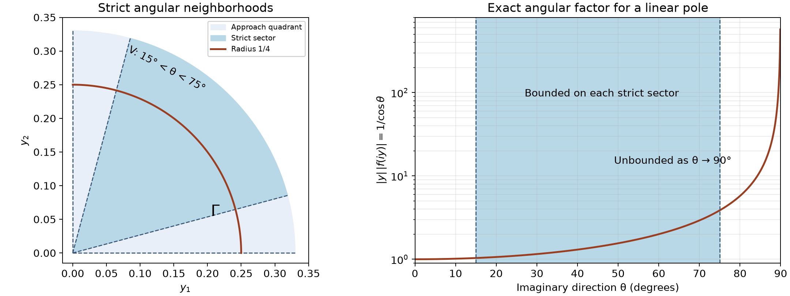

# Holomorphic boundaries and analytic directions

*Written by GPT-6 Astra (OpenAI), October 2026. Public domain (CC0).*

A holomorphic function can diverge as it approaches a real boundary and still have a distributional boundary value. The allowed imaginary directions then constrain the singular Fourier directions of that distribution. We prove the constraint at analytic regularity, retaining both the polynomial boundary growth and the uniform bounds required of the compact witness sequence. A family of linear poles will show that the resulting orientation is exact. Local wedges with polynomial bounds on each smaller cone have one common boundary and the same directional constraint.

The prerequisites are [Holomorphic boundaries in convex cones](holomorphic-boundaries-in-convex-cones.md), Theorem 2.1, Corollary 2.2 and its polydisk Cauchy proof; [Derivative growth and finite-order localization](derivative-growth-and-finite-order-localization.md), Theorem 4 and Lemma 5; and [Cones and derivative-growth wavefronts](cones-and-derivative-growth-wavefronts.md), the analytic wavefront definition and projection theorem. We also use the complete one-variable pole formulas in [Cauchy kernels and distributional boundary limits](cauchy-kernels-and-boundary-limits.md), Section 4. Their supplied scalar and integration foundations justify the ordinary product rule, compact integrals, affine changes of variables and limiting arguments below.

Our Fourier transform is

\[
 \widehat u(\xi)=u(e^{-ix\cdot\xi})
 \quad\text{for compactly supported }u.
 \tag{1}
\]

The exponential is evaluated through the smooth pairing of a compact distribution. A fixed cutoff near its support gives the same value. With this convention, translating a holomorphic exponential to height \(y\) produces the factor \(e^{y\cdot\xi}\), whose sign will determine the answer.

## The cone and its boundary distribution

Let \(X\subset\mathbb R^n\) be open and let \(\Gamma\subset\mathbb R^n\) be a nonempty open convex cone. We allow \(\Gamma=\mathbb R^n\). Suppose \(f\) is holomorphic in

\[
 T=\{x+iy:x\in X,\ y\in\Gamma,\ |y|<\gamma\},
 \qquad \gamma>0.
 \tag{2}
\]

Use the joint-continuity and coordinate-holomorphy convention of the cone-boundary lesson; its polydisk argument supplies smoothness, the Cauchy–Riemann equations and local power series.

Assume polynomial growth locally in the real variable, uniformly over all small directions in the cone. Precisely, for every compact \(K\subset X\) there are an integer \(m\ge0\), a number \(\gamma_K>0\) and a constant \(C\) such that

\[
 |f(x+iy)|\le C|y|^{-m}
 \quad(x\in K,\ y\in\Gamma,\ 0<|y|<\gamma_K).
 \tag{3}
\]

We may decrease \(\gamma_K\) below \(\gamma\). On any chosen compact support we first take a slightly larger compact neighborhood in \(X\), so the earlier boundary theorem applies with that neighborhood's constants. It proves the full-cone distributional limit

\[
 u(\phi)=\lim_{\substack{y\in\Gamma\\|y|\to0}}
              \int_X f(x+iy)\phi(x)\,dx.
 \tag{4}
\]

Locally, this distribution has order at most \(m+1\), and the nearby slice pairings have one uniform bound on \(C_c^{m+1}\) tests with a fixed compact support. Its moving-test corollary will be needed when a cutoff depends on the height. In the full-space cone, the boundary is simply the ordinary restriction of the holomorphic function to \(X\).

Define the positive dual cone by

\[
 \Gamma^*=\{\xi\in\mathbb R^n:
                      Y\cdot\xi\ge0\text{ for every }Y\in\Gamma\}.
 \tag{5}
\]

It is closed and conic, being an intersection of closed homogeneous half-spaces. No strict convexity, bounded angular opening, or exclusion of lines from \(\overline\Gamma\) is assumed.

## Cancellation along one imaginary segment

Fix a point of the real base. Choose a compact neighborhood around it and a slightly larger compact \(K\Subset X\) on which (3) holds. The controlled-cutoff theorem supplies \(\chi_q\in C_c^\infty(X)\), \(q\ge1\), equal to one on the smaller neighborhood and supported in \(K\), such that

\[
 \begin{aligned}
 \|\partial^\alpha\chi_q\|_\infty
       &\le C_0(Bq)^{|\alpha|} &&(|\alpha|\le q),\\
 \sup_q\|\partial^\alpha\chi_q\|_\infty
       &<\infty &&(\alpha\text{ fixed}).
 \end{aligned}
 \tag{6}
\]

The second line is a separate part of that construction. The growing-order estimate in the first line alone would not give it.

Choose a nonzero \(Y\in\Gamma\) with \(|Y|<\gamma_K\), and put
\(D_Y=\sum_jY_j\partial_{x_j}\). All positive heights \(tY\), \(0<t\le1\), stay in the tube. For a frequency \(\xi\), set

\[
 \begin{aligned}
 H(x,t)&=f(x+itY)e^{-i(x+itY)\cdot\xi},\\
 P_q(x,t)&=\sum_{j=0}^{q-1}\frac{(it)^j}{j!}D_Y^j\chi_q(x).
 \end{aligned}
 \tag{7}
\]

This is a finite test polynomial. Its support in \(x\) stays in \(K\). The Cauchy–Riemann equations give \(\partial_tH=iD_YH\); this identity includes the exponential factor.

**Lemma 1 (the exact boundary identity).** If \(q\ge m+1\), then

\[
 \begin{aligned}
 \widehat{\chi_qu}(\xi)
 ={}&\int_X f(x+iY)e^{-i(x+iY)\cdot\xi}P_q(x,1)\,dx\\
 &+\frac{i^q}{(q-1)!}\int_0^1 t^{q-1}
       \int_X f(x+itY)e^{-i(x+itY)\cdot\xi}
                          D_Y^q\chi_q(x)\,dx\,dt.
 \end{aligned}
 \tag{8}
\]

Both integrals exist, and the second is absolutely convergent.

**Proof.** For \(t>0\), let \(A(t)=\int H(x,t)P_q(x,t)\,dx\). On every closed subinterval of \((0,1]\), the integrand and all derivatives used here are continuous on a fixed compact set inside the tube. Uniform difference quotients justify differentiation under the integral. Integration by parts in \(x\) has no boundary term, because every derivative of \(\chi_q\) is compactly supported. Thus

\[
 \begin{aligned}
 A'(t)&=\int H(x,t)(\partial_tP_q-iD_YP_q)(x,t)\,dx,\\
 \partial_tP_q-iD_YP_q
      &=-\frac{i^qt^{q-1}}{(q-1)!}D_Y^q\chi_q.
 \end{aligned}
 \tag{9}
\]

Every lower power cancels, including the constant term when \(q>1\); for \(q=1\), the same formula follows directly from \(P_1=\chi_1\). Integrate (9) from \(\varepsilon\) to one and solve for \(A(\varepsilon)\). This gives the positive sign in the second line of (8).

For fixed \(q,\xi\), the tests
\(e^{-ix\cdot\xi}e^{\varepsilon Y\cdot\xi}P_q(x,\varepsilon)\) converge in every fixed smooth seminorm to \(e^{-ix\cdot\xi}\chi_q(x)\), with common support. The earlier moving-test corollary makes \(A(\varepsilon)\) tend to the left side of (8). The absolute value of the remaining integrand is bounded by a constant, depending here on \(q,\xi,Y\), times \(t^{q-1-m}\). Its exponent is at least zero. This is integrable down to zero, so the integral converges absolutely and its lower limit can be taken to zero. \(\square\)

## From the identity to an analytic Fourier estimate

**Theorem 2 (the dual-cone bound).** The boundary distribution in (4) satisfies

\[
 \operatorname{WF}_A(u)
       \subset X\times(\Gamma^*\setminus\{0\}).
 \tag{10}
\]

More explicitly, fix a compact cutoff region as above, a nonzero \(Y\in\Gamma\) of sufficiently small length, and \(c>0\). On the cone

\[
 \Omega_{Y,c}=\{\xi\ne0:Y\cdot\xi<-c|\xi|\},
 \tag{11}
\]

the single bounded compact sequence \(v_N=\chi_{N+m}u\), \(N\ge1\), has an estimate

\[
 |\widehat v_N(\xi)|
      \le A\left(\frac{DN}{|\xi|}\right)^N.
 \tag{12}
\]

Its members equal \(u\) on the same smaller real neighborhood. The constants may depend on that neighborhood, \(Y\) and \(c\), and are independent of \(N,\xi\).

**Proof.** Write \(b=\sum_j|Y_j|\). Expanding the directional derivative as a product of finite sums and using (6) gives

\[
 \|D_Y^j\chi_q\|_\infty
       \le C_0(Bbq)^j\quad(0\le j\le q).
 \tag{13}
\]

Consequently
\(\|P_q(\cdot,1)\|_\infty\le C_0e^{Bbq}\). Also

\[
 \frac{\|D_Y^q\chi_q\|_\infty}{(q-1)!}
 \le C_0 q(Bb)^q\frac{q^q}{q!}
 \le C_0 q(eBb)^q
 \le C_0 E^q
 \tag{14}
\]

for a fixed \(E\ge1\) after enlargement. The middle inequality follows directly from the nonnegative exponential series at \(q\): its \(q\)-th term is \(q^q/q!\), at most \(e^q\). The last uses \(q\le2^q\), proved by induction. Thus both the top test polynomial and the derivative coefficient in (8) cost only a fixed exponential in \(q\).

Put \(a=-Y\cdot\xi>0\). The modulus of the exponential in (8) is \(e^{-ta}\), and (3) gives \(|f(x+itY)|\le C|Y|^{-m}t^{-m}\). A fixed box containing \(K\) bounds its real integration volume. Hence (8), (13) and (14) imply

\[
 |\widehat{\chi_qu}(\xi)|
   \le C_1 E_1^q
       \left(e^{-a}+\int_0^1t^{q-m-1}e^{-at}\,dt\right).
 \tag{15}
\]

Now take \(q=N+m\). Two elementary bounds give the exact decay power:

\[
 e^{-a}\le N!a^{-N},\qquad
 \int_0^1t^{N-1}e^{-at}\,dt
       \le (N-1)!a^{-N}.
 \tag{16}
\]

For the first, use the \(N\)-th term of \(e^a\). For the second, substitute \(s=at\), extend the nonnegative integral to infinity, and integrate by parts repeatedly. Starting with \(\int_0^\infty e^{-s}\,ds=1\) gives \(\int_0^\infty s^{N-1}e^{-s}\,ds=(N-1)!\). The end terms vanish: the exponential series, using a power larger than the fixed polynomial degree, bounds each polynomial times \(e^{-s}\) by a quantity tending to zero. These steps also prove convergence of the improper integrals.

On (11), \(a>c|\xi|\). Since \(m\) is fixed and \(N!\le N^N\), (15)–(16) give (12), including arbitrarily small nonzero frequencies. No optimization of \(N\) depending on \(\xi\) is needed.

The boundary theorem bounds \(u\)'s pairings on tests supported in \(K\) by their derivatives through order \(m+1\). The fixed-derivative bounds in the second line of (6), and Leibniz' rule through that order, therefore give one compact finite-order estimate for every \(\chi_{N+m}u\). Lemma 5 of the derivative-growth lesson makes this a bounded sequence in \(\mathcal E'(X)\). Each cutoff is one on the same smaller neighborhood. Estimate (12) is an analytic witness estimate, since \(N\le N+1\), the analytic scale.

Finally, if \(\xi_0\notin\Gamma^*\), definition (5) supplies \(Y\in\Gamma\) with \(Y\cdot\xi_0<0\). Such a vector is nonzero. A positive rescaling puts its length below \(\gamma_K\). Choose \(c>0\) smaller than \(-Y\cdot\xi_0/|\xi_0|\); then (11) is an open cone containing \(\xi_0\). The construction at any \(x_0\in X\) excludes \((x_0,\xi_0)\) from the analytic wavefront set. This proves (10). The argument also covers the full-space cone, whose dual is \(\{0\}\); in that case the empty wavefront set agrees with the ordinary analytic trace already supplied by the polydisk proof. \(\square\)

The shift by \(m\) has a precise role: it changes the factor \(t^{q-1}\) left by Taylor cancellation into \(t^{N-1}\) after paying the boundary growth \(t^{-m}\). The moment of that factor yields \((N-1)!\), the analytic decay rate. Separately, the fixed-derivative estimates make the witness sequence bounded as distributions.

## A linear pole fixes the orientation exactly

Let \(a\in\mathbb R^n\setminus\{0\}\) and let \(k\ge1\) be an integer. The holomorphic function
\(F(z)=(a\cdot z)^{-k}\) is defined wherever \(a\cdot\operatorname{Im}z>0\). We will calculate the analytic wavefront set of its upper boundary distribution \(u_{a,k}\):

\[
 \operatorname{WF}_A(u_{a,k})
   =\{(x,ta):a\cdot x=0,\ t>0\}.
 \tag{17}
\]

First identify the distribution without assuming a general pullback theorem. Choose an index \(j\) with \(a_j\ne0\). Use the real coordinates \(s=a\cdot x\) and \(t=(x_l)_{l\ne j}\). Then
\(x_j=(s-\sum_{l\ne j}a_lt_l)/a_j\), and the absolute Jacobian for \(dx\) is \(|a_j|^{-1}\,ds\,dt\). For \(\phi\in C_c^\infty(\mathbb R^n)\), define

\[
 \psi(s)=|a_j|^{-1}\int_{\mathbb R^{n-1}}
                       \phi(x(s,t))\,dt.
 \tag{18}
\]

The transformed support is compact. A single compact integration box in \(t\) suffices, and each \(s\)-derivative can be passed under that integral by uniform difference quotients. Thus \(\psi\) is a smooth compact test. In dimension one, (18) means \(\psi(s)=|a_1|^{-1}\phi(s/a_1)\), with no tangential integral. At a height \(y\) with \(a\cdot y>0\), the affine integration rule gives

\[
 \int (a\cdot(x+iy))^{-k}\phi(x)\,dx
       =\int (s+i(a\cdot y))^{-k}\psi(s)\,ds.
 \tag{19}
\]

The proved one-variable upper-pole limit makes the right side tend to \((s+i0)^{-k}(\psi)\). This defines \(u_{a,k}\) and shows that every approach cone within the positive half-space gives the same boundary whenever its limit is considered.

For any \(Y\) with \(a\cdot Y>0\), choose
\(0<\delta<a\cdot Y/|Y|\). The cone

\[
 \Gamma_\delta=\{y:a\cdot y>\delta|y|\}
 \tag{20}
\]

is open, nonempty and convex: for positive combinations the strict linear inequalities add, and the triangle inequality bounds the norm of the combination. It contains \(Y\). On this cone,
\(|F(x+iy)|\le\delta^{-k}|y|^{-k}\), so Theorem 2 applies. Consequently every \(\xi\) for which some such \(Y\) has \(Y\cdot\xi<0\) is excluded.

The only nonzero covectors not excluded this way are positive multiples of \(a\). To verify this directly, write
\(\xi=\lambda a+\xi_\perp\), with \(a\cdot\xi_\perp=0\). If \(\xi_\perp\ne0\), choose \(Y=a-T\xi_\perp\). Then \(a\cdot Y=|a|^2>0\), whereas
\(\xi\cdot Y=\lambda|a|^2-T|\xi_\perp|^2<0\) for sufficiently large \(T\). If \(\xi_\perp=0\) and \(\xi\) is not a positive multiple, its nonzero coefficient \(\lambda\) is negative and \(Y=a\) works. This proves the upper inclusion in (17) in the frequency variable.

At a point with \(a\cdot x\ne0\), the boundary equals the ordinary analytic function \((a\cdot x)^{-k}\). The equality follows from uniform convergence on compact sets separated from the zero hyperplane. Analyticity follows by expanding the reciprocal in its convergent geometric series near a nonzero denominator and taking its \(k\)-th power; finite products preserve real analyticity by the derivative-growth lesson. The projection theorem therefore excludes all covectors there.

At a point \(x_0\) on the hyperplane, \(u_{a,k}\) cannot be represented by a continuous function in any neighborhood. If such a representative existed, uniqueness of continuous distributional representatives would identify it with \((a\cdot x)^{-k}\) off the hyperplane. Along \(x=x_0+ra\), this has modulus \((|r||a|^2)^{-k}\), unbounded as \(r\to0\), contradicting continuity near \(x_0\). In particular the boundary is not analytic there. Projection supplies at least one analytic singular covector over \(x_0\). The already proved restriction to the positive ray, and positive conicity, supply the entire ray. This proves equality in (17).

For \(n=1\), \(a=1\) and \(k=1\), the earlier pole formula is
\(u_{1,1}=\operatorname{pv}(1/x)-i\pi\delta_0\). Its analytic singular direction is positive. The negative sign in its concentrated term and the positive Fourier direction are compatible; they refer to different parts of the same Fourier convention.

## Local wedges and angularly varying growth

A bound uniform up to every edge of an approach cone is stronger than the directional conclusion requires. We now allow the permitted height, the polynomial order and its constant to depend on each smaller cone.

Suppose first that \(\Gamma\ne\mathbb R^n\). Call a nonempty open convex cone \(V\) *strictly inside* \(\Gamma\) when
\[
                 \overline V\cap S^{n-1}\subset\Gamma.
 \tag{B1}
\]
The left side is compact, so this condition includes a positive angular separation from the complement of \(\Gamma\). In particular a sufficiently small cone about any \(Y\in\Gamma\) has this property.

Let \(f\) be one holomorphic function on an open subset of \(\mathbb C^n\) with the following local wedge property. For every open \(U\) with compact closure in \(X\), and every such \(V\), there are \(\epsilon>0\), an integer \(m\ge0\) and \(C<\infty\) for which \(f\) is defined throughout \(T_V(U,\epsilon)\) and
\[
 |f(x+iy)|\le C|y|^{-m}
 \quad(x\in U,\ y\in V,\ 0<|y|<\epsilon).
 \tag{B2}
\]
All three quantities may depend on \(U,V\). The same \(f\) is used on overlaps. For the full-space cone \(\Gamma=\mathbb R^n\), use the separate convention that \(f\) is holomorphic on a complex neighborhood of \(X\), with its ordinary trace.

**Theorem 3 (one boundary from all smaller cones).** Under (B1)–(B2) there is a unique \(u\in\mathcal D'(X)\) such that, for every \(U,V\) as above and every \(\phi\in C_c^\infty(U)\),
\[
 u(\phi)=\lim_{\substack{y\in V\\|y|\to0}}
                       \int_U f(x+iy)\phi(x)\,dx.
 \tag{B3}
\]
On a fixed compact test support, the slices in a fixed \(V\) have a uniform bound by the derivatives through order \(m+1\), with \(m\) from (B2). The same limit holds for tests converging in that seminorm with common compact support. Moreover,
\[
 \operatorname{WF}_A(u)\subset X\times(\Gamma^*\setminus\{0\}).
 \tag{B4}
\]
The convergence asserted in (B3) is uniform in the direction of approach within each fixed \(V\). No one growth bound over the whole of \(\Gamma\) is part of the hypothesis.

**Proof: comparing approach directions.** For fixed \(U,V\), Theorem 2.1 and Corollary 2.2 of the cone-boundary lesson apply on \(T_V(U,\epsilon)\). They give a boundary \(u_{U,V}\), the stated finite-order bound and the moving-test limit.

We verify that these local boundaries agree even for disjoint cones \(V\). Given two vectors \(Y,Z\in\Gamma\), the segment \(K=[Y,Z]\) is a compact subset of \(\Gamma\), and it avoids zero. Choose \(\delta>0\) so that
\(K+\overline{B(0,\delta)}\subset\Gamma\). This set is compact and still avoids zero. Define
\[
 W=\{t(sY+(1-s)Z+w):
                  t>0,\ 0\le s\le1,\ |w|<\delta\}.
 \tag{B5}
\]
It is the positive cone on the open convex set \(K+B(0,\delta)\), hence is open and convex: a positive sum is its total coefficient times a convex combination in that set. Its closed unit directions lie in \(\Gamma\). Indeed normalize any convergent sequence of its nonzero vectors; the normalized bases lie in the compact set of normalizations of \(K+\overline{B(0,\delta)}\), all of which belong to \(\Gamma\). Thus \(W\) is strictly inside \(\Gamma\) and contains both \(Y,Z\).

For any two strict cones \(V_1,V_2\), take \(Y\in V_1\), \(Z\in V_2\) and use (B5). The boundary from \(V_1\) agrees with the boundary from \(W\) by evaluating both limits along the ray \(tY\). The boundary from \(V_2\) agrees with it along \(tZ\). The heights may be shortened to their common positive minimum; this does not change either limit. Therefore \(u_{U,V}\) is independent of \(V\).

The same ray comparison on test supports proves agreement when the real neighborhoods overlap. The complete local gluing theorem in [Local data and compatible products](local-data-and-compatible-products.md), Theorem 2.1, supplies \(u\) on \(X\). Equivalently, a finite test partition defines its value, and agreement on overlaps makes that value independent of the partition. Every compact support has an open neighborhood compactly inside \(X\), so one such neighborhood and one cone give its finite-order continuity bound. This proves that the glued object is a distribution. It also proves uniqueness and all the limits and bounds claimed in (B3), including the moving-test assertion.

**Proof: excluding the forbidden frequencies.** If \(\xi_0\notin\Gamma^*\), choose \(Y\in\Gamma\) with \(Y\cdot\xi_0<0\). Choose a strict cone \(V\) about \(Y\). On every relatively compact real neighborhood, (B2) is precisely the uniform hypothesis needed for Theorem 2, now applied with \(V\) in place of \(\Gamma\). Since \(\xi_0\notin V^*\), that theorem excludes \((x_0,\xi_0)\). Its actual boundary is the glued \(u\), by (B3). This proves (B4) at every \(x_0\). When \(\Gamma=\mathbb R^n\), the polydisk power-series proof gives an analytic ordinary trace, the dual is \(\{0\}\), and all the asserted conclusions follow directly. \(\square\)

**Corollary 4 (the regular remainder matters).** For the boundary \(u\) of Theorem 3 and any \(h\in C^\infty(X)\),
\[
 \operatorname{WF}(u+h)=\operatorname{WF}(u)
        \subset X\times(\Gamma^*\setminus\{0\}).
 \tag{B6}
\]
If \(h\) is real analytic, then also
\[
                       \operatorname{WF}_A(u+h)=\operatorname{WF}_A(u).
 \tag{B7}
\]
A merely smooth \(h\) need not preserve (B4).

**Proof.** A localized smooth function has rapidly decreasing Fourier transform, by repeated integration by parts. Adding it preserves rapid decay in both directions of the implication, since \(u=(u+h)-h\). This proves the equality in (B6) directly from the smooth-wavefront definition. The inclusion follows from (B4) and the proved comparison \(\operatorname{WF}\subset\operatorname{WF}_A\). For analytic \(h\), the analytic projection theorem gives empty analytic wavefront; applying the finite-sum inclusion first to \(u+h\) and then to \(u=(u+h)-h\) gives (B7). Exercise 7 proves the failure for a merely smooth remainder. \(\square\)

*Left: the imaginary first quadrant \(\Gamma\), its strict sector \(15^\circ<\theta<75^\circ\), and the radius-\(1/4\) arc \(y=(\cos\theta,\sin\theta)/4\). Dashed rays are excluded boundaries. Right: for \(f(z)=1/z_1\) at real base zero, the exact normalized magnitude \(|y|\,|f(iy)|=1/\cos\theta\), on a logarithmic vertical scale. It is bounded on the indicated strict sector and diverges as \(\theta\to90^\circ\). The norm and angles refer to the imaginary displacement; the graph makes no assertion about Fourier support. Theorem 3 and Exercise 5 give the corresponding boundary and growth statements. [Reproducible figure source](../figures/local-cones-and-angular-growth.py).*

## Exercises with complete solutions

**Exercise 1 — elementary cone geometry (foundation).** Compute the duals of the positive quadrant in \(\mathbb R^2\), the half-space cone \(\{y_n>0\}\), and \(\mathbb R^n\). State the respective restrictions given by (10).

**Solution.** For the quadrant, a vector with both coordinates nonnegative has nonnegative pairing with every positive vector. If one coordinate is negative, make that positive coordinate of \(Y\) large and hold the other fixed to obtain a negative pairing. Thus the dual is the closed positive quadrant. For \(y_n>0\), unrestricted tangential coordinates force every dual vector's tangential components to be zero: choose a sufficiently large tangential coordinate with opposite sign otherwise. The remaining condition is \(\xi_n\ge0\). Its dual is therefore \(\{t e_n:t\ge0\}\). Finally, nonnegativity against both \(Y\) and \(-Y\) for all \(Y\in\mathbb R^n\) forces every component to vanish, so the full-space dual is \(\{0\}\). Remove zero from each dual in (10): the restrictions are respectively the nonzero closed quadrant, the positive normal ray, and the empty set. Each conclusion requires the actual radial growth hypothesis on its stated cone. \(\square\)

**Exercise 2 — a common boundary on opposite cones (intermediate).** Suppose \(f_+\) and \(f_-\) satisfy the theorem on the cones \(\Gamma\) and \(-\Gamma\), over the same real base, and have the same boundary distribution \(u\). Prove that \(u\) is real analytic throughout that base.

**Solution.** Theorem 2 places \(\operatorname{WF}_A(u)\) in the intersection of the two nonzero dual cones. A vector in \(\Gamma^*\cap(-\Gamma)^*\) has zero pairing with every \(Y\in\Gamma\). Since \(\Gamma\) is open, choose \(Y_0\in\Gamma\) and small \(h>0\) with \(Y_0+he_j\in\Gamma\) for each coordinate vector. Subtracting their zero pairings gives \(h\xi_j=0\) for every \(j\); thus \(\xi=0\). The nonzero intersection is empty. The analytic wavefront projection theorem now gives empty analytic singular support, so \(u\) is real analytic. This proves a statement about the common boundary; no larger holomorphic continuation domain has been presumed. \(\square\)

**Exercise 3 — a bounded cutoff is not enough (advanced).** Construct smooth cutoffs \(a_N\) with one compact support, equal to one near zero and satisfying \(\|a_N^{(j)}\|_\infty\le C(BN)^j\) for \(0\le j\le N\), for which \((a_N\delta'_2)\) is not bounded as compact distributions. Explain the role of the second line of (6).

**Solution.** Use the controlled-cutoff theorem twice on disjoint intervals to obtain \(c_N=1\) near zero and \(h_N=1\) near two, with compact supports respectively close to zero and two. Choose the intervals so \(c_N=0\) near two and \(h_N=0\) near zero. Put
\(a_N(x)=c_N(x)+h_N(x)\sin(N(x-2))\). Its support is fixed, it equals one near zero, and its zeroth-order norm is uniformly bounded. Leibniz' rule gives, for \(j\le N\), a sum bounded by
\(C\sum_{l=0}^j\binom jl(BN)^lN^{j-l}=C((B+1)N)^j\); the same form bounds the added \(c_N\) term. However \(a_N(2)=0\) and \(a_N'(2)=N\). The definition of the distributional derivative yields
\((a_N\delta'_2)(\phi)=-(a_N\phi)'(2)=-N\phi(2)\). A single fixed test with \(\phi(2)=1\) has unbounded pairing, so this sequence is not even weakly bounded. The second line of (6) prevents this fixed-order derivative growth and is exactly what allows the finite-order bound for \(u\) to control all products uniformly. \(\square\)

**Exercise 4 — reflecting the pole (intermediate).** Compute the analytic wavefront sets of \((x-i0)^{-1}\) and \(\operatorname{pv}(1/x)\). Explain why adding the upper and lower poles has different directional behavior from either summand alone.

**Solution.** Complex conjugation of the upper pole gives the lower pole, because it conjugates the functions at positive height and their distributional limits. Conjugation reflects wavefront covectors by Exercise 2 of the preceding wavefront lesson. Formula (17) therefore gives only the negative ray over zero for \((x-i0)^{-1}\). The pole formulas give
\((x+i0)^{-1}+(x-i0)^{-1}=2\operatorname{pv}(1/x)\). Away from zero, this principal value is the analytic function \(1/x\). At zero it has no continuous representative, by the unbounded restriction away from zero used above. It is real, so the preceding conjugation argument makes its analytic wavefront set symmetric. Projection provides at least one direction; symmetry and conicity provide both. Thus \(\operatorname{WF}_A(\operatorname{pv}(1/x))=\{(0,\xi):\xi\ne0\}\). The sum gathers the two possible orientations, consistently with the wavefront inclusion for sums. \(\square\)

**Exercise 5 — a bound on each smaller cone (foundation).** For \(f(z)=1/z_1\) and \(\Gamma=\{y_1>0,y_2>0\}\), prove (B2) on every strict cone. Show that no polynomial radial bound holds on the whole quadrant, even at real base zero. Identify the boundary using (18)–(19).

**Solution.** On the compact set \(\overline V\cap S^1\), the first coordinate has a positive minimum \(c_V\). Thus
\[
 |f(x+iy)|\le y_1^{-1}\le c_V^{-1}|y|^{-1}.
 \tag{B8}
\]
There is no dependence on the real base here. In the whole quadrant take
\(y(t)=(e^{-1/t^2},t)\), \(t>0\). Then
\(|f(iy(t))|=e^{1/t^2}\) and \(|y(t)|\ge t\).
A bound \(C|y|^{-m}\) would imply \(e^{1/t^2}\le Ct^{-m}\), which fails: a term of the exponential series with integer degree greater than \(m/2\) already makes \(t^me^{1/t^2}\) unbounded. The boundary is
\[
 u(\phi)=\operatorname{pv}(1/s)\left(\int_{\mathbb R}\phi(s,t)\,dt\right)
                  -i\pi\int_{\mathbb R}\phi(0,t)\,dt.
 \tag{B9}
\]
The tangential integral is a compact smooth test, as proved in (18). Formula (19) reduces the limit to the one-variable pole formula. This example actually has that boundary along every approach with \(y_1>0\), because (19) depends only on \(y_1\); that additional fact is stronger than the strict-cone convergence guaranteed by Theorem 3. \(\square\)

**Exercise 6 — two wedges with a common ray (intermediate).** Suppose two local wedges over \(X\subset\mathbb R^2\), with cones
\(\Gamma_1=\{y_1>0,y_2>0\}\) and
\(\Gamma_2=\{y_1>0,y_2<0\}\), satisfy Theorem 3 and have the same boundary \(u\). Determine the resulting analytic-wavefront bound. Give an example attaining its allowed directions.

**Solution.** Their duals are respectively
\(\{\xi_1\ge0,\xi_2\ge0\}\) and
\(\{\xi_1\ge0,\xi_2\le0\}\). To verify either equality, nonnegative coordinate products give sufficiency; a coordinate with the wrong sign is exposed by increasing the corresponding allowed coordinate of \(y\) while holding the other fixed. Apply (B4) twice and intersect. The result is
\[
       \operatorname{WF}_A(u)\subset
                  \{(x,t e_1):x\in X,\ t>0\}.
 \tag{B10}
\]
The same holomorphic function \(1/z_1\) works in both wedges, with the strict-cone bounds just proved. Its common boundary (B9) has, by (17), exactly all positive \(e_1\) covectors over the line \(x_1=0\), and none over the other points. Thus a common boundary on these two wedges need not be analytic; their cones are not opposites. \(\square\)

**Exercise 7 — a smooth term with two analytic directions (advanced).** On \(\mathbb R\), set \(h(x)=e^{-1/x^2}\) for \(x>0\) and \(h(x)=0\) for \(x\le0\). Prove that it is smooth, that it is not analytic at zero, and that its analytic wavefront over zero consists of both nonzero directions. Use the zero holomorphic function on the upper half-plane to explain the last sentence of Corollary 4.

**Solution.** On the positive half-line every derivative is a polynomial in \(1/x\) times \(e^{-1/x^2}\), by induction with the product and chain rules. For every \(q\ge0\),
\(x^{-q}e^{-1/x^2}\to0\): writing \(s=1/x^2\), use \(e^s\ge s^k/k!\) with an integer \(k>q/2\). The same bound with one extra inverse power makes each difference quotient at zero tend to zero. Induction therefore extends all derivatives continuously across zero, with \(h^{(j)}(0)=0\). The function is smooth.

If it were analytic at zero, its convergent Taylor series there would be zero and would make it vanish on a neighborhood, contradicting \(h(x)>0\) for \(x>0\). The analytic-wavefront projection theorem consequently gives at least one analytic singular direction over zero. Since \(h\) is real, the conjugation identity reflects that direction; positive conicity then supplies both rays. Its smooth wavefront is empty. For \(f=0\) on the upper half-plane the boundary is zero and the allowed nonzero dual cone is the positive ray. Adding \(h\) produces a negative analytic direction as well, although (B6) remains valid with both smooth wavefronts empty. \(\square\)

## References

- [Holomorphic boundaries in convex cones](holomorphic-boundaries-in-convex-cones.md), Theorem 2.1, Corollary 2.2 and the polydisk Cauchy proof; [Derivative growth and finite-order localization](derivative-growth-and-finite-order-localization.md), Theorem 4 and Lemma 5; [Cones and derivative-growth wavefronts](cones-and-derivative-growth-wavefronts.md), the analytic definition, projection, sum and conjugation arguments; and [Cauchy kernels and distributional boundary limits](cauchy-kernels-and-boundary-limits.md), Section 4. These are the available earlier programme proofs used here.
- Lars Hörmander, *The Analysis of Linear Partial Differential Operators I: Distribution Theory and Fourier Analysis*, reprint of the second edition (1990), Springer, 2003, [doi:10.1007/978-3-642-61497-2](https://doi.org/10.1007/978-3-642-61497-2), Theorem 8.4.8. This is the source for the analytic dual-cone boundary theorem. The directional cancellation proof, examples and exercises here are independently expressed, with the full boundary limit supplied by the earlier programme lesson.

- Lars Hörmander, *The Analysis of Linear Partial Differential Operators I: Distribution Theory and Fourier Analysis*, second-edition reprint, Springer, 2003, [doi:10.1007/978-3-642-61497-2](https://doi.org/10.1007/978-3-642-61497-2), Theorem 8.1.6 and its following local-wedge and smooth-remainder remarks; Theorem 8.4.8 for the analytic bound. Theorems 2–3 prove the boundary estimate with the stated growth hypotheses; Corollary 4 distinguishes the two regularities.
