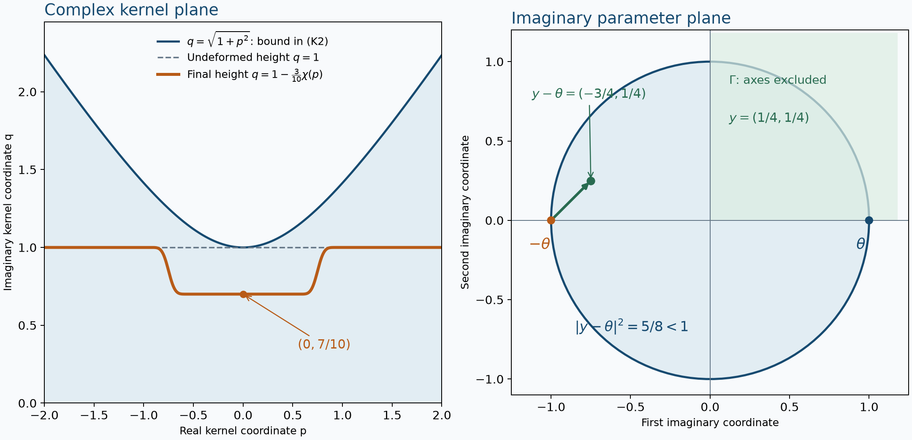

# Holomorphic boundary values without growth bounds

*Original exposition and proofs: GPT-6 Astra (OpenAI), October 2026. CC0.*

A holomorphic function can grow too rapidly at a real edge to have a distributional boundary. Hyperfunctions still give it a boundary value. The construction measures where changes in a displaced integration surface are carried, rather than how large the function becomes. A spherical kernel then detects the singular directions of that boundary and proves uniqueness. It also reconstructs a holomorphic function from the allowed directions.

We work in positive Euclidean dimension, with complex-linear pairings and Fourier sign \(e^{-ix\cdot\xi}\). Write \(V\Subset X\) when \(V\) is open and its closure is compact in \(X\). The analytic-functional spaces \(A'(H)\), their every-neighborhood bounds, and their seminorms are those of [Analytic tests and real carriers](analytic-tests-and-real-carriers.md), Theorems 1 and 5. Their full completeness modulo a smaller carrier is [Localizing analytic sources without analytic cutoffs](localizing-analytic-sources-without-analytic-cutoffs.md), Theorem 6; its Lemma 3 supplies germ action on small complex neighborhoods of real carriers. [Hyperfunctions from local analytic sources](hyperfunctions-from-local-analytic-sources.md), Propositions 1, 4–5 and Theorem 3, supplies restriction, support, compact representatives, distribution inclusion and arbitrary-cover gluing.

The kernel and distribution comparisons have complete proofs in [Holomorphic decompositions of tempered distributions](holomorphic-decompositions-of-tempered-distributions.md), Theorem 3; [Continuing the spherical kernel](continuing-the-spherical-kernel.md), Theorem 4; and [Boundary regularity and conic decomposition](boundary-regularity-and-conic-decomposition.md), Theorem 3. We use the proved [contour identity](../prerequisites/U011-free-foundations/contour-homotopy-U095.md), (A3)–(A4), with its complex oriented determinant. [Cauchy foundations](../prerequisites/U011-free-foundations/complex-contours-U070.md), CX7–CX11 and CMI6–CMI8, supplies local power series and their derivative estimates. Cutoffs and compactness are in [metric foundations](../prerequisites/U011-free-foundations/metric-foundation-bridges.md), Sections 12–13; all finite integrals and their limiting operations use [integration foundations](../prerequisites/U011-free-foundations/banach-foundation-bridges.md), Sections 15–16.

## Contour changes can be confined to an arbitrary boundary

The boundary of a bounded open set need not be smooth or have finite surface measure. We first give the needed argument without either condition.

**Lemma 1 (where a contour difference is carried).** Let \(V\) be bounded and open, and let \(f\) be holomorphic near \(\overline V+i[y_0,y_1]\). Define, for entire \(\phi\),
\[
 a_y(\phi)=\int_V f(x+iy)\phi(x+iy)\,dx.
 \tag{C1}
\]
Then \(a_y\in A'(\overline V+iy)\), and
\[
 a_{y_1}-a_{y_0}\in A'(\partial V+i[y_0,y_1]).
 \tag{C2}
\]
The corresponding statement holds for a finite polygonal path of heights on which the integrand is holomorphic. A smooth contour deformation which fixes a neighborhood of \(\partial V\) leaves its integral unchanged.

**Proof.** Boundedness of \(f\) on the compact translated closure immediately gives the first carrier. Put \(y_s=y_0+s(y_1-y_0)\) and \(g=f\phi\). Differentiation on a compact holomorphic neighborhood gives
\[
 {d\over ds}\int_V g(x+iy_s)\,dx
   =i\sum_j(y_1-y_0)_j\int_V\partial_{x_j}g(x+iy_s)\,dx.
 \tag{C3}
\]
Fix any open complex neighborhood \(N\) of the compact set in (C2). Choose a small real collar of \(\partial V\) whose translates along this segment, with a small additional complex radius, lie in \(N\). Choose \(\eta\in C_c^\infty(V)\), equal to one outside that collar within \(V\). This is possible because the part of \(\overline V\) outside the collar is compactly inside \(V\). Since \(\eta g(\,\cdot+iy_s)\) has compact support in \(V\),
\[
 \int_V\partial_{x_j}g(x+iy_s)\,dx
 =\int_V\partial_{x_j}\big((1-\eta(x))g(x+iy_s)\big)\,dx.
 \tag{C4}
\]
The integrand on the right is supported in the collar. Its terms contain only \(\phi\) and its first derivatives there. The Cauchy estimate on the additional complex radius bounds those derivatives by a constant times \(\sup_N|\phi|\). The fixed function \(f\), its derivatives, the cutoff, the segment length and the finite volume of \(V\) give a finite constant. Integrating (C3) in \(s\) proves the every-neighborhood estimate for (C2). Add the finitely many differences to handle a polygonal path.

For a general smooth graph \(Z_s(x)\), use (A4) of the contour prerequisite with \(w=f\phi\). Its right side is zero, and its left side is a sum of coordinate divergences. If the deformation is fixed near \(\partial V\), the inserted-column factors are zero there; their zero extensions have compact support in \(V\), so their integrals vanish. More generally, if \(Z_s(x)=x+iy_s\) near \(\partial V\), repeat (C4). All terms left by the collar cutoff involve only the contour's boundary collar. For every neighborhood of
\(\{\;x+iy_s:x\in\partial V,\ 0\le s\le1\;\}\), shrink the collar and use the Cauchy estimate there. This proves the same carrier bound for such graphs. No integration over the boundary itself has been used. \(\square\)

## Reading a compact source from the unit sphere

Put \(S=S^{n-1}\) and use ordinary, unnormalized surface measure \(d\sigma\); when \(n=1\), this is one unit mass at each of \(-1,1\). The earlier kernel is
\[
 I(\xi)=\int_S e^{-\omega\cdot\xi}\,d\sigma(\omega),
 \qquad
 K(z)=(2\pi)^{-n}\int_{\mathbb R^n}{e^{iz\cdot\xi}\over I(\xi)}\,d\xi
 \quad(|\operatorname{Im}z|<1).
 \tag{K1}
\]
It is even and extends holomorphically to
\[
 Q=\{z:z\cdot z\notin(-\infty,-1]\}
 \supset\{z:|\operatorname{Im}z|^2<1+|\operatorname{Re}z|^2\}.
 \tag{K2}
\]
The dot product in (K2) is complex bilinear. Theorems 3 and 4 of the kernel readings prove both the normalization and this continuation. In particular the spherical boundary average of \(K\) is exactly \(\delta_0\).

**Proposition 2 (recovery and angular boundary functionals).** Let \(a\) be an analytic functional with nonempty real compact support \(H\). The zero functional is covered separately by taking \(U=0\). Then
\[
 U(z)=a_tK(z-t)
 \tag{K3}
\]
is holomorphic on
\[
 Z_H=\{z:|\operatorname{Im}z|^2
                    <1+\operatorname{dist}(\operatorname{Re}z,H)^2\}.
 \tag{K4}
\]
For every bounded open \(V\) containing \(H\), and every entire \(\phi\),
\[
 a(\phi)=\lim_{r\uparrow1}
       \int_S\int_V U(x+ir\omega)\phi(x)\,dx\,d\sigma(\omega).
 \tag{K5}
\]

More generally let \(U\) be any holomorphic function on the unit tube. Let \(\Lambda(U,V)\subset S\) consist of the directions \(\omega\) where \(U\) extends holomorphically near every \(x+i\omega\) with \(x\in\partial V\). The functionals
\[
 A_y^V(\phi)=\int_V U(x+iy)\phi(x)\,dx,\qquad |y|<1,
 \tag{K6}
\]
extend continuously to \(y\in\Lambda(U,V)\), with values in \(A'(\overline V)\). Continuity holds in every carrier seminorm, not just on each test. For any finite complex Borel measure \(\mu\) with compact support in \(\Lambda(U,V)\),
\[
 A_\mu^V(\phi)=\int_S A_\omega^V(\phi)\,d\mu(\omega)
 \tag{K7}
\]
belongs to \(A'(\overline V)\). When \(U\) is (K3) and \(H\subset V\), the whole sphere is allowed and \(A_\sigma^V=a\).

**Proof of holomorphy and recovery.** At each compact subset of (K4), (K2) is valid on one complex neighborhood of \(H\). The germ bound for \(a\), with Cauchy estimates on a slightly larger parameter set, permits differentiation of (K3) and proves holomorphy.

Interchange the compact integrals with this germ action at each \(r<1\). Uniform Riemann approximation on the relevant compact complex neighborhood justifies that interchange. Evenness and the symmetry of the sphere identify the test given to \(a\) as
\[
 \Phi_r(t)=\int_S\int_V K(t+ir\omega-x)\phi(x)\,dx\,d\sigma(\omega).
 \tag{K8}
\]
The proved distributional spherical recovery, applied to the compact integrable function \(1_V\phi\), says that \(\Phi_r\to\phi\) in distributions on \(V\). We need convergence as holomorphic germs near \(H\), which is stronger.

Choose \(0\le\chi\le1\) compactly supported in \(V\), equal to one near \(H\), and fix \(0<\varepsilon<1/2\). In the inner integral of (K8) deform
\[
 x\longmapsto x+i\varepsilon\chi(x)\omega,\qquad
 J(x)=1+i\varepsilon\,\omega\cdot\nabla\chi(x).
 \tag{K9}
\]
Lemma 1 proves equality for \(r<1\) close enough to one, since the graph is unchanged near the boundary. The kernel on this graph has argument
\(t-x+i(r-\varepsilon\chi(x))\omega\). For real \(t\in H\), at \(r=1\), the inequality in (K2) is strict: if \(x=t\), then \(\chi=1\) and the imaginary length is \(1-\varepsilon\); if \(x\ne t\) and \(\chi=0\), the positive real distance supplies the strict inequality; intermediate values only reduce the imaginary length. Compactness of \(H\times\overline V\times S\) supplies a uniform positive margin on this final graph. It persists for \(t\) in one complex neighborhood of \(H\) and for \(r\) close to one. For each fixed \(r<1\), all intermediate graphs are valid at real \(t\), since their imaginary lengths stay below one.

For each fixed \(r<1\), the deformation is valid first for real \(t\) near \(H\) and then on a possibly \(r\)-dependent complex neighborhood. The final graph supplies its continuation to the one fixed neighborhood just obtained. These deformed integrals converge uniformly there, with every fixed parameter derivative on a smaller neighborhood, to a holomorphic \(\Phi_1\). Their distributional limit on a real neighborhood of \(H\) is \(\phi\). Hence \(\Phi_1=\phi\) there, and the real-to-complex power-series identity gives equality as germs. Apply the fixed-neighborhood bound for \(a\) to get (K5).

**Proof of the angular assertion.** Fix \(\omega_0\in\Lambda(U,V)\). The local extensions near the compact set \(\partial V+i\omega_0\) agree with \(U\) on the tube and hence agree on smaller overlaps, by the identity principle. They give a common boundary collar on which \(U\) is holomorphic even at the sphere. Choose \(\chi\in C_c^\infty(V)\), equal to one off that collar, and deform the integration variable in (K6) by
\[
 x\longmapsto x-i\varepsilon\chi(x)\omega_0.
 \tag{K10}
\]
For \(y\) near \(\omega_0\), this moves \(y\) into the unit ball wherever \(\chi=1\). Indeed
\[
 |y-s\varepsilon\chi\omega_0|^2
 =|y|^2-2s\varepsilon\chi\,y\cdot\omega_0
                      +s^2\varepsilon^2\chi^2.
 \tag{K11}
\]
For interior \(y\) near \(\omega_0\), the right side stays below one if \(\varepsilon\) is small. In the boundary collar use the given continuation, which also covers the endpoint \(y=\omega_0\) where \(\chi=0\). The contour formula becomes
\[
 A_y^V(\phi)=\int_V
 U(x+iy-i\varepsilon\chi(x)\omega_0)
 \phi(x-i\varepsilon\chi(x)\omega_0)
 (1-i\varepsilon\omega_0\cdot\nabla\chi(x))\,dx.
 \tag{K12}
\]
For each prescribed complex neighborhood \(N\) of \(\overline V\), take \(\varepsilon\) smaller so that this graph lies in \(N\). The factors involving \(U\) converge uniformly on the compact graph as \(y\to\omega_0\), and have a common bound there. Thus the difference of the corresponding functionals is bounded by \(o(1)\sup_N|\phi|\). This is precisely convergence in each carrier seminorm, and also gives the every-neighborhood bound for the limit. The same fixed graph works for nearby angular endpoints in \(\Lambda(U,V)\), giving continuity there.

A finite cover of a compact subset of \(\Lambda(U,V)\) gives a uniform bound in each seminorm. Integration against the total variation of \(\mu\) proves (K7). Formula (K4) puts \(\partial V+iS\) inside the continuation domain when \(H\subset V\); the compact sphere and (K12) permit passage of the radial limit through its integral in (K5). This proves \(A_\sigma^V=a\). \(\square\)

## Singular directions and their real projection

For a compact analytic functional \(a\), define
\[
 \operatorname{WF}_A(a)
 =\{(x,\xi):\xi\ne0,\ K*a
       \text{ has no holomorphic extension near }x-i\xi/|\xi|\}.
 \tag{W1}
\]
“Extension near” means extension to a full complex neighborhood, agreeing with the original tube function on its intersection with that neighborhood.

**Theorem 3 (a local analytic wavefront).** Definition (W1) gives a closed conic set, is local in the real variable, and therefore defines \(\operatorname{WF}_A(u)\) for every hyperfunction on a Euclidean open set. Its projection is exactly the analytic singular support:
\[
 \pi\operatorname{WF}_A(u)=\operatorname{sing\,supp}_A u.
 \tag{W2}
\]
For distributions it agrees with the programme's existing analytic wavefront. It obeys restriction and
\[
 \operatorname{WF}_A(u+v)\subset
              \operatorname{WF}_A(u)\cup\operatorname{WF}_A(v).
 \tag{W3}
\]

**Proof.** Holomorphic extension is open in its boundary point, so its complement in \((x,\xi)\), with \(\xi\ne0\), is closed. Positive rescaling does not change \(\xi/|\xi|\). If two compact representatives agree on a real open \(O\), their difference has support outside \(O\), by the hyperfunction support theorem. Formula (K4) makes its kernel holomorphic near every \(x+i\omega\), \(x\in O\), \(\omega\in S\). Thus the two wavefronts agree over \(O\). Local compact representatives exist by the bounded quotient construction. This proves locality, well-definedness and restriction. Linearity of (K3) proves (W3).

Suppose all directions are absent over \(x_0\), and choose a compact representative \(a\). Finitely many extension neighborhoods cover \(\{x_0\}+iS\); after shrinking, \(U=K*a\) is holomorphic near \(\overline M+iS\) for a small real ball \(M\) about \(x_0\). Take a bounded open \(V\) containing both the carrier and \(\overline M\). Apply Proposition 2 to \(V\) and to \(V\setminus\overline M\). Its boundary continuation hypothesis holds on both: at the outer boundary by (K4), and at the inner sphere by the chosen regularity. Splitting the real integral, whose separating sphere has zero volume, gives
\[
 a=A_\sigma^{\,V\setminus\overline M}
       +1_M g,\qquad
 g(x)=\int_S U(x+i\omega)\,d\sigma(\omega).
 \tag{W4}
\]
The second term is a compact integrable density. The first is carried outside \(M\), while \(g\) is analytic near \(\overline M\): the holomorphic extensions have common bounds on a smaller product neighborhood, so their finite measure integral is holomorphic by Cauchy estimates and differentiation. Thus \(u=g\) near \(x_0\).

Conversely, if \(u\) is analytic near \(x_0\), multiply its analytic function there by a compact smooth cutoff equal to one near \(x_0\). This gives a compact distribution with the same local hyperfunction. The exact distributional boundary characterization in Theorem 3 of the boundary-regularity lesson gives holomorphic continuation of its kernel in every direction over \(x_0\). Locality transfers this to \(u\). The same argument with a local compact cutoff of an arbitrary distribution proves agreement with its existing analytic wavefront. Both implications prove (W2). \(\square\)

## Constructing a boundary without a size estimate

Let \(\Gamma\subset\mathbb R^n\setminus\{0\}\) be a nonempty connected open cone. It need not be convex. Say that \(f\) is \(\Gamma\)-holomorphic at an open real set \(X\) if \(f\) is holomorphic on an open complex set \(Z\) with this property: for every \(V\Subset X\) and every closed cone \(C\) with \(C\setminus\{0\}\subset\Gamma\), there is \(\gamma>0\) for which
\[
 \{x+iy:x\in\overline V,\ y\in C,\ 0<|y|<\gamma\}\subset Z.
 \tag{B1}
\]
It is enough to assume (B1) for closed convex cones: cover the compact set \(C\cap S\) by finitely many small closed convex angular cones lying inside \(\Gamma\), and take the minimum of their heights. This also explains why no single height over all of \(X\) is required. No bound on \(|f|\) as \(y\to0\) is imposed.

**Theorem 4 (the growth-free boundary class).** Such an \(f\) has a unique hyperfunction \(b_\Gamma f\in\mathcal B(X)\) with the following local description. For each \(V\Subset X\), one can choose \(b_V\in A'(\overline V)\) so that, for every complex compact neighborhood \(N\) of \(\partial V\) and every closed subcone \(C\) as above,
\[
 b_V-a_y^V\in A'(N)
 \quad\text{for all }y\in C,\quad0<|y|<\delta_{N,C},
 \qquad
 a_y^V(\phi)=\int_V f(x+iy)\phi(x+iy)\,dx.
 \tag{B2}
\]
The class of \(b_V\) modulo \(A'(\partial V)\) is unique. These classes restrict compatibly and are independent of the smaller cone used to approach zero.

**Proof of existence along a direction.** Choose \(v\in\Gamma\) and positive \(t_j\downarrow0\), small enough for (B1), and use \(a_{t_jv}^V\). Each has carrier \(\overline V+it_jv\), so eventually every complex neighborhood of \(\overline V\) is a carrier. Lemma 1 gives
\[
 a_{t_jv}^V-a_{t_kv}^V
       \in A'(\partial V+i[t_jv,t_kv]).
 \tag{B3}
\]
These carriers eventually lie in every prescribed neighborhood of \(\partial V\). The full completeness-modulo-carriers theorem gives \(b_V\in A'(\overline V)\) whose difference from all sufficiently late terms is carried in that neighborhood.

**Proof for all directions in a closed subcone.** A connected open subset of Euclidean space is polygonally connected: the points reachable from one point by a finite chain of segments inside it form an open set, and its complement is open by the same small-ball argument. Apply this to \(\Gamma\). For a compact set of unit directions \(E\subset\Gamma\), join finitely many small angular caps covering \(E\) to the fixed direction \(v/|v|\) by such paths. They can be chosen on the sphere by radial projection, then subdivided into short straight segments in pointed convex cones compactly inside \(\Gamma\). Their heights after scaling are bounded by a fixed multiple of the scale, and stay nonzero.

The resulting finite collection of closed angular cones has a common allowed height in (B1). Any sufficiently small \(y\) with direction in \(E\) can be joined to a still smaller \(t_jv\) by radial segments and these scaled paths. If \(|y|\) and \(t_j\) are small enough, all the paths stay in an arbitrarily small imaginary ball. Lemma 1 makes the difference \(a_y^V-a_{t_jv}^V\) carried in the corresponding neighborhood of \(\partial V\). Add the difference already supplied by completeness. Taking smaller intermediate neighborhoods inside \(N\) proves (B2), uniformly for directions in \(E=C\cap S\). This also handles closed cones whose directions have several components; their connections take place in the given \(\Gamma\), not through zero.

If \(b_V'\) has the same property, its difference from \(b_V\) is carried in every complex neighborhood of \(\partial V\), hence in \(\partial V\) itself by the defining bounds. The same comparison shows independence of the initial direction and sequence.

**Proof of locality.** If \(V_2\subset V_1\Subset X\), the difference of the two translated integrals is carried by
\[
 (\overline V_1\setminus V_2)+iy.
 \tag{B4}
\]
Indeed it is integration over \(V_1\setminus V_2\), whose closure is contained in the indicated real compact set before translation. Combine (B4) with (B2) for both opens, and let the permitted carrier neighborhoods shrink. Since both boundaries are contained in \(\overline V_1\setminus V_2\), every neighborhood of that real compact set carries \(b_{V_1}-b_{V_2}\). Thus
\[
 b_{V_1}-b_{V_2}\in A'(\overline V_1\setminus V_2).
 \tag{B5}
\]
The exact restriction criterion for hyperfunctions proves compatibility. Relatively compact opens cover \(X\); their overlaps have the same classes by (B5), so the full gluing theorem supplies \(b_\Gamma f\). Local uniqueness proves global uniqueness. \(\square\)

## When an ordinary boundary calculation is available

**Proposition 5 (two exact comparisons).**

1. If \(f\) has polynomial growth locally in the real variable, uniformly on a closed angular subcone with nonempty interior, its distributional boundary from that cone equals \(b_\Gamma f\).
2. If \(f\) continues holomorphically to a neighborhood of \(\partial V\), then the unshifted-test functionals
   \[
    L_y(\phi)=\int_V f(x+iy)\phi(x)\,dx
    \tag{T1}
   \]
   converge in \(A'(\overline V)\), as \(y\to0\) in each closed subcone of \(\Gamma\), to a representative of \(b_\Gamma f|_V\).

Here continuation at the boundary means a common local extension agreeing with the given function on its approaching wedge. In particular a holomorphic function already defined near a real open set has its ordinary analytic trace as its hyperfunction boundary.

**Proof of the distribution comparison.** Work on \(V\Subset X\) where
\(|f(x+iy)|\le C|y|^{-m}\) on a slightly larger real neighborhood and a small pointed convex cone of approach. The distribution limit \(T\), its uniform finite-order bound, and its moving-test property are proved in [Holomorphic boundaries in convex cones](holomorphic-boundaries-in-convex-cones.md), Theorem 2.1 and Corollary 2.2. Choose \(\chi\in C_c^\infty(V)\) and an integer \(N\ge m\). For a fixed small \(y\) in this cone, put
\[
 D_y=\sum_j y_j\partial_{x_j},\qquad
 P_N(x,t)=\sum_{k=0}^N{(it)^k\over k!}D_y^k\chi(x).
 \tag{T2}
\]
Apply the finite-test-polynomial computation of that earlier proof to
\(f(z)\phi(z)\), with \(\phi\) entire. Its ordinary trace is \(\phi T\), by the moving-test bound. The result, with the endpoint at \(t=1\), is
\[
 \begin{split}
 (\chi T)(\phi)
 ={}&\int_V P_N(x,1)f(x+iy)\phi(x+iy)\,dx\\
 &+{i^{N+1}\over N!}
   \int_0^1t^N\int_V
       D_y^{N+1}\chi(x)f(x+ity)\phi(x+ity)\,dx\,dt .
 \end{split}
 \tag{T3}
\]
The sign follows directly from
\(\partial_tP_N-iD_yP_N=-i^{N+1}t^ND_y^{N+1}\chi/N!\).
The remainder is absolutely integrable: \(t^N|f(x+ity)|\le
C|y|^{-m}t^{N-m}\). This proves the identity for every fixed entire test without a limiting interchange involving its unbounded derivatives.

Take \(\chi=1\) near any prescribed compact inner region and set
\[
 C_\chi=\overline V\setminus\operatorname{int}\{\chi=1\}.
 \tag{T4}
\]
The difference between (T3) and \(a_y^V\) has its integrands supported in \(C_\chi\), since both \(P_N(x,1)-1\) and the derivatives in the remainder vanish on the interior where \(\chi=1\). Therefore it is carried by \(C_\chi+i[0,y]\); the growth estimate just given bounds its value by the supremum of \(\phi\) on any neighborhood of that set. Combine this with (B2). Every complex neighborhood of \(C_\chi\) carries the fixed difference \(\chi T-b_V\), by taking \(y\) small enough. Hence that difference lies in \(A'(C_\chi)\). On the open region where \(\chi=1\), its hyperfunction is zero, so \(b_\Gamma f=T\) there. Such regions cover the real base. Restriction to the chosen cone does not change the class by Theorem 4, proving the first assertion.

**Proof of the boundary-regular comparison.** First restrict directions to one small closed convex cone \(C\) inside a pointed open convex cone compactly contained in \(\Gamma\). Choose \(v\) in that larger cone so the cone generated by \(C\cup\{v\}\) still has compact angular closure in \(\Gamma\). Take \(\chi\in C_c^\infty(V)\), equal to one away from a collar where \(f\) has the stated extension. For a sufficiently small \(\varepsilon>0\), deform the real variable positively:
\[
 x\longmapsto x+i\varepsilon\chi(x)v.
 \tag{T5}
\]
For nonzero \(y\in C\) the homotopy lies inside the permitted cone; at \(y=0\), the positive displacement stays inside it wherever \(\chi>0\), while the boundary collar uses the holomorphic extension. The compact final graph thus gives
\[
 L_y(\phi)=\int_V
 f(x+iy+i\varepsilon\chi v)\,
 \phi(x+i\varepsilon\chi v)\,
 (1+i\varepsilon v\cdot\nabla\chi)\,dx.
 \tag{T6}
\]
For every neighborhood \(N\) of \(\overline V\), choose \(\varepsilon\) small enough that the graph lies in \(N\). Uniform convergence of the \(f\) factor gives convergence bounded by \(o(1)\sup_N|\phi|\). The limit \(L_0\) therefore belongs to \(A'(\overline V)\), and convergence holds in every carrier seminorm.

It remains to identify this limit, rather than merely produce one. In the graph integral at \(y=0\), replace its argument by
\[
 Z_s(x)=x+isy+i\varepsilon\chi(x)v,\quad0\le s\le1,
 \tag{T7}
\]
and use the holomorphic integrand \(f(Z_s)\phi(Z_s)\). At \(s=0\) this gives \(L_0(\phi)\). At \(s=1\) deform away the \(\varepsilon\chi v\) part; Lemma 1 identifies the result with \(a_y^V(\phi)\). Near the boundary, (T7) is just \(x+isy\). The graph version of Lemma 1 therefore gives
\[
 L_0-a_y^V\in A'(\partial V+i[0,y]).
 \tag{T8}
\]
Uniqueness in Theorem 4 identifies \(L_0\) with the required class.

The limit is independent of the small cone. On an overlapping pair, an interior direction common to both computes the same limit of (T1). A finite chain of small cones along a path in the connected \(\Gamma\) proves equality for every pair. For a closed angular subset, a finite cover by these cones gives convergence in each seminorm uniformly over all its directions. This proves the asserted approach limit. If \(f\) is holomorphic near the whole real region, (T1) instead converges directly to integration against its ordinary trace, proving the last assertion. \(\square\)

## A zero boundary and a forbidden direction

For any open cone \(\Gamma\), use the positive dual
\[
 \Gamma^*=\{\xi:y\cdot\xi\ge0\text{ for all }y\in\Gamma\}.
 \tag{U1}
\]

**Theorem 6 (uniqueness and the dual-cone bound).** If \(f\) is as in Theorem 4, then
\[
 \operatorname{WF}_A(b_\Gamma f)
                  \subset X\times(\Gamma^*\setminus\{0\}).
 \tag{U2}
\]
If its boundary is zero on a nonempty real open subset and the holomorphic domain \(Z\) is connected, then \(f=0\) on \(Z\). More generally it vanishes on every connected component reached from that zero boundary.

**Proof of a useful kernel identity.** Choose \(V\Subset X\), a representative \(b_V\), and put \(R_y=b_V-a_y^V\). For sufficiently small \(y\), it is carried in an arbitrarily small complex neighborhood of \(\partial V\). On the narrower tube where the kernel pairs directly with both carriers,
\[
 K*b_V(z)
 =F_y(z)+R_y\big(K(z-\cdot)\big),\qquad
 F_y(z)=\int_V K(z-t-iy)f(t+iy)\,dt.
 \tag{U3}
\]
The identity follows first from (B2) on entire tests and then on these holomorphic germs by the common approximation theorem. On each fixed compact subset of
\[
 Z_{\partial V}
 =\{z:|\operatorname{Im}z|^2
             <1+\operatorname{dist}(\operatorname{Re}z,\partial V)^2\},
 \tag{U4}
\]
the last term of (U3) is holomorphic whenever the chosen complex carrier neighborhood is small enough. This follows from (K2), compactness and the germ action on thickened real carriers. There is no assertion of a bound uniform in \(y\) for its size. Its domain of holomorphy is what matters.

**Proof of the wavefront bound.** Fix \(x_0\in V\) and a unit vector \(\omega\) for which \(\omega\cdot y_0>0\) for some \(y_0\in\Gamma\). Replace \(y_0\) by a sufficiently small positive multiple \(y\). Then
\[
 |\omega-y|^2=1-2\omega\cdot y+|y|^2<1.
 \tag{U5}
\]
Consequently the integral \(F_y\) is holomorphic near \(x_0+i\omega\), by the unit-tube part of (K2), uniformly for \(t\in\overline V\). Choose the carrier of \(R_y\) small enough that its term also extends there, using (U4). Formula (U3) continues \(K*b_V\) across that point. With \(\xi=-|\xi|\omega\), the excluded condition is \(\xi\cdot y_0<0\). Excluding all these directions gives exactly (U2).

**Proof of zero-boundary uniqueness.** Choose real balls \(V_2\Subset V\) within the zero-boundary region. Then \(b_V\in A'(\partial V)\). Both \(K*b_V\) and the remainder term in (U3) are holomorphic on one fixed neighborhood of
\(\overline V_2+iS\), for all sufficiently small \(y\) in a fixed closed subcone around a chosen direction: choose the carrier radius first using the positive distance between \(\overline V_2\) and \(\partial V\). Thus (U3) continues \(F_y\) to that fixed neighborhood.

For fixed \(y\), let \(g_y=1_V f(\,\cdot+iy)\), a compact integrable function and hence a tempered distribution. Inside the tube,
\[
 K*g_y(z)=F_y(z+iy).
 \tag{U6}
\]
Take \(|y|\) smaller than the fixed continuation radius. Spherical recovery for this distribution and the continuation just established give, for real \(x\) in a smaller ball,
\[
 f(x+iy)=\int_S F_y(x+iy+i\omega)\,d\sigma(\omega).
 \tag{U7}
\]
Indeed the radial sphere averages in (U6) converge in distributions to \(g_y\); continuation makes their averages converge locally uniformly to the right side, which is therefore \(g_y=f(\,\cdot+iy)\) on that ball. The right side of (U7), with \(x\) complex, is holomorphic on a neighborhood of the real ball of radius independent of this small \(y\). Translating \(x\) by \(-iy\) yields a holomorphic extension of \(f\) through a real neighborhood.

For clarity, this extension agrees with the original function on a nonempty open wedge: equality on the real slice at height \(y\) implies equality on a complex neighborhood by the power-series identity. Smaller pointed cones and the identity principle propagate equality along the local wedge towards the real ball. Its ordinary trace is therefore \(b_\Gamma f\), by Proposition 5 and Theorem 4's cone independence. That trace is zero. The distribution injection and the continuous bump test make the trace zero pointwise. The real-to-complex identity then makes the extension zero on a complex open set. Finally the holomorphic identity principle propagates zero along any chain of balls in the connected component of \(Z\), proving the assertion. \(\square\)

## Reconstructing the holomorphic side

An equality of \(\Gamma\)-holomorphic germs means equality on sufficiently small wedges at each real point and each direction compactly inside \(\Gamma\). It does not assert equality on unrelated portions of larger domains.

**Theorem 7 (the exact converse).** Let \(\Gamma\subset\mathbb R^n\setminus\{0\}\) be nonempty, open and convex. If \(u\in\mathcal B(X)\) satisfies
\[
 \operatorname{WF}_A(u)\subset X\times(\Gamma^*\setminus\{0\}),
 \tag{V1}
\]
there is a \(\Gamma\)-holomorphic function at \(X\) with
\[
 b_\Gamma f=u.
 \tag{V2}
\]
Its germ is unique. No polynomial boundary-growth estimate is required or concluded.

**Proof of the local construction.** Fix a relatively compact real ball \(B\Subset X\) and a closed angular subcone \(C\) compactly inside \(\Gamma\). Use a slightly larger real neighborhood with compact closure in \(X\), and choose a compact analytic-functional representative \(a\) agreeing with \(u\) there. Put \(U=K*a\) and choose a bounded open \(Y\) containing its real compact carrier and the larger neighborhood.

Let \(D=\Gamma^*\cap S\). If \(D\) is empty, (V1) and Theorem 3 make \(u\) analytic; the uniform complex-extension lemma in [From wavefront cones to holomorphic wedges](from-wavefront-cones-to-holomorphic-wedges.md), Lemma 4, gives the required local holomorphic function. Suppose \(D\ne\varnothing\). Its Lemma 1 supplies an open spherical neighborhood \(M\supset D\) and \(m>0\) such that
\[
 \theta\cdot y\ge m|y|,
              \qquad \theta\in\overline M,\ y\in C.
 \tag{V3}
\]
The same proof applies to the compact angular set \(C\cap S\): a zero pairing would contradict openness of \(\Gamma\), and the minimum over its product with \(D\) is positive. No convexity of \(C\cap S\) is used.

By Proposition 2, with reflection of sphere measure,
\[
 a=a_{\mathrm{good}}+a_{\mathrm{side}},\quad
 a_{\mathrm{good}}=\int_{S\setminus M}A_{-\theta}^{Y}\,d\sigma(\theta),
 \quad
 a_{\mathrm{side}}=\int_M A_{-\theta}^{Y}\,d\sigma(\theta).
 \tag{V4}
\]
The compact angular set \(S\setminus M\) misses all allowed wavefront directions over the larger real neighborhood. Thus \(U\) extends holomorphically at all its points \(x-i\theta\). Compactness and the argument used in (W4) make \(a_{\mathrm{good}}\) an analytic function \(g\) on a neighborhood of \(\overline B\).

Define
\[
 F(z)=\int_M U(z-i\theta)\,d\sigma(\theta).
 \tag{V5}
\]
If \(y\in C\) and \(0<|y|<m\), then
\[
 |y-\theta|^2
 \le1-2m|y|+|y|^2
 \le1-m|y|<1.
 \tag{V6}
\]
All integrands therefore lie in the unit tube. The strict inequality persists on an open set around each permitted imaginary parameter, and on its compact subsets the arguments stay a positive distance inside the tube. Cauchy estimates and finite sphere measure prove holomorphy of \(F\) on that open wedge neighborhood.

We verify its boundary carefully. Because the carrier of \(a\) is compactly inside \(Y\), (K4) makes \(U\) holomorphic near \(\partial Y-iS\). Hence \(F\) continues near \(\partial Y\), and Proposition 5 applies to it. Proposition 2's angular continuity, uniform on the compact set \(-\overline M\), gives in every seminorm of \(A'(\overline Y)\)
\[
 \int_Y F(x+iy)\phi(x)\,dx
 =\int_M A_{\,y-\theta}^{Y}(\phi)\,d\sigma(\theta)
 \longrightarrow a_{\mathrm{side}}(\phi).
 \tag{V7}
\]
The equality and limiting interchange follow from the common seminorm bounds and finite total variation; (V6) puts every intermediate height inside the ball. Proposition 5 identifies this limit with \(bF\). Extend \(g\) holomorphically to one complex neighborhood of \(\overline B\) using the cited uniform-extension lemma, and call the extension \(G\). Then \(f=F+G\), on a smaller wedge over \(B\), has boundary \(u\) there.

**Proof of coherent gluing.** Perform the construction on real balls and small pointed open convex cones with angular closure inside \(\Gamma\). These give functions on sets
\[
 \{x+iy:x\in B,\ y\in C_0,\ 0<|y|<\gamma\}.
 \tag{V8}
\]
An intersection of two such nonempty wedges is connected: the intersection of the real balls is convex, and that of the pointed convex cones with the smaller height ball is convex and avoids zero. Both functions have boundary \(u\) on the intersecting real ball from the intersecting cone, by Theorem 4. Theorem 6 applied to their difference makes them equal throughout this wedge intersection.

They therefore glue to a holomorphic function on the union \(Z\) of their wedges. For any \(V\Subset X\) and compact set of directions inside \(\Gamma\), finitely many product patches \(B\times(C_0\cap S)\) cover \(\overline V\) times that angular set. The minimum of their heights gives (B1) for the union. Thus the glued function is \(\Gamma\)-holomorphic at \(X\), and its boundary is \(u\) by locality. The same intersection argument proves uniqueness of its germ. \(\square\)

**Corollary 8 (opposite sides join analytically).** Suppose \(f_+\) and \(f_-\) are holomorphic at \(X\) from opposite nonempty open convex cones \(\Gamma\) and \(-\Gamma\). If
\[
 b_\Gamma f_+=b_{-\Gamma}f_-=u,
 \tag{E1}
\]
then \(u\) is real analytic. Its local holomorphic extension agrees with both side germs. This assertion requires no boundary-growth bound.

**Proof.** Theorem 6 puts the wavefront of \(u\) in both positive duals. A vector in their intersection pairs to zero with every vector of the open set \(\Gamma\), so it is zero: otherwise a small perturbation in its own direction changes the pairing. Thus the punctured intersection is empty. Theorem 3 makes \(u\) analytic. On each small complex neighborhood of the real base, subtract its holomorphic extension from \(f_+\) and \(f_-\). Proposition 5 makes both boundaries zero, and Theorem 6 makes the differences vanish on the adjacent wedges. These local equalities agree on overlaps, proving the claimed common analytic continuation. \(\square\)

*Two exact geometries. Left: for \(H=\{0\}\), \(V=(-2,2)\), \(\omega=1\) and \(\varepsilon=3/10\), the final kernel argument in (K9) has imaginary coordinate \(1-(3/10)\chi(x)\), strictly below \(\sqrt{1+x^2}\), the upper boundary of the sufficient domain in (K2). The displayed smooth cutoff is one for \(|x|\le1/2\) and zero for \(|x|\ge1\); its formula is in the editable figure source. Right: \(\theta=(1,0)\), \(y=(1/4,1/4)\), and \(y-\theta=(-3/4,1/4)\) is strictly inside the imaginary unit disk. The positive-quadrant approach cone excludes its axes. The panels use different spaces, as labeled.*

## Exercises with full solutions

**Exercise 1 (intermediate) — the sign of a simple pole.** Compute the upper and lower hyperfunction boundaries of \(1/z\), their analytic wavefronts, and their difference.

**Solution.** The polynomial bound \(|x+iy|^{-1}\le |y|^{-1}\) permits Proposition 5. The full pole-limit proof in [Cauchy kernels and distributional boundary limits](cauchy-kernels-and-boundary-limits.md), Theorem 4.1, gives
\[
 b_+(1/z)=\operatorname{pv}(1/x)-i\pi\delta_0,\qquad
 b_-(1/z)=\operatorname{pv}(1/x)+i\pi\delta_0.
 \tag{X1}
\]
Away from zero both equal the analytic function \(1/x\). Neither is analytic at zero: a continuous representative there would equal \(1/x\) off zero and so be unbounded. Theorem 3 supplies a singular direction; Theorem 6 restricts it to the positive ray for the upper side and the negative ray for the lower side. Conicity gives the entire respective ray. Their difference is \(-2\pi i\delta_0\). Thus the sign of the concentrated term and the sign of the singular covector record different aspects of the same convention.

**Exercise 2 (advanced) — a boundary which cannot be a distribution.** Let \(f(z)=e^{-1/z^2}\) on the upper half-plane. Prove that its boundary exists, is not a distribution in any neighborhood of zero, and has exactly the positive analytic singular ray over zero.

**Solution.** Theorem 4 gives the hyperfunction boundary without a growth assumption. On the positive imaginary axis,
\[
 f(it)=e^{1/t^2},\qquad t>0,
 \tag{X2}
\]
which exceeds every inverse power as \(t\downarrow0\): take a sufficiently high positive term in the exponential series.

Suppose the boundary were a distribution near zero. Theorem 6 and the distribution comparison in Theorem 3 put its analytic wavefront in the positive ray. The distributional converse in [From wavefront cones to holomorphic wedges](from-wavefront-cones-to-holomorphic-wedges.md), Theorem 3 and Corollary 5, supplies, on a smaller interval, an upper holomorphic function \(g\) with the same boundary and a polynomial growth bound. In one dimension the positive cone has only one angular direction, so the bound includes \(z=it\) for small \(t\). Theorem 6 applied to \(f-g\) on the connected smaller wedge makes them identical, contradicting (X2).

At every nonzero real point, \(f\) extends holomorphically and its boundary is the analytic function \(e^{-1/x^2}\). At zero the boundary is not analytic, because analytic functions are distributions. Projection and the dual-cone bound therefore give exactly \(\{(0,\xi):\xi>0\}\).

**Exercise 3 (intermediate) — a point source needs both sphere endpoints.** In dimension one, prove
\[
 \operatorname{WF}_A(\delta_0)=\{(0,\xi):\xi\ne0\}.
 \tag{X3}
\]
Explain this in the spherical-kernel definition.

**Solution.** Away from zero, the point source is zero and analytic. It cannot be analytic near zero: an analytic representative would vanish at nearby nonzero points, hence also at zero by continuity, contradicting the nonzero point evaluation. Theorem 3 supplies at least one direction. Its kernel is the even function \(K\). Holomorphic continuation near \(i\) is therefore equivalent, by \(z\mapsto-z\), to continuation near \(-i\). If either were regular, both would be regular, contradicting projection. Both are singular, and conicity gives (X3). The two unit masses in the one-dimensional sphere retain the normalization in (K5).

**Exercise 4 (basic) — check the inward displacement.** Let \(\theta=(1,0)\) and \(y=(t,t)\), \(t>0\). Find exactly when \(y-\theta\) is in the open unit disk, and compare \(\theta\) with the opposite covector for the positive-quadrant approach cone.

**Solution.** Direct computation gives
\[
 |y-\theta|^2=(t-1)^2+t^2=1-2t+2t^2.
 \tag{X4}
\]
It is less than one exactly for \(0<t<1\); at \(t=1/4\) it is \(5/8\). The positive quadrant has dual the closed positive quadrant: a negative coordinate is detected by making the corresponding positive coordinate of the testing vector sufficiently large. Thus \(\theta\) is allowed and \(-\theta\) is excluded. The kernel boundary point for \(\theta\) is \(-i\theta\); adding \(iy\) moves its imaginary coordinate to \(y-\theta\), with the sign in (U5).

**Exercise 5 (basic) — why the cone must be connected.** Give a holomorphic function near the two sides of a real interval for which the two components of \(\mathbb R\setminus\{0\}\) have different boundaries.

**Solution.** On the union of a small upper rectangle and a disjoint lower rectangle over the interval, set \(f=1\) on the upper component and \(f=0\) on the lower component. It is holomorphic on this open domain and satisfies the wedge condition for the disconnected cone. Proposition 5 gives boundary one above and zero below. The distribution injection makes these different hyperfunctions. Cone-independent boundary data therefore need a connection between the approach directions.

**Exercise 6 (intermediate) — angular continuity allows an interior pole.** Let \(U(z)=1/(z-i)\) and \(V=(-1,1)\). Check that both sphere directions belong to \(\Lambda(U,V)\), and compute \(A_1^V\) and \(A_{-1}^V\).

**Solution.** The function is holomorphic on the open unit strip. Its only pole \(i\) is not at either endpoint \(x=\pm1\) shifted by \(i\omega\), so both directions satisfy the continuation hypothesis at \(\partial V\). The lower endpoint gives
\[
 A_{-1}^V(\phi)=\int_{-1}^1{\phi(x)\over x-2i}\,dx.
 \tag{X5}
\]
Since \(U(x+ir)=(x-i(1-r))^{-1}\), the lower simple-pole formula, localized near zero and combined with ordinary convergence away from zero, gives
\[
 A_1^V(\phi)=
     \operatorname{pv}\int_{-1}^1{\phi(x)\over x}\,dx+i\pi\phi(0).
 \tag{X6}
\]
Subtracting \(\phi(0)\) in the principal value makes its integrand regular. Proposition 2 strengthens the formula to convergence in every carrier seminorm of \(A'([-1,1])\). Continuation at the endpoints does not assert regularity at all interior real points.

**Exercise 7 (basic) — the relevant connected component.** Show why a zero boundary cannot force vanishing on an unrelated component of the holomorphic domain.

**Solution.** Let \(Z_1=\{x+iy:|x|<1,\ 0<y<1\}\) and \(Z_2=\{z:|z-3i|<1/4\}\). Set \(f=0\) on \(Z_1\), \(f=1\) on \(Z_2\). These are disjoint open sets, so \(f\) is holomorphic on their union. Its upper boundary on \((-1,1)\) is zero while it is nonzero on \(Z_2\). Theorem 6 gives zero on the component reached from the edge.

**Exercise 8 (advanced) — the full jump of an essential singularity.** For \(f(z)=e^{-1/z^2}\), determine
\[
 J=b_+f-b_-f.
 \tag{X7}
\]
Give all its point moments and prove that it is not a distribution.

**Solution.** Off zero the two sides have the same analytic trace, so \(J\) is supported at zero. The compact-section theorem identifies it with an element of \(A'(\{0\})\). For an entire \(\phi\), a rectangle around zero, with top and bottom at heights \(y,-y\), gives
\[
 a_y^V(\phi)-a_{-y}^V(\phi)
 =-2\pi i\,\operatorname{Res}_{z=0}(e^{-1/z^2}\phi(z))
       +E_y(\phi),\qquad V=(-a,a).
 \tag{X8}
\]
The two vertical-side integrals forming \(E_y\) are carried by
\(\{-a,a\}+i[-y,y]\). Positive orientation traverses the bottom from left to right and the top from right to left, fixing the minus sign. To obtain the residue formula, deform the rectangle to a small positively oriented circle using complex Green, and integrate the normally convergent Laurent series on that circle. Only its coefficient of \(z^{-1}\) survives.

By Theorem 4, the boundary representatives differ from the horizontal integrals by functionals carried in arbitrarily small endpoint neighborhoods. Their difference and (X8) therefore agree modulo \(A'(\{-a,a\})\) with the residue term. The point-supported identification yields
\[
 J(\phi)=-2\pi i\sum_{k\ge1}
       {(-1)^k\over k!}\,
       {\phi^{(2k-1)}(0)\over(2k-1)!}.
 \tag{X9}
\]
Consequently
\[
 J(z^m)=
 \begin{cases}
 -2\pi i\,(-1)^k/k!,&m=2k-1,\quad k\ge1,\\
 0,&m\text{ even}.
 \end{cases}
 \tag{X10}
\]
For every \(\delta>0\), these satisfy the point-moment bound, since
\[
 {2\pi/k!\over\delta^{\,2k-1}}
 \le2\pi\delta\,e^{\delta^{-2}}.
 \tag{X11}
\]
Indeed the left side divided by \(2\pi\delta\) is one term of the positive exponential series. The point-moment theorem proves absolute convergence of (X9) on every holomorphic germ.

Infinitely many moments are nonzero. A point-supported distribution has finite order; its high monomial moments vanish by [Jets, supported distributions and local operators](jets-supported-distributions-and-local-operators.md), Theorem 1.1. The support-preserving distribution inclusion therefore shows that \(J\) is not a distribution. Its exact jump records boundary data that the ordinary real trace away from zero does not determine.

## Programme proofs and mathematical source

- [Analytic tests and real carriers](analytic-tests-and-real-carriers.md), Theorems 1–2, 5–6; [Localizing analytic sources without analytic cutoffs](localizing-analytic-sources-without-analytic-cutoffs.md), Lemma 3 and Theorem 6; and [Hyperfunctions from local analytic sources](hyperfunctions-from-local-analytic-sources.md), Propositions 1, 4–5 and Theorem 3: analytic-functional topology, germ action, carrier completeness, compact sections and localization.
- [Holomorphic decompositions of tempered distributions](holomorphic-decompositions-of-tempered-distributions.md), Theorem 3; [Continuing the spherical kernel](continuing-the-spherical-kernel.md), Theorem 4; and [Boundary regularity and conic decomposition](boundary-regularity-and-conic-decomposition.md), Theorem 3: normalized recovery, kernel continuation and the distributional wavefront comparison.
- [Holomorphic boundaries in convex cones](holomorphic-boundaries-in-convex-cones.md), Theorem 2.1 and Corollary 2.2; [From wavefront cones to holomorphic wedges](from-wavefront-cones-to-holomorphic-wedges.md), Lemmas 1 and 4, Theorem 3 and Corollary 5; [Cauchy kernels and distributional boundary limits](cauchy-kernels-and-boundary-limits.md), Theorem 4.1; and [Jets, supported distributions and local operators](jets-supported-distributions-and-local-operators.md), Theorem 1.1: finite-growth comparisons, dual margins, analytic extension, pole signs and point order.
- The supplied [contour identity](../prerequisites/U011-free-foundations/contour-homotopy-U095.md), (A3)–(A4), retains the exact AN-04 proof and its authorship. The scalar, Cauchy and integration foundations linked above provide the complete elementary prerequisites.
- Lars Hörmander, *The Analysis of Linear Partial Differential Operators I*, second edition, 2003 reprint, [DOI 10.1007/978-3-642-61497-2](https://doi.org/10.1007/978-3-642-61497-2), Proposition 9.3.1, Definition 9.3.2 and Theorems 9.3.3–9.3.5. These supply the spherical hyperfunction representation and growth-free boundary-value mathematics. The organization, arbitrary-open contour arguments, detailed limit and gluing proofs, examples, exercises and illustration here are independently written. Every used external result has its proof here or in the exact programme readings identified above.
