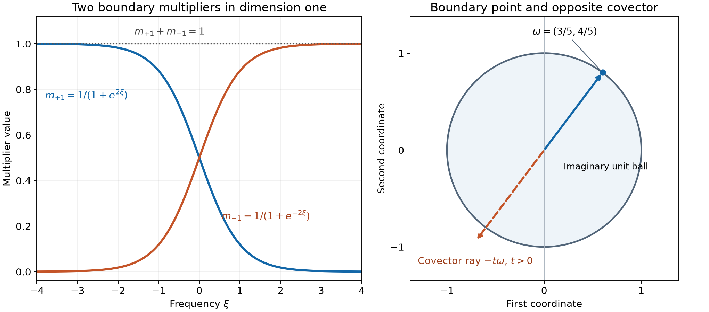

# Holomorphic decompositions of tempered distributions

*Written and self-checked by GPT-6 Astra (OpenAI), Ultra, October 2026. Public domain (CC0).*

Every tempered distribution can be recovered by averaging the boundary values of one holomorphic function over a sphere of imaginary directions. The function is uniquely determined by that average. Its individual boundary values can have analytic singularities only in the opposite cotangent direction. We construct this representation by Fourier multipliers, prove the converse from a global growth bound, and localize the directions carried by an arbitrary finite measure on the sphere.

We use the complete proofs in [Schwartz functions and Fourier inversion](../prerequisites/U011-free-foundations/schwartz-fourier-foundations-U017.md), F1–F5; [Lipschitz graphs and surface measures](lipschitz-graphs-and-surface-measures.md), Theorem 2.1 and its graph density; [Holomorphic boundaries in convex cones](holomorphic-boundaries-in-convex-cones.md), the polydisk Cauchy proof; [Holomorphic boundaries and analytic directions](holomorphic-boundaries-and-analytic-directions.md), Theorem 2; and [Cones and derivative-growth wavefronts](cones-and-derivative-growth-wavefronts.md), the definition, class comparisons, finite-sum and projection arguments. The finite integral Taylor formula is proved in [When a kernel is smooth](when-a-kernel-is-smooth.md), “Taylor estimates on compact neighborhoods.” The supplied [integration foundation](../prerequisites/U011-free-foundations/banach-foundation-bridges.md), Sections 15.0–15.1 and 16.1–16.2, supplies convergence, product integration and linear changes of variables.

All distributional pairings are complex linear, without conjugation. Our Fourier kernels are \(e^{-ix\cdot\xi}\) and \((2\pi)^{-n}e^{ix\cdot\xi}\). Let

\[
 S=S^{n-1}=\{\omega\in\mathbb R^n:|\omega|=1\},\qquad
 T=\{x+iy:|y|<1\},\qquad n\ge1.
 \tag{1}
\]

Write \(d\sigma\) for Euclidean surface measure. In dimension one, it gives mass one to each of \(-1,1\). For \(n>1\), the graph formula and rotation invariance in Theorem 2.1 apply to the unit ball. Compactness gives a finite graph cover, so \(0<\sigma(S)<\infty\). Positivity follows from any graph patch over a nonempty parameter ball. This measure is not normalized to total mass one.

## A spherical exponential and its reciprocal

Define a positive smooth function on real frequency space by

\[
 I(\xi)=\int_S e^{-\omega\cdot\xi}\,d\sigma(\omega),
 \qquad a=\frac{n-1}{2}.
 \tag{2}
\]

Compactness of the sphere permits every fixed derivative under the integral, by uniform difference quotients on compact frequency sets. Rotation invariance makes \(I\) radial and even. No complex continuation or zero statement about \(I\) is needed below.

**Lemma 1 (a cap estimate and reciprocal derivatives).** There are positive constants \(c,C\), depending only on dimension, such that

\[
 c e^{|\xi|}(1+|\xi|)^{-a}\le I(\xi)\le C e^{|\xi|}.
 \tag{3}
\]

For every fixed multiindex \(\alpha\),

\[
 |\partial^\alpha I(\xi)|\le I(\xi),\qquad
 |\partial^\alpha(I^{-1})(\xi)|\le C_\alpha I(\xi)^{-1}.
 \tag{4}
\]

**Proof.** The upper estimate is immediate from \(-\omega\cdot\xi\le|\xi|\). If \(n=1\), then \(I(\xi)=e^\xi+e^{-\xi}\), so (3) holds with \(a=0\). Suppose \(n>1\), put \(\rho=|\xi|\), and rotate so that \(\xi=\rho e_1\). The sphere near \(-e_1\) has the graph
\(\omega(t)=(-\sqrt{1-|t|^2},t)\), for \(t\in\mathbb R^{n-1}\), \(|t|<1/2\). Its graph-area density is \((1-|t|^2)^{-1/2}\ge1\), by differentiating the graph and using the stated density formula. Set \(r=1/(2\sqrt{1+\rho})\). On \(|t|<r\), the elementary inequality \(\sqrt{1-s}\ge1-s\), \(0\le s\le1\), gives

\[
 -\omega(t)\cdot\xi\ge\rho-\rho r^2\ge\rho-\tfrac14.
 \tag{5}
\]

The parameter ball has volume \(v_{n-1}r^{n-1}\), by linear scaling. Its constant \(v_{n-1}\) is finite and positive because the unit ball lies in a finite cube and contains a positive-volume cube. Integrating only this cap proves the lower bound, including \(\rho=0\).

Differentiating (2) inserts \((-\omega)^\alpha\), whose absolute value is at most one. This proves the first inequality in (4). Let \(J=I^{-1}\). For \(|\alpha|>0\), differentiate \(IJ=1\) and isolate the term with no derivative on \(I\):

\[
 I\partial^\alpha J
   =-\sum_{0<\beta\le\alpha}\binom\alpha\beta
                   (\partial^\beta I)(\partial^{\alpha-\beta}J).
 \tag{6}
\]

Induction on \(|\alpha|\), starting with \(J=1/I\), bounds the right side by a fixed constant. Dividing by positive \(I\) proves the second assertion. Constants here may depend on the fixed derivative order; no all-order analytic estimate has been asserted. \(\square\)

For \(|y|\le1\), define

\[
 m_y(\xi)=\frac{e^{-y\cdot\xi}}{I(\xi)}.
 \tag{7}
\]

**Lemma 2 (multipliers on the closed imaginary ball).** For every \(\alpha\), uniformly over \(|y|\le1\),

\[
 |\partial_\xi^\alpha m_y(\xi)|
 \le C_\alpha(1+|\xi|)^a e^{-|\xi|-y\cdot\xi}.
 \tag{8}
\]

These multipliers act continuously on \(\mathcal S\), with a common bound for each output seminorm. For each \(\phi\in\mathcal S\), \(y\mapsto m_y\phi\) is continuous in every Schwartz seminorm on the closed ball. If \(|y|<1\), then \(m_y\in\mathcal S\), and every one of its seminorms is bounded by a fixed power of \((1-|y|)^{-1}\).

**Proof.** Apply the finite product rule to (7), use \(|y_j|\le1\), and then (3)–(4). Since \(|\xi|+y\cdot\xi\ge0\), the right side of (8) is at most a polynomial. The product rule and the weighted seminorm equivalence in F1 give the common multiplier bounds.

One derivative in \(y_j\) inserts \(-\xi_j\). Differentiating also in \(\xi\), using the product rule again, gives a bound \(C_\alpha(1+|\xi|)^{a+1}\) on the closed ball. Integrating along the segment from \(y\) to \(y'\), which remains in that ball, therefore bounds each Schwartz seminorm of \((m_y-m_{y'})\phi\) by \(C|y-y'|\) times finitely many seminorms of \(\phi\). This proves the claimed continuity, uniformly for \(\phi\) in any set with those seminorms bounded.

Inside the ball set \(\delta=1-|y|>0\). The exponential in (8) is at most \(e^{-\delta|\xi|}\). For every nonnegative integer \(k\),
\(r^k e^{-\delta r}\le k!\delta^{-k}\), by the \(k\)-th term of the exponential series. Choose an integer larger than the total polynomial weight in any requested seminorm. This proves both rapid decrease and its power bound in \(\delta^{-1}\). The same argument applies after any fixed number of \(x\)- or \(y\)-derivatives of \(e^{ix\cdot\xi}m_y\): these insert only polynomial frequency factors, and derivatives in \(\xi\) also insert polynomial factors in \(x\). \(\square\)

## A holomorphic function for every tempered distribution

**Theorem 3 (existence and the averaging identity).** For every \(u\in\mathcal S'(\mathbb R^n)\), the formula

\[
 U(x+iy)=(2\pi)^{-n}
       \widehat u\bigl(e^{ix\cdot\xi}m_y(\xi)\bigr),\qquad |y|<1,
 \tag{9}
\]

defines a holomorphic function in \(T\). There exist nonnegative integers \(A,B\) and a constant \(C\) such that

\[
 |U(x+iy)|\le C(1+|x|)^A(1-|y|)^{-B}.
 \tag{10}
\]

Its slices have a continuous extension to the closed imaginary ball, as tempered distributions:

\[
 B_y=\mathcal F^{-1}(m_y\widehat u),\quad |y|\le1,
 \qquad B_y=U(\,·+iy)\quad(|y|<1).
 \tag{11}
\]

Continuity means convergence on every Schwartz test; the family has one finite Schwartz-seminorm bound. In particular, every approach inside the ball to \(\omega\in S\) has boundary \(B_\omega\), and

\[
 u(\phi)=\int_S B_\omega(\phi)\,d\sigma(\omega)
 \qquad(\phi\in\mathcal S).
 \tag{12}
\]

**Proof.** The argument of \(\widehat u\) in (9) is Schwartz by Lemma 2. Its dependence on \(x,y\) is smooth in every Schwartz seminorm on compact subsets of \(T\). To justify this assertion explicitly, differentiate its elementary exponential. A finite Taylor remainder in a parameter is bounded by the next one or two parameter derivatives on a compact neighborhood; Lemma 2 bounds these in every requested seminorm. The remainders therefore tend to zero in that seminorm. Continuity of the tempered pairing permits all those derivatives in (9). They give
\(\partial_{y_j}U=i\partial_{x_j}U\). Smoothness and the one-variable Cauchy–Riemann theorem make \(U\) holomorphic in each coordinate; the polydisk argument gives joint holomorphy and local power series.

Choose an integer \(M\) so the defining bound for \(\widehat u\) is at most a constant times
\(\max_{|\beta|\le M}\sup_\xi(1+|\xi|)^M|\partial_\xi^\beta\psi(\xi)|\).
The product rule in (9) gives at most \((1+|x|)^M\) times finitely many expressions \((1+|\xi|)^{M+a}e^{-\delta|\xi|}\). The last part of Lemma 2 bounds these by \(C\delta^{-B}\) for a sufficiently large integer \(B\). Thus (10) holds with \(A=M\).

To identify the slice, integrate (9) against \(\phi(x)\in\mathcal S\). This exchange with a tempered pairing is justified in its actual finite seminorms: after any fixed \(\xi\)-derivative, the integrand is bounded in each required weighted supremum by \(C(1+|x|)^N|\phi(x)|\), which is integrable by F1. Truncate to boxes, approximate by finite Riemann sums in each of those seminorms, and let the boxes increase. The stated integrable majorant controls the tails and permits the continuous linear functional to pass to the limit. The resulting Schwartz function is
\(m_y(\xi)(2\pi)^{-n}\int e^{ix\cdot\xi}\phi(x)\,dx=m_y\mathcal F^{-1}\phi\).
By the transposed inverse convention in F5, this is exactly the pairing in (11). Lemma 2, the finite bound for \(\widehat u\), and continuity of the inverse Fourier transform on tests prove the stated closed-ball continuity and common bound.

Finally,

\[
 \int_S m_\omega(\xi)\,d\sigma(\omega)=1.
 \tag{13}
\]

Multiplying by a Schwartz test, this equality holds with all its derivatives and in every Schwartz seminorm. Indeed (8) supplies a common polynomial bound for each derivative and the sphere has finite measure; compact-frequency differentiation and weighted tail estimates justify the integral in those seminorms. Applying \(\widehat u\), then the inverse Fourier transform, gives (12), with exactly the unnormalized surface measure used in (2). \(\square\)

For \(u=\delta_0\), formula (9) gives the ordinary absolutely convergent integral

\[
 K(z)=(2\pi)^{-n}\int_{\mathbb R^n}
                   \frac{e^{iz\cdot\xi}}{I(\xi)}\,d\xi,
 \qquad z\in T.
 \tag{14}
\]

Every slice \(K(\,·+iy)\) is Schwartz, by Fourier inversion and Lemma 2. Its sphere average at the distributional boundary is \(\delta_0\). Formula (14) defines the kernel only on the displayed tube here; continuation of that kernel beyond the tube is a separate question.

## The converse and uniqueness

**Theorem 4 (every polynomial-growth tube function has this form).** Suppose \(V\) is holomorphic on \(T\) and satisfies (10) for some nonnegative integers \(A,B\). Its slices extend continuously on Schwartz tests to \(|y|\le1\), with one finite seminorm bound. Let \(V_\omega\) denote the boundary distributions, and set

\[
 v(\phi)=\int_S V_\omega(\phi)\,d\sigma(\omega).
 \tag{15}
\]

Then \(v\) is tempered and \(V\) is exactly the function (9) constructed from \(v\). In particular, a holomorphic function with this growth is uniquely determined by its spherical boundary average.

**Proof of the boundary limit.** Put \(q=B+1\), \(D_\theta=\theta\cdot\partial_x\), and \(|\theta|=1\). For \(0\le r<1\), Taylor's formula in the real parameter \(r\), with its integral remainder, gives

\[
 \begin{aligned}
 V_{r\theta}(\phi)
 ={}&\sum_{j=0}^{q-1}\frac{(-ir)^j}{j!}
                              V_0(D_\theta^j\phi)\\
 &+\frac{(-i)^q r^q}{(q-1)!}
       \int_0^1(1-t)^{q-1}V_{rt\theta}(D_\theta^q\phi)\,dt.
 \end{aligned}
 \tag{16}
\]

Here \(V_y(\phi)=\int V(x+iy)\phi(x)\,dx\) at interior heights. To justify its parameter derivatives, a polydisk of radius less than a fixed multiple of \(1-|y|\) and the Cauchy estimates from the earlier polydisk proof bound every fixed derivative of \(V\) by \(C_y(1+|x|)^A\), uniformly on compact sets of heights. Thus differentiation under the real integral is permitted. Cauchy–Riemann and integration by parts give
\(\frac{d^j}{dr^j}V_{r\theta}(\phi)=(-i)^jV_{r\theta}(D_\theta^j\phi)\).
For noncompact Schwartz tests, integration by parts follows first with large compact cutoffs and then by the rapid tails of \(\phi\), its derivatives, and the polynomial derivative bounds just established. This proves (16) with its sign and factorial.

The remainder is dominated, uniformly in \(r<1\) and \(\theta\in S\), by a constant times

\[
 (1-t)^{q-1-B}
    \sum_{|\alpha|=q}\int(1+|x|)^A|\partial^\alpha\phi(x)|\,dx.
 \tag{17}
\]

The exponent is zero. We used \(1-rt\ge1-t\) and the finite multinomial expansion of \(D_\theta^q\), whose coefficient absolute sum is at most \(n^q\). The integrals in (17), and the finite terms in (16), are bounded by finitely many Schwartz seminorms using F1. Dominated convergence therefore defines (16) at \(r=1\) and proves continuity jointly in \(r,\theta\) for each test. At \(r=0\), the positive-degree terms and the factor \(r^q\) vanish, uniformly in \(\theta\), so the resulting extension is continuous on the whole closed ball. Its same estimate gives a common finite seminorm bound. Hence (15) is tempered. This argument proves all approaches to the sphere, not only one fixed radius.

**Proof of the normalization.** Let \(W_y=\mathcal F V_y\). Cauchy–Riemann gives
\(\partial_{y_j}W_y=-\xi_jW_y\) at interior heights. For a compactly supported smooth frequency test \(\psi\) and a fixed interior vector \(y\), differentiate
\(W_{ty}(e^{t y\cdot\xi}\psi)\), \(0\le t\le1\). The two terms cancel. Thus, as distributions on compact frequency tests,

\[
 W_y=e^{-y\cdot\xi}W_0.
 \tag{18}
\]

The closed-ball convergence just proved extends (18) to \(y=\omega\). All exponentials in this argument multiply compact tests, so no exponentially growing multiplier on the whole Schwartz space is being assumed. Integrating on the sphere yields
\(\widehat v=I W_0\) on compact tests. Multiplication by the positive smooth reciprocal gives \(W_0=I^{-1}\widehat v\) there. The right side is tempered by Lemma 2 at \(y=0\). Both sides therefore agree on all Schwartz tests, because the compact-test density in F1 makes restriction to compact tests injective. Applying (18) again shows
\(W_y=m_y\widehat v\), first on compact tests and then on Schwartz tests. Fourier inversion and Theorem 3 identify each interior slice with (9). Both slice functions are continuous; equality as distributions is pointwise equality, by the bump-test argument proved in the cone-boundary lesson. This proves the theorem and uniqueness. \(\square\)

## Selecting directions with a measure on the sphere

Let \(\mu\) be any finite signed or complex Borel measure on \(S\), let \(|\mu|\) be its total variation, and let \(E=\operatorname{supp}|\mu|\). Define

\[
 u_\mu(\phi)=\int_S B_\omega(\phi)\,d\mu(\omega).
 \tag{19}
\]

The common finite seminorm bound in Theorem 3 proves that this is tempered. A finite complex measure here is equivalently a finite linear combination of finite positive measures; the usual absolute integral bound uses its total variation. No positivity assumption on \(\mu\) is needed. Its support is closed, hence compact; the complement has zero total variation, as follows by covering it with the countable basis of zero-measure open sets in the compact metric sphere. Empty support therefore gives the zero measure.

**Theorem 5 (angular localization).** For the analytic wavefront convention of the earlier lessons,

\[
 \operatorname{WF}_A(u_\mu)
 \subset\{(x,\xi):\xi\ne0,
                         -\xi/|\xi|\in E\}.
 \tag{20}
\]

In particular, \(\operatorname{WF}_A(B_\omega)\) is contained in the single negative ray \(\{(x,-t\omega):t>0\}\).

**Proof.** First suppose an open convex cone \(\Gamma\) and \(c>0\) obey
\(\omega\cdot\eta<-c|\eta|\) for every \(\omega\in E\), \(\eta\in\Gamma\). Decrease \(c\) below one. If \(\eta\in\Gamma\) and \(0<|\eta|<c\), then

\[
 |\omega+\eta|^2<1-c|\eta|,
 \qquad 1-|\omega+\eta|>\tfrac c2|\eta|.
 \tag{21}
\]

Indeed the square is \(1+2\omega\cdot\eta+|\eta|^2\), and \(1-s=(1-s^2)/(1+s)\) with \(0\le s<1\) gives the second bound. Consequently

\[
 H(z)=\int_E U(z+i\omega)\,d\mu(\omega)
 \tag{22}
\]

is holomorphic for \(\operatorname{Im}z\in\Gamma\), \(|\operatorname{Im}z|<c\), and satisfies
\(|H(x+i\eta)|\le C' (1+|x|)^A|\eta|^{-B}\).
On compact subsets the imaginary points stay a positive distance from the sphere, and Cauchy estimates justify differentiation under this finite-measure integral. The boundary of (22) is (19): for any fixed compact real test, continuity of \(B_y(\phi)\) on the compact closed ball makes \(B_{\omega+\eta}(\phi)\to B_\omega(\phi)\) uniformly over \(\omega\in E\); their common bound also justifies the real and sphere integrations. The analytic dual-cone theorem therefore places the wavefront of (19) in \(\Gamma^*\setminus\{0\}\).

Now fix a unit covector \(\nu\) with \(-\nu\notin E\). For each \(\omega\in E\), put \(v_\omega=-(\omega+\nu)\). Then

\[
 \omega\cdot v_\omega=\nu\cdot v_\omega
            =-(1+\omega\cdot\nu)<0.
 \tag{23}
\]

Strictness holds because equality for unit vectors would give \(\omega=-\nu\). Choose a small spherical neighborhood of \(\omega\) whose closure retains the first strict inequality for this fixed \(v_\omega\). Compactness gives finitely many such neighborhoods covering \(E\). Assign points to the first neighborhood containing them; these disjoint Borel pieces partition \(E\). Restrict \(\mu\) to these pieces, obtaining \(\mu_j\); their supports lie in the corresponding closed neighborhoods.

For each support \(E_j\), compactness and strict negativity permit a \(c_j>0\) such that the cone
\(\Gamma_j=\{\eta:\omega'\cdot\eta<-c_j|\eta|\text{ for every }\omega'\in E_j\}\)
contains its chosen \(v_j\). This cone is open because the maximum over compact \(E_j\) is continuous; it is convex and conic by the triangle inequality and homogeneity. Since \(\nu\cdot v_j<0\), \(\nu\notin\Gamma_j^*\). The preceding paragraph excludes \((x,\nu)\) from each \(\operatorname{WF}_A(u_{\mu_j})\). The finite-sum wavefront inclusion from the earlier lesson excludes it from their sum (19). Positive conicity proves (20) for every nonzero \(\xi\). For a point mass at \(\omega\), the support is \(\{\omega\}\), giving the last assertion. \(\square\)

The same inclusion holds for every derivative-growth wavefront \(\operatorname{WF}_L\) from the preceding lessons, since those classes contain the analytic class and \(\operatorname{WF}_L\subset\operatorname{WF}_A\).

**Proposition 6 (local regularity at the selected boundary point).** Say that \(U\) is \(C^L\) at \(x_0+i\omega_0\) if some complex ball about that point and constants \(P,Q>0\) satisfy

\[
 |\partial_x^\alpha U(z)|\le P(Q L_{|\alpha|})^{|\alpha|}
 \quad\text{inside that ball and }T,
 \tag{24}
\]

with the zeroth order bounded by \(P\). Then

\[
 \operatorname{WF}_L(u_\mu)
 \subset\{(x,\xi):\xi\ne0,\ -\xi/|\xi|\in E,
                \ U\text{ is not }C^L\text{ at }x-i\xi/|\xi|\}.
 \tag{25}
\]

**Proof.** First take a smaller complex ball concentric with the one in (24). The intersection of the original ball and \(T\) is convex. For each fixed \(\alpha\), Cauchy–Riemann identifies imaginary derivatives of \(\partial_x^\alpha U\) with \(i\) times its next real derivatives. The finite bounds in (24) at order \(|\alpha|+1\) therefore give a Lipschitz bound along every segment in this intersection. Thus \(\partial_x^\alpha U\) has a unique continuous extension to its closure, preserving its order-\(|\alpha|\) bound. Existence follows by taking an interior sequence to a boundary point, the Lipschitz bound makes its values Cauchy, and the same bound makes the limit independent of the sequence.

For \(x\) near \(x_0\) and \(\omega\) in a sufficiently small closed spherical cap about \(\omega_0\), these extensions give functions \(b_\omega(x)\). To check their derivatives, apply the real fundamental theorem along a small coordinate segment at height \(r\omega\), \(r<1\), and pass uniformly to the limit as \(r\uparrow1\). It gives the same fundamental theorem with the extended first derivative. Repeating for each \(\alpha\) proves that \(b_\omega\) is smooth with exactly the derivatives and bounds in (24). Uniform convergence on compact real sets identifies its distribution with \(B_\omega\) there. Integrating over any measure supported in this cap gives a \(C^L\) function with bound (24) multiplied by the measure's total variation.

If \(\omega_0=-\xi/|\xi|\) and (24) holds, restrict \(\mu\) first to a small open cap about \(\omega_0\) whose closure has this regularity. Its contribution is \(C^L\) near \(x_0\), hence has no \(L\)-wavefront there by the projection theorem. The remaining measure has support outside that cap, so (20) excludes the direction \(\xi\) for its contribution, and hence excludes its \(L\)-wavefront there. The finite-sum rule proves the exclusion for \(u_\mu\). If \(-\xi/|\xi|\notin E\), (20) already provides it. These are precisely the two exclusions in (25). \(\square\)

## Two exact pictures of the representation

In dimension one, the sphere consists of two points, and

\[
 \begin{gathered}
 I(\xi)=2\cosh\xi,\qquad m_{+1}+m_{-1}=1,\\
 m_{+1}(\xi)=\frac1{1+e^{2\xi}},\qquad
 m_{-1}(\xi)=\frac1{1+e^{-2\xi}}.
 \end{gathered}
 \tag{26}
\]

Thus \(u=B_{+1}+B_{-1}\). The top boundary can carry only negative analytic directions, and the bottom boundary only positive ones. The smooth multipliers overlap near zero; they are not characteristic functions of half-lines.

*Left: the two exact functions in (26), displayed by numerical sampling for \(-4\le\xi\le4\). Their sum is identically one by algebra. Right: the two-dimensional imaginary unit circle, the exact boundary point \(\omega=(3/5,4/5)\), and the direction \(-\omega\) in cotangent space, drawn with the same coordinate axes for comparison. The dashed arrow represents a covector direction, not an additional imaginary displacement. Theorem 5 proves the orientation. [Editable figure source](../figures/holomorphic-sphere-directions.py).*

For a plane wave \(u(x)=e^{ix\cdot\lambda}\), \(\lambda\in\mathbb R^n\), the representation is equally explicit:

\[
 U(z)=\frac{e^{iz\cdot\lambda}}{I(\lambda)},\qquad
 B_\omega(x)=e^{ix\cdot\lambda}
                         \frac{e^{-\omega\cdot\lambda}}{I(\lambda)}.
 \tag{27}
\]

Indeed F4 inversion on tests gives \(\widehat u=(2\pi)^n\delta_\lambda\), and substitution in (9) proves (27). Integrating the boundary coefficient gives one by (2). These individual plane-wave boundaries are analytic, so the ray bound in Theorem 5 need not be attained for every distribution.

## Exercises with complete solutions

**Exercise 1 — the constant function (foundation).** Compute the tube function and every boundary value when \(u=1\), in all dimensions. Explain the normalization in dimension one.

**Solution.** In (27), set \(\lambda=0\). Then \(I(0)=\sigma(S)\) and \(U=B_\omega=1/\sigma(S)\). Its sphere average is exactly one. In dimension one, \(\sigma(S^0)=2\), so each boundary contributes \(1/2\). Replacing surface measure by a probability measure while retaining this \(I\) would give the wrong normalization; both definitions would have to change together. \(\square\)

**Exercise 2 — a sphere of radius \(R\) (intermediate).** For \(R>0\), average boundary values at \(iR\omega\) using the same unit-sphere measure \(d\sigma(\omega)\). Find the multiplier and the representation of a plane wave. Distinguish this convention from integration with Euclidean area measure on the radius-\(R\) sphere.

**Solution.** Replace (2) by \(I_R(\xi)=I(R\xi)\), and use \(m_y^R=e^{-y\cdot\xi}/I(R\xi)\) for \(|y|\le R\). The estimates follow by scaling the frequency variable in Lemmas 1–2; their constants may depend on \(R\). Formula (9) on \(|y|<R\) and the same averaging calculation give \(U(z)=e^{iz\cdot\lambda}/I(R\lambda)\) for the plane wave. The boundary average with the specified unit-sphere measure is one times that wave. The graph density shows that dilation by \(R\) multiplies surface measure by \(R^{n-1}\): the parameter Jacobian contributes \(R^{n-1}\), while the graph slope is unchanged. Thus averaging with the actual area measure on the larger sphere requires the denominator \(R^{n-1}I(R\xi)\). In dimension one that factor is \(R^0=1\), consistent with two unit point masses. \(\square\)

**Exercise 3 — arbitrary angular partitions (intermediate).** Let \(E_1,\ldots,E_N\) be a Borel partition of the unit sphere. Define \(u_j=\int_{E_j}B_\omega\,d\sigma\). Prove that \(u=\sum_j u_j\), and give a valid directional bound even when the partition boundaries have positive area.

**Solution.** Finite additivity of the integrals on Schwartz tests and (12) give the exact sum. Put \(\mu_j=1_{E_j}\sigma\). This is a finite positive measure whose support is contained in \(\overline{E_j}\), regardless of the measure of the partition boundary. Theorem 5 gives
\(\operatorname{WF}_A(u_j)\subset\{(x,\xi):\xi\ne0,-\xi/|\xi|\in\operatorname{supp}\mu_j\}\), and hence the weaker valid bound using \(\overline{E_j}\). No null-boundary assumption was used. Formula (25) also excludes any such point at which the common tube function has the specified \(C^L\) boundary regularity. \(\square\)

**Exercise 4 — nonunique families and a unique tube (advanced).** A spherical family of tempered distributions can have zero average without vanishing. Give an example in every dimension, and prove that it cannot be the boundary family of a polynomial-growth holomorphic tube function unless it is zero.

**Solution.** Choose any nonzero \(h\in\mathcal S'\) and set \(H_\omega=\omega_1h\). Reflection in the first coordinate preserves surface measure and changes the sign of \(\omega_1\); hence \(\int_S\omega_1\,d\sigma=0\). The family is continuous, has a common finite seminorm bound, and its average is zero, but \(H_{e_1}=h\ne0\). If it were the boundary family of such a holomorphic tube function, Theorem 4 would identify that function with (9) for \(v=0\), which is identically zero. Its boundary family would then be zero too, a contradiction. In dimension one the same example is the pair \((h,-h)\). The uniqueness assertion concerns a single holomorphic tube function, rather than all possible families with the same average. \(\square\)

**Exercise 5 — why the opposite sign is forced (advanced).** For a point measure at \(\omega\), show directly that every unit covector \(\nu\ne-\omega\) is excluded by an inward cone. Explain why this construction fails exactly at \(\nu=-\omega\), and verify the statement for \(\omega=(3/5,4/5)\).

**Solution.** Take \(v=-(\omega+\nu)\). Equation (23) makes both \(\omega\cdot v\) and \(\nu\cdot v\) negative. A small open cone around \(v\) retains a bound \(\omega\cdot\eta<-c|\eta|\); (21) places the shifted imaginary points inside the unit ball, while \(\nu\cdot v<0\) excludes \(\nu\) from that cone's positive dual. The analytic boundary theorem therefore excludes \(\nu\). If \(\nu=-\omega\), any inward vector with \(\omega\cdot v<0\) instead has \(\nu\cdot v>0\), so this exclusion is impossible. For the given point the remaining possible unit direction is \((-3/5,-4/5)\), and all its positive multiples form the possible singular ray. This is an upper bound; for instance the plane wave in (27) has no singular direction at all. \(\square\)

## References

- The programme proofs linked at the beginning supply the exact surface measure, Schwartz operations and Fourier inversion, finite Taylor remainder, holomorphic boundary theorem, wavefront comparisons and projection used in the arguments above. Every spherical estimate and normalization needed here is proved in this lesson.
- Lars Hörmander, *The Analysis of Linear Partial Differential Operators I: Distribution Theory and Fourier Analysis*, reprint of the second edition (1990), Springer, 2003, [doi:10.1007/978-3-642-61497-2](https://doi.org/10.1007/978-3-642-61497-2), Section 8.4, equations (8.4.10)–(8.4.13), the decomposition and converse in Theorem 8.4.11, and Lemma 8.4.12. These provide the spherical representation and its directional interpretation. The cap estimate, real-frequency multiplier construction, detailed Taylor boundary argument and exercises here are independently organized and expressed. The full wavefront characterization in equation (8.4.17), including its converse kernel-continuation argument, is not asserted by this lesson.
