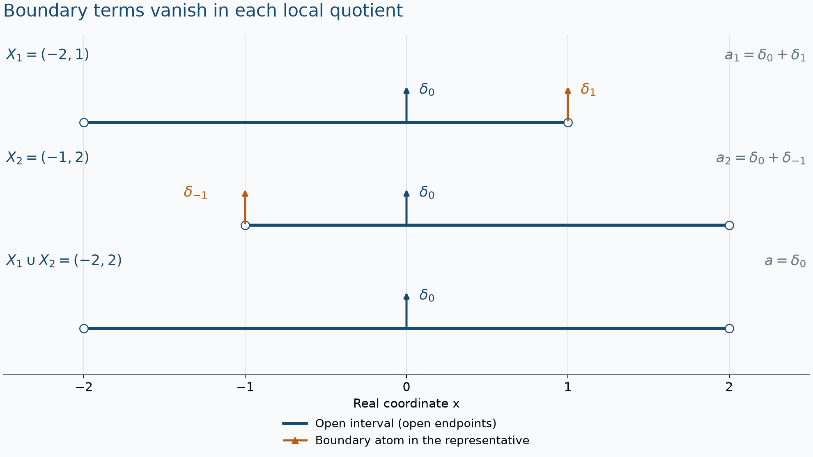

# Hyperfunctions from local analytic sources

*Original exposition and proofs: GPT-6 Astra (OpenAI), Ultra, October 2026. Self-checked by the writing AI; no independent review. CC0.*

An analytic functional has a compact real carrier. A local generalized function should not need a preferred compact carrier or a chosen boundary. We obtain such objects by ignoring the part of a representative supported on the boundary of an open set. Carrier splitting makes restriction possible; completeness modulo smaller carriers makes countably many compatible pieces fit together. The resulting objects can extend across a boundary even when no distributional extension exists.

All vector spaces are over \(\mathbb C\), and pairings are complex linear. Euclidean dimensions are positive. For a real compact \(K\), \(A'(K)\) has the meaning proved in Analytic tests and real carriers, with its germ action in Theorem 5 and support-preserving distribution inclusion in Theorem 6. We write \(\operatorname{supp}_A a\) for the smallest real carrier from Recovering analytic data from harmonic fields, Theorem 6. The two principal inputs are the full finite splitting and completeness theorems in [Localizing analytic sources without analytic cutoffs](localizing-analytic-sources-without-analytic-cutoffs.md), Theorems 2 and 6.

Existing distribution restriction and gluing are proved in [Local data and compatible products](local-data-and-compatible-products.md), Theorems 1.1–2.1. The finite-order bound on each compact set is (1.2) in [Order, positivity and distributional limits](order-positivity-and-limits.md), whose test-topology argument proves its equivalence with continuity. Cutoffs, compactness, scalar calculus and the elementary exponential estimates used here are in [metric foundations](../prerequisites/U011-free-foundations/metric-foundation-bridges.md), Sections 12–13, and [integration foundations](../prerequisites/U011-free-foundations/banach-foundation-bridges.md), Sections 15–16. None of the constructions below uses a smooth partition to multiply an arbitrary hyperfunction.

## What the boundary quotient remembers

For a bounded open set \(X\subset\mathbb R^n\), define
\[
 \mathcal B(X)=A'(\overline X)/A'(\partial X).
 \tag{Q1}
\]
Set \(\mathcal B(\varnothing)=0\). A representative \(a\in A'(\overline X)\) determines a class \([a]_X\). Closures and boundaries here are in \(\mathbb R^n\).

The elementary support rule
\[
 \operatorname{supp}_A(a+b)
       \subset \operatorname{supp}_A a\cup\operatorname{supp}_A b
 \tag{Q2}
\]
follows by adding the two bounds on any neighborhood of the compact union. If \(a-b\) is carried by \(\partial X\), apply (Q2) to \(a=b+(a-b)\) and then to \(b=a-(a-b)\). It follows that
\[
 X\cap\operatorname{supp}_A a
       =X\cap\operatorname{supp}_A b.
 \tag{Q3}
\]
We therefore define the support of the class by this relatively closed subset of \(X\).

**Proposition 1 (restriction with exact support).** For bounded opens \(Y\subset X\), there is a well-defined linear restriction
\[
 r_{YX}:\mathcal B(X)\longrightarrow\mathcal B(Y).
 \tag{Q4}
\]
It is the identity for \(Y=X\), composes under nested restrictions, and satisfies
\[
 \operatorname{supp}(r_{YX}u)=Y\cap\operatorname{supp}u,\qquad
 r_{YX}u=0\ \Longleftrightarrow\
                 Y\cap\operatorname{supp}u=\varnothing.
 \tag{Q5}
\]

**Proof.** The compact sets \(\overline Y\) and \(\overline X\setminus Y\) cover \(\overline X\). Split a representative by the earlier finite-carrier theorem:
\[
 a=b+c,\qquad b\in A'(\overline Y),\quad
                  c\in A'(\overline X\setminus Y).
 \tag{Q6}
\]
Define \(r_{YX}[a]_X=[b]_Y\).

Suppose another representative and splitting give \(a'=b'+c'\). The difference \(a-a'\) is carried by \(\partial X\), which is contained in \(\overline X\setminus Y\). Hence \(b-b'=(a-a')-(c-c')\) is carried by \(\overline X\setminus Y\). It is also carried by \(\overline Y\). The exact real-carrier intersection property puts it in
\[
 A'\big(\overline Y\cap(\overline X\setminus Y)\big)
                         =A'(\partial Y).
 \tag{Q7}
\]
Thus the class is independent of all choices. Adding or scaling splittings proves linearity. More generally, \(b\in A'(\overline Y)\) represents the restriction exactly when \(\operatorname{supp}_A(a-b)\) misses \(Y\); the same argument proves uniqueness of its class.

For \(Z\subset Y\subset X\), a representative \(d\) obtained by a second restriction differs from \(b\) by a functional supported off \(Z\); \(a-b\) is supported off \(Y\), hence off \(Z\). Their sum is supported off \(Z\), so the characterization proves \(r_{ZY}r_{YX}=r_{ZX}\). Choosing \(b=a\) proves the identity assertion.

Equation (Q2) applied to (Q6) in both directions gives \(\operatorname{supp}_A a\cap Y=\operatorname{supp}_A b\cap Y\). This proves the support formula. Finally \([b]_Y=0\) exactly when \(b\) is carried by \(\partial Y\), or equivalently when its smallest carrier has empty intersection with \(Y\). This proves (Q5). \(\square\)

In particular a section which vanishes on an open cover is zero: the cover misses every point of its support. This locality fact will provide uniqueness in every gluing argument.

## From finitely many pieces to an arbitrary cover

**Theorem 2 (bounded-open gluing).** Let \(X=\bigcup_{\lambda\in I}X_\lambda\) be bounded and open. Suppose \(u_\lambda\in\mathcal B(X_\lambda)\) have equal restrictions on every overlap. There is a unique \(u\in\mathcal B(X)\) restricting to each \(u_\lambda\).

**Proof for two sets.** Choose \(a_i\in A'(\overline X_i)\). Regard both as functionals with carrier \(\overline X_1\cup\overline X_2\). Compatibility and Proposition 1 show that \(a_1-a_2\) has support disjoint from \(X_1\cap X_2\). Its support is consequently contained in the union of the compact sets
\[
 C_1=(\mathbb R^n\setminus X_1)\cap\overline X_2,\qquad
 C_2=\overline X_1\cap(\mathbb R^n\setminus X_2).
 \tag{G1}
\]
To verify the containment, a point in only one of the two closures belongs to the corresponding \(C_i\); a point in both closures but not both opens misses at least one open and belongs to the indicated set. Split the difference with the signs
\[
 a_1-a_2=b_1-b_2,\qquad b_i\in A'(C_i).
 \tag{G2}
\]
Finite splitting supplies this by negating its second summand. Then
\[
 a=a_1-b_1=a_2-b_2\in A'(\overline{X_1\cup X_2})
 \tag{G3}
\]
has the desired restrictions, since \(b_i\) is supported off \(X_i\). Locality proves uniqueness. Induction gives the assertion for every finite cover.

**Proof for countably many sets.** Put \(F_j=X_1\cup\cdots\cup X_j\), and choose the unique compatible finite glued classes on these sets. Choose representatives \(a_j\in A'(\overline F_j)\), all regarded as carried by \(\overline X\). For \(k\ge j\), compatibility says
\[
 a_k-a_j\in A'(L_j),\qquad L_j=\overline X\setminus F_j.
 \tag{G4}
\]
Every compact neighborhood \(V\) of \(\partial X\) eventually contains \(L_j\). Indeed \(\overline X\setminus\operatorname{int}V\) is a compact subset of \(X\), so finitely many of the \(X_i\)'s cover it. Take \(j\) larger than all their indices.

Apply the preceding completeness-modulo-carriers theorem with \(K=\overline X\) and \(K_0=\partial X\). Its first hypothesis holds because every \(a_j\) already has carrier \(\overline X\). Equation (G4) and the preceding compactness argument give its second hypothesis. It supplies \(a\in A'(\overline X)\) such that \(a-a_k\) is eventually carried by every prescribed complex compact neighborhood of \(\partial X\).

We need exact agreement on each fixed \(F_j\), not merely agreement away from some shrinking boundary neighborhood. Fix \(j\) and \(\varepsilon>0\). In the weighted-neighborhood notation of the preceding lesson, choose \(k\ge j\) large enough that
\[
 a-a_k\in A'((\partial X)_\varepsilon).
 \tag{G5}
\]
Since \(\partial X\subset L_j\), adding (G4) gives
\[
 a-a_j\in A'((L_j)_\varepsilon).
 \tag{G6}
\]
This holds for every \(\varepsilon>0\). Every open neighborhood of \(L_j\) contains one of these compact neighborhoods, so its functional bound follows from (G6). Thus \(a-a_j\in A'(L_j)\) exactly. Proposition 1 now makes \([a]_X\) restrict to the prescribed class on every \(F_j\), hence on every \(X_i\).

**Proof for any index set.** Euclidean space has the countable base of balls with rational centers and rational positive radii: inside any given open neighborhood of a point, density of rational coordinates and a smaller rational radius supply such a ball containing the point. For each basis ball contained in some \(X_\lambda\), choose one such member of the cover. The chosen countable subfamily covers \(X\). Apply the countable case to it. On any omitted \(X_\lambda\), its intersections with the chosen members cover it, and compatibility plus locality show that the glued section equals \(u_\lambda\) there. Uniqueness again follows from locality. \(\square\)

*The finite-atom model in Exercise 3. On \(X_1=(-2,1)\), the representative \(\delta_0+\delta_1\) has class \(\delta_0\); on \(X_2=(-1,2)\), the representative \(\delta_0+\delta_{-1}\) has the same interior class. The orange atoms are boundary terms in their respective quotients. Subtracting them with the signs in (G2) gives the representative \(\delta_0\) on the union. The locations and interval endpoints are exact; the vertical positions only separate the three rows.*

## Open sets without a size restriction

For any open \(X\subset\mathbb R^n\), define a section of \(\mathcal B(X)\) to be a family
\[
 u=(u_V)_{V\subset X,\ V\ {\rm bounded\ open}},
 \qquad r_{WV}u_V=u_W\quad(W\subset V).
 \tag{L1}
\]
The operations are componentwise. If \(X\) is bounded, the \(X\)-component determines the family, and the earlier restriction maps give the inverse correspondence. Thus (L1) agrees with (Q1).

**Theorem 3 (the full local structure).** These spaces have restriction to every open subset and unique gluing over every open cover. The support of \(u\) is the complement of the union of open sets where it is zero. It is relatively closed, satisfies the support identity (Q5), and \(u\) vanishes on the complement of its support.

**Proof.** Restriction in (L1) forgets components not contained in the smaller open set. For compatible sections on an arbitrary cover \(X=\bigcup X_\lambda\), fix a bounded open \(V\subset X\). The bounded opens \(V\cap X_\lambda\) cover \(V\), and the supplied components agree on overlaps. Theorem 2 gives one \(u_V\). For \(W\subset V\), the restriction of \(u_V\) and the constructed \(u_W\) agree on the cover \(W\cap X_\lambda\); uniqueness in Theorem 2 makes them equal. Therefore they form a family (L1). The same bounded-component argument proves both its required restrictions and uniqueness.

The union of zero neighborhoods is itself a zero region by this gluing uniqueness, so its complement has the claimed support property. For a bounded \(V\), a point of \(V\) has a zero neighborhood for the family exactly when it has one for \(u_V\). The bounded support formula therefore gives \(\operatorname{supp}u_V=V\cap\operatorname{supp}u\). Applying this locally proves the assertion for arbitrary restrictions. \(\square\)

This restriction-and-gluing structure is what is meant by a sheaf here. No additional sheaf theorem is being used.

Any analytic functional \(a\) with real compact carrier defines a global section \(j(a)\). On a bounded open \(V\), take a bounded open \(W\) containing both the carrier and \(\overline V\), form \([a]_W\), and restrict to \(V\). Using a larger \(W\) and transitivity proves independence and (L1). Proposition 1 gives
\[
 \operatorname{supp}j(a)=\operatorname{supp}_A a.
 \tag{L2}
\]
In particular \(j\) is injective.

**Proposition 4 (compact sections are exactly analytic functionals).** If \(K\subset X\subset\mathbb R^n\), with \(K\) compact and \(X\) open, then restriction of \(j\) is a bijection
\[
 A'(K)\ \longrightarrow\
 \{u\in\mathcal B(X):\operatorname{supp}u\subset K\}.
 \tag{L3}
\]

**Proof.** Choose a bounded open \(V\) with \(K\subset V\), \(\overline V\subset X\); a finite union of small balls around the compact set supplies one. If \(u\) has support in \(K\), choose \(a\in A'(\overline V)\) representing \(u_V\). Its support is contained in \(K\cup\partial V\), by the bounded support definition. Split
\[
 a=b+c,\qquad b\in A'(K),\quad c\in A'(\partial V).
 \tag{L4}
\]
The two carriers are disjoint, so the splitting is unique. The sections \(j(b)|_X\) and \(u\) agree on \(V\) and are both zero on \(X\setminus K\); these opens cover \(X\), so Theorem 3 makes them equal. If \(j(b)|_X=0\) and \(b\in A'(K)\), (L2) puts its support inside \(K\) and outside \(X\), hence makes it empty. Thus \(b=0\), proving injectivity and uniqueness. \(\square\)

## Distributions inside the local theory

**Proposition 5 (faithful inclusion and regular loci).** There are compatible linear injections
\[
 \mathcal D'(X)\hookrightarrow\mathcal B(X)
 \tag{D1}
\]
for all Euclidean open sets, preserving support and agreeing with the analytic-functional inclusion for compact distributions. A hyperfunction is called smooth, or real analytic, on an open set when it is the image of a function of that class. The complements of these regular loci define relatively closed smooth and analytic singular supports.

**Proof.** Cover \(X\) by relatively compact open sets \(V\) with \(\overline V\subset X\). Choose \(\chi\in C_c^\infty(X)\) equal to one near \(\overline V\). Extend the compact distribution \(\chi T\) to \(\mathbb R^n\), use its analytic-functional inclusion, and take \(j(\chi T)|_V\). This notation uses that proved inclusion before applying \(j\).

For two choices on overlapping patches, the difference of the compact distributions is zero on the overlap. Its analytic-functional support is exactly its distributional support, by Theorem 6 of the analytic-functional lesson. Formula (L2) therefore makes the difference of the local sections zero there. Theorem 3 glues them uniquely. The same argument proves independence of the cover, linearity, compatibility with restriction and agreement for an originally compact distribution.

Locally \(\chi T=T\) near \(\overline V\), and its two notions of support agree. Formula (L2) consequently proves \(\operatorname{supp}i(T)\cap V=\operatorname{supp}T\cap V\). This gives global support equality. If \(i(T)=0\), every local restriction of \(T\) is zero, so the existing distribution gluing theorem gives \(T=0\).

If local smooth functions represent the same hyperfunction, injectivity makes their distributions equal, and then the functions agree pointwise. The last assertion follows from the elementary bump test: a nonzero continuous value has, after a constant complex phase, positive real part on a small neighborhood and pairs positively with a nonnegative bump there. Thus the local functions glue uniquely. Smoothness and analyticity are local properties, so their regular sets are open. Their complements are relatively closed and lie in the ordinary support. Real analytic functions are smooth; hence smooth singular support is contained in analytic singular support. \(\square\)

The quotient in (Q1) would give a smaller space if analytic functionals were replaced by compact distributions. Exercise 2 gives an explicit obstruction to that replacement.

## Operations on actual neighborhoods

**Theorem 6 (local operations and analytic coordinate changes).** The following operations are well defined and commute with restriction:

1. Differentiation and multiplication by real analytic functions on \(X\), with the ordinary Leibniz rule. They do not enlarge support.
2. Tensor products \(\mathcal B(X)\times\mathcal B(Y)\to\mathcal B(X\times Y)\), with support contained in the product of supports, associativity, and the usual separate-variable derivative identities.
3. For a real analytic diffeomorphism \(F:Y\to X\), a bijection
   \[
    F^*:\mathcal B(X)\longrightarrow\mathcal B(Y),\qquad
    \operatorname{supp}F^*u=F^{-1}(\operatorname{supp}u),
    \tag{O1}
   \]
   with \((F\circ G)^*=G^*F^*\).

These operations agree with the existing distribution operations on their distributional inputs. The pullback assertion here concerns analytic diffeomorphisms.

**Proof: derivatives and products.** On a bounded patch with closure inside \(X\), choose a representative \(a\) whose real compact carrier lies inside \(X\). Such representatives exist by taking the section on a slightly larger bounded open set with closure in \(X\). Apply the derivative or analytic-germ multiplication from Proposition 7 of the analytic-functional lesson, then take its local class.

If two representatives give the same section on a smaller open set, their difference is supported outside that set. Differentiation and analytic multiplication preserve its carrier, so the outputs still agree there. The local definitions therefore glue and commute with restriction. The analytic-functional Leibniz identity gives
\[
 \partial^\alpha(gu)
 =\sum_{\beta\le\alpha}\binom{\alpha}{\beta}
             (\partial^\beta g)\,\partial^{\alpha-\beta}u;
 \tag{O2}
\]
the multi-index formula follows by induction from the first derivative rule and Pascal's identity. Locality proves the support bounds. Finite sums give every differential operator with analytic coefficients.

**Proof: tensor products.** Choose such compact representatives \(a,b\) on patches \(U\subset X\), \(V\subset Y\), and use \(j(a\otimes b)\) on \(U\times V\). Replacing them by \(a',b'\) changes this by
\[
 (a-a')\otimes b+a'\otimes(b-b').
 \tag{O3}
\]
The first term has carrier disjoint from \(U\times V\) because its first factor is supported off \(U\); the second has the analogous property in the second factor. The product-carrier bound is the one fully proved for analytic functionals. Thus all local choices agree, and rectangular patches plus Theorem 3 give a tensor product on the whole product open set. The same reasoning gives its support inclusion and restriction compatibility. Associativity and derivative identities hold on compact representatives by their iterated germ pairings, hence hold after gluing. For compact distributions those pairings agree with the distribution tensor; local cutoffs and injectivity prove agreement for general distributional inputs.

**Proof: pullback without an assumption at the chart boundary.** Write \(h=F^{-1}\). On compact analytic functionals carried inside \(X\), the exact formula already proved is
\[
 (F^*a)(f)=a\big((f\circ h)|\det Dh|\big).
 \tag{O4}
\]
The determinant is nonzero with locally constant sign, so its absolute value is a real analytic germ. The formula gives carrier \(h(\operatorname{supp}_A a)\). Applying it to the inverse and the determinant chain rule gives the identity, so the carrier inclusion in both directions proves equality of the transformed supports.

For a relatively compact small open \(V\subset Y\), take a bounded \(U\) with \(F(\overline V)\subset U\), \(\overline U\subset X\), and a representative \(a\in A'(\overline U)\) of \(u|_U\). Formula (O4) is defined on a neighborhood of its actual compact carrier, since \(h\) is defined on all of \(X\). Use its section on \(V\). Two such choices give the same answer near every point of the common patch: restrict to a smaller common target neighborhood; the original representatives differ there by a functional supported outside it, and (O4)'s exact support transformation keeps that difference outside the corresponding source neighborhood. Locality proves equality on the overlap. The local constructions therefore glue.

For \(G:Z\to Y\), put \(k=G^{-1}\). On compact representatives successive pullback pairs \(a\) with
\[
 f\circ k\circ h\,
       |\det Dk(h(\,\cdot\,))|\,|\det Dh|.
 \tag{O5}
\]
The determinant chain rule identifies this with the test in \((F\circ G)^*\). Explicitly, first-order expansions with remainders \(o(|v|)\) give \(D(k\circ h)(x)=Dk(h(x))Dh(x)\). For matrices \(A,B\), expansion of the determinant in the columns of \(AB\) leaves only permutations of distinct columns of \(A\); their signed coefficients sum to \(\det B\), proving \(\det(AB)=\det A\det B\). Taking absolute values gives the product in (O5). One may check on a sufficiently small relatively compact patch so that every intervening representative lies inside its map's domain. Gluing then proves the global composition law, identity and inverse assertions. It also proves (O1). The previously established analytic-functional agreement with distribution pullback and the same local cutoffs prove agreement on distributions. In particular a scalar function pulls back to its composition with \(F\); the absolute Jacobian in (O4) is essential for this convention. \(\square\)

Multiplication also makes sense when \(g\) is analytic only on a neighborhood of \(\operatorname{supp}u\). Construct the product there and glue it with zero on \(X\setminus\operatorname{supp}u\). The definitions agree on the overlap because \(u\) vanishes there. No extension of \(g\) to all of \(X\) is needed.

## Coordinates on a real analytic manifold

Let \(M\) be a Hausdorff second-countable real analytic manifold. For an analytic atlas \(\{(U_\alpha,\kappa_\alpha)\}\), put \(O_\alpha=\kappa_\alpha(U_\alpha)\). Define a section to be a family \(u_\alpha\in\mathcal B(O_\alpha)\) obeying the transition rule
\[
 u_\beta
 =(\kappa_\alpha\circ\kappa_\beta^{-1})^*u_\alpha
 \quad\hbox{on }\kappa_\beta(U_\alpha\cap U_\beta),
 \tag{M1}
\]
where both sections are first restricted to the relevant overlap.

**Theorem 7 (independence of coordinates).** Formula (M1) defines spaces \(\mathcal B(M)\) independent of the analytic atlas, with restriction, arbitrary-cover gluing and support. It extends the Euclidean definition. Distribution inclusion, multiplication by analytic germs near the support and tensor products descend to these spaces.

**Proof.** On a triple overlap, the actual coordinate transitions compose. Theorem 6's composition law therefore gives exactly the cocycle identity needed in (M1). Now take any additional analytic chart \((V,\lambda)\). On the opens \(\lambda(V\cap U_\alpha)\), transport \(u_\alpha\) by \((\kappa_\alpha\circ\lambda^{-1})^*\). The cocycle and (M1) make these local sections agree. Euclidean gluing supplies a unique section on \(\lambda(V)\).

Apply this construction to every chart of a second atlas. The resulting sections satisfy its transition rule, again by the cocycle on the common local intersections and uniqueness. Transporting back recovers the original section on each original chart, since equality holds on its cover by the new chart intersections. These constructions are inverse and agree on a common refinement, giving canonical atlas independence. At no point must a transition extend across the closure of its overlap: Theorem 6 defines its pullback on the actual open overlap using smaller compact representatives.

Restriction uses the restricted charts. Compatible sections on an arbitrary open cover glue in each chart by the Euclidean theorem, and the transition identities hold because they hold on a covering family of overlaps. This proves both global existence and uniqueness. The zero neighborhoods and their complement define support, and its coordinate transformation is (O1). For a Euclidean open set the identity chart and the same construction recover exactly (L1).

The existing scalar distribution coordinate convention has the same inverse absolute Jacobian as (O4). The local injective inclusions therefore respect (M1) and give a support-preserving inclusion of distributions on \(M\). Analytic multiplication respects coordinates because \(F^*(gu)=(g\circ F)F^*u\), as follows directly from (O4) on compact representatives and locality. Tensor products respect product charts: the inverse Jacobian of a product map is the product of the two inverse Jacobians, and the iterated analytic-functional pairing then gives the two separate pullbacks. The same gluing proves their intrinsic definition on products of manifolds. \(\square\)

Smooth and analytic regular loci on a manifold are defined in coordinates as above. Scalar functions transform by composition, so these loci and their singular supports are independent of the atlas.

## Extension with the boundary retained

For a relatively closed \(C\subset M\), write
\[
 \mathcal B_C(M)=\{v\in\mathcal B(M):
                            \operatorname{supp}v\subset C\}.
 \tag{F1}
\]

**Theorem 8 (extension and all its ambiguity).** If \(Y\subset M\) is open, every \(u\in\mathcal B(Y)\) extends to \(v\in\mathcal B(M)\) with
\[
 \operatorname{supp}v\subset\overline Y^{\,M}.
 \tag{F2}
\]
Consequently restriction has the exact sequences
\[
 \begin{split}
 0&\longrightarrow\mathcal B_{M\setminus Y}(M)
   \longrightarrow\mathcal B(M)
   \xrightarrow{\,r\,}\mathcal B(Y)\longrightarrow0,\\
 0&\longrightarrow\mathcal B_{\partial_M Y}(M)
   \longrightarrow\mathcal B_{\overline Y^{\,M}}(M)
   \xrightarrow{\,r\,}\mathcal B(Y)\longrightarrow0.
 \end{split}
 \tag{F3}
\]
Thus all extensions satisfying (F2) form one coset of the boundary-supported space. No preferred extension is specified.

**Proof: one bounded coordinate patch.** For bounded Euclidean opens \(V\subset W\), a representative \(a\in A'(\overline V)\) of a section on \(V\) also belongs to \(A'(\overline W)\). Its class on \(W\) restricts to the original section and has support contained in \(\overline V\cap W\). Thus every restriction from a bounded coordinate patch onto an open subset of that patch is onto. The subset is bounded too, so its representative is supplied by (Q1). Transport by the chart gives the same assertion on \(M\).

**Proof: preserve the required zeros while extending.** First glue the original \(u\) on \(Y\) with zero on \(M\setminus\overline Y^{\,M}\). These disjoint opens define a section \(v_0\) on
\[
 Z_0=Y\cup(M\setminus\overline Y^{\,M}).
 \tag{F4}
\]
Choose countably many coordinate patches \(W_j\) covering \(M\), each with bounded coordinate image. Such a cover exists: shrink every chart around every point to a coordinate ball with compact closure in its original image, then use second countability to select a countable subcover. The selection follows by the same basis argument used in Theorem 2, now with a countable manifold base.

Inductively suppose \(v_{j-1}\) is defined on \(Z_{j-1}\). Its restriction to \(Z_{j-1}\cap W_j\) extends to a section on \(W_j\) by the one-patch result. Glue the two agreeing sections on
\[
 Z_j=Z_{j-1}\cup W_j.
 \tag{F5}
\]
These sections agree under every earlier restriction. Their increasing open domains cover \(M\), so Theorem 7 glues them to \(v\). The initial values on \(Y\) and on \(M\setminus\overline Y^{\,M}\) have never changed. This proves both extension and the support bound (F2). Empty sets and \(Y=M\) are included by taking the zero or identity construction as appropriate.

The kernel of restriction consists precisely of sections supported off \(Y\), by the support characterization. This proves the first sequence in (F3), including surjectivity. Within the closure-supported space the kernel is supported in \(\overline Y^{\,M}\setminus Y=\partial_M Y\), proving the second. Subtracting two extensions and adding any such kernel element gives exactly the asserted coset. \(\square\)

The surjectivity of all restriction maps is called flabbiness. The proof retains the boundary in (F2). Replacing the closure by \(Y\) itself would generally be false.

## Exercises with full solutions

**Exercise 1 (basic) — what an endpoint forgets.** On \(X=(0,1)\), take a representative \(a=\delta_{1/2}+b_0+b_1\), where \(b_i\in A'(\{i\})\), possibly of infinite order. Find its support in \(X\), its restriction to \((0,1/2)\), and its restriction to \((1/4,3/4)\).

**Solution.** Both \(b_i\) are carried by \(\partial X=\{0,1\}\), so the class equals \([\delta_{1/2}]_X\) and its support is \(\{1/2\}\). On \((0,1/2)\) the remaining atom lies on the boundary, so its class is zero. On \((1/4,3/4)\) the atom lies inside, so the class is its nonzero interior point functional. This follows either from (Q5) or directly from the quotient and (L2).

**Exercise 2 (advanced) — an extension beyond distributions.** Regard \(f(x)=e^{1/x}\) on \(Y=(0,1)\) as a distribution and then as a hyperfunction. Prove that it has no distributional extension to any neighborhood of \([0,1]\), while it has a hyperfunction extension to \(\mathbb R\) supported in \([0,1]\).

**Solution.** If a distribution \(T\) extended it near \([0,1]\), finite order on a fixed compact neighborhood of that interval would give \(|T(\phi)|\le C\max_{k\le N}\|\phi^{(k)}\|_\infty\) for tests supported there. Choose a nonnegative nonzero \(\psi\in C_c^\infty((1,2))\) and set \(\phi_\varepsilon(x)=\psi(x/\varepsilon)\), \(0<\varepsilon<1/3\). These supports lie in \((0,1)\), and
\[
 \begin{split}
 T(\phi_\varepsilon)
 &=\varepsilon\int_1^2 e^{1/(\varepsilon s)}\psi(s)\,ds
 \ge c\varepsilon e^{1/(2\varepsilon)},\qquad c=\int\psi>0,\\
 \max_{k\le N}\|\phi_\varepsilon^{(k)}\|_\infty
 &\le C_\psi\varepsilon^{-N}.
 \end{split}
 \tag{E1}
\]
The exponential exceeds every inverse power: its power series contains a positive term of any prescribed degree. Taking degree greater than \(N+1\) contradicts the finite-order bound. Theorem 8 supplies the hyperfunction extension with support in \([0,1]\). Proposition 4 identifies it with an analytic functional carried there, but the contradiction shows it cannot be a distribution. Its existence is not an assertion that the divergent integral \(\int_0^1 e^{1/x}\phi(x)\,dx\) defines that functional.

**Exercise 3 (intermediate) — keep both boundary signs.** Let \(X_1=(-2,1)\), \(X_2=(-1,2)\), with representatives \(a_1=\delta_0+\delta_1\), \(a_2=\delta_0+\delta_{-1}\). Carry out (G1)–(G3).

**Solution.** The classes agree as \(\delta_0\) on the overlap. The compact sets in (G1) are \(C_1=[1,2]\) and \(C_2=[-2,-1]\). Their difference is
\[
 a_1-a_2=\delta_1-\delta_{-1}.
 \tag{E2}
\]
Choose \(b_1=\delta_1\), \(b_2=\delta_{-1}\). Then \(a_1-b_1=a_2-b_2=\delta_0\), giving the global class on \((-2,2)\). The two representatives were not equal as analytic functionals; their restrictions agreed because the respective endpoint terms vanish in the local quotients.

**Exercise 4 (advanced) — every extension of a constant interval value.** Describe all hyperfunctions on \(\mathbb R\), supported in \([0,1]\), which restrict to the constant function \(1\) on \((0,1)\).

**Solution.** One is the compact distribution \(v(f)=\int_0^1 f(x)\,dx\). By the second sequence in (F3), every other one is \(v+w\) with support of \(w\) contained in \(\{0,1\}\). Proposition 4 and disjoint carrier splitting identify \(w=w_0+w_1\) uniquely, with \(w_i\in A'(\{i\})\). The point-moment theorem gives
\[
 w_i(f)=\sum_{k\ge0}a_{i,k}\frac{f^{(k)}(i)}{k!},
 \qquad
 \forall\delta>0\quad |a_{i,k}|\le C_{i,\delta}\delta^k.
 \tag{E3}
\]
Conversely every such pair gives an allowed extension. The ambiguity includes infinitely many nonzero moments, not only finite derivatives of endpoint atoms.

**Exercise 5 (intermediate) — a multiplier can kill one point source and preserve another.** Prove that a nonvanishing analytic factor near \(\operatorname{supp}u\) preserves support. Compare multiplication by \(x\) on \(\delta_0\) and on \(v(f)=\sum_{k\ge0}f^{(k)}(0)/(k!)^2\).

**Solution.** The reciprocal of the nonvanishing analytic factor is analytic locally, and these reciprocals agree on overlaps. The support bound applied to \(gu\), followed by \(u=g^{-1}(gu)\), gives equality. At zero, \(x\delta_0=0\). For the displayed infinite point functional, \((xv)(1)=v(x)=1\). Thus \(xv\ne0\), and its support, contained in the singleton, is exactly \(\{0\}\). A zero of the multiplier therefore permits support loss but does not force it.

**Exercise 6 (intermediate) — an orientation reversal.** For \(F(y)=a-2y\), calculate \(F^*(\partial_x^k\delta_a)\). Calculate the pullback of \(v_a(f)=\sum_{k\ge0}f^{(k)}(a)/(k!)^2\), and check the point-mass composition law with \(G(z)=3z\).

**Solution.** The inverse is \(h(x)=(a-x)/2\), with absolute derivative \(1/2\). Formula (O4) and the sign in a distributional derivative give
\[
 F^*(\partial_x^k\delta_a)
        =\frac{(-1)^k}{2^{k+1}}\partial_y^k\delta_0,\qquad
 (F^*v_a)(\phi)
        =\frac12\sum_{k\ge0}
                \frac{(-1/2)^k\phi^{(k)}(0)}{(k!)^2}.
 \tag{E4}
\]
The series converges by the point-moment estimate, or by the already proved germ pullback. In particular \(F^*\delta_a=\delta_0/2\), and then \(G^*F^*\delta_a=\delta_0/6\). Since \(F\circ G(z)=a-6z\), its direct inverse absolute derivative is \(1/6\), giving the same result. Dropping the absolute Jacobian would change the scalar-function convention.

**Exercise 7 (advanced) — a tensor which is still not a distribution.** Let \(v\) be the infinite point functional in Exercise 5 and \(b\in\mathbb R\). Describe \(v\otimes\delta_b\), its support, and why it is not a distribution.

**Solution.** Its action on a holomorphic germ near \((0,b)\) is
\[
 (v\otimes\delta_b)(f)
     =\sum_{k\ge0}\frac{\partial_x^k f(0,b)}{(k!)^2}.
 \tag{E5}
\]
It is carried by \(\{(0,b)\}\) and is nonzero on the constant germ, so (L2) gives exactly that support. If it were a compact distribution, its pushforward under the projection \((x,y)\mapsto x\) would be a compact distribution. Pairing with tests depending on \(x\) shows that this pushforward has analytic functional \(v\). The exact compact-distribution inclusion and the proved non-distributional nature of \(v\) give a contradiction. The compact pushforward is well defined by inserting a cutoff near the compact support, as in the earlier compact pairing theorem.

**Exercise 8 (intermediate) — when the extension is unique.** Show that if \(Y\) is both open and closed in \(M\), the extension in Theorem 8 with support in \(Y\) is unique. Explain the boundary ambiguity when \(Y\) is not closed.

**Solution.** For an open-and-closed \(Y\), its relative boundary is empty, so the second kernel in (F3) is zero. Gluing the section with zero on the complementary open set gives the unique extension. In general (F3) says exactly that two closure-supported extensions differ by a section supported on \(\partial_M Y\). At any boundary point a nonzero point-supported section exists: take a point functional in a coordinate chart and glue its section with zero off that point; the two pieces agree away from it. Thus a nonempty boundary admits nonzero ambiguities. This is why extension across a boundary is an existence assertion, not a canonical zero-extension rule.

## Programme proofs and mathematical source

- Analytic tests and real carriers, Theorems 2, 5–6 and Proposition 7: point moments, germ action, exact distribution inclusion, differentiation, analytic multiplication, tensors, compact pushforward and the inverse-Jacobian pullback.
- Recovering analytic data from harmonic fields, Theorem 6: the smallest real carrier and its intersection property.
- [Localizing analytic sources without analytic cutoffs](localizing-analytic-sources-without-analytic-cutoffs.md), Theorems 2 and 6: complete finite splitting and completeness modulo a smaller carrier, including complex intermediate carriers and all eventual indices.
- [Local data and compatible products](local-data-and-compatible-products.md), Theorems 1.1–3.1, and [Order, positivity and distributional limits](order-positivity-and-limits.md), (1.2) and its test-topology proof: distribution locality, gluing, compact pairings and finite order on each compact set. [Metric foundations](../prerequisites/U011-free-foundations/metric-foundation-bridges.md), Sections 12–13, and [integration foundations](../prerequisites/U011-free-foundations/banach-foundation-bridges.md), Sections 15–16: the elementary calculus, cutoffs, change of variables and integral estimates used here.
- Lars Hörmander, *The Analysis of Linear Partial Differential Operators I*, second edition, 2003 reprint, [DOI 10.1007/978-3-642-61497-2](https://doi.org/10.1007/978-3-642-61497-2), Section 9.2, Definition 9.2.1 and Theorems 9.2.2–9.2.3. These supply the mathematical construction of general hyperfunctions and their localization and extension properties. The exposition, complete arguments for the operations and atlas independence, examples, exercises and figure here are independently written. Exact programme proofs replace every appeal to an external proof.
