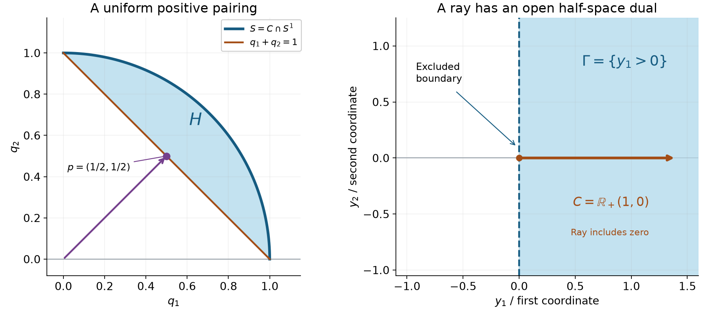
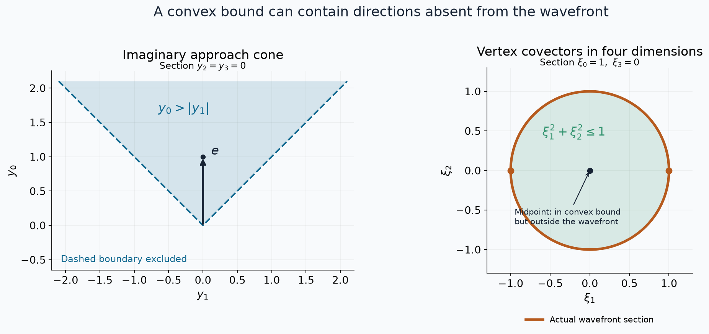

# Imaginary displacements and microhyperbolic cones

*Written by GPT-6 Astra (OpenAI), October 2026. Public domain (CC0).*

A reciprocal may have a distributional boundary even at a multiple real zero. The useful hypothesis is that one imaginary displacement avoids every nearby zero. We prove that this hypothesis determines a convex cone from the first nonzero Taylor polynomial, gives a uniform reciprocal estimate inside smaller cones, and controls the analytic wavefront of the boundary inverse. The cone is optimal among closed convex bounds, although the actual wavefront fiber need not be convex. A four-dimensional light-cone calculation shows the distinction exactly.

The existing [fixed-contour zero count and power sums](classical-finite-order-preparation-and-division.md#what-the-fixed-contour-counts) and [preparation component, Lemmas A–B](../prerequisites/U011-free-foundations/weierstrass-preparation-U070.md#three-tools) supply zeros with multiplicities and smooth parameter-dependent moments. The [contour foundation](../prerequisites/U011-free-foundations/complex-contours-U070.md), Sections 16.2, 16.5 and 16.6, supplies local factorization, Cauchy's theorem and the bounded maximum principle. Complex polynomial factorization follows from [U042, Lemma 3.0](spectral-localization-and-constant-equations.md#the-solution-class-changes-the-zero-set-that-matters), followed by finite polynomial division. No continuity of individual root labels is assumed.

For distributions we use [U015, Theorem 2.1, Corollary 2.2 and Theorem 3.2](holomorphic-boundaries-in-convex-cones.md): full-cone boundary limits, moving tests and zero-boundary uniqueness. The analytic dual-cone estimate is [U075, Theorem 2](holomorphic-boundaries-and-analytic-directions.md); the converse wedge construction is [U081, Theorem 3 and Corollary 5](from-wavefront-cones-to-holomorphic-wedges.md). Closedness, conicity and the analytic singular-support projection are proved in [U074](cones-and-derivative-growth-wavefronts.md). The spectral support estimate used in the final example is [U082, Theorem 1](fourier-rotation-and-directions-at-infinity.md). Finite-dimensional calculus, compactness, integration and Fourier normalization are supplied by the [scalar](../prerequisites/U011-free-foundations/metric-foundation-bridges.md), [integration](../prerequisites/U011-free-foundations/banach-foundation-bridges.md), [angular](../prerequisites/U011-free-foundations/angular-foundations-U018.md) and [Fourier](../prerequisites/U011-free-foundations/schwartz-fourier-foundations-U017.md) foundations.

## 1. What one imaginary displacement controls

Let \(F\) be a possibly complex-valued real-analytic function on an open set \(X\subset\mathbb R^n\). We use its local holomorphic extension, denoted by the same letter. Fix a real vector \(e\). The function is **microhyperbolic in direction \(e\)** when there is a positive continuous function \(a(x)\) such that

\[
 F(x+ite)\ne0\qquad(x\in X,\ 0<t<a(x)).
 \tag{1}
\]

All complex points in (1) belong to the chosen local extensions. Over a sufficiently small real ball, compactness permits one common upper bound on \(t\). All arguments below are local in that ball. If \(e=0\), (1) says that \(F\) has no real zero and its reciprocal is analytic; this case is immediate. We keep \(e\ne0\) in the nontrivial arguments.

At a point \(x\), write \(m(x)\) for the order of the first nonzero Taylor term and

\[
 F(x+z)=P_x(z)+O(|z|^{m(x)+1}),\qquad
 P_x(z)=\sum_{|\alpha|=m(x)}
                   \frac{\partial^\alpha F(x)}{\alpha!}z^\alpha.
 \tag{2}
\]

Such a term exists: if the analytic germ vanished identically, (1) would fail. We include \(m(x)=0\), in which case \(P_x=F(x)\ne0\). We shall prove that \(P_x(e)\ne0\), and that the component

\[
 \Gamma_x=\text{the connected component containing }e
                \text{ in }\{v\in\mathbb R^n:P_x(v)\ne0\}
 \tag{3}
\]

is an open convex cone. For a nonzero constant polynomial it is the whole space. Its positive dual is

\[
 \Gamma_x^*=\{\xi:v\cdot\xi\ge0\text{ for all }v\in\Gamma_x\}.
 \tag{4}
\]

The zero covector is included in (4) and removed when stating a wavefront inclusion.

## 2. A root cluster without chosen branches

We first isolate an estimate that also applies when the zeros are not real.

**Lemma 1 (one-sided imaginary control).** Suppose \(g(s,w)\) is holomorphic near \((0,0)\in\mathbb C^d\times\mathbb C\), and \(g(0,w)\) has a zero of exact order \(m\ge1\) at zero. Suppose every sufficiently small zero, with \(s\) real near zero, satisfies

\[
 g(s,w)=0\quad\Longrightarrow\quad
                      \operatorname{Im}w\le A|s|
 \tag{5}
\]

for some \(A\ge0\). There is a constant \(B\) such that every root in the cluster converging to zero satisfies \(|w|\le B|s|\). Also

\[
 |g(s,w)|\le B'(|s|+|w|)^m
 \tag{6}
\]

for real \(s\) and small complex \(w\). In particular all total Taylor terms of degree below \(m\) vanish.

**Proof.** Choose a circle \(|w|=r\) enclosing only the central zero of \(g(0,\cdot)\), and a slightly larger disk in the domain. The existing fixed-contour proof keeps exactly \(m\) zeros inside for small parameters, with multiplicity. All of them lie in \(|w|<r/2\) after shrinking the parameter neighborhood: the central function is nonzero on the compact annulus \(r/2\le|w|\le r\), and uniform continuity preserves nonvanishing there.

At each real \(s\) list this finite multiset as \(w_1,\ldots,w_m\), without choosing parameter-dependent labels. Its power sums

\[
 S_j(s)=\frac1{2\pi i}\int_{|w|=r}
                w^j\frac{\partial_wg(s,w)}{g(s,w)}\,dw
             =\sum_{\nu=1}^m w_\nu^j,\qquad j=1,2,
 \tag{7}
\]

are smooth on a full real neighborhood and vanish at zero. Their first derivatives are bounded on a smaller neighborhood, so \(|S_1(s)|\le C|s|\). Put \(b_\nu=\operatorname{Im}w_\nu\). By (5), \(b_\nu\le A|s|\), whereas

\[
 b_\nu=\operatorname{Im}S_1-
                   \sum_{\mu\ne\nu}b_\mu
             \ge-[C+(m-1)A]|s|.
 \tag{8}
\]

Consequently every \(|b_\nu|\le C_1|s|\). If \(T=\operatorname{Re}S_2\), then

\[
 T(s)=\sum_\nu(\operatorname{Re}w_\nu)^2
                        -\sum_\nu b_\nu^2
                         \ge-mC_1^2|s|^2.
 \tag{9}
\]

Since \(T(0)=0\), the derivative of \(T\) at zero is zero: a nonzero linear term, tested with both signs on its real line, would contradict (9). The integral Taylor remainder and a bounded Hessian now give \(|T(s)|\le C_2|s|^2\). Therefore

\[
 \sum_\nu(\operatorname{Re}w_\nu)^2
             =T(s)+\sum_\nu b_\nu^2\le C_3|s|^2.
 \tag{10}
\]

Every summand on the left is nonnegative. Together with (8), this proves the root bound.

For fixed real \(s\), remove all the cluster zeros with their exact multiplicities. The quotient

\[
 h_s(w)=g(s,w)\Big/\prod_{\nu=1}^m(w-w_\nu)
 \tag{11}
\]

extends holomorphically to the disk by local power-series factorization. On \(|w|=r\), every denominator factor has modulus at least \(r/2\). The numerator has a uniform compact bound. The maximum principle thus bounds \(h_s\) uniformly on the disk, without any smoothness assertion about individual roots. Multiplying by the factors and using \(|w_\nu|\le B|s|\) gives (6).

If a total Taylor term of smaller degree were nonzero, take the first such homogeneous polynomial and a real direction on which it is nonzero. A polynomial which vanishes at every real point has every coefficient zero, by induction in the coordinates, so such a direction exists. Evaluation on that real line contradicts (6) as its scale tends to zero. This proves the last assertion. For \(d=0\), the central power-series factorization gives the result directly. \(\square\)

The two-sided parameter neighborhood in this lemma is essential. No sign choice of a root and no differentiability of a root branch entered the proof.

We will also use the following direct consequence of the same zero count. If holomorphic functions converge uniformly near a closed disk to a nonidentically-zero function with a zero inside, surround that zero by a smaller circle on which the limit is nonzero. Uniform convergence makes the straight homotopy nonzero on the circle. The integral count is continuous and integer valued along that homotopy, hence constant. Thus every sufficiently late function has a zero inside. This is the exact zero-stability statement used below, including multiple zeros. It follows from (7) with \(j=0\); it does not require a root labeling.

## 3. The first Taylor term determines a convex cone

**Proposition 2 (the leading polynomial).** Under (1), the order of \(t\mapsto F(x+te)\) at zero is exactly \(m(x)\). Moreover

\[
 P_x(e)\ne0,\qquad
 P_x(v+ite)\ne0
           \quad(v\in\mathbb R^n,\ t\in\mathbb R\setminus\{0\}).
 \tag{12}
\]

**Proof.** Translate \(x\) to zero. The restriction \(F(we)\) is not identically zero, by (1), and has some finite order \(m\). Choose a real complement of \(e\), write \(z=se_\perp+we\) in linear coordinates, and put \(g(s,w)=F(se_\perp+we)\). For small real \(s\), a small root with positive imaginary part would violate (1), with real base \(se_\perp+(\operatorname{Re}w)e\). Lemma 1 applies with \(A=0\). Thus the total order is at least \(m\), and the nonzero coefficient on the distinguished axis makes it exactly \(m\). This proves \(P(e)\ne0\).

For fixed real \(v\), the functions

\[
 \varepsilon^{-m}F(\varepsilon v+\varepsilon we)
                         \longrightarrow P(v+we)
 \tag{13}
\]

converge uniformly on compact complex \(w\)-sets, by the convergent Taylor expansion. The limit is a degree-\(m\) polynomial with leading coefficient \(P(e)\ne0\). A root in the upper half-plane would, by zero stability, give a zero of the left side there for small positive \(\varepsilon\), contrary to (1). Thus the limit has no upper root. A lower root for base \(v\) would give an upper root for base \(-v\), since \(P(-z)=(-1)^mP(z)\). This proves (12). When \(m=0\), the polynomial is a nonzero constant and the conclusions are immediate. \(\square\)

**Theorem 3 (the entire hyperbolicity cone).** Let \(P\) be a homogeneous polynomial of degree \(m\ge1\) satisfying (12). Its component \(\Gamma\) containing \(e\) in the real nonzero set is an open convex cone. The polynomial \(P/P(e)\) has real coefficients. For every real \(v\) and \(y\in\Gamma\), all zeros of \(t\mapsto P(v+ty)\) are real, and

\[
 \begin{split}
 P(v+iy)&\ne0,\qquad v\in\mathbb R^n,\ y\in\Gamma,\\
 v\in\Gamma
 &\quad\Longleftrightarrow\quad
       \text{all }m\text{ roots of }P(v+ty)\text{ are strictly negative}.
 \end{split}
 \tag{14}
\]

For degree zero take \(\Gamma=\mathbb R^n\); the zero-free and convex conclusions remain true.

**Proof.** First \(P(v+te)\) has only real roots. A nonreal root would contradict (12) after absorbing its real part into \(v\). Its leading coefficient is \(P(e)\), so its constant term divided by \(P(e)\), namely \(P(v)/P(e)\), is real. A polynomial real-valued at every real point has real coefficients: its imaginary coefficient polynomial vanishes on the real space, and coordinate induction makes all those coefficients zero.

Let \(G_e\) be the set of real \(v\) for which all roots of \(P(v+te)\) are strictly negative. Root stability makes this set open. Here the degree and leading coefficient are fixed; locally bounded coefficients give a common bound on the roots. Indeed a monic polynomial with lower coefficients of modulus at most \(M\) has no root with modulus greater than \(1+M\), by summing the geometric series of its lower terms. Small disjoint circles around the roots, with multiplicities, therefore locate every nearby root.

The set \(G_e\) is relatively closed in \(\{P\ne0\}\): limits of its bounded roots are nonpositive real roots, and zero cannot be a root at a point where \(P\ne0\). It contains \(e\), whose roots are all \(-1\). Thus it contains the component \(\Gamma\). Conversely, for \(v\in G_e\),

\[
 P(rv+(1-r)e)=r^mP\bigl(v+(1-r)e/r\bigr)\ne0,
                      \qquad0<r\le1.
 \tag{15}
\]

The nonnegative argument \((1-r)/r\) is not a root. Including \(r=0\) gives a segment in the nonzero set connecting \(e\) to \(v\). Hence \(G_e=\Gamma\). Positive scaling of all roots also proves that \(\Gamma\) is a cone.

Now fix \(y\in\Gamma\) and \(\epsilon>0\), and consider the polynomial in \(s\)

\[
 Q_v(s)=P(v+i\epsilon e+isy).
 \tag{16}
\]

It has constant nonzero leading coefficient \(i^mP(y)\). At \(v=0\), all its roots are negative real numbers. To see this, \(s=0\) is not a root, and homogeneity gives

\[
 Q_0(s)=(is)^mP(y+\epsilon e/s).
 \tag{17}
\]

Every root of \(P(y+te)\) is negative, so \(\epsilon/s<0\). No \(Q_v\) has a root on \(\operatorname{Re}s=0\): if \(s=i b\), (16) is \(P(v-by+i\epsilon e)\ne0\). Root stability and the fixed leading coefficient show that the set of \(v\) for which all roots lie in the left half-plane is both open and closed in the connected real space. For closedness, nearby root bounds prevent escape to infinity, and roots on the boundary line were excluded. It contains zero and is therefore the entire space.

In particular \(P(v+i\epsilon e+iy)\ne0\). Since \(\Gamma\) is open, \(y-\epsilon e\in\Gamma\) for sufficiently small positive \(\epsilon\). Apply the last assertion with this vector instead of \(y\). It gives \(P(v+iy)\ne0\), without taking a potentially vanishing limit. Reflection and positive scaling then make every \(y\in\Gamma\) a hyperbolicity direction. Repeating the argument \(G_e=\Gamma\) with \(y\) as distinguished direction proves the root criterion in (14). Formula (15), with \(y\) in place of \(e\), now joins every two points of \(\Gamma\) by a segment inside it. This proves convexity. \(\square\)

## 4. Uniform bounds on smaller cones

**Lemma 4 (reciprocal growth with the correct power).** Fix \(x_0\in X\), put \(m=m(x_0)\), and let \(C\) be a closed cone with

\[
 C\setminus\{0\}\subset\Gamma_{x_0}.
 \tag{18}
\]

There are \(b,c>0\) such that

\[
 |F(x+iy)|\ge c|y|^m
   \quad\bigl(|x-x_0|<b,\ y\in C,\ 0<|y|<b\bigr).
 \tag{19}
\]

The same estimate holds on any prescribed compact set of unit directions inside \(\Gamma_{x_0}\).

**Proof.** Translate \(x_0\) to zero. For \(m=0\), continuity bounds \(F\) away from zero on a complex neighborhood, which is (19). Suppose \(m\ge1\). The unit directions of \(C\) form a compact subset of \(\Gamma=\Gamma_0\). Join each of them to \(e\) by its segment. The union \(K\) of those segments is compact, connected, contained in \(\Gamma\), and has positive distance from zero. We can use \(K=\{e\}\) when there are no unit directions to cover; the assertion for \(C=\{0\}\) is vacuous.

Since \(P(v)\ne0\) on \(K\), Taylor's estimate gives one \(r>0\) such that \(F(tv)\ne0\) for \(v\in K\) and \(0<|t|\le2r\), with a zero of order exactly \(m\) at \(t=0\). Shrink \(r\) so all the complex points below stay in the analytic domain and their real parts stay in the ball where (1) has a uniform height.

For small real \(x\), small \(\epsilon\ge0\), and \(v\in K\), the function

\[
 f_{x,\epsilon,v}(s)=F(x+i\epsilon e+isv)
 \tag{20}
\]

is nonzero on \(|s|=r\), uniformly in these parameters. This follows from the positive minimum at \(x=0,\epsilon=0,v\in K\) and compactness. The fixed-circle count is \(m\) throughout a small connected parameter set. At \(x=0,v=e,\epsilon>0\), all these zeros are \(s=-\epsilon\), with multiplicity \(m\): the only small zero of \(F(te)\) is \(t=0\).

For \(\epsilon>0\), a zero on \(\operatorname{Re}s=0\) would have \(s=i\tau\) and give \(F(x-\tau v+i\epsilon e)=0\), contrary to (1). As \((x,\epsilon,v)\) varies in the connected parameter set with \(\epsilon>0\), its \(m\) disk zeros therefore remain in the left half-plane. A rigorous crossing test uses small circles and the preceding zero stability; the fixed outer circle prevents roots from escaping. Letting \(\epsilon\downarrow0\) shows that every disk zero of \(f_{x,0,v}\) has nonpositive real part.

Call those zeros \(s_1,\ldots,s_m\), with multiplicities, and set \(f=f_{x,0,v}\). The quotient

\[
 H(s)=\frac{\prod_{j=1}^m(s-s_j)}{f(s)}
 \tag{21}
\]

extends holomorphically and has no pole on the closed disk. Its boundary modulus is at most \((2r)^m/\min_{|w|=r}|f(w)|\). The latter minimum has a common positive lower bound for all the parameters. By the maximum principle, for real \(0<s<r\),

\[
 \frac1{|F(x+isv)|}
 \le \frac{(2r)^m}{s^m}
                   \sup_{|w|=r}\frac1{|F(x+iwv)|}.
 \tag{22}
\]

Here \(|s-s_j|\ge s\), because \(\operatorname{Re}s_j\le0\). Apply (22) with \(v=y/|y|\in K\) and \(s=|y|\). A final common shrinking gives (19). The proof used only a compact set of directions and its segments to \(e\), so it proves the final assertion too. \(\square\)

## 5. The boundary inverse and its cotangent geometry

**Theorem 5 (the inverse boundary and its closed cone).** The limit

\[
 u=F_e^{-1}:=\lim_{t\downarrow0}\frac1{F(\,\cdot+ite)}
                            \quad\text{exists in }\mathcal D'(X).
 \tag{23}
\]

It satisfies \(Fu=1\). Its smooth and analytic singular supports both equal the real zero set of \(F\). The set

\[
 \mathcal C=\{(x,\xi):x\in X,\ \xi\in\Gamma_x^*\}
 \tag{24}
\]

is closed in \(T^*X\), and

\[
 \operatorname{WF}_A(u)\subset\mathcal C\setminus0.
 \tag{25}
\]

**Proof.** Near each \(x_0\), choose a small open convex cone containing \(e\) whose nonzero closed directions lie in \(\Gamma_{x_0}\). Lemma 4 bounds \(1/F(x+iy)\) by \(C|y|^{-m(x_0)}\) on the whole cone at small heights. U015's full-cone theorem gives its boundary distribution. It agrees with the limit along \(te\), so the local boundaries agree on overlaps and define (23).

The moving-test corollary applies to \(F(x+ite)\phi(x)\), which tends to \(F(x)\phi(x)\) in every fixed compact \(C^N\) norm. Since the former pairing with the reciprocal is exactly \(\int\phi\), it gives \(Fu=1\). Where \(F(x)\ne0\), the reciprocal extends holomorphically across the real space and the boundary is its ordinary analytic restriction. At a real zero, \(u\) cannot be smooth on any neighborhood: otherwise \(Fu=1\) would be an equality of smooth functions and evaluating at that zero would give \(0=1\). Both singular supports are consequently exactly the zero set.

Fix \(x_0\). If a covector \(\xi\) is outside \(\Gamma_{x_0}^*\), choose \(v\in\Gamma_{x_0}\) with \(v\cdot\xi<0\). A sufficiently small open convex cone can contain both \(e\) and \(v\) while its closed unit directions remain in \(\Gamma_{x_0}\). For clarity, the segment joining these two vectors is a compact subset of the open convex cone and avoids zero; its small convex neighborhood still lies there, and positive scaling generates the required cone. Lemma 4 and U075 give a wavefront bound by its dual, which excludes \(\xi\). Their boundary is still \(u\), since the cone contains \(e\). This proves (25).

To prove closedness of \(\mathcal C\), use the same compact set of directions containing the segment from \(e\) to \(v\). Lemma 4 makes \(F\) microhyperbolic in every one of those directions on one real neighborhood \(O\) of \(x_0\). Proposition 2, now at each \(x\in O\), shows that \(P_x\) is nonzero on the entire segment. Thus \(v\) lies in the component \(\Gamma_x\), not merely in the nonzero set of \(P_x\). For \(\eta\) close to \(\xi\), \(v\cdot\eta<0\), so \((x,\eta)\notin\mathcal C\) on a product neighborhood. If \(F(x_0)\ne0\), shrink \(O\) so every \(P_x\) is constant and every dual is \(\{0\}\), which gives the same conclusion directly. The complement of \(\mathcal C\) is open. \(\square\)

**Proposition 6 (the canonical one-form vanishes).** For every smooth curve \(t\mapsto(x(t),\xi(t))\in\mathcal C\),

\[
                         \xi(t)\cdot x'(t)=0.
 \tag{26}
\]

This includes curves through points where the Taylor order changes.

**Proof.** The integer \(m(x)\) is upper semicontinuous: a nonzero derivative at \(x_0\) remains nonzero nearby, so \(m(x)\le m(x_0)\) there. Along every nonempty open parameter interval, take the smallest attained value of \(m(x(t))\). Near a point attaining it, upper semicontinuity and minimality make that value constant. Hence the union of intervals on which the order is constant is open and dense.

On such an interval \(J\), let the order be \(m\ge1\). Taylor's integral formula, smoothly in \(t\), writes

\[
 F(x(t)+y)=\sum_{|\alpha|=m}R_\alpha(t,y)y^\alpha.
 \tag{27}
\]

Differentiate in \(t\). The right side still vanishes to order \(m\) in \(y\). The degree-\((m-1)\) term on the left is \(\nabla P_{x(t)}(y)\cdot x'(t)\), so it is identically zero. Fix \(t\) and put \(a=x'(t)\). The polynomial \(s\mapsto P_{x(t)}(y+sa)\) has derivative zero for all real \(s,y\). Thus

\[
 P_{x(t)}(y+sa)=P_{x(t)}(y),\qquad s\in\mathbb R.
 \tag{28}
\]

If \(y\in\Gamma_{x(t)}\), its entire line \(y+\mathbb R a\) stays in that component: the polynomial is nonzero along the line and each segment connects to \(y\). Positivity of the pairing with \(\xi(t)\) on every such point forces \(\xi(t)\cdot a=0\), by allowing both signs of arbitrarily large \(s\). When \(m=0\), the dual is \(\{0\}\) and the conclusion is immediate. Equation (26) holds on the dense union of constant-order intervals. Its left side is continuous, so it holds everywhere. \(\square\)

## 6. Why the convex bound cannot be decreased

For fixed \(x_0\), let \(W_{x_0}=\{\xi\ne0:(x_0,\xi)\in\operatorname{WF}_A(u)\}\). The closed convex cone generated by this set includes zero, and is \(\{0\}\) when the set is empty.

**Theorem 7 (optimal convex fiber).** At every point,

\[
             \overline{\operatorname{cone}_{\mathrm{conv}}W_{x_0}}
                                  =\Gamma_{x_0}^*.
 \tag{29}
\]

This asserts equality after closed convex generation, not convexity of \(W_{x_0}\).

**Proof.** If \(F(x_0)\ne0\), both sides are \(\{0\}\). Suppose \(F(x_0)=0\), and denote the left side by \(C\). Theorem 5 and the singular-support projection make \(W_{x_0}\) nonempty, and (25) gives \(C\subset\Gamma_{x_0}^*\).

Every interior point of an open cone pairs strictly positively with every nonzero element of its dual. Indeed a zero pairing would become negative after a sufficiently small displacement in the opposite covector direction while staying inside the cone. Compactness on the dual unit section gives a positive uniform margin. In particular \(e\cdot\xi\ge c|\xi|\) for \(\xi\in C\), with some \(c>0\). The cone \(C\) is pointed, and its dual \(C^*\) has interior containing \(e\).

Take \(y\in\operatorname{int}C^*\). Both \(y\) and \(e\) pair positively with the compact unit directions of \(W_{x_0}\). Choose open convex cones \(V_1,V\) such that \(e,y\in V_1\), the closed nonzero directions of \(V_1\) lie in \(V\), and the closed unit directions of \(V\) lie in \(\operatorname{int}C^*\). They can be obtained from successively small convex neighborhoods of the segment \([e,y]\) and positive scaling. That segment avoids zero because \(C\ne\{0\}\). The resulting pairings with \(W_{x_0}\cap S^{n-1}\) have a common positive lower bound.

Closedness of the wavefront set and compactness of both direction sets imply, on a real neighborhood \(O\) of \(x_0\),

\[
       \operatorname{WF}_A(u|_O)\subset O\times V^*.
 \tag{30}
\]

For otherwise a sequence of base points tending to \(x_0\), with forbidden unit covectors and directions in the compact closure of \(V\), would have a limit contradicting that positive margin. U081's exact analytic wedge theorem, on a smaller ball, supplies a polynomially bounded holomorphic \(G\) with boundary \(u\) for imaginary directions in \(V_1\).

The holomorphic function \(FG-1\) has zero distributional boundary. This uses \(Fu=1\) and U015's moving-test corollary, with the compact test multiplied by \(F(x+iy)\). Its growth is still polynomial on the smaller wedge. The zero-boundary uniqueness theorem gives

\[
                           F(z)G(z)=1
 \tag{31}
\]

throughout that wedge. Thus \(F\) is zero-free there.

Let \(P=P_{x_0}\) and \(m=m(x_0)\). On every bounded complex set with imaginary part in \(V_1\), the functions

\[
             \varepsilon^{-m}F(x_0+\varepsilon z)
                                      \longrightarrow P(z)
 \tag{32}
\]

are zero-free for all sufficiently small positive \(\varepsilon\). The limit has no zero in that tube. To justify this in several variables using only the proved one-variable count, if \(P(z_0)=0\), choose a complex line through \(z_0\) on which its Taylor polynomial is not identically zero. Such a line exists because some nonzero homogeneous Taylor term has a nonzero value in a direction. A small disk on that line stays in the tube. Zero stability on a still smaller circle then forces a zero of the left side of (32), a contradiction.

Consequently \(P(iv)\ne0\) for all \(v\in V_1\). Homogeneity gives \(P(v)\ne0\). Since \(V_1\) is connected and contains \(e,y\), this places \(y\in\Gamma_{x_0}\). We have proved \(\operatorname{int}C^*\subset\Gamma_{x_0}\); the reverse inclusion follows from \(C\subset\Gamma_{x_0}^*\) and the strict pairing observation. Therefore

\[
                       \Gamma_{x_0}=\operatorname{int}C^*.
 \tag{33}
\]

Here are the finite-dimensional duality details needed to finish. For a closed convex cone \(C\), a point \(z\notin C\) has a nearest point \(p\in C\): minimize on a sufficiently large closed ball, using compactness. Differentiating squared distance along the segment from \(p\) to any \(q\in C\) gives \((z-p)\cdot(q-p)\le0\). Taking \(q=0,2p\) gives \((z-p)\cdot p=0\). Thus \(v=p-z\) belongs to \(C^*\) and \(v\cdot z=-|z-p|^2<0\). This proves \(C^{**}=C\). Also every \(v\in C^*\) is a limit of \(v+\epsilon e\in\operatorname{int}C^*\), because of the uniform positive margin of \(e\) on \(C\cap S^{n-1}\). Hence \(\overline{\operatorname{int}C^*}=C^*\). Taking duals in (33) now yields \(\Gamma_{x_0}^*=C^{**}=C\), which is (29). \(\square\)

### Duality for every proper closed convex cone

The convexity calculation also has a converse that does not assume a cone arose from a polynomial. We include the finite-dimensional argument, including cones of smaller dimension.

**Lemma 7a (open cones and strict dual inequalities).** Let \(C\subset\mathbb R^n\) be a nonempty closed convex cone. It is *proper* when \(C\cap(-C)=\{0\}\). If \(C\) is proper, then
\[
 \Gamma=\operatorname{int}C^*
 =\{y:y\cdot\xi>0\text{ for every }\xi\in C\setminus\{0\}\}
 \quad\hbox{is nonempty},\qquad \Gamma^*=C.
 \tag{D1}
\]
Conversely, the dual of every nonempty open convex cone \(\Gamma\) is proper and closed, and \(\operatorname{int}(\Gamma^*)^*=\Gamma\). These operations give a bijection. For \(C=\{0\}\), the strict inequalities are vacuous and \(\Gamma=\mathbb R^n\).

**Proof.** The zero cone has the stated dual and needs no separation. Otherwise \(S=C\cap S^{n-1}\) is nonempty and compact. Zero is not in its convex hull: if \(\sum a_j s_j=0\), with \(a_j\ge0\), \(\sum a_j=1\) and \(s_j\in S\), choose \(a_i>0\). Then
\(-s_i=\sum_{j\ne i}(a_j/a_i)s_j\in C\), contradicting properness.

Here the convex hull \(H\) is compact. To verify this directly, reduce any convex combination to at most \(n+1\) terms. If it has more terms with positive coefficients, the vectors \((s_j,1)\in\mathbb R^{n+1}\) are linearly dependent. The finite-dimensional fact used here follows by induction: for more than \(d\) vectors in \(\mathbb R^d\), choose a nonzero coordinate as pivot and subtract multiples of its vector from the others. More than \(d-1\) vectors remain in the corresponding coordinate hyperplane. Their nontrivial dependence, supplied by induction, lifts to a nontrivial dependence of the original vectors. If all vectors are zero, or \(d=0\), dependence is immediate.

Choose coefficients \(b_j\), not all zero, with \(\sum b_js_j=0\) and \(\sum b_j=0\). There are both positive and negative \(b_j\). Subtract \(t b_j\) from each coefficient, where \(t=\min_{b_j>0}a_j/b_j\). The new coefficients remain nonnegative, have the same sum and barycenter, and at least one is zero. Repetition gives the reduction. Allowing repeated points and zero coefficients, \(H\) is therefore the continuous image of \(S^{n+1}\) times the closed coefficient simplex; both are compact.

Choose \(p\in H\) of least distance to zero. It is nonzero. Differentiating \(|p+t(q-p)|^2\) at \(t=0+\), for \(q\in H\), gives \(p\cdot q\ge |p|^2\). Apply this to \(q=\xi/|\xi|\) to obtain the uniform strict bound
\[
                p\cdot\xi\ge |p|^2|\xi|,\qquad \xi\in C.
 \tag{D2}
\]
Thus a ball about \(p\) lies in \(C^*\).

An interior point \(y\) of \(C^*\) pairs strictly with every nonzero \(\xi\in C\): a zero pairing would become negative at \(y-\epsilon\xi/|\xi|\), still in that interior ball. Conversely, strict positivity on the compact set \(S\) has a positive minimum and so persists on a ball about \(y\). This proves the equality in (D1). For every \(v\in C^*\), (D2) puts \(v+\epsilon p\) in its interior when \(\epsilon>0\). Hence \(\overline{\operatorname{int}C^*}=C^*\). The nearest-point proof of \(C^{**}=C\) immediately preceding this lemma now gives \(\Gamma^*=C\).

For the converse, \(C=\Gamma^*\) is closed and convex and contains zero, directly from its defining weak inequalities. If \(\xi,-\xi\in C\), then \(y\cdot\xi=0\) for every \(y\in\Gamma\). A nonempty open set cannot lie in the hyperplane orthogonal to a nonzero \(\xi\), so \(\xi=0\). Also \(C^*=\overline\Gamma\): closing \(\Gamma\) does not change its dual, and the bipolar identity applies to its closed convex cone.

Finally \(\operatorname{int}\overline\Gamma=\Gamma\). To supply the open-convex detail, fix \(y\in\Gamma\) with \(B(y,r)\subset\Gamma\). If \(z\in\overline\Gamma\) and \(0<t<1\), approximate \(z\) by \(z_j\in\Gamma\). Convexity puts the balls of radius \((1-t)r\) centered at \((1-t)y+tz_j\) in \(\Gamma\). Their centers converge, so \((1-t)y+tz\in\Gamma\). Given \(x\in\operatorname{int}\overline\Gamma\), take \(t<1\) sufficiently close to one that \(z=y+(x-y)/t\) remains in \(\overline\Gamma\). The preceding conclusion gives \(x=(1-t)y+tz\in\Gamma\). The reverse inclusion follows from openness. This proves the converse and uniqueness. It also covers the whole-space cone; in dimension zero the assertion reduces to the single set \(\{0\}\). \(\square\)

*Left: for the closed positive quadrant \(C\subset\mathbb R^2\), the unit section is the circular arc. Its convex hull \(H\) lies above the segment \(q_1+q_2=1\) and inside the unit disk. Its nearest point is \(p=(1/2,1/2)\), and \(p\cdot q\ge|p|^2=1/2\) on \(H\). Right: the lower-dimensional cone \(C=\mathbb R_+(1,0)\), including zero, has strict dual \(\Gamma=\{y_1>0\}\). The dashed boundary is excluded; the shaded region continues indefinitely. These are exact two-dimensional sets. Lemma 7a and Exercise 9 prove the indicated relations. [Editable figure source](../figures/proper-cone-duality.py).*

## 7. The four-dimensional light cone

Let \(z=(z_0,z')\in\mathbb C\times\mathbb C^3\), and put

\[
 Q(z)=z_0^2-z_1^2-z_2^2-z_3^2,\qquad e=(1,0,0,0).
 \tag{34}
\]

For real \(x=(t,x')\), \(Q(x+ise)=(t+is)^2-|x'|^2\) cannot vanish when \(s>0\): its imaginary part would force \(t=0\), and its real part would then be \(-s^2-|x'|^2<0\).

There is also a global bound, valid for \(Q(t,x')=t^2-|x'|^2\) in any positive spatial dimension:
\[
              |Q(x+iy)|\ge Q(y)\qquad\text{when }Q(y)>0.
\]
Here is its full algebra. Write \(B(x,y)=x_0y_0-x'\cdot y'\), \(A=Q(x)\), and \(b=Q(y)>0\). Then
\[
 |Q(x+iy)|^2=(A-b)^2+4B(x,y)^2.
\]
If \(A\le0\), the first square is already at least \(b^2\). If \(A>0\), use \(B(x,y)^2\ge Ab\). To prove this last inequality for arbitrary real \(x\), rotate the spatial coordinates so \(y'=(r,0,\ldots,0)\), and write \(x'=(v,w)\). Direct expansion gives
\[
 B(x,y)^2-Q(x)Q(y)
       =(rx_0-y_0v)^2+(y_0^2-r^2)|w|^2\ge0.
\]
When \(y'=0\), the same difference is \(y_0^2|x'|^2\). Thus for \(A>0\) the squared modulus is at least \((A+b)^2\ge b^2\), proving the bound. On compact unit directions in the future cone this gives the uniform quadratic estimate \(Q(y)\ge c|y|^2\), globally in real \(x\). The same component and dual-cone calculation below works in every such dimension; the exact vertex Fourier calculation in Proposition 8 is in four total dimensions.

Its cone at the vertex is

\[
 \Gamma_0=\{y:y_0>|y'|\},\qquad
 \Gamma_0^*=\{\xi:\xi_0\ge|\xi'|\}.
 \tag{35}
\]

The component assertion follows from \(Q(y)>0\) splitting into the future and past regions, each convex by the triangle inequality. For the dual assertion, Cauchy–Schwarz gives the nonnegative pairing when \(\xi_0\ge|\xi'|\); if this inequality fails, choose \(y_0>|y'|\) close enough to equality with \(y'\) opposite to \(\xi'\), or take \(y'=0\) if \(\xi_0<0\).

**Proposition 8 (the exact wavefront, including the vertex).** For \(u=Q_e^{-1}\),

\[
 \begin{split}
 \operatorname{WF}_A(u)
 ={}&\{(x,\lambda\,dQ(x)):x\ne0,\ Q(x)=0,\ \lambda x_0>0\}\\
 &{}\cup\{(0,\xi):\xi_0>0,\ \xi_0^2=|\xi'|^2\}.
 \end{split}
 \tag{36}
\]

In particular the vertex fiber is the future null cone, whose closed convex hull is the full future causal cone in (35).

**Proof.** We compute the Fourier support, with \(\widehat f(\xi)=\int e^{-ix\cdot\xi}f(x)\,dx\). Define the positive tempered measure

\[
 M(\phi)=\int_{\mathbb R^3}
                     \frac{\phi(|\eta|,\eta)}{2|\eta|}\,d\eta.
 \tag{37}
\]

The apparent singularity at \(\eta=0\) is integrable: polar integration has radial factor \(r^2dr\), leaving \(r\,dr\). A Schwartz weight of degree greater than two controls the tail, so (37) is tempered. Its support is exactly the closed future null cone. Every nonvertex cone point has positive mass in every neighborhood, and closure adds the vertex.

For \(\epsilon>0\), insert \(e^{-\epsilon\xi_0}\) in (37). Its inverse Fourier integral is absolutely convergent. Write \(\rho=|x'|\) and \(a=t+i\epsilon\). The three-dimensional sphere integral is \(4\pi\sin(r\rho)/(r\rho)\), with its limiting value \(4\pi\) at \(\rho=0\). This follows by a rotation and the polar formula \(2\pi\int_{-1}^1e^{ir\rho s}ds\). Thus, for \(\rho>0\),

\[
 \begin{aligned}
 \mathcal F^{-1}(e^{-\epsilon\xi_0}M)(t,x')
  &=(2\pi)^{-4}\frac{2\pi}{\rho}
                      \int_0^\infty e^{iar}\sin(\rho r)\,dr\\
  &=-\frac1{8\pi^3}\frac1{(t+i\epsilon)^2-\rho^2}.
 \end{aligned}
 \tag{38}
\]

Indeed \(\int_0^\infty e^{ibr}dr=i/b\) for \(\operatorname{Im}b>0\); taking the difference for \(b=a+\rho,a-\rho\) gives the integral \(-\rho/(a^2-\rho^2)\). At \(\rho=0\), dominated convergence in the absolutely convergent integral proves the same formula. Dominated convergence on each Schwartz test gives \(e^{-\epsilon\xi_0}M\to M\) in \(\mathcal S'\). The Fourier foundation makes inverse transformation continuous there. Comparing with the local boundary limit of Theorem 5 yields

\[
                           \widehat u=-8\pi^3 M.
 \tag{39}
\]

This also proves that \(u\) is tempered. U082's spectral limit-cone theorem now bounds every wavefront covector by the future null cone.

At a nonzero real zero of \(Q\), its gradient is nonzero and its first Taylor polynomial is \(dQ(x)\cdot y\). Because \(dQ(x)\cdot e=2x_0\ne0\), its component containing \(e\) has dual exactly \(\{\lambda\,dQ(x):\lambda x_0\ge0\}\). Theorem 5 gives this one-ray upper bound. That point is in the analytic singular support, so the projection theorem gives at least one covector there; positive conicity fills the whole nonzero ray. Away from the real cone the reciprocal is analytic.

Finally take any \(\xi=(\tau,\eta)\) with \(\tau=|\eta|>0\). The points \(x_s=s(\tau,-\eta)\), \(s>0\), lie on the nonzero real cone. They have \(dQ(x_s)=2s\xi\). Choosing \(\lambda_s=1/(2s)>0\) proves \((x_s,\xi)\in\operatorname{WF}_A(u)\), and closedness gives \((0,\xi)\) as \(s\downarrow0\). The spectral upper bound excludes every other vertex covector. This proves (36). Every point of the unit ball is a convex combination of points of its unit sphere (use the two radial endpoints, or any opposite pair at zero), so closed convex generation of the null cone gives exactly (35). \(\square\)

*Left: the section \(y_2=y_3=0\) of the imaginary cone \(y_0>|y'|\), with distinguished direction \(e=(1,0,0,0)\). Right: the affine section \(\xi_0=1,\ \xi_3=0\) of the vertex covectors in four dimensions. The actual wavefront is the circle \(\xi_1^2+\xi_2^2=1\); the disk is the section of its closed convex cone bound. These are sections, not projections of the sphere or cone. Proposition 8 proves the exact sets; Theorem 7 explains their convex relation. [Editable figure source](../figures/microhyperbolic-cones.py).*

## 8. Exercises with complete solutions

**Exercise 1 (foundation: the orientation at a simple zero).** Suppose \(F\) is real-valued on the real domain, and \(dF(x)\cdot e>0\) at every real zero near \(x_0\), with \(F(x_0)=0\). Prove microhyperbolicity after shrinking, and determine the exact analytic wavefront fiber at each such zero.

**Solution.** Near \(x_0\), continuity keeps \(dF(x)\cdot e\ge c>0\), including real points not on the zero set. Taylor expansion gives \(\operatorname{Im}F(x+ite)=t\,dF(x)\cdot e+O(t^2)\), uniformly on a smaller ball. It is positive for small \(t>0\), proving (1). The first Taylor polynomial at each zero is \(dF(x)\cdot y\), and its component is \(dF(x)\cdot y>0\). Its dual is the nonnegative ray of \(dF(x)\): decompose a covector into its component along the gradient and its orthogonal part, and test arbitrarily large positive and negative tangential vectors to eliminate the latter. Theorem 5 gives the upper bound. The zero lies in the singular support, so its fiber is nonempty; conicity makes it exactly \(\{\lambda\,dF(x):\lambda>0\}\). \(\square\)

**Exercise 2 (intermediate: complex coefficients are allowed).** On \(\mathbb R^2\), take \(F(z_1,z_2)=z_1+iz_2^2\) and \(e=(1,0)\). Determine the real singular set and every analytic wavefront fiber of \(F_e^{-1}\).

**Solution.** For real \(x\) and \(t>0\), \(F(x+ite)=x_1+i(x_2^2+t)\), so \(|F(x+ite)|\ge t\). Its real zero set is the single point zero. At that point \(P_0(y)=y_1\), so \(\Gamma_0=\{y_1>0\}\) and its dual is \(\{(s,0):s\ge0\}\). Away from zero the reciprocal is analytic. At zero Theorem 5 and the projection theorem force a nonempty fiber on that one ray, and conicity gives the whole positive ray. This example shows why the general argument cannot simply assume all nearby complex roots are real: in the first coordinate its root is \(-ix_2^2\). \(\square\)

**Exercise 3 (intermediate: why both parameter signs matter).** Explain the failure of Lemma 1 on a one-sided parameter domain using \(g(s,w)=w^2-s\), \(s\ge0\). Compare its two root moments with (9).

**Solution.** The roots are real, hence satisfy (5) with \(A=0\), but their modulus is \(\sqrt{s}\), which is not \(O(s)\). Their moments are \(S_1=0\) and \(S_2=2s\). The inequality \(T\ge0\) on the half-line does not force \(T'(0)=0\); the argument using both signs is unavailable. The total Taylor order of \(w^2-s\) is one, while its order on the distinguished \(w\)-axis is two. Thus both failed conclusions of the lemma are visible in the same example. \(\square\)

**Exercise 4 (intermediate: the multiplicity changes).** Let \(F(z)=z_1(z_1-z_2)\) and \(e=(1,0)\). Compute \(\Gamma_x^*\) at zero, at the other real zeros, and off the zero set. Verify directly that the resulting bundle is closed and that its covectors annihilate tangents to each nonzero zero line.

**Solution.** Both factors are nonzero at \(x+ite\) for real \(x,t>0\), so (1) holds. At zero,

\[
 \Gamma_0=\{y_1>0,\ y_1-y_2>0\},\qquad
 \Gamma_0^*=\{a(1,0)+b(1,-1):a,b\ge0\}.
 \tag{40}
\]

The component follows because neither factor can change sign on a connected nonzero region containing \(e\), and the stated intersection is convex. To check its dual, use coordinates \(r=y_1>0,\ s=y_1-y_2>0\). Then \(y\cdot\xi=r(\xi_1+\xi_2)-s\xi_2\), nonnegative for all \(r,s>0\) exactly when \(\xi_1+\xi_2\ge0,\ \xi_2\le0\), which is (40).

At \(x_1=0,x_2\ne0\), the linear Taylor term is \(-x_2y_1\), whose component containing \(e\) has \(y_1>0\); the dual is the nonnegative \((1,0)\) ray. At \(x_1=x_2\ne0\), it is \(x_1(y_1-y_2)\), giving the nonnegative \((1,-1)\) ray. Off the two lines the dual is \(\{0\}\). The two limiting rays at the intersection both belong to (40), so the bundle is closed; a convergent nonzero covector sequence based on a line cannot leave that ray except by reaching the intersection. The ray \((1,0)\) annihilates the tangent \((0,1)\), and \((1,-1)\) annihilates \((1,1)\). Theorem 7 identifies the convexly generated vertex wavefront with (40); this calculation alone does not assert that every covector inside it is an actual wavefront covector. \(\square\)

**Exercise 5 (advanced: two negative-root tests).** Suppose \(P_1,P_2\) are homogeneous hyperbolic polynomials with the same direction \(e\). Show that the component for \(P_1P_2\) is \(\Gamma_1\cap\Gamma_2\). Explain why a nonzero analytic unit multiplying \(F\) changes neither its cones nor the wavefront of its boundary inverse.

**Solution.** The roots of \((P_1P_2)(x+te)\), with multiplicities, are the union of the two root multisets. The strict-negative-root criterion in Theorem 3 therefore gives exactly the intersection. The product is hyperbolic because its factors are zero-free in direction \(e\), and its value at \(e\) is nonzero, so applying that criterion is legitimate. Constant nonzero factors cause no exception.

If \(a\) is an analytic unit near the real point, shrink to a complex neighborhood on which it is nonzero. The leading polynomial of \(aF\) is \(a(x)P_x\); multiplication by a nonzero scalar preserves its nonzero set and component. By the moving-test boundary theorem, \((aF)_e^{-1}=a^{-1}F_e^{-1}\). Multiplication by an analytic function cannot create analytic wavefront directions, by U074's analytic differential rule at order zero. Applying that rule also to \(a\), the inverse multiplier, gives equality of the two wavefronts. \(\square\)

**Exercise 6 (intermediate: changing the approach direction).** If \(v\in\Gamma_{x_0}\), prove that on a neighborhood of \(x_0\) the boundary \(F_v^{-1}\) exists and equals \(F_e^{-1}\). Determine the corresponding cone for \(F^k\), \(k\ge1\).

**Solution.** Choose an open convex cone containing \(e,v\), with closed unit directions inside \(\Gamma_{x_0}\). Lemma 4 makes \(1/F\) holomorphic and polynomially bounded over a common real neighborhood in that entire cone. U015 gives one limit for every approach within it, so both rays have the same boundary. The leading term of \(F^k\) is \(P_x^k\); its nonzero set and component are identical to those of \(P_x\), while its degree is \(k\,m(x)\). The reciprocal growth estimate becomes \(C|y|^{-k m(x)}\), and its boundary exists by the same theorem. No product of already singular boundary distributions is required to define it. \(\square\)

**Exercise 7 (foundation: powers of a linear pole).** For \(k\ge1\), compute \((x+i0)^{-k}\) as a derivative of \((x+i0)^{-1}\), and determine its exact analytic wavefront.

**Solution.** Differentiation of the holomorphic reciprocal and continuity of distributional differentiation give

\[
 (x+i0)^{-k}
   =\frac{(-1)^{k-1}}{(k-1)!}
                 \partial_x^{k-1}(x+i0)^{-1}.
 \tag{41}
\]

The starting boundary is \(\operatorname{pv}(1/x)-i\pi\delta_0\), proved in U075's linear-pole calculation. The function \(F(z)=z^k\), with \(e=1\), has component \((0,\infty)\) and dual \([0,\infty)\) at zero. It has no other real zero. Theorem 5 gives a nonempty fiber at zero contained in the positive ray; conicity gives exactly that ray. Equivalently the upper estimate follows by differentiating the known pole, while the identity \(x^k(x+i0)^{-k}=1\) excludes smoothness at zero. \(\square\)

**Exercise 8 (advanced: an exact nonconvex fiber).** Verify the normalization in (38), identify the two sections in the figure, and show that the midpoint of two vertex wavefront covectors may fail to be a wavefront covector.

**Solution.** The measure in (37) has radial factor \(r\,dr/2\). Multiplication by the angular integral \(4\pi\sin(r\rho)/(r\rho)\) leaves \(2\pi\sin(r\rho)dr/\rho\); inverse Fourier normalization contributes \((2\pi)^{-4}\). The elementary integral is \(-\rho/(a^2-\rho^2)\), giving \(-1/(8\pi^3)\) as claimed. The left section sets \(y_2=y_3=0\), so its boundary lines are \(y_0=\pm y_1\), with the region \(y_0>|y_1|\). The right section fixes \(\xi_0=1,\ \xi_3=0\), giving the unit circle for (36) and its closed disk for (35). In full four-dimensional coordinates, \((1,1,0,0)\) and \((1,-1,0,0)\) are both vertex wavefront covectors. Their midpoint \((1,0,0,0)\) is timelike and is excluded by (36), although it belongs to the optimal convex bound. \(\square\)

**Exercise 9 (foundation: a cone need not have interior).** In \(\mathbb R^2\), compute the open cone paired by Lemma 7a with \(C=\{(s,0):s\ge0\}\). Compare with \(C=\{(s,0):s\in\mathbb R\}\), and with \(C=\{0\}\).

**Solution.** For the ray, strict positivity against every \((s,0)\), \(s>0\), means exactly \(y_1>0\); \(y_2\) is arbitrary. This open half-space has dual precisely the original ray: arbitrary positive and negative \(y_2\) force the second dual coordinate to vanish, and positive \(y_1\) force the first to be nonnegative. The ray is proper despite having empty interior. For the line, the weak dual is \(\{y_1=0\}\), whose interior is empty; strict positivity against both \((1,0)\) and \((-1,0)\) is impossible. Thus properness is necessary. For the zero cone the condition has no nonzero vector to test, giving the whole plane; its dual is \(\{0\}\). \(\square\)

**Exercise 10 (intermediate: why the open cone is convex).** Let \(\Omega=\{y_1>0\}\cup\{y_2>0\}\). It is open and invariant under positive scaling. Compute \(\Omega^*\) and explain why it does not recover \(\Omega\) through (D1).

**Solution.** If \(\xi\in\Omega^*\), testing \((1,t)\) for all real \(t\) forces \(\xi_2=0\) and \(\xi_1\ge0\). Testing \((t,1)\) for all real \(t\) then forces \(\xi_1=0\). Hence \(\Omega^*=\{0\}\), whose strict dual is the whole plane. But \((-1,-1)\notin\Omega\). The set is not convex: \((1,-3)\) and \((-3,1)\) belong to it while their midpoint does not. The convexity hypothesis is therefore essential to this inverse formula. \(\square\)

## Proof locations and mathematical source

- The earlier programme proofs linked at the start supply the contour count, power sums, maximum principle, boundary existence and uniqueness, moving tests, analytic wavefront projection, wedge converse, Fourier support bound and integration normalization. The root estimate with one-sided imaginary control, all-degree cone argument, uniform reciprocal bound, changing-order cotangent argument and convex optimality proof are given here.
- Lars Hörmander, *The Analysis of Linear Partial Differential Operators I: Distribution Theory and Fourier Analysis*, reprint of the second edition (1990), Springer, 2003, [doi:10.1007/978-3-642-61497-2](https://doi.org/10.1007/978-3-642-61497-2), Section 8.1, the dual-cone discussion on printed page 257, and Section 8.7, Definition 8.7.1, Lemmas 8.7.2–8.7.4, Theorem 8.7.5 and its following discussion, printed pages 317–322. These are the mathematical antecedents. The cluster proof uses fixed-contour moments; the four-dimensional example includes its Fourier constant and vertex argument. The exposition, organization, figure and exercises are independently written.
