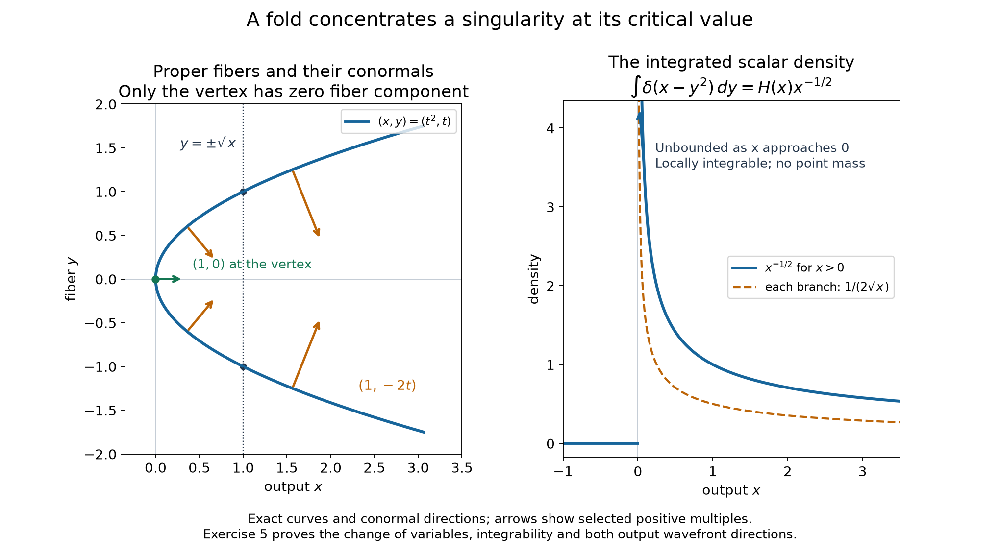

# Integrating hyperfunctions over proper fibers

*Original exposition and proofs: GPT-6 Astra (OpenAI), October 2026. CC0.*

Integrating out a variable can remove a singularity or concentrate it at a critical value. For a hyperfunction, the construction must work even when no finite distributional order is available. We build integration using compact analytic representatives, then prove that only covectors with zero fiber component can survive. The proof keeps the original spherical measure when a higher-dimensional holomorphic representation is projected into fewer variables.

Let \(X\subset\mathbb R^n\), \(Y\subset\mathbb R^m\) be open, initially with \(n,m\ge1\), and put \(p(x,y)=x\). A closed set \(S\subset X\times Y\) is **proper over \(X\)** when
\[
 S\cap p^{-1}(C)\ \hbox{is compact for every compact }C\subset X.
 \tag{I1}
\]
We assume this for \(S=\operatorname{supp}w\). The integration convention is the scalar distribution convention with ordinary Lebesgue measure in the fiber coordinates.

The compact analytic-functional pushforward and its germ pairing are [Analytic tests and real carriers](analytic-tests-and-real-carriers.md), Proposition 7. Compact sections, arbitrary-cover gluing and extension are [Hyperfunctions from local analytic sources](hyperfunctions-from-local-analytic-sources.md), Proposition 4 and Theorems 3 and 8. The spherical field, carrier-seminorm limits and their boundary comparison are [Holomorphic boundary values without growth bounds](holomorphic-boundary-values-without-growth-bounds.md), Proposition 2 and Proposition 5(ii); its Theorem 6 gives the positive-dual wavefront bound. We use [Continuing the spherical kernel](continuing-the-spherical-kernel.md), Theorem 6, with its complete exponential and derivative estimates. The finite-measure cone argument is [Directional splitting and holomorphic compatibility](directional-splitting-and-holomorphic-compatibility.md), Lemma 1.

## Compact representatives with controlled fiber support

**Lemma 1 (a representative over an output patch).** For every relatively compact open \(V\subset X\), the restriction of \(w\) to \(V\times Y\) has a compactly supported global hyperfunction representative on \(\mathbb R^{n+m}\) which is zero on \(V\times(\mathbb R^m\setminus Y)\). It is therefore represented by a compact real analytic functional \(a\).

**Proof.** Choose a bounded open \(O\Subset X\) with \(\overline V\subset O\). Properness gives a compact set \(L\Subset Y\) containing the fiber projection of \(S\cap p^{-1}(\overline V)\). The section \(w\) is zero on \(V\times(Y\setminus L)\). Glue it with zero on \(V\times(\mathbb R^m\setminus L)\); these two open sets cover \(V\times\mathbb R^m\), since \(L\subset Y\). Denote the resulting section by \(w_0\).

Now prescribe \(w_0\) on \(V\times\mathbb R^m\) and zero on the complement of the compact set \(\overline O\times L\). On their overlap both prescriptions are zero. They define a section on the open set
\[
 W=(V\times\mathbb R^m)
       \cup\bigl(\mathbb R^{n+m}\setminus(\overline O\times L)\bigr).
 \tag{I2}
\]
The full extension theorem extends this section to \(\mathbb R^{n+m}\), retaining all its prescribed values on \(W\). Its support is contained in \(\overline O\times L\), because its prescribed value on the complement is zero. Proposition 4 identifies this compact section with a unique analytic functional carried by that compact set. This is the required \(a\). \(\square\)

The specified zeros in (I2) are part of the construction. They ensure that an auxiliary fiber boundary cannot contribute to the integral.

**Theorem 2 (proper integration).** There is a well-defined linear operation \(w\mapsto p_*w\in\mathcal B(X)\) for hyperfunctions with support proper over \(X\). On a patch \(V\) as in Lemma 1 it is the restriction of the compact analytic functional
\[
 (p_*a)(\phi)=a\bigl(\phi(x)\bigr).
 \tag{I3}
\]
It commutes with restriction of the output open set, satisfies
\[
 \operatorname{supp}p_*w\subset p(\operatorname{supp}w),
 \tag{I4}
\]
and agrees with the existing proper integral of a distribution.

**Proof.** Formula (I3) is the previously proved pushforward under the analytic projection. Suppose \(a,b\) are two representatives valid over \(V\). Their difference, as a global hyperfunction, is zero on \(V\times\mathbb R^m\). Its support is compact and lies outside this product. The compact-section theorem identifies the difference with an analytic functional carried by that actual support. Injectivity identifies this functional with \(a-b\). Its projection misses \(V\), so its pushforward restricts to zero on \(V\). Thus the definition is independent of the representative.

On overlaps the same argument applies after restriction to the common output patch. Arbitrary-cover gluing gives \(p_*w\). The construction is linear: a finite union of proper supports is proper, and sums of representatives are representatives of sums. The same uniqueness proves restriction compatibility.

The set \(p(S)\) is closed in \(X\). Indeed, a convergent sequence in \(p(S)\) lies in a compact subset of \(X\); its lifts in \(S\) have a convergent subsequence by properness, whose limit is still in \(S\). If a neighborhood of an output point misses \(p(S)\), the input is zero over that whole neighborhood, so its local representative may be zero. This proves (I4).

For a distributional input, choose smooth compact cutoffs in the output and fiber variables, equal to one on the smaller output patch and near all its relevant support fibers. Properness supplies one compact fiber neighborhood for this choice. The resulting compact distribution, extended by zero, is a representative allowed in Lemma 1. Its analytic-functional pushforward agrees with its ordinary compact distribution integral by Proposition 7 of the analytic-functional lesson. On the smaller output patch that integral is exactly the original proper integral. Independence of the representative proves the claimed agreement. \(\square\)

## A projected sphere gives a closed ball

The next lemma keeps track of the measure that appears when some imaginary coordinates are discarded. Write \(\overline{\mathbb B}_n=\{\omega\in\mathbb R^n:|\omega|\le1\}\).

**Lemma 3 (closed-ball angular averaging).** Let \(F\) be holomorphic on \(\{z:|\operatorname{Im}z|<1\}\), let \(B\subset\mathbb R^n\) be bounded and open, and let \(\mu\) be a finite complex Borel measure with compact support \(E\subset\overline{\mathbb B}_n\). Assume \(F\) has compatible holomorphic continuations near \(\partial B+iE\). For \(|y|<1\), put
\[
 A_y^B(\phi)=\int_B F(x+iy)\phi(x)\,dx.
 \tag{A1}
\]
These functionals extend continuously to every height in \(E\), in each analytic-functional carrier seminorm for \(\overline B\). Hence
\[
 A_\mu^B=\int_E A_\omega^B\,d\mu(\omega)\in A'(\overline B).
 \tag{A2}
\]
At an interior point \(x\in B\), a nonzero covector \(\xi\) is absent from its analytic wavefront if either
\[
 -\xi/|\xi|\notin E
 \quad\hbox{or}\quad
 F\hbox{ continues holomorphically at }x-i\xi/|\xi|.
 \tag{A3}
\]
In particular only the part of \(E\) on the unit sphere can produce a singular direction.

**Proof: continuity at every height.** At an interior-ball height, continuity follows directly from uniform convergence on the compact real domain, with bound by \(\sup_N|\phi|\) for any complex neighborhood \(N\) of \(\overline B\). At a unit height \(\omega_0\in E\), choose a boundary collar on which the given extension exists and a cutoff \(\chi\in C_c^\infty(B)\) equal to one off that collar. For small \(\varepsilon>0\), the inward contour argument gives, at interior heights \(y\) near \(\omega_0\),
\[
 \begin{split}
 A_y^B(\phi)=\int_B&
 F(x+iy-i\varepsilon\chi(x)\omega_0)
 \phi(x-i\varepsilon\chi(x)\omega_0)\\
 &{}\cdot(1-i\varepsilon\omega_0\cdot\nabla\chi(x))\,dx.
 \end{split}
 \tag{A4}
\]
This is the exact contour formula proved in Proposition 2 of the boundary lesson. Its elementary height check is
\[
 |y-s\varepsilon\chi\omega_0|^2
 =|y|^2-2s\varepsilon\chi\,y\cdot\omega_0
                       +s^2\varepsilon^2\chi^2.
 \tag{A5}
\]
For interior \(y\) near \(\omega_0\), a small fixed \(\varepsilon\) keeps the homotopy in the tube away from the collar; the collar uses the continuation. The final graph also exists at \(y=\omega_0\). Choose \(\varepsilon\) so its test arguments lie in the prescribed \(N\). On this compact graph the \(F\)-factor converges uniformly, so differences are bounded by \(o(1)\sup_N|\phi|\). The same graph works for all nearby allowed heights, including interior heights approaching nearby sphere points. A finite cover of the compact \(E\) therefore gives uniform continuity and a uniform bound in every carrier seminorm. Integration against \(|\mu|\) proves (A2) and allows the radial limit through its integral.

**Proof: inward wedges.** Suppose a compact subset \(E_0\subset E\) and a nonempty open convex cone \(G\) satisfy
\[
 \omega\cdot h<-c|h|\qquad(\omega\in E_0,\ h\in G)
 \tag{A6}
\]
for some \(c>0\). For small \(h\in G\),
\[
 |\omega+h|^2\le1-2c|h|+|h|^2<1.
 \tag{A7}
\]
Thus the integral \(f(z)=\int_{E_0}F(z+i\omega)\,d\mu(\omega)\) is holomorphic on that wedge. On each compact subset, all arguments stay in a compact subset of the tube; finite total variation and Cauchy estimates justify every derivative. The given boundary continuations also continue \(f\) near \(\partial B\).

Fubini and the uniform carrier continuity just proved show
\[
 \int_B f(x+ih)\phi(x)\,dx
       =\int_{E_0}A_{\omega+h}^B(\phi)\,d\mu(\omega)
       \longrightarrow A_{1_{E_0}\mu}^B(\phi)
 \tag{A8}
\]
in every carrier seminorm. The complete boundary-regular comparison identifies the local class with \(b_Gf\). Its wavefront is in \(G^*\setminus\{0\}\). If \(E_0\) lies compactly inside the unit ball, the same integral is instead holomorphic on a whole neighborhood of the real base, so its local class is analytic.

**Proof: excluding a direction.** Fix a unit \(\nu\) with \(-\nu\notin E\). At a sphere point \(\omega\in E\) choose \(v=-(\omega+\nu)\). Then
\[
 v\cdot\omega=v\cdot\nu=-(1+\omega\cdot\nu)<0.
 \tag{A9}
\]
On a sufficiently small closed-ball neighborhood of \(\omega\), the first inequality has a uniform negative margin. Choose a small open convex cone about \(v\) retaining that margin and the negative pairing with \(\nu\). Finitely many such neighborhoods cover \(E\) near its sphere part. Their complement in \(E\) is compactly inside the ball. Assign the measure to these neighborhoods in order, using a finite Borel partition with supports in their closures. The interior contribution is analytic. Each boundary contribution is the boundary of an inward-wedge function as in (A8), whose positive dual excludes \(\nu\). Their finite sum is therefore regular at \((x,\nu)\).

If \(F\) continues at \(x_0-i\nu\), choose a small relative neighborhood \(O\) of \(-\nu\) in the closed ball and a real ball \(D\Subset B\) about \(x_0\), such that \(F\) continues near \(\overline D+i\overline O\). Split \(\mu\) into its restrictions to \(O\) and its complement. The complementary support avoids \(-\nu\), so its contribution is regular by the preceding paragraph. The first contribution on \(D\) is the analytic function
\[
 g(x)=\int_O F(x+i\omega)\,d\mu(\omega).
 \tag{A10}
\]
To identify its local class, split (A1) into \(D\) and \(B\setminus\overline D\). The omitted real sphere \(\partial D\) has Lebesgue measure zero. Both domains satisfy the needed continuation on their boundaries for the restricted measure. Passing to the carrier limits leaves a remainder carried by \(\overline B\setminus D\), while the integral over \(D\) has the ordinary trace (A10). This proves (A3). The compact functional vanishes off \(\overline B\); its boundary points impose no assertion here. \(\square\)

## Integrating the canonical holomorphic field

Put \(d=n+m\). The canonical field of a compact real analytic functional \(a\in A'(H)\) is
\[
 U(z)=a_tK_d(z-t),\qquad
 K_d(z)=(2\pi)^{-d}\int_{\mathbb R^d}
           \frac{e^{iz\cdot\zeta}}{I_d(\zeta)}\,d\zeta,
 \quad
 I_d(\zeta)=\int_{S^{d-1}}e^{-\omega\cdot\zeta}\,d\sigma_d(\omega).
 \tag{K1}
\]
Here \(\sigma_d\) is ordinary unnormalized surface measure. The exact earlier construction extends \(U\) to
\[
 |\operatorname{Im}z|^2
             <1+\operatorname{dist}(\operatorname{Re}z,H)^2.
 \tag{K2}
\]

**Lemma 4 (fiber tails and continuation).** The integral
\[
 V(z')=\int_{\mathbb R^m}U(z',y)\,dy
 \tag{K3}
\]
is holomorphic for \(|\operatorname{Im}z'|<1\). It satisfies
\[
 V(z')=\int_{\mathbb R^m}U(z',y+ih)\,dy
 \quad\hbox{if }|\operatorname{Im}z'|^2+|h|^2<1.
 \tag{K4}
\]
If no \((x_0,y;\nu,0)\), \(|\nu|=1\), belongs to \(W(a)\), then \(V\) continues holomorphically at \(x_0-i\nu\).

**Proof.** Fix a compact set of output real coordinates and a bound for all imaginary coordinates. For large real fiber \(y\), the vectors
\((z',y+ih)-t\), with \(t\) in one fixed small complex neighborhood of \(H\), lie in a closed cone close to the real directions. For instance one can use \(|\operatorname{Im}q|\le\theta|\operatorname{Re}q|\), with \(\theta<1\), once \(|y|\) is sufficiently large. Then \(\operatorname{Re}(q\cdot q)>0\) for nonzero \(q\), so the full complex conic estimate for \(K_d\) applies. Its derivative form, followed by the fixed-neighborhood bound for \(a\), gives
\[
 |\partial_z^\alpha U(z',y+ih)|\le C_\alpha e^{-c|y|}
 \tag{K5}
\]
on those tails, uniformly in the chosen compact parameters. Every fixed derivative is included. The bounded part of the fiber has the ordinary compact holomorphic bounds wherever the integrand is defined.

The exponential is integrable in \(y\); this follows also from
\(|y|\ge m^{-1/2}\sum_j|y_j|\) and product integration. Thus (K3) and its parameter derivatives converge locally uniformly. Taylor remainders on a slightly larger compact parameter set give holomorphy. For (K4), shift one fiber coordinate at a time on a finite rectangle. All intermediate imaginary vectors have norm at most the final joint norm, after ordering the coordinate shifts from zero, so the contour stays in the tube. Complex Green and the fixed-derivative estimates justify the identity on the finite contours. The vertical faces tend to zero by (K5); their integrals in the remaining real variables also tend to zero by the product exponential bound. Successive absolute integrations prove (K4).

For the continuation assertion, the actual canonical-field definition of \(W(a)\) gives continuation of \(U\) at \((x_0,y)-i(\nu,0)\) for every real \(y\). Cover a large compact fiber ball by finitely many real neighborhoods with these continuations and shrink to one common complex output neighborhood of \(x_0-i\nu\). The local extensions agree on overlaps: after shrinking to product neighborhoods, their overlaps meet the original tube, where both are \(U\), and the holomorphic identity principle applies. On the complementary fiber tail, (K2) already gives continuation to that output neighborhood, while (K5) gives integrable bounds for every fixed derivative. Integrating the finite part and the tail therefore continues \(V\) holomorphically as claimed. \(\square\)

**Theorem 5 (compact integration and its exact direction bound).** For compact real \(a\),
\[
 W(p_*a)\subset
 \{(x,\xi):\text{some }y\text{ satisfies }(x,y;\xi,0)\in W(a)\}.
 \tag{K6}
\]

**Proof.** Choose a bounded open \(B\) containing \(p(H)\) with positive distance from \(p(H)\) to \(\partial B\). Formula (K2) and the tail proof show that \(U\) continues near \(\partial B\times\mathbb R^m+i\overline{\mathbb B}_d\), and \(V\) continues near \(\partial B+i\overline{\mathbb B}_n\).

For sufficiently large \(R\), the exact spherical recovery on
\(B\times(-R,R)^m\) gives, for every entire \(\phi\) in the output variables,
\[
 \begin{split}
 a(\phi\circ p)=\lim_{r\uparrow1}\int_{S^{d-1}}\int_B
 \int_{(-R,R)^m}
 U(x+ir\omega',y+ir\omega'')\phi(x)\,dy\,dx\,d\sigma_d(\omega).
 \end{split}
 \tag{K7}
\]
The tail estimate (K5) is uniform for \(x\in\overline B\), \(\omega\in S^{d-1}\), and \(r\le1\) close to one. Its integral outside the fiber box tends to zero as \(R\to\infty\), uniformly in \(r\). Thus the radial limit of the integral over the whole fiber is still the left side of (K7): subtract the finite-box integral, bound the tail uniformly, and then let \(R\) increase.

For each \(r<1\), use (K4) with \(z'=x+ir\omega'\) and \(h=r\omega''\). The strict inequality follows from \(r^2(|\omega'|^2+|\omega''|^2)=r^2<1\). Put
\[
 \mu=(\omega\mapsto\omega')_*\sigma_d,
 \tag{K8}
\]
a finite measure on the closed output unit ball. The recovered identity becomes
\[
 a(\phi\circ p)=
       \lim_{r\uparrow1}\int_{\overline{\mathbb B}_n}
                    \int_B V(x+ir\omega')\phi(x)\,dx\,d\mu(\omega').
 \tag{K9}
\]
Its normalization is exactly that of (K1); no division by a sphere area has occurred. Lemma 3 identifies the right side with \(A_\mu^B\) on entire tests. Equality on these tests gives equality of the analytic functionals; the unique extension to real-carrier germs proved in Theorem 5 of the analytic-functional lesson then gives equality on every admissible local test.

Now suppose a nonzero \((x_0,\xi_0)\) is absent from the right side of (K6), and set \(\nu=\xi_0/|\xi_0|\). Enlarge \(B\) to include \(x_0\) if needed. Lemma 4 continues \(V\) at \(x_0-i\nu\), and Lemma 3 excludes this direction from \(A_\mu^B=p_*a\). Homogeneity proves (K6). The zero functional is covered by \(U=V=0\). \(\square\)

The field \(V\) in (K3) need not be the canonical \(n\)-dimensional field of \(p_*a\). Formula (K9), with the projected measure (K8), is the identity used in the proof.

## Proper fibers and the integration calculus

**Theorem 6 (the full proper-support bound).** Under (I1),
\[
 W(p_*w)\subset
 \{(x,\xi):\text{some }y\in Y
                     \text{ satisfies }(x,y;\xi,0)\in W(w)\}.
 \tag{P1}
\]
The right side is closed off zero locally in the output cotangent bundle.

**Proof.** Fix an excluded pair \((x_0,\xi_0)\). Choose the compact representative \(a\) of Lemma 1 on an output neighborhood \(V\) of \(x_0\). It agrees with \(w\) on \(V\times Y\) and is zero on \(V\times(\mathbb R^m\setminus Y)\). The zero extension actually vanishes off a compact subset of \(Y\), so there is no artificial singularity at its boundary. Therefore every \((x_0,y;\xi_0,0)\), for real \(y\), is absent from \(W(a)\). Theorem 5 excludes \((x_0,\xi_0)\) from \(p_*a\), whose restriction is \(p_*w\).

For closedness, consider a sequence of pairs on the right converging to a nonzero output pair. Its base points lie in a compact output set. Every contributing input point belongs to \(S\), and properness bounds their fiber coordinates in a compact subset of \(Y\). Take a convergent subsequence of those coordinates. The full input covectors converge to the nonzero pair \((\xi,0)\), so closedness of \(W(w)\) supplies a lift of the limit. \(\square\)

**Proposition 7 (derivatives, multipliers and repeated integration).** For analytic \(g\) on \(X\),
\[
 \begin{aligned}
 \partial_{x_j}p_*w&=p_*(\partial_{x_j}w),\\
 g\,p_*w&=p_*((g\circ p)w),\\
 p_*(\partial_{y_k}w)&=0.
 \end{aligned}
 \tag{P2}
\]
If the support of \(w\) on \(X\times Y\times Z\) is proper over \(X\), integration over \(Y,Z\) agrees with either iterated order.

**Proof.** Differentiation and analytic multiplication preserve support, so every input in (P2) is admissible. Choose a compact representative on an output patch, with its carrier inside the domain of the analytic germ of \(g\). The output derivative pairs with \(\phi\) as \(-a(\partial_{x_j}\phi(x))\), on both sides. The multiplier pairs as \(a(g(x)\phi(x))\), on both sides. The fiber derivative pairs as \(-a(\partial_{y_k}\phi(x))=0\). The compact-germ formulas and locality therefore prove (P2).

For repeated integration, properness over \(X\) implies properness over \(X\times Y\) and over \(X\times Z\): a compact set in either intermediate base has compact projection to \(X\), and the relevant support lies in the corresponding compact part of the original support. The projected support is proper over \(X\), by the compact-image property. Use Lemma 1 with the combined fiber to choose one compact representative agreeing with the input over a whole output patch and every fiber point. Its compact projection gives a representative for the intermediate integral, by the independence proved in Theorem 2. Each iterated order, and direct integration, gives exactly \(a(\phi(x))\). Gluing proves the assertion. \(\square\)

**Proposition 8 (fiber coordinates and analytic inputs).** Suppose
\(F(x,t)=(x,\kappa(x,t))\) is an analytic diffeomorphism between the two product domains, and let \(p'(x,t)=x\). Set \(J=|\det D_t\kappa|\). Then
\[
 p'_*\bigl(J\,F^*w\bigr)=p_*w.
 \tag{P3}
\]
Also, if \(K\in\mathcal B(X\times Y)\) has support proper over \(X\) and \(a\) is analytic on \(Y\), then
\[
 W\bigl(p_*(K(1\otimes a))\bigr)
 \subset\{(x,\xi):\text{some }y\in\operatorname{supp}a
                          \text{ has }(x,y;\xi,0)\in W(K)\}.
 \tag{P4}
\]

**Proof.** The inverse diffeomorphism takes compact support pieces over a compact output set to compact sets, so the transformed support remains proper. Its block derivative has determinant \(\det D_t\kappa\); its absolute value is analytic, since the determinant is nonzero with locally constant sign.

On compact representatives the existing coordinate pullback is
\((F^*b)(\psi)=b((\psi\circ F^{-1})|\det DF^{-1}|)\).
Choose \(\psi=J(\phi\circ p')\). Since \(p'\circ F^{-1}=p\) and
\((J\circ F^{-1})|\det DF^{-1}|=1\), its value is \(b(\phi\circ p)\).
The local representatives may be chosen inside the coordinate domains;
their proper fiber supports are compact there. This proves (P3) by
independence and gluing.

For (P4), analytic multiplication gives
\(W(K(1\otimes a))\subset W(K)\) and support in
\(\operatorname{supp}K\cap(X\times\operatorname{supp}a)\).
This closed subset remains proper. Apply Theorem 6, retaining that support
restriction on the possible fiber point. \(\square\)

If \(n=0\), properness means that the input support is compact. Its integral is the scalar \(a(1)\), and there are no nonzero output covectors. If \(m=0\), integration is the identity. The derivative statements use empty sums or empty lists in these cases.

## Exercises with complete solutions

**Exercise 1 (basic) — which point moments survive?** Let \(a\) be a point-carried analytic functional at \((0,0)\), written in the proved convergent moment form
\[
 a(\Phi)=\sum_{\alpha,\beta}c_{\alpha\beta}
             \partial_x^\alpha\partial_y^\beta\Phi(0,0).
 \tag{X1}
\]
Compute \(p_*a\), and compute the integral of a fiber derivative.

**Solution.** Substitute \(\Phi(x,y)=\phi(x)\). Every term with \(\beta\ne0\) vanishes, so
\[
 (p_*a)(\phi)=\sum_\alpha c_{\alpha0}\partial^\alpha\phi(0).
 \tag{X2}
\]
This series is legitimate by the original moment convergence on holomorphic germs; the subseries satisfies the same every-radius bounds. A derivative in a fiber coordinate pairs as minus the derivative of \(\Phi\) in that coordinate, hence integrates to zero. In particular \(p_*(\partial_x^\alpha\partial_y^\beta\delta_{(0,0)})\) is \(\partial_x^\alpha\delta_0\) when \(\beta=0\), and zero otherwise, with the distributional derivative signs retained.

**Exercise 2 (intermediate) — retaining a singular object exactly.** Let \(A\) be any compactly supported hyperfunction on \(X\), and let \(b\in Y\). Compute the integral of \(A\otimes\delta_b\).

**Solution.** Its support is compact, and the existing iterated analytic-functional pairing gives
\[
 p_*(A\otimes\delta_b)=A,
 \tag{X3}
\]
since the second factor acts on the constant function \(1\) with value one. This includes the nondistribution point functionals already constructed in the analytic-functional lesson. Thus proper integration is not limited to distributional inputs. The bound in (P1) allows the full wavefront of \(A\), with zero fiber component.

**Exercise 3 (intermediate) — a vertical singularity integrates to zero.** On \(\mathbb R_x\times\mathbb R_y\), integrate \(w=1\otimes\partial_y\delta_0\), and check (P1).

**Solution.** Its support \(\mathbb R\times\{0\}\) is proper over the first factor. Proposition 7 gives \(p_*w=0\). Exact projection equality puts its wavefront at \((x,0;0,\eta)\), \(\eta\ne0\): the nonzero derivative of a point delta has both one-dimensional singular directions, as seen from its polynomial Fourier transform. No such pair has zero fiber covector, so the right side of (P1) is empty. This is consistent with the computed zero.

**Exercise 4 (intermediate) — a smooth family of delta points.** On \(\mathbb R^2\), compute the integral of \(w(x,y)=\delta_0(y-x^2)\).

**Solution.** The support is the graph \(y=x^2\), proper over \(x\). The fiber diffeomorphism \(F(x,t)=(x,t+x^2)\) has \(J=1\), and the pullback composition law gives \(F^*w=\delta_0(t)\). Formula (P3) therefore gives \(p_*w=1\). The exact submersion bound gives joint covectors proportional to \((-2x,1)\), with nonzero proportionality factor. Their fiber component never vanishes, so (P1) also proves analyticity of the integral.

**Exercise 5 (advanced) — a fold creates an integrable singularity.** Let \(w(x,y)=\delta_0(x-y^2)\), and integrate in \(y\). Compute the resulting distribution, determine its analytic wavefront, and compare with the horizontal conormals of the parabola.

**Solution.** The support \(x=y^2\) is proper over \(x\). The analytic coordinate map \((s,y)\mapsto(s+y^2,y)\) has determinant one. Hence for a compact output test,
\[
 (p_*w)(\phi)=\int_{\mathbb R}\phi(y^2)\,dy
            =\int_0^\infty \frac{\phi(x)}{\sqrt{x}}\,dx.
 \tag{X4}
\]
The last equality follows by the substitutions \(y=\sqrt{x}\) and \(y=-\sqrt{x}\) on the two open half-lines. First make the substitutions away from zero, then let that neighborhood shrink; the bound \(\int_0^\varepsilon x^{-1/2}dx=2\sqrt{\varepsilon}\) justifies the limit. There is no point mass added at zero. Thus the output is the locally integrable function
\[
 p_*w=H(x)x^{-1/2},
 \tag{X5}
\]
with arbitrary value at its single undefined point.

It is analytic on each half-line and is not smooth at zero. Its ordinary wavefront there is nonempty by the proved wavefront projection theorem. For a real distribution, the localized Fourier transform with a real cutoff satisfies \(\widehat{\chi u}(-\xi)=\overline{\widehat{\chi u}(\xi)}\); therefore ordinary regularity in one one-dimensional direction implies it in the other, using the same cutoff estimates. Both ordinary directions, and hence both analytic directions, occur at zero.

The input conormals are
\[
 (y^2,y;\lambda,-2y\lambda),\qquad \lambda\ne0.
 \tag{X6}
\]
Their fiber component vanishes precisely at \(y=0\). The bound (P1) consequently gives exactly the two nonzero output directions at \(x=0\), agreeing with the calculation.

*Left: the exact support \((x,y)=(t^2,t)\) and selected conormals \((1,-2t)\), using the Euclidean coordinate identification. Only the vertex has a horizontal nonzero conormal. Right: the exact density \(x^{-1/2}\) for \(x>0\), with zero density for \(x<0\); the plotting window omits the unbounded endpoint value. Each nonzero fiber branch contributes \(1/(2\sqrt{x})\). Their sum and its local integrability are proved in Exercise 5. [Editable figure source](../figures/proper-fiber-fold.py).*

**Exercise 6 (basic) — a sufficient support hypothesis.** Compare the ordinary fiber integrals of \(1\) and \(e^{-y^2}\) on \(\mathbb R_x\times\mathbb R_y\). What do they say about the role of properness?

**Solution.** Both supports are the whole plane and are not proper over \(x\). The integral of \(1\) diverges, while the Gaussian integral proved in the supplied foundations gives \(\int_{\mathbb R}e^{-y^2}dy=\sqrt{\pi}\). Properness supplies a construction for every hyperfunction meeting it. Its failure does not exclude additional input-specific integrals, as the Gaussian shows; the theorem does not assign a value to the divergent example.

**Exercise 7 (intermediate) — orientation and fiber volume.** Let \(c>0\), \(F(x,t)=(x,-ct)\), and \(w=A(x)\otimes\delta_0(y)\), where \(A\) is a hyperfunction. Compute \(F^*w\) and check (P3).

**Solution.** Tensor naturality and the inverse absolute Jacobian give
\[
 F^*w=c^{-1}A\otimes\delta_0(t),\qquad J=c.
 \tag{X7}
\]
Thus \(p'_*F^*w=c^{-1}A\), while \(p'_*(J F^*w)=A=p_*w\). The negative orientation does not produce a negative mass; the scalar density uses the absolute determinant.

**Exercise 8 (advanced) — the measure in the one-dimensional output.** Project ordinary arclength on the unit circle onto its first coordinate \(t\). Find the measure \(\mu\) in (K8) for \(d=2,n=1\), including its total mass.

**Solution.** Parameterize the circle by \((\cos\theta,\sin\theta)\), \(0\le\theta<2\pi\), with arclength \(d\theta\). On the upper and lower open semicircles, \(t=\cos\theta\) has absolute derivative \(\sqrt{1-t^2}\). Each contributes \(dt/\sqrt{1-t^2}\), so
\[
 d\mu(t)=\frac{2\,dt}{\sqrt{1-t^2}}\quad(-1<t<1),
 \qquad \mu([-1,1])=2\pi.
 \tag{X8}
\]
The two endpoint preimages are single points of arclength measure zero, so there are no endpoint atoms. The density is integrable there, as the original finite angular parameterization also shows. Formula (K9) uses this entire ball measure, not only its two boundary points and not a measure normalized to mass one.

## Programme proofs and mathematical source

- [Hyperfunctions from local analytic sources](hyperfunctions-from-local-analytic-sources.md), Proposition 4 and Theorems 3 and 8, gives compact representatives, gluing and extension with prescribed zeros. [Analytic tests and real carriers](analytic-tests-and-real-carriers.md), Theorem 2 and Proposition 7, gives moment expansions and the actual compact pushforward.
- [Holomorphic boundary values without growth bounds](holomorphic-boundary-values-without-growth-bounds.md), Proposition 2, Proposition 5(ii) and Theorems 3 and 6, supplies the exact carrier and wavefront interfaces. [Continuing the spherical kernel](continuing-the-spherical-kernel.md), Theorems 4–6, supplies continuation and exponential tails. [Directional splitting and holomorphic compatibility](directional-splitting-and-holomorphic-compatibility.md), Lemma 1, supplies the finite-measure inward-cone argument.
- [Analytic substitution for hyperfunctions](analytic-substitution-for-hyperfunctions.md), Theorems 7 and 10 and Corollary 11, and [Tensor directions and admissible hyperfunction products](tensor-directions-and-admissible-hyperfunction-products.md), Lemma 5 and Theorem 6, supply the coordinate, submersion and tensor comparisons. [Keeping zero covectors in kernel operations](keeping-zero-covectors-in-kernel-operations.md), Theorem 2, is the existing distributional integral.
- The supplied [metric foundation](../prerequisites/U011-free-foundations/metric-foundation-bridges.md), Sections 12–13, [integration foundation](../prerequisites/U011-free-foundations/banach-foundation-bridges.md), Sections 15–16, and [complex contour foundation](../prerequisites/U011-free-foundations/complex-contours-U070.md), CX7–CX11 and CMI6–CMI8, give the compactness, cutoffs, absolute integrals, substitutions and complex differentiation used above. The ordinary wavefront and Gaussian comparison proofs are in the complete [Fourier and pullback reading](../prerequisites/U011-free-foundations/smooth-pullback-and-fourier-normal-condition.md), Sections 18.1–18.5.
- Lars Hörmander, *The Analysis of Linear Partial Differential Operators I: Distribution Theory and Fourier Analysis*, reprint of the second edition, Springer, 2003, [doi:10.1007/978-3-642-61497-2](https://doi.org/10.1007/978-3-642-61497-2), Theorems 8.5.4 and 8.5.4′ and the hyperfunction extension required in Section 9.3. The compact extension, closed-ball measure argument, exposition, examples, exercises and figure here are independently expressed.

General singular kernel action, kernel composition, convolution and the further support-normal assertions require their additional arguments. The proper integral and bound proved here supply their integration step.
